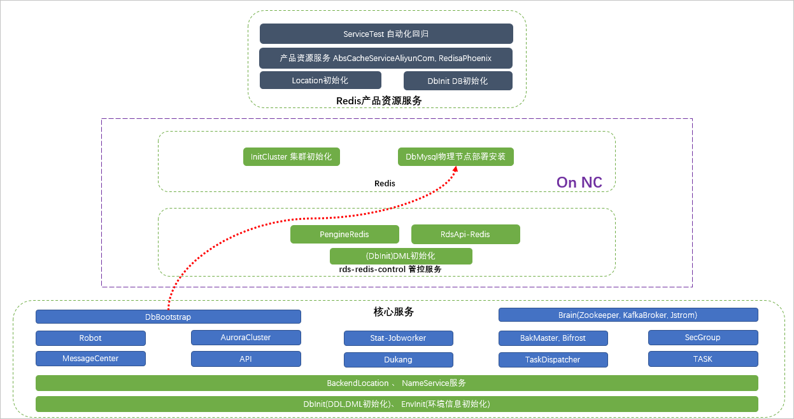
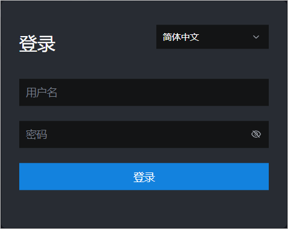
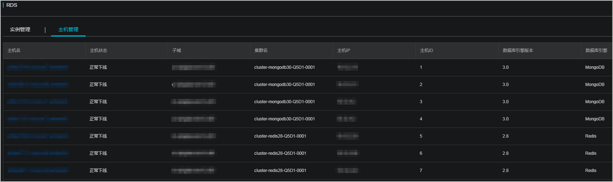
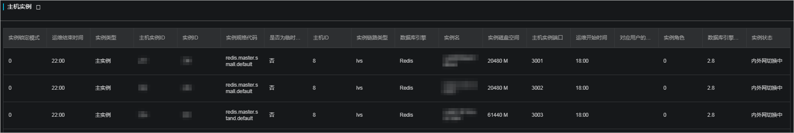
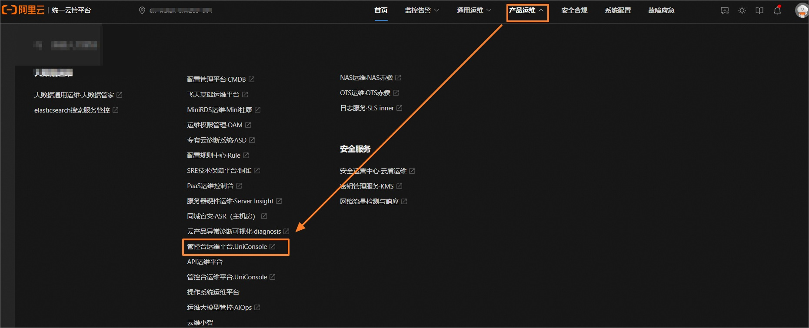

阿里云  
专有云  
云数据库 Redis 版  
运维指南  
产品版本：V3.18.6  
文档版本：20250924

**目录**

- [1.运维指南](#section-1)
    - [1.1. 运维工具](#section-1-1)
    - [1.2. 系统架构](#section-1-2)
    - [1.3. 服务角色](#section-1-3)
    - [1.4. 登录Apsara Uni-manager运维控制台](#section-1-4)
    - [1.5. 实例管理](#section-1-5)
    - [1.6. 主机管理](#section-1-6)
    - [1.7. 安全维护](#section-1-7)
        - [1.7.1. 网络安全维护](#section-1-7-1)
        - [1.7.2. 账号密码维护](#section-1-7-2)
        - [1.7.3. 自定义密码策略](#section-1-7-3)

# 1.运维指南

## 1.1. 运维工具

Apsara Uni-manager运维控制台是阿里云专有云统一的智能化运维平台，本文介绍常用的运维工具。

运维Redis实例时主要使用以下功能：

- 实例管理：用于查看实例详情、实例日志以及用户信息等。

- 主机管理：用于查看以及管理主机。

## 1.2. 系统架构

本文介绍系统构成及各模块的作用。

图 1. 系统架构

**分组**

**包含的组件**

**说明**

用于Redis业务功能自动化回归。

ServiceTest

AbsCacheServiceAliyu

Redis业务的OpenAPI服务。

nCom、RedisaPhoenix

Redis资源服务

初始化Location配置。

Location

初始化Redis产品资源服务相关的DDL和DML。

DbInit

初始化集群及主机列表。

InitCluster

Redis服务

初始化DB节点，安装内核及管控RPM。

DbRedis

Redis业务相关的任务流服务。

PengineMySQL

Redis业务相关的API接口。

RdsApiRedis

Redis-Control管控服务

初始化Redis相关的dml配置。

DbInit

<table>
  <tr>
    <td rowspan="15">核心服务</td>
    <td>DbBootstrap</td>
    <td>提供数据库产品各DB物理机节点部署能力。</td>
  </tr>
  <tr>
    <td>Robot</td>
    <td>数据库产品自动化运维服务。</td>
  </tr>
  <tr>
    <td>MessageCenter</td>
    <td>消息通讯中心服务。</td>
  </tr>
  <tr>
    <td>AuroraCluster</td>
    <td>ApsaraDB云数据库高可用平台。</td>
  </tr>
  <tr>
    <td>API</td>
    <td>后端核心API服务。</td>
  </tr>
  <tr>
    <td>Stat-JobWorker</td>
    <td>定时任务真实执行者，完成各类监控巡检。</td>
  </tr>
  <tr>
    <td>Dukang</td>
    <td>数据库产品的运维管理平台。</td>
  </tr>
  <tr>
    <td>Brain</td>
    <td>老版本实例、主机的性能采集、实例的审计日志采集相关服务。</td>
  </tr>
  <tr>
    <td>BakMaster、Bifrost</td>
    <td>分别提高数据库全量备份服务和增量备份服务。</td>
  </tr>
  <tr>
    <td>TaskDispatcher</td>
    <td>管控任务流调度服务。</td>
  </tr>
  <tr>
    <td>SecGroup</td>
    <td>白名单服务。</td>
  </tr>
  <tr>
    <td>BackendLocation</td>
    <td>分别提供集群、Location管理服务。</td>
  </tr>
  <tr>
    <td>NameService</td>
    <td>名字服务。</td>
  </tr>
  <tr>
    <td>DBInit</td>
    <td>元数据库初始化服务</td>
  </tr>
  <tr>
    <td>EnvInit</td>
    <td>初始化OSS、VPC、Bakowner等信息。</td>
  </tr>
</table>

## 1.3. 服务角色

本文介绍服务角色及其所属的Project、集群和服务的详细清单，方便运维人员识别和定位故障。

> 您可以通过飞天基础运维平台中的集群运维查看相关服务角色。关于飞天基础运维平台的
>
> **说明**
>
> 介绍，请参见<strong>《云平台运维指南》</strong>手册。

<table>
  <tr>
    <th>Project</th>
    <th>集群</th>
    <th>服务</th>
    <th>服务角色</th>
    <th>描述</th>
  </tr>
  <tr>
    <td rowspan="6">rds</td>
    <td rowspan="4">redis-control</td>
    <td rowspan="4">rds-redis-control</td>
    <td>Dbinit</td>
    <td>初始化Redis相关的DDL和DML。</td>
  </tr>
  <tr>
    <td>McNode</td>
    <td>消息通讯Agent节点。</td>
  </tr>
  <tr>
    <td>PengineRedis</td>
    <td>Redis业务相关的任务流服务。</td>
  </tr>
  <tr>
    <td>RdsapiRedis</td>
    <td>Redis业务相关的API接口。</td>
  </tr>
  <tr>
    <td rowspan="2">redis_7u</td>
    <td rowspan="2">rds-redis</td>
    <td>DbRedis</td>
    <td>初始化DB节点，安装内核及管控RPM。</td>
  </tr>
  <tr>
    <td>initCluster</td>
    <td>初始化集群及主机列表。</td>
  </tr>
</table>

## 1.4. 登录Apsara Uni-manager运维控制台

本节介绍运维工程师等相关用户如何登录到Apsara Uni-manager运维控制台。

**前提条件**

- 已从部署人员或管理员处获取Apsara Uni-manager运维控制台的访问地址、用户名和密码。

  Apsara Uni-manager运维控制台访问地址格式为*ops*.asconsole.*intranet-domain-id*.com。

- 推荐使用Chrome浏览器。

**操作步骤**

**操作步骤**

1. 打开浏览器。

2. 在地址栏中，输入Apsara Uni-manager运维控制台的访问地址*ops*.asconsole.*intranet-domain-id*.com，按回车键。

   

   > 您可以单击右上角的下拉按钮来进行语言切换。
   >
   > **说明**

3. 输入正确的用户名及密码。

   > 登录Apsara Uni-manager运维控制台的用户名和密码请从部署人员或管理员处获取。
   >
   > **说明**

   首次登录Apsara Uni-manager运维控制台时，需要修改登录用户名的密码，请按照提示完成密码修改。

   为提高安全性，密码必须满足以下要求：

   - 英文大小写字母

   - 阿拉伯数字（0~9）

   - 特殊符号，包括感叹号（！）、at（@）、井号（#）、美元符号（$）、百分号（%）等

   - 密码长度10~20个字符

4. 单击**登录**。

## 1.5. 实例管理

实例管理用于查看实例详情和用户信息，可帮助您了解实例的使用情况。

**操作步骤**

1. 登录Apsara Uni-manager运维控制台。

2. 在顶部菜单栏，单击**运维**。

3. 在页面左侧的导航栏，选择**产品运维管理 > RDS**。

4. 在**实例管理**页签下，选择执行下述操作：

   <table>
     <tr>
       <th width="122">要执行的操作</th>
       <th>操作说明</th>
     </tr>
     <tr>
       <td>查看实例详情</td>
       <td>当前页面展示了所属账号下的实例列表，单击某个实例的ID可查看实例的详细信息。 说明进入<strong>实例信息</strong>页面后，您还可以执行主备切换和查询历史操作记录。</td>
     </tr>
     <tr>
       <td>查看用户信息</td>
       <td>定位至目标实例，单击其<strong>操作</strong>列的<strong>用户信息</strong>，可查看用户信息和各实例资源的关键指标信息。</td>
     </tr>
   </table>

## 1.6. 主机管理

主机管理可帮助您查看主机资源的资源使用情况和关键性能指标。

**操作步骤**

1. 登录Apsara Uni-manager运维控制台。

2. 在顶部菜单栏，单击**运维**。

3. 在页面左侧的导航栏，选择**产品运维管理 > RDS**。

4. 在**主机管理**页签下，您可以查看所有主机信息。

   

5. 单击某个主机的主机名，在**主机实例**页面查看该主机上的所有实例。

   

## 1.7. 安全维护

### 1.7.1. 网络安全维护

网络安全维护包括设备安全和网络安全。

**设备安全**

检查网络设备，启用设备的安全管理协议和配置。

检查网络设备软件版本，及时升级到更安全的版本。

具体安全维护方法请参见各设备的产品文档。

**网络安全**

根据系统网络的现状，可以适当选配入侵检测系统（IDS）或入侵防御系统（IPS）对来自外部或者内部网络的数据流量进行检测，实时防御网络内的异常行为和攻击行为。

### 1.7.2. 账号密码维护

账号密码包括Redis系统密码和设备密码。

为了保证账号安全，请定期修改系统和设备密码，并使用高复杂度的密码。

### 1.7.3. 自定义密码策略

本文为您介绍如何自定义密码策略，帮助您保障数据库的安全性。

**功能说明**

- 白屏化设置：支持通过控制台设置密码规则。

- 实时校验：创建账号时，系统会实时校验密码是否符合规则。

- 多场景适配：适用于不同安全等级的数据库实例，满足合规性需求。

- 支持RDS PostgreSQL、RDS MySQL、Redis，PolarDB Mysql，PolarDB PostgreSQL产品。

**创建自定义密码规则**

1. 登录Apsara Uni-manager运维控制台。

2. 在顶部菜单栏单击**产品运维**，在**云平台运维**下选择**管控台运维平台.UniConsole**。

   

3. 在**产品列表**页，搜索**rdsnext**，单击操作列中的**渠道列表**。

4. 在**rdsnext 渠道列表**页面，搜索**PASSWORD_RULES。**

   > **说明**
   >
   > - PASSWORD_RULES：配置密码规则。
   >
   > - PASSWORD_RULES_MESSAGE：配置密码描述，方便用户在填写密码时，通过描述知道规则的要求。
   >
   > - 升级后此处设置需重新配置。

5. 单击操作列**编辑**，在弹框中链接值位置设置自定义的密码规则，本文以<strong>^test.\*</strong>为例。

6. 设置规则后，单击**确定**，完成创建。

   规则创建后，可在产品控制台创建账号进行验证。具体操作，请参见《用户指南》中创建账号章节。
