阿里云  
专有云  
数据传输  
用户指南  
产品版本：V3.18.3  
文档版本：20241028

**目录**

- [1.数据传输服务DTS](#section-1)
- [2.登录数据传输服务控制台](#section-2)
- [3.数据迁移](#section-3)
    - [3.1. 支持的数据库和迁移类型](#section-3-1)
    - [3.2. 创建数据迁移实例](#section-3-2)
    - [3.3. 准备用于数据迁移的数据库账号](#section-3-3)
    - [3.4. 数据迁移配置案例](#section-3-4)
        - [3.4.1. 从自建MySQL迁移至RDS MySQL](#section-3-4-1)
        - [3.4.2. 从自建MySQL迁移至自建Kafka](#section-3-4-2)
        - [3.4.3. 从RDS MySQL迁移至PolarDB MySQL版（本地盘版实例）](#section-3-4-3)
        - [3.4.4. 从RDS MySQL迁移至云原生分布式数据库PolarDB-X 1.0](#section-3-4-4)
        - [3.4.5. 从RDS MySQL迁移到自建Oracle](#section-3-4-5)
        - [3.4.6. 从自建SQL Server迁移至RDS SQL Server](#section-3-4-6)
        - [3.4.7. 从RDS SQL Server迁移至RDS MySQL](#section-3-4-7)
        - [3.4.8. 自建Oracle间的数据迁移](#section-3-4-8)
        - [3.4.9. 从自建Oracle迁移到RDS MySQL](#section-3-4-9)
        - [3.4.10. 从自建Oracle迁移至PolarDB PostgreSQL版（兼容Oracle）](#section-3-4-10)
        - [3.4.11. 从自建Oracle迁移至云原生分布式数据库PolarDB-X 1.0](#section-3-4-11)
        - [3.4.12. 从自建Oracle迁移至云原生数据仓库AnalyticDB PostgreSQL](#section-3-4-12)
        - [3.4.13. 从自建Oracle迁移至自建PostgreSQL](#section-3-4-13)
        - [3.4.14. RDS PostgreSQL实例间的数据迁移](#section-3-4-14)
        - [3.4.15. RDS PostgreSQL迁移至RDS MySQL](#section-3-4-15)
        - [3.4.16. PolarDB PostgreSQL版（兼容Oracle）间的数据迁移](#section-3-4-16)
        - [3.4.17. 从PolarDB PostgreSQL版（兼容Oracle）迁移至自建Oracle](#section-3-4-17)
        - [3.4.18. 从PolarDB PostgreSQL版（兼容Oracle）迁移至自建Kafka](#section-3-4-18)
        - [3.4.19. 自建Redis间的数据迁移](#section-3-4-19)
        - [3.4.20. 自建MongoDB间的数据迁移](#section-3-4-20)
        - [3.4.21. 从MaxCompute迁移至MySQL](#section-3-4-21)
        - [3.4.22. PolarDB-X 2.0为源的数据迁移](#section-3-4-22)
            - [3.4.22.1. PolarDB-X 2.0间的迁移](#section-3-4-22-1)
            - [3.4.22.2. PolarDB-X 2.0迁移至MySQL](#section-3-4-22-2)
            - [3.4.22.3. PolarDB-X 2.0迁移至阿里云消息队列Kafka](#section-3-4-22-3)
            - [3.4.22.4. PolarDB-X 2.0迁移至AnalyticDB PostgreSQL](#section-3-4-22-4)
    - [3.5. 管理迁移实例](#section-3-5)
        - [3.5.1. 库表列映射](#section-3-5-1)
        - [3.5.2. 配置SQL条件过滤迁移数据](#section-3-5-2)
        - [3.5.3. 修复迁移失败的任务](#section-3-5-3)
        - [3.5.4. 目标库对象名称大小写策略](#section-3-5-4)
        - [3.5.5. Kafka集群的数据存储格式](#section-3-5-5)
        - [3.5.6. Kafka Partition迁移策略说明](#section-3-5-6)
        - [3.5.7. 在迁移任务中配置ETL](#section-3-5-7)
    - [3.6. 预检查项](#section-3-6)
        - [3.6.1. 源库连接性检查](#section-3-6-1)
        - [3.6.2. 目标数据库连接性检查](#section-3-6-2)
        - [3.6.3. 源库binlog检查](#section-3-6-3)
        - [3.6.4. 约束完整性检查](#section-3-6-4)
        - [3.6.5. federated类型的表的存在性检查](#section-3-6-5)
        - [3.6.6. 权限检查](#section-3-6-6)
        - [3.6.7. 同名对象存在性检查](#section-3-6-7)
        - [3.6.8. schema存在性检查](#section-3-6-8)
        - [3.6.9. 源库server-id检查](#section-3-6-9)
        - [3.6.10. 源库版本号检查](#section-3-6-10)
    - [3.7. 异构数据库间的数据类型映射关系](#section-3-7)
    - [3.8. 为自建MySQL创建账号并设置binlog](#section-3-8)
    - [3.9. Oracle的日志开启和精细化授权](#section-3-9)
    - [3.10. 跨账号数据迁移或同步任务的RAM授权](#section-3-10)
- [4.数据同步](#section-4)
    - [4.1. 支持的数据库、同步初始化类型和同步拓扑](#section-4-1)
    - [4.2. 创建数据同步实例](#section-4-2)
    - [4.3. 数据同步拓扑介绍](#section-4-3)
    - [4.4. 准备用于数据同步的数据库账号](#section-4-4)
    - [4.5. 数据同步配置案例](#section-4-5)
        - [4.5.1. RDS MySQL间的数据同步](#section-4-5-1)
        - [4.5.2. 从RDS MySQL同步到MaxCompute](#section-4-5-2)
        - [4.5.3. 从RDS MySQL同步到云原生数据仓库AnalyticDB MySQL 3.0](#section-4-5-3)
        - [4.5.4. 从RDS MySQL同步至云原生数据仓库AnalyticDB PostgreSQL实例](#section-4-5-4)
        - [4.5.5. 从RDS MySQL同步至PolarDB MySQL版（本地盘版实例）](#section-4-5-5)
        - [4.5.6. PolarDB MySQL版（本地盘版实例）间的同步](#section-4-5-6)
        - [4.5.7. RDS PostgreSQL实例间的数据同步](#section-4-5-7)
        - [4.5.8. 从自建PostgreSQL同步至云原生数据仓库AnalyticDB PostgreSQL实例](#section-4-5-8)
        - [4.5.9. RDS SQL Server同步到DataHub](#section-4-5-9)
        - [4.5.10. 云原生分布式数据库PolarDB-X 1.0实例间的数据同步](#section-4-5-10)
        - [4.5.11. 从云原生分布式数据库PolarDB-X 1.0同步至云原生数据仓库AnalyticDB MySQL 3.0](#section-4-5-11)
        - [4.5.12. 从云原生分布式数据库PolarDB-X 1.0同步至Datahub](#section-4-5-12)
        - [4.5.13. 从自建Db2 for LUW同步至云原生数据仓库AnalyticDB PostgreSQL实例](#section-4-5-13)
        - [4.5.14. 从自建Oracle同步至DataHub](#section-4-5-14)
        - [4.5.15. 从自建Oracle同步到MaxCompute](#section-4-5-15)
        - [4.5.16. 从PolarDB PostgreSQL版（兼容Oracle）同步到云原生数据仓库AnalyticDB MySQL 3.0](#section-4-5-16)
        - [4.5.17. 从Redis实例同步至Redis实例](#section-4-5-17)
        - [4.5.18. 自建MongoDB同步至云数据库MongoDB](#section-4-5-18)
        - [4.5.19. 云数据库MongoDB间的同步](#section-4-5-19)
        - [4.5.20. 配置RDS MySQL实例间的双向数据同步](#section-4-5-20)
            - [4.5.20.1. 概述](#section-4-5-20-1)
            - [4.5.20.2. 支持的同步语法](#section-4-5-20-2)
            - [4.5.20.3. 冲突检测与修复](#section-4-5-20-3)
            - [4.5.20.4. 同步限制](#section-4-5-20-4)
            - [4.5.20.5. 配置RDS MySQL实例间的双向数据同步](#section-4-5-20-5)
        - [4.5.21. PolarDB-X 2.0间的同步](#section-4-5-21)
        - [4.5.22. PolarDB-X 2.0同步至RDS MySQL](#section-4-5-22)
        - [4.5.23. PolarDB-X 2.0同步至AnalyticDB PostgreSQL](#section-4-5-23)
        - [4.5.24. PolarDB-X 2.0同步至AnalyticDB MySQL 3.0](#section-4-5-24)
    - [4.6. 管理同步实例](#section-4-6)
        - [4.6.1. 设置同步对象在目标实例中的名称](#section-4-6-1)
        - [4.6.2. 通过SQL条件过滤待同步数据](#section-4-6-2)
        - [4.6.3. 新增同步对象](#section-4-6-3)
        - [4.6.4. 移除同步对象](#section-4-6-4)
        - [4.6.5. 目标库对象名称大小写策略](#section-4-6-5)
        - [4.6.6. 预检查失败修复](#section-4-6-6)
        - [4.6.7. 在同步任务中配置ETL](#section-4-6-7)
    - [4.7. 同步PolarDB-X的最佳实践](#section-4-7)
        - [4.7.1. 同步PolarDB-X时的规范及注意事项](#section-4-7-1)
        - [4.7.2. 同步PolarDB-X时的任务配置方案](#section-4-7-2)
- [5.数据订阅](#section-5)
    - [5.1. 概述](#section-5-1)
    - [5.2. 创建数据订阅实例](#section-5-2)
    - [5.3. 数据订阅配置案例](#section-5-3)
        - [5.3.1. 创建RDS MySQL数据订阅通道](#section-5-3-1)
        - [5.3.2. 创建云原生分布式数据库PolarDB-X 1.0数据订阅通道](#section-5-3-2)
        - [5.3.3. 创建Oracle数据订阅通道](#section-5-3-3)
    - [5.4. 管理订阅实例](#section-5-4)
        - [5.4.1. 修改订阅对象](#section-5-4-1)
        - [5.4.2. 新增消费组](#section-5-4-2)
        - [5.4.3. 管理消费组](#section-5-4-3)
    - [5.5. 使用SDK消费数据](#section-5-5)
        - [5.5.1. SDK接口简介](#section-5-5-1)
        - [5.5.2. SDK快速入门](#section-5-5-2)
        - [5.5.3. 订阅数据SQL封装简介](#section-5-5-3)
        - [5.5.4. SDK示例代码运行简介](#section-5-5-4)
    - [5.6. 使用Kafka客户端消费数据](#section-5-6)

<a id="section-1"></a>

# 1.数据传输服务DTS

数据传输服务DTS（Data Transmission Service）是阿里云提供的一种支持关系型数据库及大数据等多种数据源之间数据交互的数据服务。相对于传统数据迁移或同步工具，DTS提供功能更丰富、传输性能更强、易用性更高且安全可靠的服务，帮助客户简化复杂的数据交互工作，客户可专注于上层的业务开发。

<a id="section-2"></a>

# 2.登录数据传输服务控制台

本节以Chrome浏览器为例，介绍云产品用户如何登录到数据传输服务DTS控制台。

**前提条件**

- 登录Apsara Uni-manager运营控制台前，确认您已从部署人员处获取Apsara Uni-manager运营控制台的服务域名地址。

- 请使用Chrome浏览器。

  > **说明**
  >
  > DTS暂不支持Edge浏览器的IE模式。

**操作步骤**

1. 在浏览器地址栏中，输入Apsara Uni-manager运营控制台的服务域名地址，按回车键。

2. 输入正确的用户名及密码。请向运营管理员获取登录控制台的用户名和密码。

   > 首次登录Apsara Uni-manager运营控制台时，需要修改登录用户名的密码，请按照提
   >
   > **说明**
   >
   > 示完成密码修改。为提高安全性，密码长度必须为8~20位，且至少包含以下两种类型：
   >
   > - 英文大写或小写字母（A~Z、a~z）
   >
   > - 阿拉伯数字（0~9）
   >
   > - 特殊符号（感叹号（！）、at（@）、井号（#）、美元符号（$）、百分号（%）等）

3. 单击**登录**。

4. 如果账号已激活MFA多因素认证，请根据以下两种情况进行操作：

   - 管理员强制开启MFA后的首次登录：

     <ol type="a">

     <li>

     在绑定虚拟MFA设备页面中，按页面提示步骤绑定MFA设备。

     </li>

     <li>

     按照步骤2重新输入账号和密码，单击**登录**。

     </li>

     </ol>

     <ol type="i" start="100">

     <li>

     输入6位MFA码后单击**认证**。

     </li>

     </ol>

   - 您已开启并绑定MFA：输入6位MFA码后单击**认证**。

     > 绑定并开启MFA的操作请参见<strong>《Apsara Uni-manager运营控制台用户指南》</strong>中的
     >
     > **说明**
     >
     > 章节<strong>《绑定并开启虚拟MFA设备》</strong>。

5. 在页面上方的导航栏中，选择**产品 > 数据库管理工具 > 数据传输服务 DTS**。

6. 选择**组织**和**地域**后，单击**管理员权限访问**。

<a id="section-3"></a>

# 3.数据迁移

<a id="section-3-1"></a>

## 3.1. 支持的数据库和迁移类型

数据迁移功能帮助您实现同构或异构数据源之间的数据迁移，适用于数据上云迁移、阿里云内部跨实例数据迁移、数据库拆分扩容等业务场景。本文将介绍数据迁移功能支持的数据库、版本和迁移类型。

**源数据库**

**目标数据库**

**迁移类型**

- 自建MySQL

  - 库表结构迁移

  5.1、5.5、5.6、5.7、8.0版本

  - 全量迁移

- RDS MySQL

  - 增量迁移

  所有版本

  - 库表结构迁移

PolarDB MySQL版（本地盘版实例）

- 全量迁移

所有版本

- 增量迁移

- 全量迁移

PolarDB-X 1.0（原DRDS）所有版本

- 增量迁移

- 库表结构迁移

自建Oracle（RAC或非RAC架构）

- 全量迁移

9i、10g、11g、12c、18c、19c版本

- 增量迁移

- 库表结构迁移

云原生数据仓库AnalyticDB PostgreSQL（原分析型数据库PostgreSQL版）

- 全量迁移

4.3、6.0版本

- 增量迁移

- 自建MySQL 5.1、5.5、5.6、5.7、8.0版本

  自建PostgreSQL

- RDS MySQL所有版本

  9.4、9.5、9.6、10.x、11和12版本

  - 库表结构迁移

  > **说明**

  - 全量迁移

  > 目前仅当源MySQL的**接入方式**为**专**

  - 增量迁移

  > **线/VPN网关/智能网关**、**ECS自建数据库**或**数据库网关DG**时支持此链路。

  - 库表结构迁移

  自建Kafka

  - 全量迁移

  0.1~2.0版本

  - 增量迁移

  - 自建SQL Server 2005、2008、2008R2、2012、2014、2016、2017版本

- RDS SQL Server 2012、2016、2017版本

  > **说明**

- 自建SQL Server

  > 暂不支持SQL Server Cluster或SQL

  2005、2008、2008R2、2012、

  > Server AlwaysOn High Availability

  - 库表结构迁移

  2014、2016、2017版本

  > Group。

  - 全量迁移

  > **说明**

  - 增量迁移

  - RDS SQL Server

  > - 暂不支持SQL Server

  2012、2014、2016、2017版本

  > Cluster或SQL Server AlwaysOn High Availability Group。
  >
  > - 源库为2005或2008版本时不支持增量数据同步。

  - 库表结构迁移

  RDS MySQL

  - 全量迁移

  所有版本

  - 增量迁移

  - 库表结构迁移

  自建Oracle（RAC或非RAC架构）

  - 全量迁移

  9i、10g、11g、12c、18c、19c版本

  - 增量迁移

  - 库表结构迁移

  PolarDB PostgreSQL版（兼容Oracle）

  - 全量迁移

  9.3、9.6、10或11版本

  - 增量迁移

  - 库表结构迁移

  自建MySQL

  - 全量迁移

  5.1、5.5、5.6、5.7、8.0版本

  - 增量迁移

  - 库表结构迁移

  RDS MySQL

  - 全量迁移

  所有版本

  - 增量迁移

  - 全量迁移

  云原生分布式数据库PolarDB-X 1.0所有版本

  - 增量迁移

自建Oracle（RAC或非RAC架构）9i、10g、11g、12c、18c、19c版本

- 库表结构迁移

云原生数据仓库ADB MySQL版（原分析型数据库MySQL版）

- 全量迁移

3.0版本

- 增量迁移

- 库表结构迁移

云原生数据仓库AnalyticDB PostgreSQL（原分析型数据库PostgreSQL版）

- 全量迁移

4.3、6.0版本

- 增量迁移

- 库表结构迁移

自建Kafka

- 全量迁移

0.1~2.0版本

- 增量迁移

- 自建PostgreSQL

  - 库表结构迁移

  9.4、9.5、9.6、10.x、11和12版本

  - 全量迁移

- RDS PostgreSQL

  - 增量迁移

  9.4、10.0、11.0、12.0、13.0版本

- 自建PostgreSQL

  - 库表结构迁移

  9.4、9.5、9.6、10.x、11和12版本

  - 全量迁移

- RDS PostgreSQL

  - 增量迁移

  9.4、10.0、11.0、12.0、13.0版本

- 自建PostgreSQL

  - 库表结构迁移

  9.4、9.5、9.6、10.x、11和12版本

  - 全量迁移

  RDS MySQL

- RDS PostgreSQL 9.4、10.0、11.0、12.0、13.0版本

  - 增量迁移

  - 库表结构迁移

  云原生数据仓库AnalyticDB PostgreSQL版

  - 全量迁移

  4.3、6.0版本

  - 增量迁移

  - 库表结构迁移

  自建Kafka 0.1~2.0版本

  - 增量迁移

  - 全量迁移

  自建Oracle（RAC或非RAC架构）9i、10g、11g、12c、18c、19c版本

PolarDB PostgreSQL版（兼容Oracle）

- 增量迁移

9.3、9.6、10或11版本

- 库表结构迁移

PolarDB PostgreSQL版（兼容Oracle）

- 全量迁移

9.3、9.6、10或11版本

- 增量迁移

- 全量迁移

自建Redis

自建Redis

2.8、3.0、3.2、4.0、5.0版本

2.8、3.0、3.2、4.0、5.0版本

- 增量迁移

- 自建MongoDB（副本集或分片集群架构）

- 云数据库MongoDB（副本集或分片集群架构）

  > **说明**

- 自建MongoDB（副本集架构）

  - 库表结构迁移

  > 若源数据库为云数据库MongoDB（分

  3.0、3.2、3.4、3.6、4.0或4.2版本

  > 片集群架构），则目标数据库只支持云

  - 全量迁移

- 云数据库MongoDB（副本集或分片集群

  > 数据库MongoDB（分片集群架构）。

  - 增量迁移

  架构）

<table>
  <tr>
    <td>MaxCompute所有版本</td>
    <td>RDS MySQL所有版本</td>
    <td>• 库表结构迁移<br>• 全量迁移</td>
  </tr>
  <tr>
    <td rowspan="2">PolarDB-X 1.0（原DRDS）</td>
    <td>云原生数据仓库AnalyticDB MySQL版3.0版本</td>
    <td>• 库表结构迁移<br>• 全量迁移<br>• 增量迁移</td>
  </tr>
  <tr>
    <td>Datahub</td>
    <td>• 库表结构迁移<br>• 增量迁移</td>
  </tr>
  <tr>
    <td rowspan="4">PolarDB-X 2.0</td>
    <td>PolarDB-X 2.0<br>说明PolarDB-X 2.0需兼容MySQL 5.7版本。</td>
    <td>• 库表结构迁移<br>• 全量迁移<br>• 增量迁移</td>
  </tr>
  <tr>
    <td>云原生数据仓库AnalyticDB PostgreSQL版4.3、6.0版本</td>
    <td>• 库表结构迁移<br>• 全量迁移<br>• 增量迁移</td>
  </tr>
  <tr>
    <td>自建Kafka 0.1~2.0版本</td>
    <td>• 库表结构迁移<br>• 全量迁移<br>• 增量迁移</td>
  </tr>
  <tr>
    <td>自建MySQL 5.1、5.5、5.6、5.7、8.0版本</td>
    <td>• 库表结构迁移<br>• 全量迁移<br>• 增量迁移</td>
  </tr>
  <tr>
    <td>Db2 for LUW</td>
    <td>云原生数据仓库AnalyticDB PostgreSQL版4.3、6.0版本</td>
    <td>• 库表结构迁移<br>• 全量迁移<br>• 增量迁移</td>
  </tr>
  <tr>
    <td>Db2 for i（AS/400）</td>
    <td>自建MySQL 5.1、5.5、5.6、5.7、8.0版本</td>
    <td>• 库表结构迁移<br>• 全量迁移<br>• 增量迁移</td>
  </tr>
</table>

<a id="section-3-2"></a>

## 3.2. 创建数据迁移实例

在配置数据迁移任务前，您需要创建数据迁移实例，本文为您介绍具体操作方法。

**操作步骤**

1. 登录数据传输服务控制台。

2. 在左侧导航栏，单击**数据迁移**。

3. 单击**创建任务**。

4. 在弹出的对话框中，选择数据迁移实例的参数配置。

   <table>
     <tr>
       <th width="137">参数</th>
       <th>说明</th>
     </tr>
     <tr>
       <td>源数据库类型</td>
       <td>选择源数据库类型，支持的迁移链路请参见支持的数据库和迁移类型。</td>
     </tr>
     <tr>
       <td>源区域</td>
       <td>选择源数据库所属的地区。<br>说明源地域为任务链路源实例所在地域，订购后不支持更换地域，请谨慎选择。</td>
     </tr>
     <tr>
       <td>目标数据库类型</td>
       <td>选择目标数据库类型，支持的迁移链路请参见支持的数据库和迁移类型。</td>
     </tr>
     <tr>
       <td>目标区域</td>
       <td>选择目标数据库所属的地区。<br>说明目标地域为任务链路源数据库所在地域，订购后不支持更换地域，请谨慎选择。</td>
     </tr>
     <tr>
       <td>购买数量</td>
       <td>一次性创建数据迁移实例的数量。</td>
     </tr>
   </table>

   > 在本对话框中，您可以查看到总实例数、已创建的实例数和可创建实例的实例数信息。
   >
   > **说明**

5. 单击**购买**。

6. 在弹出的对话框中，单击**确定**。

<a id="section-3-3"></a>

## 3.3. 准备用于数据迁移的数据库账号

在配置数据迁移任务时，您需要在任务配置页面分别为源库和目标库填入数据库账号，该数据库账号将用于数据迁移。由于不同的数据库类型和迁移类型对权限要求有所不同，需要您在配置迁移任务前完成数据库账号的创建与授权操作。

**源库的数据库账号所需权限**

| 数据库 | 所需权限 | 创建及授权方法 |
| --- | --- | --- |
| RDS MySQL | 待迁移对象的读权限。 | 请参见《用户指南（RDS MySQL）》的《创建账号》和《修改账号权限》章节。 |
| 自建MySQL | • 结构迁移：待迁移对象的SELECT权限。<br>• 全量数据迁移：待迁移对象的SELECT权限。<br>• 增量数据迁移：待迁移对象的SELECT权限。REPLICATION CLIENT、REPLICATION SLAVE、SHOW VIEW。建库建表的权限，以允许DTS创建库dts，用于记录迁移期间的心跳数据。 | 请参见为自建MySQL创建账号并设置binlog。 |
| PolarDB MySQL版 | 待迁移对象的读权限。 | 请参见《用户指南（PolarDB MySQL版）》的《创建数据库账号》章节。 |
| PolarDB O引擎 | 初始账号或高权限账号。 | 请参见《用户指南（PolarDB）》的《创建账号》章节。 |
| RDS SQL Server | • 结构迁移：待迁移对象的SELECT权限。<br>• 全量数据迁移：待迁移对象的SELECT权限。<br>• 增量数据迁移：待迁移对象的所有者权限。<br>说明高权限账号满足要求。 | 请参见《用户指南（RDS SQL Server）》的《创建账号》章节。 |
| 自建SQL Server | • 结构迁移：待迁移对象的SELECT权限。<br>• 全量数据迁移：待迁移对象的SELECT权限。<br>• 增量数据迁移：sysadmin权限。 | 请参见CREATE USER。 |
| RDS PostgreSQL | • 结构迁移：pg_catalog的USAGE权限。<br>• 全量数据迁移：迁移对象的SELECT权限。<br>• 增量数据迁移：高权限账号，且需为所选数据库的owner（授权账号）。<br>说明当源库为RDS PostgreSQL 9.4，且仅需增量迁移DML操作时，账号具备replication权限即可。 | 请参见《用户指南（RDS PostgreSQL）》的《创建账号》章节。 |
| 自建PostgreSQL | • 结构迁移：pg_catalog的USAGE权限。<br>• 全量数据迁移：待迁移对象的SELECT权限。<br>• 增量数据迁移：superuser权限。 | 请参见CREATE USER和GRANT语法。 |
| 自建Oracle | • 结构迁移：Schema的owner权限。<br>• 全量数据迁移：Schema的owner权限。<br>• 增量数据迁移：DBA权限。 | 请参见CREATE USER和GRANT。<br>重要如需执行增量数据迁移，且不允许授予DBA权限，您可以为数据库账号授予更精细化的权限，详情请参见Oracle的日志开启和精细化授权。 |
| 云数据库MongoDB | • 全量数据迁移：待迁移库的read权限。<br>• 增量数据迁移：待迁移库、admin库和local库的read权限。 | 默认鉴权数据库为admin，数据库账号为root。 |
| 自建MongoDB | • 全量数据迁移：待迁移库的read权限。<br>• 增量数据迁移：待迁移库、admin库和local库的read权限。 | 请参见MongoDB Create User说明。 |
| 云数据库Redis | 待迁移对象的读权限。 | 请参见云数据库Redis版《用户指南》的《账号管理》章节。 |
| 自建Redis | 无用户和权限概念，可正常执行<code> psync </code>或<code> sync </code>命令即可。 | 无 |
| 自建DB2 | • 结构迁移：CONNECT、待迁移对象的SELECT权限。<br>• 全量数据迁移：CONNECT、待迁移对象的SELECT权限。<br>• 增量数据迁移：DBADM权限。 | 请参见创建用户和权限概述。 |

**目标库的数据库账号所需权限**

<table>
  <tr>
    <th>数据库</th>
    <th>所需权限</th>
    <th>授权方法</th>
  </tr>
  <tr>
    <td>RDS MySQL</td>
    <td>目标库的读写权限。</td>
    <td>请参见《用户指南（RDS MySQL）》的《创建账号》和《修改账号权限》章节。</td>
  </tr>
  <tr>
    <td>PolarDB MySQL版</td>
    <td>目标库的读写权限。</td>
    <td>请参见《用户指南（PolarDB MySQL版）》的《创建数据库账号》章节。</td>
  </tr>
  <tr>
    <td>自建MySQL</td>
    <td>目标库的ALL权限。</td>
    <td>请参见为自建MySQL创建账号并设置binlog。</td>
  </tr>
  <tr>
    <td>云原生数据仓库AnalyticDB MySQL</td>
    <td>• 2.0版本：无需填写数据库账号信息，DTS会自动创建账号并授权。<br>• 3.0版本：读写权限。</td>
    <td>3.0版本：请参见云原生数据仓库AnalyticDB MySQL版《用户指南（3.0）》的《数据库账号和权限》章节。</td>
  </tr>
  <tr>
    <td>云原生数据仓库AnalyticDB PostgreSQL</td>
    <td>初始账号或具备RDS_SUPERUSER权限。</td>
    <td>请参见云原生数据仓库AnalyticDB PostgreSQL版《用户指南》的《创建数据库账号》和《管理用户和权限》章节。</td>
  </tr>
  <tr>
    <td>PolarDB-X</td>
    <td>目标库的读写权限。</td>
    <td>• 1.0版本：请参见云原生分布式数据库PolarDB-X《用户指南（1.0）》的《创建账号》和《修改账号权限》章节。<br>• 2.0版本：请参见云原生分布式数据库PolarDB-X《用户指南》的《管理数据库账号》章节。</td>
  </tr>
  <tr>
    <td>RDS SQL Server</td>
    <td>目标库的读写权限。</td>
    <td>请参见《用户指南（RDS SQL Server）》的《创建账号》章节。</td>
  </tr>
  <tr>
    <td>自建SQL Server</td>
    <td>目标库的ALL权限。</td>
    <td>请参见CREATE USER。</td>
  </tr>
  <tr>
    <td>RDS PostgreSQL</td>
    <td>• 结构迁移：目标迁移对象的CREATE、USAGE权限。<br>• 全量数据迁移：Schema的owner权限。<br>• 增量数据迁移：Schema的owner权限。</td>
    <td>请参见《用户指南（RDS PostgreSQL）》的《创建账号》章节。</td>
  </tr>
  <tr>
    <td>自建PostgreSQL</td>
    <td>目标库的ALL权限。</td>
    <td>请参见CREATE USER和GRANT语法。</td>
  </tr>
  <tr>
    <td>PolarDB O引擎</td>
    <td>初始账号或高权限账号。。</td>
    <td>请参见《用户指南（PolarDB）》的《创建账号》章节。</td>
  </tr>
  <tr>
    <td>自建Oracle</td>
    <td>目标Schema的owner权限。</td>
    <td>请参见CREATE USER和GRANT。</td>
  </tr>
  <tr>
    <td>云数据库MongoDB</td>
    <td>dbAdminAnyDatabase权限、目标库的readWrite权限、local库的read权限。</td>
    <td>默认鉴权数据库为admin，数据库账号为root。</td>
  </tr>
  <tr>
    <td>自建MongoDB</td>
    <td>目标库的readWrite权限、local库的read权限。</td>
    <td>请参见MongoDB Create User说明。</td>
  </tr>
  <tr>
    <td rowspan="2">云数据库Redis</td>
    <td>使用实例的密码：无需执行授权。</td>
    <td>无</td>
  </tr>
  <tr>
    <td>使用自定义账号：读写权限。</td>
    <td>请参见云数据库Redis版《用户指南》的《账号管理》章节。</td>
  </tr>
  <tr>
    <td>自建Redis</td>
    <td>无用户和权限概念，只需提供正确的数据库密码。</td>
    <td>无</td>
  </tr>
  <tr>
    <td>阿里云消息队列Kafka版</td>
    <td>非必填项，无。</td>
    <td>无</td>
  </tr>
  <tr>
    <td>自建Kafka</td>
    <td>非必填项，无。<br>说明如Kafka集群未开启验证可不填写。</td>
    <td>无</td>
  </tr>
</table>

<a id="section-3-4"></a>

## 3.4. 数据迁移配置案例

<a id="section-3-4-1"></a>

### 3.4.1. 从自建MySQL迁移至RDS MySQL

本文介绍如何使用DTS将自建MySQL增量迁移至RDS for MySQL。DTS支持结构迁移、全量数据迁移以及增量数据迁移，同时使用这三种迁移类型可以实现在应用不停服的情况下，平滑地完成数据迁移。

**前提条件**

- 自建MySQL数据库版本为5.1、5.5、5.6、5.7或8.0版本。

  > **说明**
  >
  > 为保障兼容性，建议源和目标实例的MySQL版本保持一致，或者从低版本迁移至高版本。

- RDS for MySQL实例的存储空间须大于自建MySQL数据库占用的存储空间。

**注意事项**

| 类型 | 说明 |
| --- | --- |

<table>
  <tr>
    <td>源库限制</td>
    <td>• 带宽要求：源库所属的服务器需具备足够出口带宽，否则将影响数据迁移速率。<br>• 待迁移的表需具备主键或唯一约束，且字段具有唯一性，否则可能会导致目标数据库中出现重复数据。<br>• 如需进行增量迁移，Binlog日志：<br>• 需开启，并且binlog_format为row、binlog_row_image为full。否则预检查阶段提示报错，且无法成功启动数据迁移任务。<br>• 建议在全量迁移期间，Binlog日志至少保留7天以上。或者等到全量迁移完成后，再清理DTS任务运行后源库产生的Binlog日志。<br>说明为保障数据安全，DTS本地只会循环存储源库近24小时或者50 GB的Binlog日志，一旦超出该限制，DTS本地将自动清除所缓存的日志。<br>警告过早清理源库的Binlog日志，可能会导致迁移任务失败。例如源库的全量迁移数据较多，目标库写入异常等原因，导致全量迁移耗时超过24小时。在该情况下，过早清理源库的Binlog日志，DTS将无法获取到24小时前的Binlog日志，可能会导致迁移任务失败。<br>• 源库的操作限制：<br>• 在库表结构迁移和全量迁移阶段，请勿执行库或表结构变更的DDL操作，否则数据迁移任务会失败。<br>• 如仅执行全量数据迁移，请勿向源实例中写入新的数据，否则会导致源和目标数据不一致。为实时保持数据一致性，建议选择结构迁移、全量数据迁移和增量数据迁移。</td>
  </tr>
  <tr>
    <td>其他限制</td>
    <td>• 为保障兼容性，建议源和目标实例的MySQL版本保持一致，或者从低版本迁移至高版本。<br>• 执行数据迁移前需评估源库和目标库的性能，同时建议业务低峰期执行数据迁移。否则全量数据迁移时DTS占用源和目标库一定读写资源，可能会导致数据库的负载上升。<br>• 由于全量数据迁移会并发执行INSERT操作，导致目标数据库的表产生碎片，因此全量迁移完成后目标数据库的表存储空间会比源实例的表存储空间大。<br>• 请确认DTS对数据类型为FLOAT或DOUBLE的列的迁移精度是否符合业务预期。DTS会通过<code> ROUND(COLUMN,PRECISION) </code>来读取这两类列的值。如果没有明确定义其精度，DTS对FLOAT的迁移精度为38位，对DOUBLE的迁移精度为308位。<br>• DTS会尝试恢复七天之内迁移失败任务。因此业务切换至目标实例前，请务必结束或释放该任务，或者将DTS访问目标实例账号的写权限用<code> revoke </code>命令回收掉。避免该任务被自动恢复后，源端数据覆盖目标实例的数据。</td>
  </tr>
  <tr>
    <td>特殊情况</td>
    <td>• 当源库为自建MySQL时<br>• 迁移时源库进行主备切换，会导致迁移任务失败。<br>• 由于DTS的延迟时间是根据迁移到目标库最后一条数据的时间戳和当前时间戳对比得出，源库长时间未执行DML操作可能导致延迟信息不准确。如果任务显示的延迟时间过大，您可以在源库执行一个DML操作来更新延迟信息。<br>说明如果迁移对象选择为整库，您还可以创建心跳表，心跳表每秒定期更新或者写入数据。<br>• DTS会在源库定时执行<strong>CREATE DATABASE IF NOT EXISTS `test`</strong>命令以推进Binlog位点。<br>• 当目标库为RDS MySQL时DTS会自动在RDS MySQL中创建数据库，如果待迁移的数据库名称不符合RDS MySQL的定义规范，您需要在配置迁移任务之前在RDS MySQL中创建数据库。</td>
  </tr>
</table>

**迁移类型说明**

- 结构迁移DTS将迁移对象的结构定义迁移到目标实例，目前DTS支持结构迁移的对象为表、视图、触发器、存储过程和存储函数。

  > **说明**
  >
  > - 在结构迁移时，DTS会将视图、存储过程和函数中的DEFINER转换为INVOKER。
  >
  > - 由于DTS不迁移USER信息，因此在调用目标库的视图、存储过程和函数时需要对调用者授予读写权限。

- 全量数据迁移DTS会将自建MySQL数据库迁移对象的存量数据，全部迁移到目标RDS MySQL实例数据库中。

  > 由于全量数据迁移会并发INSERT导致目标实例的表存在碎片，全量迁移完成后目标实例
  >
  > **说明**
  >
  > 的表空间会比源实例大。

- 增量数据迁移在全量迁移的基础上，DTS会读取自建MySQL数据库的binlog信息，将自建MySQL数据库的增量更新数据同步到目标RDS MySQL实例中。通过增量数据迁移可以实现在自建应用不停服的情况下，平滑地完成MySQL数据库的迁移上云。

**增量数据迁移支持同步的SQL操作**

<table>
  <tr>
    <th width="89">操作类型</th>
    <th>SQL操作语句</th>
  </tr>
  <tr>
    <td>DML</td>
    <td>INSERT、UPDATE、DELETE、REPLACE</td>
  </tr>
  <tr>
    <td>DDL</td>
    <td>• ALTER TABLE、ALTER VIEW<br>• CREATE FUNCTION、CREATE INDEX、CREATE PROCEDURE、CREATE TABLE、CREATE VIEW<br>• DROP INDEX、DROP TABLE<br>• RENAME TABLE<br>• TRUNCATE TABLE</td>
  </tr>
</table>

**操作步骤**

1. 创建数据迁移实例。

2. 在迁移任务列表中，找到刚创建的数据迁移实例，单击**配置任务**。

3. 配置源库和目标库信息。

   **类别**

   **配置**

   **说明**

   DTS会自动生成一个任务名称，建议配置具有业务意义的名称（无唯一性要

   无

   **任务名称**

   求），便于后续识别。

   选择**MySQL**。

   **数据库类型**

   选择**公网IP**。

   **接入方式**

   当**接入方式**选择为**公网IP**时，**实例地区**无需设置。

   **实例地区**

   填入自建MySQL数据库的访问地址。

   **主机名或IP地址**

   填入自建MySQL数据库的服务端口，默认为**3306**。

   **端口**

   **源库信息**

   填入自建MySQL的数据库账号。如需增量数据迁移，该账号需具备REPLICATION SLAVE、REPLICATION CLIENT、SHOW VIEW和待迁移对

   **数据库账号**

   象SELECT权限；如果不需要增量数据迁移，该账号需具备待迁移对象SELECT权限。

   填入该数据库账号的密码。

   **数据库密码**

   选择**MySQL**。

   **数据库类型**

   选择**云实例**。

   **接入方式**

   创建数据迁移实例时已指定，不可变更。

   **实例地区**

   选择目标RDS实例ID。

   **RDS实例ID**

   **目标库信息**

   填入目标RDS实例的数据库账号，需具备读写权限。

   **数据库账号**

   填入该数据库账号的密码。

   **数据库密码**

   根据需求选择连接方式。如果设置为**SSL安全连接**，您需要提前开启RDS实例

   **连接方式**

   的SSL加密功能。

4. 配置完成后，单击页面下方的**测试连接以进行下一步**。

5. 如果您的自建MySQL数据库具备白名单安全设置，请将弹跳框中提示的DTS服务器的IP地址，加入自建MySQL数据库的白名单安全设置中。白名单安全设置完成后，单击**测试连接以进行下一步**。

   > **说明**
   >
   > 如果您的自建MySQL数据库无需进行白名单安全设置，请直接单击**测试连接以进行下一步**。

6. 选择迁移对象及迁移类型。

   | 配置 | 说明 |
   | --- | --- |
   | 任务步骤 | • 如果只需要进行全量数据迁移，同时选中<strong>库表结构迁移</strong>和<strong>全量迁移</strong>。<br>• 如果需要进行不停机迁移，同时选中<strong>库表结构迁移</strong>、<strong>全量迁移</strong>和<strong>增量迁移</strong>。<br>说明如果未选中<strong>增量迁移</strong>，为保障数据一致性，全量数据迁移期间请勿在源数据库中写入新的数据。 |
   | 目标已存在表的处理模式 | • <strong>预检查并报错拦截</strong>：检查目标数据库中是否有同名的表。如果目标数据库中没有同名的表，则通过该检查项目；如果目标数据库中有同名的表，则在预检查阶段提示错误，数据迁移任务不会被启动。<br>• <strong>忽略报错并继续执行</strong>：跳过目标数据库中是否有同名表的检查项。<br>警告选择为<strong>忽略报错并继续执行</strong>，可能导致数据不一致，给业务带来风险，例如：<br>• 表结构一致的情况下，在目标库遇到与源库主键的值相同的记录，则会保留目标库中的该条记录，即源库中的该条记录不会迁移至目标库中。<br>• 表结构不一致的情况下，可能导致只能迁移部分列的数据或迁移失败。 |
   | 目标库对象名称大小写策略 | 您可以配置目标实例中迁移对象的库名、表名和列名的英文大小写策略。默认情况下选择<strong>DTS默认策</strong><strong>略</strong>，您也可以选择与源库、目标库默认策略保持一致。更多信息，请参见目标库对象名称大小写策略。 |
   | 源库对象 | 在<strong>源库对象</strong>框中单击待迁移的对象，然后单击图标将其移动至<strong>已选择对象</strong>框。<br>说明<br>• 您可以根据实际情况，展开导航树进行正则搜索。<br>• 迁移对象选择的粒度为库、表或列。 |
   | 已选择对象 | 默认情况下，迁移对象在目标库中的名称与源库保持一致。如果您需要改变迁移对象在目标库中的名称，需要使用对象名映射功能，更详情参见库表列映射。<br>说明<br>• 如需按库或表级别选择迁移的SQL操作，请在<strong>已选择对象</strong>中右击待迁移对象，并在弹出的对话框中选择所需迁移的SQL操作。<br>• 如需设置WHERE条件过滤数据，请在<strong>已选择对象</strong>中右击待迁移的表，在弹出的对话框中设置过滤条件。设置方法请参见配置SQL条件过滤迁移数据。<br>• 如果使用了对象名映射功能，可能会导致依赖这个对象的其他对象迁移失败。 |

7. 单击**下一步高级配置**，进行高级配置。

   | 配置项目 | 配置说明 |
   | --- | --- |
   | 源库、目标库无法连接后的重试时间 | 在迁移任务启动后，若源库或目标库连接失败则DTS会报错。对于可预期的报错，DTS会立即进行持续的重试连接，默认重试720分钟，您也可以在取值范围（10~1440分钟）内自定义重试时间，建议设置30分钟以上。如果DTS在设置的时间内重新连接上源、目标库，迁移任务将自动恢复。否则，迁移任务将失败。<br>说明针对同源或者同目标的多个DTS实例，如DTS实例A和DTS实例B，设置网络重试时间时A设置30分钟，B设置60分钟，则重试时间以低的30分钟为准。 |
   | 配置ETL功能 | 选择是否配置ETL功能。<br>• <strong>是</strong>：配置ETL功能，并在文本框中填写数据处理语句。更多信息，请参见在迁移任务中配置ETL。<br>• <strong>否</strong>：不配置ETL功能。 |

8. 上述配置完成后，单击页面下方的**下一步预检查并启动**。

   > **重要**
   >
   > - 在数据迁移任务正式启动之前，会先进行预检查。只有预检查通过后，才能成功启动数据迁移任务。
   >
   > - 如果预检查失败，请单击**查看详情**并请根据提示修复问题，然后重新进行预检查。

9. **预检查通过率**显示为100%时，单击**返回列表**。

   > **说明**
   >
   > 如果未选择增量数据迁移，您只需等待迁移任务完成即可，迁移任务会自动结束；如果选择了增量数据迁移，迁移任务不会自动结束，您需要等待迁移任务处于**运行中**且无延迟时，手动结束迁移任务。

<a id="section-3-4-2"></a>

### 3.4.2. 从自建MySQL迁移至自建Kafka

Kafka是应用较为广泛的分布式、高吞吐量、高可扩展性消息队列服务，普遍用于日志收集、监控数据聚合、流式数据处理、在线和离线分析等大数据领域，是大数据生态中不可或缺的产品之一。通过数据传输服务DTS（Data Transmission Service），您可以将自建MySQL、RDS MySQL迁移至自建Kafka，扩展消息处理能力。本文介绍以RDS MySQL为例，介绍如何将RDS MySQL迁移至自建Kafka。

**前提条件**

- 自建MySQL数据库版本为5.1、5.5、5.6、5.7或8.0版本。

- 已完成目标Kafka集群的搭建，且Kafka的版本为0.10~2.0版本。

**注意事项**

<table>
  <tr>
    <th width="90">类型</th>
    <th>说明</th>
  </tr>
  <tr>
    <td>源库限制</td>
    <td>• 带宽要求：源库所属的服务器需具备足够出口带宽，否则将影响数据迁移速率。<br>• 待迁移的表需具备主键或唯一约束，且字段具有唯一性，否则可能会导致目标数据库中出现重复数据。<br>• 如需进行增量迁移，Binlog日志：<br>• 需开启，并且binlog_format为row、binlog_row_image为full。否则预检查阶段提示报错，且无法成功启动数据迁移任务。<br>• 建议在全量迁移期间，Binlog日志至少保留7天以上。或者等到全量迁移完成后，再清理DTS任务运行后源库产生的Binlog日志。<br>说明为保障数据安全，DTS本地只会循环存储源库近24小时或者50 GB的Binlog日志，一旦超出该限制，DTS本地将自动清除所缓存的日志。<br>警告过早清理源库的Binlog日志，可能会导致迁移任务失败。例如源库的全量迁移数据较多，目标库写入异常等原因，导致全量迁移耗时超过24小时。在该情况下，过早清理源库的Binlog日志，DTS将无法获取到24小时前的Binlog日志，可能会导致迁移任务失败。<br>• 源库的操作限制：<br>• 在库表结构迁移和全量迁移阶段，请勿执行库或表结构变更的DDL操作，否则数据迁移任务会失败。<br>• 如仅执行全量数据迁移，请勿向源实例中写入新的数据，否则会导致源和目标数据不一致。为实时保持数据一致性，建议选择结构迁移、全量数据迁移和增量数据迁移。</td>
  </tr>
  <tr>
    <td>注意事项</td>
    <td>• Kafka集群的服务端口已开放至公网。<br>• 迁移对象仅支持数据表。<br>• 执行数据迁移前需评估源库和目标库的性能，同时建议业务低峰期执行数据迁移。否则全量数据迁移时DTS占用源和目标库一定读写资源，可能会导致数据库的负载上升。<br>• 由于全量数据迁移会并发执行INSERT操作，导致目标数据库的表产生碎片，因此全量迁移完成后目标数据库的表存储空间会比源实例的表存储空间大。<br>• 请确认DTS对数据类型为FLOAT或DOUBLE的列的迁移精度是否符合业务预期。DTS会通过<code> ROUND(COLUMN,PRECISION) </code>来读取这两类列的值。如果没有明确定义其精度，DTS对FLOAT的迁移精度为38位，对DOUBLE的迁移精度为308位。<br>• DTS会尝试恢复七天之内迁移失败任务。因此业务切换至目标实例前，请务必结束或释放该任务，或者将DTS访问目标实例账号的写权限用<code> revoke </code>命令回收掉。避免该任务被自动恢复后，源端数据覆盖目标实例的数据。</td>
  </tr>
  <tr>
    <td>特殊情况</td>
    <td>• 当源库为自建MySQL时<br>• 迁移时源库进行主备切换，会导致迁移任务失败。<br>• 由于DTS的延迟时间是根据迁移到目标库最后一条数据的时间戳和当前时间戳对比得出，源库长时间未执行DML操作可能导致延迟信息不准确。如果任务显示的延迟时间过大，您可以在源库执行一个DML操作来更新延迟信息。<br>说明如果迁移对象选择为整库，您还可以创建心跳表，心跳表每秒定期更新或者写入数据。<br>• DTS会在源库定时执行<strong>CREATE DATABASE IF NOT EXISTS `test`</strong>命令以推进Binlog位点。<br>• 当目标库为RDS MySQL时DTS会自动在RDS MySQL中创建数据库，如果待迁移的数据库名称不符合RDS MySQL的定义规范，您需要在配置迁移任务之前在RDS MySQL中创建数据库。</td>
  </tr>
</table>

**消息格式**

迁移到Kafka集群中的数据以AVRO格式存储，您需要根据avro schema定义进行数据解析，关于schema定义的详情，请参见DTS Avro schema定义。

**操作步骤**

1. 创建数据迁移实例。

2. 在迁移任务列表中，找到刚创建的数据迁移实例，单击**配置任务**。

3. 配置源库和目标库信息。

   **类别**

   **配置**

   **说明**

   DTS会自动生成一个任务名称，建议配置具有业务意义的名称（无唯一性要

   无

   **任务名称**

   求），便于后续识别。

   选择**MySQL**。

   **数据库类型**

   选择**公网IP**。

   **接入方式**

   当**接入方式**选择为**公网IP**时，**实例地区**无需设置。

   **实例地区**

   **主机名或IP地**

   填入自建MySQL数据库的访问地址。

   **源库信息**

   **址**

   填入自建MySQL数据库的服务端口，默认为**3306**。

   **端口**

   填入源RDS实例的数据库账号，需具备REPLICATION CLIENT、

   **数据库账号**

   REPLICATION SLAVE、SHOW VIEW和所有迁移对象的SELECT权限。

   填入该数据库账号的密码。

   **数据库密码**

   选择**Kafka**。

   **数据库类型**

   选择**公网IP**。

   **接入方式**

   创建数据迁移实例时已指定，不可变更。

   **实例地区**

   **主机名或IP地**

   填入自建Kafka集群的访问地址，本案例中填入公网地址。

   **址**

   填入Kafka集群提供服务的端口，默认为9092。

   **端口**

   填入Kafka集群的用户名，如Kafka集群未开启验证可不填写。

   **数据库账号**

   填入Kafka集群用户名的密码，如Kafka集群未开启验证可不填写。

   **数据库密码**

   选择目标Kafka集群的版本。

   **目标库信息**

   > **说明**

   **Kafka版本**

   > 目前控制台暂不支持直接选择Kafka2.0版本，如果您使用的是Kafka2.0版本，您需要选择Kafka1.0版本。

   根据业务及安全需求，选择**非加密连接**或**SCRAM-SHA-256**。

   **连接方式**

   在下拉框中选择目标Topic。

   **Topic**

   在下拉框中选择用于存储DDL信息的Topic。如果未指定，DDL信息默认存

   **存储DDL的**

   储在**Topic**选择的Topic中。

   **Topic**

   Kafka Schema Registry是元数据提供服务层，提供了一个RESTful接口，用于存储和检索Avro Schema。

   **是否使用Kafka**

   - **否**：不使用Kafka Schema Registry。

   **Schema**

   - **是**：使用Kafka Schema Registry。您需要输入Avro Schema在

   **Registry**

   Kafka Schema Registry注册的URL或IP。

4. 配置完成后，单击页面下方的**测试连接以进行下一步**。

5. 如果您的自建MySQL数据库和自建Kafka具备白名单安全设置，请将弹跳框中提示的DTS服务器的IP地址，加入自建MySQL数据库和自建Kafka的白名单安全设置中。白名单安全设置完成后，单击**测试连接以进行下一步**。

   > **说明**
   >
   > 如果您的自建MySQL数据库和自建Kafka无需进行白名单安全设置，请直接单击**测试连接以进行下一步**。

6. 选择迁移对象及迁移类型。

   | 配置 | 说明 |
   | --- | --- |
   | 任务步骤 | • 如果只需要进行全量数据迁移，同时选中<strong>库表结构迁移</strong>和<strong>全量迁移</strong>。<br>• 如果需要进行不停机迁移，同时选中<strong>库表结构迁移</strong>、<strong>全量迁移</strong>和<strong>增量迁移</strong>。<br>说明如果未选中<strong>增量迁移</strong>，为保障数据一致性，全量数据迁移期间请勿在源数据库中写入新的数据。 |
   | 目标已存在表的处理模式 | • <strong>预检查并报错拦截</strong>：检查目标数据库中是否有同名的表。如果目标数据库中没有同名的表，则通过该检查项目；如果目标数据库中有同名的表，则在预检查阶段提示错误，数据迁移任务不会被启动。<br>• <strong>忽略报错并继续执行</strong>：跳过目标数据库中是否有同名表的检查项。<br>警告选择为<strong>忽略报错并继续执行</strong>，可能导致数据不一致，给业务带来风险，例如：<br>• 表结构一致的情况下，在目标库遇到与源库主键的值相同的记录，则会保留目标库中的该条记录，即源库中的该条记录不会迁移至目标库中。<br>• 表结构不一致的情况下，可能导致只能迁移部分列的数据或迁移失败。 |
   | 投递到Kafka的数据格式 | 根据需求选择同步到Kafka实例中的数据存储格式。<br>• 如果您选择<strong>DTS Avro</strong>，根据DTS Avro的schema定义进行数据解析，schema定义详情请参见DTS Avro的schema定义。<br>• 如果您选择<strong>Canal Json</strong>，Canal Json的参数说明和示例请参见Canal Json。 |
   | 投递到Kafka Partitio n策略 | 根据业务需求选择同步的策略，详情请参见Kafka Partition迁移策略说明。 |
   | 源库对象 | 在<strong>源库对象</strong>框中单击待迁移的对象，然后单击图标将其移动至<strong>已选择对象</strong>框。<br>说明<br>• 您可以根据实际情况，展开导航树进行正则搜索。<br>• 迁移对象选择的粒度为表。 |
   | 已选择对象 | 默认情况下，迁移对象在目标库中的名称与源库保持一致。如果您需要改变迁移对象在目标库中的名称，需要使用对象名映射功能，更详情参见库表列映射。<br>说明<br>• 如需按库或表级别选择迁移的SQL操作，请在<strong>已选择对象</strong>中右击待迁移对象，并在弹出的对话框中选择所需迁移的SQL操作。<br>• 如果使用了对象名映射功能，可能会导致依赖这个对象的其他对象迁移失败。 |

7. 单击**下一步高级配置**，进行高级配置。

   | 配置项目 | 配置说明 |
   | --- | --- |
   | 源库、目标库无法连接后的重试时间 | 在迁移任务启动后，若源库或目标库连接失败则DTS会报错。对于可预期的报错，DTS会立即进行持续的重试连接，默认重试720分钟，您也可以在取值范围（10~1440分钟）内自定义重试时间，建议设置30分钟以上。如果DTS在设置的时间内重新连接上源、目标库，迁移任务将自动恢复。否则，迁移任务将失败。<br>说明针对同源或者同目标的多个DTS实例，如DTS实例A和DTS实例B，设置网络重试时间时A设置30分钟，B设置60分钟，则重试时间以低的30分钟为准。 |
   | 配置ETL功能 | 当前链路暂不支持配置ETL功能，请选择<strong>否</strong>。 |

8. 上述配置完成后，单击页面下方的**下一步预检查并启动**。

   > **重要**
   >
   > - 在数据迁移任务正式启动之前，会先进行预检查。只有预检查通过后，才能成功启动数据迁移任务。
   >
   > - 如果预检查失败，请单击**查看详情**并请根据提示修复问题，然后重新进行预检查。

9. **预检查通过率**显示为100%时，单击**返回列表**。

   > 如果未选择增量数据迁移，您只需等待迁移任务完成即可，迁移任务会自动结束；如果
   >
   > **说明**
   >
   > 选择了增量数据迁移，迁移任务不会自动结束，您需要等待迁移任务处于**运行中**且无延迟时，手动结束迁移任务。

<a id="section-3-4-3"></a>

### 3.4.3. 从RDS MySQL迁移至PolarDB MySQL版（本地盘版实例）

数据传输服务DTS（Data Transmission Service）支持将RDS MySQL或自建MySQL的数据迁移至PolarDB MySQL版（本地盘版实例）。本文以RDS MySQL实例为源，PolarDB MySQL版（本地盘版实例）为目标，为您介绍迁移操作方法。

**前提条件**

- 已创建存储空间大于源RDS MySQL已占用空间的目标双机高可用版本系列PolarDB MySQL版（本地盘版实例）。

- PolarDB MySQL版（本地盘版实例）已开通公网连接地址。

**注意事项**

<table>
  <tr>
    <th width="90">类型</th>
    <th>说明</th>
  </tr>
  <tr>
    <td>源库限制</td>
    <td>• 待迁移的表需具备主键或唯一约束，且字段具有唯一性，否则可能会导致目标数据库中出现重复数据。<br>• Binlog日志：<br>• 需开启，并且binlog_format为row、binlog_row_image为full。否则预检查阶段提示报错，且无法成功启动数据迁移任务。<br>• 建议在全量初始化期间，Binlog日志至少保留7天以上。或者等到全量初始化完成后，再清理DTS任务运行后源库产生的Binlog日志。<br>说明为保障数据安全，DTS本地只会循环存储源库近24小时或者50 GB的Binlog日志，一旦超出该限制，DTS本地将自动清除所缓存的日志。<br>警告过早清理源库的Binlog日志，可能会导致迁移任务失败。例如源库的全量初始化数据较多，目标库写入异常等原因，导致全量初始化耗时超过24小时。在该情况下，过早清理源库的Binlog日志，DTS将无法获取到24小时前的Binlog日志，可能会导致迁移任务失败。<br>• 在库表结构迁移和全量迁移阶段，请勿执行库或表结构变更的DDL操作，否则会导致数据迁移任务失败。</td>
  </tr>
</table>

<table>
  <tr>
    <td>其他限制</td>
    <td>• 目标库不支持只读实例。<br>• 建议源和目标库版本保持一致，或者从低版本迁移到高版本以保障兼容性。如为高版本迁移至低版本，可能存在数据库兼容性问题。<br>• 在进行全量数据迁移时，DTS将会占用源和目标库一定的读写资源，可能会导致数据库的负载上升。因此建议在执行数据迁移前评估源库和目标库的性能，并在业务低峰期执行数据迁移（例如源库和目标库的CPU负载在30%以下）。<br>• 由于全量数据迁移会并发执行INSERT操作，导致目标数据库的表产生碎片，因此全量迁移完成后目标数据库的表存储空间会大于源实例的表存储空间。<br>• 如迁移对象为单个或多个表（非整库），那么在数据迁移时，勿对源库的迁移对象使用pt-online-schema-change等类似工具执行在线DDL变更，否则会导致迁移失败。<br>• 在DTS迁移期间，不允许有除DTS外的数据写入目标库，否则会导致源库与目标库数据不一致。例如，有除DTS外的数据写入目标库时，使用DMS执行在线DDL变更，可能引起目标库数据丢失。<br>• 不支持将datetime类型的数据转换为varchar。</td>
  </tr>
  <tr>
    <td>特殊情况</td>
    <td>• 当源库为自建MySQL时：<br>• 在同步时，如果源库进行主备切换，将会导致同步任务失败。<br>• 由于DTS的延迟时间是根据同步到目标库最后一条数据的时间戳和当前时间戳对比得出，源库长时间未执行DML操作可能导致延迟信息不准确。如果任务显示的延迟时间过大，您可以在源库执行一个DML操作来更新延迟信息。<br>说明如果同步对象选择为整库，您还可以创建心跳表，心跳表每秒定期更新或者写入数据。<br>• DTS会在源库定时执行<strong>CREATE DATABASE IF NOT EXISTS `test`</strong>命令以推进Binlog位点。<br>• 当源库为RDS MySQL时：不记录事务日志的RDS MySQL实例（如RDS MySQL 5.6版本的只读实例）不支持作为源库。</td>
  </tr>
</table>

**支持增量迁移的SQL操作**

DML操作：INSERT、UPDATE、DELETE

**操作步骤**

1. 创建数据迁移实例。

   > **说明**
   >
   > 创建时，选择源数据库类型为**MySQL**、目标数据库类型为**PolarDB for MySQL**。

2. 在迁移任务列表中，找到刚创建的数据迁移实例，单击**配置任务**。

3. 配置源库和目标库信息。

   **类别**

   **配置**

   **说明**

   DTS会自动生成一个任务名称，建议配置具有业务意义的名称（无唯一性

   无

   **任务名称**

   要求），便于后续识别。

   选择**MySQL**。

   **数据库类型**

   选择**云实例**。

   **接入方式**

   创建数据迁移实例时已指定，不可变更。

   **实例地区是否跨阿里云账**

   选择**不跨账号**。

   **号**

   选择源RDS实例ID。

   **RDS实例ID**

   **源库信息**

   填入源RDS的数据库账号，需具备REPLICATION CLIENT、REPLICATION SLAVE、SHOW VIEW和所有迁移对象的SELECT权限。

   **数据库账号**

   > **说明**
   >
   > 当源RDS实例的数据库类型为**MySQL 5.5**或**MySQL 5.6**时，无需配置**数据库账号**和**数据库密码**。

   填入该数据库账号的密码。

   **数据库密码**

   根据需求选择连接方式。如果设置为**SSL安全连接**，您需要提前开启RDS

   **连接方式**

   实例的SSL加密功能。

   选择**PolarDB for MySQL**。

   **数据库类型**

   选择**公网IP**。

   **接入方式**

   创建数据迁移实例时已指定，不可变更。

   **实例地区**

   填入目标PolarDB MySQL版（本地盘版实例）的**Vip**或**Vip外网地址**。

   **主机名或IP地址**

   **目标库信息**

   填入目标PolarDB MySQL版（本地盘版实例）的**外网端口**。

   **端口**

   填入目标PolarDB MySQL版（本地盘版实例）的数据库账号，需具备目标数据库的读写权限。

   **数据库账号**

   填入该数据库账号的密码。

   **数据库密码**

4. 配置完成后，单击页面下方的**测试连接以进行下一步**。

5. 如果您的PolarDB MySQL版（本地盘版实例）具备白名单设置，请将弹跳框中提示的DTS服务器的IP地址，加入PolarDB MySQL版（本地盘版实例）的白名单设置中。白名单设置完成后，单击**测试连接以进行下一步**。

   > **说明**
   >
   > 如果您的PolarDB MySQL版（本地盘版实例）无需进行白名单设置，请直接单击**测试连接以进行下一步**。

6. 选择迁移对象及迁移类型。

   | 配置 | 说明 |
   | --- | --- |
   | 任务步骤 | • 如果只需要进行全量数据迁移，同时选中<strong>库表结构迁移</strong>和<strong>全量迁移</strong>。<br>• 如果需要进行不停机迁移，同时选中<strong>库表结构迁移</strong>、<strong>全量迁移</strong>和<strong>增量迁移</strong>。<br>说明如果未选中<strong>增量迁移</strong>，为保障数据一致性，全量数据迁移期间请勿在源数据库中写入新的数据。 |
   | 目标已存在表的处理模式 | • <strong>预检查并报错拦截</strong>：检查目标数据库中是否有同名的表。如果目标数据库中没有同名的表，则通过该检查项目；如果目标数据库中有同名的表，则在预检查阶段提示错误，数据迁移任务不会被启动。<br>• <strong>忽略报错并继续执行</strong>：跳过目标数据库中是否有同名表的检查项。<br>警告选择为<strong>忽略报错并继续执行</strong>，可能导致数据不一致，给业务带来风险，例如：<br>• 表结构一致的情况下，在目标库遇到与源库主键的值相同的记录，则会保留目标库中的该条记录，即源库中的该条记录不会迁移至目标库中。<br>• 表结构不一致的情况下，可能导致只能迁移部分列的数据或迁移失败。 |
   | 目标库对象名称大小写策略 | 您可以配置目标实例中迁移对象的库名、表名和列名的英文大小写策略。默认情况下选择<strong>DTS默认策</strong><strong>略</strong>，您也可以选择与源库、目标库默认策略保持一致。更多信息，请参见目标库对象名称大小写策略。 |
   | 源库对象 | 在<strong>源库对象</strong>框中单击待迁移的对象，然后单击图标将其移动至<strong>已选择对象</strong>框。<br>说明<br>• 您可以根据实际情况，展开导航树进行正则搜索。<br>• 迁移对象选择的粒度为库、表、列。 |
   | 已选择对象 | 默认情况下，迁移对象在目标库中的名称与源库保持一致。如果您需要改变迁移对象在目标库中的名称，需要使用对象名映射功能，更详情参见库表列映射。<br>说明<br>• 如需按库或表级别选择迁移的SQL操作，请在<strong>已选择对象</strong>中右击待迁移对象，并在弹出的对话框中选择所需迁移的SQL操作。<br>• 如果使用了对象名映射功能，可能会导致依赖这个对象的其他对象迁移失败。 |

7. 单击**下一步高级配置**，进行高级配置。

   | 配置项目 | 配置说明 |
   | --- | --- |
   | 选择目标库的引擎类型 | 请根据实际情况，选择目标库的引擎类型为<strong>InnoDB</strong>或<strong>X-Engine</strong>。 |
   | 源库、目标库无法连接后的重试时间 | 在迁移任务启动后，若源库或目标库连接失败则DTS会报错。对于可预期的报错，DTS会立即进行持续的重试连接，默认重试720分钟，您也可以在取值范围（10~1440分钟）内自定义重试时间，建议设置30分钟以上。如果DTS在设置的时间内重新连接上源、目标库，迁移任务将自动恢复。否则，迁移任务将失败。<br>说明针对同源或者同目标的多个DTS实例，如DTS实例A和DTS实例B，设置网络重试时间时A设置30分钟，B设置60分钟，则重试时间以低的30分钟为准。 |

8. 上述配置完成后，单击页面下方的**下一步预检查并启动**。

   > **重要**
   >
   > - 在数据迁移任务正式启动之前，会先进行预检查。只有预检查通过后，才能成功启动数据迁移任务。
   >
   > - 如果预检查失败，请单击**查看详情**并请根据提示修复问题，然后重新进行预检查。

9. **预检查通过率**显示为100%时，单击**返回列表**。

   > 如果未选择增量数据迁移，您只需等待迁移任务完成即可，迁移任务会自动结束；如果
   >
   > **说明**
   >
   > 选择了增量数据迁移，迁移任务不会自动结束，您需要等待迁移任务处于**运行中**且无延迟时，手动结束迁移任务。

<a id="section-3-4-4"></a>

### 3.4.4. 从RDS MySQL迁移至云原生分布式数据库PolarDB-X 1.0

本小节简单介绍使用DTS将RDS MySQL迁移至云原生分布式数据库PolarDB-X 1.0（原分布式关系型数据库DRDS）。

**前提条件**

PolarDB-X 1.0实例的存储空间须大于RDS MySQL数据库占用的存储空间。

**注意事项**

<table>
  <tr>
    <th width="90">类型</th>
    <th>说明</th>
  </tr>
  <tr>
    <td>源库限制</td>
    <td>• 带宽要求：源库所属的服务器需具备足够出口带宽，否则将影响数据迁移速率。<br>• 待迁移的表需具备主键或唯一约束，且字段具有唯一性，否则可能会导致目标数据库中出现重复数据。<br>• 如需进行增量迁移，Binlog日志：<br>• 需开启，并且binlog_format为row、binlog_row_image为full。否则预检查阶段提示报错，且无法成功启动数据迁移任务。更多信息，请参见<strong>云数据库RDS</strong>产品《用户指南（RDS MySQL）》的《设置实例参数》章节。<br>• 建议在全量迁移期间，Binlog日志至少保留7天以上。或者等到全量迁移完成后，再清理DTS任务运行后源库产生的Binlog日志。<br>说明为保障数据安全，DTS本地只会循环存储源库近24小时或者50 GB的Binlog日志，一旦超出该限制，DTS本地将自动清除所缓存的日志。<br>警告过早清理源库的Binlog日志，可能会导致迁移任务失败。例如源库的全量迁移数据较多，目标库写入异常等原因，导致全量迁移耗时超过24小时。在该情况下，过早清理源库的Binlog日志，DTS将无法获取到24小时前的Binlog日志，可能会导致迁移任务失败。<br>• 源库的操作限制：<br>• 在全量迁移阶段，请勿执行库或表结构变更的DDL操作，否则数据迁移任务会失败。<br>• 如仅执行全量数据迁移，请勿向源实例中写入新的数据，否则会导致源和目标数据不一致。为实时保持数据一致性，建议选择全量数据迁移和增量数据迁移。<br>• 暂不支持增量迁移DDL操作，否则数据迁移任务会失败。如需进行DDL操作，建议您先在目标库手动执行后，在源库重复相应的DDL操作。</td>
  </tr>
  <tr>
    <td>其他限制</td>
    <td>• PolarDB-X 1.0的存储类型需为RDS MySQL（即私有定制RDS），暂不支持为PolarDB MySQL。<br>• 暂不支持结构迁移，在配置迁移任务前，您需要在目标实例中创建对应的库和表。<br>• 执行数据迁移前需评估源库和目标库的性能，同时建议业务低峰期执行数据迁移。否则全量数据迁移时DTS占用源和目标库一定读写资源，可能会导致数据库的负载上升。<br>• 由于全量数据迁移会并发执行INSERT操作，导致目标数据库的表产生碎片，因此全量迁移完成后目标数据库的表存储空间会比源实例的表存储空间大。<br>• 请确认DTS对数据类型为FLOAT或DOUBLE的列的迁移精度是否符合业务预期。DTS会通过<code> ROUND(COLUMN,PRECISION) </code>来读取这两类列的值。如果没有明确定义其精度，DTS对FLOAT的迁移精度为38位，对DOUBLE的迁移精度为308位。<br>• DTS会尝试恢复七天之内迁移失败任务。因此业务切换至目标实例前，请务必结束或释放该任务，或者将DTS访问目标实例账号的写权限用<code> revoke </code>命令回收掉。避免该任务被自动恢复后，源端数据覆盖目标实例的数据。</td>
  </tr>
  <tr>
    <td>特殊情况</td>
    <td>当源库为自建MySQL时<br>• 迁移时源库进行主备切换，会导致迁移任务失败。<br>• 由于DTS的延迟时间是根据迁移到目标库最后一条数据的时间戳和当前时间戳对比得出，源库长时间未执行DML操作可能导致延迟信息不准确。如果任务显示的延迟时间过大，您可以在源库执行一个DML操作来更新延迟信息。<br>说明如果迁移对象选择为整库，您还可以创建心跳表，心跳表每秒定期更新或者写入数据。</td>
  </tr>
</table>

**增量数据迁移支持同步的SQL操作**

INSERT、UPDATE、DELETE

**数据库账号权限要求**

| 数据库 | 全量迁移 | 增量迁移 |
| --- | --- | --- |
| RDS MySQL | 读写权限 | 读写权限 |
| PolarDB-X 1.0 | 读写权限 | 读写权限 |

**操作步骤**

1. 根据自建MySQL数据库中待迁移数据表的数据结构，在目标PolarDB-X 1.0实例中创建相应的数据库和数据表。

2. 创建数据迁移实例。

3. 在迁移任务列表中，找到刚创建的数据迁移实例，单击**配置任务**。

4. 配置源库和目标库信息。

   **类别**

   **配置**

   **说明**

   DTS会自动生成一个任务名称，建议配置具有业务意义的名称（无唯一性要

   无

   **任务名称**

   求），便于后续识别。

   选择**MySQL**。

   **数据库类型**

   选择**云实例**。

   **接入方式**

   创建数据迁移实例时已指定，不可变更。

   **实例地区**

   选择**不跨账号**。

   **是否跨阿里云账**

   > **说明**
   >
   > 若您选择为**跨账号**，则还需要填入**跨阿里云账号**和**跨阿里云账号角色名**。

   **号**

   **源库信息**

   > 获取和授权方法，请参见跨账号数据迁移或同步任务的RAM授权。

   选择源RDS实例ID。

   **RDS实例ID**

   填入自建MySQL的数据库账号，权限要求请参见数据库账号权限要求。

   **数据库账号**

   填入该数据库账号的密码。

   **数据库密码**

   根据需求选择连接方式。如果设置为**SSL安全连接**，您需要提前开启RDS实例

   **连接方式**

   的SSL加密功能。

   选择**PolarDB-X 1.0**。

   **数据库类型**

   选择**云实例**。

   **接入方式**

   创建数据迁移实例时已指定，不可变更。

   **实例地区**

   **目标库信息**

   选择云原生分布式数据库PolarDB-X 1.0实例ID。

   **实例ID**

   填入目标云原生分布式数据库PolarDB-X 1.0实例的数据库账号，权限要求请

   **数据库账号**

   参见数据库账号权限要求。

   填入该数据库账号的密码。

   **数据库密码**

5. 配置完成后，单击页面下方的**测试连接以进行下一步**。

6. 选择迁移对象及迁移类型。

   | 配置 | 说明 |
   | --- | --- |
   | 任务步骤 | • 如果只需要进行全量数据迁移，同时选中<strong>全量迁移</strong>。<br>• 如果需要进行不停机迁移，同时选中<strong>全量迁移</strong>和<strong>增量迁移</strong>。<br>说明如果未选中<strong>增量迁移</strong>，为保障数据一致性，全量数据迁移期间请勿在源数据库中写入新的数据。 |
   | 目标已存在表的处理模式 | • <strong>预检查并报错拦截</strong>：检查目标数据库中是否有同名的表。如果目标数据库中没有同名的表，则通过该检查项目；如果目标数据库中有同名的表，则在预检查阶段提示错误，数据迁移任务不会被启动。<br>• <strong>忽略报错并继续执行</strong>：跳过目标数据库中是否有同名表的检查项。<br>警告选择为<strong>忽略报错并继续执行</strong>，可能导致数据不一致，给业务带来风险，例如：<br>• 表结构一致的情况下，在目标库遇到与源库主键的值相同的记录，则会保留目标库中的该条记录，即源库中的该条记录不会迁移至目标库中。<br>• 表结构不一致的情况下，可能导致只能迁移部分列的数据或迁移失败。 |
   | 目标库对象名称大小写策略 | 您可以配置目标实例中迁移对象的库名、表名和列名的英文大小写策略。默认情况下选择<strong>DTS默认策</strong><strong>略</strong>，您也可以选择与源库、目标库默认策略保持一致。更多信息，请参见目标库对象名称大小写策略。 |
   | 源库对象 | 在<strong>源库对象</strong>框中单击待迁移的对象，然后单击图标将其移动至<strong>已选择对象</strong>框。<br>说明<br>• 您可以根据实际情况，展开导航树进行正则搜索。<br>• 迁移对象选择的粒度为库、表或列。 |
   | 已选择对象 | 默认情况下，迁移对象在目标库中的名称与源库保持一致。如果您需要改变迁移对象在目标库中的名称，需要使用对象名映射功能，更详情参见库表列映射。<br>说明<br>• 如需按库或表级别选择迁移的SQL操作，请在<strong>已选择对象</strong>中右击待迁移对象，并在弹出的对话框中选择所需迁移的SQL操作。<br>• 如果使用了对象名映射功能，可能会导致依赖这个对象的其他对象迁移失败。 |

7. 单击**下一步高级配置**，进行高级配置。

   | 配置项目 | 配置说明 |
   | --- | --- |
   | 源库、目标库无法连接后的重试时间 | 在迁移任务启动后，若源库或目标库连接失败则DTS会报错。对于可预期的报错，DTS会立即进行持续的重试连接，默认重试720分钟，您也可以在取值范围（10~1440分钟）内自定义重试时间，建议设置30分钟以上。如果DTS在设置的时间内重新连接上源、目标库，迁移任务将自动恢复。否则，迁移任务将失败。<br>说明针对同源或者同目标的多个DTS实例，如DTS实例A和DTS实例B，设置网络重试时间时A设置30分钟，B设置60分钟，则重试时间以低的30分钟为准。 |
   | 配置ETL功能 | 当前链路暂不支持配置ETL功能，请选择<strong>否</strong>。 |

8. 上述配置完成后，单击页面下方的**下一步预检查并启动**。

   > **重要**
   >
   > - 在数据迁移任务正式启动之前，会先进行预检查。只有预检查通过后，才能成功启动数据迁移任务。
   >
   > - 如果预检查失败，请单击**查看详情**并请根据提示修复问题，然后重新进行预检查。

9. **预检查通过率**显示为100%时，单击**返回列表**。

   > 如果未选择增量数据迁移，您只需等待迁移任务完成即可，迁移任务会自动结束；如果
   >
   > **说明**
   >
   > 选择了增量数据迁移，迁移任务不会自动结束，您需要等待迁移任务处于**运行中**且无延迟时，手动结束迁移任务。

<a id="section-3-4-5"></a>

### 3.4.5. 从RDS MySQL迁移到自建Oracle

DTS可以将RDS MySQL迁移至自建Oracle数据库。数据传输DTS（以下简称 DTS）可以通过全量数据迁移以及增量数据迁移两种迁移方式的结合，保持源RDS for MySQL实例正常对外提供服务的情况下，实现数据库的不停服迁移。

**注意事项**

<table>
  <tr>
    <th width="90">类型</th>
    <th>说明</th>
  </tr>
  <tr>
    <td>源库限制</td>
    <td>• 带宽要求：源库所属的服务器需具备足够出口带宽，否则将影响数据迁移速率。<br>• 待迁移的表需具备主键或唯一约束，且字段具有唯一性，否则可能会导致目标数据库中出现重复数据。<br>• 如需进行增量迁移，Binlog日志：<br>• 需开启，并且binlog_format为row、binlog_row_image为full。否则预检查阶段提示报错，且无法成功启动数据迁移任务。<br>• 建议在全量迁移期间，Binlog日志至少保留7天以上。或者等到全量迁移完成后，再清理DTS任务运行后源库产生的Binlog日志。<br>说明为保障数据安全，DTS本地只会循环存储源库近24小时或者50 GB的Binlog日志，一旦超出该限制，DTS本地将自动清除所缓存的日志。<br>警告过早清理源库的Binlog日志，可能会导致迁移任务失败。例如源库的全量迁移数据较多，目标库写入异常等原因，导致全量迁移耗时超过24小时。在该情况下，过早清理源库的Binlog日志，DTS将无法获取到24小时前的Binlog日志，可能会导致迁移任务失败。<br>• 源库的操作限制：<br>• 在全量迁移阶段，请勿执行库或表结构变更的DDL操作，否则数据迁移任务会失败。<br>• 如仅执行全量数据迁移，请勿向源实例中写入新的数据，否则会导致源和目标数据不一致。为实时保持数据一致性，建议选择全量数据迁移和增量数据迁移。</td>
  </tr>
  <tr>
    <td>其他限制</td>
    <td>• 暂不支持结构迁移，在配置迁移任务前，您需要在目标实例中创建对应的库和表。<br>• 执行数据迁移前需评估源库和目标库的性能，同时建议业务低峰期执行数据迁移。否则全量数据迁移时DTS占用源和目标库一定读写资源，可能会导致数据库的负载上升。<br>• 由于全量数据迁移会并发执行INSERT操作，导致目标数据库的表产生碎片，因此全量迁移完成后目标数据库的表存储空间会比源实例的表存储空间大。<br>• 请确认DTS对数据类型为FLOAT或DOUBLE的列的迁移精度是否符合业务预期。DTS会通过<code> ROUND(COLUMN,PRECISION) </code>来读取这两类列的值。如果没有明确定义其精度，DTS对FLOAT的迁移精度为38位，对DOUBLE的迁移精度为308位。<br>• DTS会尝试恢复七天之内迁移失败任务。因此业务切换至目标实例前，请务必结束或释放该任务，或者将DTS访问目标实例账号的写权限用<code> revoke </code>命令回收掉。避免该任务被自动恢复后，源端数据覆盖目标实例的数据。</td>
  </tr>
</table>

**数据库账号权限要求**

| 迁移类型 | 全量迁移 | 增量数据迁移 |
| --- | --- | --- |
| 源RDS for MySQL实例 | 读写权限 | 读写权限 |
| 目标Oracle数据库 | 读写权限 | DB的读写权限 |

**操作步骤**

1. 创建数据迁移实例。

2. 在迁移任务列表，找到需要配置的实例ID，单击右侧的**配置任务**。

3. （可选）填写任务名称。DTS 为每个任务自动生成一个任务名称，任务名称没有唯一性要求。您可以根据需要修改任务名称，建议为任务配置具有业务意义的名称，便于后续的任务识别。

4. 填写源库和目标库信息，具体参数配置说明如下：

   <table>
     <tr>
       <th>类别</th>
       <th>参数</th>
       <th>说明</th>
     </tr>
     <tr>
       <td rowspan="8">源库信息</td>
       <td>数据库类型</td>
       <td>选择<strong>MySQL</strong>。</td>
     </tr>
     <tr>
       <td>接入方式</td>
       <td>选择<strong>云实例</strong>。</td>
     </tr>
     <tr>
       <td>实例地区</td>
       <td>选择源实例所在的地区。</td>
     </tr>
     <tr>
       <td>是否跨阿里云账号</td>
       <td>选择<strong>不跨账号</strong>。<br>说明若您选择为<strong>跨账号</strong>，则还需要填入<strong>跨阿里云账号</strong>和<strong>跨阿里</strong><strong>云账号角色名</strong>。获取和授权方法，请参见跨账号数据迁移或同步任务的RAM授权。</td>
     </tr>
     <tr>
       <td>RDS实例ID</td>
       <td>选择需要迁移的数据库ID。</td>
     </tr>
     <tr>
       <td>数据库账号</td>
       <td>源数据库具有读写权限的账号。</td>
     </tr>
     <tr>
       <td>数据库密码</td>
       <td>源数据库账号对应的密码。</td>
     </tr>
     <tr>
       <td>连接方式</td>
       <td>根据需求选择连接方式。如果设置为<strong>SSL安全连接</strong>，您需要提前开启RDS实例的SSL加密功能。</td>
     </tr>
     <tr>
       <td rowspan="8">目标库信息</td>
       <td>数据库类型</td>
       <td>选择<strong>Oracle</strong>。</td>
     </tr>
     <tr>
       <td>接入方式</td>
       <td>选择<strong>公网IP</strong>。</td>
     </tr>
     <tr>
       <td>实例地区</td>
       <td>当<strong>接入方式</strong>选择为<strong>公网IP</strong>时，<strong>实例地区</strong>无需设置。</td>
     </tr>
     <tr>
       <td>主机名或IP地址</td>
       <td>填入目标数据库的连接地址。</td>
     </tr>
     <tr>
       <td>端口</td>
       <td>默认为1521。</td>
     </tr>
     <tr>
       <td>Oracle类型</td>
       <td>• <strong>非RAC实例</strong>：选择该项后，您还需要填写<strong>SID</strong>信息。<br>• <strong>RAC或PDB实例</strong>：选择该项后，您还需要填写<strong>Service</strong> <strong>Name</strong>信息。</td>
     </tr>
     <tr>
       <td>数据库账号</td>
       <td>目标数据库拥有DB读写权限的账号。</td>
     </tr>
     <tr>
       <td>数据库密码</td>
       <td>目标数据库账号对应的密码。</td>
     </tr>
   </table>

5. 置完成后，单击页面下方的**测试连接以进行下一步**。

6. 如果您的自建Oracle数据库具备白名单安全设置，请将弹跳框中提示的DTS服务器的IP地址，加入自建Oracle数据库的白名单安全设置中。白名单安全设置完成后，单击**测试连接以进行下一步**。

   > **说明**
   >
   > 如果您的自建Oracle数据库无需进行白名单安全设置，请直接单击**测试连接以进行下一步**。

7. 选择迁移对象及迁移类型。

   | 配置 | 说明 |
   | --- | --- |
   | 任务步骤 | • 如果需要进行不停机迁移，选中<strong>全量迁移</strong>和<strong>增量迁移</strong>。<br>• 如果只进行全量迁移，选中<strong>全量迁移</strong>。<br>说明如果未选中<strong>增量迁移</strong>，为保障数据一致性，全量数据迁移期间请勿在源数据库中写入新的数据。 |
   | 目标已存在表的处理模式 | • <strong>预检查并报错拦截</strong>：检查目标数据库中是否有同名的表。如果目标数据库中没有同名的表，则通过该检查项目；如果目标数据库中有同名的表，则在预检查阶段提示错误，数据迁移任务不会被启动。<br>• <strong>忽略报错并继续执行</strong>：跳过目标数据库中是否有同名表的检查项。<br>警告选择为<strong>忽略报错并继续执行</strong>，可能导致数据不一致，给业务带来风险，例如：<br>• 表结构一致的情况下，在目标库遇到与源库主键的值相同的记录，则会保留目标库中的该条记录，即源库中的该条记录不会迁移至目标库中。<br>• 表结构不一致的情况下，可能导致只能迁移部分列的数据或迁移失败。 |
   | 目标库对象名称大小写策略 | 您可以配置目标实例中迁移对象的库名、表名和列名的英文大小写策略。默认情况下选择<strong>DTS默认策</strong><strong>略</strong>，您也可以选择与源库、目标库默认策略保持一致。更多信息，请参见目标库对象名称大小写策略。 |
   | 源库对象 | 在<strong>源库对象</strong>框中单击待迁移的对象，然后单击图标将其移动至<strong>已选择对象</strong>框。<br>说明<br>• 您可以根据实际情况，展开导航树进行正则搜索。<br>• 迁移对象选择的粒度为库、表或列。 |
   | 已选择对象 | 默认情况下，迁移对象在目标库中的名称与源库保持一致。如果您需要改变迁移对象在目标库中的名称，需要使用对象名映射功能，更详情参见库表列映射。<br>说明<br>• 如需按库或表级别选择同步的SQL操作，请在<strong>已选择对象</strong>中右击待同步对象，并在弹出的对话框中选择所需同步的SQL操作。<br>• 如需设置WHERE条件过滤数据，请在<strong>已选择对象</strong>中右击待同步的表，在弹出的对话框中设置过滤条件。设置方法请参见配置SQL条件过滤迁移数据。<br>• 如果使用了对象名映射功能，可能会导致依赖这个对象的其他对象迁移失败。 |

8. 单击**下一步高级配置**，进行高级配置。

   | 配置项目 | 配置说明 |
   | --- | --- |
   | 源库、目标库无法连接后的重试时间 | 在迁移任务启动后，若源库或目标库连接失败则DTS会报错。对于可预期的报错，DTS会立即进行持续的重试连接，默认重试720分钟，您也可以在取值范围（10~1440分钟）内自定义重试时间，建议设置30分钟以上。如果DTS在设置的时间内重新连接上源、目标库，迁移任务将自动恢复。否则，迁移任务将失败。<br>说明针对同源或者同目标的多个DTS实例，如DTS实例A和DTS实例B，设置网络重试时间时A设置30分钟，B设置60分钟，则重试时间以低的30分钟为准。 |
   | 配置ETL功能 | 选择是否配置ETL功能。<br>• <strong>是</strong>：配置ETL功能，并在文本框中填写数据处理语句。更多信息，请参见在迁移任务中配置ETL。<br>• <strong>否</strong>：不配置ETL功能。 |

9. 上述配置完成后，单击页面下方的**下一步预检查并启动**。

   > **重要**
   >
   > - 在数据迁移任务正式启动之前，会先进行预检查。只有预检查通过后，才能成功启动数据迁移任务。
   >
   > - 如果预检查失败，请单击**查看详情**并请根据提示修复问题，然后重新进行预检查。

0. **预检查通过率**显示为100%时，单击**返回列表**。

   > 如果未选择增量数据迁移，您只需等待迁移任务完成即可，迁移任务会自动结束；如果
   >
   > **说明**
   >
   > 选择了增量数据迁移，迁移任务不会自动结束，您需要等待迁移任务处于**运行中**且无延迟时，手动结束迁移任务。

<a id="section-3-4-6"></a>

### 3.4.6. 从自建SQL Server迁移至RDS SQL Server

本文介绍如何使用DTS将自建SQL Server增量迁移至RDS SQL Server。DTS支持结构迁移、全量数据迁移以及增量数据迁移，同时使用这三种迁移类型可以实现在应用不停服的情况下，平滑地完成数据迁移。

**前提条件**

- 自建SQL Server数据库版本为2005、2008、2008 R2、2012、2014、2016或2017版本。

  > **说明**
  >
  > - 暂不支持SQL Server Cluster或SQL Server AlwaysOn High Availability Group。
  >
  > - 当源库为2005版本时，不支持增量数据迁移。
  >
  > - 为保障兼容性，建议源和目标实例的Redis版本保持一致，或者从低版本迁移至高版本。

- 自建SQL Server数据库中待迁移的表需具备主键或者唯一性非空索引。

**注意事项**

<table>
  <tr>
    <th width="90">类型</th>
    <th>说明</th>
  </tr>
  <tr>
    <td>源库限制</td>
    <td>• 带宽要求：源库所属的服务器需具备足够出口带宽，否则将影响数据迁移速率。<br>• 待迁移的表需具备主键或唯一约束，且字段具有唯一性，否则可能会导致目标数据库中出现重复数据。<br>• 如需进行增量迁移，数据日志：<br>• 需开启，备份模式设置为Full，且已成功执行过全量逻辑备份。<br>• 建议在全量迁移期间，数据日志至少保留7天以上。或者等到全量迁移完成后，再清理DTS任务运行后源库产生的数据日志。<br>说明DTS本地只会存储源库近24小时或者50 GB的数据日志，一旦超出该限制，DTS本地将自动清除超过限制的日志。<br>警告如您过早清理源库的数据日志，可能会导致增量迁移任务失败。例如源库的全量迁移数据较多，目标库写入异常等原因，导致全量迁移耗时超过24小时。在该情况下，过早清理源库的数据日志，DTS将无法获取到24小时前的数据日志，可能会导致增量迁移任务失败。<br>• 源库的操作限制：<br>• 在库表结构迁移和全量迁移阶段，请勿执行库或表结构变更的DDL操作，否则数据迁移任务会失败。<br>• 如仅执行全量数据迁移，请勿向源实例中写入新的数据，否则会导致源和目标数据不一致。为实时保持数据一致性，建议选择结构迁移、全量数据迁移和增量数据迁移。</td>
  </tr>
  <tr>
    <td>其他限制</td>
    <td>• 一个数据迁移任务只能对一个数据库进行增量数据迁移，如果有多个数据库需要增量数据迁移，则需要为每个数据库创建数据迁移任务。<br>• 不支持迁移CURSOR、ROWVERSION、SQL_VARIANT、HIERACHYID和GEOMETRY。<br>• 不支持迁移堆表、具有非聚簇索引的表、含有计算列的表。<br>• 为保障兼容性，建议源和目标实例的SQL Server版本保持一致，或者从低版本迁移至高版本。<br>• 为保证增量数据迁移延迟显示的准确性，DTS会在自建SQL Server数据库中新增一张心跳表，表名格式为<code> </code>待迁移表名<code>_dts_mysql_heartbeat </code>。<br>• 迁移时源库进行主备切换，会导致迁移任务失败。<br>• 执行数据迁移前需评估源库和目标库的性能，同时建议业务低峰期执行数据迁移。否则全量数据迁移时DTS占用源和目标库一定读写资源，可能会导致数据库的负载上升。<br>• 由于全量数据迁移会并发执行INSERT操作，导致目标数据库的表产生碎片，因此全量迁移完成后目标数据库的表存储空间会比源实例的表存储空间大。<br>• 请确认DTS对数据类型为FLOAT或DOUBLE的列的迁移精度是否符合业务预期。DTS会通过<code> ROUND(COLUMN,PRECISION) </code>来读取这两类列的值。如果没有明确定义其精度，DTS对FLOAT的迁移精度为38位，对DOUBLE的迁移精度为308位。<br>• DTS会尝试恢复七天之内迁移失败任务。因此业务切换至目标实例前，请务必结束或释放该任务，或者将DTS访问目标实例账号的写权限用<code> revoke </code>命令回收掉。避免该任务被自动恢复后，源端数据覆盖目标实例的数据。</td>
  </tr>
  <tr>
    <td>特殊情况</td>
    <td>当目标实例为RDS SQL Server时DTS会自动在RDS SQL Server中创建数据库，如果待迁移的数据库名称不符合RDS SQL Server的定义规范，您需要在配置迁移任务之前在RDS SQL Server中创建数据库。</td>
  </tr>
</table>

**迁移类型说明**

- 结构迁移DTS将迁移对象的结构定义迁移到目标实例，目前DTS支持结构迁移的对象为表、视图、表触发器、同义词、SQL 存储过程、SQL 函数、plan guide、自定义类型、rule和default。

- 全量数据迁移DTS会将自建SQL Server数据库迁移对象的存量数据，全部迁移到目标库。

- 增量数据迁移DTS在全量数据迁移的基础上，将自建SQL Server数据库的增量更新数据同步到目标库。通过增量数据迁移可以实现在自建应用不停服的情况下，平滑地完成自建SQL Server数据库迁移上云。

**增量数据迁移支持同步的SQL操作**

- INSERT、UPDATE、DELETE

  > **说明**
  >
  > 不支持同步只更新大字段的UPDATE语句。

- CREATE TABLE

  > **说明**
  >
  > 不支持分区、表定义内部包含函数。

- ALTER TABLE，仅包含ADD COLUMN、DROP COLUMN、RENAME COLUMN

- DROP TABLE

- RENAME TABLE、TRUNCATE TABLE、CREATE INDEX

**迁移流程**

为解决对象间的依赖，提高迁移成功率，DTS对SQL Server结构和数据的迁移流程如下：

1. 执行表、视图、同义词、自定义类型、rule、default和plan guide的结构迁移。

2. 执行全量数据迁移。

3. 执行SQL存储过程、SQL函数、触发器和外键的结构迁移。

4. 执行增量数据迁移。

   > **说明**
   >
   > 在进行增量数据迁移前，请勿对源库的待迁移对象执行DDL操作，否则可能导致迁移失败。

**准备工作**

如果需要执行增量数据迁移，您需要在自建SQL Server数据库上进行日志配置。

> **说明**
>
> 如果无需增量数据迁移，可跳过本步骤。

1. 在自建SQL Server数据库中执行如下命令，将待迁移的数据库恢复模式修改为完整模式。

   ```text
   use master;
   GO
   ALTER DATABASE <database_name> SET RECOVERY FULL WITH ROLLBACK IMMEDIATE;
   GO
   ```

   参数说明：&lt;database_name>：待迁移的数据库名。示例：

   ```text
   use master;
   GO
   ALTER DATABASE mytestdata SET RECOVERY FULL WITH ROLLBACK IMMEDIATE;
   GO
   ```

2. 执行如下命令，将待迁移的数据库进行逻辑备份。如您已进行过逻辑备份，可跳过本步骤。

   ```text
   BACKUP DATABASE <database_name> TO DISK='<physical_backup_device_name>';
   GO
   ```

   参数说明：

   - &lt;database_name>：待迁移的数据库名。

   - &lt;physical_backup_device_name>：指定备份文件存储的路径和文件名。

   示例：

   ```text
   BACKUP DATABASE mytestdata TO DISK='D:\backup\dbdata.bak';
   GO
   ```

3. 执行如下命令，将待迁移的数据库日志进行备份。

   ```text
   BACKUP LOG <database_name> to DISK='<physical_backup_device_name>' WITH init;
   GO
   ```

   参数说明：

   - &lt;database_name>：待迁移的数据库名。

   - &lt;physical_backup_device_name>：指定备份文件存储的路径和文件名。

   示例：

   ```text
   BACKUP LOG mytestdata TO DISK='D:\backup\dblog.bak' WITH init;
   GO
   ```

**操作步骤**

1. 创建数据迁移实例。

2. 在迁移任务列表中，找到刚创建的数据迁移实例，单击**配置任务**。

3. 配置源库和目标库信息。

   **类别**

   **配置**

   **说明**

   DTS会自动生成一个任务名称，建议配置具有业务意义的名称（无唯一性要

   无

   **任务名称**

   求），便于后续识别。

   选择**SQLServer**。

   **数据库类型**

   选择**公网IP**。

   **接入方式**

   当**接入方式**选择为**公网IP**时，**实例地区**无需设置。

   **实例地区**

   填入自建SQL Server数据库的访问地址。

   **主机名或IP地址**

   填入自建SQL Server数据库的服务端口，默认为**1433**。

   **端口**

   **源库信息**

   填入自建SQL Server的数据库账号。

   > **说明**
   >
   > - 如需执行增量数据迁移，则需要sysadmin权限；如需执行结构

   **数据库账号**

   > 迁移或全量数据迁移，则需要待迁移对象的SELECT权限。
   >
   > - 本场景以自建SQL Server为源进行配置，如您使用RDS SQL Server为源进行配置，则该数据库账号需为高权限账号。

   填入该数据库账号的密码。

   **数据库密码**

   选择**SQLServer**。

   **数据库类型**

   选择**云实例**。

   **接入方式**

   创建数据迁移实例时已指定，不可变更。

   **实例地区**

   **目标库信息**

   选择目标RDS SQL Server实例ID。

   **实例ID**

   > **说明**
   >
   > 此场景下，目标库仅支持SQL Server数据库。

   填入目标RDS SQL Server实例的数据库账号，需具备读写权限。

   **数据库账号**

   填入该数据库账号的密码。

   **数据库密码**

4. 配置完成后，单击页面下方的**测试连接以进行下一步**。

5. 如果您的自建SQL Server数据库具备白名单安全设置，请将弹跳框中提示的DTS服务器的IP地址，加入自建SQL Server数据库的白名单安全设置中。白名单安全设置完成后，单击**测试连接以进行下一步**。

   > **说明**
   >
   > 如果您的自建SQL Server数据库无需进行白名单安全设置，请直接单击**测试连接以进行下一步**。

6. 选择迁移对象及迁移类型。

   | 配置 | 说明 |
   | --- | --- |
   | 任务步骤 | • 如果只需要进行全量数据迁移，同时选中<strong>库表结构迁移</strong>和<strong>全量迁移</strong>。<br>• 如果需要进行不停机迁移，同时选中<strong>库表结构迁移</strong>、<strong>全量迁移</strong>和<strong>增量迁移</strong>。<br>说明如果未选中<strong>增量迁移</strong>，为保障数据一致性，全量数据迁移期间请勿在源数据库中写入新的数据。 |
   | 目标已存在表的处理模式 | • <strong>预检查并报错拦截</strong>：检查目标数据库中是否有同名的表。如果目标数据库中没有同名的表，则通过该检查项目；如果目标数据库中有同名的表，则在预检查阶段提示错误，数据迁移任务不会被启动。<br>• <strong>忽略报错并继续执行</strong>：跳过目标数据库中是否有同名表的检查项。<br>警告选择为<strong>忽略报错并继续执行</strong>，可能导致数据不一致，给业务带来风险，例如：<br>• 表结构一致的情况下，在目标库遇到与源库主键的值相同的记录，则会保留目标库中的该条记录，即源库中的该条记录不会迁移至目标库中。<br>• 表结构不一致的情况下，可能导致只能迁移部分列的数据或迁移失败。 |

   <table>
     <tr>
       <td>SQLSer ver增量同步模式</td>
       <td>• <strong>非堆表用日志解析增量同步，堆表用CDC增量同步</strong>：<br>• 优点：<br>• 支持源库堆表、无主键表、压缩表、含计算列表等场景。<br>• 链路稳定性较高。能拿到完整的DDL语句，DDL场景支持丰富。<br>• 缺点：<br>• DTS会在源库中创建触发器dts_cdc_sync_ddl、心跳表dts_sync_progress、DDL存储表dts_cdc_ddl_history以及会开启库级别CDC和部分表CDC。<br>• 不支持在源库对开启CDC的表执行SELECT INTO语句，DTS在源库中创建的触发器不允许手动删除。<br>• <strong>解析源库日志做增量同步</strong>：<br>• 优点：对源库无侵入。<br>• 缺点：不支持源库堆表、无主键表、压缩表、含计算列表等场景。</td>
     </tr>
     <tr>
       <td>源库对象</td>
       <td>在<strong>源库对象</strong>框中单击待迁移的对象，然后单击图标将其移动至<strong>已选择对象</strong>框。<br>说明<br>• 您可以根据实际情况，展开导航树进行正则搜索。<br>• 迁移对象选择的粒度为库、表或列。</td>
     </tr>
     <tr>
       <td>已选择对象</td>
       <td>默认情况下，迁移对象在目标库中的名称与源库保持一致。如果您需要改变迁移对象在目标库中的名称，需要使用对象名映射功能，更详情参见库表列映射。<br>说明<br>• 如需按库或表级别选择迁移的SQL操作，请在<strong>已选择对象</strong>中右击待迁移对象，并在弹出的对话框中选择所需迁移的SQL操作。<br>• 如果使用了对象名映射功能，可能会导致依赖这个对象的其他对象迁移失败。</td>
     </tr>
   </table>

7. 单击**下一步高级配置**，进行高级配置。

   | 配置项目 | 配置说明 |
   | --- | --- |
   | 源库、目标库无法连接后的重试时间 | 在迁移任务启动后，若源库或目标库连接失败则DTS会报错。对于可预期的报错，DTS会立即进行持续的重试连接，默认重试720分钟，您也可以在取值范围（10~1440分钟）内自定义重试时间，建议设置30分钟以上。如果DTS在设置的时间内重新连接上源、目标库，迁移任务将自动恢复。否则，迁移任务将失败。<br>说明针对同源或者同目标的多个DTS实例，如DTS实例A和DTS实例B，设置网络重试时间时A设置30分钟，B设置60分钟，则重试时间以低的30分钟为准。 |
   | 配置ETL功能 | 当前链路暂不支持配置ETL功能，请选择<strong>否</strong>。 |

8. 上述配置完成后，单击页面下方的**下一步预检查并启动**。

   > **重要**
   >
   > - 在数据迁移任务正式启动之前，会先进行预检查。只有预检查通过后，才能成功启动数据迁移任务。
   >
   > - 如果预检查失败，请单击**查看详情**并请根据提示修复问题，然后重新进行预检查。

9. **预检查通过率**显示为100%时，单击**返回列表**。

   > 如果未选择增量数据迁移，您只需等待迁移任务完成即可，迁移任务会自动结束；如果
   >
   > **说明**
   >
   > 选择了增量数据迁移，迁移任务不会自动结束，您需要等待迁移任务处于**运行中**且无延迟时，手动结束迁移任务。

<a id="section-3-4-7"></a>

### 3.4.7. 从RDS SQL Server迁移至RDS MySQL

本文介绍如何使用DTS将RDS SQL Server迁移至RDS MySQL。DTS支持结构迁移、全量数据迁移以及增量数据迁移，同时使用这三种迁移类型可以实现在本地应用不停服的情况下，平滑地完成数据库的迁移。

**前提条件**

- 已创建源RDS SQL Server实例。

- 已创建目标RDS MySQL实例，且RDS MySQL实例的存储空间须大于RDS SQL Server实例占用的存储空间。

**注意事项**

<table>
  <tr>
    <th width="90">类型</th>
    <th>说明</th>
  </tr>
  <tr>
    <td>源库限制</td>
    <td>• 带宽要求：源库所属的服务器需具备足够出口带宽，否则将影响数据迁移速率。<br>• 待迁移的表需具备主键或唯一约束，且字段具有唯一性，否则可能会导致目标数据库中出现重复数据。<br>• 如需进行增量迁移，数据日志：<br>• 需开启，备份模式设置为Full，且已成功执行过全量逻辑备份。<br>• 建议在全量迁移期间，数据日志至少保留7天以上。或者等到全量迁移完成后，再清理DTS任务运行后源库产生的数据日志。<br>说明DTS本地只会存储源库近24小时或者50 GB的数据日志，一旦超出该限制，DTS本地将自动清除超过限制的日志。<br>警告如您过早清理源库的数据日志，可能会导致增量迁移任务失败。例如源库的全量迁移数据较多，目标库写入异常等原因，导致全量迁移耗时超过24小时。在该情况下，过早清理源库的数据日志，DTS将无法获取到24小时前的数据日志，可能会导致增量迁移任务失败。<br>• 源库的操作限制：<br>• 在库表结构迁移和全量迁移阶段，请勿执行库或表结构变更的DDL操作，否则数据迁移任务会失败。<br>• 如仅执行全量数据迁移，请勿向源实例中写入新的数据，否则会导致源和目标数据不一致。为实时保持数据一致性，建议选择结构迁移、全量数据迁移和增量数据迁移。</td>
  </tr>
  <tr>
    <td>其他限制</td>
    <td>• 不支持迁移TEXT、CURSOR、ROWVERSION、HIERACHYID、SQL_VARIANT、SPATIAL GEOMETRY、SPATIAL GEOGRAPHY类型的数据。<br>• 不支持迁移堆表、具有非聚簇索引的表、含有计算列的表。<br>• 迁移时源库进行主备切换，会导致迁移任务失败。<br>• 执行数据迁移前需评估源库和目标库的性能，同时建议业务低峰期执行数据迁移。否则全量数据迁移时DTS占用源和目标库一定读写资源，可能会导致数据库的负载上升。<br>• 由于全量数据迁移会并发执行INSERT操作，导致目标数据库的表产生碎片，因此全量迁移完成后目标数据库的表存储空间会比源实例的表存储空间大。<br>• 请确认DTS对数据类型为FLOAT或DOUBLE的列的迁移精度是否符合业务预期。DTS会通过<code> ROUND(COLUMN,PRECISION) </code>来读取这两类列的值。如果没有明确定义其精度，DTS对FLOAT的迁移精度为38位，对DOUBLE的迁移精度为308位。<br>• DTS会尝试恢复七天之内迁移失败任务。因此业务切换至目标实例前，请务必结束或释放该任务，或者将DTS访问目标实例账号的写权限用<code> revoke </code>命令回收掉。避免该任务被自动恢复后，源端数据覆盖目标实例的数据。</td>
  </tr>
</table>

**支持增量迁移的SQL操作**

<table>
  <tr>
    <th width="89">操作类型</th>
    <th>SQL操作语句</th>
  </tr>
  <tr>
    <td>DML</td>
    <td>INSERT、UPDATE、DELETE</td>
  </tr>
  <tr>
    <td>DDL</td>
    <td>• CREATE TABLE<br>说明不支持分区、表定义内部包含函数。<br>• ALTER TABLE仅包含ADD COLUMN、DROP COLUMN<br>• DROP TABLE<br>• CREATE INDEX、DROP INDEX<br>说明<br>• 不支持包含自定义类型的DDL操作。<br>• 不支持Online DDL操作。<br>• 不支持迁移事务性的DDL操作。</td>
  </tr>
</table>

**操作步骤**

1. 创建数据迁移实例。

2. 在迁移任务列表中，找到刚创建的数据迁移实例，单击**配置任务**。

3. 配置源库及目标库信息。

   **类别**

   **配置**

   **说明**

   DTS会自动生成一个任务名称，建议配置具有业务意义的名称（无唯一性要

   无

   **任务名称**

   求），便于后续识别。

   选择**SQLServer**。

   **数据库类型**

   选择**云实例**。

   **接入方式**

   **实例地区**

   创建数据迁移实例时已指定，不可变更。

   选择**不跨账号**。

   **源库信息**

   **是否跨阿里云账**

   > **说明**
   >
   > 若您选择为**跨账号**，则还需要填入**跨阿里云账号**和**跨阿里云账号角色名**。

   **号**

   > 获取和授权方法，请参见跨账号数据迁移或同步任务的RAM授权。

   选择源SQL Server实例ID。

   **实例ID**

   填入源SQL Server实例的数据库账号，需具备待迁移对象的所有者权限，高

   **数据库账号**

   权限账号满足要求。

   填入该数据库账号对应的密码。

   **数据库密码**

   选择**MySQL**。

   **数据库类型**

   默认为**云实例**。

   **接入方式**

   创建数据迁移实例时已指定，不可变更。

   **实例地区**

   选择**不跨账号**。

   **是否跨阿里云账**

   > **说明**
   >
   > 若您选择为**跨账号**，则还需要填入**跨阿里云账号**和**跨阿里云账号角色名**。

   **号**

   > 获取和授权方法，请参见跨账号数据迁移或同步任务的RAM授权。

   **目标库信息**

   选择目标RDS MySQL实例ID。

   **RDS实例ID**

   填入目标RDS MySQL实例的数据库账号，需具备待迁入数据库的读写权限。

   **数据库账号**

   填入该数据库账号对应的密码。

   **数据库密码**

   根据需求选择连接方式。如果设置为**SSL安全连接**，您需要提前开启RDS实例

   **连接方式**

   的SSL加密功能。

4. 配置完成后，单击页面下方的**测试连接以进行下一步**。

5. 配置任务对象及高级配置。

   | 配置 | 说明 |
   | --- | --- |
   | 任务步骤 | • 如果只需要进行全量迁移，请同时选中<strong>库表结构迁移</strong>和<strong>全量迁移</strong>。<br>• 如果需要进行不停机迁移，请同时选中<strong>库表结构迁移</strong>、<strong>全量迁移</strong>和<strong>增量迁移</strong>。<br>说明如果未选择<strong>增量迁移</strong>，为保障数据一致性，数据迁移期间请勿在源实例中写入新的数据。 |
   | 目标已存在表的处理模式 | • <strong>预检查并报错拦截</strong>：检查目标数据库中是否有同名的表。如果目标数据库中没有同名的表，则通过该检查项目；如果目标数据库中有同名的表，则在预检查阶段提示错误，数据迁移任务不会被启动。<br>说明如果目标库中同名的表不方便删除或重命名，您可以更改该表在目标库中的名称，详情请参见库表列映射。<br>• <strong>忽略报错并继续执行</strong>：跳过目标数据库中是否有同名表的检查项。<br>警告选择为<strong>忽略报错并继续执行</strong>，可能导致数据不一致，给业务带来风险，例如：<br>• 表结构一致的情况下，在目标库遇到与源库主键的值相同的记录，则会保留目标库中的该条记录，即源库中的该条记录不会迁移至目标库中。<br>• 表结构不一致的情况下，可能导致只能迁移部分列的数据或迁移失败。 |
   | 源库和目标库结构映射模式 | 根据业务需求，选择结构映射模式，以对不同结构的源目库进行映射。<br>重要如您选择不使用源库的Schema名称，则源库多个Schema中不允许有名称相同的Table，否则可能会导致数据不一致或任务失败。 |
   | SQLServer增量同步模式 | • <strong>非堆表用日志解析增量同步，堆表用CDC增量同步</strong>：<br>• 优点：<br>• 支持源库堆表、无主键表、压缩表、含计算列表等场景。<br>• 链路稳定性较高。能拿到完整的DDL语句，DDL场景支持丰富。<br>• 缺点：<br>• DTS会在源库中创建触发器dts_cdc_sync_ddl、心跳表dts_sync_progress、DDL存储表dts_cdc_ddl_history以及会开启库级别CDC和部分表CDC。<br>• 不支持在源库对开启CDC的表执行SELECT INTO语句，DTS在源库中创建的触发器不允许手动删除。<br>• <strong>解析源库日志做增量同步</strong>：<br>• 优点：对源库无侵入。<br>• 缺点：不支持源库堆表、无主键表、压缩表、含计算列表等场景。 |
   | 目标库对象名称大小写策略 | 您可以配置目标实例中迁移对象的库名、表名和列名的英文大小写策略。默认情况下选择<strong>DTS默认策略</strong>，您也可以选择与源库、目标库默认策略保持一致。更多信息，请参见目标库对象名称大小写策略。 |
   | 源库对象 | 在<strong>源库对象</strong>框中单击待迁移的对象，然后单击将其移动到<strong>已选择对象</strong>框。<br>说明<br>• 您可以根据实际情况，展开导航树进行正则搜索。<br>• 迁移对象选择的粒度为表。 |
   | 已选择对象 | 默认情况下，迁移对象在目标库中的名称与源库保持一致。如果您需要改变迁移对象在目标库中的名称，需要使用对象名映射功能，更详情参见库表列映射。<br>说明<br>• 如需选择增量迁移的SQL操作，请在<strong>已选择对象</strong>中右击待迁移对象，并在弹出的对话框中选择所需迁移的SQL操作。<br>• 如果使用了对象名映射功能，可能会导致依赖这个对象的其他对象迁移失败。<br>• 如需设置条件过滤数据，详情请参见配置SQL条件过滤迁移数据。 |

6. 单击**下一步高级配置**，进行高级配置。

   | 配置项目 | 配置说明 |
   | --- | --- |
   | 源库、目标库无法连接后的重试时间 | 在迁移任务启动后，若源库或目标库连接失败则DTS会报错。对于可预期的报错，DTS会立即进行持续的重试连接，默认重试720分钟，您也可以在取值范围（10~1440分钟）内自定义重试时间，建议设置30分钟以上。如果DTS在设置的时间内重新连接上源、目标库，迁移任务将自动恢复。否则，迁移任务将失败。<br>说明针对同源或者同目标的多个DTS实例，如DTS实例A和DTS实例B，设置网络重试时间时A设置30分钟，B设置60分钟，则重试时间以低的30分钟为准。 |
   | 配置ETL功能 | 当前链路暂不支持配置ETL功能，请选择<strong>否</strong>。 |

7. 上述配置完成后，单击页面下方的**下一步预检查并启动**。

   > **重要**
   >
   > - 在数据迁移任务正式启动之前，会先进行预检查。只有预检查通过后，才能成功启动数据迁移任务。
   >
   > - 如果预检查失败，请单击**查看详情**并请根据提示修复问题，然后重新进行预检查。

8. **预检查通过率**显示为100%时，单击**返回列表**。

   > 如果未选择增量数据迁移，您只需等待迁移任务完成即可，迁移任务会自动结束；如果
   >
   > **说明**
   >
   > 选择了增量数据迁移，迁移任务不会自动结束，您需要等待迁移任务处于**运行中**且无延迟时，手动结束迁移任务。

<a id="section-3-4-8"></a>

### 3.4.8. 自建Oracle间的数据迁移

本文介绍如何使用DTS实现自建Oracle间的数据迁移。DTS支持结构迁移、全量数据迁移以及增量数据迁移，同时使用这三种迁移类型可以平滑地完成Oracle数据库的数据迁移。

**前提条件**

- 您需单独购买DTS高级版扩展包的License，才能开通以自建Oracle为源库的迁移功能。

- 源Oracle数据库的版本为9i、10g、11g、12c、18c或19c版本。

  > **说明**
  >
  > 为保障兼容性，建议源和目标实例的Oracle版本保持一致，或者从低版本迁移至高版本。

- 源Oracle数据库已开启Supplemental Logging，且要求supplemental_log_data_pk，supplemental_log_data_ui已开启，详情请参见Supplemental Logging。

- 源Oracle数据库已开启ARCHIVELOG（归档模式），设置合理的归档日志保持周期且归档日志能够被访问，详情请参见ARCHIVELOG

- 目标Oracle中用于创建数据库的存储空间须大于源Oracle数据库占用的存储空间。

**注意事项**

<table>
  <tr>
    <th width="90">类型</th>
    <th>说明</th>
  </tr>
  <tr>
    <td>源库限制</td>
    <td>• 带宽要求：源库所属的服务器需具备足够出口带宽，否则将影响数据迁移速率。<br>• 迁移对象要求：<br>• 待迁移的表需具备主键或唯一约束，且字段具有唯一性，否则可能会导致目标数据库中出现重复数据。<br>• 如果您的自建Oracle版本为12c及以上，待迁移表的名称长度需不超过30个字节。<br>• 如需进行增量迁移，数据日志：<br>• 需开启。<br>• 建议在全量迁移期间，数据日志至少保留7天以上。或者等到全量迁移完成后，再清理DTS任务运行后源库产生的数据日志。<br>说明为保障数据安全，DTS本地只会循环存储源库近24小时或者50 GB的数据日志，一旦超出该限制，DTS本地将自动清除所缓存的日志。<br>警告过早清理源库的数据日志，可能会导致迁移任务失败。例如源库的全量迁移数据较多，目标库写入异常等原因，导致全量迁移耗时超过24小时。在该情况下，过早清理源库的数据日志，DTS将无法获取到24小时前的数据日志，可能会导致迁移任务失败。<br>• 源库的操作限制：<br>• 在库表结构迁移和全量迁移阶段，请勿执行库或表结构变更的DDL操作，否则数据迁移任务失败。<br>• 如仅执行全量数据迁移，请勿向源实例中写入新的数据，否则会导致源和目标数据不一致。为实时保持数据一致性，建议选择结构迁移、全量数据迁移和增量数据迁移。</td>
  </tr>
  <tr>
    <td>其他限制</td>
    <td>• 迁移时源和目标库进行主备切换，会导致迁移任务失败。<br>• 执行数据迁移前需评估源库和目标库的性能，同时建议业务低峰期执行数据迁移。否则全量数据迁移时DTS占用源和目标库一定读写资源，可能会导致数据库的负载上升。<br>• 由于全量数据迁移会并发执行INSERT操作，导致目标数据库的表产生碎片，因此全量迁移完成后目标数据库的表存储空间会比源实例的表存储空间大。<br>• DTS会尝试恢复七天之内迁移失败任务。因此业务切换至目标实例前，请务必结束或释放该任务，或者将DTS访问目标实例账号的写权限用<code> revoke </code>命令回收掉。避免该任务被自动恢复后，源端数据覆盖目标实例的数据。</td>
  </tr>
</table>

**迁移类型说明**

<table>
  <tr>
    <th width="122">迁移类型</th>
    <th>说明</th>
  </tr>
  <tr>
    <td>结构迁移</td>
    <td>DTS将迁移对象的结构定义迁移到目标Oracle数据库中。目前DTS支持的对象为表、视图、同义词、触发器、存储过程、存储函数、包和自定义类型。<br>说明不兼容触发器，当迁移对象包含了触发器可能导致数据不一致。</td>
  </tr>
  <tr>
    <td>全量数据迁移</td>
    <td>DTS会将源Oracle数据库迁移对象的存量数据，全部迁移至目标Oracle数据库中。<br>说明在结构迁移和全量数据迁移完成之前，请勿对迁移对象执行DDL操作，否则可能导致迁移失败。</td>
  </tr>
  <tr>
    <td>增量数据迁移</td>
    <td>DTS在全量数据迁移的基础上轮询并捕获源Oracle数据库产生的redo log，将源Oracle数据库的增量更新数据同步到目标Oracle数据库中。通过增量数据迁移可以实现在应用不停服的情况下，平滑地完成Oracle数据库的迁移。</td>
  </tr>
</table>

**迁移权限要求**

| 迁移数据源 | 结构迁移 | 全量迁移 | 增量数据迁移 |
| --- | --- | --- | --- |
| 源Oracle数据库 | schema的owner权限 | schema的owner权限 | DBA |
| 目标Oracle数据库 | schema的owner权限 | schema的owner权限 | schema的owner权限 |

> **说明**
>
> Oracle数据库账号创建及授权方法请参见CREATE USER和GRANT。

**操作步骤**

1. 创建数据迁移实例。

2. 在迁移任务列表中，找到刚创建的数据迁移实例，单击**配置任务**。

3. 配置源库和目标库信息。

   **类别**

   **配置**

   **说明**

   DTS会自动生成一个任务名称，建议配置具有业务意义的名称（无唯一性要

   无

   **任务名称**

   求），便于后续识别。

   选择**Oracle**。

   **数据库类型**

   选择**公网IP**。

   **接入方式**

   当**接入方式**选择为**公网IP**时，**实例地区**无需设置。

   **实例地区**

   填写源Oracle数据库的访问地址。

   **主机名或IP地址**

   填写Oracle实例的监听端口，默认为1521。

   **端口**

   根据本地Oracle数据类型选择为**非RAC实例**或**RAC或PDB实例**。

   **Oracle类型**

   Oracle实例的SID。

   > **说明**

   **SID**

   **源库信息**

   > 实例类型选择为**非RAC实例**时显示。

   实例的服务器名。

   **Service**

   > **说明**

   **Name**

   > 实例类型选择为**RAC或PDB实例**时显示。

   填写源Oracle数据库的连接账号。如果需要增量数据迁移，需要DBA权限；

   **数据库账号**

   如果不需要增量数据迁移，需要schema的owner权限。

   填写源Oracle数据库账号对应的密码。

   **数据库密码**

   选择**Oracle**。

   **数据库类型**

   选择**公网IP**。

   **接入方式**

   创建数据迁移实例时已指定，不可变更。

   **实例地区**

   填入目标Oracle数据库的访问地址。

   **主机名或IP地址**

   填入目标Oracle实例的监听端口，默认为1521。

   **端口**

   根据本地Oracle数据类型选择为**非RAC实例**或**RAC或PDB实例**。

   **Oracle类型**

   Oracle实例的SID。

   **目标库信息**

   > **说明**

   **SID**

   > 实例类型选择为**非RAC实例**时显示。

   实例的服务器名。

   **Service**

   > **说明**

   **Name**

   > 实例类型选择为**RAC或PDB实例**时显示。

   填写目标Oracle数据库的连接账号，拥有DB读写权限。

   **数据库账号**

   填写目标Oracle数据库账号对应的密码。

   **数据库密码**

4. 配置完成后，单击页面下方的**测试连接以进行下一步**。

5. 如果您的自建Oracle数据库具备白名单安全设置，请将弹跳框中提示的DTS服务器的IP地址，加入自建Oracle数据库的白名单安全设置中。白名单安全设置完成后，单击**测试连接以进行下一步**。

   > **说明**
   >
   > 如果您的自建Oracle数据库无需进行白名单安全设置，请直接单击**测试连接以进行下一步**。

6. 选择迁移对象及迁移类型。

   | 配置 | 说明 |
   | --- | --- |
   | 任务步骤 | • 如果只需要进行全量数据迁移，同时选中<strong>库表结构迁移</strong>和<strong>全量迁移</strong>。<br>• 如果需要进行不停机迁移，同时选中<strong>库表结构迁移</strong>、<strong>全量迁移</strong>和<strong>增量迁移</strong>。<br>说明如果未选中<strong>增量迁移</strong>，为保障数据一致性，全量数据迁移期间请勿在源数据库中写入新的数据。 |
   | 目标已存在表的处理模式 | • <strong>预检查并报错拦截</strong>：检查目标数据库中是否有同名的表。如果目标数据库中没有同名的表，则通过该检查项目；如果目标数据库中有同名的表，则在预检查阶段提示错误，数据迁移任务不会被启动。<br>• <strong>忽略报错并继续执行</strong>：跳过目标数据库中是否有同名表的检查项。<br>警告选择为<strong>忽略报错并继续执行</strong>，可能导致数据不一致，给业务带来风险，例如：<br>• 表结构一致的情况下，在目标库遇到与源库主键的值相同的记录，则会保留目标库中的该条记录，即源库中的该条记录不会迁移至目标库中。<br>• 表结构不一致的情况下，可能导致只能迁移部分列的数据或迁移失败。 |
   | 源库对象 | 在<strong>源库对象</strong>框中单击待迁移的对象，然后单击图标将其移动至<strong>已选择对象</strong>框。<br>说明<br>• 您可以根据实际情况，展开导航树进行正则搜索。<br>• 迁移对象选择的粒度为Schema、表或列。 |
   | 已选择对象 | 默认情况下，迁移对象在目标库中的名称与源库保持一致。如果您需要改变迁移对象在目标库中的名称，需要使用对象名映射功能，更详情参见库表列映射。<br>说明<br>• 如需按库或表级别选择迁移的SQL操作，请在<strong>已选择对象</strong>中右击待迁移对象，并在弹出的对话框中选择所需迁移的SQL操作。<br>• 如果使用了对象名映射功能，可能会导致依赖这个对象的其他对象迁移失败。 |

7. 单击**下一步高级配置**，进行高级配置。

   | 配置项目 | 配置说明 |
   | --- | --- |
   | 源库、目标库无法连接后的重试时间 | 在迁移任务启动后，若源库或目标库连接失败则DTS会报错。对于可预期的报错，DTS会立即进行持续的重试连接，默认重试720分钟，您也可以在取值范围（10~1440分钟）内自定义重试时间，建议设置30分钟以上。如果DTS在设置的时间内重新连接上源、目标库，迁移任务将自动恢复。否则，迁移任务将失败。<br>说明针对同源或者同目标的多个DTS实例，如DTS实例A和DTS实例B，设置网络重试时间时A设置30分钟，B设置60分钟，则重试时间以低的30分钟为准。 |
   | 配置ETL功能 | 当前链路暂不支持配置ETL功能，请选择<strong>否</strong>。 |
   | 配置编码类型 | 根据实际情况，选择源库实际业务写入的编码类型。 |

8. 上述配置完成后，单击页面下方的**下一步预检查并启动**。

   > **重要**
   >
   > - 在数据迁移任务正式启动之前，会先进行预检查。只有预检查通过后，才能成功启动数据迁移任务。
   >
   > - 如果预检查失败，请单击**查看详情**并请根据提示修复问题，然后重新进行预检查。

9. **预检查通过率**显示为100%时，单击**返回列表**。

   > 如果未选择增量数据迁移，您只需等待迁移任务完成即可，迁移任务会自动结束；如果
   >
   > **说明**
   >
   > 选择了增量数据迁移，迁移任务不会自动结束，您需要等待迁移任务处于**运行中**且无延迟时，手动结束迁移任务。

<a id="section-3-4-9"></a>

### 3.4.9. 从自建Oracle迁移到RDS MySQL

本文介绍如何使用DTS将自建Oracle数据迁移至RDS MySQL。DTS支持结构迁移、全量数据迁移以及增量数据迁移，同时使用这三种迁移类型可以实现在本地应用不停服的情况下，平滑地完成Oracle数据库的数据迁移。

**前提条件**

- 您需单独购买DTS高级版扩展包的License，才能开通以自建Oracle为源库的迁移功能。

- 自建Oracle数据库的版本为9i、10g、11g、12c、18c或19c版本。

- 自建Oracle数据库已开启Supplemental Logging，且要求supplemental_log_data_pk，supplemental_log_data_ui已开启，详情请参见Supplemental Logging。

- 自建Oracle数据库已开启ARCHIVELOG（归档模式），设置合理的归档日志保持周期且归档日志能够被访问，详情请参见ARCHIVELOG。

**注意事项**

<table>
  <tr>
    <th width="90">类型</th>
    <th>说明</th>
  </tr>
  <tr>
    <td>源库限制</td>
    <td>• 带宽要求：源库所属的服务器需具备足够出口带宽，否则将影响数据迁移速率。<br>• 迁移对象要求：<br>• 待迁移的表需具备主键或唯一约束，且字段具有唯一性，否则可能会导致目标数据库中出现重复数据。<br>• 如果您的自建Oracle版本为12c及以上，待迁移表的名称长度需不超过30个字节。<br>• 如需进行增量迁移，数据日志：<br>• 需开启。<br>• 建议在全量迁移期间，数据日志至少保留7天以上。或者等到全量迁移完成后，再清理DTS任务运行后源库产生的数据日志。<br>说明为保障数据安全，DTS本地只会循环存储源库近24小时或者50 GB的数据日志，一旦超出该限制，DTS本地将自动清除所缓存的日志。<br>警告过早清理源库的数据日志，可能会导致迁移任务失败。例如源库的全量迁移数据较多，目标库写入异常等原因，导致全量迁移耗时超过24小时。在该情况下，过早清理源库的数据日志，DTS将无法获取到24小时前的数据日志，可能会导致迁移任务失败。<br>• 源库的操作限制：<br>• 在库表结构迁移和全量迁移阶段，请勿执行库或表结构变更的DDL操作，否则数据迁移任务失败。<br>• 如仅执行全量数据迁移，请勿向源实例中写入新的数据，否则会导致源和目标数据不一致。为实时保持数据一致性，建议选择结构迁移、全量数据迁移和增量数据迁移。</td>
  </tr>
  <tr>
    <td>其他限制</td>
    <td>• 迁移时源库进行主备切换，会导致迁移任务失败。<br>• 执行数据迁移前需评估源库和目标库的性能，同时建议业务低峰期执行数据迁移。否则全量数据迁移时DTS占用源和目标库一定读写资源，可能会导致数据库的负载上升。<br>• 由于全量数据迁移会并发执行INSERT操作，导致目标数据库的表产生碎片，因此全量迁移完成后目标数据库的表存储空间会比源实例的表存储空间大。<br>• DTS会尝试恢复七天之内迁移失败任务。因此业务切换至目标实例前，请务必结束或释放该任务，或者将DTS访问目标实例账号的写权限用<code> revoke </code>命令回收掉。避免该任务被自动恢复后，源端数据覆盖目标实例的数据。</td>
  </tr>
  <tr>
    <td>特殊情况</td>
    <td>当目标库为RDS MySQL时<br>• RDS MySQL实例对表名的英文大小写不敏感，如果使用大写英文建表，RDS MySQL会先把表名转为小写再执行建表操作。如果源Oracle数据库中存在表名相同仅大小写不同的表，可能会导致迁移对象重名并在结构迁移中提示“对象已经存在”。如果出现这种情况，请在配置迁移对象的时候，使用DTS提供的对象名映射功能对重名的对象进行重命名，将表名转为大写，请参见库表列映射。<br>• DTS会自动在RDS MySQL中创建数据库，如果待迁移的数据库名称不符合RDS MySQL的定义规范，您需要在配置迁移任务之前在RDS MySQL中创建数据库。</td>
  </tr>
</table>

**迁移类型说明**

- 结构迁移DTS支持结构迁移的对象为表和索引，暂不支持视图、同义词、触发器、存储过程、存储函数、包、自定义类型等。表和索引的结构迁移存在以下限制：

  - 表：不支持嵌套表；对于聚簇表和索引组织表，会在目标端转换成普通的表。

  - 索引：不支持Function-Based Index、Domain Index、Bitmap Index和ReverseIndex。

- 全量数据迁移DTS会将自建Oracle数据库迁移对象的存量数据，全部迁移到目标RDS MySQL实例数据库中 。

  > 为保障数据一致性，全量数据迁移期间请勿在自建Oracle数据库中写入新的数据。
  >
  > **说明**

- 增量数据迁移在全量迁移的基础上，DTS会轮询并捕获自建Oracle数据库产生的redolog，将自建Oracle数据库的增量更新数据同步到目标RDS MySQL实例数据库中。通过增量数据迁移可以实现在本地应用不停服的情况下，平滑地完成Oracle数据库的数据迁移工作。

**增量数据迁移支持同步的SQL操作**

- INSERT、DELETE、UPDATE

- CREATE TABLE

  > **说明**
  >
  > 表内定义不能包含函数。

- ALTER TABLE、ADD COLUMN、DROP COLUMN、RENAME COLUMN、ADD INDEX

- DROP TABLE

- RENAME TABLE、TRUNCATE TABLE、CREATE INDEX

**数据类型映射关系**

详情请参见异构数据库间的数据类型映射关系。

**操作步骤**

1. 创建数据迁移实例。

2. 在迁移任务列表中，找到刚创建的数据迁移实例，单击**配置任务**。

3. 配置源库和目标库信息。

   <table>
     <tr>
       <th>类别</th>
       <th>配置</th>
       <th>说明</th>
     </tr>
     <tr>
       <td>无</td>
       <td>任务名称</td>
       <td>DTS会自动生成一个任务名称，建议配置具有业务意义的名称（无唯一性要求），便于后续识别。</td>
     </tr>
     <tr>
       <td rowspan="10">源库信息</td>
       <td>数据库类型</td>
       <td>选择<strong>Oracle</strong>。</td>
     </tr>
     <tr>
       <td>接入方式</td>
       <td>选择<strong>公网IP</strong>。</td>
     </tr>
     <tr>
       <td>实例地区</td>
       <td>当<strong>接入方式</strong>选择为<strong>公网IP</strong>时，<strong>实例地区</strong>无需设置。</td>
     </tr>
     <tr>
       <td>主机名或IP地址</td>
       <td>填写源Oracle数据库的访问地址。</td>
     </tr>
     <tr>
       <td>端口</td>
       <td>填写Oracle实例的监听端口，默认为1521。</td>
     </tr>
     <tr>
       <td>Oracle类型</td>
       <td>根据本地Oracle数据类型选择为<strong>非RAC实例</strong>或<strong>RAC或PDB实例</strong>。</td>
     </tr>
     <tr>
       <td>SID</td>
       <td>Oracle实例的SID。<br>说明实例类型选择为<strong>非RAC实例</strong>时显示。</td>
     </tr>
     <tr>
       <td>Service Name</td>
       <td>实例的服务器名。<br>说明实例类型选择为<strong>RAC或PDB实例</strong>时显示。</td>
     </tr>
     <tr>
       <td>数据库账号</td>
       <td>填写源Oracle数据库的连接账号。如果需要增量数据迁移，需要DBA权限；如果不需要增量数据迁移，需要schema的owner权限。</td>
     </tr>
     <tr>
       <td>数据库密码</td>
       <td>填写源Oracle数据库账号对应的密码。</td>
     </tr>
     <tr>
       <td rowspan="7">目标库信息</td>
       <td>数据库类型</td>
       <td>选择<strong>MySQL</strong>。</td>
     </tr>
     <tr>
       <td>接入方式</td>
       <td>选择<strong>云实例</strong>。</td>
     </tr>
     <tr>
       <td>实例地区</td>
       <td>创建数据迁移实例时已指定，不可变更。</td>
     </tr>
     <tr>
       <td>RDS实例ID</td>
       <td>选择目标RDS MySQL实例ID。</td>
     </tr>
     <tr>
       <td>数据库账号</td>
       <td>填入目标RDS MySQL实例的数据库账号，需具备待迁入数据库的读写权限。</td>
     </tr>
     <tr>
       <td>数据库密码</td>
       <td>填入该数据库账号对应的密码。</td>
     </tr>
     <tr>
       <td>连接方式</td>
       <td>根据需求选择连接方式。如果设置为<strong>SSL安全连接</strong>，您需要提前开启RDS实例的SSL加密功能。</td>
     </tr>
   </table>

4. 配置完成后，单击页面下方的**测试连接以进行下一步**。

5. 如果您的自建Oracle数据库具备白名单安全设置，请将弹跳框中提示的DTS服务器的IP地址，加入自建Oracle数据库的白名单安全设置中。白名单安全设置完成后，单击**测试连接以进行下一步**。

   > 如果您的自建Oracle数据库无需进行白名单安全设置，请直接单击**测试连接以进行下一**
   >
   > **说明**
   >
   > **步**。

6. 选择迁移对象及迁移类型。

   | 配置 | 说明 |
   | --- | --- |
   | 任务步骤 | • 如果只需要进行全量数据迁移，同时选中<strong>库表结构迁移</strong>和<strong>全量迁移</strong>。<br>• 如果需要进行不停机迁移，同时选中<strong>库表结构迁移</strong>、<strong>全量迁移</strong>和<strong>增量迁移</strong>。<br>说明如果未选中<strong>增量迁移</strong>，为保障数据一致性，全量数据迁移期间请勿在源数据库中写入新的数据。 |
   | 目标已存在表的处理模式 | • <strong>预检查并报错拦截</strong>：检查目标数据库中是否有同名的表。如果目标数据库中没有同名的表，则通过该检查项目；如果目标数据库中有同名的表，则在预检查阶段提示错误，数据迁移任务不会被启动。<br>• <strong>忽略报错并继续执行</strong>：跳过目标数据库中是否有同名表的检查项。<br>警告选择为<strong>忽略报错并继续执行</strong>，可能导致数据不一致，给业务带来风险，例如：<br>• 表结构一致的情况下，在目标库遇到与源库主键的值相同的记录，则会保留目标库中的该条记录，即源库中的该条记录不会迁移至目标库中。<br>• 表结构不一致的情况下，可能导致只能迁移部分列的数据或迁移失败。 |
   | 目标库对象名称大小写策略 | 您可以配置目标实例中迁移对象的库名、表名和列名的英文大小写策略。默认情况下选择<strong>DTS默认策</strong><strong>略</strong>，您也可以选择与源库、目标库默认策略保持一致。更多信息，请参见目标库对象名称大小写策略。 |
   | 源库对象 | 在<strong>源库对象</strong>框中单击待迁移的对象，然后单击图标将其移动至<strong>已选择对象</strong>框。<br>说明<br>• 您可以根据实际情况，展开导航树进行正则搜索。<br>• 迁移对象选择的粒度为库、表或列。 |
   | 已选择对象 | 默认情况下，迁移对象在目标库中的名称与源库保持一致。如果您需要改变迁移对象在目标库中的名称，需要使用对象名映射功能，更详情参见库表列映射。<br>说明<br>• 如需按库或表级别选择迁移的SQL操作，请在<strong>已选择对象</strong>中右击待迁移对象，并在弹出的对话框中选择所需迁移的SQL操作。<br>• 如果使用了对象名映射功能，可能会导致依赖这个对象的其他对象迁移失败。 |

7. 单击**下一步高级配置**，进行高级配置。

   | 配置项目 | 配置说明 |
   | --- | --- |
   | 源库、目标库无法连接后的重试时间 | 在迁移任务启动后，若源库或目标库连接失败则DTS会报错。对于可预期的报错，DTS并会立即进行持续的重试连接，默认重试720分钟，您也可以在取值范围（10~1440分钟）内自定义重试时间，建议设置30分钟以上。如果DTS在设置的时间内重新连接上源、目标库，迁移任务将自动恢复。否则，迁移任务将失败。<br>说明针对同源或者同目标的多个DTS实例，如DTS实例A和DTS实例B，设置网络重试时间时A设置30分钟，B设置60分钟，则重试时间以低的30分钟为准。 |
   | 配置ETL功能 | 选择是否配置ETL功能。<br>• <strong>是</strong>：配置ETL功能，并在文本框中填写数据处理语句。<br>• <strong>否</strong>：不配置ETL功能。 |
   | 配置编码类型 | 根据实际情况，选择源库实际业务写入的编码类型。 |

8. 上述配置完成后，单击页面下方的**下一步预检查并启动**。

   > **重要**
   >
   > - 在数据迁移任务正式启动之前，会先进行预检查。只有预检查通过后，才能成功启动数据迁移任务。
   >
   > - 如果预检查失败，请单击**查看详情**并请根据提示修复问题，然后重新进行预检查。

9. **预检查通过率**显示为100%时，单击**返回列表**。

   > 如果未选择增量数据迁移，您只需等待迁移任务完成即可，迁移任务会自动结束；如果
   >
   > **说明**
   >
   > 选择了增量数据迁移，迁移任务不会自动结束，您需要等待迁移任务处于**运行中**且无延迟时，手动结束迁移任务。

<a id="section-3-4-10"></a>

### 3.4.10. 从自建Oracle迁移至PolarDB PostgreSQL版（兼容Oracle）

本文介绍如何使用DTS将自建Oracle数据迁移至PolarDB PostgreSQL版（兼容Oracle）。DTS支持结构迁移、全量数据迁移以及增量数据迁移，同时使用这三种迁移类型可以实现在本地应用不停服的情况下，平滑地完成数据迁移。

**前提条件**

- 您需单独购买DTS高级版扩展包的License，才能开通以自建Oracle为源库的迁移功能。

- 自建Oracle数据库的版本为9i、10g、11g、12c、18c或19c版本。

- 自建Oracle数据库已开启Supplemental Logging，且要求supplemental_log_data_pk，supplemental_log_data_ui已开启，详情请参见Supplemental Logging。

- 自建Oracle数据库已开启ARCHIVELOG（归档模式），设置合理的归档日志保持周期且归档日志能够被访问，详情请参见ARCHIVELOG。

**注意事项**

<table>
  <tr>
    <th width="90">类型</th>
    <th>说明</th>
  </tr>
  <tr>
    <td>源库限制</td>
    <td>• 带宽要求：源库所属的服务器需具备足够出口带宽，否则将影响数据迁移速率。<br>• 迁移对象要求：<br>• 待迁移的表需具备主键或唯一约束，且字段具有唯一性，否则可能会导致目标数据库中出现重复数据。<br>• 如果您的自建Oracle版本为12c及以上，待迁移表的名称长度需不超过30个字节。<br>• 如需进行增量迁移，数据日志：<br>• 需开启。<br>• 建议在全量迁移期间，数据日志至少保留7天以上。或者等到全量迁移完成后，再清理DTS任务运行后源库产生的数据日志。<br>说明为保障数据安全，DTS本地只会循环存储源库近24小时或者50 GB的数据日志，一旦超出该限制，DTS本地将自动清除所缓存的日志。<br>过早清理源库的数据日志，可能会导致迁移任务失败。例如源库的全量迁移数警告据较多，目标库写入异常等原因，导致全量迁移耗时超过24小时。在该情况下，过早清理源库的数据日志，DTS将无法获取到24小时前的数据日志，可能会导致迁移任务失败。<br>• 源库的操作限制：<br>• 在库表结构迁移和全量迁移阶段，请勿执行库或表结构变更的DDL操作，否则数据迁移任务失败。<br>• 如仅执行全量数据迁移，请勿向源实例中写入新的数据，否则会导致源和目标数据不一致。为实时保持数据一致性，建议选择结构迁移、全量数据迁移和增量数据迁移。</td>
  </tr>
  <tr>
    <td>其他限制</td>
    <td>• 迁移时源库进行主备切换，会导致迁移任务失败。<br>• 执行数据迁移前需评估源库和目标库的性能，同时建议业务低峰期执行数据迁移。否则全量数据迁移时DTS占用源和目标库一定读写资源，可能会导致数据库的负载上升。<br>• 由于全量数据迁移会并发执行INSERT操作，导致目标数据库的表产生碎片，因此全量迁移完成后目标数据库的表存储空间会比源实例的表存储空间大。<br>• DTS会尝试恢复七天之内迁移失败任务。因此业务切换至目标实例前，请务必结束或释放该任务，或者将DTS访问目标实例账号的写权限用<code> revoke </code>命令回收掉。避免该任务被自动恢复后，源端数据覆盖目标实例的数据。</td>
  </tr>
</table>

**功能限制**

- 结构迁移时，源库的reverse index和位图索引将被存储为PolarDB PostgreSQL版（兼容Oracle）的普通索引。

- 结构迁移时，源库的分区索引被转化为在PolarDB PostgreSQL版（兼容Oracle）的每个分区上创建独立的索引。

- 增量数据迁移只支持有主键，或有非空唯一索引的表。

- 增量数据迁移不支持long类型。

- 在增量数据迁移期间执行的DDL操作不能同步到目标数据库。

- 不支持物化视图的迁移。

**数据类型映射关系**

详情请参见异构数据库间的数据类型映射关系。

**操作步骤**

1. 创建数据迁移实例。

2. 在迁移任务列表中，找到刚创建的数据迁移实例，单击**配置任务**。

3. 配置源库和目标库信息。

   **类别**

   **配置**

   **说明**

   DTS会自动生成一个任务名称，建议配置具有业务意义的名称（无唯一性要

   无

   **任务名称**

   求），便于后续识别。

   选择**Oracle**。

   **数据库类型**

   选择**公网IP**。

   **接入方式**

   当**接入方式**选择为**公网IP**时，**实例地区**无需设置。

   **实例地区**

   填写源Oracle数据库的访问地址。

   **主机名或IP地址**

   填写Oracle实例的监听端口，默认为1521。

   **端口**

   根据本地Oracle数据类型选择为**非RAC实例**或**RAC或PDB实例**。

   **Oracle类型**

   Oracle实例的SID。

   **源库信息**

   **SID**

   > 实例类型选择为**非RAC实例**时显示。
   >
   > **说明**

   实例的服务器名。

   **Service**

   > 实例类型选择为**RAC或PDB实例**时显示。
   >
   > **说明**

   **Name**

   填入自建Oracle的数据库账号。如需执行增量数据迁移，该数据库账号需具备DBA权限；如果不需要执行增量数据迁移，该数据库账号需具备schema的

   **数据库账号**

   owner权限。

   填写源Oracle数据库账号对应的密码。

   **数据库密码**

   选择**PolarDB Oracle**。

   **数据库类型**

   选择**公网IP**。

   **接入方式**

   创建数据迁移实例时已指定，不可变更。

   **实例地区**

   - **单个IP:Port**：选择该项后，您还需要填写目标PolarDB PostgreSQL版（兼容Oracle）集群主节点的**DNS或IP地址**和**端口**信息。

   - **多个IP:Port**：选择该项后，您还需要在**多源IP:Port**填写目标PolarDB PostgreSQL版（兼容Oracle）集群主节点等多个节点的IP地址和端口号信

   **是否选择多源数**

   息。

   **据**

   > 如您选择**多个IP:Port**并填写**多源IP:Port**，当PolarDB
   >
   > **说明**
   >
   > PostgreSQL版（兼容Oracle）集群发生主备切换时，DTS能自动切换至新的主节点，适用于数据容灾等场景。

   **目标库信息**

   目标PolarDB PostgreSQL版（兼容Oracle）集群的访问地址。

   **DNS或IP地址**

   填入目标PolarDB PostgreSQL版（兼容Oracle）集群的数据库服务端口，

   **端口**

   默认为**1521**。

   填入待迁入数据的数据库名称。

   **数据库名称**

   填入目标PolarDB PostgreSQL版（兼容Oracle）集群的数据库账号，该账

   **数据库账号**

   号需具备读写权限。

   填入该数据库账号的密码。

   **数据库密码**

4. 配置完成后，单击页面下方的**测试连接以进行下一步**。

5. 如果您的自建Oracle数据库具备白名单安全设置，请将弹跳框中提示的DTS服务器的IP地址，加入自建Oracle数据库的白名单安全设置中。白名单安全设置完成后，单击**测试连接以进行下一步**。

   > 如果您的自建Oracle数据库无需进行白名单安全设置，请直接单击**测试连接以进行下一**
   >
   > **说明**
   >
   > **步**。

6. 选择迁移对象及迁移类型。

   | 配置 | 说明 |
   | --- | --- |
   | 任务步骤 | • 如果只需要进行全量数据迁移，同时选中<strong>库表结构迁移</strong>和<strong>全量迁移</strong>。<br>• 如果需要进行不停机迁移，同时选中<strong>库表结构迁移</strong>、<strong>全量迁移</strong>和<strong>增量迁移</strong>。<br>说明如果未选中<strong>增量迁移</strong>，为保障数据一致性，全量数据迁移期间请勿在源数据库中写入新的数据。 |
   | 目标已存在表的处理模式 | • <strong>预检查并报错拦截</strong>：检查目标数据库中是否有同名的表。如果目标数据库中没有同名的表，则通过该检查项目；如果目标数据库中有同名的表，则在预检查阶段提示错误，数据迁移任务不会被启动。<br>• <strong>忽略报错并继续执行</strong>：跳过目标数据库中是否有同名表的检查项。<br>警告选择为<strong>忽略报错并继续执行</strong>，可能导致数据不一致，给业务带来风险，例如：<br>• 表结构一致的情况下，在目标库遇到与源库主键的值相同的记录，则会保留目标库中的该条记录，即源库中的该条记录不会迁移至目标库中。<br>• 表结构不一致的情况下，可能导致只能迁移部分列的数据或迁移失败。 |
   | 源库对象 | 在<strong>源库对象</strong>框中单击待迁移的对象，然后单击图标将其移动至<strong>已选择对象</strong>框。<br>说明迁移对象选择的粒度为库、表或列。 |
   | 已选择对象 | 默认情况下，迁移对象在目标库中的名称与源库保持一致。如果您需要改变迁移对象在目标库中的名称，需要使用对象名映射功能，更详情参见库表列映射。<br>说明<br>• 如需按库或表级别选择迁移的SQL操作，请在<strong>已选择对象</strong>中右击待迁移对象，并在弹出的对话框中选择所需迁移的SQL操作。<br>• 如果使用了对象名映射功能，可能会导致依赖这个对象的其他对象迁移失败。 |

7. 单击**下一步高级配置**，进行高级配置。

   | 配置项目 | 配置说明 |
   | --- | --- |
   | 源库、目标库无法连接后的重试时间 | 在迁移任务启动后，若源库或目标库连接失败则DTS会报错，并会立即进行持续的重试连接，默认重试720分钟，您也可以在取值范围（10~1440分钟）内自定义重试时间，建议设置30分钟以上。如果DTS在设置的时间内重新连接上源、目标库，迁移任务将自动恢复。否则，迁移任务将失败。<br>说明针对同源或者同目标的多个DTS实例，如DTS实例A和DTS实例B，设置网络重试时间时A设置30分钟，B设置60分钟，则重试时间以低的30分钟为准。 |
   | 配置ETL功能 | 当前链路暂不支持配置ETL功能，请选择<strong>否</strong>。 |
   | 配置编码类型 | 根据实际情况，选择源库实际业务写入的编码类型。 |

8. 上述配置完成后，单击页面下方的**下一步预检查并启动**。

   > **重要**
   >
   > - 在数据迁移任务正式启动之前，会先进行预检查。只有预检查通过后，才能成功启动数据迁移任务。
   >
   > - 如果预检查失败，请单击**查看详情**并请根据提示修复问题，然后重新进行预检查。

9. **预检查通过率**显示为100%时，单击**返回列表**。

   > 如果未选择增量数据迁移，您只需等待迁移任务完成即可，迁移任务会自动结束；如果
   >
   > **说明**
   >
   > 选择了增量数据迁移，迁移任务不会自动结束，您需要等待迁移任务处于**运行中**且无延迟时，手动结束迁移任务。

<a id="section-3-4-11"></a>

### 3.4.11. 从自建Oracle迁移至云原生分布式数据库PolarDB-X 1.0

使用DTS可以将自建Oracle迁移至云原生分布式数据库PolarDB-X 1.0。通过全量数据迁移和增量数据迁移，可以完成数据库的平滑迁移。

**前提条件**

- 您需单独购买DTS高级版扩展包的License，才能开通以自建Oracle为源库的迁移功能。

- 自建Oracle数据库的版本为9i、10g、11g、12c、18c或19c版本。

- 自建Oracle数据库已开启Supplemental Logging，且要求supplemental_log_data_pk，supplemental_log_data_ui已开启，详情请参见Supplemental Logging。

- 自建Oracle数据库已开启ARCHIVELOG（归档模式），设置合理的归档日志保持周期且归档日志能够被访问，详情请参见ARCHIVELOG。

**注意事项**

<table>
  <tr>
    <th width="90">类型</th>
    <th>说明</th>
  </tr>
  <tr>
    <td>源库限制</td>
    <td>• 带宽要求：源库所属的服务器需具备足够出口带宽，否则将影响数据迁移速率。<br>• 迁移对象要求：<br>• 待迁移的表需具备主键或唯一约束，且字段具有唯一性，否则可能会导致目标数据库中出现重复数据。<br>• 如果您的自建Oracle版本为12c及以上，待迁移表的名称长度需不超过30个字节。<br>• 如需进行增量迁移，数据日志：<br>• 需开启。<br>• 建议在全量迁移期间，数据日志至少保留7天以上。或者等到全量迁移完成后，再清理DTS任务运行后源库产生的数据日志。<br>说明为保障数据安全，DTS本地只会循环存储源库近24小时或者50 GB的数据日志，一旦超出该限制，DTS本地将自动清除所缓存的日志。<br>过早清理源库的数据日志，可能会导致迁移任务失败。例如源库的全量迁移数警告据较多，目标库写入异常等原因，导致全量迁移耗时超过24小时。在该情况下，过早清理源库的数据日志，DTS将无法获取到24小时前的数据日志，可能会导致迁移任务失败。<br>• 源库的操作限制：<br>• 在全量迁移阶段，请勿执行库或表结构变更的DDL操作，否则数据迁移任务失败。<br>• 如仅执行全量数据迁移，请勿向源实例中写入新的数据，否则会导致源和目标数据不一致。为实时保持数据一致性，建议选择全量数据迁移和增量数据迁移。</td>
  </tr>
  <tr>
    <td>其他限制</td>
    <td>• 迁移时源库进行主备切换，会导致迁移任务失败。<br>• 暂不支持结构迁移，在配置迁移任务前，您需要在目标实例中创建对应的库和表。<br>• 执行数据迁移前需评估源库和目标库的性能，同时建议业务低峰期执行数据迁移。否则全量数据迁移时DTS占用源和目标库一定读写资源，可能会导致数据库的负载上升。<br>• 由于全量数据迁移会并发执行INSERT操作，导致目标数据库的表产生碎片，因此全量迁移完成后目标数据库的表存储空间会比源实例的表存储空间大。<br>• DTS会尝试恢复七天之内迁移失败任务。因此业务切换至目标实例前，请务必结束或释放该任务，或者将DTS访问目标实例账号的写权限用<code> revoke </code>命令回收掉。避免该任务被自动恢复后，源端数据覆盖目标实例的数据。</td>
  </tr>
</table>

**迁移类型说明**

- 全量数据迁移DTS会将源Oracle数据库迁移对象的存量数据，全部迁移到目标数据库。

- 增量数据迁移DTS在全量数据迁移的基础上轮询并捕获自建Oracle数据库产生的redolog，将源Oracle数据库的增量更新数据同步到目标数据库。

  > **说明**
  >
  > 增量数据迁移支持同步的SQL操作为INSERT、DELETE、UPDATE，不支持DDL同步。

**操作步骤**

1. 根据自建Oracle数据库中待迁移数据表的数据结构，在目标云原生分布式数据库PolarDB-X 1.0实例中创建相应的数据库和数据表。

   > **说明**
   >
   > 由于Oracle和云原生分布式数据库PolarDB-X 1.0的数据类型并不是一一对应的，您需要在目标实例中创建对应的数据类型，详情请参见异构数据库间的数据类型映射关系。

2. 创建数据迁移实例。

3. 在迁移任务列表中，找到刚创建的数据迁移实例，单击**配置任务**。

4. 配置源库和目标库信息。

   <table>
     <tr>
       <th>类别</th>
       <th>配置</th>
       <th>说明</th>
     </tr>
     <tr>
       <td>无</td>
       <td>任务名称</td>
       <td>DTS会自动生成一个任务名称，建议配置具有业务意义的名称（无唯一性要求），便于后续识别。</td>
     </tr>
     <tr>
       <td rowspan="10">源库信息</td>
       <td>数据库类型</td>
       <td>选择<strong>Oracle</strong>。</td>
     </tr>
     <tr>
       <td>接入方式</td>
       <td>选择<strong>公网IP</strong>。</td>
     </tr>
     <tr>
       <td>实例地区</td>
       <td>当<strong>接入方式</strong>选择为<strong>公网IP</strong>时，<strong>实例地区</strong>无需设置。</td>
     </tr>
     <tr>
       <td>主机名或IP地址</td>
       <td>填写源Oracle数据库的访问地址。</td>
     </tr>
     <tr>
       <td>端口</td>
       <td>填写Oracle实例的监听端口，默认为1521。</td>
     </tr>
     <tr>
       <td>Oracle类型</td>
       <td>根据本地Oracle数据类型选择为<strong>非RAC实例</strong>或<strong>RAC或PDB实例</strong>。</td>
     </tr>
     <tr>
       <td>SID</td>
       <td>Oracle实例的SID。<br>说明实例类型选择为<strong>非RAC实例</strong>时显示。</td>
     </tr>
     <tr>
       <td>Service Name</td>
       <td>实例的服务器名。<br>说明实例类型选择为<strong>RAC或PDB实例</strong>时显示。</td>
     </tr>
     <tr>
       <td>数据库账号</td>
       <td>填入自建Oracle的数据库账号。如果需要增量数据迁移，需要DBA权限；如果不需要增量数据迁移，需要schema的owner权限。</td>
     </tr>
     <tr>
       <td>数据库密码</td>
       <td>填写源Oracle数据库账号对应的密码。</td>
     </tr>
     <tr>
       <td rowspan="6">目标库信息</td>
       <td>数据库类型</td>
       <td>选择<strong>PolarDB-X 1.0</strong>。</td>
     </tr>
     <tr>
       <td>接入方式</td>
       <td>选择<strong>云实例</strong>。</td>
     </tr>
     <tr>
       <td>实例地区</td>
       <td>创建数据迁移实例时已指定，不可变更。</td>
     </tr>
     <tr>
       <td>实例ID</td>
       <td>选择目标云原生分布式数据库PolarDB-X 1.0实例ID。</td>
     </tr>
     <tr>
       <td>数据库账号</td>
       <td>填入目标云原生分布式数据库PolarDB-X 1.0实例的数据库账号。该账号需具备待迁入数据库的读写权限。</td>
     </tr>
     <tr>
       <td>数据库密码</td>
       <td>填入该数据库账号对应的密码。</td>
     </tr>
   </table>

5. 配置完成后，单击页面下方的**测试连接以进行下一步**。

6. 如果您的自建Oracle数据库具备白名单安全设置，请将弹跳框中提示的DTS服务器的IP地址，加入自建Oracle数据库的白名单安全设置中。白名单安全设置完成后，单击**测试连接以进行下一步**。

   > 如果您的自建Oracle数据库无需进行白名单安全设置，请直接单击**测试连接以进行下一**
   >
   > **说明**
   >
   > **步**。

7. 选择迁移对象及迁移类型。

   | 配置 | 说明 |
   | --- | --- |
   | 任务步骤 | • 如果只需要进行全量数据迁移，同时选中<strong>全量迁移</strong>。<br>• 如果需要进行不停机迁移，同时选中<strong>全量迁移</strong>和<strong>增量迁移</strong>。<br>说明如果未选中<strong>增量迁移</strong>，为保障数据一致性，全量数据迁移期间请勿在源数据库中写入新的数据。 |
   | 目标已存在表的处理模式 | • <strong>预检查并报错拦截</strong>：检查目标数据库中是否有同名的表。如果目标数据库中没有同名的表，则通过该检查项目；如果目标数据库中有同名的表，则在预检查阶段提示错误，数据迁移任务不会被启动。<br>• <strong>忽略报错并继续执行</strong>：跳过目标数据库中是否有同名表的检查项。<br>警告选择为<strong>忽略报错并继续执行</strong>，可能导致数据不一致，给业务带来风险，例如：<br>• 表结构一致的情况下，在目标库遇到与源库主键的值相同的记录，则会保留目标库中的该条记录，即源库中的该条记录不会迁移至目标库中。<br>• 表结构不一致的情况下，可能导致只能迁移部分列的数据或迁移失败。 |
   | 源库对象 | 在<strong>源库对象</strong>框中单击待迁移的对象，然后单击图标将其移动至<strong>已选择对象</strong>框。<br>说明迁移对象选择的粒度为库、表或列。 |
   | 已选择对象 | 默认情况下，迁移对象在目标库中的名称与源库保持一致。如果您需要改变迁移对象在目标库中的名称，需要使用对象名映射功能，更详情参见库表列映射。<br>说明<br>• 如需按库或表级别选择迁移的SQL操作，请在<strong>已选择对象</strong>中右击待迁移对象，并在弹出的对话框中选择所需迁移的SQL操作。<br>• 如果使用了对象名映射功能，可能会导致依赖这个对象的其他对象迁移失败。 |

8. 单击**下一步高级配置**，进行高级配置。

   | 配置项目 | 配置说明 |
   | --- | --- |
   | 源库、目标库无法连接后的重试时间 | 在迁移任务启动后，若源库或目标库连接失败则DTS会报错。对于可预期的报错，DTS会立即进行持续的重试连接，默认重试720分钟，您也可以在取值范围（10~1440分钟）内自定义重试时间，建议设置30分钟以上。如果DTS在设置的时间内重新连接上源、目标库，迁移任务将自动恢复。否则，迁移任务将失败。<br>说明针对同源或者同目标的多个DTS实例，如DTS实例A和DTS实例B，设置网络重试时间时A设置30分钟，B设置60分钟，则重试时间以低的30分钟为准。 |
   | 配置ETL功能 | 当前链路暂不支持配置ETL功能，请选择<strong>否</strong>。 |
   | 配置编码类型 | 根据实际情况，选择源库实际业务写入的编码类型。 |

9. 上述配置完成后，单击页面下方的**下一步预检查并启动**。

   > **重要**
   >
   > - 在数据迁移任务正式启动之前，会先进行预检查。只有预检查通过后，才能成功启动数据迁移任务。
   >
   > - 如果预检查失败，请单击**查看详情**并请根据提示修复问题，然后重新进行预检查。

0. **预检查通过率**显示为100%时，单击**返回列表**。

   > 如果未选择增量数据迁移，您只需等待迁移任务完成即可，迁移任务会自动结束；如果
   >
   > **说明**
   >
   > 选择了增量数据迁移，迁移任务不会自动结束，您需要等待迁移任务处于**运行中**且无延迟时，手动结束迁移任务。

<a id="section-3-4-12"></a>

### 3.4.12. 从自建Oracle迁移至云原生数据仓库AnalyticDB PostgreSQL

DTS支持将自建Oracle迁移至云原生数据仓库AnalyticDB PostgreSQL（原分析型数据库PostgreSQL），可以帮助您轻松实现数据的流转，将企业数据集中分析。

**前提条件**

- 您需单独购买DTS高级版扩展包的License，才能开通以自建Oracle为源库的迁移功能。

- 自建Oracle数据库的版本为9i、10g、11g、12c、18c或19c版本。

- 自建Oracle数据库已开启Supplemental Logging，且要求supplemental_log_data_pk，supplemental_log_data_ui已开启，详情请参见Supplemental Logging。

- 自建Oracle数据库已开启ARCHIVELOG（归档模式），设置合理的归档日志保持周期且归档日志能够被访问，详情请参见ARCHIVELOG。

**注意事项**

| 类型 | 说明 |
| --- | --- |

<table>
  <tr>
    <td>源库限制</td>
    <td>• 带宽要求：源库所属的服务器需具备足够出口带宽，否则将影响数据迁移速率。<br>• 迁移对象要求：<br>• 待迁移的表需具备主键或唯一约束，且字段具有唯一性，否则可能会导致目标数据库中出现重复数据。<br>• 如果您的自建Oracle版本为12c及以上，待迁移表的名称长度需不超过30个字节。<br>• 如需进行增量迁移，数据日志：<br>• 需开启。<br>• 建议在全量迁移期间，数据日志至少保留7天以上。或者等到全量迁移完成后，再清理DTS任务运行后源库产生的数据日志。<br>说明为保障数据安全，DTS本地只会循环存储源库近24小时或者50 GB的数据日志，一旦超出该限制，DTS本地将自动清除所缓存的日志。<br>过早清理源库的数据日志，可能会导致迁移任务失败。例如源库的全量迁移数警告据较多，目标库写入异常等原因，导致全量迁移耗时超过24小时。在该情况下，过早清理源库的数据日志，DTS将无法获取到24小时前的数据日志，可能会导致迁移任务失败。<br>• 源库的操作限制：<br>• 在库表结构迁移和全量迁移阶段，请勿执行库或表结构变更的DDL操作，否则数据迁移任务失败。<br>• 如仅执行全量数据迁移，请勿向源实例中写入新的数据，否则会导致源和目标数据不一致。为实时保持数据一致性，建议选择结构迁移、全量数据迁移和增量数据迁移。</td>
  </tr>
  <tr>
    <td>其他限制</td>
    <td>• 迁移时源库进行主备切换，会导致迁移任务失败。<br>• 执行数据迁移前需评估源库和目标库的性能，同时建议业务低峰期执行数据迁移。否则全量数据迁移时DTS占用源和目标库一定读写资源，可能会导致数据库的负载上升。<br>• 由于全量数据迁移会并发执行INSERT操作，导致目标数据库的表产生碎片，因此全量迁移完成后目标数据库的表存储空间会比源实例的表存储空间大。<br>• DTS会尝试恢复七天之内迁移失败任务。因此业务切换至目标实例前，请务必结束或释放该任务，或者将DTS访问目标实例账号的写权限用<code> revoke </code>命令回收掉。避免该任务被自动恢复后，源端数据覆盖目标实例的数据。</td>
  </tr>
</table>

**迁移类型说明**

<table>
  <tr>
    <th width="122">迁移类型</th>
    <th>说明</th>
  </tr>
  <tr>
    <td>结构迁移</td>
    <td>DTS将源库中待迁移对象的结构定义迁移到目标库。目前DTS支持的对象包括：table、index、constraint、function、sequence和view。<br>警告<br>• 此场景属于异构数据库间的数据迁移，DTS在执行结构迁移时数据类型无法完全对应，请谨慎评估数据类型的映射关系对业务的影响，详情请参见异构数据库间的数据类型映射关系。<br>• 对于分区表，DTS会丢弃分区定义，您需要在目标库自行定义。</td>
  </tr>
  <tr>
    <td>全量数据迁移</td>
    <td>DTS将源库中待迁移对象的存量数据全部迁移至目标库。<br>说明在结构迁移和全量数据迁移完成之前，请勿对迁移对象执行DDL操作，否则可能导致迁移失败。</td>
  </tr>
  <tr>
    <td>增量数据迁移</td>
    <td>DTS在全量数据迁移的基础上轮询并捕获自建Oracle数据库产生的redo log，将自建Oracle数据库的增量更新数据实时迁移至目标库。在增量数据迁移阶段，DTS支持同步的SQL语句如下：<br>• DML：INSERT、UPDATE、DELETE<br>• DDL：ADD COLUMN通过增量数据迁移可以实现在自建应用不停服的情况下，平滑地完成数据迁移。</td>
  </tr>
</table>

**操作步骤**

1. 创建数据迁移实例。

2. 在迁移任务列表中，找到刚创建的数据迁移实例，单击**配置任务**。

3. 配置源库和目标库信息。

   **类别**

   **配置**

   **说明**

   DTS会自动生成一个任务名称，建议配置具有业务意义的名称（无唯一性要

   无

   **任务名称**

   求），便于后续识别。

   选择**Oracle**。

   **数据库类型**

   选择**公网IP**。

   **接入方式**

   当**接入方式**选择为**公网IP**时，**实例地区**无需设置。

   **实例地区**

   填写源Oracle数据库的访问地址。

   **主机名或IP地址**

   填写Oracle实例的监听端口，默认为1521。

   **端口**

   根据本地Oracle数据类型选择为**非RAC实例**或**RAC或PDB实例**。

   **Oracle类型**

   Oracle实例的SID。

   **源库信息**

   > **说明**

   **SID**

   > 实例类型选择为**非RAC实例**时显示。

   实例的服务器名。

   **Service**

   > **说明**

   **Name**

   > 实例类型选择为**RAC或PDB实例**时显示。

   填写源Oracle数据库的连接账号。如果需要增量数据迁移，需要DBA权限；

   **数据库账号**

   如果不需要增量数据迁移，需要schema的owner权限。

   填写源Oracle数据库账号对应的密码。

   **数据库密码**

   选择**AnalyticDB for PostgreSQL**。

   **数据库类型**

   选择**云实例**。

   **接入方式**

   创建数据迁移实例时已指定，不可变更。

   **实例地区**

   选择目标AnalyticDB PostgreSQL实例ID。

   **实例ID**

   **目标库信息**

   填入待迁入数据的数据库名称。

   **数据库名称**

   填入目标AnalyticDB PostgreSQL实例的数据库账号，该账号需具备读写权

   **数据库账号**

   限。

   填入该数据库账号的密码。

   **数据库密码**

4. 配置完成后，单击页面下方的**测试连接以进行下一步**。

5. 如果您的自建Oracle数据库具备白名单安全设置，请将弹跳框中提示的DTS服务器的IP地址，加入自建Oracle数据库的白名单安全设置中。白名单安全设置完成后，单击**测试连接以进行下一步**。

   > 如果您的自建Oracle数据库无需进行白名单安全设置，请直接单击**测试连接以进行下一**
   >
   > **说明**
   >
   > **步**。

6. 选择迁移对象及迁移类型。

   | 配置 | 说明 |
   | --- | --- |
   | 任务步骤 | • 如果只需要进行全量数据迁移，同时选中<strong>库表结构迁移</strong>和<strong>全量迁移</strong>。<br>• 如果需要进行不停机迁移，同时选中<strong>库表结构迁移</strong>、<strong>全量迁移</strong>和<strong>增量迁移</strong>。<br>说明如果未选中<strong>增量迁移</strong>，为保障数据一致性，全量数据迁移期间请勿在源数据库中写入新的数据。 |
   | 目标已存在表的处理模式 | • <strong>预检查并报错拦截</strong>：检查目标数据库中是否有同名的表。如果目标数据库中没有同名的表，则通过该检查项目；如果目标数据库中有同名的表，则在预检查阶段提示错误，数据迁移任务不会被启动。<br>• <strong>忽略报错并继续执行</strong>：跳过目标数据库中是否有同名表的检查项。<br>警告选择为<strong>忽略报错并继续执行</strong>，可能导致数据不一致，给业务带来风险，例如：<br>• 表结构一致的情况下，在目标库遇到与源库主键的值相同的记录，则会保留目标库中的该条记录，即源库中的该条记录不会迁移至目标库中。<br>• 表结构不一致的情况下，可能导致只能迁移部分列的数据或迁移失败。 |
   | 源库对象 | 在<strong>源库对象</strong>框中单击待迁移的对象，然后单击图标将其移动至<strong>已选择对象</strong>框。<br>说明迁移对象选择的粒度为库、表或列。 |
   | 已选择对象 | 默认情况下，迁移对象在目标库中的名称与源库保持一致。如果您需要改变迁移对象在目标库中的名称，需要使用对象名映射功能，更详情参见库表列映射。<br>说明<br>• 如需按库或表级别选择迁移的SQL操作，请在<strong>已选择对象</strong>中右击待迁移对象，并在弹出的对话框中选择所需迁移的SQL操作。<br>• 如果使用了对象名映射功能，可能会导致依赖这个对象的其他对象迁移失败。 |

7. 单击**下一步高级配置**，进行高级配置。

   | 配置项目 | 配置说明 |
   | --- | --- |
   | 源库、目标库无法连接后的重试时间 | 在迁移任务启动后，若源库或目标库连接失败则DTS会报错。对于可预期的报错，DTS并会立即进行持续的重试连接，默认重试720分钟，您也可以在取值范围（10~1440分钟）内自定义重试时间，建议设置30分钟以上。如果DTS在设置的时间内重新连接上源、目标库，迁移任务将自动恢复。否则，迁移任务将失败。<br>说明针对同源或者同目标的多个DTS实例，如DTS实例A和DTS实例B，设置网络重试时间时A设置30分钟，B设置60分钟，则重试时间以低的30分钟为准。 |
   | 配置ETL功能 | 选择是否配置ETL功能。<br>• <strong>是</strong>：配置ETL功能，并在文本框中填写数据处理语句。<br>• <strong>否</strong>：不配置ETL功能。 |
   | 配置编码类型 | 根据实际情况，选择源库实际业务写入的编码类型。 |

8. 上述配置完成后，单击页面下方的**下一步预检查并启动**。

   > **重要**
   >
   > - 在数据迁移任务正式启动之前，会先进行预检查。只有预检查通过后，才能成功启动数据迁移任务。
   >
   > - 如果预检查失败，请单击**查看详情**并请根据提示修复问题，然后重新进行预检查。

9. **预检查通过率**显示为100%时，单击**返回列表**。

   > 如果未选择增量数据迁移，您只需等待迁移任务完成即可，迁移任务会自动结束；如果
   >
   > **说明**
   >
   > 选择了增量数据迁移，迁移任务不会自动结束，您需要等待迁移任务处于**运行中**且无延迟时，手动结束迁移任务。

<a id="section-3-4-13"></a>

### 3.4.13. 从自建Oracle迁移至自建PostgreSQL

使用DTS可以将自建Oracle迁移至自建PostgreSQL。通过结构迁移、全量数据迁移和增量数据迁移，可以完成数据库的平滑迁移。

**前提条件**

- 您需单独购买DTS高级版扩展包的License，才能开通以自建Oracle为源库的迁移功能。

- 自建Oracle数据库的版本为9i、10g、11g、12c、18c或19c版本。

- 自建Oracle数据库已开启Supplemental Logging，且要求supplemental_log_data_pk，supplemental_log_data_ui已开启，详情请参见Supplemental Logging。

- 自建Oracle数据库已开启ARCHIVELOG（归档模式），设置合理的归档日志保持周期且归档日志能够被访问，详情请参见ARCHIVELOG。

**注意事项**

<table>
  <tr>
    <th width="90">类型</th>
    <th>说明</th>
  </tr>
  <tr>
    <td>源库限制</td>
    <td>• 带宽要求：源库所属的服务器需具备足够出口带宽，否则将影响数据迁移速率。<br>• 迁移对象要求：<br>• 待迁移的表需具备主键或唯一约束，且字段具有唯一性，否则可能会导致目标数据库中出现重复数据。<br>• 如果您的自建Oracle版本为12c及以上，待迁移表的名称长度需不超过30个字节。<br>• 如需进行增量迁移，数据日志：<br>• 需开启。<br>• 建议在全量迁移期间，数据日志至少保留7天以上。或者等到全量迁移完成后，再清理DTS任务运行后源库产生的数据日志。<br>说明为保障数据安全，DTS本地只会循环存储源库近24小时或者50 GB的数据日志，一旦超出该限制，DTS本地将自动清除所缓存的日志。<br>过早清理源库的数据日志，可能会导致迁移任务失败。例如源库的全量迁移数警告据较多，目标库写入异常等原因，导致全量迁移耗时超过24小时。在该情况下，过早清理源库的数据日志，DTS将无法获取到24小时前的数据日志，可能会导致迁移任务失败。<br>• 源库的操作限制：<br>• 在库表结构迁移和全量迁移阶段，请勿执行库或表结构变更的DDL操作，否则数据迁移任务失败。<br>• 如仅执行全量数据迁移，请勿向源实例中写入新的数据，否则会导致源和目标数据不一致。为实时保持数据一致性，建议选择结构迁移、全量数据迁移和增量数据迁移。</td>
  </tr>
  <tr>
    <td>其他限制</td>
    <td>• 迁移时源和目标库进行主备切换，会导致迁移任务失败。<br>• 执行数据迁移前需评估源库和目标库的性能，同时建议业务低峰期执行数据迁移。否则全量数据迁移时DTS占用源和目标库一定读写资源，可能会导致数据库的负载上升。<br>• 由于全量数据迁移会并发执行INSERT操作，导致目标数据库的表产生碎片，因此全量迁移完成后目标数据库的表存储空间会比源实例的表存储空间大。<br>• DTS会尝试恢复七天之内迁移失败任务。因此业务切换至目标实例前，请务必结束或释放该任务，或者将DTS访问目标实例账号的写权限用<code> revoke </code>命令回收掉。避免该任务被自动恢复后，源端数据覆盖目标实例的数据。</td>
  </tr>
</table>

**迁移类型说明**

<table>
  <tr>
    <th width="122">迁移类型</th>
    <th>说明</th>
  </tr>
  <tr>
    <td>结构迁移</td>
    <td>DTS将源库中待迁移对象的结构定义迁移到目标库。目前DTS支持的对象包括：表、视图、索引。</td>
  </tr>
  <tr>
    <td>全量数据迁移</td>
    <td>DTS将源库中待迁移对象的存量数据全部迁移至目标库。<br>说明在结构迁移和全量数据迁移完成之前，请勿对迁移对象执行DDL操作，否则可能导致迁移失败。</td>
  </tr>
  <tr>
    <td>增量数据迁移</td>
    <td>DTS在全量数据迁移的基础上轮询并捕获自建Oracle数据库产生的redo log，将自建Oracle数据库的增量更新数据实时迁移至目标库。在增量数据迁移阶段，DTS支持同步的SQL语句如下：DML：INSERT、UPDATE、DELETE通过增量数据迁移可以实现在自建应用不停服的情况下，平滑地完成数据迁移。</td>
  </tr>
</table>

**操作步骤**

1. 创建数据迁移实例。

2. 在迁移任务列表中，找到刚创建的数据迁移实例，单击**配置任务**。

3. 配置源库和目标库信息。

   <table>
     <tr>
       <th>类别</th>
       <th>配置</th>
       <th>说明</th>
     </tr>
     <tr>
       <td>无</td>
       <td>任务名称</td>
       <td>DTS会自动生成一个任务名称，建议配置具有业务意义的名称（无唯一性要求），便于后续识别。</td>
     </tr>
     <tr>
       <td rowspan="10">源库信息</td>
       <td>数据库类型</td>
       <td>选择<strong>Oracle</strong>。</td>
     </tr>
     <tr>
       <td>接入方式</td>
       <td>选择<strong>公网IP</strong>。</td>
     </tr>
     <tr>
       <td>实例地区</td>
       <td>当<strong>接入方式</strong>选择为<strong>公网IP</strong>时，<strong>实例地区</strong>无需设置。</td>
     </tr>
     <tr>
       <td>主机名或IP地址</td>
       <td>填写源Oracle数据库的访问地址。</td>
     </tr>
     <tr>
       <td>端口</td>
       <td>填写Oracle实例的监听端口，默认为1521。</td>
     </tr>
     <tr>
       <td>Oracle类型</td>
       <td>根据本地Oracle数据类型选择为<strong>非RAC实例</strong>或<strong>RAC或PDB实例</strong>。</td>
     </tr>
     <tr>
       <td>SID</td>
       <td>Oracle实例的SID。<br>说明实例类型选择为<strong>非RAC实例</strong>时显示。</td>
     </tr>
     <tr>
       <td>Service Name</td>
       <td>实例的服务器名。<br>说明实例类型选择为<strong>RAC或PDB实例</strong>时显示。</td>
     </tr>
     <tr>
       <td>数据库账号</td>
       <td>填写源Oracle数据库的连接账号。如果需要增量数据迁移，需要DBA权限；如果不需要增量数据迁移，需要schema的owner权限。</td>
     </tr>
     <tr>
       <td>数据库密码</td>
       <td>填写源Oracle数据库账号对应的密码。</td>
     </tr>
     <tr>
       <td rowspan="8">目标库信息</td>
       <td>数据库类型</td>
       <td>选择<strong>PostgreSQL</strong>。</td>
     </tr>
     <tr>
       <td>接入方式</td>
       <td>选择<strong>公网IP</strong>。</td>
     </tr>
     <tr>
       <td>实例地区</td>
       <td>创建数据迁移实例时已指定，不可变更。</td>
     </tr>
     <tr>
       <td>主机名或IP地址</td>
       <td>填入自建PPostgreSQL数据库的访问地址。</td>
     </tr>
     <tr>
       <td>端口</td>
       <td>填入自建PostgreSQL数据库的服务端口，默认为<strong>3433</strong>。</td>
     </tr>
     <tr>
       <td>数据库名称</td>
       <td>填入自建PostgreSQL中迁移对象所属数据库的名称。</td>
     </tr>
     <tr>
       <td>数据库账号</td>
       <td>填入自建PostgreSQL的数据库账号。该账号需具备待迁入数据库的读写权限。</td>
     </tr>
     <tr>
       <td>数据库密码</td>
       <td>填入该数据库账号的密码。</td>
     </tr>
   </table>

4. 配置完成后，单击页面下方的**测试连接以进行下一步**。

5. 如果您的自建Oracle和自建PostgreSQL数据库具备白名单安全设置，请将弹跳框中提示的DTS服务器的IP地址，分别加入自建Oracle和自建PostgreSQL数据库的白名单安全设置中。白名单安全设置完成后，单击**测试连接以进行下一步**。

   > 如果您的自建Oracle和自建PostgreSQL数据库无需进行白名单安全设置，请直接单
   >
   > **说明**
   >
   > 击**测试连接以进行下一步**。

6. 选择迁移对象及迁移类型。

   | 配置 | 说明 |
   | --- | --- |
   | 任务步骤 | • 如果只需要进行全量数据迁移，同时选中<strong>库表结构迁移</strong>和<strong>全量迁移</strong>。<br>• 如果需要进行不停机迁移，同时选中<strong>库表结构迁移</strong>、<strong>全量迁移</strong>和<strong>增量迁移</strong>。<br>说明如果未选中<strong>增量迁移</strong>，为保障数据一致性，全量数据迁移期间请勿在源数据库中写入新的数据。 |
   | 目标已存在表的处理模式 | • <strong>预检查并报错拦截</strong>：检查目标数据库中是否有同名的表。如果目标数据库中没有同名的表，则通过该检查项目；如果目标数据库中有同名的表，则在预检查阶段提示错误，数据迁移任务不会被启动。<br>• <strong>忽略报错并继续执行</strong>：跳过目标数据库中是否有同名表的检查项。<br>警告选择为<strong>忽略报错并继续执行</strong>，可能导致数据不一致，给业务带来风险，例如：<br>• 表结构一致的情况下，在目标库遇到与源库主键的值相同的记录，则会保留目标库中的该条记录，即源库中的该条记录不会迁移至目标库中。<br>• 表结构不一致的情况下，可能导致只能迁移部分列的数据或迁移失败。 |
   | 源库对象 | 在<strong>源库对象</strong>框中单击待迁移的对象，然后单击图标将其移动至<strong>已选择对象</strong>框。<br>说明迁移对象选择的粒度为库、表或列。 |
   | 已选择对象 | 默认情况下，迁移对象在目标库中的名称与源库保持一致。如果您需要改变迁移对象在目标库中的名称，需要使用对象名映射功能，更详情参见库表列映射。<br>说明<br>• 如需按库或表级别选择迁移的SQL操作，请在<strong>已选择对象</strong>中右击待迁移对象，并在弹出的对话框中选择所需迁移的SQL操作。<br>• 如果使用了对象名映射功能，可能会导致依赖这个对象的其他对象迁移失败。 |

7. 单击**下一步高级配置**，进行高级配置。

   | 配置项目 | 配置说明 |
   | --- | --- |
   | 源库、目标库无法连接后的重试时间 | 在迁移任务启动后，若源库或目标库连接失败则DTS会报错，并会立即进行持续的重试连接，默认重试720分钟，您也可以在取值范围（10~1440分钟）内自定义重试时间，建议设置30分钟以上。如果DTS在设置的时间内重新连接上源、目标库，迁移任务将自动恢复。否则，迁移任务将失败。<br>说明针对同源或者同目标的多个DTS实例，如DTS实例A和DTS实例B，设置网络重试时间时A设置30分钟，B设置60分钟，则重试时间以低的30分钟为准。 |
   | 配置ETL功能 | 选择是否配置ETL功能。<br>• <strong>是</strong>：配置ETL功能，并在文本框中填写数据处理语句。<br>• <strong>否</strong>：不配置ETL功能。 |
   | 配置编码类型 | 根据实际情况，选择源库实际业务写入的编码类型。 |

8. 上述配置完成后，单击页面下方的**下一步预检查并启动**。

   > **重要**
   >
   > - 在数据迁移任务正式启动之前，会先进行预检查。只有预检查通过后，才能成功启动数据迁移任务。
   >
   > - 如果预检查失败，请单击**查看详情**并请根据提示修复问题，然后重新进行预检查。

9. **预检查通过率**显示为100%时，单击**返回列表**。

   > 如果未选择增量数据迁移，您只需等待迁移任务完成即可，迁移任务会自动结束；如果
   >
   > **说明**
   >
   > 选择了增量数据迁移，迁移任务不会自动结束，您需要等待迁移任务处于**运行中**且无延迟时，手动结束迁移任务。

<a id="section-3-4-14"></a>

### 3.4.14. RDS PostgreSQL实例间的数据迁移

本文介绍如何使用DTS完成RDS PostgreSQL实例的数据迁移。DTS支持结构迁移、全量数据迁移和增量数据迁移，同时使用这三种迁移类型可以实现在应用不停服的情况下，平滑地完成数据迁移。

**前提条件**

- 已创建源和目标RDS PostgreSQL实例。

  > **说明**
  >
  > 建议源库和目标数据库的版本相同，或者从低版本迁移到高版本以保障兼容性。若为高版本迁移至低版本，可能存在数据库兼容性问题。

- 目标RDS PostgreSQL实例的存储空间须大于源RDS PostgreSQL实例占用的存储空间。

**注意事项**

| 类型 | 说明 |
| --- | --- |

<table>
  <tr>
    <td>源库限制</td>
    <td>• 带宽要求：源库所属的服务器需具备足够出口带宽，否则将影响数据迁移速率。<br>• 待迁移的表需具备主键或唯一约束，且字段具有唯一性，否则可能会导致目标数据库中出现重复数据。<br>• 如需进行增量迁移，数据日志：<br>• 需开启。<br>• 建议在全量迁移期间，数据日志至少保留7天以上。或者等到全量迁移完成后，再清理DTS任务运行后源库产生的数据日志。<br>说明为保障数据安全，DTS服务器只会存储源库近24小时或者50 GB的数据日志，一旦超出该限制，DTS服务器将自动清除超过限制的日志。<br>警告如您过早清理源库的数据日志，可能会导致增量迁移任务失败。例如源库的全量迁移数据较多，目标库写入异常等原因，导致全量迁移耗时超过24小时。在该情况下，过早清理源库的数据日志，DTS将无法获取到24小时前的预写日志WAL（Write-Ahead Logging），可能会导致增量迁移任务失败。<br>• 源库的操作限制：<br>• 在库表结构迁移和全量迁移阶段，请勿执行库或表结构变更的DDL操作，否则数据迁移任务会失败。<br>• 如仅执行全量数据迁移，请勿向源库中写入新的数据，否则会导致源和目标数据不一致。为实时保持数据一致性，建议选择结构迁移、全量数据迁移和增量数据迁移。</td>
  </tr>
</table>

<table>
  <tr>
    <td>其他限制</td>
    <td>• 为保障迁移任务的正常进行，在迁移期间仅支持RDS PostgreSQL 11进行主备切换，且需设置参数 <code> rds_failover_slot_mode </code>为<code> sync </code>。<br>警告其他版本的RDS PostgreSQL进行主备切换，会导致迁移失败。<br>• 单个数据迁移任务只能迁移一个数据库，如需迁移多个数据库，您需要为每个数据库配置数据迁移任务。<br>• 待迁移的数据库名称中间不能包含短划线（-），例如dts-testdata。<br>• DTS的校验对象为数据内容，暂不支持Sequence等元数据的校验，您需要自行校验。<br>• 由于源库的主备节点可能存在增量迁移延迟导致数据不一致，执行数据迁移时请使用源库的主节点作为迁移的数据源。<br>• 由于全量数据迁移会并发执行INSERT操作，导致目标数据库的表产生碎片，因此全量迁移完成后目标数据库的表存储空间会比源实例的表存储空间大。<br>• 增量数据迁移期间，如果迁移对象的选择粒度为Schema，在待迁移的Schema中创建了新的表或使用RENAME命令重建了待迁移的表，您需要在对该表写入数据前执行<code> ALTER </code> <code>TABLE schema.table REPLICA IDENTITY FULL; </code>命令。<br>说明将上述命令中的<code> schema </code>和<code> table </code>替换成真实的Schema名和表名。<br>• 请确认DTS对数据类型为FLOAT或DOUBLE的列的迁移精度是否符合业务预期。DTS会通过<code> ROUND(COLUMN,PRECISION) </code>来读取这两类列的值。如果没有明确定义其精度，DTS对FLOAT的迁移精度为38位，对DOUBLE的迁移精度为308位。<br>• 为保障增量数据迁移延迟时间展示的准确性，DTS会在源库中新增一个名为dts_postgres_heartbeat的心跳表。<br>• 执行数据迁移前需评估源库和目标库的性能，同时建议业务低峰期执行数据迁移。否则全量数据迁移时DTS占用源和目标库一定读写资源，可能会导致数据库的负载上升。<br>• 增量数据迁移期间，DTS会在源库中创建前缀为<code> dts_sync_ </code>的replication slot用于复制数据。DTS会每隔90分钟自动清理一次历史replication slot，避免其持续累积占用磁盘空间。<br>说明当释放迁移任务或迁移失败时，DTS会主动清理该replication slot；如果RDS PostgreSQL发生了主备切换，则需要您登录备库来手动清理。<br>• DTS会尝试恢复七天之内迁移失败任务。因此业务切换至目标实例前，请务必结束或释放该任务，或者将DTS访问目标实例账号的写权限用<code> revoke </code>命令回收掉。避免该任务被自动恢复后，源端数据覆盖目标实例的数据。<br>• 由于业务切换到目标端后，新写入的Sequence不会按照源库的Sequence最大值作为初始值去递增，您需要在业务切换前，在源库中查询对应Sequence的最大值，然后在目标库中将其作为对应Sequence的初始值。相关命令，请参见查询源库Sequence值的相关命令。</td>
  </tr>
  <tr>
    <td>特殊情况</td>
    <td>当源或目标实例为RDS PostgreSQL时迁移期间，请勿修改RDS PostgreSQL的连接地址和可用区，否则会导致迁移失败。</td>
  </tr>
</table>

**查询源库Sequence值的相关命令**

```text
do language plpgsql $$
declare
  nsp name;
  rel name;
  val int8;
begin
  for nsp,rel in select nspname,relname from pg_class t2 , pg_namespace t3 where t2.relnamespace=t3.oid and t2.relkind='S'
  loop
    execute format($_$select last_value from %I.%I$_$, nsp, rel) into val;
    raise notice '%',
    format($_$select setval('%I.%I'::regclass, %s);$_$, nsp, rel, val+1);
  end loop;
end;
$$;
```

**数据迁移流程说明**

为解决对象间的依赖，提高迁移成功率，DTS对PostgreSQL结构及数据的迁移顺序如下表所示。

<table>
  <tr>
    <th width="204">DTS自动执行的迁移流程</th>
    <th>说明</th>
  </tr>
  <tr>
    <td>1、结构迁移</td>
    <td>DTS迁移TABLE、VIEW、SEQUENCE、FUNCTION、USER DEFINED TYPE、RULE、DOMAIN、OPERATION、AGGREGATE、存储过程的结构信息至目标库。<br>说明不支持迁移使用C语言编写的FUNCTION。</td>
  </tr>
  <tr>
    <td>2、全量数据迁移</td>
    <td>DTS将迁移对象的存量数据全部迁移至目标库。</td>
  </tr>
  <tr>
    <td>3、结构迁移</td>
    <td>DTS迁移TRIGGER、FOREIGN KEY的结构信息至目标库。</td>
  </tr>
  <tr>
    <td>4、增量数据迁移</td>
    <td>在全量数据迁移的基础上，DTS将迁移对象的增量更新迁移至目标库。<br>说明<br>• 仅支持增量迁移DML操作（INSERT、DELETE、UPDATE）<br>• 增量数据迁移阶段不支持迁移bit类型的数据。</td>
  </tr>
</table>

**准备工作**

如果需要进行增量数据迁移，您还需要登录RDS控制台，选择源RDS PostgreSQL实例，在左侧导航栏中单击**参数设置**，将**wal_level**参数的值设置为logical。

> **警告**
>
> 修改 `wal_level` 参数后需要重启实例才能生效，请评估对业务的影响，在业务低峰期进行修改。

**操作步骤**

1. 创建数据迁移实例。

2. 在迁移任务列表中，找到刚创建的数据迁移实例，单击**配置任务**。

3. 配置源库和目标库信息。

   <table>
     <tr>
       <th>类别</th>
       <th>配置</th>
       <th>说明</th>
     </tr>
     <tr>
       <td>无</td>
       <td>任务名称</td>
       <td>DTS会自动生成一个任务名称，建议配置具有业务意义的名称（无唯一性要求），便于后续识别。</td>
     </tr>
     <tr>
       <td rowspan="8">源库信息</td>
       <td>数据库类型</td>
       <td>选择<strong>PostgreSQL</strong>。</td>
     </tr>
     <tr>
       <td>接入方式</td>
       <td>选择<strong>云实例</strong>。</td>
     </tr>
     <tr>
       <td>实例地区</td>
       <td>创建数据迁移实例时已指定，不可变更。</td>
     </tr>
     <tr>
       <td>是否跨阿里云账号</td>
       <td>选择<strong>不跨账号</strong>。</td>
     </tr>
     <tr>
       <td>实例ID</td>
       <td>选择源RDS PostgreSQL实例ID。</td>
     </tr>
     <tr>
       <td>数据库名称</td>
       <td>填入源RDS PostgreSQL实例中待迁移的数据库名。</td>
     </tr>
     <tr>
       <td>数据库账号</td>
       <td>填入源RDS PostgreSQL实例的高权限账号，且需为所选数据库的owner（授权账号）。</td>
     </tr>
     <tr>
       <td>数据库密码</td>
       <td>填入该数据库账号的密码。</td>
     </tr>
     <tr>
       <td rowspan="7">目标库信息</td>
       <td>数据库类型</td>
       <td>选择<strong>PostgreSQL</strong>。</td>
     </tr>
     <tr>
       <td>接入方式</td>
       <td>选择<strong>云实例</strong>。</td>
     </tr>
     <tr>
       <td>实例地区</td>
       <td>创建数据迁移实例时已指定，不可变更。</td>
     </tr>
     <tr>
       <td>实例ID</td>
       <td>选择目标RDS PostgreSQL实例ID。</td>
     </tr>
     <tr>
       <td>数据库名称</td>
       <td>填入目标RDS PostgreSQL实例中待迁入数据的数据库名。<br>说明该数据库名可以和源RDS PostgreSQL实例中待迁移的数据库名不同。</td>
     </tr>
     <tr>
       <td>数据库账号</td>
       <td>填入目标RDS PostgreSQL的数据库账号，该数据库账号需具备读写权限。</td>
     </tr>
     <tr>
       <td>数据库密码</td>
       <td>填入该数据库账号的密码。</td>
     </tr>
   </table>

4. 配置完成后，单击页面下方的**测试连接以进行下一步**。

5. 选择迁移对象及迁移类型。

   | 配置 | 说明 |
   | --- | --- |
   | 任务步骤 | • 如果只需要进行全量数据迁移，同时选中<strong>库表结构迁移</strong>和<strong>全量迁移</strong>。<br>• 如果需要进行不停机迁移，同时选中<strong>库表结构迁移</strong>、<strong>全量迁移</strong>和<strong>增量迁移</strong>。<br>如果未选中<strong>增量迁移</strong>，为保障数据一致性，全量数据迁移期间请勿在源数据库中写说明入新的数据。 |
   | 目标已存在表的处理模式 | • <strong>预检查并报错拦截</strong>：检查目标数据库中是否有同名的表。如果目标数据库中没有同名的表，则通过该检查项目；如果目标数据库中有同名的表，则在预检查阶段提示错误，数据迁移任务不会被启动。<br>• <strong>忽略报错并继续执行</strong>：跳过目标数据库中是否有同名表的检查项。<br>警告选择为<strong>忽略报错并继续执行</strong>，可能导致数据不一致，给业务带来风险，例如：<br>• 表结构一致的情况下，在目标库遇到与源库主键的值相同的记录，则会保留目标库中的该条记录，即源库中的该条记录不会迁移至目标库中。<br>• 表结构不一致的情况下，可能导致只能迁移部分列的数据或迁移失败。 |
   | 源库对象 | 在<strong>源库对象</strong>框中单击待迁移的对象，然后单击图标将其移动至<strong>已选择对象</strong>框。<br>说明迁移对象选择的粒度为库、表或列。 |
   | 已选择对象 | 默认情况下，迁移对象在目标库中的名称与源库保持一致。如果您需要改变迁移对象在目标库中的名称，需要使用对象名映射功能，更详情参见库表列映射。<br>说明<br>• 如需按库或表级别选择迁移的SQL操作，请在<strong>已选择对象</strong>中右击待迁移对象，并在弹出的对话框中选择所需迁移的SQL操作。<br>• 如果使用了对象名映射功能，可能会导致依赖这个对象的其他对象迁移失败。 |

6. 单击**下一步高级配置**，进行高级配置。

   | 配置项目 | 配置说明 |
   | --- | --- |
   | 源库、目标库无法连接后的重试时间 | 在迁移任务启动后，若源库或目标库连接失败则DTS会报错。对于可预期的报错，DTS会立即进行持续的重试连接，默认重试720分钟，您也可以在取值范围（10~1440分钟）内自定义重试时间，建议设置30分钟以上。如果DTS在设置的时间内重新连接上源、目标库，迁移任务将自动恢复。否则，迁移任务将失败。<br>说明针对同源或者同目标的多个DTS实例，如DTS实例A和DTS实例B，设置网络重试时间时A设置30分钟，B设置60分钟，则重试时间以低的30分钟为准。 |
   | 配置ETL功能 | 当前链路暂不支持配置ETL功能，请选择<strong>否</strong>。 |

7. 上述配置完成后，单击页面下方的**下一步预检查并启动**。

   > **重要**
   >
   > - 在数据迁移任务正式启动之前，会先进行预检查。只有预检查通过后，才能成功启动数据迁移任务。
   >
   > - 如果预检查失败，请单击**查看详情**并请根据提示修复问题，然后重新进行预检查。

8. **预检查通过率**显示为100%时，单击**返回列表**。

   > 如果未选择增量数据迁移，您只需等待迁移任务完成即可，迁移任务会自动结束；如果
   >
   > **说明**
   >
   > 选择了增量数据迁移，迁移任务不会自动结束，您需要等待迁移任务处于**运行中**且无延迟时，手动结束迁移任务。

<a id="section-3-4-15"></a>

### 3.4.15. RDS PostgreSQL迁移至RDS MySQL

本文介绍如何使用数据传输服务DTS（Data Transmission Service），将RDS PostgreSQL迁移至RDS MySQL。DTS支持全量数据迁移和增量数据迁移，同时使用这两种迁移类型可以实现在业务不停服的情况下，平滑地完成数据库的迁移。

**前提条件**

- 已创建目标RDS MySQL实例。

- 目标RDS MySQL实例的存储空间须大于源RDS PostgreSQL实例占用的存储空间。

**注意事项**

<table>
  <tr>
    <th width="90">类型</th>
    <th>说明</th>
  </tr>
  <tr>
    <td>源库限制</td>
    <td>• 带宽要求：源库所属的服务器需具备足够出口带宽，否则将影响数据迁移速率。<br>• 待迁移的表需具备主键或唯一约束，且字段具有唯一性，否则可能会导致目标数据库中出现重复数据。<br>• 如需进行增量迁移，数据日志：<br>• 需开启。<br>• 建议在全量迁移期间，数据日志至少保留7天以上。或者等到全量迁移完成后，再清理DTS任务运行后源库产生的数据日志。<br>说明为保障数据安全，DTS服务器只会存储源库近24小时或者50 GB的数据日志，一旦超出该限制，DTS服务器将自动清除超过限制的日志。<br>警告如您过早清理源库的数据日志，可能会导致增量迁移任务失败。例如源库的全量迁移数据较多，目标库写入异常等原因，导致全量迁移耗时超过24小时。在该情况下，过早清理源库的数据日志，DTS将无法获取到24小时前的wal日志，可能会导致增量迁移任务失败。<br>• 源库的操作限制：<br>• 在库表结构迁移和全量迁移阶段，请勿执行库或表结构变更的DDL操作，否则数据迁移任务会失败。<br>• 如仅执行全量数据迁移，请勿向源库中写入新的数据，否则会导致源和目标数据不一致。为实时保持数据一致性，建议选择结构迁移、全量数据迁移和增量数据迁移。</td>
  </tr>
  <tr>
    <td>其他限制</td>
    <td>• 为保障迁移任务的正常进行，在迁移期间仅支持RDS PostgreSQL 11进行主备切换，且需设置参数 <code> rds_failover_slot_mode </code>为<code> sync </code>。<br>警告其他版本的RDS PostgreSQL进行主备切换，会导致迁移失败。<br>• 单个数据迁移任务只能迁移一个数据库，如需迁移多个数据库，您需要为每个数据库配置数据迁移任务。<br>• 待迁移的数据库名称中间不能包含短划线（-），例如dts-testdata。<br>• DTS的校验对象为数据内容，暂不支持Sequence等元数据的校验，您需要自行校验。<br>• 由于源库的主备节点可能存在增量迁移延迟导致数据不一致，执行数据迁移时请使用源库的主节点作为迁移的数据源。<br>• 由于全量数据迁移会并发执行INSERT操作，导致目标数据库的表产生碎片，因此全量迁移完成后目标数据库的表存储空间会比源实例的表存储空间大。<br>• 增量数据迁移期间，如果迁移对象的选择粒度为Schema，在待迁移的Schema中创建了新的表或使用RENAME命令重建了待迁移的表，您需要在对该表写入数据前执行<code> ALTER </code> <code>TABLE schema.table REPLICA IDENTITY FULL; </code>命令。<br>说明将上述命令中的<code> schema </code>和<code> table </code>替换成真实的Schema名和表名。<br>• 请确认DTS对数据类型为FLOAT或DOUBLE的列的迁移精度是否符合业务预期。DTS会通过<code> ROUND(COLUMN,PRECISION) </code>来读取这两类列的值。如果没有明确定义其精度，DTS对FLOAT的迁移精度为38位，对DOUBLE的迁移精度为308位。<br>• 为保障增量数据迁移延迟时间展示的准确性，DTS会在源库中新增一个名为dts_postgres_heartbeat的心跳表。<br>• 执行数据迁移前需评估源库和目标库的性能，同时建议业务低峰期执行数据迁移。否则全量数据迁移时DTS占用源和目标库一定读写资源，可能会导致数据库的负载上升。<br>• 增量数据迁移期间，DTS会在源库中创建前缀为<code> dts_sync_ </code>的replication slot用于复制数据。DTS会每隔90分钟自动清理一次历史replication slot，避免其持续累积占用磁盘空间。<br>说明当释放迁移任务或迁移失败时，DTS会主动清理该replication slot；如果RDS PostgreSQL发生了主备切换，则需要您登录备库来手动清理。<br>• DTS会尝试恢复七天之内迁移失败任务。因此业务切换至目标实例前，请务必结束或释放该任务，或者将DTS访问目标实例账号的写权限用<code> revoke </code>命令回收掉。避免该任务被自动恢复后，源端数据覆盖目标实例的数据。<br>• 由于业务切换到目标端后，新写入的Sequence不会按照源库的Sequence最大值作为初始值去递增，您需要在业务切换前，在源库中查询对应Sequence的最大值，然后在目标库中将其作为对应Sequence的初始值。相关命令如下：<br><code>do language plpgsql $$</code><br><code>declare</code><br><code>nsp name;</code><br><code>rel name;</code><br><code>val int8;</code><br><code>begin</code><br><code>for nsp,rel in select nspname,relname from pg_class t2 ,</code><br><code>pg_namespace t3 where t2.relnamespace=t3.oid and t2.relkind='S'</code><br><code>loop</code><br><code>execute format($_$select last_value from %I.%I$_$, nsp, rel)</code><br><code>into val;</code><br><code>raise notice '%',</code><br><code>format($_$select setval('%I.%I'::regclass, %s);$_$, nsp,</code><br><code>rel, val+1);</code><br><code>end loop;</code><br><code>end;</code><br><code>$$;</code></td>
  </tr>
  <tr>
    <td>特殊情况</td>
    <td>当源或目标实例为RDS PostgreSQL时迁移期间，请勿修改RDS PostgreSQL的连接地址和可用区，否则会导致迁移失败。</td>
  </tr>
</table>

**支持增量迁移的SQL操作**

| 操作类型 | SQL操作语句 |
| --- | --- |
| DML | INSERT、UPDATE、DELETE |

**准备工作**

如果需要进行增量数据迁移，您还需要登录RDS控制台，选择源RDS PostgreSQL实例，在左侧导航栏中单击**参数设置**，将**wal_level**参数的值设置为logical。

> **警告**
>
> 修改 `wal_level` 参数后需要重启实例才能生效，请评估对业务的影响，在业务低峰期进行修改。

**操作步骤**

1. 创建数据迁移实例。

2. 在迁移任务列表中，找到刚创建的数据迁移实例，单击**配置任务**。

3. 配置源库和目标库信息。

   **类别**

   **配置**

   **说明**

   DTS会自动生成一个任务名称，建议配置具有业务意义的名称（无唯一性要

   无

   **任务名称**

   求），便于后续识别。

   选择**PostgreSQL**。

   **数据库类型**

   选择**云实例**。

   **接入方式**

   创建数据迁移实例时已指定，不可变更。

   **实例地区**

   选择**不跨账号**。

   > **说明**

   **是否跨阿里云**

   > 若您选择为**跨账号**，则还需要填入**跨阿里云账号**和**跨阿里云账号角色**

   **账号**

   > **名**。获取和授权方法，请参见跨账号数据迁移或同步任务的RAM授

   **源库信息**

   > 权。

   选择源RDS PostgreSQL实例ID。

   **实例ID**

   填入源RDS PostgreSQL实例中待迁移的数据库名。

   **数据库名称**

   填入源RDS PostgreSQL实例的的高权限账号，且需为所选数据库的

   **数据库账号**

   owner（授权账号）。

   填入该数据库账号的密码。

   **数据库密码**

   选择**MySQL**。

   **数据库类型**

   选择**云实例**。

   **接入方式**

   创建数据迁移实例时已指定，不可变更。

   **实例地区**

   选择目标RDS MySQL的实例ID。

   **实例ID**

   **目标库信息**

   填入目标RDS MySQL实例中待迁入数据的数据库名。

   **数据库名称**

   填入目标RDS MySQL实例的数据库账号，该数据库账号需具备读写权限。

   **数据库账号**

   填入该数据库账号的密码。

   **数据库密码**

4. 配置完成后，单击页面下方的**测试连接以进行下一步**。

5. 选择迁移对象及迁移类型。

   | 配置 | 说明 |
   | --- | --- |
   | 任务步骤 | • 如果只需要进行全量数据迁移，同时选中<strong>库表结构迁移</strong>和<strong>全量迁移</strong>。<br>• 如果需要进行不停机迁移，同时选中<strong>库表结构迁移</strong>、<strong>全量迁移</strong>和<strong>增量迁移</strong>。<br>说明如果未选中<strong>增量迁移</strong>，为保障数据一致性，全量数据迁移期间请勿在源数据库中写入新的数据。 |
   | 目标已存在表的处理模式 | • <strong>预检查并报错拦截</strong>：检查目标数据库中是否有同名的表。如果目标数据库中没有同名的表，则通过该检查项目；如果目标数据库中有同名的表，则在预检查阶段提示错误，数据迁移任务不会被启动。<br>• <strong>忽略报错并继续执行</strong>：跳过目标数据库中是否有同名表的检查项。<br>警告选择为<strong>忽略报错并继续执行</strong>，可能导致数据不一致，给业务带来风险，例如：<br>• 表结构一致的情况下，在目标库遇到与源库主键的值相同的记录，则会保留目标库中的该条记录，即源库中的该条记录不会迁移至目标库中。<br>• 表结构不一致的情况下，可能导致只能迁移部分列的数据或迁移失败。 |
   | 目标库对象名称大小写策略 | 您可以配置目标实例中迁移对象的库名、表名和列名的英文大小写策略。默认情况下选择<strong>DTS默认策</strong><strong>略</strong>，您也可以选择与源库、目标库默认策略保持一致。更多信息，请参见目标库对象名称大小写策略。 |
   | 源库对象 | 在<strong>源库对象</strong>框中单击待迁移的对象，然后单击图标将其移动至<strong>已选择对象</strong>框。<br>说明<br>• 您可以根据实际情况，展开导航树进行正则搜索。<br>• 迁移对象选择的粒度为库、表或列。 |
   | 已选择对象 | 默认情况下，迁移对象在目标库中的名称与源库保持一致。如果您需要改变迁移对象在目标库中的名称，需要使用对象名映射功能，更详情参见库表列映射。<br>说明<br>• 如需按库或表级别选择迁移的SQL操作，请在<strong>已选择对象</strong>中右击待迁移对象，并在弹出的对话框中选择所需迁移的SQL操作。<br>• 如果使用了对象名映射功能，可能会导致依赖这个对象的其他对象迁移失败。 |

6. 单击**下一步高级配置**，进行高级配置。

   | 配置项目 | 配置说明 |
   | --- | --- |
   | 源库、目标库无法连接后的重试时间 | 在迁移任务启动后，若源库或目标库连接失败则DTS会报错。对于可预期的报错，DTS会立即进行持续的重试连接，默认重试720分钟，您也可以在取值范围（10~1440分钟）内自定义重试时间，建议设置30分钟以上。如果DTS在设置的时间内重新连接上源、目标库，迁移任务将自动恢复。否则，迁移任务将失败。<br>说明针对同源或者同目标的多个DTS实例，如DTS实例A和DTS实例B，设置网络重试时间时A设置30分钟，B设置60分钟，则重试时间以低的30分钟为准。 |
   | 配置ETL功能 | 当前链路暂不支持配置ETL功能，请选择<strong>否</strong>。 |

7. 上述配置完成后，单击页面下方的**下一步预检查并启动**。

   > **重要**
   >
   > - 在数据迁移任务正式启动之前，会先进行预检查。只有预检查通过后，才能成功启动数据迁移任务。
   >
   > - 如果预检查失败，请单击**查看详情**并请根据提示修复问题，然后重新进行预检查。

8. **预检查通过率**显示为100%时，单击**返回列表**。

   > 如果未选择增量数据迁移，您只需等待迁移任务完成即可，迁移任务会自动结束；如果
   >
   > **说明**
   >
   > 选择了增量数据迁移，迁移任务不会自动结束，您需要等待迁移任务处于**运行中**且无延迟时，手动结束迁移任务。

<a id="section-3-4-16"></a>

### 3.4.16. PolarDB PostgreSQL版（兼容Oracle）间的数据迁移

通过使用数据传输服务DTS（Data Transmission Service），您可以实现PolarDB PostgreSQL版（兼容Oracle）群间的数据迁移。

**前提条件**

源PolarDB PostgreSQL版（兼容Oracle）集群中，待迁移的表需具备主键或非空唯一索引。

**注意事项**

| 类型 | 说明 |
| --- | --- |

<table>
  <tr>
    <td>源库限制</td>
    <td>• 带宽要求：源库所属的服务器需具备足够出口带宽，否则将影响数据迁移速率。<br>• 待迁移的表需具备主键或唯一约束，且字段具有唯一性，否则可能会导致目标数据库中出现重复数据。<br>• 如需进行增量迁移，wal日志：<br>• 需开启。<br>• 建议在全量迁移期间，wal日志至少保留7天以上。或者等到全量迁移完成后，再清理DTS任务运行后源库产生的wal日志。<br>说明为保障数据安全，DTS本地只会循环存储源库近24小时或者50 GB的wal日志，一旦超出该限制，DTS本地将自动清除所缓存的日志。<br>警告过早清理源库的wal日志，可能会导致迁移任务失败。例如源库的全量迁移数据较多，目标库写入异常等原因，导致全量迁移耗时超过24小时。在该情况下，过早清理源库的wal日志，DTS将无法获取到24小时前的wal日志，可能会导致迁移任务失败。<br>• 源库的操作限制：<br>• 在库表结构迁移和全量迁移阶段，请勿执行库或表结构变更的DDL操作，否则数据迁移任务会失败。<br>• 如仅执行全量数据迁移，请勿向源实例中写入新的数据，否则会导致源和目标数据不一致。为实时保持数据一致性，建议选择结构迁移、全量数据迁移和增量数据迁移。</td>
  </tr>
</table>

<table>
  <tr>
    <td>其他限制</td>
    <td>• 单个数据迁移任务只能迁移一个数据库，如需迁移多个数据库，您需要为每个数据库配置数据迁移任务。<br>• 在增量数据迁移过程中，如果迁移对象的选择粒度为Schema，在待迁移的Schema中创建了新的表或使用RENAME命令重建了待迁移的表，您需要在对该表写入数据前执行<code> ALTER TABLE schema.table REPLICA IDENTITY FULL; </code>命令。<br>说明将上述命令中的<code> schema </code>和<code> table </code>替换成真实的Schema名和表名。<br>• 为保障增量数据迁移延迟时间展示的准确性，DTS会在源库中新增一个表，表名为<code> dts_postgres_heartbeat </code>，结构及内容如下图所示。<br>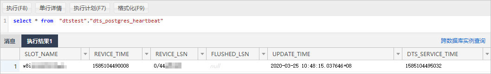<br>• 执行数据迁移前需评估源库和目标库的性能，同时建议业务低峰期执行数据迁移。否则全量数据迁移时DTS占用源和目标库一定读写资源，可能会导致数据库的负载上升。<br>• 由于全量数据迁移会并发执行INSERT操作，导致目标数据库的表产生碎片，因此全量迁移完成后目标数据库的表存储空间会比源实例的表存储空间大。<br>• 请确认DTS对数据类型为FLOAT或DOUBLE的列的迁移精度是否符合业务预期。DTS会通过<code> ROUND(COLUMN,PRECISION) </code>来读取这两类列的值。如果没有明确定义其精度，DTS对FLOAT的迁移精度为38位，对DOUBLE的迁移精度为308位。<br>• DTS会尝试恢复七天之内迁移失败任务。因此业务切换至目标实例前，请务必结束或释放该任务，或者将DTS访问目标实例账号的写权限用<code> revoke </code>命令回收掉。避免该任务被自动恢复后，源端数据覆盖目标实例的数据。</td>
  </tr>
</table>

**迁移类型说明**

<table>
  <tr>
    <th width="122">迁移类型</th>
    <th>说明</th>
  </tr>
  <tr>
    <td>结构迁移</td>
    <td>DTS将迁移对象的结构定义迁移到目标PolarDB集群。目前支持的对象包括：表、视图、同义词、触发器（不兼容）、存储过程、存储函数、包、自定义类型。<br>重要不兼容触发器。当迁移对象包含了触发器可能导致数据不一致。</td>
  </tr>
  <tr>
    <td>全量数据迁移</td>
    <td>DTS会将源库中迁移对象的存量数据，全部迁移至目标PolarDB集群。<br>重要在结构迁移和全量数据迁移完成之前，请勿对迁移对象执行DDL操作，否则可能导致迁移失败。</td>
  </tr>
  <tr>
    <td>增量数据迁移</td>
    <td>DTS在全量数据迁移的基础上轮询并捕获源库产生的Redo Log，将源库的增量更新实时迁移到目标PolarDB集群。目前支持仅支持同步DML操作（INSERT、UPDATE、DELETE），暂不支持同步DDL操作。通过增量数据迁移可以实现在应用不停服的情况下，平滑地完成数据迁移。</td>
  </tr>
</table>

**操作步骤**

1. 创建数据迁移实例。

2. 在迁移任务列表中，找到刚创建的数据迁移实例，单击**配置任务**。

3. 配置迁移任务的源库和目标库连接信息。

   | 类别 | 配置 | 说明 |
   | --- | --- | --- |

   DTS会自动生成一个任务名称，建议配置具有业务意义的名称（无唯一性要求），便于后续识别。

   无

   **任务名称**

   选择**PolarDB Oracle**。

   **数据库类型**

   选择**公网IP**。

   **接入方式**

   当**接入方式**选择为**公网IP**时，**实例地区**无需设置。

   **实例地区**

   - **单个IP:Port**：选择该项后，您还需要填写目标PolarDB PostgreSQL版（兼容Oracle）集群主节点的**DNS或IP地址**和**端口**信息。

   - **多个IP:Port**：选择该项后，您还需要在**多源IP:Port**填写目标PolarDB PostgreSQL版（兼容Oracle）集群主节点等多个节点的IP地址和端口号信

   **是否选择多源数**

   息。

   **据**

   > 如您选择**多个IP:Port**并填写**多源IP:Port**，当PolarDB
   >
   > **说明**
   >
   > PostgreSQL版（兼容Oracle）集群发生主备切换时，DTS能自动切

   **源库信息**

   > 换至新的主节点，适用于数据容灾等场景。

   填入源PolarDB PostgreSQL版（兼容Oracle）集群的访问地址。

   **DNS或IP地址**

   填入源PolarDB PostgreSQL版（兼容Oracle）集群的数据库服务端口，默

   **端口**

   认为**3433**。

   填入待迁移的数据库名称。

   **数据库名称**

   填入源PolarDB PostgreSQL版（兼容Oracle）集群的高权限账号。

   **数据库账号**

   填入该数据库账号的密码。

   **数据库密码**

   选择**PolarDB Oracle**。

   **数据库类型**

   选择**公网IP**。

   **接入方式**

   创建数据迁移实例时已指定，不可变更。

   **实例地区**

   - **单个IP:Port**：选择该项后，您还需要填写目标PolarDB PostgreSQL版（兼容Oracle）集群主节点的**DNS或IP地址**和**端口**信息。

   - **多个IP:Port**：选择该项后，您还需要在**多源IP:Port**填写目标PolarDB PostgreSQL版（兼容Oracle）集群主节点等多个节点的IP地址和端口号信

   **是否选择多源数**

   息。

   **据**

   > 如您选择**多个IP:Port**并填写**多源IP:Port**，当PolarDB
   >
   > **说明**
   >
   > PostgreSQL版（兼容Oracle）集群发生主备切换时，DTS能自动切

   **目标库信息**

   > 换至新的主节点，适用于数据容灾等场景。

   填入目标PolarDB PostgreSQL版（兼容Oracle）集群的访问地址。

   **DNS或IP地址**

   填入目标PolarDB PostgreSQL版（兼容Oracle）集群的数据库服务端口，

   **端口**

   默认为**1433**。

   填入待迁入数据的数据库名称。

   **数据库名称**

   填入目标PolarDB PostgreSQL版（兼容Oracle）集群的数据库账号，该账

   **数据库账号**

   号需具备读写权限。

   填入该数据库账号的密码。

   **数据库密码**

4. 配置完成后，单击页面下方的**测试连接以进行下一步**。

5. 选择迁移类型和迁移对象。

   | 配置 | 说明 |
   | --- | --- |
   | 任务步骤 | • 如果只需要进行全量数据迁移，同时选中<strong>库表结构迁移</strong>和<strong>全量迁移</strong>。<br>• 如果需要进行不停机迁移，同时选中<strong>库表结构迁移</strong>、<strong>全量迁移</strong>和<strong>增量迁移</strong>。<br>说明如果未选中<strong>增量迁移</strong>，为保障数据一致性，全量数据迁移期间请勿在源数据库中写入新的数据。 |
   | 目标已存在表的处理模式 | • <strong>预检查并报错拦截</strong>：检查目标数据库中是否有同名的表。如果目标数据库中没有同名的表，则通过该检查项目；如果目标数据库中有同名的表，则在预检查阶段提示错误，数据迁移任务不会被启动。<br>• <strong>忽略报错并继续执行</strong>：跳过目标数据库中是否有同名表的检查项。<br>警告选择为<strong>忽略报错并继续执行</strong>，可能导致数据不一致，给业务带来风险，例如：<br>• 表结构一致的情况下，在目标库遇到与源库主键的值相同的记录，则会保留目标库中的该条记录，即源库中的该条记录不会迁移至目标库中。<br>• 表结构不一致的情况下，可能导致只能迁移部分列的数据或迁移失败。 |
   | 源库对象 | 在<strong>源库对象</strong>框中单击待迁移的对象，然后单击图标将其移动至<strong>已选择对象</strong>框。<br>说明迁移对象选择的粒度为库、表或列。 |
   | 已选择对象 | 默认情况下，迁移对象在目标库中的名称与源库保持一致。如果您需要改变迁移对象在目标库中的名称，需要使用对象名映射功能，更详情参见库表列映射。<br>说明<br>• 如需按库或表级别选择迁移的SQL操作，请在<strong>已选择对象</strong>中右击待迁移对象，并在弹出的对话框中选择所需迁移的SQL操作。<br>• 如果使用了对象名映射功能，可能会导致依赖这个对象的其他对象迁移失败。 |

6. 单击**下一步高级配置**，进行高级配置。

   | 配置项目 | 配置说明 |
   | --- | --- |
   | 源库、目标库无法连接后的重试时间 | 在迁移任务启动后，若源库或目标库连接失败则DTS会报错，并会立即进行持续的重试连接，默认重试720分钟，您也可以在取值范围（10~1440分钟）内自定义重试时间，建议设置30分钟以上。如果DTS在设置的时间内重新连接上源、目标库，迁移任务将自动恢复。否则，迁移任务将失败。<br>说明针对同源或者同目标的多个DTS实例，如DTS实例A和DTS实例B，设置网络重试时间时A设置30分钟，B设置60分钟，则重试时间以低的30分钟为准。 |
   | 配置ETL功能 | 选择是否配置ETL功能。<br>• <strong>是</strong>：配置ETL功能，并在文本框中填写数据处理语句。更多信息，请参见在迁移任务中配置ETL。<br>• <strong>否</strong>：不配置ETL功能。 |

7. 上述配置完成后，单击页面下方的**下一步预检查并启动**。

   > **重要**
   >
   > - 在数据迁移任务正式启动之前，会先进行预检查。只有预检查通过后，才能成功启动数据迁移任务。
   >
   > - 如果预检查失败，请单击**查看详情**并请根据提示修复问题，然后重新进行预检查。

8. **预检查通过率**显示为100%时，单击**返回列表**。

   > 如果未选择增量数据迁移，您只需等待迁移任务完成即可，迁移任务会自动结束；如果
   >
   > **说明**
   >
   > 选择了增量数据迁移，迁移任务不会自动结束，您需要等待迁移任务处于**运行中**且无延迟时，手动结束迁移任务。

<a id="section-3-4-17"></a>

### 3.4.17. 从PolarDB PostgreSQL版（兼容Oracle）迁移至自建Oracle

通过使用数据传输服务DTS（Data Transmission Service），您可以实现从PolarDB PostgreSQL版（兼容Oracle）集群迁移至自建Oracle。

**前提条件**

由于从PolarDB PostgreSQL版（兼容Oracle）集群迁移至自建Oracle时暂不支持结构迁移，在执行数据迁移前请根据PolarDB PostgreSQL版（兼容Oracle）集群中待迁移数据库的结构，在自建Oracle中创建数据库。

**注意事项**

<table>
  <tr>
    <th width="90">类型</th>
    <th>说明</th>
  </tr>
  <tr>
    <td>源库限制</td>
    <td>• 带宽要求：源库所属的服务器需具备足够出口带宽，否则将影响数据迁移速率。<br>• 待迁移的表需具备主键或唯一约束，且字段具有唯一性，否则可能会导致目标数据库中出现重复数据。<br>• 如需进行增量迁移，wal日志：<br>• 需开启。<br>• 建议在全量迁移期间，wal日志至少保留7天以上。或者等到全量迁移完成后，再清理DTS任务运行后源库产生的wal日志。<br>说明为保障数据安全，DTS本地只会循环存储源库近24小时或者50 GB的wal日志，一旦超出该限制，DTS本地将自动清除所缓存的日志。<br>警告过早清理源库的wal日志，可能会导致迁移任务失败。例如源库的全量迁移数据较多，目标库写入异常等原因，导致全量迁移耗时超过24小时。在该情况下，过早清理源库的wal日志，DTS将无法获取到24小时前的wal日志，可能会导致迁移任务失败。<br>• 源库的操作限制：<br>• 在全量迁移阶段，请勿执行库或表结构变更的DDL操作，否则数据迁移任务会失败。<br>• 如仅执行全量数据迁移，请勿向源实例中写入新的数据，否则会导致源和目标数据不一致。为实时保持数据一致性，建议选择全量数据迁移和增量数据迁移。</td>
  </tr>
  <tr>
    <td>其他限制</td>
    <td>• 迁移时自建库进行主备切换，会导致迁移任务失败。<br>• 暂不支持结构迁移，在配置迁移任务前，您需要在目标实例中创建对应的库和表。<br>• 单个数据迁移任务只能迁移一个数据库，如需迁移多个数据库，您需要为每个数据库配置数据迁移任务。<br>• 在增量数据迁移过程中，如果迁移对象的选择粒度为Schema，在待迁移的Schema中创建了新的表或使用RENAME命令重建了待迁移的表，您需要在对该表写入数据前执行<code> ALTER TABLE schema.table REPLICA IDENTITY FULL; </code>命令。<br>说明将上述命令中的<code> schema </code>和<code> table </code>替换成真实的Schema名和表名。<br>• 为保障增量数据迁移延迟时间展示的准确性，DTS会在源库中新增一个表，表名为<code> dts_postgres_heartbeat </code>，结构及内容如下图所示。<br><br>• 执行数据迁移前需评估源库和目标库的性能，同时建议业务低峰期执行数据迁移。否则全量数据迁移时DTS占用源和目标库一定读写资源，可能会导致数据库的负载上升。<br>• 由于全量数据迁移会并发执行INSERT操作，导致目标数据库的表产生碎片，因此全量迁移完成后目标数据库的表存储空间会比源实例的表存储空间大。<br>• 请确认DTS对数据类型为FLOAT或DOUBLE的列的迁移精度是否符合业务预期。DTS会通过<code> ROUND(COLUMN,PRECISION) </code>来读取这两类列的值。如果没有明确定义其精度，DTS对FLOAT的迁移精度为38位，对DOUBLE的迁移精度为308位。<br>• DTS会尝试恢复七天之内迁移失败任务。因此业务切换至目标实例前，请务必结束或释放该任务，或者将DTS访问目标实例账号的写权限用<code> revoke </code>命令回收掉。避免该任务被自动恢复后，源端数据覆盖目标实例的数据。</td>
  </tr>
</table>

**操作步骤**

1. 创建数据迁移实例。

2. 在迁移任务列表中，找到刚创建的数据迁移实例，单击**配置任务**。

3. 配置迁移作业的源和目标实例信息。

   **类别**

   **配置**

   **说明**

   DTS会自动生成一个任务名称，建议配置具有业务意义的名称（无唯一性要

   无

   **任务名称**

   求），便于后续识别。

   选择**PolarDB Oracle**。

   **数据库类型**

   选择**公网IP**。

   **接入方式**

   当**接入方式**选择为**公网IP**时，**实例地区**无需设置。

   **实例地区**

   - **单个IP:Port**：选择该项后，您还需要填写目标PolarDB PostgreSQL版（兼容Oracle）集群主节点的**DNS或IP地址**和**端口**信息。

   - **多个IP:Port**：选择该项后，您还需要在**多源IP:Port**填写目标PolarDB PostgreSQL版（兼容Oracle）集群主节点等多个节点的IP地址和端口号信

   **是否选择多源数**

   息。

   **据**

   > 如您选择**多个IP:Port**并填写**多源IP:Port**，当PolarDB
   >
   > **说明**
   >
   > PostgreSQL版（兼容Oracle）集群发生主备切换时，DTS能自动切

   **源库信息**

   > 换至新的主节点，适用于数据容灾等场景。

   填入源PolarDB PostgreSQL版（兼容Oracle）集群的访问地址。

   **DNS或IP地址**

   填入源PolarDB PostgreSQL版（兼容Oracle）集群的数据库服务端口，默

   **端口**

   认为**1521**。

   填入待迁移的数据库名称。

   **数据库名称**

   填入源PolarDB PostgreSQL版（兼容Oracle）集群的高权限账号。

   **数据库账号**

   填入该数据库账号的密码。

   **数据库密码**

   选择**Oracle**。

   **数据库类型**

   选择**公网IP**。

   **接入方式**

   创建数据迁移实例时已指定，不可变更。

   **实例地区**

   填入目标Oracle数据库的访问地址。

   **主机名或IP地址**

   填入目标Oracle实例的监听端口，默认为**1521**。

   **端口**

   根据本地Oracle数据类型选择为**非RAC实例**或**RAC或PDB实例**。

   **Oracle类型**

   Oracle实例的SID。

   **目标库信息**

   **SID**

   > 实例类型选择为**非RAC实例**时显示。
   >
   > **说明**

   实例的服务器名。

   **Service**

   > 实例类型选择为**RAC或PDB实例**时显示。
   >
   > **说明**

   **Name**

   填入目标Oracle数据库的连接账号，拥有DB读写权限。

   **数据库账号**

   填入目标Oracle数据库账号对应的密码。

   **数据库密码**

4. 配置完成后，单击页面下方的**测试连接以进行下一步**。

5. 选择迁移对象及迁移类型。

   | 配置 | 说明 |
   | --- | --- |
   | 任务步骤 | • 如果只需要进行全量数据迁移，同时选中<strong>全量迁移</strong>。<br>• 如果需要进行不停机迁移，同时选中<strong>全量迁移</strong>和<strong>增量迁移</strong>。<br>说明如果未选中<strong>增量迁移</strong>，为保障数据一致性，全量数据迁移期间请勿在源数据库中写入新的数据。 |
   | 源库对象 | 在<strong>源库对象</strong>框中单击待迁移的对象，然后单击图标将其移动至<strong>已选择对象</strong>框。<br>说明迁移对象选择的粒度为库、表或列。 |
   | 已选择对象 | 默认情况下，迁移对象在目标库中的名称与源库保持一致。如果您需要改变迁移对象在目标库中的名称，需要使用对象名映射功能，更详情参见库表列映射。<br>说明<br>• 如需按库或表级别选择迁移的SQL操作，请在<strong>已选择对象</strong>中右击待迁移对象，并在弹出的对话框中选择所需迁移的SQL操作。<br>• 如果使用了对象名映射功能，可能会导致依赖这个对象的其他对象迁移失败。 |

6. 单击**下一步高级配置**，进行高级配置。

   | 配置项目 | 配置说明 |
   | --- | --- |
   | 源库、目标库无法连接后的重试时间 | 在迁移任务启动后，若源库或目标库连接失败则DTS会报错，并会立即进行持续的重试连接，默认重试720分钟，您也可以在取值范围（10~1440分钟）内自定义重试时间，建议设置30分钟以上。如果DTS在设置的时间内重新连接上源、目标库，迁移任务将自动恢复。否则，迁移任务将失败。<br>说明针对同源或者同目标的多个DTS实例，如DTS实例A和DTS实例B，设置网络重试时间时A设置30分钟，B设置60分钟，则重试时间以低的30分钟为准。 |
   | 配置ETL功能 | 当前链路暂不支持配置ETL功能，请选择<strong>否</strong>。 |

7. 上述配置完成后，单击页面下方的**下一步预检查并启动**。

   > **重要**
   >
   > - 在数据迁移任务正式启动之前，会先进行预检查。只有预检查通过后，才能成功启动数据迁移任务。
   >
   > - 如果预检查失败，请单击**查看详情**并请根据提示修复问题，然后重新进行预检查。

8. **预检查通过率**显示为100%时，单击**返回列表**。

   > 如果未选择增量数据迁移，您只需等待迁移任务完成即可，迁移任务会自动结束；如果
   >
   > **说明**
   >
   > 选择了增量数据迁移，迁移任务不会自动结束，您需要等待迁移任务处于**运行中**且无延迟时，手动结束迁移任务。

<a id="section-3-4-18"></a>

### 3.4.18. 从PolarDB PostgreSQL版（兼容Oracle）迁移至自建Kafka

Kafka是应用较为广泛的分布式、高吞吐量、高可扩展性消息队列服务，普遍用于日志收集、监控数据聚合、流式数据处理、在线和离线分析等大数据领域，是大数据生态中不可或缺的产品之一。通过数据传输服务DTS（Data Transmission Service），您可以将PolarDB PostgreSQL版（兼容Oracle）集群迁移至自建Kafka，扩展消息处理能力。

**前提条件**

源PolarDB PostgreSQL版（兼容Oracle）集群中，待迁移的表需具备主键或非空唯一索引。

**注意事项**

<table>
  <tr>
    <th width="90">类型</th>
    <th>说明</th>
  </tr>
  <tr>
    <td>源库限制</td>
    <td>• 带宽要求：源库所属的服务器需具备足够出口带宽，否则将影响数据迁移速率。<br>• 待迁移的表需具备主键或唯一约束，且字段具有唯一性，否则可能会导致目标数据库中出现重复数据。<br>• 如需进行增量迁移，需开启wal日志。<br>• 源PolarDB PostgreSQL版（兼容Oracle）集群需为最新版本。</td>
  </tr>
  <tr>
    <td>其他限制</td>
    <td>• 本场景不支持全量数据迁移 。<br>• 单个数据迁移任务只能迁移一个数据库，如需迁移多个数据库，您需要为每个数据库配置数据迁移任务。<br>• 在增量数据迁移过程中，如果迁移对象的选择粒度为Schema，在待迁移的Schema中创建了新的表或使用RENAME命令重建了待迁移的表，您需要在对该表写入数据前执行<code> ALTER TABLE schema.table REPLICA IDENTITY FULL; </code>命令。<br>说明将上述命令中的<code> schema </code>和<code> table </code>替换成真实的Schema名和表名。<br>• 为保障增量数据迁移延迟时间展示的准确性，DTS会在源库中新增一个表，表名为<code> dts_postgres_heartbeat </code>，结构及内容如下图所示。<br><br>• 请确认DTS对数据类型为FLOAT或DOUBLE的列的迁移精度是否符合业务预期。DTS会通过<code> ROUND(COLUMN,PRECISION) </code>来读取这两类列的值。如果没有明确定义其精度，DTS对FLOAT的迁移精度为38位，对DOUBLE的迁移精度为308位。<br>• DTS会尝试恢复七天之内迁移失败任务。因此业务切换至目标实例前，请务必结束或释放该任务，或者将DTS访问目标实例账号的写权限用<code> revoke </code>命令回收掉。避免该任务被自动恢复后，源端数据覆盖目标实例的数据。</td>
  </tr>
</table>

**操作步骤**

1. 创建数据迁移实例。

2. 在迁移任务列表中，找到刚创建的数据迁移实例，单击**配置任务**。

3. 配置迁移作业的源和目标实例信息。

   **类别**

   **配置**

   **说明**

   DTS会自动生成一个任务名称，建议配置具有业务意义的名称（无唯一性要

   无

   **任务名称**

   求），便于后续识别。

   选择**PolarDB Oracle**。

   **数据库类型**

   选择**公网IP**。

   **接入方式**

   当**接入方式**选择为**公网IP**时，**实例地区**无需设置。

   **实例地区**

   - **单个IP:Port**：选择该项后，您还需要填写目标PolarDB PostgreSQL版（兼容Oracle）集群主节点的**DNS或IP地址**和**端口**信息。

   - **多个IP:Port**：选择该项后，您还需要在**多源IP:Port**填写目标PolarDB PostgreSQL版（兼容Oracle）集群主节点等多个节点的IP地址和端口号信

   **是否选择多源数**

   息。

   **据**

   > 如您选择**多个IP:Port**并填写**多源IP:Port**，当PolarDB
   >
   > **说明**
   >
   > PostgreSQL版（兼容Oracle）集群发生主备切换时，DTS能自动切

   **源库信息**

   > 换至新的主节点，适用于数据容灾等场景。

   填入源PolarDB PostgreSQL版（兼容Oracle）集群的访问地址。

   **DNS或IP地址**

   填入PolarDB PostgreSQL版（兼容Oracle）集群的数据库服务端口，默认

   **端口**

   为**1521**。

   填入待迁移的数据库名称。

   **数据库名称**

   填入源PolarDB PostgreSQL版（兼容Oracle）集群的高权限账号。

   **数据库账号**

   填入该数据库账号的密码。

   **数据库密码**

   选择**Kafka**。

   **数据库类型**

   选择**公网IP**。

   **接入方式**

   创建数据迁移实例时已指定，不可变更。

   **实例地区**

   填入自建Kafka集群的访问地址，本案例中填入公网地址。

   **主机名或IP地址**

   自建Kafka对外提供服务的端口，默认为9092。

   **端口**

   填入自建Kafka的用户名，如自建Kafka未开启验证可不填写。

   **数据库账号**

   填入该用户的密码，如自建Kafka未开启验证可不填写。

   **数据库密码**

   选择目标Kafka集群的版本。

   **目标库信息**

   > 目前控制台暂不支持直接选择Kafka2.0版本，如果您使用
   >
   > **说明**

   **Kafka版本**

   > 的是Kafka2.0版本，您需要选择Kafka1.0版本。

   根据业务及安全需求，选择**非加密连接**或**SCRAM-SHA-256**。

   **连接方式**

   在下拉框中选择目标Topic。

   **Topic**

   Kafka Schema Registry是元数据提供服务层，提供了一个RESTful接口，用于存储和检索Avro Schema。

   **是否使用Kafka**

   - **否**：不使用Kafka Schema Registry。

   **Schema Registry**

   - **是**：使用Kafka Schema Registry。您需要输入Avro Schema在Kafka Schema Registry注册的URL或IP。

4. 配置完成后，单击页面下方的**测试连接以进行下一步**。

5. 选择迁移类型和迁移对象。

   <table>
     <tr>
       <th width="105">配置</th>
       <th>说明</th>
     </tr>
     <tr>
       <td>任务步骤</td>
       <td>选择<strong>增量迁移</strong>和<strong>库表结构迁移</strong>。</td>
     </tr>
     <tr>
       <td>源库对象</td>
       <td>在<strong>源库对象</strong>框中单击待迁移的对象，然后单击图标将其移动至<strong>已选择对象</strong>框。<br>说明迁移对象选择的粒度为表。</td>
     </tr>
     <tr>
       <td>已选择对象</td>
       <td>默认情况下，迁移对象在目标库中的名称与源库保持一致。如果您需要改变迁移对象在目标库中的名称，需要使用对象名映射功能，更详情参见库表列映射。<br>说明如果使用了对象名映射功能，可能会导致依赖这个对象的其他对象迁移失败。</td>
     </tr>
   </table>

6. 单击**下一步高级配置**，进行高级配置。

   | 配置项目 | 配置说明 |
   | --- | --- |
   | 源库、目标库无法连接后的重试时间 | 在迁移任务启动后，若源库或目标库连接失败则DTS会报错，并会立即进行持续的重试连接，默认重试720分钟，您也可以在取值范围（10~1440分钟）内自定义重试时间，建议设置30分钟以上。如果DTS在设置的时间内重新连接上源、目标库，迁移任务将自动恢复。否则，迁移任务将失败。<br>说明针对同源或者同目标的多个DTS实例，如DTS实例A和DTS实例B，设置网络重试时间时A设置30分钟，B设置60分钟，则重试时间以低的30分钟为准。 |
   | 配置ETL功能 | 当前链路暂不支持配置ETL功能，请选择<strong>否</strong>。 |

7. 上述配置完成后，单击页面下方的**下一步预检查并启动**。

   > **重要**
   >
   > - 在数据迁移任务正式启动之前，会先进行预检查。只有预检查通过后，才能成功启动数据迁移任务。
   >
   > - 如果预检查失败，请单击**查看详情**并请根据提示修复问题，然后重新进行预检查。

8. **预检查通过率**显示为100%时，单击**返回列表**。

   > 如果未选择增量数据迁移，您只需等待迁移任务完成即可，迁移任务会自动结束；如果
   >
   > **说明**
   >
   > 选择了增量数据迁移，迁移任务不会自动结束，您需要等待迁移任务处于**运行中**且无延迟时，手动结束迁移任务。

<a id="section-3-4-19"></a>

### 3.4.19. 自建Redis间的数据迁移

本文介绍如何使用数据传输服务DTS（Data Transmission Service），实现自建Redis间的数据迁移。

**前提条件**

- 源Redis数据库版本为2.8、3.0、3.2、4.0或5.0版本。

- 源Redis数据库为单机架构，暂不支持集群架构。

- 源Redis数据库可正常执行 `psync` 或 `sync` 命令。

**注意事项**

<table>
  <tr>
    <th width="90">类型</th>
    <th>说明</th>
  </tr>
  <tr>
    <td>源库限制</td>
    <td>• 带宽要求：源库所属的服务器需具备足够出口带宽，否则将影响数据迁移速率。<br>• 源库需开启数据日志和本地AOF（Append Only File）日志。<br>• 源库的操作限制：如仅执行全量数据迁移，请勿向源实例中写入新的数据，否则会导致源和目标数据不一致。为实时保持数据一致性，建议选择全量数据迁移和增量数据迁移。<br>• 源库单机版Redis迁移到目标库集群版Redis的操作限制：由于集群cluster只允许单个命令操作单个slot，若在源库执行多Key操作时，Key不在同一个slot或涉及多个slot，则会出现报错<br><code>CROSSSLOT Keys in request don't hash to the same slot</code><br>建议在DTS迁移过程中仅执行单Key操作，以免导致链路中断。<br>• 为保障迁移质量，DTS会在源库中插入一个前缀为DTS_REDIS_TIMESTAMP_HEARTBEAT的Key用于记录更新时间点。迁移过程中会过滤该Key，迁移任务结束，该Key就会过期。<br>• 如果源库为只读实例或者DTS账号没有写（SETEX）权限，上报的延迟可能不准确。<br>• 为保障迁移链路稳定性，建议将配置文件redis.conf中<code> repl-backlog-size </code>参数的值适当调大。</td>
  </tr>
</table>

<table>
  <tr>
    <td>其他限制</td>
    <td>• 如果目标库的数据逐出策略（<code> maxmemory-policy </code>）配置为<code> noeviction </code>以外的值，可能导致目标库的数据与源库不一致。<br>• 对于通过EVAL或EVALSHA调用的Lua脚本，在增量数据迁移时，由于目标端在执行脚本时不会明确返回执行结果，所以DTS无法确认该类型脚本是否执行成功。<br>• 对于List列表，由于DTS在调用<code> psync </code>或<code> sync </code>传输数据时，不会对目标端已有的数据执行<code> Flush </code>操作，所以可能出现重复的数据。<br>• 如果源库中的某些Key使用了过期（expire）策略，由于可能存在Key已过期但未被及时删除的情况，所以在目标库中查看到的Key数量（例如通过info命令查看）会比源库的Key数量少。<br>说明源和目标库中，未设置过期策略或未过期的Key数量是一致的。<br>• 为保障兼容性，建议源和目标实例的Redis版本保持一致，或者从低版本迁移至高版本。<br>• 执行数据迁移前需评估源库和目标库的性能，同时建议业务低峰期执行数据迁移。否则全量数据迁移时DTS占用源和目标库一定读写资源，可能会导致数据库的负载上升。<br>• 由于全量数据迁移会并发执行INSERT操作，导致目标数据库的表产生碎片，因此全量迁移完成后目标数据库的表存储空间会比源实例的表存储空间大。<br>• 请确认DTS对数据类型为FLOAT或DOUBLE的列的迁移精度是否符合业务预期。DTS会通过<code> ROUND(COLUMN,PRECISION) </code>来读取这两类列的值。如果没有明确定义其精度，DTS对FLOAT的迁移精度为38位，对DOUBLE的迁移精度为308位。<br>• DTS会尝试恢复七天之内迁移失败任务。因此业务切换至目标实例前，请务必结束或释放该任务，或者将DTS访问目标实例账号的写权限用<code> revoke </code>命令回收掉。避免该任务被自动恢复后，源端数据覆盖目标实例的数据。<br>• 若源或目标实例已开启透明数据加密TDE功能，则暂不支持通过DTS迁移数据。<br>• 当源和目标实例库均为自建Redis，迁移时如自建库进行主备切换，会导致迁移任务失败。</td>
  </tr>
</table>

**迁移类型说明**

- 全量数据迁移：DTS将源库待迁移对象的存量数据全部迁移目标库。

- 增量数据迁移：在全量数据迁移的基础上，DTS将源库的增量更新数据实时迁移至目标库。

**增量数据迁移支持同步的命令**

- APPEND

- BITOP、BLPOP、BRPOP、BRPOPLPUSH

- DECR、DECRBY、DEL

- EVAL、EVALSHA、EXEC、EXPIRE、EXPIREAT

- FLUSHALL、FLUSHDB

- GEOADD、GETSET

- HDEL、HINCRBY、HINCRBYFLOAT、HMSET、HSET、HSETNX

- INCR、INCRBY、INCRBYFLOAT

- LINSERT、LPOP、LPUSH、LPUSHX、LREM、LSET、LTRIM

- MOVE、MSET、MSETNX、MULTI

- PERSIST、PEXPIRE、PEXPIREAT、PFADD、PFMERGE、PSETEX、PUBLISH

- RENAME、RENAMENX、RESTORE、RPOP、RPOPLPUSH、RPUSH、RPUSHX

- SADD、SDIFFSTORE、SELECT、SET、SETBIT、SETEX、SETNX、SETRANGE、SINTERSTORE、SMOVE、SPOP、SREM、SUNIONSTORE

- ZADD、ZINCRBY、ZINTERSTORE、ZREM、ZREMRANGEBYLEX、ZUNIONSTORE、ZREMRANGEBYRANK、ZREMRANGEBYSCORE

**准备工作**

为保障增量数据迁移任务的正常执行，建议关闭源库的复制输出缓冲区的限制。本文以Linux操作系统的服务器为例进行演示。

> **说明**
>
> 如果只需要执行全量数据迁移，可跳过准备工作。

1. 使用redis-cli工具连接源库。

   > **说明**
   >
   > 安装原生Redis即可使用redis-cli工具，详情请参见Redis社区版官网。

   ```text
   redis-cli -h <host> -p <port> -a <password>
   ```

   > **说明**
   >
   > - &lt;host>：源库的访问地址，本机可使用127.0.0.1。
   >
   > - &lt;port>：源库的服务端口，默认为6379。
   >
   > - &lt;password>：源库的访问密码。

   示例：

   ```text
   redis-cli -h 127.0.0.1 -p 6379 -a Test123456
   ```

2. 执行下述命令，关闭复制输出缓冲区的限制。

   ```text
   config set client-output-buffer-limit 'slave 0 0 0'
   ```

**操作步骤**

1. 创建数据迁移实例。

2. 在迁移任务列表中，找到刚创建的数据迁移实例，单击**配置任务**。

3. 配置源库和目标库信息。

   **类别**

   **配置**

   **说明**

   DTS会自动生成一个任务名称，建议配置具有业务意义的名称（无唯一性要

   无

   **任务名称**

   求），便于后续识别。

   选择**Redis**。

   **数据库类型**

   选择**公网IP**。

   **接入方式**

   当**接入方式**选择为**公网IP**时，**实例地区**无需设置。

   **实例地区**

   固定为**单机版**，暂不支持集群版。

   **实例模式**

   填入源库的访问地址。

   **主机名或IP地址**

   **源库信息**

   填入源库的服务端口，默认为**6379**。

   **端口**

   填入源库的数据库密码，如果源库没有开启密码验证可以不填写。

   - 默认账号（即以实例ID命名的账号）：直接填写密码即可。

   **数据库密码**

   - 新创建的账号：密码格式为 `<`自定义账号`>:<`密码`>` ，例如：testaccount:Test1234。

   选择**Redis**。

   **数据库类型**

   选择**公网IP**。

   **接入方式**

   创建数据迁移实例时已指定，不可变更。

   **实例地区**

   固定为**单机版**，暂不支持集群版。

   **实例模式**

   填入目标库的访问地址。

   **主机名或IP地址**

   **目标库信息**

   填入目标库的服务端口，默认为**6379**。

   **端口**

   填入目标库的数据库密码，如果目标库没有开启密码验证可以不填写。

   - 默认账号（即以实例ID命名的账号）：直接填写密码即可。

   **数据库密码**

   - 新创建的账号：密码格式为 `<`自定义账号`>:<`密码`>` ，例如：testaccount:Test1234。

4. 配置完成后，单击页面下方的**测试连接以进行下一步**。

5. 如果您的自建Redis数据库具备白名单安全设置，，请将弹跳框中提示的DTS服务器的IP地址，加入自建Redis数据库的白名单安全设置中。白名单安全设置完成后，单击**测试连接以进行下一步**。

   > **说明**
   >
   > 如果您的自建Redis数据库无需进行白名单安全设置，请直接单击**测试连接以进行下一步**。

6. 选择迁移对象及迁移类型。

   | 配置 | 说明 |
   | --- | --- |
   | 任务步骤 | • 如果只需要进行全量数据迁移，请选中<strong>全量迁移</strong>。<br>• 如果需要进行不停机迁移，同时选中<strong>全量迁移</strong>和<strong>增量迁移</strong>。<br>说明如果未选中<strong>增量迁移</strong>，为保障数据一致性，全量数据迁移期间请勿在源数据库中写入新的数据。 |
   | 目标已存在表的处理模式 | • <strong>预检查并报错拦截</strong>：检查目标数据库中是否有同名的表。如果目标数据库中没有同名的表，则通过该检查项目；如果目标数据库中有同名的表，则在预检查阶段提示错误，数据迁移任务不会被启动。<br>• <strong>忽略报错并继续执行</strong>：跳过目标数据库中是否有同名表的检查项。<br>警告选择为<strong>忽略报错并继续执行</strong>，可能导致数据不一致，给业务带来风险，例如：<br>• 表结构一致的情况下，在目标库遇到与源库主键的值相同的记录，则会保留目标库中的该条记录，即源库中的该条记录不会迁移至目标库中。<br>• 表结构不一致的情况下，可能导致只能迁移部分列的数据或迁移失败。 |
   | 源库对象 | 在<strong>源库对象</strong>框中单击待迁移的对象，然后单击图标将其移动至<strong>已选择对象</strong>框。<br>说明迁移对象的选择粒度为库，暂不支持Key粒度的选择。 |
   | 已选择对象 | 默认情况下，迁移对象在目标库中的名称与源库保持一致。如果您需要改变迁移对象在目标库中的名称，需要使用对象名映射功能，更详情参见库表列映射。<br>说明如果使用了对象名映射功能，可能会导致依赖这个对象的其他对象迁移失败。 |

7. 单击**下一步高级配置**，进行高级配置。

   | 配置项目 | 配置说明 |
   | --- | --- |
   | 源库、目标库无法连接后的重试时间 | 在迁移任务启动后，若源库或目标库连接失败则DTS会报错，并会立即进行持续的重试连接，默认重试720分钟，您也可以在取值范围（10~1440分钟）内自定义重试时间，建议设置30分钟以上。如果DTS在设置的时间内重新连接上源、目标库，迁移任务将自动恢复。否则，迁移任务将失败。<br>说明针对同源或者同目标的多个DTS实例，如DTS实例A和DTS实例B，设置网络重试时间时A设置30分钟，B设置60分钟，则重试时间以低的30分钟为准。 |
   | 配置ETL功能 | 当前链路暂不支持配置ETL功能，请选择<strong>否</strong>。 |

8. 上述配置完成后，单击页面下方的**下一步预检查并启动**。

   > **重要**
   >
   > - 在数据迁移任务正式启动之前，会先进行预检查。只有预检查通过后，才能成功启动数据迁移任务。
   >
   > - 如果预检查失败，请单击**查看详情**并请根据提示修复问题，然后重新进行预检查。

9. **预检查通过率**显示为100%时，单击**返回列表**。

   > 如果未选择增量数据迁移，您只需等待迁移任务完成即可，迁移任务会自动结束；如果
   >
   > **说明**
   >
   > 选择了增量数据迁移，迁移任务不会自动结束，您需要等待迁移任务处于**运行中**且无延迟时，手动结束迁移任务。

<a id="section-3-4-20"></a>

### 3.4.20. 自建MongoDB间的数据迁移

本文介绍如何使用数据传输服务DTS（Data Transmission Service），实现自建MongoDB间的数据迁移。

**前提条件**

源MongoDB数据库版本为3.0、3.2、3.4、3.6、4.0或4.2版本。

**注意事项**

| 类型 | 说明 |
| --- | --- |

<table>
  <tr>
    <td>源库限制</td>
    <td>• 带宽要求：源库所属的服务器需具备足够出口带宽，否则将影响数据迁移速率。<br>• 待迁移的表需具备主键或唯一约束，且字段具有唯一性，否则可能会导致目标数据库中出现重复数据。<br>• 如需进行增量迁移，OPLog日志：<br>• 需开启。<br>• 建议在全量迁移期间，OPLog日志至少保留7天以上。或者等到全量迁移完成后，再清理DTS任务运行后源库产生的OPLog日志。<br>说明为保障数据安全，DTS本地只会循环存储源库近24小时或者50 GB的OPLog日志，一旦超出该限制，DTS本地将自动清除所缓存的日志。<br>警告过早清理源库的OPLog日志，可能会导致迁移任务失败。例如源库的全量迁移数据较多，目标库写入异常等原因，导致全量迁移耗时超过24小时。在该情况下，过早清理源库的OPLog日志，DTS将无法获取到24小时前的OPLog日志，可能会导致迁移任务失败。<br>• 源库的操作限制：如仅执行全量数据迁移，请勿向源实例中写入新的数据，否则会导致源和目标数据不一致。为实时保持数据一致性，建议选择全量数据迁移和增量数据迁移。</td>
  </tr>
  <tr>
    <td>其他限制</td>
    <td>• 源库为单节点架构时（即只有Primary节点），如需实现增量数据迁移，您需要开启OPLog，详情请参见单节点架构源库的准备工作。<br>• 源库为分片集群架构时，您需要为每个分片单独配置数据迁移任务。<br>• 为保障兼容性，建议源和目标实例的MongoDB版本保持一致，或者从低版本迁移至高版本。<br>• 不支持数据库admin和local作为源和目标库。<br>• 执行数据迁移前需评估源库和目标库的性能，同时建议业务低峰期执行数据迁移。否则全量数据迁移时DTS占用源和目标库一定读写资源，可能会导致数据库的负载上升。<br>• 由于全量数据迁移会并发执行INSERT操作，导致目标数据库的表产生碎片，因此全量迁移完成后目标数据库的表存储空间会比源实例的表存储空间大。<br>• DTS会尝试恢复七天之内迁移失败任务。因此业务切换至目标实例前，请务必结束或释放该任务，或者将DTS访问目标实例账号的写权限用<code> revoke </code>命令回收掉。避免该任务被自动恢复后，源端数据覆盖目标实例的数据。</td>
  </tr>
  <tr>
    <td>特殊情况</td>
    <td>当源和目标实例为自建MongoDB时<br>• 迁移时如进行主备切换，会导致迁移任务失败。<br>• 由于DTS的延迟时间是根据迁移到目标库最后一条数据的时间戳和当前时间戳对比得出，源库长时间未执行DML操作可能导致延迟信息不准确。如果任务显示的延迟时间过大，您可以在源库执行一个DML操作来更新延迟信息。<br>说明如果迁移对象选择为整库，您还可以创建心跳表，心跳表每秒定期更新或者写入数据。</td>
  </tr>
</table>

**迁移类型说明**

<table>
  <tr>
    <th width="122">迁移类型</th>
    <th>说明</th>
  </tr>
  <tr>
    <td>全量数据迁移</td>
    <td>将源库待迁移对象的存量数据全部迁移到目标库。<br>说明支持database、collection、index的迁移。</td>
  </tr>
  <tr>
    <td>增量数据迁移</td>
    <td>在全量迁移的基础上，将源库的增量更新实时迁移到目标库。<br>说明<br>• 支持database、collection、index的新建和删除操作的同步。<br>• 支持document的新增、删除和更新操作的同步。</td>
  </tr>
</table>

**单节点架构源库的准备工作**

源库为单节点架构时（即只有Primary节点），如需实现增量数据迁移，您需要开启oplog。如您不需要增量数据迁移，可跳过下述步骤。

> 该操作需要重启MongoDB服务，请在业务低峰期操作。
>
> **说明**

1. 使用Mongo Shell连接源数据库。

2. 使用下述命令关闭MongoDB服务。

   ```text
   use admin
   db.shutdownServer()
   ```

3. 以副本集的方式在后台启动MongoDB服务。

   ```text
   mongod --port 27017 --dbpath /var/lib/mongodb --logpath /var/log/mongodb/mongod.log --replSet rs0 --bind_ip 0.0.0.0 --auth --fork
   ```

   > **说明**
   >
   > - 该命令使用的数据库路径为/var/lib/mongodb，日志存储文件路径为/var/log/mongodb/mongod.log。您需要根据实际环境中的路径自行指定。
   >
   > - 该命令使用 `0.0.0.0` 作为MongoDB数据库服务的绑定地址，即允许所有IP地址访问该数据库。迁移结束后可使用 `kill` 命令结束该MongoDB服务的进程，然后以原有的配置文件启动MongoDB服务。
   >
   > - 该命令开启了认证功能，用户需要通过认证后才可以访问数据库。

4. 使用Mongo Shell重新连接源数据库。

5. 使用如下命令初始化副本集。

   ```text
   use admin
   rs.initiate()
   ```

6. 等待一段时间，当前节点的角色将转变为Primary，即完成了oplog的开启。

   > 您可以通过 `rs.printReplicationInfo()` 命令查看oplog的状态信息。
   >
   > **说明**

**操作步骤**

1. 创建数据迁移实例。

2. 在迁移任务列表中，找到刚创建的数据迁移实例，单击**配置任务**。

3. 配置源库和目标库信息。

   <table>
     <tr>
       <th>类别</th>
       <th>配置</th>
       <th>说明</th>
     </tr>
     <tr>
       <td>无</td>
       <td>任务名称</td>
       <td>DTS会自动生成一个任务名称，建议配置具有业务意义的名称（无唯一性要求），便于后续识别。</td>
     </tr>
     <tr>
       <td rowspan="9">源库信息</td>
       <td>数据库类型</td>
       <td>选择<strong>MongoDB</strong>。</td>
     </tr>
     <tr>
       <td>接入方式</td>
       <td>选择<strong>公网IP</strong>。</td>
     </tr>
     <tr>
       <td>实例地区</td>
       <td>当实例<strong>接入方式</strong>选择为<strong>公网IP</strong>时，<strong>实例地区</strong>无需设置。</td>
     </tr>
     <tr>
       <td>域名或IP地址</td>
       <td>填入源库的访问地址。</td>
     </tr>
     <tr>
       <td>端口</td>
       <td>填入源库的服务端口。</td>
     </tr>
     <tr>
       <td>数据库名称</td>
       <td>填入鉴权数据库名，即数据库账号所属的数据库。</td>
     </tr>
     <tr>
       <td>数据库账号</td>
       <td>填入源库的数据库账号，需具备待迁移库、admin库和local库的read权限。</td>
     </tr>
     <tr>
       <td>数据库密码</td>
       <td>填入该数据库账号对应的密码。</td>
     </tr>
     <tr>
       <td>连接方式</td>
       <td>选择<strong>非加密连接</strong>。<br>说明仅在迁移MongoDB Atlas数据库时，选择<strong>SSL安全连接</strong>。</td>
     </tr>
     <tr>
       <td rowspan="8">目标库信息</td>
       <td>数据库类型</td>
       <td>选择<strong>MongoDB</strong>。</td>
     </tr>
     <tr>
       <td>接入方式</td>
       <td>选择<strong>公网IP</strong>。</td>
     </tr>
     <tr>
       <td>实例地区</td>
       <td>创建数据迁移实例时已指定，不可变更。</td>
     </tr>
     <tr>
       <td>主机名或IP地址</td>
       <td>填入目标库的访问地址。</td>
     </tr>
     <tr>
       <td>端口</td>
       <td>填入目标库的服务端口。</td>
     </tr>
     <tr>
       <td>数据库名称</td>
       <td>填入鉴权数据库名，即数据库账号所属的数据库。<br>说明如果使用的数据库账号为root，那么对应的数据库名称即为admin。</td>
     </tr>
     <tr>
       <td>数据库账号</td>
       <td>填入目标库账号，需具备目标库的readWrite权限。</td>
     </tr>
     <tr>
       <td>数据库密码</td>
       <td>填入该数据库账号对应的密码。</td>
     </tr>
   </table>

4. 配置完成后，单击页面下方的**测试连接以进行下一步**。

5. 如果您的自建MongoDB数据库具备白名单安全设置，请将弹跳框中提示的DTS服务器的IP地址，加入自建MongoDB数据库的白名单安全设置中。白名单安全设置完成后，单击**测试连接以进行下一步**。

   > 如果您的自建MongoDB数据库无需进行白名单安全设置，请直接单击**测试连接以进行**
   >
   > **说明**
   >
   > **下一步**。

6. 选择迁移对象及迁移类型。

   | 配置 | 说明 |
   | --- | --- |
   | 任务步骤 | • 如果只需要进行全量数据迁移，同时选中<strong>库表结构迁移</strong>和<strong>全量迁移</strong>。<br>• 如果需要进行不停机迁移，同时选中<strong>库表结构迁移</strong>、<strong>全量迁移</strong>和<strong>增量迁移</strong>。<br>说明如果未选中<strong>增量迁移</strong>，为保障数据一致性，全量数据迁移期间请勿在源数据库中写入新的数据。 |
   | 目标已存在表的处理模式 | • <strong>预检查并报错拦截</strong>：检查目标数据库中是否有同名的表。如果目标数据库中没有同名的表，则通过该检查项目；如果目标数据库中有同名的表，则在预检查阶段提示错误，数据迁移任务不会被启动。<br>• <strong>忽略报错并继续执行</strong>：跳过目标数据库中是否有同名表的检查项。<br>警告选择为<strong>忽略报错并继续执行</strong>，可能导致数据不一致，给业务带来风险，例如：<br>• 表结构一致的情况下，在目标库遇到与源库主键的值相同的记录，则会保留目标库中的该条记录，即源库中的该条记录不会迁移至目标库中。<br>• 表结构不一致的情况下，可能导致只能迁移部分列的数据或迁移失败。 |
   | 源库对象 | 在<strong>源库对象</strong>框中单击待迁移的对象，然后单击图标将其移动至<strong>已选择对象</strong>框。<br>说明迁移对象选择的粒度为库、表或列。 |
   | 已选择对象 | 默认情况下，迁移对象在目标库中的名称与源库保持一致。如果您需要改变迁移对象在目标库中的名称，需要使用对象名映射功能，更详情参见库表列映射。<br>说明如果使用了对象名映射功能，可能会导致依赖这个对象的其他对象迁移失败。 |

7. 单击**下一步高级配置**，进行高级配置。

   | 配置项目 | 配置说明 |
   | --- | --- |
   | 源库、目标库无法连接后的重试时间 | 在迁移任务启动后，若源库或目标库连接失败则DTS会报错，并会立即进行持续的重试连接，默认重试720分钟，您也可以在取值范围（10~1440分钟）内自定义重试时间，建议设置30分钟以上。如果DTS在设置的时间内重新连接上源、目标库，迁移任务将自动恢复。否则，迁移任务将失败。<br>说明针对同源或者同目标的多个DTS实例，如DTS实例A和DTS实例B，设置网络重试时间时A设置30分钟，B设置60分钟，则重试时间以低的30分钟为准。 |
   | 配置ETL功能 | 当前链路暂不支持配置ETL功能，请选择<strong>否</strong>。 |

8. 上述配置完成后，单击页面下方的**下一步预检查并启动**。

   > **重要**
   >
   > - 在数据迁移任务正式启动之前，会先进行预检查。只有预检查通过后，才能成功启动数据迁移任务。
   >
   > - 如果预检查失败，请单击**查看详情**并请根据提示修复问题，然后重新进行预检查。

9. **预检查通过率**显示为100%时，单击**返回列表**。

   > 如果未选择增量数据迁移，您只需等待迁移任务完成即可，迁移任务会自动结束；如果
   >
   > **说明**
   >
   > 选择了增量数据迁移，迁移任务不会自动结束，您需要等待迁移任务处于**运行中**且无延迟时，手动结束迁移任务。

<a id="section-3-4-21"></a>

### 3.4.21. 从MaxCompute迁移至MySQL

通过数据传输服务DTS（Data Transmission Service），您可以将MaxCompute的数据迁移至MySQL，本文以RDS MySQL实例为例介绍配置流程。

**注意事项**

- DTS在执行全量数据迁移时将占用源库和目标库一定的读写资源，可能会导致数据库的负载上升，在数据库性能较差、规格较低或业务量较大的情况下（例如源库有大量慢SQL、存在无主键表或目标库存在死锁等），可能会加重数据库压力，甚至导致数据库服务不可用。因此您需要在执行数据迁移前评估源库和目标库的性能，同时建议您在业务低峰期执行数据迁移（例如源库和目标库的CPU负载在30%以下）。

- DTS会自动地在目标阿里云RDS实例中创建数据库，如果待迁移的数据库名称不符合阿里云RDS实例的定义规范，您需要在配置迁移任务之前在目标阿里云RDS实例中创建数据库。

  > **说明**
  >
  > 关于阿里云RDS的定义规范和创建数据库的操作方法，请参见云数据RDS的《用户指南（RDS MySQL）》手册中的《创建数据库》。

- 当选择的迁移类型为全量数据迁移，那么为保障数据一致性，在迁移期间请勿在源MaxCompute实例中写入新的数据。

- 对于迁移失败的任务，DTS会触发自动恢复。当您需要将业务切换至目标实例，请务必先结束或释放该任务，避免该任务被自动恢复后，导致源端数据覆盖目标实例的数据。

- 由于源MaxCompute实例不支持主键约束，在一些异常情况下（如网络异常），DTS会进行任务重试，可能会导致目标RDS实例中该无主键表出现重复数据。

- DTS在迁移MaxCompute至RDS MySQL时，暂不支持增量数据迁移，即不支持将迁移过程中源库产生的增量数据实时迁移至目标库。

  > **说明**
  >
  > 由于暂不支持增量数据迁移，数据迁移期间请勿在源MaxCompute实例的迁移对象中写入新的数据，否则会导致迁移对象在源与目标的数据不一致。

**迁移类型说明**

<table>
  <tr>
    <th width="122">迁移类型</th>
    <th>说明</th>
  </tr>
  <tr>
    <td>结构迁移</td>
    <td>DTS将待迁移对象的结构定义迁移到目标库。目前DTS支持结构迁移的对象为库、表和视图。<br>警告此场景属于异构数据库间的数据迁移，DTS在执行结构迁移时数据类型无法完全对应，请谨慎评估数据类型的映射关系对业务的影响，详情请参见异构数据库间的数据类型映射关系。</td>
  </tr>
  <tr>
    <td>全量数据迁移</td>
    <td>DTS将待迁移对象的存量数据全部迁移到目标库中。<br>说明由于全量数据迁移会并发INSERT导致目标实例的表存在碎片，全量迁移完成后目标库的表空间会比源库的表空间大。</td>
  </tr>
</table>

**操作步骤**

1. 创建数据迁移实例。

2. 在迁移任务列表中，找到刚创建的数据迁移实例，单击**配置任务**。

3. 配置迁移任务的源库和目标库连接信息。

   <table>
     <tr>
       <th>类别</th>
       <th>配置</th>
       <th>说明</th>
     </tr>
     <tr>
       <td>无</td>
       <td>任务名称</td>
       <td>DTS会自动生成一个任务名称，建议配置具有业务意义的名称（无唯一性要求），便于后续识别。</td>
     </tr>
     <tr>
       <td rowspan="6">源库信息</td>
       <td>数据库类型</td>
       <td>选择<strong>MaxCompute</strong>。</td>
     </tr>
     <tr>
       <td>接入方式</td>
       <td>选择<strong>云实例</strong>。</td>
     </tr>
     <tr>
       <td>实例地区</td>
       <td>创建数据迁移实例时已指定，不可变更。</td>
     </tr>
     <tr>
       <td>Project</td>
       <td>填入MaxCompute实例的<strong>Project</strong>，您可以在MaxCompute的<strong>Project</strong><strong>管理</strong>页面中查询。</td>
     </tr>
     <tr>
       <td>accessKeyId</td>
       <td rowspan="2">分别填入用于标识用户的AccessKey Id和用于验证用户的密钥AccessKey Secret。<br>说明获取方法，请参见大数据计算服务<strong>《开发指南》</strong>中的<strong>《登获取组织</strong><strong>Accesskey》</strong>章节。</td>
     </tr>
     <tr>
       <td>accessSecre t</td>
     </tr>
     <tr>
       <td rowspan="6">目标库信息</td>
       <td>数据库类型</td>
       <td>选择<strong>MySQL</strong>。</td>
     </tr>
     <tr>
       <td>接入方式</td>
       <td>选择<strong>云实例</strong>。</td>
     </tr>
     <tr>
       <td>实例地区</td>
       <td>创建数据迁移实例时已指定，不可变更。</td>
     </tr>
     <tr>
       <td>RDS实例ID</td>
       <td>选择目标RDS MySQL实例ID。</td>
     </tr>
     <tr>
       <td>数据库账号</td>
       <td>填入目标RDS MySQL实例的数据库账号，账号需具备读写权限。</td>
     </tr>
     <tr>
       <td>数据库密码</td>
       <td>填入该数据库账号的密码。目标库信息填写完毕后，您可以单击<strong>数据库密码</strong>后的<strong>测试连接</strong>来验证填入的信息是否正确。</td>
     </tr>
   </table>

4. 配置完成后，单击页面下方的**测试连接以进行下一步**。

5. 在弹出的对话框单击**确定**，允许将MaxCompute中目标Project的对应权限授予DTS迁移账号。

6. 选择迁移类型和迁移对象。

   | 配置 | 说明 |
   | --- | --- |
   | 任务步骤 | 同时勾选<strong>结构迁移</strong>和<strong>全量数据迁移</strong>。<br>说明DTS暂不支持将MaxCompute的数据增量迁移至RDS MySQL实例。 |
   | 目标库对象名称大小写策略 | 您可以配置目标实例中迁移对象的库名、表名和列名的英文大小写策略。默认情况下选择<strong>DTS默认策</strong><strong>略</strong>，您也可以选择与源库、目标库默认策略保持一致。更多信息，请参见目标库对象名称大小写策略。 |
   | 源库对象 | 在<strong>源库对象</strong>框中单击待迁移的对象，然后单击图标将其移动至<strong>已选择对象</strong>框。<br>说明迁移对象选择的粒度为库、表或列。 |
   | 已选择对象 | 默认情况下，迁移对象在目标库中的名称与源库保持一致。如果您需要改变迁移对象在目标库中的名称，需要使用对象名映射功能，更详情参见库表列映射。<br>说明如果使用了对象名映射功能，可能会导致依赖这个对象的其他对象迁移失败。 |

7. 单击**下一步高级配置**，进行高级配置。

   | 配置项目 | 配置说明 |
   | --- | --- |
   | 源库、目标库无法连接后的重试时间 | 在迁移任务启动后，若源库或目标库连接失败则DTS会报错。对于可预期的报错，DTS会立即进行持续的重试连接，默认重试720分钟，您也可以在取值范围（10~1440分钟）内自定义重试时间，建议设置30分钟以上。如果DTS在设置的时间内重新连接上源、目标库，迁移任务将自动恢复。否则，迁移任务将失败。<br>说明针对同源或者同目标的多个DTS实例，如DTS实例A和DTS实例B，设置网络重试时间时A设置30分钟，B设置60分钟，则重试时间以低的30分钟为准。 |
   | 配置ETL功能 | 当前链路暂不支持配置ETL功能，请选择<strong>否</strong>。 |

8. 上述配置完成后，单击页面下方的**下一步预检查并启动**。

   > **重要**
   >
   > - 在数据迁移任务正式启动之前，会先进行预检查。只有预检查通过后，才能成功启动数据迁移任务。
   >
   > - 如果预检查失败，请单击**查看详情**并请根据提示修复问题，然后重新进行预检查。

9. **预检查通过率**显示为100%时，单击**返回列表**。

   > 如果未选择增量数据迁移，您只需等待迁移任务完成即可，迁移任务会自动结束；如果
   >
   > **说明**
   >
   > 选择了增量数据迁移，迁移任务不会自动结束，您需要等待迁移任务处于**运行中**且无延迟时，手动结束迁移任务。

<a id="section-3-4-22"></a>

### 3.4.22. PolarDB-X 2.0为源的数据迁移

<a id="section-3-4-22-1"></a>

#### 3.4.22.1. PolarDB-X 2.0间的迁移

使用数据传输服务DTS（Data Transmission Service），您可以实现PolarDB-X 2.0 间的数据迁移。

**前提条件**

- 已创建源和目标PolarDB-X 2.0实例，且兼容MySQL 5.7版本。

- 目标PolarDB-X 2.0实例的存储空间须大于源PolarDB-X 2.0实例占用的存储空间。

**注意事项**

<table>
  <tr>
    <th width="122">类型</th>
    <th>说明</th>
  </tr>
  <tr>
    <td>源库限制</td>
    <td>• 带宽要求：源库所属的服务器需具备足够出口带宽，否则将影响数据迁移速率。<br>• 待迁移的表需具备主键或唯一约束，且字段具有唯一性，否则可能会导致目标数据库中出现重复数据。<br>• 如迁移对象为表级别，且需进行编辑（如表列名映射），则单次迁移任务仅支持迁移至多1000张表。当超出数量限制，任务提交后会显示请求报错，此时建议您拆分待迁移的表，分批配置多个任务，或者配置整库的迁移任务。<br>• 如需进行增量迁移，Binlog日志：<br>• 需开启，并且binlog_row_image为full。否则预检查阶段提示报错，且无法成功启动数据迁移任务。<br>• 如为增量迁移任务，DTS要求源数据库的本地Binlog日志保存24小时以上，如为全量迁移和增量迁移任务，DTS要求源数据库的本地Binlog日志至少保留7天以上（您可在全量迁移完成后将Binlog保存时间设置为24小时以上），否则DTS可能因无法获取Binlog而导致任务失败，极端情况下甚至可能会导致数据不一致或丢失。由于您所设置的Binlog日志保存时间低于DTS要求的时间进而导致的问题，不在DTS的SLA保障范围内。<br>• 若源端PolarDB-X 2.0待迁移的表名中含大写字母，则仅支持库表结构迁移。<br>• 源库的操作限制：<br>• 在库表结构迁移和全量迁移阶段，请勿执行库或表结构变更的DDL操作，否则数据迁移任务会失败。<br>• 迁移期间如需切换PolarDB分布式版 的网络类型，切换成功后，请调整迁移链路的网络连接信息。<br>• 如仅执行全量数据迁移，请勿向源实例中写入新的数据，否则会导致源和目标数据不一致。为实时保持数据一致性，建议选择结构迁移、全量数据迁移和增量数据迁移。<br>• PolarDB分布式版需兼容MySQL 5.7版本。</td>
  </tr>
  <tr>
    <td>其他限制</td>
    <td>• 目标实例PolarDB分布式版需兼容MySQL 5.7版本。<br>• 执行数据迁移前需评估源库和目标库的性能，同时建议业务低峰期执行数据迁移。否则全量数据迁移时DTS占用源和目标库一定读写资源，可能会导致数据库的负载上升。<br>• 由于全量数据迁移会并发执行INSERT操作，导致目标数据库的表产生碎片，因此全量迁移完成后目标数据库的表存储空间会比源实例的表存储空间大。<br>• DTS会尝试恢复七天之内迁移失败任务。因此业务切换至目标实例前，请务必结束或释放该任务，或者将DTS访问目标实例账号的写权限用<code> revoke </code>命令回收掉。避免该任务被自动恢复后，源端数据覆盖目标实例的数据。<br>• 若实例运行失败，DTS技术支持人员将在8小时内尝试恢复该实例。在恢复失败实例的过程中，可能会对该实例进行重启、调整参数等操作。<br>说明在调整参数时，仅会修改实例的参数，不会对数据库中的参数进行修改。可能修改的参数，包括但不限于修改实例参数中的参数。</td>
  </tr>
  <tr>
    <td>其他注意事项</td>
    <td>DTS会在源库定时更新`dts_health_check`.`ha_health_check`表以推进binlog位点。</td>
  </tr>
</table>

**迁移类型说明**

- 库表结构迁移DTS将源库中迁移对象的结构定义迁移到目标库。

- 全量迁移DTS将源库中迁移对象的存量数据，全部迁移到目标库中。

- 增量迁移DTS在全量迁移的基础上，将源库的增量更新数据迁移到目标库中。通过增量数据迁移可以实现在自建应用不停机的情况下，平滑地完成数据迁移。

**数据库账号的权限要求**

<table>
  <tr>
    <th>数据库</th>
    <th>库表结构迁移</th>
    <th>全量迁移</th>
    <th>增量迁移</th>
  </tr>
  <tr>
    <td>源PolarDB-X 2.0实例</td>
    <td>SELECT权限</td>
    <td>SELECT权限</td>
    <td>REPLICATION SLAVE、REPLICATION CLIENT及待迁移对象的SELECT权限，由DTS自动执行授权</td>
  </tr>
  <tr>
    <td>目标PolarDB-X 2.0实例</td>
    <td colspan="3">读写权限</td>
  </tr>
</table>

**支持增量迁移的SQL操作**

<table>
  <tr>
    <th width="89">操作类型</th>
    <th>SQL操作语句</th>
  </tr>
  <tr>
    <td>DML</td>
    <td>INSERT、UPDATE、DELETE</td>
  </tr>
  <tr>
    <td>DDL</td>
    <td>• ALTER TABLE、ALTER VIEW<br>• CREATE FUNCTION、CREATE INDEX、CREATE PROCEDURE、CREATE TABLE、CREATE VIEW<br>• DROP INDEX、DROP TABLE<br>• RENAME TABLE<br>重要RENAME TABLE操作可能导致迁移数据不一致。例如迁移对象只包含某个表，如果迁移过程中源实例对该表执行了重命名操作，那么该表的数据将不会迁移到目标库。为避免该问题，您可以在数据迁移配置时将该表所属的整个数据库作为迁移对象，且确保RENAME TABLE操作前后的表所属的数据库均在迁移对象中。<br>• TRUNCATE TABLE</td>
  </tr>
</table>

**操作步骤**

1. 创建数据迁移实例。

2. 在迁移任务列表中，找到刚创建的数据迁移实例，单击**配置任务**。

3. 配置源库和目标库信息。

   **类别**

   **配置**

   **说明**

   DTS会自动生成一个任务名称，建议配置具有业

   无

   务意义的名称（无唯一性要求），便于后续识

   **任务名称**

   别。

   选择**PolarDB-X 2.0**。

   **数据库类型**

   固定为**云实例**。

   **接入方式**

   创建数据迁移实例时已指定，不可变更。

   **实例地区**

   **是否跨阿里云账号**

   选择**不跨账号**。

   **源库信息**

   选择源PolarDB-X 2.0实例ID。

   **实例ID**

   填入源PolarDB-X 2.0实例的数据库账号。权限

   **数据库账号**

   要求请参见数据库账号的权限要求。

   填入该数据库账号对应的密码。

   **数据库密码**

   <table>
     <tr>
       <th rowspan="6">目标库信息</th>
       <th>数据库类型</th>
       <th>选择<strong>PolarDB-X 2.0</strong>。</th>
     </tr>
     <tr>
       <td>接入方式</td>
       <td>固定为<strong>云实例</strong>。</td>
     </tr>
     <tr>
       <td>实例地区</td>
       <td>创建数据迁移实例时已指定，不可变更。</td>
     </tr>
     <tr>
       <td>实例ID</td>
       <td>选择目标PolarDB-X 2.0实例ID。</td>
     </tr>
     <tr>
       <td>数据库账号</td>
       <td>填入目标PolarDB-X 2.0实例的数据库账号。权限要求请参见数据库账号的权限要求。</td>
     </tr>
     <tr>
       <td>数据库密码</td>
       <td>填入该数据库账号对应的密码。</td>
     </tr>
   </table>

4. 配置完成后，单击页面下方的**测试连接以进行下一步**。

5. 选择迁移对象及迁移类型。

   <table>
     <tr>
       <th width="215">配置</th>
       <th>说明</th>
     </tr>
     <tr>
       <td>任务步骤</td>
       <td>• 如果只需要进行全量迁移，请同时选中<strong>库表结构迁移</strong>和<strong>全量迁移</strong>。<br>• 如果需要进行不停机迁移，请同时选中<strong>库表结构迁移</strong>、<strong>全量迁移</strong>和<strong>增量迁</strong><strong>移</strong>。<br>说明如果未选择增量迁移，为保障数据一致性，数据迁移期间请勿在源实例中写入新的数据。</td>
     </tr>
     <tr>
       <td>目标已存在表的处理模式</td>
       <td>• <strong>预检查并报错拦截</strong>：检查目标数据库中是否有同名的表。如果目标数据库中没有同名的表，则通过该检查项目；如果目标数据库中有同名的表，则在预检查阶段提示错误，数据迁移任务不会被启动。<br>说明如果目标库中同名的表不方便删除或重命名，您可以更改该表在目标库中的名称，详情请参见库表列映射。<br>• <strong>忽略报错并继续执行</strong>：跳过目标数据库中是否有同名表的检查项。<br>警告选择为<strong>忽略报错并继续执行</strong>，可能导致数据不一致，给业务带来风险，例如：<br>• 表结构一致的情况下，在目标库遇到与源库主键的值相同的记录，则会保留目标库中的该条记录，即源库中的该条记录不会迁移至目标库中。<br>• 表结构不一致的情况下，可能导致只能迁移部分列的数据或迁移失败。</td>
     </tr>
     <tr>
       <td>目标库对象名称大小写策略</td>
       <td>您可以配置目标实例中迁移对象的库名、表名和列名的英文大小写策略。默认情况下选择<strong>DTS默认策略</strong>，您也可以选择与源库、目标库默认策略保持一致。更多信息，请参见目标库对象名称大小写策略。</td>
     </tr>
     <tr>
       <td>源库对象</td>
       <td>在<strong>源库对象</strong>框中单击待迁移的对象，然后单击将其移动到<strong>已选择对</strong><br><strong>象</strong>框。</td>
     </tr>
     <tr>
       <td>已选择对象</td>
       <td>默认情况下，迁移对象在目标库中的名称与源库保持一致。如果您需要改变迁移对象在目标库中的名称，需要使用对象名映射功能，更详情参见库表列映射。<br>说明如果使用了对象名映射功能，可能会导致依赖这个对象的其他对象迁移失败。</td>
     </tr>
   </table>

6. 单击**下一步高级配置**，进行高级配置。

   | 配置项目 | 配置说明 |
   | --- | --- |
   | 源库、目标库无法连接后的重试时间 | 在迁移任务启动后，若源库或目标库连接失败则DTS会报错。对于可预期的报错，DTS会立即进行持续的重试连接，默认重试720分钟，您也可以在取值范围（10~1440分钟）内自定义重试时间，建议设置30分钟以上。如果DTS在设置的时间内重新连接上源、目标库，迁移任务将自动恢复。否则，迁移任务将失败。<br>说明针对同源或者同目标的多个DTS实例，如DTS实例A和DTS实例B，设置网络重试时间时A设置30分钟，B设置60分钟，则重试时间以低的30分钟为准。 |
   | 配置ETL功能 | 当前链路暂不支持配置ETL功能，请选择<strong>否</strong>。 |
   |  |  |

7. 上述配置完成后，单击页面下方的**下一步预检查并启动**。

   > **重要**
   >
   > - 在数据迁移任务正式启动之前，会先进行预检查。只有预检查通过后，才能成功启动数据迁移任务。
   >
   > - 如果预检查失败，请单击**查看详情**并请根据提示修复问题，然后重新进行预检查。

8. **预检查通过率**显示为100%时，单击**返回列表**。

   > 如果未选择增量数据迁移，您只需等待迁移任务完成即可，迁移任务会自动结束；如果
   >
   > **说明**
   >
   > 选择了增量数据迁移，迁移任务不会自动结束，您需要等待迁移任务处于**运行中**且无延迟时，手动结束迁移任务。

<a id="section-3-4-22-2"></a>

#### 3.4.22.2. PolarDB-X 2.0迁移至MySQL

本文介绍如何使用数据传输服务DTS（Data Transmission Service），将迁移PolarDB-X 2.0至MySQL。

**前提条件**

- 已创建源PolarDB-X 2.0实例，且需兼容MySQL 5.7版本。

- RDS MySQL实例的存储空间须大于源PolarDB-X 2.0实例占用的存储空间。

**注意事项**

<table>
  <tr>
    <th width="90">类型</th>
    <th>说明</th>
  </tr>
  <tr>
    <td>源库限制</td>
    <td>• 带宽要求：源库所属的服务器需具备足够出口带宽，否则将影响数据迁移速率。<br>• 待迁移的表需具备主键或唯一约束，且字段具有唯一性，否则可能会导致目标数据库中出现重复数据。<br>• 如迁移对象为表级别，且需进行编辑（如表列名映射），则单次迁移任务仅支持迁移至多1000张表。当超出数量限制，任务提交后会显示请求报错，此时建议您拆分待迁移的表，分批配置多个任务，或者配置整库的迁移任务。<br>• 如需进行增量迁移，Binlog日志：<br>• 需开启，并且binlog_row_image为full。否则预检查阶段提示报错，且无法成功启动数据迁移任务。<br>• 如为增量迁移任务，DTS要求源数据库的本地Binlog日志保存24小时以上，如为全量迁移和增量迁移任务，DTS要求源数据库的本地Binlog日志至少保留7天以上（您可在全量迁移完成后将Binlog保存时间设置为24小时以上），否则DTS可能因无法获取Binlog而导致任务失败，极端情况下甚至可能会导致数据不一致或丢失。由于您所设置的Binlog日志保存时间低于DTS要求的时间进而导致的问题，不在DTS的SLA保障范围内。<br>• 源库的操作限制：<br>• 在库表结构迁移和全量迁移阶段，请勿执行库或表结构变更的DDL操作，否则数据迁移任务会失败。<br>• 迁移期间如需切换PolarDB分布式版 的网络类型，切换成功后，请联系技术支持人员调整迁移链路的网络连接信息。<br>• 如仅执行全量数据迁移，请勿向源实例中写入新的数据，否则会导致源和目标数据不一致。为实时保持数据一致性，建议选择结构迁移、全量数据迁移和增量数据迁移。<br>• PolarDB分布式版需兼容MySQL 5.7版本。</td>
  </tr>
  <tr>
    <td>其他限制</td>
    <td>• 执行数据迁移前需评估源库和目标库的性能，同时建议业务低峰期执行数据迁移。否则全量数据迁移时DTS占用源和目标库一定读写资源，可能会导致数据库的负载上升。<br>• 由于全量数据迁移会并发执行INSERT操作，导致目标数据库的表产生碎片，因此全量迁移完成后目标数据库的表存储空间会比源实例的表存储空间大。<br>• DTS会尝试恢复七天之内迁移失败任务。因此业务切换至目标实例前，请务必结束或释放该任务，或者将DTS访问目标实例账号的写权限用<code> revoke </code>命令回收掉。避免该任务被自动恢复后，源端数据覆盖目标实例的数据。</td>
  </tr>
  <tr>
    <td>特殊情况</td>
    <td>当目标库为RDS MySQL时DTS会自动在RDS MySQL中创建数据库，如果待迁移的数据库名称不符合RDS MySQL的定义规范，您需要在配置迁移任务之前在RDS MySQL中创建数据库。相关操作，请参见<strong>《用户</strong><strong>指南（RDS MySQL）》</strong>手册的<strong>创建数据库</strong>章节。</td>
  </tr>
</table>

**迁移类型说明**

- 库表结构迁移DTS将源库中迁移对象的结构定义迁移到目标库。

- 全量迁移DTS将源库中迁移对象的存量数据，全部迁移到目标库中。

- 增量迁移DTS在全量迁移的基础上，将源库的增量更新数据迁移到目标库中。通过增量数据迁移可以实现在自建应用不停机的情况下，平滑地完成数据迁移。

**支持增量迁移的SQL操作**

<table>
  <tr>
    <th width="89">操作类型</th>
    <th>SQL操作语句</th>
  </tr>
  <tr>
    <td>DML</td>
    <td>INSERT、UPDATE、DELETE</td>
  </tr>
  <tr>
    <td>DDL</td>
    <td>• ALTER TABLE、ALTER VIEW<br>• CREATE FUNCTION、CREATE INDEX、CREATE PROCEDURE、CREATE TABLE、CREATE VIEW<br>• DROP INDEX、DROP TABLE<br>• RENAME TABLE<br>说明RENAME TABLE操作可能导致迁移数据不一致。例如迁移对象只包含某个表，如果迁移过程中源实例对该表执行了重命名操作，那么该表的数据将不会迁移到目标库。为避免该问题，您可以在数据迁移配置时将该表所属的整个数据库作为迁移对象。<br>• TRUNCATE TABLE</td>
  </tr>
</table>

**数据库账号的权限要求**

<table>
  <tr>
    <th>数据库</th>
    <th>库表结构迁移</th>
    <th>全量迁移</th>
    <th>增量迁移</th>
  </tr>
  <tr>
    <td>PolarDB-X 2.0实例</td>
    <td>SELECT权限</td>
    <td>SELECT权限</td>
    <td>REPLICATION SLAVE、REPLICATION CLIENT及待迁移对象的SELECT权限，由DTS自动执行授权。</td>
  </tr>
  <tr>
    <td>RDS MySQL实例</td>
    <td colspan="3">读写权限</td>
  </tr>
</table>

**操作步骤**

1. 创建数据迁移实例。

2. 在迁移任务列表中，找到刚创建的数据迁移实例，单击**配置任务**。

3. 配置源库及目标库信息。

   **类别**

   **配置**

   **说明**

   DTS会自动生成一个任务名称，建议配置具有业务意义的名称（无唯一性要

   无

   **任务名称**

   求），便于后续识别。

   选择**PolarDB-X 2.0**。

   **数据库类型**

   默认为**云实例**。

   **接入方式**

   创建数据迁移实例时已指定，不可变更。

   **实例地区**

   **是否跨阿里云账**

   选择**不跨账号**。

   **源库信息**

   **号**

   选择源实例ID。

   **实例ID**

   填入源实例的数据库账号，权限要求请参见数据库账号的权限要求。

   **数据库账号**

   填入该数据库账号对应的密码。

   **数据库密码**

   选择**MySQL**。

   **数据库类型**

   默认为**公网IP**。

   **接入方式**

   购买数据迁移实例时选择的目标实例地域信息，不可变更。

   **实例地区**

   输入MySQL实例的连接地址。

   **主机名或IP地址**

   **目标库信息**

   输入目标实例的端口号，默认为3306。

   **端口**

   填入目标实例的数据库账号，权限要求请参见数据库账号的权限要求。

   **数据库账号**

   填入该数据库账号对应的密码。

   **数据库密码**

4. 配置完成后，单击页面下方的**测试连接以进行下一步**。

5. 如果您的MySQL数据库具备白名单安全设置，请将弹跳框中提示的DTS服务器的IP地址，加入MySQL数据库的白名单安全设置中。白名单安全设置完成后，单击**测试连接以进行下一步**。

   > **说明**
   >
   > 如果您的MySQL数据库无需进行白名单安全设置，请直接单击**测试连接以进行下一步**。

6. 配置任务对象及高级配置。

   <table>
     <tr>
       <th width="215">参数</th>
       <th>说明</th>
     </tr>
     <tr>
       <td>任务步骤</td>
       <td>• 如果只需要进行全量迁移，请同时选中<strong>库表结构迁移</strong>和<strong>全量迁移</strong>。<br>• 如果需要进行不停机迁移，请同时选中<strong>库表结构迁移</strong>、<strong>全量迁移</strong>和<strong>增量迁</strong><strong>移</strong>。<br>说明如果未选择<strong>增量迁移</strong>，为保障数据一致性，数据迁移期间请勿在源实例中写入新的数据。</td>
     </tr>
     <tr>
       <td>目标已存在表的处理模式</td>
       <td>• <strong>预检查并报错拦截</strong>：检查目标数据库中是否有同名的表。如果目标数据库中没有同名的表，则通过该检查项目；如果目标数据库中有同名的表，则在预检查阶段提示错误，数据迁移任务不会被启动。<br>说明如果目标库中同名的表不方便删除或重命名，您可以更改该表在目标库中的名称，详情请参见库表列映射。<br>• <strong>忽略报错并继续执行</strong>：跳过目标数据库中是否有同名表的检查项。<br>警告选择为<strong>忽略报错并继续执行</strong>，可能导致数据不一致，给业务带来风险，例如：<br>• 表结构一致的情况下，在目标库遇到与源库主键的值相同的记录，则会保留目标库中的该条记录，即源库中的该条记录不会迁移至目标库中。<br>• 表结构不一致的情况下，可能导致只能迁移部分列的数据或迁移失败。</td>
     </tr>
     <tr>
       <td>目标库对象名称大小写策略</td>
       <td>您可以配置目标实例中迁移对象的库名、表名和列名的英文大小写策略。默认情况下选择<strong>DTS默认策略</strong>，您也可以选择与源库、目标库默认策略保持一致。更多信息，请参见目标库对象名称大小写策略。</td>
     </tr>
     <tr>
       <td>源库对象</td>
       <td>在<strong>源库对象</strong>框中单击待迁移的对象，然后单击图标将其移动至<strong>已选择对</strong><br><strong>象</strong>框。<br>说明迁移对象选择的粒度为库、表、列。若选择的迁移对象为表或列，其他对象（如视图、触发器、存储过程）不会被迁移至目标库。</td>
     </tr>
     <tr>
       <td>已选择对象</td>
       <td>默认情况下，迁移对象在目标库中的名称与源库保持一致。如果您需要改变迁移对象在目标库中的名称，需要使用对象名映射功能，更详情参见库表列映射。<br>说明如果使用了对象名映射功能，可能会导致依赖这个对象的其他对象迁移失败。</td>
     </tr>
   </table>

7. 单击**下一步高级配置**，进行高级配置。

   | 配置项目 | 配置说明 |
   | --- | --- |
   | 源库、目标库无法连接后的重试时间 | 在迁移任务启动后，若源库或目标库连接失败则DTS会报错。对于可预期的报错，DTS会立即进行持续的重试连接，默认重试720分钟，您也可以在取值范围（10~1440分钟）内自定义重试时间，建议设置30分钟以上。如果DTS在设置的时间内重新连接上源、目标库，迁移任务将自动恢复。否则，迁移任务将失败。<br>说明针对同源或者同目标的多个DTS实例，如DTS实例A和DTS实例B，设置网络重试时间时A设置30分钟，B设置60分钟，则重试时间以低的30分钟为准。 |
   | 配置ETL功能 | 当前链路暂不支持配置ETL功能，请选择<strong>否</strong>。 |
   |  |  |

8. 上述配置完成后，单击页面下方的**下一步预检查并启动**。

   > **重要**
   >
   > - 在数据迁移任务正式启动之前，会先进行预检查。只有预检查通过后，才能成功启动数据迁移任务。
   >
   > - 如果预检查失败，请单击**查看详情**并请根据提示修复问题，然后重新进行预检查。

9. **预检查通过率**显示为100%时，单击**返回列表**。

   > 如果未选择增量数据迁移，您只需等待迁移任务完成即可，迁移任务会自动结束；如果
   >
   > **说明**
   >
   > 选择了增量数据迁移，迁移任务不会自动结束，您需要等待迁移任务处于**运行中**且无延迟时，手动结束迁移任务。

<a id="section-3-4-22-3"></a>

#### 3.4.22.3. PolarDB-X 2.0迁移至阿里云消息队列Kafka

本文介绍如何使用数据传输服务DTS（Data Transmission Service），您可以将PolarDB-X 2.0迁移至阿里云消息队列Kafka，从而扩展消息处理能力。

**前提条件前提条件**

- 已创建源PolarDB-X 2.0实例。

- 目标Kafka实例中已创建用于接收迁移数据的Topic。

- 目标Kafka实例的存储空间须大于PolarDB-X 2.0数据库占用的存储空间。

**注意事项**

<table>
  <tr>
    <th width="122">类型</th>
    <th>说明</th>
  </tr>
  <tr>
    <td>源库限制</td>
    <td>• 带宽要求：源库所属的服务器需具备足够出口带宽，否则将影响数据迁移速率。<br>• 待迁移的表需具备主键或唯一约束，且字段具有唯一性，否则可能会导致目标数据库中出现重复数据。<br>• 如迁移对象为表级别，且需进行编辑（如表列名映射），则单次迁移任务仅支持迁移至多1000张表。当超出数量限制，任务提交后会显示请求报错，此时建议您拆分待迁移的表，分批配置多个任务，或者配置整库的迁移任务。<br>• 如需进行增量迁移，Binlog日志：<br>• 需开启，并且binlog_row_image为full。否则预检查阶段提示报错，且无法成功启动数据迁移任务。<br>• 如为增量迁移任务，DTS要求源数据库的本地Binlog日志保存24小时以上，如为全量迁移和增量迁移任务，DTS要求源数据库的本地Binlog日志至少保留7天以上（您可在全量迁移完成后将Binlog保存时间设置为24小时以上），否则DTS可能因无法获取Binlog而导致任务失败，极端情况下甚至可能会导致数据不一致或丢失。由于您所设置的Binlog日志保存时间低于DTS要求的时间进而导致的问题，不在DTS的SLA保障范围内。<br>• 若源端PolarDB-X 2.0待迁移的表名中含大写字母，则仅支持库表结构迁移。<br>• 源库的操作限制：<br>• 在库表结构迁移和全量迁移阶段，请勿执行库或表结构变更的DDL操作，否则数据迁移任务会失败。<br>• 迁移期间如需切换PolarDB分布式版 的网络类型，切换成功后，请调整迁移链路的网络连接信息。<br>• 如仅执行全量数据迁移，请勿向源实例中写入新的数据，否则会导致源和目标数据不一致。为实时保持数据一致性，建议选择结构迁移、全量数据迁移和增量数据迁移。<br>• PolarDB分布式版需兼容MySQL 5.7版本。</td>
  </tr>
  <tr>
    <td>其他限制</td>
    <td>• 执行数据迁移前需评估源库和目标库的性能，同时建议业务低峰期执行数据迁移。否则全量数据迁移时DTS占用源和目标库一定读写资源，可能会导致数据库的负载上升。<br>• 由于全量数据迁移会并发执行INSERT操作，导致目标数据库的表产生碎片，因此全量迁移完成后目标数据库的表存储空间会比源实例的表存储空间大。<br>• DTS会尝试恢复七天之内迁移失败任务。因此业务切换至目标实例前，请务必结束或释放该任务，或者将DTS访问目标实例账号的写权限用<code> revoke </code>命令回收掉。避免该任务被自动恢复后，源端数据覆盖目标实例的数据。<br>• 在迁移期间，若目标Kafka发生了扩容或缩容，您需要重启实例。<br>• 若实例运行失败，DTS技术支持人员将在8小时内尝试恢复该实例。在恢复失败实例的过程中，可能会对该实例进行重启、调整参数等操作。<br>说明在调整参数时，仅会修改实例的参数，不会对数据库中的参数进行修改。可能修改的参数，包括但不限于修改实例参数中的参数。</td>
  </tr>
  <tr>
    <td>其他注意事项</td>
    <td>DTS会在源库定时更新`dts_health_check`.`ha_health_check`表以推进binlog位点。</td>
  </tr>
</table>

**迁移类型说明**

- 库表结构迁移DTS将源库中迁移对象的结构定义迁移到目标库。

- 全量迁移DTS将源库中迁移对象的存量数据，全部迁移到目标库中。

- 增量迁移DTS在全量迁移的基础上，将源库的增量更新数据迁移到目标库中。通过增量数据迁移可以实现在自建应用不停机的情况下，平滑地完成数据迁移。

**数据库账号的权限要求**

| 数据库 | 库表结构迁移 | 全量迁移 | 增量迁移 |
| --- | --- | --- | --- |
| PolarDB-X 2.0实例 | SELECT权限 | SELECT权限 | REPLICATION SLAVE、REPLICATION CLIENT及待迁移对象的SELECT权限，由DTS自动执行授权。 |

**支持增量迁移的SQL操作**

| 操作类型 | SQL操作语句 |
| --- | --- |
| DML | INSERT、UPDATE、DELETE |

**操作步骤**

1. 创建数据迁移实例。

2. 在迁移任务列表中，找到刚创建的数据迁移实例，单击**配置任务**。

3. 配置源库及目标库信息。

   **类别**

   **配置**

   **说明**

   DTS会自动生成一个任务名称，建议配置具有业务意义的名称（无唯一性要

   无

   **任务名称**

   求），便于后续识别。

   选择**PolarDB-X 2.0**。

   **数据库类型**

   选择**云实例**。

   **接入方式**

   创建数据迁移实例时已指定，不可变更。

   **实例地区**

   **是否跨阿里云账**

   选择**不跨账号**。

   **源库信息**

   **号**

   选择源**PolarDB-X 2.0**实例ID。

   **实例ID**

   填入源**PolarDB-X 2.0**实例的数据库账号，权限要求请参见数据库账号的权

   **数据库账号**

   限要求。

   填入该数据库账号对应的密码。

   **数据库密码**

   选择**Kafka**。

   **数据库类型**

   默认为**公网IP**。

   **接入方式**

   > **说明**
   >
   > 特指kafka的经典网络地址。

   创建数据迁移实例时已指定，不可变更。

   **实例地区**

   填入Kafka实例**默认接入点**中的任意一个IP地址。

   > **说明**

   **主机名或IP地址**

   > 您可以在Kafka实例的**基本信息**页面中，获取**默认接入点**对应的IP地址。

   填入Kafka实例的服务端口。

   **端口**

   填入目标Kafka实例的数据库账号。

   > **说明**

   **数据库账号**

   > 如果Kafka实例的实例类型为**VPC实例**，无需配置**数据库账号**和**数据库密码**。

   **目标库信息**

   填入该数据库账号对应的密码。

   **数据库密码**

   根据Kafka实例版本，选择对应的版本信息。

   **Kafka版本**

   > **说明**
   >
   > 1.0及以上版本的Kafka实例选择为**1.0**。

   根据业务及安全需求，选择**非加密连接**或**SCRAM-SHA-256**。

   **连接方式**

   在下拉框中选择具体的Topic。

   **Topic**

   在下拉框中选择具体的Topic，用于存储DDL信息。如果未指定，DDL信息默

   **存储DDL的**

   认存储在**Topic**选择的Topic中。

   **Topic**

   Kafka Schema Registry是元数据提供服务层，提供了一个RESTful接口，用于存储和检索Avro Schema。

   **是否使用Kafka**

   - **否**：不使用Kafka Schema Registry。

   **Schema Registry**

   - **是**：使用Kafka Schema Registry。您需要输入Avro Schema在Kafka Schema Registry注册的URL或IP。

4. 配置完成后，单击页面下方的**测试连接以进行下一步**。

5. 配置任务对象及高级配置。

   | 配置 | 说明 |
   | --- | --- |
   | 任务步骤 | • 如果只需要进行全量迁移，请同时选中<strong>库表结构迁移</strong>和<strong>全量迁移</strong>。<br>• 如果需要进行不停机迁移，请同时选中<strong>库表结构迁移</strong>、<strong>全量迁移</strong>和<strong>增量迁移</strong>。<br>说明如果未选择<strong>增量迁移</strong>，为保障数据一致性，数据迁移期间请勿在源实例中写入新的数据。 |
   | 目标已存在表的处理模式 | • <strong>预检查并报错拦截</strong>：检查目标数据库中是否有同名的表。如果目标数据库中没有同名的表，则通过该检查项目；如果目标数据库中有同名的表，则在预检查阶段提示错误，数据迁移任务不会被启动。<br>说明如果目标库中同名的表不方便删除或重命名，您可以更改该表在目标库中的名称，详情请参见库表列映射。<br>• <strong>忽略报错并继续执行</strong>：跳过目标数据库中是否有同名表的检查项。<br>警告选择为<strong>忽略报错并继续执行</strong>，可能导致数据不一致，给业务带来风险，例如：<br>• 表结构一致的情况下，在目标库遇到与源库主键的值相同的记录，则会保留目标库中的该条记录，即源库中的该条记录不会迁移至目标库中。<br>• 表结构不一致的情况下，可能导致只能迁移部分列的数据或迁移失败。 |
   | 投递到Kafka的数据格式 | 根据需求选择迁移到Kafka实例中的数据存储格式。<br>• 如果您选择<strong>DTS Avro</strong>，根据DTS Avro的schema定义进行数据解析，schema定义详情请参见DTS Avro的schema定义。<br>• 如果您选择<strong>Canal Json</strong>，Canal Json的参数说明请参见Canal Json。 |
   | 投递到Kafka Partition策略 | 根据业务需求选择投递的策略，详情请参见Kafka Partition迁移策略说明。 |
   | 目标库对象名称大小写策略 | 您可以配置目标实例中迁移对象的库名、表名和列名的英文大小写策略。默认情况下选择<strong>DTS默认策略</strong>，您也可以选择与源库、目标库默认策略保持一致。更多信息，请参见目标库对象名称大小写策略。 |
   | 源库对象 | 在<strong>源库对象</strong>框中单击待迁移的对象，然后单击将其移动到<strong>已选择对象</strong>框。 |
   | 已选择对象 | 默认情况下，迁移对象在目标库中的名称与源库保持一致。如果您需要改变迁移对象在目标库中的名称，需要使用对象名映射功能，更详情参见库表列映射。<br>说明<br>• 如需按库或表级别选择迁移的SQL操作，请在<strong>已选择对象</strong>中右击待迁移对象，并在弹出的对话框中选择所需迁移的SQL操作。<br>• 如果使用了对象名映射功能，可能会导致依赖这个对象的其他对象迁移失败。<br>• 如需设置条件过滤数据，详情请参见配置SQL条件过滤迁移数据。 |

6. 单击**下一步高级配置**，进行高级配置。

   | 配置项目 | 配置说明 |
   | --- | --- |
   | 源库、目标库无法连接后的重试时间 | 在迁移任务启动后，若源库或目标库连接失败则DTS会报错。对于可预期的报错，DTS会立即进行持续的重试连接，默认重试720分钟，您也可以在取值范围（10~1440分钟）内自定义重试时间，建议设置30分钟以上。如果DTS在设置的时间内重新连接上源、目标库，迁移任务将自动恢复。否则，迁移任务将失败。<br>说明针对同源或者同目标的多个DTS实例，如DTS实例A和DTS实例B，设置网络重试时间时A设置30分钟，B设置60分钟，则重试时间以低的30分钟为准。 |
   | 配置ETL功能 | 当前链路暂不支持配置ETL功能，请选择<strong>否</strong>。 |
   |  |  |

7. 上述配置完成后，单击页面下方的**下一步预检查并启动**。

   > **重要**
   >
   > - 在数据迁移任务正式启动之前，会先进行预检查。只有预检查通过后，才能成功启动数据迁移任务。
   >
   > - 如果预检查失败，请单击**查看详情**并请根据提示修复问题，然后重新进行预检查。

8. **预检查通过率**显示为100%时，单击**返回列表**。

   > 如果未选择增量数据迁移，您只需等待迁移任务完成即可，迁移任务会自动结束；如果
   >
   > **说明**
   >
   > 选择了增量数据迁移，迁移任务不会自动结束，您需要等待迁移任务处于**运行中**且无延迟时，手动结束迁移任务。

<a id="section-3-4-22-4"></a>

#### 3.4.22.4. PolarDB-X 2.0迁移至AnalyticDB PostgreSQL

本文介绍如何使用数据传输服务DTS（Data Transmission Service），将PolarDB-X 2.0迁移至AnalyticDB PostgreSQL实例。

**前提条件**

- 已创建源PolarDB-X 2.0实例，且需兼容MySQL 5.7版本。

- 已创建目标AnalyticDB PostgreSQL实例。

**注意事项**

<table>
  <tr>
    <th width="90">类型</th>
    <th>说明</th>
  </tr>
  <tr>
    <td>源库限制</td>
    <td>• 带宽要求：源库所属的服务器需具备足够出口带宽，否则将影响数据迁移速率。<br>• 待迁移的表需具备主键或唯一约束，且字段具有唯一性，否则可能会导致目标数据库中出现重复数据。<br>• 如迁移对象为表级别，且需进行编辑（如表列名映射），则单次迁移任务仅支持迁移至多1000张表。当超出数量限制，任务提交后会显示请求报错，此时建议您拆分待迁移的表，分批配置多个任务，或者配置整库的迁移任务。<br>• 如需进行增量迁移，Binlog日志：<br>• 需开启，并且binlog_row_image为full。否则预检查阶段提示报错，且无法成功启动数据迁移任务。<br>• 如为增量迁移任务，DTS要求源数据库的本地Binlog日志保存24小时以上，如为全量迁移和增量迁移任务，DTS要求源数据库的本地Binlog日志至少保留7天以上（您可在全量迁移完成后将Binlog保存时间设置为24小时以上），否则DTS可能因无法获取Binlog而导致任务失败，极端情况下甚至可能会导致数据不一致或丢失。由于您所设置的Binlog日志保存时间低于DTS要求的时间进而导致的问题，不在DTS的SLA保障范围内。<br>• 若源端PolarDB-X 2.0待迁移的表名中含大写字母，则仅支持库表结构迁移。<br>• 源库的操作限制：<br>• 在库表结构迁移和全量迁移阶段，请勿执行库或表结构变更的DDL操作，否则数据迁移任务会失败。<br>• 迁移期间如需切换PolarDB分布式版 的网络类型，切换成功后，请调整迁移链路的网络连接信息。<br>• 如仅执行全量数据迁移，请勿向源实例中写入新的数据，否则会导致源和目标数据不一致。为实时保持数据一致性，建议选择结构迁移、全量数据迁移和增量数据迁移。<br>• PolarDB分布式版需兼容MySQL 5.7版本。</td>
  </tr>
  <tr>
    <td>其他限制</td>
    <td>• 执行数据迁移前需评估源库和目标库的性能，同时建议业务低峰期执行数据迁移。否则全量数据迁移时DTS占用源和目标库一定读写资源，可能会导致数据库的负载上升。<br>• 由于全量数据迁移会并发执行INSERT操作，导致目标数据库的表产生碎片，因此全量迁移完成后目标数据库的表存储空间会比源实例的表存储空间大。<br>• DTS会尝试恢复七天之内迁移失败任务。因此业务切换至目标实例前，请务必结束或释放该任务，或者将DTS访问目标实例账号的写权限用<code> revoke </code>命令回收掉。避免该任务被自动恢复后，源端数据覆盖目标实例的数据。<br>• 若目标库的DDL写入失败，DTS任务会继续运行，您需要在任务日志中查看执行失败的DDL。查看任务日志的方法，请参见查询任务日志。<br>• 若您将列名仅大小写不同的字段写入到目标MySQL数据库的同一个表中，可能会因为MySQL数据库列名大小写不敏感，导致迁移结果不符合预期。<br>• 在数据迁移完成后，建议使用<code> analyze table &lt;</code>表名<code>&gt; </code>命令以确认数据均已写入目标表。例如，在MySQL触发HA切换机制后，可能会导致数据只写到了内存，从而造成数据丢失。<br>• 若实例运行失败，DTS技术支持人员将在8小时内尝试恢复该实例。在恢复失败实例的过程中，可能会对该实例进行重启、调整参数等操作。<br>说明在调整参数时，仅会修改实例的参数，不会对数据库中的参数进行修改。可能修改的参数，包括但不限于修改实例参数中的参数。</td>
  </tr>
</table>

**迁移类型说明**

- 库表结构迁移DTS将源库中迁移对象的结构定义迁移到目标库。

- 全量迁移DTS将源库中迁移对象的存量数据，全部迁移到目标库中。

- 增量迁移DTS在全量迁移的基础上，将源库的增量更新数据迁移到目标库中。通过增量数据迁移可以实现在自建应用不停机的情况下，平滑地完成数据迁移。

**支持增量迁移的SQL操作**

<table>
  <tr>
    <th width="89">操作类型</th>
    <th>SQL操作语句</th>
  </tr>
  <tr>
    <td>DML</td>
    <td>INSERT、UPDATE、DELETE</td>
  </tr>
  <tr>
    <td>DDL</td>
    <td>• ALTER TABLE、ALTER VIEW<br>• CREATE FUNCTION、CREATE INDEX、CREATE PROCEDURE、CREATE TABLE、CREATE VIEW<br>• DROP INDEX、DROP TABLE<br>• RENAME TABLE<br>重要RENAME TABLE操作可能导致迁移数据不一致。例如迁移对象只包含某个表，如果迁移过程中源实例对该表执行了重命名操作，那么该表的数据将不会迁移到目标库。为避免该问题，您可以在数据迁移配置时将该表所属的整个数据库作为迁移对象，且确保RENAME TABLE操作前后的表所属的数据库均在迁移对象中。<br>• TRUNCATE TABLE</td>
  </tr>
</table>

**操作步骤**

1. 创建数据迁移实例。

2. 在迁移任务列表中，找到刚创建的数据迁移实例，单击**配置任务**。

3. 配置源库和目标库信息。

   **类别**

   **配置**

   **说明**

   DTS会自动生成一个任务名称，建议配置具有业

   无

   务意义的名称（无唯一性要求），便于后续识

   **任务名称**

   别。

   选择**PolarDB-X 2.0**。

   **数据库类型**

   固定为**云实例**。

   **接入方式**

   创建数据迁移实例时已指定，不可变更。

   **实例地区**

   选择**不跨账号**。

   **是否跨阿里云账号**

   **源库信息**

   选择源PolarDB-X 2.0实例ID。

   **实例ID**

   填入源PolarDB-X 2.0实例的数据库账号，具备REPLICATION SLAVE、REPLICATION

   **数据库账号**

   CLIENT及待迁移对象的SELECT权限。

   填入该数据库账号对应的密码。

   **数据库密码**

   选择**AnalyticDB PostgreSQL**。

   **数据库类型**

   固定为**云实例**。

   **接入方式**

   创建数据迁移实例时已指定，不可变更。

   **实例地区**

   选择目标AnalyticDB PostgreSQL实例ID。

   **实例ID**

   **目标库信息**

   填入目标AnalyticDB PostgreSQL实例中迁移

   **数据库名称**

   对象所属数据库的名称。

   填入目标AnalyticDB PostgreSQL实例的初始

   **数据库账号**

   账号，或具备RDS_SUPERUSER权限的账号。

   填入该数据库账号对应的密码。

   **数据库密码**

4. 配置完成后，单击页面下方的**测试连接以进行下一步**。

5. 选择迁移对象及迁移类型。

   <table>
     <tr>
       <th width="215">配置</th>
       <th>说明</th>
     </tr>
     <tr>
       <td>任务步骤</td>
       <td>• 如果只需要进行全量迁移，请同时选中<strong>库表结构迁移</strong>和<strong>全量迁移</strong>。<br>• 如果需要进行不停机迁移，请同时选中<strong>库表结构迁移</strong>、<strong>全量迁移</strong>和<strong>增量迁</strong><strong>移</strong>。<br>说明如果未选择增量迁移，为保障数据一致性，数据迁移期间请勿在源实例中写入新的数据。</td>
     </tr>
     <tr>
       <td>目标已存在表的处理模式</td>
       <td>• <strong>预检查并报错拦截</strong>：检查目标数据库中是否有同名的表。如果目标数据库中没有同名的表，则通过该检查项目；如果目标数据库中有同名的表，则在预检查阶段提示错误，数据迁移任务不会被启动。<br>说明如果目标库中同名的表不方便删除或重命名，您可以更改该表在目标库中的名称，详情请参见库表列映射。<br>• <strong>忽略报错并继续执行</strong>：跳过目标数据库中是否有同名表的检查项。<br>警告选择为<strong>忽略报错并继续执行</strong>，可能导致数据不一致，给业务带来风险，例如：<br>• 表结构一致的情况下，在目标库遇到与源库主键的值相同的记录，则会保留目标库中的该条记录，即源库中的该条记录不会迁移至目标库中。<br>• 表结构不一致的情况下，可能导致只能迁移部分列的数据或迁移失败。</td>
     </tr>
     <tr>
       <td>目标库对象名称大小写策略</td>
       <td>您可以配置目标实例中迁移对象的库名、表名和列名的英文大小写策略。默认情况下选择<strong>DTS默认策略</strong>，您也可以选择与源库、目标库默认策略保持一致。更多信息，请参见目标库对象名称大小写策略。</td>
     </tr>
     <tr>
       <td>源库对象</td>
       <td>在<strong>源库对象</strong>框中单击待迁移的对象，然后单击将其移动到<strong>已选择对</strong><br><strong>象</strong>框。</td>
     </tr>
     <tr>
       <td>已选择对象</td>
       <td>默认情况下，迁移对象在目标库中的名称与源库保持一致。如果您需要改变迁移对象在目标库中的名称，需要使用对象名映射功能，更详情参见库表列映射。<br>说明如果使用了对象名映射功能，可能会导致依赖这个对象的其他对象迁移失败。</td>
     </tr>
   </table>

6. 单击**下一步高级配置**，进行高级配置。

   | 配置项目 | 配置说明 |
   | --- | --- |
   | 源库、目标库无法连接后的重试时间 | 在迁移任务启动后，若源库或目标库连接失败则DTS会报错。对于可预期的报错，DTS会立即进行持续的重试连接，默认重试720分钟，您也可以在取值范围（10~1440分钟）内自定义重试时间，建议设置30分钟以上。如果DTS在设置的时间内重新连接上源、目标库，迁移任务将自动恢复。否则，迁移任务将失败。<br>说明针对同源或者同目标的多个DTS实例，如DTS实例A和DTS实例B，设置网络重试时间时A设置30分钟，B设置60分钟，则重试时间以低的30分钟为准。 |
   | 配置ETL功能 | 当前链路暂不支持配置ETL功能，请选择<strong>否</strong>。 |
   |  |  |

7. <strong>可选：</strong>单击**下一步配置库表字段**，设置待同步的表在目标库中类型。

   > **说明**
   >
   > 如果选择了**库表结构同步**，您需要定义待同步的表在云原生数据仓库AnalyticDB PostgreSQL实例中的**类型**、**主键列**、**分布键**等信息。

8. 上述配置完成后，单击页面下方的**下一步预检查并启动**。

   > **重要**
   >
   > - 在数据迁移任务正式启动之前，会先进行预检查。只有预检查通过后，才能成功启动数据迁移任务。
   >
   > - 如果预检查失败，请单击**查看详情**并请根据提示修复问题，然后重新进行预检查。

9. **预检查通过率**显示为100%时，单击**返回列表**。

   > 如果未选择增量数据迁移，您只需等待迁移任务完成即可，迁移任务会自动结束；如果
   >
   > **说明**
   >
   > 选择了增量数据迁移，迁移任务不会自动结束，您需要等待迁移任务处于**运行中**且无延迟时，手动结束迁移任务。

<a id="section-3-5"></a>

## 3.5. 管理迁移实例

<a id="section-3-5-1"></a>

### 3.5.1. 库表列映射

在配置数据迁移任务时，DTS支持迁移对象的名称映射。通过该功能，您可以设置迁移对象在目标实例中的名称。本文将介绍在配置数据迁移任务过程中，如何使用对象名映射功能。

**注意事项**

仅支持在配置数据迁移作业时，在设置**配置任务对象及高级配置**环节中执行该操作。

> 数据迁移任务一旦启动，请勿再执行库表列映射操作，否则可能导致迁移失败。
>
> **说明**

**库表列名单个映射**

1. 在配置数据迁移任务的设置**配置任务对象及高级配置**环节中，将要迁移的对象移动到**已选择对象**区域框中，然后将鼠标指针放置在要修改库或表名上并单击右键。

2. 在弹出的对话框中，修改该对象在目标实例中名称。

   > **说明**
   >
   > - 如果源和目标库为自建MySQL、RDS MySQL或PolarDB MySQL，在执行库或表名映射时还支持DDL和DML语句过滤功能，您可以根据业务要求选中需要迁移的DDL或DML语句。
   >
   > - 如果库名映射和表名映射选中的语句不同，以表名映射时选择的语句为准。

   - 库名或Schema映射在弹出的**编辑Schema**对话框中，设置该数据库在目标实例中的名称。

   - 表名映射在弹出的**编辑表**对话框中，设置该数据表在目标实例中的名称。

   - 列名映射在弹出的**编辑表**对话框中，设置对应的列在目标实例中的名称。您可以通过取消对应列的复选框来过滤不需要迁移的列。

     > 您需要将取消选中**全表同步**才可以进行此操作。
     >
     > **重要**

3. 单击**确定**。

4. 根据提示完成后续的数据迁移任务配置。

**表列名批量映射**

1. 在配置数据迁移任务的设置**配置任务对象及高级配置**环节中，将要迁移的对象移动到**已选择对象**区域框中。

2. 单击**已选择对象**右侧的**批量编辑**。

3. 在**批量编辑**对话框中，根据需求批量映射库表列的名称。

   <ol type="i">

   <li>

   根据需求选择批量编辑的类型。本案例选择为**选择所有的库和表**。

   </li>

   <li>

   根据需求选择生效范围。

   - **在原有重命名基础上修改**：表示批量修改后的库表列的名称是在原来的重命名基础上修改的。

   - **在原名基础上修改**：表示批量修改后的库表列的名称是在原名称基础上修改的。

   </li>

   <li>

   选择编辑对象。

   </li>

   <li>

   根据以下三种规则设置更改后的库表名称，配置完成后单击**增加修改规则**。

   - 名称添加前后缀：在**名称添加前后缀**后输入前缀和后缀。

   - 统一更新名称：从**选择库表名更改规则**列表中，选择**统一更名**，输入更改后的名称。

   - 名称中统一减少某部分：从**选择库表名更改规则**列表中，选择**名称中统一减少**，输入减少的关键词。

   > 在该对话框，您还可以配置条件过滤任务数据，相关介绍请参见配置SQL条件过滤迁
   >
   > **说明**
   >
   > 移数据。

   </li>

   <li>

   单击**确定**。

   </li>

   </ol>

4. 根据提示完成后续的数据迁移任务配置。

<a id="section-3-5-2"></a>

### 3.5.2. 配置SQL条件过滤迁移数据

本小节简单介绍如何在创建迁移任务时，配置SQL条件来过滤需要的迁移数据。DTS支持通过配置SQL条件来过滤表中需要迁移的数据。这个SQL条件只能作用在配置的表上，DTS会通过这个SQL条件来过滤源库中这个表的数据，只有满足这个条件的数据才会被迁移到目标库。这个功能可以应用于定期增量迁移、拆表等多种应用场景。

**功能限制**

SQL过滤条件只能作用于全量数据迁移阶段，如果任务的迁移类型选择了**增量迁移**，那么SQL过滤条件不会应用于增量数据。

**配置SQL过滤条件**

SQL过滤条件配置，在迁移任务配置的**配置任务对象及高级配置**这个步骤。

如果要配置表的迁移SQL过滤条件，那么选择迁移对象时，必须选择表，不能直接选择整个数据库。下面简单介绍下配置SQL过滤条件的方法。

**配置入口**

1. 对于需要配置过滤条件的表，在**配置任务对象及高级配置**步骤的**已选择对象**对象框中，将鼠标挪到需要配置过滤条件的表上并单击右键。

2. 在弹出的**编辑表**对话框中，填入**过滤条件**。

   > **说明**
   >
   > - 过滤条件支持标准的SQL WHERE语句（仅支持 `=` 、 `!=` 、 `<` 、 `>` 、 `in` 操作符），只有满足WHERE条件的数据才会被同步到目标数据库中。本案例填入 `orderid>100` 。
   >
   > - 过滤条件支持按时间条件过滤，但SQL WHERE语句中时间的格式有一定要求，例如过滤2020年之后创建的增量数据，您需要填入 `create_time>'2020-01-01'` 或 `create_time>'2020-01-01 00:00:00'` ，不支持填入 `create_time>'2020'` 。
   >
   > - 过滤条件中如需使用引号，请使用单引号（'），例如 `address in('hangzhou','shanghai')` 。
   >
   > - 如源库中同一张表内存在两个列A和a，由于过滤条件忽略列名的英文大小写，则SQL WHERE语句仅支持过滤列A，不支持过滤列a，例如支持 `WHERE A=10` ，不支持 `WHERE a=10` 。
   >
   > - 对于云数据库MongoDB，过滤条件支持的语句与标准的SQL WHERE语句不同，例如需要以用户ID进行过滤时，过滤条件输入： `{"_id": {$gt:"user100844658590795****",$lte:"user101674868045948****"}}` 。其中 `gt` 表示大于， `lte` 表示小于。

3. 单击**确定**。

4. 根据提示，完成后续的数据同步作业配置。

<a id="section-3-5-3"></a>

### 3.5.3. 修复迁移失败的任务

当您的数据迁移任务在结构迁移阶段或全量数据迁移阶段，出现迁移失败**迁移失败**的提示时，您可以使用DTS的在线修复功能手动修复该任务。

**修复结构迁移失败的任务**

DTS支持异构数据源之间的迁移，对于一些不支持的数据类型，在进行结构迁移时，如果直接迁移到目标实例，可能导致迁移失败。

1. 登录数据传输服务控制台。

2. 在左侧导航栏，单击**数据迁移**。

3. 您可以选择下述两种方法进行修复。

   - 方法一

     <ol type="a">

     <li>

     单击目标迁移任务的**查看原因并修复**。

     </li>

     <li>

     在弹出的对话框中，根据提示进行调整修复，例如修改结构定义语法。

     </li>

     </ol>

     <ol type="i" start="100">

     <li>

     在迁移任务列表，单击目标任务行的**启动任务**。

     </li>

     </ol>

   - 方法二

     <ol type="a">

     <li>

     单击目标迁移任务的ID。

     </li>

     <li>

     在左侧导航栏，单击**迁移详情 > 结构迁移详情**。

     </li>

     </ol>

     <ol type="i" start="100">

     <li>

     在**任务详情**页面，单击对象名对应的**立即修复**。

     </li>

     <li value="500">

     在**立即修复**对话框中，根据提示进行调整修复，例如修改结构定义语法。

     </li>

     </ol>

     <ol type="a" start="5">

     <li>

     单击**立即修复**。

     > **说明**
     >
     > - 如果修复失败，则会停留在当前的**立即修复**对话框，且显示失败原因。您需要根据修复失败原因继续修复，直至修复成功。
     >
     > - 如果修复成功，则会返回至**任务详情**页面，且该对象的状态变更为**成功**。

     </li>

     </ol>

4. 当所有的对象全部修复成功后，DTS会自动继续执行迁移任务，例如进入全量数据迁移阶段。

**修复全量数据迁移失败的任务**

1. 登录数据传输服务控制台。

2. 在左侧导航栏，单击**数据迁移**。

3. 单击目标迁移任务的**查看原因并修复**。在全量数据迁移过程中，对于以下几种失败原因，DTS提供了修复功能：

   > 对于其他失败原因，DTS只提供**忽略**操作，即不将该对象的全量数据迁移到目标数据
   >
   > **说明**
   >
   > 库。

   - 源或目标数据库连接失败或超时。排查该问题并确认连接正常后，重新启动任务。

   - 目标实例的存储空间已满或实例被锁定。升级目标实例规格或清理实例日志空间后，重新启动任务。

   - 源数据库中部分MyISAM被损坏。手动对源库进行修复后，重新启动任务。

4. 在弹出的对话框中，根据提示进行调整修复。

5. 修复完成后，在迁移任务列表，单击目标任务行的**启动任务**。

<a id="section-3-5-4"></a>

### 3.5.4. 目标库对象名称大小写策略

在配置数据迁移或同步任务时，DTS支持配置迁移或同步到目标库对象的名称大小写策略，来设置目标实例中迁移或同步对象的库名、表名和列名的英文大小写规则。

**策略说明**

DTS目前支持配置如下四种目标库对象名称大小写策略：

- DTS默认策略DTS会根据目标数据库类型和相关参数（如 `lower_case_table_names` ），来配置目标实例中迁移对象的库名、表名、列名等英文大小写规则。

  **目标实例中迁移对象的英文大**

  **目标数据库类型**

  **目标库参数**

  **小写规则**

  库名和表名的英文映射为小

  `lower_case_table_names` 为1

  写，列名的英文大小写和源库

  或2。

  保持一致。

  - 自建MySQL、RDS MySQL

    `lower_case_table_names` 为

    库名、表名、列名的英文大小写和源库保持一致。

    0。

  - PolarDB-X

  - 云原生数据仓库AnalyticDB MySQL版 3.0

  <table>
    <tr>
      <td>• 云原生数据仓库AnalyticDB MySQL版 2.0<br>• Datahub<br>• MaxCompute</td>
      <td>无</td>
      <td>库名、表名和列名的英文映射为小写。</td>
    </tr>
    <tr>
      <td>自建Oracle</td>
      <td>无</td>
      <td>库名、表名和列名的英文映射成大写。</td>
    </tr>
    <tr>
      <td>• 自建SQL Server、RDS SQL Server<br>• PolarDB PostgreSQL版（兼容Oracle）<br>• 自建PostgreSQL、RDS PostgreSQL<br>• 云原生数据仓库AnalyticDB PostgreSQL<br>• 自建MongoDB、阿里云MongoDB实例<br>• 自建Redis、阿里云Redis</td>
      <td>无</td>
      <td>库名和表名的英文映射为小写，列名的英文大小写和源库保持一致。</td>
    </tr>
  </table>

- 和源库保持一致迁移或同步到目标库对象的库名、表名和列名的英文大小写与源库保持一致。

- 与目标库默认策略保持一致（大写）迁移或同步到目标库对象的库名、表名和列名的英文全部大写。

- 与目标库默认策略保持一致（小写）迁移或同步到目标库对象的库名、表名和列名的英文全部小写。

<a id="section-3-5-5"></a>

### 3.5.5. Kafka集群的数据存储格式

DTS支持选择迁移或同步到Kafka集群的数据存储格式，本文为您介绍数据格式的定义说明，方便您根据定义解析数据。

**数据存储格式**

DTS支持将写入至Kafka集群的数据存储为如下三种格式：

- DTS Avro：一种数据序列化格式，可以将数据结构或对象转化成便于存储或传输的格式。

- Shareplex Json：数据复制软件Shareplex读取源库中的数据，将数据写入至Kafka集群时，数据存储格式为Shareplex Json。

- Canal Json：Canal解析数据库增量日志，并将增量数据传输至Kafka集群，数据存储格式为Canal Json。

**DTS Avro**

**DTS Avro**为默认存储格式。您需要根据DTS Avro的schema定义进行数据解析，schema定义详情请参见迁移或同步至Kafka集群中的数据均DTS Avro的schema定义。

> DTS Avro格式中的DDL语句为String类型。
>
> **说明**

**Shareplex Json**

表 1. 参数说明

<table>
  <tr>
    <th width="122">参数</th>
    <th>说明</th>
  </tr>
  <tr>
    <td><code>time</code></td>
    <td>数据库中事务的提交时间，格式为yyyy-MM-ddTHH:mm:ssZ（UTC时间）。</td>
  </tr>
  <tr>
    <td><code>userid</code></td>
    <td>提交事务的用户ID。</td>
  </tr>
  <tr>
    <td><code>op</code></td>
    <td>数据操作类型，包括INSERT, UPDATE, DELETE, TRUNCATE, DROP COLUMN, UPDATE BEFORE, UPDATE AFTER。</td>
  </tr>
  <tr>
    <td><code>scn</code></td>
    <td>系统变化编号SCN（System Change Number），用以标识数据库在某个确切时刻提交事务的版本。每个已提交的事务分配一个唯一的SCN。</td>
  </tr>
  <tr>
    <td><code>rowid</code></td>
    <td>用于定位数据库中一条记录的一个相对唯一地址值。</td>
  </tr>
  <tr>
    <td><code>trans</code></td>
    <td>事务ID。</td>
  </tr>
  <tr>
    <td><code>seq</code></td>
    <td>事务内部的操作序号，从1开始记录。</td>
  </tr>
  <tr>
    <td><code>size</code></td>
    <td>事务内部的操作总数。</td>
  </tr>
  <tr>
    <td><code>table</code></td>
    <td>表名。</td>
  </tr>
  <tr>
    <td><code>idx</code></td>
    <td>事务内部操作的索引，格式为<code> seq/size </code>，例如<code> 1/11 </code>表示，在操作总数为11的事务内部，该操作的序号为1。</td>
  </tr>
  <tr>
    <td><code>posttime</code></td>
    <td>事务提交至目标库的时间。</td>
  </tr>
</table>

示例如下：

- 插入数据：

  ```json
  {
      "meta": {
          "time": "2017-06-16T14:24:34", 
          "userid": 84,                                    
          "op": "ins",                                   
            "scn": "14589063118712",                  
            "rowid": "AAATGpAAIAAItcIAAA",      
          "trans": "7.0.411499",                 
          "seq": 1,                                          
          "size": 11,                                         
          "table": "CL_BIZ1.MIO_LOG",       
            "idx": "1/11",                                       
          "posttime": "2017-06-16T14:33:52"
      },
      "data": {
          "MIO_LOG_ID": "32539737"
       }
  }
  ```

- 更新数据：

  ```json
  {
      "meta": {
          "time": "2017-06-16T15:38:13",
          "userid": 84,
          "op": "upd",                             
          "table": "CL_BIZ1.MIO_LOG"
          ….
      },
      "data": {                                          
          "CNTR_NO": "1171201606"
      },
      "key": {                                            
          "MIO_LOG_ID": "32537893",
          "PLNMIO_REC_ID": "31557806",
          "POL_CODE": null,
          "CNTR_TYPE": null,
          "CNTR_NO": "1171201606syui26"
      }
  }
  ```

- 删除数据：

  ```json
  {
      "meta": {
          "time": "2017-06-16T15:51:35",
          "userid": 84,
          "op": "del",                      
       },
      "data": {                                    
          "MIO_LOG_ID": "32539739",
          "PLNMIO_REC_ID": "31557806",
          "POL_CODE": null,
          "CNTR_TYPE": null,
          "CG_NO": null
       }
  }
  ```

**Canal Json**

表 2. 参数说明

<table>
  <tr>
    <th width="158">参数</th>
    <th>说明</th>
  </tr>
  <tr>
    <td><code>database</code></td>
    <td>数据库名称。</td>
  </tr>
  <tr>
    <td><code>es</code></td>
    <td>操作在源库的执行时间，13位Unix时间戳，单位为毫秒。<br>说明Unix时间戳转换工具可用搜索引擎获取。</td>
  </tr>
  <tr>
    <td><code>id</code></td>
    <td>操作的序列号。</td>
  </tr>
  <tr>
    <td><code>isDdl</code></td>
    <td>是否是DDL操作。<br>• true：是。<br>• false：否。</td>
  </tr>
  <tr>
    <td><code>mysqlType</code></td>
    <td>字段的数据类型。</td>
  </tr>
  <tr>
    <td><code> old </code>与<code> data </code></td>
    <td>变更前或变更后的数据。<br>说明2022年3月20日之前创建的DTS订阅实例，<code> old </code>的值是变更后的数据，<code> data </code>的值是变更前的数据。为了和开源社区保持一致，2022年3月20日起创建或重启的DTS订阅实例，<code> data </code>的值是变更后的数据，<code> old </code>的值是变更前的数据。</td>
  </tr>
  <tr>
    <td><code>pkNames</code></td>
    <td>主键名称。</td>
  </tr>
  <tr>
    <td><code>sql</code></td>
    <td>SQL语句。</td>
  </tr>
  <tr>
    <td><code>sqlType</code></td>
    <td>经转换处理后的字段类型，如unsigned int会被转化为Long，unsigned long会被转换为BigDecimal。</td>
  </tr>
  <tr>
    <td><code>table</code></td>
    <td>表名。</td>
  </tr>
  <tr>
    <td><code>ts</code></td>
    <td>操作写入到目标库的时间，13位Unix时间戳，单位为毫秒。<br>说明Unix时间戳转换工具可用搜索引擎获取。</td>
  </tr>
  <tr>
    <td><code>type</code></td>
    <td>操作的类型，比如DELETE、UPDATE、INSERT。</td>
  </tr>
</table>

更新数据的示例如下：

> 2022年3月20日之前创建的DTS订阅实例，源表的 `DELETE` 语句同步到kafka，其
>
> **说明**
>
> 中 `old` 的值是数据， `data` 的值是null。为了和开源社区保持一致，2022年3月20日起创建或重启的DTS订阅实例， `data` 的值是数据， `old` 的值是null。

**2022年3月20日之前创建的DTS订阅实例**

```json
{
    "old": [
        {
            "shipping_type": "aaa"
        }
    ], 
    "database": "dbname", 
    "es": 1600161894000, 
    "id": 58, 
    "isDdl": false, 
    "mysqlType": {
        "id": "bigint(20)", 
        "shipping_type": "varchar(50)"
    }, 
    "pkNames": [
        "id"
    ], 
    "sql": "", 
    "sqlType": {
        "id": -5, 
        "shipping_type": 12
    }, 
    "table": "tablename", 
    "ts": 1600161894771, 
    "type": "DELETE"
}
```

**2022年3月20日起创建或重启的DTS订阅实例**

```json
{
    "data": [
        {
            "id": "500000287", 
            "shipping_type": null
        }
    ], 
    "database": "dbname", 
    "es": 1600161894000, 
    "id": 58, 
    "isDdl": false, 
    "mysqlType": {
        "id": "bigint(20)", 
        "shipping_type": "varchar(50)"
    }, 
    "pkNames": [
        "id"
    ], 
    "sql": "", 
    "sqlType": {
        "id": -5, 
        "shipping_type": 12
    }, 
    "table": "tablename", 
    "ts": 1600161894771, 
    "type": "DELETE"
}
            
```

DDL操作示例如下：

```json
{
    "database":"dbname",表示同步的数据库名称
    "es":1600161894000,表示源库数据写入到binlog的时间
    "id":58,DTS缓存的偏移量
    "isDdl":true,是否同步DDL
    "sql":"eg:createxxx",Binlog的DDL语句
    "table":"tablename",同步的表名
    "ts":1600161894771,DTS将数据写入⽬标的时间
    "type":"DDL"
}
```

<a id="section-3-5-6"></a>

### 3.5.6. Kafka Partition迁移策略说明

在配置迁移到Kafka的数据迁移任务时，为提升迁移的性能，您可以调整Kafka Partition（分区）迁移策略，例如根据Hash结果将数据迁移至不同的Partition。

**Hash算法**

DTS采用Java默认的hashcode算法来计算Hash值。

**配置方法**

您需要在配置数据迁移任务的**配置任务对象及高级配置**环节中配置Kafka Partition迁移策略。

> 数据迁移任务启动后，请勿修改目标Topic的Partition数量，否则将导致数据迁移失败。
>
> **警告**

**策略说明**

| 策略名称 | 说明 | 优缺点 |
| --- | --- | --- |
| 全部递到Partition 0 | 将所有数据和DDL信息都投递到目标Topic的Partition 0。 | • 优势：所有对象的创建、更改顺序都和源库保持一致。<br>• 缺点：性能一般。 |
| 按库名+表名的hash值投递到不同Partition | 将库名与表名合并作为Partition Key来计算Hash值，然后将各个表的数据和DDL信息投递到目标Topic中的各个Partition。<br>说明<br>• 同一个表的数据和DDL信息会投递到同一个Partition。<br>• 与表无关的DDL信息（例如CREATE DATABASE）则投递到Partition 0。 | • 优势：单个表的创建、变更顺序和源端保持一致，性能较好。<br>• 缺点：由于不同的表投递到不同的Partition，表与表之间的先后顺序无法保证。 |
| 按主键的hash值投递到不同Partition | 将表中的列（默认为主键，如果无主键则使用唯一键）作为Partition Key来计算Hash值，然后将不同的行投递到目标Topic的各个Partition中。您也可以指定单个或多个列作为Partition Key来计算Hash值。<br>说明<br>• 此策略下，DDL信息默认投递到目标Topic的Partition 0中。<br>• 如果表没有主键和唯一键，DTS会将其数据和DDL信息都投递到目标Topic的Partition 0。 | • 优势：该策略性能最好。<br>• 缺点：只能保证单条记录的变更的先后顺序，无主键表以及多张表之间的先后顺序无法保证。 |

<a id="section-3-5-7"></a>

### 3.5.7. 在迁移任务中配置ETL

数据传输服务DTS提供流式数据ETL（Extract Transform Load）数据处理功能。ETL结合DTS的高效流数据复制能力，可以实现流式数据的抽取、数据转换、加工和数据装载，支持的典型场景有：数据过滤、数据脱敏、记录数据修改时间和数据变更审计。本文介绍在DTS链路内配置ETL。

**背景信息**

DTS是一个数据迁移和同步服务，通常用于数据搬迁或实时数据传输。但有时候用户有数据处理的需求，希望先对实时数据做一定转换或过滤，再写入库。为了满足此类需求，DTS提供了流式数据ETL数据处理功能，支持使用DSL（Domain Specific Language）脚本语言灵活地定义数据处理逻辑。DSL的介绍及配置语法，请参见数据处理DSL语法简介。

**支持的数据库**

ETL支持的源库和目标库如下表所示。

| 源库 | 目标库 |
| --- | --- |
| MySQL | • AnalyticDB PostgreSQL<br>• PostgreSQL<br>• MySQL<br>• Oracle |
| 自建Oracle | • MySQL<br>• AnalyticDB PostgreSQL<br>• PostgreSQL |
| PolarDB PostgreSQL版（兼容Oracle） | PolarDB PostgreSQL版（兼容Oracle） |
| 自建Db2 for LUW | AnalyticDB PostgreSQL<br>仅增量迁移阶段支持ETL功能。说明 |
| PostgreSQL | PostgreSQL |

**在创建迁移任务时配置ETL**

**注意事项**

如果您配置的ETL脚本中，包含新增列操作，那么需要您手动在目标端添加列。否则ETL脚本不生效。例如 ``script:e_set(`new_column`, dt_now())`` ，此处 `new_column` 需要您手动在目标端添加。

1. 根据实际需求创建迁移任务，并进入**高级配置**阶段。

2. **配置ETL功能**选择为**是**，并在输入框中按照数据处理DSL语法填写数据处理语句。

   > 例如使用DSL来处理id大于3的记录，此处以 ``script:e_if(op_gt(`id`, 3),``
   >
   > **说明**
   >
   > `e_drop())` 为例。 `op_gt` 为表达式函数，判断是否大于某个值， `id` 为变量。此时通过该脚本可过滤id大于3的记录。

   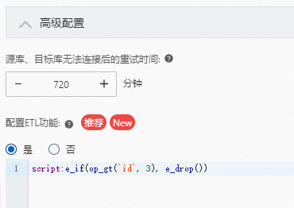

3. 单击**下一步预检查并启动**，完成后续步骤。

**数据处理DSL语法简介**

数据处理DSL是DTS专门为数据迁移场景中的数据处理需求而设计的脚本语言。支持条件函数，可处理字符串、日期、数值。允许用户灵活地定义数据处理逻辑，特性如下：

- 功能强大：提供了大量函数，且支持函数的组合。

- 语法相对简单：提供了一些典型场景的示例，例如数据过滤、数据转换、数据脱敏，详情请参见典型场景示例。

- 执行高效：基于代码生成技术，对迁移过程的性能损耗小。

**典型场景示例**

- 数据过滤：

  - 按数值列条件过滤：如果id>10000，则丢弃这条记录，不迁移到目标库：e_if(op_gt(\`id\`, 10000), e_drop)。

  - 按字符串匹配条件过滤：如果name包含“hangzhou”，则丢弃这条记录：e_if(str_contains(\`name\`, "hangzhou"), e_drop)。

  - 按日期过滤：如果订单时间早于某个时间，则不迁移：e_if(op_lt(\`order_timestamp\`, "2015-02-23 23:54:55"), e_drop)。

  - 按多条件过滤：

    - 如果id>1000且name包含“hangzhou”，则丢弃这条记录：e_if(op_and(str_contains(\`name\`, "hangzhou"), op_gt(\`id\`, 1000)), e_drop())。

    - 如果id>1000或name包含“hangzhou”，则丢弃这条记录：e_if(op_or(str_contains(\`name\`, "hangzhou"), op_gt(\`id\`, 1000)), e_drop())。

- 数据脱敏：

  - 遮掩：将phone手机号列的后四位用星号替换，e_set(\`phone\`, str_mask(\`phone\`, 7, 10, '\*'))。

- 记录数据修改时间：

  - 对所有表新增列：__OPERATION__的值为INSERT或UPDATE或DELETE时新增1列“dts_sync_time”，值为日志提交时间（__COMMIT_TIMESTAMP__）。

    ```text
    e_if(op_or(op_or(
            op_eq(__OPERATION__, __OP_INSERT__),
            op_eq(__OPERATION__, __OP_UPDATE__)),
            op_eq(__OPERATION__, __OP_DELETE__)),
        e_set(dts_sync_time, __COMMIT_TIMESTAMP__))
    ```

  - 对指定表“dts_test_table”新增列： __OPERATION__的值为INSERT或UPDATE或DELETE时新增1列“dts_sync_time”， 值为日志提交时间（__COMMIT_TIMESTAMP__）。

    ```text
    e_if(op_and(
          op_eq(__TB__,'dts_test_table'),
          op_or(op_or(
            op_eq(__OPERATION__,__OP_INSERT__),
            op_eq(__OPERATION__,__OP_UPDATE__)),
            op_eq(__OPERATION__,__OP_DELETE__))),
          e_set(dts_sync_time,__COMMIT_TIMESTAMP__))
    ```

    > 上述新增列操作需要您在任务启动前自行修改目标端表定义，添
    >
    > **说明**
    >
    > 加“dts_sync_time”列。

- 数据变更审计：

  - 记录表数据变化的类型和时间：在目标端的“operation_type”列记录数据变化类型；在目标端的“updated”列记录数据发生变化的时间。

    ```text
    e_compose(
        e_switch(
            op_eq(__OPERATION__,__OP_DELETE__), e_set(operation_type, 'DELETE'),
            op_eq(__OPERATION__,__OP_UPDATE__), e_set(operation_type, 'UPDATE'),
            op_eq(__OPERATION__,__OP_INSERT__), e_set(operation_type, 'INSERT')),
        e_set(updated, __COMMIT_TIMESTAMP__),
        e_set(__OPERATION__,__OP_INSERT__)
    )
    ```

    > 您需要在任务启动前在目标端表中添加“operation_type”列和“updated”列。
    >
    > **说明**

**数据处理DSL语法**

**常量与变量**

- 常量

  | 类型 | 示例 |
  | --- | --- |
  | int | 123 |
  | float | 123.4 |
  | string | "hello1_world" |
  | boolean | true或false |
  | datetime | '2021-01-01 10:10:01' |

- 变量

  | 变量 | 含义 | 数据类型 | 示例值 |
  | --- | --- | --- | --- |
  | __TB__ | 表名 | string | table |
  | __DB__ | 库名 | string | mydb |
  | __OPERATION__ | 操作类型 | string | __OP_INSERT__,__OP_UPDATE__,__OP_DELE TE__ |
  | __COMMIT_TIMESTAM P__ | 事务提交时间 | datetime | '2021-01-01 10:10:01' |
  | \`column\` | 某条数据对应column的值 | string | \`id\`、\`name\` |

**表达式函数**

- 数值运算

  | 功能 | 语法 | 取值范围 | 返回值 | 示例 |
  | --- | --- | --- | --- | --- |
  | 加法 | op_sum(value1, value2) | • value1：整数或浮点数<br>• value2：整数或浮点数 | 若参数均为整数，则返回整数，否则返回浮点数。 | op_sum(\`col1\`, 1.0) |
  | 减法 | op_sub(v alue1, value2) | • value1：整数或浮点数<br>• value2：整数或浮点数 | 若参数均为整数，则返回整数，否则返回浮点数。 | op_sub(\`col1\`, 1.0) |
  | 乘法 | op_mul(v alue1, value2) | • value1：整数或浮点数<br>• value2：整数或浮点数 | 若参数均为整数，则返回整数，否则返回浮点数。 | op_mul(\`col1\`, 1.0) |
  | 除法 | op_div_tr ue(value 1, value2) | • value1：整数或浮点数<br>• value2：整数或浮点数 | 若参数均为整数，则返回整数，否则返回浮点数。 | op_div_true(\`col1\`, 2.0)， 若col1=15，则返回7.5。 |
  | 取模 | op_mod(value1, value2) | • value1：整数或浮点数<br>• value2：整数或浮点数 | 若参数均为整数，则返回整数，否则返回浮点数。 | op_mod(\`col1\`, 10)，若col1=23，则返回3 |

- 逻辑运算

  | 功能 | 语法 | 取值范围 | 返回值 | 示例 |
  | --- | --- | --- | --- | --- |
  | 是否相等 | op_eq(va lue1, value2) | • value1：整数、浮点数、字符串<br>• value2：整数、浮点数、字符串 | boolean类型，true或false | op_eq(\`col1\`, 23) |
  | 是否大于 | op_gt(val ue1, value2) | • value1：整数、浮点数、字符串<br>• value2：整数、浮点数、字符串 | boolean类型，true或false | op_gt(\`col1\`, 1.0) |
  | 是否小于 | op_lt(val ue1, value2) | • value1：整数、浮点数、字符串<br>• value2：整数、浮点数、字符串 | boolean类型，true或false | op_lt(\`col1\`, 1.0) |
  | 是否大于等于 | op_ge(va lue1, value2) | • value1：整数、浮点数、字符串<br>• value2：整数、浮点数、字符串 | boolean类型，true或false | op_ge(\`col1\`, 1.0) |
  | 是否小于等于 | op_le(val ue1, value2) | • value1：整数、浮点数、字符串<br>• value2：整数、浮点数、字符串 | boolean类型，true或false | op_le(\`col1\`, 1.0) |
  | AND运算 | op_and(v alue1, value2) | • value1：boolean类型<br>• value2：boolean类型 | boolean类型，true或false | op_and(\`is_male\`, \`is_student\`) |
  | OR运算 | op_or(val ue1, value2) | • value1：boolean类型<br>• value2：boolean类型 | boolean类型，true或false | op_or(\`is_male\`, \`is_student\`) |

- **字符串函数**

  | 功能 | 语法 | 取值范围 | 返回值 | 示例 |
  | --- | --- | --- | --- | --- |
  | 字符串格式化，字符串拼接 | str_form at(format, value1, value2, value3,...) | • format：字符串类型，以大括号作为占位符，如 "part1: {}, part2: {}"。<br>• value1：任意<br>• value2：任意 | 格式化好的字符串 | str_format("part1: {}, part2: {}", \`col1\`, \`col2\`)，若col1="ab", col2="12", 则返回"part1: ab, part2: 12"。 |
  | 字符串替换 | str_repla ce(origin al, oldStr, newStr, count) | • original：原来的字符串<br>• oldStr：待替换的字符串<br>• newStr：替换后的字符串<br>• count：整数，最多替换次数。若设置为-1，则全部替换。 | 替换后的字符串 | str_replace(\`name\`, "a", 'b', 1)，若name="aba", 则返回"bba" ；str_replace(\`name\`, "a", 'b', -1)；若name="aba", 则返回"bbb"。 |
  | 移除字符串首尾的特定字符 | str_strip(string_va l, charSet) | • string_val：原来的字符串<br>• char_set：待移除的字符集合 | 移除首尾字符后的字符串 | str_strip(\`name\`, 'ab')，若name=axbzb,则返回xbz。 |
  | 字符串转小写 | str_lower (value1) | value1：字符串列或字符串常量 | 小写字符串 | str_lower(\`str_col\`) |
  | 字符串转大写 | str_upper (value1) | value1：字符串列或字符串常量 | 大写字符串 | str_upper(\`str_col\`) |
  | 字符串统计 | str_count (str, pattern) | • str：字符串列或字符串常量<br>• pattern：要查找的子串 | 子串出现的次数。 | str_count(\`str_col\`, 'abc')， 若str_col="zabcyabcz"，则返回2。 |
  | 字符串查找 | str_find(s tr, pattern)。 | • str：字符串列或字符串常量<br>• pattern：要查找的子串 | 子串首次匹配的位置，没有则返回\`-1\`。 | str_find(\`str_col\`, 'abc')， 若\`str_col="xabcy"\`，则返回\`1\`。 |
  | 判断是否全是字母组成的字符串。 | str_isalp ha(str) | str：字符串列或字符串常量 | true或false | str_isalpha(\`str_col\`) |
  | 判断是否全是数字组成的字符串 | str_isdigi t(str) | str：字符串列或字符串常量 | true或false。 | str_isdigit(\`str_col\`)。 |
  | 使用指定字符遮掩字符串的一部分，可用于数据脱敏，例如把手机号的后四位替换为星号。 | str_mask (str, start, end, maskStr) | • str：字符串列或字符串常量<br>• start：整数，遮掩的起始位置，最小值为0。<br>• end：整数，遮掩的结束位置，最大值为字符串长度减一。<br>• maskStr：字符串，长度为1的字符串，例如 '#'。 | 遮掩掉start至end后的字符串。 | str_mask(\`phone\`, 7, 10, '#')。 |
  | 获取当前时区的DateTim e | dt_now() | 无 | 当前时区的DateTime | e_set(\`dt_col\`, dt_now()) |
  | 获取UTC时区的DateTim e | dt_utcno w() | 无 | UTC时区的DateTime | e_set(\`dt_col\`, dt_utcnow()) |

**全局函数**

- 流程控制函数

  | 功能 | 语法 | 参数说明 | 示例 |
  | --- | --- | --- | --- |
  | if语句 | e_if(bool_exp r, func_invoke) | • bool_expr：bool常量或函数调用。常量：true或false。函数调用：op_gt(\`id\`, 10)。<br>• func_invoke：函数调用。e_drop,e_keep,e_set,e_if,e_c ompose | e_if(op_gt(\`id\`, 10), e_drop())，如果ID大于10，则丢弃这条记录。 |
  | if else语句 | e_if_else(bool _expr, func_invoke1, func_invoke2) | • bool_expr：bool常量或函数调用。常量：true或false。函数调用：op_gt(\`id\`, 10)。<br>• func_invoke1：函数调用。条件为true时执行。<br>• func_invoke2：函数调用。条件为false时执行。 | e_if_else(op_gt(\`id\`, 10), e_set(\`tag\`, 'large'), e_set(\`tag\`, 'small'))，如果ID大于10，则设置tag列为"large"，否则设置为"small"。 |
  | 类switch语句，进行多次条件判断，第一次满足条件时执行对应操作，如无匹配则执行默认操作。 | s_switch(con dition1, func1, condition2, func2, ..., default = default_func) | • condition1：bool常量或函数调用。常量：true或false。函数调用：op_gt(\`id\`, 10)。<br>• func_invoke：函数调用。检查condition1，若为true则执行此函数，并退出整个switch，若为false则继续检查下一个条件。<br>• default_func：函数调用。当前面的所有condition都为false时，执行此默认函数。 | e_switch(op_gt(\`id\`, 100), e_set(\`str_col\`, '&gt;100'), op_gt(\`id\`, 90), e_set(\`str_col\`, '&gt;90'), default=e_set(\`str_col\`, '&lt;=90'))。 |
  | 组合多个操作 | e_compose(f unc1, func2, func3, ...) | • func1：函数调用。可以为e_set, e_drop, e_if。<br>• func2：函数调用。可以为e_set, e_drop, e_if。 | e_compose(e_set(\`str_col\`, 'test'), e_set(\`dt_col\`, dt_now()))， 设置str_col列的值为test，并设置dt_col列的值为当前时间。 |

- 数据操作函数

  | 功能 | 语法 | 参数说明 | 示例 |
  | --- | --- | --- | --- |
  | 丢弃此条数据，不迁移 | e_drop() | 无 | e_if(op_gt(\`id\`, 10), e_drop())，丢弃ID大于10的记录。 |
  | 保留此条数据，迁移到目标端 | e_keep(condi tion) | condition：boolean类型表达式 | e_keep(op_gt(id, 1)) ，仅迁移ID大于1的数据。 |
  | 设置列值 | e_set(\`col\`, val) | • col：列名<br>• val：常量或函数调用。类型需要和col的类型匹配 | • e_set(\`dt_col\`, dt_now())，设置dt_col为当前时间。<br>• e_set(\`col1\`, \`col2\` + 1)，设置col1为col2+1。 |

<a id="section-3-6"></a>

## 3.6. 预检查项

<a id="section-3-6-1"></a>

### 3.6.1. 源库连接性检查

检测数据传输服务器是否能够连通要迁移的源数据库。数据传输服务通过JDBC协议创建到源数据库的连接，当创建连接失败时，这个检查项即失败。

当源库连接性预检查失败时，可能是由于如下原因：

| 诊断内容 | 可能原因 | 解决方法 |
| --- | --- | --- |
| JDBC | 1. 数据库账号密码填写有误，或者是数据库的IP、Port连接地址填写错误。<br>2. 数据库账号授权限制了连接地址。 | 1. 请确认并修正数据库的连接信息。<br>2. 请放开所有的连接地址。 |
| Ping | 1. 数据库实例所属服务的网络不通。<br>2. 数据库IP信息填写错误。 | 1. 请检查下您的网络是否正常。<br>2. 请确认并修正数据库的IP。 |
| Telnet | 1. 数据库实例有访问限制。<br>2. 数据库Port信息填写错误。 | 1. 请在数据库实例中放开DTS公网IP段的访问权限（如数据库所属服务的防火墙或实例的IP白名单）。<br>2. 请确认并修正数据库的Port。 |

<a id="section-3-6-2"></a>

### 3.6.2. 目标数据库连接性检查

检测数据传输服务器是否能够连通要迁移的目标数据库。数据传输服务通过JDBC协议创建到目标数据库的连接，当创建连接失败时，这个检查项即失败。

当目标库连接性预检查失败时，可能是由于如下原因：

| 诊断内容 | 可能原因 | 解决方法 |
| --- | --- | --- |
| JDBC | 1. 数据库账号密码填写有误，或者是数据库的IP、Port连接地址填写错误。<br>2. 数据库账号授权限制了连接地址。 | 1. 请确认并修正数据库的连接信息。<br>2. 请放开所有的连接地址。 |
| Ping | 1. 数据库实例所属服务的网络不通。<br>2. 数据库IP信息填写错误。 | 1. 请检查下您的网络是否正常。<br>2. 请确认并修正数据库的IP。 |
| Telnet | 1. 数据库实例有访问限制。<br>2. 数据库Port信息填写错误。 | 1. 请在数据库实例中放开DTS公网IP段的访问权限（如数据库所属服务的防火墙或实例的IP白名单）。<br>2. 请确认并修正数据库的Port。 |

<a id="section-3-6-3"></a>

### 3.6.3. 源库binlog检查

**源库binlog是否开启检查**

这个配置项只有当进行 MySQL->MySQL 增量迁移时，才会进行检查。这个检查项主要检查源数据库是否开启 binlog 日志。如果检查项失败，那么说明源数据库没有开启 binlog 。

修复方式：如果binlog没有打开，那么需要修改源数据库配置文件中的log_bin，开启二进制日志 `log_bin=mysql_bin` 。配置完成后重启源数据库后，重新进行预检查。

**源库binlog模式检查**

这个配置项只有当进行 MySQL->MySQL 增量迁移时，才会检查。这个检查项主要检查源数据库的 binlog模式是否为ROW。如果检查失败，那么说明源数据库的binlog格式不为ROW。

如果检查项失败，那么在源数据库中执行 `set global binlog_format=ROW` 后，重新进行预检查。建议修改后重启 MySQL，否则连接中的 session 可能以非 ROW 模式继续写入，这会导致数据丢失。

**源库binlog存在性检查**

这个配置项只有当进行 MySQL->MySQL 增量迁移时，才会检查。这个检查项主要检查源数据库存在的binlog文件是否被删除。如果检查失败，那么说明源数据库的 binlog 文件不完整。

如果检查失败，那么在源数据库执行 `PURGE BINARY LOGS TO '`未被删除的第一个`binlog`文件名`'` 后，重新进行预检查。

具体 purge 的文件名参考**失败详情**对话框提示的修复方法。

**Mysql源库binlog_row_image是否为FULL**

这个配置项只有当进行 MySQL->MySQL 增量迁移时，才会检查。这个检查项主要检查源数据库的binlog_row_image是否为full，即是否记录全镜像。如果检查失败，那么说明源数据库的binlog未记录全镜像。

如果检查失败，那么在源库执行 `set global binlog_row_image=FULL` 命令后，重新进行预检查。

<a id="section-3-6-4"></a>

### 3.6.4. 约束完整性检查

这个检查项主要检查迁移的对象列表中，有外键依赖关系的父子表是否都被迁移，防止破坏外键约束完整性。

当这个检查项失败时，失败原因为：待迁移子表依赖的父表没有被迁移。

对于这种错误的修复方式如下：

- 不进行约束完整性检查失败的子表的迁移，修改迁移任务配置，将这些约束完整性检查失败的子表从迁移列表中删除后，重新进行预检查。

- 进行约束完整性检查失败的子表对应的父表的迁移，修改迁移任务配置，将这些约束完整性检查失败的子表对应的父表添加到迁移列表中后，重新进行预检查。

- 删除约束完整性检查失败的子表的外键依赖，修改源数据库将这些子表的外键依赖删除掉，重新进行预检查。

<a id="section-3-6-5"></a>

### 3.6.5. federated类型的表的存在性检查

这个配置项只有当进行 MySQL->MySQL 增量迁移时，才会检查。这个检查项主要检查源数据库中是否存在增量迁移不支持的存储引擎。目前增量迁移不支持 federated和mrg_myisam 两种存储引擎。

当检查失败，且失败原因为**源数据库中存在引擎为 FEDERATED 的表**时，说明源数据库中要迁移的部分表的存储引擎为 federated ，所以导致检查失败。

当检查失败，且失败原因为**源数据库中存在引擎为 MRG_MYISAM 的表**时，说明源数据库中要迁移的部分表的存储引擎为 mrg_myisam，所以导致检查失败。

修复方法：

当检查失败时，对于这些存储引擎为 federated 或 mrg_myisam 的表，需要修改迁移任务，将这些表从迁移列表删除掉。然后单独创建一个迁移任务，对这些表进行结构迁移+全量数据迁移。

<a id="section-3-6-6"></a>

### 3.6.6. 权限检查

**源库权限检查**

这个检查项主要检查源数据库的迁移账号是否有足够的权限可以进行数据迁移。每种数据库需要的迁移权限请参见本手册中具体的数据迁移配置文档。

**目标库权限检查**

这个检查项主要检查目标数据库的迁移账号是否有足够的权限可以进行数据迁移。每种数据库需要的迁移权限请参见本手册中具体的数据迁移配置文档。

<a id="section-3-6-7"></a>

### 3.6.7. 同名对象存在性检查

这个检查项主要检查目标库是否已经存在跟待迁移对象同名的对象。当这个检查项失败时，说明目标库中已经存在了和待迁移的对象一样名字的对象，这会导致迁移失败。

当这个检查项失败时，失败原因为：目标库存在跟待迁移对象同名的结构对象迁移库名。

当这个检查项失败时，修复方式如下：

- 使用数据传输服务提供的库表映射功能，将待迁移对象迁移到目标库中的另外一个对象名的对象中。

- 删除或重命名目标库中跟迁移对象同名的对象。

- 修改迁移任务配置，将同名对象从迁移对象中删除掉，暂时不迁移这些同名对象。

<a id="section-3-6-8"></a>

### 3.6.8. schema存在性检查

主要检查待迁移的数据库在目标实例中是否存在。如果不存在，那么数据传输服务会自动创建。但是对于如下几种情况，自动创建数据库会失败，所以直接报预检查失败。

- 数据库名中含有小写字母、数字、下划线、中划线的其他特殊字符。当遇到这种情况时，预检查的失败原因为：迁移的数据库**迁移库名**的名称不符合RDS规范。修复方法：在RDS控制台的数据库管理页面中，创建满足rds规范的数据库，将新建库的读写权限赋给迁移账号。然后使用数据传输服务提供的库名映射功能将要迁移的数据库映射至新创建的数据库后，然后重新进行预检查。

- 数据库的字符集不为utf8、gbk、latin1、utf8mb4中的一种。当遇到这种情况时，预检查的失败原因为：迁移的数据库**迁移库名**的字符集不满足RDS的要求。修复方法：到RDS控制台的数据库管理页面中，创建满足RDS规范的数据库，然后将新建库的读写权限赋给迁移账号。如果新创建的库名与待迁移的库名不同，那么使用数据传输服务提供的库名映射功能将要迁移的数据库映射至新创建的数据库后，重新进行预检查。

- 目标库迁移账号无迁移库的读写权限。当遇到这种情况时，预检查的失败原因为：您没有权限使用库**迁移库名**。修复方法：先到RDS控制台的数据库管理页面中账号管理页面，修改权限，将迁移库的读写权限授予迁移账号后，重新进行预检查。

<a id="section-3-6-9"></a>

### 3.6.9. 源库server-id检查

这个配置项只有当进行 MySQL->MySQL 增量迁移时，才会进行检查。这个检查项主要检查源数据库的**server-id**是否设置为大于1的整数。

当检查失败时，只要在源数据库执行 `set global server_id='`大于`1`的整数`'` ，然后重新进行预检查。

<a id="section-3-6-10"></a>

### 3.6.10. 源库版本号检查

为保障数据迁移任务的顺利执行，DTS在预检查阶段对源库的版本号进行检查。这个检查项主要检查源数据库的版本号，数据传输服务是否支持。数据传输服务支持的各种源数据库的版本请参见支持的数据库和迁移类型。

当版本检查失败时，只能将源数据库升降级到数据传输服务支持的版本范围后，再进行预检查。

<a id="section-3-7"></a>

## 3.7. 异构数据库间的数据类型映射关系

由于异构数据库之间支持的数据类型不一样，数据类型无法一一对应，所以DTS在进行结构迁移时，会根据目标库支持的数据类型进行映射。本文为您列出详细数据类型映射关系，便于您查阅和评估数据迁移对业务的影响。

**RDS MySQL或自建MySQL为源的数据迁移**

当源实例为PolarDB MySQL、RDS MySQL、自建MySQL，且目标实例为异构数据库时（包括云原生数据仓库AnalyticDB MySQL版和云原生数据仓库AnalyticDB PostgreSQL版），两者间的数据类型映射关系如下：

> 如源实例中待迁移数据范围超出DTS所支持的范围，则会导致目标实例中的所迁入数据的
>
> **说明**
>
> 精度降低。

<table>
  <tr>
    <th>类型</th>
    <th>源实例的数据类型</th>
    <th>数值范围</th>
    <th>阿里云消息队列Kafka、自建Kafka的数据类型</th>
  </tr>
  <tr>
    <td rowspan="3"></td>
    <td>BIT[(M)]</td>
    <td>1 ~ 64</td>
    <td rowspan="3"></td>
  </tr>
  <tr>
    <td>TINYINT[(M)]</td>
    <td>-128 ~ 127</td>
  </tr>
  <tr>
    <td colspan="2"></td>
  </tr>
  <tr>
    <td rowspan="10">整数类型</td>
    <td colspan="2"></td>
    <td rowspan="16"></td>
  </tr>
  <tr>
    <td>TINYINT[(M)] [UNSIGNED]</td>
    <td>0 ~ 255</td>
  </tr>
  <tr>
    <td>SMALLINT[(M)]</td>
    <td>-32768 ~ 32767</td>
  </tr>
  <tr>
    <td>SMALLINT[(M)] [UNSIGNED]</td>
    <td>0 ~ 65535</td>
  </tr>
  <tr>
    <td>MEDIUMINT[(M)]</td>
    <td>-8388608 ~ 8388607</td>
  </tr>
  <tr>
    <td>MEDIUMINT[(M)] [UNSIGNED]</td>
    <td>0 ~ 16777215</td>
  </tr>
  <tr>
    <td>INT[(M)]</td>
    <td>-2147483648 ~ 2147483647</td>
  </tr>
  <tr>
    <td>INT[(M)] [UNSIGNED]</td>
    <td>0 ~ 4294967295</td>
  </tr>
  <tr>
    <td>BIGINT[(M)]</td>
    <td>-922337203685477580 8 ~ 922337203685477580 7</td>
  </tr>
  <tr>
    <td>BIGINT[(M)] [UNSIGNED]</td>
    <td>0 ~ 184467440737095516 15.</td>
  </tr>
  <tr>
    <td rowspan="3">小数类型</td>
    <td>DECIMAL[(M[,D])]</td>
    <td>M：0~65 ; D：0~30</td>
  </tr>
  <tr>
    <td>FLOAT(p)</td>
    <td>1.175494351E-38 ~ 3.402823466E+38</td>
  </tr>
  <tr>
    <td>DOUBLE[(M,D)]</td>
    <td>2.2250738585072014 E-308 ~ 1.7976931348623157 E+308</td>
  </tr>
  <tr>
    <td rowspan="3">时间类型</td>
    <td>DATE</td>
    <td>1000-01-01~9999-12-31<br>说明格式为YYYY-MM-DD（UTC时间）。</td>
  </tr>
  <tr>
    <td>DATETIME[(fsp)]</td>
    <td>1000-01-01 00:00:00.000000 ~ 9999-12-31 23:59:59.999999<br>说明格式为YYYY-MM-DD hh:mm:ss[.fractio n]（UTC时间）。</td>
  </tr>
  <tr>
    <td colspan="2"></td>
  </tr>
  <tr>
    <td rowspan="4"></td>
    <td colspan="2"></td>
    <td rowspan="22">与MySQL的数据类型保持一致</td>
  </tr>
  <tr>
    <td>TIMESTAMP[(fsp)]</td>
    <td>1970-01-01 00:00:01.000000 ~ 2038-01-19 03:14:07.999999<br>说明格式为YYYY-MM-DD hh:mm:ss[.fractio n]（UTC时间）。</td>
  </tr>
  <tr>
    <td>TIME[(fsp)]</td>
    <td>-838:59:59.000000 ~ 838:59:59.000000<br>说明格式为hh:mm:ss[.fractio n]（UTC时间）。</td>
  </tr>
  <tr>
    <td>YEAR[(4)]</td>
    <td>1901 ~ 2155，或0000.</td>
  </tr>
  <tr>
    <td rowspan="14">字符串类型</td>
    <td>CHAR[(M)]</td>
    <td>0 ~ 255 字符</td>
  </tr>
  <tr>
    <td>VARCHAR(M)</td>
    <td>0 ~ 65,535 字符</td>
  </tr>
  <tr>
    <td>BINARY[(M)]</td>
    <td>0 ~ 255 字节</td>
  </tr>
  <tr>
    <td>VARBINARY(M)</td>
    <td>0 ~ 65,535 字节</td>
  </tr>
  <tr>
    <td>TINYBLOB</td>
    <td>255 (2^8 - 1) 字节</td>
  </tr>
  <tr>
    <td>TINYTEXT</td>
    <td>255 (2^8 - 1) 字符</td>
  </tr>
  <tr>
    <td>BLOB</td>
    <td>65,535 (2^16 - 1) 字节</td>
  </tr>
  <tr>
    <td>TEXT</td>
    <td>65,535 (2^16 - 1) 字符</td>
  </tr>
  <tr>
    <td>MEDIUMBLOB</td>
    <td>16,777,215 (2^24 - 1)字节</td>
  </tr>
  <tr>
    <td>MEDIUMTEXT</td>
    <td>16,777,215 (2^24 - 1)字符</td>
  </tr>
  <tr>
    <td>LONGBLOB</td>
    <td>4,294,967,295 or 4GB (2^32 - 1) 字节</td>
  </tr>
  <tr>
    <td>LONGTEXT</td>
    <td>4,294,967,295 or 4GB (2^32 - 1) 字符</td>
  </tr>
  <tr>
    <td>ENUM('value1','value2',...)</td>
    <td>最多可包含65,535枚举值</td>
  </tr>
  <tr>
    <td>SET('value1','value2',...)</td>
    <td>最多可包含64个元素</td>
  </tr>
  <tr>
    <td rowspan="4"></td>
    <td>GEOMETRY</td>
    <td>任意几何类型的值</td>
  </tr>
  <tr>
    <td>POINT</td>
    <td>无</td>
  </tr>
  <tr>
    <td>LINESTRING</td>
    <td>无</td>
  </tr>
  <tr>
    <td colspan="2"></td>
  </tr>
  <tr>
    <td rowspan="6">空间类型</td>
    <td colspan="2"></td>
    <td rowspan="7"></td>
  </tr>
  <tr>
    <td>POLYGON</td>
    <td>无</td>
  </tr>
  <tr>
    <td>MULTIPOINT</td>
    <td>无</td>
  </tr>
  <tr>
    <td>MULTILINESTRING</td>
    <td>无</td>
  </tr>
  <tr>
    <td>MULTIPOLYGON</td>
    <td>无</td>
  </tr>
  <tr>
    <td>GEOMETRYCOLLECTIO N</td>
    <td>任何几何类型的值的集合</td>
  </tr>
  <tr>
    <td>JSON类型</td>
    <td>JSON</td>
    <td>无</td>
  </tr>
</table>

**以Oracle为源的数据迁移**

当源实例为自建Oracle，且目标实例为异构数据库时（包括MySQL、PolarDB MySQL、云原生数据仓库AnalyticDB MySQL版、云原生数据仓库AnalyticDB PostgreSQL版、PolarDB O引擎），两者间的数据类型映射关系如下：

> 如源实例中待迁移数据范围超出DTS所支持的范围，则会导致目标实例中的所迁入数据的
>
> **说明**
>
> 精度降低。

**云原生数据仓库**

**MySQL、**

**Oracle的数据**

**PolarDB O引**

**AnalyticDB**

**类型**

**数值范围**

**PolarDB-X的**

**类型**

**擎的数据类型**

**PostgreSQL**

**数据类型**

**版的数据类型**

1 ~ 22 字节。p代表精度位，

DECIMAL |

取值范围是1 ~

TINYINT |

DECIMAL[(p[,s

38。

NUMBER(p,s)

SMALLINT |

NUMBER(p,s)

])]

s代表小数位，

INTEGER |

取值范围是-84

BIGINT

~ 127。

1 ~ 22 字节。

数字类型

p代表指针变

DOUBLE

DOUBLE

FLOAT(p)

DOUBLE

量，取值范围是

PRECISION

PRECISION

1 ~ 126 bit。

32-bit的浮点

BINARY_FLOA

DECIMAL(65,

DOUBLE

REAL

数，即4字节。

T

8)

PRECISION

64-bit的浮点

BINARY_DOU

DOUBLE

DOUBLE

DOUBLE

数，即8字节。

BLE

PRECISION

PRECISION

TIMESTAMP(0

无

DATE

DATETIME

DATE

)

TIMESTAMP

DATETIME[(fr

TIMESTAMP

[(fractional_s

actional_seco

[(fractional_s

无

TIMESTAMP

econds_precis

nds_precision

econds_precis

ion)]

)]

ion)]

TIMESTAMP

TIMESTAMP

DATETIME[(fr

[(fractional_s

TIMESTAMP

[(fractional_s

actional_seco

无

econds_precis

WITH TIME

econds_precis

nds_precision

ion)] WITH

ZONE

ion)] WITH

)]

TIME ZONE

TIME ZONE

TIMESTAMP

TIMESTAMP

[(fractional_s

DATETIME[(fr

TIMESTAMP

[(fractional_s

econds_precis

actional_seco

日期类型

无

WITH TIME

econds_precis

ion)] WITH

nds_precision

ZONE

ion)] WITH

LOCAL TIME

)]

TIME ZONE

ZONE

INTERVAL YEAR

无

不支持

[(year_precisi

VARCHAR(32)

INTERVAL

on)] TO MONTH

INTERVAL DAY [(day_precisio n)] TO

无

不支持

VARCHAR(32)

INTERVAL

SECOND [(fractional_s econds_precis ion)]

CHAR [(size

CHAR [(size

2000 字节。

[BYTE |

CHAR[(n)]

CHAR

[BYTE |

CHAR])]

CHAR])]

NATIONAL

2000 字节。

NCHAR[(size)]

VARCHAR

NCHAR[(size)]

CHAR[(n)]

当MAX_STRING_ SIZE = EXTENDED时，最大长度为

VARCHAR2(si

VARCHAR2(si

32767字节；

ze [BYTE |

VARCHAR(n)

VARCHAR

ze [BYTE |

当

CHAR])

CHAR])

MAX_STRING_ SIZE = STANDARD，最大长度为4000字节。

当MAX_STRING_ SIZE = EXTENDED时，最大长度为32767字节；

NVARCHAR2(

NATIONALVA

NVARCHAR2(

VARCHAR

当

size)

RCHAR[(n)]

size)

MAX_STRING_ SIZE = STANDARD，最大长度为

字符串类型

4000字节。

最大长度2G（2^31-

LONG

LONGTEXT

TEXT

LONG

1）。

最大长度

VARBINARY(2

32767 字节或

RAW(size)

BYTEA

RAW(size)

000)

2000字节。

最大长度2G。

LONG RAW

LONGBLOB

BYTEA

LONG RAW

最大长度（4 GB -

CLOB

LONGTEXT

TEXT

CLOB

1）\*DB_BLOC K_SIZE。

最大长度（4 GB -

NCLOB

LONGTEXT

TEXT

CLOB

1）\*DB_BLOC K_SIZE。

最大长度（4 GB -

BLOB

LONGBLOB

BYTEA

BLOB

1）\*DB_BLOC K_SIZE。

4G。

不支持

不支持

不支持

BFILE

最大长度

JSON类型

不支持

JSON

JSON

JSON

32MB。

ROWID类型

64字符。

不支持

ROWID

OID

VARCHAR

空间类型

需要自定义

不支持

> **说明**
>
> - 当目标实例为MySQL或PolarDB-X时：
>
>   - 对于CHAR类型，如长度定义超过255，DTS会将类型转换为VARCHAR(n)。
>
>   - 由于MySQL本身不支持类似Oracle中的BFILE、INTERVAL YEARTO MONTH和INTERVAL DAYTO SECOND数据类型，DTS在进行结构迁移时，无法在MySQL中找到合适的数据类型进行映射，因此这三种类型不会进行转化。迁移时如果表中含有这三种类型，会导致结构迁移失败，在选择迁移对象时，对需要迁移的对象中这三种类型的列进行排除。
>
>   - 由于MySQL的TIMESTAMP类型不包含时区，而Oracle的TIMESTAMP WITH TIME ZONE和TIMESTAMP WITH LOCAL TIME ZONE默认带有时区信息，DTS在迁移这两种类型的数据时，会将其转换成UTC时区后存入目标实例。
>
> - 当目标实例为云原生数据仓库AnalyticDB PostgreSQL版时，对于云原生数据仓库AnalyticDB PostgreSQL版不支持字段类型，DTS会将其直接转为BYTEA，如果转换不了则将数据内容置为NULL。

<a id="section-3-8"></a>

## 3.8. 为自建MySQL创建账号并设置binlog

当数据迁移/同步/订阅的源库为自建MySQL时，为满足预检查阶段对源库的要求，保障任务的顺利执行，在正式配置之前，您需要在自建MySQL数据库上创建账号并设置binlog。

**适用场景及权限参考**

| 场景 | 权限参考 |
| --- | --- |
| 数据迁移的源库为自建MySQL，且要执行 增量数据迁移。 | 待迁移对象的SELECT权限。REPLICATION CLIENT、REPLICATION SLAVE、SHOW VIEW。建库建表的权限，以允许DTS创建库dts，用于记录迁移期间的心跳数据。 |
| 数据同步的源库为自建MySQL。 | 待同步对象的SELECT权限。REPLICATION CLIENT、REPLICATION SLAVE、SHOW VIEW。建库建表的权限，以允许DTS创建库dts，用于记录同步期间的心跳数据。 |
| 数据订阅的源库为自建MySQL。 | 待订阅对象的SELECT权限。REPLICATION CLIENT、REPLICATION SLAVE、SHOW VIEW。建库建表的权限，以允许DTS创建库dts，用于记录订阅期间的心跳数据。 |

**影响**

执行该操作需要重启MySQL服务，为避免影响您的业务使用，请在业务低峰期操作。

**操作步骤**

1. 登录自建MySQL数据库。

2. 在自建MySQL数据库中创建用于数据迁移/同步的账号。

   ```text
   CREATE USER 'username'@'host' IDENTIFIED BY 'password';
   ```

   > **说明**
   >
   > - username：待创建的账号。
   >
   > - host：允许该账号登录的主机，如果允许该账号从任意主机登录数据库，可以使用百分号（%）。
   >
   > - password：账号的密码。

   例如，创建一个账号，账号名为dtsmigration，密码为Dts123456，并允许从任意主机登录数据库，命令如下。

   ```text
   CREATE USER 'dtsmigration'@'%' IDENTIFIED BY 'Dts123456';
   ```

3. 对账号进行授权操作，所需授予的权限请参见适用场景及权限参考。

   - 对账号授予指定库表的权限。

     ```sql
     GRANT privileges ON databasename.tablename TO 'username'@'host' WITH GRANT OPTION;
     ```

   - 对账号授予建库建表的权限。

     ```sql
     GRANT CREATE ON *.* TO 'username'@'host' WITH GRANT OPTION;
     ```

   > **说明**
   >
   > - privileges：授予该账号的操作权限，如SELECT、INSERT、UPDATE等，如果要授予该账号所有权限，则使用ALL。
   >
   > - databasename：数据库名。如果要授予该账号具备所有数据库的操作权限，则使用星号（\*）。
   >
   > - tablename：表名。如果要授予该账号具备所有表的操作权限，则使用星号（\*）。
   >
   > - username：待授权的账号。
   >
   > - host：允许该账号登录的主机，如果允许该账号从任意主机登录，则使用百分号（%）。
   >
   > - WITH GRANT OPTION：授予该账号使用GRANT命令的权限，该参数为可选。

   例如，授予dtsmigration账号具备所有数据库和表的所有权限，并允许从任意主机登录数据库，命令如下。

   ```sql
   GRANT ALL ON *.* TO 'dtsmigration'@'%';
   ```

4. 开启并设置自建MySQL数据库的binlog。

   - Linux操作系统操作步骤如下：

     <ol type="a">

     <li>

     使用 `vim` 命令，修改配置文件my.cnf中的如下参数。

     ```text
     log_bin=mysql_bin
     binlog_format=row
     server_id=2 #建议设置为⼤于1的整数
     binlog_row_image=full #当⾃建MySQL的版本⼤于5.6时，则必须设置该项。
     ```

     </li>

     <li>

     修改完成后，重启MySQL进程。

     ```text
     /etc/init.d/mysqld restart
     ```

     > 您也可以根据实际情况，使用其他命令或方式进行重启。
     >
     > **说明**

     </li>

     </ol>

   - Windows操作系统操作步骤如下：

     <ol type="a">

     <li>

     修改配置文件my.ini中的如下参数。

     ```text
     log_bin=mysql_bin
     binlog_format=row
     server_id=2 #建议设置为⼤于1的整数
     binlog_row_image=full #当⾃建MySQL的版本⼤于5.6时，则必须设置该项。
     ```

     </li>

     <li>

     修改完成后，重启MySQL服务。

     > 您可以通过Windows中的服务管理器重启服务，或使用如下命令重启服务：
     >
     > **说明**
     >
     > ```text
     > net stop mysql
     > net start mysql
     > ```

     </li>

     </ol>

<a id="section-3-9"></a>

## 3.9. Oracle的日志开启和精细化授权

本文为您介绍如何为Oracle数据库账号授予更精细化的权限。

> **重要**
>
> 如需迁移增量数据，且不允许授予DBA权限，您需要按照如下方法开启归档和补充日志，并为Oracle数据库账号授予更精细化的权限。

1. 开启归档和补充日志。

   <table>
     <tr>
       <th width="90">日志类型</th>
       <th>开启步骤</th>
     </tr>
     <tr>
       <td>归档日志</td>
       <td>执行如下命令，开启归档日志：<br><code>shutdown immediate;</code><br><code>startup mount;</code><br><code>alter database archivelog;</code><br><code>alter database open;</code><br><code>archive log list;</code></td>
     </tr>
     <tr>
       <td>补充日志</td>
       <td>按业务需求，选择开启库级别补充日志或者表级别补充日志：<br>说明开启库级别补充日志，则DTS任务运行更为稳定；开启表级别补充日志，则更节约源Oracle数据库的磁盘空间。<br>• 开启库级别补充日志<br>a. 打开最小补充日志：<br><code>alter database add supplemental log data;</code><br>b. 开启库级主键、唯一键补充日志：<br><code>alter database add supplemental log data (primary key,unique</code><br><code>index) columns;</code><br>• 开启表级补充日志<br>a. 打开最小补充日志：<br><code>alter database add supplemental log data;</code><br>b. 开启表级补充日志（两者选其一） ：<br>• 开启表级别主键补充日志<br><code>alter table table_name add supplemental log data (primary</code><br><code>key) columns;</code><br>• 开启表级别全字段补充日志<br><code>alter table tb_name add supplemental log data (all)</code><br><code>columns;</code></td>
     </tr>
     <tr>
       <td>记录日志</td>
       <td>执行如下命令，开启记录日志：<br><code>alter database force logging;</code></td>
     </tr>
   </table>

2. 为Oracle数据库账号授予更精细化的权限。

   **Oracle 9i～11g版本**

   ```sql
   #创建数据库账号（以rdsdt_dtsacct为例）并进⾏授权
   create user rdsdt_dtsacct IDENTIFIED BY rdsdt_dtsacct;
   grant create session to rdsdt_dtsacct;
   grant connect to rdsdt_dtsacct;
   grant resource to rdsdt_dtsacct;
   grant execute on sys.dbms_logmnr to rdsdt_dtsacct;
   grant select on V_$LOGMNR_LOGS to rdsdt_dtsacct;
   grant select on  all_objects to rdsdt_dtsacct;
   grant select on  all_tab_cols to rdsdt_dtsacct;
   grant select on  dba_registry to rdsdt_dtsacct;
   grant select any table to rdsdt_dtsacct;
   grant select any transaction to rdsdt_dtsacct;
   -- v$log privileges
   grant select on v_$log to rdsdt_dtsacct;
   -- v$logfile privileges
   grant select on v_$logfile to rdsdt_dtsacct;
   -- v$archived_log privileges
   grant select on v_$archived_log to rdsdt_dtsacct;
   -- v$parameter privileges
   grant select on v_$parameter to rdsdt_dtsacct;
   -- v$database privileges
   grant select on v_$database to rdsdt_dtsacct;
   -- v$active_instances privileges
   grant select on v_$active_instances to rdsdt_dtsacct;
   -- v$instance privileges
   grant select on v_$instance to rdsdt_dtsacct;
   -- v$logmnr_contents privileges
   grant select on v_$logmnr_contents to rdsdt_dtsacct;
   -- system tables
   grant select on sys.USER$ to rdsdt_dtsacct;
   grant select on SYS.OBJ$ to rdsdt_dtsacct;
   grant select on SYS.COL$ to rdsdt_dtsacct;
   grant select on SYS.IND$ to rdsdt_dtsacct;
   grant select on SYS.ICOL$ to rdsdt_dtsacct;
   grant select on SYS.CDEF$ to rdsdt_dtsacct;
   grant select on SYS.CCOL$ to rdsdt_dtsacct;
   grant select on SYS.TABPART$ to rdsdt_dtsacct;
   grant select on SYS.TABSUBPART$ to rdsdt_dtsacct;
   grant select on SYS.TABCOMPART$ to rdsdt_dtsacct;
   grant select_catalog_role TO rdsdt_dtsacct;
   ```

   **Oracle 12c～19c（租户式）**

   ```sql
   #切换⾄PDB，创建数据库账号（以rdsdt_dtsacct为例）并进⾏授权
   ALTER SESSION SET container = ORCLPDB1;
   create user rdsdt_dtsacct IDENTIFIED BY rdsdt_dtsacct;
   grant create  session to rdsdt_dtsacct;
   grant connect  to rdsdt_dtsacct;
   grant resource to rdsdt_dtsacct;
   grant execute on sys.dbms_logmnr to rdsdt_dtsacct;
   grant select on  all_objects to rdsdt_dtsacct;
   grant select on  all_tab_cols to rdsdt_dtsacct;
   grant select on  dba_registry to rdsdt_dtsacct;
   grant select any table to rdsdt_dtsacct;
   grant select any transaction to rdsdt_dtsacct;
   -- v$log privileges
   grant select on v_$log to rdsdt_dtsacct;
   -- v$logfile privileges
   grant select on v_$logfile to rdsdt_dtsacct;
   -- v$archived_log privileges
   grant select on v_$archived_log to rdsdt_dtsacct;
   -- v$parameter privileges
   grant select on v_$parameter to rdsdt_dtsacct;
   -- v$database privileges
   grant select on v_$database to rdsdt_dtsacct;
   -- v$active_instances privileges
   grant select on v_$active_instances to rdsdt_dtsacct;
   -- v$instance privileges
   grant select on v_$instance to rdsdt_dtsacct;
   -- v$logmnr_contents privileges
   grant select on v_$logmnr_contents to rdsdt_dtsacct;
   grant select on sys.USER$ to rdsdt_dtsacct;
   grant select on SYS.OBJ$ to rdsdt_dtsacct;
   grant select on SYS.COL$ to rdsdt_dtsacct;
   grant select on SYS.IND$ to rdsdt_dtsacct;
   grant select on SYS.ICOL$ to rdsdt_dtsacct;
   grant select on SYS.CDEF$ to rdsdt_dtsacct;
   grant select on SYS.CCOL$ to rdsdt_dtsacct;
   grant select on SYS.TABPART$ to rdsdt_dtsacct;
   grant select on SYS.TABSUBPART$ to rdsdt_dtsacct;
   grant select on SYS.TABCOMPART$ to rdsdt_dtsacct;
   -- V$PDBS privileges
   grant select on V_$PDBS to rdsdt_dtsacct;
   grant select on v$database to rdsdt_dtsacct;
   grant select on dba_objects to rdsdt_dtsacct;
   grant select on DBA_TAB_COMMENTS to rdsdt_dtsacct;
   grant select on dba_tab_cols to rdsdt_dtsacct;
   grant select_catalog_role TO rdsdt_dtsacct;

   #切换⾄CDB$ROOT，并进⾏账号创建并授权
   ALTER SESSION SET container = CDB$ROOT;
   #创建数据库账号（以rdsdt_dtsacct为例）并进⾏授权，您需修改Oracle数据库的默认参数。
   alter session set "_ORACLE_SCRIPT"=true;
   create user rdsdt_dtsacct IDENTIFIED BY rdsdt_dtsacct;
   grant create session to rdsdt_dtsacct;
   grant connect to rdsdt_dtsacct;
   grant select on v_$logmnr_contents to rdsdt_dtsacct;
   grant LOGMINING TO rdsdt_dtsacct;
   grant EXECUTE_CATALOG_ROLE to rdsdt_dtsacct;
   grant execute on sys.dbms_logmnr to rdsdt_dtsacct;
   ```

   **Oracle 12c~19c（非租户式）**

   ```sql
   #创建数据库账号（以rdsdt_dtsacct为例）并进⾏授权
   create user rdsdt_dtsacct IDENTIFIED BY rdsdt_dtsacct;
   grant create  session to rdsdt_dtsacct;
   grant connect  to rdsdt_dtsacct;
   grant resource to rdsdt_dtsacct;
   grant select on V_$LOGMNR_LOGS to rdsdt_dtsacct;
   grant select on  all_objects to rdsdt_dtsacct;
   grant select on  all_tab_cols to rdsdt_dtsacct;
   grant select on  dba_registry to rdsdt_dtsacct;
   grant select any table to rdsdt_dtsacct;
   grant select any transaction to rdsdt_dtsacct;
   grant select on v$database to rdsdt_dtsacct;
   grant select on dba_objects to rdsdt_dtsacct;
   grant select on DBA_TAB_COMMENTS to rdsdt_dtsacct;
   grant select on dba_tab_cols to rdsdt_dtsacct;
   -- v$log privileges
   grant select on v_$log to rdsdt_dtsacct;
   -- v$logfile privileges
   grant select on v_$logfile to rdsdt_dtsacct;
   -- v$archived_log privileges
   grant select on v_$archived_log to rdsdt_dtsacct;
   -- v$parameter privileges
   grant select on v_$parameter to rdsdt_dtsacct;
   -- v$database privileges
   grant select on v_$database to rdsdt_dtsacct;
   -- v$active_instances privileges
   grant select on v_$active_instances to rdsdt_dtsacct;
   -- v$instance privileges
   grant select on v_$instance to rdsdt_dtsacct;
   -- v$logmnr_contents privileges
   grant select on v_$logmnr_contents to rdsdt_dtsacct;
   grant select on sys.USER$ to rdsdt_dtsacct;
   grant select on SYS.OBJ$ to rdsdt_dtsacct;
   grant select on SYS.COL$ to rdsdt_dtsacct;
   grant select on SYS.IND$ to rdsdt_dtsacct;
   grant select on SYS.ICOL$ to rdsdt_dtsacct;
   grant select on SYS.CDEF$ to rdsdt_dtsacct;
   grant select on SYS.CCOL$ to rdsdt_dtsacct;
   grant select on SYS.TABPART$ to rdsdt_dtsacct;
   grant select on SYS.TABSUBPART$ to rdsdt_dtsacct;
   grant select on SYS.TABCOMPART$ to rdsdt_dtsacct;
   grant LOGMINING TO rdsdt_dtsacct;
   grant EXECUTE_CATALOG_ROLE to rdsdt_dtsacct;
   grant execute on sys.dbms_logmnr to rdsdt_dtsacct;
   grant select_catalog_role TO rdsdt_dtsacct;
   ```

<a id="section-3-10"></a>

## 3.10. 跨账号数据迁移或同步任务的RAM授权

本文介绍在使用数据传输服务DTS（Data Transmission Service）配置跨阿里云账号（组织）的迁移或同步任务时，如何为源或目标数据库实例所属阿里云账号（组织）进行RAM授权。

**背景信息**

在使用DTS进行跨阿里云账号（组织）的数据迁移或数据同步时，您需要先在数据库实例所属组织创建RAM角色，将创建DTS任务的组织作为授信组织，允许其通过数据传输服务访问数据库实例所属组织的相关云资源。

**注意事项**

若您需要配置跨云任务，您需购买跨云数据传输的服务，确保两个阿里云间的网络已打通且已进行相关配置。更多信息，请联系阿里云技术支持。

**操作步骤**

1. 进入**创建RAM角色授权**页面。

   <ol type="i">

   <li>

   登录Apsara Uni-manager运营控制台。

   </li>

   <li>

   在页面上方的导航栏中，单击**企业**。

   </li>

   <li>

   在左侧导航栏中，选择**权限管理 > 角色授权**。

   

   </li>

   <li>

   在**角色授权**页面，单击

   按钮。

   </li>

   <li>

   在**创建自定义角色**页面下方展开**高级创建**，单击**创建RAM角色授权**。

   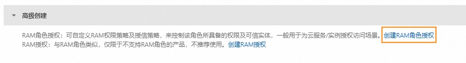

   </li>

   </ol>

2. 配置RAM角色信息。

   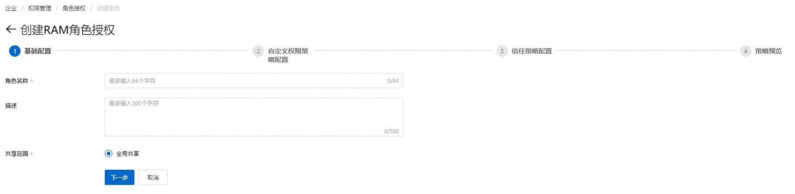

   | 配置选项 | 配置说明 |
   | --- | --- |
   | 角色名称 | 填写RAM角色名称，本示例中创建的角色为<strong>ram-for-dts</strong>。 |
   | <strong>描述</strong>（可选） | 填写RAM角色的备注信息。 |
   | 共享范围 | 默认为<strong>全局共享</strong>。 |

3. 单击**下一步**，配置权限策略。

   <ol type="i">

   <li>

   单击**创建权限策略**。

   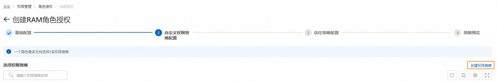

   </li>

   <li>

   配置权限策略信息。

   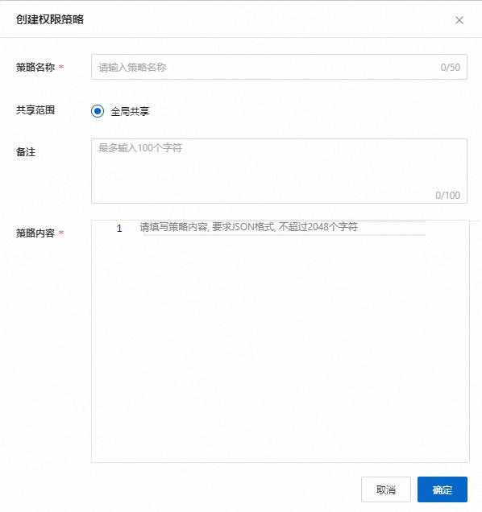

   | 配置选项 | 配置说明 |
   | --- | --- |
   | 策略名称 | 填写策略名称。 |
   | 共享范围 | 默认为<strong>全局共享</strong>。 |
   | <strong>备注</strong>（可选） | 填写策略的备注信息。 |

   <table>
     <tr>
       <td>策略内容</td>
       <td>策略内容与数据库类型相关，由于RAM策略内容长度限制，此处无法输入DTS的完整策略，如下示例是数据库类型为MySQL和PolarDB-X 1.0的部分策略内容。更多策略信息，请参见完整权限策略。<br><code>{</code><br><code>"Statement": [</code><br><code>{</code><br><code>"Action": "sts:AssumeRole",</code><br><code>"Effect": "Allow",</code><br><code>"Resource": "*"</code><br><code>},</code><br><code>{</code><br><code>"Action": [</code><br><code>"rds:Describe*",</code><br><code>"rds:CreateDBInstance",</code><br><code>"rds:CreateAccount*",</code><br><code>"rds:CreateDataBase*",</code><br><code>"rds:ModifySecurityIps",</code><br><code>"rds:GrantAccountPrivilege"</code><br><code>],</code><br><code>"Resource": "*",</code><br><code>"Effect": "Allow"</code><br><code>},</code><br><code>{</code><br><code>"Action": [</code><br><code>"drds:DescribeDrds*",</code><br><code>"drds:ModifyDrdsIpWhiteList",</code><br><code>"drds:DescribeRegions",</code><br><code>"drds:DescribeRdsList",</code><br><code>"drds:CeateDrdsDB",</code><br><code>"drds:DescribeShardDBs"</code><br><code>],</code><br><code>"Resource": "*",</code><br><code>"Effect": "Allow"</code><br><code>}</code><br><code>],</code><br><code>"Version": "1"</code><br><code>}</code></td>
     </tr>
   </table>

   </li>

   <li>

   配置完成后，单击**确定**。

   </li>

   <li>

   选择刚创建的权限策略，然后单击**下一步**。

   </li>

   </ol>

4. 配置信任策略。

   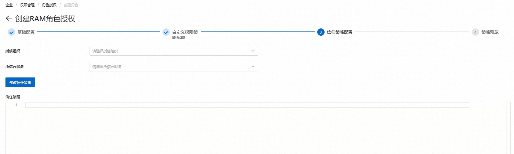

   | 配置选项 | 配置说明 |
   | --- | --- |
   | 授信组织 | 选择创建DTS任务的一级组织。 |
   | 授信云服务 | 选择<strong>dts.aliyuncs.com</strong>。 |
   | 信任策略 | 选择<strong>授信组织</strong>和<strong>授信云服务</strong>后自动生成，无需配置。 |

5. 单击**下一步**，预览策略。

6. 单击**创建**，创建RAM角色。

7. 为RAM角色授权。

   <ol type="i">

   <li>

   搜索刚创建的角色，然后单击角色名称。

   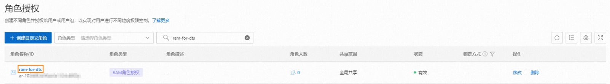

   </li>

   <li>

   单击**RAM角色**页签。

   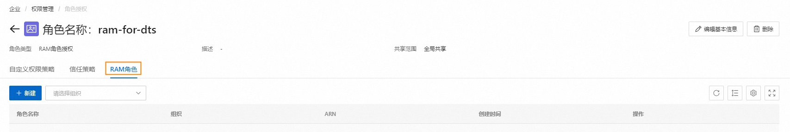

   </li>

   <li>

   单击**新建**按钮。

   

   </li>

   <li>

   将**RAM角色创建所在组织**选择为数据库实例所属的一级组织。

   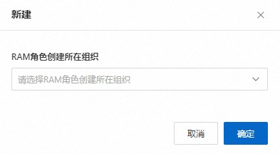

   </li>

   <li>

   单击**确定**，完成授权。

   </li>

   </ol>

**获取数据库实例的阿里云账号**

1. 登录Apsara Uni-manager运营控制台。

2. 在页面上方的导航栏中，单击**企业**。

3. 在左侧导航栏中，选择**资源管理 > 组织管理**。

4. 单击数据库实例所属的一级组织。

5. 单击右侧的**管理Accesskey**。

   

6. 在**管理AccessKey**对话框中**UID**的右侧，获取数据库实例的阿里云账号。

   > **说明**
   >
   > 此处获取的阿里云账号，即为配置任务时**跨阿里云账号**中需要输入的阿里云账号ID。

   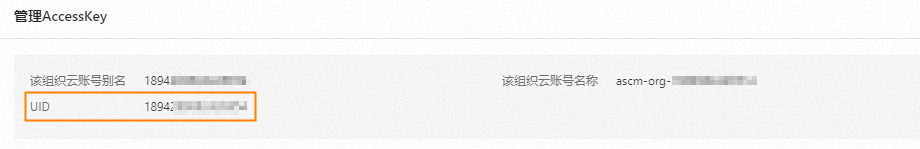

**完整权限策略**

> **说明**
>
> 每个 `{ "Action": [****], "Resource": "*", "Effect": "Allow"}` 为一个完整的数据库类型的策略内容，您可以根据实际情况选择复制到RAM角色的**策略内容**中。若您在配置权限策略过程中有任何疑问，请联系阿里云技术支持。

```json
{
  "Version": "1",
  "Statement": [
    {
      "Action": [
        "rds:Describe*",
        "rds:CreateDBInstance",
        "rds:CreateAccount*",
        "rds:CreateDataBase*",
        "rds:ModifySecurityIps",
        "rds:GrantAccountPrivilege",
        "rds:ReceiveDBInstance",
        "rds:CreateMigrateTask",
        "rds:DescribeMigrateTaskById",
        "rds:CreateOnlineDatabaseTask"
      ],
      "Resource": "*",
      "Effect": "Allow"
    },
    {
      "Action": [
        "ecs:DescribeSecurityGroupAttribute",
        "ecs:DescribeInstances",
        "ecs:DescribeRegions",
        "ecs:AuthorizeSecurityGroup",
        "ecs:CreateSecurityGroup",
        "ecs:DeleteSecurityGroup",
        "ecs:DescribeSecurityGroups",
        "ecs:JoinSecurityGroup",
        "ecs:LeaveSecurityGroup",
        "ecs:RevokeSecurityGroup"
      ],
      "Resource": "*",
      "Effect": "Allow"
    },
    {
      "Action": [
        "dhs:ListProject",
        "dhs:GetProject",
        "dhs:CreateTopic",
        "dhs:ListTopic",
        "dhs:GetTopic",
        "dhs:UpdateTopic",
        "dhs:ListShard",
        "dhs:MergeShard",
        "dhs:SplitShard",
        "dhs:PutRecords",
        "dhs:GetRecords",
        "dhs:GetCursors"
      ],
      "Resource": "*",
      "Effect": "Allow"
    },
    {
      "Action": [
        "elasticsearch:DescribeInstance",
        "elasticsearch:ListInstance",
        "elasticsearch:UpdateAdminPwd",
        "elasticsearch:UpdatePublicNetwork",
        "elasticsearch:UpdateBlackIps",
        "elasticsearch:UpdateKibanaIps",
        "elasticsearch:UpdatePublicIps",
        "elasticsearch:UpdatePrivateNetworkWhiteIps",
        "elasticsearch:UpdatePublicWhiteIps",
        "elasticsearch:UpdateWhiteIps"
      ],
      "Resource": "*",
      "Effect": "Allow"
    },
    {
      "Action": [
        "drds:DescribeDrds*",
        "drds:ModifyDrdsIpWhiteList",
        "drds:DescribeRegions",
        "drds:DescribeRdsList",
        "drds:CreateDrdsDB",
        "drds:CreateDrdsAccount",
        "drds:DescribeShardDBs"
      ],
      "Resource": "*",
      "Effect": "Allow"
    },
    {
      "Action": [
        "polardb:DescribeDBClusterIPArrayList",
        "polardb:DescribeDBClusterNetInfo",
        "polardb:DescribeDBClusters",
        "polardb:DescribeRegions",
        "polardb:DescribeDBClusterEndpoints",
        "polardb:DescribeDBClusterAccessWhiteList",
        "polardb:ModifyDBClusterAccessWhitelist",
        "polardb:ModifySecurityIps",
        "polardb:DescribeDBClusterAttribute"
      ],
      "Resource": "*",
      "Effect": "Allow"
    },
    {
      "Action": [
        "dds:DescribeDBInstanceAttribute",
        "dds:DescribeReplicaSetRole",
        "dds:DescribeSecurityIps",
        "dds:DescribeDBInstances",
        "dds:ModifySecurityIps",
        "dds:DescribeShardingNetworkAddress",
        "dds:DescribeRegions"
      ],
      "Resource": "*",
      "Effect": "Allow"
    },
    {
      "Action": [
        "kvstore:DescribeSecurityIps",
        "kvstore:DescribeInstances",
        "kvstore:DescribeRegions",
        "kvstore:ModifySecurityIps",
        "kvstore:DescribeAccounts",
        "kvstore:CreateAccount",
        "kvstore:DescribeDBInstanceNetInfoForInner",
        "kvstore:DescribeDBInstanceNetInfo",
        "kvstore:AllocateInstancePrivateConnection",
        "kvstore:SyncDtsStatus",
        "kvstore:GetDbMasterInfo"
      ],
      "Resource": "*",
      "Effect": "Allow"
    },
    {
      "Action": [
        "petadata:DescribeInstanceInfo",
        "petadata:DescribeSecurityIPs",
        "petadata:DescribeInstances",
        "petadata:ModifySecurityIPs"
      ],
      "Resource": "*",
      "Effect": "Allow"
    },
    {
      "Action": [
        "adb:DescribeDBClusters",
        "adb:DescribeDBClusterAttribute",
        "adb:DescribeRegions",
        "adb:DescribeDBClusterNetInfo",
        "adb:DescribeDBClusterAccessWhiteList",
        "adb:ModifyDBClusterAccessWhiteList",
        "adb:DescribeDBClusterPerformance"
      ],
      "Resource": "*",
      "Effect": "Allow"
    },
    {
      "Action": [
        "gpdb:DescribeDBInstanceAttribute",
        "gpdb:DescribeDBInstances",
        "gpdb:DescribeRegions",
        "gpdb:DescribeDBInstanceIPArrayList",
        "gpdb:DescribeDBClusterIPArrayList",
        "gpdb:ModifySecurityIps",
        "gpdb:DescribeDBInstanceNetInfo",
        "gpdb:DescribeDBClusterPerformance"
      ],
      "Resource": "*",
      "Effect": "Allow"
    },
    {
      "Action": [
        "clickhouse:DescribeRegions",
        "clickhouse:DescribeDBClusters",
        "clickhouse:DescribeDBClusterAttribute",
        "clickhouse:DescribeDBClusterNetInfoItems",
        "clickhouse:DescribeDBClusterAccessWhiteList",
        "clickhouse:ModifyDBClusterAccessWhiteList",
        "clickhouse:DescribeAllDataSource"
      ],
      "Resource": "*",
      "Effect": "Allow"
    },
    {
      "Action": [
        "ots:ListInstance",
        "ots:GetInstance",
        "ots:GetRow",
        "ots:PutRow",
        "ots:UpdateRow",
        "ots:DeleteRow",
        "ots:BatchWriteRow",
        "ots:BulkImport",
        "ots:CreateTable",
        "ots:DescribeTable",
        "ots:ListTable"
      ],
      "Resource": "*",
      "Effect": "Allow"
    },
    {
      "Action": [
        "dg:GetUserDatabases",
        "dg:GetUserGateways"
      ],
      "Resource": "*",
      "Effect": "Allow"
    },
    {
      "Action": [
        "cen:DeleteRouteServiceInCen",
        "cen:DescribeCenAttachedChildInstances",
        "cen:DescribeCens",
        "cen:DescribeRouteServicesInCen",
        "cen:ResolveAndRouteServiceInCen"
      ],
      "Resource": "*",
      "Effect": "Allow"
    },
    {
      "Action": [
        "polardbx:DescribeDBInstances",
        "polardbx:DescribeDBInstanceAttribute",
        "polardbx:DescribeSecurityIps",
        "polardbx:ModifySecurityIps"
      ],
      "Resource": "*",
      "Effect": "Allow"
    },
    {
      "Action": [
        "dms:GetUserActiveTenant",
        "dms:GetInstance",
        "dms:GetLogicDatabase",
        "dms:ListLogicDatabases",
        "dms:GetDBTopology",
        "dms:ListLogicTables",
        "dms:GetTableDBTopology"
      ],
      "Resource": "*",
      "Effect": "Allow"
    },
    {
      "Action": [
        "vpc:DescribeVpcs",
        "vpc:DescribeVpcAttribute"
      ],
      "Resource": "*",
      "Effect": "Allow"
    },
    {
      "Action": [
        "lindorm:GetLindormInstanceListForDMS",
        "lindorm:GetLindormInstanceForDMS",
        "lindorm:UpdateInstanceIpWhiteList"
      ],
      "Resource": "*",
      "Effect": "Allow"
    },
    {
      "Action": [
        "hbase:DescribeClusterConnection",
        "hbase:DescribeInstance",
        "hbase:DescribeInstances",
        "hbase:ModifyIpWhitelist"
      ],
      "Resource": "*",
      "Effect": "Allow"
    }
  ]
}
```

<a id="section-4"></a>

# 4.数据同步

<a id="section-4-1"></a>

## 4.1. 支持的数据库、同步初始化类型和同步拓扑

数据同步功能帮助您实现数据源之间的数据实时同步，本文将介绍数据同步功能支持的数据库、同步初始化类型和同步拓扑。

**源数据库**

**目标数据库**

**同步类型**

**同步拓扑**

- 自建MySQL

  库表结构同步

  5.1、5.5、5.6、5.7版本

  单向同步

  全量同步

  双向同步

- RDS MySQL

  增量同步

  所有版本

PolarDB MySQL版（本地盘版实例）

库表结构同步

所有版本

全量同步

单向同步

增量同步

> **说明**
>
> 源库暂只支持RDS MySQL。

- 自建MySQL 5.1、5.5、5.6、5.7版本

  云原生数据仓库AnalyticDB

  库表结构同步

- RDS MySQL

  MySQL版

  全量同步

  单向同步

  所有版本

  3.0版本

  增量同步

  云原生数据仓库AnalyticDB

  库表结构同步

  PostgreSQL版

  全量同步

  单向同步

  4.3、6.0版本

  增量同步

  库表结构同步

  单向同步

  Datahub

  增量同步

  库表结构同步全量同步

  单向同步

  MaxCompute

  增量同步

  库表结构同步

PolarDB MySQL版（本地盘版实

PolarDB MySQL版（本地盘版实

全量同步

单向同步

例）

例）

增量同步

库表结构同步全量同步

单向同步

PolarDB-X 1.0

增量同步

库表结构同步

单向同步

Datahub

增量同步

- 自建MySQL

  库表结构同步

  5.1、5.5、5.6、5.7版本

  全量同步

  单向同步

- RDS MySQL

  增量同步

  所有版本

PolarDB-X 1.0（原DRDS）

库表结构同步全量同步

单向同步

MaxCompute

增量同步

自建Oracle（RAC或非RAC架构）

全量同步

9i、10g、11g、12c、18c、19c

单向同步

增量同步

版本

云原生数据仓库AnalyticDB

库表结构同步

MySQL版

全量同步

单向同步

3.0版本

增量同步

库表结构同步全量同步

单向同步

PolarDB-X 2.0

增量同步

- 自建MySQL

  库表结构同步

  5.1、5.5、5.6、5.7版本

  全量同步

  单向同步

- RDS MySQL

  增量同步

  所有版本

PolarDB-X 2.0

云原生数据仓库AnalyticDB

库表结构同步

PostgreSQL版

全量同步

单向同步

4.3、6.0版本

增量同步

云原生数据仓库AnalyticDB

库表结构同步

MySQL版

全量同步

单向同步

3.0版本

增量同步

云原生数据仓库AnalyticDB

全量同步

PostgreSQL版

单向同步

增量同步

4.3、6.0版本

- 自建PostgreSQL 9.4、9.5、9.6、10.x、11和12版本

  - 自建PostgreSQL 9.4、9.5、9.6、10.x、11和12

- RDS PostgreSQL

  库表结构同步

  版本

  9.4、10.0、11.0、12.0、13.0

  全量同步

  单向同步

  版本

  - RDS PostgreSQL

    增量同步

    9.4、10.0、11.0、12.0、13.0版本

  云原生数据仓库AnalyticDB

  库表结构同步

  PostgreSQL版

  全量同步

  单向同步

Db2 for LUW

4.3、6.0版本

增量同步

库表结构同步

单向同步

DataHub

增量同步

库表结构同步全量同步

单向同步

MaxCompute

自建Oracle（RAC或非RAC架构）

增量同步

9i、10g、11g、12c、18c、19c版本

- 自建MySQL

  库表结构同步

  5.1、5.5、5.6、5.7版本

  全量同步

  单向同步

- RDS MySQL

  增量同步

  所有版本

云数据库Redis

云数据库Redis

全量同步

单向同步

4.0、5.0版

4.0、5.0版

增量同步

<table>
  <tr>
    <td rowspan="2">• RDS SQL Server 2012、2016、2017版本<br>• 自建SQL Server 2005、2008、2008R2、2012、2014、2016、2017版本<br>说明<br>• 暂不支持SQL Server Cluster或SQL Server AlwaysOn High Availability Group。<br>• 源库为2005或2008版本时不支持增量数据同步。</td>
    <td>RDS SQL Server 2012、2016、2017版本</td>
    <td>库表结构同步全量同步增量同步</td>
    <td>单向同步</td>
  </tr>
  <tr>
    <td>DataHub</td>
    <td>库表结构同步增量同步</td>
    <td>单向同步</td>
  </tr>
  <tr>
    <td>• 自建MongoDB（副本集架构）<br>• 云数据库MongoDB（副本集或分片集群架构）</td>
    <td>• 自建MongoDB（副本集或分片集群架构）<br>• 云数据库MongoDB（副本集或分片集群架构）<br>说明若源数据库为云数据库MongoDB（分片集群架构），则目标数据库只支持云数据库MongoDB（分片集群架构）。</td>
    <td>库表结构同步全量同步增量同步</td>
    <td>单向同步</td>
  </tr>
  <tr>
    <td rowspan="3">PolarDB PostgreSQL版（兼容Oracle）</td>
    <td>云原生数据仓库AnalyticDB MySQL版3.0版本</td>
    <td>库表结构同步全量同步增量同步</td>
    <td>单向同步</td>
  </tr>
  <tr>
    <td>PolarDB PostgreSQL版（兼容Oracle）</td>
    <td>库表结构同步全量同步增量同步</td>
    <td>单向同步</td>
  </tr>
  <tr>
    <td>云原生数据仓库AnalyticDB PostgreSQL版4.3、6.0版本</td>
    <td>库表结构同步全量同步增量同步</td>
    <td>单向同步</td>
  </tr>
  <tr>
    <td>MaxCompute</td>
    <td>RDS MySQL所有版本</td>
    <td>库表结构同步全量同步</td>
    <td>单向同步</td>
  </tr>
</table>

<a id="section-4-2"></a>

## 4.2. 创建数据同步实例

在配置数据同步任务前，您需要创建数据同步实例，本文为您介绍具体操作方法。

**操作步骤**

1. 登录数据传输服务控制台。

2. 在左侧导航栏，单击**数据同步**。

3. 单击**创建任务**。

4. 在弹出的对话框中，选择数据同步实例的参数配置。

   <table>
     <tr>
       <th width="137">参数</th>
       <th>说明</th>
     </tr>
     <tr>
       <td>源数据库类型</td>
       <td>选择源数据库类型，支持的同步链路请参见支持的数据库、同步初始化类型和同步拓扑。</td>
     </tr>
     <tr>
       <td>源区域</td>
       <td>选择源数据库所属的地区。<br>说明源地域为任务链路源实例所在地域，订购后不支持更换地域，请谨慎选择。</td>
     </tr>
     <tr>
       <td>目标数据库类型</td>
       <td>选择目标数据库类型，支持的同步链路请参见支持的数据库、同步初始化类型和同步拓扑。</td>
     </tr>
     <tr>
       <td>目标区域</td>
       <td>选择目标数据库所属的地区。<br>说明目标地域为任务链路源数据库所在地域，订购后不支持更换地域，请谨慎选择。</td>
     </tr>
     <tr>
       <td>同步拓扑</td>
       <td>选择DTS实例的同步架构，支持的同步架构请参见支持的数据库、同步初始化类型和同步拓扑。</td>
     </tr>
     <tr>
       <td>购买数量</td>
       <td>一次性创建数据同步实例的数量。</td>
     </tr>
   </table>

   > 在本对话框中，您可以查看到总实例数、已创建的实例数和可创建实例的实例数信息。
   >
   > **说明**

5. 单击**购买**。

6. 在弹出的对话框中，单击**确定**。

<a id="section-4-3"></a>

## 4.3. 数据同步拓扑介绍

数据同步功能支持多种同步拓扑，您可以根据业务需求规划您的同步实例。本文介绍DTS支持的同步拓扑类型和使用说明。

**单向同步**

在单向同步的拓扑中，为保障同步数据的一致性，对目标实例中的同步对象应只进行读操作，请勿进行写操作。

| 拓扑类型 | 拓扑图 | 说明 |
| --- | --- | --- |
| 一对一单向同步 | 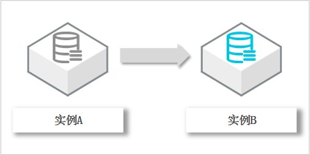 | 无 |
| 一对多单向同步 | 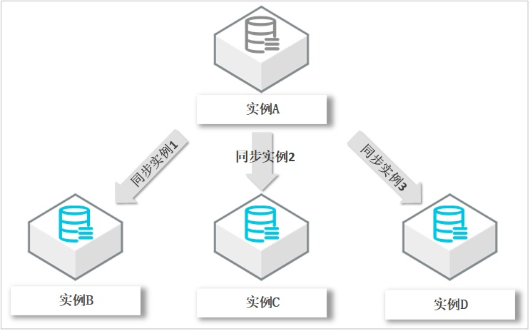 | 您需要购买多个同步实例来实现一对多单向同步 。例如，从实例A同步到实例B、实例C和实例D，那么您需要购买三个同步实例。 |
| 级联单向同步 | 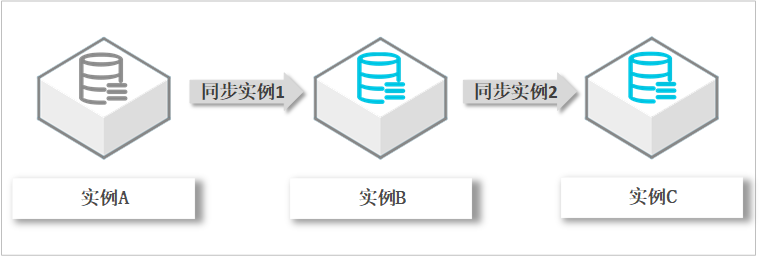 | 您需要购买多个同步实例来实现级联单向同步。例如，从实例A同步到实例B，再从实例B同步到实例C，那么您需要购买两个同步实例。 |
| 多对一单向同步 | 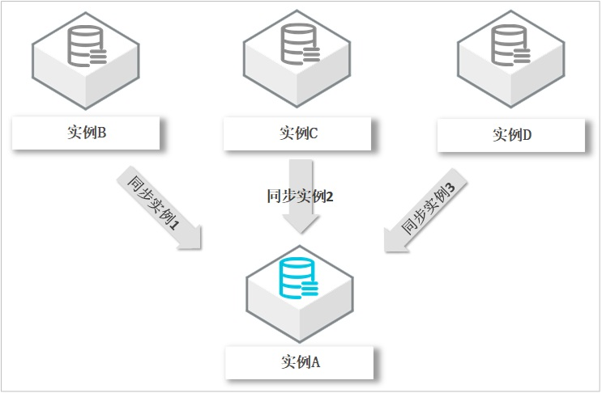 | 您需要购买多个同步实例来实现多对一单向同步 。例如，从实例B、实例C和实例D同步到实例A，那么您需要购买三个同步实例。<br>说明为保障同步数据的一致性，每个同步实例应选择不同的同步对象。 |

**双向同步**

目前DTS仅支持两个MySQL数据库之间的双向同步。

| 拓扑类型 | 拓扑图 | 说明 |
| --- | --- | --- |
| 一对一双向同步 | 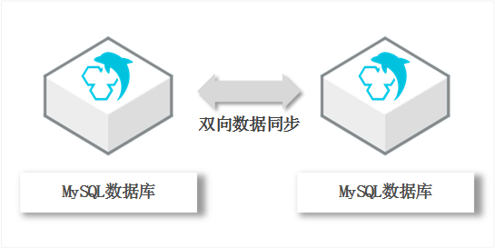 | 为保障同步数据的一致性，您需要确保同一个主键、业务主键或唯一键的记录只在一个实例中更新。 |

<a id="section-4-4"></a>

## 4.4. 准备用于数据同步的数据库账号

在配置数据同步任务时，您需要在任务配置页面分别为源库和目标库填入数据库账号，该数据库账号将用于数据同步。由于不同的数据库类型和同步类型对权限要求有所不同，需要您在配置同步任务前完成数据库账号的创建与授权操作。

**源库的数据库账号所需权限**

| 数据库 | 所需权限 | 创建及授权方法 |
| --- | --- | --- |
| RDS MySQL | 待同步对象的读权限。 | 请参见《用户指南（RDS MySQL）》的《创建账号》和《修改账号权限》章节。 |
| 自建MySQL | 待同步对象的SELECT权限。REPLICATION CLIENT、REPLICATION SLAVE、SHOW VIEW。建库建表的权限，以允许DTS创建库dts，用于记录同步期间的心跳数据。 | 请参见为自建MySQL创建账号并设置binlog。 |
| PolarDB MySQL版 | 待同步对象的读权限。 | 请参见《用户指南（PolarDB MySQL版）》的《创建数据库账号》章节。 |
| PolarDB O引擎 | 初始账号或高权限账号。 | 请参见《用户指南（PolarDB）》的《创建账号》章节。 |
| 自建Oracle | DBA权限。 | 请参见CREATE USER和GRANT。<br>重要如需执行增量数据同步，且不允许授予DBA权限，您可以为数据库账号授予更精细化的权限，详情请参见Oracle的日志开启和精细化授权。 |
| PolarDB-X | 待同步对象的读权限。 | • 1.0版本：请参见云原生分布式数据库PolarDB-X《用户指南（1.0）》的《创建账号》和《修改账号权限》章节。<br>• 2.0版本：请参见云原生分布式数据库PolarDB-X《用户指南》的《管理数据库账号》章节。 |
| RDS SQL Server | 待同步对象所属数据库的所有者权限。<br>说明高权限账号满足要求。 | 请参见《用户指南（RDS SQL Server）》的《创建账号》章节。 |
| 自建SQL Server | sysadmin权限。 | CREATE USER和用户权限管理。 |
| RDS PostgreSQL | 高权限账号，且需为所选数据库的owner（授权账号）。<br>说明当源库为RDS PostgreSQL 9.4，且仅需同步DML操作时，账号具备replication权限即可。 | 请参见《用户指南（RDS PostgreSQL）》的《创建账号》章节 |
| 自建PostgreSQL | superuser权限。 | CREATE USER和GRANT语法。 |
| 阿里云Redis实例 | 待同步对象的读写权限。 | 请参见云数据库Redis版《用户指南》的《账号管理》章节。 |
| 自建Redis | 无用户和权限概念，可正常执行<code> psync </code>或<code> sync </code>命令即可。 | 无 |
| 云数据库MongoDB | • 全量数据同步：待同步库的read权限。<br>• 增量数据同步：待同步库、admin库和local库的read权限。 | 默认鉴权数据库为admin，数据库账号为root。 |
| 自建MongoDB | • 全量数据同步：待同步库的read权限。<br>• 增量数据同步：待同步库、admin库和local库的read权限。 | 请参见MongoDB Create User说明。 |

**目标库的数据库账号所需权限**

<table>
  <tr>
    <th>数据库</th>
    <th>所需权限</th>
    <th>创建及授权方法</th>
  </tr>
  <tr>
    <td>RDS MySQL</td>
    <td>目标库的读写权限。</td>
    <td>请参见《用户指南（RDS MySQL）》的《创建账号》和《修改账号权限》章节。</td>
  </tr>
  <tr>
    <td>自建MySQL</td>
    <td>目标库的ALL权限。</td>
    <td>请参见为自建MySQL创建账号并设置binlog。</td>
  </tr>
  <tr>
    <td>PolarDB MySQL版</td>
    <td>目标库的ALL权限。</td>
    <td>请参见《用户指南（PolarDB MySQL版）》的《创建数据库账号》章节。</td>
  </tr>
  <tr>
    <td>PolarDB O引擎</td>
    <td>初始账号或高权限账号。</td>
    <td>请参见《用户指南（PolarDB）》的《创建账号》章节。</td>
  </tr>
  <tr>
    <td>自建Oracle</td>
    <td>目标Schema的owner权限。</td>
    <td>请参见CREATE USER和GRANT。</td>
  </tr>
  <tr>
    <td>PolarDB-X</td>
    <td>待同步对象所属数据库的写权限。</td>
    <td>• 1.0版本：请参见云原生分布式数据库PolarDB-X《用户指南（1.0）》的《创建账号》和《修改账号权限》章节。<br>• 2.0版本：请参见云原生分布式数据库PolarDB-X《用户指南》的《管理数据库账号》章节。</td>
  </tr>
  <tr>
    <td rowspan="2">云数据库Redis</td>
    <td>使用实例的密码：无需执行授权。</td>
    <td>无</td>
  </tr>
  <tr>
    <td>使用自定义账号：读写权限。</td>
    <td>请参见云数据库Redis版《用户指南》的《账号管理》章节。</td>
  </tr>
  <tr>
    <td>自建Redis</td>
    <td>无用户和权限概念，只需提供正确的数据库密码。</td>
    <td>无</td>
  </tr>
  <tr>
    <td>云数据库MongoDB</td>
    <td>dbAdminAnyDatabase权限、目标库的readWrite权限、local库的read权限。</td>
    <td>默认鉴权数据库为admin，数据库账号为root。</td>
  </tr>
  <tr>
    <td>自建MongoDB</td>
    <td>dbAdminAnyDatabase权限、目标库的readWrite权限、local库的read权限。</td>
    <td>请参见MongoDB Create User说明。</td>
  </tr>
  <tr>
    <td>云原生数据仓库AnalyticDB MySQL</td>
    <td>• 2.0版本：无需填写数据库账号信息，DTS会自动创建账号并授权。<br>• 3.0版本：读写权限。</td>
    <td>3.0版本：请参见云原生数据仓库AnalyticDB MySQL版《用户指南（3.0）》的《数据库账号和权限》章节。</td>
  </tr>
  <tr>
    <td>云原生数据仓库AnalyticDB PostgreSQL</td>
    <td>初始账号或具备RDS_SUPERUSER权限。</td>
    <td>请参见云原生数据仓库AnalyticDB PostgreSQL版《用户指南》的《创建数据库账号》和《管理用户和权限》章节。</td>
  </tr>
  <tr>
    <td>阿里云消息队列Kafka版</td>
    <td>非必填项，无。</td>
    <td>无</td>
  </tr>
  <tr>
    <td>自建Kafka</td>
    <td>非必填项，无。<br>说明如Kafka集群未开启验证可不填写。</td>
    <td>无</td>
  </tr>
  <tr>
    <td>MaxCompute</td>
    <td>待同步项目的CREATE TABLE、CREATE INSTANCE、CREATE RESOURCE、CREATE JOB、List权限。</td>
    <td>同步任务配置时系统将自动授权。</td>
  </tr>
</table>

**双向同步任务对账号权限的要求**

双向同步任务要求源和目标数据库具备如下权限，以允许DTS在源和目标数据库中创建库dts，用于做数据防循环复制。

<table>
  <tr>
    <th>数据库</th>
    <th>所需权限</th>
    <th>创建及授权方式</th>
  </tr>
  <tr>
    <td>RDS MySQL</td>
    <td>高权限账号。</td>
    <td>请参见《用户指南（RDS MySQL）》的《创建账号》和《修改账号权限》章节。</td>
  </tr>
  <tr>
    <td>自建MySQL</td>
    <td>待同步对象的SELECT权限。REPLICATION CLIENT、REPLICATION SLAVE、SHOW VIEW。建库建表的权限，以允许DTS创建库dts，用于做数据防循环复制。</td>
    <td>请参见为自建MySQL创建账号并设置binlog。</td>
  </tr>
  <tr>
    <td>RDS PostgreSQL</td>
    <td>高权限账号，且需为所选数据库的owner（授权账号）。</td>
    <td>请参见《用户指南（RDS PostgreSQL）》的《创建账号》章节</td>
  </tr>
  <tr>
    <td>自建PostgreSQL</td>
    <td>superuser权限。</td>
    <td>CREATE USER和GRANT语法。</td>
  </tr>
  <tr>
    <td>PolarDB MySQL版</td>
    <td>高权限账号。</td>
    <td>请参见《用户指南（PolarDB MySQL版）》的《创建数据库账号》章节。</td>
  </tr>
  <tr>
    <td rowspan="2">云数据库Redis</td>
    <td>使用实例的密码：无需执行授权。</td>
    <td>无</td>
  </tr>
  <tr>
    <td>使用自定义账号：读写权限。</td>
    <td>请参见云数据库Redis版《用户指南》的《账号管理》章节。</td>
  </tr>
  <tr>
    <td>自建Redis</td>
    <td>无用户和权限概念，可正常执行<code> psync </code>或<code> sync </code>命令即可。</td>
    <td>无</td>
  </tr>
</table>

<a id="section-4-5"></a>

## 4.5. 数据同步配置案例

<a id="section-4-5-1"></a>

### 4.5.1. RDS MySQL间的数据同步

本文以RDS MySQL实例之间的数据同步为例，介绍配置流程。

**前提条件**

数据同步的源和目标RDS MySQL实例已存在。

**注意事项**

<table>
  <tr>
    <th width="90">类型</th>
    <th>说明</th>
  </tr>
  <tr>
    <td>源库限制</td>
    <td>• 待同步的表需具备主键或唯一约束，且字段具有唯一性，否则可能会导致目标数据库中出现重复数据。<br>• Binlog日志：<br>• 需开启，并且binlog_format为row、binlog_row_image为full。否则预检查阶段提示报错，且无法成功启动数据同步任务。<br>• 建议在全量初始化期间，Binlog日志至少保留7天以上。或者等到全量初始化完成后，再清理DTS任务运行后源库产生的Binlog日志。<br>说明为保障数据安全，DTS本地只会循环存储源库近24小时或者50 GB的Binlog日志，一旦超出该限制，DTS本地将自动清除所缓存的日志。<br>警告过早清理源库的Binlog日志，可能会导致同步任务失败。例如源库的全量初始化数据较多，目标库写入异常等原因，导致全量初始化耗时超过24小时。在该情况下，过早清理源库的Binlog日志，DTS将无法获取到24小时前的Binlog日志，可能会导致同步任务失败。</td>
  </tr>
  <tr>
    <td>其他限制</td>
    <td>• 为保障兼容性，建议源和目标实例的MySQL版本保持一致，或者从低版本迁移至高版本。<br>• 结构初始化支持触发器，但会有数据不一致的风险。建议您删除源库的触发器，以避免因触发器而导致数据不一致的问题。<br>• 同步时RENAME TABLE操作的限制：RENAME TABLE操作可能导致同步数据不一致。例如同步对象只包含某个表，如果同步过程中源实例对该表执行了重命名操作，那么该表的数据将不会同步到目标库。为避免该问题，您可以在数据同步配置时将该表所属的整个数据库作为同步对象。<br>• 执行数据同步前需评估源库和目标库的性能，同时建议业务低峰期执行数据同步。否则全量数据初始化时将占用源库和目标库一定的读写资源，可能会导致数据库的负载上升。<br>• 全量初始化会并发执行INSERT操作，导致目标数据库的表产生碎片，因此全量初始化完成后目标实例的表空间比源实例的表空间大。<br>• 对于表级别的数据同步，请勿对源库的同步对象使用gh-ost或pt-online-schema-change等类似工具执行在线DDL变更，否则会导致同步失败。<br>• 对于表级别的数据同步，如果除DTS以外的数据没有写入目标库，您可以使用数据管理DMS（Data Management Service）来执行在线DDL变更。<br>警告如果有除DTS外的数据写入目标库，请勿使用DMS执行在线DDL变更，否则可能引起目标库数据丢失。</td>
  </tr>
</table>

<table>
  <tr>
    <td>其他限制</td>
    <td>MySQL实例间的双向同步<br>• 您需要购买DTS跨云同步、双向同步基础包，才能开通双向同步服务。<br>• 目前DTS仅支持两个MySQL数据库之间的双向同步，暂不支持多个MySQL数据库之间的双向同步。<br>• DDL语法同步方向限制 。为保障双向同步链路的稳定性，只支持正向同步DDL，不支持反向同步DDL。<br>• 双向同步任务时，DTS会在目标库中建立数据库dts，以避免数据循环同步，任务运行期间，请勿修改该库。</td>
  </tr>
</table>

**支持的同步架构**

支持单向和双向同步，详情请参见数据同步拓扑介绍。

**支持同步的SQL操作**

<table>
  <tr>
    <th width="89">操作类型</th>
    <th>SQL操作语句</th>
  </tr>
  <tr>
    <td>DML</td>
    <td>INSERT、UPDATE、DELETE、REPLACE</td>
  </tr>
  <tr>
    <td>DDL</td>
    <td>• ALTER TABLE、ALTER VIEW<br>• CREATE FUNCTION、CREATE INDEX、CREATE PROCEDURE、CREATE TABLE、CREATE VIEW<br>• DROP INDEX、DROP TABLE<br>• RENAME TABLE<br>重要RENAME TABLE操作可能导致同步数据不一致。例如同步对象只包含某个表，如果同步过程中源实例对该表执行了重命名操作，那么该表的数据将不会同步到目标库。为避免该问题，您可以在数据同步配置时将该表所属的整个数据库作为同步对象，且确保RENAME TABLE操作前后的表所属的数据库均在同步对象中。<br>• TRUNCATE TABLE</td>
  </tr>
</table>

**操作步骤**

1. 创建数据同步实例。

   > **说明**
   >
   > 创建时，选择源数据库类型和目标数据库类型为**MySQL**，并选择同步拓扑为**单向同步**。

2. 在同步作业列表中，找到刚创建的数据同步实例，单击**配置任务**。

3. 配置源实例和目标实例信息。

   **类别**

   **配置**

   **说明**

   DTS会自动生成一个同步作业名称，建议配置具有业务意义的名称（无唯

   无

   **任务名称**

   一性要求），便于后续识别。

   选择**MySQL**。

   **数据库类型**

   选择**云实例**。

   **接入方式**

   创建数据同步实例时已指定，不可变更。

   **实例地区是否跨阿里云账**

   选择**不跨账号**。

   **号**

   选择作为源RDS实例ID。

   **源库信息**

   **RDS实例ID**

   填入源RDS的数据库账号。

   > **说明**

   **数据库账号**

   > 当源RDS实例的数据库类型为**MySQL 5.6**时，无需配置**数据库账号**和**数据库密码**。

   填入数据库账号的密码。

   **数据库密码**

   根据需求选择连接方式。如果设置为**SSL安全连接**，您需要提前开启RDS

   **连接方式**

   实例的SSL加密功能。

   选择**MySQL**。

   **数据库类型**

   选择**云实例**。

   **接入方式**

   创建数据同步实例时已指定，不可变更。

   **实例地区**

   选择目标RDS实例ID。

   **RDS实例ID**

   填入目标RDS的数据库账号。

   **目标库信息**

   > **说明**

   **数据库账号**

   > 当目标RDS实例的数据库类型为**MySQL 5.6**时，无需配置**数据库账号**和**数据库密码**。

   填入数据库账号的密码。

   **数据库密码**

   根据需求选择连接方式。如果设置为**SSL安全连接**，您需要提前开启RDS

   **连接方式**

   实例的SSL加密功能。

4. 配置完成后，单击页面下方的**测试连接以进行下一步**。

5. 配置目标已存在表的处理模式和同步对象。

   <table>
     <tr>
       <th width="89">配置项目</th>
       <th>配置说明</th>
     </tr>
     <tr>
       <td>任务步骤</td>
       <td>固定选中<strong>增量同步</strong>。默认情况下，您还需要同时选中<strong>库表结构同步</strong>和<strong>全量同步</strong>。预检查完成后，DTS会将源实例中待同步对象的全量数据在目标集群中初始化，作为后续增量同步数据的基线数据。</td>
     </tr>
   </table>

   <table>
     <tr>
       <td>目标已存在表的处理模式</td>
       <td>• <strong>预检查并报错拦截</strong>：检查目标数据库中是否有同名的表。如果目标数据库中没有同名的表，则通过该检查项目；如果目标数据库中有同名的表，则在预检查阶段提示错误，数据同步作业不会被启动。<br>• <strong>忽略报错并继续执行</strong>：跳过目标数据库中是否有同名表的检查项。<br>警告选择为<strong>忽略报错并继续执行</strong>，可能导致数据不一致，给业务带来风险，例如：<br>• 表结构一致的情况下，如果在目标库遇到与源库主键的值相同的记录，在初始化阶段会保留目标库中的该条记录；在增量同步阶段则会覆盖目标库的该条记录。<br>• 表结构不一致的情况下，可能会导致无法初始化数据、只能同步部分列的数据或同步失败。</td>
     </tr>
     <tr>
       <td>同步拓扑</td>
       <td>选择<strong>单向同步</strong>。</td>
     </tr>
     <tr>
       <td>目标库对象名称大小写策略</td>
       <td>可以配置目标实例中同步对象的库名、表名和列名的英文大小写策略。默认情况下选择<strong>DTS默认策略</strong>，您也可以选择与源库、目标库默认策略保持一致。更多信息，请参见目标库对象名称大小写策略。</td>
     </tr>
     <tr>
       <td>源库对象</td>
       <td>在<strong>源库对象</strong>框中单击待同步的对象（库或表），然后单击图标将其移动至<strong>已选择</strong><br><strong>对象</strong>框。<br>说明如果选择整个库作为同步对象，那么该库中所有对象的结构变更操作都会同步至目标库。</td>
     </tr>
     <tr>
       <td>已选择对象</td>
       <td>默认情况下，同步对象的名称保持不变。如果您需要改变同步对象在目标实例中的名称，请使用对象名映射功能，详情请参见设置同步对象在目标实例中的名称。<br>说明<br>• 如需按库或表级别选择同步的SQL操作，请在<strong>已选择对象</strong>中右击待同步对象，并在弹出的对话框中选择所需同步的SQL操作。<br>• 如需设置WHERE条件过滤数据，请在<strong>已选择对象</strong>中右击待同步的表，在弹出的对话框中设置过滤条件。设置方法请参见通过SQL条件过滤待同步数据。<br>• 如果使用了对象名映射功能，可能会导致依赖这个对象的其他对象同步失败。</td>
     </tr>
   </table>

6. 单击**下一步高级配置**，进行高级配置。

   | 配置项目 | 配置说明 |
   | --- | --- |
   | 源库、目标库无法连接后的重试时间 | 在同步任务启动后，若源库或目标库连接失败则DTS会报错。对于可预期的报错，DTS会立即进行持续的重试连接，默认持续重试时间为720分钟，您也可以在取值范围（10~1440分钟）内自定义重试时间，建议设置30分钟以上。如果DTS在设置的重试时间内重新连接上源库、目标库，同步任务将自动恢复。否则，同步任务将会失败。<br>说明针对同源或者同目标的多个DTS实例，如DTS实例A和DTS实例B，设置网络重试时间时A设置30分钟，B设置60分钟，则重试时间以低的30分钟为准。 |
   | 配置ETL功能 | 选择是否配置ETL功能。<br>• <strong>是</strong>：配置ETL功能，并在文本框中填写数据处理语句。更多信息，请参见在同步任务中配置ETL。<br>• <strong>否</strong>：不配置ETL功能。 |

7. 上述配置完成后，单击页面下方的**下一步预检查并启动**。

   > **重要**
   >
   > - 在数据同步任务正式启动之前，会先进行预检查。只有预检查通过后，才能成功启动数据同步任务。
   >
   > - 如果预检查失败，请单击**查看详情**并请根据提示修复问题，然后重新进行预检查。

8. **预检查通过率**显示为100%时，单击**返回列表**。

<a id="section-4-5-2"></a>

### 4.5.2. 从RDS MySQL同步到MaxCompute

本小节介绍如何使用数据传输服务快速创建RDS MySQL实例到MaxCompute实例间的实时同步作业，实现在线 (RDS) 到离线系统（MaxCompute）的数据实时同步，进一步为数据实时分析奠定基础。

**支持功能**

- 支持同一账号下RDS MySQL实例到MaxCompute实例的数据实时同步。

- 支持的RDS实例包括，经典网络和专有网络两种网络模式。

同步对象只支持表的同步，不支持其他非表对象的同步。

**同步原理**

整个同步过程分为两步：

1. 全量初始化。这个步骤将RDS MySQL中已经存在的全量数据初始化到MaxCompute中。对于同步的每个表，全量初始化的数据都会独立存储在MaxCompute中的全量基线表中，这个表的默认格式为：源表名 _base。例如表t1，那么全量基线表在MaxCompute中存储的表名为：t1_dts_base。这个存储表名前缀可以根据需要变更，您可以在配置任务时，修改表在 MaxCompute 存储的名称。

2. 增量数据同步。这个步骤将RDS MySQL产生的增量数据数据实时同步到MaxCompute中。并存储在增量日志表中，每个同步表对应一个增量日志表。增量日志表在MaxCompute中存储的表名的默认格式为：源表名 _log。这个存储表名前缀可以根据需要变更，您可以在配置任务时，修改表在 MaxCompute 存储的名称。增量日志表除了存储更新数据，它还会存储一些元信息，增量日志表的表结构定义如表结构定义所示。表 1. 表结构定义

   | record_i d | operation_flag | utc_timestam p | before_fl ag | after_fl ag | co l1 | …. | colN |
   | --- | --- | --- | --- | --- | --- | --- | --- |
   | 1 | I | 1476258462 | N | Y | 1 | ….. | JustInsert |
   | 2 | U | 1476258463 | Y | N | 1 | ….. | JustInsert |
   | 2 | U | 1476258463 | N | Y | 1 | ….. | JustUpdate |
   | 3 | D | 1476258464 | Y | N | 1 | ….. | JustUpdate |

   其中：

   - record_id：这条增量日志的唯一标识，唯一递增。如果变更类型为update，那么增量更新会被拆分成2条，一条Insert，一条Delete。那么这两条记录的record_id相同。

   - operation_flag：标示这条增量日志的操作类型。取值包括：

     - I ：insert操作

     - D ：delete操作

     - U：update操作

   - dts_utc_timestamp：这条增量日志的操作时间戳，为这个更新操作记录 binlog 的时间戳。这个时间戳为UTC时间。

   - before_flag：表示这条增量日志后面带的各个column值是否更新前的值。取值包括：Y 和 N。当后面的column为更新前的值时，before_flag＝Y, 当后面的 column 值为更新后的值时，before_flag=N。

   - after_flag：表示这条增量日志后面带的各个 column 值是否更新后的值。取值包括：Y 和 N。当后面的 column为更新前的值时，after_flag=N，当后面的 column 值为更新后的值时，after_flag=Y。

   对于不同的操作类型，增量日志中的 before_flag 和 after_flag 定义如下：

   - 操作类型为：insert

     | record_id | operation_f lag | utc_timestam p | before_fla g | after_fla g | co l1 | …. | colN |
     | --- | --- | --- | --- | --- | --- | --- | --- |
     | 1 | I | 1476258462 | N | Y | 1 | ….. | JustInser t |

     当操作类型为 insert 时，后面的所有 column 值为新插入的记录值，即为更新后的值。所以before_flag＝N，after_flag=Y。

   - 操作类型为：update

     | record_id | operation_f lag | utc_timesta mp | before_fla g | after_fl ag | co l1 | …. | colN |
     | --- | --- | --- | --- | --- | --- | --- | --- |
     | 2 | U | 1476258463 | Y | N | 1 | ….. | JustInsert |
     | 2 | U | 1476258463 | N | Y | 1 | ….. | JustUpdat e |

     当操作类型为 update 时，会将 update 操作拆为 2 条增量日志。这两条增量日志的 record_id，operation_flag ，及 dts_utc_timestamp相同。第一条日志记录了更新前的值，所以 before_flag=Y，after_flag=N。第二条日志记录了更新后的值，所以 before_flag=N， after_flag=Y。

   - 操作类型为：delete

     | record_id | operation_fl ag | dts_utc_timesta mp | before_fl ag | after_fl ag | c o l 1 | …. | colN |
     | --- | --- | --- | --- | --- | --- | --- | --- |
     | 3 | D | 1476258464 | Y | N | 1 | ….. | JustUpdat e |

     当操作类型为 delete 时，后面的所有 column 值为被删除的记录值，即为更新前的值。所以before_flag＝Y, after_flag=N。

RDS->MaxCompute 数据同步，对于每个同步表，都会在 MaxCompute 中生成一个全量基线表＋一个增量日志表，所以如果需要在 MaxCompute 中获取某个时刻某张表的全量数据，就需要 merge 这张表的全量基线表和增量日志表。具体实现方法后面会详细讲解。

**注意事项**

<table>
  <tr>
    <th width="90">类型</th>
    <th>说明</th>
  </tr>
  <tr>
    <td>源库限制</td>
    <td>• 待同步的表需具备主键或唯一约束，且字段具有唯一性，否则可能会导致目标数据库中出现重复数据。<br>• Binlog日志：<br>• 需开启，并且binlog_format为row、binlog_row_image为full。否则预检查阶段提示报错，且无法成功启动数据同步任务。<br>• 建议在全量初始化期间，Binlog日志至少保留7天以上。或者等到全量初始化完成后，再清理DTS任务运行后源库产生的Binlog日志。<br>说明为保障数据安全，DTS本地只会循环存储源库近24小时或者50 GB的Binlog日志，一旦超出该限制，DTS本地将自动清除所缓存的日志。<br>警告过早清理源库的Binlog日志，可能会导致同步任务失败。例如源库的全量初始化数据较多，目标库写入异常等原因，导致全量初始化耗时超过24小时。在该情况下，过早清理源库的Binlog日志，DTS将无法获取到24小时前的Binlog日志，可能会导致同步任务失败。</td>
  </tr>
  <tr>
    <td>其他限制</td>
    <td>• 仅支持表级别的数据同步。<br>• 由于MaxCompute不支持主键约束，当DTS在同步数据时因网络等原因触发重传，可能会导致MaxCompute中出现重复记录。<br>• 执行数据同步前需评估源库和目标库的性能，同时建议业务低峰期执行数据同步。否则全量数据初始化时将占用源库和目标库一定的读写资源，可能会导致数据库的负载上升。<br>• 全量初始化会并发执行INSERT操作，导致目标数据库的表产生碎片，因此全量初始化完成后目标实例的表空间比源实例的表空间大。<br>• 对于表级别的数据同步，请勿对源库的同步对象使用gh-ost或pt-online-schema-change等类似工具执行在线DDL变更，否则会导致同步失败。</td>
  </tr>
</table>

**同步作业配置流程**

下面详细介绍RDS MySQL到MaxCompute数据实时同步作业的配置流程。

1. 创建数据同步实例。

   > **说明**
   >
   > 创建实例时，**源数据库类型**选择为**MySQL**、**目标数据库类型**选择为**MaxCompute**、**同步拓扑**选择为**单向同步**。

2. 在同步作业列表中，找到刚创建的数据同步实例，单击**配置任务**。

3. 配置源实例和目标实例信息。

   <table>
     <tr>
       <th>类别</th>
       <th>配置</th>
       <th>说明</th>
     </tr>
     <tr>
       <td>无</td>
       <td>任务名称</td>
       <td>DTS会自动生成一个同步作业名称，建议配置具有业务意义的名称（无唯一性要求），便于后续识别。</td>
     </tr>
     <tr>
       <td rowspan="8">源库信息</td>
       <td>数据库类型</td>
       <td>选择<strong>MySQL</strong>。</td>
     </tr>
     <tr>
       <td>接入方式</td>
       <td>选择<strong>云实例</strong>。</td>
     </tr>
     <tr>
       <td>实例地区</td>
       <td>创建数据同步实例时已指定，不可变更。</td>
     </tr>
     <tr>
       <td>是否跨阿里云账号</td>
       <td>选择<strong>不跨账号</strong>。</td>
     </tr>
     <tr>
       <td>RDS实例ID</td>
       <td>选择作为数据同步源的RDS实例ID。</td>
     </tr>
     <tr>
       <td>数据库账号</td>
       <td>填入源RDS的数据库账号。<br>说明当源RDS实例的数据库类型为<strong>MySQL 5.5</strong>或<strong>MySQL 5.6</strong>时，无需配置<strong>数据库账号</strong>和<strong>数据库密码</strong>。</td>
     </tr>
     <tr>
       <td>数据库密码</td>
       <td>填入数据库账号对应的密码。</td>
     </tr>
     <tr>
       <td>连接方式</td>
       <td>根据需求选择<strong>非加密连接</strong>或<strong>SSL安全连接</strong>。如果设置为<strong>SSL安全连接</strong>，您需要提前开启RDS实例的SSL加密功能。</td>
     </tr>
     <tr>
       <td rowspan="6">目标库信息</td>
       <td>数据库类型</td>
       <td>选择<strong>MaxCompute</strong>。</td>
     </tr>
     <tr>
       <td>接入方式</td>
       <td>选择<strong>云实例</strong>。</td>
     </tr>
     <tr>
       <td>实例地区</td>
       <td>购买数据同步实例时选择的目标实例地域信息，不可变更。</td>
     </tr>
     <tr>
       <td>Project</td>
       <td>填入MaxCompute实例的项目名称。</td>
     </tr>
     <tr>
       <td>accessKeyId</td>
       <td rowspan="2">分别填入用于标识用户的AccessKey Id和用于验证用户的密钥AccessKey Secret。<br>说明获取方法，请参见大数据计算服务<strong>《开发指南》</strong>中的<strong>《登获取组织</strong><strong>Accesskey》</strong>章节。</td>
     </tr>
     <tr>
       <td>accessSecret</td>
     </tr>
   </table>

4. 配置完成后，单击页面下方的**测试连接以进行下一步**。

5. 单击**确定**，完成ODPS账号授权。

6. 配置同步策略和同步对象。

   | 配置项目 | 配置说明 |
   | --- | --- |
   | 任务步骤 | 固定选中<strong>增量同步</strong>。默认情况下，您还需要同时选中<strong>库表结构同步</strong>和<strong>全量同步</strong>。预检查完成后，DTS会将源实例中待同步对象的全量数据在目标集群中初始化，作为后续增量同步数据的基线数据。 |
   | 目标已存在表的处理模式 | • <strong>预检查并报错拦截</strong>：检查目标数据库中是否有同名的表。如果目标数据库中没有同名的表，则通过该检查项目；如果目标数据库中有同名的表，则在预检查阶段提示错误，数据同步作业不会被启动。<br>• <strong>忽略报错并继续执行</strong>：跳过目标数据库中是否有同名表的检查项。<br>警告选择为<strong>忽略报错并继续执行</strong>，可能导致数据不一致，给业务带来风险，例如：<br>• 表结构一致的情况下，如果在目标库遇到与源库主键的值相同的记录，在初始化阶段会保留目标库中的该条记录；在增量同步阶段则会覆盖目标库的该条记录。<br>• 表结构不一致的情况下，可能会导致无法初始化数据、只能同步部分列的数据或同步失败。 |
   | 是否启用新的附加列规则 | DTS在将数据同步到MaxCompute时，会在同步的目标表中添加一些附加列。如果附加列和目标表中已有的列出现名称冲突将会导致数据同步失败。请根据业务需求选择是否使用附加列规则。<br>• <strong>新规则</strong>：使用新版附加列规则。<br>• <strong>旧规则</strong>：使用旧版附加列规则。<br>• <strong>不使用默认附加列规则</strong>：不使用附加列规则。<br>警告在选择附加列规则前，您需要评估附加列和目标表中已有的列是否会出现名称冲突。 |
   | 增量日志表分区定义 | 根据业务需求，选择分区名称。 |
   | 目标库对象名称大小写策略 | 可以配置目标实例中同步对象的库名、表名和列名的英文大小写策略。默认情况下选择<strong>DTS默认策略</strong>，您也可以选择与源库、目标库默认策略保持一致。更多信息，请参见目标库对象名称大小写策略。 |
   | 源库对象 | 在<strong>源库对象</strong>框中单击待同步的对象（库或表），然后单击图标将其移动至<strong>已选择</strong><br><strong>对象</strong>框。<br>说明如果选择整个库作为同步对象，那么该库中所有对象的结构变更操作都会同步至目标库。 |
   | 已选择对象 | 默认情况下，同步对象的名称保持不变。如果您需要改变同步对象在目标实例中的名称，请使用对象名映射功能，详情请参见设置同步对象在目标实例中的名称。<br>说明<br>• 如需按库或表级别选择同步的SQL操作，请在<strong>已选择对象</strong>中右击待同步对象，并在弹出的对话框中选择所需同步的SQL操作。<br>• 如需设置WHERE条件过滤数据，请在<strong>已选择对象</strong>中右击待同步的表，在弹出的对话框中设置过滤条件。设置方法请参见通过SQL条件过滤待同步数据。<br>• 如果使用了对象名映射功能，可能会导致依赖这个对象的其他对象同步失败。 |

7. 单击**下一步高级配置**，进行高级配置。

   | 配置项目 | 配置说明 |
   | --- | --- |
   | 源库、目标库无法连接后的重试时间 | 在同步任务启动后，若源库或目标库连接失败则DTS会报错。对于可预期的报错，DTS会立即进行持续的重试连接，默认持续重试时间为720分钟，您也可以在取值范围（10~1440分钟）内自定义重试时间，建议设置30分钟以上。如果DTS在设置的重试时间内重新连接上源库、目标库，同步任务将自动恢复。否则，同步任务将会失败。<br>说明针对同源或者同目标的多个DTS实例，如DTS实例A和DTS实例B，设置网络重试时间时A设置30分钟，B设置60分钟，则重试时间以低的30分钟为准。 |
   | 配置ETL功能 | 选择是否配置ETL功能。<br>• <strong>是</strong>：配置ETL功能，并在文本框中填写数据处理语句。更多信息，请参见在同步任务中配置ETL。<br>• <strong>否</strong>：不配置ETL功能。 |

8. 上述配置完成后，单击页面下方的**下一步预检查并启动**。

   > **重要**
   >
   > - 在数据同步任务正式启动之前，会先进行预检查。只有预检查通过后，才能成功启动数据同步任务。
   >
   > - 如果预检查失败，请单击**查看详情**并请根据提示修复问题，然后重新进行预检查。

9. **预检查通过率**显示为100%时，单击**返回列表**。

**全量数据合并方案**

本小节介绍，如何根据同步到 MaxCompute 中的全量基线表和增量日志数据得到某个时刻表的全量数据。DTS 提供通过 ODPS SQL 实现全量数据合并的能力。

通过 ODPS SQL merge 全量基线数据和增量日志表得到时刻t的全量数据。ODPS SQL 的写法如下：

```text
insert overwrite table result_storage_table
select col1,
       col2,
       colN
  from(
select row_number() over(partition by t.primary_key_column
 order by record_id desc, after_flag desc) as row_number, record_id, operation_flag, after_flag, col1,col2,colN
  from(
select incr.record_id, incr.operation_flag, incr.after_flag, incr.col1, 
incr.col2,incr.colN
  from table_log incr
 where utc_timestamp< timestmap
 union all
select 0 as record_id, 'I' as operation_flag, 'Y' as after_flag, base.col1, 
base.col2,base.colN
  from table_base base) t) gt
where record_num=1
  and after_flag='Y'
```

上面代码中的几个变量意义如下：

- result_storage_table：表示全量 merge 结果集的存储表的表名。

- col1, col2,colN：表示同步表中列的列名。

- primary_key_column：表示同步表中的主键列的列名。

- table_log：表示增量日志表。

- table_base：表示全量基线表。

- timestmap：表示需要 merge 哪个时刻的全量数据。

例如对于上面配置任务中的 jiangliu_test 表，jiangliu_test_20161010_base 为 jiangliu_test 对应的全量基线表，jiangliu_test_20161010_log 为 jiangliu_test 对应的增量日志表。

jiangliu_test 的表结构定义如表结构定义所示。

图 1. 表结构定义

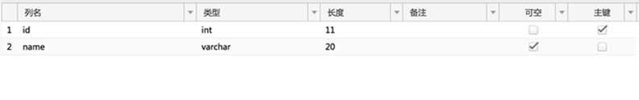

那么查询时间戳 1476263486 时刻，jiangliu_test 表的全量数据的 ODPS SQL 如下：

```text
insert overwrite table jiangliu_test_1476263486
select id,
       name
  from(
select row_number() over(partition by t.id
 order by record_id desc, after_flag desc) as row_number, record_id, operation_flag, after_flag, id, name
  from(
select incr.record_id, incr.operation_flag, incr.after_flag, incr.id, incr.name
  from jiangliu_test_20161010_log incr
 where utc_timestamp< 1476263486
 union all
select 0 as record_id, 'I' as operation_flag, 'Y' as after_flag, base.id, base.name
  from jiangliu_test_20161010_base base) t) gt
 where gt.row_number= 1
   and gt.after_flag= 'Y' ;
```

您也可以通过大数据开发套件，在后续的计算分析操作之前，添加全量数据Merge节点，当全量数据Merge完成后，可自动调度起后续的计算分析节点。同时可以配置调度周期，进行周期性的数据离线分析。

至此完成RDS MySQL到MaxCompute数据同步任务的配置及全量数据合并。

<a id="section-4-5-3"></a>

### 4.5.3. 从RDS MySQL同步到云原生数据仓库AnalyticDB MySQL 3.0

云原生数据仓库AnalyticDB MySQL版 3.0（原分析型数据库MySQL版）是阿里巴巴自主研发的海量数据实时高并发在线分析（Realtime OLAP）云计算服务，通过DTS您可以将RDS MySQL同步到云原生数据仓库AnalyticDB MySQL 3.0，帮助您快速构建企业内部BI、交互查询、实时报表等系统。

**前提条件**

- RDS MySQL中待同步的数据表必须具备主键。

- 确保目标云原生数据仓库AnalyticDB MySQL 3.0实例具备充足的存储空间。

**注意事项**

<table>
  <tr>
    <th width="90">类型</th>
    <th>说明</th>
  </tr>
  <tr>
    <td>源库限制</td>
    <td>• 待同步的表需具备主键或唯一约束，且字段具有唯一性，否则可能会导致目标数据库中出现重复数据。<br>• Binlog日志：<br>• 需开启，并且binlog_format为row、binlog_row_image为full。否则预检查阶段提示报错，且无法成功启动数据同步任务。<br>• 建议在全量初始化期间，Binlog日志至少保留7天以上。或者等到全量初始化完成后，再清理DTS任务运行后源库产生的Binlog日志。<br>说明为保障数据安全，DTS本地只会循环存储源库近24小时或者50 GB的Binlog日志，一旦超出该限制，DTS本地将自动清除所缓存的日志。<br>警告过早清理源库的Binlog日志，可能会导致同步任务失败。例如源库的全量初始化数据较多，目标库写入异常等原因，导致全量初始化耗时超过24小时。在该情况下，过早清理源库的Binlog日志，DTS将无法获取到24小时前的Binlog日志，可能会导致同步任务失败。</td>
  </tr>
  <tr>
    <td>其他限制</td>
    <td>• 暂不支持同步前缀索引，如果源库存在前缀索引可能导致数据同步失败。<br>• 由于云原生数据仓库AnalyticDB MySQL版（3.0）本身的使用限制，当云原生数据仓库AnalyticDB MySQL版（3.0）集群中的节点磁盘空间使用量超过80%，会导致DTS任务异常，产生延迟。请提前根据待同步的对象预估所需空间，确保目标集群具备充足的存储空间。<br>• 执行数据同步前需评估源库和目标库的性能，同时建议业务低峰期执行数据同步。否则全量数据初始化时将占用源库和目标库一定的读写资源，可能会导致数据库的负载上升。<br>• 全量初始化会并发执行INSERT操作，导致目标数据库的表产生碎片，因此全量初始化完成后目标实例的表空间比源实例的表空间大。<br>• 对于表级别的数据同步，请勿对源库的同步对象使用gh-ost或pt-online-schema-change等类似工具执行在线DDL变更，否则会导致同步失败。<br>• 对于表级别的数据同步，如果除DTS以外的数据没有写入目标库云原生数据仓库AnalyticDB MySQL版，您可以使用数据管理DMS（Data Management Service）来执行在线DDL变更。<br>警告如果有除DTS外的数据写入目标库，请勿使用DMS执行在线DDL变更，否则可能引起目标库数据丢失。</td>
  </tr>
</table>

**支持同步的SQL操作**

- DDL操作：CREATE TABLE、DROP TABLE、RENAME TABLE、TRUNCATE TABLE、ADD COLUMN、DROP COLUMN

- DML操作：INSERT、UPDATE、DELETE

> **说明**
>
> 请勿在数据同步的过程中变更源表的字段类型，否则同步作业将报错并中断。

**数据类型映射关系**

由于MySQL和云原生数据仓库AnalyticDB MySQL实例的数据类型并不是一一对应的，所以DTS在进行结构迁移时，会根据数据类型定义进行类型映射，详情请参见下表。

| MySQL数据类型 | 云原生数据仓库AnalyticDB MySQL（3.0）数据类型 |
| --- | --- |
| BIGINT UNSIGNED | DECIMAL(20,0) |
| BINARY | VARBINARY |
| BIT | VARCHAR |
| BLOB | VARBINARY |
| CHAR | VARCHAR |
| DATE | DATE |
| DATETIME | DATETIME |
| DECIMAL | DECIMAL |
| DOUBLE | DOUBLE |
| ENUM | VARCHAR |
| FLOAT | FLOAT |
| GEOMETRY | VARBINARY |
| GEOMETRYCOLLECTION | VARBINARY |
| INT UNSIGNED | BIGINT |
| INTEGER | INT |
| JSON | JSON |
| LINESTRING | VARBINARY |
| LONGBLOB | VARBINARY |
| LONGTEXT | VARCHAR |
| MEDIUMBLOB | VARBINARY |
| MEDIUMINT | INT |
| MEDIUMINT UNSIGNED | INT |
| MEDIUMTEXT | VARCHAR |
| MULTILINESTRING | VARBINARY |
| MULTIPOINT | VARBINARY |
| MULTIPOLYGON | VARBINARY |
| NUMBERIC | DECIMAL |
| POINT | VARBINARY |
| POLYGON | VARBINARY |
| SET | VARCHAR |
| SMALLINT UNSIGNED | INT |
| TEXT | VARCHAR |
| TIME | TIME |
| TIMESTAMP | TIMESTAMP |
| TINYBLOB | VARBINARY |
| TINYINT UNSIGNED | SMALLINT |
| TINYTEXT | VARCHAR |
| VARBINARY | VARBINARY |
| VARCHAR | VARCHAR |
| YEAR | INT |

**操作步骤**

1. 创建数据同步实例。

   > **说明**
   >
   > 创建时，选择源数据库类型为**MySQL**、目标数据库类型为**AnalyticDB MySQL 3.0**，并选择同步拓扑为**单向同步**。

2. 在同步作业列表中，找到刚创建的数据同步实例，单击**配置任务**。

3. 配置源实例和目标实例信息。

   **类别**

   **配置**

   **说明**

   DTS会自动生成一个同步作业名称，建议配置具有业务意义的名称（无唯

   无

   **任务名称**

   一性要求），便于后续识别。

   选择**MySQL**。

   **数据库类型**

   选择**云实例**。

   **接入方式**

   创建数据同步实例时已指定，不可变更。

   **实例地区**

   **是否跨阿里云账**

   选择**不跨账号**。

   **号**

   **RDS实例ID**

   选择源RDS实例ID。

   填入源RDS的数据库账号，需具备REPLICATION CLIENT、

   **源库信息**

   REPLICATION SLAVE、SHOW VIEW和所有同步对象的SELECT权限。

   **数据库账号**

   > **说明**
   >
   > 当源RDS实例的数据库类型为**MySQL 5.5**或**MySQL 5.6**时，无需配置**数据库账号**和**数据库密码**。

   填入该数据库账号的密码。

   **数据库密码**

   根据需求选择连接方式。如果设置为**SSL安全连接**，您需要提前开启RDS

   **连接方式**

   实例的SSL加密功能。

   选择**AnalyticDB MySQL 3.0**。

   **数据库类型**

   选择**云实例**。

   **接入方式**

   创建数据同步实例时已指定，不可变更。

   **实例地区**

   **目标库信息**

   选择目标AnalyticDB MySQL 3.0的实例ID。

   **实例ID**

   填入目标AnalyticDB MySQL 3.0实例的数据库账号，需具备目标数据库

   **数据库账号**

   的读写权限。

   填入该数据库账号的密码。

   **数据库密码**

4. 配置完成后，单击页面下方的**测试连接以进行下一步**。

5. 配置同步策略及对象信息。

   | 配置 | 说明 |
   | --- | --- |
   | 任务步骤 | 固定选中<strong>增量同步</strong>。默认情况下，您还需要同时选中<strong>库表结构同步</strong>和<strong>全量同步</strong>。预检查完成后，DTS会将源实例中待同步对象的全量数据在目标集群中初始化，作为后续增量同步数据的基线数据。 |
   | 目标已存在表的处理模式 | • <strong>预检查并报错拦截</strong>：检查目标数据库中是否有同名的表。如果目标数据库中没有同名的表，则通过该检查项目；如果目标数据库中有同名的表，则在预检查阶段提示错误，数据同步作业不会被启动。<br>• <strong>忽略报错并继续执行</strong>：跳过目标数据库中是否有同名表的检查项。<br>警告选择为<strong>忽略报错并继续执行</strong>，可能导致数据不一致，给业务带来风险，例如：<br>• 表结构一致的情况下，如果在目标库遇到与源库主键的值相同的记录，在初始化阶段会保留目标库中的该条记录；在增量同步阶段则会覆盖目标库的该条记录。<br>• 表结构不一致的情况下，可能会导致无法初始化数据、只能同步部分列的数据或同步失败。 |
   | 多表归并 | • 选择为<strong>是</strong>：DTS将在每个表中增加<code> __dts_data_source </code>列来存储数据来源，且不再支持DDL同步。<br>• 选择为<strong>否</strong>：默认选项，支持DDL同步。<br>重要<br>• 多表归并功能基于任务级别，即不支持基于表级别执行多表归并。如果需要让部分表执行多表归并，另一部分不执行多表归并，您可以创建两个数据同步作业。<br>• 开启多表归并的增量任务不支持DDL操作。若源库有DDL操作，则会导致目标库数据丢失或任务失败。 |
   | 源库对象 | 在<strong>源库对象</strong>框中单击待同步的对象（库或表），然后单击图标将其移动至<strong>已选择对</strong><br><strong>象</strong>框。<br>说明目前仅支持INSERT、UPDATE、DELETE、ADD COLUMN。 |
   | 已选择对象 | 默认情况下，同步对象的名称保持不变。如果您需要改变同步对象在目标实例中的名称，请使用对象名映射功能，详情请参见设置同步对象在目标实例中的名称。<br>说明<br>• 若您使用了多表归并功能，则需将表名称修改为待同步的表在目标库中的表名。<br>• 如果使用了对象名映射功能，可能会导致依赖这个对象的其他对象同步失败。 |

6. 单击**下一步高级配置**，进行高级配置。

   | 配置项目 | 配置说明 |
   | --- | --- |
   | 源库、目标库无法连接后的重试时间 | 在同步任务启动后，若源库或目标库连接失败则DTS会报错。对于可预期的报错，DTS会立即进行持续的重试连接，默认持续重试时间为720分钟，您也可以在取值范围（10~1440分钟）内自定义重试时间，建议设置30分钟以上。如果DTS在设置的重试时间内重新连接上源库、目标库，同步任务将自动恢复。否则，同步任务将会失败。<br>说明针对同源或者同目标的多个DTS实例，如DTS实例A和DTS实例B，设置网络重试时间时A设置30分钟，B设置60分钟，则重试时间以低的30分钟为准。 |
   | 配置ETL功能 | 选择是否配置ETL功能。<br>• <strong>是</strong>：配置ETL功能，并在文本框中填写数据处理语句。更多信息，请参见在同步任务中配置ETL。<br>• <strong>否</strong>：不配置ETL功能。 |

7. <strong>可选：</strong>单击**下一步配置库表字段**，设置待同步的表在目标库中类型。

   > **说明**
   >
   > 如果选择了**库表结构同步**，您需要定义待同步的表在云原生数据仓库AnalyticDB MySQL实例中的**类型**、**主键列**、**分布键**等信息。

8. 上述配置完成后，单击页面下方的**下一步预检查并启动**。

   > **重要**
   >
   > - 在数据同步任务正式启动之前，会先进行预检查。只有预检查通过后，才能成功启动数据同步任务。
   >
   > - 如果预检查失败，请单击**查看详情**并请根据提示修复问题，然后重新进行预检查。

9. **预检查通过率**显示为100%时，单击**返回列表**。

<a id="section-4-5-4"></a>

### 4.5.4. 从RDS MySQL同步至云原生数据仓库AnalyticDB PostgreSQL实例

DTS支持将MySQL同步至云原生数据仓库AnalyticDB PostgreSQL实例（原分析型数据库PostgreSQL实例），可以帮助您轻松实现数据的流转，将企业数据集中分析。

**前提条件**

- 源库中待同步的数据表，必须有主键。

- 数据同步的目标云原生数据仓库AnalyticDB PostgreSQL实例已存在。

**注意事项**

<table>
  <tr>
    <th width="90">类型</th>
    <th>说明</th>
  </tr>
  <tr>
    <td>源库限制</td>
    <td>• 待同步的表需具备主键或唯一约束，且字段具有唯一性，否则可能会导致目标数据库中出现重复数据。<br>• Binlog日志：<br>• 需开启，并且binlog_format为row、binlog_row_image为full。否则预检查阶段提示报错，且无法成功启动数据同步任务。<br>• 建议在全量初始化期间，Binlog日志至少保留7天以上。或者等到全量初始化完成后，再清理DTS任务运行后源库产生的Binlog日志。<br>说明为保障数据安全，DTS本地只会循环存储源库近24小时或者50 GB的Binlog日志，一旦超出该限制，DTS本地将自动清除所缓存的日志。<br>警告过早清理源库的Binlog日志，可能会导致同步任务失败。例如源库的全量初始化数据较多，目标库写入异常等原因，导致全量初始化耗时超过24小时。在该情况下，过早清理源库的Binlog日志，DTS将无法获取到24小时前的Binlog日志，可能会导致同步任务失败。</td>
  </tr>
  <tr>
    <td>其他限制</td>
    <td>• 同步对象要求：<br>• 仅支持表级同步。<br>• 不支持BIT、VARBIT、GEOMETRY、ARRAY、UUID、TSQUERY、TSVECTOR、TXID_SNAPSHOT类型的数据同步。<br>• 暂不支持同步前缀索引，如果源库存在前缀索引可能导致数据同步失败。<br>• 暂不支持结构初始化。您需要根据源实例中待迁移数据表的数据结构，在目标云原生数据仓库AnalyticDB PostgreSQL实例中创建数据库、Schema及数据表。<br>• 执行数据同步前需评估源库和目标库的性能，同时建议业务低峰期执行数据同步。否则全量数据初始化时将占用源库和目标库一定的读写资源，可能会导致数据库的负载上升。<br>• 全量初始化会并发执行INSERT操作，导致目标数据库的表产生碎片，因此全量初始化完成后目标实例的表空间比源实例的表空间大。<br>• 对于表级别的数据同步，请勿对源库的同步对象使用gh-ost或pt-online-schema-change等类似工具执行在线DDL变更，否则会导致同步失败。<br>• 对于表级别的数据同步，如果除DTS以外的数据没有写入目标库，您可以使用数据管理DMS（Data Management Service）来执行在线DDL变更。<br>警告如果有除DTS外的数据写入目标库，请勿使用DMS执行在线DDL变更，否则可能引起目标库数据丢失。</td>
  </tr>
</table>

**支持的同步语法**

- DML操作：INSERT、UPDATE、DELETE。

- DDL操作：ALTER TABLE、ADD COLUMN、DROP COLUMN、RENAME COLUMN。

  > **说明**
  >
  > 不支持CREATE TABLE和DROP TABLE操作。如您需要新增表，则需要通过修改同步对象操作来新增对应表的同步，详情请参见新增同步对象。

**术语或概念对应关系**

| MySQL中的术语或概念 | 原分析型数据库PostgreSQL版中的术语/概念 |
| --- | --- |
| Database | Schema |
| Table | Table |

**在目标实例中创建对应的数据结构**

根据源RDS实例中待迁移数据表的数据结构，在目标云原生数据仓库AnalyticDB PostgreSQL实例中创建数据库、Schema及数据表。

**配置数据同步**

1. 创建数据同步实例。

   > **说明**
   >
   > 创建时，选择源数据库类型为**MySQL**、目标数据库类型为**AnalyticDB PostgreSQL**，并选择同步拓扑为**单向同步**。

2. 在同步作业列表中，找到刚创建的数据同步实例，单击**配置任务**。

3. 配置同步通道的源实例及目标实例信息。

   **类别**

   **配置**

   **说明**

   DTS会自动生成一个同步作业名称，建议配置具有业务

   无

   同步作业名称

   意义的名称（无唯一性要求），便于后续识别。

   选择**MySQL**。

   **数据库类型**

   选择**云实例**。

   **接入方式**

   源RDS实例所在地域。

   **实例地区**

   选择**不跨账号**。

   **是否跨阿里云账号**

   选择作为数据同步源的RDS实例ID。

   **RDS实例ID**

   填入源RDS的数据库账号，需具备REPLICATION CLIENT、REPLICATION SLAVE、SHOW VIEW和所有同步对象的SELECT权限。

   **源库信息**

   **数据库账号**

   > **说明**
   >
   > 当源RDS实例的数据库类型为**MySQL 5.5**或**MySQL 5.6**时，无需配置**数据库账号**和**数据库密码**。

   填入该数据库账号的密码。

   **数据库密码**

   根据需求选择**非加密连接**或**SSL安全连接**。

   > **说明**

   **连接方式**

   > 选择**SSL安全连接**时，需要提前开启RDS实例的SSL加密功能。

   选择**AnalyticDB PostgreSQL**。

   **数据库类型**

   选择**云实例**。

   **接入方式**

   目标实例所在地域。

   **实例地区**

   选择作为数据同步目标的云原生数据仓库AnalyticDB

   **实例ID**

   PostgreSQL实例ID。

   填入同步目标表所属的数据库名称。

   **数据库名称**

   **目标库信息**

   填入目标云原生数据仓库AnalyticDB PostgreSQL实例的数据库账号。

   > **说明**

   **数据库账号**

   > 数据库账号须具备SELECT、INSERT、UPDATE、DELETE、COPY、TRUNCATE、ALTER TABLE权限。

   填入数据库账号对应的密码。

   **数据库密码**

4. 配置完成后，单击页面下方的**测试连接以进行下一步**。

5. 配置同步策略及对象信息。

   | 配置项目 | 说明 |
   | --- | --- |
   | 任务步骤 | 固定选中<strong>增量同步</strong>。默认情况下，您还需要同时选中<strong>库表结构同步</strong>和<strong>全量同步</strong>。预检查完成后，DTS会将源实例中待同步对象的全量数据在目标集群中初始化，作为后续增量同步数据的基线数据。 |
   | 目标已存在表的处理模式 | • <strong>预检查并报错拦截</strong>：检查目标数据库中是否有同名的表。如果目标数据库中没有同名的表，则通过该检查项目；如果目标数据库中有同名的表，则在预检查阶段提示错误，数据迁移任务不会被启动。<br>• <strong>清空目标表数据</strong>：在预检查阶段跳过目标表是否为空的检查项目。全量初始化之前将目标表的数据清空。<br>• <strong>忽略报错并继续执行</strong>：跳过目标数据库中是否有同名表的检查项。<br>警告选择为<strong>忽略报错并继续执行</strong>，可能导致数据不一致，给业务带来风险，例如：<br>• 表结构一致的情况下，在目标库遇到与源库主键的值相同的记录，则会保留目标库中的该条记录，即源库中的该条记录不会迁移至目标库中。<br>• 表结构不一致的情况下，可能导致只能迁移部分列的数据或迁移失败。 |
   | 实例级别选择所需同步的DDL和DML | 按实例级别选择增量迁移的SQL操作。<br>说明如需按库或表级别选择增量迁移的SQL操作，请在<strong>已选择对象</strong>中右击同步对象，在弹跳框中勾选所需同步的SQL操作。 |
   | 源库对象 | 在<strong>源库对象</strong>框中单击待同步的对象（粒度为表），然后单击图标将其移动<br>至<strong>已选择对象</strong>框。<br>说明不支持CREATE TABLE操作，您需要通过修改同步对象操作来新增对应表的同步，详情请参见新增同步对象。 |
   | 已选择对象 | 默认情况下，同步对象的名称保持不变。如果您需要改变同步对象在目标实例中的名称，请使用对象名映射功能，详情请参见设置同步对象在目标实例中的名称。 |

6. 单击**下一步高级配置**，进行高级配置。

   | 配置项目 | 配置说明 |
   | --- | --- |
   | 源库、目标库无法连接后的重试时间 | 在同步任务启动后，若源库或目标库连接失败则DTS会报错。对于可预期的报错，DTS会立即进行持续的重试连接，默认持续重试时间为720分钟，您也可以在取值范围（10~1440分钟）内自定义重试时间，建议设置30分钟以上。如果DTS在设置的重试时间内重新连接上源库、目标库，同步任务将自动恢复。否则，同步任务将会失败。<br>说明针对同源或者同目标的多个DTS实例，如DTS实例A和DTS实例B，设置网络重试时间时A设置30分钟，B设置60分钟，则重试时间以低的30分钟为准。 |
   | 配置ETL功能 | 选择是否配置ETL功能。<br>• <strong>是</strong>：配置ETL功能，并在文本框中填写数据处理语句。<br>• <strong>否</strong>：不配置ETL功能。 |

7. <strong>可选：</strong>单击**下一步配置库表字段**，设置待同步的表在目标库中类型。

   > **说明**
   >
   > 如果选择了**库表结构同步**，您需要定义待同步的表在云原生数据仓库AnalyticDB PostgreSQL实例中的**类型**、**主键列**、**分布键**等信息。

8. 上述配置完成后，单击页面下方的**下一步预检查并启动**。

   > **重要**
   >
   > - 在数据同步任务正式启动之前，会先进行预检查。只有预检查通过后，才能成功启动数据同步任务。
   >
   > - 如果预检查失败，请单击**查看详情**并请根据提示修复问题，然后重新进行预检查。

9. **预检查通过率**显示为100%时，单击**返回列表**。

<a id="section-4-5-5"></a>

### 4.5.5. 从RDS MySQL同步至PolarDB MySQL版（本地盘版实例）

本文介绍如何使用数据传输服务DTS（Data Transmission Service）将RDS MySQL的数据同步至PolarDB MySQL版（本地盘版实例）。

**前提条件**

- 已创建存储空间大于源RDS MySQL已占用空间的目标双机高可用版本系列PolarDB MySQL版（本地盘版实例）。

- PolarDB MySQL版（本地盘版实例）已开通公网连接地址。

**注意事项**

<table>
  <tr>
    <th width="90">类型</th>
    <th>说明</th>
  </tr>
  <tr>
    <td>源库限制</td>
    <td>• 待同步的表需具备主键或唯一约束，且字段具有唯一性，否则可能会导致目标数据库中出现重复数据。<br>• Binlog日志：<br>• 需开启，并且binlog_format为row、binlog_row_image为full。否则预检查阶段提示报错，且无法成功启动数据同步任务。<br>• 建议在全量初始化期间，Binlog日志至少保留7天以上。或者等到全量初始化完成后，再清理DTS任务运行后源库产生的Binlog日志。<br>说明为保障数据安全，DTS本地只会循环存储源库近24小时或者50 GB的Binlog日志，一旦超出该限制，DTS本地将自动清除所缓存的日志。<br>警告过早清理源库的Binlog日志，可能会导致同步任务失败。例如源库的全量初始化数据较多，目标库写入异常等原因，导致全量初始化耗时超过24小时。在该情况下，过早清理源库的Binlog日志，DTS将无法获取到24小时前的Binlog日志，可能会导致同步任务失败。<br>• 在库表结构同步和全量同步阶段，请勿执行库或表结构变更的DDL操作，否则会导致数据同步任务失败。</td>
  </tr>
  <tr>
    <td>其他限制</td>
    <td>• 目标库不支持只读实例。<br>• 建议源和目标库版本保持一致，或者从低版本同步到高版本以保障兼容性。如为高版本同步至低版本，可能存在数据库兼容性问题。<br>• 在进行全量数据同步时，DTS将会占用源和目标库一定的读写资源，可能会导致数据库的负载上升。因此建议在执行数据同步前评估源库和目标库的性能，并在业务低峰期执行数据同步（例如源库和目标库的CPU负载在30%以下）。<br>• 由于全量数据初始化会并发执行INSERT操作，导致目标数据库的表产生碎片，因此全量初始化完成后目标数据库的表存储空间会大于源实例的表存储空间。<br>• 如同步对象为单个或多个表（非整库），那么在数据同步时，勿对源库的同步对象使用pt-online-schema-change等类似工具执行在线DDL变更，否则会导致同步失败。<br>• 在DTS同步期间，不允许有除DTS外的数据写入目标库，否则会导致源库与目标库数据不一致。例如，有除DTS外的数据写入目标库时，使用DMS执行在线DDL变更，可能引起目标库数据丢失。<br>• 不支持将datetime类型的数据转换为varchar。</td>
  </tr>
</table>

**支持增量同步的SQL操作**

DML操作：INSERT、UPDATE、DELETE

**操作步骤**

1. 创建数据同步实例。

   > **说明**
   >
   > 创建时，选择源数据库类型为**MySQL**、目标数据库类型为**PolarDB for MySQL**，并选择同步拓扑为**单向同步**。

2. 在同步作业列表中，找到刚创建的数据同步实例，单击**配置任务**。

3. 配置源实例和目标实例信息。

   <table>
     <tr>
       <th>类别</th>
       <th>配置</th>
       <th>说明</th>
     </tr>
     <tr>
       <td>无</td>
       <td>任务名称</td>
       <td>DTS会自动生成一个同步作业名称，建议配置具有业务意义的名称（无唯一性要求），便于后续识别。</td>
     </tr>
     <tr>
       <td rowspan="8">源库信息</td>
       <td>数据库类型</td>
       <td>选择<strong>MySQL</strong>。</td>
     </tr>
     <tr>
       <td>接入方式</td>
       <td>选择<strong>云实例</strong>。</td>
     </tr>
     <tr>
       <td>实例地区</td>
       <td>创建数据同步实例时已指定，不可变更。</td>
     </tr>
     <tr>
       <td>是否跨阿里云账号</td>
       <td>选择<strong>不跨账号</strong>。</td>
     </tr>
     <tr>
       <td>RDS实例ID</td>
       <td>选择源RDS实例ID。</td>
     </tr>
     <tr>
       <td>数据库账号</td>
       <td>填入源RDS的数据库账号，需具备REPLICATION CLIENT、REPLICATION SLAVE、SHOW VIEW和所有同步对象的SELECT权限。<br>说明当源RDS实例的数据库类型为<strong>MySQL 5.5</strong>或<strong>MySQL 5.6</strong>时，无需配置<strong>数据库账号</strong>和<strong>数据库密码</strong>。</td>
     </tr>
     <tr>
       <td>数据库密码</td>
       <td>填入该数据库账号的密码。</td>
     </tr>
     <tr>
       <td>连接方式</td>
       <td>根据需求选择连接方式。如果设置为<strong>SSL安全连接</strong>，您需要提前开启RDS实例的SSL加密功能。</td>
     </tr>
     <tr>
       <td rowspan="7">目标库信息</td>
       <td>数据库类型</td>
       <td>选择<strong>PolarDB for MySQL</strong>。</td>
     </tr>
     <tr>
       <td>接入方式</td>
       <td>选择<strong>公网IP</strong>。</td>
     </tr>
     <tr>
       <td>实例地区</td>
       <td>创建数据同步实例时已指定，不可变更。</td>
     </tr>
     <tr>
       <td>主机名或IP地址</td>
       <td>填入目标PolarDB MySQL版（本地盘版实例）的<strong>Vip</strong>或<strong>Vip外网地址</strong>。</td>
     </tr>
     <tr>
       <td>端口</td>
       <td>填入目标PolarDB MySQL版（本地盘版实例）的<strong>外网端口</strong>。</td>
     </tr>
     <tr>
       <td>数据库账号</td>
       <td>填入目标PolarDB MySQL版（本地盘版实例）的数据库账号，需具备目标数据库的读写权限。</td>
     </tr>
     <tr>
       <td>数据库密码</td>
       <td>填入该数据库账号的密码。</td>
     </tr>
   </table>

4. 配置完成后，单击页面下方的**测试连接以进行下一步**。

5. 如果您的PolarDB MySQL版（本地盘版实例）具备白名单设置，请将弹跳框中提示的DTS服务器的IP地址，加入PolarDB MySQL版（本地盘版实例）的白名单设置中。白名单设置完成后，单击**测试连接以进行下一步**。

   > **说明**
   >
   > 如果您的PolarDB MySQL版（本地盘版实例）无需进行白名单设置，请直接单击**测试连接以进行下一步**。

6. 配置同步策略及对象信息。

   | 配置 | 说明 |
   | --- | --- |
   | 任务步骤 | 固定选中<strong>增量同步</strong>。默认情况下，您还需要同时选中<strong>库表结构同步</strong>和<strong>全量同步</strong>。预检查完成后，DTS会将源实例中待同步对象的全量数据在目标集群中初始化，作为后续增量同步数据的基线数据。 |
   | 目标已存在表的处理模式 | • <strong>预检查并报错拦截</strong>：检查目标数据库中是否有同名的表。如果目标数据库中没有同名的表，则通过该检查项目；如果目标数据库中有同名的表，则在预检查阶段提示错误，数据同步作业不会被启动。<br>• <strong>忽略报错并继续执行</strong>：跳过目标数据库中是否有同名表的检查项。<br>警告选择为<strong>忽略报错并继续执行</strong>，可能导致数据不一致，给业务带来风险，例如：<br>• 表结构一致的情况下，如果在目标库遇到与源库主键的值相同的记录，在初始化阶段会保留目标库中的该条记录；在增量同步阶段则会覆盖目标库的该条记录。<br>• 表结构不一致的情况下，可能会导致无法初始化数据、只能同步部分列的数据或同步失败。 |
   | 同步拓扑 | 选择<strong>单向同步</strong>。<br>重要暂不支持双向同步。 |
   | 目标库对象名称大小写策略 | 可以配置目标实例中同步对象的库名、表名和列名的英文大小写策略。默认情况下选择<strong>DTS默认策略</strong>，您也可以选择与源库、目标库默认策略保持一致。更多信息，请参见目标库对象名称大小写策略。 |
   | 源库对象 | 在<strong>源库对象</strong>框中单击待同步的对象（库或表），然后单击图标将其移动至<strong>已选择对</strong><br><strong>象</strong>框。<br>说明<br>• 您可以根据实际情况，展开导航树进行正则搜索。<br>• 同步对象选择的粒度为库、表、列。 |
   | 已选择对象 | 默认情况下，同步对象的名称保持不变。如果您需要改变同步对象在目标实例中的名称，请使用对象名映射功能，详情请参见设置同步对象在目标实例中的名称。<br>说明<br>• 如需按库或表级别选择同步的SQL操作，请在<strong>已选择对象</strong>中右击待同步对象，并在弹出的对话框中选择所需同步的SQL操作。<br>• 如需设置WHERE条件过滤数据，请在<strong>已选择对象</strong>中右击待同步的表，在弹出的对话框中设置过滤条件。<br>• 如果使用了对象名映射功能，可能会导致依赖这个对象的其他对象同步失败。 |

7. 单击**下一步高级配置**，进行高级配置。

   | 配置项目 | 配置说明 |
   | --- | --- |
   | 选择目标库的引擎类型 | 请根据实际情况，选择目标库的引擎类型为<strong>InnoDB</strong>或<strong>X-Engine</strong>。 |
   | 源库、目标库无法连接后的重试时间 | 在同步任务启动后，若源库或目标库连接失败则DTS会报错。对于可预期的报错，DTS会立即进行持续的重试连接，默认持续重试时间为720分钟，您也可以在取值范围（10~1440分钟）内自定义重试时间，建议设置30分钟以上。如果DTS在设置的重试时间内重新连接上源库、目标库，同步任务将自动恢复。否则，同步任务将会失败。<br>说明针对同源或者同目标的多个DTS实例，如DTS实例A和DTS实例B，设置网络重试时间时A设置30分钟，B设置60分钟，则重试时间以低的30分钟为准。 |

8. 上述配置完成后，单击页面下方的**下一步预检查并启动**。

   > **重要**
   >
   > - 在数据同步任务正式启动之前，会先进行预检查。只有预检查通过后，才能成功启动数据同步任务。
   >
   > - 如果预检查失败，请单击**查看详情**并请根据提示修复问题，然后重新进行预检查。

9. **预检查通过率**显示为100%时，单击**返回列表**。

<a id="section-4-5-6"></a>

### 4.5.6. PolarDB MySQL版（本地盘版实例）间的同步

本文介绍如何使用数据传输服务DTS（Data Transmission Service），实现PolarDB MySQL版（本地盘版实例）间的数据同步。

**前提条件**

- 已创建存储空间大于源PolarDB MySQL版（本地盘版实例）已占用空间的目标双机高可用版本系列PolarDB MySQL版（本地盘版实例）。

- 源和目标PolarDB MySQL版（本地盘版实例）均已开通公网连接地址。

**注意事项**

<table>
  <tr>
    <th width="90">类型</th>
    <th>说明</th>
  </tr>
  <tr>
    <td>源库限制</td>
    <td>• 待同步的表需具备主键或唯一约束，且字段具有唯一性，否则可能会导致目标数据库中出现重复数据。<br>• 请确保<code> binlog_row_image </code>的参数值为<code> full </code>。否则在预检查阶段可能会报错，无法成功启动数据同步任务。<br>说明如为增量同步任务，DTS要求源数据库的本地Binlog日志保存24小时以上；如为全量同步和增量同步任务，DTS要求源数据库的本地Binlog日志至少保留7天以上（您可在全量同步完成后将Binlog保存时间设置为24小时以上），否则DTS可能因无法获取Binlog而导致任务失败，极端情况下甚至可能会导致数据不一致或丢失。由于您所设置的Binlog日志保存时间低于DTS要求的时间进而导致的问题，不在DTS的SLA保障范围内。<br>• 在库表结构同步和全量同步阶段，请勿执行库或表结构变更的DDL操作，否则会导致数据同步任务失败。</td>
  </tr>
  <tr>
    <td>其他限制</td>
    <td>• 源和目标库不支持只读实例。<br>• 建议源和目标库版本保持一致，或者从低版本同步到高版本以保障兼容性。如为高版本同步至低版本，可能存在数据库兼容性问题。<br>• 在进行全量数据同步时，DTS将会占用源和目标库一定的读写资源，可能会导致数据库的负载上升。因此建议在执行数据同步前评估源库和目标库的性能，并在业务低峰期执行数据同步（例如源库和目标库的CPU负载在30%以下）。<br>• 由于全量数据初始化会并发执行INSERT操作，导致目标数据库的表产生碎片，因此全量初始化完成后目标数据库的表存储空间会大于源实例的表存储空间。<br>• 如同步对象为单个或多个表（非整库），那么在数据同步时，勿对源库的同步对象使用pt-online-schema-change等类似工具执行在线DDL变更，否则会导致同步失败。<br>• 在DTS同步期间，不允许有除DTS外的数据写入目标库，否则会导致源库与目标库数据不一致。例如，有除DTS外的数据写入目标库时，使用DMS执行在线DDL变更，可能引起目标库数据丢失。<br>• DTS会在源库定时执行<strong>CREATE DATABASE IF NOT EXISTS `test`</strong>命令以推进Binlog位点。</td>
  </tr>
</table>

**支持增量同步的SQL操作**

<table>
  <tr>
    <th width="89">操作类型</th>
    <th>SQL操作语句</th>
  </tr>
  <tr>
    <td>DML</td>
    <td>INSERT、UPDATE、DELETE</td>
  </tr>
  <tr>
    <td>DDL</td>
    <td>• ALTER TABLE、ALTER VIEW<br>• CREATE FUNCTION、CREATE INDEX、CREATE PROCEDURE、CREATE TABLE、CREATE VIEW<br>• DROP INDEX、DROP TABLE<br>• RENAME TABLE<br>重要RENAME TABLE操作可能导致同步数据不一致。例如同步对象只包含某个表，如果同步过程中源实例对该表执行了重命名操作，那么该表的数据将不会同步到目标库。为避免该问题，您可以在数据同步配置时将该表所属的整个数据库作为同步对象，且确保RENAME TABLE操作前后的表所属的数据库均在同步对象中。<br>• TRUNCATE TABLE</td>
  </tr>
</table>

**操作步骤**

1. 创建数据同步实例。

   > **说明**
   >
   > 创建时，选择源数据库类型为**PolarDB for MySQL**、目标数据库类型为**PolarDB for MySQL**，并选择同步拓扑为**单向同步**。

2. 在同步作业列表中，找到刚创建的数据同步实例，单击**配置任务**。

3. 配置源实例和目标实例信息。

   **类别**

   **配置**

   **说明**

   DTS会自动生成一个同步作业名称，建议配置具有业务意义的名称（无唯

   无

   **任务名称**

   一性要求），便于后续识别。

   选择**PolarDB for MySQL**。

   **数据库类型**

   选择**公网IP**。

   **接入方式**

   创建数据同步实例时已指定，不可变更。

   **实例地区**

   **源库信息**

   填入源PolarDB MySQL版（本地盘版实例）的**Vip**或**Vip外网地址**。

   **主机名或IP地址**

   填入源PolarDB MySQL版（本地盘版实例）的**外网端口**。

   **端口**

   填入源RDS的数据库账号，需具备待同步对象的读写权限。

   **数据库账号**

   填入该数据库账号的密码。

   **数据库密码**

   选择**PolarDB for MySQL**。

   **数据库类型**

   选择**公网IP**。

   **接入方式**

   创建数据同步实例时已指定，不可变更。

   **实例地区**

   填入目标PolarDB MySQL版（本地盘版实例）的**Vip**或**Vip外网地址**。

   **主机名或IP地址**

   **目标库信息**

   填入目标PolarDB MySQL版（本地盘版实例）的**外网端口**。

   **端口**

   填入目标PolarDB MySQL版（本地盘版实例）的数据库账号，需具备目

   **数据库账号**

   标数据库的读写权限。

   填入该数据库账号的密码。

   **数据库密码**

4. 配置完成后，单击页面下方的**测试连接以进行下一步**。

5. 如果您的源和目标PolarDB MySQL版（本地盘版实例）具备白名单设置，请将弹跳框中提示的DTS服务器的IP地址，加入对应PolarDB MySQL版（本地盘版实例）的白名单设置中。白名单设置完成后，单击**测试连接以进行下一步**。

   > **说明**
   >
   > 如果您的PolarDB MySQL版（本地盘版实例）无需进行白名单设置，请直接单击**测试连接以进行下一步**。

6. 配置同步策略及对象信息。

   | 配置 | 说明 |
   | --- | --- |
   | 任务步骤 | 固定选中<strong>增量同步</strong>。默认情况下，您还需要同时选中<strong>库表结构同步</strong>和<strong>全量同步</strong>。预检查完成后，DTS会将源实例中待同步对象的全量数据在目标集群中初始化，作为后续增量同步数据的基线数据。 |
   | 目标已存在表的处理模式 | • <strong>预检查并报错拦截</strong>：检查目标数据库中是否有同名的表。如果目标数据库中没有同名的表，则通过该检查项目；如果目标数据库中有同名的表，则在预检查阶段提示错误，数据同步作业不会被启动。<br>• <strong>忽略报错并继续执行</strong>：跳过目标数据库中是否有同名表的检查项。<br>选择为<strong>忽略报错并继续执行</strong>，可能导致数据不一致，给业务带来风警告险，例如：<br>• 表结构一致的情况下，如果在目标库遇到与源库主键的值相同的记录，在初始化阶段会保留目标库中的该条记录；在增量同步阶段则会覆盖目标库的该条记录。<br>• 表结构不一致的情况下，可能会导致无法初始化数据、只能同步部分列的数据或同步失败。 |
   | 同步拓扑 | 选择<strong>单向同步</strong>。<br>重要暂不支持双向同步。 |
   | 目标库对象名称大小写策略 | 可以配置目标实例中同步对象的库名、表名和列名的英文大小写策略。默认情况下选择<strong>DTS默认策略</strong>，您也可以选择与源库、目标库默认策略保持一致。更多信息，请参见目标库对象名称大小写策略。 |
   | 源库对象 | 在<strong>源库对象</strong>框中单击待同步的对象（库或表），然后单击图标将其移动至<strong>已选择对</strong><br><strong>象</strong>框。<br>说明<br>• 您可以根据实际情况，展开导航树进行正则搜索。<br>• 同步对象选择的粒度为库、表、列。 |
   | 已选择对象 | 默认情况下，同步对象的名称保持不变。如果您需要改变同步对象在目标实例中的名称，请使用对象名映射功能，详情请参见设置同步对象在目标实例中的名称。<br>说明<br>• 如需按库或表级别选择同步的SQL操作，请在<strong>已选择对象</strong>中右击待同步对象，并在弹出的对话框中选择所需同步的SQL操作。<br>• 如需设置WHERE条件过滤数据，请在<strong>已选择对象</strong>中右击待同步的表，在弹出的对话框中设置过滤条件。<br>• 如果使用了对象名映射功能，可能会导致依赖这个对象的其他对象同步失败。 |

7. 单击**下一步高级配置**，进行高级配置。

   | 配置项目 | 配置说明 |
   | --- | --- |
   | 选择目标库的引擎类型 | 请根据实际情况，选择目标库的引擎类型为<strong>InnoDB</strong>或<strong>X-Engine</strong>。 |
   | 源库、目标库无法连接后的重试时间 | 在同步任务启动后，若源库或目标库连接失败则DTS会报错。对于可预期的报错，DTS会立即进行持续的重试连接，默认持续重试时间为720分钟，您也可以在取值范围（10~1440分钟）内自定义重试时间，建议设置30分钟以上。如果DTS在设置的重试时间内重新连接上源库、目标库，同步任务将自动恢复。否则，同步任务将会失败。<br>说明针对同源或者同目标的多个DTS实例，如DTS实例A和DTS实例B，设置网络重试时间时A设置30分钟，B设置60分钟，则重试时间以低的30分钟为准。 |
   | 是否去除正反向任务的心跳表sql | 根据业务需求选择是否在DTS实例运行时，在源库中写入心跳SQL信息。<br>• <strong>是</strong>：不在源库中写入心跳SQL信息，DTS实例可能会显示有延迟。<br>• <strong>否</strong>：在源库中写入心跳SQL信息，可能会影响源库的物理备份和克隆等功能。 |

8. 上述配置完成后，单击页面下方的**下一步预检查并启动**。

   > **重要**
   >
   > - 在数据同步任务正式启动之前，会先进行预检查。只有预检查通过后，才能成功启动数据同步任务。
   >
   > - 如果预检查失败，请单击**查看详情**并请根据提示修复问题，然后重新进行预检查。

9. **预检查通过率**显示为100%时，单击**返回列表**。

<a id="section-4-5-7"></a>

### 4.5.7. RDS PostgreSQL实例间的数据同步

本文介绍如何使用数据传输服务DTS（Data Transmission Service），实现RDS PostgreSQL间的单向同步。

**前提条件**

- 已创建源和目标RDS PostgreSQL实例。

  > **说明**
  >
  > 建议源库和目标数据库的版本相同，或者从低版本同步到高版本以保障兼容性。若为高版本同步至低版本，可能存在数据库兼容性问题。

- 目标RDS PostgreSQL实例的存储空间须大于源RDS PostgreSQL实例占用的存储空间。

**注意事项**

<table>
  <tr>
    <th width="90">类型</th>
    <th>说明</th>
  </tr>
  <tr>
    <td>源库限制</td>
    <td>• 带宽要求：源库所属的服务器需具备足够出口带宽，否则将影响数据同步速率。<br>• 待同步的表需具备主键或唯一约束，且字段具有唯一性，否则可能会导致目标数据库中出现重复数据。<br>• 需开启数据日志，建议在全量同步期间，数据日志至少保留7天以上。或者等到全量同步完成后，再清理DTS任务运行后源库产生的数据日志，否则DTS可能因无法获取WAL日志而导致任务失败，极端情况下甚至可能会导致数据不一致或丢失。由于您所设置的WAL日志保存时间低于DTS要求的时间进而导致的问题，不在DTS的SLA保障范围内。<br>说明为保障数据安全，DTS服务器只会存储源库近24小时或者50 GB的数据日志，一旦超出该限制，DTS服务器将自动清除超过限制的日志。<br>• 在库表结构同步和全量同步阶段，请勿执行库或表结构变更的DDL操作，否则数据同步任务会失败。<br>• 若源库有长事务，且实例包含增量同步任务，则可能会导致源库长事务提交前的预写日志WAL（Write-Ahead Logging）无法清理而堆积，从而造成源库磁盘空间不足。</td>
  </tr>
</table>

<table>
  <tr>
    <td>其他限制</td>
    <td>• 为保障同步任务的正常进行，在同步期间仅支持RDS PostgreSQL 11进行主备切换，且需设置参数 <code> rds_failover_slot_mode </code>为<code> sync </code>。<br>警告其他版本的RDS PostgreSQL进行主备切换，会导致同步失败。<br>• 单个数据同步任务只能同步一个数据库，如需同步多个数据库，您需要为每个数据库配置数据同步任务。<br>• 待同步的数据库名称中间不能包含短划线（-），例如dts-testdata。<br>• DTS的校验对象为数据内容，暂不支持Sequence等元数据的校验，您需要自行校验。<br>• 由于源库的主备节点可能存在增量同步延迟导致数据不一致，执行数据同步时请使用源库的主节点作为同步的数据源。<br>• 由于全量数据同步会并发执行INSERT操作，导致目标数据库的表产生碎片，因此全量同步完成后目标数据库的表存储空间会比源实例的表存储空间大。<br>• 增量数据同步期间，如果同步对象的选择粒度为Schema，在待同步的Schema中创建了新的表或使用RENAME命令重建了待同步的表，您需要在对该表写入数据前执行<code> ALTER </code> <code>TABLE schema.table REPLICA IDENTITY FULL; </code>命令。<br>说明将上述命令中的<code> schema </code>和<code> table </code>替换成真实的Schema名和表名。<br>• 请确认DTS对数据类型为FLOAT或DOUBLE的列的同步精度是否符合业务预期。DTS会通过<code> ROUND(COLUMN,PRECISION) </code>来读取这两类列的值。如果没有明确定义其精度，DTS对FLOAT的同步精度为38位，对DOUBLE的同步精度为308位。<br>• 为保障增量数据同步延迟时间展示的准确性，DTS会在源库中新增一个名为dts_postgres_heartbeat的心跳表。<br>• 执行数据同步前需评估源库和目标库的性能，同时建议业务低峰期执行数据同步。否则全量数据同步时DTS占用源和目标库一定读写资源，可能会导致数据库的负载上升。<br>• 增量数据同步期间，DTS会在源库中创建前缀为<code> dts_sync_ </code>的replication slot用于复制数据。DTS会每隔90分钟自动清理一次历史replication slot，避免其持续累积占用磁盘空间。<br>说明当释放同步任务或同步失败时，DTS会主动清理该replication slot；如果RDS PostgreSQL发生了主备切换，则需要您登录备库来手动清理。<br>• DTS会尝试恢复七天之内同步失败任务。因此业务切换至目标实例前，请务必结束或释放该任务，或者将DTS访问目标实例账号的写权限用<code> revoke </code>命令回收掉。避免该任务被自动恢复后，源端数据覆盖目标实例的数据。<br>• 由于业务切换到目标端后，新写入的Sequence不会按照源库的Sequence最大值作为初始值去递增，您需要在业务切换前，在源库中查询对应Sequence的最大值，然后在目标库中将其作为对应Sequence的初始值。相关命令，请参见查询源库Sequence值的相关命令。</td>
  </tr>
  <tr>
    <td>特殊情况</td>
    <td>当源或目标实例为RDS PostgreSQL时同步期间，请勿修改RDS PostgreSQL的连接地址和可用区，否则会导致同步失败。</td>
  </tr>
</table>

**查询源库Sequence值的相关命令**

```text
do language plpgsql $$
declare
  nsp name;
  rel name;
  val int8;
begin
  for nsp,rel in select nspname,relname from pg_class t2 , pg_namespace t3 where t2.relnamespace=t3.oid and t2.relkind='S'
  loop
    execute format($_$select last_value from %I.%I$_$, nsp, rel) into val;
    raise notice '%',
    format($_$select setval('%I.%I'::regclass, %s);$_$, nsp, rel, val+1);
  end loop;
end;
$$;
```

**准备工作**

您需要登录RDS控制台，选择源RDS PostgreSQL实例，在左侧导航栏中单击**参数设置**，将**wal_level**参数的值设置为logical。

> **警告**
>
> 修改 `wal_level` 参数后需要重启实例才能生效，请评估对业务的影响，在业务低峰期进行修改。

**操作步骤**

1. 创建数据同步实例。

   > **说明**
   >
   > 创建时，选择**源数据库类型**为**PostgreSQL**、**目标数据库类型**为**PostgreSQL**，并选择同步拓扑为**单向同步**。

2. 在同步作业列表中，找到刚创建的数据同步实例，单击**配置任务**。

3. 配置源库和目标库信息。

   **类别**

   **配置**

   **说明**

   DTS会自动生成一个任务名称，建议配置具有业务意义的名称（无唯一性要

   无

   **任务名称**

   求），便于后续识别。

   选择**PostgreSQL**。

   **数据库类型**

   选择**云实例**。

   **接入方式**

   创建数据同步实例时已指定，不可变更。

   **实例地区**

   **是否跨阿里云**

   选择**不跨账号**。

   **账号**

   **源库信息**

   选择源RDS PostgreSQL实例ID。

   **实例ID**

   填入源RDS PostgreSQL实例中待同步的数据库名。

   **数据库名称**

   填入源RDS PostgreSQL的高权限账号，且需为所选数据库的owner（授

   **数据库账号**

   权账号）。

   填入该数据库账号的密码。

   **数据库密码**

   选择**PostgreSQL**。

   **数据库类型**

   选择**云实例**。

   **接入方式**

   创建数据同步实例时已指定，不可变更。

   **实例地区**

   选择目标RDS PostgreSQL实例ID。

   **实例ID**

   填入目标RDS PostgreSQL实例中待迁入数据的数据库名。

   **目标库信息**

   > **说明**

   **数据库名称**

   > 该数据库名可以和源RDS PostgreSQL实例中待同步的数据库名不同。

   填入目标RDS PostgreSQL实例的数据库账号，具备Schema的owner权

   **数据库账号**

   限。

   填入该数据库账号的密码。

   **数据库密码**

4. 配置完成后，单击页面下方的**测试连接以进行下一步**。

5. 选择同步对象及同步类型。

   <table>
     <tr>
       <th width="215">配置项目</th>
       <th>说明</th>
     </tr>
     <tr>
       <td>任务步骤</td>
       <td>固定选中<strong>增量同步</strong>。默认情况下，您还需要同时选中<strong>库表结构同步</strong>和<strong>全量同步</strong>。预检查完成后，DTS会将源实例中待同步对象的全量数据在目标集群中初始化，作为后续增量同步数据的基线数据。</td>
     </tr>
     <tr>
       <td>目标已存在表的处理模式</td>
       <td>• <strong>预检查并报错拦截</strong>：检查目标数据库中是否有同名的表。如果目标数据库中没有同名的表，则通过该检查项目；如果目标数据库中有同名的表，则在预检查阶段提示错误，数据迁移任务不会被启动。<br>• <strong>忽略报错并继续执行</strong>：跳过目标数据库中是否有同名表的检查项。<br>警告选择为<strong>忽略报错并继续执行</strong>，可能导致数据不一致，给业务带来风险，例如：<br>• 表结构一致的情况下，在目标库遇到与源库主键的值相同的记录，则会保留目标库中的该条记录，即源库中的该条记录不会迁移至目标库中。<br>• 表结构不一致的情况下，可能导致只能迁移部分列的数据或迁移失败。</td>
     </tr>
     <tr>
       <td>同步拓扑</td>
       <td>选择<strong>单向同步</strong>。</td>
     </tr>
     <tr>
       <td>目标库对象名称大小写策略</td>
       <td>可以配置目标实例中同步对象的库名、表名和列名的英文大小写策略。默认情况下选择<strong>DTS默认策略</strong>，您也可以选择与源库、目标库默认策略保持一致。更多信息，请参见目标库对象名称大小写策略。</td>
     </tr>
     <tr>
       <td>源库对象</td>
       <td>在<strong>源库对象</strong>框中单击待同步的对象（库或表），然后单击图标将其移动至<strong>已</strong><br><strong>选择对象</strong>框。<br>说明同步对象选择的粒度为库、表或列。</td>
     </tr>
     <tr>
       <td>已选择对象</td>
       <td>默认情况下，同步对象的名称保持不变。如果您需要改变同步对象在目标实例中的名称，请使用对象名映射功能，详情请参见设置同步对象在目标实例中的名称。<br>说明<br>• 若您使用了多表归并功能，则需将表名称修改为待同步的表在目标库中的表名。<br>• 如果使用了对象名映射功能，可能会导致依赖这个对象的其他对象同步失败。</td>
     </tr>
   </table>

6. 单击**下一步高级配置**，进行高级配置。

   | 配置项目 | 配置说明 |
   | --- | --- |
   | 源库、目标库无法连接后的重试时间 | 在同步任务启动后，若源库或目标库连接失败则DTS会报错。对于可预期的报错，DTS会立即进行持续的重试连接，默认持续重试时间为720分钟，您也可以在取值范围（10~1440分钟）内自定义重试时间，建议设置30分钟以上。如果DTS在设置的重试时间内重新连接上源库、目标库，同步任务将自动恢复。否则，同步任务将会失败。<br>说明针对同源或者同目标的多个DTS实例，如DTS实例A和DTS实例B，设置网络重试时间时A设置30分钟，B设置60分钟，则重试时间以低的30分钟为准。 |
   | 配置ETL功能 | 选择是否配置ETL功能。<br>• <strong>是</strong>：配置ETL功能，并在文本框中填写数据处理语句。更多信息，请参见在同步任务中配置ETL。<br>• <strong>否</strong>：不配置ETL功能。 |

7. 上述配置完成后，单击页面下方的**下一步预检查并启动**。

   > **重要**
   >
   > - 在数据同步任务正式启动之前，会先进行预检查。只有预检查通过后，才能成功启动数据同步任务。
   >
   > - 如果预检查失败，请单击**查看详情**并请根据提示修复问题，然后重新进行预检查。

8. **预检查通过率**显示为100%时，单击**返回列表**。

<a id="section-4-5-8"></a>

### 4.5.8. 从自建PostgreSQL同步至云原生数据仓库AnalyticDB PostgreSQL实例

数据传输服务DTS（Data Transmission Service）支持将RDS PostgreSQL同步至云原生数据仓库AnalyticDB PostgreSQL实例。通过DTS提供的数据同步功能，可以轻松实现数据的流转，将企业数据集中分析。

**前提条件**

- 已创建自建PostgreSQL，以及目标AnalyticDB PostgreSQL实例。

- 目标AnalyticDB PostgreSQL实例的存储空间须大于自建PostgreSQL数据库占用的存储空间。

**注意事项**

<table>
  <tr>
    <th width="90">类型</th>
    <th>说明</th>
  </tr>
  <tr>
    <td>源库限制</td>
    <td>• 待同步的表需具备主键或唯一约束，且字段具有唯一性，否则可能会导致目标数据库中出现重复数据。<br>• 数据日志：<br>• 需开启，即设置<strong>wal_level</strong>参数的值为logical。<br>• 建议在全量初始化期间，数据日志至少保留7天以上。或者等到全量初始化完成后，再清理DTS任务运行后源库产生的数据日志。<br>说明DTS本地只会循环存储源库近24小时或者50 GB的数据日志，一旦超出该限制，DTS本地将自动清除所缓存的日志。<br>警告过早清理源库的数据日志，可能会导致同步任务失败。例如源库的全量初始化数据较多，目标库写入异常等原因，导致全量初始化耗时超过24小时。在该情况下，过早清理源库的数据日志，DTS将无法获取到24小时前的数据日志，可能会导致同步任务失败。</td>
  </tr>
</table>

<table>
  <tr>
    <td>其他限制</td>
    <td>• 暂不支持结构初始化。您需要根据源实例中待迁移数据表的数据结构，在目标云原生数据仓库AnalyticDB PostgreSQL实例中创建数据库、Schema及数据表。<br>• 同步对象要求：<br>• 仅支持表级同步。<br>• 不支持BIT、VARBIT、GEOMETRY、ARRAY、UUID、TSQUERY、TSVECTOR、TXID_SNAPSHOT类型的数据同步。<br>• 单个数据同步任务只能同步一个数据库，如需同步多个数据库，您需要为每个数据库配置数据同步任务。<br>• 同步期间，如果同步对象的选择粒度为Schema，在待同步的Schema中创建了新的表或使用RENAME命令重建了待同步的表，您需要在对该表写入数据前执行<code> ALTER TABLE </code> <code>schema.table REPLICA IDENTITY FULL; </code>命令，以保障该表数据同步的一致性。<br>说明将上述命令中的<code> schema </code>和<code> table </code>替换成真实的Schema名和表名。<br>• 为保障同步延迟时间展示的准确性，DTS会在源库中新增一个名为dts_postgres_heartbeat的心跳表。<br>• 同步期间，DTS会在源库中创建前缀为<code> dts_sync_ </code>的replication slot用于复制数据。DTS会每隔90分钟自动清理一次历史replication slot，避免其持续累积占用磁盘空间。<br>说明当释放同步任务或同步失败时，DTS会主动清理该replication slot；如果RDS PostgreSQL发生了主备切换，则需要您登录备库来手动清理。<br>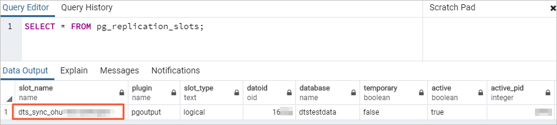<br>• 执行数据同步前需评估源库和目标库的性能，同时建议业务低峰期执行数据同步。否则全量数据初始化时将占用源库和目标库一定的读写资源，可能会导致数据库的负载上升。<br>• 全量初始化会并发执行INSERT操作，导致目标数据库的表产生碎片，因此全量初始化完成后目标实例的表空间比源实例的表空间大。<br>• 对于表级别的数据同步，请勿对源库的同步对象使用gh-ost或pt-online-schema-change等类似工具执行在线DDL变更，否则会导致同步失败。<br>• 对于表级别的数据同步，如果除DTS以外的数据没有写入目标库，您可以使用数据管理DMS（Data Management Service）来执行在线DDL变更。<br>警告如果有除DTS外的数据写入目标库，请勿使用DMS执行在线DDL变更，否则可能引起目标库数据丢失。</td>
  </tr>
</table>

**支持同步的SQL操作**

DML操作：INSERT、UPDATE、DELETE。

**准备工作**

暂不支持结构初始化。您需要根据源实例中待迁移数据表的数据结构，在目标云原生数据仓库AnalyticDB PostgreSQL实例中创建数据库、Schema及数据表等结构信息。

**操作步骤**

1. 创建数据同步实例。

   > **说明**
   >
   > 创建时，选择源数据库类型为**PostgreSQL**、目标数据库类型为**AnalyticDB PostgreSQL**，并选择同步拓扑为**单向同步**。

2. 在同步作业列表中，找到刚创建的数据同步实例，单击**配置任务**。

3. 配置同步通道的源实例及目标实例信息。

   <table>
     <tr>
       <th>类别</th>
       <th>配置</th>
       <th>说明</th>
     </tr>
     <tr>
       <td>无</td>
       <td>任务名称</td>
       <td>DTS会自动生成一个同步作业名称，建议配置具有业务意义的名称（无唯一性要求），便于后续识别。</td>
     </tr>
     <tr>
       <td rowspan="8">源库信息</td>
       <td>数据库类型</td>
       <td>选择<strong>PostgreSQL</strong>。</td>
     </tr>
     <tr>
       <td>接入方式</td>
       <td>选择<strong>公网IP</strong>。</td>
     </tr>
     <tr>
       <td>实例地区</td>
       <td>购买数据同步实例时选择的源实例地域信息，不可变更。</td>
     </tr>
     <tr>
       <td>主机名或IP地址</td>
       <td>填入自建PostgreSQL数据库的服务器IP地址。</td>
     </tr>
     <tr>
       <td>端口</td>
       <td>填入自建PostgreSQL数据库的服务端口。</td>
     </tr>
     <tr>
       <td>数据库名称</td>
       <td>填入待同步的表所属的数据库名称。</td>
     </tr>
     <tr>
       <td>数据库账号</td>
       <td>填入自建PostgreSQL的数据库账号，且数据库账号须具备superuser权限。</td>
     </tr>
     <tr>
       <td>数据库密码</td>
       <td>填入该数据库账号对应的密码。</td>
     </tr>
     <tr>
       <td rowspan="7">目标库信息</td>
       <td>数据库类型</td>
       <td>选择<strong>AnalyticDB PostgreSQL</strong>。</td>
     </tr>
     <tr>
       <td>接入方式</td>
       <td>选择<strong>云实例</strong>。</td>
     </tr>
     <tr>
       <td>实例地区</td>
       <td>购买数据同步实例时选择的目标实例地域信息，不可变更。</td>
     </tr>
     <tr>
       <td>实例ID</td>
       <td>选择AnalyticDB PostgreSQL实例ID。</td>
     </tr>
     <tr>
       <td>数据库名称</td>
       <td>填入同步目标表所属的数据库名称。</td>
     </tr>
     <tr>
       <td>数据库账号</td>
       <td>填入AnalyticDB PostgreSQL的初始账号，或具备RDS_SUPERUSER权限的账号。</td>
     </tr>
     <tr>
       <td>数据库密码</td>
       <td>填入该数据库账号对应的密码。</td>
     </tr>
   </table>

4. 配置完成后，单击页面下方的**测试连接以进行下一步**。

5. 如果您的自建PostgreSQL数据库具备白名单安全设置，请将弹跳框中提示的DTS服务器的IP地址，加入自建PostgreSQL数据库的白名单安全设置中。白名单安全设置完成后，单击**测试连接以进行下一步**。

   > **说明**
   >
   > 如果您的自建PostgreSQL数据库无需进行白名单安全设置，请直接单击**测试连接以进行下一步**。

6. 配置同步策略及对象信息。

   | 配置项目 | 配置说明 |
   | --- | --- |
   | 任务步骤 | 固定选中<strong>增量同步</strong>。默认情况下，您还需要同时选中<strong>全量同步</strong>，不支持<strong>库表结构同</strong><strong>步</strong>。预检查完成后，DTS会将源实例中待同步对象的全量数据在目标集群中初始化，作为后续增量同步数据的基线数据。 |
   | 目标已存在表的处理模式 | • <strong>预检查并报错拦截</strong>：检查目标数据库中是否有同名的表。如果目标数据库中没有同名的表，则通过该检查项目；如果目标数据库中有同名的表，则在预检查阶段提示错误，数据迁移任务不会被启动。<br>• <strong>清空目标表数据</strong>：在预检查阶段跳过目标表是否为空的检查项目。全量初始化之前将目标表的数据清空。<br>• <strong>忽略报错并继续执行</strong>：跳过目标数据库中是否有同名表的检查项。<br>警告选择为<strong>忽略报错并继续执行</strong>，可能导致数据不一致，给业务带来风险，例如：<br>• 表结构一致的情况下，在目标库遇到与源库主键的值相同的记录，则会保留目标库中的该条记录，即源库中的该条记录不会迁移至目标库中。<br>• 表结构不一致的情况下，可能导致只能迁移部分列的数据或迁移失败。 |
   | 实例级别选择所需同步的DDL和DML | 按实例级别选择增量迁移的SQL操作。<br>说明如需按库或表级别选择增量迁移的SQL操作，请在<strong>已选择对象</strong>中右击同步对象，在弹跳框中勾选所需同步的SQL操作。 |
   | 目标库对象名称大小写策略 | 可以配置目标实例中同步对象的库名、表名和列名的英文大小写策略。默认情况下选择<strong>DTS默认策略</strong>，您也可以选择与源库、目标库默认策略保持一致。更多信息，请参见目标库对象名称大小写策略。 |
   | 源库对象 | 在<strong>源库对象</strong>框中单击待同步的对象（表），然后单击图标将其移动至<strong>已选择对</strong><br><strong>象</strong>框。<br>说明您可以根据实际情况，展开导航树进行正则搜索。 |
   | 已选择对象 | 默认情况下，同步对象的名称保持不变。如果您需要改变同步对象在目标实例中的名称，请使用对象名映射功能，详情请参见设置同步对象在目标实例中的名称。<br>说明<br>• 如需按表级别选择同步的SQL操作，请在<strong>已选择对象</strong>中右击待同步对象，并在弹出的对话框中选择所需同步的SQL操作。<br>• 如需设置WHERE条件过滤数据，请在<strong>已选择对象</strong>中右击待同步的表，在弹出的对话框中设置过滤条件。设置方法请参见通过SQL条件过滤待同步数据。<br>• 如果使用了对象名映射功能，可能会导致依赖这个对象的其他对象同步失败。 |

7. 单击**下一步高级配置**，进行高级配置。

   | 配置项目 | 配置说明 |
   | --- | --- |
   | 源库、目标库无法连接后的重试时间 | 在同步任务启动后，若源库或目标库连接失败则DTS会报错。对于可预期的报错，DTS会立即进行持续的重试连接，默认持续重试时间为720分钟，您也可以在取值范围（10~1440分钟）内自定义重试时间，建议设置30分钟以上。如果DTS在设置的重试时间内重新连接上源库、目标库，同步任务将自动恢复。否则，同步任务将会失败。<br>说明针对同源或者同目标的多个DTS实例，如DTS实例A和DTS实例B，设置网络重试时间时A设置30分钟，B设置60分钟，则重试时间以低的30分钟为准。 |
   | 配置ETL功能 | 当前链路暂不支持配置ETL功能，请选择<strong>否</strong>。 |

8. <strong>可选：</strong>单击**下一步配置库表字段**，设置待同步的表在目标库中类型。

   > 如果选择了**库表结构同步**，您需要定义待同步的表在云原生数据仓库AnalyticDB
   >
   > **说明**
   >
   > PostgreSQL实例中的**类型**、**主键列**、**分布键**等信息。

9. 上述配置完成后，单击页面下方的**下一步预检查并启动**。

   > **重要**
   >
   > - 在数据同步任务正式启动之前，会先进行预检查。只有预检查通过后，才能成功启动数据同步任务。
   >
   > - 如果预检查失败，请单击**查看详情**并请根据提示修复问题，然后重新进行预检查。

0. **预检查通过率**显示为100%时，单击**返回列表**。

<a id="section-4-5-9"></a>

### 4.5.9. RDS SQL Server同步到DataHub

本文介绍如何使用数据传输服务DTS（Data Transmission Service）将RDS SQL Server同步至DataHub实例。

**前提条件**

已开通DataHub服务，并且已创建用作接收同步数据的Project。

**注意事项**

**支持增量同步的SQL操作**

<table>
  <tr>
    <th width="89">操作类型</th>
    <th>SQL操作语句</th>
  </tr>
  <tr>
    <td>DML</td>
    <td>INSERT、UPDATE、DELETE<br>说明不支持同步仅更新大字段的UPDATE语句。</td>
  </tr>
</table>

**操作步骤**

1. 创建数据同步实例。

   > **说明**
   >
   > 创建时，选择**源数据库类型**为**SQLServer**，**目标数据库类型**为**DataHub**。

2. 在同步作业列表中，找到刚创建的数据同步实例，单击**配置任务**。

3. 配置源库和目标库信息。

   <table>
     <tr>
       <th>类别</th>
       <th>配置</th>
       <th>说明</th>
     </tr>
     <tr>
       <td>无</td>
       <td>任务名称</td>
       <td>DTS会自动生成一个任务名称，建议配置具有业务意义的名称（无唯一性要求），便于后续识别。</td>
     </tr>
     <tr>
       <td rowspan="7">源库信息</td>
       <td>数据库类型</td>
       <td>选择<strong>SQLServer</strong>。</td>
     </tr>
     <tr>
       <td>接入方式</td>
       <td>选择<strong>云实例</strong>。</td>
     </tr>
     <tr>
       <td>实例地区</td>
       <td>创建数据同步实例时已指定，不可变更。</td>
     </tr>
     <tr>
       <td>是否跨阿里云账号</td>
       <td>选择<strong>不跨账号</strong>。<br>说明若您选择为<strong>跨账号</strong>，则还需要填入<strong>跨阿里云账号</strong>和<strong>跨阿里云账号角色名</strong>。获取和授权方法，请参见跨账号数据迁移或同步任务的RAM授权。</td>
     </tr>
     <tr>
       <td>实例ID</td>
       <td>选择源SQLServer实例ID。</td>
     </tr>
     <tr>
       <td>数据库账号</td>
       <td>填入源SQLServer实例的数据库账号，需具备待同步对象的所有者权限，高权限账号满足要求。</td>
     </tr>
     <tr>
       <td>数据库密码</td>
       <td>填入该数据库账号对应的密码。</td>
     </tr>
     <tr>
       <td rowspan="4">目标库信息</td>
       <td>数据库类型</td>
       <td>选择<strong>DataHub</strong>。</td>
     </tr>
     <tr>
       <td>接入方式</td>
       <td>默认为<strong>云实例</strong>。</td>
     </tr>
     <tr>
       <td>实例地区</td>
       <td>创建数据同步实例时已指定，不可变更。</td>
     </tr>
     <tr>
       <td>Project</td>
       <td>选择DataHub实例中待同步数据的Project。</td>
     </tr>
   </table>

4. 配置完成后，单击页面下方的**测试连接以进行下一步**。

5. 选择同步对象及同步类型。

   <table>
     <tr>
       <th width="215">配置</th>
       <th>说明</th>
     </tr>
     <tr>
       <td>任务步骤</td>
       <td>固定选中<strong>增量同步</strong>。默认情况下，您还需要同时选中<strong>库表结构同步</strong>，不支持<strong>全量同步</strong>。</td>
     </tr>
     <tr>
       <td>目标已存在表的处理模式</td>
       <td>• <strong>预检查并报错拦截</strong>：检查目标数据库中是否有同名的表。如果目标数据库中没有同名的表，则通过该检查项目；如果目标数据库中有同名的表，则在预检查阶段提示错误，数据同步作业不会被启动。<br>• <strong>忽略报错并继续执行</strong>：跳过目标数据库中是否有同名表的检查项。<br>警告选择为<strong>忽略报错并继续执行</strong>，可能导致数据不一致，给业务带来风险，例如：<br>• 表结构一致的情况下，如果在目标库遇到与源库主键的值相同的记录，在初始化阶段会保留目标库中的该条记录；在增量同步阶段则会覆盖目标库的该条记录。<br>• 表结构不一致的情况下，可能会导致无法初始化数据、只能同步部分列的数据或同步失败。</td>
     </tr>
     <tr>
       <td>是否启用新的附加列规则</td>
       <td>请根据业务需求选择是否使用附加列规则。<br>• <strong>新规则</strong>：使用新版附加列规则。<br>• <strong>旧规则</strong>：使用旧版附加列规则。<br>• <strong>不使用默认附加列规则</strong>：不使用附加列规则。<br>警告在选择附加列规则前，您需要评估附加列和目标表中已有的列是否会出现名称冲突。</td>
     </tr>
     <tr>
       <td>目标库对象名称大小写策略</td>
       <td>可以配置目标实例中同步对象的库名、表名和列名的英文大小写策略。默认情况下选择<strong>DTS默认策略</strong>，您也可以选择与源库、目标库默认策略保持一致。更多信息，请参见目标库对象名称大小写策略。</td>
     </tr>
     <tr>
       <td>源库对象</td>
       <td>在<strong>源库对象</strong>框中单击待同步对象，然后单击将其移动至<strong>已选择对象</strong>框。<br>说明您可以根据实际情况，展开导航树进行正则搜索。</td>
     </tr>
     <tr>
       <td>已选择对象</td>
       <td>默认情况下，同步对象的名称保持不变。如果您需要改变同步对象在目标实例中的名称，请使用对象名映射功能，详情请参见设置同步对象在目标实例中的名称。<br>说明如果使用了对象名映射功能，可能会导致依赖这个对象的其他对象同步失败。</td>
     </tr>
   </table>

6. 单击**下一步高级配置**，进行高级配置。

   | 配置项目 | 配置说明 |
   | --- | --- |
   | 源库、目标库无法连接后的重试时间 | 在同步任务启动后，若源库或目标库连接失败则DTS会报错。对于可预期的报错，DTS会立即进行持续的重试连接，默认持续重试时间为720分钟，您也可以在取值范围（10~1440分钟）内自定义重试时间，建议设置30分钟以上。如果DTS在设置的重试时间内重新连接上源库、目标库，同步任务将自动恢复。否则，同步任务将会失败。<br>说明针对同源或者同目标的多个DTS实例，如DTS实例A和DTS实例B，设置网络重试时间时A设置30分钟，B设置60分钟，则重试时间以低的30分钟为准。 |
   | 配置ETL功能 | 当前链路暂不支持配置ETL功能，请选择<strong>否</strong>。 |

7. 上述配置完成后，单击页面下方的**下一步预检查并启动**。

   > **重要**
   >
   > - 在数据同步任务正式启动之前，会先进行预检查。只有预检查通过后，才能成功启动数据同步任务。
   >
   > - 如果预检查失败，请单击**查看详情**并请根据提示修复问题，然后重新进行预检查。

8. **预检查通过率**显示为100%时，单击**返回列表**。

<a id="section-4-5-10"></a>

### 4.5.10. 云原生分布式数据库PolarDB-X 1.0实例间的数据同步

云原生分布式数据库PolarDB-X 1.0（原分布式关系型数据库DRDS）高度兼容MySQL协议和语法，支持自动化水平拆分、在线平滑扩缩容、弹性扩展、透明读写分离等功能。通过DTS您可以实现PolarDB-X 1.0实例间的数据同步。

**前提条件**

待同步的表须具备主键。

**注意事项**

> **警告**
>
> 更多源实例为PolarDB-X 1.0时的注意事项，请参见同步PolarDB-X时的规范及注意事项。

<table>
  <tr>
    <th width="90">类型</th>
    <th>说明</th>
  </tr>
  <tr>
    <td>源库限制</td>
    <td>• 待同步的表需具备主键或唯一约束，且字段具有唯一性，否则可能会导致目标数据库中出现重复数据。<br>• PolarDB-X 1.0下面挂载的RDS MySQL的Binlog日志：<br>• 需开启，并且binlog_format为row、binlog_row_image为full。否则预检查阶段提示报错，且无法成功启动数据同步任务。<br>• 建议在全量初始化期间，Binlog日志至少保留7天以上。或者等到全量初始化完成后，再清理DTS任务运行后源库产生的Binlog日志。<br>说明为保障数据安全，DTS本地只会循环存储源库近24小时或者50 GB的Binlog日志，一旦超出该限制，DTS本地将自动清除所缓存的日志。<br>警告过早清理源库的Binlog日志，可能会导致同步任务失败。例如源库的全量初始化数据较多，目标库写入异常等原因，导致全量初始化耗时超过24小时。在该情况下，过早清理源库的Binlog日志，DTS将无法获取到24小时前的Binlog日志，可能会导致同步任务失败。</td>
  </tr>
</table>

<table>
  <tr>
    <td>其他限制</td>
    <td>• PolarDB-X 1.0的存储类型需为RDS MySQL（即私有定制RDS），暂不支持为PolarDB MySQL。<br>• 执行数据同步前需评估源库和目标库的性能，同时建议业务低峰期执行数据同步。否则全量数据初始化时将占用源库和目标库一定的读写资源，可能会导致数据库的负载上升。<br>• 全量初始化会并发执行INSERT操作，导致目标数据库的表产生碎片，因此全量初始化完成后目标实例的表空间比源实例的表空间大。<br>• 如PolarDB-X 1.0实例下面挂载的RDS MySQl实例的数量超过2个，将该PolarDB-X 1.0实例同步到目标实例时，可能会导致DTS任务产生延迟和稳定性问题。建议使用如下方案配置任务，该方案优势说明，请参见同步PolarDB-X时的任务配置方案：<br>• 拆分成PolarDB-X 1.0下多个RDS MySQL同步到目标实例的DTS任务。<br>• 在DTS任务配置过程中，需要将PolarDB-X 1.0下多个RDS MySQL的数据库表名均映射成目标实例的表名，从而实现多对1的数据同步。<br>说明<br>• 举例1：如需将PolarDB-X 1.0同步至AnalyticDB MySQL，且PolarDB-X 1.0实例下面有3个RDS MySQL实例，则建议配置成3个DTS任务，将3个RDS MySQL同步至目标实例AnalyticDB MySQL。并且配置过程中，需要将3个RDS MySQL的数据库表名都映射成AnalyticDB MySQL的库表名，实现多对1的数据同步。<br>• 举例2：如需实现PolarDB-X 1.0间同步，且PolarDB-X 1.0实例A下面有3个RDS MySQL实例，PolarDB-X 1.0实例B下面有3个RDS MySQL实例，则建议配置成3个源RDS MySQL到3个目标RDS MySQL的DTS同步任务。并且在配置过程中，源库表名需映射成目标库表名。<br>• 如源PolarDB-X 1.0实例A下面挂载n个RDS MySQL实例，则该PolarDB-X 1.0实例A同步到任意目标实例时，都会消耗掉n个DTS同步任务。您需要提前规划DTS任务数量，并购买好足够的DTS数据同步功能的扩容包。<br>• 请勿在数据同步期间，切换PolarDB-X 1.0实例的网络类型。<br>说明如果必须要在数据同步期间切换网络类型，在完成网络类型切换的操作后，请提交工单调整同步链路的网络连接信息。<br>• 数据同步期间，请勿对PolarDB-X 1.0执行扩容、缩容、迁移热点表、变更拆分键和变更DDL等操作，否则将导致数据同步失败。<br>• 对于表级别的数据同步，请勿对源库的同步对象使用gh-ost或pt-online-schema-change等类似工具执行在线DDL变更，否则会导致同步失败。</td>
  </tr>
</table>

**支持的同步架构**

一对一单向同步、一对多单向同步、级联单向同步和多对一单向同步，详情请参见数据同步拓扑介绍。

**支持同步的SQL操作**

INSERT、UPDATE、DELETE。

**操作步骤**

1. 创建数据同步实例。

   > **说明**
   >
   > 创建时，选择源数据库类型为**PolarDB-X 1.0**、目标数据库类型为**PolarDB-X 1.0**，并选择同步架构为**单向同步**。

2. 在同步作业列表中，找到刚创建的数据同步实例，单击**配置任务**。

3. 配置源实例及目标实例信息。

   <table>
     <tr>
       <th>类别</th>
       <th>配置</th>
       <th>说明</th>
     </tr>
     <tr>
       <td>无</td>
       <td>任务名称</td>
       <td>DTS会自动生成一个同步作业名称，建议配置具有业务意义的名称（无唯一性要求），便于后续识别。</td>
     </tr>
     <tr>
       <td rowspan="7">源库信息</td>
       <td>数据库类型</td>
       <td>选择<strong>PolarDB-X 1.0</strong>。</td>
     </tr>
     <tr>
       <td>接入方式</td>
       <td>选择<strong>云实例</strong>。</td>
     </tr>
     <tr>
       <td>实例地区</td>
       <td>创建数据同步实例时已指定，不可变更。</td>
     </tr>
     <tr>
       <td>是否跨阿里云账号</td>
       <td>选择<strong>不跨账号</strong>。</td>
     </tr>
     <tr>
       <td>实例ID</td>
       <td>选择源PolarDB-X 1.0实例ID。</td>
     </tr>
     <tr>
       <td>数据库账号</td>
       <td>填入源PolarDB-X 1.0实例的数据库账号，需具备同步对象的读权限。</td>
     </tr>
     <tr>
       <td>数据库密码</td>
       <td>填入该数据库账号的密码。</td>
     </tr>
     <tr>
       <td rowspan="6">目标库信息</td>
       <td>数据库类型</td>
       <td>选择<strong>PolarDB-X 1.0</strong>。</td>
     </tr>
     <tr>
       <td>接入方式</td>
       <td>选择<strong>云实例</strong>。</td>
     </tr>
     <tr>
       <td>实例地区</td>
       <td>创建数据同步实例时已指定，不可变更。</td>
     </tr>
     <tr>
       <td>实例ID</td>
       <td>选择目标PolarDB-X 1.0实例ID。</td>
     </tr>
     <tr>
       <td>数据库账号</td>
       <td>填入目标PolarDB-X 1.0实例的数据库账号，需具备同步对象所属目标库的读写权限。</td>
     </tr>
     <tr>
       <td>数据库密码</td>
       <td>填入该数据库账号的密码。</td>
     </tr>
   </table>

4. 配置完成后，单击页面下方的**测试连接以进行下一步**。

5. 配置同步策略及对象信息。

   | 配置项目 | 配置说明 |
   | --- | --- |
   | 任务步骤 | 固定选中<strong>增量同步</strong>。默认情况下，您还需要同时选中<strong>库表结构同步</strong>和<strong>全量同步</strong>。预检查完成后，DTS会将源实例中待同步对象的全量数据在目标集群中初始化，作为后续增量同步数据的基线数据。 |
   | 目标已存在表的处理模式 | • <strong>预检查并报错拦截</strong>：检查目标数据库中是否有同名的表。如果目标数据库中没有同名的表，则通过该检查项目；如果目标数据库中有同名的表，则在预检查阶段提示错误，数据同步作业不会被启动。<br>• <strong>忽略报错并继续执行</strong>：跳过目标数据库中是否有同名表的检查项。<br>警告选择为<strong>忽略报错并继续执行</strong>，可能导致数据不一致，给业务带来风险，例如：<br>• 表结构一致的情况下，如果在目标库遇到与源库主键的值相同的记录，在初始化阶段会保留目标库中的该条记录；在增量同步阶段则会覆盖目标库的该条记录。<br>• 表结构不一致的情况下，可能会导致无法初始化数据、只能同步部分列的数据或同步失败。 |
   | 目标库对象名称大小写策略 | 可以配置目标实例中同步对象的库名、表名和列名的英文大小写策略。默认情况下选择<strong>DTS默认策略</strong>，您也可以选择与源库、目标库默认策略保持一致。更多信息，请参见目标库对象名称大小写策略。 |
   | 源库对象 | 在<strong>源库对象</strong>框中单击待同步的表，然后单击图标将其移动至<strong>已选择对象</strong>框。<br>说明同步对象的选择粒度为表。 |
   | 已选择对象 | 默认情况下，同步对象的名称保持不变。如果您需要改变同步对象在目标实例中的名称，请使用对象名映射功能，详情请参见设置同步对象在目标实例中的名称。<br>说明如果使用了对象名映射功能，可能会导致依赖这个对象的其他对象同步失败。 |

6. 单击**下一步高级配置**，进行高级配置。

   | 配置项目 | 配置说明 |
   | --- | --- |
   | 源库、目标库无法连接后的重试时间 | 在同步任务启动后，若源库或目标库连接失败则DTS会报错。对于可预期的报错，DTS会立即进行持续的重试连接，默认持续重试时间为720分钟，您也可以在取值范围（10~1440分钟）内自定义重试时间，建议设置30分钟以上。如果DTS在设置的重试时间内重新连接上源库、目标库，同步任务将自动恢复。否则，同步任务将会失败。<br>说明针对同源或者同目标的多个DTS实例，如DTS实例A和DTS实例B，设置网络重试时间时A设置30分钟，B设置60分钟，则重试时间以低的30分钟为准。 |
   | 配置ETL功能 | 选择是否配置ETL功能。<br>• <strong>是</strong>：配置ETL功能，并在文本框中填写数据处理语句。更多信息，请参见在同步任务中配置ETL。<br>• <strong>否</strong>：不配置ETL功能。 |

7. 上述配置完成后，单击页面下方的**下一步预检查并启动**。

   > **重要**
   >
   > - 在数据同步任务正式启动之前，会先进行预检查。只有预检查通过后，才能成功启动数据同步任务。
   >
   > - 如果预检查失败，请单击**查看详情**并请根据提示修复问题，然后重新进行预检查。

8. **预检查通过率**显示为100%时，单击**返回列表**。

<a id="section-4-5-11"></a>

### 4.5.11. 从云原生分布式数据库PolarDB-X 1.0同步至云原生数据仓库AnalyticDB MySQL 3.0

本小节介绍如何使用DTS快速配置数据同步作业，将云原生分布式数据库PolarDB-X 1.0实例实时同步至云原生数据仓库AnalyticDB MySQL 3.0。

**注意事项**

> 更多源实例为PolarDB-X 1.0时的注意事项，请参见同步PolarDB-X时的规范及注意事
>
> **警告**
>
> 项。

<table>
  <tr>
    <th width="90">类型</th>
    <th>说明</th>
  </tr>
  <tr>
    <td>源库限制</td>
    <td>• 待同步的表需具备主键或唯一约束，且字段具有唯一性，否则可能会导致目标数据库中出现重复数据。<br>• PolarDB-X 1.0下面挂载的RDS MySQL的Binlog日志：<br>• 需开启，并且binlog_format为row、binlog_row_image为full。否则预检查阶段提示报错，且无法成功启动数据同步任务。<br>• 建议在全量初始化期间，Binlog日志至少保留7天以上。或者等到全量初始化完成后，再清理DTS任务运行后源库产生的Binlog日志。<br>说明为保障数据安全，DTS本地只会循环存储源库近24小时或者50 GB的Binlog日志，一旦超出该限制，DTS本地将自动清除所缓存的日志。<br>警告过早清理源库的Binlog日志，可能会导致同步任务失败。例如源库的全量初始化数据较多，目标库写入异常等原因，导致全量初始化耗时超过24小时。在该情况下，过早清理源库的Binlog日志，DTS将无法获取到24小时前的Binlog日志，可能会导致同步任务失败。<br>• 源库的操作限制：<br>• PolarDB-X 1.0的存储类型需为RDS MySQL（即私有定制RDS），暂不支持为PolarDB MySQL。<br>• 请勿在数据同步期间，切换PolarDB-X 1.0实例的网络类型。<br>说明如果必须要在数据同步期间切换网络类型，在完成网络类型切换的操作后，请提交工单调整同步链路的网络连接信息。<br>• 数据同步期间，请勿对PolarDB-X 1.0执行扩容、缩容、迁移热点表、变更拆分键和变更DDL等操作，否则将导致数据同步失败。</td>
  </tr>
</table>

<table>
  <tr>
    <td>其他限制</td>
    <td>• 如PolarDB-X 1.0实例下面挂载的RDS MySQl实例的数量超过2个，将该PolarDB-X 1.0实例同步到目标实例时，可能会导致DTS任务产生延迟和稳定性问题。建议使用如下方案配置任务，该方案优势说明，请参见同步PolarDB-X时的任务配置方案：<br>• 拆分成PolarDB-X 1.0下多个RDS MySQL同步到目标实例的DTS任务。<br>• 在DTS任务配置过程中，需要将PolarDB-X 1.0下多个RDS MySQL的数据库表名均映射成目标实例的表名，从而实现多对1的数据同步。<br>说明<br>• 举例1：如需将PolarDB-X 1.0同步至AnalyticDB MySQL，且PolarDB-X 1.0实例下面有3个RDS MySQL实例，则建议配置成3个DTS任务，将3个RDS MySQL同步至目标实例AnalyticDB MySQL。并且配置过程中，需要将3个RDS MySQL的数据库表名都映射成AnalyticDB MySQL的库表名，实现多对1的数据同步。<br>• 举例2：如需实现PolarDB-X 1.0间同步，且PolarDB-X 1.0实例A下面有3个RDS MySQL实例，PolarDB-X 1.0实例B下面有3个RDS MySQL实例，则建议配置成3个源RDS MySQL到3个目标RDS MySQL的DTS同步任务。并且在配置过程中，源库表名需映射成目标库表名。<br>• 如源PolarDB-X 1.0实例A下面挂载n个RDS MySQL实例，则该PolarDB-X 1.0实例A同步到任意目标实例时，都会消耗掉n个DTS同步任务。您需要提前规划DTS任务数量，并购买好足够的DTS数据同步功能的扩容包。<br>• 暂不支持同步前缀索引，如果源库存在前缀索引可能导致数据同步失败。<br>• 由于云原生数据仓库AnalyticDB MySQL版本身的使用限制，当云原生数据仓库AnalyticDB MySQL版集群中的节点磁盘空间使用量超过80%，会导致DTS任务异常，产生延迟。请提前根据待同步的对象预估所需空间，确保目标集群具备充足的存储空间。<br>• 执行数据同步前需评估源库和目标库的性能，同时建议业务低峰期执行数据同步。否则全量数据初始化时将占用源库和目标库一定的读写资源，可能会导致数据库的负载上升。<br>• 全量初始化会并发执行INSERT操作，导致目标数据库的表产生碎片，因此全量初始化完成后目标实例的表空间比源实例的表空间大。<br>• 对于表级别的数据同步，请勿对源库的同步对象使用gh-ost或pt-online-schema-change等类似工具执行在线DDL变更，否则会导致同步失败。<br>• 对于表级别的数据同步，如果除DTS以外的数据没有写入目标库云原生数据仓库AnalyticDB MySQL版，您可以使用数据管理DMS（Data Management Service）来执行在线DDL变更。<br>警告如果有除DTS外的数据写入目标库，请勿使用DMS执行在线DDL变更，否则可能引起目标库数据丢失。</td>
  </tr>
</table>

**支持的同步架构**

一对一单向同步、一对多单向同步和多对一单向同步，详情请参见数据同步拓扑介绍。

**支持同步的SQL操作**

INSERT、UPDATE、DELETE。

**数据类型映射关系**

由于MySQL和云原生数据仓库AnalyticDB MySQL实例的数据类型并不是一一对应的，所以DTS在进行结构迁移时，会根据数据类型定义进行类型映射，详情请参见下表。

| MySQL数据类型 | 云原生数据仓库AnalyticDB MySQL（3.0）数据类型 |
| --- | --- |
| BIGINT UNSIGNED | DECIMAL(20,0) |
| BINARY | VARBINARY |
| BIT | VARCHAR |
| BLOB | VARBINARY |
| CHAR | VARCHAR |
| DATE | DATE |
| DATETIME | DATETIME |
| DECIMAL | DECIMAL |
| DOUBLE | DOUBLE |
| ENUM | VARCHAR |
| FLOAT | FLOAT |
| GEOMETRY | VARBINARY |
| GEOMETRYCOLLECTION | VARBINARY |
| INT UNSIGNED | BIGINT |
| INTEGER | INT |
| JSON | JSON |
| LINESTRING | VARBINARY |
| LONGBLOB | VARBINARY |
| LONGTEXT | VARCHAR |
| MEDIUMBLOB | VARBINARY |
| MEDIUMINT | INT |
| MEDIUMINT UNSIGNED | INT |
| MEDIUMTEXT | VARCHAR |
| MULTILINESTRING | VARBINARY |
| MULTIPOINT | VARBINARY |
| MULTIPOLYGON | VARBINARY |
| NUMBERIC | DECIMAL |
| POINT | VARBINARY |
| POLYGON | VARBINARY |
| SET | VARCHAR |
| SMALLINT UNSIGNED | INT |
| TEXT | VARCHAR |
| TIME | TIME |
| TIMESTAMP | TIMESTAMP |
| TINYBLOB | VARBINARY |
| TINYINT UNSIGNED | SMALLINT |
| TINYTEXT | VARCHAR |
| VARBINARY | VARBINARY |
| VARCHAR | VARCHAR |
| YEAR | INT |

**操作步骤**

1. 创建数据同步实例。

   > **说明**
   >
   > 创建时，选择源数据库类型为**PolarDB-X 1.0**、目标数据库类型为**AnalyticDB MySQL 3.0**，并选择同步拓扑为**单向同步**。

2. 在同步作业列表中，找到刚创建的数据同步实例，单击**配置任务**。

3. 配置源实例及目标实例信息。

   **类别**

   **配置**

   **说明**

   DTS会自动生成一个同步作业名称，建议配置具有业务意义的名称（无唯

   无

   **任务名称**

   一性要求），便于后续识别。

   选择**PolarDB-X 1.0**。

   **数据库类型**

   选择**云实例**。

   **接入方式**

   创建数据同步实例时已指定，不可变更。

   **实例地区**

   **是否跨阿里云账**

   选择**不跨账号**。

   **源库信息**

   **号**

   选择源PolarDB-X 1.0实例ID。

   **实例ID**

   填入源PolarDB-X 1.0实例的数据库账号，需具备同步对象的读权限。

   **数据库账号**

   填入该数据库账号的密码。

   **数据库密码**

   选择**AnalyticDB MySQL 3.0**。

   **数据库类型**

   选择**云实例**。

   **接入方式**

   创建数据同步实例时已指定，不可变更。

   **实例地区**

   **实例ID**

   选择目标AnalyticDB MySQL 3.0实例ID。

   **目标库信息**

   填入目标AnalyticDB MySQL 3.0实例的数据库账号，需具备同步对象所

   **数据库账号**

   属目标库的读写权限。

   填入该数据库账号的密码。

   **数据库密码**

4. 配置完成后，单击页面下方的**测试连接以进行下一步**。

5. 配置同步策略和同步对象。

   | 配置项目 | 配置说明 |
   | --- | --- |
   | 任务步骤 | 固定选中<strong>增量同步</strong>。默认情况下，您还需要同时选中<strong>库表结构同步</strong>和<strong>全量同步</strong>。预检查完成后，DTS会将源实例中待同步对象的全量数据在目标集群中初始化，作为后续增量同步数据的基线数据。 |
   | 目标已存在表的处理模式 | • <strong>预检查并报错拦截</strong>：检查目标数据库中是否有同名的表。如果目标数据库中没有同名的表，则通过该检查项目；如果目标数据库中有同名的表，则在预检查阶段提示错误，数据同步作业不会被启动。<br>• <strong>忽略报错并继续执行</strong>：跳过目标数据库中是否有同名表的检查项。<br>警告选择为<strong>忽略报错并继续执行</strong>，可能导致数据不一致，给业务带来风险，例如：<br>• 表结构一致的情况下，如果在目标库遇到与源库主键的值相同的记录，在初始化阶段会保留目标库中的该条记录；在增量同步阶段则会覆盖目标库的该条记录。<br>• 表结构不一致的情况下，可能会导致无法初始化数据、只能同步部分列的数据或同步失败。 |
   | 目标库对象名称大小写策略 | 可以配置目标实例中同步对象的库名、表名和列名的英文大小写策略。默认情况下选择<strong>DTS默认策略</strong>，您也可以选择与源库、目标库默认策略保持一致。更多信息，请参见目标库对象名称大小写策略。 |
   | 多表归并 | • 选择为<strong>是</strong>：DTS将在每个表中增加<code> __dts_data_source </code>列来存储数据来源，且不再支持DDL同步。<br>• 选择为<strong>否</strong>：默认选项，支持DDL同步。<br>重要<br>• 多表归并功能基于任务级别，即不支持基于表级别执行多表归并。如果需要让部分表执行多表归并，另一部分不执行多表归并，您可以创建两个数据同步作业。<br>• 开启多表归并的增量任务不支持DDL操作。若源库有DDL操作，则会导致目标库数据丢失或任务失败。 |
   | 源库对象 | 在<strong>源库对象</strong>框中单击待同步的表，然后单击图标将其移动至<strong>已选择对象</strong>框。<br>说明同步对象的选择粒度为表。 |
   | 已选择对象 | 默认情况下，同步对象的名称保持不变。如果您需要改变同步对象在目标实例中的名称，请使用对象名映射功能，详情请参见设置同步对象在目标实例中的名称。<br>说明<br>• 若您使用了多表归并功能，则需将表名称修改为待同步的表在目标库中的表名。<br>• 如果使用了对象名映射功能，可能会导致依赖这个对象的其他对象同步失败。 |

6. 单击**下一步高级配置**，进行高级配置。

   | 配置项目 | 配置说明 |
   | --- | --- |
   | 源库、目标库无法连接后的重试时间 | 在同步任务启动后，若源库或目标库连接失败则DTS会报错。对于可预期的报错，DTS会立即进行持续的重试连接，默认持续重试时间为720分钟，您也可以在取值范围（10~1440分钟）内自定义重试时间，建议设置30分钟以上。如果DTS在设置的重试时间内重新连接上源库、目标库，同步任务将自动恢复。否则，同步任务将会失败。<br>说明针对同源或者同目标的多个DTS实例，如DTS实例A和DTS实例B，设置网络重试时间时A设置30分钟，B设置60分钟，则重试时间以低的30分钟为准。 |
   | 配置ETL功能 | 选择是否配置ETL功能。<br>• <strong>是</strong>：配置ETL功能，并在文本框中填写数据处理语句。更多信息，请参见在同步任务中配置ETL。<br>• <strong>否</strong>：不配置ETL功能。 |

7. <strong>可选：</strong>单击**下一步配置库表字段**，设置待同步的表在目标库中类型。

   > 如果选择了**库表结构同步**，您需要定义待同步的表在云原生数据仓库AnalyticDB
   >
   > **说明**
   >
   > MySQL实例中的**类型**、**主键列**、**分布键**等信息。

8. 上述配置完成后，单击页面下方的**下一步预检查并启动**。

   > **重要**
   >
   > - 在数据同步任务正式启动之前，会先进行预检查。只有预检查通过后，才能成功启动数据同步任务。
   >
   > - 如果预检查失败，请单击**查看详情**并请根据提示修复问题，然后重新进行预检查。

9. **预检查通过率**显示为100%时，单击**返回列表**。

<a id="section-4-5-12"></a>

### 4.5.12. 从云原生分布式数据库PolarDB-X 1.0同步至Datahub

通过DTS您可以将云原生分布式数据库PolarDB-X 1.0同步至DataHub，可用于流计算等大数据产品对数据进行实时分析等场景。

**前提条件**

DataHub实例中，已创建用作接收同步数据的Project。

**注意事项**

> 更多源实例为PolarDB-X 1.0时的注意事项，请参见同步PolarDB-X时的规范及注意事
>
> **警告**
>
> 项。

<table>
  <tr>
    <th width="90">类型</th>
    <th>说明</th>
  </tr>
  <tr>
    <td>源库限制</td>
    <td>• 待同步的表需具备主键或唯一约束，且字段具有唯一性，否则可能会导致目标数据库中出现重复数据。<br>• PolarDB-X 1.0下面挂载的RDS MySQL的Binlog日志：<br>• 需开启，并且binlog_format为row、binlog_row_image为full。否则预检查阶段提示报错，且无法成功启动数据同步任务。<br>• 建议在全量初始化期间，Binlog日志至少保留7天以上。或者等到全量初始化完成后，再清理DTS任务运行后源库产生的Binlog日志。<br>说明为保障数据安全，DTS本地只会循环存储源库近24小时或者50 GB的Binlog日志，一旦超出该限制，DTS本地将自动清除所缓存的日志。<br>警告过早清理源库的Binlog日志，可能会导致同步任务失败。例如源库的全量初始化数据较多，目标库写入异常等原因，导致全量初始化耗时超过24小时。在该情况下，过早清理源库的Binlog日志，DTS将无法获取到24小时前的Binlog日志，可能会导致同步任务失败。<br>• 源库的操作限制：<br>• PolarDB-X 1.0的存储类型需为RDS MySQL（即私有定制RDS），暂不支持为PolarDB MySQL。<br>• 请勿在数据同步期间，切换PolarDB-X 1.0实例的网络类型。<br>说明如果必须要在数据同步期间切换网络类型，在完成网络类型切换的操作后，请提交工单调整同步链路的网络连接信息。<br>• 数据同步期间，请勿对PolarDB-X 1.0执行扩容、缩容、迁移热点表、变更拆分键和变更DDL等操作，否则将导致数据同步失败。</td>
  </tr>
  <tr>
    <td>其他限制</td>
    <td>• 如PolarDB-X 1.0实例下面挂载的RDS MySQl实例的数量超过2个，将该PolarDB-X 1.0实例同步到目标实例时，可能会导致DTS任务产生延迟和稳定性问题。建议使用如下方案配置任务，该方案优势说明，请参见同步PolarDB-X时的任务配置方案：<br>• 拆分成PolarDB-X 1.0下多个RDS MySQL同步到目标实例的DTS任务。<br>• 在DTS任务配置过程中，需要将PolarDB-X 1.0下多个RDS MySQL的数据库表名均映射成目标实例的表名，从而实现多对1的数据同步。<br>说明<br>• 举例1：如需将PolarDB-X 1.0同步至AnalyticDB MySQL，且PolarDB-X 1.0实例下面有3个RDS MySQL实例，则建议配置成3个DTS任务，将3个RDS MySQL同步至目标实例AnalyticDB MySQL。并且配置过程中，需要将3个RDS MySQL的数据库表名都映射成AnalyticDB MySQL的库表名，实现多对1的数据同步。<br>• 举例2：如需实现PolarDB-X 1.0间同步，且PolarDB-X 1.0实例A下面有3个RDS MySQL实例，PolarDB-X 1.0实例B下面有3个RDS MySQL实例，则建议配置成3个源RDS MySQL到3个目标RDS MySQL的DTS同步任务。并且在配置过程中，源库表名需映射成目标库表名。<br>• 如源PolarDB-X 1.0实例A下面挂载n个RDS MySQL实例，则该PolarDB-X 1.0实例A同步到任意目标实例时，都会消耗掉n个DTS同步任务。您需要提前规划DTS任务数量，并购买好足够的DTS数据同步功能的扩容包。<br>• 仅支持表级别的数据同步。<br>• 不支持全量数据初始化，即DTS不会将源PolarDB-X 1.0中同步对象的存量数据同步至目标DataHub实例中。<br>• 不支持同步DDL操作。如果在数据同步过程中源实例执行了DDL操作，将导致数据同步失败。此场景下，您需要在目标Datahub中手动修改topic，然后重启数据同步作业。<br>• 执行数据同步前需评估源库和目标库的性能，同时建议业务低峰期执行数据同步。否则全量数据初始化时将占用源库和目标库一定的读写资源，可能会导致数据库的负载上升。<br>• 全量初始化会并发执行INSERT操作，导致目标数据库的表产生碎片，因此全量初始化完成后目标实例的表空间比源实例的表空间大。<br>• 对于表级别的数据同步，请勿对源库的同步对象使用gh-ost或pt-online-schema-change等类似工具执行在线DDL变更，否则会导致同步失败。</td>
  </tr>
</table>

**支持同步的SQL操作**

INSERT、UPDATE、DELETE。

**操作步骤**

1. 创建数据同步实例。

   > **说明**
   >
   > 创建时，选择源数据库类型为**PolarDB-X 1.0**、目标数据库类型为**Datahub**，并选择同步拓扑为**单向同步**。

2. 在同步作业列表中，找到刚创建的数据同步实例，单击**配置任务**。

3. 配置源实例及目标实例信息。

   **类别**

   **配置**

   **说明**

   DTS会自动生成一个同步作业名称，建议配置具有业务意义的名称（无唯

   无

   **任务名称**

   一性要求），便于后续识别。

   选择**PolarDB-X 1.0**。

   **数据库类型**

   选择**云实例**。

   **接入方式**

   创建数据同步实例时已指定，不可变更。

   **实例地区**

   **源库信息**

   **是否跨阿里云账**

   选择**不跨账号**。

   **号**

   选择源PolarDB-X 1.0实例ID。

   **实例ID**

   填入源PolarDB-X 1.0实例的数据库账号，需具备同步对象的读权限。

   **数据库账号**

   填入该数据库账号的密码。

   **数据库密码**

   选择**Datahub**。

   **数据库类型**

   选择**云实例**。

   **接入方式**

   **目标库信息**

   创建数据同步实例时已指定，不可变更。

   **实例地区**

   选择DataHub实例中待同步数据的Project。

   **Project**

4. 配置完成后，单击页面下方的**测试连接以进行下一步**。

5. 配置同步策略和同步对象。

   | 配置项目 | 配置说明 |
   | --- | --- |
   | 任务步骤 | 固定选中<strong>增量同步</strong>。仅支持选中<strong>库表结构同步</strong>，不支持<strong>全量同步</strong>。<br>说明在数据同步任务的初始化阶段，DTS会将同步对象的结构定义（例如表结构）同步至目标DataHub实例。 |
   | 目标已存在表的处理模式 | • <strong>预检查并报错拦截</strong>：检查目标数据库中是否有同名的表。如果目标数据库中没有同名的表，则通过该检查项目；如果目标数据库中有同名的表，则在预检查阶段提示错误，数据同步作业不会被启动。<br>• <strong>忽略报错并继续执行</strong>：跳过目标数据库中是否有同名表的检查项。<br>警告选择为<strong>忽略报错并继续执行</strong>，可能导致数据不一致，给业务带来风险，例如：<br>• 表结构一致的情况下，如果在目标库遇到与源库主键的值相同的记录，在初始化阶段会保留目标库中的该条记录；在增量同步阶段则会覆盖目标库的该条记录。<br>• 表结构不一致的情况下，可能会导致无法初始化数据、只能同步部分列的数据或同步失败。 |
   | 是否启用新的附加列规则 | DTS在将数据同步到DataHub时，会在同步的目标表中添加一些附加列。如果附加列和目标表中已有的列出现名称冲突将会导致数据同步失败。请根据业务需求选择是否使用附加列规则。<br>• <strong>新规则</strong>：使用新版附加列规则。<br>• <strong>旧规则</strong>：使用旧版附加列规则。<br>• <strong>不使用默认附加列规则</strong>：不使用附加列规则。<br>警告在选择附加列规则前，您需要评估附加列和目标表中已有的列是否会出现名称冲突。 |
   | 目标库对象名称大小写策略 | 可以配置目标实例中同步对象的库名、表名和列名的英文大小写策略。默认情况下选择<strong>DTS默认策略</strong>，您也可以选择与源库、目标库默认策略保持一致。更多信息，请参见目标库对象名称大小写策略。 |
   | 源库对象 | 在<strong>源库对象</strong>框中单击待同步的表，然后单击图标将其移动至<strong>已选择对象</strong>框。<br>说明同步对象的选择粒度为表。 |
   | 已选择对象 | 默认情况下，同步对象的名称保持不变。如果您需要改变同步对象在目标实例中的名称，请使用对象名映射功能，详情请参见设置同步对象在目标实例中的名称。<br>说明如果使用了对象名映射功能，可能会导致依赖这个对象的其他对象同步失败。 |

6. 单击**下一步高级配置**，进行高级配置。

   | 配置项目 | 配置说明 |
   | --- | --- |
   | 源库、目标库无法连接后的重试时间 | 在同步任务启动后，若源库或目标库连接失败则DTS会报错。对于可预期的报错，DTS会立即进行持续的重试连接，默认持续重试时间为720分钟，您也可以在取值范围（10~1440分钟）内自定义重试时间，建议设置30分钟以上。如果DTS在设置的重试时间内重新连接上源库、目标库，同步任务将自动恢复。否则，同步任务将会失败。<br>说明针对同源或者同目标的多个DTS实例，如DTS实例A和DTS实例B，设置网络重试时间时A设置30分钟，B设置60分钟，则重试时间以低的30分钟为准。 |
   | 配置ETL功能 | 当前链路暂不支持配置ETL功能，请选择<strong>否</strong>。 |

7. 上述配置完成后，单击页面下方的**下一步预检查并启动**。

   > **重要**
   >
   > - 在数据同步任务正式启动之前，会先进行预检查。只有预检查通过后，才能成功启动数据同步任务。
   >
   > - 如果预检查失败，请单击**查看详情**并请根据提示修复问题，然后重新进行预检查。

8. **预检查通过率**显示为100%时，单击**返回列表**。

<a id="section-4-5-13"></a>

### 4.5.13. 从自建Db2 for LUW同步至云原生数据仓库AnalyticDB PostgreSQL实例

数据传输服务DTS（Data Transmission Service）支持将Db2 for LUW数据库同步至云原生数据仓库AnalyticDB PostgreSQL实例。通过DTS提供的数据同步功能，可以轻松实现数据的流转，将企业数据集中分析。

**前提条件**

- 已创建自建Db2 for LUW，以及目标AnalyticDB PostgreSQL实例。

- 目标AnalyticDB PostgreSQL实例的存储空间须大于自建Db2 for LUW数据库占用的存储空间。

**注意事项**

<table>
  <tr>
    <th width="90">类型</th>
    <th>说明</th>
  </tr>
  <tr>
    <td>源库限制</td>
    <td>• 带宽要求：源库所属的服务器需具备足够出口带宽，否则将影响数据同步速率。<br>• 待同步的表需具备主键或唯一约束，且字段具有唯一性，否则可能会导致目标数据库中出现重复数据。<br>• 如同步对象为表级别，且需进行编辑（如表列名映射），则单次同步任务仅支持同步至多1000张表。当超出数量限制，任务提交后会显示请求报错，此时建议您拆分待同步的表，分批配置多个任务，或者配置整库的同步任务。<br>• 数据日志：<br>• 需开启，否则预检查阶段提示报错，且无法成功启动数据同步任务。<br>• 如为增量同步任务，DTS要求源数据库的数据日志保存24小时以上，如为全量同步和增量同步任务，DTS要求源数据库的数据日志至少保留7天以上（您可在全量同步完成后将数据日志保存时间设置为24小时以上），否则DTS可能因无法获取数据日志而导致任务失败，极端情况下甚至可能会导致数据不一致或丢失。由于您所设置的数据日志保存时间低于DTS要求的时间进而导致的问题，不在DTS的SLA保障范围内。</td>
  </tr>
  <tr>
    <td>其他限制</td>
    <td>• 暂不支持库表结构同步，在配置同步任务前，您需要在目标实例中创建对应的库和表。<br>• 由于DTS基于Db2 for LUW的CDC复制技术，将Db2 for LUW数据库的增量更新数据同步到目标库中，但是CDC复制技术自身具有限制，请参见CDC复制技术所支持数据类型的限制。<br>• 执行数据同步前需评估源库和目标库的性能，同时建议业务低峰期执行数据同步。否则全量数据初始化时将占用源库和目标库一定的读写资源，可能会导致数据库的负载上升。<br>• 全量初始化会并发执行INSERT操作，导致目标数据库的表产生碎片，因此全量初始化完成后目标实例的表空间比源实例的表空间大。<br>• 请勿对源库的同步对象使用gh-ost或pt-online-schema-change等类似工具执行在线DDL变更，否则会导致同步失败。</td>
  </tr>
  <tr>
    <td>特殊情况</td>
    <td>由于源库Db2 for LUW为自建数据库，您还需要注意如下事项：<br>• 在同步时，如果源库进行主备切换，将会导致同步任务失败。<br>• 由于DTS的延迟时间是根据同步到目标库最后一条数据的时间戳和当前时间戳对比得出，源库长时间未执行DML操作可能导致延迟信息不准确。如果任务显示的延迟时间过大，您可以在源库执行一个DML操作来更新延迟信息。<br>说明如果同步对象选择为整库，您还可以创建心跳表，心跳表每秒定期更新或者写入数据。</td>
  </tr>
</table>

**支持同步的SQL操作**

DML操作：INSERT、UPDATE、DELETE。

**准备工作**

- 创建账号并授予权限

  - Db2 for LUW：DBADM权限

  - 云原生数据仓库AnalyticDB PostgreSQL：目标库的读写权限

- 开启Db2 for LUW数据库的归档日志。

**操作步骤**

1. 创建数据同步实例。

   > **说明**
   >
   > 创建时，选择源数据库类型为**DB2 LUW**、目标数据库类型为**AnalyticDB PostgreSQL**。

2. 在同步作业列表中，找到刚创建的数据同步实例，单击**配置任务**。

3. 配置同步通道的源实例及目标实例信息。

   <table>
     <tr>
       <th>类别</th>
       <th>配置</th>
       <th>说明</th>
     </tr>
     <tr>
       <td>无</td>
       <td>任务名称</td>
       <td>DTS会自动生成一个同步作业名称，建议配置具有业务意义的名称（无唯一性要求），便于后续识别。</td>
     </tr>
     <tr>
       <td rowspan="8">源库信息</td>
       <td>数据库类型</td>
       <td>固定为<strong>DB2 LUW</strong>。</td>
     </tr>
     <tr>
       <td>接入方式</td>
       <td>选择<strong>公网IP</strong>。</td>
     </tr>
     <tr>
       <td>实例地区</td>
       <td>购买数据同步实例时选择的源实例地域信息，不可变更。</td>
     </tr>
     <tr>
       <td>DNS或IP地址</td>
       <td>填入自建Db2 for LUW数据库的服务器IP地址。</td>
     </tr>
     <tr>
       <td>端口</td>
       <td>填入自建Db2 for LUW数据库的服务端口。</td>
     </tr>
     <tr>
       <td>数据库名称</td>
       <td>填入待同步的表所属的数据库名称。</td>
     </tr>
     <tr>
       <td>数据库账号</td>
       <td>填入自建Db2 for LUW的数据库账号，且数据库账号须具备superuser权限。</td>
     </tr>
     <tr>
       <td>数据库密码</td>
       <td>填入该数据库账号对应的密码。</td>
     </tr>
     <tr>
       <td rowspan="7">目标库信息</td>
       <td>数据库类型</td>
       <td>选择<strong>AnalyticDB PostgreSQL</strong>。</td>
     </tr>
     <tr>
       <td>接入方式</td>
       <td>选择<strong>云实例</strong>。</td>
     </tr>
     <tr>
       <td>实例地区</td>
       <td>购买数据同步实例时选择的目标实例地域信息，不可变更。</td>
     </tr>
     <tr>
       <td>实例ID</td>
       <td>选择AnalyticDB PostgreSQL实例ID。</td>
     </tr>
     <tr>
       <td>数据库名称</td>
       <td>填入同步目标表所属的数据库名称。</td>
     </tr>
     <tr>
       <td>数据库账号</td>
       <td>填入AnalyticDB PostgreSQL的初始账号，或具备RDS_SUPERUSER权限的账号。</td>
     </tr>
     <tr>
       <td>数据库密码</td>
       <td>填入该数据库账号对应的密码。</td>
     </tr>
   </table>

4. 配置完成后，单击页面下方的**测试连接以进行下一步**。

5. 如果您的自建DbB2 for LUW数据库具备白名单安全设置，请单击弹跳框中提示的DTS服务器的IP地址，加入自建Db2 for LUW数据库的白名单安全设置中。白名单安全设置完成后，单击**测试连接以进行下一步**。

   > **说明**
   >
   > 如果您的自建Db2 for LUW数据库无需进行白名单安全设置，请直接单击**测试连接以进行下一步**。

6. 配置同步策略及对象信息。

   | 配置项目 | 配置说明 |
   | --- | --- |
   | 任务步骤 | 固定选中<strong>增量同步</strong>。默认情况下，您还需要同时选中<strong>库表结构同步</strong>和<strong>全量同步</strong>。预检查完成后，DTS会将源实例中待同步对象的全量数据在目标集群中初始化，作为后续增量同步数据的基线数据。 |
   | 目标已存在表的处理模式 | • <strong>预检查并报错拦截</strong>：检查目标数据库中是否有同名的表。如果目标数据库中没有同名的表，则通过该检查项目；如果目标数据库中有同名的表，则在预检查阶段提示错误，数据迁移任务不会被启动。<br>• <strong>清空目标表数据</strong>：在预检查阶段跳过目标表是否为空的检查项目。全量初始化之前将目标表的数据清空。<br>• <strong>忽略报错并继续执行</strong>：跳过目标数据库中是否有同名表的检查项。<br>警告选择为<strong>忽略报错并继续执行</strong>，可能导致数据不一致，给业务带来风险，例如：<br>• 表结构一致的情况下，在目标库遇到与源库主键的值相同的记录，则会保留目标库中的该条记录，即源库中的该条记录不会迁移至目标库中。<br>• 表结构不一致的情况下，可能导致只能迁移部分列的数据或迁移失败。 |
   | 实例级别选择所需同步的DDL和DML | 按实例级别选择增量迁移的SQL操作。<br>说明如需按库或表级别选择增量迁移的SQL操作，请在<strong>已选择对象</strong>中右击同步对象，在弹跳框中勾选所需同步的SQL操作。 |
   | 目标库对象名称大小写策略 | 可以配置目标实例中同步对象的库名、表名和列名的英文大小写策略。默认情况下选择<strong>DTS默认策略</strong>，您也可以选择与源库、目标库默认策略保持一致。更多信息，请参见目标库对象名称大小写策略。 |
   | 源库对象 | 在<strong>源库对象</strong>框中单击待同步的对象（表），然后单击图标将其移动至<strong>已选择对</strong><br><strong>象</strong>框。 |
   | 已选择对象 | 默认情况下，同步对象的名称保持不变。如果您需要改变同步对象在目标实例中的名称，请使用对象名映射功能，详情请参见设置同步对象在目标实例中的名称。<br>说明<br>• 如需按表级别选择同步的SQL操作，请在<strong>已选择对象</strong>中右击待同步对象，并在弹出的对话框中选择所需同步的SQL操作。<br>• 如需设置WHERE条件过滤数据，请在<strong>已选择对象</strong>中右击待同步的表，在弹出的对话框中设置过滤条件。设置方法请参见通过SQL条件过滤待同步数据。<br>• 如果使用了对象名映射功能，可能会导致依赖这个对象的其他对象同步失败。 |

7. 单击**下一步高级配置**，进行高级配置。

   | 配置项目 | 配置说明 |
   | --- | --- |
   | 源库、目标库无法连接后的重试时间 | 在同步任务启动后，若源库或目标库连接失败则DTS会报错。对于可预期的报错，DTS会立即进行持续的重试连接，默认持续重试时间为720分钟，您也可以在取值范围（10~1440分钟）内自定义重试时间，建议设置30分钟以上。如果DTS在设置的重试时间内重新连接上源库、目标库，同步任务将自动恢复。否则，同步任务将会失败。<br>说明针对同源或者同目标的多个DTS实例，如DTS实例A和DTS实例B，设置网络重试时间时A设置30分钟，B设置60分钟，则重试时间以低的30分钟为准。 |
   | 配置ETL功能 | 选择是否配置ETL功能。<br>• <strong>是</strong>：配置ETL功能，并在文本框中填写数据处理语句。更多信息，请参见在同步任务中配置ETL。<br>• <strong>否</strong>：不配置ETL功能。 |

8. <strong>可选：</strong>单击**下一步配置库表字段**，设置待同步的表在目标库中类型。

   > 如果选择了**库表结构同步**，您需要定义待同步的表在云原生数据仓库AnalyticDB
   >
   > **说明**
   >
   > PostgreSQL实例中的**类型**、**主键列**、**分布键**等信息。

9. 上述配置完成后，单击页面下方的**下一步预检查并启动**。

   > **重要**
   >
   > - 在数据同步任务正式启动之前，会先进行预检查。只有预检查通过后，才能成功启动数据同步任务。
   >
   > - 如果预检查失败，请单击**查看详情**并请根据提示修复问题，然后重新进行预检查。

0. **预检查通过率**显示为100%时，单击**返回列表**。

<a id="section-4-5-14"></a>

### 4.5.14. 从自建Oracle同步至DataHub

阿里云流式数据服务DataHub是流式数据（Streaming Data）的处理平台，提供对流式数据的发布、订阅和分发功能，让您可以轻松分析和使用流式数据。您可以通过DTS将自建Oracle同步至DataHub，帮助您快速实现使用流计算等大数据产品对数据实时分析。

**前提条件**

- 自建Oracle数据库版本为9i、10g、11g、12c、18c或19c版本。

- 自建Oracle数据库已开启ARCHIVELOG（归档模式），设置合理的归档日志保持周期且归档日志能够被访问，详情请参见ARCHIVELOG。

- 自建Oracle数据库已开启Supplemental Logging，且已开启supplemental_log_data_pk，supplemental_log_data_ui，详情请参见Supplemental Logging。

- DataHub实例中，已创建用作接收同步数据的项目（Project），请参见<strong>《数据总线DataHub用户指南》</strong>中的<strong>《创建Project》</strong>章节。

**注意事项**

<table>
  <tr>
    <th width="90">类型</th>
    <th>说明</th>
  </tr>
  <tr>
    <td>源库限制</td>
    <td>• 同步对象要求：<br>• 待同步的表需具备主键或唯一约束，且字段具有唯一性，否则可能会导致目标数据库中出现重复数据。<br>• 如果您的自建Oracle版本为12c及以上，待同步表的名称长度需不超过30个字节。<br>• 如同步对象为表级别，且需进行编辑（如表列名映射），则单次同步任务仅支持同步至多1000张表。当超出数量限制，任务提交后会显示请求报错，此时建议您拆分待同步的表，分批配置多个任务，或者配置整库的同步任务。<br>• 如自建Oracle为RAC架构，不支持配置ScanIP，仅支持将其中任意1个VIP配置到连接信息中，该方式配置后不支持RAC的节点切换。<br>• Redo Log、Archive Log：<br>• 需开启。<br>• 如为增量同步任务，DTS要求源数据库的Redo Log、Archive Log保存24小时以上，如为库表结构同步和增量同步任务，DTS要求源数据库的Redo Log、Archive Log至少保留7天以上（您可在库表结构同步完成后将Redo Log、Archive Log保存时间设置为24小时以上），否则DTS可能因无法获取Redo Log、Archive Log而导致任务失败，极端情况下甚至可能会导致数据不一致或丢失。由于您所设置的Redo Log、Archive Log保存时间低于DTS要求的时间进而导致的问题，不在DTS的SLA保障范围内。<br>• 如果源库在同步阶段进行主备切换，将会导致同步任务失败。</td>
  </tr>
  <tr>
    <td>其他限制</td>
    <td>• 仅支持在新版控制台配置。<br>• 结构初始化对象为table。<br>警告不兼容触发器。建议您删除源库的触发器，以避免因触发器而导致数据不一致的问题。<br>• 暂不支持全量同步，即DTS不会将源实例中同步对象的存量数据同步至目标DataHub实例。<br>• 仅支持表级别的数据同步。<br>• 请勿对源库的同步对象使用gh-ost或pt-online-schema-change等类似工具执行在线DDL变更，否则会导致同步失败。<br>• 由于DTS的延迟时间是根据同步到目标库最后一条数据的时间戳和当前时间戳对比得出，源库长时间未执行DML操作可能导致延迟信息不准确。如果任务显示的延迟时间过大，您可以在源库执行一个DML操作来更新延迟信息。<br>说明如果同步对象选择为整库，您还可以创建心跳表，心跳表每秒定期更新或者写入数据。</td>
  </tr>
</table>

**支持的同步架构**

- 一对一单向同步

- 一对多单向同步

- 多对一单向同步

**支持同步的SQL操作**

INSERT、UPDATE、DELETE。

**数据库账号的权限要求**

| 数据库 | 所需权限 | 账号创建及授权方法 |
| --- | --- | --- |
| 自建Oracle数据库 | DBA | CREATE USER和GRANT。<br>重要如需执行同步，且不允许授予DBA权限，您需要按照如下方法开启归档和补充日志，并为Oracle数据库账号授予更精细化的权限。 |

**Oracle的日志开启和精细化授权**

> **重要**
>
> 如需执行同步，且不允许授予DBA权限，您需要按照如下方法开启归档和补充日志，并为Oracle数据库账号授予更精细化的权限。

1. 开启归档和补充日志。

   <table>
     <tr>
       <th width="90">日志类型</th>
       <th>开启步骤</th>
     </tr>
     <tr>
       <td>归档日志</td>
       <td>执行如下命令，开启归档日志：<br><code>shutdown immediate;</code><br><code>startup mount;</code><br><code>alter database archivelog;</code><br><code>alter database open;</code><br><code>archive log list;</code></td>
     </tr>
   </table>

   <table>
     <tr>
       <td>补充日志</td>
       <td>按业务需求，选择开启库级别补充日志或者表级别补充日志：<br>说明开启库级别补充日志，则DTS任务运行更为稳定；开启表级别补充日志，则更节约源Oracle数据库的磁盘空间。<br>• 开启库级别补充日志<br>a. 打开最小补充日志：<br><code>alter database add supplemental log data;</code><br>b. 开启库级主键、唯一键补充日志：<br><code>alter database add supplemental log data (primary key,unique</code><br><code>index) columns;</code><br>• 开启表级补充日志<br>a. 打开最小补充日志：<br><code>alter database add supplemental log data;</code><br>b. 开启表级补充日志（两者选其一） ：<br>• 开启表级别主键补充日志<br><code>alter table table_name add supplemental log data (primary</code><br><code>key) columns;</code><br>• 开启表级别全字段补充日志<br><code>alter table tb_name add supplemental log data (all)</code><br><code>columns ;</code></td>
     </tr>
   </table>

2. 为Oracle数据库账号授予更精细化的权限。

   - Oracle 9i~11g版本

     ```sql
     #创建数据库账号（以rdsdt_dtsacct为例）并进⾏授权。
     create user rdsdt_dtsacct IDENTIFIED BY rdsdt_dtsacct;
     grant create session to rdsdt_dtsacct;
     grant connect to rdsdt_dtsacct;
     grant resource to rdsdt_dtsacct;
     grant execute on sys.dbms_logmnr to rdsdt_dtsacct;
     grant select on V_$LOGMNR_LOGS to rdsdt_dtsacct;
     grant select on  all_objects to rdsdt_dtsacct;
     grant select on  all_tab_cols to rdsdt_dtsacct;
     grant select on  dba_registry to rdsdt_dtsacct;
     grant select any table to rdsdt_dtsacct;
     grant select any transaction to rdsdt_dtsacct;
     -- v$log privileges
     grant select on v_$log to rdsdt_dtsacct;
     -- v$logfile privileges
     grant select on v_$logfile to rdsdt_dtsacct;
     -- v$archived_log privileges
     grant select on v_$archived_log to rdsdt_dtsacct;
     -- v$parameter privileges
     grant select on v_$parameter to rdsdt_dtsacct;
     -- v$database privileges
     grant select on v_$database to rdsdt_dtsacct;
     -- v$active_instances privileges
     grant select on v_$active_instances to rdsdt_dtsacct;
     -- v$instance privileges
     grant select on v_$instance to rdsdt_dtsacct;
     -- v$logmnr_contents privileges
     grant select on v_$logmnr_contents to rdsdt_dtsacct;
     -- system tables
     grant select on sys.USER$ to rdsdt_dtsacct;
     grant select on SYS.OBJ$ to rdsdt_dtsacct;
     grant select on SYS.COL$ to rdsdt_dtsacct;
     grant select on SYS.IND$ to rdsdt_dtsacct;
     grant select on SYS.ICOL$ to rdsdt_dtsacct;
     grant select on SYS.CDEF$ to rdsdt_dtsacct;
     grant select on SYS.CCOL$ to rdsdt_dtsacct;
     grant select on SYS.TABPART$ to rdsdt_dtsacct;
     grant select on SYS.TABSUBPART$ to rdsdt_dtsacct;
     grant select on SYS.TABCOMPART$ to rdsdt_dtsacct;
     ```

   - Oracle 12c~19c（租户式）

     ```sql
     #切换⾄PDB，创建数据库账号（以rdsdt_dtsacct为例）并进⾏授权。
     ALTER SESSION SET container = ORCLPDB1;
     create user rdsdt_dtsacct IDENTIFIED BY rdsdt_dtsacct;
     grant create  session to rdsdt_dtsacct;
     grant connect  to rdsdt_dtsacct;
     grant resource to rdsdt_dtsacct;
     grant execute on sys.dbms_logmnr to rdsdt_dtsacct;
     grant select on  all_objects to rdsdt_dtsacct;
     grant select on  all_tab_cols to rdsdt_dtsacct;
     grant select on  dba_registry to rdsdt_dtsacct;
     grant select any table to rdsdt_dtsacct;
     grant select any transaction to rdsdt_dtsacct;
     -- v$log privileges
     grant select on v_$log to rdsdt_dtsacct;
     -- v$logfile privileges
     grant select on v_$logfile to rdsdt_dtsacct;
     -- v$archived_log privileges
     grant select on v_$archived_log to rdsdt_dtsacct;
     -- v$parameter privileges
     grant select on v_$parameter to rdsdt_dtsacct;
     -- v$database privileges
     grant select on v_$database to rdsdt_dtsacct;
     -- v$active_instances privileges
     grant select on v_$active_instances to rdsdt_dtsacct;
     -- v$instance privileges
     grant select on v_$instance to rdsdt_dtsacct;
     -- v$logmnr_contents privileges
     grant select on v_$logmnr_contents to rdsdt_dtsacct;
     grant select on sys.USER$ to rdsdt_dtsacct;
     grant select on SYS.OBJ$ to rdsdt_dtsacct;
     grant select on SYS.COL$ to rdsdt_dtsacct;
     grant select on SYS.IND$ to rdsdt_dtsacct;
     grant select on SYS.ICOL$ to rdsdt_dtsacct;
     grant select on SYS.CDEF$ to rdsdt_dtsacct;
     grant select on SYS.CCOL$ to rdsdt_dtsacct;
     grant select on SYS.TABPART$ to rdsdt_dtsacct;
     grant select on SYS.TABSUBPART$ to rdsdt_dtsacct;
     grant select on SYS.TABCOMPART$ to rdsdt_dtsacct;
     -- V$PDBS privileges
     grant select on V_$PDBS to rdsdt_dtsacct;

     #切换⾄CDB，并在如下两种⽅式选其⼀，进⾏账号创建并授权。
     ALTER SESSION SET container = CDB$ROOT;
     #⽅式⼀：创建C##开头的全局账号（以C##rdsdt_dtsacct为例）并进⾏授权（如使⽤⽅式⼀，则您需要联系D
     TS运维⼈员）。
     create user C##rdsdt_dtsacct IDENTIFIED BY rdsdt_dtsacct;
     grant create session to C##rdsdt_dtsacct;
     grant connect to C##rdsdt_dtsacct;
     grant resource to C##rdsdt_dtsacct;
     grant select on v_$logmnr_contents to C##rdsdt_dtsacct;
     grant LOGMINING to C##rdsdt_dtsacct;
     grant EXECUTE_CATALOG_ROLE to C##rdsdt_dtsacct;
     grant execute on sys.dbms_logmnr to C##rdsdt_dtsacct;
     #⽅式⼆：创建数据库账号（以rdsdt_dtsacct为例）并进⾏授权（如使⽤⽅式⼆，则您需修改Oracle数据库的
     默认参数）。
     alter session set "_ORACLE_SCRIPT"=true;
     create user rdsdt_dtsacct IDENTIFIED BY rdsdt_dtsacct;
     grant create session to rdsdt_dtsacct;
     grant connect to rdsdt_dtsacct;
     grant select on v_$logmnr_contents to rdsdt_dtsacct;
     grant LOGMINING TO rdsdt_dtsacct;
     grant EXECUTE_CATALOG_ROLE to rdsdt_dtsacct;
     grant execute on sys.dbms_logmnr to rdsdt_dtsacct;
     ```

   - Oracle 12c~19c（非租户式）

     ```sql
     #创建数据库账号（以rdsdt_dtsacct为例）并进⾏授权。
     create user rdsdt_dtsacct IDENTIFIED BY rdsdt_dtsacct;
     grant create  session to rdsdt_dtsacct;
     grant connect  to rdsdt_dtsacct;
     grant resource to rdsdt_dtsacct;
     grant select on V_$LOGMNR_LOGS to rdsdt_dtsacct;
     grant select on  all_objects to rdsdt_dtsacct;
     grant select on  all_tab_cols to rdsdt_dtsacct;
     grant select on  dba_registry to rdsdt_dtsacct;
     grant select any table to rdsdt_dtsacct;
     grant select any transaction to rdsdt_dtsacct;
     -- v$log privileges
     grant select on v_$log to rdsdt_dtsacct;
     -- v$logfile privileges
     grant select on v_$logfile to rdsdt_dtsacct;
     -- v$archived_log privileges
     grant select on v_$archived_log to rdsdt_dtsacct;
     -- v$parameter privileges
     grant select on v_$parameter to rdsdt_dtsacct;
     -- v$database privileges
     grant select on v_$database to rdsdt_dtsacct;
     -- v$active_instances privileges
     grant select on v_$active_instances to rdsdt_dtsacct;
     -- v$instance privileges
     grant select on v_$instance to rdsdt_dtsacct;
     -- v$logmnr_contents privileges
     grant select on v_$logmnr_contents to rdsdt_dtsacct;
     grant select on sys.USER$ to rdsdt_dtsacct;
     grant select on SYS.OBJ$ to rdsdt_dtsacct;
     grant select on SYS.COL$ to rdsdt_dtsacct;
     grant select on SYS.IND$ to rdsdt_dtsacct;
     grant select on SYS.ICOL$ to rdsdt_dtsacct;
     grant select on SYS.CDEF$ to rdsdt_dtsacct;
     grant select on SYS.CCOL$ to rdsdt_dtsacct;
     grant select on SYS.TABPART$ to rdsdt_dtsacct;
     grant select on SYS.TABSUBPART$ to rdsdt_dtsacct;
     grant select on SYS.TABCOMPART$ to rdsdt_dtsacct;
     grant LOGMINING TO rdsdt_dtsacct;
     grant EXECUTE_CATALOG_ROLE to rdsdt_dtsacct;
     grant execute on sys.dbms_logmnr to rdsdt_dtsacct;
     ```

     > **说明**
     >
     > 当Oracle数据库为12c~19c（租户式），且切换至CDB$ROOT，如需创建C##开头的全局账号，则您需要联系运维人员配合修改部分参数。

**操作步骤**

1. 创建数据同步实例。

   > **说明**
   >
   > 创建时，选择源数据库为**Oracle**，目标数据库为**DataHub**。

2. 在同步作业列表中，找到刚创建的数据同步实例，单击**配置任务**。

3. 配置源实例及目标实例信息。

   <table>
     <tr>
       <th>类别</th>
       <th>配置</th>
       <th>说明</th>
     </tr>
     <tr>
       <td>无</td>
       <td>任务名称</td>
       <td>DTS会自动生成一个同步作业名称，建议配置具有业务意义的名称（无唯一性要求），便于后续识别。</td>
     </tr>
     <tr>
       <td rowspan="8">源库信息</td>
       <td>数据库类型</td>
       <td>选择<strong>Oracle</strong>。</td>
     </tr>
     <tr>
       <td>接入方式</td>
       <td>选择<strong>公网IP</strong>。</td>
     </tr>
     <tr>
       <td>实例地区</td>
       <td>购买数据同步实例时选择的源实例地域信息，不可变更。</td>
     </tr>
     <tr>
       <td>主机名或IP地址</td>
       <td>填入自建Oracle的数据库的连接地址或IP地址。</td>
     </tr>
     <tr>
       <td>端口</td>
       <td>填入自建Oracle的数据库服务端口，默认为1521。</td>
     </tr>
     <tr>
       <td>Oracle类型</td>
       <td>• <strong>非RAC实例</strong>：若选择该项，您还需要填写<strong>SID</strong>信息。<br>• <strong>RAC或PDB实例</strong>：若选择该项，您还需要填写<strong>Service Name</strong>（实例的服务器名）信息。</td>
     </tr>
     <tr>
       <td>数据库账号</td>
       <td>填入自建Oracle的数据库账号。</td>
     </tr>
     <tr>
       <td>数据库密码</td>
       <td>填入数据库账号对应的密码。</td>
     </tr>
     <tr>
       <td rowspan="4">目标库信息</td>
       <td>数据库类型</td>
       <td>选择<strong>DataHub</strong>。</td>
     </tr>
     <tr>
       <td>接入方式</td>
       <td>选择<strong>云实例</strong>。</td>
     </tr>
     <tr>
       <td>实例地区</td>
       <td>购买数据同步实例时选择的目标实例地域信息，不可变更。</td>
     </tr>
     <tr>
       <td>Project</td>
       <td>选择DataHub实例的<strong>Project</strong>。</td>
     </tr>
   </table>

4. 配置完成后，单击页面下方的**测试连接以进行下一步**。

5. 如果您的自建Oracle数据库具备白名单安全设置，请将弹跳框中提示的DTS服务器的IP地址，加入自建Oracle数据库的白名单安全设置中。白名单安全设置完成后，单击**测试连接以进行下一步**。

   > **说明**
   >
   > 如果您的自建Oracle数据库无需进行白名单安全设置，请直接单击**测试连接以进行下一步**。

6. 配置同步策略及对象信息。

   <table>
     <tr>
       <th width="89">配置项目</th>
       <th>配置说明</th>
     </tr>
     <tr>
       <td>任务步骤</td>
       <td>固定选中<strong>增量同步</strong>。默认情况下，您还需要同时选中<strong>库表结构同步</strong>，不支持<strong>全量同</strong><strong>步</strong>。</td>
     </tr>
   </table>

   <table>
     <tr>
       <td>目标已存在表的处理模式</td>
       <td>• <strong>预检查并报错拦截</strong>：检查目标数据库中是否有同名的表。如果目标数据库中没有同名的表，则通过该检查项目；如果目标数据库中有同名的表，则在预检查阶段提示错误，数据同步作业不会被启动。<br>• <strong>忽略报错并继续执行</strong>：跳过目标数据库中是否有同名表的检查项。<br>警告选择为<strong>忽略报错并继续执行</strong>，可能导致数据不一致，给业务带来风险，例如：<br>• 表结构一致的情况下，如果在目标库遇到与源库主键的值相同的记录，在初始化阶段会保留目标库中的该条记录；在增量同步阶段则会覆盖目标库的该条记录。<br>• 表结构不一致的情况下，可能会导致无法初始化数据、只能同步部分列的数据或同步失败。</td>
     </tr>
     <tr>
       <td>是否启用新的附加列规则</td>
       <td>DTS在将数据同步到DataHub时，会在同步的目标表中添加一些附加列。如果附加列和目标表中已有的列出现名称冲突将会导致数据同步失败。请根据业务需求选择是否使用附加列规则。<br>• <strong>新规则</strong>：使用新版附加列规则。<br>• <strong>旧规则</strong>：使用旧版附加列规则。<br>• <strong>不使用默认附加列规则</strong>：不使用附加列规则。<br>警告在选择附加列规则前，您需要评估附加列和目标表中已有的列是否会出现名称冲突。</td>
     </tr>
     <tr>
       <td>目标库对象名称大小写策略</td>
       <td>可以配置目标实例中同步对象的库名、表名和列名的英文大小写策略。默认情况下选择<strong>DTS默认策略</strong>，您也可以选择与源库、目标库默认策略保持一致。更多信息，请参见目标库对象名称大小写策略。</td>
     </tr>
     <tr>
       <td>源库对象</td>
       <td>在<strong>源库对象</strong>框中单击待同步的对象（表），然后单击图标将其移动至<strong>已选择对</strong><br><strong>象</strong>框。</td>
     </tr>
     <tr>
       <td>已选择对象</td>
       <td>默认情况下，同步对象的名称保持不变。如果您需要改变同步对象在目标实例中的名称，请使用对象名映射功能，详情请参见设置同步对象在目标实例中的名称。<br>说明<br>• 如需按表级别选择同步的SQL操作，请在<strong>已选择对象</strong>中右击待同步对象，并在弹出的对话框中选择所需同步的SQL操作。<br>• 如需设置WHERE条件过滤数据，请在<strong>已选择对象</strong>中右击待同步的表，在弹出的对话框中设置过滤条件。设置方法请参见通过SQL条件过滤待同步数据。<br>• 如果使用了对象名映射功能，可能会导致依赖这个对象的其他对象同步失败。</td>
     </tr>
   </table>

7. 单击**下一步高级配置**，进行高级配置。

   | 配置项目 | 配置说明 |
   | --- | --- |
   | 源库、目标库无法连接后的重试时间 | 在同步任务启动后，若源库或目标库连接失败则DTS会报错。对于可预期的报错，DTS会立即进行持续的重试连接，默认持续重试时间为720分钟，您也可以在取值范围（10~1440分钟）内自定义重试时间，建议设置30分钟以上。如果DTS在设置的重试时间内重新连接上源库、目标库，同步任务将自动恢复。否则，同步任务将会失败。<br>说明针对同源或者同目标的多个DTS实例，如DTS实例A和DTS实例B，设置网络重试时间时A设置30分钟，B设置60分钟，则重试时间以低的30分钟为准。 |
   | 配置编码类型 | 根据实际情况，选择源库实际业务写入的编码类型。 |
   | 配置ETL功能 | 选择是否配置ETL功能。<br>• <strong>是</strong>：配置ETL功能，并在文本框中填写数据处理语句。更多信息，请参见在同步任务中配置ETL。<br>• <strong>否</strong>：不配置ETL功能。 |

8. 上述配置完成后，单击页面下方的**下一步预检查并启动**。

   > **重要**
   >
   > - 在数据同步任务正式启动之前，会先进行预检查。只有预检查通过后，才能成功启动数据同步任务。
   >
   > - 如果预检查失败，请单击**查看详情**并请根据提示修复问题，然后重新进行预检查。

9. **预检查通过率**显示为100%时，单击**返回列表**。

**Topic结构定义说明**

DTS在将数据变更同步至DataHub实例的Topic时，目标Topic中除了存储变更数据外，还会新增一些附加列用于存储元信息，示例如下。

> **说明**
>
> 本案例中的业务字段为 `id` 、 `name` 、 `address` ，由于在配置数据同步时选用的是旧版附加列规则，DTS会为业务字段添加 `dts_` 的前缀。

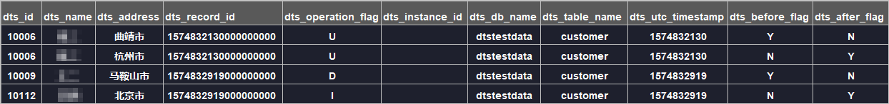

结构定义说明：

| 旧版附加列名称 | 新版附加列名称 | 数据类型 | 说明 |
| --- | --- | --- | --- |
| <code>dts_record</code><br><code>_id</code> | <code>new_dts_sync_dts_rec</code><br><code>ord_id</code> | String | 增量日志的记录ID，为该日志唯一标识。<br>说明<br>• 正常情况下是全局唯一自增的，在容灾的情况下会有回退且无法保证自增和唯一。<br>• 如果增量日志的操作类型为UPDATE，那么增量更新会被拆分成两条记录（分别记录更新前和更新后的值），且<code> dts_record_id </code>的值相同。 |
| <code>dts_operat</code><br><code>ion_flag</code> | <code>new_dts_sync_dts_ope</code><br><code>ration_flag</code> | String | 操作类型，取值：<br>• I：INSERT操作。<br>• D：DELETE操作。<br>• U：UPDATE操作。 |
| <code>dts_instan</code><br><code>ce_id</code> | <code>new_dts_sync_dts_ins</code><br><code>tance_id</code> | String | 数据库的server ID。暂不支持显示实际的值，目前固定为<code> null </code>。 |
| <code>dts_db_nam</code><br><code>e</code> | <code>new_dts_sync_dts_db_</code><br><code>name</code> | String | 数据库名称。 |
| <code>dts_table_</code><br><code>name</code> | <code>new_dts_sync_dts_tab</code><br><code>le_name</code> | String | 表名。 |
| <code>dts_utc_ti</code><br><code>mestamp</code> | <code>new_dts_sync_dts_utc</code><br><code>_timestamp</code> | String | 操作时间戳，即redo log的时间戳（UTC 时间）。 |
| <code>dts_before</code><br><code>_flag</code> | <code>new_dts_sync_dts_bef</code><br><code>ore_flag</code> | String | 所有列的值是否更新前的值，取值：Y或N。 |
| <code>dts_after_</code><br><code>flag</code> | <code>new_dts_sync_dts_aft</code><br><code>er_flag</code> | String | 所有列的值是否更新后的值，取值：Y或N。 |

**关于dts_before_flag和dts_after_flag的补充说明**

对于不同的操作类型，增量日志中的 `dts_before_flag` 和 `dts_after_flag` 定义如下：

- INSERT当操作类型为INSERT时，所有列的值为新插入的值，即为更新后的值，所以 `dts_before_flag` 取值为N， `dts_after_flag` 取值为Y，示例如下。

  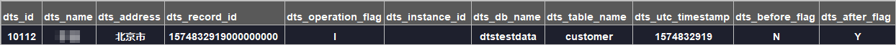

- UPDATE当操作类型为UPDATE时，DTS会将UPDATE操作拆为两条增量日志。这两条增量日志的 `dts_record_id` 、 `dts_operation_flag` 及 `dts_utc_timestamp` 对应的值相同。第一条增量日志记录了更新前的值，所以 `dts_before_flag` 取值为Y， `dts_after_flag` 取值为N。第二条增量日志记录了更新后的值，所以  `dts_before_flag` 取值为N， `dts_after_flag` 取值为Y，示例如下。

  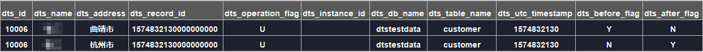

- DELETE当操作类型为DELETE时，增量日志中所有的列值为被删除的值，即列值不变，所以 `dts_before_flag` 取值为Y，  `dts_after_flag` 取值为N，示例如下。

  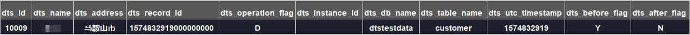

<a id="section-4-5-15"></a>

### 4.5.15. 从自建Oracle同步到MaxCompute

本小节介绍如何使用数据传输服务快速创建自建Oracle实例到MaxCompute实例间的实时同步作业。

**前提条件**

- 自建Oracle数据库版本为9i、10g、11g、12c、18c或19c版本。

- 自建Oracle数据库已开启ARCHIVELOG（归档模式），设置合理的归档日志保持周期且归档日志能够被访问，详情请参见ARCHIVELOG。

- 自建Oracle数据库已开启Supplemental Logging，且已开启supplemental_log_data_pk，supplemental_log_data_ui，详情请参见Supplemental Logging。

- MaxCompute实例中，已创建用作接收同步数据的Project。

**注意事项**

<table>
  <tr>
    <th width="90">类型</th>
    <th>说明</th>
  </tr>
  <tr>
    <td>源库限制</td>
    <td>• 同步对象要求：<br>• 待同步的表需具备主键或唯一约束，且字段具有唯一性，否则可能会导致目标数据库中出现重复数据。<br>• 如果您的自建Oracle版本为12c及以上，待同步表的名称长度需不超过30个字节。<br>• 如同步对象为表级别，且需进行编辑（如表列名映射），则单次同步任务仅支持同步至多1000张表。当超出数量限制，任务提交后会显示请求报错，此时建议您拆分待同步的表，分批配置多个任务，或者配置整库的同步任务。<br>• 如自建Oracle为RAC架构，不支持配置ScanIP，仅支持将其中任意1个VIP配置到连接信息中，该方式配置后不支持RAC的节点切换。<br>• Redo Log、Archive Log：<br>• 需开启。<br>• 如为增量同步任务，DTS要求源数据库的Redo Log、Archive Log保存24小时以上，如为库表结构同步和增量同步任务，DTS要求源数据库的Redo Log、Archive Log至少保留7天以上（您可在库表结构同步完成后将Redo Log、Archive Log保存时间设置为24小时以上），否则DTS可能因无法获取Redo Log、Archive Log而导致任务失败，极端情况下甚至可能会导致数据不一致或丢失。由于您所设置的Redo Log、Archive Log保存时间低于DTS要求的时间进而导致的问题，不在DTS的SLA保障范围内。<br>• 如果源库在同步阶段进行主备切换，将会导致同步任务失败。</td>
  </tr>
  <tr>
    <td>其他限制</td>
    <td>• 仅支持表级别的数据同步。<br>• 由于MaxCompute不支持主键约束，当DTS在同步数据时因网络等原因触发重传，可能会导致MaxCompute中出现重复记录。<br>• 执行数据同步前需评估源库和目标库的性能，同时建议业务低峰期执行数据同步。否则全量数据初始化时将占用源库和目标库一定的读写资源，可能会导致数据库的负载上升。<br>• 全量初始化会并发执行INSERT操作，导致目标数据库的表产生碎片，因此全量初始化完成后目标实例的表空间比源实例的表空间大。<br>• 对于表级别的数据同步，请勿对源库的同步对象使用gh-ost或pt-online-schema-change等类似工具执行在线DDL变更，否则会导致同步失败。</td>
  </tr>
</table>

**数据库账号的权限要求**

| 数据库 | 所需权限 | 账号创建及授权方法 |
| --- | --- | --- |
| 自建Oracle数据库 | DBA | CREATE USER和GRANT。<br>重要如需执行同步，且不允许授予DBA权限，您需要按照如下方法开启归档和补充日志，并为Oracle数据库账号授予更精细化的权限。 |

**Oracle的日志开启和精细化授权**

> 如需执行同步，且不允许授予DBA权限，您需要按照如下方法开启归档和补充日志，并为
>
> **重要**
>
> Oracle数据库账号授予更精细化的权限。

1. 开启归档和补充日志。

   <table>
     <tr>
       <th width="90">日志类型</th>
       <th>开启步骤</th>
     </tr>
     <tr>
       <td>归档日志</td>
       <td>执行如下命令，开启归档日志：<br><code>shutdown immediate;</code><br><code>startup mount;</code><br><code>alter database archivelog;</code><br><code>alter database open;</code><br><code>archive log list;</code></td>
     </tr>
   </table>

   <table>
     <tr>
       <td>补充日志</td>
       <td>按业务需求，选择开启库级别补充日志或者表级别补充日志：<br>说明开启库级别补充日志，则DTS任务运行更为稳定；开启表级别补充日志，则更节约源Oracle数据库的磁盘空间。<br>• 开启库级别补充日志<br>a. 打开最小补充日志：<br><code>alter database add supplemental log data;</code><br>b. 开启库级主键、唯一键补充日志：<br><code>alter database add supplemental log data (primary key,unique</code><br><code>index) columns;</code><br>• 开启表级补充日志<br>a. 打开最小补充日志：<br><code>alter database add supplemental log data;</code><br>b. 开启表级补充日志（两者选其一） ：<br>• 开启表级别主键补充日志<br><code>alter table table_name add supplemental log data (primary</code><br><code>key) columns;</code><br>• 开启表级别全字段补充日志<br><code>alter table tb_name add supplemental log data (all)</code><br><code>columns ;</code></td>
     </tr>
   </table>

2. 为Oracle数据库账号授予更精细化的权限。

   - Oracle 9i~11g版本

     ```sql
     #创建数据库账号（以rdsdt_dtsacct为例）并进⾏授权。
     create user rdsdt_dtsacct IDENTIFIED BY rdsdt_dtsacct;
     grant create session to rdsdt_dtsacct;
     grant connect to rdsdt_dtsacct;
     grant resource to rdsdt_dtsacct;
     grant execute on sys.dbms_logmnr to rdsdt_dtsacct;
     grant select on V_$LOGMNR_LOGS to rdsdt_dtsacct;
     grant select on  all_objects to rdsdt_dtsacct;
     grant select on  all_tab_cols to rdsdt_dtsacct;
     grant select on  dba_registry to rdsdt_dtsacct;
     grant select any table to rdsdt_dtsacct;
     grant select any transaction to rdsdt_dtsacct;
     -- v$log privileges
     grant select on v_$log to rdsdt_dtsacct;
     -- v$logfile privileges
     grant select on v_$logfile to rdsdt_dtsacct;
     -- v$archived_log privileges
     grant select on v_$archived_log to rdsdt_dtsacct;
     -- v$parameter privileges
     grant select on v_$parameter to rdsdt_dtsacct;
     -- v$database privileges
     grant select on v_$database to rdsdt_dtsacct;
     -- v$active_instances privileges
     grant select on v_$active_instances to rdsdt_dtsacct;
     -- v$instance privileges
     grant select on v_$instance to rdsdt_dtsacct;
     -- v$logmnr_contents privileges
     grant select on v_$logmnr_contents to rdsdt_dtsacct;
     -- system tables
     grant select on sys.USER$ to rdsdt_dtsacct;
     grant select on SYS.OBJ$ to rdsdt_dtsacct;
     grant select on SYS.COL$ to rdsdt_dtsacct;
     grant select on SYS.IND$ to rdsdt_dtsacct;
     grant select on SYS.ICOL$ to rdsdt_dtsacct;
     grant select on SYS.CDEF$ to rdsdt_dtsacct;
     grant select on SYS.CCOL$ to rdsdt_dtsacct;
     grant select on SYS.TABPART$ to rdsdt_dtsacct;
     grant select on SYS.TABSUBPART$ to rdsdt_dtsacct;
     grant select on SYS.TABCOMPART$ to rdsdt_dtsacct;
     ```

   - Oracle 12c~19c（租户式）

     ```sql
     #切换⾄PDB，创建数据库账号（以rdsdt_dtsacct为例）并进⾏授权。
     ALTER SESSION SET container = ORCLPDB1;
     create user rdsdt_dtsacct IDENTIFIED BY rdsdt_dtsacct;
     grant create  session to rdsdt_dtsacct;
     grant connect  to rdsdt_dtsacct;
     grant resource to rdsdt_dtsacct;
     grant execute on sys.dbms_logmnr to rdsdt_dtsacct;
     grant select on  all_objects to rdsdt_dtsacct;
     grant select on  all_tab_cols to rdsdt_dtsacct;
     grant select on  dba_registry to rdsdt_dtsacct;
     grant select any table to rdsdt_dtsacct;
     grant select any transaction to rdsdt_dtsacct;
     -- v$log privileges
     grant select on v_$log to rdsdt_dtsacct;
     -- v$logfile privileges
     grant select on v_$logfile to rdsdt_dtsacct;
     -- v$archived_log privileges
     grant select on v_$archived_log to rdsdt_dtsacct;
     -- v$parameter privileges
     grant select on v_$parameter to rdsdt_dtsacct;
     -- v$database privileges
     grant select on v_$database to rdsdt_dtsacct;
     -- v$active_instances privileges
     grant select on v_$active_instances to rdsdt_dtsacct;
     -- v$instance privileges
     grant select on v_$instance to rdsdt_dtsacct;
     -- v$logmnr_contents privileges
     grant select on v_$logmnr_contents to rdsdt_dtsacct;
     grant select on sys.USER$ to rdsdt_dtsacct;
     grant select on SYS.OBJ$ to rdsdt_dtsacct;
     grant select on SYS.COL$ to rdsdt_dtsacct;
     grant select on SYS.IND$ to rdsdt_dtsacct;
     grant select on SYS.ICOL$ to rdsdt_dtsacct;
     grant select on SYS.CDEF$ to rdsdt_dtsacct;
     grant select on SYS.CCOL$ to rdsdt_dtsacct;
     grant select on SYS.TABPART$ to rdsdt_dtsacct;
     grant select on SYS.TABSUBPART$ to rdsdt_dtsacct;
     grant select on SYS.TABCOMPART$ to rdsdt_dtsacct;
     -- V$PDBS privileges
     grant select on V_$PDBS to rdsdt_dtsacct;

     #切换⾄CDB，并在如下两种⽅式选其⼀，进⾏账号创建并授权。
     ALTER SESSION SET container = CDB$ROOT;
     #⽅式⼀：创建C##开头的全局账号（以C##rdsdt_dtsacct为例）并进⾏授权（如使⽤⽅式⼀，则您需要联系D
     TS运维⼈员）。
     create user C##rdsdt_dtsacct IDENTIFIED BY rdsdt_dtsacct;
     grant create session to C##rdsdt_dtsacct;
     grant connect to C##rdsdt_dtsacct;
     grant resource to C##rdsdt_dtsacct;
     grant select on v_$logmnr_contents to C##rdsdt_dtsacct;
     grant LOGMINING to C##rdsdt_dtsacct;
     grant EXECUTE_CATALOG_ROLE to C##rdsdt_dtsacct;
     grant execute on sys.dbms_logmnr to C##rdsdt_dtsacct;
     #⽅式⼆：创建数据库账号（以rdsdt_dtsacct为例）并进⾏授权（如使⽤⽅式⼆，则您需修改Oracle数据库的
     默认参数）。
     alter session set "_ORACLE_SCRIPT"=true;
     create user rdsdt_dtsacct IDENTIFIED BY rdsdt_dtsacct;
     grant create session to rdsdt_dtsacct;
     grant connect to rdsdt_dtsacct;
     grant select on v_$logmnr_contents to rdsdt_dtsacct;
     grant LOGMINING TO rdsdt_dtsacct;
     grant EXECUTE_CATALOG_ROLE to rdsdt_dtsacct;
     grant execute on sys.dbms_logmnr to rdsdt_dtsacct;
     ```

   - Oracle 12c~19c（非租户式）

     ```sql
     #创建数据库账号（以rdsdt_dtsacct为例）并进⾏授权。
     create user rdsdt_dtsacct IDENTIFIED BY rdsdt_dtsacct;
     grant create  session to rdsdt_dtsacct;
     grant connect  to rdsdt_dtsacct;
     grant resource to rdsdt_dtsacct;
     grant select on V_$LOGMNR_LOGS to rdsdt_dtsacct;
     grant select on  all_objects to rdsdt_dtsacct;
     grant select on  all_tab_cols to rdsdt_dtsacct;
     grant select on  dba_registry to rdsdt_dtsacct;
     grant select any table to rdsdt_dtsacct;
     grant select any transaction to rdsdt_dtsacct;
     -- v$log privileges
     grant select on v_$log to rdsdt_dtsacct;
     -- v$logfile privileges
     grant select on v_$logfile to rdsdt_dtsacct;
     -- v$archived_log privileges
     grant select on v_$archived_log to rdsdt_dtsacct;
     -- v$parameter privileges
     grant select on v_$parameter to rdsdt_dtsacct;
     -- v$database privileges
     grant select on v_$database to rdsdt_dtsacct;
     -- v$active_instances privileges
     grant select on v_$active_instances to rdsdt_dtsacct;
     -- v$instance privileges
     grant select on v_$instance to rdsdt_dtsacct;
     -- v$logmnr_contents privileges
     grant select on v_$logmnr_contents to rdsdt_dtsacct;
     grant select on sys.USER$ to rdsdt_dtsacct;
     grant select on SYS.OBJ$ to rdsdt_dtsacct;
     grant select on SYS.COL$ to rdsdt_dtsacct;
     grant select on SYS.IND$ to rdsdt_dtsacct;
     grant select on SYS.ICOL$ to rdsdt_dtsacct;
     grant select on SYS.CDEF$ to rdsdt_dtsacct;
     grant select on SYS.CCOL$ to rdsdt_dtsacct;
     grant select on SYS.TABPART$ to rdsdt_dtsacct;
     grant select on SYS.TABSUBPART$ to rdsdt_dtsacct;
     grant select on SYS.TABCOMPART$ to rdsdt_dtsacct;
     grant LOGMINING TO rdsdt_dtsacct;
     grant EXECUTE_CATALOG_ROLE to rdsdt_dtsacct;
     grant execute on sys.dbms_logmnr to rdsdt_dtsacct;
     ```

     > 当Oracle数据库为12c~19c（租户式），且切换至CDB$ROOT，如需创建C##开
     >
     > **说明**
     >
     > 头的全局账号，则您需要联系运维人员配合修改部分参数。

**同步作业配置流程**

下面详细介绍自建Oracle到MaxCompute数据实时同步作业的配置流程。

1. 创建数据同步实例。

   > **说明**
   >
   > 创建实例时，**源数据库类型**选择为**Oracle**，**目标数据库类型**选择为**MaxCompute**。

2. 在同步作业列表中，找到刚创建的数据同步实例，单击**配置任务**。

3. 配置源实例和目标实例信息。

   <table>
     <tr>
       <th>类别</th>
       <th>配置</th>
       <th>说明</th>
     </tr>
     <tr>
       <td>无</td>
       <td>任务名称</td>
       <td>DTS会自动生成一个同步作业名称，建议配置具有业务意义的名称（无唯一性要求），便于后续识别。</td>
     </tr>
     <tr>
       <td rowspan="8">源库信息</td>
       <td>数据库类型</td>
       <td>选择<strong>Oracle</strong>。</td>
     </tr>
     <tr>
       <td>接入方式</td>
       <td>选择<strong>公网IP</strong>。</td>
     </tr>
     <tr>
       <td>实例地区</td>
       <td>购买数据同步实例时选择的源实例地域信息，不可变更。</td>
     </tr>
     <tr>
       <td>主机名或IP地址</td>
       <td>填入自建Oracle的数据库的连接地址或IP地址。</td>
     </tr>
     <tr>
       <td>端口</td>
       <td>填入自建Oracle的数据库服务端口，默认为1521。</td>
     </tr>
     <tr>
       <td>Oracle类型</td>
       <td>• <strong>非RAC实例</strong>：若选择该项，您还需要填写<strong>SID</strong>信息。<br>• <strong>RAC或PDB实例</strong>：若选择该项，您还需要填写<strong>Service Name</strong>（实例的服务器名）信息。</td>
     </tr>
     <tr>
       <td>数据库账号</td>
       <td>填入自建Oracle的数据库账号。</td>
     </tr>
     <tr>
       <td>数据库密码</td>
       <td>填入数据库账号对应的密码。</td>
     </tr>
     <tr>
       <td rowspan="6">目标库信息</td>
       <td>数据库类型</td>
       <td>选择<strong>MaxCompute</strong>。</td>
     </tr>
     <tr>
       <td>接入方式</td>
       <td>选择<strong>云实例</strong>。</td>
     </tr>
     <tr>
       <td>实例地区</td>
       <td>购买数据同步实例时选择的目标实例地域信息，不可变更。</td>
     </tr>
     <tr>
       <td>Project</td>
       <td>选择MaxCompute实例的Project名称。</td>
     </tr>
     <tr>
       <td>accessKeyId</td>
       <td rowspan="2">分别填入用于标识用户的AccessKey Id和用于验证用户的密钥AccessKey Secret。<br>说明获取方法，请参见大数据计算服务<strong>《开发指南》</strong>中的<strong>《获取组织</strong><strong>Accesskey》</strong>章节。</td>
     </tr>
     <tr>
       <td>accessSecret</td>
     </tr>
   </table>

4. 配置完成后，单击页面下方的**测试连接以进行下一步**。

5. 如果您的自建Oracle数据库具备白名单安全设置，请将弹跳框中提示的DTS服务器的IP地址，加入自建Oracle数据库的白名单安全设置中。白名单安全设置完成后，单击**测试连接以进行下一步**。

   > **说明**
   >
   > 如果您的自建Oracle数据库无需进行白名单安全设置，请直接单击**测试连接以进行下一步**。

6. 单击**确定**，完成ODPS账号授权。

7. 配置同步策略和同步对象。

   <table>
     <tr>
       <th width="199">配置项目</th>
       <th>配置说明</th>
     </tr>
     <tr>
       <td>任务步骤</td>
       <td>固定选中<strong>增量同步</strong>。默认情况下，您还需要同时选中<strong>库表结构同步</strong>和<strong>全量同步</strong>。预检查完成后，DTS会将源实例中待同步对象的全量数据在目标集群中初始化，作为后续增量同步数据的基线数据。</td>
     </tr>
     <tr>
       <td>目标已存在表的处理模式</td>
       <td>• <strong>预检查并报错拦截</strong>：检查目标数据库中是否有同名的表。如果目标数据库中没有同名的表，则通过该检查项目；如果目标数据库中有同名的表，则在预检查阶段提示错误，数据同步作业不会被启动。<br>• <strong>忽略报错并继续执行</strong>：跳过目标数据库中是否有同名表的检查项。<br>警告选择为<strong>忽略报错并继续执行</strong>，可能导致数据不一致，给业务带来风险，例如：<br>• 表结构一致的情况下，如果在目标库遇到与源库主键的值相同的记录，在初始化阶段会保留目标库中的该条记录；在增量同步阶段则会覆盖目标库的该条记录。<br>• 表结构不一致的情况下，可能会导致无法初始化数据、只能同步部分列的数据或同步失败。</td>
     </tr>
     <tr>
       <td>是否启用新的附加列规则</td>
       <td>DTS在将数据同步到MaxCompute时，会在同步的目标表中添加一些附加列。如果附加列和目标表中已有的列出现名称冲突将会导致数据同步失败。请根据业务需求选择是否使用附加列规则。<br>• <strong>新规则</strong>：使用新版附加列规则。<br>• <strong>旧规则</strong>：使用旧版附加列规则。<br>• <strong>不使用默认附加列规则</strong>：不使用附加列规则。<br>警告在选择附加列规则前，您需要评估附加列和目标表中已有的列是否会出现名称冲突。</td>
     </tr>
     <tr>
       <td>增量日志表分区定义</td>
       <td>根据业务需求，选择分区名称。</td>
     </tr>
     <tr>
       <td>源库对象</td>
       <td>在<strong>源库对象</strong>框中单击待同步的对象（库或表），然后单击图标将其移动至<strong>已选择</strong><br><strong>对象</strong>框。<br>说明如果选择整个库作为同步对象，那么该库中所有对象的结构变更操作都会同步至目标库。</td>
     </tr>
     <tr>
       <td>已选择对象</td>
       <td>默认情况下，同步对象的名称保持不变。如果您需要改变同步对象在目标实例中的名称，请使用对象名映射功能，详情请参见设置同步对象在目标实例中的名称。<br>说明<br>• 如需按库或表级别选择同步的SQL操作，请在<strong>已选择对象</strong>中右击待同步对象，并在弹出的对话框中选择所需同步的SQL操作。<br>• 如需设置WHERE条件过滤数据，请在<strong>已选择对象</strong>中右击待同步的表，在弹出的对话框中设置过滤条件。设置方法请参见通过SQL条件过滤待同步数据。<br>• 如果使用了对象名映射功能，可能会导致依赖这个对象的其他对象同步失败。</td>
     </tr>
   </table>

8. 单击**下一步高级配置**，进行高级配置。

   | 配置项目 | 配置说明 |
   | --- | --- |
   | 源库、目标库无法连接后的重试时间 | 在同步任务启动后，若源库或目标库连接失败则DTS会报错。对于可预期的报错，DTS会立即进行持续的重试连接，默认持续重试时间为720分钟，您也可以在取值范围（10~1440分钟）内自定义重试时间，建议设置30分钟以上。如果DTS在设置的重试时间内重新连接上源库、目标库，同步任务将自动恢复。否则，同步任务将会失败。<br>说明针对同源或者同目标的多个DTS实例，如DTS实例A和DTS实例B，设置网络重试时间时A设置30分钟，B设置60分钟，则重试时间以低的30分钟为准。 |
   | 配置编码类型 | 根据实际情况，选择源库实际业务写入的编码类型。 |
   | 配置ETL功能 | 选择是否配置ETL功能。<br>• <strong>是</strong>：配置ETL功能，并在文本框中填写数据处理语句。更多信息，请参见在同步任务中配置ETL。<br>• <strong>否</strong>：不配置ETL功能。 |

9. 上述配置完成后，单击页面下方的**下一步预检查并启动**。

   > **重要**
   >
   > - 在数据同步任务正式启动之前，会先进行预检查。只有预检查通过后，才能成功启动数据同步任务。
   >
   > - 如果预检查失败，请单击**查看详情**并请根据提示修复问题，然后重新进行预检查。

0. **预检查通过率**显示为100%时，单击**返回列表**。

<a id="section-4-5-16"></a>

### 4.5.16. 从PolarDB PostgreSQL版（兼容Oracle）同步到云原生数据仓库AnalyticDB MySQL 3.0

云原生数据仓库AnalyticDB MySQL版 3.0（原分析型数据库MySQL版）是阿里巴巴自主研发的海量数据实时高并发在线分析（Realtime OLAP）云计算服务，通过DTS您可以将PolarDB PostgreSQL版（兼容Oracle）同步到云原生数据仓库AnalyticDB MySQL 3.0。

**前提条件**

源PolarDB PostgreSQL版（兼容Oracle）集群中，待迁移的表需具备主键或非空唯一索引。

**注意事项**

<table>
  <tr>
    <th width="90">类型</th>
    <th>说明</th>
  </tr>
  <tr>
    <td>源库限制</td>
    <td>• 带宽要求：源库所属的服务器需具备足够出口带宽，否则将影响数据同步速率。<br>• 待同步的表需具备主键或唯一约束，且字段具有唯一性，否则可能会导致目标数据库中出现重复数据。<br>• 如同步对象为表级别，且需进行编辑（如表列名映射），则单次同步任务待同步的表数量超过1000时，建议您拆分待同步的表，分批配置为多个任务，或者配置整库的同步任务，否则任务提交后可能会显示请求报错。<br>• 需开启WAL日志。如为增量同步任务，DTS要求源数据库的WAL日志保存24小时以上，如为全量同步和增量同步任务，DTS要求源数据库的WAL日志至少保留7天以上（您可在全量同步完成后将WAL日志保存时间设置为24小时以上），否则DTS可能因无法获取WAL日志而导致任务失败，极端情况下甚至可能会导致数据不一致或丢失。由于您所设置的WAL日志保存时间低于DTS要求的时间进而导致的问题，不在DTS的SLA保障范围内。<br>• 若源库有长事务，在增量同步任务运行时可能会导致源库长事务提交前的预写日志WAL（Write-Ahead Logging）无法清理而堆积，从而造成源库磁盘空间不足。<br>• 在库表结构同步和全量同步阶段，请勿执行库或表结构变更的DDL操作，否则数据同步任务会失败。</td>
  </tr>
  <tr>
    <td>其他限制</td>
    <td>• 暂不支持同步前缀索引，如果源库存在前缀索引可能导致数据同步失败。<br>• 由于云原生数据仓库AnalyticDB MySQL版（3.0）本身的使用限制，当云原生数据仓库AnalyticDB MySQL版（3.0）集群中的节点磁盘空间使用量超过80%，会导致DTS任务异常，产生延迟。请提前根据待同步的对象预估所需空间，确保目标集群具备充足的存储空间。<br>• 执行数据同步前需评估源库和目标库的性能，同时建议业务低峰期执行数据同步。否则全量数据初始化时将占用源库和目标库一定的读写资源，可能会导致数据库的负载上升。<br>• 全量初始化会并发执行INSERT操作，导致目标数据库的表产生碎片，因此全量初始化完成后目标实例的表空间比源实例的表空间大。<br>• 对于表级别的数据同步，请勿对源库的同步对象使用gh-ost或pt-online-schema-change等类似工具执行在线DDL变更，否则会导致同步失败。<br>• 对于表级别的数据同步，如果除DTS以外的数据没有写入目标库云原生数据仓库AnalyticDB MySQL版，您可以使用数据管理DMS（Data Management Service）来执行在线DDL变更。<br>警告如果有除DTS外的数据写入目标库，请勿使用DMS执行在线DDL变更，否则可能引起目标库数据丢失。</td>
  </tr>
</table>

**支持同步的SQL操作**

INSERT、UPDATE、DELETE

> **说明**
>
> 数据在写入到AnalyticDB MySQL 3.0时，UPDATE语句会自动转化为REPLACE INTO语句。

**操作步骤**

1. 创建数据同步实例。

   > **说明**
   >
   > 创建时，选择源数据库类型为**PolarDB Oracle**，目标数据库类型为**AnalyticDB MySQL 3.0**。

2. 在同步作业列表中，找到刚创建的数据同步实例，单击**配置任务**。

3. 配置源实例和目标实例信息。

   <table>
     <tr>
       <th>类别</th>
       <th>配置</th>
       <th>说明</th>
     </tr>
     <tr>
       <td>无</td>
       <td>任务名称</td>
       <td>DTS会自动生成一个同步作业名称，建议配置具有业务意义的名称（无唯一性要求），便于后续识别。</td>
     </tr>
     <tr>
       <td rowspan="9">源库信息</td>
       <td>数据库类型</td>
       <td>选择<strong>PolarDB Oracle</strong>。</td>
     </tr>
     <tr>
       <td>接入方式</td>
       <td>选择<strong>云实例</strong>。</td>
     </tr>
     <tr>
       <td>实例地区</td>
       <td>创建数据同步实例时已指定，不可变更。</td>
     </tr>
     <tr>
       <td>是否跨阿里云账号</td>
       <td>选择<strong>不跨账号</strong>。</td>
     </tr>
     <tr>
       <td>架构类型</td>
       <td>默认为<strong>本地盘双节点</strong>，当前仅支持此架构类型。</td>
     </tr>
     <tr>
       <td>实例ID</td>
       <td>选择源PolarDB PostgreSQL版（兼容Oracle）实例ID。</td>
     </tr>
     <tr>
       <td>数据库名称</td>
       <td>填入待同步的数据库名称。</td>
     </tr>
     <tr>
       <td>数据库账号</td>
       <td>填入源PolarDB PostgreSQL版（兼容Oracle）集群的高权限账号。</td>
     </tr>
     <tr>
       <td>数据库密码</td>
       <td>填入该数据库账号的密码。</td>
     </tr>
     <tr>
       <td rowspan="6">目标库信息</td>
       <td>数据库类型</td>
       <td>选择<strong>AnalyticDB MySQL 3.0</strong>。</td>
     </tr>
     <tr>
       <td>接入方式</td>
       <td>选择<strong>云实例</strong>。</td>
     </tr>
     <tr>
       <td>实例地区</td>
       <td>创建数据同步实例时已指定，不可变更。</td>
     </tr>
     <tr>
       <td>实例ID</td>
       <td>选择目标AnalyticDB MySQL 3.0的实例ID。</td>
     </tr>
     <tr>
       <td>数据库账号</td>
       <td>填入目标AnalyticDB MySQL 3.0实例的数据库账号，需具备目标数据库的读写权限。</td>
     </tr>
     <tr>
       <td>数据库密码</td>
       <td>填入该数据库账号的密码。</td>
     </tr>
   </table>

4. 配置完成后，单击页面下方的**测试连接以进行下一步**。

5. 配置同步策略及对象信息。

   <table>
     <tr>
       <th width="89">配置</th>
       <th>说明</th>
     </tr>
     <tr>
       <td>任务步骤</td>
       <td>固定选中<strong>增量同步</strong>。默认情况下，您还需要同时选中<strong>库表结构同步</strong>和<strong>全量同步</strong>。预检查完成后，DTS会将源实例中待同步对象的全量数据在目标集群中初始化，作为后续增量同步数据的基线数据。</td>
     </tr>
   </table>

   <table>
     <tr>
       <td>目标已存在表的处理模式</td>
       <td>• <strong>预检查并报错拦截</strong>：检查目标数据库中是否有同名的表。如果目标数据库中没有同名的表，则通过该检查项目；如果目标数据库中有同名的表，则在预检查阶段提示错误，数据同步作业不会被启动。<br>• <strong>忽略报错并继续执行</strong>：跳过目标数据库中是否有同名表的检查项。<br>警告选择为<strong>忽略报错并继续执行</strong>，可能导致数据不一致，给业务带来风险，例如：<br>• 表结构一致的情况下，如果在目标库遇到与源库主键的值相同的记录，在初始化阶段会保留目标库中的该条记录；在增量同步阶段则会覆盖目标库的该条记录。<br>• 表结构不一致的情况下，可能会导致无法初始化数据、只能同步部分列的数据或同步失败。</td>
     </tr>
     <tr>
       <td>实例级别选择所需同步的DDL和DML</td>
       <td>按实例级别选择增量同步的SQL操作，支持的同步操作，请参见支持同步的SQL操作。<br>说明如需按库或表级别选择同步的SQL操作，请在<strong>已选择对象</strong>中右击同步对象，在弹跳框中勾选所需同步的SQL操作。</td>
     </tr>
     <tr>
       <td>多表归并</td>
       <td>• 选择为<strong>是</strong>：DTS将在每个表中增加<code> __dts_data_source </code>列来存储数据来源，且不再支持DDL同步。<br>说明选择源库的多个表后，您需要通过对象名映射功能，将其改为目标库中的同一个表名。<br>• 选择为<strong>否</strong>：默认选项，支持DDL同步。<br>重要<br>• 多表归并功能基于任务级别，即不支持基于表级别执行多表归并。如果需要让部分表执行多表归并，另一部分不执行多表归并，您可以创建两个数据同步作业。<br>• 开启多表归并的增量任务不支持DDL操作。若源库有DDL操作，则会导致目标库数据丢失或任务失败。</td>
     </tr>
     <tr>
       <td>目标库对象名称大小写策略</td>
       <td>您可以配置目标实例中迁移对象的库名、表名和列名的英文大小写策略。默认情况下选择<strong>DTS默认策略</strong>，您也可以选择与源库、目标库默认策略保持一致。更多信息，请参见目标库对象名称大小写策略。</td>
     </tr>
     <tr>
       <td>源库对象</td>
       <td>在<strong>源库对象</strong>框中单击待同步的对象（库或表），然后单击图标将其移动至<strong>已选择对</strong><br><strong>象</strong>框。</td>
     </tr>
     <tr>
       <td>已选择对象</td>
       <td>默认情况下，同步对象的名称保持不变。如果您需要改变同步对象在目标实例中的名称，请使用对象名映射功能，详情请参见设置同步对象在目标实例中的名称。<br>说明<br>• 若您使用了多表归并功能，则需将表名称修改为待同步的表在目标库中的表名。<br>• 如果使用了对象名映射功能，可能会导致依赖这个对象的其他对象同步失败。</td>
     </tr>
   </table>

6. 单击**下一步高级配置**，进行高级配置。

   | 配置项目 | 配置说明 |
   | --- | --- |
   | 源库、目标库无法连接后的重试时间 | 在同步任务启动后，若源库或目标库连接失败则DTS会报错。对于可预期的报错，DTS会立即进行持续的重试连接，默认持续重试时间为720分钟，您也可以在取值范围（10~1440分钟）内自定义重试时间，建议设置30分钟以上。如果DTS在设置的重试时间内重新连接上源库、目标库，同步任务将自动恢复。否则，同步任务将会失败。<br>说明针对同源或者同目标的多个DTS实例，如DTS实例A和DTS实例B，设置网络重试时间时A设置30分钟，B设置60分钟，则重试时间以低的30分钟为准。 |
   | 配置ETL功能 | 当前链路暂不支持配置ETL功能，请选择<strong>否</strong>。 |

7. <strong>可选：</strong>单击**下一步配置库表字段**，设置待同步的表在目标库中类型。

   > **说明**
   >
   > 如果选择了**库表结构同步**，您需要定义待同步的表在云原生数据仓库AnalyticDB MySQL实例中的**类型**、**主键列**、**分布键**等信息。

8. 上述配置完成后，单击页面下方的**下一步预检查并启动**。

   > **重要**
   >
   > - 在数据同步任务正式启动之前，会先进行预检查。只有预检查通过后，才能成功启动数据同步任务。
   >
   > - 如果预检查失败，请单击**查看详情**并请根据提示修复问题，然后重新进行预检查。

9. **预检查通过率**显示为100%时，单击**返回列表**。

<a id="section-4-5-17"></a>

### 4.5.17. 从Redis实例同步至Redis实例

数据传输服务DTS（Data Transmission Service）支持单向、双向同步云数据库Redis，适用于资源迁移或合并、业务架构调整等多种应用场景。

**前提条件**

- 源云数据库Redis的引擎版本为4.0（社区版）或5.0（社区版、企业版）。

  > **说明**
  >
  > 目标云数据库Redis支持的版本为4.0或5.0版本，如需跨版本同步（仅支持从低版本同步到高版本）请提前确认兼容性。

- 源云数据库Redis的网络类型为专有网络。

- 源Redis实例需关闭SSL加密功能。

- 目标云数据库Redis可用的存储空间需大于源云数据库Redis已使用的存储空间。

- 由于Redis企业版扩展了Redis模块（Redis Modules），如果源Redis实例为企业版，为保障业务兼容性，要求目标Redis实例为Redis企业版。

**注意事项**

<table>
  <tr>
    <th width="90">类型</th>
    <th>说明</th>
  </tr>
  <tr>
    <td>源库限制</td>
    <td>• 待同步的集合需具备主键或唯一约束，且字段具有唯一性，否则可能会导致目标数据库中出现重复数据。<br>• 为保障同步质量，DTS会在源库中插入一个key：DTS_REDIS_TIMESTAMP_HEARTBEAT，用于记录更新时间点。<br>• 为保障同步链路稳定性，建议将配置文件redis.conf中<code> repl-backlog-size </code>参数的值适当调大。<br>• AOF日志：<br>• 需开启。<br>• 如为增量同步任务，DTS要求源数据库的AOF日志保存24小时以上，如为全量同步和增量同步任务，DTS要求源数据库的AOF日志至少保留7天以上（您可在全量同步完成后将AOF日志保存时间设置为24小时以上），否则DTS可能因无法获取AOF日志而导致任务失败，极端情况下甚至可能会导致数据不一致或丢失。由于您所设置的AOF日志保存时间低于DTS要求的时间进而导致的问题，不在DTS的SLA保障范围内。<br>说明云数据库Redis不存在该限制。<br>• 如果源库中的某些Key使用了过期（expire）策略，由于可能存在Key已过期但未被及时删除的情况，所以在目标库中查看到的Key数量（例如通过info命令查看）会比源库的Key数量少。<br>• 如果目标库的数据逐出策略（<code> maxmemory-policy </code>）配置为<code> noeviction </code>以外的值，可能导致目标库的数据与源库不一致。</td>
  </tr>
  <tr>
    <td>其他限制</td>
    <td>• 同步期间，如源Redis发生扩缩容（如增加或者减少分片）、规格变配（如扩大内存），则您需重新配置任务。且为保障数据一致性，建议重新配置任务前，先清空已同步至目标Redis的数据。<br>• 同步期间，如源Redis连接地址变化，则您需要联系技术支持人员进行处理，如果长时间未处理，源Redis会重置AOF文件，届时您需重新配置任务。<br>• 建议源和目标库版本保持一致，或者从低版本同步到高版本以保障兼容性。如为高版本同步至低版本，可能存在数据库兼容性问题。<br>• 执行数据同步前需评估源库和目标库的性能，同时建议业务低峰期执行数据同步。否则全量数据初始化时将占用源库和目标库一定的读写资源，可能会导致数据库的负载上升。<br>• 在DTS同步期间，不允许有除DTS外的数据写入目标库，否则会导致源库与目标库数据不一致。例如，有除DTS外的数据写入目标库时，使用DMS执行在线DDL变更，可能引起目标库数据丢失。</td>
  </tr>
</table>

**支持同步的SQL操作**

| 版本类型 | SQL操作 |
| --- | --- |

<table>
  <tr>
    <td>云数据库Redis社区版</td>
    <td>• APPEND<br>• BITOP、BLPOP、BRPOP、BRPOPLPUSH<br>• DECR、DECRBY、DEL<br>• EVAL、EVALSHA、EXEC、EXPIRE、EXPIREAT<br>• GEOADD、GETSET<br>• HDEL、HINCRBY、HINCRBYFLOAT、HMSET、HSET、HSETNX<br>• INCR、INCRBY、INCRBYFLOAT<br>• LINSERT、LPOP、LPUSH、LPUSHX、LREM、LSET、LTRIM<br>• MOVE、MSET、MSETNX、MULTI<br>• PERSIST、PEXPIRE、PEXPIREAT、PFADD、PFMERGE、PSETEX<br>• RENAME、RENAMENX、RESTORE、RPOP、RPOPLPUSH、RPUSH、RPUSHX<br>• SADD、SDIFFSTORE、SELECT、SET、SETBIT、SETEX、SETNX、SETRANGE、SINTERSTORE、SMOVE、SPOP、SREM、SUNIONSTORE<br>• ZADD、ZINCRBY、ZINTERSTORE、ZREM、ZREMRANGEBYLEX、ZUNIONSTORE、ZREMRANGEBYRANK、ZREMRANGEBYSCORE<br>• SWAPDB、UNLINK（仅当源端Redis实例的版本为4.0时支持）</td>
  </tr>
  <tr>
    <td>云数据库Redis企业版</td>
    <td>• APPEND<br>• BITOP、BLPOP、BRPOP、BRPOPLPUSH<br>• DECR、DECRBY、DEL<br>• EVAL、EVALSHA、EXEC、EXPIRE、EXPIREAT<br>• GEOADD、GETSET<br>• HDEL、HINCRBY、HINCRBYFLOAT、HMSET、HSET、HSETNX<br>• INCR、INCRBY、INCRBYFLOAT<br>• LINSERT、LPOP、LPUSH、LPUSHX、LREM、LSET、LTRIM<br>• MOVE、MSET、MSETNX、MULTI<br>• PERSIST、PEXPIRE、PEXPIREAT、PFADD、PFMERGE、PSETEX<br>• RENAME、RENAMENX、RPOP、RPOPLPUSH、RPUSH、RPUSHX<br>• SADD、SDIFFSTORE、SELECT、SET、SETBIT、SETEX、SETNX、SETRANGE、SINTERSTORE、SMOVE、SPOP、SREM、SUNIONSTORE<br>• UNLINK、ZADD、ZINCRBY、ZINTERSTORE、ZREM、ZREMRANGEBYLEX、ZUNIONSTORE、ZREMRANGEBYRANK、ZREMRANGEBYSCORE</td>
  </tr>
</table>

> **说明**
>
> - 不支持同步PUBLISH命令。
>
> - 对于通过EVAL或者EVALSHA调用Lua脚本，在增量数据同步时，由于目标端在执行脚本时不会明确返回执行结果，DTS无法确保该类型脚本能够执行成功。
>
> - 对于List，由于DTS在调用sync或psync进行重传时，不会对目标端已有的数据进行清空，可能导致出现重复数据。

**操作步骤**

1. 创建数据同步实例。

   > **说明**
   >
   > 创建时，选择源数据库类型为**Redis**、目标数据库类型为**Redis**，并选择同步拓扑为**单向同步**。

2. 在同步作业列表中，找到刚创建的数据同步实例，单击**配置任务**。

3. 配置源库及目标库信息。

   <table>
     <tr>
       <th>类别</th>
       <th>配置</th>
       <th>说明</th>
     </tr>
     <tr>
       <td>无</td>
       <td>任务名称</td>
       <td>DTS会自动生成一个任务名称，建议配置具有业务意义的名称（无唯一性要求），便于后续识别。</td>
     </tr>
     <tr>
       <td rowspan="6">源库信息</td>
       <td>数据库类型</td>
       <td>选择<strong>Redis</strong>。</td>
     </tr>
     <tr>
       <td>接入方式</td>
       <td>选择<strong>云实例</strong>。</td>
     </tr>
     <tr>
       <td>实例地区</td>
       <td>创建数据同步实例时已指定，不可变更。</td>
     </tr>
     <tr>
       <td>是否跨阿里云账号</td>
       <td>选择<strong>不跨账号</strong>。</td>
     </tr>
     <tr>
       <td>实例ID</td>
       <td>选择源云数据库Redis实例ID。</td>
     </tr>
     <tr>
       <td>数据库密码</td>
       <td>填入源云数据库Redis的密码，根据选取的账号（需要具备读权限）填写密码，如果忘记密码，您可以重置密码。<br>• 默认账号（即以实例ID命名的账号）：直接填写密码即可。<br>• 新创建的账号：密码格式为<code> &lt;</code>自定义账号<code>&gt;:&lt;</code>密码<code>&gt; </code>，例如：testaccount:Test1234。<br>说明非必填项，如果没有设置密码可以不填。</td>
     </tr>
     <tr>
       <td rowspan="5">目标库信息</td>
       <td>数据库类型</td>
       <td>选择<strong>Redis</strong>。</td>
     </tr>
     <tr>
       <td>接入方式</td>
       <td>选择<strong>云实例</strong>。</td>
     </tr>
     <tr>
       <td>实例地区</td>
       <td>创建数据同步实例时已指定，不可变更。</td>
     </tr>
     <tr>
       <td>实例ID</td>
       <td>选择目标云数据库Redis实例ID。</td>
     </tr>
     <tr>
       <td>数据库密码</td>
       <td>填入目标云数据库Redis实例的密码，根据选取的账号（需具备读写权限）填写密码。<br>• 默认账号（即以实例ID命名的账号）：直接填写密码即可。<br>• 新创建的账号：密码格式为<code> &lt;</code>自定义账号<code>&gt;:&lt;</code>密码<code>&gt; </code>，例如：testaccount:Test1234。</td>
     </tr>
   </table>

4. 配置完成后，单击页面下方的**测试连接以进行下一步**。

5. 配置任务对象及高级配置。

   | 配置 | 说明 |
   | --- | --- |
   | 任务步骤 | 固定选中<strong>全量同步 + 增量同步</strong>。预检查完成后，DTS会将源实例中待同步对象的全量数据在目标集群中初始化，作为后续增量同步数据的基线数据。<br>说明只有云数据库Redis企业版才支持全量同步， 其他均不支持。 |
   | 目标已存在表的处理模式 | • <strong>预检查并报错拦截</strong>：检查目标数据库中是否有同名的表。如果目标数据库中没有同名的表，则通过该检查项目；如果目标数据库中有同名的表，则在预检查阶段提示错误，数据同步任务不会被启动。<br>• <strong>忽略报错并继续执行</strong>：跳过目标数据库中是否有同名表的检查项。<br>警告选择为<strong>忽略报错并继续执行</strong>，可能导致数据不一致，给业务带来风险，例如：<br>• 表结构一致的情况下，如在目标库遇到与源库主键的值相同的记录：<br>• 全量期间，DTS会保留目标集群中的该条记录，即源库中的该条记录不会同步至目标数据库中。<br>• 增量期间，DTS不会保留目标集群中的该条记录，即源库中的该条记录会覆盖至目标数据库中。<br>• 表结构不一致的情况下，可能会导致无法初始化数据、只能同步部分列的数据或同步失败，请谨慎操作。 |
   | 源库对象 | 在<strong>源库对象</strong>框中单击待同步对象，然后单击将其移动至<strong>已选择对象</strong>框。<br>说明同步对象的选择粒度为库，暂不支持Key粒度的选择。 |
   | 已选择对象 | 默认情况下，同步对象的名称保持不变。如果您需要改变同步对象在目标实例中的名称，请使用对象名映射功能，详情请参见设置同步对象在目标实例中的名称。<br>说明如果使用了对象名映射功能，可能会导致依赖这个对象的其他对象同步失败。 |

6. 单击**下一步高级配置**，进行高级配置。

   | 配置项目 | 配置说明 |
   | --- | --- |
   | 源库、目标库无法连接后的重试时间 | 在同步任务启动后，若源库或目标库连接失败则DTS会报错。对于可预期的报错，DTS会立即进行持续的重试连接，默认持续重试时间为720分钟，您也可以在取值范围（10~1440分钟）内自定义重试时间，建议设置30分钟以上。如果DTS在设置的重试时间内重新连接上源库、目标库，同步任务将自动恢复。否则，同步任务将会失败。<br>说明针对同源或者同目标的多个DTS实例，如DTS实例A和DTS实例B，设置网络重试时间时A设置30分钟，B设置60分钟，则重试时间以低的30分钟为准。 |
   | 配置ETL功能 | 当前链路暂不支持配置ETL功能，请选择<strong>否</strong>。 |

7. 上述配置完成后，单击页面下方的**下一步预检查并启动**。

   > **重要**
   >
   > - 在数据同步任务正式启动之前，会先进行预检查。只有预检查通过后，才能成功启动数据同步任务。
   >
   > - 如果预检查失败，请单击**查看详情**并请根据提示修复问题，然后重新进行预检查。

8. **预检查通过率**显示为100%时，单击**返回列表**。

<a id="section-4-5-18"></a>

### 4.5.18. 自建MongoDB同步至云数据库MongoDB

本文介绍如何使用数据传输服务DTS（Data Transmission Service）实现自建MongoDB同步至云数据库MongoDB。

**前提条件**

源MongoDB数据库版本为3.0、3.2、3.4、3.6、4.0或4.2版本。

**注意事项**

<table>
  <tr>
    <th width="90">类型</th>
    <th>说明</th>
  </tr>
  <tr>
    <td>源库限制</td>
    <td>• 不支持分片集群架构的MongoDB作为源库。<br>• 带宽要求：源库所属的服务器需具备足够出口带宽，否则将影响数据同步的速率。<br>• 待同步的集合需具备主键或唯一约束，且字段具有唯一性，否则可能会导致目标数据库中出现重复数据。<br>• 如同步对象为集合级别，且需进行编辑（如集合的名称映射），则单次同步任务仅支持同步至多1000张集合。当超出数量限制，任务提交后会显示请求报错，此时建议您拆分待同步的集合，分批配置多个任务，或者配置整库的同步任务。<br>• 需开启Oplog日志。<br>说明如为增量同步任务，DTS要求源数据库的Oplog日志保存24小时以上；如为全量同步和增量同步任务，DTS要求源数据库的Oplog日志至少保留7天以上（您可在全量同步完成后将Oplog日志保存时间设置为24小时以上），否则DTS可能因无法获取Oplog日志而导致任务失败，极端情况下甚至可能会导致数据不一致或丢失。由于您所设置的Oplog日志保存时间低于DTS要求的时间进而导致的问题，不在DTS的SLA保障范围内。<br>• 同步时如进行主备切换，会导致同步任务失败。<br>• 由于DTS的延迟时间是根据同步到目标库最后一条数据的时间戳和当前时间戳对比得出，源库长时间未执行DML操作可能导致延迟信息不准确。如果任务显示的延迟时间过大，您可以在源库执行一个DML操作来更新延迟信息。<br>说明如果同步对象选择为整库，您还可以创建心跳表，心跳表每秒定期更新或者写入数据。</td>
  </tr>
  <tr>
    <td>其他限制</td>
    <td>• 若源库为单节点架构时（即只有Primary节点）且需要实现增量数据同步，您需要开启Oplog，详情请参见单节点架构源库的准备工作。<br>• 为保障兼容性，建议源和目标实例的MongoDB版本保持一致，或者从低版本同步至高版本。<br>• 不支持数据库admin和local作为源和目标库。<br>• 执行数据同步前需评估源库和目标库的性能，同时建议业务低峰期执行数据同步。否则全量数据同步时DTS占用源和目标库一定读写资源，可能会导致数据库的负载上升。<br>• 全量初始化会并发执行INSERT操作，导致目标数据库的集合产生碎片，因此全量初始化完成后目标实例的集合空间比源实例的集合空间大。<br>• 请确保目标端MongoDB没有与源端相同的主键（默认为_id），否则会导致数据丢失。若目标端有与源端相同的主键，请在不影响业务的前提条件下清空目标端的相关数据（删掉目标端中与源端相同_id的文档）。<br>• 目标端MongoDB的count数量需要使用<code> db.$table_name.aggregate([{ </code><code>$count:"myCount"}]) </code>语法查询。<br>• DTS会尝试恢复七天之内同步失败的任务。因此业务切换至目标实例前，请务必结束或释放该任务，或者使用<code> revoke </code>命令回收DTS访问目标实例账号的写权限。避免该任务被自动恢复后，源端数据覆盖目标实例的数据。</td>
  </tr>
</table>

**同步类型说明**

<table>
  <tr>
    <th width="122">同步类型</th>
    <th>说明</th>
  </tr>
  <tr>
    <td>库表结构同步</td>
    <td>将源库中待同步对象的结构同步到目标云数据库MongoDB版中。</td>
  </tr>
  <tr>
    <td>全量数据同步</td>
    <td>将源库待同步对象的存量数据全部同步到目标库。<br>说明支持DATABASE、COLLECTION、INDEX的全量同步。</td>
  </tr>
  <tr>
    <td>增量数据同步</td>
    <td>在全量同步的基础上，将源库的增量更新实时同步到目标库。<br>说明<br>• 支持DATABASE、COLLECTION、INDEX的新建和删除操作的同步。<br>• 支持DOCUMENT的新增、删除和更新操作的同步。</td>
  </tr>
</table>

**单节点架构源库的准备工作**

源库为单节点架构时（即只有Primary节点），如需实现增量数据同步，您需要开启Oplog。

> **说明**
>
> 该操作需要重启MongoDB服务，请在业务低峰期操作。

1. 使用Mongo Shell连接源数据库。

2. 使用下述命令关闭MongoDB服务。

   ```text
   use admin
   db.shutdownServer()
   ```

3. 以副本集的方式在后台启动MongoDB服务。

   ```text
   mongod --port 27017 --dbpath /var/lib/mongodb --logpath /var/log/mongodb/mongod.log --replSet rs0 --bind_ip 0.0.0.0 --auth --fork
   ```

   > **说明**
   >
   > - 该命令使用的数据库路径为/var/lib/mongodb，日志存储文件路径为/var/log/mongodb/mongod.log。您需要根据实际环境中的路径自行指定。
   >
   > - 该命令使用 `0.0.0.0` 作为MongoDB数据库服务的绑定地址，即允许所有IP地址访问该数据库。同步结束后可使用 `kill` 命令结束该MongoDB服务的进程，然后以原有的配置文件启动MongoDB服务。
   >
   > - 该命令开启了认证功能，用户需要通过认证后才可以访问数据库。

4. 使用Mongo Shell重新连接源数据库。

5. 使用如下命令初始化副本集。

   ```text
   use admin
   rs.initiate()
   ```

6. 等待一段时间，当前节点的角色将转变为Primary，即完成了Oplog的开启。

   > **说明**
   >
   > 您可以通过 `rs.printReplicationInfo()` 命令查看Oplog的状态信息。

**操作步骤**

1. 创建数据同步实例。

   > **说明**
   >
   > 创建时，选择源数据库类型为**MongoDB**、目标数据库类型为**MongoDB**，并选择同步拓扑为**单向同步**。

2. 在同步作业列表中，找到刚创建的数据同步实例，单击**配置任务**。

3. 配置源库和目标库信息。

   <table>
     <tr>
       <th>类别</th>
       <th>配置</th>
       <th>说明</th>
     </tr>
     <tr>
       <td>无</td>
       <td>任务名称</td>
       <td>DTS会自动生成一个任务名称，建议配置具有业务意义的名称（无唯一性要求），便于后续识别。</td>
     </tr>
     <tr>
       <td rowspan="9">源库信息</td>
       <td>数据库类型</td>
       <td>选择<strong>MongoDB</strong>。</td>
     </tr>
     <tr>
       <td>接入方式</td>
       <td>选择<strong>公网IP</strong>。</td>
     </tr>
     <tr>
       <td>实例地区</td>
       <td>当实例<strong>接入方式</strong>选择为<strong>公网IP</strong>时，<strong>实例地区</strong>无需设置。</td>
     </tr>
     <tr>
       <td>域名或IP地址</td>
       <td>填入源库的访问地址。</td>
     </tr>
     <tr>
       <td>端口</td>
       <td>填入源库的服务端口。</td>
     </tr>
     <tr>
       <td>数据库名称</td>
       <td>填入鉴权数据库名，即数据库账号所属的数据库。</td>
     </tr>
     <tr>
       <td>数据库账号</td>
       <td>填入源库的数据库账号，需具备待同步库、admin库和local库的read权限。</td>
     </tr>
     <tr>
       <td>数据库密码</td>
       <td>填入该数据库账号对应的密码。</td>
     </tr>
     <tr>
       <td>连接方式</td>
       <td>选择<strong>非加密连接</strong>。<br>说明仅在同步MongoDB Atlas数据库时，选择<strong>SSL安全连接</strong>。</td>
     </tr>
     <tr>
       <td rowspan="8">目标库信息</td>
       <td>数据库类型</td>
       <td>选择<strong>MongoDB</strong>。</td>
     </tr>
     <tr>
       <td>接入方式</td>
       <td>选择<strong>云实例</strong>。</td>
     </tr>
     <tr>
       <td>实例地区</td>
       <td>创建数据同步实例时已指定，不可变更。</td>
     </tr>
     <tr>
       <td>架构类型</td>
       <td>选择目标云数据库MongoDB版的架构类型。</td>
     </tr>
     <tr>
       <td>实例ID</td>
       <td>选择目标云数据库MongoDB版的实例ID。</td>
     </tr>
     <tr>
       <td>鉴权数据库名称</td>
       <td>填入鉴权数据库名，即数据库账号所属的数据库。<br>说明如果使用的数据库账号为root，那么对应的数据库名称即为admin。</td>
     </tr>
     <tr>
       <td>数据库账号</td>
       <td>填入目标云数据库MongoDB版的数据库账号，需具备dbAdminAnyDatabase权限、目标库的readWrite权限和local库的read权限。</td>
     </tr>
     <tr>
       <td>数据库密码</td>
       <td>填入该数据库账号对应的密码。</td>
     </tr>
   </table>

4. 配置完成后，单击页面下方的**测试连接以进行下一步**。

5. 如果您的自建MongoDB数据库具备白名单安全设置，请将弹跳框中提示的DTS服务器的IP地址，加入自建MongoDB数据库的白名单安全设置中。白名单安全设置完成后，单击**测试连接以进行下一步**。

   > **说明**
   >
   > 如果您的自建MongoDB数据库无需进行白名单安全设置，请直接单击**测试连接以进行下一步**。

6. 选择同步对象及同步类型。

   | 配置 | 说明 |
   | --- | --- |
   | 任务步骤 | 固定选中<strong>增量同步</strong>。默认情况下，您还需要同时选中<strong>库表结构同步</strong>和<strong>全量同步</strong>。预检查完成后，DTS会将源实例中待同步对象的全量数据在目标集群中初始化，作为后续增量同步数据的基线数据。 |
   | 目标已存在表的处理模式 | • <strong>预检查并报错拦截</strong>：检查目标数据库中是否有同名的集合。如果目标数据库中没有同名的集合，则通过该检查项目；如果目标数据库中有同名的集合，则在预检查阶段提示错误，数据同步任务不会被启动。<br>• <strong>忽略报错并继续执行</strong>：跳过目标数据库中是否有同名集合的检查项。<br>警告选择为<strong>忽略报错并继续执行</strong>，可能导致数据不一致，给业务带来风险，例如：<br>• 在目标库遇到与源库主键的值相同的记录，则会保留目标库中的该条记录，即源库中的该条记录不会同步至目标库中。<br>• 可能会导致无法初始化数据、只能同步部分的数据或同步失败。 |
   | 同步拓扑 | 选择<strong>单向同步</strong>。<br>说明当前仅支持单向同步。 |
   | 源库对象 | 在<strong>源库对象</strong>框中单击待同步的对象，然后单击图标将其移动至<strong>已选择对象</strong>框。<br>说明同步对象的选择粒度为DATABASE或COLLECTION。 |
   | 已选择对象 | 默认情况下，同步对象的名称保持不变。如果您需要改变同步对象在目标实例中的名称，请使用对象名映射功能，详情请参见设置同步对象在目标实例中的名称。<br>说明如果使用了对象名映射功能，可能会导致依赖这个对象的其他对象同步失败。 |

7. 单击**下一步高级配置**，进行高级配置。

   | 配置项目 | 配置说明 |
   | --- | --- |
   | 源库、目标库无法连接后的重试时间 | 在同步任务启动后，若源库或目标库连接失败则DTS会报错。对于可预期的报错，DTS会立即进行持续的重试连接，默认持续重试时间为720分钟，您也可以在取值范围（10~1440分钟）内自定义重试时间，建议设置30分钟以上。如果DTS在设置的重试时间内重新连接上源库、目标库，同步任务将自动恢复。否则，同步任务将会失败。<br>说明针对同源或者同目标的多个DTS实例，如DTS实例A和DTS实例B，设置网络重试时间时A设置30分钟，B设置60分钟，则重试时间以低的30分钟为准。 |
   | 配置ETL功能 | 选择是否配置ETL功能。<br>• <strong>是</strong>：配置ETL功能，并在文本框中填写数据处理语句。更多信息，请参见在同步任务中配置ETL。<br>• <strong>否</strong>：不配置ETL功能。 |

8. 上述配置完成后，单击页面下方的**下一步预检查并启动**。

   > **重要**
   >
   > - 在数据同步任务正式启动之前，会先进行预检查。只有预检查通过后，才能成功启动数据同步任务。
   >
   > - 如果预检查失败，请单击**查看详情**并请根据提示修复问题，然后重新进行预检查。

9. **预检查通过率**显示为100%时，单击**返回列表**。

<a id="section-4-5-19"></a>

### 4.5.19. 云数据库MongoDB间的同步

本文介绍如何使用数据传输服务DTS（Data Transmission Service），实现云数据库MongoDB间的同步。

**注意事项**

<table>
  <tr>
    <th width="90">类型</th>
    <th>说明</th>
  </tr>
  <tr>
    <td>源库限制</td>
    <td>• 带宽要求：源库所属的服务器需具备足够出口带宽，否则将影响数据同步的速率。<br>• 待同步的集合需具备主键或唯一约束，且字段具有唯一性，否则可能会导致目标数据库中出现重复数据。<br>• 如同步对象为集合级别，且需进行编辑（如集合的名称映射），则单次同步任务仅支持同步至多1000张集合。当超出数量限制，任务提交后会显示请求报错，此时建议您拆分待同步的集合，分批配置多个任务，或者配置整库的同步任务。<br>• 暂不支持分片集群架构同步至副本集架构的云数据库MongoDB。<br>• 需开启Oplog日志。<br>说明如为增量同步任务，DTS要求源数据库的Oplog日志保存24小时以上；如为全量同步和增量同步任务，DTS要求源数据库的Oplog日志至少保留7天以上（您可在全量同步完成后将Oplog日志保存时间设置为24小时以上），否则DTS可能因无法获取Oplog日志而导致任务失败，极端情况下甚至可能会导致数据不一致或丢失。由于您所设置的Oplog日志保存时间低于DTS要求的时间进而导致的问题，不在DTS的SLA保障范围内。</td>
  </tr>
  <tr>
    <td>其他限制</td>
    <td>• 若源库为单节点架构时（即只有Primary节点），如需实现增量数据同步，您需要开启Oplog，详情请参见单节点架构源库的准备工作。<br>• 为保障兼容性，建议源和目标实例的MongoDB版本保持一致，或者从低版本同步至高版本。<br>• 不支持数据库admin和local作为源和目标库。<br>• 执行数据同步前需评估源库和目标库的性能，同时建议业务低峰期执行数据同步。否则全量数据同步时DTS占用源和目标库一定读写资源，可能会导致数据库的负载上升。<br>• 全量初始化会并发执行INSERT操作，导致目标数据库的集合产生碎片，因此全量初始化完成后目标实例的集合空间比源实例的集合空间大。<br>• 请确保目标端MongoDB没有与源端相同的主键（默认为_id），否则会导致数据丢失。若目标端有与源端相同的主键，请在不影响业务的前提条件下清空目标端的相关数据（删掉目标端中与源端相同_id的文档）。<br>• 目标端MongoDB的count数量需要使用<code> db.$table_name.aggregate([{ </code><code>$count:"myCount"}]) </code>语法查询。<br>• DTS会尝试恢复七天之内同步失败的任务。因此业务切换至目标实例前，请务必结束或释放该任务，或者将DTS访问目标实例账号的写权限用<code> revoke </code>命令回收掉。避免该任务被自动恢复后，源端数据覆盖目标实例的数据。</td>
  </tr>
</table>

**同步类型说明**

<table>
  <tr>
    <th width="122">同步类型</th>
    <th>说明</th>
  </tr>
  <tr>
    <td>库表结构同步</td>
    <td>将源云数据库MongoDB版中待同步对象的结构同步到目标云数据库MongoDB版中。</td>
  </tr>
  <tr>
    <td>全量数据同步</td>
    <td>将源库待同步对象的存量数据全部同步到目标库。<br>说明支持DATABASE、COLLECTION、INDEX的全量同步。</td>
  </tr>
  <tr>
    <td>增量数据同步</td>
    <td>在全量同步的基础上，将源库的增量更新实时同步到目标库。<br>说明<br>• 支持DATABASE、COLLECTION、INDEX的新建和删除操作的同步。<br>• 支持DOCUMENT的新增、删除和更新操作的同步。</td>
  </tr>
</table>

**单节点架构源库的准备工作**

源库为单节点架构时（即只有Primary节点），如需实现增量数据迁移，您需要开启oplog。如您不需要增量数据迁移，可跳过下述步骤。

> **说明**
>
> 该操作需要重启MongoDB服务，请在业务低峰期操作。

1. 使用Mongo Shell连接源数据库。

2. 使用下述命令关闭MongoDB服务。

   ```text
   use admin
   db.shutdownServer()
   ```

3. 以副本集的方式在后台启动MongoDB服务。

   ```text
   mongod --port 27017 --dbpath /var/lib/mongodb --logpath /var/log/mongodb/mongod.log --replSet rs0 --bind_ip 0.0.0.0 --auth --fork
   ```

   > **说明**
   >
   > - 该命令使用的数据库路径为/var/lib/mongodb，日志存储文件路径为/var/log/mongodb/mongod.log。您需要根据实际环境中的路径自行指定。
   >
   > - 该命令使用 `0.0.0.0` 作为MongoDB数据库服务的绑定地址，即允许所有IP地址访问该数据库。迁移结束后可使用 `kill` 命令结束该MongoDB服务的进程，然后以原有的配置文件启动MongoDB服务。
   >
   > - 该命令开启了认证功能，用户需要通过认证后才可以访问数据库。

4. 使用Mongo Shell重新连接源数据库。

5. 使用如下命令初始化副本集。

   ```text
   use admin
   rs.initiate()
   ```

6. 等待一段时间，当前节点的角色将转变为Primary，即完成了oplog的开启。

   > **说明**
   >
   > 您可以通过 `rs.printReplicationInfo()` 命令查看oplog的状态信息。

**操作步骤**

1. 创建数据同步实例。

   > **说明**
   >
   > 创建时，选择源数据库类型为**MongoDB**、目标数据库类型为**MongoDB**，并选择同步拓扑为**单向同步**。

2. 在同步作业列表中，找到刚创建的数据同步实例，单击**配置任务**。

3. 配置源库和目标库信息。

   **类别**

   **配置**

   **说明**

   DTS会自动生成一个任务名称，建议配置具有业务意义的名称（无唯一性要

   无

   **任务名称**

   求），便于后续识别。

   选择**MongoDB**。

   **数据库类型**

   选择**云实例**。

   **接入方式**

   创建数据同步实例时已指定，不可变更。

   **实例地区**

   **是否跨阿里云账**

   选择**不跨账号**。

   **号**

   选择源云数据库MongoDB版的架构类型。

   **架构类型**

   **源库信息**

   选择源云数据库MongoDB版的实例ID。

   **实例ID**

   填入鉴权数据库名，即数据库账号所属的数据库。

   **鉴权数据库名称**

   填入源库的数据库账号，需具备待同步库、admin库和local库的read权限。

   **数据库账号**

   填入该数据库账号对应的密码。

   **数据库密码**

   <table>
     <tr>
       <th rowspan="8">目标库信息</th>
       <th>数据库类型</th>
       <th>选择<strong>MongoDB</strong>。</th>
     </tr>
     <tr>
       <td>接入方式</td>
       <td>选择<strong>云实例</strong>。</td>
     </tr>
     <tr>
       <td>实例地区</td>
       <td>创建数据同步实例时已指定，不可变更。</td>
     </tr>
     <tr>
       <td>架构类型</td>
       <td>选择目标云数据库MongoDB版的架构类型。<br>重要若源端选择了<strong>分片集群架构</strong>，此处须选择<strong>分片集群架构</strong>。</td>
     </tr>
     <tr>
       <td>实例ID</td>
       <td>选择目标云数据库MongoDB版的实例ID。</td>
     </tr>
     <tr>
       <td>鉴权数据库名称</td>
       <td>填入鉴权数据库名，即数据库账号所属的数据库。<br>说明如果使用的数据库账号为root，那么对应的数据库名称即为admin。</td>
     </tr>
     <tr>
       <td>数据库账号</td>
       <td>填入目标云数据库MongoDB版的数据库账号，需具备dbAdminAnyDatabase权限、目标库的readWrite权限和local库的read权限。</td>
     </tr>
     <tr>
       <td>数据库密码</td>
       <td>填入该数据库账号对应的密码。</td>
     </tr>
   </table>

4. 配置完成后，单击页面下方的**测试连接以进行下一步**。

5. 如果您的自建MongoDB数据库具备白名单安全设置，请将弹跳框中提示的DTS服务器的IP地址，加入自建MongoDB数据库的白名单安全设置中。白名单安全设置完成后，单击**测试连接以进行下一步**。

   > **说明**
   >
   > 如果您的自建MongoDB数据库无需进行白名单安全设置，请直接单击**测试连接以进行下一步**。

6. 选择同步对象及同步类型。

   | 配置 | 说明 |
   | --- | --- |
   | 任务步骤 | 固定选中<strong>增量同步</strong>。默认情况下，您还需要同时选中<strong>库表结构同步</strong>和<strong>全量同步</strong>。预检查完成后，DTS会将源实例中待同步对象的全量数据在目标集群中初始化，作为后续增量同步数据的基线数据。 |
   | 目标已存在表的处理模式 | • <strong>预检查并报错拦截</strong>：检查目标数据库中是否有同名的集合。如果目标数据库中没有同名的集合，则通过该检查项目；如果目标数据库中有同名的集合，则在预检查阶段提示错误，数据同步任务不会被启动。<br>• <strong>忽略报错并继续执行</strong>：跳过目标数据库中是否有同名集合的检查项。<br>警告选择为<strong>忽略报错并继续执行</strong>，可能导致数据不一致，给业务带来风险，例如：<br>• 在目标库遇到与源库主键的值相同的记录，则会保留目标库中的该条记录，即源库中的该条记录不会同步至目标库中。<br>• 可能会导致无法初始化数据、只能同步部分的数据或同步失败。 |
   | 同步拓扑 | 选择<strong>单向同步</strong>。<br>说明当前仅支持单向同步。 |
   | 源库对象 | 在<strong>源库对象</strong>框中单击待同步的对象，然后单击图标将其移动至<strong>已选择对象</strong>框。<br>说明同步对象的选择粒度为DATABASE或COLLECTION。 |
   | 已选择对象 | 默认情况下，同步对象的名称保持不变。如果您需要改变同步对象在目标实例中的名称，请使用对象名映射功能，详情请参见设置同步对象在目标实例中的名称。<br>说明如果使用了对象名映射功能，可能会导致依赖这个对象的其他对象同步失败。 |

7. 单击**下一步高级配置**，进行高级配置。

   | 配置项目 | 配置说明 |
   | --- | --- |
   | 源库、目标库无法连接后的重试时间 | 在同步任务启动后，若源库或目标库连接失败则DTS会报错。对于可预期的报错，DTS会立即进行持续的重试连接，默认持续重试时间为720分钟，您也可以在取值范围（10~1440分钟）内自定义重试时间，建议设置30分钟以上。如果DTS在设置的重试时间内重新连接上源库、目标库，同步任务将自动恢复。否则，同步任务将会失败。<br>说明针对同源或者同目标的多个DTS实例，如DTS实例A和DTS实例B，设置网络重试时间时A设置30分钟，B设置60分钟，则重试时间以低的30分钟为准。 |
   | 配置ETL功能 | 选择是否配置ETL功能。<br>• <strong>是</strong>：配置ETL功能，并在文本框中填写数据处理语句。更多信息，请参见在同步任务中配置ETL。<br>• <strong>否</strong>：不配置ETL功能。 |

8. 上述配置完成后，单击页面下方的**下一步预检查并启动**。

   > **重要**
   >
   > - 在数据同步任务正式启动之前，会先进行预检查。只有预检查通过后，才能成功启动数据同步任务。
   >
   > - 如果预检查失败，请单击**查看详情**并请根据提示修复问题，然后重新进行预检查。

9. **预检查通过率**显示为100%时，单击**返回列表**。

<a id="section-4-5-20"></a>

### 4.5.20. 配置RDS MySQL实例间的双向数据同步

<a id="section-4-5-20-1"></a>

#### 4.5.20.1. 概述

DTS支持任意两朵云的RDS实例之间的双向数据实时同步，本小节介绍如何使用数据传输 DTS（以下简称DTS）快速创建两个 RDS for MySQL 实例之间的双向同步作业，以实现异地多活（单元化）、数据异地容灾等多种应用场景。

<a id="section-4-5-20-2"></a>

#### 4.5.20.2. 支持的同步语法

双向同步支持 RDS for MySQL 所有 DML (Insert/Update/Delete) 和部分 DDL 语法的同步，支持的DDL包括：

- ALTER TABLE、ALTER VIEW、ALTER FUNCTION、ALTER PROCEDURE

- CREATE DATABASE、CREATE SCHEMA、CREATE INDEX、CREATE TABLE、CREATE PROCEDURE、CREATE FUNCTION、CREATE TRIGGER、CREATE VIEW、CREATE EVENT

- DROP FUNCTION、DROP EVENT、DROP INDEX、DROP PROCEDURE、DROP TABLE、DROP TRIGGER、DROP VIEW

- RENAME TABLE、TRUNCATE TABLE

> 为了保证双向同步链路的稳定性，对于同一张表的 DDL 更新，只能在其中一个同步方向进
>
> **说明**
>
> 行同步。例如：对于 A->B，B->A 同步，用户需要配置在 **A->B** 或者 **B->A** 方向上进行 DDL 同步。一旦某个同步方向配置了 DDL 同步，则在反方向上不支持 DDL 同步，只进行 DML 同步。

<a id="section-4-5-20-3"></a>

#### 4.5.20.3. 冲突检测与修复

为保证同步数据的一致性，用户需要保证同一个主键/业务主键／唯一键的记录只在双向同步的某个节点进行更新。如果用户业务发生误操作或其他原因，对于同一个主键/业务主键／唯一键在双向同步的两个节点均进行了更新，那么会出现同步冲突，为了最大程度维护双向同步实例的稳定性，DTS 支持冲突检测和修复。

**注意事项**

由于数据双向同步过程中可能存在两端系统时间上的差异，以及同步存在延时等多种因素，DTS 无法完全保证其冲突检测机制能够完全防止数据的冲突。用户在使用双向同步时，需要在业务层面配合进行相应的改造，保证同一个主键/业务主键／唯一键的记录只在双向同步的某个节点进行更新。

**支持的冲突类型**

目前 DTS 支持进行检测的冲突类型包括：

- Insert 导致的唯一性冲突Insert 导致的唯一性冲突是指当同步 Insert 语句时违背了唯一性约束。例如双向同步的两个节点同时（或者在极为接近的时间前后分别） Insert 一条主键值一样的记录，那么同步到对端时，会因为已经存在相同主键值的记录，导致 Insert 同步失败。

- Update 更新的记录不完全匹配Update 同步冲突主要包括两种：

  - Update 要更新的记录在同步目标实例中不存在。当update的记录不存在时，DTS 会自动转化为Insert插入，转为Insert插入时，可能会出现UK唯一性冲突。

  - Update 要更新的记录出现PK或UK冲突。

- Delete 对应的记录不存在Delete 同步冲突是指要 Delete 的记录在同步的目标实例中不存在。出现这种冲突时，不管配置哪一种冲突修复策略，DTS都会自动忽略Delete操作。

**支持的冲突修复策略**

对于上面的同步冲突，DTS 提供了如下几种修复策略。用户可以在配置双向同步时，选择任意一种冲突修复策略。

- TaskFailed (遇到冲突，任务报错退出)这种冲突修复策略是指当同步遇到上面的冲突类型时，同步任务直接报错并退出，同步任务进入失败状态，需要用户介入修复任务。这种冲突修复方法为默认的冲突修复策略。

- Ignore (遇到冲突，直接使用目标实例中的冲突记录)这种冲突修复策略是指当同步遇到上面的冲突类型时，直接跳过当前同步语句，继续往下执行，选择使用目标实例中的冲突记录。

- Overwrite (遇到冲突，直接覆盖目标实例中的冲突记录)这种冲突修复策略是指当同步遇到上面的冲突类型时，直接覆盖目标实例中的冲突记录。

<a id="section-4-5-20-4"></a>

#### 4.5.20.4. 同步限制

本小节介绍DTS双向数据同步任务的限制。

**数据源限制**

目前只有RDS for MySQL实例间支持双向同步，其他异构数据源间暂不支持双向同步。

目标实例不支持访问模式为标准模式，且只有外网连接地址的RDS实例。

**同步架构限制**

目前数据传输服务提供的双向同步功能，只支持两个RDS for MySQL实例之间的双向同步，暂不支持多实例之间的双向同步，当前仅支持一对一双相同步。

**功能限制**

- 不兼容触发器如果同步对象为整个库，且这个库中包含了会更新同步表内容的触发器，那么可能导致同步数据不一致。例如同步库为 A，这个库中存在了两个表 a, b。表 a 上有一个触发器，触发器内容为在 insert 一条数据到表a之后，在表 b 中插入一条数据。这种情况下，在同步过程中，如果源实例有表 a 上的 insert 操作，就会导致表 b 在源实例跟目标实例数据不一致。为了解决这个问题，只能将目标实例中的对应触发器删除掉。表 b 的数据由源实例同步过去。

- rename table 限制rename table 操作可能导致同步数据不一致。例如同步对象只包含表A，不包含表B，如果同步过程中源实例执行了 **rename a to b** 的操作，那么改名后的表 b 的操作不会被同步到目标库。为了解决这个问题，可以选择同步表 a、b 对应的整个数据库。

- DDL 语法同步方向限制为了保证双向同步链路的稳定性，对于同一张表的 DDL 更新只能在其中一个同步方向进行同步。例如：对于 A->B，B->A 同步，用户需要配置在 **A->B** 或者 **B->A** 方向上进行 DDL 同步。一旦在某个同步方向配置了 DDL 同步，则在反方向上不支持 DDL 同步。

<a id="section-4-5-20-5"></a>

#### 4.5.20.5. 配置RDS MySQL实例间的双向数据同步

本文将详细介绍如何配置RDS MySQL实例间的双向数据同步。

**前提条件**

- 您需要购买DTS双向同步基础包，才能开通双向同步服务。

- 在配置同步任务前，要确保双向同步任务的源及目标RDS MySQL实例都已经存在。如果不存在，请先创建RDS MySQL实例。

**注意事项**

| 类型 | 说明 |
| --- | --- |

<table>
  <tr>
    <td>源库限制</td>
    <td>• 待同步的表需具备主键或唯一约束，且字段具有唯一性，否则可能会导致目标数据库中出现重复数据。<br>• Binlog日志：<br>• 需开启，并且binlog_format为row、binlog_row_image为full。否则预检查阶段提示报错，且无法成功启动数据同步任务。<br>• 建议在全量初始化期间，Binlog日志至少保留7天以上。或者等到全量初始化完成后，再清理DTS任务运行后源库产生的Binlog日志。<br>说明为保障数据安全，DTS本地只会循环存储源库近24小时或者50 GB的Binlog日志，一旦超出该限制，DTS本地将自动清除所缓存的日志。<br>警告过早清理源库的Binlog日志，可能会导致同步任务失败。例如源库的全量初始化数据较多，目标库写入异常等原因，导致全量初始化耗时超过24小时。在该情况下，过早清理源库的Binlog日志，DTS将无法获取到24小时前的Binlog日志，可能会导致同步任务失败。</td>
  </tr>
  <tr>
    <td>其他限制</td>
    <td>• 建议源和目标库的MySQL版本保持一致，以保障兼容性。<br>• 执行数据同步前需评估源库和目标库的性能，同时建议业务低峰期执行数据同步。否则全量数据初始化时将占用源库和目标库一定的读写资源，可能会导致数据库的负载上升。<br>• 全量初始化会并发执行INSERT操作，导致目标数据库的表产生碎片，因此全量初始化完成后目标实例的表空间比源实例的表空间大。<br>• 对于表级别的数据同步，请勿对源库的同步对象使用gh-ost或pt-online-schema-change等类似工具执行在线DDL变更，否则会导致同步失败。<br>• 对于表级别的数据同步，如果除DTS以外的数据没有写入目标库，您可以使用数据管理DMS（Data Management Service）来执行在线DDL变更。<br>警告如果有除DTS外的数据写入目标库，请勿使用DMS执行在线DDL变更，否则可能引起目标库数据丢失。</td>
  </tr>
  <tr>
    <td>特殊情况</td>
    <td>MySQL实例间的双向同步<br>• 目前DTS仅支持两个MySQL数据库之间的双向同步，暂不支持多个MySQL数据库之间的双向同步。<br>• DDL语法同步方向限制。为保障双向同步链路的稳定性，只支持正向同步DDL，不支持反向同步DDL。<br>• 双向同步任务时，DTS会在目标库中建立数据库dts，以避免数据循环同步，任务运行期间，请勿修改该库。</td>
  </tr>
</table>

**操作步骤**

1. 登录数据传输服务控制台。

2. 在左侧导航栏，单击**数据同步**。

3. 在**数据同步**页面，单击**创建任务**，在弹出的对话框中，选择数据同步实例的参数配置。

   <table>
     <tr>
       <th width="137">参数</th>
       <th>说明</th>
     </tr>
     <tr>
       <td>源数据库类型</td>
       <td>选择<strong>MySQL</strong>。</td>
     </tr>
     <tr>
       <td>源区域</td>
       <td>选择源实例所属的地区。<br>说明源地域为任务链路源实例所在地域，订购后不支持更换地域，请谨慎选择。</td>
     </tr>
     <tr>
       <td>目标数据库类型</td>
       <td>选择<strong>MySQL</strong>。</td>
     </tr>
     <tr>
       <td>目标区域</td>
       <td>选择目标实例所属的地区。<br>说明目标地域为任务链路源实例所在地域，订购后不支持更换地域，请谨慎选择。</td>
     </tr>
     <tr>
       <td>同步拓扑</td>
       <td>选择<strong>双向同步</strong>。</td>
     </tr>
     <tr>
       <td>购买数量</td>
       <td>一次性创建数据同步实例的数量。</td>
     </tr>
   </table>

4. 上述信息配置完成后，单击**购买**，并在弹出的对话框中，单击**确定**。当创建完同步实例，返回同步任务列表。此时，刚创建同步实例处于未配置状态，它包含了两个同步任务，可以进行两个方向的同步任务的配置。

5. 找到正向的同步任务，单击**配置任务**。

   > **说明**
   >
   > 此时反向任务不可配置。

6. 配置配置源库及目标库信息。

   **类别**

   **配置**

   **说明**

   DTS会自动生成一个任务名称，建议配置具有业务意义的

   无

   **任务名称**

   名称（无唯一性要求），便于后续识别。

   选择**MySQL**。

   **数据库类型**

   选择**云实例**。

   **接入方式**

   选择源RDS实例所在地域。

   **实例地区**

   选择**不跨账号**。

   **是否跨阿里云账号**

   填入源实例所属云账号。

   **跨阿里云账号**

   **源库信息**

   填入源实例所属云账号配置的角色名称。

   **跨阿里云账号角色名**

   选择源RDS实例的实例ID。

   **RDS实例ID**

   填入源MySQL数据库的账号。

   **数据库账号**

   数据库密码

   填入该数据库账号对应的密码。

   根据需求选择**非加密连接**或**SSL安全连接**。本示例选择**非**

   **连接方式**

   **加密连接**。

   选择**MySQL**。

   **数据库类型**

   选择**云实例**。

   **接入方式**

   选择目标RDS实例所在地域。

   **实例地区**

   选择目标RDS实例的实例ID。

   **RDS实例ID**

   **目标库信息**

   填入目标MySQL数据库的账号。

   **数据库账号**

   填入该数据库账号对应的密码。

   **数据库密码**

   根据需求选择**非加密连接**或**SSL安全连接**。本示例选择**非**

   **连接方式**

   **加密连接**。

7. 配置完成后，单击页面下方的**测试连接以进行下一步**。

   > **说明**
   >
   > - DTS会自动将对应地区DTS服务的IP地址添加到阿里云数据库实例的白名单中。
   >
   > - DTS任务完成或释放后，建议您手动删除添加的DTS服务器IP地址段。

8. 配置目标已存在表的处理模式和同步对象。

   | 配置 | 说明 |
   | --- | --- |
   | 任务步骤 | 固定选中<strong>增量同步</strong>。默认情况下，您还需要同时选中<strong>库表结构同步</strong>和<strong>全量同步</strong>。预检查完成后，DTS会将源实例中待同步对象的全量数据在目标集群中初始化，作为后续增量同步数据的基线数据。 |
   | 目标已存在表的处理模式 | • <strong>预检查并报错拦截</strong>：检查目标数据库中是否有同名的表。如果目标数据库中没有同名的表，则通过该检查项目；如果目标数据库中有同名的表，则在预检查阶段提示错误，数据同步任务不会被启动。<br>说明如果目标库中同名的表不方便删除或重命名，您可以更改该表在目标库中的名称，请参见设置同步对象在目标实例中的名称。<br>• <strong>忽略报错并继续执行</strong>：跳过目标数据库中是否有同名表的检查项。<br>警告选择为<strong>忽略报错并继续执行</strong>，可能导致数据不一致，给业务带来风险，例如：<br>• 表结构一致的情况下，如在目标库遇到与源库主键的值相同的记录：<br>• 全量期间，DTS会保留目标集群中的该条记录，即源库中的该条记录不会同步至目标数据库中。<br>• 增量期间，DTS不会保留目标集群中的该条记录，即源库中的该条记录会覆盖至目标数据库中。<br>• 表结构不一致的情况下，可能会导致无法初始化数据、只能同步部分列的数据或同步失败。 |
   | 是否过滤DDL | • 选择为<strong>是</strong>：不同步DDL操作。<br>• 选择为<strong>否</strong>：同步DDL操作。<br>重要DDL语法同步方向限制 。为保障双向同步链路的稳定性，只支持正向同步DDL，不支持反向同步DDL。 |
   | 冲突修复策略 | 选择同步冲突的修复策略，默认为<strong>TaskFailed</strong>，您可以根据业务情况选择合适的冲突修复策略。<br>• <strong>TaskFailed</strong>（遇到冲突，任务报错退出）默认的冲突修复策略。当数据同步遇到上述冲突类型时，同步任务直接报错并退出，同步任务进入失败状态，需要用户介入修复任务。<br>• <strong>Ignore</strong>（遇到冲突，直接使用目标实例中的冲突记录）当数据同步遇到上述的冲突类型时，直接跳过当前同步语句，继续往下执行，选择使用目标库中的冲突记录。<br>• <strong>Overwrite</strong>（遇到冲突，直接覆盖目标实例中的冲突记录）当数据同步遇到上述的冲突类型时，直接覆盖目标库中的冲突记录。 |
   | 源库对象 | 在<strong>源库对象</strong>框中单击待同步对象，然后单击将其移动至<strong>已选择对象</strong>框。<br>说明同步对象选择的粒度为库、表、列。若选择的同步对象为表或列，其他对象（如视图、触发器、存储过程）不会被同步至目标库。 |
   | 已选择对象 | • 如需更改同步对象在目标实例中的名称，请右击<strong>已选择对象</strong>中的同步对象，设置方式，请参见设置同步对象在目标实例中的名称。<br>• 如需设置WHERE条件过滤，请参见通过SQL条件过滤待同步数据。<br>• 如需选择同步的DML&amp;DDL操作，请右击<strong>已选择对象</strong>中的同步对象，勾选所需同步的DML&amp;DDL操作。 |

9. 单击**下一步高级配置**，进行高级配置。

   | 配置项目 | 配置说明 |
   | --- | --- |
   | 源库、目标库无法连接后的重试时间 | 在同步任务启动后，若源库或目标库连接失败则DTS会报错。对于可预期的报错，DTS会立即进行持续的重试连接，默认持续重试时间为720分钟，您也可以在取值范围（10~1440分钟）内自定义重试时间，建议设置30分钟以上。如果DTS在设置的重试时间内重新连接上源库、目标库，同步任务将自动恢复。否则，同步任务将会失败。<br>说明针对同源或者同目标的多个DTS实例，如DTS实例A和DTS实例B，设置网络重试时间时A设置30分钟，B设置60分钟，则重试时间以低的30分钟为准。 |
   | 配置ETL功能 | 选择是否配置ETL功能。<br>• <strong>是</strong>：配置ETL功能，并在文本框中填写数据处理语句。更多信息，请参见在同步任务中配置ETL。<br>• <strong>否</strong>：不配置ETL功能。 |

0. 上述配置完成后，单击页面下方的**下一步预检查并启动**。

1. 当**预检查通过率**显示为<strong>100%</strong>时，单击**返回列表**。

2. 等待正向任务同步初始化完成后，即可找到反向同步任务进行配置，具体配置步骤参考上面的步骤 6～步骤 11。

   > **重要**
   >
   > 配置反向任务时，您需选择正确的源和目标实例反向同步中源实例为正向同步中的目标实例，目标实例为正向同步中的源实例，并且您还需仔细确认实例信息（如数据库名称、账号、密码）的一致性。

3. 等待两个同步任务的状态均处于**运行中**。

<a id="section-4-5-21"></a>

### 4.5.21. PolarDB-X 2.0间的同步

使用数据传输服务DTS（Data Transmission Service），您可以实现PolarDB-X 2.0 间的数据同步。

**前提条件**

- 已创建源和目标PolarDB-X 2.0实例，且兼容MySQL 5.7版本。

- 目标PolarDB-X 2.0实例的存储空间须大于源PolarDB-X 2.0实例占用的存储空间。

**注意事项**

<table>
  <tr>
    <th width="90">类型</th>
    <th>说明</th>
  </tr>
  <tr>
    <td>源库限制</td>
    <td>• 待同步的表需具备主键或唯一约束，且字段具有唯一性，否则可能会导致目标数据库中出现重复数据。<br>• 如同步对象为表级别，且需进行编辑（如表列名映射），则单次同步任务仅支持同步至多1000张表。当超出数量限制，任务提交后会显示请求报错，此时建议您拆分待同步的表，分批配置多个任务，或者配置整库的同步任务。<br>• Binlog日志：<br>• 在PolarDB-X 2.0控制台参数设置界面开启binlog，开启方法请参见云原生分布式数据库PolarDB-X产品<strong>《用户指南》</strong>手册的<strong>参数设置</strong>章节。并且binlog_row_image为full。否则预检查阶段提示报错，且无法成功启动数据同步任务。<br>• 如为增量同步任务，DTS要求源数据库的本地Binlog日志保存24小时以上，如为全量同步和增量同步任务，DTS要求源数据库的本地Binlog日志至少保留7天以上（您可在全量同步完成后将Binlog保存时间设置为24小时以上），否则DTS可能因无法获取Binlog而导致任务失败，极端情况下可能会导致数据不一致或丢失。由于您所设置的Binlog日志保存时间低于DTS要求的时间进而导致的问题，不在DTS的SLA保障范围内。<br>• PolarDB-X 2.0需兼容MySQL 5.7版本。</td>
  </tr>
  <tr>
    <td>其他限制</td>
    <td>• 目标PolarDB-X 2.0需兼容MySQL 5.7版本<br>• 执行数据同步前需评估源库和目标库的性能，同时建议业务低峰期执行数据同步。否则全量数据初始化时将占用源库和目标库一定的读写资源，可能会导致数据库的负载上升。<br>• 全量初始化会并发执行INSERT操作，导致目标数据库的表产生碎片，因此全量初始化完成后目标实例的表空间比源实例的表空间大。<br>• 请勿对源库的同步对象使用gh-ost或pt-online-schema-change等类似工具执行在线DDL变更，否则会导致同步失败。</td>
  </tr>
</table>

**支持同步的SQL操作**

| 操作类型 | SQL操作语句 |
| --- | --- |
| DML | INSERT、UPDATE、DELETE |

**数据库账号的权限要求**

<table>
  <tr>
    <th>数据库</th>
    <th>库表结构同步</th>
    <th>全量同步</th>
    <th>增量同步</th>
  </tr>
  <tr>
    <td>源<strong>PolarDB-X</strong> <strong>2.0</strong>实例</td>
    <td>SELECT权限</td>
    <td>SELECT权限</td>
    <td>REPLICATION SLAVE、REPLICATION CLIENT及待同步对象的SELECT权限。</td>
  </tr>
  <tr>
    <td>目标<strong>PolarDB-X</strong> <strong>2.0</strong>实例</td>
    <td colspan="3">读写权限。</td>
  </tr>
</table>

**操作步骤**

1. 创建数据同步实例。

   > **说明**
   >
   > 创建时，源和目标数据库类型均选择为**PolarDB-X 2.0**。

2. 在同步作业列表中，找到刚创建的数据同步实例，单击**配置任务**。

3. 配置源库及目标库信息。

   <table>
     <tr>
       <th>类别</th>
       <th>配置</th>
       <th>说明</th>
     </tr>
     <tr>
       <td>无</td>
       <td>任务名称</td>
       <td>DTS会自动生成一个任务名称，建议配置具有业务意义的名称（无唯一性要求），便于后续识别。</td>
     </tr>
     <tr>
       <td rowspan="7">源库信息</td>
       <td>数据库类型</td>
       <td>选择<strong>PolarDB-X 2.0</strong>。</td>
     </tr>
     <tr>
       <td>接入方式</td>
       <td>默认为<strong>云实例</strong>。</td>
     </tr>
     <tr>
       <td>实例地区</td>
       <td>创建数据同步实例时已指定，不可变更。</td>
     </tr>
     <tr>
       <td>是否跨阿里云账号</td>
       <td>选择<strong>不跨账号</strong>。</td>
     </tr>
     <tr>
       <td>实例ID</td>
       <td>选择源PolarDB-X 2.0实例的ID。</td>
     </tr>
     <tr>
       <td>数据库账号</td>
       <td>填入源PolarDB-X 2.0实例的数据库账号，需具备REPLICATION SLAVE、REPLICATION CLIENT及待同步对象的SELECT权限。</td>
     </tr>
     <tr>
       <td>数据库密码</td>
       <td>填入该数据库账号对应的密码。</td>
     </tr>
     <tr>
       <td rowspan="6">目标库信息</td>
       <td>数据库类型</td>
       <td>选择<strong>PolarDB-X 2.0</strong>。</td>
     </tr>
     <tr>
       <td>接入方式</td>
       <td>默认为<strong>云实例</strong>。</td>
     </tr>
     <tr>
       <td>实例地区</td>
       <td>创建数据同步实例时已指定，不可变更。</td>
     </tr>
     <tr>
       <td>实例ID</td>
       <td>选择目标PolarDB-X 2.0实例ID。</td>
     </tr>
     <tr>
       <td>数据库账号</td>
       <td>填入目标PolarDB-X 2.0实例的数据库账号，需具备读写权限。</td>
     </tr>
     <tr>
       <td>数据库密码</td>
       <td>填入该账号的密码。</td>
     </tr>
   </table>

4. 配置完成后，单击页面下方的**测试连接以进行下一步**。

5. 配置任务对象及高级配置。

   | 配置 | 说明 |
   | --- | --- |
   | 任务步骤 | 固定选中<strong>增量同步</strong>。默认情况下，您还需要同时选中<strong>库表结构同步</strong>和<strong>全量同步</strong>。预检查完成后，DTS会将源实例中待同步对象的全量数据在目标集群中初始化，作为后续增量同步数据的基线数据。 |
   | 目标已存在表的处理模式 | • <strong>预检查并报错拦截</strong>：检查目标数据库中是否有同名的表。如果目标数据库中没有同名的表，则通过该检查项目；如果目标数据库中有同名的表，则在预检查阶段提示错误，数据同步任务不会被启动。<br>说明如果目标库中同名的表不方便删除或重命名，您可以更改该表在目标库中的名称，请参见设置同步对象在目标实例中的名称。<br>• <strong>忽略报错并继续执行</strong>：跳过目标数据库中是否有同名表的检查项。<br>警告选择为<strong>忽略报错并继续执行</strong>，可能导致数据不一致，给业务带来风险，例如：<br>• 表结构一致的情况下，如在目标库遇到与源库主键的值相同的记录：<br>• 全量期间，DTS会保留目标集群中的该条记录，即源库中的该条记录不会同步至目标数据库中。<br>• 增量期间，DTS不会保留目标集群中的该条记录，即源库中的该条记录会覆盖至目标数据库中。<br>• 表结构不一致的情况下，可能会导致无法初始化数据、只能同步部分列的数据或同步失败。 |
   | 目标库对象名称大小写策略 | 可以配置目标实例中同步对象的库名、表名和列名的英文大小写策略。默认情况下选择<strong>DTS默认策</strong><strong>略</strong>，您也可以选择与源库、目标库默认策略保持一致。更多信息，请参见目标库对象名称大小写策略。 |
   | 源库对象 | 在<strong>源库对象</strong>框中单击待同步对象，然后单击将其移动至<strong>已选择对象</strong>框。<br>说明同步对象选择的粒度为库、表、列。若选择的同步对象为表或列，其他对象（如视图、触发器、存储过程）不会被同步至目标库。 |
   | 已选择对象 | 默认情况下，同步对象的名称保持不变。如果您需要改变同步对象在目标实例中的名称，请使用对象名映射功能，详情请参见设置同步对象在目标实例中的名称。<br>说明如果使用了对象名映射功能，可能会导致依赖这个对象的其他对象同步失败。 |

6. 单击**下一步高级配置**，进行高级配置。

   | 配置项目 | 配置说明 |
   | --- | --- |
   | 源库、目标库无法连接后的重试时间 | 在同步任务启动后，若源库或目标库连接失败则DTS会报错。对于可预期的报错，DTS会立即进行持续的重试连接，默认持续重试时间为720分钟，您也可以在取值范围（10~1440分钟）内自定义重试时间，建议设置30分钟以上。如果DTS在设置的重试时间内重新连接上源库、目标库，同步任务将自动恢复。否则，同步任务将会失败。<br>说明针对同源或者同目标的多个DTS实例，如DTS实例A和DTS实例B，设置网络重试时间时A设置30分钟，B设置60分钟，则重试时间以低的30分钟为准。 |
   | 配置ETL功能 | 当前链路暂不支持配置ETL功能，请选择<strong>否</strong>。 |
   | 是否去除正反向任务的心跳表sql |  |

7. 上述配置完成后，单击页面下方的**下一步预检查并启动**。

   > **重要**
   >
   > - 在数据同步任务正式启动之前，会先进行预检查。只有预检查通过后，才能成功启动数据同步任务。
   >
   > - 如果预检查失败，请单击**查看详情**并请根据提示修复问题，然后重新进行预检查。

8. **预检查通过率**显示为100%时，单击**返回列表**。

<a id="section-4-5-22"></a>

### 4.5.22. PolarDB-X 2.0同步至RDS MySQL

本文介绍如何使用数据传输服务DTS（Data Transmission Service）将PolarDB-X 2.0同步至RDS MySQL实例。

**前提条件**

- 已创建源PolarDB-X 2.0实例，且需兼容MySQL 5.7版本。

- RDS MySQL实例的存储空间须大于源PolarDB-X 2.0实例占用的存储空间。

**注意事项**

<table>
  <tr>
    <th width="90">类型</th>
    <th>说明</th>
  </tr>
  <tr>
    <td>源库限制</td>
    <td>• 待同步的表需具备主键或唯一约束，且字段具有唯一性，否则可能会导致目标数据库中出现重复数据。<br>• 如同步对象为表级别，且需进行编辑（如表列名映射），则单次同步任务仅支持同步至多1000张表。当超出数量限制，任务提交后会显示请求报错，此时建议您拆分待同步的表，分批配置多个任务，或者配置整库的同步任务。<br>• 如为增量同步任务，DTS要求源数据库的本地Binlog日志保存24小时以上，如为全量同步和增量同步任务，DTS要求源数据库的本地Binlog日志至少保留7天以上（您可在全量同步完成后将Binlog保存时间设置为24小时以上），否则DTS可能因无法获取Binlog而导致任务失败，极端情况下可能会导致数据不一致或丢失。由于您所设置的Binlog日志保存时间低于DTS要求的时间进而导致的问题，不在DTS的SLA保障范围内。<br>• 若源端PolarDB-X 2.0待同步的表名中含大写字母，则仅支持库表结构同步。<br>• PolarDB-X 2.0需兼容MySQL 5.7版本。</td>
  </tr>
  <tr>
    <td>其他限制</td>
    <td>• 执行数据同步前需评估源库和目标库的性能，同时建议业务低峰期执行数据同步。否则全量数据同步时DTS占用源和目标库一定读写资源，可能会导致数据库的负载上升。<br>• 由于全量数据同步会并发执行INSERT操作，导致目标数据库的表产生碎片，因此全量同步完成后目标数据库的表存储空间会比源实例的表存储空间大。<br>• DTS会尝试恢复七天之内同步失败任务。因此业务切换至目标实例前，请务必结束或释放该任务，或者将DTS访问目标实例账号的写权限用<code> revoke </code>命令回收掉。避免该任务被自动恢复后，源端数据覆盖目标实例的数据。</td>
  </tr>
  <tr>
    <td>特殊情况</td>
    <td>当目标库为RDS MySQL时DTS会自动在RDS MySQL中创建数据库，如果待同步的数据库名称不符合RDS MySQL的定义规范，您需要在配置同步任务之前在RDS MySQL中创建数据库。相关操作，请参见<strong>《用户</strong><strong>指南（RDS MySQL）》</strong>手册的<strong>创建数据库</strong>章节。</td>
  </tr>
</table>

**支持同步的SQL操作**

<table>
  <tr>
    <th width="89">操作类型</th>
    <th>SQL操作语句</th>
  </tr>
  <tr>
    <td>DML</td>
    <td>INSERT、UPDATE、DELETE</td>
  </tr>
  <tr>
    <td>DDL</td>
    <td>• ALTER TABLE、ALTER VIEW<br>• CREATE FUNCTION、CREATE INDEX、CREATE PROCEDURE、CREATE TABLE、CREATE VIEW<br>• DROP INDEX、DROP TABLE<br>• RENAME TABLE<br>重要RENAME TABLE操作可能导致同步数据不一致。例如同步对象只包含某个表，如果同步过程中源实例对该表执行了重命名操作，那么该表的数据将不会同步到目标库。为避免该问题，您可以在配置任务时将该表所属的整个数据库作为同步对象，且确保RENAME TABLE操作前后的表所属的数据库均在同步对象中。<br>• TRUNCATE TABLE</td>
  </tr>
</table>

**数据库账号的权限要求**

<table>
  <tr>
    <th>数据库</th>
    <th>库表结构同步</th>
    <th>全量同步</th>
    <th>增量同步</th>
  </tr>
  <tr>
    <td>PolarDB-X 2.0实例</td>
    <td>SELECT权限</td>
    <td>SELECT权限</td>
    <td>REPLICATION SLAVE、REPLICATION CLIENT及待同步对象的SELECT权限，由DTS自动执行授权。</td>
  </tr>
  <tr>
    <td>RDS MySQL实例</td>
    <td colspan="3">读写权限</td>
  </tr>
</table>

**操作步骤**

1. 创建数据同步实例。

   > **说明**
   >
   > 创建时，选择**源数据库类型**为**PolarDB-X 2.0**，**目标数据库类型**为**MySQL**。

2. 在同步作业列表中，找到刚创建的数据同步实例，单击**配置任务**。

3. 配置源库及目标库信息。

   **类别**

   **配置**

   **说明**

   DTS会自动生成一个任务名称，建议配置具有业务意义的名称（无唯一性要

   无

   **任务名称**

   求），便于后续识别。

   选择**PolarDB-X 2.0**。

   **数据库类型**

   默认为**云实例**。

   **接入方式**

   创建数据同步实例时已指定，不可变更。

   **实例地区**

   选择**不跨账号**。

   **是否跨阿里云账**

   > **说明**
   >
   > 若您选择为**跨账号**，则还需要填入**跨阿里云账号**和**跨阿里云账号角色名**。

   **号**

   **源库信息**

   > 获取和授权方法，请参见跨账号数据迁移或同步任务的RAM授权。

   选择源实例ID。

   **实例ID**

   填入源实例的数据库账号，权限要求请参见数据库账号的权限要求。

   **数据库账号**

   填入该数据库账号对应的密码。

   **数据库密码**

   选择**MySQL**。

   **数据库类型**

   选择为**云实例**。

   **接入方式**

   购买数据同步实例时选择的目标实例地域信息，不可变更。

   **实例地区**

   选择**不跨账号**。

   **是否跨阿里云账**

   > **说明**
   >
   > 若您选择为**跨账号**，则还需要填入**跨阿里云账号**和**跨阿里云账号角色名**。

   **号**

   > 获取和授权方法，请参见跨账号数据迁移或同步任务的RAM授权。

   **目标库信息**

   选择作为数据同步目标的RDS实例ID。

   **RDS实例ID**

   填入目标实例的数据库账号，权限要求请参见数据库账号的权限要求。

   **数据库账号**

   填入该数据库账号对应的密码。

   **数据库密码**

   根据需求选择**非加密连接**或**SSL安全连接**。如果设置为**SSL安全连接**，您需要

   **连接方式**

   提前开启RDS实例的SSL加密功能。

4. 配置完成后，单击页面下方的**测试连接以进行下一步**。

5. 配置任务对象及高级配置。

   <table>
     <tr>
       <th width="215">参数</th>
       <th>说明</th>
     </tr>
     <tr>
       <td>任务步骤</td>
       <td>固定选中<strong>增量同步</strong>。默认情况下，您还需要同时选中<strong>库表结构同步</strong>和<strong>全量同</strong><strong>步</strong>。预检查完成后，DTS会将源实例中待同步对象的全量数据在目标集群中初始化，作为后续增量同步数据的基线数据。</td>
     </tr>
     <tr>
       <td>目标已存在表的处理模式</td>
       <td>• <strong>预检查并报错拦截</strong>：检查目标数据库中是否有同名的表。如果目标数据库中没有同名的表，则通过该检查项目；如果目标数据库中有同名的表，则在预检查阶段提示错误，数据同步作业不会被启动。<br>• <strong>忽略报错并继续执行</strong>：跳过目标数据库中是否有同名表的检查项。<br>警告选择为<strong>忽略报错并继续执行</strong>，可能导致数据不一致，给业务带来风险，例如：<br>• 表结构一致的情况下，如果在目标库遇到与源库主键的值相同的记录，在初始化阶段会保留目标库中的该条记录；在增量同步阶段则会覆盖目标库的该条记录。<br>• 表结构不一致的情况下，可能会导致无法初始化数据、只能同步部分列的数据或同步失败。</td>
     </tr>
     <tr>
       <td>目标库对象名称大小写策略</td>
       <td>可以配置目标实例中同步对象的库名、表名和列名的英文大小写策略。默认情况下选择<strong>DTS默认策略</strong>，您也可以选择与源库、目标库默认策略保持一致。更多信息，请参见目标库对象名称大小写策略。</td>
     </tr>
     <tr>
       <td>源库对象</td>
       <td>在<strong>源库对象</strong>框中单击待同步对象，然后单击将其移动至<strong>已选择对象</strong>框。<br>说明<br>• 您可以根据实际情况，展开导航树进行正则搜索。<br>• 同步对象选择的粒度为库、表、列。若选择的同步对象为表或列，其他对象（如视图、触发器、存储过程）不会被同步至目标库。</td>
     </tr>
     <tr>
       <td>已选择对象</td>
       <td>默认情况下，同步对象的名称保持不变。如果您需要改变同步对象在目标实例中的名称，请使用对象名映射功能，详情请参见设置同步对象在目标实例中的名称。<br>说明如果使用了对象名映射功能，可能会导致依赖这个对象的其他对象同步失败。</td>
     </tr>
   </table>

6. 单击**下一步高级配置**，进行高级配置。

   | 配置项目 | 配置说明 |
   | --- | --- |
   | 源库、目标库无法连接后的重试时间 | 在同步任务启动后，若源库或目标库连接失败则DTS会报错。对于可预期的报错，DTS会立即进行持续的重试连接，默认持续重试时间为720分钟，您也可以在取值范围（10~1440分钟）内自定义重试时间，建议设置30分钟以上。如果DTS在设置的重试时间内重新连接上源库、目标库，同步任务将自动恢复。否则，同步任务将会失败。<br>说明针对同源或者同目标的多个DTS实例，如DTS实例A和DTS实例B，设置网络重试时间时A设置30分钟，B设置60分钟，则重试时间以低的30分钟为准。 |
   | 配置ETL功能 | 当前链路暂不支持配置ETL功能，请选择<strong>否</strong>。 |
   | 是否去除正反向任务的心跳表sql | 根据业务需求选择是否在DTS实例运行时，在源库中写入心跳SQL信息。<br>• <strong>是</strong>：不在源库中写入心跳SQL信息，DTS实例可能会显示有延迟。<br>• <strong>否</strong>：在源库中写入心跳SQL信息，可能会影响源库的物理备份和克隆等功能。 |

7. 上述配置完成后，单击页面下方的**下一步预检查并启动**。

   > **重要**
   >
   > - 在数据同步任务正式启动之前，会先进行预检查。只有预检查通过后，才能成功启动数据同步任务。
   >
   > - 如果预检查失败，请单击**查看详情**并请根据提示修复问题，然后重新进行预检查。

8. **预检查通过率**显示为100%时，单击**返回列表**。

<a id="section-4-5-23"></a>

### 4.5.23. PolarDB-X 2.0同步至AnalyticDB PostgreSQL

本文介绍如何使用数据传输服务DTS（Data Transmission Service）将PolarDB-X 2.0同步至AnalyticDB PostgreSQL实例。

**前提条件**

- 已创建源PolarDB-X 2.0实例，且需兼容MySQL 5.7版本。

- 已创建目标AnalyticDB PostgreSQL实例。

**注意事项**

<table>
  <tr>
    <th width="90">类型</th>
    <th>说明</th>
  </tr>
  <tr>
    <td>源库限制</td>
    <td>• 待同步的表需具备主键或唯一约束，且字段具有唯一性，否则可能会导致目标数据库中出现重复数据。<br>• 如同步对象为表级别，且需进行编辑（如表列名映射），则单次同步任务仅支持同步至多1000张表。当超出数量限制，任务提交后会显示请求报错，此时建议您拆分待同步的表，分批配置多个任务，或者配置整库的同步任务。<br>• 如为增量同步任务，DTS要求源数据库的本地Binlog日志保存24小时以上，如为全量同步和增量同步任务，DTS要求源数据库的本地Binlog日志至少保留7天以上（您可在全量同步完成后将Binlog保存时间设置为24小时以上），否则DTS可能因无法获取Binlog而导致任务失败，极端情况下可能会导致数据不一致或丢失。由于您所设置的Binlog日志保存时间低于DTS要求的时间进而导致的问题，不在DTS的SLA保障范围内。<br>• 若源端PolarDB-X 2.0待同步的表名中含大写字母，则仅支持库表结构同步。<br>• PolarDB-X 2.0需兼容MySQL 5.7版本。</td>
  </tr>
  <tr>
    <td>其他限制</td>
    <td>• 执行数据同步前需评估源库和目标库的性能，同时建议业务低峰期执行数据同步。否则全量数据同步时DTS占用源和目标库一定读写资源，可能会导致数据库的负载上升。<br>• 由于全量数据同步会并发执行INSERT操作，导致目标数据库的表产生碎片，因此全量同步完成后目标数据库的表存储空间会比源实例的表存储空间大。<br>• DTS会尝试恢复七天之内同步失败任务。因此业务切换至目标实例前，请务必结束或释放该任务，或者将DTS访问目标实例账号的写权限用<code> revoke </code>命令回收掉。避免该任务被自动恢复后，源端数据覆盖目标实例的数据。</td>
  </tr>
</table>

**支持增量同步的SQL操作**

<table>
  <tr>
    <th width="89">操作类型</th>
    <th>SQL操作语句</th>
  </tr>
  <tr>
    <td>DML</td>
    <td>INSERT、UPDATE、DELETE</td>
  </tr>
  <tr>
    <td>DDL</td>
    <td>• ALTER TABLE、ALTER VIEW<br>• CREATE FUNCTION、CREATE INDEX、CREATE PROCEDURE、CREATE TABLE、CREATE VIEW<br>• DROP INDEX、DROP TABLE<br>• RENAME TABLE<br>重要RENAME TABLE操作可能导致迁移数据不一致。例如迁移对象只包含某个表，如果迁移过程中源实例对该表执行了重命名操作，那么该表的数据将不会迁移到目标库。为避免该问题，您可以在数据迁移配置时将该表所属的整个数据库作为迁移对象，且确保RENAME TABLE操作前后的表所属的数据库均在迁移对象中。<br>• TRUNCATE TABLE</td>
  </tr>
</table>

**操作步骤**

1. 创建数据同步实例。

   > **说明**
   >
   > 创建时，选择**源数据库类型**为**PolarDB-X 2.0**，**目标数据库类型**为**AnalyticDB PostgreSQL**。

2. 在同步作业列表中，找到刚创建的数据同步实例，单击**配置任务**。

3. 配置源库和目标库信息。

   <table>
     <tr>
       <th>类别</th>
       <th>配置</th>
       <th>说明</th>
     </tr>
     <tr>
       <td>无</td>
       <td>任务名称</td>
       <td>DTS会自动生成一个任务名称，建议配置具有业务意义的名称（无唯一性要求），便于后续识别。</td>
     </tr>
     <tr>
       <td rowspan="7">源库信息</td>
       <td>数据库类型</td>
       <td>选择<strong>PolarDB-X 2.0</strong>。</td>
     </tr>
     <tr>
       <td>接入方式</td>
       <td>固定为<strong>云实例</strong>。</td>
     </tr>
     <tr>
       <td>实例地区</td>
       <td>创建数据同步实例时已指定，不可变更。</td>
     </tr>
     <tr>
       <td>是否跨阿里云账号</td>
       <td>选择<strong>不跨账号</strong>。<br>说明若您选择为<strong>跨账号</strong>，则还需要填入<strong>跨阿里</strong><strong>云账号</strong>和<strong>跨阿里云账号角色名</strong>。获取和授权方法，请参见跨账号数据迁移或同步任务的RAM授权。</td>
     </tr>
     <tr>
       <td>实例ID</td>
       <td>选择源PolarDB-X 2.0实例ID。</td>
     </tr>
     <tr>
       <td>数据库账号</td>
       <td>填入源PolarDB-X 2.0实例的数据库账号，具备REPLICATION SLAVE、REPLICATION CLIENT及待同步对象的SELECT权限。</td>
     </tr>
     <tr>
       <td>数据库密码</td>
       <td>填入该数据库账号对应的密码。</td>
     </tr>
     <tr>
       <td rowspan="7">目标库信息</td>
       <td>数据库类型</td>
       <td>选择<strong>AnalyticDB PostgreSQL</strong>。</td>
     </tr>
     <tr>
       <td>接入方式</td>
       <td>固定为<strong>云实例</strong>。</td>
     </tr>
     <tr>
       <td>实例地区</td>
       <td>创建数据同步实例时已指定，不可变更。</td>
     </tr>
     <tr>
       <td>实例ID</td>
       <td>选择目标AnalyticDB PostgreSQL实例ID。</td>
     </tr>
     <tr>
       <td>数据库名称</td>
       <td>填入目标AnalyticDB PostgreSQL实例中同步对象所属数据库的名称。</td>
     </tr>
     <tr>
       <td>数据库账号</td>
       <td>填入目标AnalyticDB PostgreSQL实例的初始账号，或具备RDS_SUPERUSER权限的账号。</td>
     </tr>
     <tr>
       <td>数据库密码</td>
       <td>填入该数据库账号对应的密码。</td>
     </tr>
   </table>

4. 配置完成后，单击页面下方的**测试连接以进行下一步**。

5. 选择同步对象及同步类型。

   <table>
     <tr>
       <th width="215">配置</th>
       <th>说明</th>
     </tr>
     <tr>
       <td>任务步骤</td>
       <td>固定选中<strong>增量同步</strong>。默认情况下，您还需要同时选中<strong>库表结构同步</strong>和<strong>全量同</strong><strong>步</strong>。预检查完成后，DTS会将源实例中待同步对象的全量数据在目标集群中初始化，作为后续增量同步数据的基线数据。</td>
     </tr>
     <tr>
       <td>目标已存在表的处理模式</td>
       <td>• <strong>预检查并报错拦截</strong>：检查目标数据库中是否有同名的表。如果目标数据库中没有同名的表，则通过该检查项目；如果目标数据库中有同名的表，则在预检查阶段提示错误，数据同步作业不会被启动。<br>• <strong>忽略报错并继续执行</strong>：跳过目标数据库中是否有同名表的检查项。<br>警告选择为<strong>忽略报错并继续执行</strong>，可能导致数据不一致，给业务带来风险，例如：<br>• 表结构一致的情况下，如果在目标库遇到与源库主键的值相同的记录，在初始化阶段会保留目标库中的该条记录；在增量同步阶段则会覆盖目标库的该条记录。<br>• 表结构不一致的情况下，可能会导致无法初始化数据、只能同步部分列的数据或同步失败。</td>
     </tr>
     <tr>
       <td>目标库对象名称大小写策略</td>
       <td>可以配置目标实例中同步对象的库名、表名和列名的英文大小写策略。默认情况下选择<strong>DTS默认策略</strong>，您也可以选择与源库、目标库默认策略保持一致。更多信息，请参见目标库对象名称大小写策略。</td>
     </tr>
     <tr>
       <td>源库对象</td>
       <td>在<strong>源库对象</strong>框中单击待同步对象，然后单击将其移动至<strong>已选择对象</strong>框。<br>说明您可以根据实际情况，展开导航树进行正则搜索。</td>
     </tr>
     <tr>
       <td>已选择对象</td>
       <td>默认情况下，同步对象的名称保持不变。如果您需要改变同步对象在目标实例中的名称，请使用对象名映射功能，详情请参见设置同步对象在目标实例中的名称。<br>说明如果使用了对象名映射功能，可能会导致依赖这个对象的其他对象同步失败。</td>
     </tr>
   </table>

6. 单击**下一步高级配置**，进行高级配置。

   | 配置项目 | 配置说明 |
   | --- | --- |
   | 源库、目标库无法连接后的重试时间 | 在同步任务启动后，若源库或目标库连接失败则DTS会报错。对于可预期的报错，DTS会立即进行持续的重试连接，默认持续重试时间为720分钟，您也可以在取值范围（10~1440分钟）内自定义重试时间，建议设置30分钟以上。如果DTS在设置的重试时间内重新连接上源库、目标库，同步任务将自动恢复。否则，同步任务将会失败。<br>说明针对同源或者同目标的多个DTS实例，如DTS实例A和DTS实例B，设置网络重试时间时A设置30分钟，B设置60分钟，则重试时间以低的30分钟为准。 |
   | 配置ETL功能 | 当前链路暂不支持配置ETL功能，请选择<strong>否</strong>。 |
   | 是否去除正反向任务的心跳表sql | 根据业务需求选择是否在DTS实例运行时，在源库中写入心跳SQL信息。<br>• <strong>是</strong>：不在源库中写入心跳SQL信息，DTS实例可能会显示有延迟。<br>• <strong>否</strong>：在源库中写入心跳SQL信息，可能会影响源库的物理备份和克隆等功能。 |

7. <strong>可选：</strong>单击**下一步配置库表字段**，设置待同步的表在目标库中类型。

   > **说明**
   >
   > 如果选择了**库表结构同步**，您需要定义待同步的表在云原生数据仓库AnalyticDB PostgreSQL实例中的**类型**、**主键列**、**分布键**等信息。

8. 上述配置完成后，单击页面下方的**下一步预检查并启动**。

   > **重要**
   >
   > - 在数据同步任务正式启动之前，会先进行预检查。只有预检查通过后，才能成功启动数据同步任务。
   >
   > - 如果预检查失败，请单击**查看详情**并请根据提示修复问题，然后重新进行预检查。

9. **预检查通过率**显示为100%时，单击**返回列表**。

<a id="section-4-5-24"></a>

### 4.5.24. PolarDB-X 2.0同步至AnalyticDB MySQL 3.0

本文介绍如何使用数据传输服务DTS（Data Transmission Service）将PolarDB-X 2.0同步至AnalyticDB MySQL 3.0实例。

**前提条件**

- 已创建源PolarDB-X 2.0实例，且需兼容MySQL 5.7版本。

- 已创建目标AnalyticDB MySQL 3.0实例。

**注意事项**

<table>
  <tr>
    <th width="90">类型</th>
    <th>说明</th>
  </tr>
  <tr>
    <td>源库限制</td>
    <td>• 待同步的表需具备主键或唯一约束，且字段具有唯一性，否则可能会导致目标数据库中出现重复数据。<br>• 如同步对象为表级别，且需进行编辑（如表列名映射），则单次同步任务仅支持同步至多1000张表。当超出数量限制，任务提交后会显示请求报错，此时建议您拆分待同步的表，分批配置多个任务，或者配置整库的同步任务。<br>• 如为增量同步任务，DTS要求源数据库的本地Binlog日志保存24小时以上，如为全量同步和增量同步任务，DTS要求源数据库的本地Binlog日志至少保留7天以上（您可在全量同步完成后将Binlog保存时间设置为24小时以上），否则DTS可能因无法获取Binlog而导致任务失败，极端情况下可能会导致数据不一致或丢失。由于您所设置的Binlog日志保存时间低于DTS要求的时间进而导致的问题，不在DTS的SLA保障范围内。<br>• 若源端PolarDB-X 2.0待同步的表名中含大写字母，则仅支持库表结构同步。<br>• PolarDB-X 2.0需兼容MySQL 5.7版本。</td>
  </tr>
  <tr>
    <td>其他限制</td>
    <td>• 执行数据同步前需评估源库和目标库的性能，同时建议业务低峰期执行数据同步。否则全量数据同步时DTS占用源和目标库一定读写资源，可能会导致数据库的负载上升。<br>• 由于全量数据同步会并发执行INSERT操作，导致目标数据库的表产生碎片，因此全量同步完成后目标数据库的表存储空间会比源实例的表存储空间大。<br>• DTS会尝试恢复七天之内同步失败任务。因此业务切换至目标实例前，请务必结束或释放该任务，或者将DTS访问目标实例账号的写权限用<code> revoke </code>命令回收掉。避免该任务被自动恢复后，源端数据覆盖目标实例的数据。</td>
  </tr>
</table>

**支持增量同步的SQL操作**

<table>
  <tr>
    <th width="89">操作类型</th>
    <th>SQL操作语句</th>
  </tr>
  <tr>
    <td>DML</td>
    <td>INSERT、UPDATE、DELETE<br>说明在数据写入到云原生数据仓库 AnalyticDB MySQL 版时，UPDATE语句会自动转化为REPLACE INTO语句（若更新的是主键，则会转化为DELETE+INSERT语句）。</td>
  </tr>
  <tr>
    <td>DDL</td>
    <td>CREATE TABLE、DROP TABLE、RENAME TABLE、TRUNCATE TABLE、ADD COLUMN、MODIFY COLUMN、DROP COLUMN</td>
  </tr>
</table>

**操作步骤**

1. 创建数据同步实例。

   > **说明**
   >
   > 创建时，选择**源数据库类型**为**PolarDB-X 2.0**，**目标数据库类型**为**AnalyticDB MySQL 3.0**。

2. 在同步作业列表中，找到刚创建的数据同步实例，单击**配置任务**。

3. 配置源库和目标库信息。

   **类别**

   **配置**

   **说明**

   DTS会自动生成一个任务名称，建议配置具有业

   无

   务意义的名称（无唯一性要求），便于后续识

   **任务名称**

   别。

   选择**PolarDB-X 2.0**。

   **数据库类型**

   固定为**云实例**。

   **接入方式**

   创建数据同步实例时已指定，不可变更。

   **实例地区**

   选择**不跨账号**。

   > **说明**
   >
   > 若您选择为**跨账号**，则还需要填入**跨阿里**

   **是否跨阿里云账号**

   > **云账号**和**跨阿里云账号角色名**。获取和授

   **源库信息**

   > 权方法，请参见跨账号数据迁移或同步任务的RAM授权。

   选择源PolarDB-X 2.0实例ID。

   **实例ID**

   填入源PolarDB-X 2.0实例的数据库账号，具备REPLICATION SLAVE、REPLICATION

   **数据库账号**

   CLIENT及待同步对象的SELECT权限。

   填入该数据库账号对应的密码。

   **数据库密码**

   选择**AnalyticDB MySQL 3.0**。

   **数据库类型**

   固定为**云实例**。

   **接入方式**

   创建数据同步实例时已指定，不可变更。

   **实例地区**

   选择目标AnalyticDB MySQL 3.0实例ID。

   **实例ID**

   **目标库信息**

   填入目标AnalyticDB MySQL 3.0实例的初始

   **数据库账号**

   账号，或具备RDS_SUPERUSER权限的账号。

   填入该数据库账号对应的密码。

   **数据库密码**

4. 配置完成后，单击页面下方的**测试连接以进行下一步**。

5. 选择同步对象及同步类型。

   <table>
     <tr>
       <th width="199">配置</th>
       <th>说明</th>
     </tr>
     <tr>
       <td>任务步骤</td>
       <td>固定选中<strong>增量同步</strong>。默认情况下，您还需要同时选中<strong>库表结构同步</strong>和<strong>全量同</strong><strong>步</strong>。预检查完成后，DTS会将源实例中待同步对象的全量数据在目标集群中初始化，作为后续增量同步数据的基线数据。</td>
     </tr>
     <tr>
       <td>目标已存在表的处理模式</td>
       <td>• <strong>预检查并报错拦截</strong>：检查目标数据库中是否有同名的表。如果目标数据库中没有同名的表，则通过该检查项目；如果目标数据库中有同名的表，则在预检查阶段提示错误，数据同步作业不会被启动。<br>• <strong>忽略报错并继续执行</strong>：跳过目标数据库中是否有同名表的检查项。<br>警告选择为<strong>忽略报错并继续执行</strong>，可能导致数据不一致，给业务带来风险，例如：<br>• 表结构一致的情况下，如果在目标库遇到与源库主键的值相同的记录，在初始化阶段会保留目标库中的该条记录；在增量同步阶段则会覆盖目标库的该条记录。<br>• 表结构不一致的情况下，可能会导致无法初始化数据、只能同步部分列的数据或同步失败。</td>
     </tr>
     <tr>
       <td>多表归并</td>
       <td>• 选择为<strong>是</strong>：DTS将在每个表中增加__dts_data_source列来存储数据来源，且不再支持DDL同步。<br>• 选择为<strong>否</strong>：默认选项，支持DDL同步。<br>重要<br>• 多表归并功能基于任务级别，即不支持基于表级别执行多表归并。如果需要让部分表执行多表归并，另一部分不执行多表归并，您可以创建两个数据同步作业。<br>• 开启多表归并的增量任务不支持DDL操作。若源库有DDL操作，则会导致目标库数据丢失或任务失败。</td>
     </tr>
     <tr>
       <td>源库对象</td>
       <td>在<strong>源库对象</strong>框中单击待同步对象，然后单击将其移动至<strong>已选择对象</strong>框。<br>说明您可以根据实际情况，展开导航树进行正则搜索。</td>
     </tr>
     <tr>
       <td>已选择对象</td>
       <td>默认情况下，同步对象的名称保持不变。如果您需要改变同步对象在目标实例中的名称，请使用对象名映射功能，详情请参见设置同步对象在目标实例中的名称。<br>说明<br>• 若您使用了多表归并功能，则需将表名称修改为待同步的表在目标库中的表名。<br>• 如果使用了对象名映射功能，可能会导致依赖这个对象的其他对象同步失败。</td>
     </tr>
   </table>

6. 单击**下一步高级配置**，进行高级配置。

   | 配置项目 | 配置说明 |
   | --- | --- |
   | 源库、目标库无法连接后的重试时间 | 在同步任务启动后，若源库或目标库连接失败则DTS会报错。对于可预期的报错，DTS会立即进行持续的重试连接，默认持续重试时间为720分钟，您也可以在取值范围（10~1440分钟）内自定义重试时间，建议设置30分钟以上。如果DTS在设置的重试时间内重新连接上源库、目标库，同步任务将自动恢复。否则，同步任务将会失败。<br>说明针对同源或者同目标的多个DTS实例，如DTS实例A和DTS实例B，设置网络重试时间时A设置30分钟，B设置60分钟，则重试时间以低的30分钟为准。 |
   | 配置ETL功能 | 当前链路暂不支持配置ETL功能，请选择<strong>否</strong>。 |
   | 是否去除正反向任务的心跳表sql | 根据业务需求选择是否在DTS实例运行时，在源库中写入心跳SQL信息。<br>• <strong>是</strong>：不在源库中写入心跳SQL信息，DTS实例可能会显示有延迟。<br>• <strong>否</strong>：在源库中写入心跳SQL信息，可能会影响源库的物理备份和克隆等功能。 |

7. <strong>可选：</strong>单击**下一步配置库表字段**，设置待同步的表在目标库中类型。

   > **说明**
   >
   > 如果选择了**库表结构同步**，您需要定义待同步的表在云原生数据仓库AnalyticDB MySQL 3.0实例中的**类型**、**主键列**、**分布键**等信息。

8. 上述配置完成后，单击页面下方的**下一步预检查并启动**。

   > **重要**
   >
   > - 在数据同步任务正式启动之前，会先进行预检查。只有预检查通过后，才能成功启动数据同步任务。
   >
   > - 如果预检查失败，请单击**查看详情**并请根据提示修复问题，然后重新进行预检查。

9. **预检查通过率**显示为100%时，单击**返回列表**。

<a id="section-4-6"></a>

## 4.6. 管理同步实例

<a id="section-4-6-1"></a>

### 4.6.1. 设置同步对象在目标实例中的名称

默认情况下，被同步的对象（如库、表等）在源实例和目标实例中的名称相同，您可以通过DTS提供的对象名映射功能，设置被同步的对象在目标实例中的名称。

**注意事项注意事项**

仅支持在配置数据同步作业时，在设置**配置任务对象及高级配置**环节中执行该操作。

> 数据同步作业一旦启动，请勿再执行该操作，否则可能导致同步失败。
>
> **说明**

**操作步骤**

> 本操作中的图片仅供参考，实际界面可能会因为实例配置等不同有所差异。
>
> **说明**

1. 在**配置任务对象及高级配置**环节，将需要同步的对象移动至**已选择对象**区域框中后，将鼠标指针放置在要修改的库或表名上并单击右键。

   > **说明**
   >
   > - 如果源和目标库为自建MySQL、RDS MySQL或PolarDB MySQL，在执行库或表名映射时还支持DDL和DML语句过滤功能，您可以根据业务要求选中需要同步的DDL或DML语句。
   >
   > - 如果库名映射和表名映射选中的语句不同，以表名映射时选择的语句为准。

2. 在弹出的对话框中，设置该对象在目标实例中名称。

   - 库名或Schema映射在弹出的**编辑Schema**对话框中，设置该数据库在目标实例中的名称。

   - 表名映射在弹出的**编辑表**对话框中，设置该数据表在目标实例中的名称。

   - 列名映射在弹出的**编辑表**对话框中，设置对应的列在目标实例中的名称。您可以通过取消对应列的复选框来过滤不需要同步的列。

     > 您需要将取消选中**全表同步**才可以进行此操作。
     >
     > **重要**

3. 单击**确定**。

4. 根据提示完成后续的数据同步作业配置。

<a id="section-4-6-2"></a>

### 4.6.2. 通过SQL条件过滤待同步数据

在配置数据同步作业的同步对象时，您可以设置SQL过滤条件，过滤待同步数据。通过设置后，只有满足过滤条件的数据才会被同步到目标数据库。该功能可应用于数据的定期同步、拆分数据表等多种应用场景。

**前提条件**

已启动数据同步作业配置，并处于**配置任务对象及高级配置**环节。关于如何启动数据同步作业配置，请参见具体配置案例。

**功能限制**

- 仅支持过滤当前表的字段，不支持跨表过滤。

- 当源为自建PostgreSQL、RDS PostgreSQL时，过滤条件对增量数据不生效。

**操作步骤**

1. 在**配置任务对象及高级配置**环节，将要同步的对象移动到**已选择对象**区域框中后，把鼠标指针放置在需要配置过滤条件的数据表上并单击右键。

2. 在弹出的**编辑表**对话框中，填入**过滤条件**。

   > **说明**
   >
   > - 过滤条件支持标准的SQL WHERE语句（仅支持 `=` 、 `!=` 、 `<` 、 `>` 、 `in` 操作符），只有满足WHERE条件的数据才会被同步到目标数据库中。本案例填入 `orderid>100` 。
   >
   > - 过滤条件支持按时间条件过滤，但SQL WHERE语句中时间的格式有一定要求，例如过滤2020年之后创建的增量数据，您需要填入 `create_time>'2020-01-01'` 或 `create_time>'2020-01-01 00:00:00'` ，不支持填入 `create_time>'2020'` 。
   >
   > - 过滤条件中如需使用引号，请使用单引号（'），例如 `address in('hangzhou','shanghai')` 。
   >
   > - 如源库中同一张表内存在两个列A和a，由于过滤条件忽略列名的英文大小写，则SQL WHERE语句仅支持过滤列A，不支持过滤列a，例如支持 `WHERE A=10` ，不支持 `WHERE a=10` 。
   >
   > - 对于云数据库MongoDB，过滤条件支持的语句与标准的SQL WHERE语句不同，例如需要以用户ID进行过滤时，过滤条件输入： `{"_id": {$gt:"user100844658590795****",$lte:"user101674868045948****"}}` 。其中 `gt` 表示大于， `lte` 表示小于。

3. 单击**确定**。

4. 根据提示，完成后续的数据同步作业配置。

<a id="section-4-6-3"></a>

### 4.6.3. 新增同步对象

数据传输服务支持在同步过程中，动态修改同步对象。本小节简单介绍下，如何在同步过程中增加同步对象。

**修改限制**

只有当同步作业进入增量数据同步阶段后，且不能处于修改同步对象中，才可以修改同步对象。

**同步起始时间**

当新增同步对象时，根据同步作业是否选择库表结构同步，同步起始时间不同，具体如下：

- 如果同步任务选择了库表结构同步，那么新增对象也会先进行库表结构同步，然后开始增量同步。

- 如果同步任务未选择库表结构同步，那么同步对象会从当前时间点源实例产生的增量数据开始同步。

**修改步骤**

1. 登录数据传输服务控制台。

2. 单击左侧导航栏的**数据同步**。

3. 查找目标同步实例，并单击目标实例行的**修改同步对象**。

   > 部分失败的实例需要在
   >
   > 中单击**修改同步对象**。
   >
   > **说明**
   >
   > 

4. 在**源库对象**区域框中，单击需要新增的同步对象，并单击  图标将其移动至**已选择对象**区域框中。

5. 单击**下一步高级配置**。

6. 单击**下一步预检查并启动**，进行预检查。当预检查通过后，即完成同步对象添加。

7. 单击**修改成功，返回列表**，查看新增对象初始化的具体进度。

   > 当同步作业状态回到**运行中**时，表示同步对象修改成功且实例已正常运行。
   >
   > **说明**

<a id="section-4-6-4"></a>

### 4.6.4. 移除同步对象

数据传输服务支持在同步过程中，动态修改同步对象。本小节简单介绍下，如何在同步过程中减少同步对象。

**修改限制**

只有当同步作业处于**同步中**、**同步失败**的状态时，才可以修改同步对象。

**修改步骤**

1. 登录数据传输服务控制台。

2. 单击左侧导航栏的**数据同步**。

3. 选择待修改的同步作业，单击**查看更多 > 修改同步对象**，如修改同步对象所示。

   图 1. 修改同步对象

   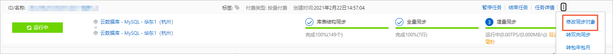

4. 在**已选择对象**区域框中，单击需要移除的同步对象，并单击  图标将其移动至**源库对象**区域框中。

5. 单击**下一步高级配置**。

6. 单击**下一步预检查并启动**，进行预检查。当预检查通过后，即完成同步对象移除。

7. 单击**修改成功，返回列表**，查看新增对象初始化的具体进度。

   > 当同步作业状态回到**运行中**时，表示同步对象修改成功且实例已正常运行。
   >
   > **说明**

<a id="section-4-6-5"></a>

### 4.6.5. 目标库对象名称大小写策略

在配置数据迁移或同步任务时，DTS支持配置迁移或同步到目标库对象的名称大小写策略，来设置目标实例中迁移或同步对象的库名、表名和列名的英文大小写规则。

**策略说明**

DTS目前支持配置如下四种目标库对象名称大小写策略：

- DTS默认策略DTS会根据目标数据库类型和相关参数（如 `lower_case_table_names` ），来配置目标实例中迁移对象的库名、表名、列名等英文大小写规则。

  <table>
    <tr>
      <th>目标数据库类型</th>
      <th>目标库参数</th>
      <th>目标实例中迁移对象的英文大小写规则</th>
    </tr>
    <tr>
      <td rowspan="2">• 自建MySQL、RDS MySQL<br>• PolarDB-X<br>• 云原生数据仓库AnalyticDB MySQL版 3.0</td>
      <td><code> lower_case_table_names </code>为1或2。</td>
      <td>库名和表名的英文映射为小写，列名的英文大小写和源库保持一致。</td>
    </tr>
    <tr>
      <td><code> lower_case_table_names </code>为0。</td>
      <td>库名、表名、列名的英文大小写和源库保持一致。</td>
    </tr>
    <tr>
      <td>• 云原生数据仓库AnalyticDB MySQL版 2.0<br>• Datahub<br>• MaxCompute</td>
      <td>无</td>
      <td>库名、表名和列名的英文映射为小写。</td>
    </tr>
    <tr>
      <td>自建Oracle</td>
      <td>无</td>
      <td>库名、表名和列名的英文映射成大写。</td>
    </tr>
    <tr>
      <td>• 自建SQL Server、RDS SQL Server<br>• PolarDB PostgreSQL版（兼容Oracle）<br>• 自建PostgreSQL、RDS PostgreSQL<br>• 云原生数据仓库AnalyticDB PostgreSQL<br>• 自建MongoDB、阿里云MongoDB实例<br>• 自建Redis、阿里云Redis</td>
      <td>无</td>
      <td>库名和表名的英文映射为小写，列名的英文大小写和源库保持一致。</td>
    </tr>
  </table>

- 和源库保持一致迁移或同步到目标库对象的库名、表名和列名的英文大小写与源库保持一致。

- 与目标库默认策略保持一致（大写）迁移或同步到目标库对象的库名、表名和列名的英文全部大写。

- 与目标库默认策略保持一致（小写）迁移或同步到目标库对象的库名、表名和列名的英文全部小写。

<a id="section-4-6-6"></a>

### 4.6.6. 预检查失败修复

实时同步链路在启动之前，会先进行简单的预检查，本小节简单介绍预检查的内容及失败时的修复方式。

**源库连接性检查**

- 检查内容这个检查项主要检查数据传输服务器同源 RDS 实例的连接性。数据传输服务使用 JDBC 协议尝试连接源RDS实例，如果连接失败，那么这个检查项即检查失败。

- 失败原因

  - 数据传输服务暂不支持源实例所在地区的 RDS 实例的实时同步。

  - 源实例账号密码有误。

- 修复方法联系阿里云技术售后，协助解决。

**目标库连接性检查**

- 检查内容这个检查项主要检查数据传输服务器同目标 RDS 实例的连通性。数据传输服务使用 JDBC 协议尝试连接目标RDS 实例，如果连接失败，那么这个检查项即检查失败。

- 失败原因

  - 数据传输服务暂不支持目标实例所在地区的 RDS 实例的实时同步。

  - 目标实例账号密码有误。

- 修复方法提交工单，联系阿里云技术售后，协助解决。

**源库版本检查**

- 检查内容这个检查项主要检查：

  <ol type="i">

  <li>

  源 RDS 实例的版本号，实时同步功能是否支持。

  </li>

  <li>

  目标 RDS 实例的版本号是否等于源 RDS 实例的版本。

  </li>

  </ol>

- 失败原因

  - 源 RDS 实例的版本低于数据传输服务支持的版本，实时同步暂时只支持 MySQL5.1、5.5、5.6、5.7版本。

  - 目标 RDS 实例版本低于源 RDS 实例版本。

- 修复方法

  - 如果源 RDS 版本过低，那么请首先到 RDS 控制台，将源 RDS 升级到 5.6 或 5.7 版本后，重新创建同步链路。

  - 如果是目标 RDS 实例版本低于源 RDS 实例，那么请先到 RDS 控制台，将目标 RDS 实例升级到 5.6或 5.7 版本后，重新创建同步链路。

**数据库存在性检查**

这个检查项主要检查同步 DB，在目标库是否已经存在。如果同步 DB 在目标库不存在，那么数据传输服务会自动创建，但是在如下情况下，自动创建 DB 会出现失败，此时这个检查项还是会提示检查失败。

- 数据库名中含有小写字母、数字、下划线、中划线的其他特殊字符。

- 数据库的字符集不为 utf8、gbk、latin1、utf8mb4 中的一种。

- 目标库同步账号无同步库的读写权限。当源为 RDS 实例时，这个检查项不会失败。

**源库权限检查**

这个检查项主要检查源库同步账号的权限是否满足要求。当权限不满足要求时，这个检查项会失败。当源为RDS实例时，这个检查项不会出现失败。

**目标库权限检查**

- 检查内容这个检查项主要检查目标库同步账号的权限是否满足要求，当权限不满足时，这个检查项会失败。

- 失败原因

  - 数据传输服务自动在目标 RDS 实例创建账号失败。

  - 数据传输服务对目标 RDS 实例的同步账号进行读写权限授权失败。

- 修复方法提交工单，联系技术同学协助处理。

**同名对象存在性检查**

- 检查内容这个检查项只有选择了同步初始化的同步链路时会进行检查，它主要检查目标 RDS 实例中是否已经存在跟同步对象同名的对象。

- 失败原因当目标 RDS 实例中已经存在跟同步对象相同名称的对象时，这个检查项会失败。

- 修复方法

  - 先将目标库中跟同步对象相同名称的对象删除掉。

  - 重新创建同步链路，同步初始化选择：结构初始化+全量数据初始化。

**源库server_id检查**

这个检查主要检查源数据库的 server_id 是否设置为大等于 2 的整数。如果源为 RDS 实例，那么这个检查项不会失败。

**源库binlog是否开启检查**

这个检查项主要检查源数据库是否开启 binlog 日志。如果检查项失败，那么说明源数据库没有开启binlog。当源为 RDS 实例时，那么这个检查项不会失败。

**源库binlog模式检查**

这个检查项主要检查源数据库的 binlog 模式是否为 ROW。如果检查失败，那么说明源数据库的 binlog 格式不为 ROW。当源为 RDS 实例时，这个检查项不会失败。

**约束完整性检查**

- 检查内容这个检查项主要检查同步的对象列表中，有外键依赖关系的父子表是否都被同步，防止破坏外键约束完整性。

- 失败原因当同步的对象中，有部分对象为外键依赖的子表，但是它对应的父表没有同步，破坏了外键约束完整性。

- 修复方法对于这种情况，有如下三种修复方式：

  - 不进行约束完整性检查失败的子表的同步，重新创建同步作业，不进行这些约束完整性检查失败的子表的同步。

  - 进行约束完整性检查失败的子表对应的父表的同步，重新创建同步作业，将这些约束完整性检查失败的子表对应的父表添加到同步列表中。

  - 删除约束完整性检查失败的子表的外键依赖，修改源数据库将这些子表的外键依赖删除掉，重新创建同步作业。

**存储引擎检查**

- 检查内容这个检查项主要检查同步的对象中，是否存在实时同步不支持的存储引擎。如federated, mrg_myisam,tokudb。

- 失败原因当同步对象中，有表的存储引擎为 federated, mrg_myisam 或 tokudb 时，这个检查项会失败。

- 修复方法先将不支持存储引擎的表的存储引擎修改为 Innodb 后，重新创建同步作业。

**字符集检查**

- 检查内容这个检查项主要检查同步的对象中，是否存在实时同步不支持的字符集，例如 ucs2。

- 失败原因当同步对象的字符集为不支持的字符集时，这个检查项会失败。

- 修复方法先将不支持字符集的表的字符集修改为 utf8、gbk、latin1 中的一种后，重新创建同步作业。

**复杂拓扑存在性检查**

- 检查内容这个检查项主要检查同步作业的源跟目标 RDS 实例上是否存在不支持的同步架构。

- 失败原因

  - 源 RDS 实例上已经存在同步作业，且其为同步作业的目标实例。

  - 目标 RDS 实例上已经存在同步作业。

  - 源跟目标 RDS 存在正在运行的同步任务，且该任务的的同步对象跟要创建的同步作业重叠。

- 修复方法

  - 如果源跟目标 RDS 实例同已存在同步作业相同，创建新同步作业是为了同步新的对象，那么直接修改已经存在的同步链路，修改同步对象，将要添加对象添加进去即可。

  - 如果这个同步链路同已经存在的同步任务冲突，那么必须等同步任务完成后，才能重新创建同步作业。

**MySQL老密码格式检查**

这个检查项，主要检查源实例使用的密码是否为 old password。当源为 RDS 实例时，这个检查项不会失败。

<a id="section-4-6-7"></a>

### 4.6.7. 在同步任务中配置ETL

数据传输服务DTS提供流式数据ETL（Extract Transform Load）数据处理功能。ETL结合DTS的高效流数据复制能力，可以实现流式数据的抽取、数据转换、加工和数据装载，支持的典型场景有：数据过滤、数据脱敏、记录数据修改时间和数据变更审计。本文介绍在DTS链路内配置ETL。

**背景信息**

DTS是一个数据迁移和同步服务，通常用于数据搬迁或实时数据传输。但有时候用户有数据处理的需求，希望先对实时数据做一定转换或过滤，再写入库。为了满足此类需求，DTS提供了流式数据ETL数据处理功能，支持使用DSL（Domain Specific Language）脚本语言灵活地定义数据处理逻辑。DSL的介绍及配置语法，请参见数据处理DSL语法简介。

**支持的数据库**

ETL支持的源库和目标库如下表所示。

<table>
  <tr>
    <th width="160">源库</th>
    <th>目标库</th>
  </tr>
  <tr>
    <td>MySQL</td>
    <td>• AnalyticDB MySQL 3.0<br>• AnalyticDB PostgreSQL<br>• MaxCompute<br>• MySQL</td>
  </tr>
  <tr>
    <td>自建Oracle</td>
    <td>• AnalyticDB PostgreSQL<br>• DataHub<br>• MaxCompute</td>
  </tr>
  <tr>
    <td>PolarDB-X 1.0</td>
    <td>• MySQL<br>• AnalyticDB MySQL 3.0<br>• PolarDB-X 1.0<br>• MaxCompute</td>
  </tr>
  <tr>
    <td>自建Db2 for LUW</td>
    <td>AnalyticDB PostgreSQL</td>
  </tr>
  <tr>
    <td>MongoDB</td>
    <td>MongoDB</td>
  </tr>
  <tr>
    <td>PostgreSQL</td>
    <td>PostgreSQL</td>
  </tr>
</table>

**在创建同步任务时配置ETL**

**注意事项**

如果您配置的ETL脚本中，包含新增列操作，那么需要您手动在目标端添加列。否则ETL脚本不生效。例如 ``script:e_set(`new_column`, dt_now())`` ，此处 `new_column` 需要您手动在目标端添加。

1. 根据实际需求创建同步任务，并进入**高级配置**阶段。

2. **配置ETL功能**选择为**是**，并在输入框中按照数据处理DSL语法填写数据处理语句。

   > 例如使用DSL来处理id大于3的记录，此处以 ``script:e_if(op_gt(`id`, 3),``
   >
   > **说明**
   >
   > `e_drop())` 为例。 `op_gt` 为表达式函数，判断是否大于某个值， `id` 为变量。此时通过该脚本可过滤id大于3的记录。

   

3. 单击**下一步预检查并启动**，完成后续步骤。

**数据处理DSL语法简介**

数据处理DSL是DTS专门为数据同步场景中的数据处理需求而设计的脚本语言。支持条件函数，可处理字符串、日期、数值。允许用户灵活地定义数据处理逻辑，特性如下：

- 功能强大：提供了大量函数，且支持函数的组合。

- 语法相对简单：提供了一些典型场景的示例，例如数据过滤、数据转换、数据脱敏，详情请参见典型场景示例。

- 执行高效：基于代码生成技术，对同步过程的性能损耗小。

**典型场景示例**

- 数据过滤：

  - 按数值列条件过滤：如果id>10000，则丢弃这条记录，不同步到目标库：e_if(op_gt(\`id\`, 10000), e_drop)。

  - 按字符串匹配条件过滤：如果name包含“hangzhou”，则丢弃这条记录：e_if(str_contains(\`name\`, "hangzhou"), e_drop)。

  - 按日期过滤：如果订单时间早于某个时间，则不同步：e_if(op_lt(\`order_timestamp\`, "2015-02-23 23:54:55"), e_drop)。

  - 按多条件过滤：

    - 如果id>1000且name包含“hangzhou”，则丢弃这条记录：e_if(op_and(str_contains(\`name\`, "hangzhou"), op_gt(\`id\`, 1000)), e_drop())。

    - 如果id>1000或name包含“hangzhou”，则丢弃这条记录：e_if(op_or(str_contains(\`name\`, "hangzhou"), op_gt(\`id\`, 1000)), e_drop())。

- 数据脱敏：

  - 遮掩：将phone手机号列的后四位用星号替换，e_set(\`phone\`, str_mask(\`phone\`, 7, 10, '\*'))。

- 记录数据修改时间：

  - 对所有表新增列：__OPERATION__的值为INSERT或UPDATE或DELETE时新增1列“dts_sync_time”，值为日志提交时间（__COMMIT_TIMESTAMP__）。

    ```text
    e_if(op_or(op_or(
            op_eq(__OPERATION__, __OP_INSERT__),
            op_eq(__OPERATION__, __OP_UPDATE__)),
            op_eq(__OPERATION__, __OP_DELETE__)),
        e_set(dts_sync_time, __COMMIT_TIMESTAMP__))
    ```

  - 对指定表“dts_test_table”新增列： __OPERATION__的值为INSERT或UPDATE或DELETE时新增1列“dts_sync_time”， 值为日志提交时间（__COMMIT_TIMESTAMP__）。

    ```text
    e_if(op_and(
          op_eq(__TB__,'dts_test_table'),
          op_or(op_or(
            op_eq(__OPERATION__,__OP_INSERT__),
            op_eq(__OPERATION__,__OP_UPDATE__)),
            op_eq(__OPERATION__,__OP_DELETE__))),
          e_set(dts_sync_time,__COMMIT_TIMESTAMP__))
    ```

    > 上述新增列操作需要您在任务启动前自行修改目标端表定义，添
    >
    > **说明**
    >
    > 加“dts_sync_time”列。

- 数据变更审计：

  - 记录表数据变化的类型和时间：在目标端的“operation_type”列记录数据变化类型；在目标端的“updated”列记录数据发生变化的时间。

    ```text
    e_compose(
        e_switch(
            op_eq(__OPERATION__,__OP_DELETE__), e_set(operation_type, 'DELETE'),
            op_eq(__OPERATION__,__OP_UPDATE__), e_set(operation_type, 'UPDATE'),
            op_eq(__OPERATION__,__OP_INSERT__), e_set(operation_type, 'INSERT')),
        e_set(updated, __COMMIT_TIMESTAMP__),
        e_set(__OPERATION__,__OP_INSERT__)
    )
    ```

    > 您需要在任务启动前在目标端表中添加“operation_type”列和“updated”列。
    >
    > **说明**

**数据处理DSL语法**

**常量与变量**

- 常量

  | 类型 | 示例 |
  | --- | --- |
  | int | 123 |
  | float | 123.4 |
  | string | "hello1_world" |
  | boolean | true或false |
  | datetime | '2021-01-01 10:10:01' |

- 变量

  | 变量 | 含义 | 数据类型 | 示例值 |
  | --- | --- | --- | --- |
  | __TB__ | 表名 | string | table |
  | __DB__ | 库名 | string | mydb |
  | __OPERATION__ | 操作类型 | string | __OP_INSERT__,__OP_UPDATE__,__OP_DELE TE__ |
  | __COMMIT_TIMESTAM P__ | 事务提交时间 | datetime | '2021-01-01 10:10:01' |
  | \`column\` | 某条数据对应column的值 | string | \`id\`、\`name\` |

**表达式函数**

- 数值运算

  | 功能 | 语法 | 取值范围 | 返回值 | 示例 |
  | --- | --- | --- | --- | --- |
  | 加法 | op_sum(value1, value2) | • value1：整数或浮点数<br>• value2：整数或浮点数 | 若参数均为整数，则返回整数，否则返回浮点数。 | op_sum(\`col1\`, 1.0) |
  | 减法 | op_sub(v alue1, value2) | • value1：整数或浮点数<br>• value2：整数或浮点数 | 若参数均为整数，则返回整数，否则返回浮点数。 | op_sub(\`col1\`, 1.0) |
  | 乘法 | op_mul(v alue1, value2) | • value1：整数或浮点数<br>• value2：整数或浮点数 | 若参数均为整数，则返回整数，否则返回浮点数。 | op_mul(\`col1\`, 1.0) |
  | 除法 | op_div_tr ue(value 1, value2) | • value1：整数或浮点数<br>• value2：整数或浮点数 | 若参数均为整数，则返回整数，否则返回浮点数。 | op_div_true(\`col1\`, 2.0)， 若col1=15，则返回7.5。 |
  | 取模 | op_mod(value1, value2) | • value1：整数或浮点数<br>• value2：整数或浮点数 | 若参数均为整数，则返回整数，否则返回浮点数。 | op_mod(\`col1\`, 10)，若col1=23，则返回3 |

- 逻辑运算

  | 功能 | 语法 | 取值范围 | 返回值 | 示例 |
  | --- | --- | --- | --- | --- |
  | 是否相等 | op_eq(va lue1, value2) | • value1：整数、浮点数、字符串<br>• value2：整数、浮点数、字符串 | boolean类型，true或false | op_eq(\`col1\`, 23) |
  | 是否大于 | op_gt(val ue1, value2) | • value1：整数、浮点数、字符串<br>• value2：整数、浮点数、字符串 | boolean类型，true或false | op_gt(\`col1\`, 1.0) |
  | 是否小于 | op_lt(val ue1, value2) | • value1：整数、浮点数、字符串<br>• value2：整数、浮点数、字符串 | boolean类型，true或false | op_lt(\`col1\`, 1.0) |
  | 是否大于等于 | op_ge(va lue1, value2) | • value1：整数、浮点数、字符串<br>• value2：整数、浮点数、字符串 | boolean类型，true或false | op_ge(\`col1\`, 1.0) |
  | 是否小于等于 | op_le(val ue1, value2) | • value1：整数、浮点数、字符串<br>• value2：整数、浮点数、字符串 | boolean类型，true或false | op_le(\`col1\`, 1.0) |
  | AND运算 | op_and(v alue1, value2) | • value1：boolean类型<br>• value2：boolean类型 | boolean类型，true或false | op_and(\`is_male\`, \`is_student\`) |
  | OR运算 | op_or(val ue1, value2) | • value1：boolean类型<br>• value2：boolean类型 | boolean类型，true或false | op_or(\`is_male\`, \`is_student\`) |

- **字符串函数**

  | 功能 | 语法 | 取值范围 | 返回值 | 示例 |
  | --- | --- | --- | --- | --- |
  | 字符串格式化，字符串拼接 | str_form at(format, value1, value2, value3,...) | • format：字符串类型，以大括号作为占位符，如 "part1: {}, part2: {}"。<br>• value1：任意<br>• value2：任意 | 格式化好的字符串 | str_format("part1: {}, part2: {}", \`col1\`, \`col2\`)，若col1="ab", col2="12", 则返回"part1: ab, part2: 12"。 |
  | 字符串替换 | str_repla ce(origin al, oldStr, newStr, count) | • original：原来的字符串<br>• oldStr：待替换的字符串<br>• newStr：替换后的字符串<br>• count：整数，最多替换次数。若设置为-1，则全部替换。 | 替换后的字符串 | str_replace(\`name\`, "a", 'b', 1)，若name="aba", 则返回"bba" ；str_replace(\`name\`, "a", 'b', -1)；若name="aba", 则返回"bbb"。 |
  | 移除字符串首尾的特定字符 | str_strip(string_va l, charSet) | • string_val：原来的字符串<br>• char_set：待移除的字符集合 | 移除首尾字符后的字符串 | str_strip(\`name\`, 'ab')，若name=axbzb,则返回xbz。 |
  | 字符串转小写 | str_lower (value1) | value1：字符串列或字符串常量 | 小写字符串 | str_lower(\`str_col\`) |
  | 字符串转大写 | str_upper (value1) | value1：字符串列或字符串常量 | 大写字符串 | str_upper(\`str_col\`) |
  | 字符串统计 | str_count (str, pattern) | • str：字符串列或字符串常量<br>• pattern：要查找的子串 | 子串出现的次数。 | str_count(\`str_col\`, 'abc')， 若str_col="zabcyabcz"，则返回2。 |
  | 字符串查找 | str_find(s tr, pattern)。 | • str：字符串列或字符串常量<br>• pattern：要查找的子串 | 子串首次匹配的位置，没有则返回\`-1\`。 | str_find(\`str_col\`, 'abc')， 若\`str_col="xabcy"\`，则返回\`1\`。 |
  | 判断是否全是字母组成的字符串。 | str_isalp ha(str) | str：字符串列或字符串常量 | true或false | str_isalpha(\`str_col\`) |
  | 判断是否全是数字组成的字符串 | str_isdigi t(str) | str：字符串列或字符串常量 | true或false。 | str_isdigit(\`str_col\`)。 |
  | 使用指定字符遮掩字符串的一部分，可用于数据脱敏，例如把手机号的后四位替换为星号。 | str_mask (str, start, end, maskStr) | • str：字符串列或字符串常量<br>• start：整数，遮掩的起始位置，最小值为0。<br>• end：整数，遮掩的结束位置，最大值为字符串长度减一。<br>• maskStr：字符串，长度为1的字符串，例如 '#'。 | 遮掩掉start至end后的字符串。 | str_mask(\`phone\`, 7, 10, '#')。 |
  | 获取当前时区的DateTim e | dt_now() | 无 | 当前时区的DateTime | e_set(\`dt_col\`, dt_now()) |
  | 获取UTC时区的DateTim e | dt_utcno w() | 无 | UTC时区的DateTime | e_set(\`dt_col\`, dt_utcnow()) |

**全局函数**

- 流程控制函数

  | 功能 | 语法 | 参数说明 | 示例 |
  | --- | --- | --- | --- |
  | if语句 | e_if(bool_exp r, func_invoke) | • bool_expr：bool常量或函数调用。常量：true或false。函数调用：op_gt(\`id\`, 10)。<br>• func_invoke：函数调用。e_drop,e_keep,e_set,e_if,e_c ompose | e_if(op_gt(\`id\`, 10), e_drop())，如果ID大于10，则丢弃这条记录。 |
  | if else语句 | e_if_else(bool _expr, func_invoke1, func_invoke2) | • bool_expr：bool常量或函数调用。常量：true或false。函数调用：op_gt(\`id\`, 10)。<br>• func_invoke1：函数调用。条件为true时执行。<br>• func_invoke2：函数调用。条件为false时执行。 | e_if_else(op_gt(\`id\`, 10), e_set(\`tag\`, 'large'), e_set(\`tag\`, 'small'))，如果ID大于10，则设置tag列为"large"，否则设置为"small"。 |
  | 类switch语句，进行多次条件判断，第一次满足条件时执行对应操作，如无匹配则执行默认操作。 | s_switch(con dition1, func1, condition2, func2, ..., default = default_func) | • condition1：bool常量或函数调用。常量：true或false。函数调用：op_gt(\`id\`, 10)。<br>• func_invoke：函数调用。检查condition1，若为true则执行此函数，并退出整个switch，若为false则继续检查下一个条件。<br>• default_func：函数调用。当前面的所有condition都为false时，执行此默认函数。 | e_switch(op_gt(\`id\`, 100), e_set(\`str_col\`, '&gt;100'), op_gt(\`id\`, 90), e_set(\`str_col\`, '&gt;90'), default=e_set(\`str_col\`, '&lt;=90'))。 |
  | 组合多个操作 | e_compose(f unc1, func2, func3, ...) | • func1：函数调用。可以为e_set, e_drop, e_if。<br>• func2：函数调用。可以为e_set, e_drop, e_if。 | e_compose(e_set(\`str_col\`, 'test'), e_set(\`dt_col\`, dt_now()))， 设置str_col列的值为test，并设置dt_col列的值为当前时间。 |

- 数据操作函数

  | 功能 | 语法 | 参数说明 | 示例 |
  | --- | --- | --- | --- |
  | 丢弃此条数据，不同步 | e_drop() | 无 | e_if(op_gt(\`id\`, 10), e_drop())，丢弃ID大于10的记录。 |
  | 保留此条数据，同步到目标端 | e_keep(condi tion) | condition：boolean类型表达式 | e_keep(op_gt(id, 1)) ，仅同步ID大于1的数据。 |
  | 设置列值 | e_set(\`col\`, val) | • col：列名<br>• val：常量或函数调用。类型需要和col的类型匹配 | • e_set(\`dt_col\`, dt_now())，设置dt_col为当前时间。<br>• e_set(\`col1\`, \`col2\` + 1)，设置col1为col2+1。 |

<a id="section-4-7"></a>

## 4.7. 同步PolarDB-X的最佳实践

<a id="section-4-7-1"></a>

### 4.7.1. 同步PolarDB-X时的规范及注意事项

由于PolarDB-X自身不提供Binlog以及其他的一些限制，在业务设计、运维变更、数据质量以及业务开发时，会受到如下规范的约束，请您在实际使用中注意。

**概览**

- 业务设计规范

- 数据库架构规范

- 运维变更规范

- 数据质量风险声明

- 业务开发的数据质量工作

**业务设计规范**

- 表都需要有主键，否则数据同步时可能会造成数据不一致（造成目标库有重复数据）。

- 因为PolarDB-X的GSI全局二级索引（Global Secondary Index）具有异步特性，不推荐您使用该功能。如果您仍选择使用该功能，DTS只能保证最终数据的一致性。

- 数据库不支持混合模式，即unit模式和copy模式混合的同步链路。

  > unit模式是多地用户分别在各自地域读写本地域的数据，且本地域的数据会和中心数据
  >
  > **说明**
  >
  > 双向同步。copy模式是指此集群数据在中心数据库写入，完成后全量同步到各个单元。

- 如果是使用底层MySQL进行链路配置，PolarDB-X间双向同步，业务表不支持使用FLOAT、DOUBLE类型字段，需要改为decimal类型。如果为PolarDB-X间单向同步，则允许使用这两种数据类型。

- DTS不支持同步PolarDB-X中存储过程、触发器、函数、视图、事件等对象。

- 不支持PolarDB-X的结构初始化，需要在目标库手动创建好对应的库表等对象。

- PolarDB-X留够足够支撑业务增长的容量。

**数据库架构规范**

- 一个PolarDB-X实例使用到的RDS MySQL实例，不能再被其他PolarDB-X实例使用。

- PolarDB-X间的同步，两端对应的RDS MySQL实例需保持对等部署，比如源PolarDB-X使用了4个RDS MySQL实例，目标PolarDB-X也需要使用4个规格配置相同的RDS MySQL实例。

- 源和目标PolarDB-X的分库分表规则需要保持一致，否则DTS同步任务无法建立。

- 只能同步PolarDB-X实例的业务表，无法同步该实例的元数据表和系统表。

**运维变更规范**

**变更类型**

**具体变更**

**影响及应对规范**

分库分表变化（如变更分库分表

暂不支持，需按如下步骤重新创建同步任务：

键、或变更分库分表数量）场

1. 停止并删除原先的DTS同步任务。

景。

2. 待源库变更完成后，清空目标库已经同步的数据。

PolarDB-X方面

3. 对PolarDB-X下的多个RDS MySQL实例单独配置到目

存储层实例个数发生变化场景

标库的同步任务。

（如扩容、热点表迁移等）。

存储层实例级别的规格变更、切

不影响数据同步。

换等。

源库和目标库的参数需一致。存储层实例级别参数修改只允许做向下兼容的参数修改，即新参数不会影响老参数的行为和数据。

参数修改。

> 如不确认需联系数据库专家服务组。
>
> **说明**

存储层方面

存储层实例内备份恢复策略、开

对当前实例有效，不涉及有复制关系的其他实例。

启审计、诊断等。

如果是配置PolarDB-X下的多个RDS MySQL到目标库的

DTS任务方面

DDL操作。

同步任务，受限于MySQL的实现逻辑，执行DDL操作可能会导致数据同步延迟。

不支持，需要按照如下步骤操作：

1. 在目标库执行建表DDL操作之后，在源库执行同样的建表DDL操作。

新增表。

2. 修改同步任务，将新表分别加入到同步对象中。

上述操作全部完成后建表操作才算正式完成，业务才可以写入。如果是基于表级别的同步，在源和目标的存储层实例上需要把新增的表加到同步队列里。

库表级别的DDL操

- 如果是基于PolarDB-X级别配置任务，需要您先在目

作

标库先做对应的DDL操作，然后再去源库执行对应的DDL操作。

增加字段、增加二级索引、删除索引、修改索引（二级索引改成

- 如果是基于PolarDB-X下挂载的RDS MySQL实例配置

唯一索引除外）。

的任务，DTS会自动同步对应的新增字段，增加二级索引、删除索引、修改索引（二级索引改成唯一索引除外）的操作。

除上述操作以外的其他DDL操

禁止此类DDL操作。

作。

DTS提供的同步延迟功能判断无延时后，您才能进行安全

正常的切流。

切流，否则会产生数据质量问题。

满足恢复点目标RPO（Recovery Point Objective）的异常切流。

在出现故障（如网络中断、机房批量设备故障或互联网数据中心IDC故障），且DTS同步存在延迟的情况下，此时

切流操作

> RPO代表故
>
> **说明**

如同步至目标库的最后一条数据的时间与故障发生时的时

> 障恢复后业务允许丢失的

间之差小于RPO（如5分钟），则可以业务优先恢复为准

> **说明**

> 数据量，可用时间表示。

则切流。切流后可能有5分钟以内的数据质量问题，需要

> 切流操作是

您的业务开发配合订正，确保数据的一致性。

> 指，通过DTS

> 异常切流是
>
> **警告**

> 将数据从源库

> 如需查询同步至目标库的最后一条数
>
> **说明**

> 指源实例或者源实例所在

> 迁移或同步至

> 据的时间，请参见运维指南的任务管理章节。

> 的数据中心发生故障时进

> 目标库后，您

> 行的切流操作。这类操作

> 将业务流量从

> 都是有损操作。

> 源库切换至目标库。

源端执行大量DDL操作、网络、目的库性能等问题，可能会导致DTS同步存在延迟，此时如刚好遇到机房故障，且同步至目标库的最后一条数据的时间戳与故障发生时的时

不满足RPO的异常切流。

间戳之差大于RPO（如5分钟），那么切流需要非常谨慎，建议您暂时不要执行切流操作，选择等待机房恢复正常。如果遇到异常切流，会存在延时窗口内的数据质量问题，需要您的业务开发配合订正，确保数据的一致性。

**数据质量风险声明**

一些变更或切流操作可能会导致源库和目标库结构不一致等数据质量问题，具体示例如下：

- 当源实例主备之间存在数据延迟时，新写入主库的数据未能及时更新至备库。此时，如源实例进行主备切换，DTS会使用源实例的备库作为源数据库进行数据同步，从而导致丢失未能及时更新至备库的部分数据。

- 在断网、业务切流后，如DTS任务恢复正常，会自动启动重试机制，重新同步故障发生前一段时间的数据，以避免目标库数据丢失。在这种情况下，如目标表缺少主键，会导致源目库数据不一致；如目标表存在主键，则在重试机制过程中源目库数据不一定能保持一致，但在重试结束后数据将保持一致。

- 网络问题或业务DDL，导致数据同步延时。

- 源库变更、目标库性能、任何原因使表结构不一致等问题导致同步延时或中断。

阿里云无法解决以上问题，需要您重构链路或者自行调整源库和目标库。

**业务开发的数据质量工作**

- 请您慎重执行所有的DDL操作，所有的DDL操作都要经过驻场同学的确认，以遵守上述日常DDL变更规范。

- 请勿在程序代码中直接进行DDL操作。

<a id="section-4-7-2"></a>

### 4.7.2. 同步PolarDB-X时的任务配置方案

DTS支持将源PolarDB-X实例同步至目标库。但是由于直接使用PolarDB-X作为源实例配置同步任务，当该实例下挂载的RDS MySQL数量超过2个时，可能会产生性能瓶颈，稳定性风险，最终可能会对业务造成影响。为了更好保障任务的性能和稳定性，DTS建议您在配置时，根据PolarDB-X下挂载的RDS MySQL实例，分别配置同步任务。

**前提条件**

您已阅读同步PolarDB-X时的规范及注意事项，已确保遵循相关规范，了解注意事项。

**同步方案**

| 方案 | 配置方式 | 特点总结 |
| --- | --- | --- |
| 方案一 | 针对PolarDB-X下的多个RDS MySQL实例，配置多个同步至目标实例的DTS任务，并且在配置过程中，需将多个RDS MySQL的数据库表名都映射成目标实例的库表名。该方案相比于直接配置PolarDB-X至目标实例的同步任务，更能保障性能和稳定性。<br>重要该方案仅支持表级别同步。 | 推荐您使用方案一，其在性能、稳定性方面均优于方案二，且对PolarDB-X下挂载的RDS MySQL数量没有限制。 |
| 方案二 | 直接使用PolarDB-X作为源实例配置同步至目标实例任务，当该实例下挂载的RDS MySQL实例数量超过2个后，可能会对同步任务的稳定性、操作性产生较大影响，严重时甚至将影响业务。 | 使用方案二时，如源PolarDB-X下挂载的RDS MySQL实例超过2个时，同步任务可能会有性能和稳定性风险。 |

**方案对比**

| 对比项 | 方案一 | 方案二 |
| --- | --- | --- |
| 性能 | 拆分成多个DTS任务，性能成倍增长，可承载大规模的PolarDB-X数据写入， | 仅配置一个以PolarDB-X为源的同步任务，当业务系统写入源实例数据量较大时较大时，会存在性能瓶颈。 |
| 稳定性 | 稳定性较强。配置PolarDB-X下多个RDS MySQL同步至目标库的DTS任务，如其中一个DTS任务发生故障，则不影响其他DTS任务的运行，且只需恢复发生故障的DTS任务即可。 | 稳定性一般。仅配置一个以PolarDB-X为源的同步任务，如该DTS任务发生故障，则整个同步任务会失败。 |
| 易用性 | 需配置多次，相对较繁琐。需要拆分成独立的任务，且每次配置均需做库表名映射，将源实例多个RDS MySQL的库表名映射成目标实例中库表的名称，如源实例中RDS MySQL实例的数量和库表数量较多，则需配置多次的映射。 | 配置方便，仅需配置一个PolarDB-X为源的同步任务。 |
| 资源占用 | 拆分成n个独立的DTS任务，消耗n个DTS实例。 | 消耗1个DTS实例。 |

**两种方案如何实现DDL同步**

目前PolarDB-X为源的同步任务，暂不支持同步DDL操作，如源PolarDB-X在同步时执行DDL操作，为避免数据写入目标端失败，一般解决方案如下：

1. 释放同步任务。

2. 清空目标库。

3. 重新配置任务。

在PolarDB-X为源的部分同步场景中，支持在保留同步任务的同时，实现同步DDL操作，具体场景及对应的操作，如下所示：

| 场景 | 操作 |
| --- | --- |
| 使用方案一，仅支持表级别同步。 | • 支持通过修改同步对象来实现加表的操作。<br>• 目前仅PolarDB-X间的同步，支持加列、减列的操作，且需按如下操作执行：<br>i. 修改同步对象，使其包含或删除列。ii. 先在目标库手动进行加列或减列，然后在源端执行对应的加列或减列操作。当目标库已经存在这个列时，则DTS会忽略这个报错，且不会显示写入失败。 |
| 使用方案二，且同步对象为整库。 | • 仅支持加表的操作，且需先在目标库手动加上新表，然后在源端执行加表的操作。<br>• 不支持加列、减列的操作。<br>警告在源PolarDB-X执行加列操作，可能会导致底层多个物理表不一致，有的缺少该列，有的包含该列。从而DTS在拼装的SQL语句，可能会找不到该列，或者丢失该列的数据。 |
| 使用方案二，且同步对象为非整库。 | • 仅支持加表的操作，且需按如下操作执行：<br>i. 修改同步对象，使其包含该新表。ii. 先在目标库手动加上新表，然后在源端执行加表的操作。<br>• 不支持加列、减列的操作。 |

<a id="section-5"></a>

# 5.数据订阅

<a id="section-5-1"></a>

## 5.1. 概述

数据订阅是DTS提供的实时数据订阅功能，可以实时订阅MySQL增量数据。适用于解决轻量级缓存更新、业务异步解耦、含ETL逻辑的数据实时同步等场景。

**支持的数据库**

- 自建MySQL或RDS for MySQL。

- 云原生分布式数据库PolarDB-X（原分布式关系型数据库DRDS）。

- 自建Oracle。

**注意事项**

旧版订阅已默认下线，新建数据订阅都属于新版订阅，您需要在DTS控制台重新配置旧版订阅对象，将其升级至新版订阅对象，否则产品SLA上会有风险。

**订阅对象**

数据订阅的订阅对象为库或表。

数据订阅将增量数据细分为数据变更DML（Data Manipulation Language）和结构变更DDL（Data Definition Language），配置数据订阅时，可以选择需要订阅的具体数据变更类型。

**订阅通道**

订阅通道是进行增量数据订阅与消费的基本单元。如果要订阅RDS的增量数据，必须在数据传输控制台创建一个针对这个RDS实例的订阅通道。订阅通道会实时拉取RDS的增量数据，并将最新一段时间的增量数据保存在订阅通道中，用户可以使用数据传输提供SDK从这个订阅通道中订阅增量数据，并进行相应的消费。同时，用户可以在数据传输控制台进行订阅通道的创建、管理及删除等操作。

<a id="section-5-2"></a>

## 5.2. 创建数据订阅实例

在配置数据订阅通道前，您需要创建数据订阅实例，本文为您介绍具体操作方法。

**操作步骤**

1. 登录数据传输服务控制台。

2. 在左侧导航栏，单击**数据订阅**。

3. 单击**创建任务**。

4. 在弹出的对话框中，选择数据订阅实例的参数配置。

   <table>
     <tr>
       <th width="121">参数</th>
       <th>说明</th>
     </tr>
     <tr>
       <td>源数据库类型</td>
       <td>选择源数据库类型。</td>
     </tr>
     <tr>
       <td>源区域</td>
       <td>选择源数据库所属的地区。<br>说明源地域为任务链路源数据库所在地域，订购后不支持更换地域，请谨慎选择。</td>
     </tr>
     <tr>
       <td>购买数量</td>
       <td>一次性创建数据订阅实例的数量。</td>
     </tr>
   </table>

   > 在本对话框中，您可以查看到总实例数、已创建的实例数和可创建实例的实例数信息。
   >
   > **说明**

5. 单击**购买**。

6. 在弹出的对话框中，单击**确定**。

<a id="section-5-3"></a>

## 5.3. 数据订阅配置案例

<a id="section-5-3-1"></a>

### 5.3.1. 创建RDS MySQL数据订阅通道

通过数据订阅功能，您可以实时订阅增量数据，轻松帮助业务实现轻量级缓存更新、业务异步解耦、含ETL逻辑的数据实时同步等场景。本文介绍如何配置RDS MySQL的数据订阅通道。

**前提条件**

数据库版本为5.6、5.7或8.0。

**注意事项**

<table>
  <tr>
    <th width="90">类型</th>
    <th>说明</th>
  </tr>
  <tr>
    <td>源库限制</td>
    <td>• 带宽要求：源库所属的服务器需具备足够出口带宽，否则将影响数据订阅速率。<br>• 待订阅的表需具备主键或唯一约束，且字段具有唯一性，否则可能会导致订阅到的重复数据。<br>• Binlog日志：需开启，并且binlog_format为row、binlog_row_image为full。否则预检查阶段提示报错，且无法成功启动数据订阅任务。<br>• 暂不支持源实例为只读实例或临时实例。</td>
  </tr>
  <tr>
    <td>其他限制</td>
    <td>• 请确认DTS对数据类型为FLOAT或DOUBLE的列的订阅精度是否符合业务预期。DTS会通过<code> ROUND(COLUMN,PRECISION) </code>来读取这两类列的值。如果没有明确定义其精度，DTS对FLOAT的订阅精度为38位，对DOUBLE的订阅精度为308位。<br>• 由于使用gh-ost或pt-online-schema-change等类似工具执行在线DDL变更不会被订阅到，客户端在将消费到的数据写入目标表时可能会因为表结构不一致而导致写入失败。<br>• 如果订阅的源数据库还处于其他任务中（例如该数据库还存在于某个正在运行的数据迁移任务中），您可能会订阅到订阅对象以外的数据，此类场景中，您需要手动在订阅客户端中过滤掉不需要的数据。</td>
  </tr>
</table>

**操作步骤**

1. 创建数据订阅实例。

2. 在数据订阅列表中，找到刚创建的数据订阅实例，单击**操作**列的**配置订阅通道**。

3. 配置源库信息和网络类型。

   **类别**

   **配置**

   **说明**

   DTS会自动生成一个订阅名称，建议配置具有业务意义的名称（无唯一性要

   无

   **任务名称**

   求），便于后续识别。

   选择**MySQL**。

   **数据库类型**

   选择**云实例**。

   **接入方式**

   创建数据订阅实例时已指定，不可变更。

   **实例地区**

   **是否跨阿里云账**

   当前仅支持**不跨账号**。

   **号**

   **源库信息**

   选择待订阅的RDS实例ID。

   **RDS实例ID**

   > **说明**
   >
   > 暂不支持订阅只读实例或临时实例。

   填入待订阅的RDS MySQL数据库账号。

   > **说明**

   **数据库账号**

   > 账号需要具备REPLICATION SLAVE、REPLICATION CLIENT和订阅对象的SELECT权限。

   填入该数据库账号的密码。

   **数据库密码**

   设置数据订阅实例所属的网络类型。

   - **经典网络**如果设置为**经典网络**，则无需其他配置。

   - **专有网络**如果设置为**专有网络**，您还需要选择**专有网络**和**虚拟交换机**。

   **消费网络类**

   **消费网络类型**

   **型**

   > **说明**
   >
   > - 如您的数据订阅客户端部署在本地，则可以任意选择**经典网络**和**专有网络**。
   >
   > - 通过内网地址进行数据订阅时，网络延迟最小。

4. 配置完成后，单击页面下方的**测试连接以进行下一步**。

5. 配置需要订阅的数据类型和订阅对象。

   | 配置 | 说明 |
   | --- | --- |
   | 需要订阅的数据类型 | • 数据更新订阅已选择对象的增量数据更新，包含数据的INSERT、DELETE和UPDATE操作。<br>• 结构更新订阅整个实例所有对象的结构创建、删除及修改，您需要使用数据订阅客户端过滤所需的数据。<br>说明<br>• 如果选择整个库作为订阅对象，那么该库中新增对象的增量数据也可以被订阅到。<br>• 如果选择某个表作为订阅对象，那么只有这个表的增量数据可以被订阅到。此时如果需要加入一个新的表作为订阅对象，您需要将其加入至订阅对象中，详情请参见修改订阅对象。 |
   | 源库对象 | 在<strong>源库对象</strong>框中单击选择需要订阅的库或表，单击图标将其移动至<strong>已选择对象</strong>框。 |
   | 已选择对象 | 如需移除已选择的对象，请在<strong>已选择对象</strong>框中选择待移除的对象，然后单击图标将其移动至<strong>源库</strong><br><strong>对象</strong>框。 |

6. 单击**下一步高级配置**，进行高级配置。

   | 配置项目 | 配置说明 |
   | --- | --- |
   | 源库、目标库无法连接后的重试时间 | 在订阅任务启动后，若源库连接失败则DTS会报错。对于可预期的报错，DTS会立即进行持续的重试连接，默认持续重试时间为720分钟，您也可以在取值范围（10~1440分钟）内自定义重试时间，建议设置30分钟以上。如果DTS在设置的重试时间内重新连接上源库，订阅任务将自动恢复。否则，订阅任务将会失败。 |
   | 配置ETL功能 | 暂不支持配置ETL功能，请选择<strong>否</strong>。 |

7. 上述配置完成后，单击页面下方的**下一步预检查并启动**。

   > **重要**
   >
   > - 在数据订阅任务正式启动之前，会先进行预检查。只有预检查通过后，才能成功启动数据订阅任务。
   >
   > - 如果预检查失败，请单击**查看详情**并请根据提示修复问题，然后重新进行预检查。

8. **预检查通过率**显示为100%时，单击**返回列表**。等待数据订阅实例启动，实例处于**正常**状态后即可执行新增消费组和消费订阅数据的操作。

<a id="section-5-3-2"></a>

### 5.3.2. 创建云原生分布式数据库PolarDB-X 1.0数据订阅通道

通过数据订阅功能，您可以实时订阅源库的增量数据，轻松帮助业务实现轻量级缓存更新、业务异步解耦、含ETL逻辑的数据实时同步等场景。本文介绍如何创建云原生分布式数据库PolarDB-X 1.0数据订阅通道。

**注意事项**

> **警告**
>
> 更多源实例为PolarDB-X 1.0时的注意事项，请参见同步PolarDB-X时的规范及注意事项。

<table>
  <tr>
    <th width="90">类型</th>
    <th>说明</th>
  </tr>
  <tr>
    <td>源库限制</td>
    <td>• 带宽要求：源库所属的服务器需具备足够出口带宽，否则将影响数据订阅速率。<br>• 待订阅的表需具备主键或唯一约束，且字段具有唯一性，否则可能会导致订阅到的重复数据。<br>• PolarDB-X 1.0下面挂载的RDS MySQL的Binlog日志：需开启，并且binlog_format为row、binlog_row_image为full。否则预检查阶段提示报错，且无法成功启动数据订阅任务。</td>
  </tr>
</table>

<table>
  <tr>
    <td>其他限制</td>
    <td>• 如PolarDB-X 1.0实例下面挂载的RDS MySQl实例的数量超过2个，订阅该PolarDB-X 1.0实例时，可能会导致DTS任务产生延迟和稳定性问题。建议将单个PolarDB-X 1.0订阅任务，拆分成PolarDB-X 1.0下多个RDS MySQL的订阅任务。<br>• 如源PolarDB-X 1.0实例A下面挂载n个RDS MySQL实例，则订阅该PolarDB-X 1.0实例时，都会消耗掉n个DTS订阅任务。您需要提前规划DTS任务数量，并购买好足够的DTS数据订阅功能的扩容包。<br>• 订阅对象说明：<br>• 不支持整库订阅，只支持表级别订阅。<br>• 订阅任务配置完成后，不支持修改订阅对象，如果需要新增订阅的表，需要新建订阅任务。<br>• 请确认DTS对数据类型为FLOAT或DOUBLE的列的订阅精度是否符合业务预期。DTS会通过<code> ROUND(COLUMN,PRECISION) </code>来读取这两类列的值。如果没有明确定义其精度，DTS对FLOAT的订阅精度为38位，对DOUBLE的订阅精度为308位。<br>• 由于使用gh-ost或pt-online-schema-change等类似工具执行在线DDL变更不会被订阅到，客户端在将消费到的数据写入目标表时可能会因为表结构不一致而导致写入失败。<br>• 在订阅时，如果源库进行主备切换，将会导致订阅任务失败。<br>• 在订阅期间，请勿对源实例执行扩容、缩容、迁移热点表、变更拆分键操作和变更DDL等操作等操作，否则数据订阅任务会失败，或者数据不一致。<br>• 如果订阅的源数据库还处于其他任务中（例如该数据库还存在于某个正在运行的数据迁移任务中），您可能会订阅到订阅对象以外的数据，此类场景中，您需要手动在订阅客户端中过滤掉不需要的数据。</td>
  </tr>
</table>

**操作步骤**

1. 创建数据订阅实例。

2. 在数据订阅列表中，找到刚创建的数据订阅实例，单击**配置任务**。

3. 配置源库信息和网络类型。

   **类别**

   **配置**

   **说明**

   DTS会自动生成一个订阅名称，建议配置具有业务意义的名称（无唯一性要

   无

   **任务名称**

   求），便于后续识别。

   选择**PolarDB-X 1.0**。

   **数据库类型**

   选择**云实例**。

   **接入方式**

   创建数据订阅实例时已指定，不可变更。

   **实例地区**

   **是否跨阿里云账**

   当前仅支持**不跨账号**。

   **号**

   选择待订阅的云原生分布式数据库PolarDB-X 1.0实例ID。

   **实例ID**

   填入云原生分布式数据库PolarDB-X 1.0实例的数据库账号。

   **数据库账号**

   **源库信息**

   填入该数据库账号的密码。

   **数据库密码**

   <table>
     <tr>
       <td>消费网络类型</td>
       <td>消费网络类型</td>
       <td>设置数据订阅实例所属的网络类型。<br>• 经典网络如果设置为<strong>经典网络</strong>，则无需其他配置。<br>• 专有网络如果设置为<strong>专有网络</strong>，您还需要选择<strong>专有网络</strong>和<strong>虚拟交换机</strong>。<br>说明<br>• 如您的数据订阅客户端部署在本地，则可以任意选择<strong>经典网</strong><strong>络</strong>和<strong>专有网络</strong>。<br>• 通过内网地址进行数据订阅时，网络延迟最小。</td>
     </tr>
   </table>

4. 配置完成后，单击页面下方的**测试连接以进行下一步**。

5. 配置需要订阅的数据类型和订阅对象。

   <table>
     <tr>
       <th width="168">配置</th>
       <th>说明</th>
     </tr>
     <tr>
       <td>需要订阅的数据类型</td>
       <td>• 数据更新订阅已选择对象的增量数据更新，包含数据的INSERT、DELETE和UPDATE操作。<br>• 结构更新订阅整个实例所有对象的结构创建、删除及修改，您需要使用数据订阅客户端过滤所需的数据。<br>说明<br>• 不支持整库订阅，只支持表级别订阅。<br>• 订阅任务配置完成后，不支持修改订阅对象，如果需要新增订阅的表，需要新建订阅任务。</td>
     </tr>
     <tr>
       <td>源库对象</td>
       <td>在<strong>源库对象</strong>框中单击选择需要订阅的库或表，单击图标将其移动至<strong>已选择对</strong><br><strong>象</strong>框。</td>
     </tr>
     <tr>
       <td>已选择对象</td>
       <td>如需移除已选择的对象，请在<strong>已选择对象</strong>框中选择待移除的对象，然后单击图标<br>将其移动至<strong>源库对象</strong>框。</td>
     </tr>
   </table>

6. 单击**下一步高级配置**，进行高级配置。

   | 配置项目 | 配置说明 |
   | --- | --- |
   | 源库、目标库无法连接后的重试时间 | 在订阅任务启动后，若源库连接失败则DTS会报错。对于可预期的报错，DTS会立即进行持续的重试连接，默认持续重试时间为720分钟，您也可以在取值范围（10~1440分钟）内自定义重试时间，建议设置30分钟以上。如果DTS在设置的重试时间内重新连接上源库，订阅任务将自动恢复。否则，订阅任务将会失败。 |
   | 配置ETL功能 | 暂不支持配置ETL功能，请选择<strong>否</strong>。 |

7. 上述配置完成后，单击页面下方的**下一步预检查并启动**。

   > **重要**
   >
   > - 在数据订阅任务正式启动之前，会先进行预检查。只有预检查通过后，才能成功启动数据订阅任务。
   >
   > - 如果预检查失败，请单击**查看详情**并请根据提示修复问题，然后重新进行预检查。

8. **预检查通过率**显示为100%时，单击**返回列表**。等待数据订阅实例启动，实例处于**正常**状态后即可执行新增消费组和消费订阅数据的操作。

<a id="section-5-3-3"></a>

### 5.3.3. 创建Oracle数据订阅通道

通过数据订阅功能，您可以实时订阅源库的增量数据，轻松帮助业务实现轻量级缓存更新、业务异步解耦、含ETL逻辑的数据实时同步等场景。本文为您介绍如何创建Oracle数据订阅通道。

**前提条件**

- 自建Oracle数据库的版本为9i、10g、11g版本，暂不支持为RAC实例。

- 自建Oracle数据库已开启Supplemental Logging，且要求supplemental_log_data_pk，supplemental_log_data_ui已开启，详情请参见Supplemental Logging。

- 自建Oracle数据库已开启ARCHIVELOG（归档模式），设置合理的归档日志保持周期且归档日志能够被访问，详情请参见ARCHIVELOG。

**注意事项**

<table>
  <tr>
    <th width="90">类型</th>
    <th>说明</th>
  </tr>
  <tr>
    <td>源库限制</td>
    <td>• 带宽要求：源库所属的服务器需具备足够出口带宽，否则将影响数据订阅速率。<br>• 待订阅的表需具备主键或唯一约束，且字段具有唯一性，否则可能会导致订阅到的重复数据。<br>• 需开启数据日志，否则预检查阶段提示报错，且无法成功启动数据订阅任务。</td>
  </tr>
  <tr>
    <td>其他限制</td>
    <td>• 请确认DTS对数据类型为FLOAT或DOUBLE的列的订阅精度是否符合业务预期。DTS会通过<code> ROUND(COLUMN,PRECISION) </code>来读取这两类列的值。如果没有明确定义其精度，DTS对FLOAT的订阅精度为38位，对DOUBLE的订阅精度为308位。<br>• 由于使用gh-ost或pt-online-schema-change等类似工具执行在线DDL变更不会被订阅到，客户端在将消费到的数据写入目标表时可能会因为表结构不一致而导致写入失败。<br>• 在订阅时，如果源库进行主备切换，将会导致订阅任务失败。<br>• 如果订阅的源数据库还处于其他任务中（例如该数据库还存在于某个正在运行的数据迁移任务中），您可能会订阅到订阅对象以外的数据，此类场景中，您需要手动在订阅客户端中过滤掉不需要的数据。</td>
  </tr>
</table>

**操作步骤**

1. 创建数据订阅实例。

2. 在数据订阅列表中，找到刚创建的数据订阅实例，单击**配置任务**。

3. 配置源库信息和网络类型。

   **类别**

   **配置**

   **说明**

   DTS会自动生成一个订阅名称，建议配置具有业务意义的名称（无唯一性要

   无

   **任务名称**

   求），便于后续识别。

   选择**Oracle**。

   **数据库类型**

   根据源实例的类型进行选择，本文以**公网IP**为例介绍配置流程。

   **接入方式**

   创建数据订阅实例时已指定，不可变更。

   **实例地区**

   填入自建Oracle数据库的主机名或IP地址。

   **主机名或IP地址**

   填入自建Oracle数据库的服务端口。

   **端口**

   **源库信息**

   当前仅支持**非RAC实例**。

   **Oracle类型**

   填入自建Oracle数据库的SID信息。

   **SID**

   填入自建Oracle的数据库账号。

   **数据库账号**

   > **说明**
   >
   > 该数据库账号需具备DBA权限。

   填入该数据库账号的密码。

   **数据库密码**

   设置数据订阅实例所属的网络类型。

   - **经典网络**如果设置为**经典网络**，则无需其他配置。

   - **专有网络**如果设置为**专有网络**，您还需要选择**专有网络**和**虚拟交换机**。

   **消费网络类**

   **网络类型**

   **型**

   > **说明**
   >
   > - 如您的数据订阅客户端部署在本地，则可以任意选择**经典网络**和**专有网络**。
   >
   > - 通过内网地址进行数据订阅时，网络延迟最小。

4. 配置完成后，单击页面下方的**测试连接以进行下一步**。

5. 如果您的自建Oracle数据库具备白名单安全设置，请将弹跳框中提示的DTS服务器的IP地址，加入自建Oracle数据库的白名单安全设置中。白名单安全设置完成后，单击**测试连接以进行下一步**。

   > **说明**
   >
   > 如果您的自建Oracle数据库无需进行白名单安全设置，请直接单击**测试连接以进行下一步**。

6. 配置需要订阅的数据类型和订阅对象。

   | 配置 | 说明 |
   | --- | --- |
   | 需要订阅的数据类型 | • 数据更新订阅已选择对象的增量数据更新，包含数据的INSERT、DELETE和UPDATE操作。<br>• 结构更新订阅整个实例所有对象的结构创建、删除及修改，您需要使用数据订阅客户端过滤所需的数据。<br>说明<br>• 如果选择整个库作为订阅对象，那么该库中新增对象的增量数据也可以被订阅到。<br>• 如果选择某个表作为订阅对象，那么只有这个表的增量数据可以被订阅到。此时如果需要加入一个新的表作为订阅对象，您需要将其加入至订阅对象中，详情请参见修改订阅对象。 |

   | 源库对象 | 在<strong>源库对象</strong>框中单击选择需要订阅的库或表，单击图标将其移动至<strong>已选择对象</strong>框。 |
   | --- | --- |
   | 已选择对象 | 如需移除已选择的对象，请在<strong>已选择对象</strong>框中选择待移除的对象，然后单击图标将其移动至<strong>源库</strong><br><strong>对象</strong>框。 |

7. 单击**下一步高级配置**，进行高级配置。

   | 配置项目 | 配置说明 |
   | --- | --- |
   | 源库、目标库无法连接后的重试时间 | 在订阅任务启动后，若源库连接失败则DTS会报错。对于可预期的报错，DTS会立即进行持续的重试连接，默认持续重试时间为720分钟，您也可以在取值范围（10~1440分钟）内自定义重试时间，建议设置30分钟以上。如果DTS在设置的重试时间内重新连接上源库，订阅任务将自动恢复。否则，订阅任务将会失败。 |
   | 配置ETL功能 | 暂不支持配置ETL功能，请选择<strong>否</strong>。 |
   | 配置编码类型 | 根据实际情况，选择源库实际业务写入的编码类型。 |

8. 上述配置完成后，单击页面下方的**下一步预检查并启动**。

   > **重要**
   >
   > - 在数据订阅任务正式启动之前，会先进行预检查。只有预检查通过后，才能成功启动数据订阅任务。
   >
   > - 如果预检查失败，请单击**查看详情**并请根据提示修复问题，然后重新进行预检查。

9. **预检查通过率**显示为100%时，单击**返回列表**。等待数据订阅实例启动，实例处于**正常**状态后即可执行新增消费组和消费订阅数据的操作。

**后续步骤**

使用Kafka客户端消费数据

<a id="section-5-4"></a>

## 5.4. 管理订阅实例

<a id="section-5-4-1"></a>

### 5.4.1. 修改订阅对象

DTS支持在数据消费的过程中动态增加或减少订阅对象，本文将介绍修改订阅对象的操作流程。

**操作步骤**

1. 登录数据传输服务控制台。

2. 在左侧导航栏，单击**数据订阅**。

3. 单击目标数据订阅实例后的**修改订阅对象**。

4. 在**选择订阅对象**中重新调整订阅对象。

   - 新增订阅对象

     在**订阅对象**框中将待订阅的对象选中，单击  将其移动到**已选择对象**框。

   - 移除订阅对象

     在**已选择对象**框中将待移除的对象选中，单击  将其移动到**订阅对象**框。

5. 订阅对象调整完成后，单击页面下方的**下一步高级配置**

6. 上述配置完成后，单击页面下方的**下一步预检查并启动**。

   > **重要**
   >
   > - 在数据订阅任务正式启动之前，会先进行预检查。只有预检查通过后，才能成功启动数据订阅任务。
   >
   > - 如果预检查失败，请单击**查看详情**并请根据提示修复问题，然后重新进行预检查。

<a id="section-5-4-2"></a>

### 5.4.2. 新增消费组

您可以通过DTS控制台对数据订阅实例的消费组进行管理，本文介绍具体的操作流程。

**前提条件**

已创建数据订阅通道。

**注意事项**

- 一个数据订阅实例中可以创建多个消费组，通过创建多个消费组可以实现数据的重复消费。

- 同一个消费组对每条消息只进行一次消费，消费组内的多个消费者互为备份。

- 在同一个消费组中，同一时刻只能有一个消费者进行数据消费，其他消费者作为容灾节点。

**操作步骤**

1. 登录数据传输服务控制台。

2. 在左侧导航栏，单击**数据订阅**。

3. 定位至目标数据订阅实例，单击订阅ID。

4. 单击左侧导航栏的**数据消费**。

5. 在**数据消费**页面，单击左上角的**新增消费组**。

6. 在弹出的对话框中，设置消费组信息。

   <table>
     <tr>
       <th width="106">配置</th>
       <th>说明</th>
     </tr>
     <tr>
       <td>消费组名称</td>
       <td>您可以根据需要修改消费组名称，建议配置具有业务意义的名称，便于后续识别。</td>
     </tr>
     <tr>
       <td>账号</td>
       <td>设置该消费组的账号信息。<br>• 由大写字母、小写字母、数字中的任意一种或多种组成。<br>• 最长16个字符。</td>
     </tr>
     <tr>
       <td>密码</td>
       <td>设置该消费组账号对应的密码信息。<br>• 由大写字母、小写字母、数字、特殊字符中的任意两种或两种以上组成。<br>• 密码长度为8~32个字符。</td>
     </tr>
     <tr>
       <td>确认密码</td>
       <td>再次填入相同的密码。</td>
     </tr>
   </table>

7. 单击**确定**。

<a id="section-5-4-3"></a>

### 5.4.3. 管理消费组

您可以通过DTS控制台对数据订阅实例的消费组进行管理，本文将介绍修改消费组密码和删除消费组的操作流程。

**前提条件**

新增消费组

**操作步骤**

1. 登录数据传输服务控制台。

2. 在左侧导航栏，单击**数据订阅**。

3. 定位至目标数据订阅实例，单击订阅ID。

4. 单击左侧导航栏的**数据消费**。

5. 根据需求执行修改密码或删除消费组的操作。**修改密码**

   <ol type="i">

   <li>

   在**数据消费**页面，单击目标消费组的**操作**列中的**修改密码**。

   </li>

   <li>

   在弹出的**修改消费密码**对话框中，输入**密码**和**确认密码**。

   > **说明**
   >
   > - 密码由大写字母、小写字母、数字中的任意两种或两种以上组成。
   >
   > - 密码长度为8~32个字符。

   </li>

   <li>

   单击**确定**。

   </li>

   </ol>

   **删除消费组**

   > 执行删除消费组的操作后，该消费组中的数据将被释放且无法被找回，请谨慎操作。
   >
   > **说明**

   <ol type="i">

   <li>

   在**数据消费**页面，单击目标消费组的**操作**列中的**删除**。

   </li>

   <li>

   在弹出的对话框中单击**确定**。

   </li>

   </ol>

<a id="section-5-5"></a>

## 5.5. 使用SDK消费数据

<a id="section-5-5-1"></a>

### 5.5.1. SDK接口简介

您可以使用DTS提供的SDK示例代码来消费订阅数据，本文介绍SDK中主要的类的接口定义。

**RegionContex接口定义**

| 接口函数 | 说明 |
| --- | --- |
| <code>setAccessKey(accessKey)</code> | 配置待订阅实例所属的阿里云账号的AccessKey ID。 |
| <code>setSecret(AccessKeySecret)</code> | 配置待订阅实例所属的阿里云账号的AccessKey Secret。 |
| <code>setUsePublicIp(usePublicIp)</code> | 配置是否使用公网订阅数据。<br>说明当前仅支持使用公网订阅数据，此处需配置为<code> true </code>。 |
| <code>context.setUseBinary(boolean</code><br><code>useBinary)</code> | 配置是否启用二进制组包方式，取值为True或False，建议开启（设置为True）以提升消费性能。 |
| <code>context.setUseDrcNet(boolean</code><br><code>useDrcNet)</code> | 配置是否开启网络优化功能，取值为True或False，建议开启（设置为True）以提升消费性能。 |

**ClusterClient接口定义**

| 接口函数 | 说明 |
| --- | --- |
| <code>void</code><br><code>addConcurrentListener(ClusterListe</code><br><code>ner arg0)</code> | 添加下游监听者以获取订阅通道中的增量数据。<br>说明参数<code> ClusterListener arg0 </code>为类<code> ClusterListener </code>的对象。 |
| <code>void askForGUID(String arg0)</code> | 获取订阅通道的增量数据，参数为数据订阅实例ID。 |
| <code>List&lt;ClusterListener&gt;</code><br><code>getConcurrentListeners()</code> | 获取ClusterClient中的监听者列表，接口的返回类型为<code> List </code> <code>&lt;ClusterListener&gt; </code>。 |
| <code>void start()</code> | 启动SDK客户端，开始订阅增量数据。 |
| <code>void stop()</code> | 停止SDK客户端，停止订阅增量数据。<br>说明由于使用同一个线程执行拉取数据和回调notify，当notify的消费代码中有信号不可打断的功能时，stop函数可能无法正常关闭SDK客户端。 |

**ClusterListener接口定义**

`void notify(List<ClusterMessage> arg0)` ：定义订阅数据的消费方式。当SDK接收到数据时，会通过notify通知ClusterListner消费数据，然后将订阅数据打印到屏幕上。

**ClusterMessage接口定义**

> 每个ClusterMessage保存一个事务的数据记录，事务中的每条记录通过Record保存。
>
> **说明**

<table>
  <tr>
    <th width="218">接口函数</th>
    <th>说明</th>
  </tr>
  <tr>
    <td><code>Record getRecord()</code></td>
    <td>从ClusterMessage中获取一条变更记录。该记录包含Binlog文件中的具体记录，例如begin、commit、update、insert等。</td>
  </tr>
  <tr>
    <td><code>void ackAsConsumed</code></td>
    <td>当消费完成后，需要调用该接口向DTS汇报一个ACK（确认信息），通知服务端更新消费位点，保障SDK异常重启后消费数据的完整性。<br>说明当下游SDK异常宕机并重启后，会自动从上次异常退出的最后一个消费位点继续订阅并消费数据。</td>
  </tr>
</table>

**Record接口定义**

`String getAttribute(String key)` ：获取Record中的属性值。您可以在调用该函数时传入下表中的参数来获取对应的属性值。

<table>
  <tr>
    <th width="198">参数</th>
    <th>说明</th>
  </tr>
  <tr>
    <td><code>record_id</code></td>
    <td>该条记录的ID。<br>说明该ID在订阅过程中不一定处于递增状态。</td>
  </tr>
  <tr>
    <td><code>instance</code></td>
    <td>数据库实例的连接地址，格式为IP:Port。</td>
  </tr>
  <tr>
    <td><code>source_type</code></td>
    <td>数据库实例的引擎类型，固定为MySQL。</td>
  </tr>
  <tr>
    <td><code>source_category</code></td>
    <td>记录的类型，固定为full_recorded。</td>
  </tr>
  <tr>
    <td><code>timestamp</code></td>
    <td>Binlog时间戳，即该条SQL语句在源库中执行的时间。</td>
  </tr>
  <tr>
    <td><code>checkpoint</code></td>
    <td>Binlog的位点，格式为<code> binlog_offset@binlog_file </code>。<br>说明<code> binlog_offset </code>为该条记录在binlog文件中的偏移量，<code> binlog_file </code>为binlog文件的数字后缀，例如binlog文件名为mysql-bin.0008，那么binlog_file即为8。</td>
  </tr>
  <tr>
    <td><code>record_type</code></td>
    <td>操作类型，取值包括：insert、update、delete、replace、ddl、begin、commit、heartbeat。<br>说明heartbeat是DTS定义的心跳表，每秒产生一条记录，用于检测订阅通道是否正常运行。</td>
  </tr>
  <tr>
    <td><code>db</code></td>
    <td>数据库名称。</td>
  </tr>
  <tr>
    <td><code>table_name</code></td>
    <td>数据表名称。</td>
  </tr>
  <tr>
    <td><code>record_recording</code></td>
    <td>编码方式。</td>
  </tr>
  <tr>
    <td><code>primary</code></td>
    <td>主键的列名。如果是联合主键，列名之间会用英文逗号（,）分隔。</td>
  </tr>
  <tr>
    <td><code>fields_enc</code></td>
    <td>每个字段值的编码，各字段之间用英文逗号（,）分隔。<br>说明如果字段值为非字符的类型，则取值为空。</td>
  </tr>
</table>

SDK示例代码中预置了下表的接口函数，用于获取Record中的属性值。

| 接口函数 | 说明 |
| --- | --- |
| <code>Type getOpt()</code> | 获取操作类型。 |
| <code>String getCheckpoint()</code> | 获取Binlog的位点。 |
| <code>String gettimestamp()</code> | 获取Binlog中记录的时间戳。 |
| <code>String getDbname()</code> | 获取数据库名。 |
| <code>String getTablename()</code> | 获取数据表名。 |
| <code>String getPrimaryKeys()</code> | 获取主键列名。 |
| <code>DBType getDbType()</code> | 获取数据库类型。 |
| <code>String getServerId()</code> | 获取数据库实例的连接地址。 |
| <code>int getFieldCount()</code> | 获取字段Field的个数。 |
| <code>List&lt;Field&gt; getFieldList()</code> | 获取所有字段的定义、变更前和变更后的镜像值。Field对象的定义详情请参见Field接口定义。 |
| <code>Boolean isFirstInLogevent()</code> | 判断该记录是否为数据库批量变更中的第一条事务日志，返回值：True或False。 |

**Field接口定义**

| 接口函数 | 说明 |
| --- | --- |
| <code>String getEncoding()</code> | 获取该字段值的编码格式。 |
| <code>String getFieldname()</code> | 获取该字段的名称。 |
| <code>Type getType()</code> | 获取该字段的数据类型，Type的定义具体参见下面的字段类型定义。 |
| <code>ByteString getValue()</code> | 获取该字段的值，返回类型为ByteString，当值为空时，返回<code> NULL </code>。 |
| <code>Boolean isPrimary()</code> | 判断该字段是否为主键列，返回值：True或False。 |

<a id="section-5-5-2"></a>

### 5.5.2. SDK快速入门

这一节主要介绍如何用 DTS Java SDK 完成一些基本的操作。

**初始化RegionContext**

RegionContext 主要用于保存设置安全认证信息及访问网络模式设置。下面代码显示如何初始化RegionContext，设置安全认证凭证及网络访问模式。

```java
import java.util.List;
import com.aliyun.drc.clusterclient.ClusterClient;
import com.aliyun.drc.clusterclient.DefaultClusterClient;
import com.aliyun.drc.clusterclient.RegionContext;
public class MainClass
{
      public static void main(String[] args) throws Exception {
        // 创建⼀个RegionContext
          RegionContext context = new RegionContext();
          context.setAccessKey("<AccessKey>");
          context.setSecret("<AccessKeySecret>");
          context.setUsePublicIp(true);
          // 创建订阅消费者
          final ClusterClient client = new DefaultClusterClient(context);
          // 下⾯是⼀些其他调⽤代码
          ……………
    }
}
```

**初始化Listener**

消费数据的功能通过类 Listener 来实现。初始化完 ClusterClient，需要添加 listener，Listener 要定义notify 函数来接受订阅数据并进行数据消费。下面的代码中实现了最简单的消费逻辑，将订阅到的数据打印到屏幕。

```java
import com.aliyun.drc.clusterclient.ClusterClient;
import com.aliyun.drc.clusterclient.ClusterListener;
import com.aliyun.drc.clusterclient.DefaultClusterClient;
import com.aliyun.drc.clusterclient.RegionContext;
import com.aliyun.drc.clusterclient.message.ClusterMessage;
public class MainClass
{
    public static void main(String[] args) throws Exception {
        // 初始化⼀个RegionContext对象
        ………
        //初始化⼀个ClusterClient对象
        ………
        ClusterListener listener = new ClusterListener(){
             @Override
             public void notify(List<ClusterMessage> messages) throws Exception {
                  for (ClusterMessage message : messages) {
                    //打印订阅到的增量数据
                      System.out.println(message.getRecord() + ":" + 
message.getRecord().getTablename() + ":"
                      + message.getRecord().getOpt());
                      //消费完数据后向DTS汇报ACK，必须调⽤
                      message.ackAsConsumed();
              }
      }
     }
}
```

DTS 实现了 SDK 的数据消费时间点保存到 DTS 服务端的机制，简化用户使用 SDK 时，实现 SDK 容灾的复杂度。上面示例代码中的 ackAsConsumed() 接口就是将 SDK 消费的最新一条数据的位点及时间戳汇报给 DTS 服务端。汇报了时间戳信息，如果 SDK 意外宕机重启后，会自动从 DTS 服务端获取这个消费时间点，然后从这个时间点重启，解决数据重复问题。

**启动ClusterClient**

如下所示代码：

```java
import java.util.List;
import com.aliyun.drc.clusterclient.ClusterClient;
import com.aliyun.drc.clusterclient.ClusterListener;
import com.aliyun.drc.clusterclient.DefaultClusterClient;
import com.aliyun.drc.clusterclient.RegionContext;
import com.aliyun.drc.clusterclient.message.ClusterMessage;
import org.slf4j.Logger;
import org.slf4j.LoggerFactory;
public class MainClass
{
   public static void main(String[] args) throws Exception {
    //初始化RegionContext
    …………
    //初始化ClusterClient
    …………
    //初始化ClusterListener
    …………
    // 添加监听者
      client.addConcurrentListener(listener);
      // 设置请求的订阅通道ID
      client.askForGUID("dts_rdsrjiei2u2afnb_DSF");
      // 启动后台线程，注意这⾥不会阻塞，主线程不能退出
      client.start();
}
```

上面代码中接口 askForGUID 设置这个 client 需要请求的订阅通道 ID。这个订阅通道 ID 从 DTS 控制台上获取。一旦配置了订阅通道 ID，那么这个 SDK 就能获取这个订阅通道中的增量数据。

在启动 client 之前，需要将监听者 listener 添加到 client 中，这样当 client 从订阅通道中拉取到增量数据时，会同步回调用 listener 的 notify 方法开始进行数据消费。

<a id="section-5-5-3"></a>

### 5.5.3. 订阅数据SQL封装简介

使用DTS提供的SDK订阅到的数据为自定义的格式，本文介绍各类SQL语句解析的示例代码。

**DDL解析**

如果源库执行了DDL操作，记录（Record）的操作类型即为DDL，且DDL语句存储在第一列的值中。获取DDL语句的代码示例如下：

```text
String ddl_string;                   
Record.Type type=record.getOpt();
if(type.equals(Record.Type.DDL)){
    List<DataMessage.Record.Field> fields = record.getFieldList();   
    ddl_string = fields.get(0).getValue().toString();
}
```

**INSERT解析**

如果源库执行了INSERT操作，记录的操作类型即为INSERT，获取INSERT完整语句的代码示例如下：

```text
StringBuilder insert_string=new StringBuilder();
Record.Type type=record.getOpt();
DataMessage.Record.Field field;
StringBuilder FieldName=new StringBuilder();
StringBuilder FieldValue = new StringBuilder();
if(type.equals(Record.Type.INSERT)){
       int i=0;
       List<DataMessage.Record.Field> fields = record.getFieldList();   
       for (; i < fields.size(); i++) {
              field = fields.get(i);                                   
FieldName.append('`'+field.getFieldname().toLowerCase()+'`');
              FieldValue.append("'"+field.getValue()+"'");
              if (i != fields.size() - 1) {
                      FieldName.append(',');
                      FieldValue.append(',');
              }
        }
        insert_string.append("insert "+ record.getTablename()+"
("+FieldName.toString()+") values("+FieldValue.toString()+");");
}
```

**UPDATE解析**

如果源库执行了UPDATE操作，记录的操作类型即为UPDATE。数据更新前的字段存储在 `Record.getFieldList()`  中索引为偶数的Field，更新后的字段值存储在索引为奇数的Field。

当执行UPDATE的表具备主键时，获取UPDATE完整语句的代码示例如下：

```text
StringBuilder update_string=new StringBuilder();                   
Record.Type type=record.getOpt();
DataMessage.Record.Field field;
StringBuilder SetValue = new StringBuilder();
StringBuilder WhereCondition = new StringBuilder();
String ConditionStr;
boolean hasPk=false;
boolean pkMode=false;
boolean hasSet=false;
if(type.equals(Record.Type.UPDATE)){                        
    int i=0;
    DataMessage.Record.Field OldField = null;
    DataMessage.Record.Field NewField = null;
    List<DataMessage.Record.Field> fields = record.getFieldList();
    for (; i <fields.size() ; i++) {
        if (i % 2 == 0) {
            OldField = fields.get(i);
            continue;
        }
    NewField = fields.get(i);
    field = NewField;
    if (field.isPrimary()) {
        if (hasPk) {
            WhereCondition.append(" and ");
        }
        //where old value
        ConditionStr = getFieldValue(OldField);
        if(ConditionStr==null){                                         
WhereCondition.append("`"+field.getFieldname().toLowerCase()+"`" + " " + "is null");
        }else{
               WhereCondition.append("`"+field.getFieldname().toLowerCase()+"`"+" = "+ "
'"+OldField.getValue()+"'");                       
         }
        hasPk = true;
    }
    if (hasSet) {
        SetValue.append(",");
    }
      SetValue.append("`"+field.getFieldname().toLowerCase()+"`" + " = " + 
"'"+field.getValue()+"'");
    String setStr = getFieldValue(field);
    hasSet = true;
    }
    update_string.append("Update "+record.getTablename() +" Set " + SetValue + " Where 
"+WhereCondition +";");                        
}
protected String getFieldValue(Field field) throws Exception {
    ByteString byteString = field.getValue();
    if (byteString == null) {
        return null;
    }
    else {
        String value;
        if (field.getType() == 
com.aliyun.drc.client.message.DataMessage.Record.Field.Type.STRING && 
field.getEncoding() != null && field.getEncoding() != "ASCII") {
            value = field.getValue().toString(field.getEncoding()); 
        }
        else {
          value = byteString.toString();
        }
        return value;
    }
}
```

**DELETE解析**

如果源库执行了DELETE语句，该记录的操作类型为DELETE。当执行DELETE的表具备主键时，获取DELETE完整语句的代码示例如下：

```text
StringBuilder delete_string=new StringBuilder();                   
Record.Type type=record.getOpt();
DataMessage.Record.Field field;
StringBuilder FieldName=new StringBuilder();
StringBuilder FieldValue = new StringBuilder();
StringBuilder DeleteCondition = new StringBuilder();
boolean hasPk=false;
boolean pkMode=false;
if(type.equals(Record.Type.DELETE)){
   int i=0;
   List<DataMessage.Record.Field> fields = record.getFieldList();                     
   delete_string.append("Delete From" + record.getTablename() + "where");               

   // 表是否有主键？
   if (record.getPrimaryKeys() != null) {
             pkMode = record.getPrimaryKeys().length() > 0 ? true : false;
   }                        
   for (; i < fields.size(); i++) {
            if ((pkMode && !field.isPrimary())) {
                    continue;
            }
            if (hasPk) {
                    delete_string.append(" and ");
            }
            delete_string.append(field.getFieldname() + "=" + field.getValue());
            hasPk = true;
    }
    delete_string.append(";");
}
```

**REPLACE解析**

如果源库执行了REPLACE操作，该记录的操作类型即为UPDATE或INSERT。

- 当REPLACE设置的值不存在时，该记录的操作类型为INSERT。

- 当REPLACE设置的值存在时，该记录的操作类型为UPDATE。

**BEGIN解析**

如果源库执行了BEGIN操作，该记录的操作类型即为BEGIN。由于BEGIN语句没有实际的内容，只需要判断操作类型，无需对Field进行处理，代码示例如下：

```text
StringBuilder sql_string = new StringBuilder();
Record.Type type = record.getOpt();
if(type.equals(Record.Type.BEGIN)){
        sql_string.append("Begin");
}
```

**COMMIT解析**

如果源库执行了COMMIT操作，该记录的操作类型即为COMMIT。由于COMMIT语句没有实际的内容，只需要判断操作类型，无需对Field进行处理，代码示例如下：

```text
StringBuilder sql_string = new StringBuilder();
Record.Type type = record.getOpt();
if(type.equals(Record.Type.COMMIT)){
        sql_string.append("commit");
}
```

<a id="section-5-5-4"></a>

### 5.5.4. SDK示例代码运行简介

本小节简单介绍如何运行 DTS 控制台提供的示例代码。

1. 创建 Access Key。SDK 连接订阅通道时，需要通过账号的 Access Key 认证。所以在使用 SDK 之前，需要先获取 Access Key。获取方式请参见 <strong>《DTS开发指南》</strong>的**获取AccessKey**章节。

2. 安装 JAVA SDK。DTS 提供的 JAVA SDK 支持的开发环境为：J2SE Development Kit (JDK) 1.5 或以上版本。下面以 eclipse 工程为例，简单介绍 SDK 的安装步骤：

   <ol type="i">

   <li>

   从**查看示例代码**功能中，下载 SDK 包consumer.jar。

   </li>

   <li>

   以 Eclipse 为例，导入 jar 包的过程如下：在 Eclipse上，右击**工程 > Properties > Java Build Path > Libraries > Add External JARs**，选择consumer.jar包的存放路径，将**consumer.jar**添加到工程中。

   </li>

   <li>

   选择consumer.jar包，单击**OK**。经过以上步骤，您就可以在工程中使用 DTS Java SDK了。

   </li>

   </ol>

3. 运行示例代码。DTS 提供了 DTS SDK 的 demo 示例，可以在 DTS 控制台的查看示例代码功能中复制这段示例代码。下面以 eclipse 工程为例，简单介绍运行这段 SDK demo 的方式。

   <ol type="i">

   <li>

   在 eclipse 工程的 src 目录中新建类 MainClass。

   </li>

   <li>

   打开生成的 Java 文件MainClass，删除里面的代码模板。

   </li>

   <li>

   将示例代码复制至文件MainClass中。

   </li>

   <li>

   修改示例代码中的 AccessKeyID，AccessKeySecret，订阅通道 ID 三个配置项，如示例代码所示。

   图 1. 示例代码

   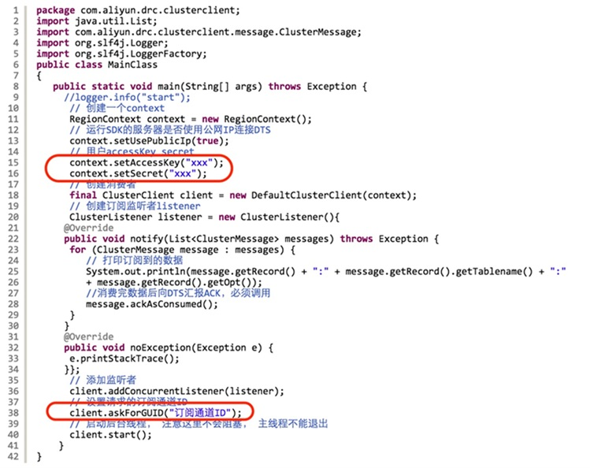

   将上面示例代码中标注的几个地方分别修改成您的账号对应的 AccessKeyID，AccessKeySecret，订阅通道ID。订阅通道ID需要登录数据传输服务控制台，单击左侧导航栏的**数据订阅**进入数据订阅列表，在**订阅ID/名称**列获取。

   </li>

   <li>

   在Eclipse中，右击**demo文件 > 运行方式 > Java应用程序**，即成功运行示例 demo。

   </li>

   </ol>

<a id="section-5-6"></a>

## 5.6. 使用Kafka客户端消费数据

新版数据订阅支持使用0.11版本至2.0版本的Kafka客户端消费订阅数据，DTS为您提供了Kafka客户端Demo，本文将介绍该客户端的使用说明。

**前提条件**

- 创建数据订阅通道，详情请参见创建RDS MySQL数据订阅通道。

- 已创建一个或多个消费组，详情请参见新增消费组。

**注意事项**

- 使用本文提供的Demo消费数据时，如果采用auto commit（自动提交），可能会因为数据还没被消费完就执行了提交操作，从而丢失部分数据，建议采用手动提交的方式以避免该问题。

  > 如果发生故障没有提交成功，重启客户端后会从上一个记录的位点进行数据消费，期间
  >
  > **说明**
  >
  > 会有部分重复数据，您需要手动过滤。

- 数据以Avro序列化存储，详细格式请参见Record.avsc文档。

  > 如果您使用的不是本文提供的客户端，您需要根据avro schema定义进行数据解析。
  >
  > **说明**

**Kafka客户端Demo下载及运行流程说明**

请下载Kafka客户端Demo代码。更多关于代码使用的详细介绍，请参见Demo中的Readme文档。

表 1. 运行流程说明

| 步骤 | 相关目录及文件 |
| --- | --- |
| 1、使用原生的Kafka consumer从数据订阅通道中获取增量数据。 | subscribe_example-master/javaimpl/src/main/java/r ecordgenerator/ |
| 2、将获取的增量数据镜像执行反序列化，并从中获取前镜像、 后镜像和其他属性。 | subscribe_example-master/javaimpl/src/main/java/boot/MysqlRecordPrinter.java |
| 3、将反序列化后的数据中的dataTypeNumber字段转换为指定的MySQL或Oracle字段类型。<br>说明关于对应关系的详情，请参见文末的MySQL字段类型与dataTypeNumber数值的对应关系和Oracle字段类型与dataTypeNumber数值的对应关系。 | subscribe_example-master/javaimpl/src/main/java/r ecordprocessor/mysql/ |

**操作步骤**

本文以IntelliJ IDEA软件（Community Edition 2018.1.4 Windows版本）为例，介绍如何运行该客户端进行数据消费。

1. 下载Kafka客户端Demo代码，然后解压该文件。

2. 打开IntelliJ IDEA软件，然后单击**Open**。

3. 在弹出的对话框中，定位至Kafka客户端Demo代码下载的目录，依次展开文件夹，找到项目对象模型文件：pom.xml。

4. 在弹出对话框中，选择**Open as Project**。

5. 在IntelliJ IDEA软件界面，依次展开文件夹，找到并双击打开Kafka客户端Demo文件：NotifyDemo.java。

   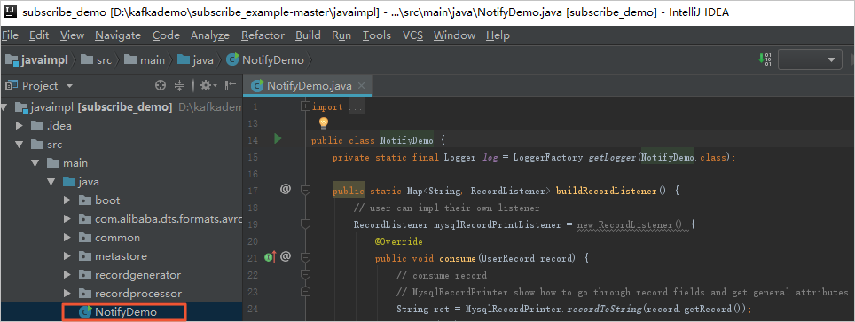

6. 设置NotifyDemo.java文件中的各参数对应的值。

   <table>
     <tr>
       <th>参数</th>
       <th>说明</th>
       <th>获取方式</th>
     </tr>
     <tr>
       <td>USER_NAME</td>
       <td>消费组的账号。<br>警告如果您使用的不是本文提供的客户端，请按照<code> &lt;</code>消费组的账号<code>&gt;-&lt;</code>消费组<code>ID&gt; </code>的格式设置用户名（例如：<code> dtstest-</code><code>dtsae******bpv </code>），否则无法正常连接。</td>
       <td rowspan="4">在DTS控制台单击目标订阅实例ID，然后在左侧导航栏单击<strong>数据消费</strong>，您可以获取到<strong>消</strong><strong>费组ID</strong>和消费组的<strong>账号</strong>信息。<br>说明消费组账号的密码已在您新建消费组时指定。</td>
     </tr>
     <tr>
       <td>PASSWORD_NAM E</td>
       <td>该账号的密码。</td>
     </tr>
     <tr>
       <td>SID_NAME</td>
       <td>消费组ID。</td>
     </tr>
     <tr>
       <td>GROUP_NAME</td>
       <td>消费组名称，需保持和消费组ID相同（即本参数也填入消费组ID）。</td>
     </tr>
     <tr>
       <td>KAFKA_TOPIC</td>
       <td>数据订阅通道的订阅Topic。</td>
       <td rowspan="2">在DTS控制台单击目标订阅实例ID，然后在左侧导航栏单击<strong>基本信息</strong>页面，您可以获取到<strong>订阅Topic</strong>、网络地址及端口号信息。</td>
     </tr>
     <tr>
       <td>KAFKA_BROKER_URL_NAME</td>
       <td>数据订阅通道的网络地址及端口号信息。<br>说明如果您部署Kafka客户端所属的ECS实例与数据订阅通道属于经典网络或同一专有网络，建议通过内网地址进行数据订阅，网络延迟最小。</td>
     </tr>
     <tr>
       <td>INITIAL_CHECKPO INT_NAME</td>
       <td>消费的数据时间点，格式为Unix时间戳。<br>说明您需要自行保存时间点信息，当业务程序中断后，您可以通过订阅客户端传入已消费的数据时间点来继续消费数据，防止数据丢失。同时，您还可以在订阅客户端启动时，传入所需的消费位点，对订阅位点进行调整，实现按需消费数据。</td>
       <td>首次订阅时，请自行将业务所需的时间点转化为Unix时间戳。</td>
     </tr>
     <tr>
       <td>USE_CONFIG_CHE CKPOINT_NAME</td>
       <td>默认取值为true，即强制使用指定的数据时间点来消费数据，避免丢失已接收到的但未处理的数据。</td>
       <td>无</td>
     </tr>
   </table>

7. 在IntelliJ IDEA软件界面的顶部，选择**Run > Run**运行该客户端。

   > 首次运行时，软件将自动加载相关依赖包并完成安装。
   >
   > **说明**

**执行结果**

运行结果如下图所示，该客户端可正常订阅到源库的数据变更信息。

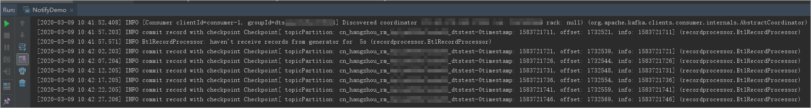

您也可以去除NotifyDemo.java文件中的打印日志详情的注释（即删除第25行 `//log.info(ret);` 中的 `//` ），然后再次运行该客户端即可查看详细的数据变更信息。

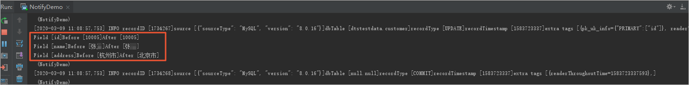

**MySQL字段类型与dataTypeNumber数值的对应关系**

| MySQL字段类型 | 对应dataTypeNumber数值 |
| --- | --- |
| MYSQL_TYPE_DECIMAL | 0 |
| MYSQL_TYPE_INT8 | 1 |
| MYSQL_TYPE_INT16 | 2 |
| MYSQL_TYPE_INT32 | 3 |
| MYSQL_TYPE_FLOAT | 4 |
| MYSQL_TYPE_DOUBLE | 5 |
| MYSQL_TYPE_NULL | 6 |
| MYSQL_TYPE_TIMESTAMP | 7 |
| MYSQL_TYPE_INT64 | 8 |
| MYSQL_TYPE_INT24 | 9 |
| MYSQL_TYPE_DATE | 10 |
| MYSQL_TYPE_TIME | 11 |
| MYSQL_TYPE_DATETIME | 12 |
| MYSQL_TYPE_YEAR | 13 |
| MYSQL_TYPE_DATE_NEW | 14 |
| MYSQL_TYPE_VARCHAR | 15 |
| MYSQL_TYPE_BIT | 16 |
| MYSQL_TYPE_TIMESTAMP_NEW | 17 |
| MYSQL_TYPE_DATETIME_NEW | 18 |
| MYSQL_TYPE_TIME_NEW | 19 |
| MYSQL_TYPE_JSON | 245 |
| MYSQL_TYPE_DECIMAL_NEW | 246 |
| MYSQL_TYPE_ENUM | 247 |
| MYSQL_TYPE_SET | 248 |
| MYSQL_TYPE_TINY_BLOB | 249 |
| MYSQL_TYPE_MEDIUM_BLOB | 250 |
| MYSQL_TYPE_LONG_BLOB | 251 |
| MYSQL_TYPE_BLOB | 252 |
| MYSQL_TYPE_VAR_STRING | 253 |
| MYSQL_TYPE_STRING | 254 |
| MYSQL_TYPE_GEOMETRY | 255 |

**Oracle字段类型与dataTypeNumber数值的对应关系**

| Oracle字段类型 | 对应dataTypeNumber数值 |
| --- | --- |
| VARCHAR2/NVARCHAR2 | 1 |
| NUMBER/FLOAT | 2 |
| LONG | 8 |
| DATE | 12 |
| RAW | 23 |
| LONG_RAW | 24 |
| UNDEFINED | 29 |
| XMLTYPE | 58 |
| ROWID | 69 |
| CHAR、NCHAR | 96 |
| BINARY_FLOAT | 100 |
| BINARY_DOUBLE | 101 |
| CLOB/NCLOB | 112 |
| BLOB | 113 |
| BFILE | 114 |
| TIMESTAMP | 180 |
| TIMESTAMP_WITH_TIME_ZONE | 181 |
| INTERVAL_YEAR_TO_MONTH | 182 |
| INTERVAL_DAY_TO_SECOND | 183 |
| UROWID | 208 |
| TIMESTAMP_WITH_LOCAL_TIME_ZONE | 231 |
