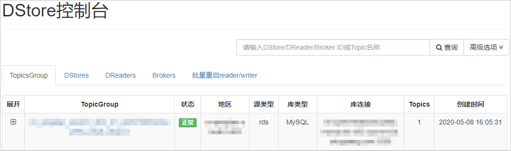
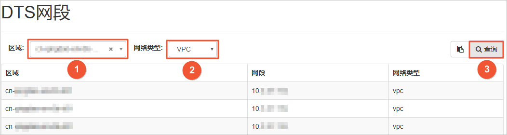
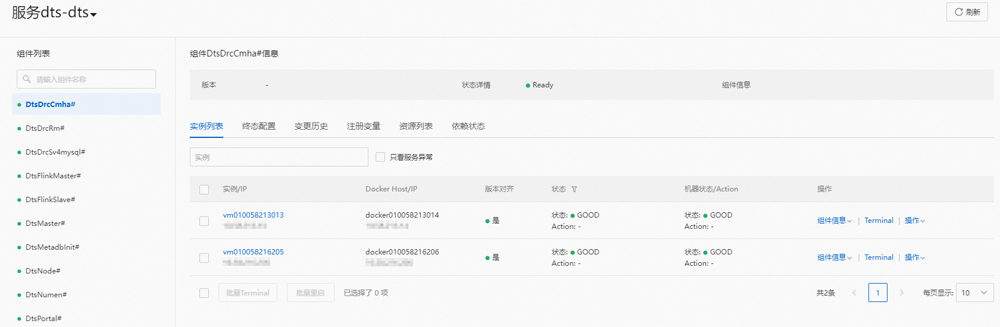
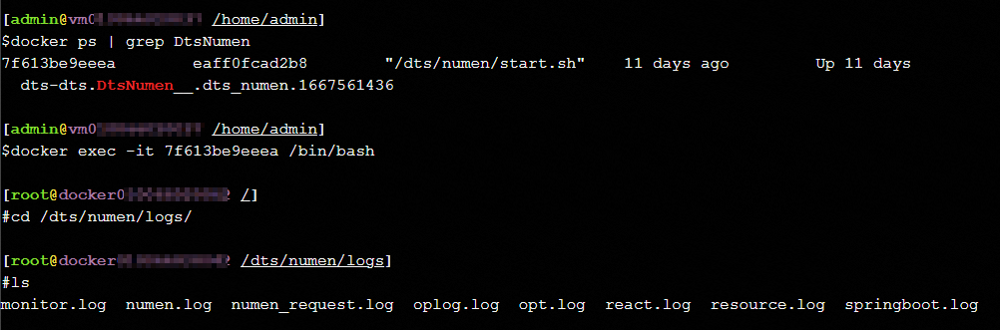
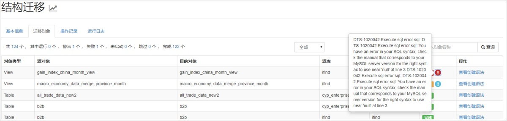
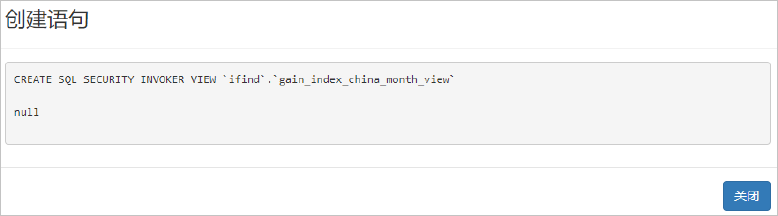
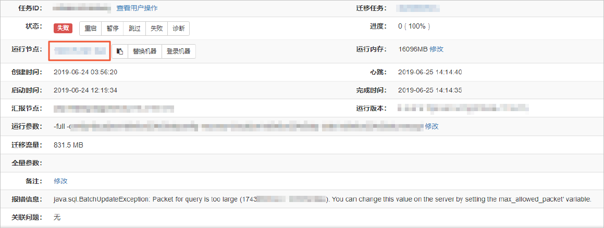
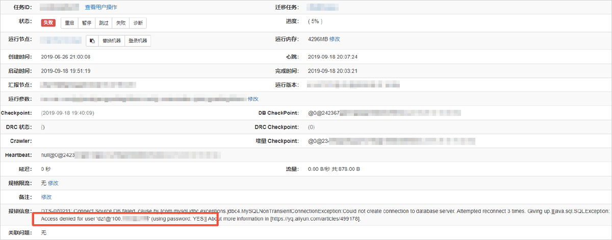

阿里云  
专有云  
数据传输  
运维指南  
产品版本：V3.18.6  
文档版本：20251205

**目录**

- [1.DTS运维平台简介](#section-1)
- [2.登录DTS运维平台](#section-2)
- [3.任务管理](#section-3)
    - [3.1. 管理任务](#section-3-1)
    - [3.2. 管理任务中的具体模块](#section-3-2)
- [4.任务引擎](#section-4)
    - [4.1. 查询任务](#section-4-1)
- [5.监控报警](#section-5)
    - [5.1. 查看全量任务监控信息](#section-5-1)
    - [5.2. 查看大盘数据](#section-5-2)
- [6.集群管控](#section-6)
    - [6.1. 管理集群](#section-6-1)
    - [6.2. 通过DStore控制台管理数据订阅任务](#section-6-2)
- [7.资源管理](#section-7)
    - [7.1. 查看DTS资源](#section-7-1)
    - [7.2. 管理DTS资源](#section-7-2)
    - [7.3. 查看DTS网段](#section-7-3)
- [8.运维案例](#section-8)
    - [8.1. 查看告警](#section-8-1)
    - [8.2. 查看日志](#section-8-2)
    - [8.3. 数据迁移和数据同步运维案例](#section-8-3)
    - [8.4. 数据订阅运维案例](#section-8-4)

# 1.DTS运维平台简介

DTS运维平台是数据传输服务DTS（Data Transmission Service）的后台运维系统，本节简单介绍了该系统的功能及基本概念。

**主要功能**

DTS运维平台主要包含了以下功能：

- 任务管理

  可以查询所有任务的详细执行情况、源库信息、目标库信息及DTS信息。

- 任务引擎

  可以查询任务的类型、错误信息、业务ID、创建时间、最后修改时间等信息。

- 监控报警

  可以查询性能监控信息及报警信息。

- 集群管控

  可以对集群进行管理。

- 资源管理

  可以对DTS的各类资源进行管理。

# 2.登录DTS运维平台

本文介绍运维工程师等相关用户如何登录到DTS运维平台。

**前提条件**

**前提条件**

- 已从部署人员或管理员处获取Apsara Uni-manager运维控制台的访问地址、用户名和密码。

  Apsara Uni-manager运维控制台访问地址格式为*ops*.asconsole.*intranet-domain-id*.com。

- 推荐使用Chrome浏览器。

1. 打开浏览器。

2. 在地址栏中，输入Apsara Uni-manager运维控制台的访问地址，按回车键。

   

   > **说明**
   >
   > 您可以单击右上角的当前语言切换其它语言。当前支持简体中文、English语言切换。

3. 输入正确的用户名及密码。

   > 登录Apsara Uni-manager运维控制台的用户名和密码请从部署人员或管理员处获取。
   >
   > **说明**

   首次登录Apsara Uni-manager运维控制台时，需要修改登录用户名的密码，请按照提示完成密码修改。

   为提高安全性，密码必须满足以下要求：

   - 英文大小写字母

   - 阿拉伯数字（0~9）

   - 特殊符号，包括感叹号（！）、at（@）、井号（#）、美元符号（$）、百分号（%）等

   - 密码长度10~20个字符

4. 单击**账号登录**。

   > 如果需要进行第三方授权登录，单击**授权登录**后，会以超链接的形式直接跳转第三方登
   >
   > **说明**
   >
   > 录页面，在该页面完成第三方账号（IdP）的认证后，会重定向到Apsara Uni-manager运维控制台首页，进行登录。
   >
   > 授权登录需要在第三方和Apsara Uni-manager运维控制台进行相关配置才能完成，具体操作请联系阿里云技术支持。

5. 在Apsara Uni-manager运维控制台的顶部菜单栏单击**产品运维**。

6. 单击**数据库运维**下方的**DTS运维·DTS**，跳转至**DTS运维平台**。

# 3.任务管理

## 3.1. 管理任务

在任务管理页面可以查看和管理当前存在的所有任务。

**操作步骤**

1. 登录DTS运维平台。

2. 在左侧导航栏，单击**任务管理 > 所有任务**。

3. 在页面上方，您可以填入选择条件，然后单击**查询**来过滤任务信息。

   > **说明**
   >
   > 您还可以单击**高级选项**来选择更多的过滤条件来过滤任务信息。

4. 找到需要管理的目标任务，单击对应的任务名称。

5. 在**任务详情**页面，根据业务需求选择相应的管理操作。

   - 查看任务的详细信息。

     您可以查看到实例信息、任务信息、源库信息、目的库信息和DStore信息。

   - 查看模块的基本信息。

     <ol type="a">

     <li>

     单击任务的模块（比如结构迁移、全量迁移、同步）中的**详情**。

     </li>

     <li>

     在**基本信息**页签，您可以查看到任务模块的基本信息，包括任务ID、运行的节点IP（即任务运行的机器IP）、运行版本。

     > **说明**
     >
     > 例如您可以在全量迁移模块的 `core-` 后查看运行版本。

     </li>

     </ol>

   - 查看Checkpoint（同步至目标库最新一条数据的时间点）。

     <ol type="a">

     <li>

     单击任务的**同步**或**增量迁移**模块中的**详情**。

     </li>

     <li>

     在**基本信息**页签，您可在**Checkpoint**中查看同步至目标库最新一条数据的时间点。

     </li>

     </ol>

   - 执行全量校验

     单击页面右上角的**全量校验**，配置好校验参数后单击**添加**。

     > **说明**
     >
     > 当源和目标库为MySQL时才支持此功能。

     | 配置 | 说明 | 注意事项 |
     | --- | --- | --- |
     | Count校验 | • <strong>OFF</strong>：对抽中的数据进行全字段校验。 • <strong>ON</strong>：对全量数据按表行数进行校验，不会对具体的数据内容进行校验。 | 开关打开时，只允许配置<strong>线程数</strong>、<strong>校验完成发送</strong><strong>通知</strong>、<strong>通知接收人</strong>和<strong>是否定时校验</strong>。 |
     | 是否订正 | 以源库为基准，校验出不一致数据后直接在目标库中进行订正。 | 对数据准确性存在较高风险的，建议不要开启。 |
     | CHECK SUM | 使用MySQL的<code> checksum table </code>命令校验是否存在不一致数据，即把整个表看作是一个checksum值，然后进行对比。 | 仅在MySQL数据库间的同步或迁移任务开启时，设置才会生效。 |
     | 抽样校验百分比 | 全字段校验的抽样比例，取值为\[1,100\]的整数。 | 默认的<strong>0</strong>等效于<strong>100</strong>。 |
     | 线程数 | 执行数据校验时的线程池的大小，可以调整校验任务的并发数。 | 建议设置在5以内，否则将会对源库造成较大的压力。 |
     | 切片大小 | 一个切片的数据量大小，即单次查询数据的预估量。 | 默认为<strong>3000</strong>，不建议修改。 |
     | 元数据保存差异数 | 复检切片大小 。 | 默认为<strong>300</strong>，不建议修改。 |
     | 单表最大差异上限 | 校验过程中单个表允许出现的不一致数据的阈值。 | 若不一致数据记录的条数超过设定的数值，则校验任务将会退出该表的校验，从而会导致数据校验不完整。 |
     | 无主键单表校验数据上限 | 若待校验的表为无主键且无唯一索引的表时，支持全量校验的表数据的阈值。 | 若待校验的表为无主键且无唯一索引的表，则该表的数据超过此阈值时DTS将不会进行数据校验。 |
     | 校验完成发送通知 | 数据校验任务完成后是否发送通知给指定接收人。 | 请勿配置，此功能无效。 |
     | 是否定时校验 | 定时开始或结束校验任务。 | 请勿配置，此功能无效。 |

   - 执行一键诊断

     单击页面右上角的**一键诊断**，创建一个诊断任务用于诊断任务是否正常。若有异常，系统会根据对源库、目标库、网络等的检查，提供诊断结果和建议。

   - 查看用户操作

     在**任务信息**区域框，单击**查看用户操作**，可查看到用户对该任务的操作记录。

   - 修改消费时间点（仅适用于数据订阅任务）

     在**任务信息**区域框，单击**消费时间点**后的**修改**，填入对应时间点的UNIX时间戳后单击**确定**。

   - 修改任务备注

     在**任务信息**区域框，单击**任务备注**后的**修改**，填入备注后单击**确定**。

   - 修改任务配置

     在**任务信息**区域框，单击**修改配置**，可根据需求调整任务的详细配置。

   - 释放任务

     在**任务信息**区域框，单击**释放任务**。

     > **警告**
     >
     > 任务释放后数据将无法找回，请谨慎操作。

   - 更新订阅（仅适用于数据订阅任务）

     在**任务信息**区域框，单击**更新订阅**，在弹出的对话框中单击**确定**。

## 3.2. 管理任务中的具体模块

一个DTS任务包含多个模块，本文介绍如何管理任务中的具体模块。

**操作步骤**

1. 登录DTS运维平台。

2. 在左侧导航栏，单击**任务管理 > 所有任务**或**任务管理 > 异步任务**。

3. 找到目标任务，单击对应的任务名称。

4. 在**任务详情**页面的顶部将显示该任务对应各个模块的状态。

   > **说明**
   >
   > 各模块的颜色表示该模块的具体状态：
   >
   > - 红色：处于异常状态。
   >
   > - 蓝色：处于运行中状态。
   >
   > - 黄色：处于暂停状态。
   >
   > - 绿色：处于完成或无延迟状态。

5. 单击各模块下的**详情**，进入该模块的管理页面。

6. 在模块的管理页面中，选择执行相应的操作。

   > **说明**
   >
   > 下述列表以结构迁移模块为例介绍管理操作，其他模块的管理操作与本案例类似。

   - 在**基本信息**页签，可对该模块执行重启、暂停、跳过、替换机器、修改运行内存等操作。

   - 在**迁移对象**页签，可查看迁移的对象信息、状态和创建语法。

   - 在**操作记录**页签，可查看对该模块的运维操作记录。

   - 在**运行日志**页签，可查看运行日志，同时可以执行拉取、跟踪、预览、下载等操作。

   - 在**用户可见运行日志**页签，可以按条件过滤并查询运行日志。

   - 在**任务进程**页签，可查看任务执行的详细进度信息。

# 4.任务引擎

## 4.1. 查询任务

在任务查询页面，您可使用任务ID、业务ID、子业务ID、任务创建的时间、任务的类型查询任务引擎里的任务。

**操作步骤**

1. 登录DTS运维平台。

2. 在左侧导航栏，单击**任务引擎 > 任务查询**。

3. 在**任务引擎-查询**页面，您可以选择条件然后单击**查询**来过滤任务。

   > **说明**
   >
   > 您可以单击目标任务的**ID**，获取该任务的详细步骤信息。

# 5.监控报警

## 5.1. 查看全量任务监控信息

全量迁移需要从源端读取数据然后写入目标端，本文介绍如何查看全量任务的监控信息。

**操作步骤**

1. 登录DTS运维平台。

2. 在左侧导航栏，单击**监控报警 > 全量监控**。

3. 在**全量监控**页面，您可以选择条件（任务的ID、名称、状态，数据库的类型、地域等），然后单击**查询**来过滤全量任务。

   您可以查看全量模块的状态和传输数据的进度信息，或者单击任务名称进入任务详情页面。

   > **说明**
   >
   > 您可以开启**自动刷新**功能，系统将会自动更新全量监控页面，无需您手动刷新页面。

## 5.2. 查看大盘数据

通过DTS运维平台，您可以查看全量、增量及同步任务大盘数据，本文以全量大盘为例介绍查看方法。

**操作步骤**

1. 登录DTS运维平台。

2. 在左侧导航栏，单击**监控报警 > 全量大盘**。

   > **说明**
   >
   > - 您也可以单击**监控报警 > 增量大盘**或**监控报警 > 同步大盘**查看其他大盘数据。
   >
   > - 不同监控大盘界面展示信息不同，请以实际界面为准。例如，**增量大盘**和**同步大盘**支持查看任务的性能信息。

3. 根据业务需求选择下述操作步骤。

   - 查看全量任务信息

     在**全量大盘**页面，可查看到所有全量任务的基本信息、状态和监控数据等信息。

     > **说明**
     >
     > - 您也可以在页面上方选择条件过滤任务信息，或者开启自动刷新功能。
     >
     > - **全量大盘**的**报警**信息中：蓝色表示待调度，黄色表示运行中，绿色表示运行成功，红色表示失败。

   - 单个管理

     在**操作**列，可以对目标任务执行暂停、重启和跳过操作。

   - 批量管理

     选择单个或多个任务，可以对任务执行批量暂停、批量重启和批量跳过操作。

   - 查看批量操作记录在**批量记录**页签，可以查询执行过的批量操作。

# 6.集群管控

## 6.1. 管理集群

本文介绍通过DTS运维平台管理集群。

**操作步骤**

1. 登录DTS运维平台。

2. 在左侧导航栏，单击**集群管控 > 集群管理**。

3. 默认页面将展示所有集群信息，您可以根据业务需求单击**操作**列下的对应按钮来执行管理操作。

## 6.2. 通过DStore控制台管理数据订阅任务

Dstore模块用于存储增量数据，您可以通过DStore控制台查看各模块的详细或执行批量重启。

**操作步骤**

1. 登录DTS运维平台。

2. 在左侧导航栏，单击**集群管控 > DStore控制台**。

3. 在**DStore控制台**页面，根据业务需求选择下述操作步骤。

   

   > 您可以在右上角根据条件来过滤任务。
   >
   > **说明**

   - 查看各模块的详细信息

     单击对应的页签即可查看各模块中具体任务的详细信息。

   - 批量重启或暂停任务

     <ol type="a">

     <li>

     单击**批量重启reader/writer**。

     </li>

     <li>

     单击任务名称前的复选框来选择单个或多个任务。

     </li>

     </ol>

     <ol type="i" start="100">

     <li>

     单击**批量重启**或**批量暂停**。

     </li>

     <li value="500">

     在弹出的对话框中单击**批量执行**。

     </li>

     </ol>

# 7.资源管理

## 7.1. 查看DTS资源

通过查看DTS资源的概览信息，可以帮助您了解DTS资源的运行状态。

**操作步骤**

1. 登录DTS运维平台。

2. 在左侧导航栏，单击**资源管理 > DTS资源**。页面将展示所有DTS资源的详细信息，包括资源所属的地域、CPU、内存等信息。

## 7.2. 管理DTS资源

通过DTS运维平台，您可以查看或管理DTS资源。

**操作步骤**

1. 登录DTS运维平台。

2. 在左侧导航栏，单击**资源管理 > DTS资源**。

3. 根据业务需求，选择下述操作步骤。

   - 查看资源信息

     页面默认展示所有资源信息，您可以在页面上方选择资源组、区域或填入机器IP地址，然后单击**查询**来过滤资源。

   - 管理资源

     单击目标资源**操作**列中对应的按钮执行管理操作。

   - 机器批量初始化

     单击单个或多个资源名称前的复选框，然后单击**机器批量初始化**，根据页面提示完成后续操作。

   - 资源归类到资源组

     单击单个或多个资源名称前的复选框，然后单击**资源归类到资源组**，根据页面提示完成后续操作。

## 7.3. 查看DTS网段

通过查看DTS网段信息，可查看各区域和不同网络类型的DTS服务器IP地址，用于排查DTS的连通性问题。例如检查数据库实例的白名单或自建数据库的防火墙规则中是否添加了对应地域和网络类型的DTS服务器IP地址。

**操作步骤**

1. 登录DTS运维平台。

2. 在左侧导航栏，单击**资源管理 > DTS网段**。页面默认将展示所有区域和所有网络类型的IP地址信息。

3. 在页面上方选择目标区域和网络类型，然后单击**查询**。

   

# 8.运维案例

## 8.1. 查看告警

您可以在**告警列表**页面，通过产品、告警ID、告警来源、告警级别、告警状态及告警发生的时间范围进行查询，然后对目标告警进行运维操作。

**操作步骤**

> **说明**
>
> 更多关于监控告警和云平台的运维操作介绍，请参见<strong>《Apsara Uni-manager运营控制台 运维指南》</strong>。

1. 打开浏览器。

2. 在地址栏中，输入Apsara Uni-manager运维控制台的访问地址，按回车键。

   

   > **说明**
   >
   > 您可以单击右上角的当前语言切换其它语言。当前支持简体中文、English语言切换。

3. 输入正确的用户名及密码。

   > **说明**
   >
   > - 登录Apsara Uni-manager运维控制台的用户名和密码请从部署人员或管理员处获取。
   >
   > - 若连续输入密码错误三次，系统将启动图片验证码登录功能；若连续输入错误五次，账户将被锁定，请联系管理员进行激活。
   >
   > - 首次登录Apsara Uni-manager运维控制台时，需要修改登录用户名的密码，请按照提示完成密码修改。
   >
   >   为提高安全性，密码必须满足以下要求：
   >
   >   - 必须包含英文大小写字母。
   >
   >   - 必须包含阿拉伯数字（0~9）。
   >
   >   - 必须包含特殊符号，包括感叹号（!）、at（@）、井号（#）、美元符号（$）、百分号（%）等。
   >
   >   - 密码长度为10~20个字符。

4. 单击**同意协议并登录**。

5. 在顶部菜单栏，选择**监控告警 > 告警管理 > 告警列表**。

   系统默认进入**未关闭**页签。您也可以通过切换**已关闭**页签查看已关闭的告警详情。

6. 在页面上方的**资源归属**中选择**dts**。

   > **说明**
   >
   > 您也可以输入告警关键字进行模糊搜索，或者在**高级筛选**中进行模糊搜索。

7. 在**告警项ID/告警项中文名**列，单击目标告警的ID，进入告警详情页面，查看告警的详细信息。

8. <strong>可选：</strong>单击页面右上角的按钮，处理告警信息。

   <ol type="i">

   <li>

   <strong>可选：</strong>单击**处理建议**，可以查看对应告警的处理建议。

   </li>

   <li>

   单击**处理**或**关闭**。

   </li>

   <li>

   在弹出的对话框中单击**确定**，**告警状态**将变更为**处理中**或**关闭**。

   </li>

   </ol>

## 8.2. 查看日志

本文介绍重要日志的查询方式、以及日志的种类，便于您在任务异常时通过日志快速定位问题。

**步骤1：通过飞天基础运维平台进入DTS终端**

1. 打开浏览器。

2. 在地址栏中，输入Apsara Uni-manager运维控制台的访问地址，按回车键。

   

   > **说明**
   >
   > 您可以单击右上角的当前语言切换其它语言。当前支持简体中文、English语言切换。

3. 输入正确的用户名及密码。

   > 登录Apsara Uni-manager运维控制台的用户名和密码请从部署人员或管理员处获取。
   >
   > **说明**

   首次登录Apsara Uni-manager运维控制台时，需要修改登录用户名的密码，请按照提示完成密码修改。

   为提高安全性，密码必须满足以下要求：

   - 英文大小写字母

   - 阿拉伯数字（0~9）

   - 特殊符号，包括感叹号（！）、at（@）、井号（#）、美元符号（$）、百分号（%）等

   - 密码长度10~20个字符

4. 单击**账号登录**。

5. 进入DTS**服务管理**页面。

   <ol type="i">

   <li>

   登录Apsara Uni-manager运维控制台。

   </li>

   <li>

   在顶部菜单栏中，选择**平台运维 > 飞天基础运维平台 > 运维工具**。

   </li>

   <li>

   在左侧导航栏，选择**运维工具 > 服务管理**。

   </li>

   <li>

   在**服务管理**页面的**服务**下拉框，搜索并筛选**dts-dts**。

   </li>

   </ol>

6. 在**服务管理**页面中，单击**服务实例**页签。

7. 单击DTS集群**操作**列的**实例详情**。

   

8. 在**组件列表**单击目标组件，并在组件信息的**实例列表**页签中，单击目标实例右侧**操作**列下方的**Terminal**进入终端。

9. 进入终端后，在左侧导航栏单击对应的主机。

0. 选择**服务器账号**，并单击**确定**。

**步骤二：在终端中查找日志**

终端中用于记录日志信息的主要组件为**DtsPortal#** （控制台运行的组件）、**DtsNode#** （任务运行的真正组件），两者均包含任务失败的日志信息。以下将介绍如何查找这两种组件中的日志信息。

- **DtsNode#**

  <ol type="i">

  <li>

  获取所需查询的任务ID。查询方式，请参见管理任务。

  </li>

  <li>

  进入**DtsNode#** 组件的终端。进入方式，请参见步骤1：通过飞天基础运维平台进入DTS终端。

  </li>

  <li>

  执行 `cd /apsara/cloud/app/dts-dts/DtsNode#/dts_node/current/run/<`任务`ID>` 命令，进入日志存储目录。

  </li>

  </ol>

- 其他组件

  <ol type="i">

  <li>

  进入组件的终端。

  </li>

  <li>

  执行 `docker ps | grep <`组件名称`>` 命令，查询组件日志所在容器ID。

  </li>

  <li>

  执行 `docker exec -it <`容器`ID> /bin/bash` 命令，进入组件日志所在的容器。

  </li>

  <li>

  执行 `cd <`日志路径`>` 命令，进入日志存储路径查看日志。

  > **说明**
  >
  > DTS组件日志大都存储在/dts/<组件名称>/logs/<组件名称>.log。更多日志信息，请参见主要日志组件介绍。

  

  </li>

  </ol>

**主要日志组件介绍**

> **说明**
>
> DtsNode组件日志存储在宿主机中，其余组件日志存储在容器中。

**组件**

**日志文件位置**

**说明**

主要的日志信息，记录Node（节点）运行日志。

/apsara/cloud/app/dts-

如某节点上的任务运行失败，您可根据节点IP和任

dts/DtsNode#/dts_node/current

务ID，查看其对应的日志。

/logs/node.log

/apsara/cloud/app/dts-dts/DtsNode#/dts_node/current /run/<任务ID>/dts_ddlmove.log

记录预检查与结构迁移模块运行日志，如这两个模

> **说明**

块报错，您可查看其中对应的日志信息。

> 例如/dts/node/run/td0v\*\*\*\*\*\*\* \*\*/dts_ddlmove.log

/apsara/cloud/app/dts-

记录全量迁移、增量迁移或同步模块运行日志，如

dts/DtsNode#/dts_node/current

这两个模块报错，您可查看其中对应的日志信息。

/run/<任务ID>/amp.log

记录DStore控制台的DReader模块（用于读取源

/apsara/cloud/app/dts-

库增量日志）运行日志。如果DReader模块报

dts/DtsNode#/dts_node/current /run/<任务ID>/extractor.log

错，您可查看其中对应的日志信息。

记录存储增量数据的中间件Kafka的运行日志。该

/apsara/cloud/app/dts-

日志较少排查。

dts/DtsNode#/dts_node/current /run/<任务ID>/k.log

dts-dts.DtsNode#

记录DReader模块与DStore模块（用于存储源库增量日志）连接中间件Kafka的日志信息。如果DReader模块、增量迁移或同步模块显示报错

/apsara/cloud/app/dts-

（一般报错提示为

dts/DtsNode#/dts_node/current

UNKOWN_SERVER_ERROR），并且日志

/run/<任务ID>/kafka.log

extractor.log或者amp.log显示与DStore连接异常时，您可以查看该日志，判断是否为中间件Kafka连接异常。

/apsara/cloud/app/dts-

记录DStore模块运行日志。较少排查。

dts/DtsNode#/dts_node/current /run/<任务ID>/server.log

记录A2A运行版本的全量迁移和增量迁移或同步模块运行日志，如这两个模块报错，您可查看其中对应的日志信息。

/apsara/cloud/app/dts-dts/DtsNode#/dts_node/current /run/<任务ID>/any-all.log

> **说明**
>
> 运行版本的判断方式，请参见管理任务。

主要的日志信息。

- 记录通过DTS控制台、OpenAPI访问DTS服务器的日志。

/dts/portal/logs/portal.log

dts-

- 如任务配置失败或者页面报错，您可根据报错

dts.DtsPortalA2A#

提示中的RequestId查看对应日志。

DTS控制台的页面日志。

/dts/portal/logs/http.log

Master调度日志。如果DTS任务模块调度失败，

dts-dts.DtsMaster#

/dts/master/logs/master.log

可查看该日志。

Numen运行日志。较少排查。

dts-dts.DtsNumen#

/dts/numen/logs/numen.log

Proxy运行日志（Proxy起代理作用，用于向消息生产者和消费者提供中间件Kafka的IP、端口号等信息），较少排查。如果DStore、DReader、增

dts-dts.DtsProxy#

/dts/proxy/logs/proxy.log

量迁移或同步模块（数据写入模块）显示连接异常，您可查看其中对应的日志信息。

## 8.3. 数据迁移和数据同步运维案例

本文介绍通过DTS运维平台，对数据迁移或数据同步任务执行的相关运维操作。

**背景信息**

在**任务详情**页面，数据迁移和数据同步的任务原理和任务环节是一样的，仅在最后一个环节的命名不同，所以本文将这两类任务的运维案例合并介绍。

**屏蔽部分预检查项目**

如果某个任务预检查失败，需要跳过预检查时，可通过运维平台单独跳过某个检查项。

> **说明**
>
> 在屏蔽检查项前，需要明确知晓预检查存在的问题和屏蔽产生的影响，例如屏蔽源库权限检查的项目，可能导致因权限不足而无法完成数据迁移或数据同步任务。

1. 登录DTS运维平台。

2. 在左侧导航栏，单击**任务管理>所有任务**。

3. 找到目标任务，单击对应的任务名称。

4. 在**任务详情**页面，单击**预检查**模块中的**详情**。

5. 在**预检查**页面，单击**检查项**页签。

6. 单击目标检查项**操作**列的**屏蔽**。

7. 完成屏蔽后即可在DTS控制台中重新启动任务（即重新执行预检查）。

**结构迁移失败排查案例**

结构迁移模块的作用是将源库中待迁移对象的结构定义（例如表、视图）迁移至目标库。

1. 登录DTS运维平台。

2. 在左侧导航栏，单击**任务管理 > 所有任务**。

3. 找到目标任务，单击对应的任务名称。

4. 在**任务详情**页面，单击**结构迁移**模块中的**详情**。

5. 单击**基本信息**页签，您可以查看到结构迁移模块运行的节点IP，如果遇到白名单问题导致的迁移失败，可以将该IP地址添加至源或目标库的白名单中。

6. 单击**迁移对象**页签，一般遇到结构迁移失败的问题基本都可以在本页签中排查。

   

7. 单击失败对象对应的提示按钮，根据提示可得知本次结构迁移失败是因为语法错误导致的，单击**查看创建语法**可查看到DTS从源端获取的语句。

   

8. 根据查看到的创建语句分析问题原因并修复。在本案例中，由于数据库账号权限不足导致无法获取视图定义，从而导致结构迁移失败，重新为数据库账号分配权限即可解决。

**全量迁移失败排查案例**

1. 登录DTS运维平台。

2. 在左侧导航栏，单击**任务管理 > 所有任务**。

3. 找到目标任务，单击对应的任务名称。

4. 在**任务详情**页面，单击**全量迁移**模块中的**详情**。

5. 单击**基本信息**页签，主要关注以下内容。

   > **说明**
   >
   > 您还可以单击**迁移对象**和**运行日志**页签来辅助排查问题。

   

   - 查看全量迁移模块运行的节点IP，如果遇到白名单问题导致的迁移失败，可以将该IP地址添加至源或目标库的白名单中。

   - 查看报错信息分析可能的原因并进行修复。本案例中，由于请求的数据超过了 `max_allowed_packet` 的值，可能是源或目标数据库的 `max_allowed_packet` 的值设置过小，调整参数值后单击**重启**来重启全量迁移任务即可。

**同步或增量迁移失败排查案例**

1. 登录DTS运维平台。

2. 在左侧导航栏，单击**任务管理 > 所有任务**。

3. 找到目标任务，单击对应的任务名称。

4. 根据需求选择下述步骤。

   - 排查同步失败问题

     在**任务详情**页面，单击**同步**模块中的**详情**。

   - 排查增量迁移失败问题

     在**任务详情**页面，单击**增量迁移**模块中的**详情**。

5. 单击**基本信息**页签，主要关注以下内容。

   > **说明**
   >
   > 您还可以单击**运行日志**页签来辅助排查问题。

   

   | 主要关注的参数 | 说明 |
   | --- | --- |
   | 运行节点 | 如果遇到白名单问题导致的迁移失败，可以将该IP地址添加至源或目标库的白名单中。 |
   | Checkpoint | 该模块写入数据的检查点，可以帮助您判断延迟准确性。 |
   | 延迟 | 如果Checkpoint信息延后，一般会出现延迟，可根据日志排查问题原因。 |
   | 流量 | 正常情况下，流量会有变化。如果一直是0，则增量写入可能存在问题。 |
   | 报错信息 | 展示报错的日志信息以供排查。 |

   在本案例中，查看报错信息内容可得知由于数据库账号或密码错误导致同步或增量迁移失败。您可以返回**任务详情**页面，单击**修改配置**，调整数据库账号或密码信息，然后重启任务。

## 8.4. 数据订阅运维案例

本文介绍通过DTS运维平台，对数据订阅任务执行的相关运维操作。

**背景信息**

数据订阅任务分为新版和旧版：

- 新版数据订阅：包含预检查模块增量数据服务模块，与数据迁移或数据同步的运维方式一致，详情请参见数据迁移和数据同步运维案例。

- 旧版数据订阅：目前仅提供**基本信息**页面以供运维，本文介绍旧版数据订阅的运维案例。

**操作步骤**

1. 登录DTS运维平台。

2. 在左侧导航栏，单击**任务管理 > 所有任务**。

3. 找到目标任务，单击对应的任务名称。

4. 在**任务详情**页面，主要关注消费时间点和数据范围信息（即消费时间点需要在数据范围内）。

5. 在页面下方的**DRC信息**区域框，复制Topic的地址。

6. 在DRC控制台中根据Topic地址来查找并进行管理，详情请参见通过DRC控制台管理数据订阅任务。

7. 在**增量管理**页签中，单击目标Store名称前的<strong>+</strong>展示起始位点、当前位点和状态信息。

   > **说明**
   >
   > 在本案例中，根据Store的状态提示得知是Binlog信息读取失败，需要排查源库是否存在binlogdump进程并确认进程状态正常。
