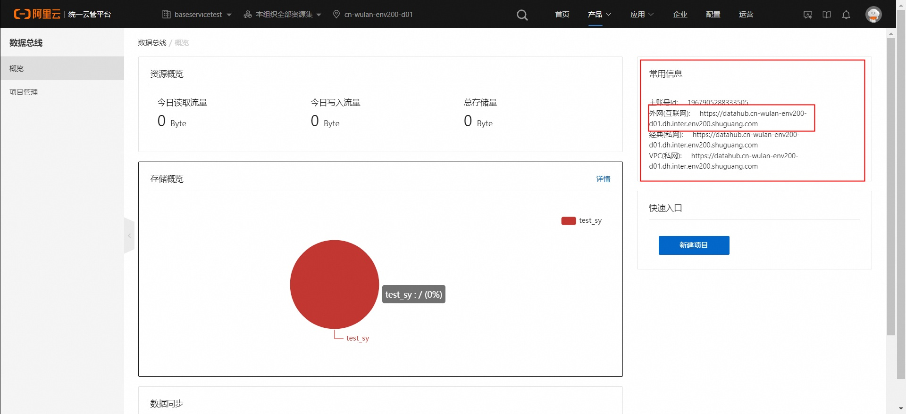

阿里云  
专有云  
数据总线  
开发指南  
产品版本：V3.18.6  
文档版本：20250807

**目录**

- [1.API参考](#section-1)
    - [1.1. ListUserSubscriptions](#section-1-1)
    - [1.2. GetTopicSchema](#section-1-2)
    - [1.3. CreateConnector](#section-1-3)
    - [1.4. ListTopicAction](#section-1-4)
    - [1.5. DeleteTopic](#section-1-5)
    - [1.6. UpdateConnectorState](#section-1-6)
    - [1.7. GetShardDetail](#section-1-7)
    - [1.8. SplitShard](#section-1-8)
    - [1.9. GetAlarmRule](#section-1-9)
    - [1.10. CreateKafkaGroup](#section-1-10)
    - [1.11. CreateTopic](#section-1-11)
    - [1.12. MergeShard](#section-1-12)
    - [1.13. ExtendShard](#section-1-13)
    - [1.14. GetConsumerPlan](#section-1-14)
    - [1.15. AddTopicSchema](#section-1-15)
    - [1.16. ListKafkaGroup](#section-1-16)
    - [1.17. ResetSubscriptionOffset](#section-1-17)
    - [1.18. ListSubscriptions](#section-1-18)
    - [1.19. ReloadConnector](#section-1-19)
    - [1.20. DeleteSubscription](#section-1-20)
    - [1.21. ListTopics](#section-1-21)
    - [1.22. GetSubscriptionOffset](#section-1-22)
    - [1.23. GetConnectorShardStatus](#section-1-23)
    - [1.24. GetTopicDataTrendByDay](#section-1-24)
    - [1.25. GetSchemaByOdps](#section-1-25)
    - [1.26. UpdateTopicsForKafkaGroup](#section-1-26)
    - [1.27. ListShards](#section-1-27)
    - [1.28. GetTopicMetric](#section-1-28)
    - [1.29. ListRegions](#section-1-29)
    - [1.30. ResetConnectorOffset](#section-1-30)
    - [1.31. AppendField](#section-1-31)
    - [1.32. GetConnector](#section-1-32)
    - [1.33. AddProjectVpcWhiteList](#section-1-33)
    - [1.34. GetTopic](#section-1-34)
    - [1.35. ListTopicSchema](#section-1-35)
    - [1.36. DeleteConnector](#section-1-36)
    - [1.37. ListConnectors](#section-1-37)
    - [1.38. CreateSubscription](#section-1-38)
    - [1.39. DeleteKafkaGroup](#section-1-39)
    - [1.40. GetKafkaGroup](#section-1-40)
    - [1.41. SampleShard](#section-1-41)
    - [1.42. GetUserStorage](#section-1-42)
    - [1.43. GetProject](#section-1-43)
    - [1.44. ListTopicsByKafkaGroup](#section-1-44)
    - [1.45. UpdateConnectorField](#section-1-45)
    - [1.46. ListProjects](#section-1-46)
    - [1.47. DeleteProject](#section-1-47)
    - [1.48. CreateProject](#section-1-48)
    - [1.49. CheckServiceLinkedRoleForDeleting](#section-1-49)
    - [1.50. DeleteProjectVpcWhiteList](#section-1-50)
    - [1.51. DeleteTopicSchema](#section-1-51)
    - [1.52. GetAssumeRole](#section-1-52)
    - [1.53. GetProjectVpcWhiteList](#section-1-53)
    - [1.54. InitializeDataImportProcess](#section-1-54)
- [2.SDK参考](#section-2)
    - [2.1. SDK介绍](#section-2-1)
    - [2.2. 环境准备](#section-2-2)
        - [2.2.1. 概述](#section-2-2-1)
        - [2.2.2. 获取Accesskey](#section-2-2-2)
        - [2.2.3. 获取endpoint](#section-2-2-3)
    - [2.3. Java SDK](#section-2-3)
        - [2.3.1. 概述](#section-2-3-1)
        - [2.3.2. 准备工作](#section-2-3-2)
        - [2.3.3. 读写结构化数据](#section-2-3-3)
            - [2.3.3.1. 创建Tuple Topic](#section-2-3-3-1)
            - [2.3.3.2. 获取Shard列表](#section-2-3-3-2)
            - [2.3.3.3. 写入数据](#section-2-3-3-3)
            - [2.3.3.4. 消费数据](#section-2-3-3-4)
        - [2.3.4. 写入二进制数据](#section-2-3-4)
            - [2.3.4.1. 创建Blob Topic](#section-2-3-4-1)
            - [2.3.4.2. 获取Shard列表](#section-2-3-4-2)
            - [2.3.4.3. 写入数据](#section-2-3-4-3)
            - [2.3.4.4. 消费数据](#section-2-3-4-4)
        - [2.3.5. 多方式数据写入](#section-2-3-5)
            - [2.3.5.1. 按ShardID写入](#section-2-3-5-1)
            - [2.3.5.2. 按HashKey写入](#section-2-3-5-2)
            - [2.3.5.3. 按PartitionKey写入](#section-2-3-5-3)
        - [2.3.6. 创建同步Connector](#section-2-3-6)
            - [2.3.6.1. 创建MaxCompute DataConnector](#section-2-3-6-1)
            - [2.3.6.2. 创建SinkADS DataConnector](#section-2-3-6-2)
    - [2.4. Python SDK](#section-2-4)
        - [2.4.1. 安装](#section-2-4-1)
        - [2.4.2. 准备工作](#section-2-4-2)
        - [2.4.3. Topic操作](#section-2-4-3)
        - [2.4.4. 数据发布及订阅](#section-2-4-4)
- [3.扩容缩容](#section-3)
    - [3.1. 使用场景](#section-3-1)
    - [3.2. Shard属性](#section-3-2)
    - [3.3. SplitShard扩容操作](#section-3-3)
    - [3.4. MergeShard缩容操作](#section-3-4)
- [4.特殊说明](#section-4)
    - [4.1. 新增列](#section-4-1)

<a id="section-1"></a>

# 1.API参考

<a id="section-1-1"></a>

## 1.1. ListUserSubscriptions

调用ListUserSubscriptions接口获取用户订阅的相关信息。

**请求头**

该接口使用公共请求头，无特殊请求头。请参见公共请求参数文档。

**请求参数**

| 参数名称 | 类型 | 位置 | 是否必选 | 示例 | 说明 |
| --- | --- | --- | --- | --- | --- |
| RegionId | String | Query | 是 | cn-wuhan | 地域id。 |
| ProjectNa me | String | Query | 否 | test_pro | project名称。 |
| TopicNam e | String | Query | 否 | test_topic | topic名称。 |

**返回数据**

| 参数名称 | 类型 | 示例 | 说明 |
| --- | --- | --- | --- |
| List | Array | - | 列表。 |
| -Type | String | test | 类型。 |
| -Comment | String | test | 备注信息。 |
| -State | Integer | 0 | 状态。 |
| -Application | String | test | 应用。 |
| -SubscriptionId | String | 219304s124 | 订阅id。 |
| -Creator | String | admin | 创建者。 |
| -ProjectName | String | test | project名称。 |
| -TopicName | String | test | topic名称。 |
| TotalCount | String | 100 | 总数量。 |
| RequestId | String | 20240205113332e 90fc50b77cc9bf5 | 请求id。 |
| PageSize | String | 1 | 页码。 |
| PageCount | String | 10 | 总页数。 |
| PageNumber | String | 10 | 页号。 |
| Success | Boolean | true | 返回状态。 |

**示例**

请求示例

```text
http(s)://[Endpoint]/?Action=ListUserSubscriptions
&RegionId=cn-wuhan
&公共请求参数
```

正常返回示例

`JSON`  格式

```json
{
 "TotalCount":"100",
 "RequestId":"20240205113332e90fc50b77cc9bf5",
 "PageSize":"1",
 "PageCount":"10",
 "PageNumber":"10",
 "List":[
  {
   "Comment":"test",
   "Type":"test",
   "SubscriptionId":"219304s124",
   "ProjectName":"test",
   "State":0,
   "Creator":"admin",
   "Application":"test",
   "TopicName":"test"
  }
 ],
 "Success":true
}
```

`XML`  格式

```xml
<TotalCount>100</TotalCount>
<RequestId>20240205113332e90fc50b77cc9bf5</RequestId>
<PageSize>1</PageSize>
<PageCount>10</PageCount>
<PageNumber>10</PageNumber>
<List>
 <Comment>test</Comment>
 <Type>test</Type>
 <SubscriptionId>219304s124</SubscriptionId>
 <ProjectName>test</ProjectName>
 <State>0</State>
 <Creator>admin</Creator>
 <Application>test</Application>
 <TopicName>test</TopicName>
</List>
<Success>true</Success>
```

**错误码**

| HttpCo de | 错误码 | 错误信息 | 描述 |
| --- | --- | --- | --- |
| 400 | InvalidParameter | InvalidParameter | %s |
| 400 | NoPermission | NoPermission | %s |
| 400 | ResourceAlreadyExi st | ResourceAlreadyExist | %s |
| 400 | ResourceNotFound | ResourceNotFound | %s |
| 500 | OdpsServiceError | OdpsServiceError | %s |
| 502 | ApiProxyServiceErr or | ApiProxyServiceError | %s |
| 502 | InternalServerError | InternalServerError | %s |

<a id="section-1-2"></a>

## 1.2. GetTopicSchema

调用GetTopicSchema接口获取topic表结构。

**请求头**

该接口使用公共请求头，无特殊请求头。请参见公共请求参数文档。

**请求参数**

| 参数名称 | 类型 | 位置 | 是否必选 | 示例 | 说明 |
| --- | --- | --- | --- | --- | --- |
| RegionId | String | Query | 是 | cn-wuhan | 地域id。 |
| ProjectNa me | String | Query | 是 | test | project名称。 |
| TopicNam e | String | Query | 是 | test | topic名称。 |
| VersionId | String | Query | 否 | 1 | schema版本号。 |

**返回数据**

| 参数名称 | 类型 | 示例 | 说明 |
| --- | --- | --- | --- |
| RecordSchema | String | {} | 表结构。 |
| Success | Boolean | true | 返回状态。 |

**示例**

请求示例

```text
http(s)://[Endpoint]/?Action=GetTopicSchema
&RegionId=cn-wuhan
&ProjectName=test
&TopicName=test
&公共请求参数
```

正常返回示例

`JSON`  格式

```json
{
 "VersionId":"1",
 "RequestId":"",
 "CreateTime":"",
 "Creator":"",
 "RecordSchema":"{}",
 "Success":true
}
```

`XML`  格式

```xml
<VersionId>1</VersionId>
<RequestId  />
<CreateTime  />
<Creator  />
<RecordSchema>{}</RecordSchema>
<Success>true</Success>
```

**错误码**

| HttpCo de | 错误码 | 错误信息 | 描述 |
| --- | --- | --- | --- |
| 400 | InvalidParameter | InvalidParameter | %s |
| 400 | NoPermission | NoPermission | %s |
| 400 | ResourceAlreadyExi st | ResourceAlreadyExist | %s |
| 400 | ResourceNotFound | ResourceNotFound | %s |
| 500 | OdpsServiceError | OdpsServiceError | %s |
| 502 | ApiProxyServiceErr or | ApiProxyServiceError | %s |
| 502 | InternalServerError | InternalServerError | %s |

<a id="section-1-3"></a>

## 1.3. CreateConnector

调用CreateConnector接口创建connector。

**请求头**

该接口使用公共请求头，无特殊请求头。请参见公共请求参数文档。

**请求参数**

| 参数名称 | 类型 | 位置 | 是否必选 | 示例 | 说明 |
| --- | --- | --- | --- | --- | --- |
| RegionId | String | Query | 是 | cn-wuhna | 地域id。 |
| ProjectNa me | String | Query | 是 | test | project名称。 |
| TopicNam e | String | Query | 是 | test01 | topic名称。 |
| Type | String | Query | 是 | SINK_ODPS | 同步类型。 |
| StartTime | String | Query | 是 | 12355234 | 起始时间。 |
| ImportFiel ds | String | Query | 否 | f1 | 同步字段。 |
| Config | String | Query | 是 | {} | 同步配置。 |

**返回数据**

| 参数名称 | 类型 | 示例 | 说明 |
| --- | --- | --- | --- |
| ProjectName | String | test | project名称。 |
| Success | Boolean | true | 返回状态。 |
| TopicName | String | test01 | topic名称。 |
| ConnectorId | String | 5c806a2f-84a0-47c3-8dda-d8fa2852de3u | 同步任务id。 |

**示例**

请求示例

```text
http(s)://[Endpoint]/?Action=CreateConnector
&RegionId=cn-wuhna
&ProjectName=test
&TopicName=test01
&Type=SINK_ODPS
&StartTime=12355234
&Config={}
&公共请求参数
```

正常返回示例

`JSON`  格式

```json
{
 "ProjectName":"test",
 "Success":true,
 "TopicName":"test01",
 "ConnectorId":"5c806a2f-84a0-47c3-8dda-d8fa2852de3u"
}
```

`XML`  格式

```xml
<ProjectName>test</ProjectName>
<Success>true</Success>
<TopicName>test01</TopicName>
<ConnectorId>5c806a2f-84a0-47c3-8dda-d8fa2852de3u</ConnectorId>
```

**错误码**

| HttpCo de | 错误码 | 错误信息 | 描述 |
| --- | --- | --- | --- |
| 400 | InvalidParameter | InvalidParameter | %s |
| 400 | NoPermission | NoPermission | %s |
| 400 | ResourceAlreadyExi st | ResourceAlreadyExist | %s |
| 400 | ResourceNotFound | ResourceNotFound | %s |
| 500 | OdpsServiceError | OdpsServiceError | %s |
| 500 | VPCServiceError | VPCServiceError | %s |
| 500 | CreateServiceLinke dRoleError | CreateServiceLinkedRoleError | An error occurred while creating a service-linked role.Make sure that your account is granted the ram:CreateServiceLinkedRole permission. For more information, visit https://help.aliyun.com/docume nt_detail/184766.html. |
| 502 | ApiProxyServiceErr or | ApiProxyServiceError | %s |
| 502 | InternalServerError | InternalServerError | %s |

<a id="section-1-4"></a>

## 1.4. ListTopicAction

调用ListTopicAction接口获取topic操作。

**请求头**

该接口使用公共请求头，无特殊请求头。请参见公共请求参数文档。

**请求参数**

| 参数名称 | 类型 | 位置 | 是否必选 | 示例 | 说明 |
| --- | --- | --- | --- | --- | --- |
| RegionId | String | Query | 是 | cn-wuhan | 地域id。 |
| ProjectNa me | String | Query | 是 | test | project名称。 |
| TopicNam e | String | Query | 是 | test | topic名称。 |

**返回数据**

| 参数名称 | 类型 | 示例 | 说明 |
| --- | --- | --- | --- |
| List | Array | - | 列表信息。 |
| -ResourceName | String | bigdata | 资源集。 |
| -UserName | String | admin | 用户名。 |
| -ActionType | String | delete | 操作或事件的类型。 |
| -ExtraInfo | String | test | 额外信息。 |
| -CreateTime | Long | 2174018322141 | 创建时间。 |
| RequestId | String | 2024850120103 | 请求id。 |
| Success | Boolean | true | 返回状态。 |

**示例**

请求示例

```text
http(s)://[Endpoint]/?Action=ListTopicAction
&RegionId=cn-wuhan
&ProjectName=test
&TopicName=test
&公共请求参数
```

正常返回示例

`JSON`  格式

```json
{
 "RequestId":"2024850120103",
 "List":[
  {
   "UserName":"admin",
   "ActionType":"delete",
   "ResourceName":"bigdata",
   "CreateTime":2174018322141,
   "ExtraInfo":"test"
  }
 ],
 "Success":true
}
```

`XML`  格式

```xml
<RequestId>2024850120103</RequestId>
<List>
 <UserName>admin</UserName>
 <ActionType>delete</ActionType>
 <ResourceName>bigdata</ResourceName>
 <CreateTime>2174018322141</CreateTime>
 <ExtraInfo>test</ExtraInfo>
</List>
<Success>true</Success>
```

**错误码**

| HttpCo de | 错误码 | 错误信息 | 描述 |
| --- | --- | --- | --- |
| 400 | InvalidParameter | InvalidParameter | %s |
| 400 | NoPermission | NoPermission | %s |
| 400 | ResourceAlreadyExi st | ResourceAlreadyExist | %s |
| 400 | ResourceNotFound | ResourceNotFound | %s |
| 500 | OdpsServiceError | OdpsServiceError | %s |
| 502 | ApiProxyServiceErr or | ApiProxyServiceError | %s |
| 502 | InternalServerError | InternalServerError | %s |

<a id="section-1-5"></a>

## 1.5. DeleteTopic

调用DeleteTopic接口删除topic。

**请求头**

该接口使用公共请求头，无特殊请求头。请参见公共请求参数文档。

**请求参数**

| 参数名称 | 类型 | 位置 | 是否必选 | 示例 | 说明 |
| --- | --- | --- | --- | --- | --- |
| RegionId | String | Query | 否 | cn-wuhan | 地域id。 |
| ProjectNa me | String | Query | 是 | test | project名称。 |
| TopicNam e | String | Query | 是 | test | topic名称。 |

**返回数据**

| 参数名称 | 类型 | 示例 | 说明 |
| --- | --- | --- | --- |
| RequestId | String | 202485010243012 | 请求id。 |
| Success | Boolean | true | 返回状态。 |

**示例**

请求示例

```text
http(s)://[Endpoint]/?Action=DeleteTopic
&ProjectName=test
&TopicName=test
&公共请求参数
```

正常返回示例

`JSON`  格式

```json
{
 "RequestId":"202485010243012",
 "Success":true
}
```

`XML`  格式

```xml
<RequestId>202485010243012</RequestId>
<Success>true</Success>
```

**错误码**

| HttpCo de | 错误码 | 错误信息 | 描述 |
| --- | --- | --- | --- |
| 400 | InvalidParameter | InvalidParameter | %s |
| 400 | NoPermission | NoPermission | %s |
| 400 | ResourceAlreadyExi st | ResourceAlreadyExist | %s |
| 400 | ResourceNotFound | ResourceNotFound | %s |
| 500 | OdpsServiceError | OdpsServiceError | %s |
| 502 | ApiProxyServiceErr or | ApiProxyServiceError | %s |
| 502 | InternalServerError | InternalServerError | %s |

<a id="section-1-6"></a>

## 1.6. UpdateConnectorState

调用UpdateConnectorState接口更新connector状态。

**请求头**

该接口使用公共请求头，无特殊请求头。请参见公共请求参数文档。

**请求参数**

| 参数名称 | 类型 | 位置 | 是否必选 | 示例 | 说明 |
| --- | --- | --- | --- | --- | --- |
| RegionId | String | Query | 否 | cn-wuhan | 地域id。 |
| ProjectNa me | String | Query | 是 | test | project名称。 |
| TopicNam e | String | Query | 是 | test | topic名称。 |
| ConnectorI d | String | Query | 是 | 5c806a2f-84a0-47c3-8dda-d8fa2852de92 | 连接器id。 |
| State | Boole an | Query | 是 | STOPPED | 同步状态。 |

**返回数据**

| 参数名称 | 类型 | 示例 | 说明 |
| --- | --- | --- | --- |
| RequestId | String | 202345012824310 3u | 请求id。 |
| Success | Boolean | true | 返回状态。 |

**示例**

请求示例

```text
http(s)://[Endpoint]/?Action=UpdateConnectorState
&ProjectName=test
&TopicName=test
&ConnectorId=5c806a2f-84a0-47c3-8dda-d8fa2852de92
&State=STOPPED
&公共请求参数
```

正常返回示例

`JSON`  格式

```json
{
 "RequestId":"2023450128243103u",
 "Success":true
}
```

`XML`  格式

```xml
<RequestId>2023450128243103u</RequestId>
<Success>true</Success>
```

**错误码**

| HttpCo de | 错误码 | 错误信息 | 描述 |
| --- | --- | --- | --- |
| 400 | InvalidParameter | InvalidParameter | %s |
| 400 | NoPermission | NoPermission | %s |
| 400 | ResourceAlreadyExi st | ResourceAlreadyExist | %s |
| 400 | ResourceNotFound | ResourceNotFound | %s |
| 500 | OdpsServiceError | OdpsServiceError | %s |
| 502 | ApiProxyServiceErr or | ApiProxyServiceError | %s |
| 502 | InternalServerError | InternalServerError | %s |

<a id="section-1-7"></a>

## 1.7. GetShardDetail

调用GetShardDetail接口获取shard信息。

**请求头**

该接口使用公共请求头，无特殊请求头。请参见公共请求参数文档。

**请求参数**

| 参数名称 | 类型 | 位置 | 是否必选 | 示例 | 说明 |
| --- | --- | --- | --- | --- | --- |
| RegionId | String | Query | 是 | cn-wuhan | 地域id。 |
| ProjectNa me | String | Query | 是 | test | project名称。 |
| TopicNam e | String | Query | 是 | test | topic名称。 |
| ShardIds | String | Query | 是 | 1 | shard id。 |

**返回数据**

| 参数名称 | 类型 | 示例 | 说明 |
| --- | --- | --- | --- |
| List | Array | - | 返回列表。 |
| -LatestDataTim e | Long | 2024850282120 | 最后更新时间。 |
| -RecordCount | Long | 1 | record数量。 |
| -LatestDataSeq uence | Long | 123 | 最新sequence。 |
| -ShardId | String | 1 | shard id。 |
| -OldestDataTim e | Long | 2024850282120 | 最早时间。 |
| -OldestDataSeq uence | Long | 3 | 最早点位。 |
| RequestId | String | 2024so03hs | 请求id。 |
| Success | Boolean | true | 返回状态。 |

**示例**

请求示例

```text
http(s)://[Endpoint]/?Action=GetShardDetail
&RegionId=cn-wuhan
&ProjectName=test
&TopicName=test
&ShardIds=1
&公共请求参数
```

正常返回示例

`JSON`  格式

```json
{
 "RequestId":"2024so03hs",
 "List":[
  {
   "ShardId":"1",
   "OldestDataTime":2024850282120,
   "OldestDataSequence":3,
   "LatestDataTime":2024850282120,
   "LatestDataSequence":123,
   "RecordCount":1
  }
 ],
 "Success":true
}
```

`XML`  格式

```xml
<RequestId>2024so03hs</RequestId>
<List>
 <ShardId>1</ShardId>
 <OldestDataTime>2024850282120</OldestDataTime>
 <OldestDataSequence>3</OldestDataSequence>
 <LatestDataTime>2024850282120</LatestDataTime>
 <LatestDataSequence>123</LatestDataSequence>
 <RecordCount>1</RecordCount>
</List>
<Success>true</Success>
```

**错误码**

| HttpCo de | 错误码 | 错误信息 | 描述 |
| --- | --- | --- | --- |
| 400 | InvalidParameter | InvalidParameter | %s |
| 400 | NoPermission | NoPermission | %s |
| 400 | ResourceAlreadyExi st | ResourceAlreadyExist | %s |
| 400 | ResourceNotFound | ResourceNotFound | %s |
| 500 | OdpsServiceError | OdpsServiceError | %s |
| 502 | ApiProxyServiceErr or | ApiProxyServiceError | %s |
| 502 | InternalServerError | InternalServerError | %s |

<a id="section-1-8"></a>

## 1.8. SplitShard

调用SplitShard接口分裂shard。

**请求头**

该接口使用公共请求头，无特殊请求头。请参见公共请求参数文档。

**请求参数**

| 参数名称 | 类型 | 位置 | 是否必选 | 示例 | 说明 |
| --- | --- | --- | --- | --- | --- |
| RegionId | String | Query | 否 | cn-neimeng | 地域id。 |
| ProjectNa me | String | Query | 否 | test_pro | project名称。 |
| TopicNam e | String | Query | 否 | test_topic | topic名称。 |
| ShardId | String | Query | 否 | 0 | shard id。 |

**返回数据**

| 参数名称 | 类型 | 示例 | 说明 |
| --- | --- | --- | --- |
| RequestId | String | 20240205113332c 90fc50b77cc9bf6 | 请求id。 |
| Success | Boolean | true | 请求状态。 |

**示例**

请求示例

```text
http(s)://[Endpoint]/?Action=SplitShard
&公共请求参数
```

正常返回示例

`JSON`  格式

```json
{
 "RequestId":"20240205113332c90fc50b77cc9bf6",
 "Success":true
}
```

`XML`  格式

```xml
<RequestId>20240205113332c90fc50b77cc9bf6</RequestId>
<Success>true</Success>
```

**错误码**

| HttpCo de | 错误码 | 错误信息 | 描述 |
| --- | --- | --- | --- |
| 502 | InternalServerError | InternalServerError | %s |
| 400 | InvalidParameter | InvalidParameter | %s |
| 400 | NoPermission | NoPermission | %s |
| 500 | OdpsServiceError | OdpsServiceError | %s |
| 400 | ResourceAlreadyExi st | ResourceAlreadyExist | %s |
| 400 | ResourceNotFound | ResourceNotFound | %s |
| 502 | ApiProxyServiceErr or | ApiProxyServiceError | %s |

<a id="section-1-9"></a>

## 1.9. GetAlarmRule

调用GetAlarmRule接口获取角色。

**请求头**

该接口使用公共请求头，无特殊请求头。请参见公共请求参数文档。

**请求参数**

| 参数名称 | 类型 | 位置 | 是否必选 | 示例 | 说明 |
| --- | --- | --- | --- | --- | --- |
| RegionId | String | Query | 是 | cn-wuhan | 地域id。 |
| ProjectNa me | String | Query | 是 | test_pro | project名称。 |
| TopicNam e | String | Query | 是 | test_topic | topic名称。 |
| AlarmId | String | Query | 是 | 0473 | 告警id。 |

**返回数据**

| 参数名称 | 类型 | 示例 | 说明 |
| --- | --- | --- | --- |
| RequestId | String | 20240205113332e 90fc50b77cc9bf5 | 请求id。 |
| ProjectName | String | test_pro | project名称。 |
| TopicName | String | test_topic | topic名称。 |
| Uid | String | 1230449303 | uid信息。 |
| AlarmType | String | USER_SUB_READ_D ELAY | 告警类型。 |
| Success | Boolean | true | 返回状态。 |
| RegionId | String | cn-hang | 地域id。 |
| CreateTime | Long | 1709871393001 | 创建时间。 |
| UpdateTime | Long | 1709871393001 | 更新时间。 |
| Config | String | {} | 策略配置信息。 |
| Rule | String | {} | 授权规则。 |

**示例**

请求示例

```text
http(s)://[Endpoint]/?Action=GetAlarmRule
&RegionId=cn-wuhan
&ProjectName=test_pro
&TopicName=test_topic
&AlarmId=0473
&公共请求参数
```

正常返回示例

`JSON`  格式

```json
{
 "Uid":"1230449303",
 "RequestId":"20240205113332e90fc50b77cc9bf5",
 "ProjectName":"test_pro",
 "Config":"{}",
 "AlarmType":"USER_SUB_READ_DELAY",
 "CreateTime":1709871393001,
 "UpdateTime":1709871393001,
 "RegionId":"cn-hang",
 "Rule":"{}",
 "Success":true,
 "TopicName":"test_topic"
}
```

`XML`  格式

```xml
<Uid>1230449303</Uid>
<RequestId>20240205113332e90fc50b77cc9bf5</RequestId>
<ProjectName>test_pro</ProjectName>
<Config>{}</Config>
<AlarmType>USER_SUB_READ_DELAY</AlarmType>
<CreateTime>1709871393001</CreateTime>
<UpdateTime>1709871393001</UpdateTime>
<RegionId>cn-hang</RegionId>
<Rule>{}</Rule>
<Success>true</Success>
<TopicName>test_topic</TopicName>
```

**错误码**

| HttpCo de | 错误码 | 错误信息 | 描述 |
| --- | --- | --- | --- |
| 502 | ApiProxyServiceErr or | ApiProxyServiceError | %s |
| 502 | InternalServerError | InternalServerError | %s |
| 400 | InvalidParameter | InvalidParameter | %s |
| 400 | NoPermission | NoPermission | %s |
| 500 | OdpsServiceError | OdpsServiceError | %s |
| 400 | ResourceAlreadyExi st | ResourceAlreadyExist | %s |
| 400 | ResourceNotFound | ResourceNotFound | %s |

<a id="section-1-10"></a>

## 1.10. CreateKafkaGroup

调用CreateKafkaGroup接口创建group。

**请求头**

该接口使用公共请求头，无特殊请求头。请参见公共请求参数文档。

**请求参数**

| 参数名称 | 类型 | 位置 | 是否必选 | 示例 | 说明 |
| --- | --- | --- | --- | --- | --- |
| RegionId | String | Query | 是 | cn-wuhan | 地域id。 |
| ProjectNa me | String | Query | 是 | test_rpo | project名称。 |
| GroupNam e | String | Query | 是 | test_group | group名称。 |
| Comment | String | Query | 是 | test_comment | group描述。 |

**返回数据**

| 参数名称 | 类型 | 示例 | 说明 |
| --- | --- | --- | --- |
| RequestId | String | 20240205113332e 90fc50b77cc9bf5 | 请求id。 |
| Success | Boolean | true | 状态。 |

**示例**

请求示例

```text
http(s)://[Endpoint]/?Action=CreateKafkaGroup
&RegionId=cn-wuhan
&ProjectName=test_rpo
&GroupName=test_group
&Comment=test_comment
&公共请求参数
```

正常返回示例

`JSON`  格式

```json
{
 "RequestId":"20240205113332e90fc50b77cc9bf5",
 "Success":true
}
```

`XML`  格式

```xml
<RequestId>20240205113332e90fc50b77cc9bf5</RequestId>
<Success>true</Success>
```

**错误码**

| HttpCo de | 错误码 | 错误信息 | 描述 |
| --- | --- | --- | --- |
| 400 | InvalidParameter | InvalidParameter | %s |
| 400 | NoPermission | NoPermission | %s |
| 400 | ResourceAlreadyExi st | ResourceAlreadyExist | %s |
| 400 | ResourceNotFound | ResourceNotFound | %s |
| 500 | OdpsServiceError | OdpsServiceError | %s |
| 502 | ApiProxyServiceErr or | ApiProxyServiceError | %s |
| 502 | InternalServerError | InternalServerError | %s |

<a id="section-1-11"></a>

## 1.11. CreateTopic

调用CreateTopic接口创建topic。

**请求头**

该接口使用公共请求头，无特殊请求头。请参见公共请求参数文档。

**请求参数**

| 参数名称 | 类型 | 位置 | 是否必选 | 示例 | 说明 |
| --- | --- | --- | --- | --- | --- |
| RegionId | String | Query | 是 | cn-wu | 地域id。 |
| ProjectNa me | String | Query | 是 | test_pro | project名称。 |
| TopicNam e | String | Query | 是 | test_topic | topic名称。 |
| RecordTyp e | String | Query | 是 | BLOB | topic类型。 |
| RecordSch ema | String | Query | 否 | f1 | record表结构。 |
| Comment | String | Query | 是 | test-comment | topic描述信息。 |
| ShardCou nt | Integ er | Query | 否 | 10 | shard总数。 |
| Lifecycle | Integ er | Query | 否 | 3 | topic生命周期。 |
| ExpandMo de | Boole an | Query | 否 | SPLIT_EXTEND | 扩展模式。 |
| EnableSch emaRegist ry | Boole an | Query | 否 | true | 是否开启多version。 |

**返回数据**

| 参数名称 | 类型 | 示例 | 说明 |
| --- | --- | --- | --- |
| RequestId | String | 20240205113332e 90fc50b77cc9bf5 | 请求id。 |
| ProjectName | String | test_pro | project名称。 |
| Success | Boolean | true | 返回状态。 |
| TopicName | String | test_topic | topic名称。 |

**示例**

请求示例

```text
http(s)://[Endpoint]/?Action=CreateTopic
&RegionId=cn-wu
&ProjectName=test_pro
&TopicName=test_topic
&RecordType=BLOB
&Comment=test-comment
&公共请求参数
```

正常返回示例

`JSON`  格式

```json
{
 "RequestId":"20240205113332e90fc50b77cc9bf5",
 "ProjectName":"test_pro",
 "Success":true,
 "TopicName":"test_topic"
}
```

`XML`  格式

```xml
<RequestId>20240205113332e90fc50b77cc9bf5</RequestId>
<ProjectName>test_pro</ProjectName>
<Success>true</Success>
<TopicName>test_topic</TopicName>
```

**错误码**

| HttpCo de | 错误码 | 错误信息 | 描述 |
| --- | --- | --- | --- |
| 400 | InvalidParameter | InvalidParameter | %s |
| 400 | NoPermission | NoPermission | %s |
| 400 | ResourceAlreadyExi st | ResourceAlreadyExist | %s |
| 400 | ResourceNotFound | ResourceNotFound | %s |
| 500 | OdpsServiceError | OdpsServiceError | %s |
| 502 | ApiProxyServiceErr or | ApiProxyServiceError | %s |
| 502 | InternalServerError | InternalServerError | %s |

<a id="section-1-12"></a>

## 1.12. MergeShard

调用MergeShard接口合并shard。

**请求头**

该接口使用公共请求头，无特殊请求头。请参见公共请求参数文档。

**请求参数**

| 参数名称 | 类型 | 位置 | 是否必选 | 示例 | 说明 |
| --- | --- | --- | --- | --- | --- |
| RegionId | String | Query | 是 | cn-wuhan | 地域id。 |
| ProjectNa me | String | Query | 是 | test_pro | project名称。 |
| TopicNam e | String | Query | 是 | test_topic | topic名称。 |
| ShardId | String | Query | 是 | 1 | shard id。 |
| NextShard Id | String | Query | 是 | 2 | 需要合并的shard id。 |

**返回数据**

| 参数名称 | 类型 | 示例 | 说明 |
| --- | --- | --- | --- |
| RequestId | String | 20240205113332e 90fc50b77cc9bf5 | 请求id。 |
| Success | Boolean | true | 返回状态。 |

**示例**

请求示例

```text
http(s)://[Endpoint]/?Action=MergeShard
&RegionId=cn-wuhan
&ProjectName=test_pro
&TopicName=test_topic
&ShardId=1
&NextShardId=2
&公共请求参数
```

正常返回示例

`JSON`  格式

```json
{
 "RequestId":"20240205113332e90fc50b77cc9bf5",
 "Success":true
}
```

`XML`  格式

```xml
<RequestId>20240205113332e90fc50b77cc9bf5</RequestId>
<Success>true</Success>
```

**错误码**

| HttpCo de | 错误码 | 错误信息 | 描述 |
| --- | --- | --- | --- |
| 400 | InvalidParameter | InvalidParameter | %s |
| 400 | NoPermission | NoPermission | %s |
| 400 | ResourceAlreadyExi st | ResourceAlreadyExist | %s |
| 400 | ResourceNotFound | ResourceNotFound | %s |
| 500 | OdpsServiceError | OdpsServiceError | %s |
| 502 | InternalServerError | InternalServerError | %s |
| 502 | ApiProxyServiceErr or | ApiProxyServiceError | %s |

<a id="section-1-13"></a>

## 1.13. ExtendShard

调用ExtendShard接口扩展shard。

**请求头**

该接口使用公共请求头，无特殊请求头。请参见公共请求参数文档。

**请求参数**

| 参数名称 | 类型 | 位置 | 是否必选 | 示例 | 说明 |
| --- | --- | --- | --- | --- | --- |
| RegionId | String | Query | 是 | cn-wuhan | 地域id。 |
| ProjectNa me | String | Query | 是 | test_pro | project名称。 |
| TopicNam e | String | Query | 是 | test_topic | topic名称。 |
| ShardCou nt | String | Query | 是 | 10 | shard总数。 |

**返回数据**

| 参数名称 | 类型 | 示例 | 说明 |
| --- | --- | --- | --- |
| RequestId | String | 20240205113332e 90fc50b77cc9bf5 | 请求id。 |
| Success | Boolean | true | 返回状态。 |

**示例**

请求示例

```text
http(s)://[Endpoint]/?Action=ExtendShard
&RegionId=cn-wuhan
&ProjectName=test_pro
&TopicName=test_topic
&ShardCount=10
&公共请求参数
```

正常返回示例

`JSON`  格式

```json
{
 "RequestId":"20240205113332e90fc50b77cc9bf5",
 "Success":true
}
```

`XML`  格式

```xml
<RequestId>20240205113332e90fc50b77cc9bf5</RequestId>
<Success>true</Success>
```

**错误码**

| HttpCo de | 错误码 | 错误信息 | 描述 |
| --- | --- | --- | --- |
| 400 | InvalidParameter | InvalidParameter | %s |
| 400 | NoPermission | NoPermission | %s |
| 400 | ResourceAlreadyExi st | ResourceAlreadyExist | %s |
| 400 | ResourceNotFound | ResourceNotFound | %s |
| 500 | OdpsServiceError | OdpsServiceError | %s |
| 502 | InternalServerError | InternalServerError | %s |
| 502 | ApiProxyServiceErr or | ApiProxyServiceError | %s |

<a id="section-1-14"></a>

## 1.14. GetConsumerPlan

调用GetConsumerPlan接口获取协同消费plan。

**请求头**

该接口使用公共请求头，无特殊请求头。请参见公共请求参数文档。

**请求参数**

| 参数名称 | 类型 | 位置 | 是否必选 | 示例 | 说明 |
| --- | --- | --- | --- | --- | --- |
| RegionId | String | Query | 是 | cn-wuhan | 地域id。 |
| ProjectNa me | String | Query | 是 | test_pro | project名称。 |
| TopicNam e | String | Query | 是 | test_topic | topic名称。 |
| Subscripti onId | String | Query | 是 | 1214SAFAGG | 订阅id。 |

**返回数据**

| 参数名称 | 类型 | 示例 | 说明 |
| --- | --- | --- | --- |
| WaitingShards | String | 3 | 等待分配shard数。 |
| OverShards | String | 1 | 继承shard。 |
| TransferShards | String | 2 | 转移中的shard。 |
| ShardAssignm ents | Array | - | shard信息。 |
| -ShardIds | String | 1 | shard列表。 |
| -ConsumerId | String | 3 | consumer id。 |
| -IpAddress | String | 10.xx.xxx | ip地址。 |
| -JoinTime | Long | 1709871393001 | 加入时间。 |
| RequestId | String | 20240205113332e 90fc50b77cc9bf5 | 请求id。 |
| Success | Boolean | true | 返回状态。 |
| ConsumerCoun t | Integer | 33 | consumer总数。 |

**示例**

请求示例

```text
http(s)://[Endpoint]/?Action=GetConsumerPlan
&RegionId=cn-wuhan
&ProjectName=test_pro
&TopicName=test_topic
&SubscriptionId=1214SAFAGG
&公共请求参数
```

正常返回示例

`JSON`  格式

```json
{
 "OverShards":"1",
 "RequestId":"20240205113332e90fc50b77cc9bf5",
 "ConsumerCount":33,
 "WaitingShards":"3",
 "ShardAssignments":{
  "ConsumerId":"3",
  "IpAddress":"10.xx.xxx",
  "JoinTime":1709871393001,
  "ShardIds":"1"
 },
 "TransferShards":"2",
 "Success":true
}
```

`XML`  格式

```xml
<OverShards>1</OverShards>
<RequestId>20240205113332e90fc50b77cc9bf5</RequestId>
<ConsumerCount>33</ConsumerCount>
<WaitingShards>3</WaitingShards>
<ShardAssignments>
 <ConsumerId>3</ConsumerId>
 <IpAddress>10.xx.xxx</IpAddress>
 <JoinTime>1709871393001</JoinTime>
 <ShardIds>1</ShardIds>
</ShardAssignments>
<TransferShards>2</TransferShards>
<Success>true</Success>
```

**错误码**

| HttpCo de | 错误码 | 错误信息 | 描述 |
| --- | --- | --- | --- |
| 502 | ApiProxyServiceErr or | ApiProxyServiceError | %s |
| 502 | InternalServerError | InternalServerError | %s |
| 400 | InvalidParameter | InvalidParameter | %s |
| 400 | NoPermission | NoPermission | %s |
| 500 | OdpsServiceError | OdpsServiceError | %s |
| 400 | ResourceAlreadyExi st | ResourceAlreadyExist | %s |
| 400 | ResourceNotFound | ResourceNotFound | %s |

<a id="section-1-15"></a>

## 1.15. AddTopicSchema

调用AddTopicSchema接口添加topic schema。

**请求头**

该接口使用公共请求头，无特殊请求头。请参见公共请求参数文档。

**请求参数**

| 参数名称 | 类型 | 位置 | 是否必选 | 示例 | 说明 |
| --- | --- | --- | --- | --- | --- |
| RegionId | String | Query | 是 | cn-wuhan | 地域id。 |
| ProjectNa me | String | Query | 是 | test | project名称。 |
| TopicNam e | String | Query | 是 | test | topic名称。 |
| RecordSch ema | String | Query | 否 | 1 | 表名称。 |

**返回数据**

| 参数名称 | 类型 | 示例 | 说明 |
| --- | --- | --- | --- |
| VersionId | String | 0 | 表版本。 |
| RequestId | String | 2038431830411 | 请求id。 |
| Success | Boolean | true | 返回状态。 |
| RecordSchema | String | \[{a,f1}\] | 表结构。 |

**示例**

请求示例

```text
http(s)://[Endpoint]/?Action=AddTopicSchema
&RegionId=cn-wuhan
&ProjectName=test
&TopicName=test
&公共请求参数
```

正常返回示例

`JSON`  格式

```json
{
 "VersionId":"0",
 "RequestId":"2038431830411",
 "RecordSchema":"[{a,f1}]",
 "Success":true
}
```

`XML`  格式

```xml
<VersionId>0</VersionId>
<RequestId>2038431830411</RequestId>
<RecordSchema>[{a,f1}]</RecordSchema>
<Success>true</Success>
```

**错误码**

| HttpCo de | 错误码 | 错误信息 | 描述 |
| --- | --- | --- | --- |
| 400 | InvalidParameter | InvalidParameter | %s |
| 400 | NoPermission | NoPermission | %s |
| 400 | ResourceAlreadyExi st | ResourceAlreadyExist | %s |
| 400 | ResourceNotFound | ResourceNotFound | %s |
| 500 | OdpsServiceError | OdpsServiceError | %s |
| 502 | ApiProxyServiceErr or | ApiProxyServiceError | %s |
| 502 | InternalServerError | InternalServerError | %s |

<a id="section-1-16"></a>

## 1.16. ListKafkaGroup

调用ListKafkaGroup接口获取Kafka group列表。

**请求头**

该接口使用公共请求头，无特殊请求头。请参见公共请求参数文档。

**请求参数**

| 参数名称 | 类型 | 位置 | 是否必选 | 示例 | 说明 |
| --- | --- | --- | --- | --- | --- |
| RegionId | String | Query | 是 | cn-wuan | 地域id。 |
| ProjectNa me | String | Query | 是 | test | 项目名称。 |
| PageSize | Integ er | Query | 是 | 1 | 页面大小。 |
| PageNumb er | Integ er | Query | 是 | 1 | 页数。 |

**返回数据**

| 参数名称 | 类型 | 示例 | 说明 |
| --- | --- | --- | --- |
| List | Array | - | 返回列表。 |
| -TopicList | String | \[a\] | topic列表。 |
| -GroupName | String | test | group名称。 |
| -Comment | String | test | 备注信息。 |
| -Creator | String | 23551 | 创建者。 |
| -CreateTime | Long | 14957492821 | 创建时间。 |
| -LastModifyTim e | Long | 14957492821 | 最后修改时间。 |
| RequestId | String | 202450182021 | 请求id。 |
| Success | Boolean | true | 返回值。 |
| TotalCount | Long | 1 | 总数。 |
| PageSize | Integer | 1 | 页面大小。 |
| PageCount | Integer | 11 | 当前显示的页码。 |
| PageNumber | Integer | 22 | 页码。 |

**示例**

请求示例

```text
http(s)://[Endpoint]/?Action=ListKafkaGroup
&RegionId=cn-wuan
&ProjectName=test
&PageSize=1
&PageNumber=1
&公共请求参数
```

正常返回示例

`JSON`  格式

```json
{
 "TotalCount":1,
 "RequestId":"202450182021",
 "PageSize":1,
 "PageCount":11,
 "PageNumber":22,
 "List":[
  {
   "GroupName":"test",
   "Comment":"test",
   "CreateTime":14957492821,
   "TopicList":"[a]",
   "Creator":"23551",
   "LastModifyTime":14957492821
  }
 ],
 "Success":true
}
```

`XML`  格式

```xml
<TotalCount>1</TotalCount>
<RequestId>202450182021</RequestId>
<PageSize>1</PageSize>
<PageCount>11</PageCount>
<PageNumber>22</PageNumber>
<List>
 <GroupName>test</GroupName>
 <Comment>test</Comment>
 <CreateTime>14957492821</CreateTime>
 <TopicList>[a]</TopicList>
 <Creator>23551</Creator>
 <LastModifyTime>14957492821</LastModifyTime>
</List>
<Success>true</Success>
```

**错误码**

| HttpCo de | 错误码 | 错误信息 | 描述 |
| --- | --- | --- | --- |
| 400 | InvalidParameter | InvalidParameter | %s |
| 400 | NoPermission | NoPermission | %s |
| 400 | ResourceAlreadyExi st | ResourceAlreadyExist | %s |
| 400 | ResourceNotFound | ResourceNotFound | %s |
| 500 | OdpsServiceError | OdpsServiceError | %s |
| 502 | ApiProxyServiceErr or | ApiProxyServiceError | %s |
| 502 | InternalServerError | InternalServerError | %s |

<a id="section-1-17"></a>

## 1.17. ResetSubscriptionOffset

调用ResetSubscriptionOffset接口重置订阅点位。

**请求头**

该接口使用公共请求头，无特殊请求头。请参见公共请求参数文档。

**请求参数**

| 参数名称 | 类型 | 位置 | 是否必选 | 示例 | 说明 |
| --- | --- | --- | --- | --- | --- |
| ProjectNa me | String | Query | 是 | test_pro | project名称。 |
| TopicNam e | String | Query | 是 | test_topic | topic名称。 |
| Subscripti onId | String | Query | 是 | 1688026989418N073J | 订阅id。 |
| StartTime | Long | Query | 是 | 1709871393001 | 起始时间。 |

**返回数据**

| 参数名称 | 类型 | 示例 | 说明 |
| --- | --- | --- | --- |
| RequestId | String | 20240205113332e 90fc50b77cc9bf5 | 请求id。 |
| Success | Boolean | true | 返回状态。 |

**示例**

请求示例

```text
http(s)://[Endpoint]/?Action=ResetSubscriptionOffset
&ProjectName=test_pro
&TopicName=test_topic
&SubscriptionId=1688026989418N073J
&StartTime=1709871393001
&公共请求参数
```

正常返回示例

`JSON`  格式

```json
{
 "RequestId":"20240205113332e90fc50b77cc9bf5",
 "Success":true
}
```

`XML`  格式

```xml
<RequestId>20240205113332e90fc50b77cc9bf5</RequestId>
<Success>true</Success>
```

**错误码**

| HttpCo de | 错误码 | 错误信息 | 描述 |
| --- | --- | --- | --- |
| 502 | ApiProxyServiceErr or | ApiProxyServiceError | %s |
| 502 | InternalServerError | InternalServerError | %s |
| 400 | InvalidParameter | InvalidParameter | %s |
| 400 | NoPermission | NoPermission | %s |
| 500 | OdpsServiceError | OdpsServiceError | %s |
| 400 | ResourceAlreadyExi st | ResourceAlreadyExist | %s |
| 400 | ResourceNotFound | ResourceNotFound | %s |

<a id="section-1-18"></a>

## 1.18. ListSubscriptions

调用ListSubscriptions接口查看subid列表。

**请求头**

该接口使用公共请求头，无特殊请求头。请参见公共请求参数文档。

**请求参数**

| 参数名称 | 类型 | 位置 | 是否必选 | 示例 | 说明 |
| --- | --- | --- | --- | --- | --- |
| PageNumb er | Integ er | Query | 是 | 1 | 页码。 |
| PageSize | Integ er | Query | 是 | 10 | 每页返回数量。 |
| RegionId | String | Query | 是 | cn-wuhan | 地域id。 |
| ProjectNa me | String | Query | 是 | test_pro | project名称。 |
| TopicNam e | String | Query | 是 | test_topic | topic名称。 |

**返回数据**

| 参数名称 | 类型 | 示例 | 说明 |
| --- | --- | --- | --- |
| List | Array | - | 列表信息。 |
| -SubscriptionId | String | 1688026989418N0 73J | 订阅id。 |
| -State | Integer | 1 | 订阅状态。 |
| -Application | String | test | 订阅应用。 |
| -Type | String | USER | 订阅类型。 |
| -Creator | String | admin | 创建者。 |
| -Comment | String | comment | 订阅描述。 |
| RequestId | String | 20240205113332e 90fc50b77cc9bf5 | 请求id。 |
| PageNumber | String | 1 | 页码。 |
| PageCount | String | 10 | 页数。 |
| TotalCount | String | 100 | 总数。 |
| PageSize | String | 10 | 页面大小。 |
| Success | Boolean | true | 返回状态。 |

**示例**

请求示例

```text
http(s)://[Endpoint]/?Action=ListSubscriptions
&PageNumber=1
&PageSize=10
&RegionId=cn-wuhan
&ProjectName=test_pro
&TopicName=test_topic
&公共请求参数
```

正常返回示例

`JSON`  格式

```json
{
 "TotalCount":"100",
 "RequestId":"20240205113332e90fc50b77cc9bf5",
 "PageCount":"10",
 "PageSize":"10",
 "PageNumber":"1",
 "List":{
  "Comment":"comment",
  "Type":"USER",
  "SubscriptionId":"1688026989418N073J",
  "State":1,
  "Creator":"admin",
  "Application":"test"
 },
 "Success":true
}
```

`XML`  格式

```xml
<TotalCount>100</TotalCount>
<RequestId>20240205113332e90fc50b77cc9bf5</RequestId>
<PageCount>10</PageCount>
<PageSize>10</PageSize>
<PageNumber>1</PageNumber>
<List>
 <Comment>comment</Comment>
 <Type>USER</Type>
 <SubscriptionId>1688026989418N073J</SubscriptionId>
 <State>1</State>
 <Creator>admin</Creator>
 <Application>test</Application>
</List>
<Success>true</Success>
```

**错误码**

| HttpCo de | 错误码 | 错误信息 | 描述 |
| --- | --- | --- | --- |
| 502 | ApiProxyServiceErr or | ApiProxyServiceError | %s |
| 502 | InternalServerError | InternalServerError | %s |
| 400 | InvalidParameter | InvalidParameter | %s |
| 400 | NoPermission | NoPermission | %s |
| 500 | OdpsServiceError | OdpsServiceError | %s |
| 400 | ResourceAlreadyExi st | ResourceAlreadyExist | %s |
| 400 | ResourceNotFound | ResourceNotFound | %s |

<a id="section-1-19"></a>

## 1.19. ReloadConnector

调用ReloadConnector接口重启connector。

**请求头**

该接口使用公共请求头，无特殊请求头。请参见公共请求参数文档。

**请求参数**

| 参数名称 | 类型 | 位置 | 是否必选 | 示例 | 说明 |
| --- | --- | --- | --- | --- | --- |
| ProjectNa me | String | Query | 是 | test_pro | project名称。 |
| TopicNam e | String | Query | 是 | test_topic | topic名称。 |
| ConnectorI d | String | Query | 是 | 21414215FFGG | connector id。 |
| ShardId | String | Query | 是 | 1 | shard id。 |

**返回数据**

| 参数名称 | 类型 | 示例 | 说明 |
| --- | --- | --- | --- |
| RequestId | String | 20240205113332e 90fc50b77cc9bf5 | 请求id。 |
| Success | String | true | 返回状态。 |

**示例**

请求示例

```text
http(s)://[Endpoint]/?Action=ReloadConnector
&ProjectName=test_pro
&TopicName=test_topic
&ConnectorId=21414215FFGG
&ShardId=1
&公共请求参数
```

正常返回示例

`JSON`  格式

```json
{
 "RequestId":"20240205113332e90fc50b77cc9bf5",
 "Success":"true"
}
```

`XML`  格式

```xml
<RequestId>20240205113332e90fc50b77cc9bf5</RequestId>
<Success>true</Success>
```

**错误码**

| HttpCo de | 错误码 | 错误信息 | 描述 |
| --- | --- | --- | --- |
| 400 | InvalidParameter | InvalidParameter | %s |
| 400 | NoPermission | NoPermission | %s |
| 400 | ResourceAlreadyExi st | ResourceAlreadyExist | %s |
| 400 | ResourceNotFound | ResourceNotFound | %s |
| 500 | OdpsServiceError | OdpsServiceError | %s |
| 502 | ApiProxyServiceErr or | ApiProxyServiceError | %s |
| 502 | InternalServerError | InternalServerError | %s |

<a id="section-1-20"></a>

## 1.20. DeleteSubscription

调用DeleteSubscription接口删除订阅。

**请求头**

该接口使用公共请求头，无特殊请求头。请参见公共请求参数文档。

**请求参数**

| 参数名称 | 类型 | 位置 | 是否必选 | 示例 | 说明 |
| --- | --- | --- | --- | --- | --- |
| RegionId | String | Query | 是 | cn-wuan | 地域id。 |
| ProjectNa me | String | Query | 是 | project_test | project名称。 |
| TopicNam e | String | Query | 是 | test_topic | topic名称。 |
| Subscripti onId | String | Query | 是 | 12323535ID | 订阅id。 |

**返回数据**

| 参数名称 | 类型 | 示例 | 说明 |
| --- | --- | --- | --- |
| RequestId | String | 20240205113332e 90fc50b77cc9bf5 | 请求id。 |
| Success | Boolean | true | 返回状态。 |

**示例**

请求示例

```text
http(s)://[Endpoint]/?Action=DeleteSubscription
&RegionId=cn-wuan
&ProjectName=project_test
&TopicName=test_topic
&SubscriptionId=12323535ID
&公共请求参数
```

正常返回示例

`JSON`  格式

```json
{
 "RequestId":"20240205113332e90fc50b77cc9bf5",
 "Success":true
}
```

`XML`  格式

```xml
<RequestId>20240205113332e90fc50b77cc9bf5</RequestId>
<Success>true</Success>
```

**错误码**

| HttpCo de | 错误码 | 错误信息 | 描述 |
| --- | --- | --- | --- |
| 400 | InvalidParameter | InvalidParameter | %s |
| 400 | NoPermission | NoPermission | %s |
| 400 | ResourceAlreadyExi st | ResourceAlreadyExist | %s |
| 400 | ResourceNotFound | ResourceNotFound | %s |
| 500 | OdpsServiceError | OdpsServiceError | %s |
| 502 | ApiProxyServiceErr or | ApiProxyServiceError | %s |
| 502 | InternalServerError | InternalServerError | %s |

<a id="section-1-21"></a>

## 1.21. ListTopics

调用ListTopics接口获取topic列表。

**请求头**

该接口使用公共请求头，无特殊请求头。请参见公共请求参数文档。

**请求参数**

| 参数名称 | 类型 | 位置 | 是否必选 | 示例 | 说明 |
| --- | --- | --- | --- | --- | --- |
| PageNumb er | Integ er | Query | 是 | 1 | 页码。 |
| RegionId | String | Query | 是 | cn-uw | 地域id。 |
| ProjectNa me | String | Query | 是 | test_pro | project名称。 |
| PageSize | Integ er | Query | 是 | 1 | 页号。 |

**返回数据**

| 参数名称 | 类型 | 示例 | 说明 |
| --- | --- | --- | --- |
| List | Array | - | 列表信息。 |
| -TopicName | String | test_topic | topic名称。 |
| -Creator | String | admin | 创建者。 |
| -Comment | String | test_comment | topic描述信息。 |
| -ShardCount | Integer | 1 | shard总数。 |
| -RecordType | String | BLOB | record类型。 |
| -Lifecycle | Integer | 3 | topic生命周期。 |
| -CreateTime | Long | 1709871393001 | 创建时间。 |
| -UpdateTime | Long | 1709871393001 | 更新时间。 |
| -Storage | Long | 1024 | 存储量。 |
| RequestId | String | 20240205113332e 90fc50b77cc9bf5 | 请求id。 |
| PageNumber | String | 1 | 页数。 |
| PageCount | String | 12 | 总页数。 |
| TotalCount | String | 12 | 总数。 |
| PageSize | String | 1 | 页码。 |
| Success | Boolean | true | 返回状态。 |

**示例**

请求示例

```text
http(s)://[Endpoint]/?Action=ListTopics
&PageNumber=1
&RegionId=cn-uw
&ProjectName=test_pro
&PageSize=1
&公共请求参数
```

正常返回示例

`JSON`  格式

```json
{
 "TotalCount":"12",
 "RequestId":"20240205113332e90fc50b77cc9bf5",
 "PageCount":"12",
 "PageSize":"1",
 "PageNumber":"1",
 "List":{
  "Comment":"test_comment",
  "Storage":1024,
  "RecordType":"BLOB",
  "Lifecycle":3,
  "CreateTime":1709871393001,
  "UpdateTime":1709871393001,
  "Creator":"admin",
  "TopicName":"test_topic",
  "ShardCount":1
 },
 "Success":true
}
```

`XML`  格式

```xml
<TotalCount>12</TotalCount>
<RequestId>20240205113332e90fc50b77cc9bf5</RequestId>
<PageCount>12</PageCount>
<PageSize>1</PageSize>
<PageNumber>1</PageNumber>
<List>
 <Comment>test_comment</Comment>
 <Storage>1024</Storage>
 <RecordType>BLOB</RecordType>
 <Lifecycle>3</Lifecycle>
 <CreateTime>1709871393001</CreateTime>
 <UpdateTime>1709871393001</UpdateTime>
 <Creator>admin</Creator>
 <TopicName>test_topic</TopicName>
 <ShardCount>1</ShardCount>
</List>
<Success>true</Success>
```

**错误码**

| HttpCo de | 错误码 | 错误信息 | 描述 |
| --- | --- | --- | --- |
| 502 | ApiProxyServiceErr or | ApiProxyServiceError | %s |
| 502 | InternalServerError | InternalServerError | %s |
| 400 | InvalidParameter | InvalidParameter | %s |
| 400 | NoPermission | NoPermission | %s |
| 500 | OdpsServiceError | OdpsServiceError | %s |
| 400 | ResourceAlreadyExi st | ResourceAlreadyExist | %s |
| 400 | ResourceNotFound | ResourceNotFound | %s |
| 400 | ResourceOffline | ResourceOffline | %s |

<a id="section-1-22"></a>

## 1.22. GetSubscriptionOffset

调用GetSubscriptionOffset接口获取订阅点位。

**请求头**

该接口使用公共请求头，无特殊请求头。请参见公共请求参数文档。

**请求参数**

| 参数名称 | 类型 | 位置 | 是否必选 | 示例 | 说明 |
| --- | --- | --- | --- | --- | --- |
| RegionId | String | Query | 是 | cn-wuhan | 地域id。 |
| ProjectNa me | String | Query | 是 | test_pro | project名称。 |
| TopicNam e | String | Query | 是 | test_topic | topic名称。 |
| Subscripti onId | String | Query | 是 | 1688026989418N073J | 订阅id。 |

**返回数据**

| 参数名称 | 类型 | 示例 | 说明 |
| --- | --- | --- | --- |
| List | Array | - | 列表信息。 |
| -ShardId | String | 1 | shard id。 |
| -Timestamp | Long | 1709871393001 | 时间戳。 |
| -Sequence | Long | 1253 | sequence。 |
| RequestId | String | 20240205113332e 90fc50b77cc9bf5 | 请求id。 |
| Success | Boolean | true | 返回状态。 |

**示例**

请求示例

```text
http(s)://[Endpoint]/?Action=GetSubscriptionOffset
&RegionId=cn-wuhan
&ProjectName=test_pro
&TopicName=test_topic
&SubscriptionId=1688026989418N073J
&公共请求参数
```

正常返回示例

`JSON`  格式

```json
{
 "RequestId":"20240205113332e90fc50b77cc9bf5",
 "List":{
  "ShardId":"1",
  "Sequence":1253,
  "Timestamp":1709871393001
 },
 "Success":true
}
```

`XML`  格式

```xml
<RequestId>20240205113332e90fc50b77cc9bf5</RequestId>
<List>
 <ShardId>1</ShardId>
 <Sequence>1253</Sequence>
 <Timestamp>1709871393001</Timestamp>
</List>
<Success>true</Success>
```

**错误码**

| HttpCo de | 错误码 | 错误信息 | 描述 |
| --- | --- | --- | --- |
| 502 | ApiProxyServiceErr or | ApiProxyServiceError | %s |
| 502 | InternalServerError | InternalServerError | %s |
| 400 | InvalidParameter | InvalidParameter | %s |
| 400 | NoPermission | NoPermission | %s |
| 500 | OdpsServiceError | OdpsServiceError | %s |
| 400 | ResourceAlreadyExi st | ResourceAlreadyExist | %s |
| 400 | ResourceNotFound | ResourceNotFound | %s |

<a id="section-1-23"></a>

## 1.23. GetConnectorShardStatus

调用GetConnectorShardStatus接口获取connector shard状态。

**请求头**

该接口使用公共请求头，无特殊请求头。请参见公共请求参数文档。

**请求参数**

| 参数名称 | 类型 | 位置 | 是否必选 | 示例 | 说明 |
| --- | --- | --- | --- | --- | --- |
| RegionId | String | Query | 是 | cn-wuhan | 地域id。 |
| ProjectNa me | String | Query | 是 | test_pro | project名称。 |
| TopicNam e | String | Query | 是 | test_topic | topic名称。 |
| ConnectorI d | String | Query | 是 | 5c806a2f-84a0-47c3-8dda-d8fa2852de9c | connector id。 |

**返回数据**

| 参数名称 | 类型 | 示例 | 说明 |
| --- | --- | --- | --- |
| List | Array | - | 列表信息。 |
| -ShardId | String | 0 | shard id。 |
| -CurrentTimest amp | Long | 1709871393001 | 当前时间。 |
| -CurrentSequen ce | Long | 0 | 当前sequence。 |
| -State | String | RUNNING | shard同步状态。 |
| -DiscardCount | Long | 3 | 脏数据量。 |
| -LastErrorMess age | String | - | 同步报错信息。 |
| RequestId | String | 20240205113332e 90fc50b77cc9bf5 | 请求id。 |
| DelayTime | Long | 1709871393001 | 延迟时间。 |
| Success | Boolean | true | 返回状态。 |

**示例**

请求示例

```text
http(s)://[Endpoint]/?Action=GetConnectorShardStatus
&RegionId=cn-wuhan
&ProjectName=test_pro
&TopicName=test_topic
&ConnectorId=5c806a2f-84a0-47c3-8dda-d8fa2852de9c
&公共请求参数
```

正常返回示例

`JSON`  格式

```json
{
 "RequestId":"20240205113332e90fc50b77cc9bf5",
 "List":{
  "ShardId":"0",
  "LastErrorMessage":"",
  "DiscardCount":3,
  "CurrentTimestamp":1709871393001,
  "State":"RUNNING",
  "CurrentSequence":0
 },
 "DelayTime":1709871393001,
 "Success":true
}
```

`XML`  格式

```xml
<RequestId>20240205113332e90fc50b77cc9bf5</RequestId>
<List>
 <ShardId>0</ShardId>
 <LastErrorMessage  />
 <DiscardCount>3</DiscardCount>
 <CurrentTimestamp>1709871393001</CurrentTimestamp>
 <State>RUNNING</State>
 <CurrentSequence>0</CurrentSequence>
</List>
<DelayTime>1709871393001</DelayTime>
<Success>true</Success>
```

**错误码**

| HttpCo de | 错误码 | 错误信息 | 描述 |
| --- | --- | --- | --- |
| 502 | ApiProxyServiceErr or | ApiProxyServiceError | %s |
| 502 | InternalServerError | InternalServerError | %s |
| 400 | InvalidParameter | InvalidParameter | %s |
| 400 | NoPermission | NoPermission | %s |
| 500 | OdpsServiceError | OdpsServiceError | %s |
| 400 | ResourceAlreadyExi st | ResourceAlreadyExist | %s |
| 400 | ResourceNotFound | ResourceNotFound | %s |

<a id="section-1-24"></a>

## 1.24. GetTopicDataTrendByDay

调用GetTopicDataTrendByDay接口获取topic读写流量。

**请求头**

该接口使用公共请求头，无特殊请求头。请参见公共请求参数文档。

**请求参数**

| 参数名称 | 类型 | 位置 | 是否必选 | 示例 | 说明 |
| --- | --- | --- | --- | --- | --- |
| RegionId | String | Query | 是 | cn-wujan | 地域id。 |
| ProjectNa me | String | Query | 是 | test_pro | project名称。 |
| TopicNam e | String | Query | 是 | test_topic | topic名称。 |

**返回数据**

| 参数名称 | 类型 | 示例 | 说明 |
| --- | --- | --- | --- |
| List | Array | - | 列表信息。 |
| -Day | String | 2021-11-20 | 日期。 |
| -Size | Float | 1024 | 大小。 |
| RequestId | String | 20240205113332e 90fc50b77cc9bf5 | 请求id。 |
| Success | Boolean | true | 返回状态。 |

**示例**

请求示例

```text
http(s)://[Endpoint]/?Action=GetTopicDataTrendByDay
&RegionId=cn-wujan
&ProjectName=test_pro
&TopicName=test_topic
&公共请求参数
```

正常返回示例

`JSON`  格式

```json
{
 "RequestId":"20240205113332e90fc50b77cc9bf5",
 "List":{
  "Size":1024.0,
  "Day":"2021-11-20"
 },
 "Success":true
}
```

`XML`  格式

```xml
<RequestId>20240205113332e90fc50b77cc9bf5</RequestId>
<List>
 <Size>1024</Size>
 <Day>2021-11-20</Day>
</List>
<Success>true</Success>
```

**错误码**

| HttpCo de | 错误码 | 错误信息 | 描述 |
| --- | --- | --- | --- |
| 400 | InvalidParameter | InvalidParameter | %s |
| 400 | NoPermission | NoPermission | %s |
| 400 | ResourceAlreadyExi st | ResourceAlreadyExist | %s |
| 400 | ResourceNotFound | ResourceNotFound | %s |
| 500 | OdpsServiceError | OdpsServiceError | %s |
| 502 | ApiProxyServiceErr or | ApiProxyServiceError | %s |
| 502 | InternalServerError | InternalServerError | %s |

<a id="section-1-25"></a>

## 1.25. GetSchemaByOdps

调用GetSchemaByOdps接口获取odps表结构。

**请求头**

该接口使用公共请求头，无特殊请求头。请参见公共请求参数文档。

**请求参数**

| 参数名称 | 类型 | 位置 | 是否必选 | 示例 | 说明 |
| --- | --- | --- | --- | --- | --- |
| RegionId | String | Query | 是 | cn-wuhan | 地域id。 |
| Project | String | Query | 是 | test_database | odps database。 |
| Table | String | Query | 是 | table_name | odps table。 |
| AccessId | String | Query | 是 | accessId | accessId。 |
| AccessKey | String | Query | 是 | accessKey | accessKey。 |

**返回数据**

| 参数名称 | 类型 | 示例 | 说明 |
| --- | --- | --- | --- |
| List | Array | - | 列表信息。 |
| -Name | String | atest | 字段名称。 |
| -Type | String | int | 字段类型。 |
| -AllowNull | Boolean | true | 是否允许为空。 |
| -Comment | String | test_comment | 字段描述。 |
| RequestId | String | 20240205113332e 90fc50b77cc9bf5 | 请求id。 |
| Success | Boolean | true | 返回状态。 |

**示例**

请求示例

```text
http(s)://[Endpoint]/?Action=GetSchemaByOdps
&RegionId=cn-wuhan
&Project=test_database
&Table=table_name
&AccessId=accessId
&AccessKey=accessKey
&公共请求参数
```

正常返回示例

`JSON`  格式

```json
{
 "RequestId":"20240205113332e90fc50b77cc9bf5",
 "List":{
  "Comment":"test_comment",
  "Type":"int",
  "AllowNull":true,
  "Name":"atest"
 },
 "Success":true
}
```

`XML`  格式

```xml
<RequestId>20240205113332e90fc50b77cc9bf5</RequestId>
<List>
 <Comment>test_comment</Comment>
 <Type>int</Type>
 <AllowNull>true</AllowNull>
 <Name>atest</Name>
</List>
<Success>true</Success>
```

**错误码**

| HttpCo de | 错误码 | 错误信息 | 描述 |
| --- | --- | --- | --- |
| 502 | ApiProxyServiceErr or | ApiProxyServiceError | %s |
| 502 | InternalServerError | InternalServerError | %s |
| 400 | InvalidParameter | InvalidParameter | %s |
| 400 | NoPermission | NoPermission | %s |
| 500 | OdpsServiceError | OdpsServiceError | %s |
| 400 | ResourceAlreadyExi st | ResourceAlreadyExist | %s |
| 400 | ResourceNotFound | ResourceNotFound | %s |

<a id="section-1-26"></a>

## 1.26. UpdateTopicsForKafkaGroup

调用UpdateTopicsForKafkaGroup接口更新kafka group topic列表。

**请求头**

该接口使用公共请求头，无特殊请求头。请参见公共请求参数文档。

**请求参数**

| 参数名称 | 类型 | 位置 | 是否必选 | 示例 | 说明 |
| --- | --- | --- | --- | --- | --- |
| RegionId | String | Query | 是 | 20240205113332e90fc5 0b77cc9bf5 | 地域id。 |
| ProjectNa me | String | Query | 是 | test_pro | project名称。 |
| GroupNam e | String | Query | 是 | test_gro | group名称。 |
| UpdateKaf kaGroupM ode | String | Query | 是 | ADD | 更新Kafka group 模式。 |
| KafkaGrou pTopicList | Array | Query | 是 | test_topic | group包含的topic列表。 |

**返回数据**

| 参数名称 | 类型 | 示例 | 说明 |
| --- | --- | --- | --- |
| RequestId | String | 20240205113332e 90fc50b77cc9bf5 | 请求id。 |
| Success | Boolean | true | 返回状态。 |

**示例**

请求示例

```text
http(s)://[Endpoint]/?Action=UpdateTopicsForKafkaGroup
&RegionId=20240205113332e90fc50b77cc9bf5
&ProjectName=test_pro
&GroupName=test_gro
&UpdateKafkaGroupMode=ADD
&KafkaGroupTopicList=test_topic
&公共请求参数
```

正常返回示例

`JSON`  格式

```json
{
 "RequestId":"20240205113332e90fc50b77cc9bf5",
 "Success":true
}
```

`XML`  格式

```xml
<RequestId>20240205113332e90fc50b77cc9bf5</RequestId>
<Success>true</Success>
```

**错误码**

| HttpCo de | 错误码 | 错误信息 | 描述 |
| --- | --- | --- | --- |
| 400 | InvalidParameter | InvalidParameter | %s |
| 400 | NoPermission | NoPermission | %s |
| 400 | ResourceAlreadyExi st | ResourceAlreadyExist | %s |
| 400 | ResourceNotFound | ResourceNotFound | %s |
| 500 | OdpsServiceError | OdpsServiceError | %s |
| 502 | ApiProxyServiceErr or | ApiProxyServiceError | %s |
| 502 | InternalServerError | InternalServerError | %s |

<a id="section-1-27"></a>

## 1.27. ListShards

调用ListShards接口获取shard列表。

**请求头**

该接口使用公共请求头，无特殊请求头。请参见公共请求参数文档。

**请求参数**

| 参数名称 | 类型 | 位置 | 是否必选 | 示例 | 说明 |
| --- | --- | --- | --- | --- | --- |
| RegionId | String | Query | 是 | cn-wuhan | 地域id。 |
| ProjectNa me | String | Query | 是 | project_test | project名称。 |
| TopicNam e | String | Query | 是 | topic_test | topic名称。 |

**返回数据**

| 参数名称 | 类型 | 示例 | 说明 |
| --- | --- | --- | --- |
| List | Array | \[\] | shard列表。 |
| -ShardId | String | 1 | shard id。 |
| -State | String | active | shard状态。 |
| -RightShardId | String | 1 | 查询结果在最右边的分区。 |
| -LeftShardId | String | 2 | 查询结果在最左边的分区。 |
| RequestId | String | 20240205113332e 90fc50b77cc9bf5 | 请求id。 |
| Success | Boolean | true | 返回状态。 |

**示例**

请求示例

```text
http(s)://[Endpoint]/?Action=ListShards
&RegionId=cn-wuhan
&ProjectName=project_test
&TopicName=topic_test
&公共请求参数
```

正常返回示例

`JSON`  格式

```json
{
 "RequestId":"20240205113332e90fc50b77cc9bf5",
 "List":[
  {
   "ShardId":"1",
   "RightShardId":"1",
   "State":"active",
   "LeftShardId":"2"
  }
 ],
 "Success":true
}
```

`XML`  格式

```xml
<RequestId>20240205113332e90fc50b77cc9bf5</RequestId>
<List>
 <ShardId>1</ShardId>
 <RightShardId>1</RightShardId>
 <State>active</State>
 <LeftShardId>2</LeftShardId>
</List>
<Success>true</Success>
```

**错误码**

| HttpCo de | 错误码 | 错误信息 | 描述 |
| --- | --- | --- | --- |
| 502 | InternalServerError | InternalServerError | %s |
| 400 | InvalidParameter | InvalidParameter | %s |
| 400 | NoPermission | NoPermission | %s |
| 500 | OdpsServiceError | OdpsServiceError | %s |
| 400 | ResourceAlreadyExi st | ResourceAlreadyExist | %s |
| 400 | ResourceNotFound | ResourceNotFound | %s |
| 502 | ApiProxyServiceErr or | ApiProxyServiceError | %s |
| 400 | ResourceOffline | ResourceOffline | %s |

<a id="section-1-28"></a>

## 1.28. GetTopicMetric

调用GetTopicMetric接口获取topic metric信息。

**请求头**

该接口使用公共请求头，无特殊请求头。请参见公共请求参数文档。

**请求参数**

| 参数名称 | 类型 | 位置 | 是否必选 | 示例 | 说明 |
| --- | --- | --- | --- | --- | --- |
| RegionId | String | Query | 是 | cn-han | 地域id。 |
| ProjectNa me | String | Query | 是 | test_pro | project名称。 |
| StartTime | Long | Query | 是 | 1709871393001 | 起始时间。 |
| EndTime | Long | Query | 是 | 1709871393002 | 末尾时间。 |
| Type | String | Query | 是 | BLOB | topic类型。 |
| TopicNam e | String | Query | 是 | test_pro | topic名称。 |

**返回数据**

| 参数名称 | 类型 | 示例 | 说明 |
| --- | --- | --- | --- |
| RequestId | String | 20240205113332e 90fc50b77cc9bf5 | 请求id。 |
| Success | Boolean | true | 返回状态。 |

**示例**

请求示例

```text
http(s)://[Endpoint]/?Action=GetTopicMetric
&RegionId=cn-han
&ProjectName=test_pro
&StartTime=1709871393001
&EndTime=1709871393002
&Type=BLOB
&TopicName=test_pro
&公共请求参数
```

正常返回示例

`JSON`  格式

```json
{
 "RequestId":"20240205113332e90fc50b77cc9bf5",
 "List":{
  "Read":"",
  "Write":"",
  "Ts":""
 },
 "Success":true
}
```

`XML`  格式

```xml
<RequestId>20240205113332e90fc50b77cc9bf5</RequestId>
<List>
 <Read  />
 <Write  />
 <Ts  />
</List>
<Success>true</Success>
```

**错误码**

| HttpCo de | 错误码 | 错误信息 | 描述 |
| --- | --- | --- | --- |
| 502 | ApiProxyServiceErr or | ApiProxyServiceError | %s |
| 502 | InternalServerError | InternalServerError | %s |
| 400 | InvalidParameter | InvalidParameter | %s |
| 400 | NoPermission | NoPermission | %s |
| 500 | OdpsServiceError | OdpsServiceError | %s |
| 400 | ResourceAlreadyExi st | ResourceAlreadyExist | %s |
| 400 | ResourceNotFound | ResourceNotFound | %s |

<a id="section-1-29"></a>

## 1.29. ListRegions

调用ListRegions接口获取region列表。

**请求头**

该接口使用公共请求头，无特殊请求头。请参见公共请求参数文档。

**返回数据**

| 参数名称 | 类型 | 示例 | 说明 |
| --- | --- | --- | --- |
| List | Array | - | 列表信息。 |
|  |  |  |  |
| 参数名称 | 类型 | 示例 | 说明 |

<table>
  <tr>
    <td>-RegionId</td>
    <td>String</td>
    <td>cn-wu</td>
    <td>地域id。</td>
  </tr>
  <tr>
    <td>RequestId</td>
    <td>String</td>
    <td>20240205113332e 90fc50b77cc9bf5</td>
    <td>请求id。</td>
  </tr>
  <tr>
    <td>Success</td>
    <td>Boolean</td>
    <td>true</td>
    <td>返回状态。</td>
  </tr>
</table>

**示例**

`JSON`  格式

```json
{
 "RequestId":"20240205113332e90fc50b77cc9bf5",
 "List":{
  "-Domain":{
   "Vpc":"",
   "Private":"",
   "Public":""
  },
  "RegionId":"cn-wu"
 },
 "Success":true
}
```

`XML`  格式

```xml
<RequestId>20240205113332e90fc50b77cc9bf5</RequestId>
<List>
 <-Domain>
  <Vpc  />
  <Private  />
  <Public  />
 </-Domain>
 <RegionId>cn-wu</RegionId>
</List>
<Success>true</Success>
```

**错误码**

| HttpCo de | 错误码 | 错误信息 | 描述 |
| --- | --- | --- | --- |
| 502 | ApiProxyServiceErr or | ApiProxyServiceError | %s |
| 502 | InternalServerError | InternalServerError | %s |
| 400 | InvalidParameter | InvalidParameter | %s |
| 400 | NoPermission | NoPermission | %s |
| 500 | OdpsServiceError | OdpsServiceError | %s |
| 400 | ResourceAlreadyExi st | ResourceAlreadyExist | %s |
| 400 | ResourceNotFound | ResourceNotFound | %s |

<a id="section-1-30"></a>

## 1.30. ResetConnectorOffset

调用ResetConnectorOffset接口重置connector点位。

**请求头**

该接口使用公共请求头，无特殊请求头。请参见公共请求参数文档。

**请求参数**

| 参数名称 | 类型 | 位置 | 是否必选 | 示例 | 说明 |
| --- | --- | --- | --- | --- | --- |
| ProjectNa me | String | Query | 是 | test_pro | project名称。 |
| TopicNam e | String | Query | 是 | test_topic | topic名称。 |
| ConnectorI d | String | Query | 是 | DSFHJFP132484 | connector id。 |
| StartTime | Long | Query | 是 | 1709871393001 | 起始时间。 |

**返回数据**

| 参数名称 | 类型 | 示例 | 说明 |
| --- | --- | --- | --- |
| RequestId | String | 20240205113332e 90fc50b77cc9bf5 | 请求id。 |

**示例**

请求示例

```text
http(s)://[Endpoint]/?Action=ResetConnectorOffset
&ProjectName=test_pro
&TopicName=test_topic
&ConnectorId=DSFHJFP132484
&StartTime=1709871393001
&公共请求参数
```

正常返回示例

`JSON`  格式

```json
{
 "RequestId":"20240205113332e90fc50b77cc9bf5"
}
```

`XML`  格式

```xml
<RequestId>20240205113332e90fc50b77cc9bf5</RequestId>
```

**错误码**

| HttpCo de | 错误码 | 错误信息 | 描述 |
| --- | --- | --- | --- |
| 400 | InvalidParameter | InvalidParameter | %s |
| 400 | NoPermission | NoPermission | %s |
| 400 | ResourceAlreadyExi st | ResourceAlreadyExist | %s |
| 400 | ResourceNotFound | ResourceNotFound | %s |
| 500 | OdpsServiceError | OdpsServiceError | %s |
| 502 | ApiProxyServiceErr or | ApiProxyServiceError | %s |
| 502 | InternalServerError | InternalServerError | %s |

<a id="section-1-31"></a>

## 1.31. AppendField

调用AppendField接口添加字段。

**请求头**

该接口使用公共请求头，无特殊请求头。请参见公共请求参数文档。

**请求参数**

| 参数名称 | 类型 | 位置 | 是否必选 | 示例 | 说明 |
| --- | --- | --- | --- | --- | --- |
| RegionId | String | Query | 是 | cn-wuhan | 地域id。 |
| ProjectNa me | String | Query | 是 | test_pro | project名称。 |
| TopicNam e | String | Query | 是 | test_topic | topic名称。 |
| Fields | String | Query | 是 | f1 | 添加字段。 |

**返回数据**

| 参数名称 | 类型 | 示例 | 说明 |
| --- | --- | --- | --- |
| RequestId | String | 20240205113332e 90fc50b77cc9bf5 | 地域id。 |
| Success | Boolean | true | 返回状态。 |
| ProjectName | String | test_pro | project名称。 |
| TopicName | String | test_topic | topic名称。 |

**示例**

请求示例

```text
http(s)://[Endpoint]/?Action=AppendField
&RegionId=cn-wuhan
&ProjectName=test_pro
&TopicName=test_topic
&Fields=f1
&公共请求参数
```

正常返回示例

`JSON`  格式

```json
{
 "RequestId":"20240205113332e90fc50b77cc9bf5",
 "ProjectName":"test_pro",
 "Success":true,
 "TopicName":"test_topic"
}
```

`XML`  格式

```xml
<RequestId>20240205113332e90fc50b77cc9bf5</RequestId>
<ProjectName>test_pro</ProjectName>
<Success>true</Success>
<TopicName>test_topic</TopicName>
```

**错误码**

| HttpCo de | 错误码 | 错误信息 | 描述 |
| --- | --- | --- | --- |
| 400 | InvalidParameter | InvalidParameter | %s |
| 400 | NoPermission | NoPermission | %s |
| 400 | ResourceAlreadyExi st | ResourceAlreadyExist | %s |
| 400 | ResourceNotFound | ResourceNotFound | %s |
| 500 | OdpsServiceError | OdpsServiceError | %s |
| 502 | ApiProxyServiceErr or | ApiProxyServiceError | %s |
| 502 | InternalServerError | InternalServerError | %s |

<a id="section-1-32"></a>

## 1.32. GetConnector

调用GetConnector接口获取connector信息。

**请求头**

该接口使用公共请求头，无特殊请求头。请参见公共请求参数文档。

**请求参数**

| 参数名称 | 类型 | 位置 | 是否必选 | 示例 | 说明 |
| --- | --- | --- | --- | --- | --- |
| RegionId | String | Query | 是 | cn-wuhan | 地域id。 |
| ProjectNa me | String | Query | 是 | test_pro | project名称。 |
| TopicNam e | String | Query | 是 | test_topic | topic名称。 |
| ConnectorI d | String | Query | 是 | FJA1324R41 | connector id。 |

**返回数据**

| 参数名称 | 类型 | 示例 | 说明 |
| --- | --- | --- | --- |
| DoneTime | String | 2024-03-08 12:00:00 | 标done时间。 |
| Type | String | SINK_ODPS | 同步类型。 |
| RequestId | String | 20240205113332e 90fc50b77cc9bf5 | 请求id。 |
| State | String | RUNNING | 同步状态。 |
| Config | String | {} | 同步config配置信息。 |
| ConnectorReco rdSchema | String | {f1,f2} | connector字段。 |
| TopicRecordSc hema | String | {f1,f2} | topic表字段。 |
| ImportFields | String | f1 | 导入字段。 |
| ConnectorId | String | UFNSNL37981 | connector id。 |
| CreateTime | String | 20240205113332e 90fc50b77cc9bf5 | 创建时间。 |
| Creator | String | admin | 创建人。 |
| Success | Boolean | true | 返回状态。 |

**示例**

请求示例

```text
http(s)://[Endpoint]/?Action=GetConnector
&RegionId=cn-wuhan
&ProjectName=test_pro
&TopicName=test_topic
&ConnectorId=FJA1324R41
&公共请求参数
```

正常返回示例

`JSON`  格式

```json
{
 "DoneTime":"2024-03-08 12:00:00",
 "Type":"SINK_ODPS",
 "RequestId":"20240205113332e90fc50b77cc9bf5",
 "State":"RUNNING",
 "Config":"{}",
 "ImportFields":"f1",
 "CreateTime":"20240205113332e90fc50b77cc9bf5",
 "ConnectorRecordSchema":"{f1,f2}",
 "Creator":"admin",
 "TopicRecordSchema":"{f1,f2}",
 "Success":true,
 "ConnectorId":"UFNSNL37981"
}
```

`XML`  格式

```xml
<DoneTime>2024-03-08 12:00:00</DoneTime>
<Type>SINK_ODPS</Type>
<RequestId>20240205113332e90fc50b77cc9bf5</RequestId>
<State>RUNNING</State>
<Config>{}</Config>
<ImportFields>f1</ImportFields>
<CreateTime>20240205113332e90fc50b77cc9bf5</CreateTime>
<ConnectorRecordSchema>{f1,f2}</ConnectorRecordSchema>
<Creator>admin</Creator>
<TopicRecordSchema>{f1,f2}</TopicRecordSchema>
<Success>true</Success>
<ConnectorId>UFNSNL37981</ConnectorId>
```

**错误码**

| HttpCo de | 错误码 | 错误信息 | 描述 |
| --- | --- | --- | --- |
| 400 | InvalidParameter | InvalidParameter | %s |
| 400 | NoPermission | NoPermission | %s |
| 400 | ResourceAlreadyExi st | ResourceAlreadyExist | %s |
| 400 | ResourceNotFound | ResourceNotFound | %s |
| 500 | OdpsServiceError | OdpsServiceError | %s |
| 502 | ApiProxyServiceErr or | ApiProxyServiceError | %s |
| 502 | InternalServerError | InternalServerError | %s |

<a id="section-1-33"></a>

## 1.33. AddProjectVpcWhiteList

调用AddProjectVpcWhiteList接口添加project白名单。

**请求头**

该接口使用公共请求头，无特殊请求头。请参见公共请求参数文档。

**请求参数**

| 参数名称 | 类型 | 位置 | 是否必选 | 示例 | 说明 |
| --- | --- | --- | --- | --- | --- |
| RegionId | String | Query | 是 | cn_wuhan | 地域id。 |
| ProjectNa me | String | Query | 是 | test_pro | project名称。 |
| VpcIds | String | Query | 是 | 123455 | vpc列表。 |

**返回数据**

| 参数名称 | 类型 | 示例 | 说明 |
| --- | --- | --- | --- |
| RequestId | String | 20240205113332e 90fc50b77cc9bf5 | 请求id。 |
| Success | Boolean | true | 返回状态。 |

**示例**

请求示例

```text
http(s)://[Endpoint]/?Action=AddProjectVpcWhiteList
&RegionId=cn_wuhan
&ProjectName=test_pro
&VpcIds=123455
&公共请求参数
```

正常返回示例

`JSON`  格式

```json
{
 "RequestId":"20240205113332e90fc50b77cc9bf5",
 "Success":true
}
```

`XML`  格式

```xml
<RequestId>20240205113332e90fc50b77cc9bf5</RequestId>
<Success>true</Success>
```

**错误码**

| HttpCo de | 错误码 | 错误信息 | 描述 |
| --- | --- | --- | --- |
| 502 | ApiProxyServiceErr or | ApiProxyServiceError | %s |
| 502 | InternalServerError | InternalServerError | %s |
| 400 | InvalidParameter | InvalidParameter | %s |
| 400 | NoPermission | NoPermission | %s |
| 500 | OdpsServiceError | OdpsServiceError | %s |
| 400 | ResourceAlreadyExi st | ResourceAlreadyExist | %s |
| 400 | ResourceNotFound | ResourceNotFound | %s |

<a id="section-1-34"></a>

## 1.34. GetTopic

调用GetTopic接口获取topic信息。

**请求头**

该接口使用公共请求头，无特殊请求头。请参见公共请求参数文档。

**请求参数**

| 参数名称 | 类型 | 位置 | 是否必选 | 示例 | 说明 |
| --- | --- | --- | --- | --- | --- |
| RegionId | String | Query | 是 | cn_wuhan | 地域id。 |
| ProjectNa me | String | Query | 是 | test_pro | project名称。 |
| TopicNam e | String | Query | 是 | test_topic | topic名称。 |

**返回数据**

| 参数名称 | 类型 | 示例 | 说明 |
| --- | --- | --- | --- |
| Comment | String | comment | topic描述信息。 |
| RequestId | String | 20240205113332e 90fc50b77cc9bf5 | 请求id。 |
| ProjectName | String | test_pro | project名称。 |
| CreateTime | String | 1709871393001 | 创建时间。 |
| ExpandMode | Boolean | SPLIT_EXTEND | 扩展模式。 |
| Lifecycle | Integer | 3 | 生命周期。 |
| Creator | String | admin | 创建人。 |
| Success | Boolean | true | 请求状态。 |
| TopicName | String | test_topic | topic名称。 |
| ShardCount | Integer | 10 | shard数量。 |
| Storage | Long | 1024 | 存储量。 |
| RecordType | String | BLOB | record类型。 |
| UpdateTime | String | 1709871393001 | 更新时间。 |
| RecordSchema | String | {f1} | schema字段。 |
| EnableSchema Registry | Boolean | true | 是否开启多version。 |

**示例**

请求示例

```text
http(s)://[Endpoint]/?Action=GetTopic
&RegionId=cn_wuhan
&ProjectName=test_pro
&TopicName=test_topic
&公共请求参数
```

正常返回示例

`JSON`  格式

```json
{
 "Comment":"comment",
 "EnableSchemaRegistry":true,
 "RequestId":"20240205113332e90fc50b77cc9bf5",
 "ProjectName":"test_pro",
 "CreateTime":"1709871393001",
 "ExpandMode":false,
 "Lifecycle":3,
 "Creator":"admin",
 "Success":true,
 "TopicName":"test_topic",
 "ShardCount":10,
 "Storage":1024,
 "RecordType":"BLOB",
 "UpdateTime":"1709871393001",
 "RecordSchema":"{f1}"
}
```

`XML`  格式

```xml
<Comment>comment</Comment>
<EnableSchemaRegistry>true</EnableSchemaRegistry>
<RequestId>20240205113332e90fc50b77cc9bf5</RequestId>
<ProjectName>test_pro</ProjectName>
<CreateTime>1709871393001</CreateTime>
<ExpandMode>false</ExpandMode>
<Lifecycle>3</Lifecycle>
<Creator>admin</Creator>
<Success>true</Success>
<TopicName>test_topic</TopicName>
<ShardCount>10</ShardCount>
<Storage>1024</Storage>
<RecordType>BLOB</RecordType>
<UpdateTime>1709871393001</UpdateTime>
<RecordSchema>{f1}</RecordSchema>
```

**错误码**

| HttpCo de | 错误码 | 错误信息 | 描述 |
| --- | --- | --- | --- |
| 400 | InvalidParameter | InvalidParameter | %s |
| 400 | NoPermission | NoPermission | %s |
| 400 | ResourceAlreadyExi st | ResourceAlreadyExist | %s |
| 400 | ResourceNotFound | ResourceNotFound | %s |
| 500 | OdpsServiceError | OdpsServiceError | %s |
| 502 | ApiProxyServiceErr or | ApiProxyServiceError | %s |
| 502 | InternalServerError | InternalServerError | %s |

<a id="section-1-35"></a>

## 1.35. ListTopicSchema

调用ListTopicSchema接口获取topic schema列表。

**请求头**

该接口使用公共请求头，无特殊请求头。请参见公共请求参数文档。

**请求参数**

| 参数名称 | 类型 | 位置 | 是否必选 | 示例 | 说明 |
| --- | --- | --- | --- | --- | --- |
| PageNumb er | Integ er | Query | 是 | 1 | 页号。 |
| RegionId | String | Query | 是 | cn-wuahn | 地域id。 |
| ProjectNa me | String | Query | 是 | test_pro | project名称。 |
| PageSize | Integ er | Query | 是 | 10 | 页码。 |
| TopicNam e | String | Query | 是 | test_topic | topic名称。 |

**返回数据**

| 参数名称 | 类型 | 示例 | 说明 |
| --- | --- | --- | --- |
| List | Array | - | 列表信息。 |
| -VersionId | String | 1 | 版本id。 |
| -RecordSchema | String | {f1,f2} | schema字段。 |
| -Creator | String | admin | 创建人。 |
| -CreateTime | Long | 1709871393001 | 创建时间。 |
| RequestId | String | 20240205113332e 90fc50b77cc9bf5 | 请求id。 |
| Success | Boolean | true | 返回状态。 |
| PageNumber | String | 1 | 页码。 |
| PageSize | String | 10 | 页号。 |
| TotalCount | String | 10 | 总计列表数量。 |
| PageCount | String | 10 | 页码总数。 |

**示例**

请求示例

```text
http(s)://[Endpoint]/?Action=ListTopicSchema
&PageNumber=1
&RegionId=cn-wuahn
&ProjectName=test_pro
&PageSize=10
&TopicName=test_topic
&公共请求参数
```

正常返回示例

`JSON`  格式

```json
{
 "TotalCount":"10",
 "RequestId":"20240205113332e90fc50b77cc9bf5",
 "PageSize":"10",
 "PageCount":"10",
 "PageNumber":"1",
 "List":{
  "VersionId":"",
  "CreateTime":"",
  "Creator":"",
  "RecordSchema":""
 },
 "Success":true
}
```

`XML`  格式

```xml
<TotalCount>10</TotalCount>
<RequestId>20240205113332e90fc50b77cc9bf5</RequestId>
<PageSize>10</PageSize>
<PageCount>10</PageCount>
<PageNumber>1</PageNumber>
<List>
 <VersionId  />
 <CreateTime  />
 <Creator  />
 <RecordSchema  />
</List>
<Success>true</Success>
```

**错误码**

| HttpCo de | 错误码 | 错误信息 | 描述 |
| --- | --- | --- | --- |
| 400 | InvalidParameter | InvalidParameter | %s |
| 400 | NoPermission | NoPermission | %s |
| 400 | ResourceAlreadyExi st | ResourceAlreadyExist | %s |
| 400 | ResourceNotFound | ResourceNotFound | %s |
| 400 | ResourceOffline | ResourceOffline | %s |
| 500 | OdpsServiceError | OdpsServiceError | %s |
| 502 | ApiProxyServiceErr or | ApiProxyServiceError | %s |
| 502 | InternalServerError | InternalServerError | %s |

<a id="section-1-36"></a>

## 1.36. DeleteConnector

调用DeleteConnector接口删除connector。

**请求头**

该接口使用公共请求头，无特殊请求头。请参见公共请求参数文档。

**请求参数**

| 参数名称 | 类型 | 位置 | 是否必选 | 示例 | 说明 |
| --- | --- | --- | --- | --- | --- |
| RegionId | String | Query | 否 | cn_wuhan | 地域id。 |
| ProjectNa me | String | Query | 是 | test_pro | project名称。 |
| TopicNam e | String | Query | 是 | test_topic | topic名称。 |
| ConnectorI d | String | Query | 是 | 2039401Fk | connector id。 |

**返回数据**

| 参数名称 | 类型 | 示例 | 说明 |
| --- | --- | --- | --- |
| RequestId | String | 20240205113332e 90fc50b77cc9bf5 | 请求id。 |
| Success | String | true | 请求状态。 |

**示例**

请求示例

```text
http(s)://[Endpoint]/?Action=DeleteConnector
&ProjectName=test_pro
&TopicName=test_topic
&ConnectorId=2039401Fk
&公共请求参数
```

正常返回示例

`JSON`  格式

```json
{
 "RequestId":"20240205113332e90fc50b77cc9bf5",
 "Success":"true"
}
```

`XML`  格式

```xml
<RequestId>20240205113332e90fc50b77cc9bf5</RequestId>
<Success>true</Success>
```

**错误码**

| HttpCo de | 错误码 | 错误信息 | 描述 |
| --- | --- | --- | --- |
| 400 | InvalidParameter | InvalidParameter | %s |
| 400 | NoPermission | NoPermission | %s |
| 400 | ResourceAlreadyExi st | ResourceAlreadyExist | %s |
| 400 | ResourceNotFound | ResourceNotFound | %s |
| 500 | OdpsServiceError | OdpsServiceError | %s |
| 502 | ApiProxyServiceErr or | ApiProxyServiceError | %s |
| 502 | InternalServerError | InternalServerError | %s |

<a id="section-1-37"></a>

## 1.37. ListConnectors

调用ListConnectors接口查看connector列表信息。

**请求头**

该接口使用公共请求头，无特殊请求头。请参见公共请求参数文档。

**请求参数**

| 参数名称 | 类型 | 位置 | 是否必选 | 示例 | 说明 |
| --- | --- | --- | --- | --- | --- |
| PageNumb er | Integ er | Query | 是 | 1 | 页码。 |
| PageSize | Integ er | Query | 是 | 1 | 每页返回的数量。 |
| RegionId | String | Query | 是 | cn-wu | 地域id。 |
| ProjectNa me | String | Query | 是 | test_project | project名称。 |
| TopicNam e | String | Query | 是 | test_topic | topic名称。 |

**返回数据**

| 参数名称 | 类型 | 示例 | 说明 |
| --- | --- | --- | --- |
| List | Array | - | 列表信息。 |
| -ConnectorId | String | 29FFSJ12410 | connector id。 |
| -Type | String | SINK_ODPS | 同步类型。 |
| -State | String | RUNNING | 同步状态。 |
| -Creator | String | admin | 创建者。 |
| -CreateTime | String | 1709871393001 | 创建时间。 |
| -SubscriptionId | String | 213SSFJANFSAN | 订阅id。 |
| RequestId | String | 20240205113332e 90fc50b77cc9bf5 | 请求id。 |
| PageNumber | String | 1 | 页码。 |
| PageCount | String | 1 | 每页数量。 |
| TotalCount | String | 10 | 总数。 |
| PageSize | String | 1 | 页号。 |
| Success | Boolean | true | 返回状态。 |

**示例**

请求示例

```text
http(s)://[Endpoint]/?Action=ListConnectors
&PageNumber=1
&PageSize=1
&RegionId=cn-wu
&ProjectName=test_project
&TopicName=test_topic
&公共请求参数
```

正常返回示例

`JSON`  格式

```json
{
 "TotalCount":"",
 "RequestId":"20240205113332e90fc50b77cc9bf5",
 "PageCount":"1",
 "PageSize":"1",
 "PageNumber":"1",
 "List":{
  "Type":"SINK_ODPS",
  "SubscriptionId":"213SSFJANFSAN",
  "State":"RUNNING",
  "CreateTime":"1709871393001",
  "Creator":"admin",
  "ConnectorId":"29FFSJ12410"
 },
 "Success":true
}
```

`XML`  格式

```xml
<TotalCount  />
<RequestId>20240205113332e90fc50b77cc9bf5</RequestId>
<PageCount>1</PageCount>
<PageSize>1</PageSize>
<PageNumber>1</PageNumber>
<List>
 <Type>SINK_ODPS</Type>
 <SubscriptionId>213SSFJANFSAN</SubscriptionId>
 <State>RUNNING</State>
 <CreateTime>1709871393001</CreateTime>
 <Creator>admin</Creator>
 <ConnectorId>29FFSJ12410</ConnectorId>
</List>
<Success>true</Success>
```

**错误码**

| HttpCo de | 错误码 | 错误信息 | 描述 |
| --- | --- | --- | --- |
| 502 | ApiProxyServiceErr or | ApiProxyServiceError | %s |
| 502 | InternalServerError | InternalServerError | %s |
| 400 | InvalidParameter | InvalidParameter | %s |
| 400 | NoPermission | NoPermission | %s |
| 500 | OdpsServiceError | OdpsServiceError | %s |
| 400 | ResourceAlreadyExi st | ResourceAlreadyExist | %s |
| 400 | ResourceNotFound | ResourceNotFound | %s |

<a id="section-1-38"></a>

## 1.38. CreateSubscription

调用CreateSubscription接口创建订阅。

**请求头**

该接口使用公共请求头，无特殊请求头。请参见公共请求参数文档。

**请求参数**

| 参数名称 | 类型 | 位置 | 是否必选 | 示例 | 说明 |
| --- | --- | --- | --- | --- | --- |
| RegionId | String | Query | 是 | cn-wu | 地域id。 |
| ProjectNa me | String | Query | 是 | test_pro | project名称。 |
| TopicNam e | String | Query | 是 | test_topic | topic名称。 |
| Applicatio n | String | Query | 是 | test | 订阅应用。 |
| Comment | String | Query | 是 | test_sub | 订阅描述。 |

**返回数据**

| 参数名称 | 类型 | 示例 | 说明 |
| --- | --- | --- | --- |
| SubscriptionId | String | 2390FFDMDAB | 订阅id。 |
| RequestId | String | 20240205113332e 90fc50b77cc9bf5 | 请求id。 |
| ProjectName | String | test_pro | project名称。 |
| Success | String | true | 返回状态。 |
| TopicName | String | test_topic | topic名称。 |

**示例**

请求示例

```text
http(s)://[Endpoint]/?Action=CreateSubscription
&RegionId=cn-wu
&ProjectName=test_pro
&TopicName=test_topic
&Application=test
&Comment=test_sub
&公共请求参数
```

正常返回示例

`JSON`  格式

```json
{
 "SubscriptionId":"2390FFDMDAB",
 "RequestId":"20240205113332e90fc50b77cc9bf5",
 "ProjectName":"test_pro",
 "Success":"true",
 "TopicName":"test_topic"
}
```

`XML`  格式

```xml
<SubscriptionId>2390FFDMDAB</SubscriptionId>
<RequestId>20240205113332e90fc50b77cc9bf5</RequestId>
<ProjectName>test_pro</ProjectName>
<Success>true</Success>
<TopicName>test_topic</TopicName>
```

**错误码**

| HttpCo de | 错误码 | 错误信息 | 描述 |
| --- | --- | --- | --- |
| 400 | InvalidParameter | InvalidParameter | %s |
| 400 | NoPermission | NoPermission | %s |
| 400 | ResourceAlreadyExi st | ResourceAlreadyExist | %s |
| 400 | ResourceNotFound | ResourceNotFound | %s |
| 500 | OdpsServiceError | OdpsServiceError | %s |
| 502 | ApiProxyServiceErr or | ApiProxyServiceError | %s |
| 502 | InternalServerError | InternalServerError | %s |

<a id="section-1-39"></a>

## 1.39. DeleteKafkaGroup

调用DeleteKafkaGroup接口删除kafka group。

**请求头**

该接口使用公共请求头，无特殊请求头。请参见公共请求参数文档。

**请求参数**

| 参数名称 | 类型 | 位置 | 是否必选 | 示例 | 说明 |
| --- | --- | --- | --- | --- | --- |
| RegionId | String | Query | 是 | cn-wuhan | 地域id。 |
| ProjectNa me | String | Query | 是 | project_name | project名称。 |
| GroupNam e | String | Query | 是 | group_name | group名称。 |

**返回数据**

| 参数名称 | 类型 | 示例 | 说明 |
| --- | --- | --- | --- |
| RequestId | String | 20240205113332e 90fc50b77cc9bf5 | 请求id。 |
| Success | Boolean | true | 返回状态。 |

**示例**

请求示例

```text
http(s)://[Endpoint]/?Action=DeleteKafkaGroup
&RegionId=cn-wuhan
&ProjectName=project_name
&GroupName=group_name
&公共请求参数
```

正常返回示例

`JSON`  格式

```json
{
 "RequestId":"20240205113332e90fc50b77cc9bf5",
 "Success":true
}
```

`XML`  格式

```xml
<RequestId>20240205113332e90fc50b77cc9bf5</RequestId>
<Success>true</Success>
```

**错误码**

| HttpCo de | 错误码 | 错误信息 | 描述 |
| --- | --- | --- | --- |
| 400 | InvalidParameter | InvalidParameter | %s |
| 400 | NoPermission | NoPermission | %s |
| 400 | ResourceAlreadyExi st | ResourceAlreadyExist | %s |
| 400 | ResourceNotFound | ResourceNotFound | %s |
| 500 | OdpsServiceError | OdpsServiceError | %s |
| 502 | ApiProxyServiceErr or | ApiProxyServiceError | %s |
| 502 | InternalServerError | InternalServerError | %s |

<a id="section-1-40"></a>

## 1.40. GetKafkaGroup

调用GetKafkaGroup接口获取Kafka列表信息。

**请求头**

该接口使用公共请求头，无特殊请求头。请参见公共请求参数文档。

**请求参数**

| 参数名称 | 类型 | 位置 | 是否必选 | 示例 | 说明 |
| --- | --- | --- | --- | --- | --- |
| RegionId | String | Query | 是 | cn_hangzhou | 地域id。 |
| ProjectNa me | String | Query | 是 | test_pro | project名称。 |
| GroupNam e | String | Query | 是 | test_pro | group名称。 |

**返回数据**

| 参数名称 | 类型 | 示例 | 说明 |
| --- | --- | --- | --- |
| TopicList | String | - | topic列表。 |
| RequestId | String | 20240205113332e 90fc50b77cc9bf5 | 请求id。 |
| Success | Boolean | true | 请求状态。 |
| ProjectName | String | test_pro | project名称。 |
| GroupName | String | test_gro | group名称。 |
| Comment | String | test_comment | 描述信息。 |
| Creator | String | admin | 创建人。 |
| CreateTime | Long | 1709871393001 | 创建时间。 |
| LastModifyTim e | Long | 1709871393001 | 最后修改时间。 |

**示例**

请求示例

```text
http(s)://[Endpoint]/?Action=GetKafkaGroup
&RegionId=cn_hangzhou
&ProjectName=test_pro
&GroupName=test_pro
&公共请求参数
```

正常返回示例

`JSON`  格式

```json
{
 "GroupName":"test_gro",
 "Comment":"test_comment",
 "RequestId":"20240205113332e90fc50b77cc9bf5",
 "ProjectName":"test_pro",
 "CreateTime":1709871393001,
 "TopicList":"",
 "Creator":"admin",
 "LastModifyTime":1709871393001,
 "Success":true
}
```

`XML`  格式

```xml
<GroupName>test_gro</GroupName>
<Comment>test_comment</Comment>
<RequestId>20240205113332e90fc50b77cc9bf5</RequestId>
<ProjectName>test_pro</ProjectName>
<CreateTime>1709871393001</CreateTime>
<TopicList  />
<Creator>admin</Creator>
<LastModifyTime>1709871393001</LastModifyTime>
<Success>true</Success>
```

**错误码**

| HttpCo de | 错误码 | 错误信息 | 描述 |
| --- | --- | --- | --- |
| 400 | InvalidParameter | InvalidParameter | %s |
| 400 | NoPermission | NoPermission | %s |
| 400 | ResourceAlreadyExi st | ResourceAlreadyExist | %s |
| 400 | ResourceNotFound | ResourceNotFound | %s |
| 500 | OdpsServiceError | OdpsServiceError | %s |
| 502 | ApiProxyServiceErr or | ApiProxyServiceError | %s |
| 502 | InternalServerError | InternalServerError | %s |

<a id="section-1-41"></a>

## 1.41. SampleShard

调用SampleShard接口抽样shard。

**请求头**

该接口使用公共请求头，无特殊请求头。请参见公共请求参数文档。

**请求参数**

| 参数名称 | 类型 | 位置 | 是否必选 | 示例 | 说明 |
| --- | --- | --- | --- | --- | --- |
| RegionId | String | Query | 否 | cn-wuhan | 地域id。 |
| ProjectNa me | String | Query | 是 | test_pro | project名称。 |
| TopicNam e | String | Query | 是 | topic_name | topic名称。 |
| ShardId | String | Query | 是 | 0 | shard id。 |
| StartTime | Long | Query | 是 | 1709871393001 | 起始时间。 |
| RecordCou nt | Long | Query | 是 | 100 | record数量。 |

**返回数据**

| 参数名称 | 类型 | 示例 | 说明 |
| --- | --- | --- | --- |
| RecordList | String | {} | record列表。 |
| RequestId | String | 20240205113332e 90fc50b77cc9bf5 | 请求id。 |
| RecordSchema | String | {f1,f2} | record表结构。 |
| Success | String | ture | 返回状态。 |

**示例**

请求示例

```text
http(s)://[Endpoint]/?Action=SampleShard
&ProjectName=test_pro
&TopicName=topic_name
&ShardId=0
&StartTime=1709871393001
&RecordCount=100
&公共请求参数
```

正常返回示例

`JSON`  格式

```json
{
 "RecordList":"{}",
 "RequestId":"20240205113332e90fc50b77cc9bf5",
 "RecordSchema":"{f1,f2}",
 "Success":"ture"
}
```

`XML`  格式

```xml
<RecordList>{}</RecordList>
<RequestId>20240205113332e90fc50b77cc9bf5</RequestId>
<RecordSchema>{f1,f2}</RecordSchema>
<Success>ture</Success>
```

**错误码**

| HttpCo de | 错误码 | 错误信息 | 描述 |
| --- | --- | --- | --- |
| 400 | InvalidParameter | InvalidParameter | %s |
| 400 | NoPermission | NoPermission | %s |
| 400 | ResourceAlreadyExi st | ResourceAlreadyExist | %s |
| 400 | ResourceNotFound | ResourceNotFound | %s |
| 500 | OdpsServiceError | OdpsServiceError | %s |
| 502 | ApiProxyServiceErr or | ApiProxyServiceError | %s |
| 502 | InternalServerError | InternalServerError | %s |

<a id="section-1-42"></a>

## 1.42. GetUserStorage

调用GetUserStorage接口获取project存储量。

**请求头**

该接口使用公共请求头，无特殊请求头。请参见公共请求参数文档。

**请求参数**

| 参数名称 | 类型 | 位置 | 是否必选 | 示例 | 说明 |
| --- | --- | --- | --- | --- | --- |
| RegionId | String | Query | 是 | cn_hangzhou | 地域id。 |
| ProjectNa me | String | Query | 是 | test_pro | project名称。 |

**返回数据**

| 参数名称 | 类型 | 示例 | 说明 |
| --- | --- | --- | --- |
| RequestId | String | 20240205113332e 90fc50b77cc9bf5 | 请求id。 |
| ProjectName | String | test_pro | project名称。 |
| CreateTime | String | 1709871393001 | 创建时间。 |
| UpdateTime | String | 1709871393001 | 更新时间。 |
| Comment | String | test_pro | 描述信息。 |
| Creator | String | admin | 创建者。 |
| Success | Boolean | true | 响应状态。 |
| Storage | Long | 1024 | 存储信息。 |

**示例**

请求示例

```text
http(s)://[Endpoint]/?Action=GetProject
&RegionId=cn_hangzhou
&ProjectName=test_pro
&公共请求参数
```

正常返回示例

`JSON`  格式

```json
{
 "Comment":"test_pro",
 "Storage":1024,
 "RequestId":"20240205113332e90fc50b77cc9bf5",
 "ProjectName":"test_pro",
 "CreateTime":"1709871393001",
 "UpdateTime":"1709871393001",
 "Creator":"admin",
 "Success":true
}
```

`XML`  格式

```xml
<Comment>test_pro</Comment>
<Storage>1024</Storage>
<RequestId>20240205113332e90fc50b77cc9bf5</RequestId>
<ProjectName>test_pro</ProjectName>
<CreateTime>1709871393001</CreateTime>
<UpdateTime>1709871393001</UpdateTime>
<Creator>admin</Creator>
<Success>true</Success>
```

**错误码**

| HttpCo de | 错误码 | 错误信息 | 描述 |
| --- | --- | --- | --- |
| 502 | ApiProxyServiceErr or | ApiProxyServiceError | %s |
| 502 | InternalServerError | InternalServerError | %s |
| 400 | InvalidParameter | InvalidParameter | %s |
| 400 | NoPermission | NoPermission | %s |
| 500 | OdpsServiceError | OdpsServiceError | %s |
| 400 | ResourceAlreadyExi st | ResourceAlreadyExist | %s |
| 400 | ResourceNotFound | ResourceNotFound | %s |

<a id="section-1-43"></a>

## 1.43. GetProject

调用GetProject接口获取project信息。

**请求头**

该接口使用公共请求头，无特殊请求头。请参见公共请求参数文档。

**请求参数**

| 参数名称 | 类型 | 位置 | 是否必选 | 示例 | 说明 |
| --- | --- | --- | --- | --- | --- |
| RegionId | String | Query | 是 | cn-wihan | 地域id。 |
| ProjectNa me | String | Query | 是 | test_ro | project名称。 |

**返回数据**

| 参数名称 | 类型 | 示例 | 说明 |
| --- | --- | --- | --- |
| RequestId | String | 20240205113332e 90fc50b77cc9bf5 | 请求id。 |
| ProjectName | String | test_pro | project名称。 |
| CreateTime | String | 1709871393001 | 创建时间。 |
| UpdateTime | String | 1709871393001 | 更新时间。 |
| Comment | String | test_comment | 备注信息。 |
| Creator | String | admin | 创建人。 |
| Success | Boolean | true | 返回状态。 |
| Storage | Long | 1024 | 存储信息。 |

**示例**

请求示例

```text
http(s)://[Endpoint]/?Action=GetProject
&RegionId=cn-wihan
&ProjectName=test_ro
&公共请求参数
```

正常返回示例

`JSON`  格式

```json
{
 "Comment":"test_comment",
 "Storage":1024,
 "RequestId":"20240205113332e90fc50b77cc9bf5",
 "ProjectName":"test_pro",
 "CreateTime":"1709871393001",
 "UpdateTime":"1709871393001",
 "Creator":"admin",
 "Success":true
}
```

`XML`  格式

```xml
<Comment>test_comment</Comment>
<Storage>1024</Storage>
<RequestId>20240205113332e90fc50b77cc9bf5</RequestId>
<ProjectName>test_pro</ProjectName>
<CreateTime>1709871393001</CreateTime>
<UpdateTime>1709871393001</UpdateTime>
<Creator>admin</Creator>
<Success>true</Success>
```

**错误码**

| HttpCo de | 错误码 | 错误信息 | 描述 |
| --- | --- | --- | --- |
| 502 | ApiProxyServiceErr or | ApiProxyServiceError | %s |
| 502 | InternalServerError | InternalServerError | %s |
| 400 | InvalidParameter | InvalidParameter | %s |
| 400 | NoPermission | NoPermission | %s |
| 500 | OdpsServiceError | OdpsServiceError | %s |
| 400 | ResourceAlreadyExi st | ResourceAlreadyExist | %s |
| 400 | ResourceNotFound | ResourceNotFound | %s |

<a id="section-1-44"></a>

## 1.44. ListTopicsByKafkaGroup

调用ListTopicsByKafkaGroup接口获取kafkagroup中的topic列表。

**请求头**

该接口使用公共请求头，无特殊请求头。请参见公共请求参数文档。

**请求参数**

| 参数名称 | 类型 | 位置 | 是否必选 | 示例 | 说明 |
| --- | --- | --- | --- | --- | --- |
| RegionId | String | Query | 是 | cn-hangzhou | 地域Id。 |
| ProjectNa me | String | Query | 是 | test_project | project名称。 |
| GroupNam e | String | Query | 是 | test_group | group名称。 |
| PageSize | Integ er | Query | 是 | 1 | 页号。 |
| PageNumb er | Integ er | Query | 是 | 10 | 页码。 |

**返回数据**

| 参数名称 | 类型 | 示例 | 说明 |
| --- | --- | --- | --- |
| List | String | - | 列表信息。 |
| RequestId | String | B9CC4E36-8E16-5628-BC69-C9DC167648CF | 请求ID。 |
| Success | Boolean | true | 返回状态。 |
| TotalCount | Long | 100 | 总数。 |
| PageSize | Integer | 1 | 页号。 |
| PageCount | Integer | 10 | 总页数。 |
| PageNumber | Integer | 10 | 页码。 |

**示例**

请求示例

```text
http(s)://[Endpoint]/?Action=ListTopicsByKafkaGroup
&RegionId=cn-hangzhou
&ProjectName=test_project
&GroupName=test_group
&PageSize=1
&PageNumber=
&公共请求参数
```

正常返回示例

`JSON`  格式

```json
{
 "TotalCount":100,
 "RequestId":"B9CC4E36-8E16-5628-BC69-C9DC167648CF",
 "PageSize":1,
 "PageCount":"",
 "PageNumber":10,
 "List":"",
 "Success":true
}
```

`XML`  格式

```xml
<TotalCount>100</TotalCount>
<RequestId>B9CC4E36-8E16-5628-BC69-C9DC167648CF</RequestId>
<PageSize>1</PageSize>
<PageCount  />
<PageNumber>10</PageNumber>
<List  />
<Success>true</Success>
```

**错误码**

| HttpCo de | 错误码 | 错误信息 | 描述 |
| --- | --- | --- | --- |
| 400 | InvalidParameter | InvalidParameter | %s |
| 400 | NoPermission | NoPermission | %s |
| 400 | ResourceAlreadyExi st | ResourceAlreadyExist | %s |
| 400 | ResourceNotFound | ResourceNotFound | %s |
| 500 | OdpsServiceError | OdpsServiceError | %s |
| 502 | ApiProxyServiceErr or | ApiProxyServiceError | %s |
| 502 | InternalServerError | InternalServerError | %s |

<a id="section-1-45"></a>

## 1.45. UpdateConnectorField

调用UpdateConnectorField接口更新同步字段。

**请求头**

该接口使用公共请求头，无特殊请求头。请参见公共请求参数文档。

**请求参数**

| 参数名称 | 类型 | 位置 | 是否必选 | 示例 | 说明 |
| --- | --- | --- | --- | --- | --- |
| RegionId | String | Query | 是 | cn-wuhan | 地域id。 |
| ProjectNa me | String | Query | 是 | test_pro | project名称。 |
| GroupNam e | String | Query | 是 | test_group | group名称。 |
| PageSize | Integ er | Query | 是 | 1 | 页号。 |
| PageNumb er | Integ er | Query | 是 | 10 | 页码。 |

**返回数据**

| 参数名称 | 类型 | 示例 | 说明 |
| --- | --- | --- | --- |
| List | String | - | 列表信息。 |
| RequestId | String | 20240205113332e 90fc50b77cc9bf5 | 请求Id。 |
| Success | Boolean | true | 返回状态。 |
| TotalCount | Long | 100 | 总数。 |
| PageSize | Integer | 1 | 页号。 |
| PageCount | Integer | 10 | 总页数。 |
| PageNumber | Integer | 10 | 页码。 |

**示例**

请求示例

```text
http(s)://[Endpoint]/?Action=CheckServiceLinkedRoleForDeleting
&RegionId=cn-wuhan
&ProjectName=test_pro
&GroupName=test_group
&PageSize=1
&PageNumber=10
&公共请求参数
```

正常返回示例

`JSON`  格式

```json
{
 "TotalCount":100,
 "RequestId":"20240205113332e90fc50b77cc9bf5",
 "PageSize":1,
 "PageCount":10,
 "PageNumber":10,
 "List":"",
 "Success":true
}
```

`XML`  格式

```xml
<TotalCount>100</TotalCount>
<RequestId>20240205113332e90fc50b77cc9bf5</RequestId>
<PageSize>1</PageSize>
<PageCount>10</PageCount>
<PageNumber>10</PageNumber>
<List  />
<Success>true</Success>
```

**错误码**

| HttpCo de | 错误码 | 错误信息 | 描述 |
| --- | --- | --- | --- |
| 400 | InvalidParameter | InvalidParameter | %s |
| 400 | NoPermission | NoPermission | %s |
| 400 | ResourceAlreadyExi st | ResourceAlreadyExist | %s |
| 400 | ResourceNotFound | ResourceNotFound | %s |
| 500 | OdpsServiceError | OdpsServiceError | %s |
| 502 | ApiProxyServiceErr or | ApiProxyServiceError | %s |
| 502 | InternalServerError | InternalServerError | %s |

<a id="section-1-46"></a>

## 1.46. ListProjects

调用ListProjects接口获取project列表。

**请求头**

该接口使用公共请求头，无特殊请求头。请参见公共请求参数文档。

**请求语法**

```http
  GET /projects HTTP/1.1
```

**请求参数**

| 参数名称 | 类型 | 位置 | 是否必选 | 示例 | 说明 |
| --- | --- | --- | --- | --- | --- |
| PageNumb er | Integ er | Query | 是 | 0 | 返回页数。 |
| RegionId | String | Query | 是 | cn-wuhan | 地域id。 |
| PageSize | Integ er | Query | 是 | 10 | 页码。 |

**返回数据**

| 参数名称 | 类型 | 示例 | 说明 |
| --- | --- | --- | --- |
| List | Array |  | 列表信息。 |
| -ProjectName | String | test_project | project名称。 |
| -Creator | String | admin | 创建者。 |
| -Comment | String | 备注 | 备注。 |
| -CreateTime | Long | 1704692006131 | 创建时间。 |
| -UpdateTime | Long | 1704692006131 | 更新时间。 |
| RequestId | String | 201805081749219 9d6650a00000039 | 请求id。 |
| PageNumber | String | 0 | 返回页码。 |
| PageCount | String | 10 | 总页数。 |
| TotalCount | String | 100 | 总数。 |
| PageSize | String | 10 | 页码。 |
| Success | Boolean | true | 返回状态。 |

**示例**

请求示例

```text
http(s)://[Endpoint]/?Action=ListProjects
&PageNumber=
&RegionId=
&PageSize=
&公共请求参数
```

正常返回示例

`JSON`  格式

```json
{
 "TotalCount":"100",
 "RequestId":"2018050817492199d6650a00000039",
 "PageCount":"10",
 "PageSize":"10",
 "PageNumber":"0",
 "List":{
  "Comment":"备注",
  "ProjectName":"test_project",
  "CreateTime":1704692006131,
  "UpdateTime":1704692006131,
  "Creator":"admin"
 },
 "Success":true
}
```

`XML`  格式

```xml
<TotalCount>100</TotalCount>
<RequestId>2018050817492199d6650a00000039</RequestId>
<PageCount>10</PageCount>
<PageSize>10</PageSize>
<PageNumber>0</PageNumber>
<List>
 <Comment>备注</Comment>
 <ProjectName>test_project</ProjectName>
 <CreateTime>1704692006131</CreateTime>
 <UpdateTime>1704692006131</UpdateTime>
 <Creator>admin</Creator>
</List>
<Success>true</Success>
```

<a id="section-1-47"></a>

## 1.47. DeleteProject

调用DeleteProject接口删除project。

**请求头**

该接口使用公共请求头，无特殊请求头。请参见公共请求参数文档。

**请求参数**

| 参数名称 | 类型 | 位置 | 是否必选 | 示例 | 说明 |
| --- | --- | --- | --- | --- | --- |
| RegionId | String | Query | 是 | cn-hangzhou | 地域id。 |
| ProjectNa me | String | Query | 是 | test_project | project名称。 |

**返回数据**

| 参数名称 | 类型 | 示例 | 说明 |
| --- | --- | --- | --- |
| RequestId | String | 201805081749219 9d6650a00000039 | 请求id。 |
| Success | Boolean | true | 返回状态。 |

**示例**

请求示例

```text
http(s)://[Endpoint]/?Action=DeleteProject
&RegionId=cn-hangzhou
&ProjectName=test_project
&公共请求参数
```

正常返回示例

`JSON`  格式

```json
{
 "RequestId":"2018050817492199d6650a00000039",
 "Success":true
}
```

`XML`  格式

```xml
<RequestId>2018050817492199d6650a00000039</RequestId>
<Success>true</Success>
```

<a id="section-1-48"></a>

## 1.48. CreateProject

调用CreateProject接口创建project。

**请求头**

该接口使用公共请求头，无特殊请求头。请参见公共请求参数文档。

**请求参数**

| 参数名称 | 类型 | 位置 | 是否必选 | 示例 | 说明 |
| --- | --- | --- | --- | --- | --- |
| RegionId | String | Query | 是 | cn-wuhan | 地域id。 |
| ProjectNa me | String | Query | 是 | test_project | project名称。 |
| Comment | String | Query | 是 | test_comment | project描述。 |

**返回数据**

| 参数名称 | 类型 | 示例 | 说明 |
| --- | --- | --- | --- |
| RequestId | String | 201805081749219 9d6650a00000039 | 请求id。 |
| Success | Boolean | true | 返回状态。 |
| ProjectName | String | test_project | project名称。 |

**示例**

请求示例

```text
http(s)://[Endpoint]/?Action=CreateProject
&RegionId=cn-wuhan
&ProjectName=test_project
&Comment=test_comment
&公共请求参数
```

正常返回示例

`JSON`  格式

```json
{
 "RequestId":"2018050817492199d6650a00000039",
 "ProjectName":"test_project",
 "Success":true
}
```

`XML`  格式

```xml
<RequestId>2018050817492199d6650a00000039</RequestId>
<ProjectName>test_project</ProjectName>
<Success>true</Success>
```

<a id="section-1-49"></a>

## 1.49. CheckServiceLinkedRoleForDeleting

调用CheckServiceLinkedRoleForDeleting接口检查服务关联角色。

**请求头**

该接口使用公共请求头，无特殊请求头。请参见公共请求参数文档。

**请求参数**

| 参数名称 | 类型 | 位置 | 是否必选 | 示例 | 说明 |
| --- | --- | --- | --- | --- | --- |
| RoleArn | String | Query | 否 | acs:ram::123456789012 \*\*\*\*:role/adminrole | 指定角色的ARN。 |
| ServiceNa me | String | Query | 否 | service | 服务名称。 |
| SPIRegionI d | String | Query | 否 | cn-wuhan | 地域id。 |
| DeletionTa skId | String | Query | 否 | 1204 | 任务id。 |
| AccountId | String | Query | 否 | 23845049102 | 账户id。 |

**返回数据**

| 参数名称 | 类型 | 示例 | 说明 |
| --- | --- | --- | --- |
| RoleUsages | Array |  |  |
| -Resources | Normal | test_datahub | 资源集。 |
| -Region | String | cn-wuhan | 地域id。 |
| RequestId | String | 201805081749219 9d6650a00000039 | 请求id。 |
| Deletable | Boolean | true | 是否可删除。取值说明：<br>• true：可删除。<br>• false：不可删除。 |

**示例**

请求示例

```text
http(s)://[Endpoint]/?Action=CreateProject
&公共请求参数
```

正常返回示例

`JSON`  格式

```json
{
 "RequestId":"2018050817492199d6650a00000039",
 "Deletable":true,
 "RoleUsages":{
  "Region":"cn-wuhan",
  "Resources":"test_datahub"
 }
}
```

`XML`  格式

```xml
<RequestId>2018050817492199d6650a00000039</RequestId>
<Deletable>true</Deletable>
<RoleUsages>
 <Region>cn-wuhan</Region>
 <Resources>test_datahub</Resources>
</RoleUsages>
```

<a id="section-1-50"></a>

## 1.50. DeleteProjectVpcWhiteList

调用DeleteProjectVpcWhiteList接口删除project 白名单。

**请求头**

该接口使用公共请求头，无特殊请求头。请参见公共请求参数文档。

**请求参数**

| 参数名称 | 类型 | 位置 | 是否必选 | 示例 | 说明 |
| --- | --- | --- | --- | --- | --- |
| RegionId | String | Query | 是 | cn-hangzhou | 地域id。 |
| ProjectNa me | String | Query | 是 | test | project名称。 |
| VpcIds | String | Query | 是 | 235112 | vpc id列表。 |

**返回数据**

| 参数名称 | 类型 | 示例 | 说明 |
| --- | --- | --- | --- |
| RequestId | String | 201805081749219 9d6650a00000039 | 请求id。 |
| Success | Boolean | true | 返回状态。 |

**示例**

请求示例

```text
http(s)://[Endpoint]/?Action=DeleteProjectVpcWhiteList
&RegionId=cn-hangzhou
&ProjectName=test
&VpcIds=235112
&公共请求参数
```

正常返回示例

`JSON`  格式

```json
{
 "RequestId":"2018050817492199d6650a00000039",
 "Success":true
}
```

`XML`  格式

```xml
<RequestId>2018050817492199d6650a00000039</RequestId>
<Success>true</Success>
```

<a id="section-1-51"></a>

## 1.51. DeleteTopicSchema

调用DeleteTopicSchema接口删除topic schema。

**请求头**

该接口使用公共请求头，无特殊请求头。请参见公共请求参数文档。

**请求参数**

| 参数名称 | 类型 | 位置 | 是否必选 | 示例 | 说明 |
| --- | --- | --- | --- | --- | --- |
| RegionId | String | Query | 否 | testhangzhou | 地域id。 |
| ProjectNa me | String | Query | 是 | project_test | project名称。 |
| TopicNam e | String | Query | 是 | test_topic | topic名称。 |
| VersionId | String | Query | 是 | 1 | 版本id。 |

**返回数据**

| 参数名称 | 类型 | 示例 | 说明 |
| --- | --- | --- | --- |
| Success | Boolean | true | 请求返回状态。 |
| RequestId | String | 201805081749219 9d6650a00000039 | 请求id。 |

**示例**

请求示例

```text
http(s)://[Endpoint]/?Action=DeleteTopicSchema
&ProjectName=project_test
&TopicName=test_topic
&VersionId=1
&公共请求参数
```

正常返回示例

`JSON`  格式

```json
{
 "RequestId":"2018050817492199d6650a00000039",
 "Success":true
}
```

`XML`  格式

```xml
<RequestId>2018050817492199d6650a00000039</RequestId>
<Success>true</Success>
```

<a id="section-1-52"></a>

## 1.52. GetAssumeRole

调用GetAssumeRole接口获取角色。

**请求头**

该接口使用公共请求头，无特殊请求头。请参见公共请求参数文档。

**请求参数**

| 参数名称 | 类型 | 位置 | 是否必选 | 示例 | 说明 |
| --- | --- | --- | --- | --- | --- |
| RegionId | String | Query | 否 | cn-wuhan | 地域id。 |

**返回数据**

| 参数名称 | 类型 | 示例 | 说明 |
| --- | --- | --- | --- |
| RequestId | String | 201805081749219 9d6650a00000039 | 请求ID。 |
| RoleId | String | 1293021 | 角色id。 |
| HasAssumeRol e | String | admin | 角色hash。 |
| Success | Boolean | true | 返回状态。 |

**示例**

请求示例

```text
http(s)://[Endpoint]/?Action=GetAssumeRole
&公共请求参数
```

正常返回示例

`JSON`  格式

```json
{
 "RequestId":"2018050817492199d6650a00000039",
 "HasAssumeRole":"admin",
 "RoleId":"1293021",
 "Success":true
}
```

`XML`  格式

```xml
<RequestId>2018050817492199d6650a00000039</RequestId>
<HasAssumeRole>admin</HasAssumeRole>
<RoleId>1293021</RoleId>
<Success>true</Success>
```

<a id="section-1-53"></a>

## 1.53. GetProjectVpcWhiteList

调用GetProjectVpcWhiteList接口获取project白名单。

**请求头**

该接口使用公共请求头，无特殊请求头。请参见公共请求参数文档。

**请求参数**

| 参数名称 | 类型 | 位置 | 是否必选 | 示例 | 说明 |
| --- | --- | --- | --- | --- | --- |
| RegionId | String | Query | 是 | cn-wuhan | 地域id。 |
| ProjectNa me | String | Query | 是 | test_project | project名称。 |

**返回数据**

| 参数名称 | 类型 | 示例 | 说明 |
| --- | --- | --- | --- |
| VpcWhiteList | String | 12378 | vpc列表。 |
| RequestId | String | 201805081749219 9d6650a00000039 | 请求id。 |
| ProjectName | String | test_project | project名称。 |
| CreateTime | String | 154110235 | 创建时间。 |
| UpdateTime | String | 154110236 | 更新时间。 |
| Comment | String | comment | 备注。 |
| Creator | String | admin | 创建人。 |
| Success | Boolean | true | 返回状态。 |

**示例**

请求示例

```text
http(s)://[Endpoint]/?Action=GetProjectVpcWhiteList
&RegionId=cn-wuhan
&ProjectName=test_project
&公共请求参数
```

正常返回示例

`JSON`  格式

```json
{
 "Comment":"comment",
 "RequestId":"2018050817492199d6650a00000039",
 "ProjectName":"test_project",
 "CreateTime":"154110235",
 "UpdateTime":"154110236",
 "Creator":"admin",
 "VpcWhiteList":"12378",
 "Success":true
}
```

`XML`  格式

```xml
<Comment>comment</Comment>
<RequestId>2018050817492199d6650a00000039</RequestId>
<ProjectName>test_project</ProjectName>
<CreateTime>154110235</CreateTime>
<UpdateTime>154110236</UpdateTime>
<Creator>admin</Creator>
<VpcWhiteList>12378</VpcWhiteList>
<Success>true</Success>
```

<a id="section-1-54"></a>

## 1.54. InitializeDataImportProcess

调用InitializeDataImportProcess接口初始化进程。

**请求头**

该接口使用公共请求头，无特殊请求头。请参见公共请求参数文档。

**请求参数**

| 参数名称 | 类型 | 位置 | 是否必选 | 示例 | 说明 |
| --- | --- | --- | --- | --- | --- |
| RegionId | String | Query | 是 | cn-wuhan | 地域id。 |

**返回数据**

| 参数名称 | 类型 | 示例 | 说明 |
| --- | --- | --- | --- |
| RequestId | String | 201805081749219 9d6650a00000039 | 请求id。 |
| Success | Boolean | true | 返回状态。 |
| TaskId | String | 12 | 任务id。 |

**示例**

请求示例

```text
http(s)://[Endpoint]/?Action=InitializeDataImportProcess
&RegionId=cn-wuhan
&公共请求参数
```

正常返回示例

`JSON`  格式

```json
{
 "TaskId":"12",
 "RequestId":"2018050817492199d6650a00000039",
 "Success":true
}
```

`XML`  格式

```xml
<TaskId>12</TaskId>
<RequestId>2018050817492199d6650a00000039</RequestId>
<Success>true</Success>
```

<a id="section-2"></a>

# 2.SDK参考

<a id="section-2-1"></a>

## 2.1. SDK介绍

在本文档中，我们仅会对较为常用的DataHub核心接口做简短介绍。

<table>
  <tr>
    <th width="180">包名</th>
    <th>描述</th>
  </tr>
  <tr>
    <td>aliyun-sdk-datahub</td>
    <td>DataHub基础功能。封装了基础的DataHub概念及其编程接口，包括project、topic、shard的相关操作等。</td>
  </tr>
</table>

DataHub目前支持的SDK包括：Java SDK、Python SDK、Golang SDK。下面章节将对主要使用的Java SDK和Python SDK的基础用法进行介绍。

<a id="section-2-2"></a>

## 2.2. 环境准备

<a id="section-2-2-1"></a>

### 2.2.1. 概述

使用相关的SDK前，需要进行使用前的环境准备。

- 需要一个授权账号以及一对AccessKey ID和AccessKey Secret。

- 需要获取产品的endpoint。

<a id="section-2-2-2"></a>

### 2.2.2. 获取Accesskey

您可以在Apsara Stack控制台上获取Accesskey。

**获取部门Accesskey**

获取部门Accesskey的方法如下：

1. 管理员登录Apsara Stack控制台。

2. 选择左侧导航栏中的**用户中心 > 部门管理**。

3. 选择待获取Accesskey的部门，单击**获取accesskey**，可以获取到该部门AccessKey。

   > 一级部门的Accesskey为系统自动分配，下级部门使用一级部门的Accesskey。
   >
   > **说明**

**获取个人账号Accesskey**

获取个人账号Accesskey的方法如下：

1. 管理员登录Apsara Stack控制台。

2. 在系统界面右上角，单击当前登录用户的头像，选择**个人信息**。

   系统会显示当前用户的AccessKey ID。

3. 在**AccessKey Secret**栏中单击**显示**，查看AccessKey Secret信息。

<a id="section-2-2-3"></a>

### 2.2.3. 获取endpoint

您可以通过Apsara Stack运维系统获取产品的endpoint。

**操作步骤**

1. 打开Chrome浏览器。

2. 在地址栏中，输入ASCM控制台的登录网址,按回车键。

3. 输入正确的用户名及密码。

4. 单击**登录**，进入**运行大盘**页面

5. 选择上侧菜单栏中的**产品 > 大数据 > 数据总线DataHub**。

6. 单击数据总线**DataHub**。进入DataHub控制台。

7. 查看右侧 <strong>常用信息一栏，</strong>即可找到DataHub endpoint



<a id="section-2-3"></a>

## 2.3. Java SDK

<a id="section-2-3-1"></a>

### 2.3.1. 概述

Java SDK通过Maven管理，无需下载，只需要配置相关的pom信息即可。pom信息如下：

```xml
<dependency>
    <groupId>com.aliyun.datahub</groupId>
    <artifactId>aliyun-sdk-datahub</artifactId>
    <version>2.9.2-public</version>
</dependency>
```

> 用户使用的DataHub版本在V3.8.1以下时，请使用上述的pom配置信息，即SDK版本为
>
> **说明**
>
> 2.9.2。

```xml
<dependency>
    <groupId>com.aliyun.datahub</groupId>
    <artifactId>aliyun-sdk-datahub</artifactId>
    <version>2.13.1-public</version>
</dependency>
```

> 用户使用的DataHub版本在V3.8.1及以上时，请使用上述的pom配置信息，即SDK版本为
>
> **说明**
>
> 2.13.1。

<a id="section-2-3-2"></a>

### 2.3.2. 准备工作

访问DataHub服务需要使用阿里云认证账号，需要提供阿里云Access ID及Access Secret，同时需要提供访问的服务地址。对应的服务地址，专有云V2版本可以从cmdb获取，V3版本可以从DataHub集群的资源项中获取。

初始化AliyunAccount与DatahubConfiguration的示例如下所示：

```text
String accessId = "Your AccessId";
String accessKey = "Your AccessKey";
String endpoint = "http://XXXXXX";
// 实际应⽤时此处填入获取的专有云服务地址
AliyunAccount account = new AliyunAccount(accessId, accessKey);
DatahubConfiguration conf = new DatahubConfiguration(account, endpoint);
```

初始化DataHubClient的示例如下所示：

```text
DatahubClient client = new DatahubClient(conf);
```

> 初始化DatahubClient后，可以使用DatahubClient的接口访问DataHub服务，DataHub
>
> **说明**
>
> 服务所有操作均可以使用该client进行，client对象是线程安全的。

<a id="section-2-3-3"></a>

### 2.3.3. 读写结构化数据

<a id="section-2-3-3-1"></a>

#### 2.3.3.1. 创建Tuple Topic

程序示例如下，仅供参考：

```text
RecordSchema schema = new RecordSchema();
schema.addField(new Field("a", FieldType.STRING));
schema.addField(new Field("b", FieldType.BIGINT));
int shardCount = 5;
int lifeCycle = 3;
String topicName = "topic_example";
String topicDesc = "topic_example_desc";
client.createTopic(projectName, topicName, shardCount, lifeCycle, RecordType.TUPLE, schema, topicDesc);
// 等待服务端通道打开
client.waitForShardReady(projectName, topicName);
```

> 示例中的lifeCycle表示数据要存放的天数。
>
> **说明**

<a id="section-2-3-3-2"></a>

#### 2.3.3.2. 获取Shard列表

程序示例如下，仅供参考：

```text
ListShardResult listShardResult = client.listShard(projectName, topicName);
```

<a id="section-2-3-3-3"></a>

#### 2.3.3.3. 写入数据

程序示例如下，仅供参考：

```text
List<RecordEntry> recordEntries = new ArrayList<RecordEntry>();
// 此处可选⽤listShardResult任意status为ACTIVE的shard进⾏写入，本例取第⼀个shard写入
String shardId = listShardResult.getShards().get(0).getShardId(); 
RecordEntry entry = new RecordEntry(schema);
entry.setString(0, "Test");
entry.setBigint(1, 5L);
entry.setShardId(shardId);
recordEntries.add(entry);
PutRecordsResult result = client.putRecords(projectName, topicName, recordEntries);
if (result.getFailedRecordCount() != 0) {
    List<ErrorEntry> errors = result.getFailedRecordError(); 
    // deal with result.getFailedRecords()
    for (ErrorEntry e : result.getFailedRecordError()) {        
       if (!e.getErrorcode().equals(“MalformedRecord”)) { //除MalformedRecord、
NoSuchProject、NoSuchTopic错误以外重试 }
}
```

> 写入每个request请求的body包括所有的数据不能超过4MB，更多写入方式请参见：多方
>
> **说明**
>
> 式数据写入。

<a id="section-2-3-3-4"></a>

#### 2.3.3.4. 消费数据

获取数据的读取起始点，可以通过三种方式获取：**“OLDEST”**、**“LATEST”**、**“SYSTEM_TIME”**，其分别表示最老的数据时间、最新的数据时间、指定的时间。

程序示例如下，仅供参考：

```java
GetCursorResult cursorRs = client.getCursor(projectName, topicName, shardId, 
GetCursorRequest.CursorType.OLDEST);
//例如获取24⼩时内的第⼀条数据Cursor，第三个参数可以设置成System.currentTimeMillis() - 24 * 3600
* 1000 /* ms */
int limit = 100;
String cursor = cursorRs.getCursor();
while (true) {
    try {
        GetBlobRecordsResult recordRs = client.getBlobRecords(projectName, topicName, 
shardId, cursor, limit);
        List<BlobRecordEntry> recordEntries = recordRs.getRecords();

        if (recordEntries.size() == 0) {
            // 无最新数据，请稍等重试
            try {
                Thread.sleep(1000);
            } catch (InterruptedException e) {
                e.printStackTrace();
            }
        }
        // 拿到下⼀个游标
        cursor = recordRs.getNextCursor();
    } catch (InvalidCursorException ex) {
        // 非法游标或游标已过期，建议重新定位后开始消费
        cursorRs = client.getCursor(projectName, topicName, shardId, 
GetCursorRequest.CursorType.OLDEST);
        cursor = cursorRs.getCursor();
    } catch (DatahubClientException ex) {
        // 发⽣异常，需要重试
        System.out.printf(ex.getMessage());
        ex.printStackTrace();
    }
}
```

<a id="section-2-3-4"></a>

### 2.3.4. 写入二进制数据

<a id="section-2-3-4-1"></a>

#### 2.3.4.1. 创建Blob Topic

程序示例如下，仅供参考：

```text
int shardCount = 5;
int lifeCycle = 3;
String topicName = "topic_example";
String topicDesc = "topic_example_desc";

client.createTopic(projectName, topicName, shardCount, lifeCycle, RecordType.BLOB, topic
Desc);
//等待服务端通道打开
client.waitForShardReady(projectName, topicName);
```

<a id="section-2-3-4-2"></a>

#### 2.3.4.2. 获取Shard列表

程序示例如下，仅供参考：

```text
ListShardResult listShardResult = client.listShard(projectName, topicName);
```

<a id="section-2-3-4-3"></a>

#### 2.3.4.3. 写入数据

程序示例如下，仅供参考：

```text
List<BlobRecordEntry> recordEntries = new ArrayList<BlobRecordEntry>();
// 此处可选⽤listShardResult任意status为ACTIVE的shard进⾏写入，本例取第⼀个shard写入
String shardId = listShardResult.getShards().get(0).getShardId();
String data = String.valueOf(System.currentTimeMillis());

BlobRecordEntry entry = new BlobRecordEntry();
entry.setData(data.getBytes());
entry.setShardId(shardId);

recordEntries.add(entry);

PutBlobRecordsResult result = client.putBlobRecords(projectName, topicName, 
recordEntries);
if (result.getFailedRecordCount() != 0) {
    List<ErrorEntry> errors = result.getFailedRecordError();
    // 处理失败的请求，除MalformedRecord/NoSuchTopic/NoSuchProject 外，请求需要重试
}
```

> 写入每个request请求的body包括所有的数据不能超过4MB。
>
> **说明**

<a id="section-2-3-4-4"></a>

#### 2.3.4.4. 消费数据

程序示例如下，仅供参考：

```java
GetCursorResult cursorRs = client.getCursor(projectName, topicName, shardId, 
GetCursorRequest.CursorType.OLDEST);
//例如获取24⼩时内的第⼀条数据Cursor，第三个参数可以设置成System.currentTimeMillis() - 24 * 3600
* 1000 /* ms */
int limit = 100;
String cursor = cursorRs.getCursor();
while (true) {
    try {
        GetBlobRecordsResult recordRs = client.getBlobRecords(projectName, topicName, 
shardId, cursor, limit);
        List<BlobRecordEntry> recordEntries = recordRs.getRecords();

        if (recordEntries.size() == 0) {
            // 无最新数据，请稍等重试
            try {
                Thread.sleep(1000);
            } catch (InterruptedException e) {
                e.printStackTrace();
            }
        }
        // 拿到下⼀个游标
        cursor = recordRs.getNextCursor();
    } catch (InvalidCursorException ex) {
        // 非法游标或游标已过期，建议重新定位后开始消费
        cursorRs = client.getCursor(projectName, topicName, shardId, 
GetCursorRequest.CursorType.OLDEST);
        cursor = cursorRs.getCursor();
    } catch (DatahubClientException ex) {
        // 发⽣异常，需要重试
        System.out.printf(ex.getMessage());
        ex.printStackTrace();
    }
}
```

> Blob类型写入的数据，sdk会进行base64编码，读取的时候需要用户进行反解码。
>
> **说明**

<a id="section-2-3-5"></a>

### 2.3.5. 多方式数据写入

<a id="section-2-3-5-1"></a>

#### 2.3.5.1. 按ShardID写入

指定写入某个Shard，该场景主要用于当用户需要保证每个通道中数据有序时，需要将部分数据指定写入到某个Shard中。

程序示例如下，仅供参考：

```text
// 新建client
Account account = new AliyunAccount("your access id", "your access key");
DatahubConfiguration conf = new DatahubConfiguration(account, "datahub endpoint");
DatahubClient client = new DatahubClient(conf);

// 构造需要上传的records
RecordSchema schema = client.getTopic("projectName", "topicName").getRecordSchema();
List<RecordEntry> recordEntries = new ArrayList<~>();
RecordEntry entry = new RecordEntry(schema);
for (int i=0; i<entry.getFieldCount(); i++) {
    entry.setBigint(i, 1);
}

// 此处可选⽤listShardResult任意status为ACTIVE的shard进⾏写入，本例取第⼀个shard写入
String shardId = listShardResult.getShards().get(0).getShardId();

entry.setShardId(shardId);
recordEntries.add(entry);

// 数据写入
PutRecordsResult result = client.putRecords("projectName", "topicName", recordEntries);
```

<a id="section-2-3-5-2"></a>

#### 2.3.5.2. 按HashKey写入

指定一个128 bit的MD5值。 按照HashKey写入，根据Shard的beginHashKey与endHashKey决定数据写入的Shard。

该种方式的写入场景主要用于当用户不关心数据的写入顺序时，根据某个字段值或用户维护的key来进行写入。

程序示例如下，仅供参考：

```text
// 新建client
Account account = new AliyunAccount("your access id", "your access key");
DatahubConfiguration conf = new DatahubConfiguration(account, "datahub endpoint");
DatahubClient client = new DatahubClient(conf);

// 构造需要上传的records
RecordSchema schema = client.getTopic("projectName", "topicName").getRecordSchema();
List<RecordEntry> recordEntries = new ArrayList<~>();
RecordEntry entry = new RecordEntry(schema);
for (int i=0; i<entry.getFieldCount(); i++) {
    entry.setBigint(i, 1);
}
entry.setHashKey("7FFFFFFFFFFFFFFD7FFFFFFFFFFFFFFD");
recordEntries.add(entry);

// 数据写入
PutRecordsResult result = client.putRecords("projectName", "topicName", recordEntries);
```

<a id="section-2-3-5-3"></a>

#### 2.3.5.3. 按PartitionKey写入

指定一个String类型参数作为PartitionKey，系统根据该String的MD5值以及Shard的beginHashKey与endHashKey决定数据写入的Shard。

该种方式的写入场景与按HashKey写入方式类似，区别在于用户不需要提供固定范围的HashKey，而是通过一个字符串Key，系统会计算出其对应的HashKey进行写入。

程序示例如下，仅供参考：

```text
// 新建client
Account account = new AliyunAccount("your access id", "your access key");
DatahubConfiguration conf = new DatahubConfiguration(account, "datahub endpoint");
DatahubClient client = new DatahubClient(conf);

// 构造需要上传的records
RecordSchema schema = client.getTopic("projectName", "topicName").getRecordSchema();
List<RecordEntry> recordEntries = new ArrayList<~>();
RecordEntry entry = new RecordEntry(schema);
for (int i=0; i<entry.getFieldCount(); i++) {
    entry.setBigint(i, 1);
}
entry.setPartitionKey("TestPartitionKey");
recordEntries.add(entry);

// 数据写入
PutRecordsResult result = client.putRecords("projectName", "topicName", recordEntries);
```

<a id="section-2-3-6"></a>

### 2.3.6. 创建同步Connector

<a id="section-2-3-6-1"></a>

#### 2.3.6.1. 创建MaxCompute DataConnector

程序示例如下，仅供参考：

```java
public void createDataConnector () {
    // Create SinkOdps DataConnector
    // MaxCompute相关配置设置
    String odpsProject = "datahub_test";
    String odpsTable = "test_table";
    String odpsEndpoint = "http://service-all.ext.odps.example.com/api";
    String tunnelEndpoint = "http://dt-all.ext.odps.example.com";
    OdpsDesc odpsDesc = new OdpsDesc();
    odpsDesc.setProject(odpsProject);
    odpsDesc.setTable(odpsTable);
    odpsDesc.setOdpsEndpoint(odpsEndpoint);
    odpsDesc.setTunnelEndpoint(tunnelEndpoint);
    odpsDesc.setAccessId(accessId);
    odpsDesc.setAccessKey(accessKey);
    odpsDesc.setPartitionMode(OdpsDesc.PartitionMode.USER_DEFINE);

    // 顺序选中topic中部分列或全部列同步到odps，未选中的列将不会同步
    List<String> columnFields = new ArrayList<String>();
    columnFields.add("f1");
    // 默认是使⽤UserDefine的分区模式
    // 如果需要使⽤SYSTEM_TIME或EVENT_TIME模式，需要如下设置
    // begin
    int timeRange = 15;  // 分钟，分区时间间隔，最⼩15分钟
    odpsDesc.setPartitionMode(OdpsDesc.PartitionMode.SYSTEM_TIME);
    odpsDesc.setTimeRange(timeRange);
    Map<String, String> partitionConfig = new LinkedHashMap<String, String>();
    //⽬前仅⽀持 %Y%m%d%H%M 的组合，任意多级分区
    partitionConfig.put("pt", "%Y%m%d");
    partitionConfig.put("ct", "%H%M");
    odpsDesc.setPartitionConfig(partitionConfig);
    // end

    client.createDataConnector(projectName, topicName, ConnectorType.SINK_ODPS, 
columnFields, odpsDesc);

    // 特殊需求下可以间歇性，如每15分钟获取Connector状态查看是否有异常,遍历所有shard
    String shard = "0";
    GetDataConnectorShardStatusResult getDataConnectorShardStatusResult =
        client.getDataConnectorShardStatus(projectName, topicName, 
ConnectorType.SINK_ODPS, shard);
    System.out.println(getDataConnectorShardStatusResult.getCurSequence());
    System.out.println(getDataConnectorShardStatusResult.getLastErrorMessage());
}
```

<a id="section-2-3-6-2"></a>

#### 2.3.6.2. 创建SinkADS DataConnector

程序示例如下，仅供参考：

```java
public void createADSDataConnector () {
    // Create SinkADS/SinkMysql DataConnector
    // ODPS相关配置设置
    String dbHost = "127.0.0.1";
    int dbPort = 3306;
    String dbName = "db";
    String user = "123";
    String password = "123";
    String tableName = "table";
    DatabaseDesc desc = new DatabaseDesc();
    desc.setHost(dbHost);
    desc.setPort(dbPort);
    desc.setDatabase(dbName);
    desc.setUser(user);
    desc.setPassword(password);
    desc.setTable(tableName);
    //batchCommit⼤⼩，单位Byte
    desc.setMaxCommitSize(512L);
    // 是否忽略错误 采⽤insert ignore
    desc.setIgnore(true);
    // 顺序选中topic中部分列或全部列同步到ads，未选中的列将不会同步,选中列必须存在于ADS、Mysql中
    List<String> columnFields = new ArrayList<String>();
    columnFields.add("f1");

    client.createDataConnector(projectName, topicName, ConnectorType.SINK_ADS, 
columnFields, desc);
    // 或 client.createDataConnector(projectName, topicName, ConnectorType.SINK_MYSQL, co
lumnFields, odpsDesc);
    // 特殊需求下可以间歇性，如每15分钟获取Connector状态查看是否有异常,遍历所有shard
    String shard = "0";
    GetDataConnectorShardStatusResult getDataConnectorShardStatusResult =
        client.getDataConnectorShardStatus(projectName, topicName, 
ConnectorType.SINK_ADS, shard);
    System.out.println(getDataConnectorShardStatusResult.getCurSequence());
    System.out.println(getDataConnectorShardStatusResult.getLastErrorMessage());
}
```

> 涉及到VPC的connnctor，无法使用sdk创建，需要在webconsole上创建。
>
> **说明**

<a id="section-2-4"></a>

## 2.4. Python SDK

<a id="section-2-4-1"></a>

### 2.4.1. 安装

执行下述命令完成安装操作，如果下述命令均执行成功，则表示安装Datahub Python版本SDK成功。

**快速安装**

```bash
$ sudo pip install pydatahub
```

**源码安装**

```bash
$ git clone https://github.com/aliyun/aliyun-datahub-sdk-python.git
$ cd aliyun-datahub-sdk-python
$ sudo python setup.py install
```

**安装验证**

```bash
$ python -c "from datahub import DataHub"
```

<a id="section-2-4-2"></a>

### 2.4.2. 准备工作

访问DataHub服务需要使用阿里云认证账号，需要提供阿里云Access ID及Access Secret，同时需要提供访问的服务地址。对应的服务地址，专有云V2版本可以从cmdb获取，V3版本可以从DataHub集群的资源项中获取。

初始化DataHub配置信息的示例如下所示：

```python
import sys
import traceback
from datahub import DataHub
from datahub.utils import Configer
from datahub.models import Topic, RecordType, FieldType, RecordSchema, BlobRecord, Tuple
Record, CursorType
from datahub.errors import DatahubException, ObjectAlreadyExistException
access_id = ***your access id***
access_key = ***your access key***
endpoint = ***your datahub server endpoint***
dh = DataHub(access_id, access_key, endpoint)
```

<a id="section-2-4-3"></a>

### 2.4.3. Topic操作

**Tuple Topic**

Tuple类型Topic写入的数据是有格式的，需要指定Record Schema，目前支持以下几种数据类型：表 1. Tuple数据类型

| 类型 | 含义 | 值域 |
| --- | --- | --- |
| Bigint | 8字节有符号整型。<br>说明请用户不要使用整型的最小值（-9223372036854775808），该数值为系统保留值。 | -9223372036854775807 ~ 9223372036854775807 |
| String | 字符串，只支持UTF-8编码。 | 单个String列最长允许1MB |
| Boolean | 布尔型。 | 可以表示为True/False、true/false、0/1 |
| Double | 8字节双精度浮点数。 | -1.0 <em>10</em>308 ~ 1.0 <em>10</em>308 |
| TimeStamp | 时间戳类型。 | 表示到微秒的时间戳类型 |

程序示例如下，仅供参考：

```text
topic = Topic(name=topic_name)
topic.project_name = project_name
topic.shard_count = 3
topic.life_cycle = 7
topic.record_type = RecordType.TUPLE
topic.record_schema = RecordSchema.from_lists(['bigint_field', 'string_field', 
'double_field', 'bool_field', 'time_field'], [Fie
ldType.BIGINT, FieldType.STRING, FieldType.DOUBLE, FieldType.BOOLEAN, 
FieldType.TIMESTAMP])
try:
    dh.create_topic(topic)
    print "create topic success!"
    print "=======================================\n\n"
except ObjectAlreadyExistException, e:
    print "topic already exist!"
    print "=======================================\n\n"
except Exception, e:
    print traceback.format_exc()
    sys.exit(-1)
```

**Blob Topic**

Blob类型Topic支持写入一块二进制数据作为一个Record，数据将会以BASE64编码传输。

程序示例如下，仅供参考：

```text
topic = Topic(name=topic_name)
topic.project_name = project_name
topic.shard_count = 3
topic.life_cycle = 7
topic.record_type = RecordType.BLOB
try:
    dh.create_topic(topic)
    print "create topic success!"
    print "=======================================\n\n"
except ObjectAlreadyExistException, e:
    print "topic already exist!"
    print "=======================================\n\n"
except Exception, e:
    print traceback.format_exc()
    sys.exit(-1)
```

<a id="section-2-4-4"></a>

### 2.4.4. 数据发布及订阅

**获取Shard列表**

List_shards接口获取topic下的所有shard。

```text
shards = dh.list_shards(project_name, topic_name)
```

> 返回结果是一个List对象，每个元素是一个shard，可以获取shard_id、state状态、
>
> **说明**
>
> begin_hash_key、end_hash_key等信息。

**发布数据**

Put_records接口向一个topic发布数据。

```text
failed_indexs = dh.put_records(project_name, topic_name, records)
```

> 其中传入参数records是一个List对象，每个元素为一个record，但是必须为相同类型的
>
> **说明**
>
> record，即Tuple类型或者Blob类型，返回结果为写入失败记录的数组下标。

写入Tuple类型Record的程序示例如下，仅供参考：

```text
try:
    # block等待所有shard状态ready
    dh.wait_shards_ready(project_name, topic_name)
    print "shards all ready!!!"
    print "=======================================\n\n"
    topic = dh.get_topic(topic_name, project_name)
    print "get topic suc! topic=%s" % str(topic)
    if topic.record_type != RecordType.TUPLE:
        print "topic type illegal!"
        sys.exit(-1)
    print "=======================================\n\n"
    shards = dh.list_shards(project_name, topic_name)
    for shard in shards:
        print shard
    print "=======================================\n\n"
    records = []
    record0 = TupleRecord(schema=topic.record_schema, values=[1, 'yc1', 10.01, True, 1455869335000000])
    record0.shard_id = shards[0].shard_id
    record0.put_attribute('AK', '47')
    records.append(record0)
    record1 = TupleRecord(schema=topic.record_schema)
    record1['bigint_field'] = 2
    record1['string_field'] = 'yc2'
    record1['double_field'] = 10.02
    record1['bool_field'] = False
    record1['time_field'] = 1455869335000011
    record1.shard_id = shards[1].shard_id
    records.append(record1)
    record2 = TupleRecord(schema=topic.record_schema)
    record2['bigint_field'] = 3
    record2['string_field'] = 'yc3'
    record2['double_field'] = 10.03
    record2['bool_field'] = False
    record2['time_field'] = 1455869335000013
    record2.shard_id = shards[2].shard_id
    records.append(record2)
    failed_indexs = dh.put_records(project_name, topic_name, records)
    print "put tuple %d records, failed list: %s" %(len(records), failed_indexs)
    # failed_indexs如果非空最好对failed record再进⾏重试
    print "=======================================\n\n"
except DatahubException, e:
    print traceback.format_exc()
    sys.exit(-1)
else:
    sys.exit(-1)
```

**获取cursor**

获取cursor，可以通过三种方式获取：**“OLDEST”**、**“LATEST”**、**“SYSTEM_TIME”**。

- OLDEST：表示获取的cursor指向当前有效数据中时间最久远的record。

- LATEST：表示获取的cursor指向当前最新的record。

- SYSTEM_TIME：表示获取的cursor指向该时间之后接收到的第一条record。

```text
cursor = dh.get_cursor(project_name, topic_name, CursorType.OLDEST, shard_id)
```

> 通过get_cursor接口获取用于读取指定位置之后数据的cursor。
>
> **说明**

**订阅数据**

从指定shard读取数据，需要指定从哪个cursor开始读取，并指定读取的上限数据条数。如果从cursor到shard结尾少于Limit条数的数据，则返回实际的条数的数据。

```text
dh.get_records(topic, shard_id, cursor, 10)
```

消费Tuple类型Record的程序示例如下，仅供参考：

```text
try:
    # block等待所有shard状态ready
    dh.wait_shards_ready(project_name, topic_name)
    print "shards all ready!!!"
    print "=======================================\n\n"
    topic = dh.get_topic(topic_name, project_name)
    print "get topic suc! topic=%s" % str(topic)
    if topic.record_type != RecordType.TUPLE:
        print "topic type illegal!"
        sys.exit(-1)
    print "=======================================\n\n"
    cursor = dh.get_cursor(project_name, topic_name, CursorType.OLDEST, '0')
    while True:
        (record_list, record_num, next_cursor) = dh.get_records(topic, '0', cursor, 10)
        for record in record_list:
            print record
        if 0 == record_num:
            time.sleep(1)
        cursor = next_cursor
except DatahubException, e:
    print traceback.format_exc()
    sys.exit(-1)
else:
    sys.exit(-1)
```

<a id="section-3"></a>

# 3.扩容缩容

<a id="section-3-1"></a>

## 3.1. 使用场景

数据总线 DataHub具有服务弹性伸缩功能，用户可根据实时的流量调整Shard数量，来应对突发性的流量增长或达到节约资源的目的。

例如：在双11大促期间，大部分Topic数据流量会激增，平时的Shard数量可能完全无法满足这样的流量增长。此时可以对其中一些Shard进行SplitShard扩容操作，最大可扩容至256个Shard，按目前的流控限制足以达到256MB/s的流量，用以应对数据流量的激增。

而在双11大促后，数据流量下降，多余的Shard会占用没有必要的quota，因此此时可以进行MergeShard缩容操作，每两个Shard合并为一个，直至合适为止。

<a id="section-3-2"></a>

## 3.2. Shard属性

可以通过ListShard接口获取所有Shard的信息，每个Shard拥有如下属性。

示例如下，仅供参考：

```json
{
    "ShardId": "string",
    "State": "string",
    "ClosedTime": uint64,
    "BeginHashKey": "string",
    "EndHashKey": "string",
    "ParentShardIds": [string,string,],
    "LeftShardId": "string",
    "RightShardId": "string"
}
```

<a id="section-3-3"></a>

## 3.3. SplitShard扩容操作

指定一个128 bit的HashKey以及一个ShardID，通过SDK或者Console进行操作。SplitShard操作会将指定的Shard分裂为两个ChildShard，并且返回ChildShard的Id以及Key信息，同时Parent Shard会被置为Deactivated状态。

例如：Split之前存在如下一个Shard：

```text
ShardId:0 Status:ACTIVE BeginHashKey:00000000000000000000000000000000 
EndHashKey:FFFFFFFFFFFFFFFFFFFFFFFFFFFFFFFF
```

通过SDK进行Split操作：

```text
String shardId = "0";
SplitShardRequest req = new SplitShardRequest(projectName, topicName, shardId, "AAAAAAAA
AAAAAAAAAAAAAAAAAAAAAAAA");
SplitShardResult resp = client.splitShard(req);
```

最终将会变成如下3个Shard：

```text
ShardId:0 Status:Deactivated BeginHashKey:00000000000000000000000000000000 
EndHashKey:FFFFFFFFFFFFFFFFFFFFFFFFFFFFFFFF
ShardId:1 Status:ACTIVE BeginHashKey:00000000000000000000000000000000 
EndHashKey:AAAAAAAAAAAAAAAAAAAAAAAAAAAAAAAA
ShardId:2 Status:ACTIVE BeginHashKey:AAAAAAAAAAAAAAAAAAAAAAAAAAAAAAAA 
EndHashKey:FFFFFFFFFFFFFFFFFFFFFFFFFFFFFFFF
```

<a id="section-3-4"></a>

## 3.4. MergeShard缩容操作

指定两个相邻的ShardID，通过SDK或者Console进行操作。MergeShard操作会将指定的两个Shard合并为一个新的Shard，并且返回新Shard的ID以及Key信息，同时两个ParentShard会被置为Deactivated状态。

例如：Merge之前存在如下两个Shard：

```text
ShardId:0 Status:ACTIVE BeginHashKey:00000000000000000000000000000000 
EndHashKey:7FFFFFFFFFFFFFFF7FFFFFFFFFFFFFFF
ShardId:1 Status:ACTIVE BeginHashKey:7FFFFFFFFFFFFFFF7FFFFFFFFFFFFFFF 
EndHashKey:FFFFFFFFFFFFFFFFFFFFFFFFFFFFFFFF
```

通过SDK进行Merge操作：

```text
String shardId = "0";
String adjacentShardId = "1";
MergeShardRequest req = new MergeShardRequest(projectName, topicName, shardId, adjacentShardId);
MergeShardResult resp = client.mergeShard(req);
```

最终将会变成如下3个Shard：

```text
ShardId:0 Status:Deactivated BeginHashKey:00000000000000000000000000000000 
EndHashKey:7FFFFFFFFFFFFFFF7FFFFFFFFFFFFFFF
ShardId:1 Status:Deactivated BeginHashKey:7FFFFFFFFFFFFFFF7FFFFFFFFFFFFFFF 
EndHashKey:FFFFFFFFFFFFFFFFFFFFFFFFFFFFFFFF
ShardId:2 Status:ACTIVE BeginHashKey:00000000000000000000000000000000 
EndHashKey:FFFFFFFFFFFFFFFFFFFFFFFFFFFFFFFF
```

> **说明**
>
> - 当Shard进行Merge/Split后会被置为Deactivated状态，该状态可以继续消费读取数据，但是不可写入，也不可再次进行Merge/Split操作，当到达Topic的lifecycle后该Shard会被回收。
>
> - 如果配置了Connector，对应任务会在复制完该Shard数据后自动挂起，待该Shard回收后会自动删除任务。
>
> - Topic在进行Merge/Split后，新的Shard需要等待变为ACTIVE状态后方可正常使用，等待时间通常不会超过5秒。

<a id="section-4"></a>

# 4.特殊说明

<a id="section-4-1"></a>

## 4.1. 新增列

本章节涉及到修改对应的Schema的问题。

程序示例如下，仅供参考：

```text
//DataHub添加⼀列Bigint
Account account = new AliyunAccount("your access id", "your access key");
DatahubConfiguration conf = new DatahubConfiguration(account, "datahub endpoint");
DatahubClient client = new DatahubClient(conf);
//修改Datahub schema
client.appendField(new AppendFieldRequest(projectName, topicName, new Field("test", FieldType.BIGINT)));
//如果存在Connecotr，则需要调⽤如下接⼝
client.appendDataConnectorField(new AppendDataConnectorFieldRequest(projectName, topicName,   ConnectorType.SINK_ODPS, "test"));
}
```

> **说明**
>
> - 目前DataHub只支持添加列，不支持修改和删除的相关操作。
>
> - 添加顺序为**修改MaxCompute > 修改DataHub > 修改Connector**
