阿里云  
专有云  
数据总线  
用户指南  
产品版本：V3.18.6  
文档版本：20260306

**目录**

- [1.什么是数据总线 DataHub](#section-1)
- [2.基本概念](#section-2)
- [3.使用须知](#section-3)
- [4.快速入门](#section-4)
    - [4.1. 概述](#section-4-1)
    - [4.2. 准备工作](#section-4-2)
        - [4.2.1. 登录数据总线 DataHub控制台](#section-4-2-1)
        - [4.2.2. 进入概览页](#section-4-2-2)
        - [4.2.3. 创建Project](#section-4-2-3)
        - [4.2.4. 创建Topic](#section-4-2-4)
        - [4.2.5. （可选）创建Group](#section-4-2-5)
    - [4.3. 数据抽样](#section-4-3)
- [5.DataHub权限控制](#section-5)
    - [5.1. 概述](#section-5-1)
    - [5.2. DataHub资源](#section-5-2)
    - [5.3. DataHub API](#section-5-3)
    - [5.4. DataHub支持的Condition](#section-5-4)
    - [5.5. DataHub Policy示例](#section-5-5)
        - [5.5.1. AliyunDataHubFullAccess](#section-5-5-1)
        - [5.5.2. AliyunDataHubReadOnlyAccess](#section-5-5-2)
- [6.DataHub数据采集](#section-6)
    - [6.1. 概述](#section-6-1)
    - [6.2. Fluentd](#section-6-2)
    - [6.3. LogStash插件](#section-6-3)
    - [6.4. OGG插件](#section-6-4)
        - [6.4.1. OGG采集工具介绍](#section-6-4-1)
        - [6.4.2. OGG for Oracle](#section-6-4-2)
            - [6.4.2.1. OGG for Oracle介绍](#section-6-4-2-1)
            - [6.4.2.2. OGG Adapters](#section-6-4-2-2)
            - [6.4.2.3. OGG for Big Data](#section-6-4-2-3)
        - [6.4.3. OGG for MySQL](#section-6-4-3)
        - [6.4.4. OGG for Bigdata(Kafka)](#section-6-4-4)
- [7.DataHub数据同步](#section-7)
    - [7.1. 概述](#section-7-1)
    - [7.2. 创建同步任务至MaxCompute](#section-7-2)
    - [7.3. 创建同步任务至Hologres](#section-7-3)
    - [7.4. 创建同步任务至ADS](#section-7-4)
    - [7.5. 创建同步任务至ElasticSearch](#section-7-5)
    - [7.6. 创建同步任务至OSS](#section-7-6)
    - [7.7. 创建同步任务至TableStore](#section-7-7)
    - [7.8. 创建同步任务至RDS&MySQL](#section-7-8)
- [8.DataHub统计信息](#section-8)
- [9.DataHub订阅功能](#section-9)
    - [9.1. 概述](#section-9-1)
    - [9.2. 创建订阅](#section-9-2)
    - [9.3. 重置点位](#section-9-3)
    - [9.4. 删除订阅](#section-9-4)
    - [9.5. 查看消费详情](#section-9-5)
- [10.DataHub协同消费功能](#section-10)
    - [10.1. 说明](#section-10-1)
    - [10.2. 概述](#section-10-2)
    - [10.3. 注意事项](#section-10-3)
    - [10.4. Maven依赖及JDK](#section-10-4)
    - [10.5. 使用示例](#section-10-5)

<a id="section-1"></a>

# 1.什么是数据总线 DataHub

数据总线 DataHub 提供对流式数据的采集、存储和处理，让用户可以轻松进行流式数据的分析和应用。

数据总线 DataHub是流式数据（Streaming Data）的处理平台，提供对流式数据的发布（Publish）、订阅（Subscribe）及分发功能，让用户可以轻松构建基于流式数据的分析和应用。

数据总线 DataHub服务可以对各种移动设备、应用软件、网站服务、传感器等产生的大量流式数据进行持续不断的采集、存储和处理。用户可以编写应用程序或者使用流计算引擎来处理写入到DataHub的流式数据（例如：实时web访问日志、应用日志、各种事件等），并且能够产出各种实时的数据处理结果（例如：实时图表、报警信息、实时统计等）。

数据总线 DataHub服务基于阿里云自研的飞天操作平台，具有高可用、低延迟、高可扩展、高吞吐的特点。数据总线 DataHub与阿里云实时计算引擎Realtime Compute无缝连接，用户可以轻松使用SQL进行流数据分析。

数据总线 DataHub服务也提供分发流式数据到各种云产品的功能，目前支持分发到MaxCompute、OSS等。

数据总线 DataHub具体支持如下的相关功能：

- **数据队列**：数据总线 DataHub的基本功能，单Shard内数据保序；单topic的性能以Shard数为单位水平扩展。

- **点位存储**：支持消费应用将消费点位保存到数据总线 DataHub服务，保证消费应用在Failover后可以从保存的点位进行消费。

- **数据同步**：数据总线 DataHub中的数据自动同步到阿里云其它服务，目前支持的服务包括：MaxCompute、OSS、AnalyticDB、RDS、TableStore、Elasticsearch。

- **扩容缩容**：数据总线 DataHub支持为Topic动态扩容/缩容，一般通过SplitShard/MergeShard来实现。

<a id="section-2"></a>

# 2.基本概念

本文汇总了使用数据总线DataHub过程中涉及的基本概念，方便您查询和了解相关概念。

<table>
  <tr>
    <th width="209">名词</th>
    <th>解释</th>
  </tr>
  <tr>
    <td>Project</td>
    <td>项目（Project）是DataHub数据的基本组织单元,下面包含多个Topic。值得注意的是，DataHub的项目空间与MaxCompute的项目空间是相互独立的。用户在MaxCompute中创建的项目不能复用于DataHub，需要独立创建。</td>
  </tr>
  <tr>
    <td>Topic</td>
    <td>Topic是 DataHub 订阅和发布的最小单位，用户可以用Topic来表示一类或者一种流数据。</td>
  </tr>
  <tr>
    <td>Topic Lifecycle</td>
    <td>表示一个Topic中写入数据在系统中可以保存的最长时间，以天为单位，最小值为1，最大值为7。</td>
  </tr>
  <tr>
    <td>Shard</td>
    <td>Shard表示对一个Topic进行数据传输的并发通道，每个Shard会有对应的ID。每个Shard会有多种状态 : <code> Opening </code> - 启动中，<code> Active </code><br>- 启动完成可服务。每个Shard启用以后会占用一定的服务端资源，建议按需申请Shard数量。</td>
  </tr>
  <tr>
    <td>Shard Hash Key Range</td>
    <td>每个Shard都有的属性，包括开始和结束的Key范围，写入数据的时候具有相同Key的数据会落到同一个Shard上。对一个Shard的Key范围是左闭右开。</td>
  </tr>
  <tr>
    <td>Shard Merge</td>
    <td>Shard合并，可以把相邻的Key Range连接的Shard merge成一个Shard。</td>
  </tr>
  <tr>
    <td>Shard Split</td>
    <td>Shard分裂，可以把一个Shard分裂成Shard Key Range相连接的两个Shard。</td>
  </tr>
  <tr>
    <td>Record</td>
    <td>用户数据和 DataHub 端交互的基本单位。</td>
  </tr>
  <tr>
    <td>RecordType</td>
    <td>Topic的数据类型，目前支持Tuple与Blob两种类型。Tuple类型的Topic支持类似于数据库的记录的数据，每条记录包含多个列。Blob类型的Topic仅支持写入一块二进制数据。</td>
  </tr>
</table>

<a id="section-3"></a>

# 3.使用须知

在使用数据总线 DataHub前，您需要了解使用过程中的一些注意事项或者使用限制等。

数据总线 DataHub相关的使用限制如下所示。

表 1. 使用限制

| 限制项 | 限制范围 | 限制说明 |
| --- | --- | --- |
| 活跃shard数 | (0,256\] | 每个topic中活跃shard数量最大不超过256个。 |
| 总shard数 | (0,512\] | 每个topic中总shard数量最大不超过512个。 |
| Http BodySize | 最大不超过4MB | Http请求中body大小最大不超过4MB。 |
| 单个String长度 | 最大不超过1MB | 数据中单个String字段长度最大不超过1MB。 |
| Merge/Split频率限制 | 5s | 每个新产生的shard在5s内不允许进行Merge/Split操作。 |
| QPS限制 | 最多不超过5000次 | 每个shard写入QPS限制（非Record/s，Batch写入同一shard仅计算为1次）最大不超过5000次。 |
| Throughput限制 | 最大不超过5MB/s | 每个shard写入每秒吞吐最大不超过5MB/s。 |
| Project限制 | 最多不超过50个 | 每个云账号能够创建的Project上限最多不超过50个。 |
| Topic限制 | 最多不超过500个 | 每个Project内能创建的topic上限最多不超过500个。如果有特殊请求，请联系管理员处理。 |
| Topic Lifecycle限制 | \[1,7\] | 每个topic中数据保存的最大时长为7天，最小时长为1天。 |

<a id="section-4"></a>

# 4.快速入门

<a id="section-4-1"></a>

## 4.1. 概述

本章节将概述数据总线 DataHub的使用流程，旨在引导用户一站式完成数据总线 DataHub的基础使用。

具体的操作步骤请参见数据总线 DataHub使用流程图。

图 1. 数据总线 DataHub使用流程图

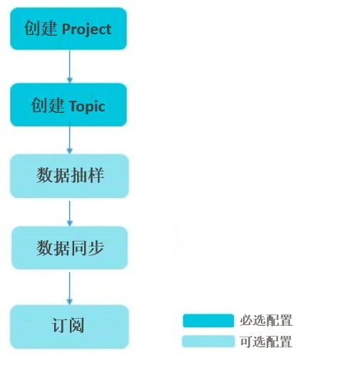

1. 创建Project。

   项目（Project）是数据总线 DataHub数据的基本组织单元，下面包含多个Topic。在使用数据总线 DataHub时，需要首先创建Project。

2. 创建Topic。

   Topic是数据总线 DataHub订阅和发布的最小单位。在使用数据总线 DataHub时，用户可以创建Topic用来表示一类或者一种流数据。

3. （可选）数据抽样。

   数据总线 DataHub提供数据抽样功能，用户可以对指定Shard的相关数据进行抽样查看。

4. （可选）数据同步。

   数据总线 DataHub提供数据同步功能，可以将数据总线 DataHub中的实时数据同步到离线数据仓库，方便用户对历史数据进行分析处理。

5. （可选）订阅。

   数据总线 DataHub提供订阅功能，数据总线 DataHub的订阅服务提供了服务端保存用户消费点位的功能；同时，订阅服务还提供了灵活的点位重置功能，从而保证用了“At Least Once”的消费语义。

<a id="section-4-2"></a>

## 4.2. 准备工作

<a id="section-4-2-1"></a>

### 4.2.1. 登录数据总线 DataHub控制台

本章节以Chrome浏览器为例，为您介绍如何登录到数据总线 DataHub的控制台。

**前提条件**

登录数据总线 DataHub控制台前，需要您确认以下信息：

- 已从部署人员处获取Apsara Uni-manager运营控制台的服务域名地址。

- 推荐使用Chrome浏览器。

**操作步骤**

1. 在浏览器地址栏中，输入Apsara Uni-manager运营控制台的访问地址，按回车键。

2. 输入正确的用户名及密码。

   请向运营管理员获取登录控制台的用户名和密码。

   > **说明**
   >
   > 首次登录Apsara Uni-manager运营控制台时，需要修改登录用户名的密码，请按照提示完成密码修改。为提高安全性，密码长度必须为 8~20 位，且至少包含以下两种类型：
   >
   > - 英文大写或小写字母（A~Z、a~z）
   >
   > - 阿拉伯数字（0~9）
   >
   > - 特殊符号（感叹号（！）、at（@）、井号（#）、美元符号（$）、百分号（%）等）

3. 单击**账号登录**，进入Apsara Uni-manager运营控制台页面。

4. 在顶部菜单栏选择**产品 > 大数据计算 > 数据总线 DataHub**，进入数据总线 DataHub控制台。

   > **说明**
   >
   > 当前控制台右上角图标分别表示支持以下功能：
   >
   > ：切换到英文或者繁體中文。
   >
   > 
   >
   > ：将背景样式切换到浅色模式或暗色模式。
   >
   > /
   >
   > 
   >
   > 
   >
   > ：消息通知。单击**查看更多**，将跳转至**消息中心**，查看全部消息。
   >
   > 

<a id="section-4-2-2"></a>

### 4.2.2. 进入概览页

本文介绍控制台概览页展示的详细信息。

**概览页介绍**

登录数据总线 DataHub控制台后，系统默认进入**概览**页。概览页展示的信息说明如下。

<table>
  <tr>
    <th width="89">区域</th>
    <th>说明</th>
  </tr>
  <tr>
    <td>资源概览</td>
    <td>该区域展示了<strong>今日读取流量</strong>、<strong>今日写入流量</strong>、<strong>总存储量</strong>、<strong>项目个数</strong>以及<strong>数据更新时间</strong>。单位会随着数据大小变化，例如：Byte、KB、MB、GB。</td>
  </tr>
  <tr>
    <td>存储概览</td>
    <td>该区域通过饼状图展示了当前组织下的各项目占用存储的情况，并按照占用存储的大小对项目进行了降序排序。支持查看以下信息：<br>• 鼠标悬浮至饼状图上不同的颜色区域，可查看该项目占用总存储的百分比信息。<br>• 单击<strong>详情</strong>，进入<strong>项目列表</strong>页面，可查看各项目的详细信息。</td>
  </tr>
  <tr>
    <td>常用信息</td>
    <td>该区域支持以下操作：<br>• 支持通过快速入口新建项目。<br>• 支持通过新手入门查看产品帮助文档。<br>• 支持查看主账号ID、经典（私网）和VPC（私网）信息。</td>
  </tr>
  <tr>
    <td>同步任务</td>
    <td>DataHub支持以下同步任务：<br>• <strong>MaxCompute</strong>：支持将数据同步到MaxCompute，支持自定义分区等。<br>• <strong>Hologres</strong>：支持将数据通过HoloHub服务同步到Hologres。<br>• <strong>AnalyticDB For MySQL</strong>：支持IGNORE和OVERWRITE两种写入模式。<br>• <strong>云数据库RDS</strong>：支持IGNORE和OVERWRITE两种写入模式。<br>• <strong>表格存储</strong>：支持OTS PUT/UPDATE写入方式。<br>• <strong>对象存储</strong>：支持按照写入时间归档到OSS对象存储。</td>
  </tr>
</table>

<a id="section-4-2-3"></a>

### 4.2.3. 创建Project

项目（Project）是数据总线 DataHub数据的基本组织单元，下面包含多个Topic。在使用数据总线 DataHub时，需要首先创建Project。本文将介绍如何在数据总线DataHub控制台中创建Project并完成VPC白名单设置。

**前提条件**

已经拥有可用于创建Project的云账号。

**注意事项**

- 数据总线 DataHub的项目空间与MaxCompute的项目空间是相互独立的，用户在MaxCompute中创建的项目不能复用于数据总线 DataHub，用户需要独立创建数据总线 DataHub自己的项目空间。

- 每个云账号能够创建的Project上限最多不超过50个。

**操作步骤**

1. 登录数据总线 DataHub控制台。

2. 在左侧导航栏选择**项目管理**，单击右上角的**新建项目**。

3. 在**新建项目**页面填写**区域**信息和**基本配置**后，单击**确认订单**，完成创建Project操作。

   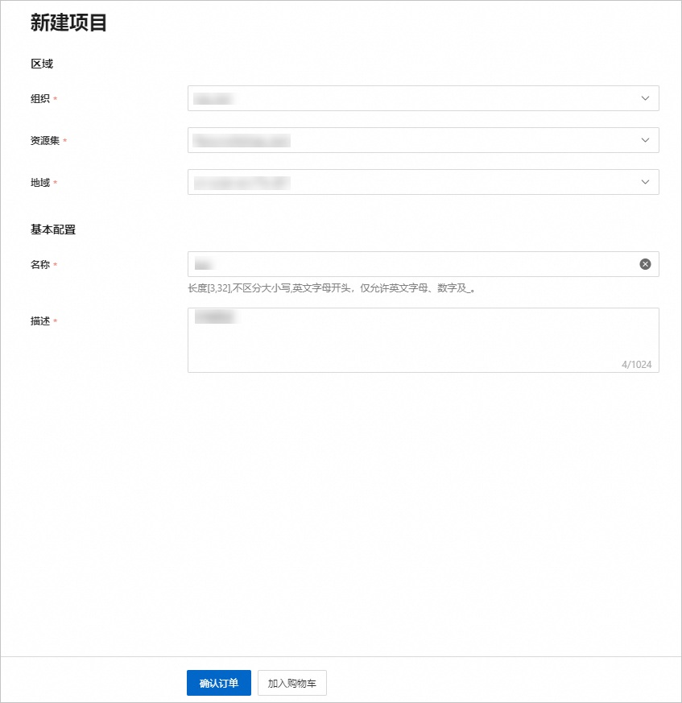

4. （可选）创建完成后，可以单击对应Project后的**查看**，获取当前Project的详细信息。如果需要删除该Project，单击**删除**即可。

   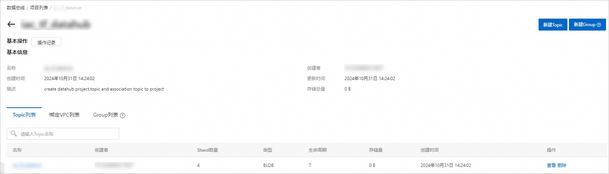

**VPC白名单设置**

单个数据总线 DataHub实例支持VPC绑定权限，仅有VPC内用户可以访问。设置方式如下。

1. 在实例详情页面的**绑定VPC列表**页签，单击**绑定VPC**，在弹出的对话框中输入VPC名称后，单击**绑定VPC**，完成VPC的绑定。

   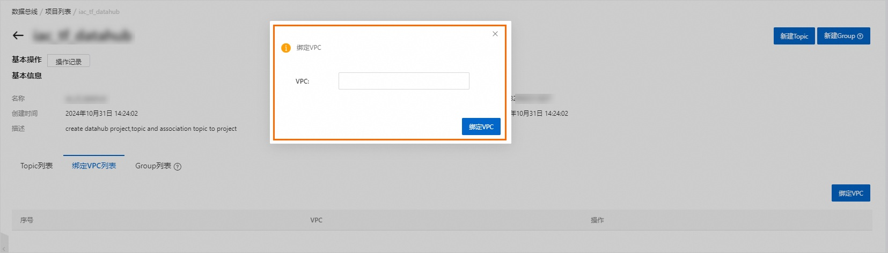

2. 如果需要删除相关的VPC，单击该VPC后的**删除**即可。

   

<a id="section-4-2-4"></a>

### 4.2.4. 创建Topic

Topic是数据总线 DataHub订阅和发布的最小单位。在使用数据总线 DataHub时，用户可以创建Topic用来表示一类或者一种流数据。本章节将介绍如何在数据总线DataHub控制台中创建Topic。

**前提条件**

已完成Project的创建。

**注意事项**

每个Project内能创建的Topic上限最多不超过500个。如果有特殊请求，请联系管理员处理。

**操作步骤**

1. 登录数据总线 DataHub控制台。

2. 在左侧导航栏单击**项目管理**，在**项目列表**中找到目标项目，单击**操作**列下的**查看**，进入项目详情页面。

3. 在项目详情页面，单击右上角的**新建Topic**。

   您可以通过**直接创建**或者**导入MaxCompute表结构**两种方式进行创建，本文以常用的**直接创建**方式为例。

   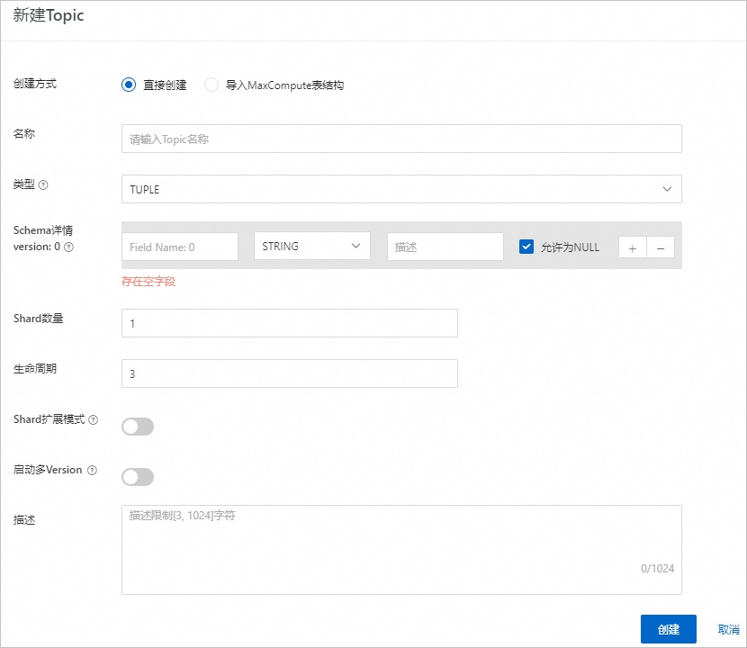

   <table>
     <tr>
       <th width="142">参数</th>
       <th>说明</th>
     </tr>
     <tr>
       <td>创建方式</td>
       <td>支持以下两种方式，以<strong>直接创建</strong>为例：<br>• 直接创建<br>• 导入MaxCompute表结构</td>
     </tr>
     <tr>
       <td>名称</td>
       <td>新建Topic的名称，按需自定义即可。需要满足以下要求：<br>• 只能包含小写字母，数字和下划线(_)。<br>• 必须以小写字母开头。<br>• 名称长度限制在3~64个字符之间。</td>
     </tr>
     <tr>
       <td>类型</td>
       <td>支持以下两种类型：<br>• TUPLE：结构化数据。<br>• BLOB：非结构化数据。</td>
     </tr>
     <tr>
       <td>Schema详情</td>
       <td>• 当新建<strong>类型</strong>为<strong>TUPLE</strong>时，系统默认会有一个Version版本号为0的Schema。如果后续需要更改或者添加更多的Version可以在建立后前往Topic详情页修改。<br>• 当新建<strong>类型</strong>为<strong>BLOB</strong>时，该参数不显示。</td>
     </tr>
     <tr>
       <td>Shard数量</td>
       <td>取值范围：1~256。</td>
     </tr>
     <tr>
       <td>生命周期</td>
       <td>取值范围：1~7。</td>
     </tr>
     <tr>
       <td>Shard扩展模式</td>
       <td>开启此开关后，Shard支持水平扩展，不再支持合并和分裂，以后Shard数量只能增加，不可减少。此模式开启后可以使用Kafka方式来消费当前Topic。</td>
     </tr>
     <tr>
       <td>启动多Version</td>
       <td>开启多Version的Schema，Topic可以同时拥有多个Schema，可以选择其中一个Schema写入，消费端会根据每条数据标记的Version自适应完成解析（例如：对应的Version的Schema被删除，则解析失败）。还需要注意以下几点：<br>• 用户无法再使用appendFields接口。<br>• 可以对Schema进行增删改查。<br>• 创建Connector使用最新Version的Schema。</td>
     </tr>
     <tr>
       <td>描述</td>
       <td>可以对该Topic进行详细的描述。字符限制：3~1024。</td>
     </tr>
   </table>

4. 单击**创建**，完成创建Topic操作。

   您还可以按需对该Topic进行以下操作：

   - 在**Topic列表**页签下，单击对应Topic后的**查看**，获取Topic的详细信息。

   - 在**Topic列表**页签下，如果需要删除该Topic，单击对应Topic后的**删除**即可。

     > **重要**
     >
     > 删除该Topic前，请先确认该Topic是否加入了某个Group中。如果加入了某个Group中，必须先将该Topic从目标Group中移除出来，才能正常删除。

<a id="section-4-2-5"></a>

### 4.2.5. （可选）创建Group

Group是一组Topic的集合，以Group为单位进行数据订阅，就可以订阅Group内的所有Topic，目前主要用于kafka协议兼容。本章节将介绍如何在数据总线 DataHub控制台中创建Group。

**背景信息**

为了更好兼容Kafka订阅方式，支持同时订阅多个Topic，DataHub提供了Group的功能，用户可以在Project下创建Group并绑定想要订阅的Topic，就可以使用该Group订阅这个Project下的多个Topic。用户可以在Topic页面的订阅列表页面，看到由Group自动创建的订阅，删除该订阅会导致Group无法订阅该Topic，并且之前的消费点位都会消失。

**使用限制**

目前单个Group限制最多可以订阅50个Topic。

**操作步骤**

1. 登录数据总线 DataHub控制台。

2. 在左侧导航栏单击**项目管理**，在**项目列表**中找到目标项目，单击**操作**列下的**查看**，进入项目详情页面。

3. 在项目详情页面，单击右上角的**新建Group**。

4. 在**新建Group**面板中，配置相关参数，单击**创建**。

   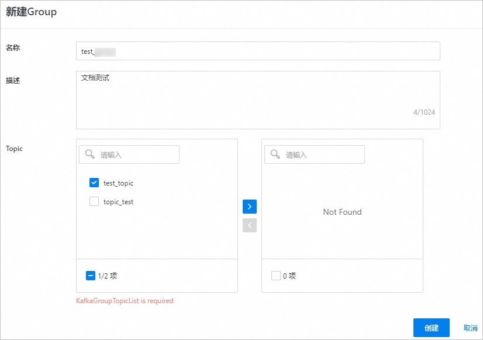

   <table>
     <tr>
       <th width="75">参数</th>
       <th>说明</th>
     </tr>
     <tr>
       <td>名称</td>
       <td>新建Group的名称。命名要求如下：<br>• 只能包含小写字母，数字和下划线(_)。<br>• 必须以小写字母开头。<br>• 名称长度限制在3~32个字符之间。</td>
     </tr>
     <tr>
       <td>描述</td>
       <td>新建Group的详情描述，描述限制为3~1024个字符。</td>
     </tr>
     <tr>
       <td>Topic</td>
       <td>在此区域选择待加入Group的目标Topic。</td>
     </tr>
   </table>

5. 完成Group创建后，在项目详情页面的**Group列表**页签下，可以查看新建的Group的信息。

   

   您还可以按需对该Group进行以下操作：

   - 单击**编辑**：在右侧弹出的Group配置面板中，可以对该Group下的Topic进行更新。

   - 单击**删除**：确认删除信息无误后，单击**删除**，可删除该Group。

<a id="section-4-3"></a>

## 4.3. 数据抽样

数据总线 DataHub提供数据抽样功能，用户可以对指定Shard的相关数据进行抽样查看。本章节将介绍如何在数据总线 DataHub控制台中进行数据抽样操作。

**前提条件**

已完成Project及Topic的创建，并已经完成相关的数据写入。

**背景信息**

进行数据抽样操作时，需要指定要进行抽样的时间以及要进行抽样的数据记录的条数限制。

**操作步骤**

1. 登录数据总线 DataHub控制台。

2. 在左侧导航栏选择**项目管理**，按先后顺序，分别单击对应的项目列表后及Topic列表后的**查看**，进入Topic详情页面。

3. 在Topic的详情页面，单击Shard列表页签对应的Shard的**抽样**，对该Shard进行数据抽样查看。

   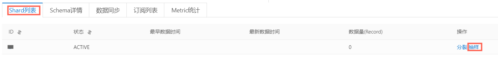

4. 在弹出的对话框中，指定起始时间和采样条数后，单击**抽样**，数据抽样会显示指定时间之后写入到该Shard中的小于等于所指定限制数量的记录。

   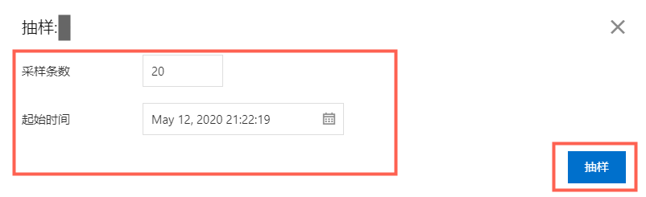

<a id="section-5"></a>

# 5.DataHub权限控制

<a id="section-5-1"></a>

## 5.1. 概述

数据总线 DataHub支持主子账号的权限控制，提高数据总线 DataHub的使用安全性。

数据总线 DataHub采用阿里云RAM进行访问控制。用户对数据总线 DataHub资源的访问，通过RAM进行鉴权。阿里云主账号拥有所属资源的所有权限，子用户在创建时并没有任何权限，不能访问任何资源，用户需要在RAM中对该子用户进行授权操作。下面的章节将介绍数据总线 DataHub在RAM下的访问控制体系。

> 一般来说，专有云部门账号是主账号，不需要权限赋值；专有云个人账号是子账号，需要通过主账号对子账号做特殊的赋权。
>
> **说明**

<a id="section-5-2"></a>

## 5.2. DataHub资源

数据总线 DataHub在RAM的访问控制中的资源体系包含Project、Topic和Subscription。其中Subscription是指对某个特定Project下的Topic的一次订阅。目前支持Project、Topic和Subscription级别的鉴权，不支持Shard的访问控制。

数据总线 DataHub的每一种资源在RAM中都有两种资源描述：所有该种资源、某一个特定的该种资源。例如：指定某用户在特定region下的某个Project，在RAM中的资源描述为*acs:dhs:$region:$accountid:projects/$projectName*，其中<em>$region、$accountid、$projectName</em>分别为指定的区域、用户ID和项目名。

表 1. 资源描述

<table>
  <tr>
    <th width="175">资源类型</th>
    <th>RAM中的资源描述</th>
  </tr>
  <tr>
    <td>SingleProject</td>
    <td>acs:dhs:$region:$accountid:projects/$projectName</td>
  </tr>
  <tr>
    <td>AllProject</td>
    <td>acs:dhs:$region:$accountid:projects/*</td>
  </tr>
  <tr>
    <td>SingleTopic</td>
    <td>acs:dhs:$region:$accountid:projects/$projectName/topics/$topicName</td>
  </tr>
  <tr>
    <td>AllTopic</td>
    <td>acs:dhs:$region:$accountid:projects/$projectName/topics/*</td>
  </tr>
  <tr>
    <td>SingleSubscription</td>
    <td>acs:dhs:$region:$accountid:projects/$projectName/topics/$topicName/subscriptions/$subId</td>
  </tr>
  <tr>
    <td>AllSubscription</td>
    <td>acs:dhs:$region:$accountid:projects/$projectName/topics/$topicName/subscriptions/*</td>
  </tr>
</table>

<a id="section-5-3"></a>

## 5.3. DataHub API

数据总线 DataHub API包括Project、Topic、Shard、Subcription以及Record五个级别，针对每个资源都有不同的API，每个API对应的RAM Action和RAM Resource不尽相同。

每种API的对应的授权策略Action及Resource如下所示。

**Project API**

表 1. Project API

| 数据总线 DataHub API | RAM Action | 资源类型 |
| --- | --- | --- |
| CreateProject | dhs:CreateProject | AllProject |
| ListProject | dhs:ListProject | AllProject |
| DeleteProject | dhs:DeleteProject | SingleProject |
| GetProject | dhs:GetProject | SingleProject |
| UpdateProject | dhs: UpdateProject | SingleProject |

**Topic API**

表 2. Topic API

| 数据总线 DataHub API | RAM Action | 资源类型 |
| --- | --- | --- |
| CreateTopic | dhs:CreateTopic | AllTopic |
| ListTopic | dhs:ListTopic | AllTopic |
| DeleteTopic | dhs:DeleteTopic | SingleTopic |
| GetTopic | dhs:GetTopic | SingleTopic |
| UpdateTopic | dhs: UpdateTopic | SingleTopic |

**Subscription API**

表 3. Subscription API

| 数据总线 DataHub API | RAM Action | 资源类型 |
| --- | --- | --- |
| CreateSubscription | dhs:CreateSubscription | AllSubscription |
| ListSubscription | dhs:ListSubscription | AllSubscription |
| DeleteSubscription | dhs:DeleteSubscription | SingleSubscription |
| GetSubscription | dhs:GetSubscription | SingleSubscription |
| UpdateSubscription | dhs: UpdateSubscription | SingleSubscription |
| CommitOffset | dhs:CommitOffset | SingleSubscription |
| GetOffset | dhs:GetOffset | SingleSubscription |

**Shard API**

表 4. Shard API

| 数据总线 DataHub API | RAM Action | 资源类型 |
| --- | --- | --- |
| ListShard | dhs:ListShard | SingleTopic |
| MergeShard | dhs:MergeShard | SingleTopic |
| SplitShard | dhs:SplitShard | SingleTopic |

**Shard API**

表 5. Shard API

| 数据总线 DataHub API | RAM Action | 资源类型 |
| --- | --- | --- |
| PutRecords | dhs:PutRecords | SingleTopic |
| GetRecords | dhs:GetRecords | SingleTopic |
| GetCursor | dhs:GetRecords | SingleTopic |

<a id="section-5-4"></a>

## 5.4. DataHub支持的Condition

本章节介绍的是数据总线 DataHub在RAM下支持的Condition具体详情。

数据总线 DataHub在RAM下支持的Condition如下表所示。

表 1. 数据总线 DataHub支持的Condition

| 条件(Condition) | 功能 | 合法取值 |
| --- | --- | --- |
| acs:SourceIp | 指定IP网段 | 普通IP，支持\*通配 |
| acs:SecureTransport | 是否是https协议 | true/false |
| acs:MFAPresent | 是否多设备认证 | true/false |
| acs:CurrentTime | 指定访问时间 | ISO8601格式 |

<a id="section-5-5"></a>

## 5.5. DataHub Policy示例

<a id="section-5-5-1"></a>

### 5.5.1. AliyunDataHubFullAccess

本章节展示AliyunDataHubFullAccess示例，仅供用户参考。

示例如下，仅供参考：

```json
{
  "Version": "1",
  "Statement": [
    {
      "Action": "dhs:*",
      "Resource": "*",
      "Effect": "Allow"
    }
  ]
}
```

<a id="section-5-5-2"></a>

### 5.5.2. AliyunDataHubReadOnlyAccess

本章节展示AliyunDataHubReadOnlyAccess示例，仅供用户参考。

示例如下，仅供参考：

```json
{
  "Version": "1",
  "Statement": [
    {
      "Action": ["dhs:List*", "dhs:Get*"],
      "Resource": "*",
      "Effect": "Allow"
    }
  ]
}
```

<a id="section-6"></a>

# 6.DataHub数据采集

<a id="section-6-1"></a>

## 6.1. 概述

除了直接使用SDK进行数据发布之外，数据总线 DataHub还提供多种数据采集工具，方便用户快速实现/迁移数据收集方案。

下面的章节将着重介绍其中的Fluentd、Logstash以及Oracle Golden Gate。

<a id="section-6-2"></a>

## 6.2. Fluentd

本章节将介绍如何安装及使用Fluentd采集工具。

该插件是基于Fluentd开发的输出插件，主要是将采集到的数据写入数据总线 DataHub。该插件遵守fluentd输出插件开发规范，安装方便，可以很方便地将采集到的数据写到数据总线 DataHub。

**产品安装**

- 通过ruby gem安装。

  ```text
  gem install fluent-plugin-DataHub
  ```

  > **重要**
  >
  > RubyGem源建议更改为https://ruby.taobao.org/。

- 本地安装。

  当前Fluentd仅支持Linux环境，同时要求用户安装Ruby。目前支持两种安装模式，对于没有安装过fluentd的客户提供一键fluent+数据总线 DataHub的全部安装模式，对于曾经安装了fluentd的客户提供数据总线 DataHub写入插件的单独安装模式。

  - 一键安装：如果之前没安装过fluentd，请下载Fluentd完全安装包（ fluentd-with-datahub-0.12.25.tar.gz），并使用如下命令安装插件。

    > **重要**
    >
    > 完全安装包提供的fluentd是fluentd-0.12.25.gem的版本。

    ```bash
    $ tar -xzvf fluentd-with-datahub-0.12.25.tar.gz
    $ cd fluentd-with-datahub
    $ sudo sh install.sh
    ```

  - 单独安装：如果之前安装过fluentd，请下载Fluentd 数据总线DataHub插件包（fluent-plugin-datahub-0.12.25.gem），并使用gem命令安装数据总线 DataHub插件。

    ```bash
    $ sudo gem install --local fluent-plugin-datahub-0.12.25.gem
    ```

**使用案例**

案例一：CSV文件上传。

下面将以增量的CSV文件为例，说明如何使用fluentd将增量的csv文件准实时上传到数据总线 DataHub数据。CSV文件的格式示例如下所示：

```text
0,qe614c760fuk8judu01tn5x055rpt1,true,100.1,14321111111
1,znv1py74o8ynn87k66o32ao4x875wi,true,100.1,14321111111
2,7nm0mtpgo1q0ubuljjjx9b000ybltl,true,100.1,14321111111
3,10t0n6pvonnan16279w848ukko5f6l,true,100.1,14321111111
4,0ub584kw88s6dczd0mta7itmta10jo,true,100.1,14321111111
5,1ltfpf0jt7fhvf0oy4lo8m3z62c940,true,100.1,14321111111
6,zpqsfxqy9379lmcehd7q8kftntrozb,true,100.1,14321111111
7,ce1ga9aln346xcj761c3iytshyzuxg,true,100.1,14321111111
8,k5j2id9a0ko90cykl40s6ojq6gruyi,true,100.1,14321111111
9,ns2zcx9bdip5y0aqd1tdicf7bkdmsm,true,100.1,14321111111
10,54rs9cm1xau2fk66pzyz62tf9tsse4,true,100.1,14321111111
```

上述CSV文件中每行一条record，按照(,)区分字段。保存在本地路径/temp/test.csv中。数据总线 DataHub Topic格式如下所示。

表 1. 数据总线 DataHub Topic格式

| 字段名称 | 字段类型 |
| --- | --- |
| id | BIGINT |
| name | STRING |
| gender | BOOLEAN |
| salary | DOUBLE |
| my_time | TIMESTAMP |

对于以上数据文件以及Topic Schema，编辑Fluentd配置文件后，使用如下命令启动fluentd，即可完成CSV文件数据采集进入数据总线 DataHub，即CSV文件上传。

```text
${FLUENTD_HOME}/fluentd-with-DataHub/bin/fluentd -c fluentd_test.conf
```

对应的Fluentd配置文件如下所示：

```xml
<source>
  @type tail
  path /xxx/yyy（⽤户的⽂件路径）
  tag test1
  format csv
  keys id,name,gender,salary,my_time
</source>

<match test1>
  @type DataHub
  access_id your_app_id
  access_key your_app_key
  endpoint http://ip:port
  project_name test_project
  topic_name fluentd_performance_test_1
  column_names ["id", "name", "gender", "salary", "my_time"]
  flush_interval 1s
  buffer_chunk_limit 3m
  buffer_queue_limit 128
  dirty_data_continue true
  dirty_data_file /xxx/yyy（脏数据记录⽂件路径）
  retry_times 3
  put_data_batch_size 1000
</match>
```

案例二：Log4J日志采集。

Log4j的日志格式示例如下所示：

```text
11:48:43.439 [qtp1847995714-17] INFO  AuditInterceptor - [c2un5sh7cu52ek6am1ui1m5h] end 
/web/v1/project/tefe4mfurtix9kwwyrvfqd0m/node/0m0169kapshvgc3ujskwkk8g/health GET, 4061 ms
```

对应的Fluentd配置文件如下所示：

```xml
<source>
  @type tail
  path bayes.log
  tag test
  format /(?<request_time>\d\d:\d\d:\d\d.\d+)\s+\[(?<thread_id>[\w\-]+)\]\s+(?<log_level>\w+)\s+(?<class>\w+)\s+-\s+\[(?<request_id>\w+)\]\s+(?<detail>.+)/
</source>

<match test>
  @type DataHub
  access_id your_access_id
  access_key your_access_key
  endpoint http://ip:port
  project_name test_project
  topic_name DataHub_fluentd_out_1
  column_names ["thread_id", "log_level", "class"]
</match>
```

**插件配置**

表 2. 读插件配置

| 配置项 | 描述 |
| --- | --- |
| tag test1 | 指定路由，和&lt;match&gt;会进行路由正则匹配 |
| format csv | 数据按照csv方式采集 |
| keys id,name,gender,salary,my_time | 指定需要采集的列名，必须和目的数据总线 DataHub表的列名一致 |

表 3. 写插件配置

| 配置项 | 描述 |
| --- | --- |
| shard_id 0 | 指定shard_id写入，默认round-robin方式写入，默认ID为0 |
| shard_keys \["id"\] | 指定用作分区key，用key值hash后作为写入shard的索引 |
| flush_interval 1 | fluentd每一秒钟至少写一次，默认每秒写一次，默认写60s |
| buffer_chunk_limit 3m | 块大小，支持“k”（KB）、“m”（MB）单位，建议值3m |
| buffer_queue_limit 128 | 块队列大小，此值与buffer_chunk_limit共同决定整个缓冲区大小，默认值为128m |
| put_data_batch_size 1000 | 每1000条record写一次数据总线 DataHub |
| retry_times 3 | 重试次数，默认值为3 |
| retry_interval 3 | 重试间隔（单位：s），默认值为3 |
| dirty_data_continue true | 遇到增数据是否继续，若为true 遇到脏数据会重试，重试次数用完，会将脏数据写入脏数据文件 |
| dirty_data_file /xxx/yyy | 指定脏数据文件的位置 |
| column_names \["id"\] | 指定需要采集的列 |

<a id="section-6-3"></a>

## 6.3. LogStash插件

**Logstash采集工具**

Logstash是一种分布式日志收集框架，非常简洁强大，经常与ElasticSearch，Kibana配置，组成著名的ELK技术栈，非常适合用来做日志数据的分析。 阿里云实时计算为了方便用户将更多数据采集进入DataHub，提供了针对Logstash的DataHub Output/Input插件。使用Logstash，您可以轻松享受到Logstash开源社区多达30+种数据源支持（file，syslog，redis，log4j，apache log或nginx log），同时Logstash还支持filter对传输字段自定义ss加工等功能。下面我们就以Logstash日志采集为例，介绍如何使用Logstash快速将日志数据采集进入DataHub。

> **说明**
>
> Logstash DataHub Output/Input插件遵循Apache License 2.0开源。

**安装**

**安装限制**

Logstash安装要求JRE 7版本及以上，否则部分功能无法使用。

**如何安装**

阿里云提供两种LogStash的安装方式：

- **一键安装**

  一键安装包，支持将Logstash和DataHub插件一键安装。

  - 适配Logstash 6、7版本

    ```bash
    tar -xzvf logstash-with-datahub-6.4.0-1.0.10.tar.gz
    cd logstash-with-datahub-6.4.0
    ```

  - 适配Logstash 8版本

    ```bash
    tar -xzvf logstash-with-datahub-8.10.3-1.0.12.tar.gz
    cd logstash-with-datahub-8.10.3
    ```

- **单独安装**

  安装Logstash插件：参考Logstash官网提供的安装教程进行安装工作。需要注意的是，最新的Logstash需要Java 7及以上版本。

  安装DataHub插件：下载所需要的插件。

  上传至DataHub请使用： DataHub Logstash Output插件

  - logstash-output-datahub-1.0.10.gem 适配Logstash 6、7

  - logstash-output-datahub-1.0.12.gem 适配Logstash 8

  下载DataHub中数据请使用： DataHub Logstash Input插件

  - logstash-input-datahub-1.0.10.gem 适配Logstash 6、7

  - logstash-input-datahub-1.0.12.gem 适配Logstash 8

  分别使用如下命令进行安装：

  ```text
  $ {LOG_STASH_HOME}/bin/logstash-plugin install --local logstash-output-datahub-1.0.10.gem
  $ {LOG_STASH_HOME}/bin/logstash-plugin install --local logstash-input-datahub-1.0.10.gem
  ```

  如果安装时遇到类似如下错误：

  ```text
  WARNING: can not set Session#timeout=(0) no session context
  ```

  先确认机器是否能够访问外网。网络能通的情况下，可以尝试修改为中国的镜像源。

- **离线安装**

  如果线上机器无法访问外网，那么无法通过以上方式安装。需要用户自行制作离线安装包，因为离线安装包是和logstash版本绑定的。先在测试机器上，按上述方式成功安装插件后，参考官方文档制作离线安装包，再上传到线上机器进行离线安装。

**使用DataHub Logstash Output插件上传数据**

**配置Log4j日志到DataHub**

下面以Log4j日志产出为例，讲解下如何使用Logstash采集并结构化日志数据。Log4j的日志样例如下：

```text
20:04:30.359 [qtp1453606810-20] INFO  AuditInterceptor - [13pn9kdr5tl84stzkmaa8vmg] end /web/v1/project/fhp4clxfbu0w3ym2n7ee6ynh/statistics?executionName=bayes_poc_test GET, 187 ms
```

针对上述Log4j文件，我们希望将数据结构化并采集进入DataHub，其中DataHub的Topic格式如下：

| 字段名称 | 字段类型 |
| --- | --- |
| request_time | STRING |
| thread_id | STRING |
| log_level | STRING |
| class_name | STRING |
| request_id | STRING |
| detail | STRING |

Logstash任务配置如下：

```text
input {
    file {
        # windows 中也使⽤"/", ⽽非"\"
        path => "${APP_HOME}/log/bayes.log"
        start_position => "beginning"
    }
}

filter{
    grok {
        match => {
           "message" => "(?<request_time>\d\d:\d\d:\d\d\.\d+)\s+\[(?<thread_id>[\w\-]+)\]\s+(?<log_level>\w+)\s+(?<class_name>\w+)\s+\-\s+\[(?<
request_id>\w+)\]\s+(?<detail>.+)"
        }
    }
}

output {
    datahub {
        access_id => "Your accessId"
        access_key => "Your accessKey"
        endpoint => "Endpoint"
        project_name => "project"
        topic_name => "topic"
        #shard_id => "0"
        #shard_keys => ["thread_id"]
        dirty_data_continue => true
        dirty_data_file => "/Users/ph0ly/trash/dirty.data"
        dirty_data_file_max_size => 1000
    }
}
```

**配置csv文件到DataHub：**

下面以标准csv文件为例，讲解下如何使用Logstash采集csv文件数据。csv文件样例如下：

```text
1111,1.23456789012E9,true,14321111111000000,string_dataxxx0,
2222,2.23456789012E9,false,14321111111000000,string_dataxxx1
```

针对上述csv文件，DataHub的Topic格式如下：

| 字段名称 | 字段类型 |
| --- | --- |
| col1 | BIGINT |
| col2 | DOUBLE |
| col3 | BOOLEAN |
| col4 | TIMESTAMP |
| col5 | STRING |

Logstash任务配置如下：

```text
input {
    file {
        path => "${APP_HOME}/data.csv"
        start_position => "beginning"
    }
}

filter{
    csv {
        columns => ['col1', 'col2', 'col3', 'col4', 'col5']
    }
}

output {
    datahub {
        access_id => "Your accessId"
        access_key => "Your accessKey"
        endpoint => "Endpoint"
        project_name => "project"
        topic_name => "topic"
        #shard_id => "0"
        #shard_keys => ["thread_id"]
        dirty_data_continue => true
        dirty_data_file => "/Users/ph0ly/trash/dirty.data"
        dirty_data_file_max_size => 1000
    }
}
```

**配置JSON文件到DataHub：**

**一对一同步（一个JSON文件同步到一个topic）**

JSON文件样例（放到/home/software/data/22/test_topic_22.json）

```json
[{"col1":"aaaaa","col2":222},{"col1":"aaaaa","col2":222},{"col1":"aaaaa","col2":222},{"col1":"aaaaa","col2":222},{"col1":"aaaaa","col2":222},{
"col1":"aaaaa","col2":222},{"col1":"aaaaa","col2":222},{"col1":"aaaaa","col2":222},{"col1":"aaaaa","col2":222},{"col1":"aaaaa","col2":222}]
[{"col1":"aaaaa","col2":222},{"col1":"aaaaa","col2":222},{"col1":"aaaaa","col2":222},{"col1":"aaaaa","col2":222},{"col1":"aaaaa","col2":222},{
"col1":"aaaaa","col2":222},{"col1":"aaaaa","col2":222},{"col1":"aaaaa","col2":222},{"col1":"aaaaa","col2":222},{"col1":"aaaaa","col2":222}]
```

配置文件

```text
input {
    file {
        path => "/home/software/data/22/test_topic_22.json"
        start_position => "beginning"
        #点位存储位置
                sincedb_path => "/home/software/sincedb/filedatahub"
        codec => json {
            charset => "UTF-8"
        }
    }
}

filter{
    mutate {
      rename => {
        "col1"    =>    "col1"
        "col2"    =>    "col2"
      }
    }

}
output {

   datahub {
      access_id => "xxxx"
      access_key => "xxxx"
      endpoint => "http://dh-cn-shanghai-int-vpc.aliyuncs.com"
      project_name => "test_dh1"
      topic_name => "topic_test_2"
      #shard_id => "0"
      #shard_keys => ["thread_id"]
      dirty_data_continue => true
      dirty_data_file => "/home/software/dirty_vehIdInfo.data"
      dirty_data_file_max_size => 1000
   }

}
```

运行命令及结果：

```text
bash bin/logstash -f config/logstash.conf
```

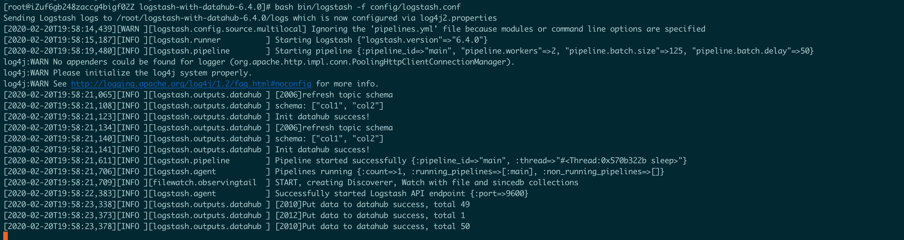

**多对多同步（多个JSON文件同步到多个topic）**

JSON文件样例（放到/home/software/data/22/test_topic_22.json）

```json
[{"col1":"aaaaa","col2":222},{"col1":"aaaaa","col2":222},{"col1":"aaaaa","col2":222},{"col1":"aaaaa","col2":222},{"col1":"aaaaa","col2":222},{
"col1":"aaaaa","col2":222},{"col1":"aaaaa","col2":222},{"col1":"aaaaa","col2":222},{"col1":"aaaaa","col2":222},{"col1":"aaaaa","col2":222}]
[{"col1":"aaaaa","col2":222},{"col1":"aaaaa","col2":222},{"col1":"aaaaa","col2":222},{"col1":"aaaaa","col2":222},{"col1":"aaaaa","col2":222},{
"col1":"aaaaa","col2":222},{"col1":"aaaaa","col2":222},{"col1":"aaaaa","col2":222},{"col1":"aaaaa","col2":222},{"col1":"aaaaa","col2":222}]
```

JSON文件样例（放到/home/software/data/11/test_topic.json）

```json
[{"col1":"aaaaa","col2":"bbbbbb"},{"col1":"aaaaa","col2":"bbbbbb"},{"col1":"aaaaa","col2":"bbbbbb"},{"col1":"aaaaa","col2":"bbbbbb"},
{"col1":"aaaaa","col2":"bbbbbb"}]
[{"col1":"aaaaa","col2":"bbbbbb"},{"col1":"aaaaa","col2":"bbbbbb"},{"col1":"aaaaa","col2":"bbbbbb"},{"col1":"aaaaa","col2":"bbbbbb"},
{"col1":"aaaaa","col2":"bbbbbb"}]
[{"col1":"aaaaa","col2":"bbbbbb"},{"col1":"aaaaa","col2":"bbbbbb"},{"col1":"aaaaa","col2":"bbbbbb"},{"col1":"aaaaa","col2":"bbbbbb"},
{"col1":"aaaaa","col2":"bbbbbb"}]
```

配置文件

```text
input {
    file {
        path => "/home/software/data/**/*.json"
        start_position => "beginning"
        #点位存储位置
                sincedb_path => "/home/software/sincedb/filedatahub"
        codec => json {
            charset => "UTF-8"
        }
    }
}

filter{
  #⽤path来区分
    if "22"  in [path] {
        mutate {
          rename => {
            "col1"        =>    "col1"
            "col2"        =>    "col2"
          }
        }
    }
    if "11" in [path] {
        mutate {
          rename => {
            "col1"    =>    "col1"
            "col2"    =>    "col2"
          }
        }
    }


}
output {

    if "22"  in [path] {
      datahub {
        access_id => "xxxxx"
        access_key => "xxxxx"
        endpoint => "http://dh-cn-shanghai-int-vpc.aliyuncs.com"
        project_name => "test_dh1"
        topic_name => "topic_test_2"
        #shard_id => "0"
        #shard_keys => ["thread_id"]
        dirty_data_continue => true
        dirty_data_file => "/home/software/dirty_vehIdInfo.data"
        dirty_data_file_max_size => 1000
      }
    }

    if "11"  in [path] {
      datahub {
        access_id => "xxxxx"
        access_key => "xxxxx"
        endpoint => "http://dh-cn-shanghai-int-vpc.aliyuncs.com"
        project_name => "test_dh1"
        topic_name => "topic_test"
        #shard_id => "0"
        #shard_keys => ["thread_id"]
        dirty_data_continue => true
        dirty_data_file => "/home/software/dirty.data"
        dirty_data_file_max_size => 1000
    }                    
    }


}
```

运行命令及结果：

```text
bash bin/logstash -f config/logstash.conf
```

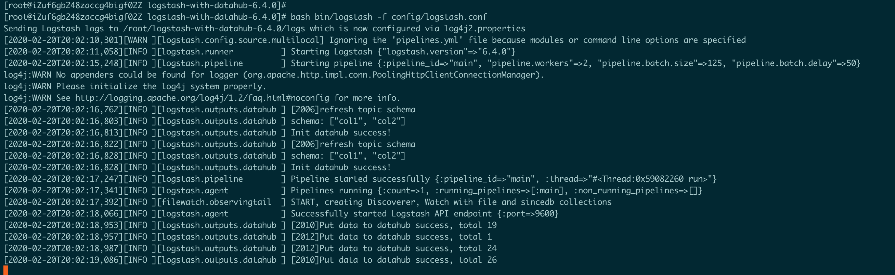

**一对多同步（一个JSON文件根据某个key来路由不同的topic）**

```json
[{"col1":"aaaaa","col2":222},{"col1":"aaaaa","col2":222},{"col1":"aaaaa","col2":222},{"col1":"aaaaa","col2":222},{"col1":"aaaaa","col2":222},{
"col1":"aaaaa","col2":222},{"col1":"aaaaa","col2":222},{"col1":"aaaaa","col2":222},{"col1":"aaaaa","col2":222},{"col1":"aaaaa","col2":222}]
[{"col1":"aaaaa","col2":222},{"col1":"aaaaa","col2":222},{"col1":"aaaaa","col2":222},{"col1":"aaaaa","col2":222},{"col1":"aaaaa","col2":222},{
"col1":"aaaaa","col2":222},{"col1":"aaaaa","col2":222},{"col1":"aaaaa","col2":222},{"col1":"aaaaa","col2":222},{"col1":"aaaaa","col2":222}]
[{"col1":"bbbbb","col2":"ccccc"},{"col1":"bbbbb","col2":"ccccc"},{"col1":"bbbbb","col2":"ccccc"},{"col1":"bbbbb","col2":"ccccc"},
{"col1":"bbbbb","col2":"ccccc"},{"col1":"bbbbb","col2":"ccccc"},{"col1":"bbbbb","col2":"ccccc"},{"col1":"bbbbb","col2":"ccccc"},
{"col1":"bbbbb","col2":"ccccc"},{"col1":"bbbbb","col2":"ccccc"}]
[{"col1":"bbbbb","col2":"ccccc"},{"col1":"bbbbb","col2":"ccccc"},{"col1":"bbbbb","col2":"ccccc"},{"col1":"bbbbb","col2":"ccccc"},
{"col1":"bbbbb","col2":"ccccc"},{"col1":"bbbbb","col2":"ccccc"},{"col1":"bbbbb","col2":"ccccc"},{"col1":"bbbbb","col2":"ccccc"},
{"col1":"bbbbb","col2":"ccccc"},{"col1":"bbbbb","col2":"ccccc"}]
```

配置文件如下：

```text
input {
    file {
        path => "/home/software/data/22/test_topic_22.json"
        start_position => "beginning"
    sincedb_path => "/home/software/sincedb/filedatahub"
        codec => json {
            charset => "UTF-8"
        }
    }
}

filter{
    mutate {
      rename => {
        "col1"    =>    "col1"
        "col2"    =>    "col2"
      }
    }

}
output {

     # 根据col1的值来路由到不同的topic
   if[col1] == "aaaaa" {
     datahub {
        access_id => "xxxxx"
        access_key => "xxxxx"
        endpoint => "http://dh-cn-shanghai-int-vpc.aliyuncs.com"
        project_name => "test_dh1"
        topic_name => "topic_test_2"
        #shard_id => "0"
        #shard_keys => ["thread_id"]
        dirty_data_continue => true
        dirty_data_file => "/home/software/dirty_vehIdInfo.data"
        dirty_data_file_max_size => 1000
     }
   }
   else {
     datahub {
          access_id => "xxxxx"
          access_key => "xxxxx"
          endpoint => "http://dh-cn-shanghai-int-vpc.aliyuncs.com"
          project_name => "test_dh1"
          topic_name => "topic_test"
          #shard_id => "0"
          #shard_keys => ["thread_id"]
          dirty_data_continue => true
          dirty_data_file => "/home/software/dirty_vehIdInfo.data"
          dirty_data_file_max_size => 1000
     }
   }

}
```

运行命令及结果：

```text
bash bin/logstash -f config/logstash.conf
```


**同步MySQL数据到logstash**

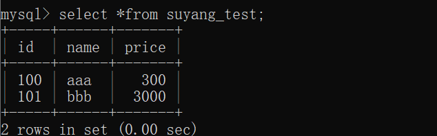

配置文件如下：

```text
input {
  jdbc {
    jdbc_driver_library => "mysql-connector-java-5.1.47.jar"
    jdbc_driver_class => "com.mysql.jdbc.Driver"
    jdbc_connection_string => "jdbc:mysql://xxxx:3306/databaese"
    jdbc_user => "username"
    jdbc_password => "password"
    use_column_value => true
    tracking_column => "modifytime"
    schedule => "* * * * *"
    statement => "select * from suyang_test"
   }
}

output {
      datahub {
        access_id => "Your accessId"
        access_key => "Your accessKey"
        endpoint => "Endpoint"
        project_name => "project"
        topic_name => "topic"
        #shard_id => "0"
        #shard_keys => ["thread_id"]
        dirty_data_continue => true
        dirty_data_file => "/Users/ph0ly/trash/dirty.data"
        dirty_data_file_max_size => 1000
    }
}
```

**运行Logstash**

使用如下命令启动Logstash：

```text
logstash -f <上述配置⽂件地址>
```

batch_size是每次向DataHub发送的记录条数，默认为125，指定batch_size启动Logstash：

```text
logstash -f <上述配置⽂件地址> -b 256
```

参数说明如下：

```text
    access_id(Required): 阿⾥云access id
    access_key(Required): 阿⾥云access key
    endpoint(Required): 阿⾥云datahub的服务地址
    project_name(Required): datahub项⽬名称
    topic_name(Required): datahub topic名称
    retry_times(Optional): 重试次数，-1为无限重试、0为不重试、>0表示需要有限次数, 默认值为-1
    retry_interval(Optional): 下⼀次重试的间隔，单位为秒，默认值为5
    skip_after_retry(Optional): 当由DataHub异常导致的重试超过重试次数，是否跳过这⼀轮上传的数据，默认为false
    approximate_request_bytes(Optional): ⽤于限制每次发送请求的字节数，是⼀个近似值，防⽌因request body过⼤⽽被拒绝接收，默认为2048576(2MB)
    shard_keys(Optional)：数组类型，数据落shard的字段名称，插件会根据这些字段的值计算hash将每条数据落某个shard, 注意shard_keys和shard_id都未指定，默认轮询落shard
    shard_id(Optional): 所有数据落指定的shard，注意shard_keys和shard_id都未指定，默认轮询落shard
    dirty_data_continue(Optional): 脏数据是否继续运⾏，默认为false，如果指定true，则遇到脏数据直接无视，继续处理数据。当开启该开关，必须指定@dirty_data_file⽂
件
    dirty_data_file(Optional): 脏数据⽂件名称，当数据⽂件名称，在@dirty_data_continue开启的情况下，需要指定该值。特别注意：脏数据⽂件将被分割成两个部分.part1和.part2，part1作为更早的脏数据，part2作为更新的数据
    dirty_data_file_max_size(Optional): 脏数据⽂件的最⼤⼤⼩，该值保证脏数据⽂件最⼤⼤⼩不超过这个值，⽬前该值仅是⼀个参考值
    enable_pb(Optional): 默认使⽤pb传输，专有云如不⽀持pb，⼿动设置为false
```

**使用DataHub Logstash Input插件读取DataHub中数据**

**消费DataHub数据写入文件**

logstash的配置如下：

```text
input {
    datahub {
        access_id => "Your accessId"
        access_key => "Your accessKey"
        endpoint => "Endpoint"
        project_name => "test_project"
        topic_name => "test_topic"
        interval=> 5
        #cursor => {
        #    "0"=>"20000000000000000000000003110091"
        #    "2"=>"20000000000000000000000003110091"
        #    "1"=>"20000000000000000000000003110091"
        #    "4"=>"20000000000000000000000003110091"
        #    "3"=>"20000000000000000000000003110000"
        #}
        shard_ids => []
        pos_file => "/home/admin/logstash/pos_file"
    }
}

output {
    file {
        path => "/home/admin/logstash/output"
    }
}
```

**参数介绍**

```text
    access_id(Required): 阿⾥云access id
    access_key(Required): 阿⾥云access key
    endpoint(Required): 阿⾥云datahub的服务地址
    project_name(Required): datahub项⽬名称
    topic_name(Required): datahub topic名称
    retry_times(Optional): 重试次数，-1为无限重试、0为不重试、>0表示需要有限次数
    retry_interval(Optional): 下⼀次重试的间隔，单位为秒
    shard_ids(Optional)：数组类型，需要消费的shard列表，空列表默认全部消费
    cursor(Optional)：消费起点，默认为空，表示从头开始消费
    pos_file(Required)：checkpoint记录⽂件，必须配置，优先使⽤checkpoint恢复消费offset
    enable_pb(Optional): 默认使⽤pb传输，专有云如不⽀持pb，⼿动设置为false
    compress_method(Optional): ⽹络传输的压缩算法，默认不压缩，可选项有"lz4", "deflate"
    print_debug_info(Optional): 打印datahub的debug信息，默认为false关闭，打开后会打印⼤量信息，仅作debug使⽤
```

**FAQ**

**Q：如何将logstash的内置字段写入datahub**

A：logstash有的每条记录都会带有额外字段，例如时间戳@timestamp，但是datahub不支持特殊字符的列名，这个时候就可以通过配置修改原有的列名，例如将@timestamp修改为column_name，就可以添加如下配置：

```text
filter{
    mutate {
      rename => {
        "@timestamp" => "column_name"
      }
    }
```

**更多**

更多的配置参数请参考logstash官方网站，以及ELK stack中文指南。

<a id="section-6-4"></a>

## 6.4. OGG插件

<a id="section-6-4-1"></a>

### 6.4.1. OGG采集工具介绍

随着数据规模的不断扩大，传统的RDBMS难以满足OLAP的需求，本文将介绍如何将Oracle的数据实时同步到阿里云的大数据处理平台当中，并利用大数据工具对数据进行分析。

**背景介绍**

OGG（Oracle GoldenGate）是一个基于日志的结构化数据备份工具，一般用于Oracle数据库之间的主从备份以及Oracle数据库到其他数据库（DB2、MySQL等）的同步。下面是Oracle官方提供的一个OGG的整体架构图，从图中可以看出OGG的部署分为源端和目标端两部分组成，主要有Manager、Extract、Pump、Collector、Replicat这么一些组件。

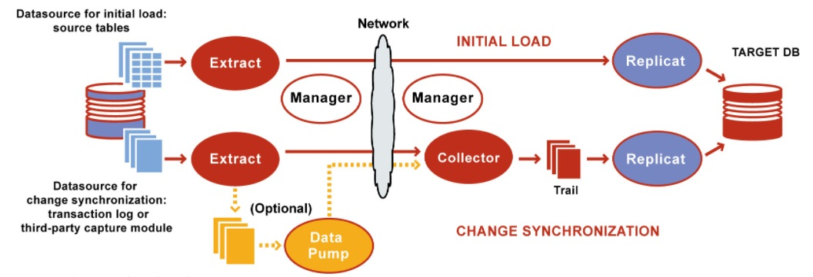

- Manager：在源端和目标端都会有且只有一个Manager进程存在，负责管理其他进程的启停和监控等。

- Extract：负责从源端数据库表或者事务日志中捕获数据，有初始加载和增量同步两种模式可以配置，初始加载模式是直接将源表数据同步到目标端，而增量同步就是分析源端数据库的日志，将变动的记录传到目标端，本文介绍的是增量同步的模式。

- Pump：Extract从源端抽取的数据会先写到本地磁盘的Trail文件，Pump进程会负责将Trail文件的数据投递到目标端。

- Collector：目标端负责接收来自源端的数据，生成Trail文件。

- Replicat：负责读取目标端的Trail文件，转化为相应的DDL和DML语句作用到目标数据库，实现数据同步。

本文介绍的Oracle数据同步是通过OGG的DataHub插件实现的，该DataHub插件在架构图中处于Replicat的位置，会分析Trail文件，将数据的变化记录写入DataHub中，可以使用流计算对datahub中的数据进行实时分析，也可以将数据归档到MaxCompute中进行离线处理。当前插件版本为2.0.5，用户可以直接在文末下载最新版，也可以在github上下载源码自行打包。

**支持数据库版本**

| 数据库 | 支持版本 | 插件版本 |
| --- | --- | --- |
| Oracle | 11g ~ 19c | 2.0.2 ~ 2.0.8 |
| MySQL | 企业版 / 社区版 | 2.0.3 ~ 2.0.8 |

**使用场景**

这里以Oracle数据为例，展示一个简单的示例来说明数据的使用方法，例如我们在数据库有一张商品订单表orders（oid int, pid int, num int），该表有三列，分别为订单ID、商品ID和商品数量。将这个表通过OGG Datahub进行增量数据同步之前，我们需要先将源表已有的数据通过DataX同步到MaxCompute中。增量同步的关键步骤如下：

1. 在DataHub上创建相应的Topic，Topic的schema为（string record_id, string optype, string readtime, bigint oid_before, bigint oid_after, bigint pid_before, bigint pid_after, bigint num_before, bigint num_a

2. OGG Datahub的插件按照上述的安装流程部署配置，其中列的Mapping配置如下：

   ```xml
   <ctypeColumn>optype</ctypeColumn>
   <ctimeColumn>readtime</ctimeColumn>
   <cidColumn>record_id</cidColumn>
   <columnMapping>
        <column src="oid" dest="oid_after" destOld="oid_before" isShardColumn="true"/>
        <column src="pid" dest="pid_after" destOld="pid_before"/>
        <column src="num" dest="num_after" destOld="num_before"/>
   </columnMapping>
   ```

   其中，optype和readtime字段是记录数据库的数据变更类型和时间，optype有”I”, “D”, “U”三种取值，分别对应为“增”，“删”，“改”三种数据变更操作。

3. OGG Datahub插件部署好成功运行后，插件会源源不断的将源表的数据变更记录输送至datahub中，例如我们在源订单表中新增一条记录（1，2，1），datahub里收到的记录如下：

   ```text
   +--------+------------+------------+------------+------------+------------+------------+------------+------------+
   | record_id | optype     | readtime   | oid_before | oid_after  | pid_before | pid_after  | num_before | num_after  |
   +-------+------------+------------+------------+------------+------------+------------+------------+------------+
   | 14810373343020000 |     I          | 2016-12-06 15:15:28.000141 | NULL       | 1          | NULL       | 2          | NULL       | 1   |
   ```

   修改这条数据，例如把num改为20，datahub则会收到的一条变更数据记录，如下：

   ```text
   +-------+------------+------------+------------+------------+------------+------------+------------+------------+
   | record_id | optype     | readtime   | oid_before | oid_after  | pid_before | pid_after  | num_before | num_after  |
   +--------+------------+------------+------------+------------+------------+------------+------------+------------+
   ```

   ```text
   | 14810373343080000 |     U          | 2016-12-06 15:15:58.000253 | 1          | 1          | 2          | 2          | 1          | 20        
   ```

   ```text
   |
   ```

4. 在源端OGG运行ggsci，然后运行 `stats dhext` 可以查看每个表的操作统计，在目标端同样可以使用，可以查看采集端和目标端操作统计是否一致。

**实时计算**

在前一天的离线计算的基础数据上，我们可以写一个StreamCompute流计算的分析程序，很容易地对数据进行实时汇总，例如实时统计当前总的订单数，每种商品的销售量等。处理思路就是对于每一条到来的变更数据，可以拿到变化的数值，实时更新统计变量即可。

**离线处理**

为了便于后续的离线分析，我们也可以将DataHub里的数据归档到MaxCompute中，在MaxCompute中创建相应Schema的表：

```sql
create table orders_log(record_id string, optype string, readtime string, oid_before bigint, oid_after bigint, pid_before bigint, pid_after 
bigint, num_before bigint, num_after bigint);
```

在DataHub上创建同步MaxCompute，上述流入DataHub里的数据将自动同步到MaxCompute当中。建议将同步到MaxCompute中的数据按照时间段进行划分，例如每一天的增量数据都对应一个独立分区。这样当天的数据同步完成后，我们可以处理对应的分区，拿到当天所有的数据变更，而与和前一天的全量数据进行合并后，即可得到当天的全量数据。为了简单起见，先不考虑分区表的情况，以2016-12-06这天的增量数据为例，假设前一天的全量数据在表orders_base里面，datahub同步过来的增量数据在orders_log表中，将orders_base与orders_log做合并操作，可以得到2016-12-06这天的最终全量数据写入表orders_result中。这个过程可以在MaxCompute上用如下这样一条SQL完成。

```text
INSERT OVERWRITE TABLE orders_result
SELECT t.oid, t.pid, t.num
FROM
(
     SELECT oid, pid, num, '0' x_record_id, 1 AS x_optype
     FROM
     orders_base 
     UNION ALL
     SELECT decode(optype,'D',oid_before,oid_after) AS oid
              , decode(optype,'D', pid_before,pid_after) AS pid
              , num_after AS num
              , record_id x_record_id
              , decode(optype, 'D', 0, 1) AS x_optype
     FROM
     orders_log
 ) t
JOIN
 (
     SELECT
     oid
     , pid
     , max(record_id) x_max_modified
     FROM
     (
     SELECT
     oid
     , pid
     , '0' record_id
     FROM
     orders_base UNION ALL SELECT
                      decode(optype,'D',oid_before,oid_after) AS oid
                      , decode(optype,'D', pid_before,pid_after) AS pid
                      , record_id
                      FROM
                      orders_log ) g
     GROUP BY oid , pid
 ) s
ON
t.oid = s.oid AND t.pid = s.pid AND t.x_record_id = s.x_max_modified AND t.x_optype <> 0;
```

**参数详细介绍**

**configure**

| 名称 | 默认值 | 是否必须 | 描述 |
| --- | --- | --- | --- |
| batchSize | 1000 | 可选 | 上传到datahub, 一批的最多纪录数。 |
| batchTimeoutMs | 5000 | 可选 | 数据量小于batchSize最长等待时间，最小1000,单位：毫秒。 |
| dirtyDataContinue | false | 可选 | 脏数据是否继续。 |
| dirtyDataFile | datahub_ogg_plugin.dirty | 可选 | 脏数据文件。 |
| dirtyDataFileMaxSize | 500 | 可选 | 脏数据文件最大size，单位：MB。 |
| retryTimes | -1 | 可选 | 重试次数。取值说明如下：<br>• -1：无限重试<br>• 0：不重试<br>• n：重试次数 |
| retryInterval | 3000 | 可选 | 重试间隔, 单位：毫秒。 |
| disableCheckPointFile | false | 可选 | 是否禁用checkpoint file。 |
| checkPointFileName | datahub_ogg_plugin.chk | 可选 | adapter进程的点位文件名。 |
| storageCtimeColumnAsTimestamp(Dep recated) | false | 可选 | 弃用之后，会根据DataHub中的字段类型进行转换，timestamp存储微秒时间戳，STRING存储为yyyy-MM-dd HH:mm:ss.SSSSSS。 |
| charset | UTF-8 | 可选 | Oracle源端字符集，一般不需要关注，当出现中文乱码时需要根据源端字符集来进行配置。 |
| commitFlush | true | 可选 | 置为true可以保证数据不会丢失，但同时会影响整体性能。除非遇到性能瓶颈，否则不建议置为false。<br>说明此参数已废弃。 |
| reportMetric | false | 可选 | 是否打印metric。 |
| reportMetricIntervalMs | 5 \* 60 \* 1000 | 可选 | metric周期，每次打印metric之后会重新开始统计，单位：毫秒。 |
| buildCorePollSize | 默认为配置table数量 | 可选 | 解析数据线程池最少线程数。 |
| buildMaximumPoolSize | 默认为buildCorePollSize两倍 | 可选 | 解析数据线程池最多线程数。 |
| writeCorePollSize | 默认为配置table数量 | 可选 | 写入DataHub线程池最少线程数。 |
| writeMaximumPoolSize | 默认为配置table数量 | 可选 | 写入DataHub线程池最多线程数。 |

**defaultOracleConfigure**

| 名称 | 默认值 | 是否必须 | 描述 |
| --- | --- | --- | --- |
| sid | - | 必须 | Oracle 数据库的SID。 |
| schema | - | 必须 | oracle schema。 |
| dateFormat(Deprecated) | yyyy-MM-dd HH:mm:ss | 可选 | 默认时间字段转换格式。 |

**defaultDatahubConfigure**

| 名称 | 默认值 | 是否必须 | 描述 |
| --- | --- | --- | --- |
| endPoint | - | 必须 | DataHub endpoint。 |
| project | - | 必须 | DataHub project。 |
| accessId | - | 必须 | DataHub accessId。 |
| accessKey | - | 必须 | DataHub accessKey。 |
| compressType | - | 可选 | 数据传输压缩格式，现支持DEFLATE和LZ4，默认不压缩。 |
| enablePb | false | 可选 | 数据传输是否使用protobuf。 |
| ctypeColumn | - | 可选 | 数据变更类型同步到datahub对应的字段，可以被columnMapping中的ctypeColumn覆盖，必须为String类型。 |
| ctimeColumn | - | 可选 | 数据在Oracle中insert/update/delete的时间同步到datahub对应的字段，可以被columnMapping中的ctimeColumn覆盖，必须为String或者Timestamp类型。 |
| cidColumn | - | 可选 | 数据变更序号同步到datahub对应的字段, 按数据变更先后递增, 不保证连续, 可以被columnMapping中的cidColumn覆盖，必须为String类型。 |
| constColumnMap | - | 可选 | 额外增加的常量列，每条record该列值为指定值，格式为c1=xxx,c2=xxx，可以被columnMapping中的constColumnMap覆盖，并且可以用来获取自定义格式时间，获取的时间为数据在数据源库修改的时间，具体方式可参考以下内容。 |

**constColumnMap 获取时间参数说明**

| 参数 | 含义 |
| --- | --- |
| %t | Unix毫秒时间戳。 |
| %a | 星期别名 (Mon, Tue, …)。 |
| %A | 星期全名 (Monday, Tuesday, …)。 |
| %b | 月别名 (Jan, Feb, …)。 |
| %B | 月全名 (January, February, …)。 |
| %c | 日期和时间 (Thu Mar 3 23:05:25 2005)。 |
| %d | 每月的第几天 (01)。 |
| %D | 日期 (05/09/20)。 |
| %H | 24小时制 (00..23)。 |
| %I | 12小时制 (01..12)。 |
| %j | 每月的第几天 (001..366)。 |
| %k | 24小时制 ( 0..23)。 |
| %m | 月 (01..12)。 |
| %M | 分钟 (00..59)。 |
| %p | am/pm。 |
| %s | Unix秒时间戳。 |
| %S | 秒 (00..59)。 |
| %y | 年的后两位 （00..99）。 |
| %Y | 年 （2010）。 |
| %z | 时区（东八区，+0800）。 |

例如：同步到MaxCompute时，想以天作为分区值，就可以添加配置 `<constColumnMap>ds=%Y%m%d</constColumnMap>` ，就会在DataHub中ds列中写入数据 `20200509` 。

**mapping**

| 名称 | 默认值 | 是否必须 | 描述 |
| --- | --- | --- | --- |
| oracleSchema | - | 可选 | 如果不配置，则采用defaultOracleConfigure中的schema。 |
| oracleTable | - | 必须 | oracle table。 |
| datahubProject | - | 可选 | 如果不配置，则采用defaultDatahubConfigure中的project。 |
| datahubAccessId(Deprecated) | - | 可选 | 弃用，默认采用defaultDatahubConfigure中的accessId。 |
| datahubAccessKey(Deprecated) | - | 可选 | 弃用，默认采用defaultDatahubConfigure中的accessKey。 |
| datahubTopic | - | 必须 | DataHub topic。 |
| shardId(Deprecated) | - | 可选 | shardId列表，如果指定，则不会自动更新shardId列表。例如0,1,2。 |
| rowIdColumn | - | 可选 | Oracle表中的rowid与DataHub相对应的字段，必须为String类型，一般在没有主键的Oracle表中使用。 |
| ctypeColumn | - | 可选 | 同defaultDatahubConfigure中的ctypeColumn。 |
| ctimeColumn | - | 可选 | 同defaultDatahubConfigure中的ctimeColumn。 |
| cidColumn | - | 可选 | 同defaultDatahubConfigure中的cidColumn。 |
| constColumnMap | - | 可选 | 同defaultDatahubConfigure中的constColumnMap。 |

**columnMapping中的column**

| 名称 | 默认值 | 是否必须 | 描述 |
| --- | --- | --- | --- |
| src | - | 必须 | Oracle字段名称。 |
| dest | - | 必须 | DataHub topic 字段名称。 |
| destOld | - | 可选 | 变更前数据落到DataHub topic 字段名称。 |
| isShardColumn | false | 可选 | 是否作为shard的hashkey。 |
| isKeyColumn | false | 可选 | 如果变更后值为NULL，但是变更前是有值的，那么可以设置该参数使用变更前的值写入dest对应的DataHub字段。 |
| isDateFormat | true | 可选 | 只有在DataHub中的字段为TIMESTAMP时才会生效，是否采用DateFormat将时间格式转换,如果Oracle字段是date或者timestamp，则不需要进行设置，如果是false, 源端数据必须是long。 |
| dateFormat | yyyy-MM-dd HH:mm:ss\[.fffffffff\] | 可选 | 一般不需要进行设置,当时间格式不符合默认值格式时需要进行设置。 |
| isDefaultCharset | true | 可选 | 一般不需要关注，当出现中文乱码时，需要首先设置charset，然后将源字段含有中文的列配置为false。 |

**常见问题**

**问题排查常用文件：**

- <strong>datahub-ogg-plugin.log：</strong>插件日志，DataHub插件进程打印的日志，一半以上的问题都可以通过查看这个日志报错来解决，在插件目录的log目录下。

- <strong>ggserr.log：</strong>监控日志。一般记录用户的操作记录，和是否启动成功，ogg/adapter主目录下。一般extract进程配置错误，或者缺少动态库文件报错记录都会在这个文件中。

- <strong>dirrpt：</strong>report文件，可以查看该进程运行时的报错信息等（view report就是查看该文件），如果数据正常传输到目标端，ggserr.log和插件日志都没有报错，那么很可能错误记录在这个文件中。

- <strong>dirchk：</strong>OGG的点位文件，记录了该进程的点位信息

- <strong>datahub_ogg_plugin.chk：</strong>datahub插件自己的点位记录。

**Q： 数据无法写入DataHub**

A：检查整条链路。

- 检查源端的dirdat是否有数据，如果没有那么是源端extract的问题

- 检查目标端dirdat是否有数据，如果没有那么是源端pump的问题

- 检查插件日志是否有记录，有可能是插件自己的点位导致直接忽略了数据,或者是插件有报错（**最常见**）,

- 如果插件日志完全没有数据，数据也被投递过来了，那么查看dirrpt下的日志，可能是目标端OGG自己的点位检查直接忽略掉数据了。

- 检查oracleSchema配置是否正确，有可能是oracleSchema和源端不匹配导致数据被忽略。

**Q： 无法获取rowid，其余数据正常**

A：多是配置错误引起，需仔细检查配置。

- 检查版本，2.0.3才可以获取rowid。

- 检查源端extract是否正确配置token， `TABLE OGG_TEST.*,tokens (TKN-ROWID=@GETENV('RECORD','rowid'));` ，之前就有用户将TKN-ROWID错写成TKN_ROWID，导致一致无法获取到rowid.

- 检查目标端configure.xml是否配置rowid，  `<rowIdColumn></rowIdColumn>`

- 检查抽取数据(logdump)是否成功获取rowid，如下图所示：

  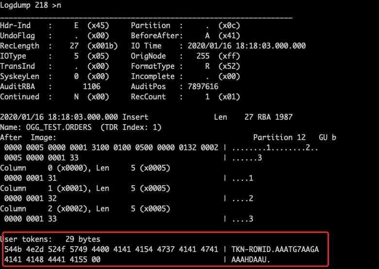

**Q： Error in token clause for TKN-ROWID**

**报错信息：**

```text
2020-01-17 16:17:17  INFO    OGG-06509  Oracle GoldenGate Capture for Oracle, dhext.prm:  Using the following key columns for source table 
OGG_TEST.ORDERS: OID.
2020-01-17 16:17:17  INFO    OGG-01298  Oracle GoldenGate Capture for Oracle, dhext.prm:  Column function diagnostic message: could not find 
column "RECORD".
2020-01-17 16:17:17  ERROR   OGG-00369  Oracle GoldenGate Capture for Oracle, dhext.prm:  Error in token clause for TKN-ROWID.
2020-01-17 16:17:17  ERROR   OGG-01668  Oracle GoldenGate Capture for Oracle, dhext.prm:  PROCESS ABENDING.
```

A：源端配置 `TABLE OGG_TEST.*,tokens (TKN-ROWID=@GETENV('RECORD','rowid'));` 之后，无法启动。

- 检查版本，2.0.3及以上版本才可以获取rowid。

- 仔细检查配置是否与官方文档一致。

- 如果一致，可以尝试切换一下 `@GETENV('RECORD','rowid'))` 的单双引号。

- 重启mgr。

**Q： dsOperation.getPosition():xxxxxxx old sendPosition is xxxxx, Skip this Operation, it maybe duplicated.**

A：多数情况是因为源端重启导致，表示Datahub插件点位重复了，但是这个经常会出现误判，而且有ogg自身的点位就足够了，所以可以尝试禁用掉插件点位（disableCheckPointFile设为true），不会对程序有影响，并且在接下来的版本中，我们也会完全弃用Datahub插件的点位。

**Q： dirrpt下的日志报错 Unable to create operation: com.goldengate.atg.datasource.ConcurrentTransactionException: Multiple “Begin-Transaction” operations received for the same source transaction. Current transaction begin position: xxx(xxx); current trail position: x**

A：源端事务冲突导致，需要排查源端Oracle是否有问题。

**Q： 数据上传到DataHub之后有8小时的时间延迟**

A：修改javaue.properties中的参数goldengate.userexit.timestamp为utc+8，然后重启dhwriter。

**Q： datahub插件解析后某些数据字段为空**

A：插件日志DEBUG模式下会打印全量数据，检查是否与源端数据匹配。

- 如果日志中打印数据正确，那可能是用户配置columnMapping错误导致数据缺失

- 如果日志中打印数据已经不匹配，那么检查OGG抽取数据是否正确，查看方法参考 logdump官方文档。rba信息可以在日志中看到。

**Q：源端使用OGG12.3，插件解析trail文件失败**

A：首先建议使用OGG12.2,或者也可以目标端修改extract配置 `RMTTRAIL ./dirdat/st` 为 `RMTTRAIL ./dirdat/st format RELEASE 12.2` 。

**Q： java.lang.NumberFormatException: for input string : “xxxx”**

A：检查所有的配置字段是否对应，对应关系可以参考Oracle**类型与DataHub类型对应说明**。之前有用户，把Oracle的字符串的destOld对应到DataHub的BIGINT字段，导致BIGINT解析失败。

**Q： String index out of range: 10**

**报错信息：**

```text
2020-01-14 10:03:24 [main] ERROR OperationHandler - dirty data : INSERT on WF_YN_07.CJ_GLQX202001 [B] [columns: 27] [pos: 00000007260404799638 
(seqno=726, rba=404799638)] [time: 2020-01-14 08:49:43.883741]
java.lang.StringIndexOutOfBoundsException: String index out of range: 10
    at java.lang.AbstractStringBuilder.setCharAt(AbstractStringBuilder.java:407)
    at java.lang.StringBuilder.setCharAt(StringBuilder.java:76)
    at com.aliyun.odps.ogg.handler.datahub.RecordBuilder.convertStrToMicroseconds(RecordBuilder.java:272)
    at com.aliyun.odps.ogg.handler.datahub.RecordBuilder.setTupleData(RecordBuilder.java:242)
    at com.aliyun.odps.ogg.handler.datahub.RecordBuilder.buildTupleRecord(RecordBuilder.java:172)
    at com.aliyun.odps.ogg.handler.datahub.RecordBuilder.buildRecord(RecordBuilder.java:82)
    at com.aliyun.odps.ogg.handler.datahub.operations.OperationHandler.processOperation(OperationHandler.java:50)
    at com.aliyun.odps.ogg.handler.datahub.operations.InsertOperationHandler.process(InsertOperationHandler.java:31)
    at com.aliyun.odps.ogg.handler.datahub.DatahubHandler.operationAdded(DatahubHandler.java:108)
    at oracle.goldengate.datasource.DsEventManager$3.send(DsEventManager.java:439)
    at oracle.goldengate.datasource.DsEventManager$EventDispatcher.distributeEvent(DsEventManager.java:231)
    at oracle.goldengate.datasource.DsEventManager.fireOperationAdded(DsEventManager.java:447)
    at oracle.goldengate.datasource.AbstractDataSource.fireOperationAdded(AbstractDataSource.java:464)
    at oracle.goldengate.datasource.UserExitDataSource.addOperationToTransactionAndFireEvent(UserExitDataSource.java:1337)
    at oracle.goldengate.datasource.UserExitDataSource.createOperation(UserExitDataSource.java:1305)
    at oracle.goldengate.datasource.UserExitDataSource.createOperation(UserExitDataSource.java:1046)
```

A：用户把时间戳类型的数据映射到TIMESTAMP上，因为TIMESTAMP字段对应的Oracle字段类型一般默认为date或者timestamp，所以直接是按时间字符串”2020-01-10:10:00:00”来处理的，这个实际传过来是时间戳字符串，所以就会发生越界的情况。 **解决方法：配置columnMapping中的** `isDateFormat="false"` 。

**Q： 无法获取update的before值**

A：检查源端是否有配置 `GETUPDATEBEFORES` 。

**Q： Oracle中有主键的表，OGG获取update操作，after的值为””**

A：Oracle的表有没有主键，OGG获取的update操作的值是不同的：

- 对于没有主键表的update操作，如果一列从a更新到b，那么显示 `"b" [before="a"]` ，如果某一列没有被更新，并且更新前的值是c，那么显示 `"c" [before="c"]`

- 对于有主键表的update操作，如果一列从a更新到b，那么显示 `"b" [before="a"]` ，如果某一列没有被更新，并且更新前的值是c，那么显示 `"" [before="c"]`

- 解决方案一：例如一张表有三个字段a b c，主键为a，如果update值不更新b，那么b的after就为””，如果想以b的before值作为after的值，可以在源端extract设置 `TABLE OGG_TEST.*,keycols(a,b);`

- 解决方案二：在columnMap中增加isKeyColumn配置，例如： `<column src="b" dest="b" destOld="b_old" isKeyColumn="true"/>` 。

**Q： Unsupported major.minor version 52.0**

**报错信息：**

```text
2019-12-23 18:03:58 [main] ERROR UserExitMain - java.lang.UnsupportedClassVersionError: com/aliyun/datahub/client/model/RecordSchema : 
Unsupported major.minor version 52.0
java.lang.UnsupportedClassVersionError: com/aliyun/datahub/client/model/RecordSchema : Unsupported major.minor version 52.0
    at oracle.goldengate.datasource.DataSourceLauncher.<init>(DataSourceLauncher.java:161)
    at oracle.goldengate.datasource.UserExitMain.main(UserExitMain.java:108)
Caused by: org.springframework.beans.factory.BeanDefinitionStoreException: Factory method [public final 
oracle.goldengate.datasource.GGDataSource oracle.goldengate.datasource.factory.DataSourceFactory.getDataSource()] threw exception; nested 
exception is java.lang.UnsupportedClassVersionError: com/aliyun/datahub/client/model/RecordSchema : Unsupported major.minor version 52.0
    at org.springframework.beans.factory.support.SimpleInstantiationStrategy.instantiate(SimpleInstantiationStrategy.java:169)
    at org.springframework.beans.factory.support.ConstructorResolver.instantiateUsingFactoryMethod(ConstructorResolver.java:570)
    ... 11 more
Caused by: java.lang.UnsupportedClassVersionError: com/aliyun/datahub/client/model/RecordSchema : Unsupported major.minor version 52.0
```

A：JDK版本不对，插件的编译环境是JDK1.8，用户可能使用了1.7的JDK，建议修改到JDK1.8或者自行去github上clone代码，编译jar包。

**Q： Error opening module ./libggjava_ue.so - libjsig.so:cannot open shared object file:no such file or directory**

A：检查版本是否正确，检查文件是否存在，检查环境变量是否生效，重启mgr，重启机器（不推荐，但是之前有用户遇到这个问题，重启了一下机器解决了）。

**Q： OGG-00425 No DB login established to retrieve a definition for table xxx.xxx**

A：源端重新生成一下def文件，复制到目标端。

**Q： defaultDatahubConfigure is null**

**报错信息：**

```text
2020-01-17 17:28:32 [main] ERROR DatahubHandler - Init error
java.lang.RuntimeException: defaultDatahubConfigure is null
    at com.aliyun.odps.ogg.handler.datahub.ConfigureReader.reader(ConfigureReader.java:117)
```

A：插件2.0.3更新了一个配置文件的拼写错误，如果继续使用2.0.2的配置文件，需要修改 `defalutDatahubConfigure => defaultDatahubConfigure` 。

**Q：目标端报错 OGG-06551 Oracle GoldenGate Collector: Could not translate host name localhost into an Internet address.**

A：目标端机器hostname在/etc/hosts里面重新设置localhost对应的ip

**Q：找不到jvm相关的so包**

A：将jvm的so路径添加到LD_LIBRARY_PATH后，重启mgr。例如： `export`

```text
LD_LIBRARY_PATH=${LD_LIBRARY_PATH}:$JAVA_HOME/lib/amd64:$JAVA_HOME/lib/amd64/server 
```

**Q：有了DDL语句，例如增加一列，源端ogg没有问题，但是adapter端的ffwriter和jmswriter进程退出，且报错： 2015-06-11 14:01:10 ERROR OGG-01161 Bad column index (5) specified for table OGG_TEST.T_PERSON, max columns = 5.**

A：由于表结构改变，需要重做def文件，将重做的def文件放入dirdef后重启即可

**Q： OGG report文件中报错 Error (4) retrieving column value.**

A：一般OGG是trail文件解析失败，开启debug日志可以看到具体是哪个RBA报错，调整点位跳过这个RBA方可解决。

**版本更新说明**

**2.0.2**

- 下载链接

**2.0.3**

- 下载链接

- 支持采集Oracle表的rowid。

- 支持DataHub的DECIMAL、TIMESTAMP等类型。

- 修改配置参数的拼写错误（defalutDatahubConfigure => defaultDatahubConfigure），如果在升级插件版本之后，依旧使用旧的配置文件，则需要修改此参数。

- 支持压缩、protobuf传输等功能。

**2.0.4**

- 下载链接

- 支持配置字符集，对于非utf-8编码的源数据库，可以避免中文乱码

**2.0.5**

- 下载链接

- 性能优化，TPS最高可提升70%

- 日志可配置metric打印

- 修复constColumnMap获取时间与真实时间不一致的bug

**2.0.6**

- 下载链接

- 修复2.0.5线程数据过多BUG

- 修复after值为空不能哈希的问题

- 支持DataHub新类型，TINYINT ， SMALLINT ， INTEGER ， FLOAT

**2.0.7**

- 下载链接

- 适配OGG for Bigdata 12.3.2.1，不再支持OGG Adpater

**2.0.8**

- 下载链接

- 适配OGG for Bigdata 19.1.0.0，不再支持OGG Adpater

<a id="section-6-4-2"></a>

### 6.4.2. OGG for Oracle

<a id="section-6-4-2-1"></a>

#### 6.4.2.1. OGG for Oracle介绍

目前使用DataHub插件采集Oracle数据支持两种模式，一种是基于Oracle GoldenGate Application Adapters，另一种基于Oracle GoldenGate for Big Data，两种模式的区别是目标端使用的进程不同。

**一、简介**

目前使用DataHub插件采集Oracle数据支持两种模式，一种是基于Oracle GoldenGate Application Adapters，另一种基于Oracle GoldenGate for Big Data，两种模式的区别是目标端使用的进程不同。

基于Adpater写入DataHub，目标端使用Extract，示意图如下：

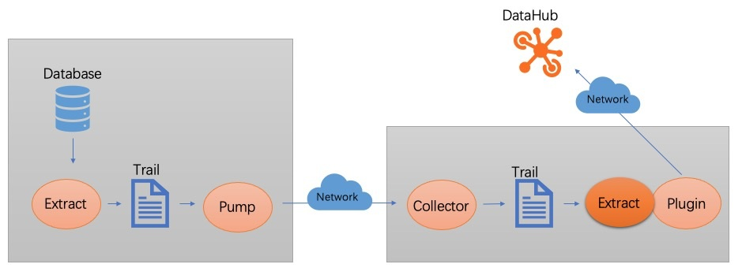

基于Bigdata写入DataHub，目标端使用Replicat，示意图如下：

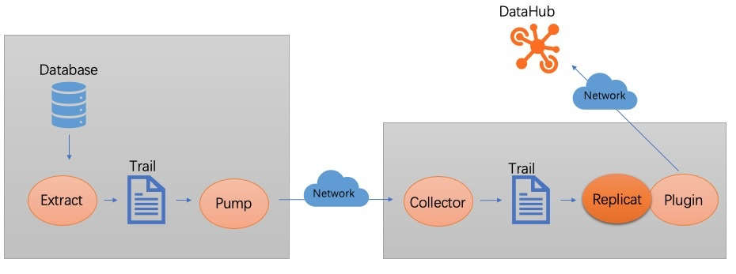

**两种模式的主要区别：**

1.支持版本不同，目前基于Adpater模式的写入仅支持Oracle11g，而基于Bigdata模式支持19c及以下所有数据库版本。2.支持力度不同，Adapter目前最新版本12.2，并且官方已经很长时间没有更新，而Bigdata几乎一直和Oracle同步更新，并且Adatper存在一些已知的BUG，暂时无解，并且DataHub插件今后的版本更新以Bigdata为主，基于Adapter不会再有新版本迭代。

**推荐使用基于Bigdata写入DataHub**

**二、oracle类型与DataHub类型对应说明**

DataHub的TIMESTAMP类型存储微秒时间戳，字段映射到TIMESTAMP类型时，都会被转为微秒时间戳。

| oracle | DataHub | 备注 |
| --- | --- | --- |
| char | STRING |  |
| varchar / varchar2 | STRING |  |
| number | BIGINT / DOUBLE / DECIMAL | number表示整数时，可以使用BIGINT；number为浮点数时，根据精度选择DOUBLE或者DECIMAL。 |
| INTEGER | BIGINT |  |
| BINARY_FLOAT / BINARY_DOUBLE | DOUBLE / DECIMAL |  |
| FLOAT | DOUBLE / DECIMAL |  |
| date / timestamp | TIMESTAMP / STRING | 如果DataHub数据类型为TIMESTAMP，会自动转换为微秒时间戳 |
| raw | STRING | raw字段会自动进行BASE64编码写入到DataHub |

以上是Oracle常见的数据类型和DataHub的对应，更多Oracle支持的数据类型可以参考官方文档

**三、版本说明及下载**

这里只提供了部分版本OGG和OGG Adatper，如果没有想要下载的版本还请访问OGG官网或者Oracle Software Delivery Cloud website进行下载。

| datahub-ogg-plugin | 源端 | 目标端 | 支持数据库版本 | 说明 |
| --- | --- | --- | --- | --- |
| 2.0.2 | OGG 12.1.x.x（推荐12.1.2.1） | OGG Adapters 12.1.2.1 | ORA11g |  |
| 2.0.3 | OGG 12.2.x.x（推荐12.2.0.2） | OGG Adapters 12.2.0.1 | ORA11g | • 支持采集Oracle表的rowid。<br>• 支持DataHub的DECIMAL、TIMESTAMP等类型。<br>• 修改配置参数的拼写错误（defalutDatahubConfigure =&gt; defaultDatahubConfigur e），如果在升级插件版本之后，依旧使用旧的配置文件，则需要修改此参数。<br>• 支持压缩、protobuf传输等功能。 |
| 2.0.4 | OGG 12.2.x.x（推荐12.2.0.2） | OGG Adapters 12.2.0.1 | ORA11g | 支持配置字符集，对于非utf-8编码的源数据库，可以避免中文乱码 |
| 2.0.5 | OGG 12.2.x.x（推荐12.2.0.2） | OGG Adapters 12.2.0.1 | ORA11g | • 性能优化，TPS最高可提升70%<br>• 日志可配置metric打印<br>• 修复constColumnMap获取时间与真实时间不一致的bug |
| 2.0.6 | OGG 12.2.x.x（推荐12.2.0.2） | OGG Adapters 12.2.0.1 | ORA11g | • 修复2.0.5线程数据过多BUG<br>• 修复after值为空不能哈希的问题<br>• 支持DataHub新类型，TINYINT ， SMALLINT ，INTEGER ， FLOAT |
| 2.0.7 | OGG 12.3.x.x（推荐12.3.2.1） | OGG Bigdata 12.3.2.1 | ORA11g/12c | 适配OGG for Bigdata 12.3.2.1，不再支持OGG Adpater |
| 2.0.8 | OGG 19.1.x.x（推荐19.1.0.0） | OGG Bigdata 19.1.0.0 | ORA19c及以下 | 适配OGG for Bigdata 19.1.0.0，不再支持OGG Adpater |
| 2.1.0 | OGG 19.1.x.x（推荐19.1.0.0） | OGG Bigdata 19.1.0.0 | ORA19c及以下 | 修复部分已知bug |

<a id="section-6-4-2-2"></a>

#### 6.4.2.2. OGG Adapters

**一、环境要求**

- 源端已安装好Oracle11g（当前插件版本仅支持ORA11g数据库）

- 源端已安装好OGG（建议版本Oracle GoldenGate V12.2.0.2，V12.2.X均可以使用）

- 目标端已安装好OGG Adapters（建议版本Oracle GoldenGate Application Adapters V12.2.0.1，V12.2.X均可以使用）

- JDK1.8

**二、 安装步骤**

**（下面将介绍Oracle/OGG相关安装和配置过程，Oracle的安装将不做介绍，另外需要注意的是：Oracle/OGG相关参数配置以熟悉Oracle/OGG的运维人员配置为准，本示例只是提供一个可运行的样本）**

相关安装包可以在文末的提示下进行下载。

- OGG

- OGG Adater

- DataHub OGG Plugin

**OGG 源端配置**

1. **源端Oracle配置**

**注意：以下操作如遗漏配置，可能会造成UPDATE操作的更新前值为空**以dba分身进入sqlplus：sqlplus / as sysdba

```sql
# 创建独立的表空间
create tablespace ATMV datafile '/home/oracle/u01/app/oracle/oradata/uprr/ATMV.dbf' size 100m autoextend on next 50m maxsize unlimited;
 # 创建ogg_test⽤户，密码也为ogg_test
create user ogg_test identified by ogg_test default tablespace ATMV;
 # 给ogg_test赋予充分的权限
grant connect,resource,dba to ogg_test;
 # 检查附加⽇志情况
Select SUPPLEMENTAL_LOG_DATA_MIN, SUPPLEMENTAL_LOG_DATA_PK, SUPPLEMENTAL_LOG_DATA_UI, SUPPLEMENTAL_LOG_DATA_FK, SUPPLEMENTAL_LOG_DATA_ALL from 
v$database;
 # 增加数据库附加⽇志
alter database add supplemental log data;
alter database add supplemental log data (primary key, unique,foreign key) columns;
 # rollback
alter database drop supplemental log data (primary key, unique,foreign key) columns;
alter database drop supplemental log data;
 # 全字段模式，注意：在该模式下的delete操作也只有主键值，如果需要其他值，须在source端extract配置NOCOMPRESSDELETES
ALTER DATABASE ADD SUPPLEMENTAL LOG DATA (ALL) COLUMNS;
 # 开启数据库强制⽇志模式
alter database force logging;
 # 安装sequence support
@sequence.sql
#
alter table sys.seq$ add supplemental log data (primary key) columns;
```

2. **源端OGG安装**

下载OGG安装包解压后有如下目录：

```text
drwxr-xr-x install
drwxrwxr-x response
-rwxr-xr-x runInstaller
drwxr-xr-x stage
```

目前Oracle一般采取response安装的方式，在response/oggcore.rsp中配置安装依赖，具体如下：

```text
oracle.install.responseFileVersion=/oracle/install/rspfmt_ogginstall_response_schema_v12_1_2
# 需要⽬前与oracle版本对应
INSTALL_OPTION=ORA11g
# goldegate主⽬录
SOFTWARE_LOCATION=/home/oracle/u01/ggate
# 初始不启动manager
START_MANAGER=false
# manger端⼝
MANAGER_PORT=7839
# 对应oracle的主⽬录
DATABASE_LOCATION=/home/oracle/u01/app/oracle/product/11.2.0/dbhome_1
# 暂可不配置
INVENTORY_LOCATION=
# 分组（⽬前暂时将oracle和ogg⽤同⼀个账号ogg_test，实际可以给ogg单独账号）
UNIX_GROUP_NAME=oinstall
```

执行命令：

```text
runInstaller -silent -responseFile {YOUR_OGG_INSTALL_FILE_PATH}/response/oggcore.rsp
```

本示例中，安装后OGG的目录在/home/oracle/u01/ggate，安装日志在/home/oracle/u01/ggate/cfgtoollogs/oui目录下，当silentInstall{时间}.log文件里出现如下提示，表明安装成功：

> **说明**
>
> The installation of Oracle GoldenGate Core was successful.

执行/home/oracle/u01/ggate/ggsci命令，并在提示符下键入命令： `CREATE SUBDIRS` ，从而生成ogg需要的各种目录（dirxxx）。至此，源端OGG安装完成。

3. **配置源端mgr**

以下是通过ggsci对ogg源端mgr进行配置，配置命令为 `edit params mgr` ，配置内容如下

```text
PORT 7839
DYNAMICPORTLIST  7840-7849
USERID ogg_test, PASSWORD ogg_test
PURGEOLDEXTRACTS ./dirdat/*, USECHECKPOINTS, MINKEEPDAYS 7
LAGREPORTHOURS 1
LAGINFOMINUTES 30
LAGCRITICALMINUTES 45
PURGEDDLHISTORY MINKEEPDAYS 3, MAXKEEPDAYS 7
PURGEMARKERHISTORY MINKEEPDAYS 3, MAXKEEPDAYS 7
```

配置完成后可以查看一下配置以确认, `view params mgr`

启动mgr  `start mgr`

查看mgr状态 `info mgr`

4. **配置源端extract**

以下是通过ggsci对ogg进行配置，配置extract（名字可任取，这里名字为dhext） `edit params dhext`

```text
EXTRACT dhext
SETENV (NLS_LANG="AMERICAN_AMERICA.AL32UTF8")
DBOPTIONS   ALLOWUNUSEDCOLUMN
USERID ogg_test, PASSWORD ogg_test
REPORTCOUNT EVERY 1 MINUTES, RATE
NUMFILES 5000
DISCARDFILE ./dirrpt/ext_test.dsc, APPEND, MEGABYTES 100
DISCARDROLLOVER AT 2:00
WARNLONGTRANS 2h, CHECKINTERVAL 3m
EXTTRAIL ./dirdat/st, MEGABYTES 200
DDL &
INCLUDE MAPPED OBJTYPE 'table' &
INCLUDE MAPPED OBJTYPE 'index' &
INCLUDE MAPPED OBJTYPE 'SEQUENCE' &
EXCLUDE OPTYPE COMMENT
DDLOPTIONS  NOCROSSRENAME  REPORT
TABLE  OGG_TEST.*,tokens (TKN-ROWID=@GETENV('RECORD','rowid'));
SEQUENCE  OGG_TEST.*;
GETUPDATEBEFORES
```

**备注：** `TABLE OGG_TEST.*`，`tokens (TKN-ROWID=@GETENV('RECORD','rowid'))` ；可以用来采集源表的rowdid，如果不需要采集rowid可以修改为 `TABLE OGG_TEST.*` 。

添加extract进程并启动

```text
# 添加extract进程
add extract dhext,tranlog, begin now

# 每个队列⽂件⼤⼩为200MB
add exttrail ./dirdat/st,extract dhext, megabytes 200

# 启动
start dhext
```

extract启动后，数据库发生的一条变更可以在ggate/dirdat目录下的文件中看到。

5. **生成def文件**

**OGG 版本 >= 12.2.x之后，可以不需要此步骤。**

源端ggsci起来后执行如下命令，生成defgen文件,并且拷贝到目标端dirdef下 `edit params defgen`

```text
DEFSFILE ./dirdef/ogg_test.def
USERID ogg_test, PASSWORD ogg_test
table OGG_TEST.*;
```

在Shell中执行如下命令，生成ogg_test.def `./defgen paramfile ./dirprm/defgen.prm`

6. **配置源端pump**

启动ggsci后执行如下操作：编辑pump配置 `edit params pump`

```text
EXTRACT pump
RMTHOST xx.xx.xx.xx, MGRPORT 7839, COMPRESS
PASSTHRU
NUMFILES 5000
RMTTRAIL ./dirdat/st
DYNAMICRESOLUTION
TABLE      OGG_TEST.*;
SEQUENCE  OGG_TEST.*;
```

添加并启动pump

```text
# 添加pump进程
add extract pump,exttrailsource ./dirdat/st

# 添加⽬标端的trail⽂件，每个队列⽂件⼤⼩为200MB
add rmttrail ./dirdat/st,extract pump,megabytes 200

# 启动pump之前需要保证⽬标端mgr已经启动
start pump
```

启动成功后，就可以在目标端的dirdat目录下看到投递过来的trailfile。

**OGG 目标端配置**

1. **目标端OGG 安装**

目标端的OGG是OGG Adapter，不需要安装，只需要解压即可。解压之后，需要创建必须目录，启动ggsci之后输入命令 `create subdirs` ，成功之后便可以看到OGG目录下增加了dirxxx的几个目录。

需要把源端生成的def文件复制到dirdef目录下（OGG版本 >= 12.2.x不需要此操作）。

2. **DataHub插件安装和配置**

依赖环境：JDK >= 1.7。配置好JAVA_HOME, LD_LIBRARY_PATH，可以将环境变量配置到~/.bash_profile中，例如：

```bash
export JAVA_HOME=/xxx/xxx
export JRE_HOME=/xxx/xxx/jrexx
export LD_LIBRARY_PATH=${LD_LIBRARY_PATH}:$JRE_HOME/lib/amd64:$JRE_HOME/lib/amd64/server
```

修改环境变量后，下载datahub-ogg-plugin.tar.gz并解压，修改conf路径下的javaue.properties文件，将{YOUR_HOME}替换为解压后的路径

```text
gg.handlerlist=ggdatahub
gg.handler.ggdatahub.type=com.aliyun.odps.ogg.handler.datahub.DatahubHandler
gg.handler.ggdatahub.configureFileName={YOUR_HOME}/aliyun-datahub-ogg-plugin/conf/configure.xml
goldengate.userexit.nochkpt=false
goldengate.userexit.timestamp=utc+8
gg.classpath={YOUR_HOME}/aliyun-datahub-ogg-plugin/lib/*
gg.log.level=debug
jvm.bootoptions=-Xmx512m -Dlog4j.configuration=file:{YOUR_HOME}/datahub-ogg-plugin/conf/log4j.properties -Djava.class.path=ggjava/ggjava.jar
```

修改conf路径下的log4j.properties文件，将{YOUR_HOME}替换为解压后的路径，修改conf路径下的configure.xml文件，修改方式见文件中的注释

```xml
<?xml version="1.0" encoding="UTF-8"?>
<configue>
    <defaultOracleConfigure>
        <!-- oracle sid, 必选-->
        <sid>100</sid>
        <!-- oracle schema, 可以被mapping中的oracleSchema覆盖, 两者必须有⼀个非空-->
        <schema>ogg_test</schema>
    </defaultOracleConfigure>
    <defalutDatahubConfigure>
        <!-- datahub endpoint, 必填-->
        <endPoint>YOUR_DATAHUB_ENDPOINT</endPoint>
        <!-- datahub project, 可以被mapping中的datahubProject, 两者必须有⼀个非空-->
        <project>YOUR_DATAHUB_PROJECT</project>
        <!-- datahub accessId, 可以被mapping中的datahubAccessId覆盖, 两者必须有⼀个非空-->
        <accessId>YOUR_DATAHUB_ACCESS_ID</accessId>
        <!-- datahub accessKey, 可以被mapping中的datahubAccessKey覆盖, 两者必须有⼀个非空-->
        <accessKey>YOUR_DATAHUB_ACCESS_KEY</accessKey>
        <!-- 数据变更类型同步到datahub对应的字段，可以被columnMapping中的ctypeColumn覆盖 -->
        <ctypeColumn>optype</ctypeColumn>
        <!-- 数据变更时间同步到datahub对应的字段，可以被columnMapping中的ctimeColumn覆盖 -->
        <ctimeColumn>readtime</ctimeColumn>
        <!-- 数据变更序号同步到datahub对应的字段, 按数据变更先后递增, 不保证连续, 可以被columnMapping中的cidColumn覆盖 -->
        <cidColumn>record_id</cidColumn>
    </defalutDatahubConfigure>
    <!-- 默认最严格，不落⽂件，直接退出，无限重试-->
    <!-- 运⾏每批上次的最多纪录数, 可选, 默认1000-->
    <batchSize>1000</batchSize>
    <!-- 默认时间字段转换格式, 可选, 默认yyyy-MM-dd HH:mm:ss-->
    <defaultDateFormat>yyyy-MM-dd HH:mm:ss</defaultDateFormat>
    <!-- 脏数据是否继续, 可选, 默认false-->
    <dirtyDataContinue>true</dirtyDataContinue>
    <!-- 脏数据⽂件, 可选, 默认datahub_ogg_plugin.dirty-->
    <dirtyDataFile>datahub_ogg_plugin.dirty</dirtyDataFile>
    <!-- 脏数据⽂件最⼤size, 单位M, 可选, 默认500-->
    <dirtyDataFileMaxSize>200</dirtyDataFileMaxSize>
    <!-- 重试次数, -1：无限重试 0：不重试 n：重试次数， 可选， 默认-1-->
    <retryTimes>0</retryTimes>
    <!--指定shard id列表, 优先⽣效, 可选,例如0,1-->
    <shardId>0,1</shardId>
    <!-- 重试间隔, 单位毫秒, 可选, 默认3000-->
    <retryInterval>4000</retryInterval>
    <!-- 点位⽂件, 可选, 默认datahub_ogg_plugin.chk-->
    <checkPointFileName>datahub_ogg_plugin.chk</checkPointFileName>
    <mappings>
        <mapping>
            <!-- oracle schema, ⻅上描述-->
            <oracleSchema></oracleSchema>
            <!-- oracle table, 必选-->
            <oracleTable>t_person</oracleTable>
            <!-- datahub project, ⻅上描述-->
            <datahubProject></datahubProject>
            <!-- datahub topic, 必选-->
            <datahubTopic>t_person</datahubTopic>
            <!-- oracle表rowid同步到DataHub的字段，可选 -->
            <rowIdColumn></rowIdColumn>
            <ctypeColumn></ctypeColumn>
            <ctimeColumn></ctimeColumn>
            <cidColumn></cidColumn>
            <columnMapping>
                <!--
                src:oracle字段名称, 必须；
                dest:datahub field, 必须；
                destOld: 变更前数据落到datahub的field, 可选;
                isShardColumn: 是否作为shard的hashkey, 可选, 默认为false, 可以被shardId覆盖
                isDateFormat: timestamp字段是否采⽤DateFormat格式转换, 默认true. 如果是false, 源端数据必须是long
                dateFormat: timestamp字段的转换格式, 不填就⽤默认值
                -->
                <column src="id" dest="id" isShardColumn="true"  isDateFormat="false" dateFormat="yyyy-MM-dd HH:mm:ss"/>
                <column src="name" dest="name" isShardColumn="true"/>
                <column src="age" dest="age"/>
                <column src="address" dest="address"/>
                <column src="comments" dest="comments"/>
                <column src="sex" dest="sex"/>
                <column src="temp" dest="temp" destOld="temp1"/>
            </columnMapping>
        </mapping>
    </mappings>
</configue>
```

3. **配置目标端mgr**

编辑mgr配置 `edit params mgr`

```text
PORT 7839
DYNAMICPORTLIST  7840-7849
PURGEOLDEXTRACTS ./dirdat/*, USECHECKPOINTS, MINKEEPDAYS 7
LAGREPORTHOURS 1
LAGINFOMINUTES 30
LAGCRITICALMINUTES 45
PURGEDDLHISTORY MINKEEPDAYS 3, MAXKEEPDAYS 7
PURGEMARKERHISTORY MINKEEPDAYS 3, MAXKEEPDAYS 7
```

启动mgr `start mgr`

4. **配置目标端writer**

在ggsci下编辑配置， `edit params dhwriter`

```text
extract dhwriter
getEnv (JAVA_HOME)
getEnv (LD_LIBRARY_PATH)
getEnv (PATH)
CUSEREXIT ./libggjava_ue.so CUSEREXIT PASSTHRU INCLUDEUPDATEBEFORES, PARAMS "{YOUR_HOME}/datahub-ogg-plugin/conf/javaue.properties"
sourcedefs ./dirdef/ogg_test.def
table OGG_TEST.*;
```

添加并启动dhwriter

```text
# 添加进程
add extract dhwriter, exttrailsource ./dirdat/st

# 启动dhwriter
start dhwriter
```

**三、数据示例**

**日志示例**

源端不涉及插件逻辑，这里只介绍目标端的日志主要分为两个：

1. DataHub插件日志，在插件目录的log目录下，默认每个Replicat进程一个日志，日志名默认为datahub-ogg-plugin.log )，插件相关的问题都可以参考该日志解决。

2. OGG相关日志，在dirrpt目录下，默认每个Replicat进程一个日志，日志名为进程名.rpt（上例为DHWRITER.rpt），OGG相关的问题都可以参考该日志解决。

**数据示例**

写入DataHub成功会在插件日志生成以下记录：

```text
2020-12-01 11:29:30.000461 [record_writer-1-thread-1] INFO  ShardWriter - Write DataHub success, table: orders, topic: orders_new, shard: 0, recordNum: 1, rt: 3
```

在DataHub页面抽样可以看到写入的数据：

```text
Shard ID    System Time    oid (STRING)    num (STRING)    pid (STRING)    bak (STRING)    ctype (STRING)    ctime (STRING)    cid (STRING)    
rowid (STRING)
0    2020年12⽉1⽇上午11:29:30    1    3    2    zh    I    2020-12-01 03:29:24.000074    16067933700000    AAAWwyAAGAAABufAAC
```

<a id="section-6-4-2-3"></a>

#### 6.4.2.3. OGG for Big Data

**一、环境要求**

- Oracle数据库，19c及以下数据库，版本不可高于源端OGG

- 源端，Oracle GoldenGate 19.1.0.0

- 目标端, Oracle GoldenGate for Big Data 19.1.0.0

- OGG官方下载地址

**备注：本文示例均已OGG19.1为例，其他支持版本可参看文末版本说明**

**二、 安装步骤**

**下面将介绍Oracle/OGG相关安装和配置过程，Oracle的安装将不做介绍，另外需要注意的是：Oracle/OGG相关参数配置以熟悉Oracle/OGG的运维人员配置为准，本示例只是提供一个可运行的样本。**

**OGG 源端配置**

本文以Oracle11g为例，给出一个可用示例，Oracle 12c多租户及以上版本请参考官方文档。

1. **源端Oracle配置**

**注意：以下操作如遗漏配置，可能会造成UPDATE操作的更新前值为空**以dba分身进入sqlplus：sqlplus / as sysdba

```sql
# 创建独立的表空间
create tablespace ATMV datafile '/home/oracle/u01/app/oracle/oradata/uprr/ATMV.dbf' size 100m autoextend on next 50m maxsize unlimited;
 # 创建ogg_test⽤户，密码也为ogg_test
create user ogg_test identified by ogg_test default tablespace ATMV;
 # 给ogg_test赋予充分的权限
grant connect,resource,dba to ogg_test;
 # 检查附加⽇志情况
Select SUPPLEMENTAL_LOG_DATA_MIN, SUPPLEMENTAL_LOG_DATA_PK, SUPPLEMENTAL_LOG_DATA_UI, SUPPLEMENTAL_LOG_DATA_FK, SUPPLEMENTAL_LOG_DATA_ALL from 
v$database;
 # 增加数据库附加⽇志
alter database add supplemental log data;
alter database add supplemental log data (primary key, unique,foreign key) columns;
 # rollback
alter database drop supplemental log data (primary key, unique,foreign key) columns;
alter database drop supplemental log data;
 # 全字段模式，注意：在该模式下的delete操作也只有主键值，如果需要其他值，须在source端extract配置NOCOMPRESSDELETES
ALTER DATABASE ADD SUPPLEMENTAL LOG DATA (ALL) COLUMNS;
 # 开启数据库强制⽇志模式
alter database force logging;
 # 安装sequence support
@sequence.sql
#
alter table sys.seq$ add supplemental log data (primary key) columns;
```

2. **源端OGG安装**

下载OGG安装包解压后有如下目录：

```text
drwxr-xr-x install
drwxrwxr-x response
-rwxr-xr-x runInstaller
drwxr-xr-x stage
```

目前Oracle一般采取response安装的方式，在response/oggcore.rsp中配置安装依赖，具体如下：

```text
oracle.install.responseFileVersion=/oracle/install/rspfmt_ogginstall_response_schema_v12_1_2
# 需要⽬前与oracle版本对应
INSTALL_OPTION=ORA11g
# goldegate主⽬录
SOFTWARE_LOCATION=/home/oracle/u01/ggate
# 初始不启动manager
START_MANAGER=false
# manger端⼝
MANAGER_PORT=7839
# 对应oracle的主⽬录
DATABASE_LOCATION=/home/oracle/u01/app/oracle/product/11.2.0/dbhome_1
# 暂可不配置
INVENTORY_LOCATION=
# 分组（⽬前暂时将oracle和ogg⽤同⼀个账号ogg_test，实际可以给ogg单独账号）
UNIX_GROUP_NAME=oinstall
```

执行命令：

```text
runInstaller -silent -responseFile {YOUR_OGG_INSTALL_FILE_PATH}/response/oggcore.rsp
```

本示例中，安装后OGG的目录在/home/oracle/u01/ggate，安装日志在/home/oracle/u01/ggate/cfgtoollogs/oui目录下，当silentInstall{时间}.log文件里出现如下提示，表明安装成功：

> **说明**
>
> The installation of Oracle GoldenGate Core was successful.

执行/home/oracle/u01/ggate/ggsci命令，并在提示符下键入命令： `CREATE SUBDIRS` ，从而生成ogg需要的各种目录（dirxxx）。至此，源端OGG安装完成。

3. **配置源端mgr**

以下是通过ggsci对ogg源端mgr进行配置，配置命令为 `edit params mgr` ，配置内容如下

```text
PORT 7839
DYNAMICPORTLIST  7840-7849
USERID ogg_test, PASSWORD ogg_test
PURGEOLDEXTRACTS ./dirdat/*, USECHECKPOINTS, MINKEEPDAYS 7
LAGREPORTHOURS 1
LAGINFOMINUTES 30
LAGCRITICALMINUTES 45
PURGEDDLHISTORY MINKEEPDAYS 3, MAXKEEPDAYS 7
PURGEMARKERHISTORY MINKEEPDAYS 3, MAXKEEPDAYS 7
```

配置完成后可以查看一下配置以确认, `view params mgr`

启动mgr  `start mgr`

查看mgr状态 `info mgr`

4. **配置源端extract**

以下是通过ggsci对ogg进行配置，配置extract（名字可任取，这里名字为dhext） `edit params dhext`

```text
EXTRACT dhext
SETENV (NLS_LANG="AMERICAN_AMERICA.AL32UTF8")
DBOPTIONS   ALLOWUNUSEDCOLUMN
USERID ogg_test, PASSWORD ogg_test
REPORTCOUNT EVERY 1 MINUTES, RATE
NUMFILES 5000
DISCARDFILE ./dirrpt/ext_test.dsc, APPEND, MEGABYTES 100
DISCARDROLLOVER AT 2:00
WARNLONGTRANS 2h, CHECKINTERVAL 3m
EXTTRAIL ./dirdat/st, MEGABYTES 200
DDL &
INCLUDE MAPPED OBJTYPE 'table' &
INCLUDE MAPPED OBJTYPE 'index' &
INCLUDE MAPPED OBJTYPE 'SEQUENCE' &
EXCLUDE OPTYPE COMMENT
DDLOPTIONS  NOCROSSRENAME  REPORT
TABLE  OGG_TEST.*,tokens (TKN-ROWID=@GETENV('RECORD','rowid'));
SEQUENCE  OGG_TEST.*;
GETUPDATEBEFORES
```

**备注**： `TABLE OGG_TEST.*,tokens (TKN-ROWID=@GETENV('RECORD','rowid'));` 可以用来采集源表的rowdid，如果不需要采集rowid可以修改为 `TABLE OGG_TEST.*;` 。

添加extract进程并启动

```text
# 添加extract进程
add extract dhext,tranlog, begin now

# 每个队列⽂件⼤⼩为200MB
add exttrail ./dirdat/st,extract dhext, megabytes 200

# 启动
start dhext
```

extract启动后，数据库发生的一条变更可以在ggate/dirdat目录下的文件中看到。

5. **配置源端pump**

启动ggsci后执行如下操作：编辑pump配置 `edit params pump`

```text
EXTRACT pump
RMTHOST xx.xx.xx.xx, MGRPORT 7839, COMPRESS
PASSTHRU
NUMFILES 5000
RMTTRAIL ./dirdat/st
DYNAMICRESOLUTION
TABLE      OGG_TEST.*;
SEQUENCE  OGG_TEST.*;
```

添加并启动pump

```text
# 添加pump进程
add extract pump,exttrailsource ./dirdat/st

# 添加⽬标端的trail⽂件，每个队列⽂件⼤⼩为200MB
add rmttrail ./dirdat/st,extract pump,megabytes 200

# 启动pump之前需要保证⽬标端mgr已经启动
start pump
```

启动成功后，就可以在目标端的dirdat目录下看到投递过来的trailfile。

**OGG for Bigdata目标端配置**

1. **目标端OGG for Bigdata安装**

目标端的OGG是OGG for Bigdata，不需要安装，只需要解压即可。解压之后，需要创建必须目录，启动ggsci之后输入命令 `create subdirs` ，成功之后便可以看到OGG目录下增加了dirxxx的几个目录。

2. **DataHub插件安装和配置**

依赖环境：JDK >= 1.8。配置好JAVA_HOME, LD_LIBRARY_PATH，可以将环境变量配置到~/.bash_profile中，例如：

```bash
export JAVA_HOME=/xxx/xxx
export JRE_HOME=/xxx/xxx/jrexx
export LD_LIBRARY_PATH=${LD_LIBRARY_PATH}:$JRE_HOME/lib/amd64:$JRE_HOME/lib/amd64/server
```

修改环境变量后，下载datahub-ogg-plugin.tar.gz并解压，修改conf路径下的javaue.properties文件，将${GG_HOME}替换为解压后的路径

```text
gg.handlerlist=ggdatahub

gg.handler.ggdatahub.type=com.aliyun.odps.ogg.handler.datahub.DatahubHandler
gg.handler.ggdatahub.configureFileName=${GG_HOME}/aliyun-datahub-ogg-plugin/conf/configure.xml

goldengate.userexit.timestamp=utc+8
goldengate.userexit.writers=javawriter

javawriter.stats.display=TRUE
javawriter.stats.full=TRUE

gg.includeggtokens=true
gg.classpath=${GG_HOME}/aliyun-datahub-ogg-plugin/lib/*
gg.log=log4j
gg.log.level=info
gg.log.file.count=64
gg.log.file.size=128MB

javawriter.bootoptions=-Xms512m -Xmx512m -Xmn256m -Djava.class.path=ggjava/ggjava.jar -Dlog4j.configurationFile=${GG_HOME}/aliyun-datahub-ogg-plugin/conf/log4j.properties
```

修改conf路径下的configure.xml文件，修改方式见文件中的注释

```xml
<?xml version="1.0" encoding="UTF-8"?>
<configue>
    <defaultOracleConfigure>
        <!-- oracle sid, 必选-->
        <sid>100</sid>
        <!-- oracle schema, 可以被mapping中的oracleSchema覆盖, 两者必须有⼀个非空-->
        <schema>ogg_test</schema>
    </defaultOracleConfigure>
    <defalutDatahubConfigure>
        <!-- datahub endpoint, 必填-->
        <endPoint>YOUR_DATAHUB_ENDPOINT</endPoint>
        <!-- datahub project, 可以被mapping中的datahubProject, 两者必须有⼀个非空-->
        <project>YOUR_DATAHUB_PROJECT</project>
        <!-- datahub accessId, 可以被mapping中的datahubAccessId覆盖, 两者必须有⼀个非空-->
        <accessId>YOUR_DATAHUB_ACCESS_ID</accessId>
        <!-- datahub accessKey, 可以被mapping中的datahubAccessKey覆盖, 两者必须有⼀个非空-->
        <accessKey>YOUR_DATAHUB_ACCESS_KEY</accessKey>
        <!-- 数据变更类型同步到datahub对应的字段，可以被columnMapping中的ctypeColumn覆盖 -->
        <ctypeColumn>optype</ctypeColumn>
        <!-- 数据变更时间同步到datahub对应的字段，可以被columnMapping中的ctimeColumn覆盖 -->
        <ctimeColumn>readtime</ctimeColumn>
        <!-- 数据变更序号同步到datahub对应的字段, 按数据变更先后递增, 不保证连续, 可以被columnMapping中的cidColumn覆盖 -->
        <cidColumn>record_id</cidColumn>
    </defalutDatahubConfigure>
    <!-- 默认最严格，不落⽂件，直接退出，无限重试-->
    <!-- 运⾏每批上次的最多纪录数, 可选, 默认1000-->
    <batchSize>1000</batchSize>
    <!-- 默认时间字段转换格式, 可选, 默认yyyy-MM-dd HH:mm:ss-->
    <defaultDateFormat>yyyy-MM-dd HH:mm:ss</defaultDateFormat>
    <!-- 脏数据是否继续, 可选, 默认false-->
    <dirtyDataContinue>true</dirtyDataContinue>
    <!-- 脏数据⽂件, 可选, 默认datahub_ogg_plugin.dirty-->
    <dirtyDataFile>datahub_ogg_plugin.dirty</dirtyDataFile>
    <!-- 脏数据⽂件最⼤size, 单位M, 可选, 默认500-->
    <dirtyDataFileMaxSize>200</dirtyDataFileMaxSize>
    <!-- 重试次数, -1:无限重试 0:不重试 n:重试次数, 可选, 默认-1-->
    <retryTimes>0</retryTimes>
    <!--指定shard id列表, 优先⽣效, 可选,例如0,1-->
    <shardId>0,1</shardId>
    <!-- 重试间隔, 单位毫秒, 可选, 默认3000-->
    <retryInterval>4000</retryInterval>
    <!-- 点位⽂件, 可选, 默认datahub_ogg_plugin.chk-->
    <checkPointFileName>datahub_ogg_plugin.chk</checkPointFileName>
    <mappings>
        <mapping>
            <!-- oracle schema, ⻅上描述-->
            <oracleSchema></oracleSchema>
            <!-- oracle table, 必选-->
            <oracleTable>t_person</oracleTable>
            <!-- datahub project, ⻅上描述-->
            <datahubProject></datahubProject>
            <!-- datahub topic, 必选-->
            <datahubTopic>t_person</datahubTopic>
            <!-- oracle表rowid同步到DataHub的字段，可选 -->
            <rowIdColumn></rowIdColumn>
            <ctypeColumn></ctypeColumn>
            <ctimeColumn></ctimeColumn>
            <cidColumn></cidColumn>
            <columnMapping>
                <!--
                src:oracle字段名称, 必须;
                dest:datahub field, 必须;
                destOld:变更前数据落到datahub的field, 可选;
                isShardColumn: 是否作为shard的hashkey, 可选, 默认为false, 可以被shardId覆盖
                isDateFormat: timestamp字段是否采⽤DateFormat格式转换, 默认true. 如果是false, 源端数据必须是long
                dateFormat: timestamp字段的转换格式, 不填就⽤默认值
                -->
                <column src="id" dest="id" isShardColumn="true"  isDateFormat="false" dateFormat="yyyy-MM-dd HH:mm:ss"/>
                <column src="name" dest="name" isShardColumn="true"/>
                <column src="age" dest="age"/>
                <column src="address" dest="address"/>
                <column src="comments" dest="comments"/>
                <column src="sex" dest="sex"/>
                <column src="temp" dest="temp" destOld="temp1"/>
            </columnMapping>
        </mapping>
    </mappings>
</configue>
```

3. **配置目标端mgr**

```text
port 7919
dynamicportlist  7910-7919
lagreportminutes  10
laginfoseconds  1
purgeoldextracts ./dirdat/*, usecheckpoints, minkeepdays 7
```

启动mgr  `start mgr`

4. **配置目标端replicat**

在ggsci下编辑配置， `edit params dhwt`

```text
REPLICAT dhwt
getEnv (JAVA_HOME)
getEnv (LD_LIBRARY_PATH)
getEnv (PATH)
TARGETDB LIBFILE libggjava.so SET property=${GG_HOME}/aliyun-datahub-ogg-plugin/conf/javaue.properties --需要⽤户⼿动修改路径
MAP ogg_test.*, TARGET ogg_test.*;
```

**上面示例用户需要手动修改下javaue.properties的具体路径，并且在MAP中配置具体的表名，本文采集ogg_test下的所有表。**

添加并启动dhwt

```text
# 添加进程
add replicat dhwt, exttrailsource dirdat/st
# 启动dhwt
start dhwt
```

**三、数据示例**

**日志示例**

源端不涉及插件逻辑，这里只介绍目标端的日志主要分为两个：

1. DataHub插件日志，在dirrpt目录下，默认每个Replicat进程一个日志，日志名为进程名-datahub.log(上例日志为DHWT-datahub.log)，插件相关的问题都可以参考该日志解决。

2. OGG相关日志，在dirrpt目录下，默认每个Replicat进程一个日志，日志名为进程名.log\*（上例为DHWT.log），OGG相关的问题都可以参考该日志解决。

**数据示例**

写入DataHub成功会在插件日志生成以下记录

```text
2020-12-01 11:29:30.000461 [record_writer-1-thread-1] INFO  ShardWriter - Write DataHub success, table: orders, topic: orders_new, shard: 0, recordNum: 1, rt: 3
```

在DataHub页面抽样可以看到写入的数据

```text
Shard ID    System Time    oid (STRING)    num (STRING)    pid (STRING)    bak (STRING)    ctype (STRING)    ctime (STRING)    cid (STRING)    
rowid (STRING)
0    2020年12⽉1⽇上午11:29:30    1    3    2    zh    I    2020-12-01 03:29:24.000074    16067933700000    AAAWwyAAGAAABufAAC
```

<a id="section-6-4-3"></a>

### 6.4.3. OGG for MySQL

**一、环境要求**

- MySQL 企业版或者社区版

- OGG for MySQL 12.2.0.2

- OGG Application Adapter 12.2.0.1

- java 7（推荐JDK 1.8）

**二、安装步骤：**

**（下面将介绍MySQL/OGG相关安装和配置过程，MySQL的安装将不做介绍，另外需要注意的是：MySQL/OGG相关参数配置以熟悉MySQL/OGG的运维人员配置为准，本示例只是提供一个可运行的样本）**

**安装包准备**

相关安装包可以在文末的提示下进行下载。

- OGG for MySQL

- OGG Adater

- DataHub OGG Plugin

**OGG 源端配置**

1. **源端MySQL配置**

**开启binlog**

修改文件 `/etc/my.cnf` ，添加如下配置

```text
## for ogg
# Extract expects that all of the table columns are in the binary log. 
# As a result, only binlog_row_image set as full is supported and this is the default
binlog_row_image=full
# It must be set to the value of ROW, which directs the database to log DML statements in binary format.
binlog_format=row
# prevents DDL logging history table entries in the binlog
binlog-ignore-db=oggddl
# binlog path
log-bin=/usr/local/mysql/logs/log
# binlog index path
log-bin-index=/usr/local/mysql/logs/binlog.index
# enable binlog must set server-id, you can modify if there are multiple services
server-id=1
```

修改完成后重启MySQL服务。

**创建DB和user**

mysql连接MySQL服务之后，输入以下命令创建DB

```sql
# 创建ogg测试⽤的数据库ggtt
create database ggtt;

## 创建ogg测试⽤的⽤户ogg_test
grant all privileges on ggtt.* to 'ogg_test'@'localhost' identified by 'ogg_test';
flush privileges;
```

2. **源端OGG安装**

解压OGG for MySQL压缩文件

**1、创建必须目录**

启动ggsci客户端  `./ggsci` ，输入命令。**下面的命令如果未做特殊说明，均在ggsci客户端中运行**

```text
create subdirs
```

运行成功之后便可看到，OGG主目录下增加了几个 `dirxxx` 的目录

3. **配置源端mgr**

编辑mgr配置 `edit params mgr` ，配置内容如下

```text
port 7839
dynamicportlist  7840-7849
purgeoldextracts /home/goldengate/dirdat/*,usecheckpoints, minkeepdays 2
```

配置完成后可以查看一下配置以确认, `view params mgr`

启动mgr `start mgr` 。

查看mgr状态 `info mgr`

4. **配置源端extract**

编辑配置  `edit params dhext` ，这里dhext为进程名，可以任意取，和配置中保持一致即可，下文不再赘述。

```text
extract dhext
sourcedb ggtt@localhost:3306 userid ogg_test password ogg_test
exttrail dirdat/ms
TranLogOptions AltLogDest /usr/local/mysql/logs/binlog.index
table ggtt.*;
```

编辑完成之后保存，添加并启动extact进程

```text
# 添加进程
add extract dhext,tranlog,begin now

# 每个队列⽂件⼤⼩为200MB
add exttrail ./dirdat/ms,extract dhext, megabytes 200

start dhext
```

5. **配置源端pump**

编辑配置  `edit params pump`

```text
extract pump
passthru
-- enable compress
rmthost  localhost,mgrport 7839,compress
rmttrail  dirdat/ms
table ggtt.*;
```

编辑完成之后保存，添加pump进程

```text
# 添加进程
add extract pump,exttrailsource dirdat/ms

# 添加⽬标端的trail⽂件，每个队列⽂件⼤⼩为200MB
add rmttrail dirdat/ms,extract pump,megabytes 200

# 这⾥启动pump进程时会连接⽬标端，因此需要⾸先启动⽬标端mgr，否则会报错
start pump
```

**配置目标端**

1. **目标端OGG 安装**

目标端的OGG是OGG Adapter，不需要安装，只需要解压即可。解压之后，需要创建必须目录，启动ggsci之后输入命令 `create subdirs` ，成功之后便可以看到OGG目录下增加了dirxxx的几个目录。

2. **DataHub插件安装和配置**

依赖环境：JDK >= 1.7。配置好JAVA_HOME, LD_LIBRARY_PATH，可以将环境变量配置到~/.bash_profile中，例如：

```bash
export JAVA_HOME=/xxx/xxx
export JRE_HOME=/xxx/xxx/jrexx
export LD_LIBRARY_PATH=${LD_LIBRARY_PATH}:$JRE_HOME/lib/amd64:$JRE_HOME/lib/amd64/server
```

修改环境变量后，解压datahub-ogg-plugin.tar.gz，修改conf路径下的javaue.properties文件，将{YOUR_HOME}替换为解压后的路径

解压 `datahub-ogg-plugin.tar.gz` ，修改conf路径下的javaue.properties文件，将{YOUR_HOME}替换为解压后的绝对路径

```text
gg.handlerlist=ggdatahub
gg.handler.ggdatahub.type=com.aliyun.odps.ogg.handler.datahub.DatahubHandler
gg.handler.ggdatahub.configureFileName={YOUR_HOME}/aliyun-datahub-ogg-plugin/conf/configure.xml
goldengate.userexit.nochkpt=false
goldengate.userexit.timestamp=utc+8
gg.classpath={YOUR_HOME}/aliyun-datahub-ogg-plugin/lib/*
gg.log.level=debug
jvm.bootoptions=-Xmx512m -Dlog4j.configuration=file:{YOUR_HOME}/datahub-ogg-plugin/conf/log4j.properties -Djava.class.path=ggjava/ggjava.jar
```

修改conf路径下的log4j.properties文件，将{YOUR_HOME}替换为解压后的路径

```text
log4j.rootLogger=INFO,fileout
log4j.logger.com.goldengate=DEBUG
log4j.logger.com.aliyun=DEBUG

# Console output...
log4j.appender.CONSOLE=org.apache.log4j.ConsoleAppender
log4j.appender.CONSOLE.layout=org.apache.log4j.PatternLayout
log4j.appender.CONSOLE.layout.ConversionPattern=%-4r [%t] %-5p %c %x - %m%n

# Rolling log file output...
log4j.appender.fileout=org.apache.log4j.RollingFileAppender
log4j.appender.fileout.File={YOUR_HOME}/aliyun-datahub-ogg-plugin/log/datahub-ogg-plugin.log
log4j.appender.fileout.MaxFileSize=10000KB
log4j.appender.fileout.MaxBackupIndex=30
log4j.appender.fileout.layout=org.apache.log4j.PatternLayout
log4j.appender.fileout.layout.conversionPattern=%d{yyyy-MM-dd HH:mm:ss} [%t] %-5p %c{1} - %m%n
```

修改conf路径下的configure.xml文件，修改方式见文件中的注释。

**需要重点关注的参数**

- `sid` 任意填写，无实际意义

- `schema` 和 `oracleSchema` 填写MySQL的dbname，在本测试用例中填写ggtt

- `oracleTable` 填写MySQL 的table

- `rowIdColumn` 不能填写，因为MySQL无法获取rowid

```xml
<?xml version="1.0" encoding="UTF-8"?>
<configue>
    <defaultOracleConfigure>
        <!-- 任意填写 必选-->
        <sid>100</sid>
        <!-- mysql database, 可以被mapping中的oracleSchema覆盖, 两者必须有⼀个非空-->
        <schema>ogg_test</schema>
    </defaultOracleConfigure>
    <defalutDatahubConfigure>
        <!-- datahub endpoint, 必填-->
        <endPoint>YOUR_DATAHUB_ENDPOINT</endPoint>
        <!-- datahub project, 可以被mapping中的datahubProject, 两者必须有⼀个非空-->
        <project>YOUR_DATAHUB_PROJECT</project>
        <!-- datahub accessId, 可以被mapping中的datahubAccessId覆盖, 两者必须有⼀个非空-->
        <accessId>YOUR_DATAHUB_ACCESS_ID</accessId>
        <!-- datahub accessKey, 可以被mapping中的datahubAccessKey覆盖, 两者必须有⼀个非空-->
        <accessKey>YOUR_DATAHUB_ACCESS_KEY</accessKey>
        <!-- 数据变更类型同步到datahub对应的字段，可以被columnMapping中的ctypeColumn覆盖 -->
        <ctypeColumn>optype</ctypeColumn>
        <!-- 数据变更时间同步到datahub对应的字段，可以被columnMapping中的ctimeColumn覆盖 -->
        <ctimeColumn>readtime</ctimeColumn>
        <!-- 数据变更序号同步到datahub对应的字段, 按数据变更先后递增, 不保证连续, 可以被columnMapping中的cidColumn覆盖 -->
        <cidColumn>record_id</cidColumn>
    </defalutDatahubConfigure>
    <!-- 默认最严格，不落⽂件 直接退出 无限重试-->
    <!-- 运⾏每批上次的最多纪录数, 可选, 默认1000-->
    <batchSize>1000</batchSize>
    <!-- 默认时间字段转换格式, 可选, 默认yyyy-MM-dd HH:mm:ss-->
    <defaultDateFormat>yyyy-MM-dd HH:mm:ss</defaultDateFormat>
    <!-- 脏数据是否继续, 可选, 默认false-->
    <dirtyDataContinue>true</dirtyDataContinue>
    <!-- 脏数据⽂件, 可选, 默认datahub_ogg_plugin.dirty-->
    <dirtyDataFile>datahub_ogg_plugin.dirty</dirtyDataFile>
    <!-- 脏数据⽂件最⼤size, 单位M, 可选, 默认500-->
    <dirtyDataFileMaxSize>200</dirtyDataFileMaxSize>
    <!-- 重试次数, -1:无限重试 0:不重试 n:重试次数, 可选, 默认-1-->
    <retryTimes>0</retryTimes>
    <!--指定shard id列表, 优先⽣效, 可选,例如0,1-->
    <shardId>0,1</shardId>
    <!-- 重试间隔, 单位毫秒, 可选, 默认3000-->
    <retryInterval>4000</retryInterval>
    <!-- 点位⽂件, 可选, 默认datahub_ogg_plugin.chk-->
    <checkPointFileName>datahub_ogg_plugin.chk</checkPointFileName>
    <mappings>
        <mapping>
            <!-- mysql database, ⻅上描述-->
            <oracleSchema></oracleSchema>
            <!-- mysql table, 必选-->
            <oracleTable>t_person</oracleTable>
            <!-- datahub project, ⻅上描述-->
            <datahubProject></datahubProject>
            <!-- datahub topic, 必选-->
            <datahubTopic>t_person</datahubTopic>
            <ctypeColumn></ctypeColumn>
            <ctimeColumn></ctimeColumn>
            <cidColumn></cidColumn>
            <columnMapping>
                <!--
                src:oracle字段名称, 必须;
                dest:datahub field, 必须;
                destOld:变更前数据落到datahub的field, 可选;
                isShardColumn: 是否作为shard的hashkey, 可选, 默认为false, 可以被shardId覆盖
                isDateFormat: timestamp字段是否采⽤DateFormat格式转换, 默认true. 如果是false, 源端数据必须是long
                dateFormat: timestamp字段的转换格式, 不填就⽤默认值
                -->
                <column src="id" dest="id" isShardColumn="true"  isDateFormat="false" dateFormat="yyyy-MM-dd HH:mm:ss"/>
                <column src="name" dest="name" isShardColumn="true"/>
                <column src="age" dest="age"/>
                <column src="address" dest="address"/>
                <column src="comments" dest="comments"/>
                <column src="sex" dest="sex"/>
                <column src="temp" dest="temp" destOld="temp1"/>
            </columnMapping>
        </mapping>
    </mappings>
</configue>
```

3. **配置目标端mgr**

编辑mgr配置 `edit params mgr`

```text
port 7839
dynamicportlist 7840-7849
purgeoldextracts dirdat/*,usecheckpoints, minkeepdays 7
```

启动mgr  `start mgr`

4. **配置目标端writer**

编辑配置 `edit params dhwriter`

```text
extract dhwriter
getEnv (JAVA_HOME)
getEnv (LD_LIBRARY_PATH)
getEnv (PATH)
CUSEREXIT libggjava_ue.so CUSEREXIT PASSTHRU INCLUDEUPDATEBEFORES, PARAMS "{YOUR_HOME}/datahub-ogg-plugin/conf/javaue.properties"
GetUpdateBefores
table ggtt.*;
```

编辑完成之后保存，添加extact进程并启动

```text
# 添加进程
add extract dhwriter, exttrailsource dirdat/ms

# 启动
start dhwriter
```

**三、MySQL和DataHub字段类型对应说明**

DataHub的TIMESTAMP类型存储微秒时间戳，字段映射到TIMESTAMP类型时，都会被转为微秒时间戳。

| MySQL | DataHub | 备注 |
| --- | --- | --- |
| CHAR、VARCHAR | STRING |  |
| INT、TINYINT、BIG INT | BIGINT |  |
| DECIMAL、FLOAT、DOUBLE | DOUBLE/DECIMAL | 根据精度选择 |
| DATETIME、TIMESTAMP | TIMESTAMP |  |
| TEXT、TINYTEXT | STRING |  |

以上是MySQL常见的数据类型和DataHub的对应，更多MySQL支持的数据类型可以参考官方文档

**四、历史版本下载**

这里只提供了DataHub插件下载，OGG for MySQL和OGG Adapter还请访问OGG官网OGG官网进行下载。

| datahub-ogg-plugin | OGG for MySQL | OGG Adapter | 支持MySQL版本 |
| --- | --- | --- | --- |
| 2.0.3 | 12.2.0.2 | 12.2.0.1 | 企业版 / 社区版 |
| 2.0.4 | 12.2.0.2 | 12.2.0.1 | 企业版 / 社区版 |
| 2.0.5 | 12.2.0.2 | 12.2.0.1 | 企业版 / 社区版 |

<a id="section-6-4-4"></a>

### 6.4.4. OGG for Bigdata(Kafka)

OGG for Bigdata是Oracle官方的将数据库数据实时流式传输到大数据系统的工具，对于Oracle19c及以下的版本均可以支持，目前OGG for Bigdata可以将数据写入Kafka，而DataHub已经兼容Kafka Producer/Consumer协议，所以用户除了使用DataHub插件将Oracle数据写入DataHub之外，还可以使用OGG for Bigdata利用DataHub的Kafka接口写入DataHub。

**一、环境要求**

- Oracle数据库，只要最新版OGG支持即可

- 源端OGG，版本必须大于等于Oracle数据库版本，推荐使用最新版本

- 目标端OGG for Bigdata,版本和源端OGG保持一致，或者高于源端OGG版本，推荐使用最新版本

- OGG官方下载地址

**二、 安装步骤**

**（下面将介绍Oracle/OGG相关安装和配置过程，Oracle的安装将不做介绍，另外需要注意的是：Oracle/OGG相关参数配置以熟悉Oracle/OGG的运维人员配置为准，本示例只是提供一个可运行的样本）**

**OGG 源端配置**

省略，**Oracle 源端安装请参考官方文档，如果源端为Oracle11g，也可以参考OGG for Oracle。**

**OGG for Bigdata目标端配置**

1. **目标端OGG for Bigdata安装**

目标端的OGG是OGG for Bigdata，不需要安装，只需要解压即可。解压之后，需要创建必须目录，启动ggsci之后输入命令 `create subdirs` ，成功之后便可以看到OGG目录下增加了dirxxx的几个目录。

2. **配置kafka相关参数**

<ol type="a">

<li>

**配置custom_kafka_producer.properties**

</li>

</ol>

custom_kafka_producer.properties为Kafka Producer相关参数的配置，这里只给出一个可用示例，更多配置可参考Kafka官网。

在dirprm目录下编辑文件 `custom_kafka_producer.properties` ，如果没有可以新建一个。

```text
# kafka endpoint，这⾥为杭州region的endpoint，⽤户根据需要⾃⾏修改
bootstrap.servers=dh-cn-hangzhou.aliyuncs.com:9092

value.serializer=org.apache.kafka.common.serialization.ByteArraySerializer
key.serializer=org.apache.kafka.common.serialization.ByteArraySerializer

# 参数调优，⽤户可以⾃⾏配置，也可以全部使⽤默认值
# compression.type=lz4
# batch.size=1024000
# max.request.size=41943040
# message.max.bytes=41943040
# linger.ms=5000
# reconnect.backoff.ms=1000

# DataHub的kafka接⼝默认使⽤SASL_SSL认证，下⾯为必要配置
security.protocol=SASL_SSL
sasl.mechanism=PLAIN
```

<ol type="a" start="2">

<li>

**配置 kafka_client_producer_jaas.conf**

</li>

</ol>

kafka_client_producer_jaas.conf主要用来填写DataHub的AK，在dirprm目录下新建文件并编辑 `kafka_client_producer_jaas.conf` 。

```text
KafkaClient {
    org.apache.kafka.common.security.plain.PlainLoginModule required
    username="accessId"
    password="accessKey";
};
```

<ol type="i" start="100">

<li>

**配置kafka.props**

</li>

</ol>

kafka.props用户配置写入Kafka的topic、数据格式、日志打印等等。这里只给出一个可用的简单示例，更多配置可参考OGG for bigdata 官方文档。

在dirrpm目录下编辑文件 `kafka.props` ，如果没有可以新建一个。

```text
gg.handlerlist = kafkahandler
gg.handler.kafkahandler.type = kafka
gg.handler.kafkahandler.KafkaProducerConfigFile=custom_kafka_producer.properties
# 写入的kafka topic
gg.handler.kafkahandler.TopicName =kafka_topic_name
gg.handler.kafkahandler.format =json
gg.handler.kafkahandler.mode=op
gg.handler.kafkahandler.format.includeCurrentTimestamp=false
gg.handler.kafkahandler.BlockingSend =true
# token含有rowid相关信息以及⽤户添加的token信息
gg.handler.kafkahandler.includeTokens=true

# 主键更新设为update操作
gg.handler.kafkahandler.format.pkUpdateHandling =update
#gg.handler.kafkahandler.format.pkUpdateHandling =delete-insert

goldengate.userexit.timestamp=utc
goldengate.userexit.writers=javawriter
javawriter.stats.display=TRUE
javawriter.stats.full=TRUE
goldengate.userexit.nochkpt=FALSE

gg.log=log4j
gg.log.level=INFO
gg.report.time=120sec

###Kafka Classpath settings ###
gg.classpath=/xxx/lib/kafka/libs/*
javawriter.bootoptions=-Xmx512m -Xms32m -Djava.class.path=ggjava/ggjava.jar -
Djava.security.auth.login.config=dirprm/kafka_client_producer_jaas.conf
```

**注意事项**

- 目前DataHub暂时不支持Kafka Consumer协议，配置 `gg.handler.kafkahandler.SchemaTopicName` 后会用到Kafka Consumer协议，所以不要配置该参数。

- `java.security.auth.login.config` 为必要配置，如不配置将无法正常启动

3. **配置目标端mgr**

编辑mgr配置 `edit params mgr`

```text
PORT 7809
DYNAMICPORTLIST 7810-7909
AUTORESTART EXTRACT *,RETRIES 5,WAITMINUTES 3
PURGEOLDEXTRACTS ./dirdat/*,USECHECKPOINTS, MINKEEPDAYS 3
```

启动mgr `start mgr`

4. **配置目标端replicat**

在ggsci下编辑配置， `edit params mqkafka`

这里mqkafka为replicat进程名称，用户可任意定义。

```text
REPLICAT mqkafka
TARGETDB LIBFILE libggjava.so SET property=dirprm/kafka.props
REPORTCOUNT EVERY 1 MINUTES, RATE
GROUPTRANSOPS 10000
--MAP QASOURCE.*, TARGET QASOURCE.*;
MAP ogg_test.*, TARGET ogg_test.*;
```

添加并启动mqkafka

目前无法使用Kafka接口创建DataHub Topic，启动replicat进程之前需要保证DataHub Topic已存在，推荐使用Blob Topic，具体可参考兼容Kafka。

```text
# 添加进程
add replicat mqkafka, exttrail ./dirdat/st

# 启动mqkafka
start mqkafka
```

**三、数据示例**

由于使用Kafka接口写入DataHub，所以写入DataHub的数据都是没有schema的，用户可以同步到ODPS之后，定义udf进行解析。下面以 `JSON` 格式为例，介绍写入DataHub的数据。

1. **Oracle表结构**

```text
  SQL> desc orders
   Name                                      Null?    Type
   ----------------------------------------- -------- ----------------------------
   OID                                                NUMBER(38)
   PID                                                VARCHAR2(511)
   NUM                                                VARCHAR2(511)
```

2. **DataHub Topic结构**

这里为了演示数据方便，使用了两列 STRING 的Tuple Topic，推荐使用Blob Topic，当数据含有二进制内容时，使用tuple可能会存在问题。

```json
{
    "fields":[
        {
            "name":"key",
            "type":"STRING"
        },
        {
            "name":"val",
            "type":"STRING"
        }
    ]
}
```

3. **写入数据**

<ol type="a">

<li>

**sql脚本**

</li>

</ol>

```text
declare
i number;
op_num number;
begin
          op_num := 1;
          for i in 1..op_num loop
        insert into orders(oid,pid,num) values(i,i+1,i+2);
      end loop;

      for i in 1..op_num loop
        update orders set pid=i*2+1 where oid=i;
      end loop;

      for i in 1..op_num loop
        delete from orders where oid=i;
      end loop;
          commit;
end;
```

<ol type="a" start="2">

<li>

**启动日志**

</li>

</ol>

配置好对应的表之后，启动目标端的replicat进程之后，就可以在日志文件 `dirrpt/MQKAFKA_info_log4j.log` 中看到如下语句，表示已经生成表 `OGG_TEST.ORDERS` 的Json Schema。

```text
INFO 2020-05-29 20:23:55,069 [main] Creating JSON schema for table OGG_TEST.ORDERS in file ./dirdef/OGG_TEST.ORDERS.schema.json
```

dirdef/OGG_TEST.ORDERS.schema.json文件内容为

```text
$cat dirdef/OGG_TEST.ORDERS.schema.json

{
    "$schema":"http://json-schema.org/draft-04/schema#",
    "title":"OGG_TEST.ORDERS",
    "description":"JSON schema for table OGG_TEST.ORDERS",
    "definitions":{
        "row":{
            "type":"object",
            "properties":{
                "OID":{
                    "type":[
                        "string",
                        "null"
                    ]
                },
                "PID":{
                    "type":[
                        "string",
                        "null"
                    ]
                },
                "NUM":{
                    "type":[
                        "string",
                        "null"
                    ]
                }
            },
            "additionalProperties":false
        },
        "tokens":{
            "type":"object",
            "description":"Token keys and values are free form key value pairs.",
            "properties":{
            },
            "additionalProperties":true
        }
    },
    "type":"object",
    "properties":{
        "table":{
            "description":"The fully qualified table name",
            "type":"string"
        },
        "op_type":{
            "description":"The operation type",
            "type":"string"
        },
        "op_ts":{
            "description":"The operation timestamp",
            "type":"string"
        },
        "current_ts":{
            "description":"The current processing timestamp",
            "type":"string"
        },
        "pos":{
            "description":"The position of the operation in the data source",
            "type":"string"
        },
        "tokens":{
            "$ref":"#/definitions/tokens"
        },
        "before":{
            "$ref":"#/definitions/row"
        },
        "after":{
            "$ref":"#/definitions/row"
        }
    },
    "required":[
        "table",
        "op_type",
        "op_ts",
        "current_ts",
        "pos"
    ],
    "additionalProperties":false
}
```

<ol type="i" start="100">

<li>

**数据抽样**

</li>

</ol>

运行sql之后，就可以看到数据正常的写入DataHub中了，可以再DataHub Console页面进行抽样查看，上面sql共写入三条数据，数据抽样内容如下所示：

```text
Shard ID    System Time    key (STRING)    val (STRING)
0    2020年5⽉29⽇下午6:01:38    OGG_TEST.ORDERS    {"table":"OGG_TEST.ORDERS","op_type":"I","op_ts":"2020-05-29 
10:01:27.000067","current_ts":"2020-05-29T18:01:33.062000","pos":"00000002790849451348","after":{"OID":"1","PID":"2","NUM":"3"}}
0    2020年5⽉29⽇下午6:01:38    OGG_TEST.ORDERS    {"table":"OGG_TEST.ORDERS","op_type":"U","op_ts":"2020-05-29 
10:01:27.000067","current_ts":"2020-05-29T18:01:33.064000","pos":"00000002790849451514","before":{"OID":"1","PID":"2","NUM":"3"},"after":
{"OID":"1","PID":"3","NUM":"3"}}
0    2020年5⽉29⽇下午6:01:38    OGG_TEST.ORDERS    {"table":"OGG_TEST.ORDERS","op_type":"D","op_ts":"2020-05-29 
10:01:27.000067","current_ts":"2020-05-29T18:01:33.064001","pos":"00000002790849451685","before":{"OID":"1","PID":"3","NUM":"3"}}
```

<a id="section-7"></a>

# 7.DataHub数据同步

<a id="section-7-1"></a>

## 7.1. 概述

**DataHub数据同步功能**

DataHub提供数据Sink/Source功能，即数据同步功能，DataHub支持将对应Topic中的数据 实时`/`准实时 的同步到第三方阿里云产品中，打通阿里云产品间的数据流通。目前支持MaxCompute（原ODPS）、分析型数据库MySQL(ADS)、云数据库RDS、表格存储TableStore、对象存储OSS、ElasticSearch以及函数计算服务等。用户只需向DataHub服务中写入一次数据，并且在DataHub服务中配置数据同步功能，便可以在所支持的各个云产品中使用该数据，提供完整的数据闭环。

**DataHub支持云产品**

> **重要**
>
> - 使用MaxCompute，当batch数据量达到64M或者5min同步一次。
>
> - 使用TableStore/OSS/ElasticSearch/函数计算/Hologres，当batch数据量达到4M或 者20s会同步一次。
>
> - 同步MySQL/RDS/ADS3.0，当batch数据量达到512kb或者20s会进行一次同步。

| 目标服务 | 支持Topic类型 | 时效性 | 是否支持VPC |
| --- | --- | --- | --- |
| MaxCompute | TUPLE / BLOB | 准实时，5分钟时延 | 否 |
| 分析型数据库MySQL | TUPLE | 实时 | 否 |
| ADS3.0 | TUPLE | 实时 | 否 |
| 云数据库RDS | TUPLE | 实时 | 是 |
| 表格存储TableStore | TUPLE | 实时 | 否 |
| 对象存储OSS | TUPLE / BLOB | 实时 | 否 |
| ElasticSearch | TUPLE | 实时 | 是 |
| 函数计算 | TUPLE / BLOB | 实时 | 否 |
| Hologres | TUPLE | 实时 | 否 |

**注意事项**

- 用户使用数据同步时尽可能的进行同一Region的云产品之间的数据同步，这样一方面可以避免跨Region网络不通问题，另一方面也可以减少不同Region之间数据同步的网络时延。

- 由于阿里云的网络隔离原因，用户配置目标服务的Endpoint时请使用对应服务的内网地址（经典网络），不支持使用公网地址同步。

- DataHub数据同步仅支持at least once语义，在网络服务异常等小概率场景下可能会导致目标端的数据产生少量重复，用户使用时请注意进行去重处理。

- 用户在创建数据同步时，DataHub会自动为该同步任务绑定SubscriptionId用于记录从DataHub读取数据的读取点位（非同步点位），该SubscriptionId请用户不要操作。

- 目前只有DataHub topic的Owner/Creator账号才具备创建connector（数据同步）的权限。

<a id="section-7-2"></a>

## 7.2. 创建同步任务至MaxCompute

本文为您介绍如何在DataHub中创建同步任务至MaxCompute的Connector，主要包括在创建时的准备工作、注意事项、操作步骤以及同步示例。

**准备工作**

**创建MaxCompute表**

DataHub支持将数据同步到MaxCompute对应的数据表中，同时支持分区表和非分区表，一般情况下推荐用户使用分区表进行数据同步以方便MaxCompute数据处理。

目前DataHub支持将TUPLE和BLOB的数据同步到MaxCompute数据表中。

- 针对TUPLE类型topic，MaxCompute目标表数据类型需要和DataHub数据类型相匹配，具体的数据类型映射关系如下：

  | MaxCompute | DataHub |
  | --- | --- |
  | BIGINT | BIGINT |
  | STRING | STRING |
  | BOOLEAN | BOOLEAN |
  | DOUBLE | DOUBLE |
  | DATETIME | TIMESTAMP |
  | DECIMAL | DECIMAL |
  | TINYINT | TINIINT |
  | SMALLINT | SMALLINT |
  | INT | INTEGER |
  | FLOAT | FLOAT |
  | MAP | 不支持 |
  | ARRAY | 不支持 |

  由于目前DataHub并不能完全支持MaxCompute所有的数据类型，请用户尽量根据DataHub数据类型创建MaxCompute表结构。

- 针对BLOB数据类型，要求MaxCompute表结构仅需要包含一列STRING类型的column即可，DataHub默认会将数据同步到该column中。

  | DataHub | MaxCompute |
  | --- | --- |
  | BLOB | STRING |

- 同时为了方便数据追踪和问题排查，建议用户在创建MaxCompute表结构时，增加一列 `__rowkey__ STRING` 字段，DataHub会自动将DataHub对应数据的trace信息同步到该列中，以方便后续数据排查。

**准备同步任务账号并授权**

- 新建同步MaxCompute任务时，需要用户手动填写访问MaxCompute表的账号信息，请用户确保填入有效的账号信息（一般情况下采用MaxCompute子账号即可）。

- 需要给该账号授予访问MaxCompute表的响应权限，具体权限包括 `CreateInstance` 、 `Describe` 、 `Alter` 以及 `Update` 权限。

  用户可以使用DataWorks管控台进行MaxCompute对应表的权限管理，参考配置MaxCompute引擎权限、配置MaxCompute引擎权限，也可以选择使用MaxCompute的命令行工具进行授权，参考MaxCompute使用及授权管理。

**确认TimestampUnit单位**

- Connector中TimestampUnit的作用，就是将数据中TIMESTAMP类型的数据（如果有），以TimestampUnit为单位进行转换后写入到下游系统的日期类型（如datetime类型）。

- 如果TIMESTAMP列写入的是以秒为单位的值，那新建Connector的时候TimestampUnit就选择“SECOND”；如果写入的是以毫秒为单位的值，那就选择“MILLISECOND”；如果写入的是以微秒为单位的值，那就选择“MICROSECOND”。

**确认是否需要添加服务白名单**

目前MaxCompute支持配置Project级别的IP白名单，如果设置IP白名单之后DataHub将无法正常同步MaxCompute。为了解决该问题，MaxCompute添加了服务白名单，可以将DataHub的服务名称添加到MaxCompute的服务白名单中，此时DataHub便可以正常将数据同步至MaxCompute。

DataHub的服务名称当前定义为**DataHub**，可以通过SDK或者odpscmd进行设置。

- SDK设置方式参考以下示例：

  ```java
  public static void setServiceName() throws OdpsException {
      String endpoint = "";
      String project = "";
      String accessId = "";
      String accessKey = "";

      Account account = new AliyunAccount(accessId, accessKey);
      Odps odps = new Odps(account);
      odps.setEndpoint(endpoint);
      odps.setDefaultProject(project);

      Map<String, String> prop = new HashMap<>();
      //将DataHub的服务名称添加到MaxCompute的服务⽩名单，如果添加多个需要以逗号隔开，每次设置会覆盖之前的设置
      prop.put("odps.security.ip.whitelist.services", "DataHub");
      Group group = new Groups(odps).get("groupName");
      group.updateProject(project, null, null, prop);

      //检查当前MaxCompute服务⽩名单是否服务预期
      prop = odps.projects().get(project).getAllProperties();
      System.out.println("current service list: " + prop.get("odps.security.ip.whitelist.services"));
  }
  ```

- odpscmd设置参考以下示例：

  启动odpscmd之后，输入  `setproject odps.security.ip.whitelist.services=DataHub;` 进行设置。

  设置完成之后，可以通过  `setproject;` 查看下是否设置成功。如果看到 `odps.security.ip.whitelist.services=DataHub` ，则表示设置成功。

**注意事项**

由于MaxCompute目前的写入标准原因，分区数越多就会导致DataHub同步数据越慢。因此，在创建MaxCompute同步任务时，请尽可能的控制分区数，尤其是 `USER_DEFINE` 同步模式。

- 同一分区的数据越连续越好，不要频繁的分区跳变。

- 同步模式控制创建分区时，请不要创建过多的分区数。

**创建同步任务**

1. 登录数据总线 DataHub控制台。

2. 在左侧导航栏，单击**项目管理**。

3. 在**项目列表**页面，单击目标项目名称，进入项目详情页面。

4. 在**Topic列表**页签下，单击目标Topic名称，进入Topic详情页面。

5. 在Topic详情页面，单击右上角的**同步**。

6. 在**新建Connector**面板中，单击**MaxCompute**，配置新建Connector的参数，单击**创建**。

   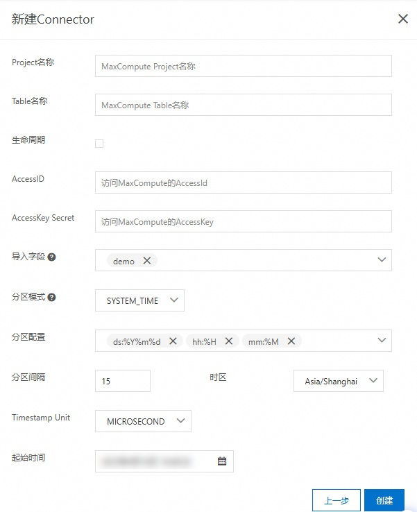

   关键配置项说明：

   - 导入字段：DataHub可以根据用户设置将部分column内容同步到MaxCompute表中。

   - 分区模式：分区模式决定了将数据写入到MaxCompute哪个分区中，目前DataHub支持以下分区方式：

     | 分区模式 | 分区依据 | 支持Topic类型 | 说明 |
     | --- | --- | --- | --- |
     | USER_DEFINE | Record中的分区列（和MaxCompute的分区字段同名）的value值 | TUPLE | • DataHub schema中必须包含MaxCompute分区字段。<br>• 该列值必须为<code> UTF8</code>字符串<code> </code> 字段值可以为空，表示不分区。 |
     | SYSTEM_TIME | Record写入DataHub的时间 | TUPLE / BLOB | • 分区配置中设置MaxCompute分区的时间转换Format格式。<br>• 设置时区信息。 |
     | EVENT_TIME | Record中的<code> event_time(TIMESTAMP) </code>列的value值 | TUPLE | • 分区配置中设置MaxCompute分区的时间转换Format格式。<br>• 设置时区信息。 |
     | META_TIME | Record的属性字段<code> __dh_meta_time__ </code>的value值 | TUPLE / BLOB | • 分区配置中设置MaxCompute分区的时间转换Format格式。<br>• 设置时区信息。 |

     其中 `SYSTEM_TIME` 、 `EVENT_TIME` 和 `META_TIME` 均是根据时间Timestamp和时区配置来进行MaxCompute分区的转换过程，单位默认为微秒。

     - 分区配置决定了根据时间戳转换MaxCompute分区时的相关配置。目前管控台默认固定的MaxCompute分区格式，分区配置对应为：

       | 分区 | 时间Format | 说明 |
       | --- | --- | --- |
       | ds | %Y%m%d | day |
       | hh | %H | hour |
       | mm | %M | minute |

     - 分区间隔决定了根据时间戳转换MaxCompute分区时所采用的时间间隔。时间范围是 `15`分钟 `~ 1440`分钟（`1`天） ，跳变间隔 `15`分钟 。

     - 时区信息（TimeZone）时区信息决定了根据时间戳转换MaxCompute分区时所采用的转换时区。

     - 分隔符BLOB数据同步时，可以指定16进制分隔符来决定是否对BLOB数据分割后再同步MaxCompute，比如  `0A` 表示 `\n` （换行符）。

     - Base64编码DataHub BLOB默认存储二进制数据，而MaxCompute对应的同步列为STRING类型，因此管控台创建同步任务时，默认采用base64编码后进行同步，更多定制化需求请参考SDK实现。

**查看同步任务**

单击对应Connector的详情页面，查看同步任务的运行状态和点位等信息， 包含同步点位、同步状态以及重启和停止等操作，如下图所示：

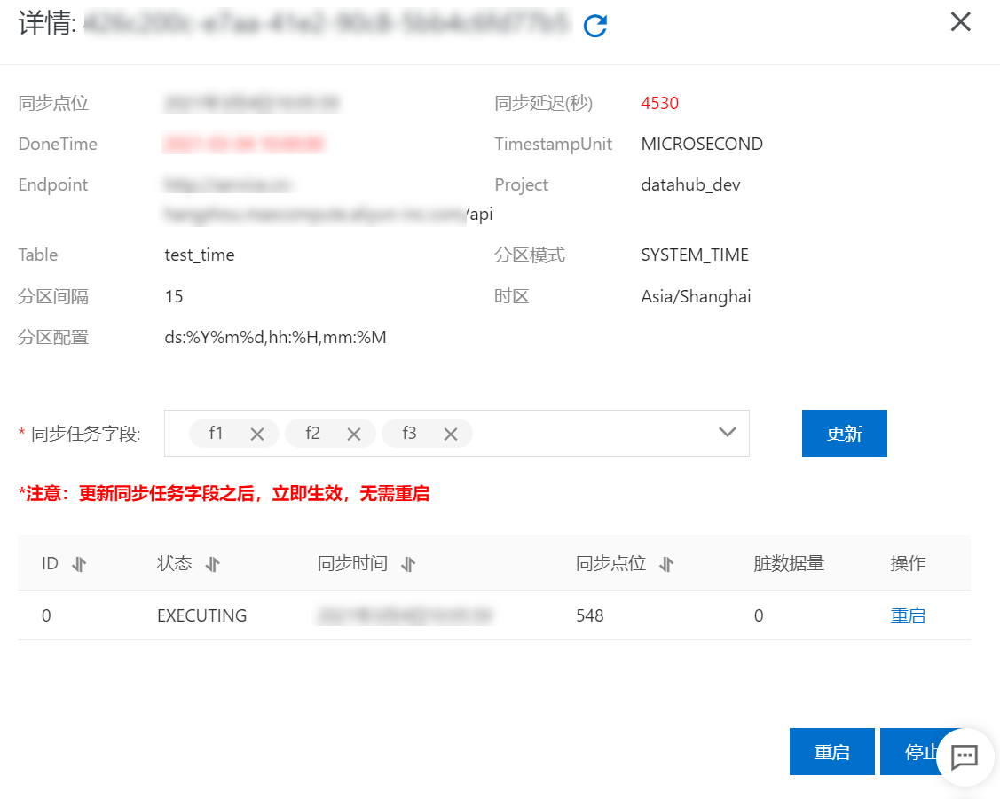

**同步示例**

**USER_DEFINE同步模式**

1. 新建DataHub Topic。

   Topic Schema中必须需要包含MaxCompute分区字段，类型为STRING，如下图所示：

   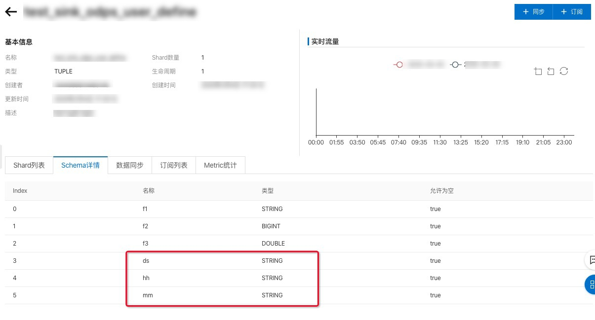

2. 向DataHub Topic写入数据，可以使用datahub-sdk进行数据写入。

   测试过程中使用SDK写入几条数据，其中[ds,hh,mm]分别为：[20210304,01,15]和[20210304,02,15]，数据内容如下所示：

   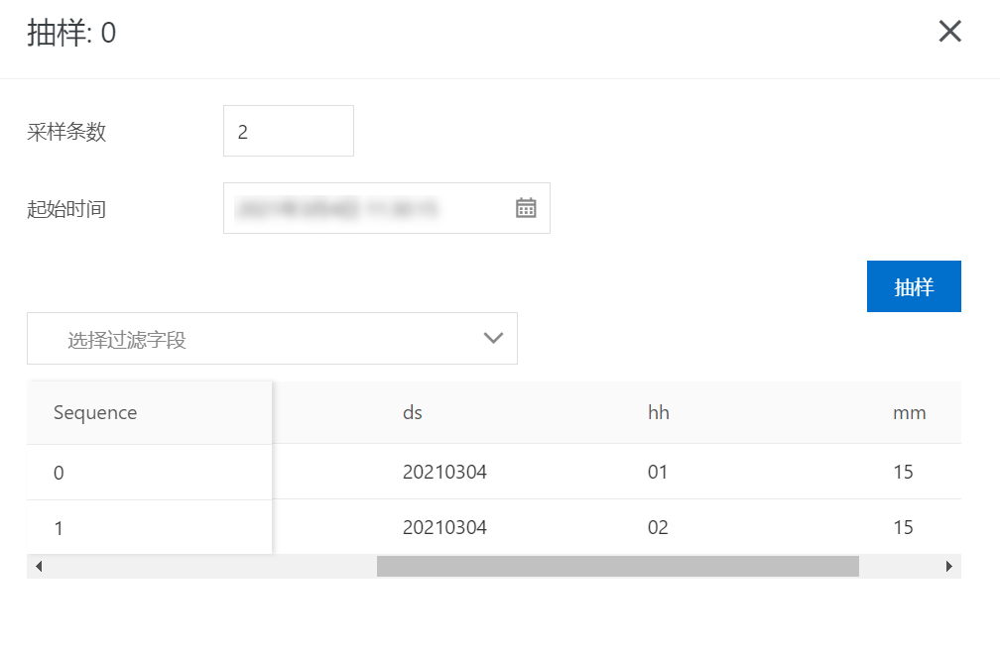

3. 建立同步任务。

   USER_DEFINE分区模式可以通过在同步中设置分区配置字段，如果MaxCompute没有对应的表，可自动创建。这里导入字段中设置导入f1、f2字段，不同步f3字段。

   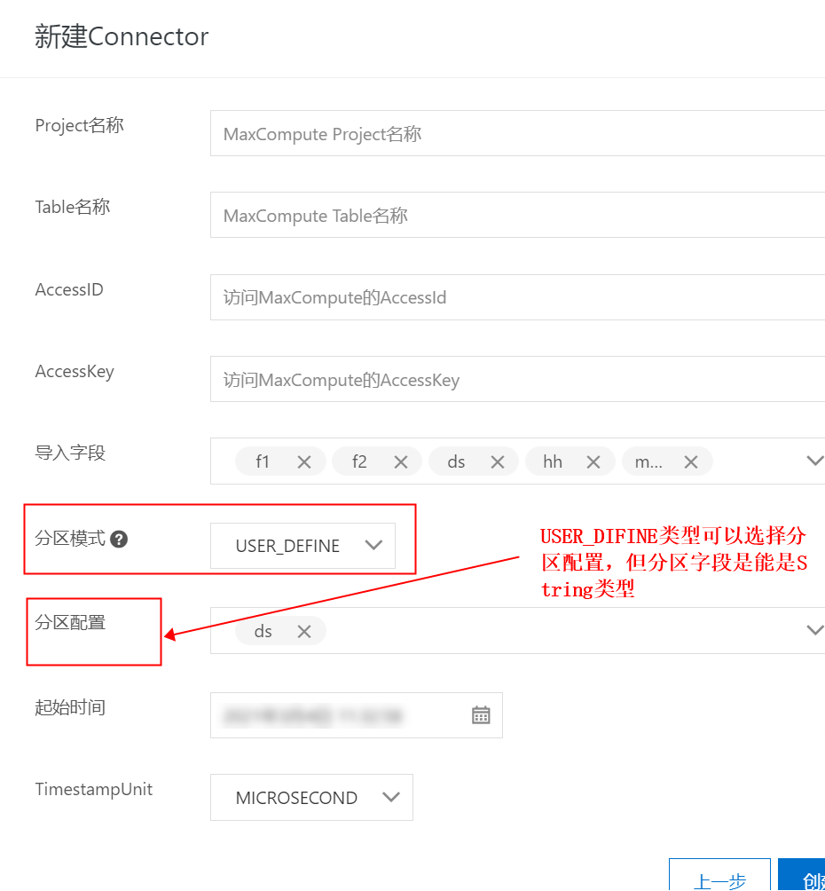

4. 确认同步数据。

   可以从DataHub控制台查看对应同步任务的同步信息。

   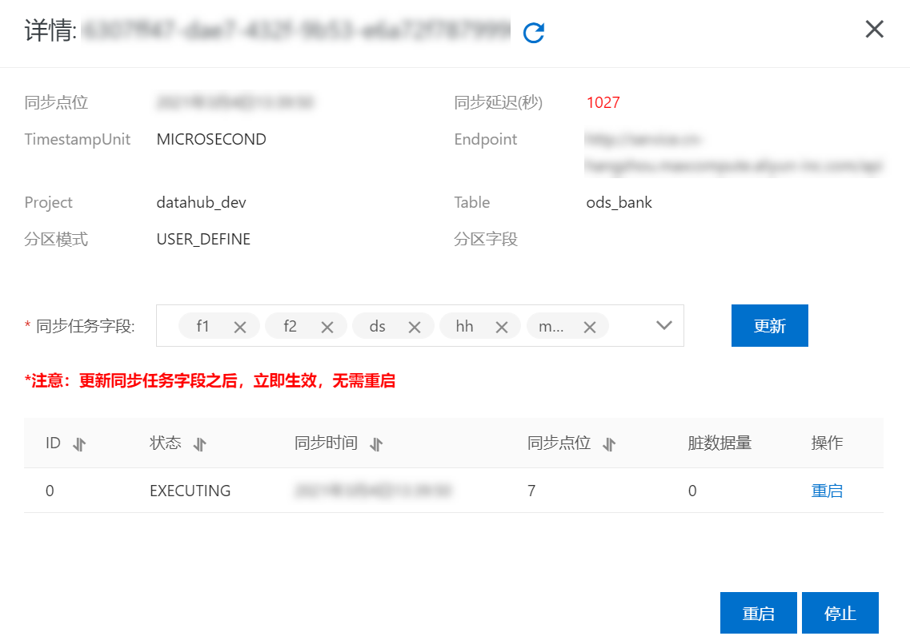

   查询MaxCompute数据结果，结果如下：

   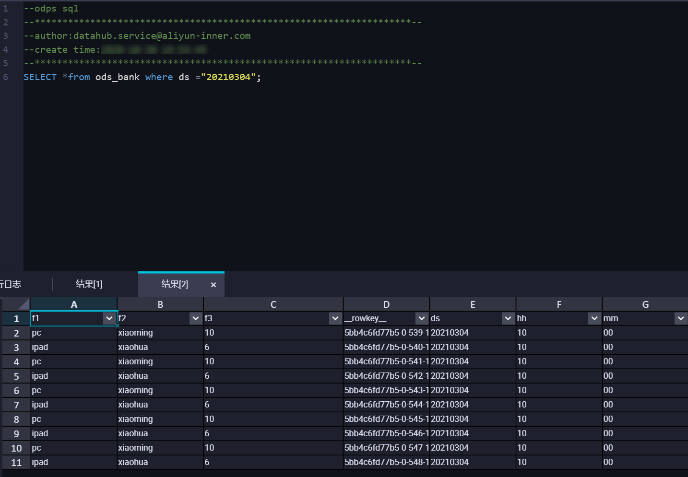

   可以看到在USER_DEFINE模式下，DataHub会根据 `MaxCompute`分组字段所对应的`value` 将DataHub中的数据同步到对应的分区中。

**SYSTEM_TIME同步模式**

1. 新建DataHub Topic。

   由于分区是根据**写入DataHub时间**来计算的，因此Topic Schema只需包含数据字段，不需要包含分区字段，如下图所示：

   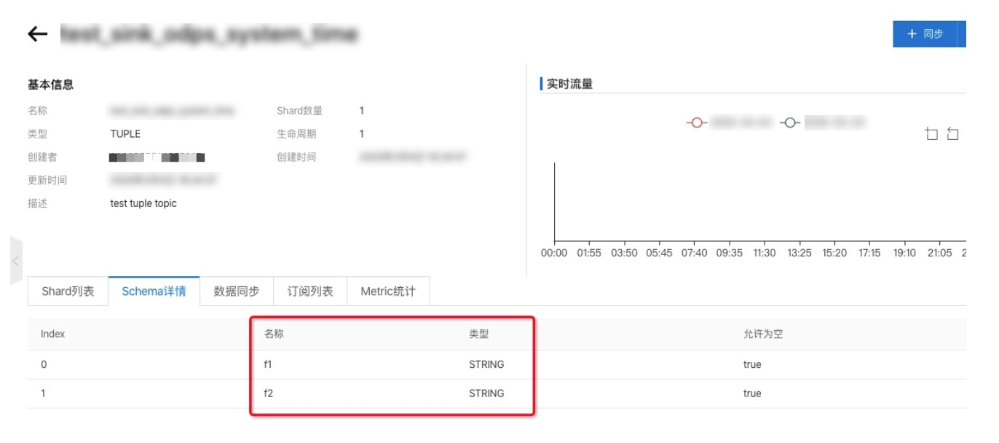

2. 向DataHub Topic写入数据，可以使用datahub-sdk进行数据写入。

   测试过程中使用SDK写入几条数据，DataHub目前对应的写入时间为 `2021-03-04 14:02:45` ，数据内容如下所示：

   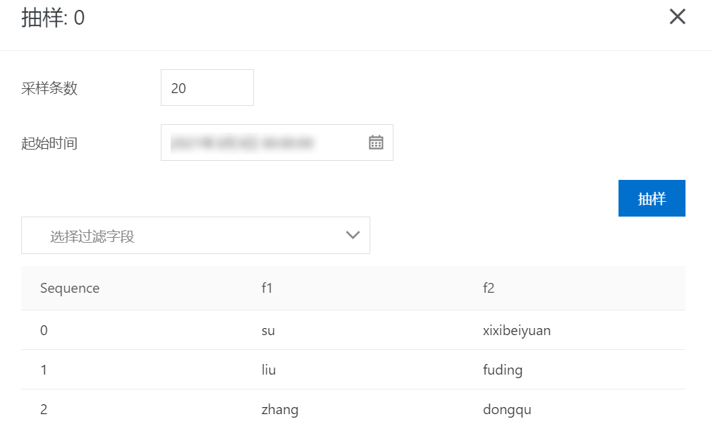

3. 建立同步任务。

   > **重要**
   >
   > 请注意分区配置需要和MaxCompute表分区一致。

   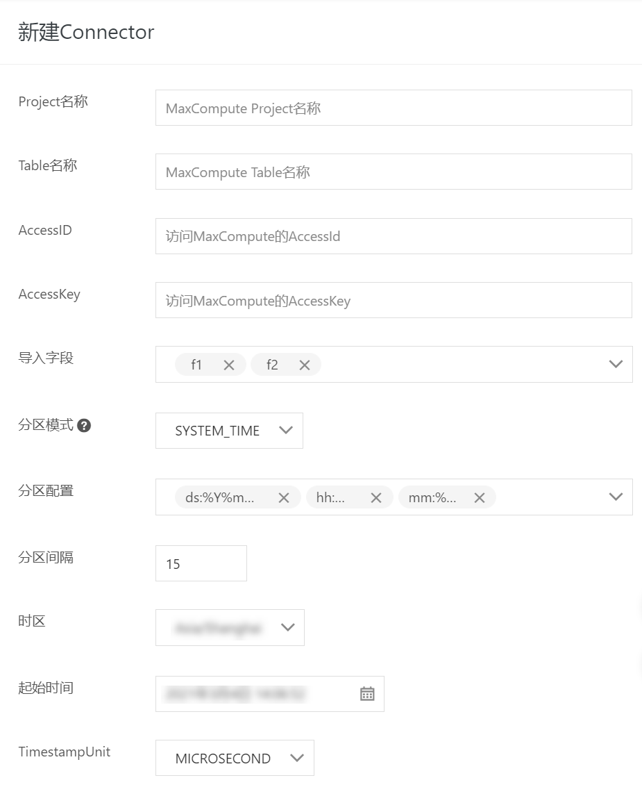

4. 确认同步数据。

   可以从DataHub控制台查看对应同步任务的同步信息，例如：DoneTime。

   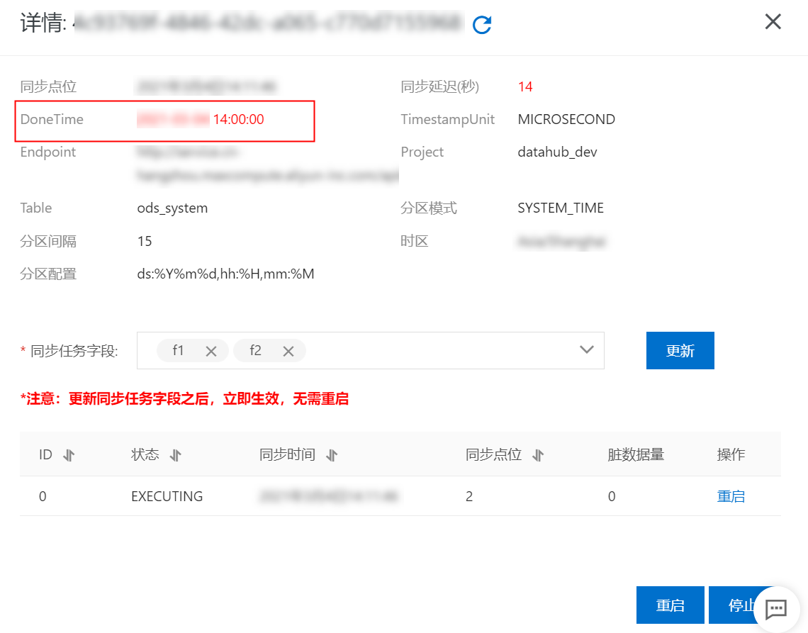

   查询MaxCompute数据结果，结果如下：

   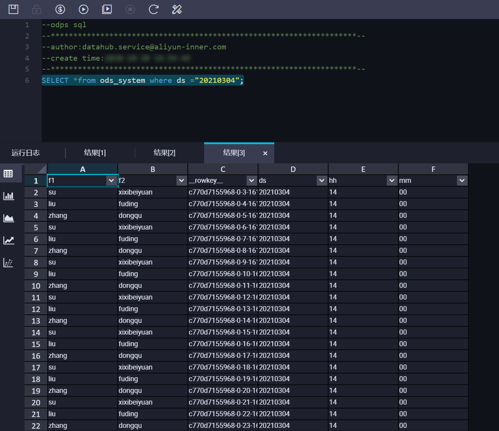

   可以看到在SYSTEM_TIME模式下，DataHub会根据 数据写入`DataHub`的时间 将DataHub中的数据同步到对应的分区中。

**常见问题**

问题现象：同步到MaxCompute timestamp字段时间变为1970-01-19。

原因：DataHub同步MaxCompute默认时间戳单位为微秒，用户写入时间戳为毫秒。

解决方案：写入DataHub时间戳以微秒方式写入。

<a id="section-7-3"></a>

## 7.3. 创建同步任务至Hologres

本文为您介绍如何在DataHub中创建同步任务至Hologres的Connector，主要包括创建时的准备工作、操作步骤以及常见问题。

**准备工作**

**准备Hologres实例和表结构：使用Hologres管控台新建Hologres实例和数据表。**

DataHub同步Hologres时会根据DataHub Field的数据类型同步到对应的Hologres表数据类型中，对应的类型映射关系如下所示：

| DataHub | Hologres |
| --- | --- |
| TINYINT | SMALLINT |
| SMALLINT | SMALLINT |
| INTERGER | INTERGER |
| BIGINT | BIGINT |
| FLOAT | REAL |
| DOUBLE | DOUBLE PRECISION |
| DECIMAL | DECIMAL |
| STRING | TEXT |
| BOOLEAN | BOOLEAN |
| TIMESTAMP | TIMESTAMPTZ |

> **说明**
>
> Hologres V2.0版本起支持 `DataHub TINYINT` 、 `SMALLINT` 、 `INTEGER` 和 `FLOAT` 四种新数据类型。

**创建同步任务**

1. 登录数据总线 DataHub控制台。

2. 在左侧导航栏，单击**项目管理**。

3. 在**项目列表**页面，单击目标项目名称，进入项目详情页面。

4. 在**Topic列表**页签下，单击目标Topic名称，进入Topic详情页面。

5. 在Topic详情页面，单击右上角的  。

6. 在**新建Connector**面板中，单击**Hologres**，配置新建Connector的参数，单击**创建**。

   > **说明**
   >
   > 同步Hologres支持分区表，在Hologres创建分区表后，同步Hologres任务会自动根据分区字段进行数据同步。

   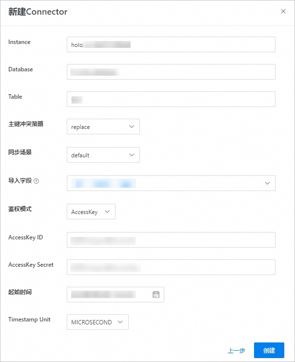

   <table>
     <tr>
       <th width="185">参数</th>
       <th>说明</th>
     </tr>
     <tr>
       <td>Instance</td>
       <td>Hologres实例的ID。您可以进入Hologres管理控制台，在左侧导航栏单击<strong>实例列表</strong>，查看目标<strong>实例ID</strong>。</td>
     </tr>
     <tr>
       <td>DataBase</td>
       <td>Hologres的数据库名称。</td>
     </tr>
     <tr>
       <td>Table</td>
       <td>Hologres用于接收数据的表名称。</td>
     </tr>
     <tr>
       <td>主键冲突策略</td>
       <td>当Hologres表设置主键时，从DataHub写入的数据的冲突策略。取值说明如下：<br>• <strong>replace</strong>：当写入发生主键冲突时，新的数据覆盖老数据。<br>• <strong>ignore</strong>：写入时发生主键冲突，忽略新数据，即数据不更新，仍然使用老数据。</td>
     </tr>
     <tr>
       <td>同步场景</td>
       <td>DataHub同步到Hologres的同步模式。取值说明如下：<br>• <strong>default</strong>：将DataHub数据逐条写入Hologres。<br>• <strong>dts_old</strong>：不启用新的附加列规则。<br>• <strong>dts</strong>：启动新的附件列规则。</td>
     </tr>
     <tr>
       <td>导入字段</td>
       <td>需要导入Hologres的字段。可以根据实际业务需求选择导入部分或全部字段。</td>
     </tr>
     <tr>
       <td>鉴权模式</td>
       <td>默认为AccessKey。</td>
     </tr>
     <tr>
       <td>AccessKey ID</td>
       <td>访问Hologres实例的AccessKey ID。您可以在<strong>管理AccessKey</strong>下，获取用户的AccessKey ID。</td>
     </tr>
     <tr>
       <td>AccessKey Secret</td>
       <td>访问Hologres实例的AccessKey Secret。您可以在<strong>管理AccessKey</strong>下，获取用户的AccessKey Secret。</td>
     </tr>
     <tr>
       <td>起始时间</td>
       <td>同步Hologres的最早数据同步时间。</td>
     </tr>
     <tr>
       <td>TimestampUnit</td>
       <td>同步Hologres的时间单位。将数据中TIMESTAMP类型的数据（如果有），以TimestampUnit为单位进行转换后写入到下游系统的日期类型。</td>
     </tr>
   </table>

   > **说明**
   >
   > - 同步场景中的（ `dts` / `dts_old` ）同步模式适用于数据由DTS写入到DataHub，然后再从DataHub同步到Hologres的场景。
   >
   > - 新旧附加列说明请参考Hologres文档 从DataHub导入。

7. 单击**同步任务**页签，查看同步DataHub的数据至Hologres的状态。

   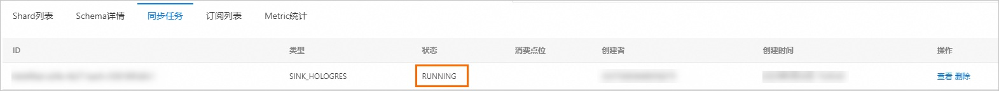

8. 查看Hologres上实时同步的数据。

   您可以连接Hologres实例至开发工具，实时查询同步至Hologres中的数据，详情请参见连接Hologres，示例查询语句如下。

   ```sql
   SELECT COUNT(*) FROM lineitem;
   ```

**常见问题**

**创建同步报错：**

```text
 ErrorCode=NoPermission; ErrorMessage=Rejected by IP whitelist
```

**解决方法**：Hologres支持在HoloWeb中设置IP白名单来进行访问管理。如遇此报错，请检查是否在HoloWeb中设置了IP白名单。

<a id="section-7-4"></a>

## 7.4. 创建同步任务至ADS

本文为您介绍如何在DataHub中创建同步任务至ADS的Connector，主要包括在创建时的准备工作、操作步骤以及同步示例。

**准备工作**

准备ADS实例和表结构：使用ADS管控台新建ADS集群。

DataHub同步时会根据DataHub Field的数据类型同步到对应的ADS数据类型中，对应的类型映射关系如下所示：

| DataHub | MySQL |
| --- | --- |
| TINYINT | TINYINT |
| SMALLINT | SMALLINT |
| INTEGER | INT |
| BIGINT | BIGINT |
| STRING | VARCHAR |
| BOOLEAN | BOOLEAN / TINYINT |
| FLOAT | FLOAT |
| DOUBLE | DOUBLE |
| TIMESTAMP | TIMESTAMP / BIGINT |
| DECIMAL | DECIMAL |

DataHub中的TINYINT、SMALLINT、INTEGER、FLOAT类型从java sdk 2.16.1-public开始支持。

**注意事项**

- 目前DataHub仅支持将TUPLE数据同步到ADS服务中。

- ReplaceInto与IgnoreInto： ReplaceInto模式下，会使用replace into语句将数据插入，反之，IgnoreInto会使用insert方式插入数据库（replace into将根据主键覆盖记录，ignore into将忽略冲突进行写入）。

- 数据同步的时效性正常情况为秒级，即数据写入DataHub中后若干秒内将会同步到ADS，网络异常的情况可能造成重复数据Update，但是保证数据At least once语义。

- ADS的写入性能直接影响同步的性能，如果ADS实例性能过低，可能导致DataHub同步较慢，数据堆积，严重情况可能因为同步延迟超过生命周期从而丢失数据。

**创建同步任务**

1. 登录数据总线 DataHub控制台。

2. 在左侧导航栏，单击**项目管理**。

3. 在**项目列表**页面，单击目标项目名称，进入项目详情页面。

4. 在**Topic列表**页签下，单击目标Topic名称，进入Topic详情页面。

5. 在Topic详情页面，单击右上角的**同步**。

6. 在**新建Connector**面板中，单击**ADS**，配置新建Connector的参数，单击**创建**。

   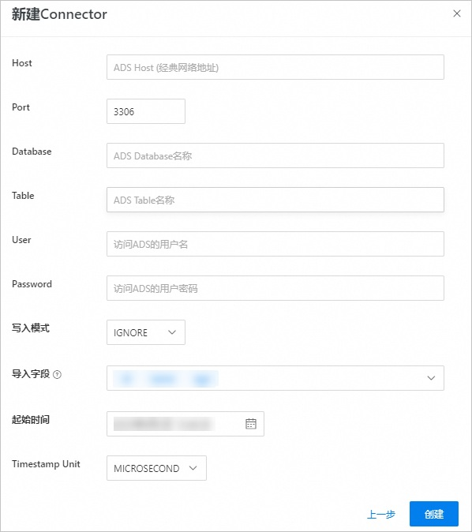

   下面罗列了管控台创建同步任务的关键配置说明，更多更灵活的操作请参考SDK使用。

   - HostADS服务地址：请务必填写 内网地址 以确保服务联通性。

   - 导入字段：DataHub可以根据用户设置将部分column内容同步到ADS中。

   - 写入模式：包括IGNORE和OVERWRITE两种模式，具体说明如下：

     - IGNORE：忽略重复数据，即 `INSERT IGNORE INTO` 写入。

     - OVERWRITE：更新重复数据，即 `REPLACE INTO` 写入。

**同步示例**

1. 在ADS管控台中创建ADS实例和数据表。

2. 建立DataHub Topic。

   在DataHub中新建Topic，示例中为TUPLE类型Topic，Schema如下图所示：

   

3. 建立同步任务这里写入模式选择IGNORE，导入所有字段。

   

   。

4. 向DataHub中写入TUPLE数据，数据内容如下图所示，共4条数据。

   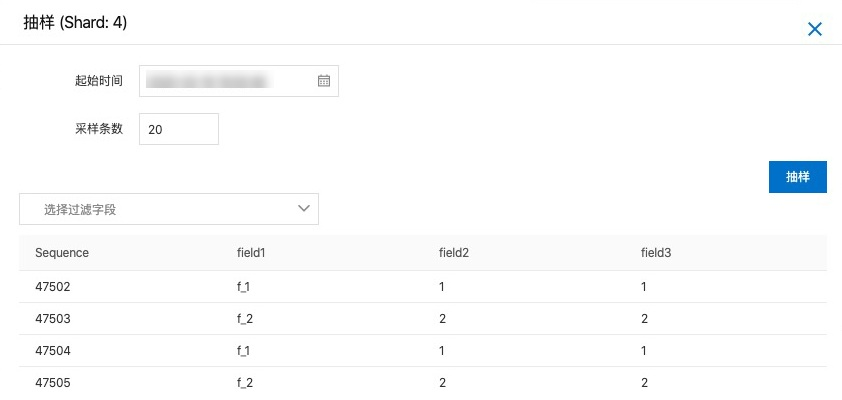

5. 确认同步数据客户端连接ADS服务查看数据，数据结果如下图所示：

   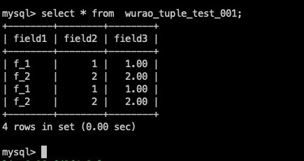

<a id="section-7-5"></a>

## 7.5. 创建同步任务至ElasticSearch

本文为您介绍如何在DataHub中创建同步任务至ElasticSearch的Connector，主要包括在创建时的准备工作、操作步骤以及同步示例。

**准备工作**

1. 创建Elasticsearch Index。

   DataHub支持将数据同步到Elasticsearch对应的index中，目前支持ES5、ES6和ES7的实例。

   目前DataHub仅支持将TUPLE类型Topic的数据同步到Elasticsearch中。开始同步任务之前请保证已经在ES中创建index或者允许自动创建index，否则同步任务会失败。

2. 准备同步任务账号并授权。

   新建同步Elasticsearch任务时，需要用户手动填写Elasticsearch的endpoint、index和账号密码等信息。请确保所填入信息账号信息真实有效，否则会导致创建同步任务失败。

**创建同步任务**

1. 登录数据总线 DataHub控制台。

2. 在左侧导航栏，单击**项目管理**。

3. 在**项目列表**页面，单击目标项目名称，进入项目详情页面。

4. 在**Topic列表**页签下，单击目标Topic名称，进入Topic详情页面。

5. 在Topic详情页面，单击右上角的**同步**。

6. 在**新建Connector**面板中，单击**Elasticsearch**，配置新建Connector的参数，单击**创建**。

   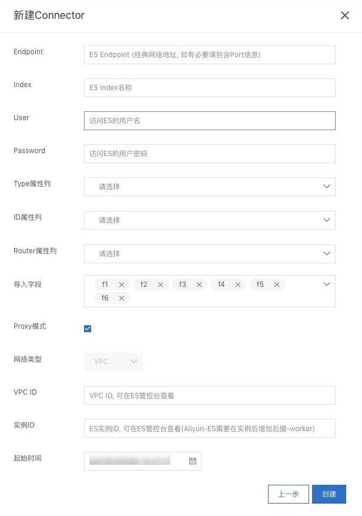

   配置参数说明如下：

   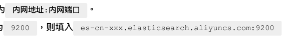

   - <strong>Endpoint：</strong>ElasticSearch服务地址,需要填写内网地址和和内网端口，格式为 内网地址`:`内网端口 。

     例如：内网地址为  `es-cn-xxx.elasticsearch.aliyuncs.com` ，内网端口为 `9200` ，则填入 `es-cn-xxx.elasticsearch.aliyuncs.com:9200` 。

   - <strong>Index：</strong>目前支持两种index的指定方式：静态index和动态index。

     - 静态index：用户预先创建好一个index或者允许自动创建index，所有的数据都会写入该index。

     - 动态index：用户需要允许自动创建index，否则会写入失败。用户可以指定一个时间周期或者指定某列作为index的生成方式。如果采用数据列生成index，那么最多可以选择1列。

       支持配置的时间格式：

       | 年 | 月 | 日 | 周 |
       | --- | --- | --- | --- |
       | %Y | %m | %d | %U |

       示例一：每天凌晨生成一个新的index

       配置index为 `test_${%Y-%m-%d}` ，如果当前日期为2021年3月31日，那么最终写入的index为 `test_2021-03-31` 。

       示例二：根据数据列生成新的index

       数据列中包含有一列 `col1` ，配置index为 `test_${col1}` ，如果有两条数据，这两条数据的col1分别为 `AAA` 和 `BBB` ，那么这两条数据写入的index分别为 `test_AAA` 和 `test_BBB` 。

       > **重要**
       >
       > 当ES中的index数量增多时，写入数据会变慢，过多可能会导致DataHub写入超时，因此用户使用动态index时，需要尽量避免生成的index数量过多

   - <strong>User/Password：</strong>访问ES的用户名密码。

   - <strong>Type属性列：</strong>针对不同版本，DataHub同步ES的生成的Type也不一样。在ES5中，用户可以在一个index中创建多个type，但是ES6中，用户只能在一个index中创建一个type，因此，DataHub同步ES的行为也有所改变。Type不可以为空。

     - 对于ES5，DataHub同步数据时，将会以用户选择作为Type的列的值作为一条数据的type，如果选择多列，则多列的值会以 “|” 分割作为一条数据的type。选择作为Type属性列的字段不能为null。

     - 对于ES6，DataHub同步数据时，将会以用户选择的列的列名作为一条数据的type，如果选择多列，则多列的列名会以“|”分割作为一条数据的type，并且ES6支持以任意名称作为type。

     例如：

     ```text
     DataHub Schema : f1 string, f2 string, f3 string, f4 string
     数据 : ["test1","test2","test3",null]
     ```

     | type属性列 | ES5 type | ES6 type |
     | --- | --- | --- |
     | f1 | test1 | f1 |
     | f1,f3 | test1 | test3 |
     | ff | 创建失败 | ff |
     | f1,ff | 创建失败 | f1\|ff |
     | f4 | 创建成功，但同步失败，脏数据 | 创建成功，并成功同步 |

     > **重要**
     >
     > - 目前在页面上创建同步ES6任务时无法自定义type名称，如果想要自定义用户可以使用SDK来创建。
     >
     > - ES7中所有的type均采用默认type，所以 ES7不需要选择type属性列。

   - <strong>ID属性列：</strong>用户可以根据写入DataHub的数据来生成写入ES的数据id，也可以不选择任何列，由ES将会为每条数据生成一个唯一的id。DataHub同步ES时，将会以用户选择的列的值作为一条数据的id，如果选择多列，则多列的值会以 “|” 分割作为一条数据的id。选择作为ID属性列的字段不能为null。

     例如：

     ```text
     DataHub Schema : f1 string, f2 string, f3 string, f4 string
     数据 : ["test1","test2","test3",null]
     ```

     | ID属性列 | 数据id |
     | --- | --- |
     |  | ES自动生成唯一ID |
     | f1 | test1 |
     | f1,f3 | test1\|test3 |
     | ff | 创建失败 |
     | f4 | 创建成功，但是同步失败，脏数据 |

   - <strong>Router属性列：</strong>用户可以根据写入DataHub的数据来生成写入ES的router，也可以不选择任何列，不选择时将不使用ES的Router功能。DataHub同步ES时，将会以用户选择的列的值作为一条数据的router，如果选择多列，则多列的值会以 “|” 分割作为一条数据的id。选择作为Router属性列的字段不能为null。示例可参考 `ID`属性列 。

   - <strong>导入字段：</strong>DataHub需要导入到ES的字段，对于未选择的字段，DataHub不会同步到ES中。对于作为ID的字段和ES5中作为Type的字段，不会再放到数据中。因为导入字段并不能完全决定最后生成的数据，因此不再给出示例，下文会给出完整的数据同步示例。

   - <strong>Proxy模式：</strong>按需勾选即可。

   - <strong>网络类型：</strong>需要根据ES实例的类型选择。

     > **重要**
     >
     > 填入实例ID时需要注意加上 `-worker` ，例如实例ID为 `es-cn-xxx` ，则实例ID填写 `es-cn-xxx-worker` 。

**写入数据示例**

这里的示例是指创建同步ES任务成功之后，如果创建同步ES任务失败，则参考上述的配置进行修改。

**DataHub Schema为：**

| 字段名称 | 字段类型 |
| --- | --- |
| f1 | BIGINT |
| f2 | STRING |
| f3 | BOOLEAN |
| f4 | DOUBLE |
| f5 | TIMESTAMP |
| f6 | DECIMAL |

**示例1：**

- Type属性列 = f1（ES7无Type属性列）

- ID属性列 = f2

- 导入字段 = f1,f2,f3,f4,f5,f6

**数据 = v1,v2,v3,v4,v5,v6**

| ES版本 | type | id | data |
| --- | --- | --- | --- |
| ES5 | v1 | v2 | <code>{f3:v3,f4:v4,f5:v5,f6:v6}</code> |
| ES6 | f1 | v2 | <code>{f1:v1,f3:v3,f4:v4,f5:v5,f6:v6}</code> |
| ES7 | - | v2 | <code>{f1:v1,f3:v3,f4:v4,f5:v5,f6:v6}</code> |


**数据 = null,v2,v3,v4,v5,v6**

| ES版本 | type | id | data |
| --- | --- | --- | --- |
| ES5 | - | - | type属性列为null，脏数据 |
| ES6 | f1 | v2 | <code>{f1:v1,f3:v3,f4:v4,f5:v5,f6:v6}</code> |
| ES7 | - | v2 | <code>{f1:v1,f3:v3,f4:v4,f5:v5,f6:v6}</code> |


**数据 = v1,null,v3,v4,v5,v6**

| ES版本 | type | id | data |
| --- | --- | --- | --- |
| ES5 | - | - | id属性列为null，脏数据 |
| ES6 | - | - | id属性列为null，脏数据 |
| ES7 | - | - | id属性列为null，脏数据 |

**示例2：**

- Type属性列 = f1,f2（ES7无Type属性列）

- ID属性列 = f3,f4

- 导入字段 = f1,f2,f3,f4,f5,f6

**数据 = v1,v2,v3,v4,v5,v6**

| ES版本 | type | id | data |
| --- | --- | --- | --- |
| ES5 | v1\|v2 | v3\|v4 | <code>{f5:v5,f6,v6}</code> |
| ES6 | f1\|f2 | v3\|v4 | {f1:v1,f2:v2,f5:v5,f6:v6} |
| ES7 | - | v3\|v4 | {f1:v1,f2:v2,f5:v5,f6:v6} |

**数据 = v1,null,v3,v4,v5,v6**

| ES版本 | type | id | data |
| --- | --- | --- | --- |
| ES5 | - | - | type属性列为null，脏数据 |
| ES6 | f1\|f2 | v3\|v4 | {f1:v1,f2:v2,f5:v5,f6:v6} |
| ES7 | - | v3\|v4 | {f1:v1,f2:v2,f5:v5,f6:v6} |

**数据 = v1,v2,null,v4,v5,v6**

| ES版本 | type | id | data |
| --- | --- | --- | --- |
| ES5 | - | - | id属性列为null，脏数据 |
| ES6 | - | - | id属性列为null，脏数据 |
| ES7 | - | - | id属性列为null，脏数据 |

**示例3：**

- Type属性列 = f1（ES7无Type属性列）

- ID属性列 = f2

- Router属性列 = f3

- 导入字段 = f1,f2,f3,f4,f5,f6

**数据 = v1,v2,v3,v4,v5,v6**

| ES版本 | type | id | router | data |
| --- | --- | --- | --- | --- |
| ES5 | v1 | v2 | v3 | <code>{f4:v4,f5:v5,f6:v6}</code> |
| ES6 | f1 | v2 | v3 | <code>{f1:v1,f4:v4,f5:v5,f6:v6}</code> |
| ES7 | - | v2 | v3 | <code>{f1:v1,f4:v4,f5:v5,f6:v6}</code> |

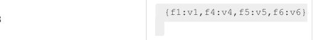

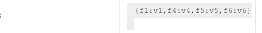

**数据 = null,v2,v3,v4,v5,v6**

| ES版本 | type | id | data |
| --- | --- | --- | --- |
| ES5 | - | - | type属性列为null，脏数据 |
| ES6 | f1 | v2 | <code>{f1:v1,f4:v4,f5:v5,f6:v6}</code> |
| ES7 | - | v2 | <code>{f1:v1,f4:v4,f5:v5,f6:v6}</code> |

**数据 = v1,null,v3,v4,v5,v6**

| ES版本 | type | id | data |
| --- | --- | --- | --- |
| ES5 | - | - | id属性列为null，脏数据 |
| ES6 | - | - | id属性列为null，脏数据 |
| ES7 | - | - | id属性列为null，脏数据 |

**数据 = v1,v2,null,v4,v5,v6**

| ES版本 | type | id | data |
| --- | --- | --- | --- |
| ES5 | - | - | router属性列为null，脏数据 |
| ES6 | - | - | router属性列为null，脏数据 |
| ES7 | - | - | router属性列为null，脏数据 |

**查看同步任务**

单击对应Connector的详情页面，可以查看同步任务的运行状态和点位等信息，包含同步点位、同步状态以及重启和停止等操作，如下图所示：

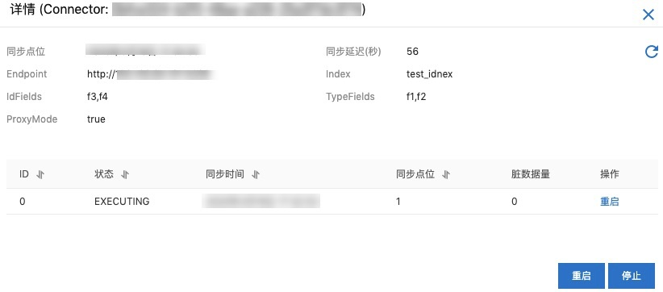

如果需要进行**重置**操作，请先停止该任务。

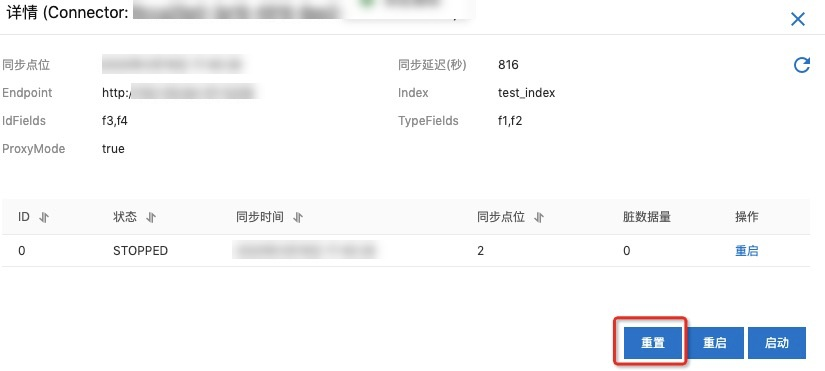

**同步示例**

本示例以阿里云ES 6.7为例，展示DataHub同步到ES的完整操作。其中ES相关的操作均使用**Kibana Dev Tools**执行，其他操作方法请参考ES官方文档。

1. 创建ES index。

   一般情况下，ES默认可以自动创建index，因此可以忽略这一步。如果设置了不允许自动创建，那需要手动创建一下index，具体创建命令可参考ES官方文档。

2. 建立DataHub Topic。

   > **重要**
   >
   > 目前仅支持Tuple类型的Topic建立同步ES任务。

   创建DataHub的操作，请参考创建Topic。创建完成之后，查看创建的Topic。

   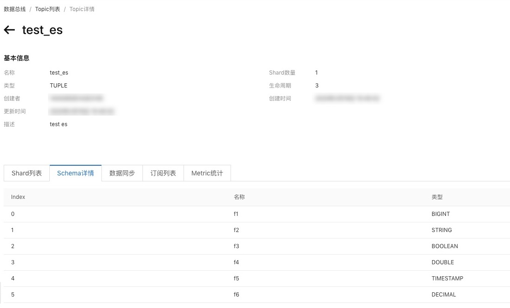

3. 建立同步ES任务。

   该示例中创建同步ES任务时，将f1和f2作为Type属性列，将f3和f4作为ID属性列，并将所有字段作为导入字段。

   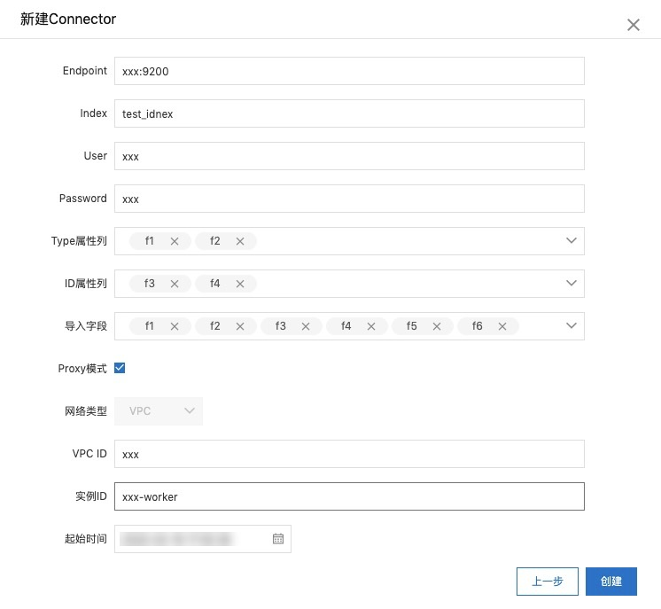

4. 向DataHub Topic写入数据。

   可以使用DataHub-SDK或者DataHub插件进行数据写入。写入一条数据之后，在页面上进行抽样，查看一下写入的数据。

   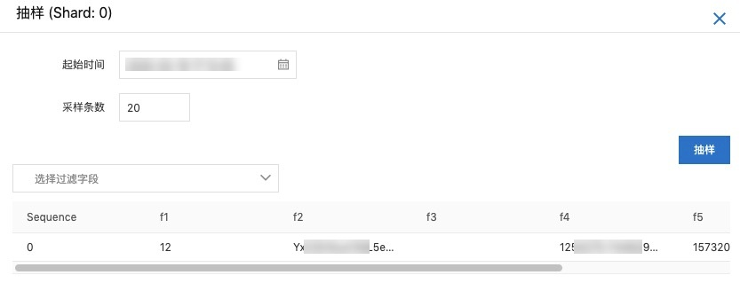

5. 确认同步数据。

   首先查看一下ES同步任务的点位。

   这里可以看到同步任务的点位和同步时间发生了变化，同步时间就是刚刚数据写入DataHub的时间，同步点位变成了1（点位从0开始计算，点位为0表示第一条数据已经写入）。

   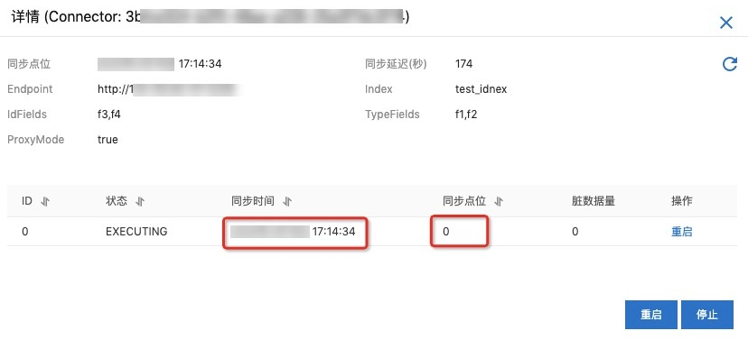

   在ES上，通过Kibana查看数据的同步情况，可以看到数据已经同步成功。

   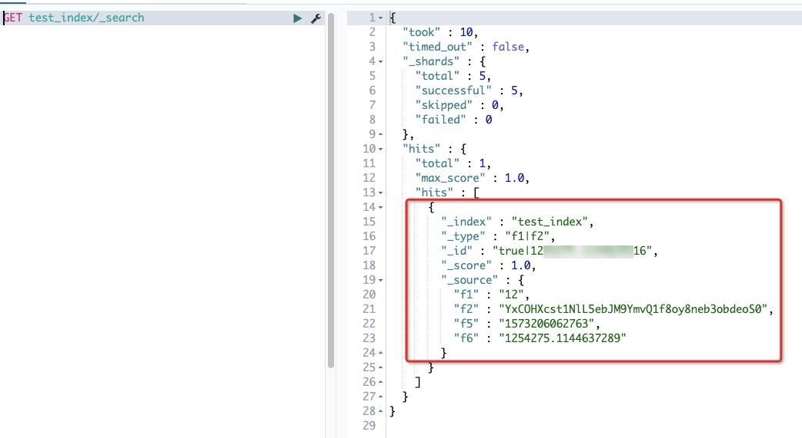

<a id="section-7-6"></a>

## 7.6. 创建同步任务至OSS

本文为您介绍如何在DataHub中创建同步任务至OSS的Connector，主要包括在创建时的准备工作、注意事项、操作步骤和同步示例。

**准备工作**

- 准备OSS Bucket。

  DataHub支持将数据同步到对象存储OSS中，在创建同步任务前，用户首先需要在OSS管控台创建OSS Bucket，作为DataHub数据同步的目标Bucket。

- 服务关联角色授权。

  用户配置同步任务时，账号可以选择使用 `AccessId/AccessKey` 静态云账号或者 `STS` 临时账号的方式进行数据同步。当选择STS临时账号方式时，将会自动创建DataHub服务关联角色，DataHub服务会使用此角色访问OSS以完成数据同步。

**注意事项**

- 目前DataHub支持将TUPLE和BLOB数据同步到OSS中。

  - TUPLE：采用csv数据格式，每个Record中的column数据以逗号分隔，Record之间采用 换行符`'\N'` 分隔。

  - BLOB：采用Append方式进行数据追加，如果用户需要拆分OSS数据，用户需要自己往DataHub中写入数据分隔符。

- 文件名称格式：同步到OSS中的文件名称采用 `ConnectorId` 等有含义信息拼接而成，暂时不支持用户修改。

- 二级目录：DataHub同步会根据数据写入DataHub的时间来生成二级目录。

**创建同步任务**

1. 登录数据总线 DataHub控制台。

2. 在左侧导航栏，单击**项目管理**。

3. 在**项目列表**页面，单击目标项目名称，进入项目详情页面。

4. 在**Topic列表**页签下，单击目标Topic名称，进入Topic详情页面。

5. 在Topic详情页面，单击右上角的  。

6. 在**新建Connector**面板中，单击**对象存储**，配置新建Connector的参数，单击**创建**。

   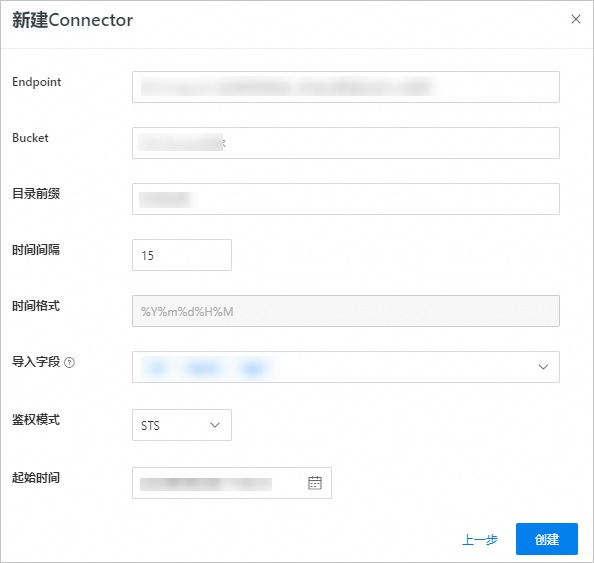

   <table>
     <tr>
       <th width="107">参数</th>
       <th>说明</th>
     </tr>
     <tr>
       <td>Endpoint</td>
       <td>OSS Endpoint服务地址，请使用经典网络域名，内部网络仅支持http，暂不支持HTTPS。如有必要请包含Port信息。</td>
     </tr>
     <tr>
       <td>Bucket</td>
       <td>OSS Bucket的名称。</td>
     </tr>
     <tr>
       <td>目录前缀</td>
       <td>数据同步到OSS Bucket下的目录名称。</td>
     </tr>
     <tr>
       <td>时间间隔</td>
       <td>表示二级目录的数据时间范围，取值范围为15min ~ 1440min(1day)，默认设置为15min。</td>
     </tr>
     <tr>
       <td>时间格式</td>
       <td>默认格式为<code> %Y%m%d%H%M </code>。</td>
     </tr>
     <tr>
       <td>导入字段</td>
       <td>DataHub可以根据用户设置将部分column内容同步到OSS文件中，可导入字段根据最新的Schema生成。</td>
     </tr>
     <tr>
       <td>鉴权模式</td>
       <td>支持以下两种模式，默认为STS。<br>• AccessKey<br>• STS当选择模式为AccessKey时，还需要填写用户的AccessKey ID和AccessKey Secret。</td>
     </tr>
     <tr>
       <td>起始时间</td>
       <td>同步Hologres的最早数据同步时间。</td>
     </tr>
   </table>

**同步示例**

1. 在OSS管控台中，创建同步的OSS Bucket。

   详细操作请参见《**对象存储 用户指南**》中**创建存储空间**章节的内容。示例图如下：

   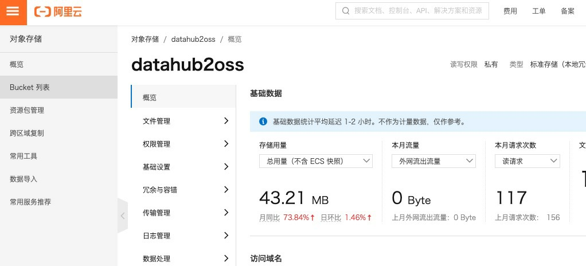

2. 创建DataHub Topic。

   在DataHub中创建Topic，示例中为创建TUPLE类型的Topic，Schema示例图如下：

   

3. 建立同步任务。

   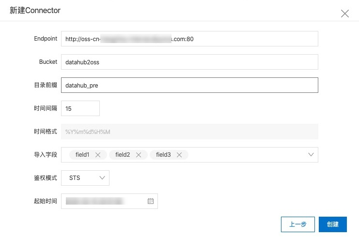

4. 向DataHub中写入TUPLE数据，数据内容如下图所示。

   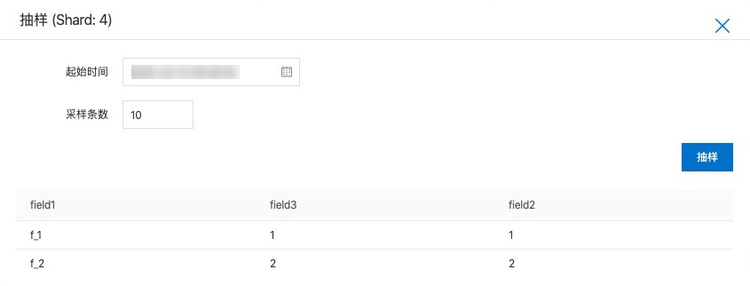

5. 确认同步数据。

   同步文件在OSS中的命名格式如下图所示：包含Bucket、目录前缀、二级目录以及文件名等。

   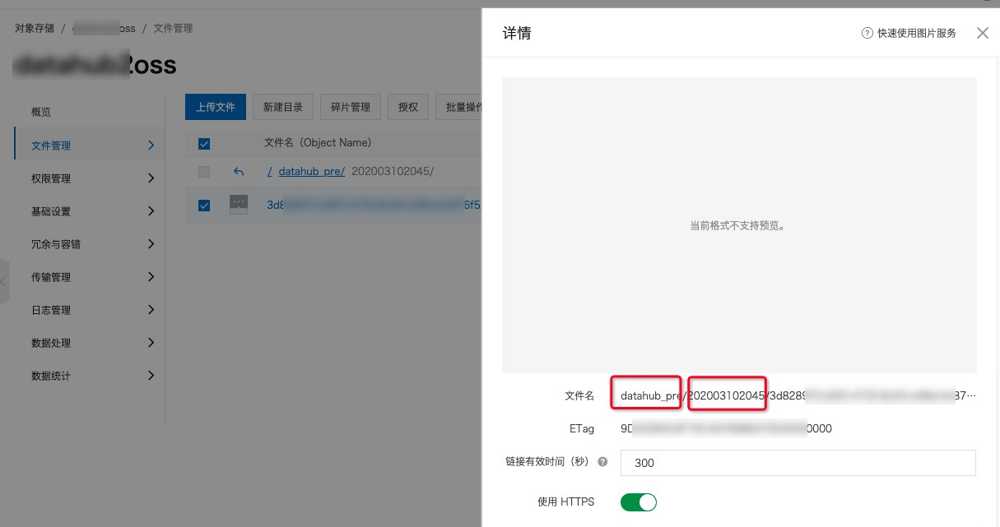

   下载该文件，并查看文件内容，TUPLE同步文件内容为csv数据格式，如下图所示：

   

<a id="section-7-7"></a>

## 7.7. 创建同步任务至TableStore

本文为您介绍如何在DataHub中创建同步任务至TableStore的Connector，主要包括在创建时的准备工作、注意事项和操作步骤。

**准备工作**

- 获取TableStore相关信息，包括TableStore服务的Endpoint、TableStore实例及其对应的Table名称。

- 获取DataHub Topic的Owner/Creator账号，该账号才有相应的权限操作DataConnector，包括创建、删除等操作。

**注意事项**

- TableStore表的主键列必须在对应的DataHub Topic下存在同名的字段（定义顺序可以不一致）。由于DataHub大小写不敏感，TableStore的主键名如果存在大写字母，对应DataHub Topic中全小写字段。

- 同步TableStore表的DataConnector任务仅支持TUPLE类型Topic。

- TableStore服务端自身的限制最大每次批量写入的行数为200。

- 数据类型映射关系：

  | OTS | DataHub |
  | --- | --- |
  | INTEGER | TINYINT |
  | INTEGER | SMALLINT |
  | INTEGER | INTEGER |
  | INTEGER | BIGINT |
  | INTEGER | TIMESTAMP |
  | DOUBLE | FLOAT |
  | DOUBLE | DOUBLE |
  | BOOLEAN | BOOLEEAN |
  | STRING | STRING |
  | STRING | DECIMAL |
  | BINARY | 不支持 |

- 当选择STS临时账号方式时，将会自动创建DataHub服务关联角色，DataHub服务会使用此角色访问TableStore以完成数据同步。

**创建同步TabelStore**

1. 登录数据总线 DataHub控制台。

2. 在左侧导航栏，单击**项目管理**。

3. 在**项目列表**页面，单击目标项目名称，进入项目详情页面。

4. 在**Topic列表**页签下，单击目标Topic名称，进入Topic详情页面。

5. 在Topic详情页面，单击右上角的**同步**。

6. 在**新建Connector**面板中，单击**表格存储**，配置新建Connector的参数，单击**创建**。

   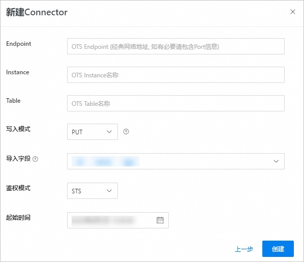

   <table>
     <tr>
       <th width="107">参数名称</th>
       <th>说明</th>
     </tr>
     <tr>
       <td>Endpoint</td>
       <td>TableStore服务内网地址。</td>
     </tr>
     <tr>
       <td>Instance</td>
       <td>TableStore实例名。</td>
     </tr>
     <tr>
       <td>Table</td>
       <td>同步到TableStore的表名。</td>
     </tr>
     <tr>
       <td>写入模式</td>
       <td>支持以下两种模式：<br>• PUT：插入数据到指定的行，如果该行不存在，则新增一行；如果该行存在，则覆盖原有行。（简言之，增或覆盖）。<br>• UPDATE：更新指定行的数据，如果该行不存在，则新增一行；如果该行存在，则根据请求内容在这一行中新增、修改或者删除指定列的值。（简言之，增或修改）。</td>
     </tr>
     <tr>
       <td>写入字段</td>
       <td>DataHub可以根据用户设置将部分column内容同步到TableStore文件中，可导入字段根据最新的Schema生成。</td>
     </tr>
     <tr>
       <td>鉴权模式</td>
       <td>支持以下两种模式，默认为STS。<br>• AccessKey<br>• STS当选择模式为AccessKey时，还需要填写用户的AccessKey ID和AccessKey Secret。</td>
     </tr>
     <tr>
       <td>起始时间</td>
       <td>同步Hologres的最早数据同步时间。</td>
     </tr>
   </table>

7. 创建成功后，在目标Topic详情页面的**同步任务**页签下，单击**查看**，可查看该同步任务的详细信息。

   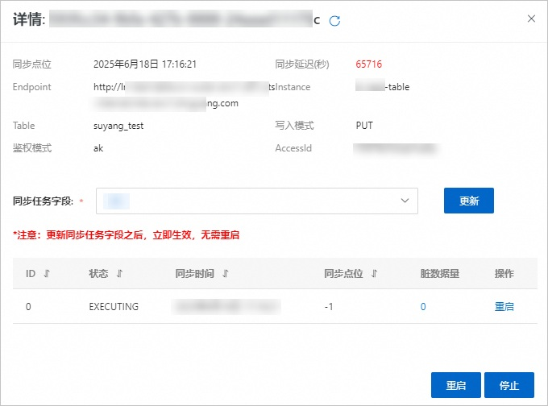

<a id="section-7-8"></a>

## 7.8. 创建同步任务至RDS&MySQL

本文为您介绍如何在DataHub中创建同步任务至RDS&MySQL，主要包括在创建时的准备工作、注意事项、操作步骤和同步示例。

**创建同步任务至RDS**

**准备工作**

- 准备RDS实例和表结构

  使用RDS管控台新建RDS实例，可选择经典网络和VPC网络，同样，创建DataHub同步任务时，请选择正确的网络类型。DataHub同步时，会根据DataHub Field的数据类型同步到对应的RDS数据类型中，对应的类型映射关系如下所示：

  | DataHub | RDS |
  | --- | --- |
  | TINYINT | TINYINT |
  | SMALLINT | SMALLINT |
  | INTEGER | INT |
  | BIGINT | BIGINT |
  | STRING | VARCHAR |
  | BOOLEAN | BOOLEAN / TINYINT |
  | FLOAT | FLOAT |
  | DOUBLE | DOUBLE |
  | TIMESTAMP | TIMESTAMP / BIGINT |
  | DECIMAL | DECIMAL |

  DataHub中的TINYINT、SMALLINT、INTEGER、FLOAT类型从java sdk 2.16.1-public开始支持。

**注意事项**

- 目前DataHub仅支持将TUPLE数据同步到RDS服务中。

- DataHub中的TIMESTAMP默认按照微秒（Microsecond）时间转换成RDS TIMESTAMP类型，请用户注意控制数据精度。

- 为了避免并发读写同一个主键数据出现加锁竞争，请用户确保同一主键的数据写入到DataHub同一Shard中。

**创建同步任务**

1. 登录数据总线 DataHub控制台。

2. 在左侧导航栏，单击**项目管理**。

3. 在**项目列表**页面，单击目标项目名称，进入项目详情页面。

4. 在**Topic列表**页签下，单击目标Topic名称，进入Topic详情页面。

5. 在Topic详情页面，单击右上角的**同步**。

6. 在**新建Connector**面板中，单击**RDS&MySQL**，配置新建Connector的参数，单击**创建**。

   

下面罗列了管控台创建同步任务的关键配置说明，更多更灵活的操作请参考SDK使用。

<table>
  <tr>
    <th width="89">关键参数</th>
    <th>说明</th>
  </tr>
  <tr>
    <td>Host</td>
    <td>HostRDS服务地址，请务必填写<code> </code>内网地址<code> </code>以确保服务联通性。</td>
  </tr>
  <tr>
    <td>写入模式</td>
    <td>包括IGNORE和OVERWRITE两种模式：<br>• IGNORE：忽略重复数据，即<code> INSERT IGNORE INTO </code>写入。<br>• OVERWRITE：更新重复数据，即<code> REPLACE INTO </code>写入。</td>
  </tr>
  <tr>
    <td>导入字段</td>
    <td>DataHub可以根据用户设置将部分column内容同步到RDS表中。</td>
  </tr>
  <tr>
    <td>VPC ID</td>
    <td>当用户的RDS处于VPC网络时，需要填写对应的VPC ID信息，可在RDS管控台查看。</td>
  </tr>
  <tr>
    <td>实例ID</td>
    <td>当用户的RDS处于VPC网络时，需要填写对应的RDS实例信息，可在RDS管控台查看。</td>
  </tr>
</table>

**同步示例**

1. 在RDS管控台中，创建RDS实例和数据表。

2. 在DataHub中新建Topic，示例中为TUPLE类型Topic，Schema如下图所示：

   

3. 建立同步任务。这里以写入模式为IGNORE，导入所有字段为例。

   

4. 向DataHub中写入TUPLE数据，数据内容如下图所示，共4条数据。

   

5. 确认同步数据。本示例中采用MySQL客户端连接RDS服务查看数据，数据结果如下图所示：

   

**创建同步任务至MySQL**

**准备工作**

准备MySQL实例和表结构：使用MySQL管控台新建MySQL实例和数据表。

DataHub同步时，会根据DataHub Field的数据类型同步到对应的MySQL数据类型中，对应的类型映射关系如下所示：

| DataHub | MySQL |
| --- | --- |
| TINYINT | TINYINT |
| SMALLINT | SMALLINT |
| INTEGER | INT |
| BIGINT | BIGINT |
| STRING | VARCHAR |
| BOOLEAN | BOOLEAN / TINYINT |
| FLOAT | FLOAT |
| DOUBLE | DOUBLE |
| TIMESTAMP | TIMESTAMP / BIGINT |
| DECIMAL | DECIMAL |

DataHub中的TINYINT、SMALLINT、INTEGER、FLOAT类型从java sdk 2.16.1-public开始支持。

**注意事项**

- 目前DataHub仅支持将TUPLE数据同步到MySQL服务中。

- DataHub中的TIMESTAMP默认按照微秒（Microsecond）时间转换成MySQL TIMESTAMP类型，请用户注意控制数据精度。

- 为了避免并发读写同一个主键数据出现加锁竞争，请用户确保同一主键的数据写入到DataHub同一Shard中。

**创建同步任务**

1. 登录数据总线 DataHub控制台。

2. 在左侧导航栏，单击**项目管理**。

3. 在**项目列表**页面，单击目标项目名称，进入项目详情页面。

4. 在**Topic列表**页签下，单击目标Topic名称，进入Topic详情页面。

5. 在Topic详情页面，单击右上角的**同步**。

6. 在**新建Connector**面板中，单击**RDS&MySQL**，配置新建Connector的参数，单击**创建**。

   

下面罗列了管控台创建同步任务的关键配置说明，更多更灵活的操作请参考SDK使用。

<table>
  <tr>
    <th width="89">关键参数</th>
    <th>说明</th>
  </tr>
  <tr>
    <td>Host</td>
    <td>HostMySQL服务地址，请务必填写<code> </code>内网地址<code> </code>以确保服务联通性。</td>
  </tr>
  <tr>
    <td>写入模式</td>
    <td>包括IGNORE和OVERWRITE两种模式：<br>• IGNORE：忽略重复数据，即<code> INSERT IGNORE INTO </code>写入。<br>• OVERWRITE：更新重复数据，即<code> REPLACE INTO </code>写入。</td>
  </tr>
  <tr>
    <td>导入字段</td>
    <td>DataHub可以根据用户设置将部分column内容同步到RDS表中。</td>
  </tr>
  <tr>
    <td>VPC ID</td>
    <td>当用户的MySQL处于VPC网络时，需要填写对应的VPC ID信息，可在MySQL管控台查看。</td>
  </tr>
  <tr>
    <td>实例ID</td>
    <td>当用户的MySQL处于VPC网络时，需要填写对应的MySQL实例信息，可在MySQL管控台查看。</td>
  </tr>
</table>

**同步示例**

1. 在MySQL管控台中，创建MySQL实例和数据表。

2. 在DataHub中新建Topic，示例中为TUPLE类型Topic，Schema如下图所示：

   

3. 建立同步任务。这里以写入模式为IGNORE，导入所有字段为例。

   

4. 向DataHub中写入TUPLE数据，数据内容如下图所示，共4条数据。

   

5. 确认同步数据。本示例中采用MySQL客户端连接RDS服务查看数据，数据结果如下图所示：

   

<a id="section-8"></a>

# 8.DataHub统计信息

本章节将介绍如何使用数据总线 DataHub查看相关的统计信息。

**背景信息**

数据总线 DataHub在控制台中向用户提供Topic级别的统计信息，用户可以通过Metric界面查看准实时的Topic级别的QPS和流量等信息。目前提供的指标有：

- 读写request/second。

- 读写record/second。

- 读写throughput/second（单位KB）。

- 读写请求latency/request （单位微秒）。

**操作步骤**

1. 登录数据总线 DataHub控制台。

2. 在左侧的导航栏中选择**项目管理**，在右侧的项目列表中，选择需要进行性能指标查看的项目，单击列表后的**查看**，进入项目详情页面。

3. 在项目详情页面中，选择需要查看性能指标的topic，单击该Topic后的**查看**，进入Topic详情页面。

4. 在Topic详情页面，选择**Metric统计**页签，即可查看相关的统计信息。

> **说明**
>
> 数据总线 DataHub还支持通过自定义查询指定时间段，读取指定时间内的统计信息。

<a id="section-9"></a>

# 9.DataHub订阅功能

<a id="section-9-1"></a>

## 9.1. 概述

目前用户在数据总线 DataHub上消费Topic数据，为了做到<strong>“断点续消费”</strong>的功能，即消费者failover重启后可以继续从failover时间点继续获取数据，需要用户自己保存当前消费的点位信息，同时用户还需要关心自己的点位存储服务的高可用，这无疑增加了用户开发应用程序的复杂度。基于此，数据总线 DataHub的订阅服务提供了服务端保存用户消费点位的功能，用户只需要通过简单的几步配置，然后在自己的应用逻辑里添加几行简单的处理逻辑，就可以拥有一个对自己“透明”的高可用的点位存储服务。

另外，订阅服务还提供了灵活的点位重置功能，从而保证用了“At Least Once”的消费语义。例如用户发现自己应用程序有个时间段消费的数据处理上存在问题，想重新消费，此时只需要将点位重置到对应的时间点，并且无须重启自己的应用程序，可以做到应用程序自动感知。

<a id="section-9-2"></a>

## 9.2. 创建订阅

创建订阅目前只能通过数据总线 DataHub控制台创建，另外需要确保用户账号有权限对特定project下的topic有订阅权限。

**操作步骤**

1. 登录数据总线 DataHub控制台。

2. 在左侧导航栏选择**项目管理**，按先后顺序，分别单击对应的项目列表后及Topic列表后的**查看**，进入Topic详情页面。

3. 在Topic的详情页面，单击<strong>+订阅</strong>，在弹出的对话框中填写好订阅信息后，单击**创建**，即可完成创建订阅操作。

   

   <table>
     <tr>
       <th width="89">参数</th>
       <th>说明</th>
     </tr>
     <tr>
       <td>订阅应用</td>
       <td>用来说明当前订阅的应用名称。命名要求如下：<br>• 只能包含小写字母，数字和下划线(_)。<br>• 必须以小写字母开头。<br>• 名称长度限制在1~32个字符之间。</td>
     </tr>
     <tr>
       <td>描述</td>
       <td>当前订阅的详情描述，描述限制3~1024字符。</td>
     </tr>
   </table>

4. 完成订阅创建后，在Topic页面单击**订阅列表**页签，可以查看当前Topic下的所有订阅记录。

   

**使用示例**

订阅功能为用户提供了点位存储的能力，与数据总线 DataHub读写功能并无必然联系，不过二者可以配合使用，即数据读取后用户需要将消费点位进行存储的场景。

示例代码如下，仅供参考。

```java
//点位消费示例，并在消费过程中进⾏点位的提交
public void offset_consumption(int maxRetry) {
    String endpoint = "<YourEndPoint>";
    String accessId = "<YourAccessId>";
    String accessKey = "<YourAccessKey>";
    String projectName = "<YourProjectName>";
    String topicName = "<YourTopicName>";
    String subId = "<YourSubId>";
    String shardId = "0";
    List<String> shardIds = Arrays.asList(shardId);
    // 创建DataHubClient实例
    DatahubClient datahubClient = DatahubClientBuilder.newBuilder()
            .setDatahubConfig(
                    new DatahubConfig(endpoint,
                            // 是否开启⼆进制传输，服务端2.12版本开始⽀持
                            new AliyunAccount(accessId, accessKey), true))
            .build();
    RecordSchema schema = datahubClient.getTopic(projectName, topicName).getRecordSchema();
    OpenSubscriptionSessionResult openSubscriptionSessionResult = datahubClient.openSubscriptionSession(projectName, topicName, subId, 
shardIds);
    SubscriptionOffset subscriptionOffset = openSubscriptionSessionResult.getOffsets().get(shardId);
    // 1、获取当前点位的cursor，如果当前点位已过期则获取⽣命周期内第⼀条record的cursor，未消费同样获取⽣命周期内第⼀条record的cursor
    String cursor = "";
    //sequence < 0说明未消费
    if (subscriptionOffset.getSequence() < 0) {
        // 获取⽣命周期内第⼀条record的cursor
        cursor = datahubClient.getCursor(projectName, topicName, shardId, CursorType.OLDEST).getCursor();
    } else {
        // 获取下⼀条记录的Cursor
        long nextSequence = subscriptionOffset.getSequence() + 1;
        try {
            //按照SEQUENCE getCursor可能报SeekOutOfRange错误，表示当前cursor的数据已过期
            cursor = datahubClient.getCursor(projectName, topicName, shardId, CursorType.SEQUENCE, nextSequence).getCursor();
        } catch (SeekOutOfRangeException e) {
            // 获取⽣命周期内第⼀条record的cursor
            cursor = datahubClient.getCursor(projectName, topicName, shardId, CursorType.OLDEST).getCursor();
        }
    }
    // 2、读取并保存点位，这⾥以读取Tuple数据为例，并且每1000条记录保存⼀次点位
    long recordCount = 0L;
    // 每次读取1000条record
    int fetchNum = 1000;
    int retryNum = 0;
    int commitNum = 1000;
    while (retryNum < maxRetry) {
        try {
            GetRecordsResult getRecordsResult = datahubClient.getRecords(projectName, topicName, shardId, schema, cursor, fetchNum);
            if (getRecordsResult.getRecordCount() <= 0) {
                // 无数据，sleep后读取
                System.out.println("no data, sleep 1 second");
                Thread.sleep(1000);
                continue;
            }
            for (RecordEntry recordEntry : getRecordsResult.getRecords()) {
                //消费数据
                TupleRecordData data = (TupleRecordData) recordEntry.getRecordData();
                System.out.println("field1:" + data.getField("field1") + "\t"
                        + "field2:" + data.getField("field2"));
                // 处理数据完成后，设置点位
                recordCount++;
                subscriptionOffset.setSequence(recordEntry.getSequence());
                subscriptionOffset.setTimestamp(recordEntry.getSystemTime());
                // commit offset every 1000 records
                if (recordCount % commitNum == 0) {
                    //提交点位
                    Map<String, SubscriptionOffset> offsetMap = new HashMap<>();
                    offsetMap.put(shardId, subscriptionOffset);
                    datahubClient.commitSubscriptionOffset(projectName, topicName, subId, offsetMap);
                    System.out.println("commit offset successful");
                }
            }
            cursor = getRecordsResult.getNextCursor();
        } catch (SubscriptionOfflineException | SubscriptionSessionInvalidException e) {
            // 退出. Offline: 订阅下线; SessionChange: 表示订阅被其他客户端同时消费
            e.printStackTrace();
            throw e;
        } catch (SubscriptionOffsetResetException e) {
            // 点位被重置，需要重新获取SubscriptionOffset版本信息
            SubscriptionOffset offset = datahubClient.getSubscriptionOffset(projectName, topicName, subId, shardIds).getOffsets().get(shardId);
            subscriptionOffset.setVersionId(offset.getVersionId());
            // 点位被重置之后，需要重新获取点位，获取点位的⽅法应该与重置点位时⼀致，
            // 如果重置点位时，同时设置了sequence和timestamp，那么既可以⽤SEQUENCE获取，也可以⽤SYSTEM_TIME获取
            // 如果重置点位时，只设置了sequence，那么只能⽤sequence获取，
            // 如果重置点位时，只设置了timestamp，那么只能⽤SYSTEM_TIME获取点位
            // ⼀般情况下，优先使⽤SEQUENCE，其次是SYSTEM_TIME,如果都失败，则采⽤OLDEST获取
            cursor = null;
            if (cursor == null) {
                try {
                    long nextSequence = offset.getSequence() + 1;
                    cursor = datahubClient.getCursor(projectName, topicName, shardId, CursorType.SEQUENCE, nextSequence).getCursor();
                    System.out.println("get cursor successful");
                } catch (DatahubClientException exception) {
                    System.out.println("get cursor by SEQUENCE failed, try to get cursor by SYSTEM_TIME");
                }
            }
            if (cursor == null) {
                try {
                    cursor = datahubClient.getCursor(projectName, topicName, shardId, CursorType.SYSTEM_TIME, 
offset.getTimestamp()).getCursor();
                    System.out.println("get cursor successful");
                } catch (DatahubClientException exception) {
                    System.out.println("get cursor by SYSTEM_TIME failed, try to get cursor by OLDEST");
                }
            }
            if (cursor == null) {
                try {
                    cursor = datahubClient.getCursor(projectName, topicName, shardId, CursorType.OLDEST).getCursor();
                    System.out.println("get cursor successful");
                } catch (DatahubClientException exception) {
                    System.out.println("get cursor by OLDEST failed");
                    System.out.println("get cursor failed!!");
                    throw e;
                }
            }
        } catch (LimitExceededException e) {
            // limit exceed, retry
            e.printStackTrace();
            retryNum++;
        } catch (DatahubClientException e) {
            // other error, retry
            e.printStackTrace();
            retryNum++;
        } catch (Exception e) {
            e.printStackTrace();
            System.exit(-1);
        }
    }
}
```

> **说明**
>
> - 第一次启动时会从最早的数据开始消费，运行过程中可以刷新控制台上的订阅页面。
>
> - 如果在消费过程中，通过控制台上的重置点位功能来手动调整点位的话，消费程序会自动感知到点位变化，从调整后的点位开始消费。这是因为客户端通过捕获**OffsetResetedException**异常后，调用**getSubscriptionOffset**接口从服务端获取到最新的**SubscriptionOffset**对象，然后继续从新点位开始消费。
>
> - 需要注意，同一个订阅下的相同shard不要同时被多个消费线程/进程消费，否则点位会被交替覆盖，也就是最终服务端存储的点位是未定义的。这种情况下服务端会报**OffsetSessionChangedException**异常，建议客户端对这类异常进行捕获后做exit处理，检查是否存在重复消费的设计。

<a id="section-9-3"></a>

## 9.3. 重置点位

数据总线 DataHub的每条订阅记录支持重置点位，您可以按需将当前订阅的消费点位重置到自己想要开始消费的时间点。

**操作步骤**

1. 登录数据总线 DataHub控制台。

2. 在左侧导航栏选择**项目管理**，按先后顺序，分别单击对应的项目列表后及Topic列表后的**查看**，进入Topic详情页面。

3. 在Topic详情页面，单击**订阅列表**页签，找到目标订阅ID，单击**操作**列下的**重置**。

4. 在**重置点位**面板中，按需设置时间。

   

5. 单击**重置**。

<a id="section-9-4"></a>

## 9.4. 删除订阅

数据总线 DataHub的每条订阅记录均支持删除操作，删除后将永久删除，包括之前存储的点位都会从物理上删除，请谨慎操作。

**操作步骤**

1. 登录数据总线 DataHub控制台。

2. 在左侧导航栏选择**项目管理**，按先后顺序，分别单击对应的项目列表后及Topic列表后的**查看**，进入Topic详情页面。

3. 在Topic详情页面，单击**订阅列表**页签，找到目标订阅ID，单击**操作**列下的**删除**。

4. 确认删除信息无误后，单击**删除**。

<a id="section-9-5"></a>

## 9.5. 查看消费详情

数据总线 DataHub的每条订阅记录支持查看消费详情。

**操作步骤**

1. 登录数据总线 DataHub控制台。

2. 在左侧导航栏选择**项目管理**，按先后顺序，分别单击对应的项目列表后及Topic列表后的**查看**，进入Topic详情页面。

3. 在Topic详情页面，单击**订阅列表**页签，找到目标订阅ID，单击**操作**列下的**消费详情**。

4. 在**协同消费详情**面板中，可查看当前订阅ID、订阅应用名称和消费中的Shard的详细信息。

<a id="section-10"></a>

# 10.DataHub协同消费功能

<a id="section-10-1"></a>

## 10.1. 说明

DataHub-client-library是java-sdk的封装，集成了协同消费的consumer和自动均衡写入各个shard的producer。

<a id="section-10-2"></a>

## 10.2. 概述

**点位服务**

点位服务是提供将消费的点位保存在服务端的功能，点位由sequence和timestamp组成，sequence是递增的对应唯一记录的序列，timestamp是记录写入datahub的单位为ms的时间戳。

为Topic创建订阅，并在完成消费一部分数据后，将点位提交至服务端。下次启动任务时，可以从服务端获取上次提交的点位，从指定点位的下一条记录开始消费。将点位保存在服务端才能够实现shard重新分配后，能够从上次提交的点位之后消费，这是协同消费功能的前提。

在Consumer中不需要手动处理点位，在config中设置点位提交的间隔。在读取记录时，认为之前的记录已经完成处理，若距离上次提交点位已经超过提交间隔，则尝试提交。在提交失败并且同时任务强制停止时，有一定可能造成点位提交不及时，重复消费一部分数据。

**协同消费**

协同消费是为了解决多个消费者同时消费一个topic时，自动分配shard的问题，能够简化消费的客户端处理。

> 因为多个消费者可能是在不同机器上，如果通过自己协调分配shard，是非常困难的。而使用同一个Sub Id的Consummer在同一个Consumer Group中
>
> **说明**
>
> 时，同一个shard在一个Consumer Group中只会被分配给1个Consumer。

示例场景如下。

假设现有3个消费者实例A、B、C，Topic共有10个shard。

1. 实例A启动，分配10个shard。

2. 实例B、C启动，shard分配为4、3、3。

3. 将1个shard进行split操作，在父节点消费完后，客户端主动释放，2个子节点加入后，shard分配为4、4、3。

4. 实例C停止后，shard分配为6、5。

**心跳**

要实现协同消费的功能，需要通过心跳机制来通知服务端消费者实例的状态。当前分配的shard和需要释放的shard，超过时间间隔没有收到心跳，则认为消费者实例已经停止。当消费者实例的状态发生改变，服务端会重新分配shard，新的分配计划也是通过心跳请求来返回，所以客户端感知shard变化是有时间间隔的。

<a id="section-10-3"></a>

## 10.3. 注意事项

Consumer和Producer都不支持多线程访问，如果需要使用多线程，则在每个线程都使用不同的Consumer或Producer对象。

<a id="section-10-4"></a>

## 10.4. Maven依赖及JDK

**Maven依赖**

```xml
<dependency>
      <groupId>com.aliyun.datahub</groupId>
      <artifactId>datahub-client-library</artifactId>
      <version>1.0.6-public</version>
</dependency>
```

**JDK**

```text
jdk: >= 1.7
```

<a id="section-10-5"></a>

## 10.5. 使用示例

以下的相关示例仅供参考。

**初始化Producer**

```text
String endpoint = "http://dh-cn-hangzhou.aliyuncs.com";
String accessId = "<YourAccessKeyId>";
String accessKey = "<YourAccessKeySecret>";
String projectName = "<YourProjectName>";
String topicName = "<YourTopicName>";
ProducerConfig config = new ProducerConfig(endpoint, accessId, accessKey);
Producer producer = new Producer(projectName, topicName, config);
```

**写数据**

```text
RecordSchema schema = new RecordSchema();
schema.addField(new Field("field1", FieldType.STRING));
schema.addField(new Field("field2", FieldType.BIGINT));
List<RecordEntry> recordEntries = new ArrayList<>();
for (int cnt = 0; cnt < 10; ++cnt) {
    RecordEntry entry = new RecordEntry();
    entry.addAttribute("key1", "value1");
    entry.addAttribute("key2", "value2");
    TupleRecordData data = new TupleRecordData(schema);
    data.setField("field1", "testValue");
    data.setField("field2", 1);
    entry.setRecordData(data);
    recordEntries.add(entry);
}
int maxRetry = 3;
while (true) {
    try {
        producer.send(records, maxRetry);
        break;
    } catch (MalformedRecordException e) {
        // malformed RecordEntry
    } catch (InvalidParameterException e) {
        // invalid param
    } catch (ResourceNotFoundException e) {
        // project, topic or shard not found, sometimes caused by split/merge shard
    } catch (DatahubClientException e) {
        // network or other exceptions exceeded retry limit
    }
}
// close before exit
producer.close();
```

**初始化Consumer**

```text
String endpoint = "http://dh-cn-hangzhou.aliyuncs.com";
String accessId = "<YourAccessKeyId>";
String accessKey = "<YourAccessKeySecret>";
String projectName = "<YourProjectName>";
String topicName = "<YourTopicName>";
String SubId = "<YourSubscriptionId>";
// 1. 使⽤协同消费，提供SubId
ConsumerConfig config = new ConsumerConfig(endpoint, accessId, accessKey);
Consumer consumer = new Consumer(projectName, topicName, SubId, config);
// 2. 不使⽤协同消费，使⽤点位服务，提供SubId和Consumer读取的shard列表
List<String> assignment = Arrays.asList("0", "1", "2");
ConsumerConfig config = new ConsumerConfig(endpoint, accessId, accessKey);
Consumer consumer = new Consumer(projectName, topicName, SubId, assignment, config);
// 3. 不使⽤协同消费，不使⽤点位服务记录的点位，提供SubId，Consumer读取的shard和初始点位
Map<String, Offset> offsetMap = new HashMap<>();
// 提供sequence和timestamp，若sequence超出范围则使⽤timestamp获取Cursor
offsetMap.put("0", new Offset(100, 1548573440756L));
// 只提供sequence，按照sequence获取Cursor
offsetMap.put("1", new Offset().setSequence(1));
// 只提供timestamp，按照timestamp获取Cursor
offsetMap.put("2", new Offset().setTimestamp(1548573440756L));
ConsumerConfig config = new ConsumerConfig(endpoint, accessId, accessKey);
Consumer consumer = new Consumer(projectName, topicName, SubId, offsetMap, config);
```

**读数据**

```java
int maxRetry = 3;
boolean stop = false;
while (!stop) {
    try {
        while (true) {
            RecordEntry record = consumer.read(maxRetry);
            if (record != null) {
                TupleRecordData data = (TupleRecordData) record.getRecordData();
                System.out.println("field1:" + data.getField(0) + ", field2:" + data.getField("field2"));
            }
        }
    } catch (SubscriptionSessionInvalidException | SubscriptionOffsetResetException e) {
        // subscription exception, will not recover
        // print some log or just use a new consumer
        consumer.close();
        consumer = new Consumer(TEST_PROJECT, TEST_TOPIC, TEST_SUB_ID, config);
    } catch (ResourceNotFoundException | InvalidParameterException e) {
        // - project, topic, shard, subscription not found
        // - seek out of range
        // - sometimes shard operation cause ResourceNotFoundException
        // should make sure if resource exists, print some log or just exit
    } catch (DatahubClientException e) {
        // - network or other exception exceed retry limit
        // can just sleep and retry
    }
}
// close before exit
consumer.close();
```
