阿里云  
专有云  
数据总线  
运维指南  
产品版本：V3.18.6  
文档版本：20260306

**目录**

- [1.运维命令与工具](#section-1)
    - [1.1. 服务基本概念及常用操作](#section-1-1)
    - [1.2. 飞天操作系统常用运维命令](#section-1-2)
    - [1.3. 飞天分布式文件系统常用运维命令](#section-1-3)
    - [1.4. 任务调度系统常用运维命令](#section-1-4)
    - [1.5. Xstream_tool工具](#section-1-5)
    - [1.6. Datahub控制台的性能页面](#section-1-6)
    - [1.7. 大数据管家](#section-1-7)
- [2.日常维护](#section-2)
    - [2.1. DataHub集群断电恢复](#section-2-1)
    - [2.2. DataHub CS下电](#section-2-2)
    - [2.3. DataHub集群优雅下电](#section-2-3)
    - [2.4. 更换pangu_cs硬盘操作](#section-2-4)
- [3.基于大数据管家的运维](#section-3)
    - [3.1. 登录大数据管家](#section-3-1)
    - [3.2. 监控](#section-3-2)
        - [3.2.1. 健康度](#section-3-2-1)
        - [3.2.2. 报表](#section-3-2-2)
    - [3.3. 运维](#section-3-3)
        - [3.3.1. DataHub运维功能和入口](#section-3-3-1)
        - [3.3.2. DataHub业务运维](#section-3-3-2)
            - [3.3.2.1. DataHub业务日志源](#section-3-3-2-1)
            - [3.3.2.2. DataHub业务项目](#section-3-3-2-2)
            - [3.3.2.3. DataHub业务热点分析](#section-3-3-2-3)
            - [3.3.2.4. DataHub业务归档延迟](#section-3-3-2-4)
        - [3.3.3. DataHub服务运维](#section-3-3-3)
            - [3.3.3.1. 控制服务运维](#section-3-3-3-1)
            - [3.3.3.2. Datahub伏羲服务运维](#section-3-3-3-2)
                - [3.3.3.2.1. DataHub伏羲服务运维入口](#section-3-3-3-2-1)
                - [3.3.3.2.2. DataHub伏羲服务概览](#section-3-3-3-2-2)
                - [3.3.3.2.3. DataHub伏羲服务角色](#section-3-3-3-2-3)
                - [3.3.3.2.4. DataHub伏羲服务计算节点](#section-3-3-3-2-4)
            - [3.3.3.3. DataHub盘古服务运维](#section-3-3-3-3)
                - [3.3.3.3.1. DataHub盘古服务运维入口](#section-3-3-3-3-1)
                - [3.3.3.3.2. DataHub盘古服务概览](#section-3-3-3-3-2)
                - [3.3.3.3.3. DataHub盘古服务角色](#section-3-3-3-3-3)
                - [3.3.3.3.4. DataHub盘古服务存储节点](#section-3-3-3-3-4)
                - [3.3.3.3.5. 清理盘古的回收站](#section-3-3-3-3-5)
                - [3.3.3.3.6. 开启和关闭盘古的数据自动均衡](#section-3-3-3-3-6)
                - [3.3.3.3.7. 在盘古Master上执行Checkpoint](#section-3-3-3-3-7)
                - [3.3.3.3.8. 切换盘古的Master](#section-3-3-3-3-8)
        - [3.3.4. DataHub 集群运维](#section-3-3-4)
            - [3.3.4.1. DataHub集群运维入口](#section-3-3-4-1)
            - [3.3.4.2. DataHub集群概览](#section-3-3-4-2)
            - [3.3.4.3. DataHub集群健康](#section-3-3-4-3)
            - [3.3.4.4. DataHub集群机器列表](#section-3-3-4-4)
            - [3.3.4.5. DataHub节点扩容](#section-3-3-4-5)
            - [3.3.4.6. DataHub节点缩容](#section-3-3-4-6)
            - [3.3.4.7. DataHub反解析RequestId信息](#section-3-3-4-7)
        - [3.3.5. DataHub主机运维](#section-3-3-5)
            - [3.3.5.1. DataHub主机运维入口](#section-3-3-5-1)
            - [3.3.5.2. DataHub主机概览](#section-3-3-5-2)
            - [3.3.5.3. DataHub主机服务](#section-3-3-5-3)
    - [3.4. 管理](#section-3-4)
        - [3.4.1. 管理概述](#section-3-4-1)
        - [3.4.2. 作业服务](#section-3-4-2)
            - [3.4.2.1. 概述](#section-3-4-2-1)
            - [3.4.2.2. 作业](#section-3-4-2-2)
                - [3.4.2.2.1. 手动执行作业](#section-3-4-2-2-1)
                - [3.4.2.2.2. 开启和关闭定时作业](#section-3-4-2-2-2)
                - [3.4.2.2.3. 查看作业执行历史](#section-3-4-2-2-3)
        - [3.4.3. 健康管理](#section-3-4-3)
            - [3.4.3.1. 监控配置](#section-3-4-3-1)
            - [3.4.3.2. 巡检管理](#section-3-4-3-2)
        - [3.4.4. 操作审计](#section-3-4-4)
- [4.DataHub深度巡检](#section-4)
- [5.常见问题及解决方法](#section-5)
- [6.其他相关说明](#section-6)
    - [6.1. 装机模板](#section-6-1)
    - [6.2. 部署目录及服务列表](#section-6-2)
    - [6.3. 错误码](#section-6-3)

<a id="section-1"></a>

# 1.运维命令与工具

<a id="section-1-1"></a>

## 1.1. 服务基本概念及常用操作

**DataHub服务基本概念**

<table>
  <tr>
    <th>范畴</th>
    <th>名称</th>
    <th>基本概念</th>
  </tr>
  <tr>
    <td rowspan="4">DataHub</td>
    <td>Xstream</td>
    <td>DataHub的主服务，主要作用是接收Frontend的读写请求，并写到PanGu。</td>
  </tr>
  <tr>
    <td>Shipper/Connector</td>
    <td>从DataHub里读出数据导入到MaxCompute/RDS/OSS等第三方存储中。</td>
  </tr>
  <tr>
    <td>Coordinator</td>
    <td>第三方用户建立订阅后，负责保存用户读取数据的点位，以便用户下次可以接着点位继续读取数据。</td>
  </tr>
  <tr>
    <td>Frontend</td>
    <td>DataHub的前端机，所有请求的入口。</td>
  </tr>
</table>

**操作步骤**

1. 在执行常用运维命令之前，您需要先登录到命令行操作界面。

   <ol type="i">

   <li>

   登录飞天基础运维平台。

   </li>

   <li>

   在左侧导航栏，选择**资源管理 > 产品集群运维**。

   </li>

   <li>

   在**产品列表**下，搜索DataHub集群，单击**集群详情**。

   </li>

   <li>

   在**服务列表**页签下，单击**datahub-service**服务。

   </li>

   <li>

   在**实例列表**页签下，单击目标实例对应的**Terminal**进入操作界面。

   </li>

   </ol>

2. 执行以下命令，查看集群上部署的服务。

   ```text
   alias r='/apsara/deploy/rpc_wrapper/rpc.sh'
   ```

   ```text
   r al
   ```

   如下图所示：

   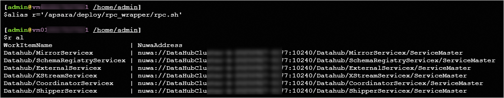

3. 执行以下命令，查看该服务上的角色及运行机器。其中， `$<WorkItemName>` 需要根据上一步查询的结果进行替换。

   ```text
   r wwl $<WorkItemName>
   ```

   如下图所示：

   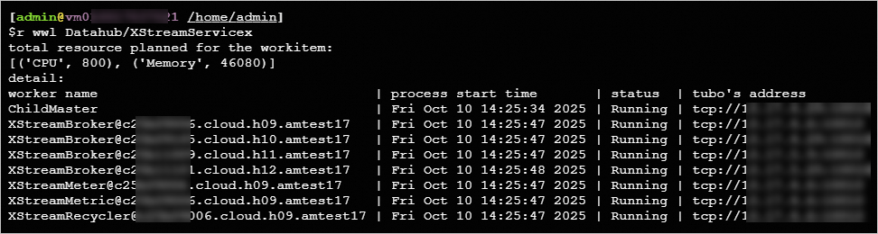

<a id="section-1-2"></a>

## 1.2. 飞天操作系统常用运维命令

**背景信息**

由于DataHub已经完全部署到了飞天基础运维平台上，所以飞天操作系统的命令都已经被tj_show代替，任务调度系统、飞天分布式文件系统、飞天名称服务及分布式锁系统也已经是飞天基础运维平台里的服务，全部由飞天基础运维平台托管。

**操作步骤**

1. 在执行常用运维命令之前，您需要先登录到命令行操作界面。可以通过以下两种方式进入命令行操作界面：

   - 方式一：直接登录OPS1机器进入操作界面。

   - 方式二：通过飞天基础运维平台进入操作界面。

     <ol type="a">

     <li>

     登录飞天基础运维平台。

     </li>

     <li>

     在左侧导航栏，选择**资源管理 > 产品集群运维**。

     </li>

     </ol>

     <ol type="i" start="100">

     <li>

     在**产品列表**下，搜索DataHub集群，单击**集群详情**。

     </li>

     <li value="500">

     在**服务列表**页签下，单击**datahub-service**服务。

     </li>

     </ol>

     <ol type="a" start="5">

     <li>

     在**实例列表**页签下，单击目标实例对应的**Terminal**进入操作界面。

     </li>

     </ol>

2. 执行以下命令，查看本机上的角色。

   ```text
   tj_show
   ```

3. 执行以下命令，查看所有角色。

   ```text
   tj_show -l
   ```

4. 执行以下命令，查看某个角色的机器列表。（例如：查看pangu_chunkserver的机器列表）

   ```text
   tj_show -r pangu.PanguChunkserver# //返回主机名
   tj_show -r pangu.PanguChunkserver# -ip //返回ip
   ```

5. 执行以下命令，查看FrontEnd的机器列表。

   ```text
   tj_show -r datahub-frontend.Frontend#
   ```

6. 执行以下命令，查看WebConsole的机器列表。

   ```text
   tj_show -r datahub-webconsole.WebConsole#
   ```

<a id="section-1-3"></a>

## 1.3. 飞天分布式文件系统常用运维命令

飞天分布式文件系统的命令通常是 `pu` 和 `puadmin` ，请务必自行输入**各自命令 --help＋回车**，来查看完整的帮助。

**操作步骤**

1. 在执行常用运维命令之前，您需要先登录到命令行操作界面。

   <ol type="i">

   <li>

   登录飞天基础运维平台。

   </li>

   <li>

   在左侧导航栏，选择**资源管理 > 产品集群运维**。

   </li>

   <li>

   在**产品列表**下，搜索DataHub集群，单击**集群详情**。

   </li>

   <li>

   在**服务列表**页签下，单击**datahub-service**服务。

   </li>

   <li>

   在**实例列表**页签下，单击目标实例对应的**Terminal**进入操作界面。

   </li>

   </ol>

2. 依次执行以下运维命令。

   - 类似Linux的ls命令来查看指定文件夹的文件。

     ```text
     pu ls
     ```

   - 上传本地文件到飞天分布式文件系统。

     ```text
     pu put $<⽬标filepath> 
     ```

   - 查看文件的meta信息。

     ```text
     pu meta
     ```

   - 显示所有的飞天分布式文件系统Master信息。

     ```text
     puadmin gems
     ```

   - 列出所有chunkserver的详细信息。

     ```text
     puadmin lscs
     ```

   - 查看版本信息。

     ```text
     puadmin --buildinfo
     ```

   - 对单台chunk server进行维护的时候，需要设置chunkserver的状态。具体操作如下：

     <ol type="a">

     <li>

     查看当前状态。

     ```text
     puadmin cs -stat tcp://x.x.x.x:10260
     ```

     </li>

     <li>

     设置指定的chunkserver为shutdown状态，使其从集群中脱离。

     ```text
     puadmin cs -stat tcp://x.x.x.x:10260 --set=shutdown
     ```

     </li>

     </ol>

     <ol type="i" start="100">

     <li>

     维护完毕后，重新加回到集群中。

     ```text
     puadmin cs -stat tcp://x.x.x.x:10260 --set=normal
     ```

     </li>

     </ol>

<a id="section-1-4"></a>

## 1.4. 任务调度系统常用运维命令

**操作步骤**

1. 在执行常用运维命令之前，您需要先登录到命令行操作界面。

   <ol type="i">

   <li>

   登录飞天基础运维平台。

   </li>

   <li>

   在左侧导航栏，选择**资源管理 > 产品集群运维**。

   </li>

   <li>

   在**产品列表**下，搜索DataHub集群，单击**集群详情**。

   </li>

   <li>

   在**服务列表**页签下，单击**datahub-service**服务。

   </li>

   <li>

   在**实例列表**页签下，单击目标实例对应的**Terminal**进入操作界面。

   </li>

   </ol>

2. 执行任务调度系统的运维命令 `r` ，该命令是rpc.sh的封装，用于向指定的服务（如  `fuxi_master` ,  `pangu_master` ,  `nuwa`  等）发送RPC请求。

   ```text
   alias r='/apsara/deploy/rpc_wrapper/rpc.sh'
   ```

3. 依次执行以下运维命令，查看相关运维信息。

   - 查看所有服务job和service。

     ```text
     r al
     ```

     > **说明**
     >
     > 通常在生产集群上，返回的列表信息比较大。

   - 查看单个服务service状态。其中， `$<service name>` 为变量，需要根据现场信息进行替换。

     ```text
     r wwl $<servicename>
     ```

   - 停止单个服务service状态。其中， `$<service name>` 为变量，需要根据现场信息进行替换。

     ```text
     r sstop $<servicename>
     ```

   - 启动单个服务service状态。其中， `$<service name>` 为变量，需要根据现场信息进行替换。

     ```text
     r sstart $<servicename>
     ```

   - 查看集群总资源。

     ```text
     r ttrl
     ```

   - 查看集群空闲资源。

     ```text
     r tfrl
     ```

     其他选项请直接运行命令获得。

<a id="section-1-5"></a>

## 1.5. Xstream_tool工具

运维工程师可以使用Xstream_tool工具通过命令行进行运维操作，在执行具体的命令行之前，需要先登录到命令行操作界面，具体操作如下。

> **说明**
>
> 需要注意，使用Xstream_tool工具时需要全程使用admin账号。

**通过飞天基础运维平台进入命令行操作界面**

不同版本的飞天基础运维平台界面之间会存在一些差异，具体以现场环境为准，本文以V3版本为例。

1. 进入飞天基础运维平台，选择**资源管理 > 产品集群运维**。在**产品列表**下的搜索框中输入datahub，搜索出相关集群。

2. 单击目标集群右侧的**集群详情**，在**服务列表**页签下，单击**datahub-webconsole**服务进入。

3. 在**实例列表**页签下，单击目标机器的**操作**列下的**Terminal**，开启TerminalService窗口。

**执行相关运维操作**

登录到命令行操作界面后，即可开始使用Xstream_tool工具进行相关运维操作，具体操作如下。

1. 执行如下命令，找到第一行childmaster的地址后 ，ssh到childmaster所在机器。

   ```text
   alias r='/apsara/deploy/rpc_wrapper/rpc.sh'
   ```

   ```text
   r wwl Datahub/XStreamServicex
   ```

   图 1. 找到childmaster地址

   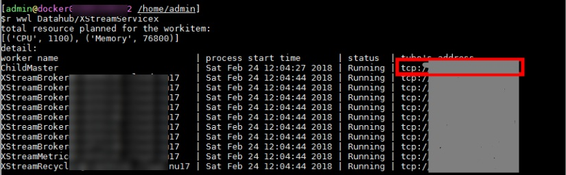

2. 进入到如下目录中。

   ```bash
   cd /apsara/tubo/TempRoot/Datahub/XStreamServicex/tool 
   ```

3. 执行如下命令，设置环境变量。

   ```bash
   export LD_LIBRARY_PATH=/apsara/lib64/:../lib/
   ```

4. 执行如下命令，查看资源。

   ```text
   ./xstream_tool -x x mo
   ```

   图 2. 查看资源

   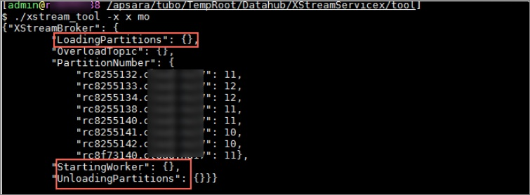

   预期结果：**LoadingPartitions**和**UnloadingPartitions**中没有相关的数据。如果有数据，则表示启动和关闭相关的shard程序有问题导致了异常。需要注意的是：当在执行命令时，如果shard处于启动状态，那么StartingWorker中可能会有相关数据，但是如果数据一直出现，则说明异常。

5. 执行如下命令，查看所有broker的状态。

   ```text
   ./xstream_tool gws -x x -r broker
   ```

   图 3. 查看所有broker的状态

   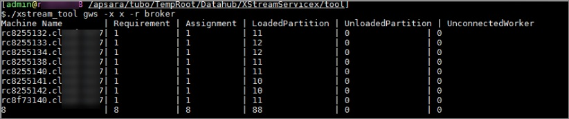

   **UnloadedPartition**和**UnconnectedWorker**应该无数据的，显示0是正常的。

6. 执行如下命令，查看当前topic的所有shard状态。 其中， `$<project>` 和$ `<topic>` 需要根据现场信息进行替换。

   ```text
   ./xstream_tool -x x lsw -p $<project> -t $<topic> -r broker
   ```

   图 4. 查看当前topic的所有shard状态

   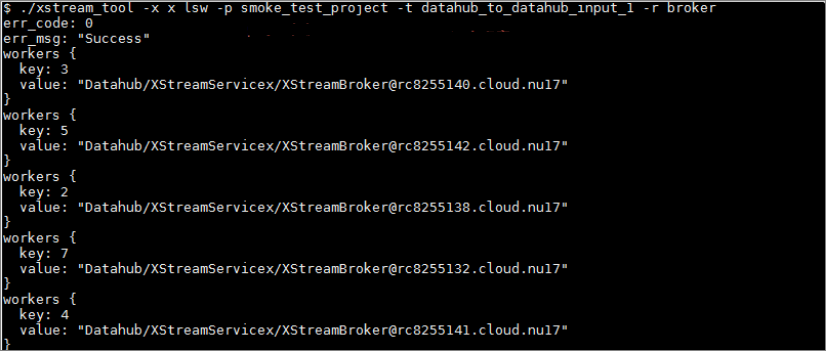

   某个shard有问题的时候可以快速定位。

> **说明**
>
> 由于Xstream_tool是DataHub的admin工具，因此除了上述已经进行示例展示的命令，建议用户不要轻易尝试其他命令。如果因工作原因确实需要执行其他命令，需要先与二线运维工程师联系。

<a id="section-1-6"></a>

## 1.6. Datahub控制台的性能页面

在Datahub控制台的性能页面，可以获取相关的DataHub性能信息，为运维提供数据支撑。

登录控制台的具体方式，请参见<em>《数据总线(Datahub)用户指南》</em>中的登录Datahub控制台章节。

Datahub控制台性能页面的入口如下：

1. 登录Datahub控制台后，在左侧的导航栏中选择**项目管理**，在右侧的项目列表中，选择需要进行性能指标查看的项目，单击列表后的**查看**，进入项目详情页面。

2. 在项目详情页面中，选择需要查看性能指标的Topic，单击该Topic后的**查看**，进入Topic详情页面。

3. 在弹出的Topic详情页面，选择**Metric统计**页签，即可查看相关的性能指标。

<a id="section-1-7"></a>

## 1.7. 大数据管家

大数据管家支持从业务、服务、集群和主机等多个角度对大数据产品进行运维。除此以外，大数据管家还支持对大数据产品进行补丁升级、自定义大数据产品的报警上报配置、查看大数据管家中的运维操作历史等。

通过大数据管家的赋能，专有云驻场人员可以轻松地管理大数据产品，例如：查看大数据产品的运行指标、修改大数据产品运行配置、查看并处理大数据产品的报警等。

大数据管家的登录方式及DataHub相关的运维操作，请参见下方的 <strong>《基于大数据管家的运维》</strong>章节。

<a id="section-2"></a>

# 2.日常维护

<a id="section-2-1"></a>

## 2.1. DataHub集群断电恢复

**操作步骤**

1. 在执行常用运维命令之前，您需要先登录到命令行操作界面。

   <ol type="i">

   <li>

   登录飞天基础运维平台。

   </li>

   <li>

   在左侧导航栏，选择**资源管理 > 产品集群运维**。

   </li>

   <li>

   在**产品列表**下，搜索DataHub集群，单击**集群详情**。

   </li>

   <li>

   在**服务列表**页签下，单击**datahub-service**服务。

   </li>

   <li>

   在**实例列表**页签下，单击目标实例对应的**Terminal**进入操作界面。

   </li>

   </ol>

2. 由于DataHub依赖飞天分布式文件系统存储数据，在意外掉电的情况下可能有丢失数据的风险，因此需要在DataHub控制台上检查飞天分布式文件系统是否丢失数据。 您可以使用admin身份通过以下命令，进行检查。

   ```text
   puadmin fs -abnchunk|grep NONE|awk '{print $1}'|awk -F"_" '{print $1}'|while read line;do puadmin whois $line;done|grep FileId|awk '{print $4}' |sort|uniq 
   >/home/admin/lostfile -- /deleted/     #开头的是⻜天分布式⽂件系统回收站⽂件，可以忽略，其他的
   ⽬录请发给⼆线运维⼯程师查看数据丢失情况
   ```

3. 根据飞天分布式文件系统丢失文件的类型进行修复。

   - 如果丢失的是DataHub数据文件，需要告知用户重建Topic。

   - 如果丢失的是其他组件meta文件，根据文件的出处，重新安装程序或者初始化Docker。

4. 完成修复后，等待飞天基础运维平台上的集群到达终态，如果不到终态请联系二线运维工程师解决。

<a id="section-2-2"></a>

## 2.2. DataHub CS下电

**前提条件**

无。

**操作步骤**

1. 设置故障机rma=pending。

   <ol type="i">

   <li>

   登录ops1机器，将要维修的故障机（下方的命令示例中用m1代替，实际场景中为具体的故障机hostname）设置action为rma=pending。

   执行：

   ```bash
   curl "http://127.0.0.1:7070/api/v5/SetMachineAction?hostname=m1" -d 
   '{"action_name":"rma", "action_status":"pending"}'
   ```

   返回：

   ```json
   {
       "err_code": 0,
       "err_msg": "",
       "data": [
           {
               "hostname": "m1"
           }
       ]
   }
   ```

   图 1. 设置action为rma=pending

   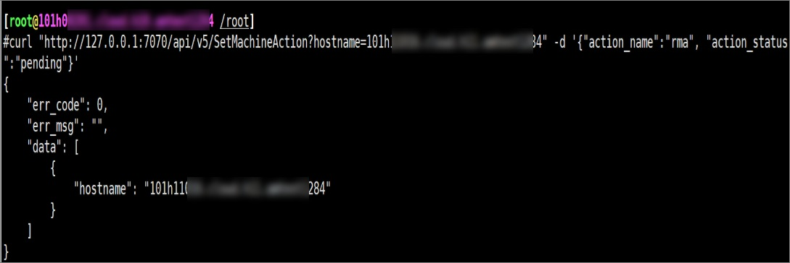

   > **说明**
   >
   > 示例中的IP地址及故障机hostname仅作为演示，用户可以根据实际情况进行替换。

   </li>

   <li>

   设置audit log。

   ```bash
   curl "http://127.0.0.1:7070/api/v5/AddAuditLog?object=/m/m1&category=action" -d '{"category":"action", "from":"tianji.HealingService#", "object":"/m/m1", "content": "
   {\n   \"action\" : \"/action/rma\",\n   \"description\" : \"/monitor/rma=error, mtime: 1513488046851649\",\n   \"status\" : \"pending\"\n}\n" }'
   ```

   > **说明**
   >
   > - 示例中的IP地址及故障机hostname仅作为演示，用户可以根据实际情况进行替换。
   >
   > - 示例中的mtime仅作为演示，具体操作时请设置为当前时间。
   >
   > - 执行如下命令，可以完成mtime的获取，此处仅为示例，仅供参考。
   >
   >   执行：
   >
   >   ```bash
   >   curl "http://127.0.0.1:7070/api/v5/GetMachineInfo?
   >   hostname=m1&attr=action_name,action_status,action_description@mtime"
   >   ```
   >
   >   返回：
   >
   >   ```json
   >   {
   >       "err_code": 0,
   >       "err_msg": "",
   >       "data": {
   >           "action_description": "",
   >           "action_description@mtime": 1516168642565661,
   >           "action_name": "rma",
   >           "action_name@mtime": 1516777552688111,
   >           "action_status": "pending",
   >           "action_status@mtime": 1516777552688111,
   >           "hostname": "m1",
   >           "hostname@mtime": 1516120875605211
   >       }
   >   }
   >   ```
   >
   >   图 2. 获取mtime
   >
   >   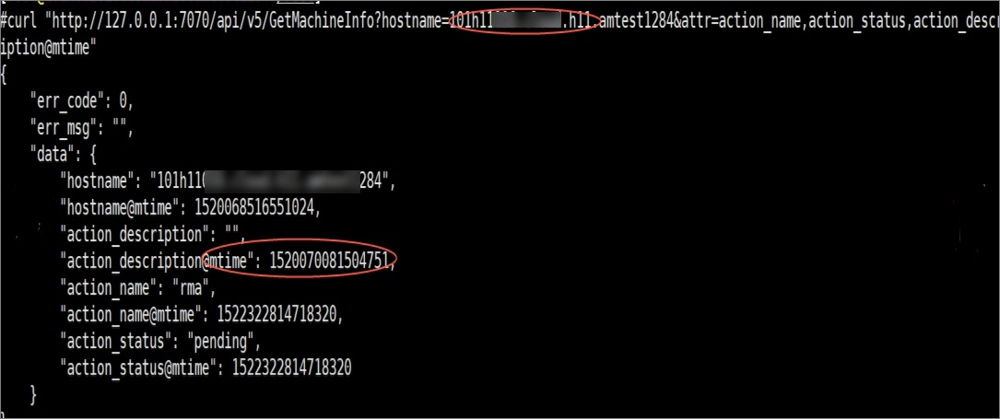

   </li>

   </ol>

2. 等待审批。

   <ol type="i">

   <li>

   查看机器action状态。

   执行：

   ```bash
   curl "http://127.0.0.1:7070/api/v5/GetMachineInfo?hostname=m1"
   ```

   返回：返回信息较多，建议查找关键字：**"action_status": "pending"**。

   当action状态为pending以后，可以通过飞天基础运维平台对需要下电的机器进行action审批。

   </li>

   <li>

   查看机器上sr的审批状态，approved/done表示已经审批完，可以关机维修。

   执行：

   ```bash
   curl http://127.0.0.1:7070/api/v5/GetMachineInfoPackage?
   hostname=m1&attr=sr.id,sr.action_name,sr.action_status
   ```

   返回：返回信息较多，建议查找关键字：**"action_status": "done"**。

   </li>

   </ol>

3. 在机器上的信息变为rma=approved/done之后，维修人员关机维修，并在维修完成后，开机启动。

4. 开机启动后，恢复机器状态（无clone）。

   ```bash
   curl "http://127.0.0.1:7070/api/v5/SetMachineAction?hostname=m1&action_name=rma" -d '
   {"action_name":"rma","action_status":"done", "force":true}'
   ```

5. 登录飞天基础运维平台，检查集群是否达到终态。

<a id="section-2-3"></a>

## 2.3. DataHub集群优雅下电

**前提条件**

无。

**操作步骤**

1. DataHub服务下线。

   <ol type="i">

   <li>

   在控制台机器上使用admin用户执行以下命令，确保没有数据返回。

   ```text
   puadmin abnchunk fs -t none
   puadmin abnchunk fs -t onecopy
   puadmin abnchunk fs -t lessmin
   ```

   </li>

   <li>

   在控制台机器上使用admin用户执行以下命令，停止所有nc机器的飞天操作系统服务。

   ```text
   r ttrl |grep disk |awk '{print $1}'  > tubo.list
   pssh -h tubo.list -i "/apsara/cloud/tool/tianji/apsarad stop"
   ```

   </li>

   <li>

   在控制台机器上使用admin用户执行以下命令，确认飞天操作系统服务已经停止。

   ```text
   pssh -h tubo.list -i "/apsara/cloud/tool/tianji/apsarad status"
   ```

   </li>

   </ol>

2. 执行下电操作。

3. DataHub服务上线。

   <ol type="i">

   <li>

   在控制台机器上使用admin用户执行以下命令，启动所有nc机器的飞天操作系统服务。

   ```text
   r ttrl |grep disk |awk '{print $1}'  > tubo.list
   pssh -h tubo.list -i "/apsara/cloud/tool/tianji/apsarad start"
   ```

   </li>

   <li>

   在控制台机器上使用admin用户执行以下命令，确认飞天操作系统服务已经正常。

   ```text
   pssh -h tubo.list -i "/apsara/cloud/tool/tianji/apsarad status"
   ```

   </li>

   </ol>

<a id="section-2-4"></a>

## 2.4. 更换pangu_cs硬盘操作

**前提条件**

需要获取以下信息：

- 主机名或IP。

- 盘符：发生故障的数据盘的盘符，例如 `/dev/sdk1` 。

- 硬盘编号：如果发生故障的数据盘对应的飞天分布式文件系统路径为 `/apsarapangu/disk(?)` ，例如/ `apsarapangu/disk5` ，那么硬盘编号就是5。该数字信息可以通过 `puadmin lscs -m` 获取。

**操作步骤**

1. 在执行常用运维命令之前，您需要先登录到命令行操作界面。

   <ol type="i">

   <li>

   登录飞天基础运维平台。

   </li>

   <li>

   在左侧导航栏，选择**资源管理 > 产品集群运维**。

   </li>

   <li>

   在**产品列表**下，搜索DataHub集群，单击**集群详情**。

   </li>

   <li>

   在**服务列表**页签下，单击**datahub-service**服务。

   </li>

   <li>

   在**实例列表**页签下，单击目标实例对应的**Terminal**进入操作界面。

   </li>

   </ol>

2. 使用admin身份执行如下命令，确认需要更换的硬盘处于DISK_ERROR状态。

   ```text
   puadmin lscs -m
   ```

   > **说明**
   >
   > 如果发现硬盘没有处于DISK_ERROR状态，则通过执行如下命令设置。
   >
   > ```text
   > puadmin cs -stat tcp://主机或IP:10260 -d 硬盘编号  --set=ERROR
   > ```

3. 执行如下命令，对存在问题的盘符做umount处理，假设待处理的硬盘为 `/dev/sdk1` 。

   ```bash
   sudo umount /dev/sdk1
   ```

   > **说明**
   >
   > 如果在 `df` 命令中的查询结果中发现此硬盘未mount，则无需做此操作。

4. 完成上述操作后，热拔插更换硬盘。

5. 将 `repair_app_disk.sh` 脚本（请联系阿里云技术支持获取）上传至目标机器，然后执行 `sudo sh repair_app_disk.sh` 命令，进行格盘操作。

6. 执行如下命令，设置飞天分布式文件系统中的硬盘状态为OK。

   ```text
   puadmin cs -stat tcp://主机或IP:10260 -d 硬盘编号  --set=OK
   ```

7. 重启服务器，识别到新硬盘。

   > **说明**
   >
   > 重启pangu_cs节点，直接kill掉进程，不会有影响。因为DataHub是分布式服务，单台cs重启不会有影响。

8. 执行如下命令，查看盘符状态已经为DISK_OK。

   ```text
   puadmin lscs -m
   ```

   用户可以到机器上再确认下该盘符下是否已经有chunks目录了，例如 `/apsarapangu/disk5/chunks/` 路径下面已经存在 `chunks/` 目录并且有chunk写进来。

<a id="section-3"></a>

# 3.基于大数据管家的运维

<a id="section-3-1"></a>

## 3.1. 登录大数据管家

本节介绍如何登录到大数据管家。

**前提条件**

- 已从部署人员或管理员处获取Apsara Uni-manager运维控制台的访问地址、用户名和密码。

  Apsara Uni-manager运维控制台访问地址格式为*region-id*.ops.console.*intranet-domain-id*。

- 推荐使用Chrome浏览器。

**操作步骤**

1. 打开浏览器。

2. 在地址栏中，输入Apsara Uni-manager运维控制台的访问地址，按回车键。

   

   > **说明**
   >
   > 您可以单击右上角的当前语言切换其它语言。当前支持简体中文、English语言切换。

3. 输入正确的用户名及密码。

   > **说明**
   >
   > - 登录Apsara Uni-manager运维控制台的用户名和密码请从部署人员或管理员处获取。
   >
   > - 若连续输入密码错误三次，系统将启动图片验证码登录功能；若连续输入错误五次，账户将被锁定，请联系管理员进行激活。
   >
   > - 首次登录Apsara Uni-manager运维控制台时，需要修改登录用户名的密码，请按照提示完成密码修改。
   >
   >   为提高安全性，密码必须满足以下要求：
   >
   >   - 必须包含英文大小写字母。
   >
   >   - 必须包含阿拉伯数字（0~9）。
   >
   >   - 必须包含特殊符号，包括感叹号（!）、at（@）、井号（#）、美元符号（$）、百分号（%）等。
   >
   >   - 密码长度为10~20个字符。

4. 单击**同意协议并登录**。

5. 进入Apsara Uni-manager运维控制台后，在顶部菜单栏单击**产品运维**。

6. 选择**大数据运维 > 大数据通用运维·大数据管家**，系统默认进入大数据管家的**仪表盘**页面。

<a id="section-3-2"></a>

## 3.2. 监控

<a id="section-3-2-1"></a>

### 3.2.1. 健康度

健康度支持查看各个大数据产品的监控项以及不同紧急程度的报警，并提供详情查看和修复后的再次检查。

**操作步骤**

1. 登录大数据管家。

2. 单击左上角的  图标，选择**DataHub**产品。

3. 在顶部菜单栏，单击**监控**。

4. 在**健康度**页签，查看健康度检查信息。

   健康度检查页面向您展示了监控项、监控来源、严重等级和监控详情等，您可以按需进行过滤。

<a id="section-3-2-2"></a>

### 3.2.2. 报表

您可以通过报表查看大数据产品的巡检结果。

**操作步骤**

1. 登录大数据管家。

2. 单击左上角的  图标，选择**DataHub**产品。

3. 在顶部菜单栏，单击**监控**。

4. 在**报表**页签，查看报表相关信息。

   报表页面向您展示了报表ID、报表名称、产品名称、模板名称、实例类型、创建信息等，支持查看详情。

<a id="section-3-3"></a>

## 3.3. 运维

<a id="section-3-3-1"></a>

### 3.3.1. DataHub运维功能和入口

本节介绍大数据管家支持的DataHub运维功能和页面入口。

**DataHub运维功能**

DataHub运维包括业务运维、服务运维、集群运维和主机运维四个功能模块，详细说明如下：

**运维功能**

**子功能**

**说明**

展示日志源的名称，对应的项目名称，Shard数量，存

日志源

储，读流量，写流量以及创建时间。

展示项目的名称，作者，日志源，读流量，写流量，存储

项目

以及创建时间。

业务运维

热点分析

展示集群各节点的shard数热点分布视图。

归档延迟

展示数据归档时的延迟情况。

展示控制服务的总体运行情况，包括服务汇总、服务状

控制服务

概览

态、运行健康、运行健康历史记录和资源使用趋势。

汇总了伏羲服务的关键运行指标，包括服务汇总、服务状

服务概览

态、运行健康、运行健康历史记录、饱和度-资源分配、CPU 使用趋势图、内存使用趋势图以及计算节点概览。

展示伏羲服务的服务角色信息，包括服务角色名称、服务

服务角色

角色的主机、服务角色的IP地址、服务角色状态和主机状

伏羲服务运维

态。

列出了伏羲服务下的计算节点，包括计算节点的加黑状态、活跃状态、总 CPU、空闲 CPU、总内存、空闲内

服务计算节点

存。同时计算节点页面还支持对计算节点进行加黑名单、去黑名单、加只读和去只读操作。

服务运维

汇总了盘古服务的关键运行指标，包括服务汇总、服务状

服务概览

态、运行健康、运行健康历史记录、饱和度-存储水位、存储变化趋势图、文件变化趋势图以及存储节点概览。

展示盘古服务的服务角色信息，包括服务角色名称、服务

服务角色

角色的主机、服务角色的IP地址、服务角色状态和主机状态。

盘古服务运维

列出了盘古服务下的存储节点，包括存储节点的总空间、

服务存储节点

剩余空间、状态、TTL、sendBuffer。同时存储节点页面还支持设置存储节点和数据盘的状态。

汇总了集群的总体运行信息，包括机器状态、服务状态、

集群概览

CPU、DISK、MEMORY、LOAD、PACKAGE、运行健康和运行健康历史记录。

支持查看集群的所有检查项、检查项的详情（提供检查项

集群健康

报警的解决方案）、各检查项在宿主上的检查状态，同时还支持直接登录宿主以及手动对宿主执行检查项检查。

展示集群中所有主机的相关信息，包括 CPU 使用率、内

集群机器列表

集群运维

存使用率、根盘的使用率、丢包率和错包率。

节点扩容和缩容

支持对 DataHub 集群中的物理主机进行扩容和缩容。

查看历史操作的记录

支持查看历史操作的记录。

支持通过 RequestId 反向解析出作业发生的时间和主机

反解析RequestId信息

的IP地址，方便客户去查找日志，定位问题。

汇总了 DataHub 集群中每个主机的总体运行信息，包括该主机当前的机器信息、机器服务角色状态，以及

主机概览

CPU、DISK、LOAD、MEMORY、PACKAGE的使用趋势图。

主机运维

服务角色

展示主机上的服务实例及服务实例的角色。

**进入DataHub运维页面**

1. 登录大数据管家。

2. 单击左上角的  图标，选择**DataHub**产品。

3. 在顶部菜单栏，单击**运维**。

   **运维**页面包括**业务运维**、**服务运维**、**集群运维**和**主机运维**四大模块。

<a id="section-3-3-2"></a>

### 3.3.2. DataHub业务运维

<a id="section-3-3-2-1"></a>

#### 3.3.2.1. DataHub业务日志源

业务日志源展示了日志源的名称、对应的项目名称、Shard数量、存储、读流量、写流量以及创建时间。

**业务日志源界面入口**

在**业务运维**页面，单击左侧导航栏的**日志源**，右侧区域会显示日志源列表信息。

**查看日志源信息**

在**日志源列表**页面，单击待查看日志源的Topic名称，在跳转的页面查看日志源的详细信息，包括Shard数量、创建时间、修改时间、当前总存储量、生命周期、类型、注释、Metric、Shard、Subscriptions、DataConnector和Schema。

其中，Metric、Shard、Subscriptions、DataConnector和Schema五个页签的功能说明如下：

- **Metric**：您可以在**Metric**页签查看准实时的Topic级别流量等信息。

- **Shard**：分片，表示对一个Topic进行数据传输的并发通道。

  显示Shard的ID、状态和活跃时长。

- **Subscriptions**：订阅服务，提供了服务端保存用户消费点位和灵活的点位重置功能。

  显示订阅服务的ID、状态、Owner、修改时间和描述。

- **DataConnector**：数据同步器，表示把DataHub服务中的流式数据同步到其他云产品中。您只需要向DataHub中写入一次数据，并在DataHub服务中配置好同步功能，便可以在各个云产品中使用这份数据。

  显示DataConnector的Name、ID、Owner、状态、创建时间和修改时间。

- **Schema**：表结构，用来约束字段的类型。

  显示字段的类型和名称。

**禁用和恢复Topic接口**

通过查看日志源信息，有时会发现DataHub出现异常流量或集群资源接近打满。此时，需要临时禁止异常Topic和低优先级Topic的读写。当保障集群稳定性异常Meta请求升高时，也需要临时禁止异常Topic的相关请求，保障集群稳定性。

此时，您可以通过单击操作列的**禁用**，在弹出的对话框中对相应的Topic进行禁用操作。禁用成功后，所有访问该Topic的请求都会报错，包括读写数据。

当问题解决后，您可以通过单击操作列的**恢复**，在弹出的对话框中对相应的Topic进行恢复操作。恢复成功后，该Topic恢复正常使用。

您可以通过日志状态列的信息了解Topic的禁用及启用情况，**off**表示为禁用状态，**on**表示为启用状态。

<a id="section-3-3-2-2"></a>

#### 3.3.2.2. DataHub业务项目

业务项目展示了项目的名称、作者、日志源、读流量、写流量、存储以及创建时间。

**业务项目界面入口**

在**业务运维**页面，单击左侧导航栏的**项目**，右侧区域会显示**项目列表**信息。

**查看项目概览**

在**项目列表**页面，单击待查看的项目名称，在**概览**页签中查看项目概览信息。

**查看项目的日志源**

在**项目列表**页面，单击待查看的项目名称，在**日志源**页签，查看项目对应的日志源。

<a id="section-3-3-2-3"></a>

#### 3.3.2.3. DataHub业务热点分析

业务热点分析展示集群各节点的Shard数热点分布视图。

**业务热点分析界面入口**

在**业务运维**页面，单击左侧导航栏的**热点分析**，在右侧区域可以直观地查看到集群各节点的Shard数热点分布视图。

**热点分析视图刷新及筛选**

在**热点分析**页面，可以通过单击**SHARD数**刷新热点分布视图；同时，支持过滤功能，对数据进行筛选。

其中，**qps**指的是集群中机器级别的每秒请求量。如果个别机器**qps**高，说明可能这台机器请求量高于其他机器，可能存在热点。

> **说明**
>
> - 集群正常的情况下，至少有4行数据（最小集群规模4台服务器）。
>
> - 其中至少有2行的**qps**不为N/A（即4台服务器中至少2台服务器是Frontend角色，有**qps**值）。显示为N/A的服务器，代表该服务器仅是Chunkserver角色，无Frontend混部或代表该机器异常。

<a id="section-3-3-2-4"></a>

#### 3.3.2.4. DataHub业务归档延迟

业务归档延迟展示了数据归档时的延迟情况。

**业务归档延迟界面入口**

在**业务运维**页面，单击左侧导航栏的**归档延迟**，右侧区域会显示归档任务的列表信息。

**查看归档延迟信息**

在**归档任务列表**页面，对**地域集群**进行选择后，可以查看目标集群的**Project名称**、**Topic名称**、**归档类型**、**订阅ID**和**最近归档时间**。支持通过关键词进行搜索和排序。

您还可以通过单击归档任务的**Topic名称**跳转到**日志源**页面，在**DataConnector**页签下，获取详细的归档信息，用以解决问题。

<a id="section-3-3-3"></a>

### 3.3.3. DataHub服务运维

<a id="section-3-3-3-1"></a>

#### 3.3.3.1. 控制服务运维

控制服务概览页面简要展示控制服务的总体运行情况，包括服务汇总、服务状态和资源使用趋势。

**控制服务运维入口**

1. 登录大数据管家。

2. 在左上方单击  图标，然后选择**DataHub**产品。

3. 在DataHub页面中，单击上方的**运维**，然后选择**服务运维**。

4. 在**服务运维**页面左侧的导航栏中选择**控制服务**，右侧默认显示控制服务的**概览**页面。

<a id="section-3-3-3-2"></a>

#### 3.3.3.2. Datahub伏羲服务运维

<a id="section-3-3-3-2-1"></a>

##### 3.3.3.2.1. DataHub伏羲服务运维入口

本节介绍在大数据管家上如何进入DataHub的伏羲服务运维页面。

**操作步骤**

1. 登录大数据管家。

2. 在左上方单击  图标，然后选择**DataHub**产品。

3. 在DataHub页面中，单击上方的**运维**，然后单击**服务运维**。

4. 在**服务运维**页面左侧的导航栏中单击**伏羲服务**，然后在右侧选择集群，进入该集群伏羲服务的**概览**页面。

<a id="section-3-3-3-2-2"></a>

##### 3.3.3.2.2. DataHub伏羲服务概览

概览界面汇总了伏羲服务的关键运行指标，包括服务汇总、服务状态、饱和度-资源分配、CPU使用趋势图、内存使用趋势图以及计算节点资源概览。

**伏羲服务概览界面入口**

1. 在**服务运维**界面左侧的导航栏中，单击**伏羲服务**。

2. 在右侧选择集群，然后再单击**概览**页签，进入伏羲服务的**概览**页面。

   您可以查看目标集群的服务汇总、服务状态、饱和度-资源分配、CPU使用趋势图、内存使用趋势图和计算节点资源概览信息。

   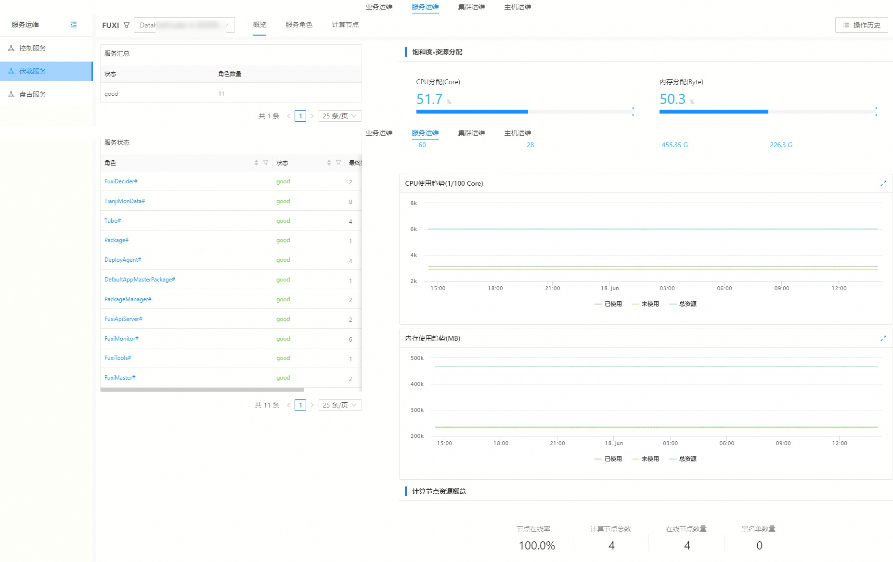

**服务汇总**

服务汇总包含可用状态、不可用状态和升级状态的角色数量。


**服务状态**

展示所有的伏羲服务的服务角色及其状态，并且统计每个服务角色的最终数和终态数。

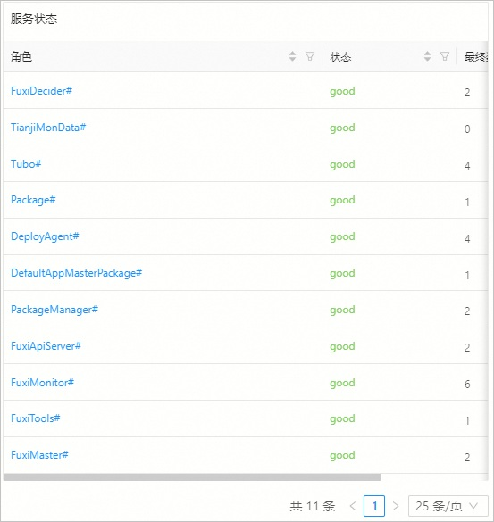

**饱和度-资源分配**

展示CPU和内存资源的分配情况：

- CPU分配：展示CPU的使用率，以及CPU的总Core数、剩余数和SQL加速使用数。

- 内存分配：展示内存使用率，以及内存的总量、剩余量和SQL加速使用量。

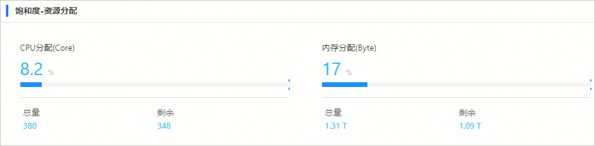

**CPU和内存使用趋势**

按时间以不同颜色的曲线展示伏羲服务的CPU和内存使用趋势，包括已使用、未使用和总资源。

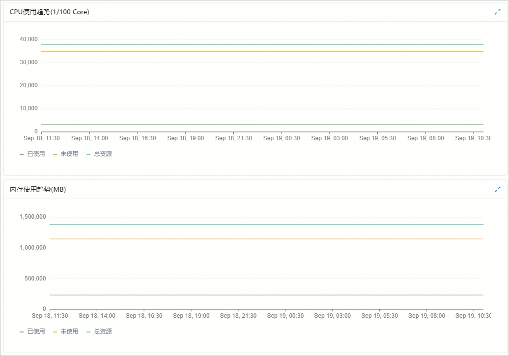

单击图右上角的  图标，放大使用趋势图，以CPU为例。

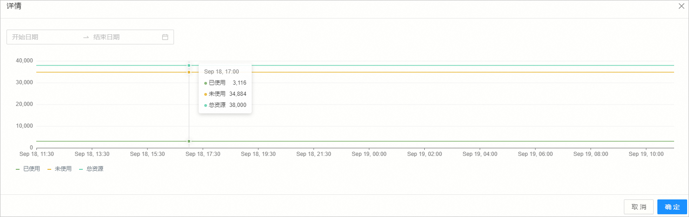

在放大图中，您可在左上方指定时间段来查看集群的CPU使用趋势图。

**计算节点资源概览**

汇总了伏羲服务的计算节点资源信息，包括节点在线率、计算节点总数、在线节点数量和黑名单数量。


<a id="section-3-3-3-2-3"></a>

##### 3.3.3.2.3. DataHub伏羲服务角色

伏羲服务角色页面展示了伏羲服务的服务角色信息，包括服务角色名称、服务角色的主机、服务角色的IP地址、服务角色状态和主机状态。

**操作步骤**

1. 在**服务运维**界面左侧的导航栏中，单击**伏羲服务**。

2. 在右侧选择集群，然后再单击**服务角色**，进入伏羲服务的服务角色界面。

   服务角色界面展示伏羲服务的服务角色信息，可以查看服务角色名称、服务角色的主机、服务角色的IP地址、服务角色状态和主机状态。

<a id="section-3-3-3-2-4"></a>

##### 3.3.3.2.4. DataHub伏羲服务计算节点

计算节点页面列出了伏羲服务下的计算节点，包括计算节点的加黑状态、活跃状态、总CPU、空闲CPU、总内存、空闲内存。同时计算节点页面还支持对计算节点进行加黑名单、去黑名单、加只读和去只读操作。

**伏羲服务计算节点页面入口**

1. 在**服务运维**页面左侧的导航栏中，单击**伏羲服务**。

2. 在右侧选择集群，然后再单击**计算节点**页签，进入伏羲服务的**计算节点**页面。

   计算节点用于查看伏羲服务下的计算节点信息，包括计算节点的加黑状态、活跃状态、总 CPU、空闲CPU、总内存、空闲内存。

**黑名单和只读操作**

支持对计算节点进行**加黑名单**、**去黑名单**、**加只读**和**去只读**操作，下面以加黑名单为例进行介绍，其他操作与此相同。

1. 在**计算节点**列表页，单击目标计算节点后面的**操作 > 加黑名单**。

2. 在弹出的对话框中单击**执行**，系统提示操作已提交。

   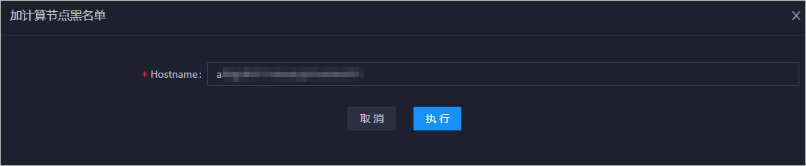

   > **说明**
   >
   > **Hostname**参数会自动填充为待操作的计算节点，无需手动填写。

   操作完成后，可在**计算节点**列表中查看已操作的计算节点的**加黑状态**。

<a id="section-3-3-3-3"></a>

#### 3.3.3.3. DataHub盘古服务运维

<a id="section-3-3-3-3-1"></a>

##### 3.3.3.3.1. DataHub盘古服务运维入口

本节介绍在大数据管家上如何进入DataHub的盘古服务运维页面。

**操作步骤**

1. 登录大数据管家。

2. 在左上方单击  图标，然后选择**DataHub**产品。

3. 在DataHub页面中，单击上方的**运维**，然后选择**服务运维**。

4. 在**服务运维**页面左侧的导航栏中单击**盘古服务**，然后在右侧选择集群，进入该集群盘古服务的**概览**页面。

<a id="section-3-3-3-3-2"></a>

##### 3.3.3.3.2. DataHub盘古服务概览

概览汇总了盘古服务的关键运行指标，包括服务汇总、服务状态、饱和度-存储水位、物理存储容量、文件变化趋势图以及存储节点概览。

**概览入口**

1. 在**服务运维**界面左侧的导航栏中，单击**盘古服务**。

2. 在右侧选择集群，然后再单击**概览**页签，进入盘古服务的**概览**页面。

   **概览**页面汇总了盘古服务的关键运行指标，包括服务汇总、服务状态、饱和度-存储水位、存储变化趋势图、文件变化趋势图以及存储节点概览。

**服务汇总**

支持查看盘古服务的**状态**以及**角色数量**。

**服务状态**

展示所有的盘古服务的服务**角色**及其**状态**，并且统计每个服务角色的**最终数**和**终态数**。

**饱和度-存储水位**

支持查看盘古的存储水位和文件数水位：

- **存储水位**：展示存储空间的使用率，以及存储空间的总大小、剩余大小和回收站大小。

- **文件数水位**：展示文件数的使用率，以及文件数的上限、已用数和回收站的文件数。

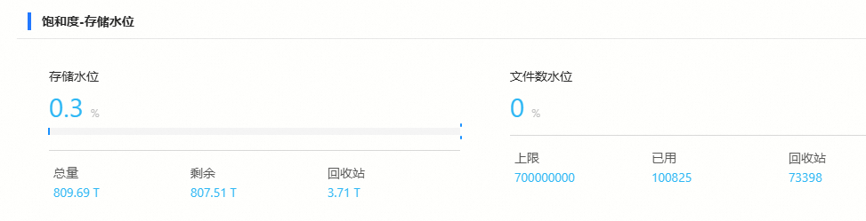

**存储和文件变化趋势**

按时间以不同颜色的曲线展示盘古的物理存储容量和文件的变化趋势，物理存储容量变化趋势指标包括总存储、已用存储和存储使用率，文件变化趋势指标包括文件数。

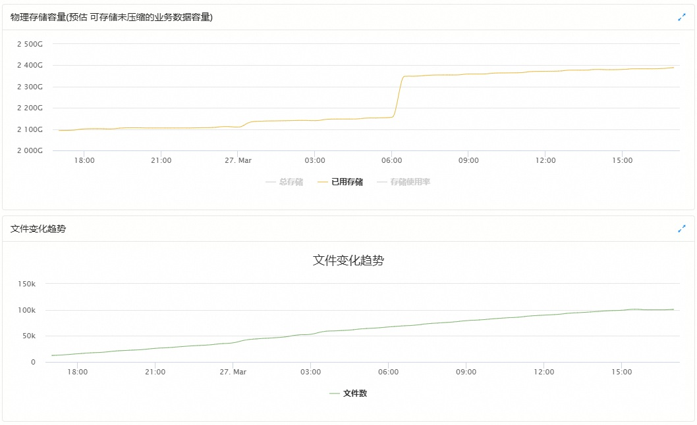

单击图右上角的  图标，放大使用趋势图，以存储变化趋势为例。

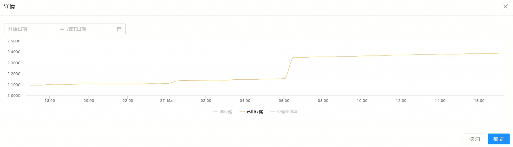

在放大图中，您可在左上方指定时间段来查看集群的存储使用趋势图。

**存储节点概览**

汇总了盘古服务的存储节点资源信息，包括数据节点总数、正常节点数量、数据盘总数、正常盘数量、坏节点比例、坏盘比例。


<a id="section-3-3-3-3-3"></a>

##### 3.3.3.3.3. DataHub盘古服务角色

盘古服务角色展示了盘古服务的服务角色信息，包括服务角色名称、服务角色的主机、服务角色的IP地址、服务角色状态和主机状态。

**盘古服务实例界面入口**

1. 在**服务运维**界面左侧的导航栏中，单击**盘古服务**。

2. 在右侧选择集群，然后再单击**服务角色**页签，进入盘古服务的**服务角色**界面。

   您可以查看盘古服务的服务角色信息，包括服务角色名称、服务角色的主机、服务角色的IP地址、服务角色状态和主机状态。

**盘古服务实例支持的操作**

支持按列过滤和按列排序便捷查看操作。

切换盘古Master和对盘古Master执行Checkpoint的操作，请分别参见切换盘古的Master和在盘古Master上执行Checkpoint。

<a id="section-3-3-3-3-4"></a>

##### 3.3.3.3.4. DataHub盘古服务存储节点

本节介绍如何查看盘古服务的存储概览和存储节点信息，以及如何设置存储节点和数据盘的状态。

**存储概览入口**

1. 进入DataHub盘古服务运维页面。

2. 切换至**存储**页签，默认进入**存储概览**页面。

   > **说明**
   >
   > **存储概览**页面用于展示盘古的**rebalance状态**、**指标**和**机架维度**相关信息。

**设置存储节点状态**

支持设置存储节点的状态为**关闭**和**正常**，下面以设置存储节点为关闭状态为例进行介绍，设置为正常状态的操作与此相似。

1. 在**存储节点**页面，单击目标存储节点后面的**操作 > 设置存储节点为关闭状态**。

2. 在**设置存储节点为关闭状态**面板中，单击**执行**，系统提示操作已提交。

   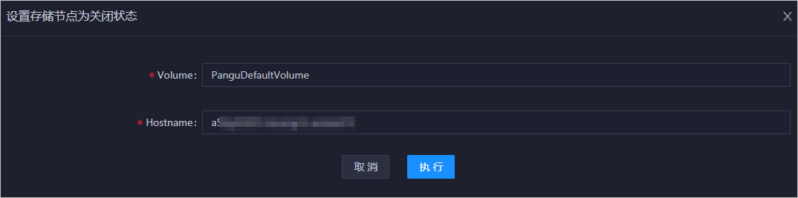

   > **说明**
   >
   > **Volume**和**Hostname**会根据您选择的目标存储节点自动加载，无需手动填写。

   操作完成后，可在存储节点列表中查看已操作的存储节点的状态。

**设置数据盘状态**

支持设置数据盘的状态为**错误**和**正常**，下面以设置数据盘为错误状态为例进行介绍，设置为正常状态的操作与此相似。

1. 在**存储节点**页面，单击目标存储节点后面的**操作 > 设置数据盘为错误状态**。

2. 在**设置数据盘为错误状态**面板中填写**Diskid**信息。

   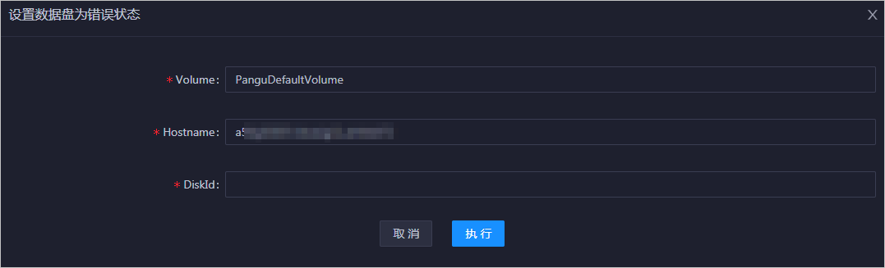

   > **说明**
   >
   > **Volume**和**Hostname**会根据您选择的待操作存储节点自动加载，无需手动填写。

3. 完成上述参数配置后，单击**执行**，系统提示操作已提交。

<a id="section-3-3-3-3-5"></a>

##### 3.3.3.3.5. 清理盘古的回收站

大数据管家支持清理飞天分布式文件系统的回收站，以释放存储空间。

**前提条件**

已获取具有DataHub管理权限的大数据管家账号。

**操作步骤**

1. 在**服务运维**页面左侧的导航栏中单击**盘古服务**，然后在右侧选择集群，进入该集群盘古服务的**概览**页面。

2. 单击右上角的**操作**，选择**清理系统回收站**。

3. 在弹出的对话框中，设置**volume**（默认为**PanguDefaultVolume**）。

4. 完成上述参数配置后，单击**执行**，系统提示提交成功。

5. 查看清理系统回收站任务的执行状态。

   单击**操作**，然后再单击**清理系统回收站**后面的**历史**，查看清理系统回收站的执行历史。

   其中，状态为**RUNNING**表示执行中，状态为**SUCCESS**表示执行成功，状态为**FAILED**表示执行失败。

6. 单击目标任务后面的**详情**，在**清理系统回收站**页面，单击失败步骤中的**清理系统回收站 > 机器详情 > 查看详情**，定位操作步骤的失败原因。

   > **说明**
   >
   > 可以结合**参数配置**、**机器详情**和**执行参数**综合分析任务失败原因。

<a id="section-3-3-3-3-6"></a>

##### 3.3.3.3.6. 开启和关闭盘古的数据自动均衡

大数据管家支持DataHub开启和关闭飞天分布式文件系统的数据自动平衡功能。

**前提条件**

已获取具有DataHub运维权限的大数据管家账号。

**关闭数据自动平衡**

1. 在**服务运维**页面左侧的导航栏中单击**盘古服务**，然后在右侧选择集群，进入该集群盘古服务运维页面。

2. 在右上角单击**操作**，选择**关闭数据自动平衡**。

3. 在弹出的对话框中，设置**volume**（默认为**PanguDefaultVolume**）。

4. 完成上述参数配置后，单击**执行**，系统提示提交成功。

5. 查看关闭数据自动平衡任务的执行状态。

   单击**操作**，然后再单击**关闭数据自动平衡**后面的**历史**，查看关闭数据自动平衡的执行历史。

   状态为**RUNNING**表示执行中，状态为**SUCCESS**表示执行成功，状态为**FAILED**表示执行失败。

6. 如果任务执行失败，您可单击执行记录后面的**详情**，定位任务失败的原因，详见定位开启和关闭数据自动平衡失败的原因。

**开启数据自动平衡**

1. 在**服务运维**页面左侧的导航栏中选择**盘古服务**，然后在右侧选择集群，进入该集群盘古服务运维页面。

2. 在右侧单击**操作**并选择**开启数据自动平衡**。

3. 在弹出的对话框中设置**volume**（默认为**PanguDefaultVolume**）。

4. 完成上述参数配置后，单击**执行**，系统提示提交成功。

5. 查看开启数据自动平衡任务的执行状态。

   单击**操作**，然后再单击**开启数据自动平衡**后面的**历史**，查看开启数据自动平衡的执行历史。

   状态为**RUNNING**表示执行中，状态为**SUCCESS**表示执行成功，状态为**FAILED**表示执行失败。

6. 如果任务执行失败，您可单击执行记录后面的**详情**，定位任务失败的原因，详见定位开启和关闭数据自动平衡失败的原因。

**定位开启和关闭数据自动平衡失败的原因**

以定位开启数据自动平衡的失败原因为例进行介绍。

1. 单击右上角的**操作**，然后单击**开启数据自动平衡**后的**历史**。

2. 在**执行历史**面板中，单击执行失败任务的操作后面的**详情**，查看作业执行的详细信息。

3. 在作业执行详情页面，单击失败步骤中**机器详情**页签下的**查看详情**，定位操作步骤的失败原因。

   > **说明**
   >
   > 可以结合**参数配置**、**机器详情**和**执行参数**综合分析任务失败原因。

<a id="section-3-3-3-3-7"></a>

##### 3.3.3.3.7. 在盘古Master上执行Checkpoint

大数据管家支持DataHub对飞天分布式文件系统执行Checkpoint（检查点）操作，该操作可将当前内存中的数据写入到磁盘中。当飞天分布式文件系统出现故障时，可通过检查点将数据快速恢复到故障前的状态，保证数据的一致性。

**前提条件**

已获取具有DataHub运维权限的大数据管家账号。

**操作步骤**

1. 在**服务运维**界面左侧的导航栏中单击**盘古服务**，然后在右侧选择集群，进入该集群盘古服务运维界面。

2. 在右上角单击**操作**，并选择**Master执行Checkpoint**。

3. 在弹出的对话框中设置**volume**（默认为**PanguDefaultVolume**）。

4. 完成上述参数配置后，单击**执行**，界面提示提交成功。

5. 查看Checkpoint任务的执行状态。

   单击**操作**，然后再单击**Master执行Checkpoint**后面的**历史**，查看Checkpoint任务的执行历史。

   状态为**RUNNING**表示执行中，状态为**SUCCESS**表示执行成功，状态为**FAILED**表示执行失败。

6. 如果Checkpoint任务执行失败，您可单击执行记录后面的**详情**，定位操作步骤的失败原因。

   > **说明**
   >
   > 可以结合**参数配置**、**机器详情**和**执行参数**综合分析任务失败原因。

<a id="section-3-3-3-3-8"></a>

##### 3.3.3.3.8. 切换盘古的Master

大数据管家支持DataHub对飞天分布式文件系统的Master组中的机器执行主备切换（Primary和Secondary）。主备切换后，原Primary机器变为Secondary，目标Secondary机器变为Primary。

**前提条件**

- 已获取具有DataHub管理权限的大数据管家账号。

- 已获取Volume中Master组中各机器的工作状态（Primary或Secondary）。查询机器工作状态的方法：通过飞天基础运维平台登录DataHub集群中的<strong>PanguTools#</strong>服务所在的机器，然后执行  `puadmin gems` 命令。

- 已获取目标机器的Hostname，目标机器是一个待切换为Primary的Secondary机器。查看目标机器Hostname的方法：在大数据管家的 **DataHub > 服务运维 > 盘古服务 > 服务角色** 界面中查看<strong>PanguMaster#</strong>的主机。

**背景信息**

在飞天分布式文件系统中，Volume相当于Namespace概念，默认的Volume为PanguDefaultVolume，如果集群中机器数量巨大，则可能会有多个Volume。每个Volume中均有一组Master机器，其中一个为Primary，两个为Secondary。

**操作步骤**

1. 在**服务运维**界面左侧的导航栏中单击**盘古服务**，然后在右侧选择集群，进入该集群盘古服务的**概览**界面。

2. 单击**操作**并选择**Master执行切换**，在弹出的对话框中设置各参数。

   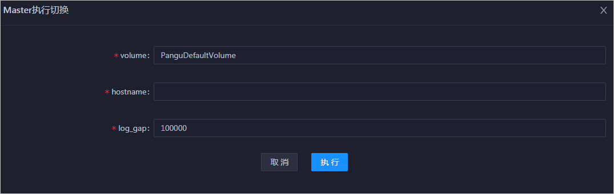

   关键参数说明如下：

   - **volume**：默认为**PanguDefaultVolume**。在有多个 Volume 的集群中，如果需要对其他Volume 进行主备切换，请根据实际需要填写。

   - **hostname**：目标机器的 Hostname，目标机器是一个待切换为 Primary 的 Secondary 机器。

   - **log_gap**：切换时，系统会检查 Primary 和 Secondary 之间的日志交易数量差，如果差值小于设定值（默认为**100000**），则允许执行该切换操作，否则不允许执行。

3. 完成上述参数配置后，单击**执行**，界面提示提交成功。

4. 查看任务的执行状态。

   单击**操作**，然后再单击**Master执行切换**后面的**历史**，查看任务的执行历史。

   状态为**RUNNING**表示执行中，状态为**SUCCESS**表示执行成功，状态为**FAILED**表示执行失败。

5. 在作业执行详情页面，单击失败步骤中**机器详情**页签下的**查看详情**，定位操作步骤的失败原因。

   > **说明**
   >
   > 可以结合**参数配置**、**机器详情**和**执行参数**综合分析任务失败原因。

<a id="section-3-3-4"></a>

### 3.3.4. DataHub 集群运维

<a id="section-3-3-4-1"></a>

#### 3.3.4.1. DataHub集群运维入口

本节介绍在大数据管家上如何进入DataHub的集群运维页面。

**操作步骤**

1. 登录大数据管家。

2. 在左上方单击  图标，然后选择**DataHub**产品。

3. 在DataHub页面中，单击上方的**运维**，选择**集群运维**。

<a id="section-3-3-4-2"></a>

#### 3.3.4.2. DataHub集群概览

集群概览汇总了集群的主要运行指标以及健康检查结果，包括机器状态、服务状态、运行健康、运行健康历史记录，以及CPU、DISK、MEMORY、LOAD和PACKAGE使用趋势图。

**集群概览入口**

1. 在**集群运维**页面下，选择某个集群。

2. 单击**概览**页签。

   该页面展示的各区域信息说明如下。

**机器状态**

统计出了集群中各种运行状态的机器数量，运行状态包括good、bad和upgrading。

**服务状态**

汇总了集群中所有服务，并统计出了每个服务的正常运行（good）数量和异常运行（bad）数量。

**运行健康**

统计集群当前的巡检项总数量，以及集群中的 CRITICAL、WARNING 和 EXCEPTION 的报警数量。


单击**查看详情**，跳转到DataHub集群健康界面，查看健康检查的详细信息。

**运行健康历史记录**

展示集群健康检查的历史记录。

单击**查看详情**，跳转到DataHub集群健康界面，查看健康检查的详细信息。


单击每次检查的**事件内容**，查看此次检查的异常项。

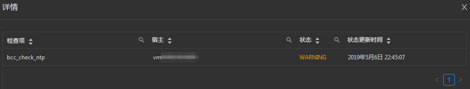

**CPU**

按时间以不同颜色的曲线展示集群的CPU使用率（支持指定时间段），包括CPU的总使用率（cpu）、系统对CPU的使用率（sys）和用户对CPU的使用率（user）。

单击图右上角的  图标，放大CPU使用趋势图。

在放大图中，您可在左上方指定时间段来查看集群的 CPU 使用率。

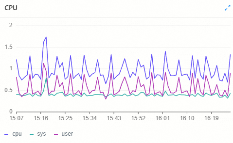

**DISK**

按时间展示集群的存储空间使用率。

单击图右上角的  图标，放大DISK使用趋势图。

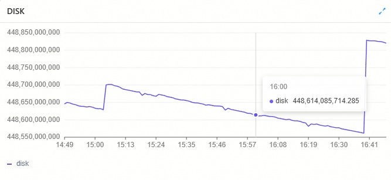

在放大图中，您可在左上方指定时间段来查看集群的存储空间使用率。

**MEMORY**

按时间以不同颜色的曲线展示集群的内存使用量，包括内存使用率 （mem）、总内存大小（total）、已使用的内存大小（used）、buff使用的内存使用量（buff）、Cache使用的内存大小（cach）和空闲内存大小（free）。

单击图右上角的  图标，放大MEMORY使用趋势图。

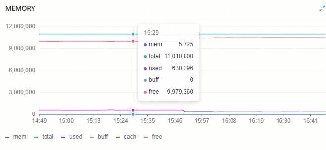

在放大图中，您可在左上方指定时间段来查看集群的内存使用量。

**PACKAGE**

按时间以不同颜色的曲线展示集群的数据传输情况，包括丢包数量（drop）、错误包数量（error）、接收包数量（in）和发送包数量（out）。

单击图右上角的  图标，放大PACKAGE趋势图。

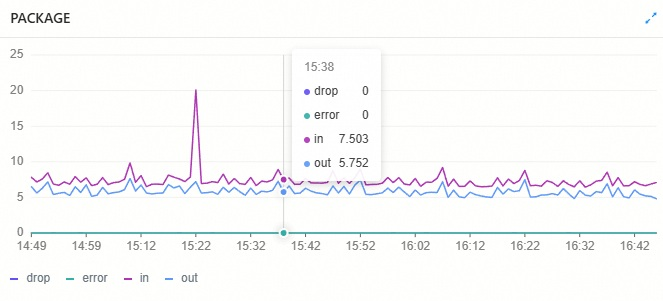

在放大图中，您可在左上方指定时间段来查看集群的数据传输情况。

**LOAD**

按时间以不同颜色的曲线展示集群的一分钟 、五分钟和十五分钟系统平均负载。

单击图右上角的  图标，放大LOAD使用趋势图。

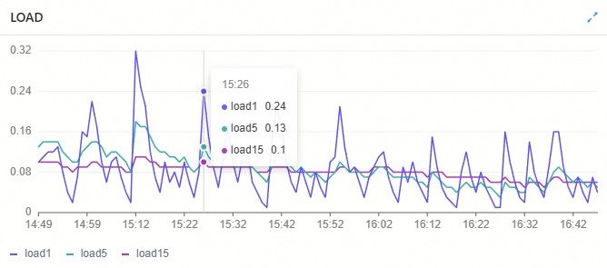

在放大图中，您可在左上方指定时间段来查看集群的一分钟 、五分钟和十五分钟系统平均负载。

<a id="section-3-3-4-3"></a>

#### 3.3.4.3. DataHub集群健康

集群健康界面展示了集群的所有检查项、检查项的详情（提供检查项报警的解决方案）、各检查项在宿主上的检查状态，同时还支持直接登录宿主以及手动对宿主执行检查项检查。

**集群健康入口**

在**集群运维**界面，选择**健康**页签，进入集群健康界面。

**查看监控项详情**

1. 在集群**健康**页签，单击目标监控项**操作**栏中的**详情**，在弹出的对话框中查看监控项详情。

   监控项详情包括**名称**、**来源**、**别名**、**所属应用**、**类型**、**调度是否开启**、**系统默认参数列表**、**用户自定义参数列表**和**描述**，其中描述中附有检查项报警的解决方案。

2. 单击下方的**显示更多**，查看监控项的更多信息。

   监控项更多信息包括**执行脚本**、**执行目标**、**系统默认阈值判定**和**用户自定义阈值判定**。

**查看报警的宿主以及报警原因**

通过监控项的宿主，您可查看该监控项是对宿主的历史检查记录以及检查结果。

1. 在集群**健康**页签，单击存在报警的监控项前面的  图标，查看该监控项所有的**宿主**信息。

2. 单击**宿主**名，然后在弹出的对话框中单击某个报警后面的**详情**，可在右侧查看报警原因。

   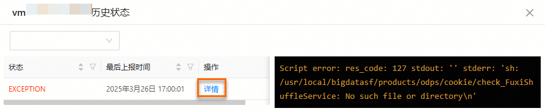

**处理监控项报警**

在集群**健康**页签，单击存在报警的监控项后面的**详情**，在**详情**弹窗中查看监控项报警的处理方法。

**再次检查**

处理完某个报警后，您可在集群**健康**页签，单击目标宿主后面的**操作 > 再次检查**，对该宿主进行一次该检查项的实时检查，以确定该宿主的报警是否恢复。

<a id="section-3-3-4-4"></a>

#### 3.3.4.4. DataHub集群机器列表

机器列表界面展示了当前集群中所有机器的相关信息，包括主机名、IP地址、角色、类型和节点扩缩容入口。

**集群机器列表入口**

在**集群运维**界面，选择**机器列表**页签，进入**机器列表**界面。

如果需要查看更详细的机器信息，单击机器的**Hostname**，即可跳转到机器的主机概览界面。

<a id="section-3-3-4-5"></a>

#### 3.3.4.5. DataHub节点扩容

本章节介绍如何在大数据管家中对DataHub集群物理主机进行扩容，扩容是指把物理主机从飞天基础运维平台Default集群扩容到DataHub集群。DataHub集群物理主机包括cs机器和frontend机器。

**前提条件**

- 待扩容的物理主机已加入到飞天基础运维平台Default集群。

- 飞天基础运维平台Default集群中存在**产品**为**DataHub**类型的主机。

  > **说明**
  >
  > 当前DataHub集群仅支持对**cs**和**frontend**节点进行扩容。

**背景信息**

在专有云环境中，集群扩容是一个复杂的事情，首先新增物理主机需要通过Apsara Stack规划系统和飞天基础运维平台进行相关配置，以加入飞天基础运维平台的Default集群，飞天基础运维平台Default集群相当于一个空闲的资源池，可直接为各业务集群提供扩容资源。业务集群扩容一般是指把物理主机从飞天基础运维平台Default集群扩容到业务集群，缩容一般是把物理主机从业务集群缩容到飞天基础运维平台Default集群。

**步骤一 获取待扩容主机的Hostname**

1. 登录大数据管家。

2. 在左上方单击  图标，然后选择**TIANJI**产品，即可直接登录到飞天基础运维平台。

3. 在左侧导航栏，选择**资源管理 > 机器管理**。

4. 在**机器管理**页面，查找**default**集群中的任一**datahub**产品，然后复制其**Hostname**即可。

**步骤二 扩容DataHub节点**

DataHub节点扩容支持同时扩容多个主机。扩容时，您需要指定一个已有主机为模板主机，新扩容主机会从模板主机上克隆所有服务，从而达到节点扩容的目的。

1. 在**集群运维**页面左侧选择集群，然后在**机器列表**页面中选中任一**cs**或**frontend**角色的主机作为模板主机。

   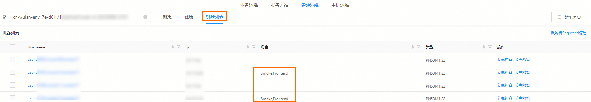

2. 选择**操作 > 节点扩容**，然后在弹出的**节点扩容**对话框中设置各参数。

   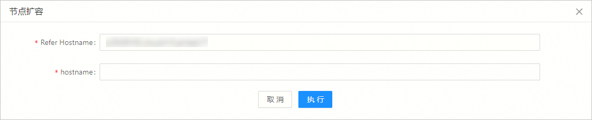

   参数说明如下：

   - **Refer_hostname**：模板主机的**Hostname**，自动填充为选中的主机。

   - **hostname**：待扩容主机的**Hostname**，从下拉列表框中选择（可多选），下拉列表中列出了Default 集群中所有可供 DataHub扩容的主机。

3. 完成上述参数配置后，单击**执行**，页面提示提交成功。

4. 查看节点扩容的执行状态。

   单击**操作历史**，可查看节点扩容的历史操作记录。

   节点扩容需要比较长的时间，请您耐心等待。状态为 **RUNNING** 表示执行中，状态为 **FAILED** 表示执行失败，状态为 **SUCCESS** 表示执行成功。

5. 执行过程中，您可单击操作记录后面的**详情**，查看该操作的执行步骤和进度。

6. 如果节点扩容失败（**FAILED**），您可单击**详情**，定位失败原因，详情请参见失败原因定位。

**失败原因定位**

1. 在**集群运维**界面，单击**操作**，然后再单击**节点缩容**后面的**历史**，查看节点缩容的历史操作记录。

2. 单击某个失败的操作记录后面的**详情**，定位操作执行失败的原因。

   结合**参数配置**、**机器详情**和**执行参数**来定位操作步骤的失败原因。

<a id="section-3-3-4-6"></a>

#### 3.3.4.6. DataHub节点缩容

本章节介绍如何在大数据管家中对DataHub集群物理主机进行缩容，缩容是指把物理主机从DataHub集群缩容到飞天基础运维平台Default集群。DataHub集群物理主机包括cs机器和frontend机器。

**背景信息**

在专有云环境中，集群扩容是一个复杂的事情，首先新增物理主机需要通过Apsara Stack规划系统和飞天基础运维平台进行相关配置，以加入飞天基础运维平台的Default集群，飞天基础运维平台Default集群相当于一个空闲的资源池，可直接为各业务集群提供扩容资源。业务集群扩容一般是指把物理主机从飞天基础运维平台Default集群扩容到业务集群，缩容一般是把物理主机从业务集群缩容到飞天基础运维平台Default集群。

**前提条件**

- 当前DataHub集群仅支持对**cs**和**frontend**节点进行缩容。

- 缩容**cs**机器前：

  - 请通过 `df` 命令查看每台机器的磁盘负载，计算缩容n台后是否会导致磁盘满，如果磁盘满了，不建议缩容。

  - 缩容机器会导致机器上的shard迁移到其他机器上，因此请登录webconsole虚拟机，计算缩容后机器shard负载，如果机器上shard个数超过1000个，可能会影响性能，不建议缩容。

- 缩容**frontend**机器前：

  - 请通过 `df` 命令查看每台机器的磁盘负载，计算缩容n台后是否会导致磁盘满，如果磁盘满了，不建议缩容。

  - 缩容机器会导致机器上的shard迁移到其他机器上，因此请登录webconsole虚拟机，计算缩容后机器shard负载，如果机器上shard个数超过1000个，可能会影响性能，不建议缩容。

  - 查看流量和QPS，如果流量超过400MB，或者QPS超过了15000时，不建议缩容。

**操作步骤**

1. 在**集群运维**页面左侧选择集群，然后在**机器列表**页面中选中待缩容的**cs**或**frontend**角色的主机（可多选）。

   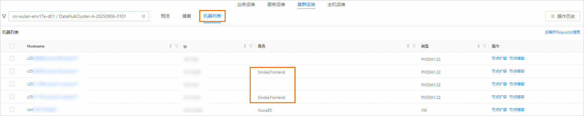

2. 选择**操作 > 节点缩容**，弹出**节点缩容**对话框。

   **Hostname**：待缩容主机的**Hostname**，自动填充为选中的主机。

   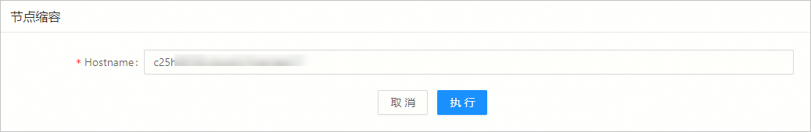

3. 完成上述参数配置后，单击**执行**，页面提示操作已提交。

4. 查看节点缩容的执行状态。

   

   节点缩容需要比较长的时间，请您耐心等待。状态为**RUNNING**表示执行中，状态为**FAILED**表示执行失败，状态为**SUCCESS**表示执行成功。

   > **说明**
   >
   > 如果状态为**FAILED**，请参见失败原因定位。

5. <strong>可选：</strong>查看节点缩容的执行进度。

   如果执行状态为**RUNNING**，则您可单击操作记录后面的**详情**，查看该操作的执行步骤和进度。

   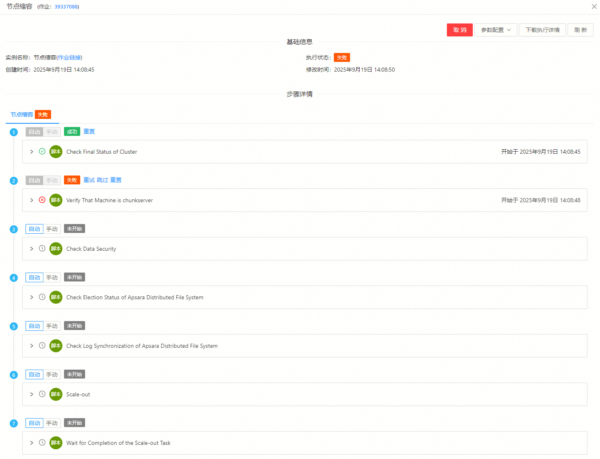

**失败原因定位**

1. 在**集群运维**界面，单击**操作历史**，查看节点缩容的历史操作记录。

2. 单击某个失败的操作记录后面的**详情**，定位操作执行失败的原因。

   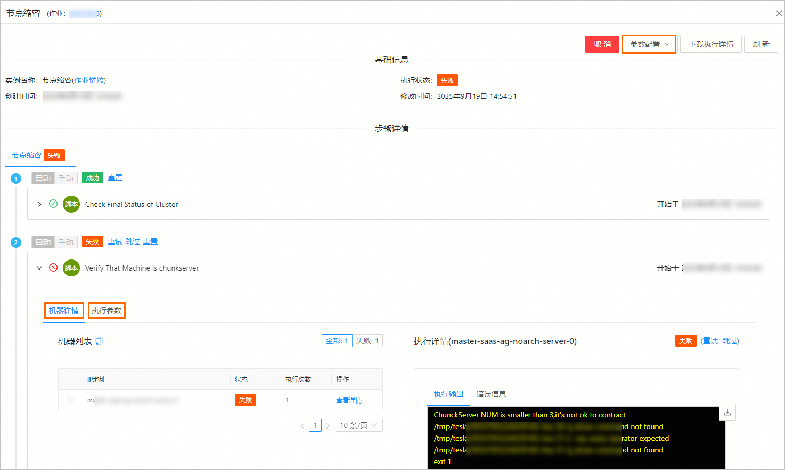

   结合**参数配置**、**机器详情**和**执行参数**等信息来定位操作步骤的失败原因。

<a id="section-3-3-4-7"></a>

#### 3.3.4.7. DataHub反解析RequestId信息

大数据管家支持DataHub通过RequestId反向解析出作业发生的时间和主机的IP地址，方便客户查找日志，定位问题。

**操作步骤**

1. 在**集群运维**页面，选择**机器列表**页签，进入**机器列表**页面。

2. 单击**反解析RequestId信息**，然后在弹出的**反解析RequestId信息**对话框中输入**Request Id**。

3. 单击**执行**，页面提示提交成功。

4. 查看反解析RequestId任务的执行状态。

   单击**操作历史**，可以查看**反解析RequestId信息**任务的执行历史。

   状态为**RUNNING**表示执行中，状态为**SUCCESS**表示执行成功，状态为**FAILED**表示执行失败。

   - 如果任务执行失败，您可单击执行记录后面的**详情**，结合**参数配置**、**机器详情**、**执行参数**来定位操作步骤的失败原因。

   - 如果任务执行成功，您可单击执行记录后面的**详情**，在成功页面，单击**操作**列的**查看详情**，右下角会返回执行结果，包括此任务发生的时间和主机IP地址。

<a id="section-3-3-5"></a>

### 3.3.5. DataHub主机运维

<a id="section-3-3-5-1"></a>

#### 3.3.5.1. DataHub主机运维入口

本节介绍在大数据管家上如何进入DataHub的主机运维页面。

**操作步骤**

1. 登录大数据管家。

2. 在左上方单击  图标，然后选择**DataHub**产品。

3. 在DataHub页面中，单击上方的**运维**，然后选择**主机运维**。

4. 在**主机运维**页面的左侧**主机列表**中选择目标主机，右侧会默认显示主机运维的**概览**页面。

<a id="section-3-3-5-2"></a>

#### 3.3.5.2. DataHub主机概览

主机概览汇总了DataHub集群中每个主机的总体运行信息，包括该主机当前的机器信息、机器服务角色状态，以及CPU、DISK、LOAD、MEMORY、PACKAGE的使用趋势图。

**主机概览入口**

在**主机运维**界面的左侧**主机列表**中选择目标主机，右侧默认进入主机**概览**界面。

**机器信息**

展示物理机器的相关信息，包括所在区域、所在集群、主机名、主机IP地址、主机状态、所在IDC和所在机房。

**机器服务角色状态**

展示机器上服务的相关信息，包括服务的角色、状态和数量。

**CPU**

按时间以不同颜色的曲线展示该主机的CPU使用率（支持指定时间段），包括CPU的总使用率（cpu）、系统对CPU的使用率（sys）和用户对CPU的使用率（user）。

单击图右上角的  图标，放大CPU使用趋势图。


在放大图中，您可在左上方指定时间段来查看该主机的CPU使用率。

**DISK**

按时间展示该主机的存储空间使用率，包括/目录下存储空间使用率。

单击图右上角的  图标，放大DISK使用趋势图。

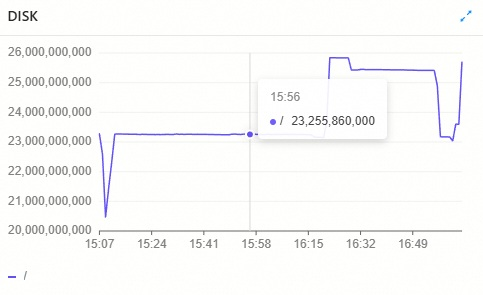

在放大图中，您可在左上方指定时间段来查看该主机的存储空间使用率。

**LOAD**

按时间以不同颜色的曲线展示该主机的一分钟 、五分钟和十五分钟系统平均负载。

单击图右上角的  图标，放大LOAD使用趋势图。


在放大图中，您可在左上方指定时间段来查看该主机的一分钟 、五分钟和十五分钟系统平均负载。

**MEMORY**

按时间以不同颜色的曲线展示该主机的内存使用量，包括内存使用率（mem）、总内存大小（total）、已使用的内存大小（used）、buff使用的内存大小（buff）、Cache使用的内存大小（cach）和空闲内存大小（free）。

单击图右上角的  图标，放大MEMORY使用趋势图。

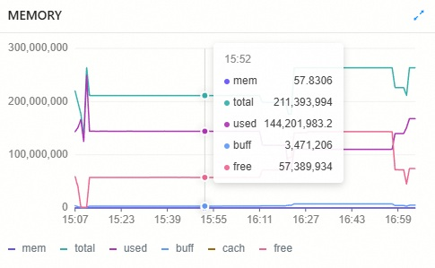

在放大图中，您可在左上方指定时间段来查看该主机的内存使用量。

**PACKAGE**

按时间以不同颜色的曲线展示该主机的数据传输情况，包括丢包数量（drop）、错误包数量（error）、接收包数量（in）和发送包数量（out）。

单击图右上角的  图标，放大PACKAGE趋势图。


在放大图中，您可在左上方指定时间段来查看该主机的数据传输情况。

<a id="section-3-3-5-3"></a>

#### 3.3.5.3. DataHub主机服务

主机服务角色界面展示主机上的服务实例及服务实例的角色。

**查看主机服务角色**

1. 在**主机运维**界面的左侧**主机列表**中，选择目标主机。

2. 切换至**服务角色**页签，您可查看主机运维服务角色相关信息（包含主机所在集群、主机上运行的服务实例以及服务实例的角色）。

<a id="section-3-4"></a>

## 3.4. 管理

<a id="section-3-4-1"></a>

### 3.4.1. 管理概述

管理模块是大数据管家的配置和软件的管理中心，是支撑和个性化产品运维的重要功能模块。

管理模块支持的功能如下：

- 作业服务：支持通过执行作业来对大数据各产品进行运维操作。

- 健康管理：支持创建健康检查项，同时还支持健康检查项应用到产品的主机上。

- 流程服务：支持查看待处理和已完成的人工任务；支持查看流程信息（包括流程图和XML定义）；支持查看不同状态（包括运行中、已完成、异常和已终止）的流程实例信息。

- 操作审计：支持查看大数据管家中作业执行和其他产品运维操作的记录。

<a id="section-3-4-2"></a>

### 3.4.2. 作业服务

<a id="section-3-4-2-1"></a>

#### 3.4.2.1. 概述

本文简要介绍DataHub中作业相关的概念，以及作业界面。

**背景信息**

DataHub通过执行作业来对大数据产品进行产品运维。作业即产品运维任务，是对集群中的物理设备进行的运维操作。作业服务界面主要包括**执行**页面。

**相关概念**

作业相关的概念如下：

- 普通作业：需要用户手动执行的作业，未设置定时器。

- 定时作业：设置了定时器，按设定时间自动执行的作业。

**执行页面**

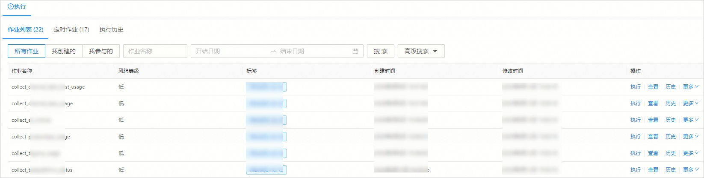

**执行**页面主要包括以下功能模块：

<table>
  <tr>
    <th width="90">功能</th>
    <th>说明</th>
  </tr>
  <tr>
    <td>普通作业</td>
    <td>• 支持查看、执行普通作业，同时还支持查看执行历史。<br>• 支持搜索、复制、导出和删除作业。</td>
  </tr>
  <tr>
    <td>定时作业</td>
    <td>• 支持开启或关闭、查看、执行定时作业，同时还支持查看定时作业的执行历史。<br>• 支持搜索、复制、导出和删除作业。</td>
  </tr>
  <tr>
    <td>执行历史</td>
    <td>• 支持查看普通作业、定时作业等的历史执行记录。<br>• 支持搜索、查看详情和预览。</td>
  </tr>
</table>

<a id="section-3-4-2-2"></a>

#### 3.4.2.2. 作业

<a id="section-3-4-2-2-1"></a>

##### 3.4.2.2.1. 手动执行作业

创建普通作业后，您必须手动执行作业来完成对产品的运维操作。当然，您也可以手动执行定时作业。

**前提条件**

已获取大数据管家管理员账号。

**操作步骤**

1. 登录大数据管家。

2. 单击左上角  图标，选择DataHub产品进入。

3. 在顶部菜单栏，单击**管理**。

4. 在左侧导航栏，单击**作业服务**。

5. 在**执行**页面，单击**作业列表**页签。

   如果需要手动执行定时作业，请单击**定时作业**页签。手动执行定时作业的流程与普通作业完全相同，本节以普通作业为例进行介绍。

6. 在**作业列表**页面，单击某个作业后面的**执行**。

   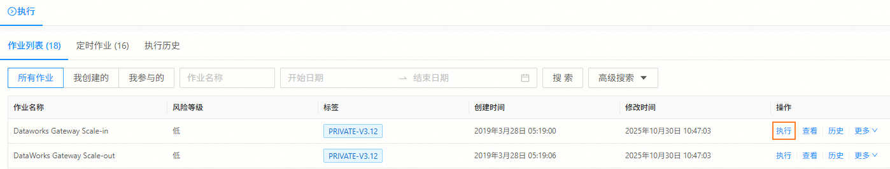

7. 在弹出的对话框中，完成**配置目标组与参数**操作，单击**下一步**。

   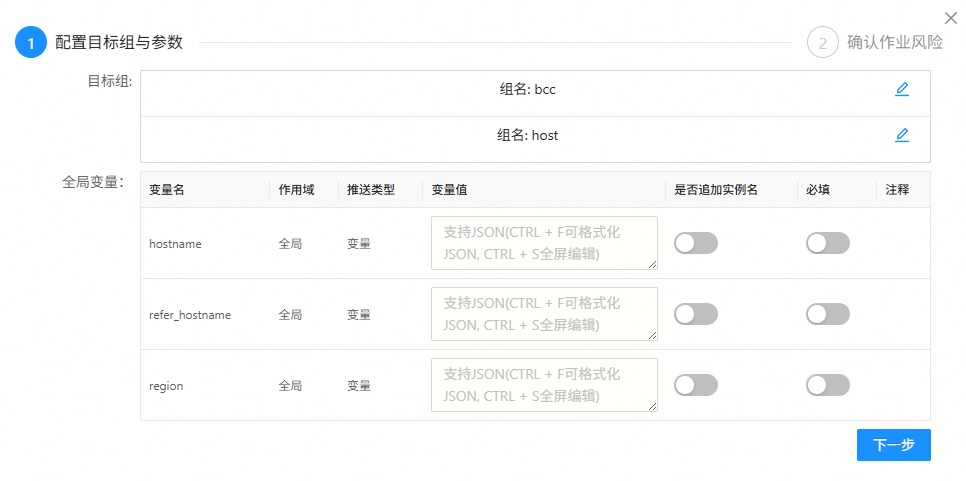

8. 完成**确认作业风险**后，单击**确认执行**。

   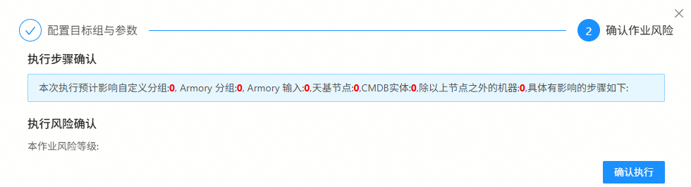

   > **说明**
   >
   > 确认执行后，在**执行历史**页面中会自动生成一条执行记录，详情请参见查看作业执行历史。

9. 在作业执行界面，单击上方的**开始**，开始执行作业。

   如果您未进行任何操作而退出了作业执行界面，则后续可在**执行历史**页面中查找到该执行记录，单击**操作**列下的**详情**即可再次进入该作业执行界面。

<a id="section-3-4-2-2-2"></a>

##### 3.4.2.2.2. 开启和关闭定时作业

定时作业默认是关闭不生效的，您需要手动开启定时作业。如果定时作业在某个时间段内不需要再执行，您可手动关闭。

**前提条件**

已获取大数据管家管理员账号。

**操作步骤**

1. 登录大数据管家。

2. 单击左上角  图标，选择DataHub产品进入。

3. 在顶部菜单栏，单击**管理**。

4. 在左侧导航栏，单击**作业服务**。

5. 在**执行**页面，单击**定时作业**页签。

   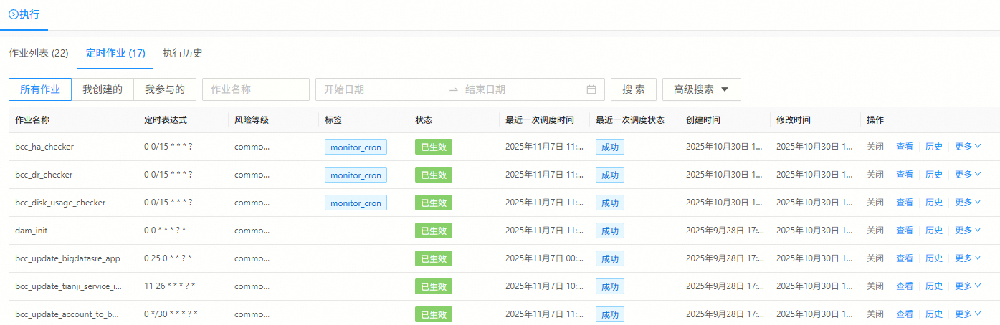

6. 在**定时作业**页面，关闭或开启定时作业：

   - 作业处于关闭状态时，开启定时作业：单击定时作业后面的**开启**。

     开启某个定时作业后，**状态**变更为**已生效**，**开启**按钮变更为**关闭**。

   - 作业处于开启状态时，关闭定时作业：单击定时作业后面的**关闭**。

     关闭某个定时作业后，**状态**变更为**未生效**，**关闭**按钮变更为**开启**。

<a id="section-3-4-2-2-3"></a>

##### 3.4.2.2.3. 查看作业执行历史

DataHub支持查看指定作业或者所有作业的执行历史，以便您了解作业和方案的执行情况。

**背景信息**

在确认执行作业或方案后，DataHub会对每个作业的执行情况进行记录，以便用户后续了解该任务的执行情况。

**执行历史**页面支持的功能如下：

- 支持查看任务的触发方式、当前状态、开始时间、结束时间等信息。

- 支持查看任务的执行过程、参数配置，同时还支持下载任务执行的详细信息。

- 支持对不同状态的任务进行不同的操作，例如：支持对**未开始**状态的任务执行**开始**操作，支持对**异常**状态的任务执行**重试**操作等。

普通作业与定时作业的执行历史信息完全相同，本节以普通作业为例进行介绍。

**前提条件**

已获取大数据管家管理员账号。

**查看某个作业的执行历史**

1. 登录大数据管家。

2. 单击左上角  图标，选择DataHub产品进入。

3. 在顶部菜单栏，单击**管理**。

4. 在左侧导航栏，单击**作业服务**。

5. 在**执行**页面，单击**作业列表**页签。

6. 在**作业列表**页面，单击待查看的普通作业后面的**历史**，进入**执行历史**页面。

   在**执行历史**页面可查看该作业的执行历史，详情请参见查看作业执行历史。

**查看执行历史**

1. 进入**执行历史**页面，如果历史记录数量多，可以对实例名称、时间范围和执行状态进行过滤，然后单击**搜索**，查询符合条件的历史记录。

2. 单击某个历史记录后面的**操作 > 详情**，可查看该历史记录的详细信息。

   对于不同状态的历史记录，您可进行的操作如下：

   **任务执行记录状态**

   **支持功能**

   **操作步骤**

   单击上方的**参数配置**，选择**上下文参数**或**全局参数**，查看该任务的

   查看参数配置

   上下文参数或全局参数。

   单击上方的**下载执行详情**，下载作业执行详情到本地，保存格式为txt。

   下载执行详情

   执行详情中记录了作业执行的**JSON**和**原始数据**等信息。

   - 在某个步骤中的**机器详情**页面，单击某个机器后面的**查看详情**，

   所有状态

   在右侧查看该步骤在该机器上的执行详情，包括执行输出。

   - 如果是脚本步骤，则显示**脚本内容**和**执行参数**页面，可查看脚本

   查看步骤执行详情

   内容和脚本执行参数。

   - 如果是命令步骤，则显示**命令内容**和**执行参数**页面，可查看命令内容和命令执行参数。

   如果任务正在执行中，您可单击上方的**刷新**，查看最新的执行状

   刷新界面

   态。

   开始执行

   单击上方的**开始**，开始此次执行。

   未开始

   取消执行

   单击上方的**取消**，取消此次执行。

   完成人工操作并确

   在待操作的人工步骤上，根据提示进行相关操作，然后单击**确认**，

   认

   进入下一个步骤。

   待人工确认

   回滚到上一步骤执

   在待操作的人工步骤上，单击**回滚**，回滚到上一步骤执行完的状

   行完的状态

   态。

   单击**取消**，取消此次执行。

   取消执行

   重试异常步骤

   在异常步骤上，单击**重试**，重新执行该步骤。

   跳过异常步骤

   在异常步骤上，单击**跳过**，跳过此步骤继续执行后续步骤。

   回滚到上一步骤执

   在异常步骤上，单击**回滚**，回滚到上一步骤执行完的状态。

   行完的状态

   在异常步骤上，单击**重置**，重置该步骤为**未开始**状态。

   重置异常步骤为未

   异常

   异常步骤重置为未开始状态时，该次执行状态变为**暂停**。此时您可

   开始状态

   单击上方的**继续**，重新执行当前步骤。

   - 在某个步骤中的**机器详情**页面，单击某个机器后面的**查看详情**，在右侧查看该步骤在该机器上的执行详情，包括执行输出和错误信息。

     对于执行异常的机器，查看详情后，您可单击**跳过**来跳过此机

   查看异常步骤执行

   器，也可单击**重试**再在该机器上重新执行一次。

   详情

   - 如果是脚本步骤，则显示**脚本内容**和**执行参数**页面，可查看脚本内容和脚本执行参数。

   - 如果是命令步骤，则显示**命令内容**和**执行参数**页面，可查看命令内容和命令执行参数。

   重试失败步骤

   在失败步骤上，单击**重试**，重新执行该步骤。

   跳过失败步骤

   在失败步骤上，单击**跳过**，跳过此步骤继续执行后续步骤。

   回滚到上一步骤执

   在失败步骤上，单击**回滚**，回滚到上一步骤执行完的状态。

   行完的状态

   在失败步骤上，单击**重置**，重置该步骤为**未开始**状态。

   重置失败步骤为未

   失败步骤重置为未开始状态时，该次执行状态变为**暂停**。此时您可

   开始状态

   单击上方的**继续**，重新开始执行当前步骤。

   失败

   - 在某个步骤中的**机器详情**页面，单击某个机器后面的**查看详情**，在右侧查看该步骤在该机器上的执行详情，包括执行输出和错误信息。

     对于执行异常的机器，查看详情后，您可单击**跳过**来跳过此机

   查看失败步骤执行

   器，也可单击**重试**再在该机器上重新执行一次。

   详情

   - 如果是脚本步骤，则显示**脚本内容**和**执行参数**页面，可查看脚本内容和脚本执行参数。

   - 如果是命令步骤，则显示**命令内容**和**执行参数**页面，可查看命令内容和命令执行参数。

   取消执行

   单击上方的**取消**，取消此次执行。

<a id="section-3-4-3"></a>

### 3.4.3. 健康管理

<a id="section-3-4-3-1"></a>

#### 3.4.3.1. 监控配置

大数据管家为每个产品均内置了丰富的调度项和监控项，用于检查产品的故障并产生报警，以便您及时发现产品故障并修复。

**前提条件**

- 已获取具有相应产品运维权限的大数据管家账号。

- 已获取监控项的报警源和检查项。

**背景信息**

> **说明**
>
> 产品不同，其调度项和监控项也不同，但其配置和操作方法完全相同。

调度项：调度项在指定 tianji 角色对应的全量机器列表中运行调度脚本，以产生报警的原始数据（哪个调度项在哪些机器上产生了什么级别的报警，报警结果数据是什么），原始数据会上报到 ABM 的数据库中进行存储。

监控项：监控项会将调度项产生的报警原始数据挂载到 ABM 中相应产品的页面中。挂载到产品页面时，支持设置不同的过滤策略，以在指定页面上过滤出自己所关注的监控项的报警结果。

调度项和监控项均是内置，不可增加，但您可修改调度项和监控项的部分参数，例如：是否启用、运行参数、描述等。除此以外，监控项还支持配置挂载点，也支持删除操作。

**进入管理页面**

1. 登录大数据管家。

2. 在左上方单击  图标，选择DataHub产品进入。

3. 在顶部菜单栏，单击**管理**，进入管理页面。

**查看调度项详情和调度项挂载点**

调度项挂载点是内置的，不可添加、修改和删除。调度项的挂载点对应运行调度脚本的tianji角色对应的全量机器列表。

1. 在左侧导航栏，单击**健康管理**，默认进入**监控配置 > 调度**页面。

   **调度**页面展示了当前产品的所有调度项。

2. 在**调度**页面，单击某个调度项后面的**查看**，查看该调度项的详情。

   调度项详情包括检查项名称、检查项别名、描述和处理步骤等。

3. 单击某个调度项前面的  图标，查看调度项的挂载点。

**修改调度项**

支持设置调度项的调度间隔、运行参数等，同时还支持设置是否启用调度项。

1. 在左侧导航栏，单击**健康管理**，默认进入**监控配置 > 调度**页面。

2. 在**调度**界面，单击某个调度项后面的**编辑**，在弹出的对话框中设置各参数。

   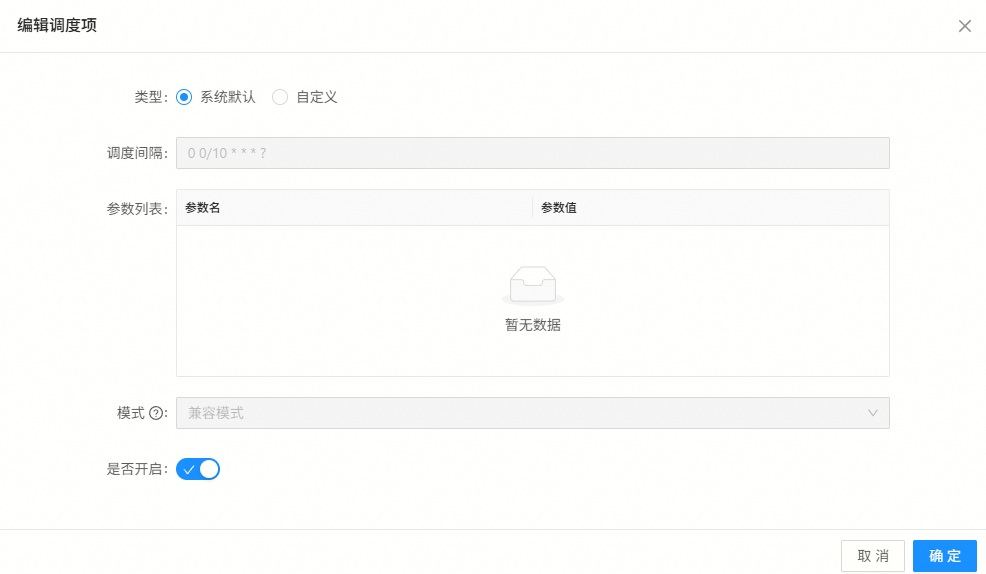

   **类型**：**系统默认**表示**调度间隔**、**参数列表**等参数均使用系统默认配置；**自定义**表示可自定义这些参数。

   > **说明**
   >
   > **调度间隔**是基于**crontab**命令配置的。

3. 完成上述参数配置后，单击**确定**，界面提示修改成功。

**查看故障机列表**

支持查看当前集群中所有的故障机器。

1. 在左侧导航栏单击**健康管理**，默认进入**监控配置 > 调度**页面。

2. 单击右上方的**故障机器列表**，查看集群中的故障机器。

   故障机器列表中列出了当前集群中所有的故障机器，以及每台机器在飞天基础运维平台中的所属角色。

**修改监控项**

支持修改监控项的名称、描述，以及设置是否启用监控项。监控项的报警源和检查项是内置的，请勿修改。

1. 在左侧导航栏，单击**健康管理**。

2. 单击**监控**页签，进入监控界面。

   **监控**界面展示当前产品的所有的监控项。

3. 单击某个监控项后面的**编辑**，修改监控项的配置。

4. 完成上述参数配置后，单击**确定**，界面提示修改成功。

**给监控项添加挂载点**

监控项通过添加挂载点将报警原始数据挂载到ABM中各产品的运维界面中。

1. 在左侧导航栏，单击**健康管理**。

2. 单击**监控**页签，进入监控界面。

3. 单击某个监控项前面的  图标，查看监控项的挂载点。

4. 单击挂载点列表下方的**添加挂载点**，在弹出的对话框中设置各参数。

   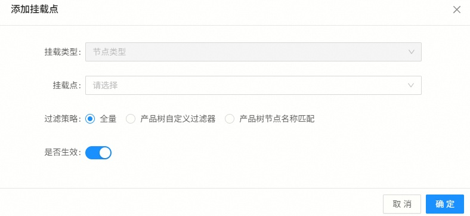

   关键参数说明如下：

   <table>
     <tr>
       <th width="89">配置项</th>
       <th>说明</th>
     </tr>
     <tr>
       <td>挂载类型</td>
       <td>默认不可修改。</td>
     </tr>
     <tr>
       <td>挂载点</td>
       <td>从下拉列表中选择该监控项的检查结果要挂载在哪个产品的哪个运维界面。</td>
     </tr>
     <tr>
       <td>过滤策略</td>
       <td>可选值如下：<br>• <strong>全量</strong>：该监控项产生的报警记录全部显示。<br>• <strong>产品树自定义过滤器</strong>：根据产品树节点中配置的过滤器对该监控项产生的报警进行过滤。<br>• <strong>产品树节点名称匹配</strong>：从报警记录中匹配出和当前节点名称相同的记录。</td>
     </tr>
     <tr>
       <td>是否生效</td>
       <td>设置该挂载点是否生效。</td>
     </tr>
   </table>

5. 完成上述参数配置后，单击**确定**，界面提示修改成功。

**删除监控项的挂载点**

1. 在左侧导航栏，单击**健康管理**。

2. 单击**监控**页签，进入监控界面。

3. 单击某个监控项前面的  图标，查看监控项的挂载点。

4. 单击目标挂载点后面的**删除**，在弹出的对话框中单击**确定**，界面提示删除成功。

**删除监控项**

1. 在左侧导航栏，单击**健康管理**。

2. 单击**监控**页签，进入监控界面。

3. 单击目标监控项后面的**删除**，然后在弹出的对话框中单击**确定**，界面提示删除成功。

<a id="section-3-4-3-2"></a>

#### 3.4.3.2. 巡检管理

大数据管家的巡检管理功能支持各产品按需配置巡检场景、巡检项和场景组合。

**前提条件**

已获取具有相应产品运维权限的大数据管家账号。

**进入管理页面**

1. 登录大数据管家。

2. 在左上方单击  图标，选择DataHub产品进入。

3. 在顶部菜单栏，单击**管理**，进入管理页面。

**新建场景**

1. 在左侧导航栏单击**健康管理**，选择**巡检管理 > 场景**。

2. 单击右上角的**新建场景**，在对话框中按需配置各参数。

   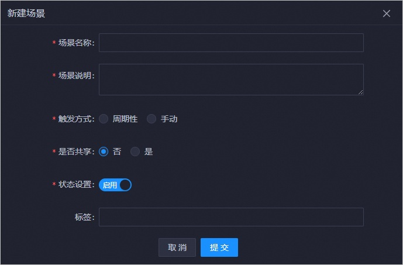

   | 参数 | 说明 |
   | --- | --- |
   | 场景名称 | 按需自定义即可。 |
   | 场景说明 | 可针对巡检场景进行详细的说明。 |
   | 触发方式 | 支持<strong>周期性</strong>和<strong>手动</strong>两种方式。 |
   | 是否共享 | 是否开启共享功能。 |
   | 状态设置 | 按需<strong>启用</strong>或者<strong>停用</strong>状态功能。 |
   | 标签 | 设置标签，能够便于后续管理和筛选。 |

3. 单击**提交**。

   场景创建成功后，您还可以对该场景进行**编辑**、**立即巡检**、**场景管理**和查看**运行历史**等相关操作。

   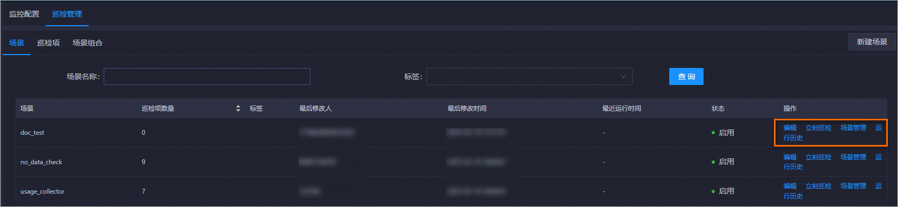

**新建巡检项**

1. 在左侧导航栏单击**健康管理**，选择**巡检管理 > 巡检项**。

2. 单击右上角的**新增巡检项**。

3. 在**新建巡检项**对话框中，按需配置各参数。

   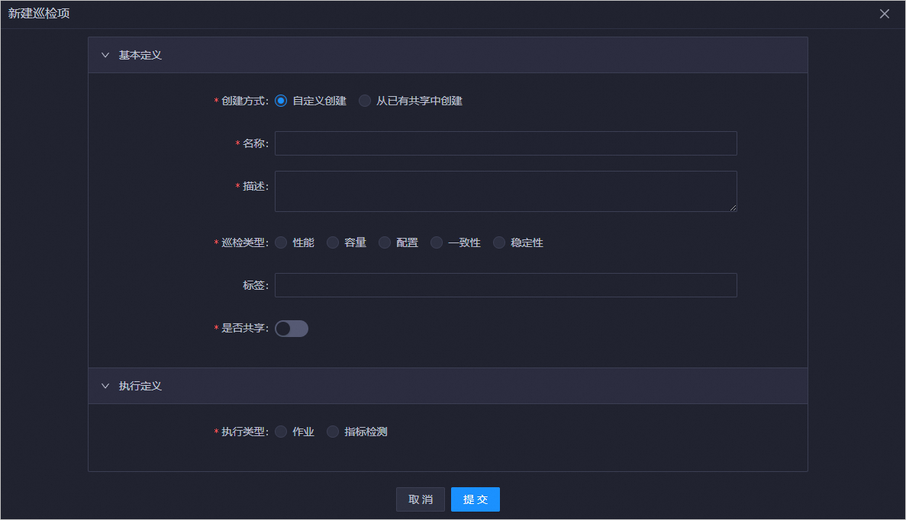

   **区域**

   **参数**

   **说明**

   支持**自定义创建**和**从已有共享中创建**两种方式。

   **创建方式**

   按需自定义即可。

   **名称**

   可针对巡检项进行详细的说明。

   **描述**

   **基本定义**

   巡检类型支持**性能**、**容量**、**配置**、**一致性**和**稳定性**。

   **巡检类型**

   设置标签，能够便于后续管理和筛选。

   **标签**

   是否开启共享功能。

   **是否共享**

   执行类型支持**作业**和**指标检测**。不同的执行类型，界面需要填写的参数会

   **执行定义**

   **执行类型**

   有差异，具体根据界面展示填写即可。

4. 单击**提交**。

   巡检项创建成功后，您还可以对该场景进行**编辑**和**删除**操作。

   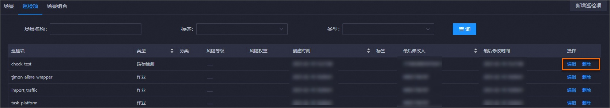

**新建场景组合**

1. 在左侧导航栏单击**健康管理**，选择**巡检管理 > 场景组合**。

2. 单击右上角的**新建场景**。

3. 在**新建场景**对话框中，按需配置各参数。

   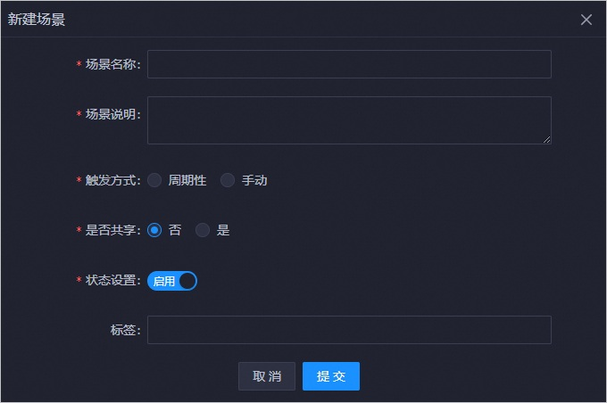

   | 参数 | 说明 |
   | --- | --- |
   | 场景名称 | 按需自定义即可。 |
   | 场景说明 | 可针对巡检场景进行详细的说明。 |
   | 触发方式 | 支持<strong>周期性</strong>和<strong>手动</strong>两种方式。 |
   | 是否共享 | 是否开启共享功能。 |
   | 状态设置 | 按需<strong>启用</strong>或者<strong>停用</strong>状态功能。 |
   | 标签 | 设置标签，能够便于后续管理和筛选。 |

4. 单击**提交**。

   场景组合创建成功后，您还可以对该场景进行**编辑**、**场景管理**和查看**运行历史**等操作。

   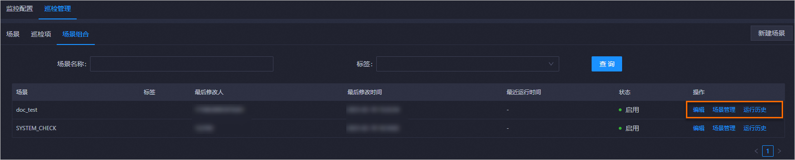

<a id="section-3-4-4"></a>

### 3.4.4. 操作审计

操作审计列出了大数据管家中当前产品的**运维**界面的运维操作历史记录，支持查看每个操作的详细信息，方便您后续查看和故障定位。

**前提条件**

已获取具有相应产品运维权限的大数据管家账号。

**背景信息**

操作审计是按产品查看的，例如：如果需要查看某个产品的操作审计，您首先需要进入某个产品界面。

> **说明**
>
> 操作审计列出的是产品**运维**界面中的运维操作历史记录，不包含作业服务的运维操作。

**操作步骤**

1. 登录大数据管家。

2. 在左上方单击  图标，选择DataHub产品进入。

3. 单击顶部菜单栏的**管理**，在左侧再单击**操作审计**。

   **操作审计**界面显示当前产品的**运维**界面中的运维操作历史记录，包括操作名称、操作标识、风险等级、当前状态、提交时间、执行时间、结束时间、执行人、实现方式、执行参数和详情等信息。

4. 单击某个操作后面的**详情**，查看该运维操作的详情。

   对于失败的步骤，还支持查看具体失败原因。

5. 如果运维操作运行失败，则您可查看失败原因。

6. 当运维任务处于未开始、等待、异常、失败等状态时，您可根据实际情况进行以下操作。

   | 状态 | 可执行操作 |
   | --- | --- |
   | 未开始 | • 单击<strong>开始</strong>，开始执行该任务。<br>• 单击<strong>参数配置</strong>，查看该任务的参数配置。<br>• 单击<strong>取消</strong>，取消该任务。 |
   | 等待 | • 根据提示进行相关操作，然后单击<strong>确认</strong>，继续执行后续步骤。<br>• 单击<strong>回滚</strong>，回滚到上一步骤执行完的状态。<br>• 单击<strong>参数配置</strong>，查看该任务的参数配置。<br>• 单击<strong>取消</strong>，取消该任务。 |
   | 异常 | • 单击<strong>重试</strong>，重新执行该步骤。<br>• 单击<strong>跳过</strong>，跳过此步骤继续执行后续步骤。<br>• 单击<strong>回滚</strong>，回滚到上一步骤执行完的状态。<br>• 单击<strong>参数配置</strong>，查看该任务的参数配置。<br>• 单击<strong>取消</strong>，取消该任务。 |
   | 失败 | • 单击<strong>重试</strong>，重新执行该步骤。<br>• 单击<strong>跳过</strong>，跳过此步骤继续执行后续步骤。<br>• 单击<strong>回滚</strong>，回滚到上一步骤执行完的状态。<br>• 单击<strong>参数配置</strong>，查看该任务的参数配置。<br>• 单击<strong>取消</strong>，取消该任务。 |

7. 如果需要下载运维操作的执行日志，单击上方的**下载执行详情**，保存日志到本地。

<a id="section-4"></a>

# 4.DataHub深度巡检

本文从集群巡检和业务巡检两个维度介绍DataHub深度巡检相关内容，适用于企业版v3.16.2及后续版本。

1. **巡检概述**

巡检覆盖并汇聚DataHub的监控告警、资源水位与关键指标，可视化掌握平台运行健康状况，在发生重大问题甚至故障前规避非预期的风险问题，保障稳定性。

对应的巡检摸底包括但不限于平台系统、硬件、库存、云平台用户实例使用、业务数据规模大小、业务请求压力等。

2. **集群巡检**

**2.1 巡检场景说明**

日常维护、确保datahub管控组件状态正常。

**2.2 巡检项说明**

> **说明**
>
> 本文以专有云V3版本为例。不同版本，以下截图界面可能会存在差异。具体以实际环境为准。

**2.2.1 飞天基础运维平台大盘维度**

**2.2.1.1 集群终态检查**

- **巡检项说明**

  主要是确认datahub产品服务是否都达到终态，检测异常。

- **巡检步骤**

  <ol type="i">

  <li>

  登录Apsara Uni-manager运维控制台，在顶部菜单栏选择**平台运维**，并进入**飞天基础运维平台**。

  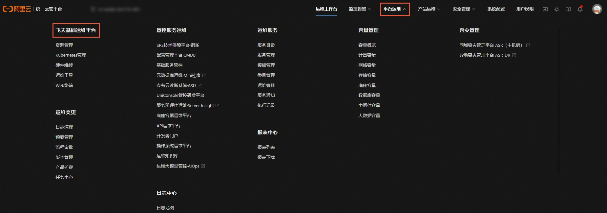

  </li>

  <li>

  在左侧导航栏，单击**产品集群运维**，并在搜索框中搜索**datahub**，查看集群状态。

  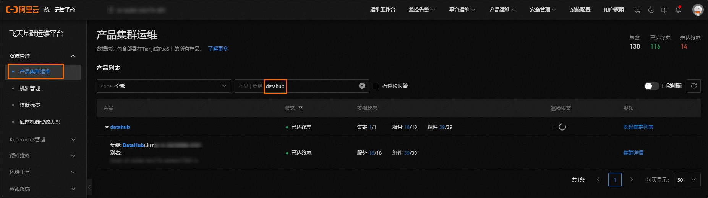

  </li>

  </ol>

- **巡检结果：**

  - 状态显示**已达终态**： 表示datahub集群状态无异常，可以正常使用。

  - 状态显示**未达终态**：表示datahub集群状态异常，需要进行修复。

  > **说明**
  >
  > 如果发现任何datahub服务角色不到终态或者处于部署或者升级过程中rolling任务异常，请及时保存报错截图，并提交工单进行处理。

**2.2.1.2 操作系统检查**

- **巡检项说明**

  本检查项主要涉及到datahub集群物理机节点的关键系统核心指标：cpu、load、mem、网络流量、tcp重传、disk io。

- **巡检步骤**

  <ol type="i">

  <li>

  登录Apsara Uni-manager运维控制台，依次选择**监控告警 > 监控管理 > 云平台监控**。

  </li>

  <li>

  在左侧导航栏，单击**告警历史**。

  </li>

  <li>

  在右侧**服务目录**区域下搜索**datahub**，查看最近1天时间内的告警情况。

  

  </li>

  </ol>

- **巡检结果**

  - 正常范围：没有出现**紧急**级别报警。

  - 异常范围：出现**紧急**级别告警。

> **说明**
>
> 上述监控中心里，包含上述系统层面的几个关键核心指标，如果出现这些指标的告警，请及时保存截图并提交工单进行处理。

**2.2.2 集群配置维度**

**2.2.2.1 检查datahub集群的各SR之间比例是否合理**

- **巡检项说明**

  此巡检项主要是为了检查datahub集群的frontend机器和chunkserver机器比例是否合理。是否需要进行缩容或者扩容等调配动作。

- **巡检步骤**

  <ol type="i">

  <li>

  登录Apsara Uni-manager运维控制台，在顶部菜单栏选择**平台运维**，并进入**飞天基础运维平台**。

  </li>

  <li>

  在左侧导航栏，单击**产品集群运维**，并在该页面搜索**datahub**集群。单击**集群详情**，进入集群详情页面。

  

  </li>

  <li>

  在**终态配置**页签下，在找到**machine_group.conf**文件，检查frontend和chunkserver主机数量并计算比例。

  

  </li>

  </ol>

- **巡检结果**

  - 正常范围：frontend机器数量和chunkserver机器数量比小于1。

  - 异常范围：frontend机器数量和chunkserver机器数量比大于1。如果巡检过程中，发现这种情况，请提交工单进行处理。

**2.2.2.2 datahub系统限制配置（主要涉及读写限制）检查**

- **巡检项说明**

  检查datahub的读写相关限制。

- **巡检步骤**

  <ol type="i">

  <li>

  在**飞天基础运维平台**上，选择**运维工具 > 资源大盘**。

  </li>

  <li>

  在**资源大盘**页面搜索**datahub_db**，并查看**Result**列的信息，获取登录datahub meta库的登录信息。

  

  </li>

  <li>

  执行以下MySQL命令，登录datahub meta库，查询当前读写限制。

  ```sql
  use datahub_db;
  select * from config_meta ;
  ```

  </li>

  </ol>

- **巡检结果**

  判断标准参考如下：

  ```text
  //正常范围： 以下是产品侧建议的datahub部署后初始配置

  //1) shard级别的读相关不限制
  ReadBandwidth   0            
  ReadQPS   0
  ReadRPS  0

  //2）shard级别的写相关限制，写入带宽5M， 写入的每秒的请求数2000, 写入的每秒record不受限制
  WriteBandwidth   5120     
  WriteQPS    2000              
  WriteRPS    0

  //异常范围：和上⾯配置不⼀致
  ```

  如果实际环境里的配置和上面不一致，可以提交工单给阿里云技术支持。

**2.2.3 底层飞天管控服务维度**

**2.2.3.1 datahub的盘古服务检查**

- **巡检项说明**

  datahub盘古系统为datahub提供底层存储服务。本检查项是检查盘古服务是否正常。

- **巡检步骤**

  <ol type="i">

  <li>

  登录大数据管家，进入**DataHub**分站。

  

  </li>

  <li>

  依次选择**运维 > 服务运维 > 盘古服务**，查看**概览**页签的信息。

  

  </li>

  </ol>

- **巡检结果：**

  - 正常范围：页面显示pangu相关服务状态为good，说明资源水位在正常范围内(80%)。

  - 异常范围：页面提示服务异常为error状态，说明盘古资源水位非常高，超过警戒水位。如果遇到异常范围，请及时保存异常截图，并提交工单给飞天（盘古）技术支持人员处理。

**2.2.3.2 datahub的女娲服务（控制服务）检查**

- **巡检项说明**

  nuwa服务为datahub提供服务注册，以及底层元数据一致性检查。本检查项是为了确认nuwa女娲服务是否正常。

- **巡检步骤**

  <ol type="i">

  <li>

  登录大数据管家，进入**DataHub**分站。

  </li>

  <li>

  依次选择**运维 > 服务运维 > 控制服务**，查看集群**概览**页签下的信息。

  

  </li>

  </ol>

- **巡检结果：**

  - 正常范围：页面显示nuwa女娲服务正常。

  - 异常范围：页面显示nuwa女娲服务正常，运行健康里存在异常记录。请及时保存异常记录的截图，并提交工单给飞天（女娲）技术支持人员处理。

**2.2.3.3 datahub的伏羲服务检查**

- **巡检项说明**

  本巡检项主要检查飞天伏羲服务健康度。

- **巡检步骤**

  <ol type="i">

  <li>

  登录大数据管家，进入**DataHub**分站。

  </li>

  <li>

  依次选择**运维 > 服务运维 > 伏羲运维**，查看**概览**页签下的信息。

  

  </li>

  </ol>

- **巡检结果：**

  - 正常范围：页面显示fuxi相关服务正常good，说明资源水位在正常范围内。

  - 异常范围：页面提示异常error状态，说明资源水位非常高，超过警戒水位。

**2.2.4 datahub核心服务维度**

**2.2.4.1 frontend请求数和处理队列检查**

- **巡检项说明**

  本巡检项是为了检查datahub frontend的请求数和处理队列是否在合理区间。

  > **说明**
  >
  > frontend请求数和队列过高会影响到frontend处理请求的效率。

- **巡检步骤**

  <ol type="i">

  <li>

  将datahub frontend机器的主机名粘贴到ops1机器的 `/tmp/datahub_frontend.list` 文件里（文件需要新建）。

  

  

  </li>

  <li>

  在ops1上，执行批量检查命令。

  ```bash
  // ops1上root⽤户执⾏下⾯命令：
  cd  /tmp/

  //专有云V3.10.X以下版本，使⽤下⾯命令检查：
  pssh -h datahub_frontend.list -i "curl http://127.0.0.1/ez_status"   

  //专有云V3.10.X以上版本，使⽤下⾯命令检查：
  pssh -h datahub_frontend.list -i "curl http://127.0.0.1:8081/ez_status"
  ```

  输出结果类似如下：

  

  </li>

  </ol>

- **巡检结果**

  - 正常范围：请求数低于15000， 队列低于100。

  - 异常范围：请求数 高于（含）15000，100 <= 队列值 < 2000，或者单台frontend的队列持续超过其他机器很多，超过了2000这个最大阈值，就属于是热点frontend，也属于异常。

    异常说明：frontend请求数和队列是动态变化的，如果持续30分钟（甚至更长时间）以上请求数大于15000、队列大于100，甚至接近2000。 请及时保存结果截图，然后提交工单联系datahub技术支持排查。

    如下图所示，持续好几个小时出现队列大于100的情况。

    

    热点frontend的情况参考 ： 单台frontend机器的队列1895，明显高于其他frontend节点，属于异常。

    

**2.2.4.2 检查datahub broker上分区数情况及分区数设置是否合理**

- **巡检项说明**

  datahub broker机器是shard的载体，上面可以容纳topic表的shard是有限的，超过阈值会影响到产品性能和稳定性。本巡检项用于检查当前broker机器上shard分区数量是否正常，最大容纳分区数是否超标。

- **巡检步骤**

  <ol type="i">

  <li>

  登录datahub的webconsole机器，切换到admin用户。

  

  </li>

  <li>

  执行以下参考命令，检查datahub broker上分区数情况及分区数设置是否合理。

  ```bash
  //说明，如果Package⽬录下已经存在tool⽬录，则不必解压下⾯的tool⼯具tar包。反之，按照下⾯步骤解
  压，获取tool.

  cd  /home/admin/datahub_service/package
  tar zxvf datahub_tools_release_64.tar.gz
  cd tool
  export LD_LIBRARY_PATH=/apsara/lib64/:../lib/
  ./xstream_tool -x x mo

  //检查该环境⽬前最⼤允许borker上存在多少个shard（分区）.
  r plan Datahub/XStreamServicex |grep -i "WorkerMaxPartitionNumber"
  ```

  </li>

  </ol>

- **巡检结果**

  - 正常范围：shard（分区数） < 1000

  - 异常范围：shard（分区数）> 1000

    针对datahub broker上分区数，产品侧建议最大不超过1000。如果发现分区数超过1000，请驻场联系用户确认当前是否存在创建后一直未被使用的topic表，确认后让用户自行清理。如果现场的project和topic比较多，也可以联系阿里云技术支持采用V3获取所有shard的最新写入时间工具检查。如果处理后分区数仍然很高（即业务侧使用合理），请驻场提交工单到datahub产品侧，由产品侧评估是否需要扩容datahub后端的chunkserver机器。

    举例：

    - 下图代表shard（分区数）数量正常。

      

    - 下图代表shard（分区数）数量异常，超过1000了。

      

**2.2.4.3 datahub meta库可用性检查**

- **巡检项说明**

  datahub_db实例是datahub meta元数据库，该实例状态正常与否会影响到产品后端服务调用。本巡检项主要检查datahub_db实例的磁盘使用，iops等是否超过警戒值。

- **巡检步骤**

  <ol type="i">

  <li>

  登录Apsara Uni-manager运维控制台，选择**产品运维 > 数据库运维 > 云数据库统一运维平台·杜康**。

  

  </li>

  <li>

  在**杜康-数据库管理平台**的**首页**右上角搜索框中，搜索**datahub_db**实例，并查看实例状态。

  </li>

  </ol>

- **巡检结果**

  - 正常范围：杜康平台显示实例状态为绿色，或者IOPS磁盘使用率进度条是绿色。说明主备延迟较低，RDS实例备份完成。

    

  - 异常范围：杜康平台上提示实例状态为红色的 不可服务 ，或者IOPS磁盘使用率进度条出现红色。说明主备延迟较高，实例备份失败。

    RDS实例的底层服务由RDS技术支持团队提供支撑，如果巡检发现问题，请及时保存巡检结果截图，并提交工单给RDS 技术支持人员处理。

**2.2.4.4 datahub服务是否发生重启及core程序崩溃的检查**

- **巡检项说明**

  datahub产品自身包含xstream service、shipper service和coordinator service这三大服务。分别对应xstream broker&master等服务节点、shipper executor&shipper controller服务节点、coordinator offset&master节点，本巡检项主要检查这些服务节点进程id和服务进程是否出现过重启（可通过对比当前时间进行确认），以及这些节点的物理机上是否存在core开头的程序崩溃文件。

- **巡检步骤**

  <ol type="i">

  <li>

  登录datahub webconsole机器，切换到admin用户身份，执行以下命令，查看相关服务信息。

  ```text
  r al
  r wwl Datahub/XStreamServicex
  r wwl Datahub/CoordinatorServicex
  r wwl Datahub/ShipperServicex
  ```

  </li>

  <li>

  观察服务进程是否出现过重启，对比当前时间。

  

  </li>

  <li>

  在OPS1集群上，执行以下命令，批量查询所有datahub物理机是否存在core文件。

  ```text
  pssh -h /tmp/datahub_nc.list -i "ls -lrth /apsara/cloud/data/corefile"
  ```

  

  下图是corefile目录下不存在core文件，代表正常。

  

  </li>

  </ol>

- **巡检结果：**

  - 正常范围：上图代表datahub 三大服务各节点时间都一致（一般为上次部署或者升级时的时间），不存在core文件。

  - 异常范围：上图里存在单一或者多节点机器的进程起始时间和其他机器时间不同或者接近当前时间点，说明该机器发生过服务重启，存在core开头的文件。如果出现上述异常，请及时保存相关截图并提交工单给DataHub技术支持处理。

  3. **业务巡检**

**3.1 巡检场景说明**

针对datahub topic数据读写业务，归档同步业务，订阅消费业务使用情况进行检查。这里的业务指客户生产环境上关键核心业务（需要驻场联系用户提供对应的datahub project名字、topic名字、订阅ID、connector id等信息）。

**3.2 巡检项说明**

**3.2.1 datahub整体业务负载维度**

**3.2.1.1 datahub整体集群读写流量检查**

- **巡检项说明**

  本巡检项主要对当前datahub集群指定时间范围内读写流量检查。

- **巡检步骤**

  <ol type="i">

  <li>

  登录大数据管家。

  </li>

  <li>

  在大数据管家**仪表盘**页面，选择**地域**、**时间**，并进入**DataHub**。

  

  如上图所示，**集群读写字节流量**指标就代表datahub的集群读写流量。

  </li>

  </ol>

- **巡检结果 :**

  正常范围：可以根据环境里具体chunkserver和frontend机器的流量峰值结合下面的公式进行判断。

  - CS机器数据峰值流量/100 = 机器数量（单机流量100M）

  - 前端机峰值/机器网卡安全阈值 = 机器数量(如双千兆机器阈值150MB/s)

  可以参考下面方法获取datahub的单机峰值流量：

  在**云产品监控**页面搜索**datahub**，并单击进入。在**机器列表**页签，单击目标主机**操作**列下的  图标，进

  入监控大盘，查看**Traffic**指标<strong>。</strong>

  

**3.2.1.2 datahub读写latency检查**

- **巡检项说明**

  本巡检项主要是对于datahub集群整体读写latency延迟进行检查。

- **巡检步骤**

  <ol type="i">

  <li>

  登录Apsara Uni-manager运维控制台，并跳转到大数据管家。

  </li>

  <li>

  在大数据管家的**仪表盘**，找到DataHub的**集群读写延迟**（latency）检查指标。

  

  > **说明**
  >
  > 上图集群读写延迟（latency）指标的单位是毫秒。

  </li>

  </ol>

- **巡检结果 :**

  - 正常范围：曲线的趋势比较平稳，latency延迟的值低于5秒。

  - 异常范围：曲线波动比较大，存在抖升或者抖降的现象，latency延迟的值超过5秒。

**3.2.2 datahub业务使用维度**

**3.2.2.1 热点topic检查**

**巡检项说明**

本巡检项主要检查当前业务侧是否存在各种大量topic请求，或者涉及错误特别多的topic，或者一直读不到数据的topic（即空请求的topic）。

**巡检步骤**

1. 登录datahub webconsole机器。

2. 执行以下命令，进入xstream_tool所在目录。

   ```bash
   cd /home/admin/datahub_service/package
   tar zxvf datahub_tools_release_64.tar.gz
   cd tool
   ./xstream_tool -x x btn
   ```

**巡检结果:**

- 正常范围：

  - qps列，未发现存在相较于其他topic特别大的情况。

  - fails列，也未发现存在相较于其他topic特别多的情况。

  - 不存在qps特别大，但是rps及bps特别小甚至为0的情况。

  如下图所示，读和写的请求量、rps记录数、fails数、lat延迟都为0，则代表当前环境没有什么读写业务，属于正常范围。

  

- 异常范围：

  - qps列，发现存在相较于其他topic特别大的情况（大量请求量非常大的topic）。

  - fails列，发现存在相较于其他topic特别多的情况（大量读写错误的topic）。

  - 存在qps特别大，且rps及bps特别小甚至为0的情况（即空请求）。

  以上三种异常情况，都属于业务侧的热点topic，需要及时处理。

  如下面两张图所示，表示存在qps特别大的几个topic，即有热点topic。

  

  

**3.2.2.2 topic写业务检查**

- **巡检项说明**

  对topic shard数据进行检查，确认业务侧推送数据是否符合客户业务场景和预期。

- **巡检步骤**

  <ol type="i">

  <li>

  登录到Apsara Uni-manager运营控制台，并依次进入到datahub的topic shard页面。

  

  </li>

  <li>

  检查上图里shard状态、最早数据时间、最新数据时间、数据量的情况。

  </li>

  </ol>

- **巡检结果：**

  - 正常范围：

    - shard状态：所有shard都是Active状态。

    - 最早数据时间：有时间记录。

    - 最新数据时间：有时间记录，且一般为比较接近或者等于当前北京时间。

    - 数据量：有数值显示，且各个shard的数据量显示相对均匀。

  - 异常范围：

    - shard状态：shard出现非Active状态，例如closed状态。

    - 最早数据时间：无时间记录，显示空白。

    - 最新数据时间：无时间记录显示空白，或者时间早于当前时间。如距离当前时间几十分钟，几个小时，甚至几天。

    - 数据量：无数值显示，或者各个shard的数据量显示不均匀、或者进入shard列表时界面显示异常、或者直接报错的。

  > **说明**
  >
  > - **shard状态方面**：如果巡检发现存在部分shard状态为非active状态，例如为closed状态，需要立即和用户核对是否操作过shard分裂，是否符合用户业务上的要求和场景预期。
  >
  > - **最早数据时间/最新数据时间**：如果发现显示空白，代表用户创建topic后没有推送数据到topic，巡检发现后，可以同步给客户并跟其确认根据当前业务场景和计划是否有推送数据的计划，是否有必要保留topic。如果不保留，联系用户确认后清理掉（否则会占用datahub后端资源）如果现场的topic比较多，可以联系阿里云技术支持采用V3获取所有shard的最新写入时间文档里脚本工具快速检查。
  >
  > - **数据量方面**：如果发现无数值显示，处理方式同上，联系用户确认是否有推送数据计划，是否有保留topic必要。如果数据量有数值显示，但是各个shard之间数据量分布不均匀，即存在一个或者几个shard数据量明显高于或者低于其他shard，可以记录并将巡检结果同步给用户进行业务整改调整。

**3.2.2.3 归档同步业务检查**

- **巡检项说明**

  对topic的数据同步（connector归档任务）进行检查，确认业务侧的下发数据是否符合预期。

- **巡检步骤**

  <ol type="i">

  <li>

  登录Apsara Uni-manager运营控制台，并依次进入到datahub topic的**数据同步**页签。

  

  </li>

  <li>

  单击**操作**列的**查看**按钮，进入详情页面。

  

  </li>

  </ol>

- **巡检结果 :**

  <ol type="i">

  <li>

  正常范围：同步任务状态是Running或者EXECUTING，同步延迟在5分钟以内，脏数据量为0；进入数据同步界面后正常显示无报错。

  </li>

  <li>

  异常范围：同步任务状态是非Running状态，例如HANG、ERROR（页面上往往伴随错误信息）。同步延迟超过5分钟，脏数据量显示不为0；进入数据同步界面后存在报错。如果出现该情况，请及时保存结果截图，并快速联系业务侧用户处理。如果仍然解决不了，可提交工单给datahub技术支持。

  </li>

  </ol>

  > **说明**
  >
  > - 同步点位: 标识该地点为之前的数据均已经同步到第三方服务中，例如odps、rds。
  >
  >   
  >
  > - 同步延迟: 目前计算：  当前时间 `-` 同步点位  计算。

**3.2.2.4 订阅消费读业务检查**

- **巡检项说明**

  对topic下订阅的消费情况进行检查，确认业务侧的topic里消费数据是否符合预期。

- **巡检步骤**

  <ol type="i">

  <li>

  确认topic shard界面最新数据时间，如下图所示，shard里是当时的最新数据的时间  `2021`年`10`月`28`

  </li>

  </ol>


日 `14`点`41`分`17`秒 。


<ol type="i" start="2">

<li>

找到topic订阅界面，找到某订阅的消费点位，如下图所示，topic消费点位是 `2021`年`10`月`27`日 `23`点`07`分`16`秒 。


</li>

</ol>

- **巡检结果 :**

  - 正常范围：消费点位等于或者略低于shard最新数据时间几秒，即消费正常，无延迟。或者订阅界面无报错。

  - 异常范围：消费点位远慢于shard最新数据时间，例如：几分钟，几十分钟，甚至几个小时、几天。这代表消费中断或者有消费点位被重置的现象，或者进入订阅界面后存在报错。

    如巡检步骤里的情况，当前topic下订阅的消费点位是27号的，代表消费存在延迟，没有消费到最新时间（可同步给业务侧用户处理）或者进入订阅界面存在报错，此时及时保存截图并提交工单给datahub技术支持人员处理。

<a id="section-5"></a>

# 5.常见问题及解决方法

本章节将介绍一些截止到当前版本，已知的一些常见问题以及相应的解决方法。

**案例一：LimitEceeded Topic超出20个上限或Project超出5个上限**

原因：DataHub原有版本存在一个User可拥有的Project数量不超过5个以及一个Project下Topic不超过20个的限制。

处理方法：在最新的版本中，上述限制分别更改为了50个及500个，用户可以执行如下操作更改限制。

1. 在datahub_ag中的 `/home/admin/datahub/service/deploy/env.cfg` 路径下获取mysql的host等信息。

2. 进入对应的mysql database，检查config_meta表中ProjectLimit4User以及TopicLimit4Project这两行，此两行即为上述限制的对应配置。

3. 直接使用 `update` 命令更新数据库，执行成功后1分钟生效，不需要重启。

   ```sql
   update config_meta set config_value = 50 where config_type = ‘ProjectLimit4User’;
   ```

   ```sql
   update config_meta set config_value = 500 where config_type = ‘TopicLimit4Project’;
   ```

**案例二：IanlnvalidParameter，错误信息类似Invalid Time 149**

原因：流计算尝试访问一个错误的时间来seek数据。一般情况是用户提交流计算任务的机器时间不准，导致提交任务的时间参数超前。

处理方法：对齐用户机器本地时间或者手动指定某个过去的时间，例如10分钟之前。

**案例三：InvalidCursor，错误信息类似Cursor is invalid or expired**

原因：流计算尝试使用一个过期或者错误的cursor来读取数据。通常情况下，是流计算因为其他某些原因已经出错，导致很多天没有成功处理数据，超出了DataHub的数据生命周期，因此就会出现使用几天前的checkpoint来访问的情况。

处理方法：需要联系流计算技术支持调查最初任务失败的原因，非DataHub问题。

**案例四：Parse response failed，后面是一个XML，里面是301 Move Permanent**

原因：大概率是Endpoint填成了WebConsole的地址。

处理方法：确认一下冒烟是否OK，如果OK的话，在飞天基础运维平台上查看一下Endpoint是否填错。具体入口如下：依次进入**飞天基础运维平台 > 运维工具 > 服务注册变量大盘**，搜索Datahub集群，在**datahub-frontend**服务对应的**Service Registration**信息下找到**datahub_frontend.endpoint**信息。

**案例五：冒烟或者流计算日志抛出InternalServerError异常**

原因：一般需要先进行重试操作，如果重试后仍无法通过则说明服务内部可能存在问题（galaxy日志如果存在此类错误，并且时间点已经是很久以前，说明只是临时性出现，可以忽略）。

处理方法：按照如下方法搜索日志并定位异常原因进行处理，如果无法自行处理，可以将错误日志截图提供给开发人员进行问题定位和处理。

- 通常情况，DataHub异常会带有一个RequestId，RequestId是由DataHubServer生成的唯一ID，中间包含异常发生的时间，可以尝试在DataHubServer的logs目录下搜索该ID对应时间的日志文件，以调查具体异常信息。

- 如果大面积异常请求时，可以直接到DataHubServer的logs目录下在datahub.log日志中寻找**ERROR**级别日志。

<a id="section-6"></a>

# 6.其他相关说明

<a id="section-6-1"></a>

## 6.1. 装机模板

操作系统（OS）：AliOS5U7-x86-64

应用模块（Template）：Bigdata

<a id="section-6-2"></a>

## 6.2. 部署目录及服务列表

表 1. 相关服务

| 服务 | 类型 | 用途 |
| --- | --- | --- |
| service-datahub-service | Controller | 负责部署datahub后端service，作为飞天操作系统AG使用 |
| service-datahub-webconsole | Controller | 负责部署webconsole，与service-datahub-service在同一个容器上 |
| service-datahub-frontend | Worker | 前端节点，同时会作为Chunkserver使用（前后端混部） |
| Chunkserver | Worker | 飞天分布式文件系统chunkserver节点 |
| PanguMaster | Controller | 3台飞天分布式文件系统master |
| NuwaMaster | Controller | 3台飞天名称服务及分布式锁系统master |
| FuxiMaster | Controller | 2台任务调度系统master |

表 2. 部署目录及服务名称

| 模块 | 部署包目录 | 所在机器对应的服务 |
| --- | --- | --- |
| Datahub/XStreamServicex | /home/admin/datahub_service | service-datahub-service |
| Datahub/ShipperServicex | /home/admin/datahub_service | service-datahub-service |
| Datahub/CoordinatorServicex | /home/admin/datahub_service | service-datahub-service |
| WebConsole | /home/admin/datahub_webcon sole | service-datahub-webconsole |
| Smoke | /home/admin/datahub_smoke | service-datahub-frontend |
| Frontend | /home/admin/datahub_fronten d_server | service-datahub-frontend |

<a id="section-6-3"></a>

## 6.3. 错误码

表 1. 错误码

| ErrorCode | HttpCode | 含义 |
| --- | --- | --- |
| InvalidUriSpec | 400 | 请求的Uri非法，大部分情况可能是Topic或者Project名称非法 |
| InvalidParameter | 400 | 参数错误，详细内容需看返回的ErrorMessga，一般都带有详细错误 |
| Unauthorized | 401 | 签名错误，通常情况为AccessIdAccessKey错误或者是客户端时间与服务端时间差距15分钟以上 |
| NoPermission | 403 | 账号权限不足 |
| InvalidSchema | 400 | Schema格式错误 |
| InvalidCursor | 400 | 无效或过期的cursor |
| NoSuchProject | 404 | 请求的Project不存在 |
| NoSuchTopic | 404 | 请求的Topic不存在 |
| NoSuchShard | 404 | 请求的ShardID不存在 |
| ProjectAlreadyExist | 400 | Project已存在 |
| TopicAlreadyExist | 400 | Topic已存在 |
| InvalidShardOperation | 405 | 非法Shard操作，例如Shard已经Closed后继续写入 |
| LimitExceeded | 400 | 请求参数超出限制，例如Shard总数超过512个，Topic默认超过20个 |
| InternalServerError | 500 | 未知错误或内部服务异常或系统处于升级中。这种异常通常是不愿意暴露或未处理的异常，这种异常需要拿到RequestId或者直接到DataHubServer的日志中搜索<strong>"InternalServerError"</strong>，一般可以找到具体异常 |
