阿里云  
专有云  
数据管理  
用户指南  
产品版本：V3.18.6  
文档版本：20250529

**目录**

- [1.数据管理DMS](#section-1)
- [2.快速入门](#section-2)
    - [2.1. 登录DMS控制台](#section-2-1)
    - [2.2. 录入实例](#section-2-2)
    - [2.3. 录入用户](#section-2-3)
    - [2.4. 管控模式](#section-2-4)
    - [2.5. 各角色支持的功能](#section-2-5)
- [3.数据资产](#section-3)
    - [3.1. 首页](#section-3-1)
        - [3.1.1. 自定义DMS界面布局与样式](#section-3-1-1)
        - [3.1.2. 返回DMS旧版控制台](#section-3-1-2)
    - [3.2. 数据类目](#section-3-2)
    - [3.3. 实例管理](#section-3-3)
    - [3.4. 数据库管理](#section-3-4)
    - [3.5. 元数据访问控制](#section-3-5)
- [4.SQL窗口](#section-4)
    - [4.1. 单库查询](#section-4-1)
    - [4.2. 跨库查询](#section-4-2)
    - [4.3. 表结构版本管理](#section-4-3)
    - [4.4. 风险审计报告](#section-4-4)
    - [4.5. 超级SQL模式](#section-4-5)
- [5.数据库开发](#section-5)
    - [5.1. 结构变更](#section-5-1)
        - [5.1.1. 结构设计](#section-5-1-1)
        - [5.1.2. 结构同步](#section-5-1-2)
        - [5.1.3. 影子表同步](#section-5-1-3)
        - [5.1.4. 空库初始化](#section-5-1-4)
        - [5.1.5. 表一致性修复](#section-5-1-5)
    - [5.2. 数据变更](#section-5-2)
    - [5.3. 数据导入](#section-5-3)
    - [5.4. 数据导出](#section-5-4)
    - [5.5. SQL审核](#section-5-5)
    - [5.6. 数据库克隆](#section-5-6)
    - [5.7. 测试数据构建](#section-5-7)
    - [5.8. 自定义研发流程DevOps](#section-5-8)
        - [5.8.1. 管理迭代](#section-5-8-1)
        - [5.8.2. 管理项目](#section-5-8-2)
        - [5.8.3. 新建迭代模板](#section-5-8-3)
- [6.集成与开发（DTS）](#section-6)
    - [6.1. 可视化数据集成与开发](#section-6-1)
        - [6.1.1. 任务编排](#section-6-1-1)
        - [6.1.2. 设置机器或机器集群后通过SSH执行脚本](#section-6-1-2)
        - [6.1.3. 任务流并发控制](#section-6-1-3)
        - [6.1.4. 配置Impala节点](#section-6-1-4)
        - [6.1.5. 批量加工](#section-6-1-5)
        - [6.1.6. 创建数据流](#section-6-1-6)
        - [6.1.7. 变量概述](#section-6-1-7)
        - [6.1.8. 发布任务流](#section-6-1-8)
        - [6.1.9. 创建ETL任务流](#section-6-1-9)
    - [6.2. 数据迁移、同步和订阅](#section-6-2)
    - [6.3. 数据服务](#section-6-3)
        - [6.3.1. 功能特性及应用场景](#section-6-3-1)
        - [6.3.2. API开发](#section-6-3-2)
        - [6.3.3. API下线或测试](#section-6-3-3)
        - [6.3.4. API测试](#section-6-3-4)
        - [6.3.5. API调用](#section-6-3-5)
    - [6.4. 数据可视化](#section-6-4)
        - [6.4.1. 数据可视化概览](#section-6-4-1)
        - [6.4.2. 名词解释](#section-6-4-2)
        - [6.4.3. 进入数据可视化控制台](#section-6-4-3)
        - [6.4.4. 数据集管理](#section-6-4-4)
        - [6.4.5. 图表管理](#section-6-4-5)
        - [6.4.6. 仪表盘管理](#section-6-4-6)
        - [6.4.7. 大屏管理](#section-6-4-7)
    - [6.5. 异构数据库迁移ADAM](#section-6-5)
        - [6.5.1. ADAM概述](#section-6-5-1)
        - [6.5.2. 数据库评估](#section-6-5-2)
            - [6.5.2.1. 数据库采集](#section-6-5-2-1)
            - [6.5.2.2. 数据库画像](#section-6-5-2-2)
            - [6.5.2.3. 目标库选型建议](#section-6-5-2-3)
            - [6.5.2.4. 数据库评估分析](#section-6-5-2-4)
        - [6.5.3. 数据库改造迁移](#section-6-5-3)
            - [6.5.3.1. 线上改造迁移综述](#section-6-5-3-1)
            - [6.5.3.2. 配置白名单](#section-6-5-3-2)
            - [6.5.3.3. 新建迁移项目](#section-6-5-3-3)
            - [6.5.3.4. 预检查](#section-6-5-3-4)
            - [6.5.3.5. 源库计划校验](#section-6-5-3-5)
            - [6.5.3.6. 结构迁移/订正](#section-6-5-3-6)
            - [6.5.3.7. 增量源库对比](#section-6-5-3-7)
            - [6.5.3.8. 数据迁移](#section-6-5-3-8)
        - [6.5.4. 应用评估改造](#section-6-5-4)
            - [6.5.4.1. 应用评估改造摘要](#section-6-5-4-1)
            - [6.5.4.2. 应用采集](#section-6-5-4-2)
            - [6.5.4.3. 采集部署](#section-6-5-4-3)
            - [6.5.4.4. 应用画像](#section-6-5-4-4)
            - [6.5.4.5. 应用评估](#section-6-5-4-5)
            - [6.5.4.6. 应用静态改造](#section-6-5-4-6)
        - [6.5.5. 迁移实验室](#section-6-5-5)
            - [6.5.5.1. SQL周期性采集](#section-6-5-5-1)
            - [6.5.5.2. SQL对比测试](#section-6-5-5-2)
            - [6.5.5.3. SQL Adapter使用说明](#section-6-5-5-3)
        - [6.5.6. SQL转化](#section-6-5-6)
- [7.安全与规范](#section-7)
    - [7.1. 权限](#section-7-1)
        - [7.1.1. 管理权限](#section-7-1-1)
        - [7.1.2. 创建权限模板](#section-7-1-2)
    - [7.2. 安全规则](#section-7-2)
        - [7.2.1. 管理安全规则](#section-7-2-1)
        - [7.2.2. 安全规则DSL语法](#section-7-2-2)
        - [7.2.3. 安全规则附录](#section-7-2-3)
            - [7.2.3.1. 安全规则集概述](#section-7-2-3-1)
            - [7.2.3.2. 管理检测点规则](#section-7-2-3-2)
            - [7.2.3.3. SQL窗口（关系型数据库）](#section-7-2-3-3)
            - [7.2.3.4. SQL窗口（MongoDB）](#section-7-2-3-4)
            - [7.2.3.5. SQL窗口（Redis）](#section-7-2-3-5)
            - [7.2.3.6. SQL变更](#section-7-2-3-6)
            - [7.2.3.7. 权限申请](#section-7-2-3-7)
            - [7.2.3.8. 数据导出](#section-7-2-3-8)
            - [7.2.3.9. 结构设计](#section-7-2-3-9)
            - [7.2.3.10. SQL审核优化建议](#section-7-2-3-10)
            - [7.2.3.11. SQL执行控制](#section-7-2-3-11)
            - [7.2.3.12. 库表同步](#section-7-2-3-12)
            - [7.2.3.13. 敏感列变更](#section-7-2-3-13)
            - [7.2.3.14. 测试数据构建](#section-7-2-3-14)
            - [7.2.3.15. 数据库克隆](#section-7-2-3-15)
        - [7.2.4. 为实例设置安全规则](#section-7-2-4)
    - [7.3. 自定义审批流程](#section-7-3)
    - [7.4. 访问IP白名单](#section-7-4)
    - [7.5. 操作审计](#section-7-5)
    - [7.6. 敏感数据管理](#section-7-6)
        - [7.6.1. 敏感数据保护概览](#section-7-6-1)
        - [7.6.2. 开通敏感数据保护](#section-7-6-2)
        - [7.6.3. 管理敏感数据](#section-7-6-3)
        - [7.6.4. 管理敏感数据识别规则](#section-7-6-4)
        - [7.6.5. 新增脱敏规则](#section-7-6-5)
        - [7.6.6. 行级管控](#section-7-6-6)
    - [7.7. 数据水印](#section-7-7)
- [8.解决方案](#section-8)
    - [8.1. 创建周期性全量数据快照](#section-8-1)
- [9.运维管理](#section-9)
    - [9.1. 用户管理](#section-9-1)
    - [9.2. 任务管理](#section-9-2)
    - [9.3. 配置管理](#section-9-3)
    - [9.4. 数据库分组](#section-9-4)

<a id="section-1"></a>

# 1.数据管理DMS

数据管理DMS（Data Management Service）是一款支撑数据全生命周期的一站式数据管理平台，致力于无缝打通OLTP、OLAP和NoSQL等数据源，支持超过10种数据源的统一管理。提供全域数据资产管理，数据库设计开发和数据集成、开发、消费、治理等能力，致力于帮助企业高效、安全地挖掘数据价值，助力企业数字化转型。

<a id="section-2"></a>

# 2.快速入门

<a id="section-2-1"></a>

## 2.1. 登录DMS控制台

本文以Chrome浏览器为例，介绍如何登录DMS控制台。

**前提条件**

- 登录Apsara Uni-manager运营控制台前，确认您已从部署人员处获取Apsara Uni-manager运营控制台的服务域名地址。

- 推荐使用Chrome浏览器。

**操作步骤**

1. 在浏览器地址栏中，输入Apsara Uni-manager运营控制台的访问地址，按回车键。

2. 输入正确的用户名及密码。

   请向运营管理员获取登录控制台的用户名和密码。

   > 首次登录Apsara Uni-manager运营控制台时，需要修改登录用户名的密码，请按照提
   >
   > **说明**
   >
   > 示完成密码修改。为提高安全性，密码长度必须为 8~20 位，且至少包含以下两种类型：
   >
   > - 英文大写或小写字母（A~Z、a~z）
   >
   > - 阿拉伯数字（0~9）
   >
   > - 特殊符号（感叹号（！）、at（@）、井号（#）、美元符号（$）、百分号（%）等）

3. 单击**账号登录**。

4. 

5. 在页面顶部的菜单栏中，选择**产品 > 数据库 > 数据管理DMS**。

6. 选择**组织**和**地域**信息，然后单击**管理员权限访问**。

   > 如果管理员开启了多租户功能，登录DMS控制台后，您可以将鼠标指针悬浮在右上角的
   >
   > **说明**
   >
   > 图标上，在浮现的菜单中选择**切换租户**来切换至其他租户身份。
   >
   > 

<a id="section-2-2"></a>

## 2.2. 录入实例

通过DMS管理数据库实例前，您需要将实例录入到DMS中。DMS支持录入云数据库和有公网地址的自建数据库，本文以录入RDS MySQL为例介绍录入实例的具体操作步骤。

**注意事项**

若您需要录入Impala数据库，且认证方式选择Kerberos，请提前准备好需要上传至DMS的krb5.conf和keytab文件。

**操作步骤**

1. 登录DMS控制台。

2. 在顶部菜单栏中，选择**数据资产 > 实例管理**。

3. 单击**新增**。

4. 在**新增实例**对话框中，单击**云数据库**页签。

5. 在云数据库区域，选择您要录入的数据库类型。

6. 录入实例信息。本文以录入RDS MySQL为例介绍参数设置。

   **标签页**

   **参数**

   **说明**

   选择数据库来源，本案例选择为**云数据库**。

   **数据库来源**

   选择数据库类型，本案例选择为**MySQL**。

   **数据库类型**

   在下拉列表中，选择云数据库实例所属的地区。

   **实例地区**

   若您选择**跨阿里云账号实例**，则会出现该配置项。在下拉列表选择数据库实

   **其他主账号**

   例所属的主账号。

   固定为**连接串地址**，不可变更。

   **录入方式**

   **基本信息**

   填入云数据库实例的连接地址（包含端口号信息）。

   **连接串地址**

   填入云数据库实例的数据库账号。

   **数据库账号**

   填入该数据库账号的密码。

   **数据库密码**

   选择数据库的管控模式，关于管控模式的详细介绍请参见管控模式。

   **管控模式**

   > 选择为**安全协同**时，您还需要选择对应的**安全规则**。
   >
   > **说明**

   选择数据库的环境类型。

   **环境类型**

   填入自定义的实例名称。

   **实例名称**

   选择是否开启跨库查询功能。开启跨库查询时，您还需要自定义一个

   **开启跨库查询**

   DBLink名称，您跨库查询的使用方法请参见跨库查询。

   选择是否开启不锁表结构变更功能。

   **无锁结构变更**

   > 该参数仅支持MySQL数据库。
   >
   > **说明**

   选择是否开启SSL连接，开启后，DMS将通过SSL连接至数据库。

   SSL（Secure Sockets Layer）能在传输层对网络连接进行加密，提升通信数据的安全性和完整性，但会增加网络连接响应时间。

   使用该参数的前提是数据库已开启SSL连接，当前支持如下选项：

   - **默认（DMS默认不开启SSL）**：系统将自动识别目标数据库是否已开启SSL连接，若数据库已开启SSL连接，则DMS将通过SSL连接数据库；若

   **高级信息**

   **开启SSL**

   数据库未开启SSL连接，则通过普通方式进行连接。

   - **开启**：开启SSL连接。若数据库未开启SSL连接，则该参数无效。

   - **关闭**：不使用SSL连接。

   > 该参数仅支持MySQL数据库。
   >
   > **说明**

   选择一个DBA角色进行后期权限申请等流程。

   **实例DBA**

   设定安全策略，当达到设定的时间后，SQL窗口执行的查询语句会中断，以

   **查询超时时间**

   保护数据库安全。

   **（s）**

   设定安全策略，当达到设定的时间后，SQL窗口执行的导出语句会中断，以

   **导出超时时间**

   保护数据库安全。

   **（s）开启数据资产**

   选择是否开启数据资产管理。

   **管理**

7. 完成配置后单击**基本信息**页签，然后单击左下角的**测试连接**，验证填写的信息是否正确。

   > 如果测试连接失败，请按照错误提示检查您录入的实例信息。
   >
   > **说明**

8. 单击**提交**。

**执行结果**

云数据库已经成功录入到DMS，您可以在实例管理中查看并管理您的数据库。

<a id="section-2-3"></a>

## 2.3. 录入用户

数据管理DMS提供用户管理功能，您可以根据业务需求录入用户并指定角色。

**操作步骤**

1. 登录DMS控制台。

2. 在顶部菜单栏中，选择**运维管理 > 用户管理**。

3. 单击**新增**。

4. 在弹出的对话框中配置用户信息。

   <table>
     <tr>
       <th width="105">配置</th>
       <th>说明</th>
     </tr>
     <tr>
       <td>阿里云账号</td>
       <td>填入阿里云账号UID，获取方式如下：<br>• 录入阿里云账号，由云账号本人提供。<br>• 录入RAM用户，可以在管控平台的RAM模块上查看。</td>
     </tr>
     <tr>
       <td>角色</td>
       <td>根据业务需求，选择下述角色：<br>• 普通用户<br>• DBA<br>• 管理员<br>• 安全管理员<br>• 技术支持<br>说明关于各角色支持的功能详情，请参见各角色支持的功能。</td>
     </tr>
   </table>

5. 单击**确认**。

<a id="section-2-4"></a>

## 2.4. 管控模式

DMS提供自由操作、稳定变更和安全协同三种管控模式，您可以为每个实例设置不同的管控模式。

| 管控模式 | 说明 | 适用场景 | 登录方式 |
| --- | --- | --- | --- |
| 自由操作 | 支持超过多种类型数据库的可视化数据管理、结构管理，并提供丰富的数据管理解决方案，简化数据库的使用和管理。 | • 数据库实例无需严格管控。<br>• 单一用户使用。 | 账号密码。 |
| 稳定变更 | • 提供无锁结构变更、无锁数据变更等众多保障数据库稳定运行的解决方案。<br>• 提供自由操作模式的所有功能。 | • 数据库实例需要稳定运行，对持续可用性要求高。<br>• 小团队多人协同。 | 账号密码。 |
| 安全协同 | • 提供细粒度权限管控（库、表或字段级别）、敏感数据管理等数据安全解决方案。<br>• 提供灵活可定义的设计规范、审批流程，构建企业专属数据库DevOps解决方案。<br>• 提供自由操作模式和稳定变更模式的所有功能。 | • 需要保障数据库实例的数据安全。<br>• 需要对研发或变更流程强管控。<br>• 企业需要合规管理。 | 免登录，通过授权使用。 |

> 稳定变更管控模式会占用安全协同管控模式的计费名额。
>
> **说明**

<a id="section-2-5"></a>

## 2.5. 各角色支持的功能

DMS支持普通用户、DBA、安全管理员、管理员和技术支持角色，本文介绍各角色支持的具体功能。

**普通用**

**安全管理**

**管理**

**技术**

**类别**

**功能**

**说明**

**DBA**

**户**

**员**

**员**

**支持**

数据

在实例管理中，可以对实例进行录

实例管理

×

√

×

√

×

资产

入、查看、编辑等操作。

在单库查询中可以手动写SQL进行单库查询，适用于业务代码上线数

SQL窗口

√

√

√

√

√

据验证、产品效果数据分析、线上问题排查定位等场景。

SQL窗口

跨数据库查询为不同环境下的在线

跨库查询

异构数据源，提供及时的关联查询

√

√

√

√

√

服务。

在新项目、新需求或者优化等业务场景中，一般会涉及到新建表、修

结构设计

√

√

√

√

√

改表等结构的变更操作,此时可以使用DMS的结构设计功能。

库表同步功能可以在多套不同环境之间（如测试环境、生产环境）进

库表同步

√

√

√

√

√

行表结构的对比，从而保证环境之间的结构一致性。

对数据进行变更，以满足上线数据

数据变更

初始化、历史数据清理、问题修

√

√

√

√

√

复、测试等诉求。

进行大量数据分析或提取相关数据

数据导出

√

√

√

√

√

时可以使用数据导出功能。

SQL审核功能帮助您避免无索引

SQL审核

SQL、不规范SQL等，降低SQL注

√

√

√

√

√

入风险。

数据库开发发

数据库克

数据库克隆功能提供MySQL数据库

√

√

√

√

√

隆

的克隆功能。

测试数据结构可以在频繁的数据准

测试数据

备过程中确保数据安全、保障数据

√

√

√

√

√

构建

离散型、提高生产效率。

由于误操作等原因导致数据不符合

数据追踪

预期时，可以通过数据追踪将数据

√

√

√

√

√

快速恢复到正常状态。

数仓开发以数据库为主要计算引擎，融合数据库生态中多种工具和

数仓开发

服务（如DTS、DLA等），让用户

√

√

√

√

√

可以轻松拥有数据仓库进行开发和管理。

DMS提供产品内的工单审批和工单

我的工单

执行状态通知功能，可通过钉钉和

√

√

√

√

√

邮件两种方式进行通知。

数仓开发以数据库为主要计算引擎，融合数据库生态中多种工具和

集成

数仓开发

服务（如DTS、DLA等），让用户

√

√

√

√

√

与开

可以轻松拥有数据仓库进行开发和

发

管理。

（DT S）

数据服务提供最小粒度数据输出、

数据服务

√

√

√

√

√

可视化制作、云市场售卖等功能。

您可以申请实例、库、表、敏感列

权限

等内容的权限，还可以查看拥有的

√

√

√

√

√

权限。

配置安全规则能够让所有SQL在执

安全规则

行前经过安全规则检验，通过后才

×

√

×

√

×

能正常下发执行。

审批流程和安全规则相关联，可根

审批流程

据不同用户行为选择不同的审批流

×

√

×

√

×

程。

安全与规范

操作日志中保存了数据变更记录，

操作审计

您可以随时在其中追溯变更时间、

×

√

√

√

×

变更人、执行的操作等信息。

设置IP白名单可以隔离目标IP以外的

访问IP白

所有访问，有效提高数据库安全

×

×

×

√

×

名单

性。

在敏感数据管理中，可以对表中的

敏感数据

敏感数据进行添加算法、调整安全

×

√

√

√

×

管理

级别等操作。

在用户管理中可以按需对用户进行

用户管理

×

×

×

√

×

录入、查看、编辑等操作。

解决

任务管理可以对任务进行新建、启

任务管理

×

√

×

√

×

方案

停等操作。

配置管理中可以查看、编辑管控配

配置管理

×

×

×

√

×

置，并可以查看修改历史。

<a id="section-3"></a>

# 3.数据资产

<a id="section-3-1"></a>

## 3.1. 首页

<a id="section-3-1-1"></a>

### 3.1.1. 自定义DMS界面布局与样式

为适应不同用户的诉求，数据管理DMS提供了灵活的界面配置能力。本文介绍配置DMS界面的方法。

**操作步骤**

1. 登录DMS控制台。

2. 在顶部菜单栏的右侧，选择

   图标，查看界面配置项。

   

3. 自定义DMS界面布局。

   <table>
     <tr>
       <th width="122">配置项</th>
       <th>说明</th>
     </tr>
     <tr>
       <td>顶部下拉菜单</td>
       <td>• 默认关闭，需要手动开启<strong>顶部下拉菜单</strong>开关。<br>• 在顶部菜单栏中选择一级目录后，自动出现下拉菜单，您可以在下拉菜单中快速进入各功能。<br>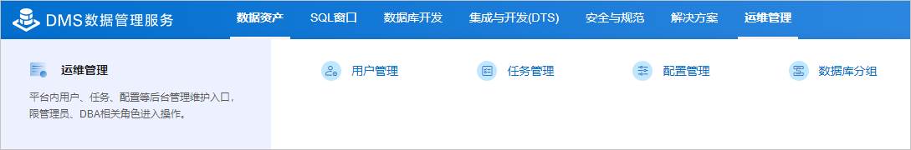<br>说明顶部下拉菜单关闭时，在顶部菜单栏中选择一级目录后，不会出现下拉菜单，您需要在左侧导航栏中进入各功能。</td>
     </tr>
     <tr>
       <td>快捷菜单</td>
       <td>• 默认开启。<br>• 在顶部菜单栏的下方有快捷菜单功能，您可以将经常使用的功能收藏到快捷菜单中。配置快捷功能的方法：<br>a. 在页面左上角，选择<strong>快捷菜单</strong>。<br>• 选中功能后面的图标，将该功能加入快捷菜单中。b.<br>• 取消选中功能后面的图标，将该功能从快捷菜单中移除。<br>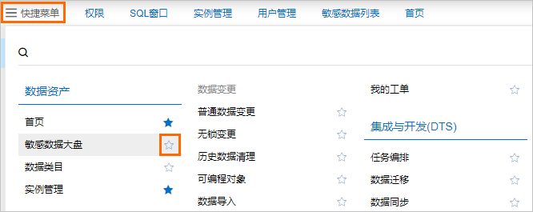</td>
     </tr>
     <tr>
       <td>显示标签页</td>
       <td>• 默认开启。<br>• 可以同时打开多个功能，每个功能以页签的形式展示。功能页签支持通过拖拽调整顺序。<br>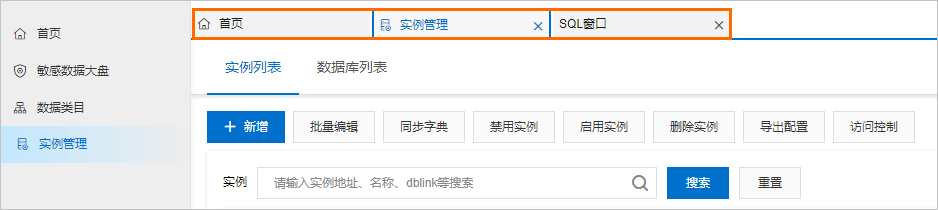<br>说明显示标签页关闭时，一次只能打开一个功能，每个功能以独占的形式展示。</td>
     </tr>
   </table>

4. 设置DMS主题皮肤，选择蓝色或暗黑皮肤。

   - 蓝色：系统默认。

     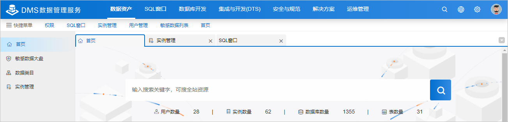

   - 暗黑。

     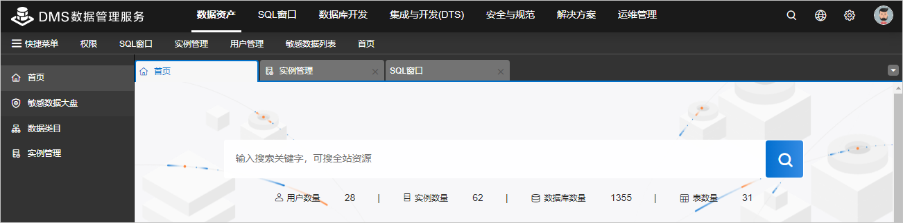

<a id="section-3-1-2"></a>

### 3.1.2. 返回DMS旧版控制台

数据管理DMS新版控制台的功能模块按照使用场景进行划分，同时集成了DTS实时数据传输功能，推荐您优先使用新版控制台。如果您想继续使用旧版，可以参考本文返回DMS旧版控制台。

**操作步骤**

1. 登录DMS控制台。

2. 在页面右下角，单击

   。

   

3. 在弹出的确认框中，单击**返回旧版**，返回DMS旧版控制台。

   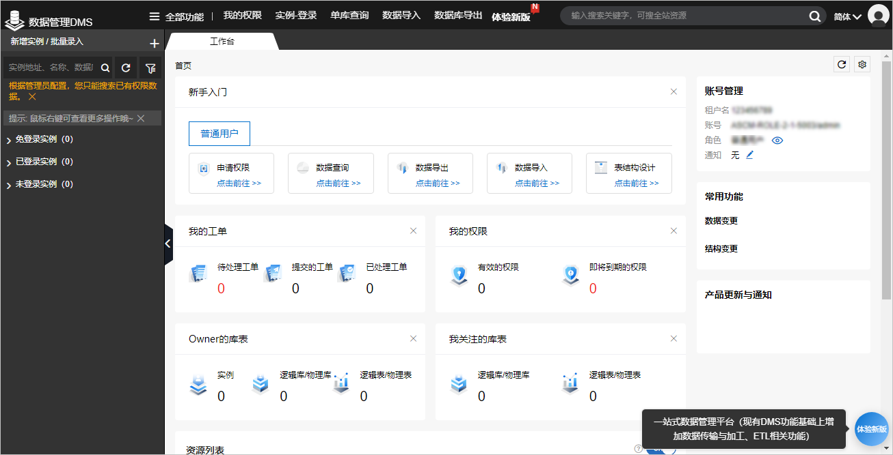

   > 如果您想再次返回新版控制台，在**工作台**页签的右下角，单击**体验新版**，在弹出的确认
   >
   > **说明**
   >
   > 框中单击**离开**，进入DMS新版控制台。

<a id="section-3-2"></a>

## 3.2. 数据类目

随着业务的发展，表的数量不断增多，数据管理DMS推出数据类目功能，帮助您对表进行分类，便于管理人员、开发人员及运维人员能更好地管理或使用数据表。

**前提条件**

- 数据库类型为关系型数据库或数据仓库，更多信息，请参见数据管理DMS。

- 您的用户角色为管理员或DBA，关于用户角色信息，请参见各角色支持的功能。

**管理数据类目**

1. 登录DMS控制台。

2. 在顶部菜单栏中，选择**数据资产 > 数据类目**。

3. 单击**新增类目**。

4. 在**类目名称**文本框中，输入类目名称，并单击**确认**。左侧类目树将显示新增的类目。

   > 系统默认创建**未归属**类目，您可以在该类目中找到所有未归属的表。
   >
   > **说明**

5. 在目标类目右侧，单击  图标，您可以对类目进行如下操作：

   - **编辑**

     您可以选择  **> 编辑**，修改类目名称。

   - **新增子类目**

     您可以选择  **> 新增子类目**，新增子类目。

     最多能创建4层类目目录，若当前目录下已关联表，则不允许新增子类目。

   - **删除**您可以选择  **> 删除**，删除类目目录。

     > 若该目录存在子目录或已关联表，则不允许删除。
     >
     > **说明**

**配置表的数据类目**

每张表仅能配置一个类目，若配置了新类目，原先类目会自动解除关联。

1. 登录DMS控制台。

2. 在顶部菜单栏中，选择**数据资产 > 数据类目**。

3. 单击选中目标数据类目。

   > 您可以单击数据类目左侧的
   >
   > 按钮，展开子类目。
   >
   > **说明**
   >
   > 

4. 在目标类目中，单击**快速添加**。

   > 您也可通过其他方式进行配置：
   >
   > **说明**
   >
   > - 在**未归属**类目中，找到目标表，单击右侧的**关联类目**，进行配置。

5. 在弹窗中，搜索并选中目标表，并单击**确认**。

   > **说明**
   >
   > - 支持批量选择多张表。
   >
   > - 如果您想取消表的数据类目，可以在数据类目的列表中，找到目标表，单击右侧的**移出类目**，取消表的类目关联。

<a id="section-3-3"></a>

## 3.3. 实例管理

通过数据管理DMS，您可以对实例进行管理、导出配置、编辑等操作。

**前提条件**

用户角色为DBA或管理员。

> 鼠标移动到界面右上角的  ，查看您的角色。
>
> **说明**

**操作步骤**

1. 登录DMS控制台。

2. 在顶部菜单栏中，选择**数据资产 > 实例管理**。

3. 在**实例列表**页面，单击选中目标实例前的复选框，您可以根据业务需求执行下述操作：

   > 您可以单击**展开筛选**来展示更多的过滤条件。
   >
   > **说明**

   - 新增实例

     单击**新增**将实例录入到DMS中，相关操作介绍请参见录入实例。

   - 批量编辑实例单击**批量编辑**，在弹出的对话框中调整对应的实例信息，然后单击**确认**。

     > 选择的目标实例的数据库类型必须一致，例如都是MySQL。
     >
     > **说明**

   - 同步字典

     单击**同步字典**，然后在弹出的对话框中单击**确认**。

     > **说明**
     >
     > - 结构变更通过DMS中执行时，DMS会自动同步字典信息。
     >
     > - 结构变更未通过DMS执行时，您需要手动执行同步字典的操作。

   - 禁用或启用实例

     单击**禁用实例**或**启用实例**，然后在弹出的对话框中单击**确认**。

     > **说明**
     >
     > - 执行禁用实例的操作后，该实例会从左侧实例列表移除，用户无法通过数据管理DMS控制台检索到该实例中的库或表。
     >
     > - 执行启用实例的操作后，该实例会出现在左侧的实例列表中，且实例中的数据库恢复至可用状态，DMS用户申请过的相关权限可继续使用。

   - 删除实例单击**删除实例**，然后在弹出的对话框中单击**确认**。该实例会从左侧实例列表移除，用户不能再通过DMS使用该实例中的数据库，同时用户针对该实例申请的权限将会失效并删除。

     > 您可以在**实例列表**页面，过滤删除状态的实例，通过启用实例来恢复该实例。
     >
     > **说明**

   - 导出配置

     单击**导出配置**，浏览器将自动下载名称为instances的CSV格式文件，您可以用Excel或文本编辑工具查看该文件。

   - 访问控制单击**访问控制**，在弹出的对话框中，打开**元数据访问控制**开关，单击**确认**。开启访问控制后，仅有权限的用户能搜索到当前实例或其下的数据库。

     > 仅管控模式为安全协同的数据库实例，可设置访问控制。
     >
     > **说明**

   - 其他操作

     您还可以在单个实例的**操作**列中，单击**详情**查看数据库详情，或者在**更多**里执行登录实例、编辑实例等操作。

<a id="section-3-4"></a>

## 3.4. 数据库管理

在数据库列表页面，您可以设置、转交或释放数据库Owner权限，授予或撤销用户权限，执行导出配置或导出权限等操作。

**操作步骤**

1. 登录DMS控制台。

2. 在顶部菜单栏中，选择**数据资产 > 实例管理**。

3. 单击**数据库列表**页签。

4. 通过条件筛选后，单击选中目标实例前的复选框，您可以根据业务需求执行下述操作。

   > 您可以单击**展开筛选**来展示更多的过滤条件。
   >
   > **说明**

   - 设置Owner

     设置选中数据库的Owner，可同时为多个数据库设置多个Owner。

   - 转交Owner

     将目标数据库的Owner转交给某个用户。转交多个数据库的Owner时，原Owner只能选择多个数据库共有的Owner。

   - 释放Owner

     释放目标数据库的Owner。

   - 授权用户将目标数据库的查询、导出或变更权限授予一个或多个用户，并且可以设置权限过期时间。

     > 管控模式为自由操作的目标数据库权限不可授予用户。
     >
     > **说明**

   - 回收权限

     将目标数据库的查询、导出或变更权限从一个或多个用户处收回。如果用户没有相应的权限，则提

     

     示 没有对应的权限，不需要回收`/`释放 。

   - 导出配置

     将目标数据库的配置信息导出为Excel，包括实例状态、环境、DBA、Owner等。

   - 导出权限

     将目标数据库的权限信息导出为Excel，包括数据库信息、用户、权限、授权人等。

   - 访问控制单击**访问控制**，在弹出的对话框中，打开**元数据访问控制**开关，单击**确认**。开启访问控制后，仅有权限的用户能搜索到该数据库。

     > 仅管控模式为安全协同的数据库实例，可设置访问控制。
     >
     > **说明**

   - 其他操作

     您还可以在单个数据库的右侧查看数据库表详情，或者在**更多**里执行单库查询、权限管理、实例详情和定位实例操作。

<a id="section-3-5"></a>

## 3.5. 元数据访问控制

元数据访问控制功能是指在DMS中对数据库、实例等的查看与访问权限进行控制的功能。在未开启该功能时，普通用户角色可以查询到该账号下所有的数据库、实例。开启该功能后，可实现指定用户仅允许查看和访问已被授权的数据库、实例，进一步保障企业的数据安全。

**背景信息**

DMS作为企业内数据库统一管理入口，已为不同用户提供了访问不同数据的管控权限。DMS新推出的元数据访问控制功能将进一步加强企业的数据安全管控，该功能开启后可实现指定用户仅允许查看和访问已被授权的数据库，也可保障指定数据库仅允许被已授权的用户查看和访问。

> 在DMS中，数据库级别的权限有**查询**、**导出**、**变更**，若某用户有其中任意一种权限即被视
>
> **说明**
>
> 为已授权该数据库，可在DMS中获取到如下信息：
>
> - 查看该数据库（包括实例左侧导航栏、顶部搜索栏、权限申请搜索栏等），能否查询该库的数据取决于是否拥有**查询**权限。
>
> - 查看该库所在的实例信息，但不能看到该实例下的其他数据库，能否查看到其他数据库取决于是否拥有其他数据库的权限。

您可以从以下3种形式控制元数据访问权限：

- 用户访问控制：指定目标用户仅允许查看与访问已被授权数据库。

- 数据库访问控制：指定目标数据库仅允许被已授权的用户查看与访问。

- 实例访问控制：指定目标实例以及该实例的所有数据库仅允许被已授权的用户查看与访问。

**用户访问控制**

1. 登录DMS控制台。

2. 在顶部菜单栏中，选择**运维管理 > 用户管理**。

   > 您当前账号的角色需要为管理员。
   >
   > **说明**

3. 找到目标用户，选择右侧**操作**列下的**更多 > 访问控制**。

4. 在弹窗中，打开**元数据访问控制**开关，单击**确认**。

**开启实例访问控制**

1. 登录DMS控制台。

2. 在顶部菜单栏中，选择**数据资产 > 实例管理**。

   > 您当前账号的角色需要为DBA或管理员。
   >
   > **说明**

3. 在**实例列表**页签中，找到目标实例，单击右侧**操作**列下的**更多 > 访问控制**按钮。

   > 您也可以批量选中多个实例，单击页面上方的**访问控制**，批量开启多个实例的访问控制
   >
   > **说明**
   >
   > 开关。

4. 在弹窗中，打开**元数据访问控制**开关，单击**确认**。

**开启数据库访问控制**

1. 登录DMS控制台。

2. 在顶部菜单栏中，选择**数据资产 > 实例管理**。

   > 您当前账号的角色需要为DBA或管理员。
   >
   > **说明**

3. 单击**数据库列表**页签，找到目标数据库，单击右侧**操作**列下的**更多 > 访问控制**按钮。

   > 您也可以批量选中多个数据库，单击页面上方的**访问控制**按钮，批量开启多个数据库的
   >
   > **说明**
   >
   > 访问控制开关。

4. 在弹窗中，打开**元数据访问控制**开关，单击**确认**。

<a id="section-4"></a>

# 4.SQL窗口

<a id="section-4-1"></a>

## 4.1. 单库查询

您可以在数据管理DMS的SQL Console中非常便捷地执行各类SQL语句，同时支持以可视化的方式对目标数据库进行增、删、改、查等操作。适用于数据查询、数据开发等场景。

**前提条件**

需具备目标库或表的查询权限。

**注意事项**

- 若表上存在敏感、机密字段并且未单独开通对应权限，则在查询结果显示时会以 `******` 显示，更多信息，请参见敏感数据管理。

- 查询显示的结果行数默认为200行，可以由管理员在**系统管理 > 安全管理 > 安全规则**里修改。

- 允许SQL进行全表扫描的最大值为10GB，可以由管理员在**系统管理 > 安全管理 > 安全规则**里修改。

- 执行单个SQL的默认超时时长为60秒，可以由管理员在**编辑实例 > 高级信息**里修改。

**操作步骤**

1. 登录DMS控制台。

2. 在页面顶部，选择**全部功能 > SQLConsole > 单库查询**。

   > 您也可以在DMS左侧的实例列表中，双击目标数据库，进入**SQLConsole**页面。
   >
   > **说明**

3. 下拉选择或输入数据库名的关键字搜索，找到并单击要查询的数据库名，单击**确认**。

4. 在SQLConsole区域输入要执行的SQL语句，单击**执行**。

   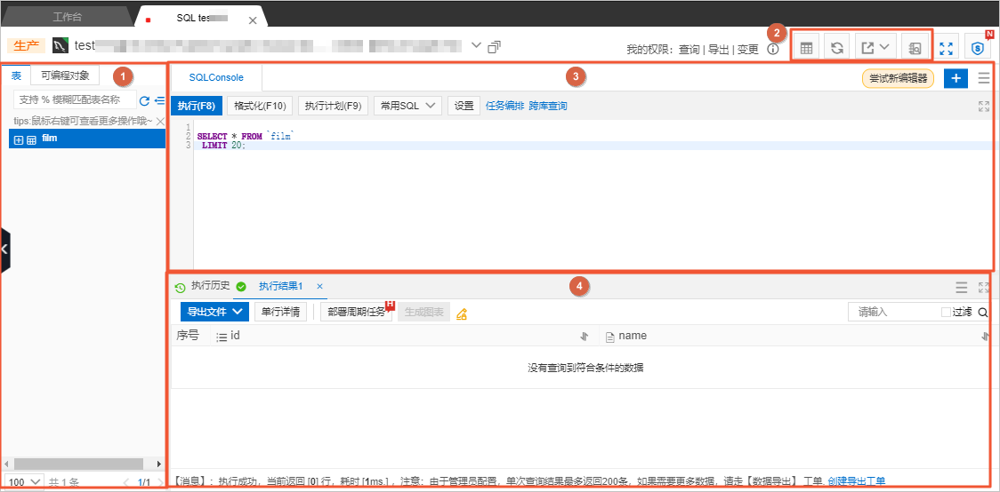

   表 1. SQLConsole界面介绍

   | 序号 | 区域 | 说明 |
   | --- | --- | --- |
   | ① | 可视化操作区域 | 可视化地管理数据库：<br>• 表可查看当前数据库的所有表、字段、索引数据，也可以右键单击目标数据库，进行编辑表结构、导入数据、导出数据等快捷操作。<br>• 可编程对象可创建、查看、执行、管理（删除）<strong>视图</strong>、<strong>存储过程</strong>、<strong>函数</strong>、<strong>触发器</strong>、<strong>事件</strong>等可编程对象。<br>说明最多只显示1000条。<br>• 键值（key-value）对信息<br>说明NoSQL数据库将会显示键值对（Key）信息。 |
   | ② | 扩展功能区域 | 该区域为您提供了扩展功能的便捷入口，当前支持的功能如下：<br>（<strong>表详情</strong>）：单击图标可切换至<strong>表详情</strong>页，单击图标可返回<strong>查询</strong>页。<br>（<strong>同步元数据</strong>）：单击该按钮后，DMS将采集数据库上最新的表、字段、索引、可编程对象等元数据信息，用于实现表、字段、可编程对象的权限分级管控。<br>（导出）：通过导出功能可导出数据库、数据库的表结构或建表语句。<br><br>（<strong>操作审计</strong>）：操作审计保存了所有数据查询和变更记录，可查询执<br>行的操作、操作人和操作时间等信息。更多信息，请参见操作审计。 |
   | ③ | 命令执行区域 | 输入SQL语句后单击<strong>执行</strong>，对数据库进行操作，并且提供格式化、执行计划、常用SQL、显示设置等操作。<br>说明您可以单击图标，增加多个查询页签<br> |
   | ④ | 执行结果区域 | 执行SQL后，可以查看执行结果，同时提供查看单行详情、新增、删除、提交修改等操作。<br>说明单击<strong>执行历史</strong>，您可以查看SQL执行历史，包括开始时间、数据库、SQL等，且支持导出。 |

<a id="section-4-2"></a>

## 4.2. 跨库查询

数据管理DMS的跨库查询功能可便捷地对库表进行跨实例的关联查询。本文介绍使用跨库查询的方法。

**前提条件**

- 数据库实例的类型为MySQL、SQL Server、PostgreSQL、云原生分布式数据库PolarDB-X或Redis。

- 仅支持物理库的跨库查询。

  > **说明**
  >
  > - 物理库：具体的某个数据库。
  >
  > - 逻辑库：由单个或多个物理库配置而成，可便捷的进行分库分表的操作。

- 数据库实例已开启跨库查询。

  > 如果没有开启，管理员可以在**数据资产 > 实例管理**中编辑实例的高级信息，开启跨库查
  >
  > **说明**
  >
  > 询并自定义一个DBLink名称。

**操作步骤**

1. 登录DMS控制台。

2. 在顶部菜单栏中，选择**SQL窗口 > 跨库查询**。

3. 确认您拥有目标数据库的访问权限。

   > 可视化操作区域各选项的含义：
   >
   > **说明**
   >
   > - 权限：
   >
   >   - 有权限：开启跨库查询功能且拥有访问权限的实例、数据库和表所在的数据库。管理员和DBA对所有实例都有访问权限。
   >
   >   - 全部：该租户下所有开启跨库查询功能的实例或数据库。
   >
   > - 对象：
   >
   >   - DBLink：符合条件的实例对应的DBLink列表。
   >
   >   - 数据库：符合条件的数据库列表。

   在页面左侧的可视化操作区域，右键单击目标数据库，选择**查看该库权限**。在**信息**对话框中，查看您是否拥有该库的访问权限：

   - 您有该库的访问权限：您拥有该数据库的访问权限，可以进行下一步操作。

   - 您没有该库的权限：您没有该数据库的访问权限，根据下面的操作步骤申请权限。

     <ol type="a">

     <li>

     单击**申请库权限**。

     </li>

     <li>

     在**权限申请**对话框中，选中您需要的权限类型。

     </li>

     </ol>

     <ol type="i" start="100">

     <li>

     从**期限**列表中，选择您需要的权限期限。

     </li>

     <li value="500">

     在**权限类型**文本框中，输入申请权限的原因、背景，减少审批流程中的沟通成本。

     > 系统默认输入**SQLConsole查询操作无权限，一键生成工单。**
     >
     > **说明**

     </li>

     </ol>

     <ol type="a" start="5">

     <li>

     单击**确认**。

     </li>

     </ol>

     审批通过后，您会拥有该数据库的权限，可以进行下一步操作。

4. 在SQL命令区域，输入跨库查询的SQL语句，单击**执行**。示例SQL：

   ```text
   SELECT *    
   FROM dblink1.db1.table1 t1,         
        dblink2.db2.table2 t2    
   where t1.id= t2.id
   ```

   在执行结果区域，查看SQL的执行结果。

   > **说明**
   >
   > - 您还可以在**安全与规范 (DBS) > 操作审计 > 操作日志**中，查看跨库查询的操作日志。
   >
   > - 跨库查询最大返回行数默认100行，如果您想要查看更多数据，进入**运维管理 > 配置管理**，在参数**跨库查询最大返回行数**的**操作**列中，单击**编辑**，设置跨库查询最大返回行数，允许设置的最大返回行数为3000行。
   >
   > - 如果您想要查询超过3000行的跨库查询数据，可以在任务编排中创建Spark SQL任务，将目标结果集写入一个新的临时表，然后对临时表进行单库查询。

<a id="section-4-3"></a>

## 4.3. 表结构版本管理

当您在数据管理DMS中对数据库进行表结构变更后，DMS将会保存最新的表结构至数据库版本列表中。您可以在数据库版本列表中下载、比对、恢复历史版本的表结构。

**前提条件**

您具有该表或数据库的查询权限，更多信息，请参见管理权限。

**表结构版本介绍**

表结构版本基于数据库维度，存储了该库下所有表的结构信息。当该库中的任意表发生结构变更，将触发保存新的表结构版本，更多信息，请参见表结构版本保存说明。

例如某数据库实例（安全协同）下面有5个数据库，即每个库都有50个表结构版本（安全协同支持每个数据库保留50个表结构版本）。

**功能限制**

- 支持的数据库引擎如下：

  - MySQL：云数据库RDS MySQL、云原生数据库PolarDB-X、云原生数据仓库AnalyticDB MySQL、其他来源MySQL。

  - SQL Server：云数据库RDS SQL Server、其他来源SQL Server。

  - PostgreSQL：云数据库RDS PostgreSQL、云原生数据仓库AnalyticDB PostgreSQL、其他来源PostgreSQL。

  - OceanBase

  - 达梦数据库DamengDB

- 根据不同的管控模式，各数据库支持保留的版本数量如下：

  - 自由操作：3个

  - 稳定变更：20个

  - 安全协同：50个

- 不支持的库：

  - 表数量大于1024张。

  - 系统库（如MySQL的information_schema库、sys库等）。

**管理表结构版本**

1. 登录DMS控制台。

2. 在顶部菜单栏中，选择**SQL窗口 > SQL窗口**。

3. 搜索并选择数据库，单击**确认**。

4. 在目标数据库的SQL窗口中，选择  **> 版本管理**。

5. 在**数据库版本列表**页面，找到目标版本号，您可以进行如下操作：

   <table>
     <tr>
       <th width="105">操作</th>
       <th>说明</th>
     </tr>
     <tr>
       <td>查看</td>
       <td>查看表结构的详情信息。</td>
     </tr>
     <tr>
       <td>预览脚本</td>
       <td>查看表结构的SQL脚本。</td>
     </tr>
     <tr>
       <td>表结构对比</td>
       <td>将表结构同步至其他表结构或与其他表结构进行对比，更多信息，请参见结构同步。</td>
     </tr>
     <tr>
       <td>结构恢复</td>
       <td>将表结构同步至空的数据库中，更多信息，请参见空库初始化。</td>
     </tr>
   </table>

**表结构版本保存说明**

当您在DMS中进行以下操作时，会触发保存最新的表结构：

- 在SQL窗口中修改表结构。

- 在普通数据变更、无锁数据变更、结构设计、结构同步等工单中修改表结构。

- 在SQL任务中修改表结构（由管理员发起）。

> **说明**
>
> 若数据库在DMS以外发生结构变更，您可以在DMS中同步元数据（获取并保存最新的表结构）。

<a id="section-4-4"></a>

## 4.4. 风险审计报告

您可以通过数据管理DMS的风险审计，搜集和评估数据库在使用过程中产生的各类风险，并获取系统提供的优化建议，使数据库运行得更加安全、稳定。

**什么是风险审计报告**

风险审计报告是基于实例维度，对实例或实例中的数据库进行风险分析诊断。

目前已支持的风险评估项如下：

| 风险评估项 | 说明 | 支持的数据库引擎 |
| --- | --- | --- |
| SQL审核 | 评估该实例在DMS平台发起的所有SQL语句（默认为最近一周）是否符合研发规范，包含SQL Console、普通数据变更或无锁数据变更等工单中提交的SQL语句。<br>例如：<code> UPDATE </code>语句漏写<code> WHERE </code>条件导致全表更新的问题。<br>说明该评估项依赖于SQL审核优化建议。 | MySQL系列RDS MySQL、PolarDB-X、AnalyticDB MySQL、其他来源MySQL。 |
| 元数据 | 评估该实例下所有数据库的表结构存在的风险。例如：整型自增主键将导致剩余空间不足的风险。<br>说明该评估项依赖于SQL审核优化建议。 | MySQL系列RDS MySQL、PolarDB-X、AnalyticDB MySQL、其他来源MySQL。 |
| 敏感数据 | 评估该实例下的字段是否属于敏感数据。例如：手机号、身份证号、密码等敏感字段易导致敏感数据泄露的风险。 | • MySQL系列RDS MySQL、PolarDB-X、AnalyticDB MySQL、其他来源MySQL。<br>• SQL Server系列RDS SQL Server、其他来源SQL Server。<br>• PostgreSQL系列RDS PostgreSQL、其他来源PostgreSQL。 |

**功能限制**

- 您的用户角色为管理员、安全管理员、DBA、普通用户（实例Owner或数据库Owner）。

- 各实例支持保留近期的风险审计，不同管控模式支持的数量如下：

  - 自由操作：3份（不支持查看报告的明细）

  - 稳定变更：20份

  - 安全协同：50份

**操作步骤**

1. 登录DMS控制台。

2. 在顶部菜单栏中，选择**SQL窗口 > SQL窗口**。

3. 搜索并选择数据库，单击**确认**。

4. 在目标数据库的SQL窗口中，选择  **> 风险审计**。

5. 单击**实时诊断**。

6. 在弹窗中，选择实时诊断的功能模块，并单击**立即诊断**。待**状态**为**已完成**时，即表示诊断分析完成。

7. 待诊断分析完成后，单击**详情**即可查看当前实例下每个库的诊断信息。

8. 在报告详情页，单击各检测项右侧的数字，即可查看风险详情信息。

<a id="section-4-5"></a>

## 4.5. 超级SQL模式

开启超级SQL模式后，管理员和DBA在SQL窗口中执行SQL语句将不受安全规则的限制。

**前提条件**

- 您的用户角色为管理员或DBA。

- 目标实例的管控模式为安全协同模式。

**背景信息**

管理员和DBA通常会为了增强数据库的安全性和稳定性，配置SQL窗口安全规则，例如限制用户在SQL窗口中执行生产库的DML，仅能通过工单的形式执行。但上述安全规则也会给管理员和DBA等高权限的人员造成一定的不便。

为此，DMS在SQL窗口中推出**超级SQL模式**，管理员和DBA在该模式下执行SQL语句将不受安全规则的限制。

**操作步骤**

1. 登录DMS控制台。

2. 在顶部菜单栏中，选择**SQL窗口 > SQL窗口**。

3. 搜索并选择数据库，单击**确认**。

4. 在SQL窗口右上角，单击

   图标，并在弹窗中单击**确认**。

   

   此时，SQL窗口的外边框将变成橙色，表示**超级SQL模式**已开启。您在SQL窗口中提交的SQL将会直接执行。

   > **重要**
   >
   > - 开启超级SQL模式后，管理员和DBA在SQLConsole中执行SQL语句将不受安全规则的限制，请注意操作风险。
   >
   > - 如果您想关闭**超级SQL模式**，单击  图标，SQL窗口的橙色外边框消失，超级SQL模式被关
   >
   >   闭。

<a id="section-5"></a>

# 5.数据库开发

<a id="section-5-1"></a>

## 5.1. 结构变更

<a id="section-5-1-1"></a>

### 5.1.1. 结构设计

通过结构设计功能，用户可便捷地完成结构变更，本文介绍具体的配置方法。

**前提条件**

目标库的数据库类型为MySQL、云原生分布式数据库PolarDB-X或OceanBase。

**背景信息**

在新项目、新需求或者优化等业务场景中，一般会涉及到新建表、修改表（加减字段、加减索引、调整字段属性、调整索引组成）等结构的变更操作，此时可以使用DMS的结构设计功能。

- 支持多人协同在Web页面变更数据结构。

- 支持已验证脚本一键发送至其他环境，保障环境之间相关表的结构一致性。

**注意事项**

通过结构设计工单执行删除表操作时，仅支持删除通过结构工单创建的表。

**操作步骤**

1. 登录DMS控制台。

2. 在顶部菜单栏中，选择**数据库开发 > 结构设计**。

3. 单击页面右上角的**结构设计**。

4. 配置结构设计工单信息，并单击**提交**。

   <table>
     <tr>
       <th width="105">配置</th>
       <th>说明</th>
     </tr>
     <tr>
       <td>项目名称</td>
       <td>填写项目名称便于后期管理。</td>
     </tr>
     <tr>
       <td>业务背景</td>
       <td>描述项目的业务背景信息，例如变更目的、预期目标等，减少沟通成本。</td>
     </tr>
     <tr>
       <td>变更基准库</td>
       <td>选择变更的目标数据库，可以通过库名前缀过滤，仅展示您有权限的测试或开发环境数据库。<br>说明<br>• 仅支持安全协同模式的数据库实例。<br>• 需具备库的查询、导出、变更的任意一种或多种权限组合。</td>
     </tr>
     <tr>
       <td>安全规则</td>
       <td>DMS会自动选择，无需配置。</td>
     </tr>
     <tr>
       <td>关联迭代</td>
       <td>单击<strong>选择/切换迭代</strong>，在目标迭代名称的<strong>操作</strong>列，单击<strong>关联</strong>，关联迭代。</td>
     </tr>
     <tr>
       <td>变更相关人</td>
       <td>在下拉框中选择待设置的相关人员，被设置的人员都可查看工单并协同工作，非相关人员则不能查看工单（管理员、DBA除外）。</td>
     </tr>
   </table>

5. 根据业务需求设计表结构。

   <ol type="i">

   <li>

   单击**新建物理表**。

   </li>

   <li>

   根据业务需求设置表的基本信息、列信息、索引信息等。

   </li>

   <li>

   单击**保存**。

   > 保存时会根据规范检测，若不符合设计规范会弹出相关提示。
   >
   > **说明**

   </li>

   <li>

   预检测通过后，单击**确认无误，提交保存**。

   </li>

   </ol>

6. 将表结构变更执行到基准库。

   <ol type="i">

   <li>

   单击**执行变更到基准库**。

   </li>

   <li>

   在弹出的对话框中，选择执行策略为**立即执行**或**定时执行**。

   </li>

   <li>

   单击**确定**。

   </li>

   <li>

   审批完成后，单击**进入下一节点**。

   > **说明**
   >
   > - 审批通过后平台按照指定时间执行变更（不指定执行时间的变更会在最后一个审批节点通过后自动触发执行操作），您可以查看执行状态和执行日志。此时可以选择再次进入设计修改重复整个执行过程，或结束设计结构进入下一节点。
   >
   > - 事先设定的规范会决定进入下一节点后能否返回重新修改。

   </li>

   <li>

   在弹出的对话框中，再次单击**进入下一节点**。

   </li>

   </ol>

7. 将表结构变更执行到目标库。

   <ol type="i">

   <li>

   单击**执行变更到目标库**。

   </li>

   <li>

   选择目标库和执行策略，单击**确定**。

   > 目标库环境类型需要为生产。
   >
   > **说明**

   </li>

   <li>

   等待审批和执行完成后，单击**进入下一节点**。整个流程结束，工单关闭。

   </li>

   </ol>

<a id="section-5-1-2"></a>

### 5.1.2. 结构同步

DMS结构同步功能支持对比数据库的结构，产生差异化脚本并执行到目标环境。本文介绍结构同步的功能与操作步骤。

**前提条件**

源和目标库的数据库类型为OceanBase或MySQL。

**注意事项**

- 目标库为生产库时不允许执行结构同步。

- 支持全量以及部分物理库和逻辑库的空库初始化。

**适用场景**

适用于多套环境数据库之间的结构一致性或同步场景，例如：

- 生产库与测试库。

- 不同的测试库。

- 不同的生产库。

**操作步骤**

1. 登录DMS控制台。

2. 在顶部菜单栏中，选择**数据库开发 > 结构同步**。

3. 配置库表同步的工单信息。

   <table>
     <tr>
       <th width="135">配置</th>
       <th>说明</th>
     </tr>
     <tr>
       <td>来源库</td>
       <td>结构同步来源库。您需要有该库的查询权限。</td>
     </tr>
     <tr>
       <td>目标库</td>
       <td>结构同步目标库。您需要有该库的变更权限。</td>
     </tr>
     <tr>
       <td>同步的表</td>
       <td>选择需要同步的表。<br>• <strong>部分表</strong>：填写需要同步的表。<br>说明若不填目标表名则默认与源表名一致。<br>• <strong>全部表</strong>：同步源库中的所有表。</td>
     </tr>
     <tr>
       <td>是否忽略报错</td>
       <td>• <strong>不忽略</strong>：在执行过程中，库级别串行执行时遇到出错则中断后面的SQL脚本，不再执行。<br>• <strong>忽略</strong>：在执行过程中，即使遇到错误仍会跳过当前失败SQL脚本，继续往下执行，直至所有SQL脚本都执行完成。</td>
     </tr>
     <tr>
       <td>业务背景(备注)</td>
       <td>填写业务背景。</td>
     </tr>
   </table>

4. 单击**提交申请**，DMS开始执行结构分析。

5. 检查对比结果。

   > 若结构发生变更可以在工单中单击重新分析。
   >
   > **说明**

6. 查看差异脚本，确认无误后，单击**提交，同步目标库**。

   > 如果没有差异则无需提交，任务完成。
   >
   > **说明**

<a id="section-5-1-3"></a>

### 5.1.3. 影子表同步

数据管理DMS的影子表同步功能支持根据源表的表结构自动创建影子表（新的数据表，表名是在源表名上增加前缀或后缀的方式生成），适用于全链路压测等场景。

**操作步骤**

1. 登录DMS控制台。

2. 在顶部菜单栏中，选择**数据库开发 > 结构变更 > 影子表同步**。

3. 在**库表同步工单申请**页中，参考下表配置参数。

   <table>
     <tr>
       <th width="121">参数</th>
       <th>说明</th>
     </tr>
     <tr>
       <td>来源库</td>
       <td>输入待同步的来源库。</td>
     </tr>
     <tr>
       <td>前缀 / 后缀</td>
       <td>支持以“<strong>前缀</strong>+源表名”（默认）或“源表名+<strong>后缀</strong>”的格式创建影子表名称，并且支持自定义前、后缀。<br>影子表名默认为<code> __test_</code>源表名<code> </code>。</td>
     </tr>
     <tr>
       <td>同步的表</td>
       <td>选择需要同步的表，支持的选项：<br>• 部分表<br>• 全部表</td>
     </tr>
     <tr>
       <td>同步策略</td>
       <td>选择同步的频率，支持的选项：<br>• <strong>立即同步</strong>：立即进行同步（仅同步一次）。<br>• <strong>定时同步</strong>：定期定时进行同步，您可以根据需求配置Crontab表达式（本接口最小间隔为一小时，且只支持日期，默认每天2点执行），更多信息，请参见Crontab表达式。</td>
     </tr>
     <tr>
       <td>是否忽略报错</td>
       <td>选择是否忽略报错，支持的选项：<br>• <strong>不忽略</strong>：在执行过程中，遇到出错则中断后面的SQL脚本，不再执行。<br>• <strong>忽略</strong>：在执行过程中，遇到错误会跳过当前失败SQL脚本，继续往下执行，并执行完所有SQL脚本。</td>
     </tr>
   </table>

4. 单击**提交申请**，DMS开始执行结构分析。

5. 检查对比结果。

   > 若结构发生变更可以在工单中单击重新分析。
   >
   > **说明**

6. 查看差异脚本，确认无误后，单击**提交，同步目标库**。

   > 如果没有差异则无需提交，任务完成。
   >
   > **说明**

**Crontab表达式**

如果您需要从更细维度自定义定时任务的执行时间，可以使用Crontab表达式。时间间隔的单位可以是分钟、小时、日、周或月的任意组合。

Crontab表达式由5列数字组合而成，取值说明如下：

- **分**（分钟）： `0-59` 。

- **时**（小时）： `0-23` ，0表示子夜。

- **日**（每个月的具体日期）： `1-31` 。

- **月**（月份）： `1-12` ，1表示1月，2表示2月，以此类推。

- **周**（星期）： `1-7` ，1表示星期日，2表示星期一，即每周从周日到周六的数字为 `1-7` 。

使用注意事项：

- 只能选择按照日或者周，指定执行压测时间。日和周只能二选一，指定日或周之后，另外一个输入框内需填写 `?` ，表示不受限制。例如，指定了每个月1、2号，**周**需填写 `?` 。

- 在Crontab表达式内，请使用英文字符，如英文通配符（\*、?）。

- 多个值之间用英文逗号（,）分隔。

- 值的区间用短划线（-）连接，例如**日**输入框内填写 `1-5` ，表示1号至5号。

- 正斜线（/）可以用来指定间隔频率，例如间隔2天，用 `*/2` 表示。

Crontab表达式实例：

- 每星期六、星期日的23:00执行：0 23 ? \* 7,1

- 每月5、15、25日的09:30执行：30 9 5,15,25 \* ?

- 每隔两天的零点执行：0 0 \*/2 \* ?

<a id="section-5-1-4"></a>

### 5.1.4. 空库初始化

空库初始化功能支持对比数据库间的结构，产生差异化脚本并执行到目标环境（仅支持目标库为空库）。本文介绍空库初始化的功能与操作步骤。

**前提条件**

- 源和目标库的数据库类型为OceanBase或MySQL。

- 目标库需为空，即不包含任何表。

**注意事项**

支持全量以及部分物理库和逻辑库的空库初始化。

**适用场景**

适用于多区域部署、多单元部署的场景，例如：

- 生产库与测试库。

- 不同的测试库。

- 不同的生产库。

**操作步骤**

1. 登录DMS控制台。

2. 在顶部菜单栏中，选择**数据库开发 > 结构变更 > 空库初始化**。

3. 配置空库初始化的工单信息。

   <table>
     <tr>
       <th width="154">配置</th>
       <th>说明</th>
     </tr>
     <tr>
       <td>来源库</td>
       <td>空库初始化的来源库。您需要有该库的查询权限。</td>
     </tr>
     <tr>
       <td>目标库</td>
       <td>空库初始化的目标库。您需要有该库的变更权限。<br>说明目标库的数据库类型需要与来源库保持一致。</td>
     </tr>
     <tr>
       <td>初始化的表</td>
       <td>选择需要初始化的表。<br>• <strong>部分表</strong>：选择源库中的表。您还可以单击，添加更多的表。<br>• <strong>全部表</strong>：同步源库中的所有表。</td>
     </tr>
     <tr>
       <td>是否忽略报错</td>
       <td>• <strong>不忽略</strong>：在执行过程中，库级别串行执行时遇到出错则中断后面的SQL脚本，不再执行。<br>• <strong>忽略</strong>：在执行过程中，即使遇到错误仍会跳过当前失败SQL脚本，继续往下执行，直至所有SQL脚本都执行完成。</td>
     </tr>
     <tr>
       <td>业务背景（备注）</td>
       <td>填写业务背景。</td>
     </tr>
   </table>

4. 单击**提交申请**，DMS开始执行结构分析。

5. 检查对比结果。

   > 若结构发生变更可以在工单中单击重新分析。
   >
   > **说明**

6. 查看差异脚本，确认无误后，单击**提交，同步目标库**。

   > 如果没有差异则无需提交，任务完成。
   >
   > **说明**

<a id="section-5-1-5"></a>

### 5.1.5. 表一致性修复

表一致性修复功能可以帮助您对比不同环境下数据库中的表结构，快速找出差异并在目标环境执行差异脚本，可用于保障不同环境之间的结构一致性。

**前提条件**

- 源和目标库的数据库类型为OceanBase或MySQL。

- 若目标数据库实例的管控模式为自由操作或稳定变更，则需要在DMS中登录目标数据库。

  > 非安全协同模式的数据库实例需要登录。
  >
  > **说明**

**适用场景**

- 对比测试环境与生产环境下，物理表间的结构一致性。

- 对比单个物理库和逻辑库中，物理表和逻辑表间的结构一致性。

**操作步骤**

1. 登录DMS控制台。

2. 在顶部菜单栏中，选择**数据库开发 > 结构变更 > 表一致性修复**。

3. 配置表一致性修复的工单信息。

   <table>
     <tr>
       <th width="152">配置</th>
       <th>说明</th>
     </tr>
     <tr>
       <td>基准库（物理库）</td>
       <td>表一致性修复的基准库，即源库。您需要有该库的查询权限。</td>
     </tr>
     <tr>
       <td>目标库</td>
       <td>表一致性修复的目标库。您需要有该库的变更权限。</td>
     </tr>
     <tr>
       <td>修复的表</td>
       <td>选择需要修复的表。您还可以单击添加更多的表。<br>说明若不填目标表名，则默认目标表名与源表名一致。</td>
     </tr>
     <tr>
       <td>是否忽略报错</td>
       <td>• <strong>不忽略</strong>：在执行过程中，库级别串行执行时遇到出错则中断后面的SQL脚本，不再执行。<br>• <strong>忽略</strong>：在执行过程中，即使遇到错误仍会跳过当前失败SQL脚本，继续往下执行，直至所有SQL脚本都执行完成。</td>
     </tr>
     <tr>
       <td>业务背景</td>
       <td>填写业务的背景信息，便于沟通。</td>
     </tr>
   </table>

4. 单击**提交申请**，DMS开始执行结构分析。

5. 检查对比结果。

   > 若结构发生变更可以在工单中单击重新分析。
   >
   > **说明**

6. 查看差异脚本，确认无误后，单击**提交，同步目标库**。

   > 如果没有差异则无需提交，任务完成。
   >
   > **说明**

<a id="section-5-2"></a>

## 5.2. 数据变更

DMS提供数据变更模块，用户可在该模块对数据进行变更和订正。本文介绍使用数据变更功能的方法。

**背景信息**

在项目发布上线前，在数据初始化、历史数据清理、问题修复、测试等场景下，需要对数据执行更新操作（包括但不局限INSERT、UPDATE、DELETE、TRUNCATE等）。

**数据变更类别**

<table>
  <tr>
    <th width="122">类别</th>
    <th>说明</th>
  </tr>
  <tr>
    <td>普通数据变更</td>
    <td>通过普通数据变更，您可以执行下述两种变更：<br>• 执行正常的数据变更操作。<br>• 执行无锁结构变更操作，可应用于修改字符集、校验集、时区和列类型等场景，相较于普通数据变更存在下述优势：<br>• 规避由于数据库变更锁表而阻塞业务。<br>• 规避原生OnlineDDL造成的主备延迟。<br>• 取代原有optimize table锁表变更回收表空间、降低碎片率的方案为不锁表回收。<br>说明<br>• 该功能仅支持MySQL数据库，且在使用前需要在录入实例或编辑实例时，开启<strong>高级信息</strong>中的不锁表结构变更功能，详情请参见录入实例。<br>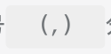<br>• 多条SQL之间，使用英文逗号<code> </code>（<code>,</code>）<code> </code>分隔。<br>• 仅支持管控模式为稳定变更或安全协同模式的数据库实例使用。</td>
  </tr>
  <tr>
    <td>无锁数据变更</td>
    <td>可应用于大量数据变更的需求（例如历史数据清理、全表更新字段等），可自动根据主键、唯一键分拆SQL分批多次执行，降低对数据库性能、数据库空间的影响。<br>说明该功能仅支持MySQL数据库。</td>
  </tr>
  <tr>
    <td>历史数据清理</td>
    <td>防止历史数据堆积对生产环境的稳定性产生影响，可使用该功能定期清理历史数据。<br>说明该功能仅支持MySQL数据库。</td>
  </tr>
  <tr>
    <td>数据导入</td>
    <td>支持大批量数据快速导入至数据库，节省人力物力成本。<br>说明支持的数据库：<br>• 自建数据库MySQL与云数据库MySQL。<br>• 云原生分布式数据库PolarDB-X。</td>
  </tr>
  <tr>
    <td>可编程对象</td>
    <td>数据库使用了函数或存储过程，可使用该功能规范管理流程并提供审计记录。</td>
  </tr>
</table>

**操作步骤**

1. 登录DMS控制台。

2. 在顶部菜单栏中，选择**数据库开发 > 数据变更**，然后选择对应数据变更类别。

3. 填写数据变更工单相关信息。以**普通数据变更**为例，填写数据变更工单相关信息。

   <table>
     <tr>
       <th width="105">配置</th>
       <th>说明</th>
     </tr>
     <tr>
       <td>数据库</td>
       <td>选择有变更权限的数据库。只有数据库的查询权限或只有表的变更权限时无法提交。</td>
     </tr>
     <tr>
       <td>关联迭代</td>
       <td>单击<strong>选择/切换迭代</strong>，在目标迭代名称的<strong>操作</strong>列，单击<strong>关联</strong>，关联迭代。</td>
     </tr>
     <tr>
       <td>原因类别</td>
       <td>选择数据变更的原因，方便后续查找。</td>
     </tr>
     <tr>
       <td>业务背景</td>
       <td>详细描述变更原因或目标，减少沟通成本。</td>
     </tr>
     <tr>
       <td>执行方式</td>
       <td>根据业务需求选择变更执行方式。</td>
     </tr>
     <tr>
       <td>影响行数</td>
       <td>本次更新会影响的预计数据行数，可在SQL窗口中使用COUNT命令统计。</td>
     </tr>
     <tr>
       <td>变更SQL</td>
       <td>可通过在文本框填入或通过上传附件的形式提供相关SQL语句。提交时会自动校验语法正确性，不正确则无法提交。</td>
     </tr>
     <tr>
       <td>回滚SQL</td>
       <td>可通过在文本框填入或通过上传附件的形式提供相关SQL语句，即变更SQL对应的逆向SQL。</td>
     </tr>
     <tr>
       <td>变更相关人</td>
       <td>设置的相关人员都可查看工单，并协同工作，非相关人员则不能查看工单（管理员、DBA除外）。</td>
     </tr>
     <tr>
       <td>工单附件</td>
       <td>上传图片或文档对变更内容进行补充。</td>
     </tr>
   </table>

4. 配置完成后单击**提交申请**。

5. 等待预检查通过，单击**提交审批**，在提示页面再次单击**确认**。

6. 等待审批通过，单击**执行变更**。

7. 选择执行时间，然后单击**确定执行**。

   > 默认为**立即执行**，也可以关闭是否立即执行开关，并选择一个期望开始执行时间，系统
   >
   > **说明**
   >
   > 会在该时间自动执行。

   等待工单执行完毕。

<a id="section-5-3"></a>

## 5.3. 数据导入

DMS提供数据导入功能，支持大批量数据快速导入至数据库，节省人力物力成本。

**支持的数据库**

- 自建数据库MySQL与云数据库MySQL。

- 云原生分布式数据库PolarDB-X。

**支持导入的文件类型**

- TXT格式。

- SQL脚本。安全协同模式下，默认仅放开INSERT和REPLACE命令。如需调整，可以由DBA或管理员角色在**安全规则 > SQL变更 > 批量数据导入**中修改。

- CSV格式。文件的分隔符必须为英文逗号（,），且第一行必须为列名。

> 文件大小限制为5 GB。
>
> **说明**

**注意事项**

- 如果只是少量数据变更，为保证变更的稳定性，建议使用普通数据变更或无锁数据变更工单。详情请参见数据变更。

- 在执行批量数据导入期间不会自动切换到无锁结构变更（即使实例开启了无锁结构变更优先）。

- 为了避免执行期间数据库性能受到影响，建议使用SQL性能较好的语句，如INSERT、主键索引的UPDATE和DELETE。

**操作步骤**

1. 登录DMS控制台。

2. 在页面顶部，选择**全部功能 > 数据方案 > 数据导入**。

3. 填写批量数据导入的工单相关信息。

   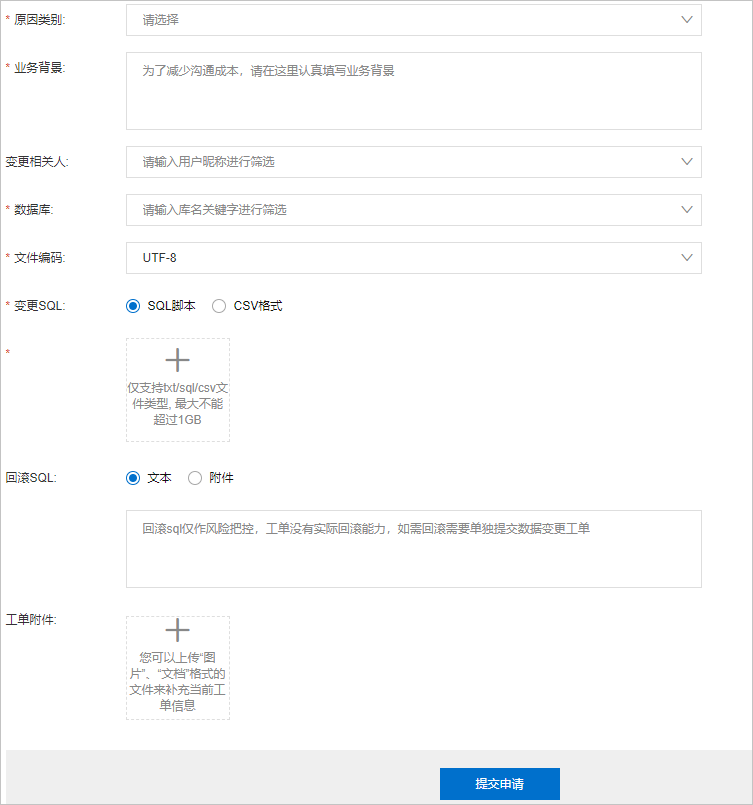

   <table>
     <tr>
       <th width="105">配置</th>
       <th>说明</th>
     </tr>
     <tr>
       <td>原因类别</td>
       <td>选择数据变更的原因，方便后续业务识别。</td>
     </tr>
     <tr>
       <td>业务背景</td>
       <td>详细描述变更原因或目标，减少沟通成本。</td>
     </tr>
     <tr>
       <td>变更相关人</td>
       <td>设置的相关人员都可查看工单，并协同工作，非相关人员则不能查看工单（管理员、DBA除外）。</td>
     </tr>
     <tr>
       <td>数据库</td>
       <td>选择有变更权限的数据库。只有数据库的查询权限或只有表的变更权限时无法提交。</td>
     </tr>
     <tr>
       <td>文件编码</td>
       <td>选择数据库的文件编码。</td>
     </tr>
     <tr>
       <td>变更SQL</td>
       <td>根据实际情况选择SQL脚本或CSV格式，并上传相关SQL语句的文件。提交时会自动校验语法正确性，语法不正确则无法提交。</td>
     </tr>
     <tr>
       <td>回滚SQL</td>
       <td>可通过在文本框填入或通过上传附件的形式提供相关SQL语句，即变更SQL对应的逆向SQL。</td>
     </tr>
     <tr>
       <td>工单附件</td>
       <td>上传图片或文档对变更内容进行补充。</td>
     </tr>
   </table>

4. 配置完成后单击**提交申请**。

5. 等待预检查通过，单击**提交审批**，在提示页面再次单击**确认**。

6. 等待审批通过，单击**执行变更**。

7. 选择执行时间，然后单击**确定执行**。

   > 默认为**立即执行**，也可以关闭是否立即执行开关，并选择一个期望开始执行时间，系统
   >
   > **说明**
   >
   > 会在该时间自动执行。

   等待工单执行完毕。

<a id="section-5-4"></a>

## 5.4. 数据导出

DMS提供数据导出功能，您可以导出数据库或SQL结果集，便于提取相关数据进行数据分析。

**操作步骤**

1. 登录DMS控制台。

2. 在顶部菜单栏中，选择**数据库开发 > 数据导出**，然后选择**SQL结果集导出**或**数据库导出**。

3. 配置数据导出工单的相关信息。

   - 配置导出SQL结果集的工单

     <table>
       <tr>
         <th width="125">配置</th>
         <th>说明</th>
       </tr>
       <tr>
         <td>数据库名</td>
         <td>选择具备库级别导出权限的数据库。</td>
       </tr>
       <tr>
         <td>原因类别</td>
         <td>选择导出数据的原因，方便后续查找。</td>
       </tr>
       <tr>
         <td>业务背景</td>
         <td>详细描述导出数据的原因或目标，减少沟通成本。</td>
       </tr>
       <tr>
         <td>影响行数</td>
         <td>预估本次导出会影响的数据行数，您通过SQLConsole中使用<code> count </code>命令进行统计。</td>
       </tr>
       <tr>
         <td>跳过校验</td>
         <td>是否跳过校验，如果选中<strong>跳过校验</strong>，您还需要填写原因。<br>警告选中<strong>跳过校验</strong>后，DMS不会校验导出影响行数，如果数据量较大可能对正常的业务产生风险，请谨慎选择。</td>
       </tr>
       <tr>
         <td>相关人</td>
         <td>设置的相关人员都可查看工单，并协同工作，非相关人员则不能查看工单（管理员、DBA除外）。</td>
       </tr>
       <tr>
         <td>导出SQL语句</td>
         <td>填入可直接执行的SQL语句，例如<code> select * from testtable </code>，提交申请时DMS会自动校验语法正确性，如果不正确则无法提交。</td>
       </tr>
       <tr>
         <td>工单附件</td>
         <td>您可以上传图片或文档对本次的导出操作进行补充说明。</td>
       </tr>
     </table>

   - 配置导出数据库的工单

     <table>
       <tr>
         <th width="121">配置</th>
         <th>说明</th>
       </tr>
       <tr>
         <td>数据库名</td>
         <td>选择具备库级别导出权限的数据库，然后在页面右侧选中表并配置过滤条件。</td>
       </tr>
       <tr>
         <td>导出的表</td>
         <td>• 部分表：在页面右侧选择要导出的表。<br>• 全部表：导出数据库中全部的表。</td>
       </tr>
       <tr>
         <td>原因类别</td>
         <td>选择导出数据的原因，方便后续查找。</td>
       </tr>
       <tr>
         <td>业务背景</td>
         <td>详细描述导出数据的原因或目标，减少沟通成本。</td>
       </tr>
       <tr>
         <td>相关人</td>
         <td>设置的相关人员都可查看工单，并协同工作，非相关人员则不能查看工单（管理员、DBA除外）。</td>
       </tr>
       <tr>
         <td>导出内容</td>
         <td>根据业务需求选择<strong>数据</strong>、<strong>结构</strong>或<strong>数据和结构</strong>。</td>
       </tr>
       <tr>
         <td>导出格式</td>
         <td>支持导出SQL、CSV和Excel格式的文件。</td>
       </tr>
       <tr>
         <td>导出结构类型</td>
         <td>根据业务需求选择导出的结构类型。</td>
       </tr>
       <tr>
         <td>更多选项</td>
         <td>单击<strong>大数据导出选项</strong>或<strong>SQL脚本拓展选项</strong>，然后选中对应的导出选项。</td>
       </tr>
       <tr>
         <td>工单附件</td>
         <td>您可以上传图片或文档对本次的导出操作进行补充说明。</td>
       </tr>
     </table>

4. 配置完成后单击**提交申请**。

   > 当导出SQL结果集时，DMS将执行预检查，等待预检查通过后单击**提交审批**并在弹出的
   >
   > **说明**
   >
   > 对话框中单击**确认**。

5. 审批通过后，在**工作台**首页，单击**我提交的工单**。

6. 找到本次导出数据所创建的工单，单击对应的工单号。

7. 在**执行/自助执行**区域框，单击**下载导出文件**。

<a id="section-5-5"></a>

## 5.5. SQL审核

DMS支持SQL审核功能，帮助您避免无索引或不规范的SQL语句，降低SQL注入风险。

**前提条件**

由于SQL审核发生在代码上线之前，要求目标数据库实例在DMS平台中的环境为**测试**。

**背景信息**

项目研发过程中，需要通过数据库的增、删、改、查等SQL操作来完成业务逻辑的处理、页面数据的展现。在项目正式发布到线上之前，需要对涉及本次更新的所有SQL语句进行全面的审核，避免不符合数据库开发规范的SQL语句发布到线上，从而影响生产服务。

如果所有SQL语句都需要DBA逐一人工审核，人力资源消耗过大，降低了研发效率，SQL审核功能可以帮助您快速完成SQL审核并提供优化建议。

**注意事项**

- 当前仅支持上传XML或TXT格式的文件。

- 附件中SQL语句涉及到的表必须在所选数据库中存在，否则无法执行审核。

**操作步骤**

1. 登录DMS控制台。

2. 在顶部菜单栏中，选择**数据库开发 > SQL审核 > SQL审核工单**。

3. 配置SQL审核工单的相关信息。

   <table>
     <tr>
       <th width="105">配置</th>
       <th>说明</th>
     </tr>
     <tr>
       <td>项目名称</td>
       <td>按照实际项目需求进行输入，便于区分与后续跟进。</td>
     </tr>
     <tr>
       <td>数据库</td>
       <td>选择本次项目使用的线下测试环境作为目标库，需具备目标库的变更权限。</td>
     </tr>
     <tr>
       <td>业务背景</td>
       <td>按需求详细描述本次项目涉及的业务背景，以便于后续相关人员快速了解诉求。</td>
     </tr>
     <tr>
       <td>变更相关人</td>
       <td>选择一个或多个变更相关人。</td>
     </tr>
     <tr>
       <td>上传文件</td>
       <td>• 上传文件：单击<strong>上传</strong>，上传目标文件。<br>说明<br>• iBATIS和MyBatis文件使用XML格式。<br>• SQL语句文本使用TXT格式，SQL语句之间使用英文分号（;）分隔。<br>• 如需删除已添加的文件，您可以选中目标文件名前的复选框，然后单击<strong>删除</strong>。<br>• 输入文本：单击<strong>输入文本</strong>，输入SQL或XML格式的文本，单击<strong>保存</strong>。</td>
     </tr>
   </table>

4. 单击**提交申请**。

5. 查看SQL审核结果。

   > **说明**
   >
   > - 符合开发规范、存在索引的SQL自动通过审核（无推荐索引），系统会判断为**已检测通过**。
   >
   > - 符合开发规范、不存在索引的SQL自动通过审核（有推荐索引），系统会判断为**已检测通过**。
   >
   > - 不符合开发规范的SQL，系统将会自动判断为**检测不通过**。

6. 单击**查看原因**查看SQL检测不通过的原因，也可以单击**操作**列中的**详情**、**调整SQL**或**更多**进行对应的处理。

   > 完成SQL语句的优化后，单击**确定**，DMS会重新检测该SQL（对于xml格式的动态
   >
   > **说明**
   >
   > SQL，需要列举每一种组合）。

7. 当所有SQL都显示为**已检测通过**后，单击**检查结果**。

8. 在弹出的对话框中，单击**提交审批**，等待审批通过。

   > 工单的审批流程为当前实例的安全规则所配置的流程。
   >
   > **说明**

<a id="section-5-6"></a>

## 5.6. 数据库克隆

数据库克隆功能提供了库级别的数据复制能力，本文档介绍如何使用数据库克隆功能。

**前提条件**

- 数据库类型为MySQL。

- 数据库实例的管控模式为自由操作或稳定变更，且已通过DMS登录该数据库。

**适用场景**

- 整库数据备份。

- 多环境数据库初始化。如：开发环境、测试环境。

- 在线库复制到离线库进行数据加工和分析。

**操作步骤**

1. 登录DMS控制台。

2. 在顶部菜单栏中，选择**数据库开发 > 环境构建 > 数据库克隆。**

3. 单击页面右上角的**数据库克隆**。

4. 配置数据库克隆的工单信息。

   <table>
     <tr>
       <th width="137">配置</th>
       <th>说明</th>
     </tr>
     <tr>
       <td>任务名称</td>
       <td>填写任务名称便于后期管理。</td>
     </tr>
     <tr>
       <td>源数据库</td>
       <td>选择克隆的源数据库，可输入库名进行筛选。</td>
     </tr>
     <tr>
       <td>目标数据库</td>
       <td>选择克隆的目标数据库，可输入库名进行筛选。<br>说明目标数据库和源数据库不能为同一数据库。</td>
     </tr>
     <tr>
       <td>选择源数据库表</td>
       <td>选择源库中要克隆的表，可输入库名进行筛选。<br>说明如需克隆所有表，在下拉框中单击<strong>Select All</strong>。</td>
     </tr>
     <tr>
       <td>重名对象处理</td>
       <td>根据业务需求，选择冲突对象的处理方式。<br>• <strong>跳过重名对象</strong>：不克隆该对象。<br>• <strong>覆盖重名对象</strong>：目标重名对象的结构和数据都会被源库中的对象所替换，请谨慎选择。</td>
     </tr>
     <tr>
       <td>迁移附加选项</td>
       <td>除了表以外，您还可选择对数据库中的视图、存储过程、函数、触发器或事件进行同步克隆。</td>
     </tr>
     <tr>
       <td>时间选项</td>
       <td>可选择<strong>立即执行</strong>或<strong>指定时间</strong>，选择<strong>指定时间</strong>时，您还需要设置执行的具体日期和时间。<br>• <strong>立即执行</strong>：审批完成后立即执行。<br>• <strong>指定时间</strong>：DMS将在您设置的时间执行数据库克隆任务。</td>
     </tr>
   </table>

5. 配置完成后单击**提交申请**。

6. 审批通过后将根据配置的**时间选项**自动执行任务。

<a id="section-5-7"></a>

## 5.7. 测试数据构建

通过测试数据构建功能，您可以快速生成所需的数据，可适用于功能或性能测试场景。

**前提条件**

- 执行测试数据构建的目标数据库为关系数据库，包含自建MySQL、RDS MySQL、云原生数据仓库AnalyticDB MySQL版、云原生分布式数据库PolarDB-X。

- 已创建目标表，您可以使用结构设计功能创建表，详情请参见结构设计。

**背景信息**

在执行功能或性能测试时，需要准备相关的测试数据，通常有以下几种方法来创建测试数据：

- 手工编写：效率较低，不适用于大数据量场景。

- 通过脚本生成：维护成本较高，数据离散性不足。

- 将生产环境数据导出作为测试数据：存在数据泄露风险。

除上述方案以外，DMS为您提供了测试数据构建功能，可快速生成测试数据，具有高效、安全、离散性特征可控等优势。

**注意事项**

- 仅支持对单个表执行测试数据构建操作，如需操作多个表，需要为每个表创建一个测试数据构建工单。

- 为保障瞬间生成过多数据影响数据库负载，DMS内置了流控策略，性能数据参考如下：

  - 数据表具备4个字段，生成100万条数据，约需要1分钟。

  - 数据表具备40个字段，生成100万条数据，约需要2-3分钟。

**操作步骤**

1. 登录DMS控制台。

2. 在顶部菜单栏中，选择**数据库开发 > 环境构建 > 测试数据构建。**

3. 单击页面右上角的**测试数据构建**。

4. 配置测试数据构建的工单信息。

   <table>
     <tr>
       <th width="105">配置</th>
       <th>说明</th>
     </tr>
     <tr>
       <td>任务名称</td>
       <td>填写任务名称便于后期管理。</td>
     </tr>
     <tr>
       <td>库名</td>
       <td>选择目标表所属的数据库。</td>
     </tr>
     <tr>
       <td>表名</td>
       <td>填入表名以进行搜索，找到并单击目标表，表字段信息将展示在<strong>配置算法</strong>参数中。<br>说明仅支持对单个表执行测试数据构建操作，如需操作多个表，需要为每个表创建一个测试数据构建工单。</td>
     </tr>
     <tr>
       <td>配置算法</td>
       <td>单击目标字段对应的生成方式，然后根据业务需求设置生成规则。<br>说明以字符串为例，可选择随机、自定义（包含多个行业标准数据类型）或枚举算法。</td>
     </tr>
     <tr>
       <td>生成行数</td>
       <td>填入需要生成的数据行数。</td>
     </tr>
     <tr>
       <td>冲突处理</td>
       <td>根据业务需求选择冲突处理策略。</td>
     </tr>
     <tr>
       <td>变更相关人</td>
       <td>设置的相关人员都可查看工单，并协同工作，非相关人员则不能查看工单（管理员、DBA除外）。</td>
     </tr>
   </table>

5. 配置完成后单击**提交申请**。

6. 审批通过后将自动执行任务。

<a id="section-5-8"></a>

## 5.8. 自定义研发流程DevOps

<a id="section-5-8-1"></a>

### 5.8.1. 管理迭代

数据管理DMS的DevOps迭代提供了逐阶段推进研发流程的功能，每个迭代的阶段内都可以直接新建相应类型的工单，使得开发协同性更好，开发更高效。

**新建迭代**

1. 登录DMS控制台。

2. 在顶部菜单栏中，选择**数据库开发 > 研发空间 > DevOps**。

3. 单击**迭代**页签。

4. 单击**新建迭代**。

5. 在**新建迭代**对话框中，配置以下信息，并单击**确认**。

   <table>
     <tr>
       <th width="105">配置项</th>
       <th>说明</th>
     </tr>
     <tr>
       <td>迭代名称</td>
       <td>填写迭代名称。</td>
     </tr>
     <tr>
       <td>所属项目</td>
       <td>选择迭代期望归属的项目。关于迭代项目，请参见管理项目。</td>
     </tr>
     <tr>
       <td>迭代模板</td>
       <td>选择目标迭代模板。<br>• 迭代模板涉及研发流程包含的阶段。<br>• 迭代模板涉及每个阶段推进时需要具备的条件。<br>• 迭代模板决定每个阶段中可选的新建工单类型。<br>说明<br>• 一个迭代只能关联一个迭代模板。<br>• 新建迭代后不支持修改迭代模板，如需切换迭代模板，请重新创建迭代。<br>• 迭代模板须为该项目可使用的模板，否则可能会导致新建迭代失败。<br>更多信息，请参见新建迭代模板。</td>
     </tr>
     <tr>
       <td>参与人员</td>
       <td>选择迭代参与人员。迭代参与人员可进行如下操作：<br>• 在迭代的每个阶段中新建工单。<br>• 推进迭代到下一个阶段。<br>说明仅支持创建人、项目管理员、DBA和管理员添加或移除参与人员。</td>
     </tr>
     <tr>
       <td>可选数据库</td>
       <td>选择迭代过程中需要使用的数据库。<br>说明数据库只能选择项目可选数据库列表内的数据库。如果项目可选数据库列表内没有数据库，则租户下所有的数据库都可以被选择。</td>
     </tr>
     <tr>
       <td>描述</td>
       <td>填写迭代描述，便于后期管理。</td>
     </tr>
   </table>

6. 单击目标迭代名称，进入**迭代详情**页面。

7. 推进迭代阶段流程。

   <ol type="i">

   <li>

   单击**新建工单**，选择工单类型。迭代的每个阶段中可选的新建工单类型取决于迭代模板的定义。

   > 在创建工单时，数据库只有同时符合以下条件才可以被选择：
   >
   > **说明**
   >
   > - 在迭代的可选数据库列表内。
   >
   > - 数据库环境类型符合迭代模板的定义。

   </li>

   <li>

   完成一个阶段的所有工单操作后，单击**推进到下一阶段**，单击**确认**，推进迭代到下一阶段。

   > **说明**
   >
   > - 如果推进阶段时没有通过推进状态检查，则不允许推进。阶段推进的条件由迭代模板定义。
   >
   > - 迭代推进到下一阶段后，将不再允许在前一阶段中新建工单。

   </li>

   </ol>

8. 重复步骤7，直到迭代完成或者提前关闭。

<a id="section-5-8-2"></a>

### 5.8.2. 管理项目

数据管理DMS提供DevOps功能，您可以在项目空间内指定参与人员、数据库和迭代模板，合理有效地保障研发流程顺利开展，减少误操作，保护数据安全。

**操作步骤**

1. 登录DMS控制台。

2. 在顶部菜单栏中，选择**数据库开发 > 研发空间 > DevOps**。

3. 单击**项目**页签。

4. 单击**新建项目**。

5. 在**新建项目**对话框，配置以下信息，并单击**确认**。

   <table>
     <tr>
       <th width="121">配置项</th>
       <th>说明</th>
     </tr>
     <tr>
       <td>项目名称</td>
       <td>填写项目名称。</td>
     </tr>
     <tr>
       <td>项目管理员</td>
       <td>选择项目管理员。默认为项目创建人。项目管理员可进行如下操作：<br>• 进入项目空间内部进行相关信息的查看和编辑。<br>• 可被赋予审批迭代推进过程中的流程节点的权限。</td>
     </tr>
     <tr>
       <td>项目测试人员</td>
       <td>选择项目测试人员。项目测试人员可被赋予审批迭代推进过程中的流程节点的权限。</td>
     </tr>
     <tr>
       <td>项目参与人员</td>
       <td>选择项目参与人员。项目参与人员可进行如下操作：<br>• 进入项目空间内部进行相关信息的查看。<br>• 在项目空间内新建迭代。<br>说明仅支持项目管理员、DBA和管理员添加或移除项目参与人员。</td>
     </tr>
     <tr>
       <td>可选迭代模板</td>
       <td>选择迭代模板。<br>• 如果选择了迭代模板，在项目中新建迭代时，只能选择可选迭代模板列表中的迭代模板。<br>• 如果没有选择迭代模板，则所有可见的迭代模板都可在该项目中被使用。<br>说明迭代模板与项目关联后，支持修改迭代阶段的配置属性，但不支持新增与删除迭代阶段的数量。<br>更多信息，请参见新建迭代模板。</td>
     </tr>
     <tr>
       <td>可选数据库</td>
       <td>选择项目需要操作的数据库。<br>• 如果添加了数据库，在项目内新建迭代时，只能选择可选数据库列表内的数据库。<br>• 如果没有添加数据库，则默认租户下所有的数据库都可在该项目中被使用。</td>
     </tr>
     <tr>
       <td>项目描述</td>
       <td>填写项目描述便于后期管理。</td>
     </tr>
   </table>

6. <strong>可选：</strong>新建迭代单击项目名称，在项目详情页，单击**新建迭代**，创建新的迭代。更多信息请参见管理迭代。

7. <strong>可选：</strong>编辑项目。

   - 修改项目基本信息。

     - 项目名：单击**项目名**后的  ，修改项目名。

     - 项目描述：单击**项目描述**后的  ，修改项目描述。

     - 可选数据库列表：单击**可选数据库列表**后的**查看**，编辑项目可选数据库。

       - 增加可选数据库：从**全部数据库**列表中选中要增加的目标数据库，单击  ，目标数据库显示

         在**项目可选数据库**列表中。

       - 删除可选数据库：从**项目可选数据库**列表中选中要删除的目标数据库，单击  ，目标数据库

         从**项目可选数据库**列表中移除。

     - 可选迭代模板：单击**可选迭代模板**后的**查看**，编辑可选迭代模板。

       - 增加项目可选迭代模板：从**全部迭代模板**列表中选中要增加的目标迭代模板，单击  ，目标迭

         代模板显示在**项目可选迭代模板**列表中。

       - 删除项目可选迭代模板：从**项目可选迭代模板**列表中选中要删除的目标迭代模板，单击  ，目

         标迭代模板从**项目可选迭代模板**列表中移除。

   - 管理项目成员。

     - 管理员：在**项目成员管理**区域，单击**管理员**后的**修改**，增加或删除管理员。

     - 测试人员：在**项目成员管理**区域，单击**测试人员**后的**修改**，增加或删除测试人员。

     - 参与人员：在**项目成员管理**区域，单击**参与人员**后的**修改**，增加或删除参与人员。

   - 管理项目。

     - 类似创建：单击右上角的**类似创建**。在**复制项目**对话框中输入项目的**名称**和**描述**，单击**确认**。

     - 操作历史：单击右上角的**操作历史**，查看项目的操作时间、操作人和操作日志。

     - 关闭项目：单击右上角的**关闭项目**，在对话框中单击**确认**。

       > 项目关闭后将无法再次开启，请谨慎操作。
       >
       > **重要**

<a id="section-5-8-3"></a>

### 5.8.3. 新建迭代模板

数据管理DMS迭代模板提供了自定义研发流程和控制研发流程质量的功能，该功能可以在数据变更、结构设计、SQL审核等所有的工单类型中使用。本文介绍新建迭代模板的方法。

**操作步骤**

1. 登录DMS控制台。

2. 在顶部菜单栏中，选择**数据库开发 > 研发空间 > DevOps**。

3. 单击**迭代模板**页签。

4. 单击**新建迭代模板**。

5. 在**新建迭代模板**页面，配置以下信息，并单击**确认**。

   <table>
     <tr>
       <th width="90">配置项</th>
       <th>描述</th>
     </tr>
     <tr>
       <td>模板名称</td>
       <td>填写迭代模板名称。</td>
     </tr>
     <tr>
       <td>使用范围</td>
       <td>选择模板可被使用的范围。<br>• <strong>全员可用</strong>：租户下所有用户均可使用该模板。<br>• <strong>指定人员</strong>：仅指定人员可以使用该模板。</td>
     </tr>
     <tr>
       <td>描述</td>
       <td>填写迭代模板描述，便于后期应用和管理。</td>
     </tr>
   </table>

6. 单击新增的迭代模板名称，进入**模板详情**页面。

7. 根据开发需求，管理迭代的阶段。

   - 增加迭代阶段：单击**添加**，输入迭代阶段名称。

     > 若当前模板已关联迭代，则不允许新增迭代阶段。
     >
     > **说明**

   - 编辑迭代阶段名称：选择迭代阶段名称，单击其后的  ，编辑迭代阶段名称。

     > 新建模板中默认有**开发**和**生产**两个迭代阶段，允许编辑和删除。
     >
     > **说明**

   - 删除迭代阶段：选择迭代阶段名称，单击其后的  ，单击**确认**，删除该迭代阶段。

     > 系统规定至少保留一个迭代阶段，不支持删除仅剩余的一个迭代阶段。
     >
     > **说明**

8. 配置阶段规则。依次选中每个迭代阶段，配置该阶段的规则。

   <ol type="i">

   <li>

   单击**规则基础配置**页签，配置以下规则。

   | 配置项 | 描述 | 操作 |
   | --- | --- | --- |
   | 数据库环境类型 | 定义在每个迭代阶段新建工单时，可选择的数据库的环境类型。 | 单击<strong>数据库环境类型</strong>中的配置值，在下拉列表中增加或删除数据库环境类型。 |
   | 阶段推进人员权限 | 定义在每个迭代中拥有推进阶段权限的人员。 | 单击<strong>阶段推进人员权限</strong>中的配置值，在下拉列表中增加或删除人员。<br>说明仅迭代创建人和迭代参与人可以推进迭代阶段。 |
   | 回退管理 | 如果迭代推进到了下一迭代阶段，是否允许回退到前一个迭代阶段。 | 单击<strong>回退管理</strong>中的配置值，在下拉列表中选择<strong>允许退</strong><strong>回</strong>或<strong>不允许退回</strong>。<br>说明第一个迭代阶段中没有回退管理的设置。 |

   </li>

   <li>

   单击**阶段工单及检查点**页签，配置工单规则。

   - 新增工单规则：单击**新增工单规则**。

     - 从**工单类型**列表中选择工单类型：

       - **数据变更**，包含普通数据变更、无锁变更、数据导入和可编程对象。

       - **结构设计**。

       - **SQL审核**。

       - **库表同步**，包括结构同步和空库初始化。

       > 定义迭代的每个阶段，可新建的工单类型。
       >
       > **说明**

     - 从**是否必选**列表中选择**是**或者**否**。

       - **是**：在迭代的对应阶段必须新建目标类型的工单，否则不满足阶段推进条件，无法推进迭代到下一阶段。

       - **否**：不论是否在迭代的对应阶段新建目标类型的工单，都允许将迭代推进到下一阶段。

     - 从<strong>推进状态检查（单击修改）</strong>列表中，选择工单状态。

       <table>
         <tr>
           <th width="93">配置项</th>
           <th>操作</th>
         </tr>
         <tr>
           <td>数据变更</td>
           <td>• <strong>不检查</strong>：不需要对工单的状态进行检查，允许推进迭代到下一阶段。<br>• <strong>执行成功</strong>：工单执行成功，允许迭代推进到下一阶段。<br>• <strong>已关闭</strong>：工单处于关闭状态，允许迭代推进到下一阶段。</td>
         </tr>
         <tr>
           <td>结构设计</td>
           <td>• <strong>不检查</strong>：不需要对工单的状态进行检查，允许推进迭代到下一阶段。<br>• <strong>设计节点已完成</strong>：检查结构设计工单的设计节点已完成后，允许迭代推进到下一阶段。<br>• 第n个节点已完成：检查工单的第n个节点已完成后，允许迭代推进到下一阶段。<br>说明<br>• n的取值为[1,7]。<br>• 如需了解结构设计中每个节点的配置内容，请查看目标数据库所在实例的安全规则中<strong>结构设计 &gt; 基础配置项 &gt; 研发流程</strong>的定义。<br>• <strong>已发布</strong>：工单已发布，允许迭代推进到下一阶段。<br>• <strong>工单已结束</strong>：工单已结束，允许迭代推进到下一阶段。<br>• <strong>已关闭</strong>：工单处于关闭状态，允许迭代推进到下一阶段。</td>
         </tr>
         <tr>
           <td>SQL审核</td>
           <td>• <strong>不检查</strong>：不需要对工单的状态进行检查，允许推进迭代到下一阶段。<br>• <strong>审核成功</strong>：工单审核成功，允许迭代推进到下一阶段。</td>
         </tr>
         <tr>
           <td>库表同步</td>
           <td>• <strong>不检查</strong>：不需要对工单的状态进行检查，允许推进迭代到下一阶段。<br>• <strong>执行成功</strong>：工单执行成功，允许迭代推进到下一阶段。<br>• <strong>已关闭</strong>：工单处于关闭状态，允许迭代推进到下一阶段。</td>
         </tr>
       </table>

       > 您可以根据需求选择多个工单推进状态检查。
       >
       > **说明**

   - 删除工单规则：单击工单类型后的**删除**，删除工单规则。

   </li>

   <li>

   单击**阶段推进审批流程**页签，配置审批流程。

   | 规则名称 | 描述 | 操作 |
   | --- | --- | --- |
   | 不符合状态检查 | 工单的推进状态检查不符合模板的设定。 | 单击<strong>不符合状态检查</strong>中的配置值，在下拉列表中选择检查状态。<br>• <strong>不允许推进</strong>：工单不符合状态检查，不允许推进到下一阶段。<br>• <strong>可推进且需要审批</strong>：工单不符合状态检查，允许推进到下一阶段，但需要经过审核。 |
   | 符合状态检查 | 工单的推进状态检查符合模板的设定。 | 单击<strong>符合状态检查</strong>中的配置值，在下拉列表中选择检查状态。<br>• <strong>可推进且不需要审批</strong>：工单符合状态检查，可以直接推进到下一阶段，不需要经过审批。<br>• <strong>可推进且需要审批</strong>：工单符合状态检查，且经过审批才可以推进到到下一阶段。 |

   </li>

   </ol>

<a id="section-6"></a>

# 6.集成与开发（DTS）

<a id="section-6-1"></a>

## 6.1. 可视化数据集成与开发

<a id="section-6-1-1"></a>

### 6.1.1. 任务编排

数据管理DMS任务编排主要用于编排各类任务并进行调度执行。您可以通过创建一个或多个任务节点组成的任务流，实现复杂的任务调度，提高数据开发效率。

**前提条件**

- 数据库如下：

  - MySQL：RDS MySQL、PolarDB分布式版、AnalyticDB MySQL 3.0、其他来源MySQL

  - SQL Server：RDS SQL Server、其他来源SQL Server

  - PostgreSQL：RDS PostgreSQL、AnalyticDB for PostgreSQL、其他来源PostgreSQL

  - Oracle

  - PolarDB O引擎

  - 达梦数据库DamengDB

  - OceanBase

  - Impala

- 实例已录入至DMS。具体操作，请参见录入实例。

- 用户角色为管理员、DBA或安全管理员。

**操作步骤**

1. 登录DMS控制台。

2. 在顶部菜单栏中，选择**集成与开发（DTS） > 任务编排**。

3. 新增任务流。

   <ol type="i">

   <li>

   单击**新建任务流**。

   </li>

   <li>

   在**新建任务流**对话框中，输入**任务流名称**和**描述**信息。

   </li>

   <li>

   单击**确认**。

   </li>

   </ol>

4. 在画布左侧**任务类型**列表中，拖拽目标任务节点到画布空白区域。

5. 左键双击目标任务节点，配置如下信息：

   > 如下以配置单实例SQL赋值节点举例。
   >
   > **说明**

   <table>
     <tr>
       <th width="90">配置项</th>
       <th>说明</th>
     </tr>
     <tr>
       <td>数据库</td>
       <td>搜索并选择数据库。<br>说明<br>• 您需要具备所选数据库的读写权限。<br>• 您可以单击界面右侧的<strong>元数据</strong>页签，查看该数据库中表的结构。<br>• 若您选择非安全协同模式的数据库，当登录数据库的账号发生密码或权限变更，可能会导致任务运行失败，届时需要您保存节点配置并重新登录数据库。</td>
     </tr>
     <tr>
       <td>SQL区域</td>
       <td>使用当前节点所选择的数据库的语法，编写SQL语句，您可以在编写SQL代码的过程中，随时单击SQL预览，预览SQL代码。</td>
     </tr>
     <tr>
       <td>变量设置</td>
       <td>• 单击<strong>变量设置</strong>页签，单击<strong>节点变量</strong>，设置节点变量，具体请参见配置时间变量。<br>• 单击<strong>任务流变量</strong>，设置任务流变量，具体请参见配置时间变量。<br>• 单击<strong>输入变量</strong>，查看系统自动获取的变量，包含上游变量、运行状态和系统变量。<br>• 单击<strong>任务流常量</strong>，配置任务流常量。任务流常量为固定值，在所有节点中都可使用，在SQL中的使用格式为<code> ${name} </code>。</td>
     </tr>
     <tr>
       <td>元数据</td>
       <td>查看数据库下的表、字段。</td>
     </tr>
     <tr>
       <td>高级设置</td>
       <td>您可进行优先级配置、重跑设置，包含设置任务优先级别、最大锁等待时间等。</td>
     </tr>
     <tr>
       <td>数据血缘</td>
       <td>查看输入表来源于哪一个数据库、输出表来源于哪一个数据库。</td>
     </tr>
   </table>

6. 连接目标节点的上下游节点。将鼠标放在上游节点上，单击上游节点右侧出现的空心圆点并拉出连接线，连接至下游节点上。以连接**表时间列状态检查**节点与**单实例SQL**节点为例，将鼠标放在**表时间列状态检查**节点上，单击**表时间列状态检查**节点右侧出现的空心圆点并拉出连接线，连接至**单实例SQL**节点上。

   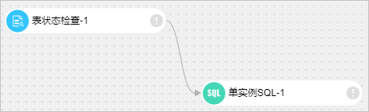

   > 上图中任务流的执行顺序为先执行表状态检查任务，再执行单实例SQL任务。
   >
   > **说明**

7. <strong>可选：</strong>单击画布的空白区域，配置任务流信息。

   <ol type="i">

   <li>

   配置基本属性。单击页面底部的**任务流信息**页签，在**基础属性**区域，修改**任务流名称**、**责任人**、**相关人员**等信息。

   </li>

   <li>

   在**调度配置**区域，打开**开启调度**开关，配置调度周期。配置信息详情，请参见调度配置。

   </li>

   </ol>

8. 单击**试运行**。

   - 如果执行日志的最后一行出现 `status SUCCEEDED` ，表明任务试运行成功。

   - 如果执行日志的最后一行出现 `status FAILED` ，表明任务试运行失败。

     > 如果试运行失败，请在执行日志中查看执行失败的节点和原因，修改配置后重新尝
     >
     > **说明**
     >
     > 试。

9. <strong>可选：</strong>发布数据流。具体操作，请参见发布任务流。

**任务类型介绍**

**分类**

**任务类型**

**描述**

单实例SQL

将SQL语句发放到指定的关系型数据库上并执行。

通过单实例SQL或Impala SQL任务节点，提交Impala SQL。

Impala SQL

数据加工

无锁数据变更

采用DMS无锁技术实现数据的Update、Delete等变更。

<table>
  <tr>
    <td rowspan="3">通用</td>
    <td>单实例SQL赋值</td>
    <td>将SELECT语句读取的数据赋值给输出变量，输出变量可以在下一节点中被使用。</td>
  </tr>
  <tr>
    <td>条件分支</td>
    <td>条件分支节点可用于在任务流中进行条件判断。执行任务流时，如果条件分支节点的条件表达式判断结果为True，执行后续任务，否则不执行后续任务。</td>
  </tr>
  <tr>
    <td>SSH远程命令</td>
    <td>支持设置机器与机器集群，再使用任务编排通过SSH执行脚本。</td>
  </tr>
  <tr>
    <td rowspan="3">状态检查</td>
    <td>表时间列状态检查</td>
    <td>检查某一时间点后，目标表中是否有新增数据。</td>
  </tr>
  <tr>
    <td>SQL状态检查</td>
    <td>通过SQL语句检查数据状态。例如，统计班级里男生是否超过10人。</td>
  </tr>
  <tr>
    <td>任务流依赖检查</td>
    <td>实现任务流自依赖和跨任务流间依赖，依赖的目标对象可以是某个任务流或某个任务节点。</td>
  </tr>
</table>

**调度配置**

| 配置项 | 说明 |
| --- | --- |
| 调度类型 | 选择调度类型：<br>• <strong>定时调度/周期调度</strong>：周期性调度任务，例如一周执行一次任务。<br>• <strong>定时调度/调度一次</strong>：在指定时间执行一次任务，仅需要配置执行任务的具体时间。<br>• <strong>事件调度</strong>：配置两个任务流A、B，其中任务流A依赖任务流B完成后，再进行调度任务。 |
| 交易日历 | 交易日历启用的日期，调度运行任务流。上传交易日历的具体操作，请参见上传交易日历。 |
| 超时时间 | 调度超时时间。当调度类型选择事件调度，才会出现该配置项。 |
| 添加任务流或任务的运行事件 | 当调度类型选择事件调度，才会出现该配置项。 |
| 生效时间 | 选择调度周期生效的区间，默认<strong>1970-01-01~9999-01-01</strong>，表示一直生效。 |
| 调度周期 | 选择调度任务的周期：<br>• <strong>日</strong>：按每日一次的频率执行任务调度，需要配置每日调度的具体时间。<br>• <strong>周</strong>：以周为周期，每个指定天执行一次任务调度，需要配置指定时间和具体时间。<br>• <strong>月</strong>：以月为周期，每个指定天执行一次任务调度，需要配置指定时间和具体时间。 |
| 指定时间 | • 如果调度周期为周，选择星期几执行任务，支持多选。<br>• 如果调度周期为月，选择每月几号执行任务，支持多选。 |
| 具体时间 | 设置执行任务流的具体时间。例如配置02:55，系统将在指定天的02时55分执行任务。 |
| cron表达式 | 不需要手动配置，系统会根据您配置的周期、具体时间自动展现。 |

**上传交易日历**

1. 登录DMS控制台。

2. 在顶部菜单栏中，选择**运维管理 > 任务编排管理**。

3. 单击**交易日历管理**页签。

4. 单击**新增**，在**新增交易市场**对话框中，填入**交易市场名称**、**描述**。

5. 单击**确认**。交易市场新增完成后，您可以编辑交易市场名称、删除此交易市场、查看交易日历详情等。

6. 单击**上传交易日历**，在该对话框中，配置**年份**、**时间列**（列名，日期格式支持YYYY-MM-DD和YYYY/MM/DD）、**目标有效列**、**文件**等信息。

   > 上传同年份的交易日历将覆盖已有日历。
   >
   > **说明**

7. 单击**确认**。

<a id="section-6-1-2"></a>

### 6.1.2. 设置机器或机器集群后通过SSH执行脚本

DMS支持设置机器与机器集群后，再使用任务编排通过SSH执行脚本。

**前提条件**

用户角色为管理员或DBA。

**步骤一：获取主机IP**

您需要获取到与DMS在同一网络环境下的一台机器的IP。

- Linux系统：输入 `ifconfig` 命令。

- Windows系统：输入 `ipconfig` 命令。

**步骤二：在DMS控制台新增机器、机器集群**

1. 登录DMS控制台。

2. 在顶部菜单栏中，选择**数据资产 > 机器管理**。

3. 新增机器。

   <ol type="i">

   <li>

   单击**机器列表**页签。

   </li>

   <li>

   单击**新增**，在**新增机器**对话框中，配置主机**名称**、**IP**、**SSH端口**、**用户名**等信息。

   </li>

   <li>

   单击**测试连接**。如果测试连接失败，请按照报错提示检查您配置的信息。

   </li>

   <li>

   单击**确认**。

   </li>

   </ol>

4. 新增机器集群。

   <ol type="i">

   <li>

   单击**机器列表**页签。

   </li>

   </ol>

5. 单击**机器集群列表**页签。

6. 单击**新增**，在**新增机器集群**对话框中，配置**集群名称**、**主执行机器**等信息。

7. 单击**确认**。

**步骤三：通过SSH执行脚本**

1. 登录DMS控制台。

2. 在顶部菜单栏中，选择**集成与开发（DTS） > 任务编排**。

3. 新增任务流。

   <ol type="i">

   <li>

   单击**新建任务流**。

   </li>

   <li>

   在**新建任务流**对话框中，输入**任务流名称**和**描述**信息。

   </li>

   <li>

   单击**确认**。

   </li>

   </ol>

4. 在画布左侧**任务类型**列表中，拖拽**SSH远程命令**节点到画布空白区域。

5. 双击**SSH远程命令**节点，配置**机器集群**、**字符集**与**命令配置**信息。示例：在命令配置区域输入 `echo 123` 。

6. 单击**试运行**。

   - 如果输出命令配置中的预期结果，且执行日志的最后一行出现 `status SUCCEEDED` ，表明任务试运行成功。

   - 如果执行日志的最后一行出现 `status FAILED` ，表明任务试运行失败。

     > 如果试运行失败，请在执行日志中查看执行失败的节点和原因，修改配置后重新尝
     >
     > **说明**
     >
     > 试。

7. <strong>可选：</strong>发布数据流。具体操作，请参见发布任务流。

<a id="section-6-1-3"></a>

### 6.1.3. 任务流并发控制

任务编排支持数据库实例的并发控制、优先级控制。

**前提条件**

用户角色为管理员或DBA。

**操作步骤**

**步骤一：新增并发配置任务**

1. 登录DMS控制台。

2. 在顶部菜单栏中，选择**运维管理 > 监控与保障**。

3. 单击**新增**，在**新增ID映射**对话框中，配置**资源类型**、**资源**、**资源限额**和**描述**信息。

4. 单击**确认**。

**步骤二：新建任务流并设置优先级**

1. 登录DMS控制台。

2. 在顶部菜单栏中，选择**集成与开发（DTS） > 任务编排**。

3. 新增并配置任务流。

   <ol type="i">

   <li>

   单击**新建任务流**。

   </li>

   <li>

   在**新建任务流**对话框中，输入**任务流名称**和**描述**信息。

   </li>

   <li>

   单击**确认**。

   </li>

   <li>

   在任务类型列表中将**单实例SQL**节点拖曳至空白区域。示例：拖曳三个单实例SQL节点。分别命名为单实例SQL-1、单实例SQL-2、单实例SQL-3。

   </li>

   <li>

   双击节点，选择步骤一并发配置的**资源**，在SQL区域写入 `SET @a=1;` 。

   </li>

   <li>

   单击右侧**高级设置**，**开启优先级**开关，在**任务优先级**依次填入7、8、9，**最大锁等待时间**保持默认即可（也可自行调整）。

   </li>

   <li>

   选择是否**开启任务失败重跑**。

   </li>

   </ol>

4. 单击**试运行**。若在执行日志中出现 `The resource quota has been reached`，`and the task will be in queue..Current Running Count`：`N` ，则表示该任务中的节点是按照优先级依次执行。

   - 如果执行日志的最后一行出现 `status SUCCEEDED` ，表明任务试运行成功。

   - 如果执行日志的最后一行出现 `status FAILED` ，表明任务试运行失败。

     > 如果试运行失败，请在执行日志中查看执行失败的节点和原因，修改配置后重新尝
     >
     > **说明**
     >
     > 试。

5. <strong>可选：</strong>发布数据流。具体操作，请参见发布任务流。

<a id="section-6-1-4"></a>

### 6.1.4. 配置Impala节点

通过单实例SQL或Impala SQL任务节点，提交Impala SQL。

**前提条件**

- 已创建Impala集群。

- 已将Impala录入至DMS。录入的具体操作，请参见录入实例。

  > 若您录入Impala数据库的认证方式会选择Kerberos，请提前准备好需要上传至DMS的
  >
  > **说明**
  >
  > krb5.conf和keytab文件。

**操作步骤**

1. 登录DMS控制台。

2. 在顶部菜单栏中，选择**集成与开发（DTS） > 任务编排**。

3. 新增任务流。

   <ol type="i">

   <li>

   单击**新建任务流**。

   </li>

   <li>

   在**新建任务流**对话框中，输入**任务流名称**和**描述**信息。

   </li>

   <li>

   单击**确认**。

   </li>

   </ol>

4. 在画布左侧**任务类型**列表中，拖拽**Impala SQL**节点到画布空白区域。

5. 双击**Impala SQL**节点，选择目标数据库实例、编写SQL。创建表的SQL示例如下：

   ```sql
   create table if not exists abcd(id int);
   ```

6. 单击**试运行**。

   - 如果执行日志的最后一行出现 `status SUCCEEDED` ，表明任务试运行成功。

   - 如果执行日志的最后一行出现 `status FAILED` ，表明任务试运行失败。

     > 如果试运行失败，请在执行日志中查看执行失败的节点和原因，修改配置后重新尝
     >
     > **说明**
     >
     > 试。

7. <strong>可选：</strong>发布数据流。具体操作，请参见发布任务流。

<a id="section-6-1-5"></a>

### 6.1.5. 批量加工

数据管理DMS批量加工是一种低代码的数据开发工具，您可以组合各类任务节点，形成数据流，通过周期调度运行达到数据加工、数据同步的目的。

**支持的数据库类型**

- MySQL：RDS MySQL、PolarDB分布式版、AnalyticDB MySQL 3.0、其他来源MySQL

- SQL Server：RDS SQL Server、其他来源SQL Server

- PostgreSQL：RDS PostgreSQL、AnalyticDB for PostgreSQL、其他来源PostgreSQL

- Oracle

**应用场景**

DMS批量加工提供了批量处理数据的功能，可应用于以下场景：

- 通过低代码可视化编辑的方式快速搭建离线数仓，支持即席查询、多维分析、数据挖掘、离线计算等数仓应用场景。

- 解决企业复杂大数据批处理难题，支持企业精细化运营、数据营销、智能推荐等大数据业务场景。

- 批量加工功能底层基于Spark开发，可有效提升Hadoop平台运行速度。

**操作步骤**

1. 登录DMS控制台。

2. 在顶部菜单栏中，选择**集成与开发（DTS） > 数据加工**。

3. 单击**批量加工**页签。

4. 单击**新增数据流**。

5. 在**新增数据流**对话框中，输入**数据流名称**和**描述**，单击**确认**。

6. 在数据流详情页面，创建数据流节点。具体操作，请参见配置数据流。

7. 单击画布空白区域，配置数据流信息。

   <ol type="i">

   <li>

   单击**数据流信息**页签，在**基础属性**区域修改**数据流名称**、**责任人**、**相关人员**等。

   </li>

   <li>

   如果您需要调度数据流，在**调度配置**区域，打开**开启调度**开关，配置调度。

   </li>

   <li>

   单击**高级配置**页签，设置变量。具体操作，请参见变量概述。

   </li>

   </ol>

8. 发布数据流。具体操作，请参见发布任务流。

<a id="section-6-1-6"></a>

### 6.1.6. 创建数据流

在数据管理DMS离线集成中，可以组合各类任务节点，形成数据流，通过周期调度运行达到数据加工、数据同步的目的。本文介绍创建数据流和配置的方法。

**使用限制**

支持的数据库类型：

- MySQL：RDS MySQL、PolarDB MySQL版、MyBase MySQL、PolarDB分布式版、AnalyticDB MySQL 3.0、其他来源MySQL

- SQL Server：RDS SQL Server、MyBase SQL Server、其他来源SQL Server

- PostgreSQL：RDS PostgreSQL、PolarDB PostgreSQL版、MyBase PostgreSQL、AnalyticDB for PostgreSQL、其他来源PostgreSQL

- Oracle

- DB2

- MaxCompute

- Hologres

  > **说明**
  >
  > Hologres只支持数据输入任务节点。

- OSS

  > **说明**
  >
  > OSS只支持数据输出任务节节点。

**操作步骤**

1. 登录DMS控制台。

2. 在顶部菜单栏中，选择**Data+AI > 数据集成 > 离线集成**。

   > **说明**
   >
   > 若您使用的是极简模式的控制台，请单击控制台左上角的
   >
   > 图标，选择**全部功能 > Data+AI > 数**
   >
   > 
   >
   > **据集成 > 离线集成**。

3. 单击目标数据流，进入数据流详情页面。

4. 配置数据输入节点。

   > **说明**
   >
   > 数据流的第一个节点必须是**数据输入**，为数据流提供数据源。

   <ol type="i">

   <li>

   在左侧**任务类型**列表中，拖拽**数据输入**节点到画布空白区域。

   </li>

   <li>

   选中**数据输入**节点，单击节点区块上的

   ，在页面下方的**数据源**页签中配置数据源。

   

   <table>
     <tr>
       <th width="106">配置项</th>
       <th>操作</th>
     </tr>
     <tr>
       <td>数据库类型</td>
       <td>选择源数据库的类型。</td>
     </tr>
     <tr>
       <td>数据库</td>
       <td>a. 输入并选择数据流读取数据的源数据库。<br>b. 在弹出的<strong>登录实例</strong>对话框中，输入<strong>数据库账号</strong>和<strong>数据库密码</strong>。</td>
     </tr>
     <tr>
       <td>表</td>
       <td>选择数据流读取数据的源表。</td>
     </tr>
   </table>

   </li>

   </ol>

5. 以过滤源表数据为例，配置数据处理节点。

   > **说明**
   >
   > 除**数据输入**和**数据输出**外，其他任务类型均可作为数据处理节点。

   <ol type="i">

   <li>

   在左侧**任务类型**列表中，拖拽**数据过滤**节点到画布的空白区域。

   </li>

   <li>

   将鼠标放在**数据输入**节点上，单击节点右侧出现的空心圆点并拉出连接线，连接至**数据过滤**节点上。

   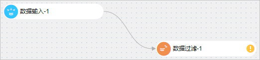

   </li>

   <li>

   选中**数据过滤**节点，在页面下方的**数据过滤**页签中配置数据的**过滤条件表达式**。

   例如，在过滤条件表达式文本框中输入 `name='`小明`'` 。

   > **说明**
   >
   > 您可以直接在输入框中输入过滤条件，也可以双击函数列表的函数辅助编写。

   </li>

   </ol>

6. 配置数据输出节点。

   > **说明**
   >
   > 数据流的最后一个节点必须是**数据输出**，提供处理后的数据要写入的目标表。

   <ol type="i">

   <li>

   在左侧**任务类型**列表中，拖拽**数据输出**节点到画布的空白区域。

   </li>

   <li>

   选中**数据输出**节点，在页面下方的**数据输出**页签中配置数据输出节点。

   - 数据库：

     <table>
       <tr>
         <th width="138">配置项</th>
         <th>描述</th>
       </tr>
       <tr>
         <td>数据库类型</td>
         <td>选择输出数据的目标数据库类型。</td>
       </tr>
       <tr>
         <td>数据库</td>
         <td>搜索并选择输出数据的目标数据库。<br>说明如果数据库未登录，在<strong>登录实例</strong>对话框中，输入<strong>数据库账号</strong>和<strong>数据库密码</strong>登录数据库。</td>
       </tr>
       <tr>
         <td>表名</td>
         <td>选择或输入数据流输出数据的目标表。</td>
       </tr>
       <tr>
         <td>写入前执行语句</td>
         <td>输入写入数据之前需要执行的SQL语句。</td>
       </tr>
       <tr>
         <td>写入后执行语句</td>
         <td>输入写入数据之后需要执行的SQL语句。</td>
       </tr>
       <tr>
         <td>是否自动建表</td>
         <td>打开或关闭<strong>是否自动建表</strong>开关。<br>• 开关关闭：如果表不存在，在执行任务时不会自动创建表，任务流会执行失败。<br>• 开关打开：如果表不存在，在执行任务时会自动创建表，任务流继续执行。</td>
       </tr>
     </table>

   - OSS：

     <table>
       <tr>
         <th width="120">配置项</th>
         <th>描述</th>
       </tr>
       <tr>
         <td>数据库类型</td>
         <td>选择OSS。</td>
       </tr>
       <tr>
         <td>OSS Bucket</td>
         <td>搜索并选择OSS的Bucket。</td>
       </tr>
       <tr>
         <td>OSS路径</td>
         <td>输入数据在OSS中的保存路径。</td>
       </tr>
       <tr>
         <td>表名</td>
         <td>输入数据流写入数据的目标表。</td>
       </tr>
       <tr>
         <td>覆盖目标表</td>
         <td>打开或关闭<strong>覆盖目标表</strong>开关。<br>• 开关关闭：直接写入数据。<br>• 开关打开：如果表已存在，先清空目标表或者分区数据，再写入数据。</td>
       </tr>
       <tr>
         <td>文件格式</td>
         <td>选择文件存储格式。支持4种文件存储格式：Parquet、ORC、Avro和CSV。</td>
       </tr>
       <tr>
         <td>压缩</td>
         <td>选择文件的压缩方式。</td>
       </tr>
       <tr>
         <td>分区</td>
         <td>选择数据的分区键。您可以通过分区键中的值，快速查找您需要的数据。<br>说明已配置数据输入节点和连接各节点，您才能选择分区键。</td>
       </tr>
     </table>

   </li>

   <li>

   将鼠标放在**数据过滤**节点上，单击节点右侧出现的空心圆点并拉出连接线，连接至**数据输出**节点上。

   此时，节点的  自动消失，表示数据流的节点上下游依赖完整。

   </li>

   </ol>

<a id="section-6-1-7"></a>

### 6.1.7. 变量概述

本文对任务编排功能涉及的变量进行介绍，并介绍配置时间变量的方法。

**变量介绍**

在配置任务节点页面的**变量设**置页签中，您会遇到以下部分或全部变量：

- 节点变量：节点变量为时间变量，只能在当前节点中使用。

- 任务流变量：任务流变量为时间变量，在所有节点中都可使用。

  > 您可以在任务流的任一节点中设置任务流变量，其他节点会自动同步该设置。
  >
  > **说明**

- 输入变量：系统自动获取。您可使用 ${var_name} 的形式在当前节点的SQL语句中引用输入变量，或者将输入变量用于条件分支节点中作为判断变量。输入变量包括：

  - 上游变量：来自上游节点的输出变量。

  - 运行状态：具体请参见运行状态。

  - 系统变量：具体请参见系统变量。

- 输出变量：输出变量由当前节点定义并赋值，可被下游节点查看和引用。

  例如，在脚本代码节点中增加输出变量，该输出变量可以在下游节点的SQL语句中被引用。

- 脚本输出变量：如果脚本最后一行输出的是JSON结构数据，结构格式为 `{ key1: value1, key2: value2, … }` ，且value是String类型，脚本任务会自动获取JSON键值对，解析出变量名为*key*的变量，变量*key*的值为value。变量的引用方式为 `${key}` 。

  例如，脚本的最后一行是 `echo {"hello": "world"}` ，那么脚本任务会解析出变量*hello*，变量*hello*的值为world。

**配置时间变量**

<table>
  <tr>
    <th width="89">配置项</th>
    <th>说明</th>
  </tr>
  <tr>
    <td>变量名</td>
    <td>输入自定义时间变量的名称。<br>说明如需删除已配置的变量，您可以单击右侧的图标。</td>
  </tr>
  <tr>
    <td>变量规则</td>
    <td>配置时间变量的规则。<br>• <strong>时间格式</strong>：输入您需要的时间格式。关于时间格式，请参见时间格式。<br>• 时间偏移量：时间变量以业务时间bizdate（当前日期的前一天）的时间点为基准进行偏移，即自定义的时间变量是基于bizdate做加减运算的。<br>例如，变量名为<code> 6_month_ago </code>，时间格式为yyyy-MM-dd，偏移量设置为-6月。如果当前日期为2021-8-12，则变量<code> ${6_month_ago} </code>的值为2021-02-11。<br>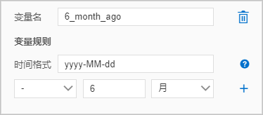<br>说明配置时间变量后，您可以在右侧的SQL语句中引用该变量，格式为<code> ${</code>变量名<code>} </code>，同时您可以单击<strong>SQL预览</strong>来查看时间变量的值。</td>
  </tr>
</table>

**时间格式**

变量支持的时间格式如下：

| 时间变量 | 说明 | 输入示例 | 返回示例 |
| --- | --- | --- | --- |
| 公元 | G表示公元。 | Gyyyy | 公元2021年 |
| 年 | • y或yyyy表示当天所在的年份。<br>• yy表示年份的后两位数字。<br>• Y表示当前周结束时（周日为最后一天）的年份。 | yyyy | 2021 |
| 月 | M当前年份的第N个月，M的返回值为\[1,12\]，MM的返回值为\[01,12\]，MMM将返回一月至十二月。 | MM | 08 |
| 周 | • w表示当前年份的第N周，w的返回值为\[1,52\]，ww返回值为\[01,52\]。<br>• W表示当前月份的第N周，返回值为\[1,5\]。 | ww | 13 |
| 天 | • D表示当前年份的第N天，D的返回值为\[1,365\]，DD的返回值为\[01,365\]，DDD的返回值为\[001,365\]。<br>• d表示当前月份的第N天，d的返回值为\[1,31\]，dd的返回值为\[01,31\]。 | D | 360 |
| 周几 | • E表示周几，将返回星期一至星期日。<br>• e表示周几的数字表达，返回值为\[1,7\]（默认1表示周一）。<br>您可以在变量偏移中配置+1日，实现西方说明日历（即1为表示周日）。 | e | 1 |
| 上午、下午 | a表示上午或下午。返回值为：上午（00:00-11:59）、下午（12:00-23:59）。 | a | 上午 |
| 小时 | • H表示当天的第N个小时，0表示0点。H的返回值为\[0, 23\]，HH的返回值为\[00, 23\]。<br>• h表示上午、下午的第N个小时，1表示0点，h的返回值为\[1, 12\]，hh的返回值为\[01, 12\]。<br>• K表示上午、下午的第N个小时，0表示0点，K的返回值为\[0, 11\]，KK的返回值为\[00, 11\]。<br>• k表示当天的第N个小时，1表示0点，k的返回值\[1, 24\]，kk的返回值\[01, 24\]。 | HH | 10 |
| 分钟 | m表示分钟数，m的返回值\[0, 59\]，mm的返回值\[00, 59\]。 | m | 27 |
| 秒 | • s表示秒数。<br>• S表示毫秒数。 | ss | 08 |
| 时区 | z表示时区。 | z | UTC+08:00 |

时间格式的组合示例：

| 输入示例 | 返回示例 |
| --- | --- |
| <code>yyyy-MM-dd</code> | 2021-08-12 |
| <code>yyyyMM01</code> | 20210801 |
| <code>HH:mm:ss</code> | 11:05:21 |
| <code>yyyyMMdd HH:mm:ss</code> | 20210812 11:05:21 |

**运行状态**

| 变量名 | 描述 |
| --- | --- |
| all_success | 任务全部运行成功。 |
| all_failed | 任务全部运行失败。 |
| one_success | 一个任务节点运行成功。 |
| one_failed | 一个任务节点运行失败。 |

> 在条件分支节点中使用运行状态可以控制任务流在指定的运行状态下执行后续任务。
>
> **说明**

**系统变量**

| 变量名 | 描述 | 示例 |
| --- | --- | --- |
| sys.flow.start.tim estamp | 运行时间的时间戳。 | 2021-05-24T11:20:07.562+08:00 |
| sys.flow.start.yea r | 运行时间的年份。 | 2021 |
| sys.flow.start.mo nth | 运行时间的月份。 | 5 |
| sys.flow.start.day | 运行时间的日期。 | 24 |
| sys.flow.start.hou r | 运行时间的小时。 | 11 |
| sys.flow.start.min ute | 运行时间的分钟。 | 20 |
| sys.flow.start.sec ond | 运行时间的秒。 | 7 |
| sys.flow.start.milli seconds | 运行时间的毫秒数。 | 562 |
| sys.flow.start.tim ezone | 运行时间的时区。 | Asia/Shanghai |
| sys.flow.biztime | 业务时间，默认为运行时间减一天。 | 1621740007562 |
| sys.flow.name | 任务流名称。 | dwd_activity日pv |
| sys.node.name | 任务名称。 | 单实例SQL-1 |

<a id="section-6-1-8"></a>

### 6.1.8. 发布任务流

完成任务流的配置或变更后，您需要通过发布操作将最新的任务流发布，有效避免部分变更未经确认被直接发布。

1. 登录DMS控制台。

2. 在顶部菜单栏中，选择**集成与开发（DTS） > 任务编排**。

3. 单击目标任务流名称，进入任务流详情页面。

4. <strong>可选：</strong>试运行任务流。

   <ol type="i">

   <li>

   单击画布左上方的**试运行**按钮。

   </li>

   <li>

   在**提示**对话框，单击**确认**。

   </li>

   <li>

   单击画布的空白区域，单击页面下方的**执行日志**页签，查看任务流试运行是否成功。

   - 如果执行日志的最后一行中出现 `status SUCCEEDED` ，表明任务流试运行成功。

   - 如果执行日志的最后一行中出现 `status FAILED` ，表明任务流试运行失败。

     > 如果试运行失败，在执行日志中查看执行失败的节点和原因，修改节点的配置后重
     >
     > **说明**
     >
     > 新尝试。

   </li>

   </ol>

5. 发布任务流。

   > 在发布任务流前，您可将鼠标悬浮至画布左上角的**发布**，查看任务流是否被修改，若被
   >
   > **说明**
   >
   > 修改，则会出现**任务流已修改，需要重新发布后才生效**的提示。

   <ol type="i">

   <li>

   单击画布左上角的**发布**。

   </li>

   <li>

   在**发布**对话框中，可进行如下操作：

   - 输入**备注**信息，并单击**发布**，发布任务流。

   - 单击**展示差异**，查看当前未发布任务流与已发布任务流的差异，包含任务流的**基本信息**、**节点的配置**、**SQL**等内容。

     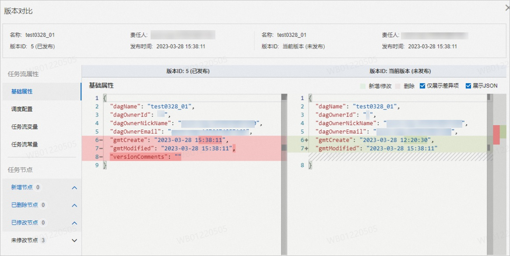

   </li>

   </ol>

6. <strong>可选：</strong>下线任务流。当您不需要通过定时、周期等方式调度任务流时，可以选择下线任务流。

   <ol type="i">

   <li>

   单击画布上方的**下线**。

   </li>

   <li>

   在**下线**对话框中，单击**下线**。

   </li>

   </ol>

7. <strong>可选：</strong>确认发布状态。

   <ol type="i">

   <li>

   单击画布上方的**前往运维**。

   </li>

   <li>

   在界面右侧，查看任务流**是否发布**。

   - **已发布**：该任务流处于已发布状态。

   - **未发布**：该任务流处于未发布状态。

   在该页面，您还可以进行导出该版本的任务流、给该版本任务流补充数据、查看该版本任务流的详情等操作。

   </li>

   </ol>

<a id="section-6-1-9"></a>

### 6.1.9. 创建ETL任务流

流式加工可以实现流式数据的清洗和转换处理，能够准确、高效地提供您需要的数据。本文介绍创建ETL任务流的方法。

**前提条件**

- 源数据库类型：MySQL、PolarDB-X 2.0、PolarDB MySQL。

- 目标数据库类型：MySQL、AnalyticDB MySQL 3.0。

- 源数据库和目标数据库在同一地域。

**背景信息**

流式ETL可以在源库和目标库之间添加各种转换组件，实现丰富的转换操作，并将处理后的数据实时写入目标库。

例如，给源表新增一个字段，并为该字段配置函数进行赋值，源表该字段经过赋值转换后写入目标库。

**术语解释**

- **输入/维表**：ETL的源库。

- **输出**：经过ETL处理后写入的目标库。

**操作步骤**

1. 登录DMS控制台。

2. 在顶部菜单栏中，单击**集成与开发（DTS） > 数据加工**。

3. 单击**流式加工**页签。

4. 新增数据流。

   <ol type="i">

   <li>

   在页面左上角，单击**新增数据流**。

   </li>

   <li>

   在对话框中，输入数据流名称。

   </li>

   <li>

   加工方式选择**流式加工**。

   </li>

   <li>

   输入对数据流的描述。

   </li>

   <li>

   单击**确认**。

   </li>

   <li>

   选择源数据库和目标数据库的类型、区域，输入购买数量。

   </li>

   <li>

   单击**购买**。

   </li>

   </ol>

5. 在数据流列表页面，单击目标数据流。

6. 在数据流配置页面，配置数据流。

   <table>
     <tr>
       <th width="122">任务</th>
       <th>说明</th>
     </tr>
     <tr>
       <td>配置源库</td>
       <td>i. 在左侧<strong>数据处理类型</strong>列表中，拖拽目标<strong>输入/维表</strong>节点到画布空白区域。ii. 选中目标节点，配置节点信息和输出字段信息。<br>说明源库可以选择一个或多个，同一类型的源库可以选择多次。</td>
     </tr>
     <tr>
       <td>配置转换组件</td>
       <td>i. 在左侧<strong>数据处理类型</strong>列表中，拖拽目标转化组件节点到画布空白区域。ii. 将鼠标放在<strong>输入/维表</strong>节点上，单击<strong>输入/维表</strong>节点右侧出现的空心圆点并拉出连接线，连接至转换组件节点上。iii. 选中转换组件节点，在页面下方配置目标节点。<br>说明转换组件可以选择一个或多个，同一转换组件可以选择多次。</td>
     </tr>
     <tr>
       <td>配置目标库</td>
       <td>i. 在左侧<strong>数据处理类型</strong>列表中，拖拽目标<strong>输出</strong>节点到画布空白区域。ii. 将转换组件节点与<strong>输出</strong>节点连接。iii. 选中目标节点，配置节点信息和字段映射信息。<br>说明目标库只能选择一个。</td>
     </tr>
   </table>

7. 发布数据流。

   <ol type="i">

   <li>

   在页面左上角，单击**生成Flink SQL校验**。

   </li>

   <li>

   在页面左上角，单击**查看ETL校验详情**，查看Flink SQL生成结果。

   > 如果校验失败，您可以根据提示信息修复，修复后重新生成Flink SQL校验。
   >
   > **说明**

   </li>

   <li>

   您可以执行以下的任一种操作。

   - 发布：在页面左上角，单击**发布**，发布数据流。

   - 发布并执行预检查：在页面左上角，选择**发布 > 发布并执行预检查**，发布数据流后系统自动进行预检查。

     > 如果预检查失败，您可以根据提示信息进行修复，修复后重新发布并执行预检查。
     >
     > **说明**

   </li>

   </ol>

<a id="section-6-2"></a>

## 6.2. 数据迁移、同步和订阅

本文对数据管理DMS中引入的DTS数据迁移、同步、订阅功能进行介绍。

**功能概览**

数据管理DMS引入了DTS的数据迁移、同步、订阅功能。

- 数据迁移

  实现同构、异构数据源之间的数据迁移，适用于数据上云迁移、阿里云内部跨实例数据迁移、数据库拆分扩容等业务场景。

- 数据同步

  实现数据源之间的数据实时同步，适用于数据异地多活、数据异地灾备、本地数据灾备、跨境数据同步、查询与报表分流、云BI及实时数据仓库等多种业务场景。

- 数据订阅

  获取RDS MySQL、PolarDB MySQL、PolarDB-X、自建MySQL、Oracle的实时增量数据，您可以根据业务需求自由消费增量数据，适用于缓存更新策略、业务异步解耦、异构数据源的数据实时同步和复杂ETL的数据实时同步等多种业务场景。

**操作步骤**

1. 登录DMS控制台。

2. 在顶部菜单栏中，单击**集成与开发（DTS）**。

3. 数据迁移、同步、订阅。

   - 数据迁移

     <ol type="a">

     <li>

     单击**数据迁移**。

     </li>

     <li>

     在数据传输服务DTS控制台的数据迁移页面，创建数据迁移任务。具体操作请参见*数据传输服务DTS用户指南*手册中的*数据迁移*。

     </li>

     </ol>

   - 数据同步

     <ol type="a">

     <li>

     单击**数据同步**。

     </li>

     <li>

     在数据传输服务DTS控制台的数据同步页面，创建数据同步任务。具体操作请参见*数据传输服务DTS用户指南*手册中的*数据同步*。

     </li>

     </ol>

   - 数据订阅

     <ol type="a">

     <li>

     单击**数据订阅**。

     </li>

     <li>

     在数据传输服务DTS控制台的数据订阅页面，创建数据订阅任务。具体操作请参见*数据传输服务DTS用户指南*手册中的*数据订阅*。

     </li>

     </ol>

<a id="section-6-3"></a>

## 6.3. 数据服务

<a id="section-6-3-1"></a>

### 6.3.1. 功能特性及应用场景

通过数据服务功能，您可以将DMS上受控的数据快速对外输出，可适用于小粒度数据输出、数据可视化、复杂分析等场景。

**功能特性**

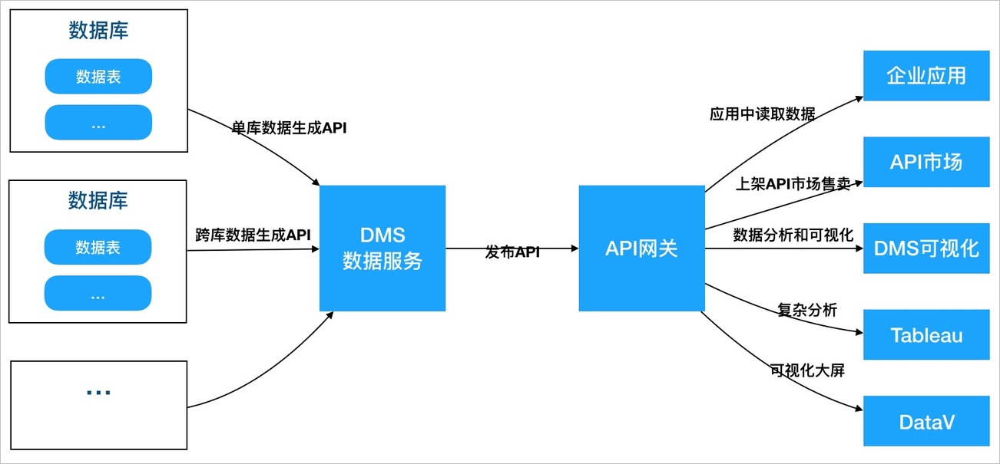

- 数据服务基于DMS上受控的数据进行API定义，与SQL Console中执行SQL时的权限控制、数据脱敏等检查保持一致。

- 数据服务基于Serverless架构，您无需关注服务器、网络等运行环境相关的基础设施，只需专注于API的定义、数据的查询逻辑，避免传统架构带来的运维成本开销。

- 数据服务与API网关（API Gateway）完全集成，发布到API网关后，可使用API网关提供的API权限管控、IP白名单控制、流量控制、计量、SDK下载等全面的API服务。

**应用场景**

<table>
  <tr>
    <th width="202">场景</th>
    <th>说明</th>
  </tr>
  <tr>
    <td>最小粒度的数据输出</td>
    <td>当需要对外提供数据时，可通过API的方式将数据粒度控制到行级（SQL过滤条件）和列级（查询字段），只对外暴露最小单元的数据，保障数据安全。</td>
  </tr>
  <tr>
    <td>可视化制作</td>
    <td>可视化制作工具一般均支持API数据源，通过API数据源可避免账号泄漏且更加简易。</td>
  </tr>
  <tr>
    <td>云市场售卖</td>
    <td>对于有价值的数据，可通过API的方式上架到云市场，有偿或无偿提供给其他用户使用。</td>
  </tr>
  <tr>
    <td>加工后的数据供应用读取</td>
    <td>数据加工汇总后，可通过API的方式快速输出加工后的数据，当需要变更读取的逻辑时，只需要调整API的查询逻辑，无需重新发布应用。</td>
  </tr>
</table>

<a id="section-6-3-2"></a>

### 6.3.2. API开发

数据服务功能提供了功能强大与开发便捷的API模块，本文介绍新增API、管理API的操作说明。

**背景信息**

通过数据服务功能，您可以将DMS上受控的数据快速对外输出，可适用于小粒度数据输出、数据可视化、复杂分析等场景，详情请参见功能特性及应用场景。

**操作步骤**

1. 登录DMS控制台。

2. 在页面顶部，选择**集成与开发（DTS） > 数据服务**。

3. 单击左侧的**API开发**页签。

4. 单击右上角的**新增API**。

5. 设置新增API的相关参数。

   <ol type="i">

   <li>

   设置属性配置。

   <table>
     <tr>
       <th width="138">参数</th>
       <th>说明</th>
     </tr>
     <tr>
       <td>API名称</td>
       <td>填入数据API的名称。<br>• 支持汉字，英文字母，数字，下划线（_）。<br>• 只能以英文字母或汉字开头。<br>• 长度为4~100个字符。</td>
     </tr>
     <tr>
       <td><strong>描述</strong>（可选）</td>
       <td>填入具有业务意义的描述信息，例如描述返回的数据内容、适用场景等。</td>
     </tr>
     <tr>
       <td>路径</td>
       <td>填入路径信息，只能以正斜线（/）开头，且只支持英文字母、数字、下划线（_）和短划线（-）。在调用API时，路径信息将组成调用URL的一部分。调用的URL结构为：<code> https://{</code>分配的域名<code>}{</code>路径<code>} </code>，例如分配的域名为<code> xxxx-cn-</code><code>hangzhou.alicloudapi.com </code>，路径定义为<code> /item/monthly_data </code>，则最终调用API的URL为<code> https://xxxx-cn-</code><code>hangzhou.alicloudapi.com/item/monthly_data </code>。</td>
     </tr>
     <tr>
       <td>返回格式</td>
       <td>固定为<strong>JSON</strong>，不可变更。</td>
     </tr>
     <tr>
       <td>请求方式</td>
       <td>可选择为<strong>POST</strong>或<strong>GET</strong>。</td>
     </tr>
     <tr>
       <td>超时时间</td>
       <td>执行API时，允许的最大耗时，单位为毫秒。调用API时，当执行时间超过该属性值，将返回超时错误。该值最大允许30000（毫秒），即30秒。</td>
     </tr>
     <tr>
       <td>返回最大记录数</td>
       <td>调用API允许返回的最大记录数。该属性限制了查询时返回的记录数。<br>当实例的管控模式为安全协同时，该参数设置的值需小于安全规说明则中设置的最大记录数。</td>
     </tr>
     <tr>
       <td>返回字段元数据</td>
       <td>选择是否返回字段元数据。</td>
     </tr>
     <tr>
       <td>返回执行详情</td>
       <td>选择是否返回执行详情。</td>
     </tr>
   </table>

   </li>

   <li>

   单击**执行配置**页签，设置相关参数。

   <table>
     <tr>
       <th width="121">参数</th>
       <th>说明</th>
     </tr>
     <tr>
       <td>实例查询类型</td>
       <td>• <strong>单实例查询</strong>：读取的数据仅限于同一个数据库实例。<br>• <strong>跨实例查询</strong>：可以通过编写DSQL，来实现多个不同实例数据的关联查询。<br>说明选择为<strong>跨实例查询</strong>后，您只需再配置<strong>查询SQL</strong>。</td>
     </tr>
     <tr>
       <td>数据源</td>
       <td>执行API查询数据库。您可以输入关键字，查询当前用户具备查询权限的数据库，然后选定数据库。<br>说明若选择管控模式为非安全协同的数据库实例，请勿在任务运行时，修改数据库账号、密码或权限，否则可能会导致任务运行失败。若由于修改账号、权限等信息导致任务运行失败，请重新登录数据库并保存节点配置。</td>
     </tr>
     <tr>
       <td>配置方式</td>
       <td>• <strong>表引导模式</strong>：通过选择表和字段的方式来定义数据查询配置。<br>• <strong>脚本模式</strong>：通过手动编写SQL脚本和变量的方式来定义数据查询配置。<br>说明选择为<strong>脚本模式</strong>后，您只需再配置<strong>查询SQL</strong>。</td>
     </tr>
     <tr>
       <td>选择表</td>
       <td>选择需要执行查询的表，您也可以输入关键词搜索目标表。</td>
     </tr>
     <tr>
       <td>字段列表</td>
       <td>系统将展示选定表中的所有字段，您需要指定作为请求参数或返回参数的字段。</td>
     </tr>
     <tr>
       <td>脚本模式</td>
       <td>通过编写脚本的方式定义数据查询逻辑。</td>
     </tr>
     <tr>
       <td>查询SQL</td>
       <td>填入相应的查询SQL语句。配置完成后，您需要单击<strong>解析脚本</strong>验证语法正确性，同时解析输入和输出参数。<br>说明<br>• 支持自定义变量，自定义变量可映射成为API的请求参数。变量在SQL中以<code> ${</code>变量名<code>} </code>的方式定义，例如<code> ${category} </code>，带变量的SQL例如<code> select item_id, item_name from ex_item </code> <code>where category=${category} </code>。<br>• 如果<strong>实例查询类型</strong>选择为<strong>跨实例查询</strong>时，仅支持跨库查询的SQL语法，详情请参见跨库查询。</td>
     </tr>
   </table>

   </li>

   <li>

   单击**请求参数**页签，设置相关参数。

   <table>
     <tr>
       <th width="89">参数</th>
       <th>说明</th>
     </tr>
     <tr>
       <td>参数名称</td>
       <td>填入请求参数名称。<br>• 由英文字母，数字、短划线（-）或下划线（_）组成。<br>• 只能以英文字母或下划线（_）开头。<br>• 长度为1~50个字符。</td>
     </tr>
     <tr>
       <td>字段名称</td>
       <td>已在<strong>执行配置</strong>页签中指定，无法变更。</td>
     </tr>
     <tr>
       <td>不能为空</td>
       <td>设置调用API时，该请求参数是否为必需项。</td>
     </tr>
     <tr>
       <td>描述</td>
       <td>填入该请求参数的描述信息。</td>
     </tr>
     <tr>
       <td>数据类型</td>
       <td>设置数据类型，用于调用API时校验请求参数是否符合设置的数据类型，支持字符串、整型和浮点三种基本类型，默认为字符串。<br>说明调用API时，该参数的定义也会影响最终执行的SQL。</td>
     </tr>
     <tr>
       <td>示例值</td>
       <td>请求参数的示例值。后续生成SDK或文档时可供使用者阅读，便于正确调用API。</td>
     </tr>
     <tr>
       <td>默认值</td>
       <td>设置请求参数的默认值。当请求参数为可选时，则以该定义作为请求参数来调用API。</td>
     </tr>
   </table>

   </li>

   <li>

   单击**返回参数**页签，设置相关参数。

   <table>
     <tr>
       <th width="89">参数</th>
       <th>说明</th>
     </tr>
     <tr>
       <td>参数名称</td>
       <td>填入参数名称。<br>• 由英文字母，数字、短划线（-）或下划线（_）组成。<br>• 只能以英文字母或下划线（_）开头。<br>• 长度为1~50个字符。</td>
     </tr>
     <tr>
       <td>字段名称</td>
       <td>返回的字段名，不可变更。</td>
     </tr>
     <tr>
       <td>描述</td>
       <td>填入该返回参数的描述信息。</td>
     </tr>
     <tr>
       <td>数据类型</td>
       <td>设置数据类型，支持字符串、整型和浮点三种基本类型，默认为字符串。系统会将查询后的数据按照此处设置进行转换，最终影响返回的JSON中的数据。</td>
     </tr>
     <tr>
       <td>示例值</td>
       <td>返回参数的示例值。后续生成SDK或文档时可供使用者阅读，便于理解API的返回结果。</td>
     </tr>
   </table>

   </li>

   </ol>

6. 单击页签上方的**保存**。

7. 单击左侧的**API开发**页签。

8. 根据业务需求，选择下述步骤管理API：

   - 发布API

     定位至目标API，单击其**操作**列的**发布**，然后在弹出对话框中单击**确定**。

   - 修改API

     定位至目标API，单击其**操作**列的**修改**，然后按照步骤5中的描述调整API设置，最后单击**保存**。

   - 删除API定位至目标API，单击其**操作**列的**删除**，然后在弹出对话框中单击**确定**。

<a id="section-6-3-3"></a>

### 6.3.3. API下线或测试

对于已发布的API，您可以对其执行下线或测试操作。

**前提条件**

已执行新建API的操作，详情请参见API开发。

**操作步骤**

1. 登录DMS控制台。

2. 在页面顶部，选择**集成与开发（DTS） > 数据服务**。

3. 单击左侧的**API发布**页签。页面将展示所有已发布的API。

4. 找到目标API，根据业务需求执行下述操作：

   - 下线API

     单击**操作**列中**下线**，然后在弹出的对话框中单击**确定**。

   - 测试API

     单击**操作**列中**测试**，详细介绍请参见API测试。

<a id="section-6-3-4"></a>

### 6.3.4. API测试

API开发完成后，您可以对API进行测试，验证是否符合业务需求。

**前提条件**

已执行新建API的操作，详情请参见API开发。

**操作步骤**

1. 登录DMS控制台。

2. 在页面顶部，选择**集成与开发（DTS） > 数据服务**。

3. 单击左侧的**API测试**页签。

4. 执行API测试。

   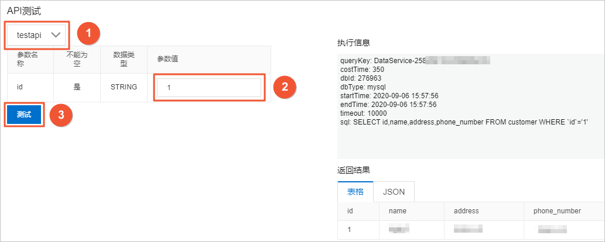

   <ol type="i">

   <li>

   单击下拉框选择目标API。

   </li>

   <li>

   填入请求参数的值。

   </li>

   <li>

   单击**测试**。API调用完成后，页面右侧将展示执行信息和返回结果，您可以评估该API是否符合业务需求。

   > 单击**返回结果**中的**JSON**标签，页面将以JSON格式展示返回结果。
   >
   > **说明**

   </li>

   </ol>

<a id="section-6-3-5"></a>

### 6.3.5. API调用

完成API的创建、发布和测试后，您可以在应用中通过SDK调用该API。

**前提条件**

- 已新建并发布API，详情请参见API开发。

- 已开通API网关，详情请参见API网关的<strong>《用户指南》</strong>手册。

**操作步骤**

1. 登录DMS控制台。

2. 在页面顶部，选择**集成与开发（DTS） > 数据服务**。

3. 单击左侧的**API调用**页签。

4. 获取API调用地址和获取所需的认证信息。

   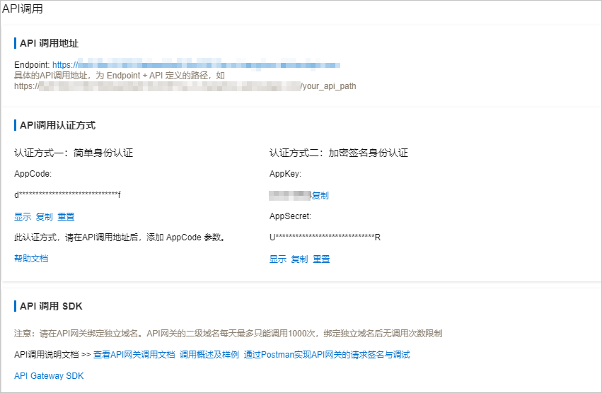

   - **简单认证模式**：仅需获取AppCode信息，适用于直接通过URL访问API，一般用于可视化场景（如DataV调用），安全级别较低。

   - **加密签名认证方式**：需要获取AppKey和AppSecret，通过在调用时动态生成加密签名来调用，安全级别高。

5. 在应用中通过SDK调用API。

   > 相关使用教程请参见API网关的<strong>《用户指南》</strong>手册。
   >
   > **说明**

<a id="section-6-4"></a>

## 6.4. 数据可视化

<a id="section-6-4-1"></a>

### 6.4.1. 数据可视化概览

本文介绍DMS数据可视化的基本概念、设计理念、场景支持等内容。

**背景信息**

DMS为您提供了数据库数据管理的能力，同时通过SQL Console控制台为您提供以表格形式查询数据的方式，但对于需要通过分析数据去发现业务特性，比如分析趋势、增长对比等场景，单纯的表格无法满足需求，需要把数据可视化才可以支撑类似场景。因此DMS提供了可视化模块让您可以更容易的通过数据去洞察业务，辅助进行业务决策。

**基本介绍**

基于典型的数据集、图表、仪表盘或大屏三层模型，将数据库表中的数据以各种形式的可视化方式展现出来。您可以将单条SQL数据以折线图、饼图、柱状图、环形图、表格、双轴图、漏斗图等常见图表的形式展现出来。再通过仪表盘或大屏，把这些图表进行自由组合、布局，以某种分析思路（分析方法论）对业务进行直观呈现。

> 例如先用指标卡图表展现交易额、UV等整体指标，再通过折线图展现交易额的增长趋势，
>
> **说明**
>
> 辅以柱状图展现各个区域的交易对比情况，最后再以表格+筛选器的方式提供各区域数据的查询。

**设计理念**

数据可视化的两个核心概念设计分别是围绕数据集（数据视图）和图表（可视化组件）。

- 数据集是数据的结构化形态，一切逻辑、权限、服务等都是从数据集展开。

- 图表是数据的可视化形态，一切展示、交互、引导等都是从图表展开。

  > 作为数据的两种不同形态，二者相辅相成，让您拥有一致的体验和认识。
  >
  > **说明**

- 仪表盘和大屏是图表的组合布局，支持快速分析和自由可视化这两类主流场景，以满足大部分的数据可视化需求。

**场景支持**

- 安全自助式数据分析

  基于DMS安全管控底座，确保可视化所用的数据均经过授权访问。

  - 一次配置即可实现可视组件高级过滤、高级控制、联动、钻取、下载、分享等，帮助业务人员快速完成对比、地理分析、分布、趋势以及聚类等分析和决策。

  - 自动布局的仪表盘，适用于大多数通过快速配置即可查看和分享的可视化报表。

  - 自由布局的大屏，适用于一些特定的、需要添加额外修饰元素的、长时间查看的场景，通常配置这类场景需要花一定的时间和精力，例如双11大屏等。

- 实时运营监控

  通过DMS数据工厂把业务数据实时同步到ADB或RDS分析库，再基于分析库之上构建可视化，可实时观察运营状态，衔接各个环节流程，对比检测异常情况，处理关键环节问题。提供透视驱动与图表驱动两种图表配置模式，满足不同的应用场景需求。

<a id="section-6-4-2"></a>

### 6.4.2. 名词解释

DMS数据可视化产品名词解释。

<table>
  <tr>
    <th width="106">名词</th>
    <th>说明</th>
  </tr>
  <tr>
    <td>维度</td>
    <td>维度是度量的环境，用来反映业务的一类属性，如时间、地域、性别、类别等等，是一组离散的值。</td>
  </tr>
  <tr>
    <td>度量</td>
    <td>即被聚合（观察）的统计值。是聚合运算的结果，如UV（用户数）、交易金额等经过统计的数值。</td>
  </tr>
  <tr>
    <td>数据集</td>
    <td>以二维表表现的数据集合。二维数据基于特定数据库和特定SQL查询所产生，因此需要配置数据库和查询SQL。</td>
  </tr>
  <tr>
    <td>图表</td>
    <td>可用来直观表现数据特性的图形，如折线图（趋势）、表格（明细）、柱图（对比）、饼图（占比）等。不同图表需要配置不同数量的维度和度量字段，如折线图需要配置。</td>
  </tr>
  <tr>
    <td>仪表盘</td>
    <td>通过组合多个图表所形成的综合反映业务数据的可视化展现工具。与传统的报表概念对比，仪表盘提供可视化灵活配置图表布局的能力。通过把仪表盘布局分割为若干区块，同时拖拽设定图表占用的区块数来达到较优的布局能力，增强交互体验。同时支持配置全局筛选器功能，筛选器可作用于若干图表，达到筛选数据并进行展现的目的。</td>
  </tr>
  <tr>
    <td>仪表盘集合</td>
    <td>用于管理一组相关联的仪表盘，如商品销售统计、商品加入购物车统计、商品退货统计等与商品相关的仪表盘，放在同一个集合里，便于统一管理。仪表盘集合支持按多层目录对仪表盘分类。</td>
  </tr>
  <tr>
    <td>大屏</td>
    <td>与仪表盘类似，同样可组合多个图表，且可组合其他如图片、矩形等可视化组件，拥有更自由的布局方式。布局方式相较于仪表盘的区块分割，大屏采用绝对定位布局，用户通过自由拖拽的方式，所见即所得对若干图表或其他显示组件进行布局，满足更灵活的可视化展示场景。</td>
  </tr>
</table>

<a id="section-6-4-3"></a>

### 6.4.3. 进入数据可视化控制台

本文介绍访问数据可视化的几种方法。

**通过新版控制台进入**

1. 登录DMS控制台。

2. 单击页面上方的**集成与开发（DTS）**。

3. 在左侧导航栏中，单击**数据可视化**。

**通过SQL窗口进入**

1. 进入**SQL 窗口**控制台，具体操作，请参见SQL Console。

2. 在**SQL 窗口**控制台，单击SQL窗口上方的**数据可视化**。

<a id="section-6-4-4"></a>

### 6.4.4. 数据集管理

数据集是以二维表表现的数据集合，且基于特定数据库和特定SQL查询所产生，本文介绍数据集的使用方法。

**创建数据集**

1. 登录DMS控制台。

2. 进入数据可视化控制台。

3. 在**数据集管理**页面，单击

   图标。

   

4. 在**编写SQL**页面配置如下参数，并单击**执行**。

   | 配置项 | 说明 |
   | --- | --- |
   | 名称 | 数据集名称，需要保证在同一个用户下唯一。 |
   | 描述 | 用于描述数据集的属性。 |
   | 选择已有数据库 | 执行数据查询的目标数据库。您需要拥有该数据库的查询权限。 |
   | 搜索表/字段名称 | 搜索并选择表或者字段名称。 |

5. 待执行完成后，单击**下一步**。

6. 在**编辑数据集模型**页面，选择字段的**数据类型**与**可视化类型**。对SQL结果字段进行维度和度量的分类和可视化类型分类。

   <table>
     <tr>
       <th width="105">参数</th>
       <th>说明</th>
     </tr>
     <tr>
       <td>数据类型</td>
       <td>支持的选项：<br>• <strong>维度</strong>：度量的范围、方面、角度等。<br>• <strong>度量</strong>：被聚合（观察）的统计值。例如：按时间查询交易量趋势，可以配置时间字段为<strong>维度</strong>，交易量字段为<strong>度量</strong>。更多信息，请参见名词解释。</td>
     </tr>
     <tr>
       <td>可视化类型</td>
       <td>支持的选项：<br>• 数字<br>• 字符串<br>• 日期<br>• 地理：国家<br>• 地理：省份<br>• 地理：城市例如：按时间查询交易量趋势，可以配置时间字段为<strong>日期</strong>类型，交易量字段为<strong>数</strong><strong>字</strong>类型。</td>
     </tr>
   </table>

7. 单击**保存**。即可完成数据集的创建并返回到数据集管理界面。

**修改数据集**

1. 登录DMS控制台。

2. 进入数据可视化控制台。

3. 在**数据集列表**中找到目标数据集，单击**操作**列下的

   图标。

   

4. 进入**编写SQL**页面配置查询SQL信息，并单击**执行**。**编写SQL**页面的其他配置信息，请参见创建数据集。

5. 待执行完成后，单击**下一步**。

6. 在**编辑数据集模型**页面，选择字段的**数据类型**与**可视化类型**。**数据类型**与**可视化类型**的具体信息，请参见创建数据集。

7. 单击**保存**。即可完成数据集的创建并返回到数据集管理界面。

**删除数据集**

1. 登录DMS控制台。

2. 进入数据可视化控制台。

3. 在**数据集列表**中找到目标数据集，单击**操作**列下的

   图标。

   

4. 在弹出的对话框中，单击**确定**。

   > 在删除数据集时，DMS会检查该数据集是否已经被图表所引用，当该数据集被引用时，
   >
   > **说明**
   >
   > 将无法完成删除数据集操作。您需要先在图表编辑页中，解除引用数据集或者删除对应图表。

**授权**

1. 登录DMS控制台。

2. 进入数据可视化控制台。

3. 在**数据集列表**中找到目标数据集，单击**操作**列中的

   图标。

   

4. 在**授权分享**对话框中，选择指定人和权限，单击**确定**。

<a id="section-6-4-5"></a>

### 6.4.5. 图表管理

图表是数据进行可视化的最小单元，图表的生成过程是依据数据集提供的数据模型对SQL结果进行二次聚合分组，然后将二次加工的数据进行可视化编码。

每一个图表均需要关联一个数据集，图表编辑器通过将数据集中的原始SQL语句与数据模型进行组合，生成新的SQL语句到数据库中执行，获取图表展示所需要的数据，本文介绍图表的功能与使用操作步骤。

**图表流程图**

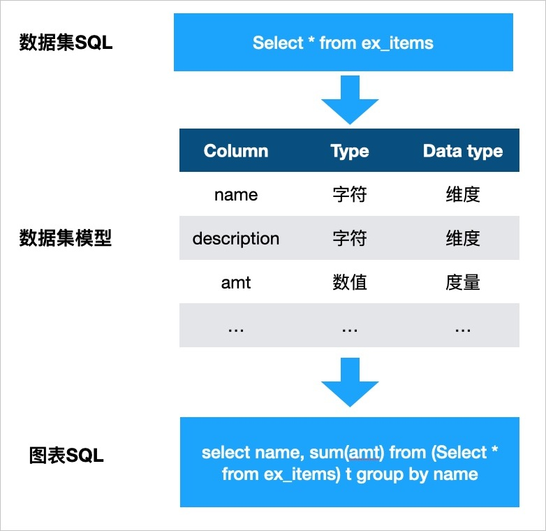

**编辑器介绍**

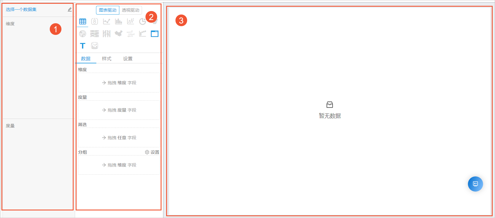

图表编辑器共有以下内容：

| 序号 | 名称 | 说明 |
| --- | --- | --- |
| ① | 数据模型展示区 | 在左上角选择了对应的数据集后，DMS会将所选数据集的模型分类展示在下方，维度字段展示在维度列表中，度量字段展示在度量列表中。您可拖拽字段到图表配置区<strong>数据</strong>页签对应的区域中。 |
| ② | 图表配置区 | 顶部用于选择驱动模式与图表类型，将鼠标移动到图表类型图标上会提示使用该图表需要的维度和度量数量。其下方有3个页签。<br>• 数据：用于添加图表所需的模型字段，您可以通过拖拽数据模型展示区的字段来满足可视化展示需求。<br>• 样式：图表样式配置。<br>• 配置：功能性配置，如筛选器、缓存。 |
| ③ | 图表展示区 | 根据数据集模型以及配置区的设置展示图表。 |

**驱动模式**

图表配置支持两种可视化展示逻辑，分别为**透视驱动**和**图表驱动**，用于支持不同的使用场景。

| 驱动模式 | 说明 | 场景 |
| --- | --- | --- |
| 图表驱动 | 图表驱动为常规的、基于图表分类的可视化展示逻辑。图表驱动的图表种类较为丰富，维度和度量可视为固定配置项，与其他的样式配置一同服务于图表。 | 适用于大多数可视化展示场景。 |
| 透视驱动 | 以透视表为基础的可视化展示逻辑。图表可视为对透视表进行可视化编码，通过将透视表中的维度和度量转换为轴来做图形化展示。在透视驱动逻辑下，每个度量可以做不同的图形编码，在维度栏中最下层级的维度可以视为公用的维度轴。 | 适用于少量数据在客户端的自由分析场景。 |

**数据配置**

您需要拖拽数据模型展示区的字段到**数据**页签对应的区域中来完成图表展示所需的数据配置，字段可放置区域会高亮提示。

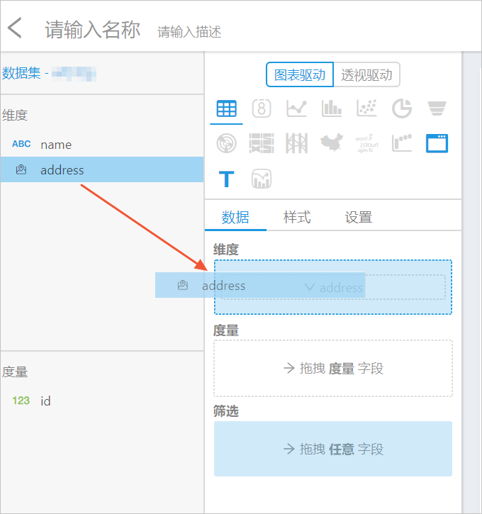

- ***维度***

  - 维度区域只能放置分类型字段，DMS会对拖入的字段在SQL中进行分组。

- ***度量***

  - 度量区域只能放置数值型字段，DMS会对拖入的字段在SQL中进行聚合。您单击字段名称可进行聚合函数选择。目前支持以下6种聚合函数：

    - 总计（sum）

    - 平均数（avg）

    - 计数（count）

    - 去重计数（count_distinct）

    - 最大值（max）

    - 最小值（min）

  - 度量区域内的字段可以进行数值格式设置，目前支持以下格式：

    - 默认格式。

    - 数值：可以设置小数位数、单位和启用千分位分隔符。

    - 货币：可以设置小数位数、单位、启用千分位分隔符和前、后缀文本。

    - 百分比：可以设置小数位数。

    - 科学型：可以设置小数位数。

- ***筛选***

  - 筛选区域支持任意类型字段，DMS会对拖入的字段在SQL中进行条件过滤，支持固定值、条件和日期三种筛选方式。

    > 筛选区域中的字段会根据您在数据视图中设置的可视化类型来选择性地展示对应的筛
    >
    > **说明**
    >
    > 选方式。

    | 筛选方式 | 说明 | 可视化类型 |
    | --- | --- | --- |
    | 条件筛选 | 您可以在界面中自由配置所选字段的过滤条件，同时可以配置各个条件之间的“与”（and）“或”（or）关系，是最灵活的筛选方式。 | • 数字<br>• 字符串<br>• 地理 |
    | 固定值筛选 | 界面左侧会陈列出所选字段的值列表（distinct），您通过选择左侧的内容到右侧进行固定值筛选。 | • 字符串<br>• 地理 |
    | 日期筛选 | 支持所选字段的动态和固定时间范围筛选。 | 日期 |

- ***分组***

  - 分组区域目前只能放置一个维度字段，DMS会对拖入的字段在SQL中进行分组。在图表展示上会根据所选字段值系列进行分组，每个分组的值匹配一种颜色，可以通过图例来查看各个系列。对于同一个度量，希望按照某一个维度分组拆解成多个度量进行展示的场景，可以使用分组配置。

    例如：有交易日期、区域、交易额三个字段，以柱图的方式展示每一天不同区域的交易额，则可以把交易日期拖入维度区域，区域字段拖入分组区域，交易额拖入度量区域。

    > 展示饼图时需要通过某个维度来进行分组，那么只需将这个字段拖拽到分组区域即
    >
    > **说明**
    >
    > 可，而不是拖入到维度区域。

- ***字段通用设置***

  - 字段别名

    单击字段名称，在弹出的会话框中单击**字段设置**项，可进行**字段别名**设置，目前支持以下两种方式。

    - 支持固定别名。

    - 支持动态别名：动态别名通过编写JavaScript代码来生成，可以和变量一起使用，同时DMS内置了JavaScript Moment类库，可以结合变量动态生成日期别名，目前仅支持表格组件。

  - 字段描述

    单击字段名称，在弹出的下拉列表中单击**字段设置**项，进行**字段描述**设置，目前仅支持**图表驱动**的表格。

  - 字段排序

    单击字段名称，在弹出的下拉列表中单击**排序方式**，进行字段排序设置，目前支持的排序方式如下：

    <table>
      <tr>
        <th width="89">排序方式</th>
        <th>说明</th>
      </tr>
      <tr>
        <td>默认</td>
        <td>即不排序。</td>
      </tr>
      <tr>
        <td>升序</td>
        <td>在SQL中以此字段升序。</td>
      </tr>
      <tr>
        <td>降序</td>
        <td>在SQL中以此字段降序。</td>
      </tr>
      <tr>
        <td>自定义</td>
        <td>您可拖拽字段值决定展示顺序，在浏览器端以您的自定义顺序排序。仅支持分类型字段。</td>
      </tr>
    </table>

- ***其他配置***

  - 尺寸：用于散点图做节点大小编码，只能放置数值型字段，会对拖入的字段在SQL中进行聚合。

  - 提示信息：仅部分直角坐标系图表支持，只能放置数值型字段，会对拖入的字段在SQL中进行聚合。

  - 透视驱动下的图表标签需要拖拽字段指定，支持任意类型字段，会对拖入的分类型字段在SQL中进行分组、数值型字段在SQL中进行聚合。

  - 透视驱动下的散点图需要额外指定x轴度量，只能放置数值型字段，会对拖入的字段在SQL中进行聚合。

  - 图表驱动下的双Y轴图可以分别指定左右Y轴度量。

**图表配置**

在选择完字段之后，可以单击图表配置区顶部的小图标来选择进行可视化编码的图表类型。

> 鼠标移动到小图标上可以查看该图表展示的先决条件，当先决条件不满足时图标呈置灰状
>
> **说明**
>
> 态且不可单击，满足后图标呈高亮状态，单击后右侧会展示图表。

图表配置区下方**样式**页签中，您可以对图表进行自定义表单化配置。

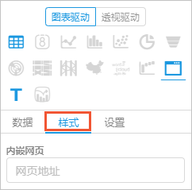

**功能配置**

图表配置区下方**设置**页签中，您可以配置**筛选器**、**缓存**以及是否**自动加载数据**。

- 筛选器

  单击筛选器右侧的**设置**按钮即可新增或设置筛选器。

  > 在数据集定义了**变量**后才可设置筛选器。
  >
  > **说明**

  在仪表盘中添加带有筛选器的组件之后，可以单击组件左上角按钮打开筛选器面板，选择内容之后，单击面板右下角查询按钮进行**查询**，组件筛选器与全局筛选器的过滤条件对组件叠加生效。

- 缓存

  您可以配置缓存的关闭、开启和有效期。

  > 开启缓存后，在仪表盘和大屏中该组件首次查询会将结果存储到缓存中，使用SQL语句
  >
  > **说明**
  >
  > 作为 key。之后在缓存有效期内的、SQL语句相同的查询将直接返回缓存结果，不再访问数据源。

- 自动加载数据

  在有些查询压力较大的场景下，您不希望在打开仪表盘时组件立即加载数据，可以设置**自动加载数据**项为**否**，默认情况为**是**。

**创建图表**

1. 登录DMS控制台。

2. 进入数据可视化控制台。

3. 在左侧导航栏中，单击**图表**。

4. 在图表管理页面，单击

   图标。

   

5. 设置数据集与图表配置。

6. 单击右上角的**保存**按钮。

**修改图表**

1. 登录DMS控制台。

2. 进入数据可视化控制台。

3. 在左侧导航栏中，单击**图表**。

4. 在**图表列表**中找到目标图表，单击**操作**列下的

   图标。

   

5. 设置数据集与图表配置后，单击**保存**。

**删除图表**

1. 登录DMS控制台。

2. 进入数据可视化控制台。

3. 在左侧导航栏中，单击**图表**。

4. 在**图表列表**中找到目标图表，单击**操作**列下的

   图标。

   

5. 在弹出的对话框中，单击**确定**，即可完成删除操作。

**复制图表**

1. 登录DMS控制台。

2. 进入数据可视化控制台。

3. 在左侧导航栏中，单击**图表**。

4. 在**图表列表**中找到目标图表，单击**操作**列下的

   图标。

   

5. 在弹出的**复制图表**窗口中，输入**图表名称**与**描述**。

6. 单击**确定**。

**授权**

1. 登录DMS控制台。

2. 进入数据可视化控制台。

3. 在左侧导航栏中，单击**图表**。

4. 在**图表列表**中找到目标图表，单击**操作**列下的

   **> 授权**。

   

5. 在弹出的**授权分享**对话框中，选择指定人和权限。

6. 单击**授权**。

<a id="section-6-4-6"></a>

### 6.4.6. 仪表盘管理

仪表盘是数据管理DMS提供的两种可视化应用类型的其中之一，仪表盘提供自动布局和可交互能力，帮助您快速打造可视化报表。本文介绍仪表盘的功能与使用操作步骤。

**创建仪表盘**

1. 登录DMS控制台。

2. 进入数据可视化控制台。

3. 在左侧导航栏中，单击**数据展示**。

4. 在**资源管理**页面的**仪表盘**区域，单击**新增仪表盘集合**。

5. 在**新增仪表盘集合**窗口中，输入**名称**和**描述**。

6. 单击**保存**即可。

**添加组件**

1. 在目标仪表盘页面，单击右上角  图标，弹出可视化组件列表。

2. 选择需要添加到该仪表盘上的组件（图表），单击**下一步**。

3. 从**数据刷新模式**列表中，选择需要配置的模式，目前支持以下两种模式：

   - 手动刷新：通过单击组件右上角**同步数据**按钮更新数据。

   - 定时刷新：根据所设置的更新时长定时自动轮询更新数据，时长单位为秒。

4. 单击**保存**，该组件即添加至仪表盘上。

**组件设置**

- 组件数据刷新：单击组件右上角的  图标，即可触发查询，同步数据。

  > 如果组件开启了缓存，点此按钮可以刷新缓存。
  >
  > **说明**

- 编辑图表组件：单击组件右上角的  图标，快捷进入图表组件编辑界面。

- 全屏放大组件：单击组件右上角的  图标，将图表组件放大至全屏。

- 修改组件数据刷新模式与删除组件：单击组件右上角的  图标，弹出拓展按钮，可以修改组件数据刷新模

  式与删除组件。

**自动布局**

- 您可以拽住组件右下角调整尺寸。

- 您可以拽住组件标题调整位置。

- 仪表盘可视区域宽度在768像素以上时组件会按照自定义的比例进行显示，在768像素以下时会响应为移动端观看模式。

- 在您调整组件尺寸和位置时，未被调整的其他组件会适应该组件变化而进行流式布局。

**图表联动**

仪表盘中的图表组件之间可以配置联动关系，单击仪表盘右上角  图标，即可打开配置对话框。

- 支持仪表盘中可以配置多条联动关系，每条关系中包含一个触发器和一个联动图表，您需要指定触发器与联动图表之间的字段对应关系。

  - 触发器：即触发联动操作的图表字段，该字段可以是维度或是聚合后的度量（仅支持选择图表所用到的字段）。

  - 联动图表：可以选择数据集模型中的任意字段和变量，触发器与联动图表所选的字段类型必须一致。

- 通过配置多条联动关系，支持一个触发器联动多个图表，在配置界面右侧的关系图中可以一览联动关系。

  > 支持多个触发器联动一张图表，过滤条件叠加生效。
  >
  > **说明**

- 作为联动触发器的组件左上角有操作提示。

**全局筛选器**

全局筛选器能够支持您对仪表盘中的一个或多个组件做条件过滤或是变量输入。点击仪表盘右上角  图标，

即可打开配置对话框。

- **基本配置**

  全局筛选器面板分为3块区域，分为**筛选器列表**、**关联图表**与**类别**、**筛选器配置**。

- **筛选器列表**

  在**全局筛选器配置**页面，单击左上角的  图标添加筛选器，默认名称为新增筛选器，鼠标移动到筛选器名

  称上时右侧会显示编辑名称和删除按钮。

- **关联图表**与**类别**

  在**关联图表**页，勾选目标关联图表，勾选完之后在**类别**项中，选择关联**字段**或**变量**（必选）。当筛选器关联字段时，筛选器的输入内容将作为关联字段的过滤条件作用到 SQL 中，也替换变量作用于 SQL 模板中。

- **筛选器配置**

  筛选器目前支持以下类型。

  - **下拉菜单**

    下拉菜单筛选器仅支持关联维度字段，下拉菜单选项即为关联字段的值列表（distinct）。

    - 当关联图表来源于不同数据视图时，下拉菜单选项为各个视图所关联字段值的并集。

    - 当选项从字段取值时，本质上也是通过执行数据视图中的 SQL 来取值，因此配置项中可以选择是否开启缓存和设置缓存有效期。

    - 如果下拉菜单选项不希望从字段取值，也可以自定义选项。在自定义选项面板中，每行定义一个选项，选项文本与选项值用空格分隔，如果文本与值相同可以只写一个。

    关联变量时，下拉菜单选项也支持从字段取值。

    配置项中还支持多选配置。

    > 关联变量时，多选选项最终会以诸如 `'`选项`1','`选项`2','`选项`3'` 的格式传递给变
    >
    > **说明**
    >
    > 量，需要SQL语句改变为 `in ()` 语法来保证执行正确。

  - **日期选择**

    日期筛选器仅支持关联维度字段，支持将所选日期转换为以下格式：

    - 日期（如 2019-01-01）

    - 日期时间（如 2019-01-01 12:00:00）

    - 日期时间分钟（如 2019-01-01 12:00）

    - 月（如 2019-01）

    - 周（如 2019-5周）

    - 年（如 2019）

    日期筛选器支持设置默认值，默认值支持动态日期或是指定日期。

    > 仅有日期筛选器可以设置默认值。
    >
    > **说明**

    日期筛选器支持多选配置，在多选的情况下，支持日期、月、年三种格式，默认值只能指定日期。

    > 与下列菜单一样，在关联变量时也需要注意SQL语法问题。
    >
    > **说明**

  - **日期范围选择**

    日期范围筛选器仅支持关联维度字段，支持格式与日期筛选器相同。在关联变量时，日期范围筛选器必须关联两个变量，用于做起始时间与截止时间输入。

  - **文本输入框**

    文本输入框筛选器仅支持关联维度字段，在立即查询模式下需要敲回车键触发查询。

  - **数字范围输入框**

    数字范围输入框筛选器仅支持关联指标字段，在立即查询模式下需要敲回车键触发查询。 在关联变量时，数字范围输入框筛选器必须关联两个变量，用于做起始与截止数值输入。

- **筛选器级联**

  筛选器之间可以通过拖拽的方式配置级联关系，当筛选器之间为级联关系时，上级筛选器的输入内容将作为下级筛选器（下拉菜单）选项取值的过滤条件。

- **查询模式**

  配置界面右下角可选择查询模式。

  - **立即查询**：即筛选器值发生变化后立即触发关联图表进行查询，文本输入框、数字范围输入框在**立即查询**模式下需要敲回车键触发查询。

  - **手动查询**：全局筛选器栏右侧会显示**查询**和**重置**两个按钮，点击**查询**按钮时会触发查询。

**自由钻取**

自由钻取的基本逻辑是：先单击图表元素进行条件过滤，然后单击鼠标右键选择维度进行钻取。

> 作为联动触发器的图表将无法进行自由钻取操作。
>
> **说明**

- 支持自由钻取的组件在左上角有操作提示。

- 可视化组件左下角会展示图表的钻取路径，您可以选择之前任意一级路径返回。

  > 例：选择“上海”、“深圳”、“广州”三项图表元素，钻取到 `education` 字段。此时图表
  >
  > **说明**
  >
  > 的展示逻辑是：上海、深圳、广州三个城市的教育程度与薪水分布图。

- 自由钻取在透视驱动与图表驱动模式下有一定的区别。

  - 透视驱动

    透视驱动下的自由钻取，是在条件过滤的基础上，在透视表中增加、减少维度来观察数据变化。

    > 在透视表中，可以选择钻取方式为上卷、下钻，上卷即为去掉该维度，下钻即为增加
    >
    > **说明**
    >
    > 该维度，同时透视表中可以选择钻取到行或列。

  - 图表驱动

    - 在图表驱动下，表格的自由钻取逻辑与透视表类似。

    - 其他图表是在条件过滤的基础上，将钻取的维度对图表中现有维度进行替换，以另一个维度观察数据变化。

    目前图表驱动中支持自由钻取的图表类型有：

    - 表格

    - 柱状图

    - 折线图

    - 散点图

    - 饼图

    - 漏斗图

    - 双Y轴图

**编辑仪表盘**

1. 登录DMS控制台。

2. 进入数据可视化控制台。

3. 在左侧导航栏中，单击**数据展示**。

4. 在**资源管理**页面的**仪表盘**区域，单击右上角的编辑按钮。

**删除仪表盘**

1. 登录DMS控制台。

2. 进入数据可视化控制台。

3. 在左侧导航栏中，单击**数据展示**。

4. 在**资源管理**页面的**仪表盘**区域，找到需要删除的仪表盘集合。

5. 单击  图标。

6. 在弹出的窗口中，单击**确定**。

<a id="section-6-4-7"></a>

### 6.4.7. 大屏管理

大屏是数据管理DMS提供的第二个可视化应用，提供自由布局和自定义样式能力，通过可视化组件和一系列内置辅助图形来打造视觉呈现丰富的可视化大屏。

大屏的定位与仪表盘不一样，仪表盘倾向于快速打造可视化报表，而大屏通常被广泛用于静置或滚动观看和演示的场景，因此大屏的制作过程通常需要比仪表盘花更多的时间。从本文中您可以了解到如何丰富大屏的样式。

**大屏编辑器介绍**

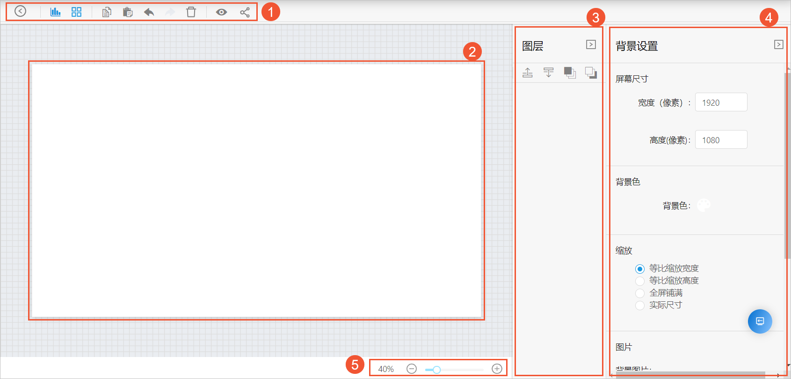

| 序号 | 名称 |
| --- | --- |
| ① | 工具栏 |
| ② | 画布 |
| ③ | 图层列表 |
| ④ | 参数配置区 |
| ⑤ | 缩放工具栏 |

**工具栏**


| 序号 | 名称 | 说明 |
| --- | --- | --- |
| ① | 图表 | 添加图表到大屏。 |
| ② | 辅助图形 | 可添加矩形、标签、视频、时间器四种辅助组件。 |
| ③ | 操作键 | 用于对画布图层的功能操作，包括<strong>复制</strong>，<strong>粘贴</strong>，<strong>撤消</strong>，<strong>重做</strong>，<strong>删</strong><strong>除</strong>。 |
| ④ | 预览 | 打开新标签预览页，查看当前编辑大屏的实际展现效果。 |
| ⑤ | 分享 | 您可以通过该图标分享数据可视化。 |

- **图表**

  您可以通过单击图表图标添加图表，具体操作如下：

  <ol type="i">

  <li>

  单击**图表**图标。

  </li>

  <li>

  在**添加图表**对话框中选中目标图表组件卡片，单击**下一步**。

  </li>

  <li>

  选择**数据刷新模式**，单击**保存**。

  DMS提供了如下两种刷新模式：

  - **手动刷新**：选择该模式后，在大屏中需通过单击组件右上角**同步数据**进行数据更新。

  - **定时刷新**：根据所设置的更新时长定时自动轮询更新数据，时长单位为秒（s）。

  </li>

  <li>

  单击**保存**，即可将组件添加到画布中。

  鼠标拖动图层即可更改图层位置，鼠标拖拽图层右下角即可更改图层大小。

  </li>

  </ol>

- **辅助图形**

  DMS目前提供了四种辅助图形，单击**辅助图形**，在下拉列表中选择需要添加的辅助图形即可。

  | 辅助图形 | 说明 |
  | --- | --- |
  | 矩形 | 支持设置背景颜色、背景图片和边框，一般用于给组件做背景修饰。 |
  | 标签 | 支持输入文字、设置字体、边距、背景颜色和边框，一般用于做文字展示。 |
  | 视频 | 支持播放在线视频。 |
  | 时间 | 展示一个动态变化的时钟。 |

- **操作键**

  <table>
    <tr>
      <th>操作键</th>
      <th>说明</th>
      <th>Mac快捷键</th>
      <th>Windows快捷键</th>
    </tr>
    <tr>
      <td>复制</td>
      <td>对组件图层或辅助图形进行复制。</td>
      <td>Cmd + C</td>
      <td>Ctrl + C</td>
    </tr>
    <tr>
      <td>粘贴</td>
      <td>对组件图层或辅助图形进行粘贴。</td>
      <td>Cmd + V</td>
      <td>Ctrl + V</td>
    </tr>
    <tr>
      <td>撤销</td>
      <td rowspan="2">在编辑画布过程中，可随时单击撤销或重做来实现编辑的回滚和恢复。</td>
      <td rowspan="2">无</td>
      <td rowspan="2">无</td>
    </tr>
    <tr>
      <td>重做</td>
    </tr>
    <tr>
      <td>删除</td>
      <td>对组件图层或辅助图形进行删除。</td>
      <td>Delete</td>
      <td>Backspace或Delete</td>
    </tr>
  </table>

  > **说明**
  >
  > - **复制**、**粘贴**和**删除**均支持多选图层后批量操作。
  >
  > - 按住Cmd键或Alt键可以多选图层。

- **预览**

  制作完成大屏之后，可以单击**预览**图表进行预览。

**画布**

组件图层和辅助图形添加到画布后可视为画布中的**图层**。您可以在画布中进行如下操作：

- 您可以在画布中通过拖拽编辑图层位置，也可以使用键盘方向键（上下左右）对图层位置进行微调。

  > 为辅助图层定位，在编辑图层时，图层右侧会实时显示当前位置，以及画布会显示相应
  >
  > **说明**
  >
  > 的辅助线来帮助您对齐图层。

- 您可以滑动缩放工具栏的滑块对画布进行缩放，辅助您编辑局部样式。

- 按住Cmd键或Alt键单击图层，可实现批量选中，然后可对选中的图层进行复制、删除和对齐等操作。

- 单击画布中的空白区域，即可去掉对图层的选中状态。

- 单击目标组件右上角的**编辑**，进入组件编辑界面。

**图层列表**

您可以在图层列表编辑以下操作：

- 选择图层：单击列表项可以让画布中的图层处于被选中状态。

- 批量选中图层：按住Cmd或Alt键单击图层列表项可以批量选中图层。

- 编辑图层Z轴位置：选择图层之后，可以单击图层列表顶部的按钮改变图层Z轴位置，包括**上移**、**下移**、**置顶**、**置底**。

**参数配置区**

在选中不同图层的情况下，参数配置区域展示内容不一致，具体信息如下：

- 默认情况下，参数配置区显示为**背景设置**，其中包括如下参数。

  <table>
    <tr>
      <th width="89">参数</th>
      <th>说明</th>
    </tr>
    <tr>
      <td>屏幕尺寸</td>
      <td>可根据实际展示大屏设备设置画布尺寸。</td>
    </tr>
    <tr>
      <td>背景色</td>
      <td>可设置大屏的背景颜色。</td>
    </tr>
    <tr>
      <td>缩放</td>
      <td>• <strong>等比缩放宽度</strong>：画布宽度与显示终端宽度一致，高度等比缩放。<br>• <strong>等比缩放高度</strong>：画布高度与显示终端高度一致，宽度等比缩放。<br>• <strong>全屏铺满</strong>：画布宽、高皆与显示终端一致，此时画布有可能变形。<br>• <strong>实际尺寸</strong>。</td>
    </tr>
    <tr>
      <td>图片</td>
      <td>可在此设置大屏的背景图片。</td>
    </tr>
  </table>

- 当选中某一个图层的情况下，参数配置区显示为**图表**，支持设置如下参数：

  - **图表尺寸**

  - **图表位置**

  - **背景**

  - **边框**

  - **数据刷新模式**

- 当批量选中图层的情况下，参数配置区显示为**图层对齐**，你可以对图层进行**顶对其**、**左对齐**、**水平居中**、**垂直居中**、**右对齐**和**底对其**操作。

**创建大屏**

1. 登录DMS控制台。

2. 进入数据可视化控制台。

3. 在左侧导航栏中，单击**数据展示**。

4. 在**资源管理**页面的**大屏**区域，单击**新增大屏**。

5. 在**新增大屏**对话框中，输入**名称**和**描述**。

6. 单击**保存**，即可在**大屏**区域看到新建的大屏。

**编辑大屏**

1. 登录DMS控制台。

2. 进入数据可视化控制台。

3. 在左侧导航栏中，单击**数据展示**。

4. 在**资源管理**页面的**大屏**区域，找到目标大屏，单击目标大屏。

5. 在大屏编辑页面根据需求编辑大屏，如何编辑大屏内容请参见大屏编辑器介绍。

**删除大屏**

1. 登录DMS控制台。

2. 进入数据可视化控制台。

3. 在左侧导航栏中，单击**数据展示**。

4. 在**资源管理**页面的**大屏**区域，找到需要删除的大屏。

5. 单击  图标。

6. 在弹出的窗口中，单击**确定**。

<a id="section-6-5"></a>

## 6.5. 异构数据库迁移ADAM

<a id="section-6-5-1"></a>

### 6.5.1. ADAM概述

数据库和应用迁移服务ADAM（Advanced Database & Application Migration）能够帮助企业用户把IT系统简单可靠地迁移上云。

**背景信息**

数据库和应用迁移ADAM是阿里巴巴基于内部多年的Oracle数据库和应用架构梳理、架构选型、系统改造经验，研发的一套帮助企业客户进行传统数据库和应用架构改造、云化的数字化迁移解决方案产品，提供企业数据和应用架构梳理、架构选型、业务改造、数据迁移、运维优化等一整套产品化服务能力，并结合丰富的合作伙伴生态，为企业用户提供专业数据和应用改造支持服务。

**功能简介**

- 数据库评估：

  根据采集到的源库数据，进行智能评估分析。从目标库数据库方案、目标库兼容度、迁移风险识别、应用改造建议、迁移成本等多维度给出分析报告。功能入口：**集成与开发(DTS) > 数据库评估**。

- 数据库改造迁移：

  智能数据库改造迁移工具，根据分析转换结果，方便的进行源库对比、结构迁移和结构订正。功能入口：**集成与开发(DTS) > 数据库改造迁移**。

- 应用评估改造：

  提供迁移数据库的应用改造点，包括改造具体位置（调用栈）和改造SQL的内容。梳理，提供架构迁移指南，梳理大规模集群迁移的架构。功能入口：**集成与开发(DTS) > 应用评估改造**。

- 迁移实验室：

  提供了SQL对比测试平台，SQL自动转换平台和周期性采集数据的工具。功能入口：**集成与开发(DTS) > 迁移实验室**。

- SQL转换：

  提供了将Oracle、Teradata、DB2语句转化为MySQL、PolarDB O引擎、AnalyticDB PostgreSQL版语句的工具。功能入口：**集成与开发(DTS) > SQL转换**。

<a id="section-6-5-2"></a>

### 6.5.2. 数据库评估

<a id="section-6-5-2-1"></a>

#### 6.5.2.1. 数据库采集

ADAM提供在线采集和下载数据采集器采集两种数据库采集方式。

**背景信息**

- 在线采集：需要您将源数据库的网络打通，并在数据库白名单中添加ADAM部署服务器，确保ADAM服务器可以直接通过在线采集方式进行信息收集。

- 下载采集器：对于源库无法通过外网连通的情况，可以下载ADAM数据采集器进行采集。

**在线采集**

1. 登录DMS控制台，在顶部菜单栏中，选择**集成与开发（DTS） > 数据库评估**，进入数据库评估页面。

2. 在**数据库采集**配置向导下，单击**在线数据库采集**。

3. 单击**创建采集任务**，开始创建采集任务。

4. 登录源数据库配置采集账号，赋予相应的权限。

   - ADAM支持Oracle 10g/11g/12c版本（非 CDB 模式，创建 LOCAL USER 类型用户）的数据库采集。

     <ol type="a">

     <li>

     创建采集用户eoa_user，并设置密码为eoaPASSW0RD\*\*\*\*。

     ```text
     create user eoa_user identified by eoaPASSW0RD**** default tablespace users;
     ```

     </li>

     <li>

     查询权限。

     ```text
     grant connect,resource,select_catalog_role,select any dictionary to eoa_user;
     ```

     </li>

     </ol>

     <ol type="i" start="100">

     <li>

     DBMS_LOGMNR权限。

     > **说明**
     >
     > 版本为 10g 的数据库需要先执行
     >
     > ```text
     > create or replace public synonym DBMS_LOGMNR for sys.dbms_logmnr;
     > ```

     ```sql
     grant execute on DBMS_LOGMNR to eoa_user;
     ```

     </li>

     <li value="500">

     DBMS_METADATA权限，查询数据对象DDL语句。

     ```sql
     grant execute on DBMS_METADATA to eoa_user;
     ```

     </li>

     </ol>

     <ol type="a" start="5">

     <li>

     查询事务权限。

     ```text
     grant select any transaction to eoa_user;
     ```

     </li>

     <li>

     查询表权限。

     ```text
     grant select any table to eoa_user;
     ```

     </li>

     <li>

     分析表权限。

     ```text
     grant analyze any to eoa_user;
     ```

     </li>

     <li>

     产生随机编号权限。

     ```sql
     grant execute on dbms_random to eoa_user;
     ```

     </li>

     </ol>

   - Oracle 12c（CDB 模式，需要连接到 CDB，创建 COMMON USER 类型用户）

     ```sql
     create user c##eoa_user identified by "eoaPASSW0RD****" default tablespace users;
     grant connect,resource,select_catalog_role,select any dictionary to c##eoa_user container=all;
     grant execute on DBMS_LOGMNR to c##eoa_user container=all;
     grant execute on dbms_metadata to c##eoa_user container=all;
     grant select any table to c##eoa_user container=all;
     grant select any transaction to c##eoa_user container=all;
     grant analyze any to c##eoa_user container=all;
     grant execute on dbms_random to c##eoa_user container=all;
     alter user c##eoa_user set container_data=all container=current;
     ```

   - ADAM支持 Teradata 13、14、15版本的数据库采集。

     需要使用具有访问DBC权限的账号。

     ```sql
     grant select,show on dbc to （username）;
     ```

   - ADAM支持Db2 for LUW版本的数据库采集。

     需要db2look相关权限，采集账号请授予DBA权限执行。

5. 完成源数据库账号配置后，单击**下一步**进入**创建采集任务**面板。

   <ol type="i">

   <li>

   **采集任务名**：自定义采集任务名称。

   </li>

   <li>

   **源库类型**

   - 源库类型选择**ORACLE**。

     **数据库名称/服务名称/SID**：源Oracle数据库的数据库名称、服务名或SID。

   - 源库类型选择**TERADATA**或者**DB2_LUW**。

     **数据库名**：源数据库的数据库名。

   </li>

   <li>

   **源库网络种类**选择**具有公网IP的数据库**。

   </li>

   <li>

   填写源数据库其他信息。

   - **主机IP**：源数据库的IP。

     > **说明**
     >
     > 将ADAM部署服务器的IP地址加入源库的白名单中，以确保ADAM能够成功在线采集源库数据。

   - **端口**：源数据库连接端口。

   - **用户名**：创建的采集用户。

   - **口令**：输入用户名对应的密码。

   - **可选：高级配置项：编码配置**中输入源数据库的编码方式。

   </li>

   </ol>

6. 填写完毕后，单击**测试连接**，测试通过后，单击**启动采集**。

7. 待采集任务完成后，选中采集ID，点击**下一步创建画像**，进入生成数据库画像流程。

**下载采集器采集数据**

如果源库不能对外使用公网，或者无法从云上访问，需要使用线下流程采集。

1. 登录DMS控制台，单击左侧导航栏**迁移实验室**。

2. 在**SQL周期性采集**区域，单击**下载**，下载采集器。

3. 根据目标安装ADAM客户端设备的操作系统，选择下载对应版本的ADAM客户端到本地并解压缩。

   > **说明**
   >
   > 建议不要在待采集的数据库设备上运行。目标安装 ADAM 客户端设备最低应满足以下配置要求：
   >
   > - 网络：能够连接到待采集的源数据库。
   >
   > - CPU：2 core
   >
   > - 内存：8GB
   >
   > - 硬盘：100GB 空余

4. 配置采集账号，赋予相应的权限。

   <ol type="i">

   <li>

   登录源数据库。

   </li>

   <li>

   使用具有 SYSDBA 权限的账号创建临时账号，并配置以下权限（如果您已有包含下面权限的账号，请忽略此步骤，直接使用）。

   - Oracle 10g / 11g / 12c（非 CDB 模式，创建 LOCAL USER 类型用户）

     <ol type="a">

     <li>

     创建采集用户eoa_user，并设置密码为eoaPASSW0RD\*\*\*\*。

     ```text
     create user eoa_user identified by eoaPASSW0RD**** default tablespace users;
     ```

     </li>

     <li>

     查询权限。

     ```text
     grant connect,resource,select_catalog_role,select any dictionary to eoa_user;
     ```

     </li>

     </ol>

     <ol type="i" start="100">

     <li>

     DBMS_LOGMNR权限。

     > **说明**
     >
     > 版本为 10g 的数据库需要先执行：
     >
     > ```text
     > create or replace public synonym DBMS_LOGMNR for sys.dbms_logmnr;
     > ```

     ```sql
     grant execute on DBMS_LOGMNR to eoa_user;
     ```

     </li>

     <li value="500">

     DBMS_METADATA权限，查询数据对象DDL语句。

     ```sql
     grant execute on dbms_metadata to eoa_user;
     ```

     </li>

     </ol>

     <ol type="a" start="5">

     <li>

     查询事务权限。

     ```text
     grant select any transaction to eoa_user;
     ```

     </li>

     <li>

     查询表权限。

     ```text
     grant select any table to eoa_user;
     ```

     </li>

     <li>

     分析表权限。

     ```text
     grant analyze any to eoa_user;
     ```

     </li>

     <li>

     产生随机编号权限。

     ```sql
     grant execute on dbms_random to eoa_user;
     ```

     </li>

     </ol>

   - Oracle 12c （CDB 模式，需要连接到 CDB，创建 COMMON USER 类型用户）

     ```sql
     create user c##eoa_user identified by "eoaPASSW0RD****" default tablespace users;
     grant connect,resource,select_catalog_role,select any dictionary to c##eoa_user container=all;
     grant execute on DBMS_LOGMNR to c##eoa_user container=all;
     grant execute on dbms_metadata to c##eoa_user container=all;
     grant select any table to c##eoa_user container=all;
     grant select any transaction to c##eoa_user container=all;
     grant analyze any to c##eoa_user container=all;
     grant execute on dbms_random to c##eoa_user container=all;
     alter user c##eoa_user set container_data=all container=current;
     ```

   - Teradate 13 / 14 / 15

     需要使用具有访问DBC权限的账号。

     ```sql
     grant select,show on dbc to （username）;
     ```

   - Db2 for LUW

     需要db2look相关权限,采集账号请授予DBA权限执行。

   </li>

   <li>

   采集数据库结构性数据（用于生成可行性报告及兼容报告）

   采集器现已支持Oracle 10g / 11g / 12c版本，Teradate 13 / 14 / 15版本，DB2_LUW版本。（如果采集中遇到任何问题请提交工单，工单中请附上同级目录 logs 下的日志文件。）

   <ol type="a">

   <li>

   执行采集命令（.bat 是在 Windows 环境下命令；.sh 是在 Linux 环境下命令）。

   <ol type="a">

   <li>

   Oracle 10g

   ```text
   collect_10g[.sh|.bat] -h -u -p -d <service_name>;
   ```

   </li>

   <li>

   Oracle 11g

   - Oracle 11g R1

     ```text
     collect_11gR1[.sh|.bat] -h -u -p -d <service_name>;
     ```

   - Oracle 11g R2

     ```text
     collect_11gR2[.sh|.bat] -h -u -p -d <service_name>;
     ```

   </li>

   </ol>

   <ol type="i" start="100">

   <li>

   Oracle 12c

   > **说明**
   >
   > 针对Oracle 12c的某个pdb进行采集时，请参考Oracle 11g采集操作说明，使用 `collect_11gR2` 脚本进行采集操作。collect_12c[.sh|.bat] –h &lt;host> -u &lt;username> -p &lt;password> -P &lt;port> -d &lt;service_name> -s &lt;sid>

   </li>

   <li value="500">

   Teradate 13 / 14 / 15

   ```text
   collect_td[.sh] -h ip -p password -u username;
   ```

   </li>

   </ol>

   <ol type="a" start="5">

   <li>

   DB2_LUW

   ```text
   collect_db2_luw[.sh] -h ip -u username -p password -d databasename  -P port;
   ```

   -h: 采集数据库的IP地址。 -u: 采集用户 eoa_user。 -p: 采集用户 eoa_user 密码eoaPASSW0RD。 -P: 采集数据库的端口，如：1521。 -d: 采集数据库的服务名, 12c 是指特定PDB 的服务名。 -s: 采集数据库实例名，只对 12c 有用。

   </li>

   </ol>

   </li>

   <li>

   导出采集结果。

   采集完成后，会提示用户生成数据包，并提示数据包路径。日志文件如下：

   ```text
   [***] ******************************************************************
   [***] *     Collect Successfully!
   [***] *
   [***] * Complete the file packaging, the package result path is: 
   [***] *        ~rainmeter/out/data.zip 
   ******************************************************************
   ```

   </li>

   </ol>

   <ol type="i" start="100">

   <li>

   迁移结束后，清除临时账号。

   使用具有 SYSDBA 权限的账号通过终端连接数据库，并执行下面 SQL。

   <ol type="a">

   <li>

   Oracle 10g/11g/12c（非 CDB 模式）

   ```text
   drop user eoa_user cascade;
   ```

   </li>

   <li>

   Oracle 12c（CDB 模式）

   ```text
   drop user c##eoa_user cascade;
   ```

   </li>

   </ol>

   </li>

   </ol>

   </li>

   </ol>

**后续步骤**

新建画像，具体操作，请参见数据库画像。

<a id="section-6-5-2-2"></a>

#### 6.5.2.2. 数据库画像

数据库画像是数据库评估的基础数据，可以帮助您更好地了解自己的源数据库，在数据库迁移、改造等阶段，可以快速查找源数据库信息，指导迁移与改造。

**新建画像**

1. 登录DMS控制台，在顶部菜单栏中，选择**集成与开发（DTS） > 数据库评估**，进入**数据库评估**页面。

2. 单击**源库画像分析**配置向导。

3. 在页面左上角，单击 **新建画像**。

4. 在**新建画像面板**中，输入**画像名**，选择数据类型，选择报告语言类型，单击**上传**，上传源库数据采集包，上传完成后单击**创建**。

   > **说明**
   >
   > 源库画像创建时间大约为1~30 min，创建时间受源库采集内容的影响。

**查看画像详情**

源库画像**状态**变为**完成**后，在**操作**列单击**详情**，查看画像分析。

- 画像基本信息统计

  > **说明**
  >
  > 只有Oracle源库类型画像有基本信息统计功能。

  在**综述**页签下，查看源库画像基本信息。

  - 会话：衡量数据库的连接状况。分数越高，说明同时连接数据库的会话越多。

  - 复杂度：根据数据库的使用场景特性，特性等维度，计算源库画像复杂度。

  - 风险：衡量数据库是否存在SQL或对象的执行性能风险。分数越高，说明数据库存在风险的可能性越大。

  - 热点：衡量数据库是否存在访问频率非常集中的对象。热点分数越高，说明数据库存在部分数据对象被集中访问的情况 。

  - 规模：衡量数据库资源规模的情况。分数越高，说明采集的源数据库规模越大。

  - 负载 ：衡量数据库运行性能的情况。分数越高，说明数据库运行负载使用率高。

- 画像主要对象分布在**综述**页签下，查看源库画像中对象类型的分布。

- 画像分析结果明细

  在**明细**页签下，查看对源库画像的多维度分析结果。

  - 性能

    统计数据库的QPS、TPS、CPU利用率和负载信息。

  - 容量

    提供Schema容量排序和对象类型容量占比（表，索引，LOB字段）。

  - 外部依赖

    提供DBLink列表和详情信息， 对于包含外部依赖的数据库，改造时需要考虑跨库查询问题。

  - 其他维度

    ADAM对特殊类型的表和SQL进行识别分析，例如：无主键表，高增长表，带聚合函数SQL等。单击**view**，查看对象的详细信息。

  - 对象详情

    提供多维度对象信息，包括对象特征标签、对象关联关系（依赖的对象，有外键关联的表等），对象包含的特性等。通过对象详情，您可以在不查询源数据库的情况下。在**操作**列中，单击**全景展示**，查看对象详情。

    对象全景展示两部分，上半部分展示对象的基本信息以及详细DDL。下半部分展示对象的特征，依赖，特性等ADAM智能分析出的数据。

**相关操作**

| 操作 | 描述 | 操作步骤 |
| --- | --- | --- |
| 追加画像 | 源库画像支持画像的多版本管理，如果创建画像后，数据库里的数据发生了变化，您可以在原画像的基础上添加新的采集文件。 | 在<strong>源库画像</strong>列表页面，单击<strong>操作</strong>列中的<strong>追加</strong>，<strong>上传</strong>新采集到的数据文件，单击<strong>创建</strong>，系统会根据全部数据文件自动生成新的画像版本。 |
| 授权画像 | 授权其他用户访问该画像。您也可以随时取消授权，收回其他用户访问该画像的权限。<br>重要请妥善使用授权功能，由于授权引起的信息泄露，责任归授权方。 | 在<strong>源库画像</strong>列表页面，单击<strong>操作</strong>列中的<strong>授权</strong>，选中<strong>已阅</strong><strong>读</strong>，输入阿里云UID，授权其他用户访问该画像。授权有效期1个月，授权后，其他用户可以查看画像结果、下载画像报告、使用该画像创建新的分析项目。 |
| 删除画像 | 对于不再需要的画像，您可以删除该画像，同时该画像生成的所有分析项目也自动删除。 | 在<strong>源库画像</strong>页面，选择<strong>... &gt; 删除</strong>，删除画像。 |

**后续步骤**

选中目标**画像号**，单击**下一步查看目标库选型建议**，进入目标库选型建议。

<a id="section-6-5-2-3"></a>

#### 6.5.2.3. 目标库选型建议

阿里云上有很多种数据库，目标库选型建议可以帮助您对数据库画像进行分析，给出迁移到各种目标库的兼容情况分析。目标库选型建议以普遍用户最关心的目标库兼容度为参考依据，为您提供目标库决策的依据。

**操作步骤**

1. 登录DMS控制台。

2. 单击左侧导航栏中的**数据库评估**。

   > 您还可以登录DMS控制台，在顶部菜单栏中，选择**集成与开发（DTS） > 数据库评**
   >
   > **说明**
   >
   > **估**，进入**数据库评估**功能页面。

3. 单击**目标库选型建议**配置向导，在源库画像列表中选中需要评估的数据库画像。

4. 单击**下一步查看目标库选型建议**，进入**目标库选型建议**页面。

5. 单击**兼容性**页签。

   - **数据库对象兼容性**包括兼容度、ADAM智能兼容、不兼容。

     - **兼容度%**：ADAM智能兼容的百分数。

     - **ADAM智能兼容**：包含直接兼容目标库的对象，以及可以通过ADAM智能转换的对象（使用ADAM数据库改造产品，可以自动帮助您创建ADAM智能兼容的对象到目标数据库）。

     - **不兼容**：您必须手工修改数据库对象。（ADAM全面提供改造建议）。

   - **SQL兼容性**包括兼容度、兼容、改动后兼容，不兼容。

     - **兼容度%**：包含兼容的对象和改动后兼容的对象。

     - **兼容**：包含直接兼容目标库的对象，以及可以通过ADAM智能转换的对象。

     - **改动后兼容**： 数据库SQL改造后可以兼容，需要您对应用进行相应的SQL修改。

     - **不兼容**：不能兼容的对象。

6. <strong>可选：</strong>如果您只想迁移部分Schema，您可以通过兼容性列表顶部的**Schema筛选**，选中想要迁移的Schema进行目标库选型建议。

**后续步骤**

单击**下一步新建目标库评估**，进入目标库兼容评估。

<a id="section-6-5-2-4"></a>

#### 6.5.2.4. 数据库评估分析

数据库评估可以帮助您评估目标库的兼容性、规格，迁移风险和数据库上云的可行性以及改造工作量。

**新建数据库评估项目**

1. 登录DMS控制台，在顶部菜单栏中，选择**集成与开发（DTS） > 数据库评估**，进入**数据库评估**页面。

2. 单击**源库画像分析**配置向导，勾选目标画像，单击区域底部的**下一步查看目标库选型建议**。

3. 在**目标库选型建议**配置向导页面底部，单击**下一步新建目标库评估**，单击**新建项目**。

   > **说明**
   >
   > 您也可以在**目标库兼容评估**页面，单击**新建项目**，创建新项目。

4. 新建数据库评估项目。

   - 项目名：项目名称，必填。

   - 源库画像：选择已创建的画像名。

   - 项目类型：选择目标数据库类型。

   - 目标库版本：目标数据库版本必选。

   - 是否评估无效对象：

     - 是：评估无效对象。

     - 否：不评估无效对象。

   - 内核版本：PolarDB-O的内核版本必选。

     > **说明**
     >
     > 当项目类型选择**PolarDB兼容Oracle语法版**时，才会出现内核版本配置项。

   - 是否评估为无效对象：根据您的业务需求选择是或否。

     无效对象是指在源数据库日常维护，或者数据迁移的过程中状态变为INVALID的Package、Procedure、Function或View等对象。

   - 报告语言：选择目标库兼容评估报告的语言。

5. 单击**创建**，新项目创建成功，并自动启动分析。

**数据库评估分析**

1. 登录DMS控制台，在顶部菜单栏中，选择**集成与开发（DTS） > 数据库评估**，进入数据库评估页面。

2. 单击**目标库兼容评估**配置向导。

3. 在**操作**列，单击**详情**，进入目标库评估详情页面。

   > **说明**
   >
   > 您可以在项目列表中查看项目的分析状态和进度。状态为**完成**的项目才能进入目标库评估详情页面。

4. 查看数据库**评估综述**。

   > **说明**
   >
   > 当源数据库类型为ORACLE时，会出现规格、风险评估综述项。

   - **兼容性**：衡量源数据库到目标数据库的兼容情况，兼容度越高，需要修改的对象与SQL越少。

   - **改造**：迁移到目标数据库需要改动的具体位置。

     - **对象改造点**：使用ADAM数据库改造后无须您自助改造。

     - **应用改造点**：通过数据库采集的SQL分析得到，是对数据库迁移的初步评估。

   - **规格**：根据采集数据，通过ADAM智能计算出迁移到目标库需要的数据库规格和预估费用。 规格评估受采集环境影响，实际购买需要结合业务综合评估。

     - **目标库规格**：推荐的目标库规格。

     - **预估费用**：购买目标库预计的费用。

   - **风险**：对迁移改造进行风险预警。

     - **源库风险**：源库已有的风险点。

     - **迁移风险**：迁移到目标库可能发出的风险点。

   - **整体兼容性**： 显示源数据库到目标数据库整体的兼容情况。

5. 查看数据库**评估详情**。

   > **说明**
   >
   > 当源数据库类型为ORACLE时，会出现目标库规格、迁移风险和项目外部依赖（Schema）评估项。

   - **对象兼容度**

     对象兼容度展示源库所有对象的兼容性评估结果。

   - **SQL兼容度**

     SQL兼容度是对数据库中采集的SQL进行语法分析的结果。

   - **对象改造点**

     对象改造点主要是数据库对象的改造点汇总，您可以按照改造点自行改造自己的数据库对象。也可以申请使用ADAM数据库改造功能，自动化改造数据库对象（少量人工订正）。

   - **目标库规格**

     目标库规格是根据采集到的源库配置、性能、SQL 、外部依赖以及目标库类型等综合分析计算的。为数据库迁移到阿里云数据库提供规格与迁移计划指引。

   - **迁移风险**

     迁移风险分为源库风险与目标库分析。

   - **项目外部依赖（Schema）**

     项目外部依赖评估外部依赖的对象数量，并提供解决方案。

6. 下载报告。

   在**目标库兼容评估**页面底部，单击**下载精简报告**或**下载所有报告**，一键获取所有ADAM数据库评估相关报告。

<a id="section-6-5-3"></a>

### 6.5.3. 数据库改造迁移

<a id="section-6-5-3-1"></a>

#### 6.5.3.1. 线上改造迁移综述

ADAM提供智能数据库改造迁移功能，根据分析转换结果，方便地进行源库对比、结构迁移、结构订正和数据迁移。

**支持的数据库类型**

ADAM线上改造迁移支持将本地数据库迁移至云数据库。具体支持的数据库类型及版本如下：

- 云原生关系型数据库PolarDB O引擎

- 云数据库RDS MySQL版

- 云数据库RDS PostgreSQL版

- 云原生分布式数据库PolarDB-X

- 云原生数仓AnalyticDB PostgreSQL版

> 新建目标数据库时需要配置白名单。详细操作，请参见配置白名单。
>
> **说明**

**线上改造迁移步骤概述**

1. 生成迁云计划：通过数据库评估的结果生成计划在目标库上进行的结构迁移数据。

2. 预检查：检查目标数据库的账号权限、插件、版本号、字符集、时钟、资源，保证迁移过程流畅进行。

3. 源库计划校验：对比迁云计划和源库当前现状，判断出哪些对象是新增的、变化的、删除的，帮助您更新最新的迁云计划，用于迁移到目标库。此节点为可选环节，您如需使用此功能，需将源Oracle库与ADAM网络打通，确保ADAM服务器能连接源Oracle库进行对比校验；如跳过此环节，可能导致迁移上云的数据不是最新数据，解决方案为重新做一次数据库采集评估。

4. 结构迁移/订正：负责将计划迁移的对象尽可能的迁移到目标数据库，ADAM会将不兼容的对象自动化评估校验，对于不能自动改造的对象提供解决方案，您可以根据错误信息提供进行订正重试。

5. 增量源库对比(可跳过)：针对数据库结构比原先采集数据结构有些变动或者变动很多，可以通过增量源库对比发现客户改动、新增的DDL，方便客户迁移这些变动、新增的DDL。

6. 数据迁移：通过阿里云DTS工具帮助您做数据迁移。

<a id="section-6-5-3-2"></a>

#### 6.5.3.2. 配置白名单

为了确保ADAM能连接和使用目标数据库，需要在创建目标数据库时配置白名单。

**设置白名单**

- 云数据库RDS for PolarDB设置白名单，请参见<strong>《云数据库RDS》《用户指南（PolarDB）》</strong>中的<strong>《设置IP白名单》</strong>。

- 云数据库RDS for MySQL设置白名单，请参见<strong>《云数据库RDS》《用户指南（RDS MySQL）》</strong>中的<strong>《设置白名单》</strong>。

- 云数据库RDS PostgreSQL设置白名单，请参见<strong>《云数据库RDS》《用户指南（RDS PostgreSQL）》</strong>中的<strong>《设置IP白名单》</strong>。

- 云原生分布式数据库PolarDB-X设置白名单，请参见<strong>《云原生分布式数据库PolarDB-X》《用户指南》</strong>中的<strong>《设置白名单》</strong>。

- 云原生数据仓库AnalyticDB PostgreSQL版设置白名单，请参见<strong>《云原生数据仓库AnalyticDB PostgreSQL版》《用户指南》</strong>中的<strong>《设置白名单》</strong>。

**白名单**

如果ADAM与目标数据库不在同一Region，需要在目标库的白名单中添加ADAM部署机器的IP地址。

<a id="section-6-5-3-3"></a>

#### 6.5.3.3. 新建迁移项目

根据评估分析的结果生成从源库到目标数据库的迁移计划，使用迁移工具可以利用迁移计划将源库的Schema快速迁移到目标数据库，其中迁移计划包含的ADAM智能转换结果将保证最大兼容度。

**前提条件**

- 已完成数据库评估分析。

- 已创建目标数据库实例。

- 如果目标库为云原生分布式数据库PolarDB-X，必须先在PolarDB-X实例中创建与Schema同名的数据库并绑定RDS。

**操作步骤**

1. 登录DMS控制台。

2. 在顶部菜单栏中，选择**集成与开发（DTS） > 数据库改造迁移**，进入**数据库改造迁移**页面。

3. 在**数据库改造迁移**页面，单击**新建迁移项目**。

4. 在**新建迁云项目**面板，配置项目参数。

   <table>
     <tr>
       <th width="106">配置项</th>
       <th>描述</th>
     </tr>
     <tr>
       <td>项目名</td>
       <td>输入符合业务特征的项目名，便于后续识别。</td>
     </tr>
     <tr>
       <td>数据库评估</td>
       <td>• <strong>选择数据库评估</strong>：在数据库评估列表中，选择数据库评估。<br>• <strong>上传数据库评估</strong>：在项目类型列表中选择项目迁移类型，单击<strong>Upload File</strong>上传数据文件。</td>
     </tr>
     <tr>
       <td>主机IP</td>
       <td>输入目标数据库IP地址。</td>
     </tr>
     <tr>
       <td>数据库名</td>
       <td>输入目标数据库名称。</td>
     </tr>
     <tr>
       <td>编码方式</td>
       <td>选择目标库的编码方式。</td>
     </tr>
     <tr>
       <td>端口</td>
       <td>目标数据库外网端口。</td>
     </tr>
     <tr>
       <td>用户名</td>
       <td>登录目标数据库的用户名。</td>
     </tr>
     <tr>
       <td>口令</td>
       <td>登录目标数据库的密码。</td>
     </tr>
   </table>

5. 单击**测试链接**，测试链接成功后单击**创建**，生成迁移计划。

   数据库改造迁移项目列表中项目的状态变为 `ACTIVE` 后，迁移计划生成成功。

**后续步骤**

生成迁移计划后，ADAM将自动开始预检查。更多信息，请参见预检查。

<a id="section-6-5-3-4"></a>

#### 6.5.3.4. 预检查

检查目标数据库的账号权限、插件、版本号，保证迁移过程流畅进行。

**背景信息**

生成迁云计划后，ADAM自动在后台开始预检查。

- 目标库账号权限检查：

  - 检查目标库账号是否有创建用户权限。

  - 检查目标库账号是否有授权用户权限。

  - 检查目标库账号是否有创建、删除Schema权限。

  - 检查目标库账号是否有创建、删除DDL权限。

- 目标库插件检查：

  检查目标库是否已经安装迁移对象依赖的数据库插件。

- 目标库版本号检查：

  检查评估目标库版本与结构迁移目标库版本是否一致。

**操作步骤**

1. 登录DMS控制台。

2. 在顶部菜单栏中，选择**集成与开发（DTS） > 数据库改造迁移**，进入**数据库改造迁移**页面。

3. 目标项目的状态变为 `ACTIVE` 后，单击**详情**。

   > **说明**
   >
   > 如果状态栏显示黄色的ACTIVE，您可以单击详情后，根据预检查结果进行修复，如果修复完成后状态栏的ACTIVE仍是黄色，可以先忽略预校验问题。

4. 单击**预检查**配置向导，查看预检查结果。

**后续步骤**

在**预检查**页签下，单击**下一步源库计划校验**。具体操作，请参见源库计划校验。

<a id="section-6-5-3-5"></a>

#### 6.5.3.5. 源库计划校验

源库计划校验可以识别出，从上一次数据库采集截止到当前，源库数据及结构是否发生较大变更，协助您更好地完成数据库迁移。

**操作步骤**

1. 登录DMS控制台。

2. 在顶部菜单栏中，选择**集成与开发（DTS） > 数据库改造迁移**，进入**数据库改造迁移**页面。

3. 在目标迁移项目的**操作**列，单击**详情**。

4. 单击**源库计划校验**配置向导，查看源库变化情况。

   - Init：项目中初始具有的对象数量。

   - Unchanged：项目中对象没有变化的数量。

   - Changed：项目中对象发生变化的数量。

   - Deleted：项目中被删除的对象的数量。

   - New：项目中新增的对象的数量。

   > **说明**
   >
   > 若不连接源库会导致数据库改造只处理已采集的数据库，无法获取到源库的DDL。

**后续步骤**

单击**下一步结构迁移**，进行结构迁移。具体操作，请参见结构迁移/订正。

<a id="section-6-5-3-6"></a>

#### 6.5.3.6. 结构迁移/订正

ADAM可以通过配置规则控制用户的结构迁移权限，对数据库结构进行迁移。根据结构订正功能提供的信息，对迁移失败对象的DDL进行修改，在目标库执行修改后的DDL。

**操作步骤**

1. 登录DMS控制台。

2. 在顶部菜单栏中，选择**集成与开发（DTS） > 数据库改造迁移**，进入**数据库改造迁移**页面。

3. 在目标迁移项目的**操作**列，单击**详情**。

4. 单击**结构迁移/订正**配置向导。

5. 分账户结构迁移配置。在**规则配置**页签下，单击**分账户结构迁移配置**，根据业务情况进行配置。

   - 统一用户：系统默认，所有的Schema属于同一个用户。

   - 区分用户：每个Schema对应独立用户。

     <ol type="a">

     <li>

     填写用户对应的密码。

     - 如果您之前已经创建了用户，请填写用户名对应的密码。

     - 如果您未创建用户，ADAM将自动在目标库创建用户，用户密码为您填写的密码，不填写密码将默认与之前登录目标库账号的密码一致。

     </li>

     <li>

     根据需要设置或删除用户对应的Schema。

     </li>

     </ol>

     <ol type="i" start="100">

     <li>

     单击**保存**。

     </li>

     <li value="500">

     在弹出的确认对话框中单击**确定**。

     </li>

     </ol>

   > **说明**
   >
   > 迁移至目标库设置的区分用户与源数据库中的用户和Schema相同。

6. <strong>可选：</strong>可配置规则转换。在**规则配置**页签下，单击**可配置规则转换**，根据业务情况选择是否开启**DECFLOAT类型转换成DOUBLE类型**。

7. 单击**结构迁移**页签，进行结构迁移。

   <ol type="i">

   <li>

   单击**全部结构重新迁移启动**，重新迁移DDL，包含已经迁移或者未迁移的都会重新被迁移，在弹出的确认对话框中，单击**确认**，进行数据库结构迁移。

   > **重要**
   >
   > - 启动结构迁移将会先删除目标库中所有结构对象，请提前确认目标库中没有重要的结构对象。
   >
   > - 如果目标库为云原生分布式数据库PolarDB-X，迁移外键约束很慢，请耐心等待。
   >
   > - 如果结构迁移失败，您可以下载失败明细，查看结构迁移失败信息。

   </li>

   <li>

   <strong>可选：</strong>其他操作

   - 单击**失败续迁移**，只迁移当前失败的DDL。

   - 单击**启动**，启动已暂停迁移的DDL。

   - 单击**暂停**，停止当前迁移的DDL。

   - 单击**导出待订正列表**，导出迁移后待订正的数据列表。

   - 单击**定制化结构迁移**，定制结构迁移。为了满足用户不同的结构迁移需求，定制化结构迁移可以通过配置对象类型、Schema、迁移状态灵活定制化结构迁移。

   </li>

   </ol>

8. 单击**结构订正**页签，在Schema**操作**列中，单击**订正**，对迁移后的数据库结构进行订正。

   - **改造点**：查看当前对象智能转换改造点，其中不支持的内容需要您根据建议手动进行修改。

   - **依赖对象**：查看当前对象依赖的对象。

   - **被依赖对象**：查看当前对象被依赖对象。

   - **对象特征**：查看当前对象特征。

**后续步骤**

- 如果当前的数据库结构比采集时变动较多，可单击**增量源库对比**页签进行增量源库对比，请参见增量源库对比。

- 如果当前的数据库结构相比采集时变动几乎没有变动，可以单击**数据迁移**页签直接进行数据迁移，请参见数据迁移。

<a id="section-6-5-3-7"></a>

#### 6.5.3.7. 增量源库对比

如果您的数据库结构相比采集时有变动或者变动很多，可以通过增量源库对比发现改动、新增的DDL，方便您迁移这些变动、新增的DDL。

**操作步骤**

1. 登录DMS控制台。

2. 在顶部菜单栏中，选择**集成与开发（DTS） > 数据库改造迁移**，进入**数据库改造迁移**页面。

3. 在目标迁移项目的**操作**列，单击**详情**。

4. 单击**增量源库对比**配置向导。

5. 单击**启动**，启动增量对比任务。

6. 待进度条显示100%后，单击**增量校验历史纪录**，查看过去增量校验记录。

   如果您在增量源库对比后发现存在新增、删除和变更的对象，您可以重新返回上一个配置向导，单击**启动**，对新增的数据库结构变更进行同步。具体操作，请参见结构迁移/订正。

<a id="section-6-5-3-8"></a>

#### 6.5.3.8. 数据迁移

本文介绍数据迁移的方法。

**前提条件**

已完成数据库的结构迁移和订正。更多信息，请参见结构迁移/订正。

**操作步骤**

1. 登录DMS控制台。

2. 在顶部菜单栏中，选择**集成与开发（DTS） > 数据库改造迁移**，进入**数据库改造迁移**页面。

3. 在目标迁移项目的**操作**列，单击**详情**。

4. 单击**数据迁移**配置向导。

5. 下线数据结构。

   > **说明**
   >
   > 数据迁移前需要先删除触发器、约束、索引等影响数据迁移的结构，在数据迁移完成后，再将这些结构添加回来。下线数据结构的功能是删除触发器、约束、索引等影响数据迁移的结构。

   <ol type="i">

   <li>

   单击**下线结构**页签，单击**下线启动**。

   </li>

   <li>

   弹出的确认对话框中单击**确认**。

   > **警告**
   >
   > 启动下线结构服务后，目标库结构对象将会被删除，请谨慎操作。

   </li>

   <li>

   单击**下线结构详情**页签，根据条件查询下线结构详情。

   </li>

   </ol>

6. 上线数据结构。

   > **说明**
   >
   > 上线数据结构的功能是在数据迁移完成后，将之前删除的触发器、约束、索引等数据结构添加回来。

   <ol type="i">

   <li>

   单击**上线结构**页签，单击**上线启动**。

   </li>

   <li>

   在弹出的确认对话框中单击**确认**。

   </li>

   <li>

   单击**上线结构详情**页签，根据条件查询上线结构详情。

   </li>

   </ol>

<a id="section-6-5-4"></a>

### 6.5.4. 应用评估改造

**背景信息**

<a id="section-6-5-4-1"></a>

#### 6.5.4.1. 应用评估改造摘要

源数据库完成改造迁移后，需要改造应用程序，但应用程序比数据库复杂很多，涉及的代码可能经历过很多开发者，改造应用已经成为用户迁移数据库上云的痛点。为了解决用户迁移数据库后的应用改造问题，ADAM提供了应用评估改造功能，保证用户快速改造自己的应用。

**核心功能**

- 提供迁移数据库的应用改造点，包括改造具体位置（调用栈），改造SQL的内容。

- 梳理应用的框架，性能等使用信息。

- 大规模集群迁移的架构梳理，提供架构迁移指南。

**使用流程**

1. 应用采集

2. 采集部署

3. 应用画像

4. 应用评估

5. 应用静态改造

> 应用动态评估请使用1、2、3、4，应用静态改造请使用5。
>
> **说明**

<a id="section-6-5-4-2"></a>

#### 6.5.4.2. 应用采集

ADAM可以对Java JDK1.6及以上版本的应用提供采集功能，帮助客户评估分析需要改造的功能点，对于非Java应用暂不支持采集评估。

**背景信息**

ADAM 应用采集客户端包含两部分：

- 应用动态采集Agent。收集运行期应用请求数据库的基本信息，比如请求的sql-schema-调用栈、应用系统信息、性能信息、SQL热度等。

- 数据集中收集Collector。集中收集各应用Agent传输过来的数据，并进行脱敏、加工。

**说明**

- 采集的SQL会做脱敏处理，不采集请求参数及SQL中的具体值。

- 只读保护：不侵入应用。

- 负载控制：业务高峰期自动暂停采集、内存使用量控制在设定范围内。

- 支持 JDK1.6以上版本、 Tomcat、Jboss、Weblogic容器Oracle的Java应用动态采集。

**应用采集工具下载**

1. 登录DMS控制台。

2. 在顶部菜单栏中，选择**集成与开发（DTS） > 应用评估改造**，进入**应用评估改造**功能页面。

3. 在**应用采集**页签中，单击左下角的**下载采集器**。

4. 在**应用采集器下载**面板，单击**应用采集器下载**，下载采集器。

**部署前必读**

- 部署时涉及基本技术知识，请确保由Java研发人员操作。

- 支持Sun JDK 、Oracle JDK、Open JDK1.6及以上版本，不支持IBM JDK。

- 解压后有两个目录：collector和javaagent。collector是统一收集器，单独部署在没有线上应用的服务器上(数据处理时避免对线上应用造成影响)。javaagent目录拷贝到需要监控的应用服务器上，和应用部署在一起，用于采集数据。

- 确保Collector和Agent具有操作权限。

  > **说明**
  >
  > UNIX/Linux需要对目录增加级联操作权限 `chmod -R 775 collector/` 。

- Collector相当于Server端，可对应1~20个Agent，一个应用服务器部署一个Agent。

  > **说明**
  >
  > 如果应用是分布式多机器，根据负载均衡的情况，只抽样几台部署Agent即可。

- 先部署Collector，后部署应用Agent，应用要与Collector网络可达(用于推送数据做集中脱敏等处理)，部署Collector的机器需要JDK 1.6+版本，JVM内存4G以上。磁盘与监控的应用数量、监控时长、业务活跃度、SQL数量及SQL大小有关，不会出现爆发式增长，可观察半天来估算，一般一个应用监控7天数据量在1G以下。

- Agent要求：应用部署在JDK1.6及以上版本，待监控的应用有300M的可用JVM heap空间。服务容器支持Tomcat、Jboss、Weblogic、Websphere及k8s集群Docker容器镜像部署。

- Agent监控访问Oracle数据库的SQL和代码调用栈，请确保Agent监控周期内的操作覆盖全。如有周期性任务，需在有这些任务运行时监控，否则数据采集不全。

**后续步骤**

采集部署。

<a id="section-6-5-4-3"></a>

#### 6.5.4.3. 采集部署

本文介绍了采集部署的流程。

**预检查**

- 确保Collector部署在没有线上应用的独立服务器上。

- 确保已配置JAVA_HOME，JDK 1.6及以上版本。

**启动**

- UNIX系统，在collector目录下执行：

  ```text
   ./run.sh
  ```

- Windows系统， 在collector目录下执行：

  ```text
   start /b java -jar javaagent-collector.jar
  ```

验证方法：查看 `collector/logs/collector.log` 日志，显示启动成功即部署成功。

**采集器Javaagent**

**启动前的配置**

- 确保环境变量已配置JAVA_HOME，否则设置 attach.sh 中 JAVA_HOME 地址为JRE的绝对路径(注意：如客户使用JRE而非JDK，需要自己将tools.jar拷贝到${JAVA_HOME}/lib/目录下)

- 配置javaagent.config： profiler.collector.ip = 11.23.45.67 # collector的ip profiler.collector.port = 9996 # collector的端口 profiler.app.name = adamApp #应用名，少于20个字符的字母、数字组合 profiler.app.port = 8080 #应用启动端口，应用有很多个不同功能的端口，只配请求的那个端口即可，一个JVM下无论是否一个应用都只配置一个profiler.applicationservertype = TOMCAT # 应用中间件容器类型，TOMCAT\\JBOSS\\WEBLOGIC等

非必选配置

配置应用需要检测的Java代码的目录前缀。替换下面示例，多个目录用英文逗号分隔，每个至少2级目录，建议不超过5个。应用采集时根据精准的调用栈信息，在数据库改动时能同步给出明确的应用改动建议。

- 如不能全部提供则可以不写，后续在阿里云Adam分析页面进行过滤设置：

  ```text
  profiler.classpath.whitelist = com.alibaba.javaagent,com.alibaba.adam
  ```

- 如上面白名单已填写，此处可忽略；如果不清楚白名单列表，填写黑名单也可过滤无用的调用栈信息：

  ```text
  profiler.classpath.blacklist =org.apache,net.sf
  ```

- 配置当cpu达到多少时暂停数据采集：

  ```text
  profiler.cpu.threshold = 85
  ```

- 系统信息收集间隔，默认15分钟：

  ```text
  profiler.sys.send.interval = 15
  ```

- sql动态信息收集间隔，默认15分钟：

  ```text
  profiler.sql.dynamic.send.interval = 15
  ```

**启动方式**

- 方式一：不重启应用，Agent单次临时监控。javaagent目录增加操作权限；确保Agent启动的账号和应用启动账号一致；找到应用的进程号PID，在javaagent目录执行(将${pid}整体替换为应用的进程号)：

  - UNIX系统，执行：

    ```text
    ./attach.sh -p ${pid}
    ```

  - Windows系统，执行：

    ```text
    java -cp "%JAVA_HOME%\lib\tools.jar;%cd%\javaagent-bootstrap.jar" 
    com.alibaba.adam.javaagent.bootstrap.AgentAttacher -p ${pid}
    ```

  查看javaagent目录下log文件，提示启动成功，应用有流量进入后，查看Collector的目录下有data目录且有数据，说明Agent启动成功且正确发送数据到Collector。

  - 确保应用的PID获取正确。

  - 启动Agent的账号和应用启动账号保持一致，且权限也要一致，否则无法监控。

    > Windows下注册表SYSTEM启动的应用无法通过启动方式一启动，原因是账号权限不
    >
    > **说明**
    >
    > 一致

- 启动方式二（推荐）：随应用一起启动监控。应用增加Javaagent配置重启即可，${javaagent_path}整体替换为javaagent的目录。

  - UNIX系统

    - Tomcat：在catalina.sh启动文件最后一个CATALINA_OPTS配置后面增加：

      ```text
      CATALINA_OPTS="$CATALINA_OPTS -javaagent:${javaagent_path}/javaagent-bootstrap.jar"
      ```

    - Jboss：在run.conf启动文件最后一个JAVA_OPTS配置后面增加：

      ```text
      JAVA_OPTS="$JAVA_OPTS -javaagent:${javaagent_path}/javaagent-bootstrap.jar"
      ```

    - Weblogic：在startWebLogic.sh启动文件最后一个JAVA_OPTIONS配置后面增加：

      ```text
      JAVA_OPTIONS="$JAVA_OPTIONS -javaagent:${javaagent_path}/javaagent-bootstrap.jar"
      ```

    - Websphere：

      - 方式1 配置文件增加：

        ```text
        JAVA_OPTS="$JAVA_OPTS -javaagent:/home/admin/javaagent/javaagent-bootstrap.jar"
        ```

      - 方式2 页面配置： 通用 JVM 参数(Java Virtual Machine)加上：

        ```text
        name:javaagent  value:/home/admin/javaagent/javaagent-bootstrap.jar
        ```

    - k8s集群docker容器：将javaagent目录放入docker镜像中并对应增加-javaagent配置，一起打包镜像部署。

  - Windows系统

    - Tomcat：在catalina.bat启动文件最后一个CATALINA_OPTS配置后面增加：

      ```text
      CATALINA_OPTS="$CATALINA_OPTS -javaagent:${javaagent_path}/javaagent-bootstrap.jar"
      ```

    - Jboss：在run.conf启动文件最后一个JAVA_OPTS配置后面增加：

      ```text
      JAVA_OPTS="$JAVA_OPTS -javaagent:${javaagent_path}/javaagent-bootstrap.jar"
      ```

    - Weblogic：在startWebLogic.cmd启动文件最后一个JAVA_OPTIONS配置后面增加：

      ```text
      JAVA_OPTIONS="$JAVA_OPTIONS -javaagent:${javaagent_path}/javaagent-bootstrap.jar"
      ```

    - Websphere:

      - 方式1：配置文件增加。

        ```text
        JAVA_OPTS="$JAVA_OPTS -javaagent:/home/admin/javaagent/javaagent-bootstrap.jar"
        ```

      - 方式2：页面配置： 通用 JVM 参数(Java Virtual Machine)加上。

        ```text
        name:javaagent  value:/home/admin/javaagent/javaagent-bootstrap.jar
        ```

应用启动后查看应用的日志，显示 `Java Agent load successfully!`  表示启动成功，如报错根据错误原因进行修改，如未显示任何Agent信息表示配置路径不对导致未加载。

**优缺点**

| 启动方式 | 优点 | 缺点 | 适用场景 |
| --- | --- | --- | --- |
| 启动方式一 | 对全新应用无需重启即可设置Agent监控。 | 每次应用重启Agent需手动启动； 启动Agent的账号必须和应用保持一致。 | 应用长期不重启且重启会造成业务影响。 |
| 启动方式二 | 应用重启Agent自动启动，应用采集连续；不用考虑账号权限问题。 | 第一次需重启应用。 | 应用可重启、持续采集(大多数场景) |

**其他说明**

- 当应用停止：无论方式一、二启动的监控，应用停止则Agent停止。

- Agent主动停止监控：

  - 方式一：重启应用或通过命令./attach.sh -p ${pid} -s。

  - 方式二：去掉配置的Javaagent后重启应用。

- Agent停止监控后想再次做监控，必须重启应用。

  - 方式一：待应用重启后手动启动Agent。

  - 方式二：Agent随应用重启而启动。

- Jboss区分社区版和企业版，如果有jboss.modules.system.pkgs配置项，则无论用方式一、二，都需要先增加com.alibaba.adam.javaagent目录并重启应用才能生效。

**数据收集**

进入collector目录，将data/下的文件按Appname打zip包，分别独立上传ADAM应用画像，切记一个应用对应一个应用画像，一个应用下不同IP的数据可以打包到一起，但不同Appname的数据不能打包到一起，否则上传会报错。

> 一般收集1-7天数据。
>
> **说明**

**后续步骤**

上传应用画像。

<a id="section-6-5-4-4"></a>

#### 6.5.4.4. 应用画像

应用画像功能是ADAM根据单个应用采集的数据，通过智能分析算法，向用户直观提供应用系统客观分析内容。

**操作流程**

1. 登录DMS控制台。

2. 在顶部菜单栏中，选择**集成与开发（DTS） > 应用评估改造**，进入**应用评估改造**功能页面。

3. 单击**应用画像**页签。

4. 单击**新建画像**。

5. 在**新建应用画像**面板，填写**画像名**，选择画像**类型**，选择**报告语言类型**，单击**上传**，上传动态数据文件。

6. 单击**数据库画像**页签，单击**选择**。

7. 在**选择关联数据库画像**页签中，选中数据库画像，单击**添加**，单击右上角的  图标。

8. 选中数据库画像，单击**创建**。创建应用画像需要一段时间进行数据智能分析，通常处理时间为1~10分钟。

**应用画像详情**

应用画像详情主要分为四个部分：

- 摘要

  - 复杂度是根据应用的使用场景，相关数据库的特性等维度，计算出的ADAM画像复杂度。主要用于衡量应用的使用情况，分数越高说明应用越复杂，可能涉及的改造情况越多。

  - 会话主要衡量应用的连接状况，分数越高说明应用连接数越多，对应用改造的连接池配置有参考意义。

  - 风险主要衡量应用当前可能存在的性能瓶颈与稳定性风险，特别是应用SQL存在的性能风险。

  - 热点主要衡量应用所访问的数据库是否存在访问频率非常集中的对象。分数越高，说明应用的数据库访问存在热点情况。

  - 规模主要衡量当前应用的部署单元数或者实例数情况。

  - 负载主要衡量应用的运行性能情况。

- 系统信息

  系统信息是根据ADAM应用采集器采集的应用运行时系统参数，有助于用户评估应用运行状态。

- 对象汇总

  对象汇总主要罗列了应用采集与智能分析出的SQL与数据库对象情况汇总，可以直观通过数据看到应用画像的整体内容。

- 对象详情

  对象详情是详细展示了ADAM智能分析后的数据库对象与应用SQL以及应用代码的关系。其中左边是以Schema和对象类型为纬度，通过树的形式展示应用访问的数据库对象的罗列。右边是具体对象和访问该对象的SQL。

  您还可以单击**调用栈设置**，在**调用栈设置**面板中配置调用栈黑名单，过滤想要的调用栈信息。

**应用画像的其他操作**

- **追加**：若您需要在已创建画像中增加其他静态或动态数据文件，请单击目标画像行操作列下的**追加**。

- **授权**：若您需要将画像授权给其他ADAM用户时，请单击目标画像行操作列下的**授权**。

  > **说明**
  >
  > - 授权画像给其他ADAM用户时，画像关联的项目会同时被授权。
  >
  > - 被授权的用户，具有授权画像、查看画像，查看关联项目等权限。
  >
  > - 授权有效期为一个月，在授权有效期内，您可以随时撤回授权。
  >
  > - 请妥善使用授权功能，因授权功能导致的画像信息泄露，责任归授权人。

- **删除**：可单击目标画像行操作列下的  ，再单击**删除**。

**后续操作**

应用评估

<a id="section-6-5-4-5"></a>

#### 6.5.4.5. 应用评估

当您的全部应用采集包都做过应用画像之后，就可以新建应用评估项目了。

**新建应用评估**

1. 登录DMS控制台。

2. 在顶部菜单栏中，选择**集成与开发（DTS） > 应用评估改造**，进入**应用评估改造**功能页面。

3. 单击**应用评估**页签。

4. 单击**新建应用评估项目**。

5. 在**新建应用评估项目**面板中填写**基本信息**，填写**项目名**，选择**项目类型**、**目标库版本**和**报告语言**，单击**下一步选择应用**。

6. 选中您要评估的应用画像。单击**下一步选择数据库评估**。

7. 选择已完成的数据库评估项目，单击**创建并开始评估**。

**应用评估详情**

应用评估呈现内容主要分为评估结果、项目摘要、联合画像三个部分。

- **评估结果**：查看应用评估结果。

  - **迁移概述**：用于衡量应用与数据库整体迁移改造情况。

    - **迁移评分**：ADAM对迁移与改造难度进行的量化打分，分数越高说明迁移改部分的应用改造成本越低。

      > **说明**
      >
      > 迁移评分受采集数据完备性影响，请结合业务实际情况综合考虑迁移成本。

    - **整体兼容度**： 衡量应用SQL与数据库对象的兼容性情况。 数据库采集SQL受数据库系统本身影响，兼容度不作为评估参考。

    - **应用改造点**：应用需要改造的数量。

    - **数据库改造点**：数据库需要改造的数量。

  - **整体兼容度**： 统计数据库对象、数据库SQL和应用SQL的兼容性情况。

  - **架构蓝图**： 通过拓扑图的形式，直观展示各迁移分组的情况。

- **项目概要**：查看项目基本信息。

- **联合画像**：查看应用和数据库的关系。

<a id="section-6-5-4-6"></a>

#### 6.5.4.6. 应用静态改造

通过静态代码扫码方式，对编写应用SQL的代码文件进行识别，发现因为迁移数据库需要改造的SQL，对于可以自动替换的SQL进行自动文件改造，对于无法自动替换的SQL提示改造信息。

**前提条件**

源数据库类型为Oracle或Db2 for LUW。

**新建改造项目**

1. 登录DMS控制台。

2. 在顶部菜单栏中，选择**集成与开发（DTS） > 应用评估改造**，进入**应用评估改造**功能页面。

3. 单击**应用静态改造**页签。

4. 单击**新建改造项目**。

5. 在**新建改造项目**面板中，选择**源库类型**、**目标库类型**、**内核版本**（仅目标库类型选择PolarDB-O时出现此参数）、**目标数据库版本**（目标库类型不为PolarDB-O时出现此参数）、**框架类型**，**上传**数据文件后单击**创建**。

   > **说明**
   >
   > - 创建改造项目平台需要进行自动化改造分析，通常处理时间为1~10分钟。
   >
   > - 系统支持上传ZIP、WAR、XML格式的文件，无需上传所有源码，仅需要上传记录SQL的文件即可。

**应用静态改造详情**

改造详情呈现内容主要分为**项目概要**、**改造大盘**、**应用静态改造**三个部分。

- 项目概要：项目基本信息。

  - **文件名**

  - **源库类型**

  - **目标数据库**

  - **目标数据库版本**

  - **框架类型**

  - **代码块数量**

- 改造大盘：通过图表形式展示SQL和脚本控制语句统计。

  - **无需改造**：代码无需改造，即可在目标库运行。

  - **自动改造**：系统自动改造代码，即可在目标库运行。

  - **手动改造**：代码需要手动改造后，才可以在目标库中运行。

  - **识别SQL失败**：代码用法特殊或SQL编写异常，导致ADAM无法识别出SQL。

- 应用静态改造：在**操作**列中单击**详情**，查看代码块改造详情。

<a id="section-6-5-5"></a>

### 6.5.5. 迁移实验室

<a id="section-6-5-5-1"></a>

#### 6.5.5.1. SQL周期性采集

本文介绍周期性持续采集Oracle的SQL信息的方法。

**背景信息**

周期性采集可以根据自定义的采集周期，持续采集Oracle的SQL信息，并对SQL信息自动合并。

> **说明**
>
> 周期性采集目前只在离线采集器中支持，线上采集暂未支持。

**操作步骤**

1. 登录DMS控制台。

2. 在顶部菜单栏中，选择**集成与开发（DTS） > 迁移实验室**，进入**迁移实验室**功能页面。

3. 在**SQL周期性采集**区域，单击**下载**，下载采集器和配置账号。

4. 启动采集。

   - Oracle 11g及以下

     ```text
     sh collect_11g_cycle.sh –h <ip> -u <username> -p <password> -d <service_name> -c <cron>
     ```

     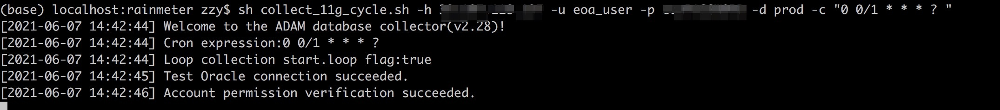

   - 12c（cdb模式）及以上

     ```text
     sh collect_12c_cycle.sh –h <ip> -u <username> -p <password> -d <service_name> -s <sid> -c <cron>
     ```

     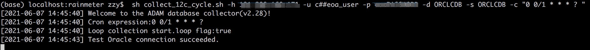

   > **说明**
   >
   > 上述命令各参数解释如下：
   >
   > - -h: 采集数据库的IP地址。
   >
   > - -u: 采集用户 eoa_user。
   >
   > - -p: 采集用户 eoa_user 密码 eoaPASSW0RD。
   >
   > - -P: 采集数据库的端口，如：1521。
   >
   > - -d: 采集数据库的服务名, 12c 是指特定 PDB 的服务名。
   >
   > - -s: 采集数据库实例名，只对 12c 有用。
   >
   > - -c: cron表达式，用来指定采集的周期性。

5. 在迁云实验室的**SQL周期性采集**区域，单击 **详情**。

6. 单击**创建项目**。

7. 在**创建周期性采集项目**面板中，输入项目名和数据库类型，单击**上传**，将本地采集的out/data.zip上传。

8. 单击目标项目号右侧**操作**列中的**详情**，查看采集结果。

<a id="section-6-5-5-2"></a>

#### 6.5.5.2. SQL对比测试

本文介绍ADAM SQL对比测试平台的使用。

**背景信息**

ADAM SQL对比测试平台是基于Jmeter测试引擎构建的数据库测试平台，在ADAM产品使用过程中留存的所有SQL都可以纳入对比测试的范围。目前可以支持SQL测试集的构建，测试任务的创建、执行，及测试结果的查看。

**操作步骤**

1. 登录DMS控制台。

2. 在顶部菜单栏中，选择**集成与开发（DTS） > 迁移实验室**，进入**迁移实验室**功能页面。

3. 在**SQL对比测试**区域，单击**开始测试**。

4. 单击**新建SQL对测集**。

5. 在**新建SQL对测集**面板中，输入**对测集名称**，并配置以下信息。

   <ol type="i">

   <li>

   配置源库信息后，单击**测试链接**，测试源库连通性。

   | 配置项 | 说明 |
   | --- | --- |
   | 数据库类型 | 选择源库数据库类型。 |
   | 实例区域 | 选择离源库地理位置最近的地域。 |
   | 实例类型 | 系统默认选择<strong>有公网IP数据库</strong>。 |
   | 主机IP | 输入源库主机IP。 |
   | 源库标识 | 选择源库标识：<br>• 服务名<br>• SID |
   | 数据库名 | 输入源库数据库名 |
   | 端口 | 输入源库端口。 |
   | 用户名 | 输入源库用户名 |
   | 口令 | 输入源库口令 |

   </li>

   <li>

   在目标库信息后，单击**测试链接**，测试目标库连通性。

   | 配置项 | 说明 |
   | --- | --- |
   | 数据库类型 | 选择目标库数据库类型。 |
   | 实例区域 | 选择离目标库地理位置最近的地域。 |
   | 实例类型 | 系统默认选择<strong>有公网IP数据库</strong>。 |
   | 主机IP | 输入目标库主机IP。 |
   | 数据库名 | 输入目标库数据库名 |
   | 端口 | 输入目标库端口。 |
   | 用户名 | 输入目标库用户名 |
   | 口令 | 输入目标库口令 |

   - 数据库名：输入目标数据库的名称。

   - 端口：输入目标数据库的端口。

   - 用户名：输入目标数据库的用户名。

   - 口令：输入目标数据库口令对应的密码。

   </li>

   <li>

   选择**数据库评估**。数据库评估是在数据库评估阶段所做的画像项目的选择。

   </li>

   <li>

   SQL源配置。选择周期性采集和Adapter。

   </li>

   <li>

   单击**创建**，等待后台任务执行完成。

   </li>

   </ol>

6. SQL对测任务。

   <ol type="i">

   <li>

   在**SQL对测集列表**页面，在**操作**列单击**详情**，查看该SQL对测集下的SQL。

   </li>

   <li>

   在**SQL对测集详情列表**页面，通过左侧的多选框选择想要进行对比测试SQL，选择的时候请甄别SQL是否兼容，参考列表的**是否兼容**列的标签，不兼容的SQL不要选择作为对测任务的SQL。

   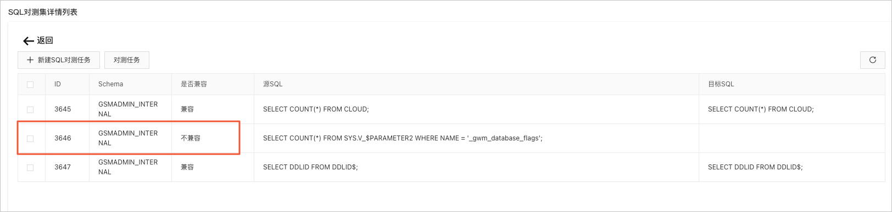

   </li>

   <li>

   单击**新建SQL对测任务**，输入自定义任务名，线程数，循环次数，选择测试类型为**对比测试**。单击**创建**按钮。

   > **说明**
   >
   > 线程数可设置最大为10000，循环次数可设置最大为10000，否则创建将失败。

   </li>

   </ol>

7. 执行SQL对测任务。单击**操作**列中的**启动**，任务的状态变为**执行中**。

   任务执行完成后，状态变为**执行成功**或**执行失败**。

   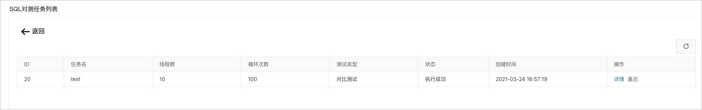

8. 查看SQL对测结果。

   单击**详情**，查看对比测试结果。

<a id="section-6-5-5-3"></a>

#### 6.5.5.3. SQL Adapter使用说明

SQL Adapter可以自动转换PolarDB与Oracle之间有差异的SQL，降低应用迁移到PolarDB后的改造代价。本文介绍SQL Adapter的使用方法。

**功能介绍**

- 无需修改业务代码，快速验证PolarDB功能。

- 可以捕获应用发出的全部SQL，并提供自动转换和改造建议。

- 对于无法自动转换的SQL，可以先配置在Adapter上验证SQL正确性。

**环境部署**

部署前请确保已安装ADAM软件版V5.0。

1. 登录DMS控制台。

2. 在顶部菜单栏中，选择**集成与开发（DTS） > 迁移实验室**，进入**迁移实验室**功能页面。

3. 在**ADAM SQL Adapter**区域，单击**申请**。

   下载后，使用如下命令解压软件包。

   ```bash
   tar -xvf adam-adapter.tar.gz
   ```

4. 配置ADAM软件版数据库和目标库（PolarDB）。

   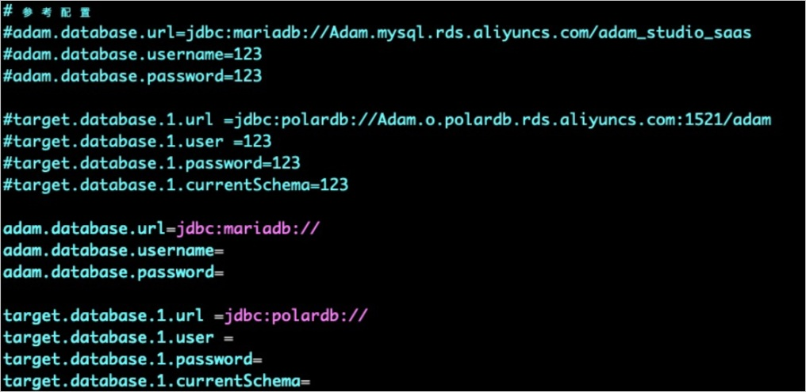

   > **说明**
   >
   > 如果应用有多个账户在使用，可以使用target.databases.2 增加配置项。

5. 启动。

   ```text
   sh run.sh start
   ```

6. 重启。

   ```text
   sh run.sh restart
   ```

7. 停止服务。

   ```text
   sh run.sh stop
   ```

8. 启动脚本的自定义配置。

   - 默认启动端口号是8888 ， 直接修改端口号即可。

   - type指自定义规则的生效办法， 默认是CACHE，即启动后规则全部加载，但新录入规则需要重启SQL Adapter。

   - RUNTIME模式是规则实时录入进行转换，但可能影响SQL执行的效率。

   ```text
   curr_dir=$(pwd)
   port=8888

   # type is CACHE/Runtime
   type=CACHE
   ```

**Adapter使用步骤**

1. 应用代码改造。

   修改应用使用的JDBC Driver ，并将JDBC配置修改成SQL Adapter的地址 。SQL Adapter不会处理用户的密码，因此用户名和密码不需要修改。

2. 登录DMS控制台。

3. 在顶部菜单栏中，选择**集成与开发（DTS） > 迁移实验室**，进入**迁移实验室**功能页面。

4. 单击**详情**，查看需要修改的SQL列表。

   兼容型分为：不兼容、兼容、修改后兼容。对于不兼容、修改后兼容，需要用户去改造SQL。

   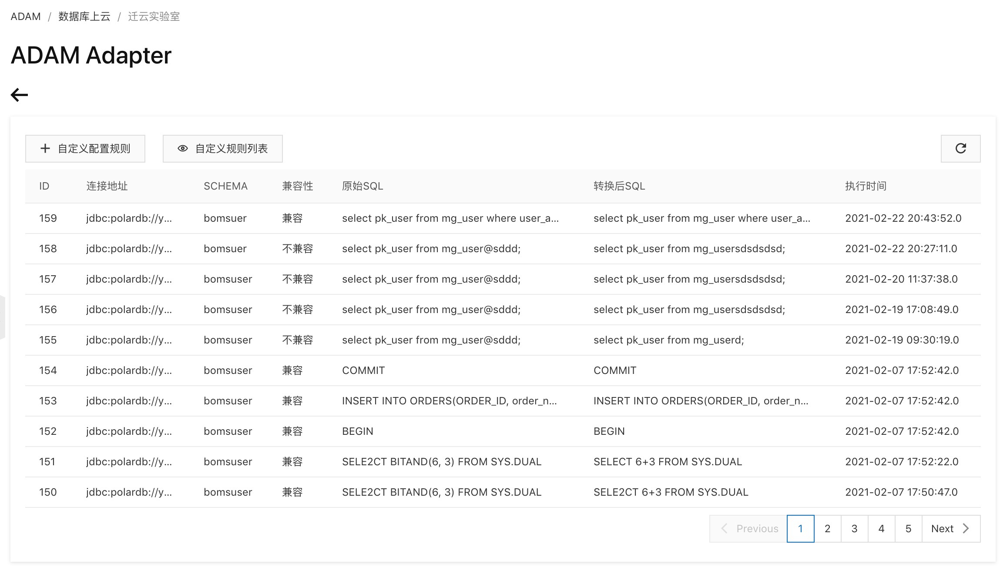

5. 单击**自定义配置规则**，配置自定义规则。

   各参数含义如下：

   <table>
     <tr>
       <th width="138">参数</th>
       <th>含义</th>
     </tr>
     <tr>
       <td>自定义规则类型</td>
       <td>• 文本类型：通过文本匹配用户配置的规则。<br>• 正则替换：通过正则匹配规则那个替换。</td>
     </tr>
     <tr>
       <td>匹配文本</td>
       <td>需要匹配或正则规则。</td>
     </tr>
     <tr>
       <td>替换文本</td>
       <td>匹配后替换的文本。</td>
     </tr>
     <tr>
       <td>生效范围</td>
       <td>• 全局生效：所有遇到的SQL都会进行规则匹配和替换。<br>• 指定SQL替换：只有这个SQL进行替换。</td>
     </tr>
   </table>

6. 单击**自定义规则列表**，查看规则列表。

   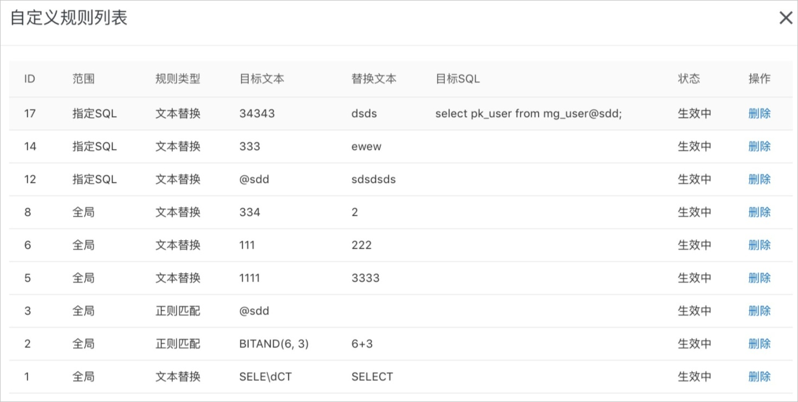

**注意事项**

- SQL Adapter端口号需要开放以便应用可以访问。

- 默认配置的是CACHE模式的自定义规则策略，如果边测边改应用推荐修改成RUNTIME模式进行使用。

- SQL Adapter目前记录所有转发过的SQL，但运行过程中同样的SQL只记录一次。

- 规则生效不针对Call相关语法。

<a id="section-6-5-6"></a>

### 6.5.6. SQL转化

ADAM的SQL转化工具可以将Oracle、Teradata、Db2语句转化为MySQL、PolarDB O引擎、AnalyticDB PostgreSQL版语句。

**操作步骤**

1. 登录DMS控制台。

2. 在顶部菜单栏中，选**集成与开发(DTS) > SQL转换**。

3. 选择源SQL类型。支持的源SQL：Oracle、Teradata、DB2。

4. 选择转化后的目标SQL类型。支持的目标SQL：MySQL、PolarDB O引擎、AnalyticDB PostgreSQL版。

5. 输入符合源SQL规范的SQL语句。

6. 单击**转化源SQL**。在页面右侧，查看转化后的SQL语句。

<a id="section-7"></a>

# 7.安全与规范

<a id="section-7-1"></a>

## 7.1. 权限

<a id="section-7-1-1"></a>

### 7.1.1. 管理权限

您可以申请某个数据库、表、列等具体操作权限（查询、变更或导出），数据Owner审核通过后即可执行相应的操作。

**权限说明**

- 查询：对应授权对象在SQLConsole中执行查询语句的权限。

- 变更：对应授权对象的数据变更、库表同步工单的提交权限（非直接变更）。

- 导出：对应授权对象的数据导出工单的提交权限（非直接导出）。

**管控粒度及支持的管控模式**

<table>
  <tr>
    <th rowspan="2">管控粒度</th>
    <th rowspan="2">权限说明</th>
    <th colspan="3">管控模式</th>
  </tr>
  <tr>
    <td>自由操作</td>
    <td>稳定变更</td>
    <td>安全协同</td>
  </tr>
  <tr>
    <td>实例-登录</td>
    <td>用户在获取实例登录权限后，通过数据库账号密码访问数据库实例。</td>
    <td>√</td>
    <td>√</td>
    <td>×</td>
  </tr>
  <tr>
    <td>库-权限</td>
    <td>分查询、导出、变更三种类型，有整个库内非敏感字段、非行级管控表的所有权限，包含后续新增表。<br>• 查询：可以通过SQLConsole执行SQL查看数据。<br>• 变更：对应数据变更、数据导入工单提交权限。<br>• 导出：对应数据导出工单提交权限。</td>
    <td>×</td>
    <td>×</td>
    <td>√</td>
  </tr>
  <tr>
    <td>表-权限</td>
    <td>分查询、导出、变更三种类型，有整个表内非敏感字段的所有权限。<br>• 查询：可以通过SQLConsole执行SQL查看数据。<br>• 变更：对应数据变更、数据导入工单提交权限。<br>• 导出：对应数据导出工单提交权限。</td>
    <td>×</td>
    <td>×</td>
    <td>√</td>
  </tr>
  <tr>
    <td>敏感列-权限</td>
    <td>分查询、导出、变更三种类型，有整个表内包含敏感字段的所有权限。必须在有库、表权限的情况下额外申请开通。<br>• 查询：可以通过SQLConsole执行SQL查看数据。<br>• 变更：对应数据变更、数据导入工单提交权限。<br>• 导出：对应数据导出工单提交权限。</td>
    <td>×</td>
    <td>×</td>
    <td>√</td>
  </tr>
  <tr>
    <td>库-OWNER</td>
    <td>• 可对名下数据库的权限进行管理，如授予、回收库或表权限。<br>• 可直接查询名下数据库中的数据（不包含敏感和机密字段）、直接提交各类数据方案与库表结构的工单。<br>• 对应于审批节点中<strong>动态计算</strong>的owner节点。</td>
    <td>×</td>
    <td>×</td>
    <td>√</td>
  </tr>
  <tr>
    <td>表-OWNER</td>
    <td>• 可对名下表的权限进行管理，如授予、回收表授权。<br>• 可直接查询名下表中的数据（不包含敏感和机密字段）。</td>
    <td>×</td>
    <td>×</td>
    <td>√</td>
  </tr>
  <tr>
    <td>可编程对象</td>
    <td>分查询、导出、变更三种类型。<br>• 查询：可以通过SQLConsole执行SQL查看数据。<br>• 变更：对应数据变更、数据导入工单提交权限。<br>• 导出：对应数据导出工单提交权限。</td>
    <td>×</td>
    <td>×</td>
    <td>√</td>
  </tr>
  <tr>
    <td>实例-性能</td>
    <td>针对安全协同的数据库实例，用户拥有此授权才可以跳转查看数据库的性能相关服务。</td>
    <td>×</td>
    <td>×</td>
    <td>√</td>
  </tr>
  <tr>
    <td>实例-OWNER</td>
    <td>• 可对名下实例的权限进行管理，如授予、回收实例权限。<br>• 可直接查询名下实例中所有数据库中的数据（不包含敏感和机密字段）、直接提交各类数据方案与库表结构的工单。</td>
    <td>×</td>
    <td>×</td>
    <td>√</td>
  </tr>
  <tr>
    <td>行-权限</td>
    <td>分查询、导出、变更三种类型，可对表上管控字段的不同取值分别进行管控。也可申请管控字段所有取值的权限。<br>• 查询：可以通过SQLConsole执行SQL查看数据。<br>• 变更：对应数据变更、数据导入工单提交权限。<br>• 导出：对应数据导出工单提交权限。</td>
    <td>×</td>
    <td>×</td>
    <td>√</td>
  </tr>
</table>

**申请权限**

若您同时申请多个权限，系统将以Owner、DBA维度拆分工单，拆分后，所有工单需要全部通过审批，对应权限才可申请成功。

1. 登录DMS控制台。

2. 在顶部菜单栏中，选择**安全与规范 > 权限**。

   > 您也可以在顶部的搜索栏中，输入待申请权限的数据库名或表名，在搜索结果中，找到
   >
   > **说明**
   >
   > 对应的库或表，单击**操作**列的**权限申请**。

3. 单击**权限申请**，选择目标权限类型。各类权限的说明，请参见管控粒度及支持的管控模式。

4. 配置待申请的权限信息。

   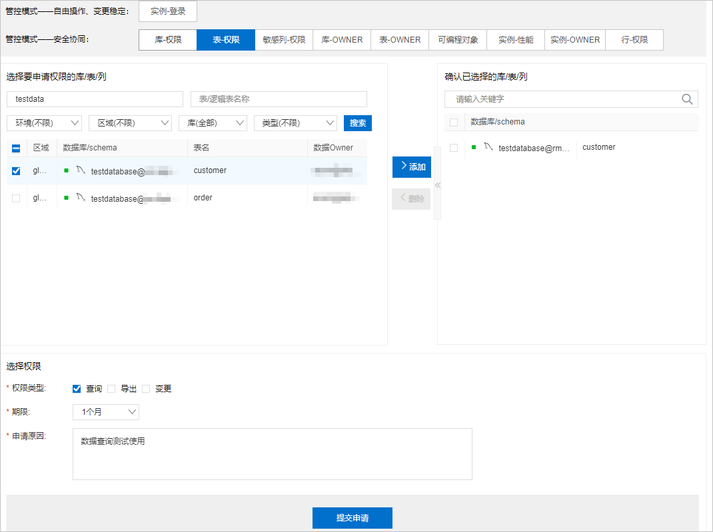

   <ol type="i">

   <li>

   添加申请权限的对象，例如库、表或列。输入关键字检索库名或表名，勾选需要授权的对象，单击**添加**，加入**确认已选择的实例**。

   > 支持通配符%检索。
   >
   > **说明**

   </li>

   <li>

   选择权限类型与期限，填写申请原因。

   </li>

   </ol>

5. 单击**提交申请**，等待审批通过。您可以在**工作台**首页，查看权限申请工单的审核进度。

**管理权限**

| 管理类型 | 操作 | 说明 |
| --- | --- | --- |
| 主动管理 | 释放权限 | 在工作台首页的右侧，单击<strong>有权限的资产</strong>，选择对应的权限类型，单击<strong>释放权限</strong>。 |
| 被动管理 | 无 | 数据Owner可以随时查看并评估权限分配的合理性，管理用户的权限。 |

> 所有权限申请、权限释放、回收、授权等操作均会记录至操作日志中，您可以在顶部导航
>
> **说明**
>
> 栏，单击**安全与规范 > 操作审计**中进行查看。

<a id="section-7-1-2"></a>

### 7.1.2. 创建权限模板

通过创建权限模板可以对具有相同业务属性的实例、库、表等进行统一管理，然后批量授权给用户，解决由于用户和数据库数量较多、搜索不便，导致不易寻找到目标和数据库重复授权的问题。

**前提条件**

系统角色为DBA、管理员或安全管理员。

**操作步骤**

1. 登录DMS控制台。

2. 在DMS控制台首页的顶部菜单栏中，选择**安全与规范 > 权限中心 > 权限模板**。

3. 单击**创建权限模板**。

4. 在**创建权限模板**对话框中，填写**模板名称**和**描述**后，单击**确认**。

   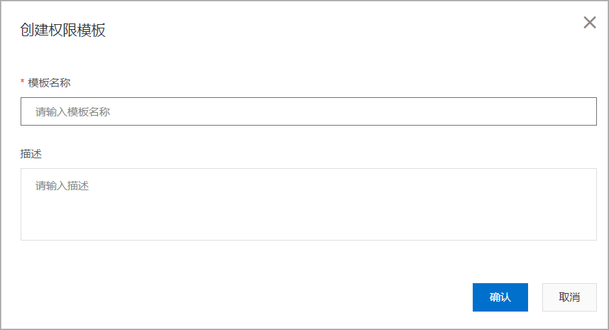

5. 添加资源。添加资源有以下两种途径：

   - 在权限模板列表页单击**模板名称**或**操作**列下的**管理**，进入模板详情页，选择**资源管理**页签，单击**添加资源**，在搜索框中搜索并选中一个或多个目标实例、目标数据库和表资源。

     > **说明**
     >
     > - 请先添加目标库，再添加目标表。
     >
     > - 仅支持安全协同模式的实例添加库表级权限。

   - 在实例管理页将实例添加至权限模板，具体操作如下：

     <ol type="a">

     <li>

     在控制台顶部导航栏中，选择**数据资产 > 实例管理**。

     </li>

     <li>

     在搜索框中搜索并选中目标实例或目标数据库（可多选），单击**加入权限模板**。

     </li>

     </ol>

     <ol type="i" start="100">

     <li>

     选择已有的权限模板，单击**保存**，或新增权限模板后再选择加入。

     </li>

     </ol>

   > 若添加资源有误，您可以在模板详情页单击**资源管理**页签，选择并单击目标实例行的**移**
   >
   > **说明**
   >
   > **出**，移出资源。

6. 给用户授权。有以下两种途径：

   - 在模板详情页单击**授权记录**，完成添加授权用户（可多选）、设置有效期时长。

     > 您可以在模板详情页单击**授权记录**页签，查看授权人员、权限类型等信息。
     >
     > **说明**

   - 在用户管理页完成授权，具体操作如下：

     <ol type="a">

     <li>

     在控制台顶部导航栏中，选择**运维管理 > 用户管理**。

     </li>

     <li>

     选中您需要授权的用户，单击**授权用户**（可多选）。

     </li>

     </ol>

     <ol type="i" start="100">

     <li>

     选择**权限模板授权**，选择权限模板和过期时间，单击**确认**。

     </li>

     </ol>

   > 可给用户追加授权，同一权限类型下，新授权的权限会覆盖已有权限的过期时间。
   >
   > **说明**

**其他操作**

**编辑模板基本信息**

在权限模板详情页，单击编辑，修改模板名称和描述信息。

> 若权限模板被修改，不影响已授权的用户操作。
>
> **说明**

**创建类似模板**

> **类似创建**可以创建权限模板，且与原模板的资源数量相同。
>
> **说明**

1. 在**权限模板**页，选择目标模板行，单击**操作**列下的**类似创建**。

2. 输入**模板名称**、**描述**信息。

3. 单击**确认**。

**删除模板**

在权限模板列表页，选择目标模板行，单击**操作**列下的**删除**。

<a id="section-7-2"></a>

## 7.2. 安全规则

<a id="section-7-2-1"></a>

### 7.2.1. 管理安全规则

安全规则是通过一组DSL语言实现的针对不同数据库类型、不同数据库操作语法、不同数据库影响行数等一系列控制点的规则集合，可以实现操作规范、研发流程、审批流程的按需定义。本文介绍安全规则的常规管理步骤。

**前提条件**

执行该操作的用户角色为DBA或管理员。

**操作步骤**

1. 登录DMS控制台。

2. 在顶部菜单栏中，选择**安全与规范 > 安全规则**。

3. 根据业务需求，选择执行下述步骤。

   - 新增规则集

     单击**新增规则集**，在弹出对话框中配置引擎类型、规则集名称和备注信息，然后单击**提交**。

   - 编辑规则集

     <ol type="a">

     <li>

     定位至目标规则集，单击**操作**栏中的**编辑**。

     </li>

     <li>

     单击左侧的目标规则子集（例如**SQL窗口**），然后在页面右侧单击目标检测点。

     </li>

     </ol>

     <ol type="i" start="100">

     <li>

     找到目标规则名称，单击**编辑**进行调整，相关语法请参见安全规则DSL语法。

     > 您还可以对目标规则执行禁用、启用或删除操作。
     >
     > **说明**

     </li>

     </ol>

   - 创建类似规则集

     <ol type="a">

     <li>

     定位至目标规则集，单击**操作**栏中的**类似创建**。

     </li>

     <li>

     在弹出的对话框中配置规则集名称和备注信息。

     </li>

     </ol>

     <ol type="i" start="100">

     <li>

     单击**提交**，系统会将该规则集的配置克隆至新规则集。

     </li>

     </ol>

   - 删除规则集

     定位至目标规则集，单击**操作**栏中的**删除**，然后在弹出的对话框中单击**确认**。

     > **说明**
     >
     > - 规则集删除后将无法恢复，请谨慎操作。
     >
     > - 仅支持删除自定义的规则集，无法删除系统自带的规则集。

   - 设置为缺省规则集定位至目标规则集，单击**设为缺省**，然后在弹出的对话框中单击**确认**，该规则集将会作为该数据库引擎的缺省规则集。

     > 此操作存在较大风险，请谨慎操作。
     >
     > **重要**

<a id="section-7-2-2"></a>

### 7.2.2. 安全规则DSL语法

DMS定义了一套领域专用语言DSL（Domain Specific Language）用来描述安全规则。DSL语法非常灵活，可以表述任意安全规则，从而帮助不同企业定义符合自己的研发规范。

**DSL语法概述**

DSL语法由分支判断（IF-ELSE）、条件和动作三部分组成。

> if语句是必须的，elseif可以有0个或多个，else可以有0个或1个。
>
> **说明**

示例1：当满足条件1，系统就执行动作1。

```text
if
    条件1
then
    动作1
end
```

示例2：如果满足条件1，就执行动作1；不满足条件1时如果满足条件2，就执行动作2；否则就执行动作3。

> `[else` 动作`3]` 也可以没有，即不满足条件2时，不执行任何操作。
>
> **说明**

```text
if
    条件1
then
    动作1
elseif
    条件2
then
    动作2
[else 动作3]
end
```

**DSL语法详细介绍**

- 条件语句

  条件其实就是判断语句，用来判定true或false。条件语句由连接符（and或or）、操作符、因子（系统变量）组成。以下示例都是合法的条件语句。

  ```text
  1. true                    // 最简单的条件语句，结果为true。
  2. 1 > 0
  3. 1 > 0 and 2 > 1
  4. 1 <= 0 or 1 == 1
  ```

- 连接符

  and表示与运算，or表示或运算，and比or优先级高，但它们都比操作符的优先级低。例如 `1 <= 0 or 1 == 1` 语句，最先执行 `1 <= 0` 判断，然后执行 `1 == 1` 判断，最后执行or判断。

- 操作符

  操作符用于连接因子（系统变更）、常量进行相关逻辑运算，目前支持的操作符如下。

  | 操作符 | 名称 | 使用示例 |
  | --- | --- | --- |
  | == | 等于 | 1 == 1 |
  | != | 不等于 | 1 != 2 |
  | &gt; | 大于 | 1 &gt; 2 |
  | &gt;= | 大于等于 | 1 &gt;= 2 |
  | &lt; | 小于 | 1 &lt; 2 |
  | &lt;= | 小于等于 | 1 &lt;= 2 |
  | in | 包含于 | ‘a’ in \[‘a’, ‘b’, ‘c’\] |
  | not in | 不包含于 | ‘a’ not in \[‘a’, ‘b’, ‘c’\] |
  | matchs（验证工具） | 正则匹配 | ‘idxaa’ matchs ‘idx\\w+’ |
  | not matchs | 不匹配 | ‘idxaa’ not matchs ‘idx\\w+’ |
  | isBlank | 为空 | ‘’ isBlank |
  | isNotBlank | 不为空 | ‘’ isNotBlank |

  > **说明**
  >
  > - 正则表达式中的反斜线（\\）需要另外一个反斜线（\\）转义，例如： `idx_\w+` 需要写成 `idx_\\w+` 。
  >
  > - 如果条件语句较为复杂时，建议将需要先判断的部分放在括号内。例如 `1 <= 2 == true` 执行顺序不明确，可改为 `(1 <= 2) == true` ，此时会先执行 `(1 <= 2)` 。

- 因子

  因子是系统内置变量，可用来获取安全规则校验的上下文信息，例如获取SQL类型、影响行数等。因子名称以 `@fac.` 为前缀，每个模块的不同检测点均提供不同因子，各因子的含义请参见下表。

  | 因子名 | 说明 |
  | --- | --- |
  | @fac.env_type | 环境类型，值为环境标识，如dev、product。 |
  | @fac.sql_type | SQL脚本的类型，如UPDATE、INSERT。详情请参见SQLConsole中对于SQL子类的描述。 |
  | @fac.detail_type | 数据变更的种类，具体如下所示。<br>• COMMON：普通数据变更。<br>• CHUNK_DML：无锁数据变更。<br>• PROCEDURE：存储过程。<br>• CRON_CLEAR_DATA：定时清理表。<br>• BIG_FILE：批量数据导入。 |
  | @fac.is_logic | 是否为逻辑库。 |
  | @fac.extra_info | 其他变更信息（暂无用途）。 |
  | @fac.is_ignore_affect_rows | 是否跳过校验。 |
  | @fac.insert_rows | 插入数据的影响行数。 |
  | @fac.update_delete_rows | 更新数据的影响行数。 |
  | @fac.max_alter_table_size | 修改表中，最大的表空间大小。 |
  | @fac.is_has_security_column | SQL脚本中是否包含敏感列。 |
  | @fac.security_column_list | SQL脚本中包含的敏感列列表。 |
  | @fac.risk_level | 识别到的风险级别。 |
  | @fac.risk_reason | 识别为该风险的原因。 |

  > 在条件语句中，可直接引用因子，例如 `@fac.sql_type == 'DML'` ，可用来判断SQL
  >
  > **说明**
  >
  > 类型是不是DML。

- 动作语句

  动作是满足if条件之后系统执行的行为。例如：禁止提交工单、选择工作流、允许执行、拒绝执行等，这些动作表达了安全规则的主要目的。动作名称以 `@act.` 为前缀，每个模块的不同检测点均提供不同动作，各动作的含义请参见下表。

  **动作名**

  **说明**

  必须提交工单执行。

  @act.allow_submit

  允许直接在SQL控制台执行。

  @act.allow_execute_direct

  禁止执行。

  @act.forbid_execute

  标记风险，例如 `@act.mark_risk 'middle' '`中

  @act.mark_risk

  风险：线上环境`'` 。

  @act.do_not_approve

  指定审批模板ID。

  @act.choose_approve_template

  @act.choose_approve_template_with_reason

- 内置函数

  安全规则内置部分函数，在条件语句和动作语句均可以使用。函数名以 `@fun.` 为前缀。

  | 函数名 | 说明 | 示例 |
  | --- | --- | --- |
  | @fun.concat | 拼接字符串。返回值：字符串。参数：任意多个字符串。 | @fun.concat(‘d’, ‘m’, ‘s’) //‘dms’@fun.concat(‘\[研发规范\]字段\[‘, @fac.column_name, ‘\]必须要填写备注信息’) // 拼接友好的提示信息返回给用户。 |
  | @fun.char_le ngth | 计算字符串的长度。返回值：整数。参数：一个字符串。 | @fun.char_length(‘dms’) //3@fun.char_length(@fac.table_name) // 计算表名长度。 |
  | @fun.is_char_lower | 判断字符串是否都是小写。返回值：true或false。参数：一个字符串。 | @fun.is_char_lower(‘dms’) //true@fun.is_char_lower(@fac.table_name) // 返回true的话，表名都是小写。 |
  | @fun.is_char_upper | 判断字符串是否都是大写。返回值：true或false。参数：一个字符串。 | @fun.is_char_upper(‘dms’) //false@fun.is_char_upper(@fac.table_name) // 返回true的话，表名都是大写。 |
  | @fun.array_si ze | 计算集合的大小。返回值：整数。参数：一个集合。 | @fun.array_size(\[1, 2, 3\]) //3@fun.array_size(@fac.table_index_array) // 计算表索引的个数。 |
  | @fun.add | 多个数相加。返回值：数值。参数：任意多个数。 | @fun.add(1, 2, 3) // 6 |
  | @fun.sub | 两个数相减。返回值：数值。参数：2个数值。 | @fun.sub(6, 1) // 5 |
  | @fun.betwee n | 是否在某区间（支持数值、日期时间比较），判断时包含边界值。返回值：true或false。参数：3个参数，第一个是目标值，第二个是左区间，第三个是右区间。 | @fun.between(1, 1, 3) // 判断1是否在1~3区间内，返回true。@fun.between(2, 1, 3) // 判断2是否在1~3区间内，返回true。@fun.between(7, 1, 3) //判断7是否在1~3区间内，返回false。@fun.between(@fac.export_rows, 2001,<br>100000) // 判断导出行数的范围。@fun.between(@fun.current_datetime(), ‘2019-10-31 00:00:00’, ‘2019-11-04 00:00:00’) // 判断当前时间是否在10.31~11.04号之间。@fun.between(@fun.current_date(), ‘2019-10-31’, ‘2019-11-04’) // 判断当前日期是否在10.31~11.04号之间。@fun.between(@fun.current_time(), ‘13:30:00’, ‘23:59:59’) // 判断当前时间是否在13.30~23.59之间。 |
  | @fun.current _datetime | 获取当前日期时间，格式：yyyy-MM-dd HH:mm:ss。返回值：字符串。参数：无。 | @fun.current_datetime() // 当前日期时间，例如：2019-10-31 00:00:00。 |
  | @fun.current _date | 获取当前日期，格式：yyyy-MM-dd。返回值：字符串。参数：无。 | @fun.current_date() // 当前日期，例如：2020-01-13。 |
  | @fun.current _time | 获取当前时间，格式：HH:mm:ss。返回值：字符串。参数：无。 | @fun.current_time() // 当前时间，例如：19:43:20。 |

**DSL配置案例**

控制单次执行SQL个数：如果SQL的数量大于1000条时，DMS将拒绝执行并返回相应的提示给用户。

```text
if
    @fac.sql_count > 1000
then
    @act.reject_execute '单次执⾏SQL个数不能超过1000'
else
    @act.allow_execute
end
```

只允许提交DML语句：如果提交的SQL是DML语句（例如UPDATE、DELETE、INSERT）则允许执行。

```text
if
    @fac.sql_type in [ 'UPDATE','DELETE','INSERT','INSERT_SELECT']
then
    @act.allow_submit
end
```

<a id="section-7-2-3"></a>

### 7.2.3. 安全规则附录

<a id="section-7-2-3-1"></a>

#### 7.2.3.1. 安全规则集概述

安全规则集是通过一组DSL语言实现的针对不同数据库类型、不同数据库操作语法、不同数据库影响行数等一系列控制点的规则集合，可以实现操作规范、研发流程、审批流程的按需定义。

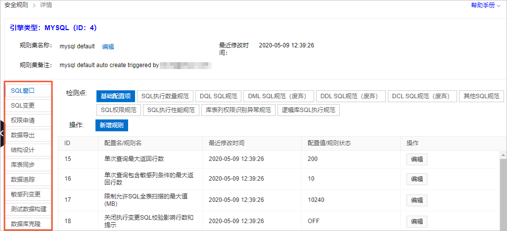

本文汇总了安全规则集支持的模块的信息，您可以单击下述列表中对应的模块名跳转至各模块的介绍，详细了解各模块对应的基础配置项目、检测点、因子、动作及支持的命令等信息。

- SQL窗口（关系型数据库）

- SQL窗口（MongoDB）

- SQL窗口（Redis）

- SQL变更

- 权限申请

- 数据导出

- 结构设计

- 库表同步

- 敏感列变更

- 测试数据构建

- 数据库克隆

<a id="section-7-2-3-2"></a>

#### 7.2.3.2. 管理检测点规则

本文介绍检测点规则的配置方法。

**操作步骤**

本文以引擎类型为MySQL的安全规则集为例介绍配置流程。

1. 登录DMS控制台。

2. 在顶部菜单栏中，选择**安全与规范 > 安全规则**。

3. 找到目标安全规则集，单击**操作**列的**编辑**。

4. 根据业务需求单击左侧对应的页签，然后单击对应的检测点。例如，在页面左侧单击**SQL窗口**，然后在页面上方单击**SQL执行数量规范**。

   > **说明**
   >
   > - 关于各个页签以及对应的检测点说明，请参见安全规则集概述。
   >
   > - 您可以单击**新增规则**来自定义一个新的规则，相关语法请参见安全规则DSL语法。

5. 找到目标规则名，单击**操作**列的**编辑**。

   除**编辑**外，您还可以单击**禁用**、**启用**和**删除**对目标规则进行管理。

   > 安全规则被删除后不可恢复，请谨慎操作。
   >
   > **说明**

6. 在弹出的对话框中，根据业务需求调整规则DSL，相关语法请参见安全规则DSL语法。例如，将单次执行的SQL个数从默认的1000调整为500。

   > **说明**
   >
   > - 每个检测点均内置了大量的安全规则模板，您可以单击**从模板库加载**来使用这些模板。
   >
   > - 关于因子和动作的介绍，请参见安全规则集概述。

7. 单击**提交**。

<a id="section-7-2-3-3"></a>

#### 7.2.3.3. SQL窗口（关系型数据库）

DMS提供的SQL窗口支持关系型数据库和非关系型数据库，安全规则的定义和分类各不相同。本文介绍关系型数据库（例如MySQL）的SQL窗口安全规则。

**默认规则说明**

- SQL类型限制：查询类的SQL不限制，针对DML（不含查询类SQL）、DDL和DCL以及其他一些系统未识别的SQL均会默认拦截不予执行。如果您需要在此处执行DML、DDL或DCL命令，则需要自行设置并启用相应安全规则使这些SQL可以被顺利执行。

- 库、表、列权限限制：默认行为不限制，如果您需要控制库、表、敏感字段等权限，请在**SQL权限规范**检查点中设置并启用规则，详情请参见支持的检测点。

**基础配置项**

| 配置名 | 说明 |
| --- | --- |
| 单次查询最大返回行数 | 单次查询结果的最大返回行数。 |
| 单次查询包含敏感列条件的最大返回行数 | 查询包含敏感列条件时，查询结果的最大返回行数。 |
| 限制允许SQL全表扫描的最大值（MB） | 在查询SQL执行前检查执行计划，如果扫描大小超过此阈值，则拒绝SQL执行。<br>仅对数据类型为MySQL和Oracle的实例生效。说明 |
| 关闭执行变更SQL校验影响行数和提示 | 是否关闭执行变更SQL预校验影响行数和提示，默认为不关闭。 |
| 结果集翻页支持最多翻多少行 | 查询的结果集最多支持翻多少行记录。 |
| 结果集是否支持翻页 | 是否可以对查询的结果集执行翻页操作。 |
| 结果集是否支持编辑 | 是否可以编辑查询的结果集。 |
| 结果集是否支持导出 | 是否可以导出查询的结果集。 |

**支持的检测点**

> 每个检测点内置了大量的安全规则模板供您使用，您也可以根据需求新增规则。
>
> **说明**

<table>
  <tr>
    <th width="199">检测点</th>
    <th>说明</th>
  </tr>
  <tr>
    <td>SQL执行数量规范</td>
    <td>控制单次提交的SQL个数。</td>
  </tr>
  <tr>
    <td>DQL规范</td>
    <td>增加对DQL类型SQL执行的限制。</td>
  </tr>
  <tr>
    <td>其他DQL规范</td>
    <td>可对多种SQL的执行进行约束。由于每个企业对高危SQL的定义不同，可能包含部分DML种类、部分DCL种类，部分DDL种类的SQL。<br>说明对于DMS无法识别的SQL也可以在此进行约束。</td>
  </tr>
  <tr>
    <td>SQL权限规范</td>
    <td>对SQL执行权限执行约束，例如提交者是否拥有对应的库、表、列权限。</td>
  </tr>
  <tr>
    <td>SQL执行性能规范</td>
    <td>对SQL执行性能方面的约束，例如：DML影响行数超过阈值则拒绝执行；DDL涉及到的表空间超过阈值则拒绝执行等。</td>
  </tr>
  <tr>
    <td>库表列权限识别异常规范</td>
    <td>通常DMS会对用户提交的SQL进行语法解析并对访问的库、表、列资源进行权限校验。当复杂的SQL解析异常导致无法正常下发时，可通过配置本检测点中的规则，让SQL顺利执行。<br>说明<strong>库表列权限识别异常规范</strong>会导致SQL权限规范、SQL规范校验、SQL执行性能规范等安全规则失效。</td>
  </tr>
  <tr>
    <td>逻辑库SQL执行规范</td>
    <td>为逻辑库查询预留的检测点，不适用于物理库查询。</td>
  </tr>
</table>

**支持的因子**

因子是系统内置变量，可用来获取安全规则校验的上下文信息，例如获取SQL类型、影响行数等。因子名称以 `@fac.` 为前缀，SQL窗口（关系型数据库）支持的因子如下表所示。

<table>
  <tr>
    <th>因子名</th>
    <th>说明</th>
  </tr>
  <tr>
    <td>@fac.sql_count</td>
    <td>单次提交的SQL条数。</td>
  </tr>
  <tr>
    <td>@fac.select_sql_count</td>
    <td>单次提交的SQL中查询类SQL的条数。</td>
  </tr>
  <tr>
    <td>@fac.dml_sql_count</td>
    <td>单次提交的SQL中DML SQL的条数。</td>
  </tr>
  <tr>
    <td>@fac.sql_type</td>
    <td rowspan="2">分别为SQL分类和SQL子类，取值请参见支持的SQL命令。</td>
  </tr>
  <tr>
    <td>@fac.sql_sub_type</td>
  </tr>
  <tr>
    <td>@fac.env_type</td>
    <td>环境类型，值是环境标识，例如：DEV、PRODUCT。</td>
  </tr>
  <tr>
    <td>@fac.fulltable_delete</td>
    <td>当前SQL是否为全表DELETE，取值true或false。</td>
  </tr>
  <tr>
    <td>@fac.fulltable_update</td>
    <td>当前SQL是否为全表UPDATE，取值true或false。</td>
  </tr>
  <tr>
    <td>@fac.current_sql</td>
    <td>当前的SQL。</td>
  </tr>
  <tr>
    <td>@fac.user_is_admin</td>
    <td>当前用户是否为管理员，取值true或false。</td>
  </tr>
  <tr>
    <td>@fac.user_is_dba</td>
    <td>当前用户是否是DBA，取值true或false。</td>
  </tr>
  <tr>
    <td>@fac.user_is_inst_dba</td>
    <td>当前用户是否是当前实例的DBA，取值true或false。</td>
  </tr>
  <tr>
    <td>@fac.user_is_sec_admin</td>
    <td>当前用户是否是安全管理员，取值true或false。</td>
  </tr>
  <tr>
    <td>@fac.sql_affected_rows</td>
    <td>当前SQL执行的SQL影响行数。<br>警告由于因子会执行COUNT操作，可能对数据库性能带来一定影响，请谨慎使用。</td>
  </tr>
  <tr>
    <td>@fac.sql_relate_table_store_siz e</td>
    <td>当前SQL访问的表的预估空间，单位为MB。<br>说明使用的是采集之后的预估值，非真实值。</td>
  </tr>
</table>

**支持的动作**

动作是满足if条件之后系统执行的行为，例如禁止提交工单、允许执行、拒绝执行等，表达了安全规则的目的。动作名以 `@act.` 为前缀，SQL窗口（关系型数据库）中支持的动作请参见下表。

| 动作名 | 说明 |
| --- | --- |
| @act.reject_execute | 拒绝执行当前SQL。 |
| @act.allow_execute | 允许执行当前SQL。 |
| @act.reject_sql_type_execute | 拒绝执行特定类型的SQL，需要指定具体的SQL子类型，例如：<code> @act.reject_sql_type_execute 'UPDATE' </code>。 |
| @act.allow_sql_type_execute | 允许执行特定类型的SQL，需要指定具体的SQL子类型，例如：<code> @act.allow_sql_type_execute 'UPDATE' </code>。 |
| @act.check_dml_sec_column_p ermission | 检查有无敏感列权限，如果没有则不执行DML变更。 |
| @act.uncheck_dml_sec_column _permission | 不检查敏感列权限。 |
| @act.check_sql_access_permiss ion | 检查SQL操作权限，对访问的库、表、列是否有对应权限，例如查询或变更权限。 |
| @act.uncheck_sql_access_perm ission | 不检查SQL操作权限。 |
| @act.enable_sec_column_mask | 对无权限的敏感列进行数据脱敏。 |
| @act.disable_sec_column_mask | 不对无权限的敏感列进行数据脱敏。 |

**支持的SQL命令**

<table>
  <tr>
    <th width="93">SQL分类</th>
    <th>SQL子类</th>
  </tr>
  <tr>
    <td>DQL</td>
    <td>• SELECT<br>• DESC<br>• EXPLAIN<br>• SHOW</td>
  </tr>
  <tr>
    <td>DML</td>
    <td>• INSERT<br>• INSERT_SELECT<br>• REPLACE<br>• REPLACE_INTO<br>• UPDATE<br>• DELETE<br>• MERGE</td>
  </tr>
</table>

<table>
  <tr>
    <td>DDL</td>
    <td>• DATABASE_OP<br>• CREATE<br>• CREATE_INDEX<br>• CREATE_VIEW<br>• CREATE_SEQUENCE<br>• CREATE_TABLE<br>• CREATE_SELECT<br>• TRUNCATE<br>• DROP_INDEX<br>• DROP_VIEW<br>• DROP_TABLE<br>• RENAME<br>• ALTER<br>• ALTER_INDEX<br>• ALTER_VIEW<br>• ALTER_TABLE<br>• ALTER_SEQUENCE<br>• CREATE_FUNCTION<br>• CREATE_PROCEDURE<br>• ALTER_FUNCTION<br>• ALTER_PROCEDURE<br>• DROP_FUNCTION<br>• DROP_PROCEDURE</td>
  </tr>
  <tr>
    <td>DCL</td>
    <td>• GRANT<br>• DECLARE<br>• SET<br>• ANALYZE<br>• FLUSH<br>• OPTIMIZE<br>• KILL</td>
  </tr>
</table>

<a id="section-7-2-3-4"></a>

#### 7.2.3.4. SQL窗口（MongoDB）

DMS提供的SQL窗口支持关系型数据库和非关系型数据库，安全规则的定义和分类各不相同。本文介绍MongoDB数据库的SQL窗口安全规则。

**基础配置项**

- **单次查询最大返回行数**：定义查询结果最多返回行数（系统限制最多返回3000行）。

- **结果集是否支持导出**：执行查询SQL后的结果集是否支持导出。

**支持的检测点**

> 每个检测点内置了大量的安全规则模板供您使用，您也可以根据需求新增规则。
>
> **说明**

<table>
  <tr>
    <th>检测点</th>
    <th>说明</th>
  </tr>
  <tr>
    <td>用户权限检查</td>
    <td>定义是否检查用户的权限。</td>
  </tr>
  <tr>
    <td>集合命令规范</td>
    <td rowspan="7">定义是否允许执行各类MongoDB命令。</td>
  </tr>
  <tr>
    <td>DB命令规范</td>
  </tr>
  <tr>
    <td>查询缓存命令规范</td>
  </tr>
  <tr>
    <td>用户管理命令规范</td>
  </tr>
  <tr>
    <td>角色管理命令规范</td>
  </tr>
  <tr>
    <td>复制集命令规范</td>
  </tr>
  <tr>
    <td>分片命令规范</td>
  </tr>
</table>

**支持的因子**

因子是系统内置变量，可用来获取安全规则校验的上下文信息，例如获取SQL类型、影响行数等。因子名称以 `@fac.` 为前缀，SQL窗口（MongoDB）支持的因子如下表所示。

| 因子名 | 说明 |
| --- | --- |
| @fac.sql_sub_type | 具体的MongoDB命令，取值可参见支持的MongoDB命令。 |
| @fac.env_type | 环境类型，值是环境标识，例如：<code> DEV </code>、<code> PRODUCT </code>。 |
| @fac.current_sql | 当前的SQL。 |
| @fac.user_is_admin | 当前用户是否为管理员，取值true或false。 |
| @fac.user_is_dba | 当前用户是否是DBA，取值true或false。 |
| @fac.user_is_inst_dba | 当前用户是否是当前实例的DBA，取值true或false。 |
| @fac.user_is_sec_admin | 当前用户是否是安全管理员，取值true或false。 |

**支持的动作**

动作是满足if条件之后系统执行的行为，例如禁止提交工单、允许执行、拒绝执行等，表达了安全规则的目的。动作名以 `@act.` 为前缀，SQL窗口（MongoDB）中支持的动作请参见下表。

| 动作名 | 说明 |
| --- | --- |
| @act.reject_execute | 拒绝执行当前SQL。 |
| @act.allow_execute | 允许执行当前SQL。 |
| @act.reject_sql_type_execute | 拒绝执行特定SQL类型的SQL，动作后需要指定具体的SQL子类型，例如：<code> @act.reject_sql_type_execute 'UPDATE' </code>。 |
| @act.allow_sql_type_execute | 允许执行特定SQL类型的SQL，需要指定具体的SQL子类型。 |

**支持的MongoDB命令**

| 命令大类 | 命令子类 | 具体命令 |
| --- | --- | --- |

- aggregate

- find

- findOne

- count

- distinct

- getIndexes

查询命令

- getShardDistribution

- isCapped

- stats

- dataSize

- storageSize

- totalIndexSize

- totalSize

- insert

- save

数据更新命令

- findAndModify

- remove

- update

- drop

集合修改命令

- renameCollection

- createIndex

集合命令

- createIndexes

索引修改命令

- dropIndexes

- reIndex

其他命令

validate

- commandHelp

- currentOp

- getCollectionInfos

- getCollectionNames

- getLastError

- getLastErrorObj

- getLogComponents

- getPrevError

- getProfilingStatus

- getReplicationInfo

数据库查询命令

- getSiblingDB

- help

- isMaster

- listCommands

- printCollectionStats

数据库命令

- printReplicationInfo

- version

- serverBuildInfo

- serverStatus,stats

创建集合命令

createCollection

- dropDatabase

- fsyncLock

- fsyncUnlock

高危命令

- killOp

- repairDatabase

- resetError

- runCommand

- getPlanCache

读命令

- getPlansByQuery

查询缓存命令

- listQueryShapes

写命令

clearPlansByQuery

- getUser

用户查询命令

- getUsers

- createUser

- changeUserPassword

- dropUser

用户管理命令

用户修改命令

- dropAllUsers

- grantRolesToUser

- revokeRolesFromUser

- updateUser

<table>
  <tr>
    <td rowspan="2">角色管理命令</td>
    <td>角色查询命令</td>
    <td>• getRole<br>• getRoles</td>
  </tr>
  <tr>
    <td>角色修改命令</td>
    <td>• createRole<br>• dropRole<br>• dropAllRoles<br>• grantPrivilegesToRole<br>• revokePrivilegesFromRole<br>• revokeRolesFromRole<br>• updateRole</td>
  </tr>
  <tr>
    <td>复制集命令</td>
    <td>无</td>
    <td>• help<br>• printReplicationInfo<br>• status<br>• conf</td>
  </tr>
  <tr>
    <td>分片命令</td>
    <td>无</td>
    <td>• getBalancerState<br>• isBalancerRunning</td>
  </tr>
</table>

<a id="section-7-2-3-5"></a>

#### 7.2.3.5. SQL窗口（Redis）

DMS提供的SQL窗口支持关系型数据库和非关系型数据库，安全规则的定义和分类各不相同。本文介绍Redis数据库的SQL窗口安全规则。

**支持的检测点**

> 每个检测点内置了大量的安全规则模板供您使用，您也可以根据需求新增规则。
>
> **说明**

<table>
  <tr>
    <th>检测点</th>
    <th>说明</th>
  </tr>
  <tr>
    <td>执行权限规范</td>
    <td>对命令的执行权限进行约束。</td>
  </tr>
  <tr>
    <td>命令规范-Keys</td>
    <td>定义是否检查用户的权限。</td>
  </tr>
  <tr>
    <td>命令规范-String</td>
    <td rowspan="6">定义是否允许执行各类Redis命令。</td>
  </tr>
  <tr>
    <td>命令规范-List</td>
  </tr>
  <tr>
    <td>命令规范-SET</td>
  </tr>
  <tr>
    <td>命令规范-SortedSet</td>
  </tr>
  <tr>
    <td>命令规范-Hash</td>
  </tr>
  <tr>
    <td>命令规范-其他</td>
  </tr>
</table>

**支持的因子**

因子是系统内置变量，可用来获取安全规则校验的上下文信息，例如获取SQL类型、影响行数等。因子名称以 `@fac.` 为前缀，SQL窗口（Redis）支持的因子如下表所示。

| 因子名 | 说明 |
| --- | --- |
| @fac.cmd_type | Redis的具体命令，取值请参见支持的Redis命令。 |
| @fac.env_type | 环境类型，值是环境标识，例如：<code> DEV </code>、<code> PRODUCT </code>。 |
| @fac.is_read | 是否为读命令，取值true或false。 |
| @fac.is_write | 是否为写命令，取值true或false。 |
| @fac.current_sql | 当前的SQL。 |
| @fac.user_is_admin | 当前用户是否为管理员，取值true或false。 |
| @fac.user_is_dba | 当前用户是否为DBA，取值true或false。 |
| @fac.user_is_inst_dba | 当前用户是否为当前实例的DBA，取值true或false。 |

**支持的动作**

动作是满足if条件之后系统执行的行为，例如禁止提交工单、允许执行、拒绝执行等，这些动作表达了安全规则的目的。动作名以 `@act.` 为前缀，SQL窗口（Redis）支持的动作请参见下表。

| 动作名 | 说明 |
| --- | --- |
| @act.reject_execute | 拒绝执行当前SQL。 |
| @act.allow_execute | 允许执行当前SQL。 |

**支持的Redis命令**

**命令大类**

**命令子类**

**具体命令**

- EXISTS

- TTL

- PTTL

keys读命令

- RANDOMKEY

- TYPE

- SCAN

- OBJECTS

keys命令

- DEL

- DUMP

- EXPIRE

- EXPIREART

- MOVE

- PERSIST

- PEXPIRE

- PEXPIREAT

keys写命令

- RENAME

- RENAMENX

- RESTORE

- SORT

- TOUCH

- UNLIMK

- WAIT

- MIGRATE

- GET

- GETRANGE

- BITCOUNT

string读命令

- GETBIT

- MGET

- STRLEN

- BITOPS

- APPEND

- BITFIELD

- BITOP

string命令

- DECR

- DECRBY

- GETSET

- INCR

string写命令

- INCRBY

- INCRBYFLOAT

- MSET

- MSETNX

- PSETEX

- SET

- SETNX

- LINDEX

list读命令

- LLEN

- LRANGE

- BLPOP

- BRPOP

- BRPOPLPUSH

list命令

- LINSERT

- LPOP

- LPUSH

- LPUSHX

list写命令

- LREM

- LSET

- LTRIM

- RTOP

- RPOPLPUSH

- RPUSH

- RPUSHX

- SCARD

- SISMEMBER

set读命令

- SRANDMEMBER

- SSCAN

set命令

- SADD

- SMOVE

set写命令

- SPOP

- SREM

- ZCARD

- ZCOUNT

- ZLEXCOUNT

- ZRANGE

- ZRANGEBYLEX

- ZRANGEBYSCORE

sortedset读命令

- ZRANK

- ZREVRNGE

- ZREVRANGEBYLEX

- ZREVRANGEBYSCORE

- ZREVRANK

- ZSCAN

- ZSCORE

sortedset命令

- ZADD

- ZINCRBY

- ZINTERSTORE

- ZPOPMAX

sortedset写命令

- ZPOPMIN

- ZREM

- ZUNIONSTORE

- BZPOPMIN

- BZPOPMAX

- HEXISTS

- HGET

- HLEN

hash读命令

- HMGET

- HSCAN

- HSTRLEN

hash命令

- HDEL

- HINCRBY

- HINCRBYFLOAT

hash写命令

- HMESET

- HSET

- HSETNX

<a id="section-7-2-3-6"></a>

#### 7.2.3.6. SQL变更

SQL变更作为变更SQL执行的入口，需要极高的安全性。在工单提交、审批时，通过一系列的安全规则进行校验，只有满足规则校验的SQL，才能正常执行。

**背景信息**

新版的安全规则具备非常灵活的能力（DSL），可以根据业务需求自定义风险级别，为不同风险的变更设置不同的审批流程，详情请参见安全规则DSL语法。

**基础配置项**

| 配置名 | 说明 |
| --- | --- |
| 数据变更默认审批模板 | 当风险审批规则中未配置不同风险对应的审批流程时，系统会采用此默认的审批模板。您可以通过切换审批模板来更改默认审批模板的审批流程，详情请参见自定义审批流程。 |
| 数据变更风险等级列表 | 风险等级主要作用于<strong>风险识别规则</strong>和<strong>风险审批规则</strong>中，对工单中的变更进行风险评估。您可以在不同场景中设置不同的风险等级和审批流程，DMS支持的风险等级如下：<br>• low：低风险。<br>• middle：中风险。<br>• high：高风险。<br>• highest：重大风险。 |
| 数据导入是否支持选择极速模式 | 在执行阶段读取文件，将SQL语句直接执行到指定的目标库。该模式安全性相比安全模式要低，但是执行时效较高。 |

**支持的检测点**

> 每个检测点内置了大量的安全规则模板供您使用，您也可以根据需求新增规则。
>
> **说明**

<table>
  <tr>
    <th width="152">检测点</th>
    <th>说明</th>
  </tr>
  <tr>
    <td>SQL执行规则</td>
    <td>用于限制SQL的提交，只有允许的SQL语句才能提交工单执行。如未在此处启用任何规则，变更类SQL或命令均会被禁止执行。假设您希望仅允许DML语句对线上商品库做出修改时，可以增加如下安全规则。示例：<br><code>if</code><br><code>@fac.env_type not in ['product']</code><br><code>and</code><br><code>@fac.sql_type in [ 'UPDATE','DELETE','INSERT']</code><br><code>then</code><br><code>@act.allow_submit</code><br><code>end</code><br>示例说明：如果数据库环境是线上，并且SQL语句是UPDATE、DELECT、INSERT类型，则允许提交工单。</td>
  </tr>
  <tr>
    <td>风险识别规则</td>
    <td>当工单通过了SQL执行规则的校验，系统会继续对其执行<strong>风险识别规则</strong>的校验。<strong>风险识别</strong><strong>规则</strong>用于识别被提交工单的风险等级，您可以根据数据库环境、SQL影响行数、SQL类型等条件自定义风险等级。<br>说明不同的安全规则会针对变更标记为不同的风险，最终DMS会结合所有的风险取最大值，例如3个中风险、5个低风险、1个高风险，则最终结果是高风险。<br>示例：<br><code>if</code><br><code>@fac.env_type not in ['product','pre']</code><br><code>then</code> <code>  @act.mark_risk 'low' '</code>低风险：线下环境<code>'</code> <code>end</code><br>示例说明：如果环境非线上生产环境，则风险等级为低风险。</td>
  </tr>
  <tr>
    <td>风险审批规则</td>
    <td>当<strong>风险识别规则</strong>识别出工单的风险等级以后，系统会根据<strong>风险审批规则</strong>中定义的规则对其作出相应处理。您可以在<strong>风险审批规则</strong>中自定义审批规则。<br>说明<br>• 如果您的风险级别未在本检测点中命中任何规则，那么DMS将会采用基础配置项中数据变更默认审批模板指定的审批流程。<br>• 测试环境默认为低风险，低风险默认为无审批。</td>
  </tr>
  <tr>
    <td>批量数据导入规则</td>
    <td>仅适用于数据导入工单的校验。您可以使用安全规则模板库中提供的规则，也可以自定义新增规则。</td>
  </tr>
</table>

**支持的因子**

因子是系统内置变量，可用来获取安全规则校验的上下文信息，例如获取SQL类型、影响行数等。因子名称以 `@fac.` 为前缀，SQL变更支持的因子如下表所示。

| 因子名 | 说明 |
| --- | --- |
| @fac.env_type | 环境类型，值为环境标识，例如DEV、PRODUCT。 |
| @fac.sql_type | SQL脚本的类型，例如UPDATE、INSERT。详情请参见支持的SQL命令。 |
| @fac.detail_type | 数据变更的类型，取值：<br>• COMMON：普通数据变更。<br>• CHUNK_DML：无锁数据变更。<br>• PROCEDURE：存储过程。<br>• CRON_CLEAR_DATA：定时清理表。<br>• BIG_FILE：批量数据导入。 |
| @fac.is_logic | 是否为逻辑库。 |
| @fac.extra_info | 其他变更信息（保留因子，暂未使用）。 |
| @fac.is_ignore_affec t_rows | 是否跳过校验。 |
| @fac.insert_rows | 插入数据的影响行数。 |
| @fac.update_delete_rows | 更新数据的影响行数。 |
| @fac.max_alter_tabl e_size | 修改表中，最大的表空间大小。 |
| @fac.is_has_security _column | SQL脚本中是否包含敏感列。 |
| @fac.security_colum n_list | SQL脚本中包含的敏感列的列表。 |
| @fac.risk_level | 识别到的风险级别。 |
| @fac.risk_reason | 识别为该风险的原因。 |

**支持的动作**

动作是满足if条件之后系统执行的行为，例如禁止提交工单、允许执行、拒绝执行等，表达了安全规则的目的。动作名以 `@act.` 为前缀，SQL变更支持的动作请参见下表。

<table>
  <tr>
    <th>动作名</th>
    <th>说明</th>
  </tr>
  <tr>
    <td>@act.allow_submit</td>
    <td>允许提交工单执行。</td>
  </tr>
  <tr>
    <td>@act.allow_execute_direct</td>
    <td>允许直接在SQL控制台执行。</td>
  </tr>
  <tr>
    <td>@act.forbid_execute</td>
    <td>禁止执行。</td>
  </tr>
  <tr>
    <td>@act.mark_risk</td>
    <td>标记风险，例如<code> @act.mark_risk 'middle' '</code>中风险：线上环境<code>' </code>。</td>
  </tr>
  <tr>
    <td>@act.do_not_approve</td>
    <td rowspan="3">指定审批模板ID。</td>
  </tr>
  <tr>
    <td>@act.choose_approve_template</td>
  </tr>
  <tr>
    <td>@act.choose_approve_template_with_reason</td>
  </tr>
</table>

<a id="section-7-2-3-7"></a>

#### 7.2.3.7. 权限申请

在安全规则中，您可以在权限申请节点中定制关于权限申请系列的规则，例如实例申请权限、库申请权限、表申请权限等。

**背景信息**

DMS的安全规则具备非常灵活的能力，您可以根据业务需求自定义风险级别，为不同对象的权限申请操作设置不同的审批流程，相关语法请参见安全规则DSL语法。

**基础配置项**

权限申请支持下述基础配置项。

| 配置名 | 说明 |
| --- | --- |
| 【实例-权限申请】默认审批模板 | 当<strong>实例申请权限校验</strong>中未配置不同风险对应的审批流程时，系统会采用此默认的审批模板。<br>说明您可以通过切换审批模板来更改默认审批模板的审批流程。 |
| 【库-权限申请】默认审批模板 | 当<strong>库权限申请校验</strong>中未配置不同风险对应的审批流程时，系统会采用此默认的审批模板。 |
| 【表-权限申请】默认审批模板 | 当<strong>表权限申请校验</strong>中未配置不同风险对应的审批流程时，系统会采用此默认的审批模板。 |
| 【可编程对象-权限申请】默认审批模板 | 当<strong>可编程对象校验</strong>中未配置不同风险对应的审批流程时，系统会采用此默认的审批模板。 |
| 【字段-权限申请】默认审批模板 | 当<strong>敏感字段申请校验</strong>中未配置不同风险对应的审批流程时，系统会采用此默认的审批模板。 |
| 【行-权限申请】默认审批模板 | 当<strong>行权限申请校验</strong>中未配置不同风险对应的审批流程时，系统会采用此默认的审批模板。 |
| 【Owner-申请】默认审批模板（资源无Owner时） | 当<strong>Owner申请校验</strong>中未配置不同风险对应的审批流程且无数据Owner时，系统会采用此默认的审批模板。 |
| 【Owner-申请】默认审批模板（资源有Owner时） | 当<strong>Owner申请校验</strong>中未配置不同风险对应的审批流程且有数据Owner时，系统会采用此默认的审批模板。 |

**支持的检测点**

当一个权限申请的工单被提交时，系统会校验该工单是否符合各检测点的相关规则。只有在全部校验通过的情况下，该工单才会被放行。

> 每个检测点内置了大量的安全规则模板供您使用，您也可以根据需求新增规则。
>
> **说明**

| 检测点 | 说明 |
| --- | --- |
| Owner申请校验 | 设置<strong>实例-OWNER</strong>、<strong>表-OWNER</strong>或<strong>库-OWNER</strong>申请工单的审批流程或限制条件。 |
| 实例申请权限校验 | 设置<strong>实例-性能</strong>、<strong>实例-登录-</strong>申请工单的审批流程或限制条件。 |
| 库权限申请校验 | 设置<strong>库-权限</strong>申请工单的审批流程或限制条件。 |
| 表权限申请校验 | 设置<strong>表-权限</strong>申请工单的申请流程或限制条件。 |
| 可编程对象校验 | 设置<strong>可编程对象</strong>申请工单的审批流程或限制条件。 |
| 敏感字段申请校验 | 设置<strong>敏感字段</strong>申请工单的申请流程或限制条件。 |
| 行权限申请校验 | 设置<strong>行-权限</strong>申请工单的申请流程或限制条件。 |

**支持的因子**

因子是系统内置变量，可用来获取安全规则校验的上下文信息，如获取SQL类型、数据库名称等。因子名称以 `@fac.` 为前缀，权限申请支持的因子请参见下表。

| 因子名 | 说明 |
| --- | --- |
| @fac.env_type | 环境类型，值为环境标识，例如DEV、PRODUCT。 |
| @fac.schema_name | 数据库名称。 |
| @fac.perm_apply_duration | 权限申请期限，单位为小时。 |
| @fac.column_security_level | 字段安全等级，取值：<br>• sensitive：敏感<br>• confidential：机密<br>• inner：内部 |

**支持的动作**

动作是满足if条件之后系统执行的行为，例如禁止提交工单、允许执行、拒绝执行等，表达了安全规则的目的。动作名以 `@act.` 为前缀，权限申请支持的动作请参见下表。

<table>
  <tr>
    <th>动作名</th>
    <th>说明</th>
  </tr>
  <tr>
    <td>@act.forbid_submit_order</td>
    <td>禁止提交申请工单。</td>
  </tr>
  <tr>
    <td>@act.do_not_approve</td>
    <td rowspan="3">指定审批模板ID。</td>
  </tr>
  <tr>
    <td>@act.choose_approve_template</td>
  </tr>
  <tr>
    <td>@act.choose_approve_template_with_reason</td>
  </tr>
</table>

<a id="section-7-2-3-8"></a>

#### 7.2.3.8. 数据导出

数据导出安全规则可以对数据导出的工单进行库表权限校验、敏感列权限校验、行权限校验等一系列的检查，确保数据的安全。

**基础配置项**

**数据导出默认审批模板**：当审批规则校验中未配置不同风险对应的审批流程时，系统会采用此默认的审批模板。您可以通过切换审批模板来更改默认审批模板的审批流程，详情请参见自定义审批流程。

**支持的检测点**

> 每个检测点内置了大量的安全规则模板供您使用，您也可以根据需求新增规则。
>
> **说明**

<table>
  <tr>
    <th width="121">检测点</th>
    <th>说明</th>
  </tr>
  <tr>
    <td>预检查校验</td>
    <td>您可以自定义安全规则来决定是否进行库表权限、以及敏感列权限校验。</td>
  </tr>
  <tr>
    <td>审批规则校验</td>
    <td>您可以自定义安全规则来实现复杂的数据导出审批流程，例如导出超过多少行数据走一个审批流程，其他情况走另外一个审批流程。</td>
  </tr>
</table>

**支持的因子**

因子是系统内置变量，可用来获取安全规则校验的上下文信息，例如获取SQL类型、影响行数等。因子名称以 `@fac.` 为前缀，数据导出支持的因子如下表所示。

| 因子名 | 说明 |
| --- | --- |
| @fac.env_type | 环境类型，值为环境标识，例如DEV、PRODUCT。 |
| @fac.is_ignore_export_rows_check | 数据导出是否勾选忽略校验影响行数。 |
| @fac.export_rows | 数据导出影响行数。 |
| @fac.include_sec_columns | 数据导出是否包含敏感字段。 |
| @fac.sec_columns_list | 数据导出包含的敏感字段，格式为<code> </code>表名<code>.</code>字段名<code>,[</code>表名<code>.</code>字段名<code>, ...] </code>。 |
| @fac.user_is_admin | 提交者是否为管理员。 |
| @fac.user_is_dba | 提交者是否为DBA。 |
| @fac.user_is_inst_dba | 提交者是否为实例DBA。 |
| @fac.user_is_sec_admin | 提交者是否为安全管理员。 |


**支持的动作**

动作是满足if条件之后系统执行的行为，例如禁止提交工单、允许执行、拒绝执行等，表达了安全规则的目的。动作名以 `@act.` 为前缀，数据导出支持的动作请参见下表。

| 动作名 | 说明 |
| --- | --- |
| @act.do_not_approve | 设置审批流程为免审批。 |
| @act.choose_approve_template | 设置审批流程，选择特定的审批模板。 |
| @act.choose_approve_template_with_reason | 设置审批流程，选择特定的审批模板并备注原因。 |
| @act.forbid_submit_order | 禁止提交工单。 |
| @act.enable_check_permission | 校验数据导出工单提交人的库表权限。 |
| @act.disable_check_permission | 不校验数据导出工单提交人的库表权限。 |
| @act.enable_check_sec_column | 校验数据导出工单提交人的敏感字段权限。 |
| @act.disable_check_sec_column | 不校验数据导出工单提交人的敏感字段权限。 |

<a id="section-7-2-3-9"></a>

#### 7.2.3.9. 结构设计

结构设计安全规则可以对结构设计的工单执行设计规则、风险审批等进行检查，确保数据的安全。

**基础配置项**

| 配置名 | 说明 |
| --- | --- |
| 开启非对等发布 | 结构设计一直以来都只能对等发布，即A表的变更内容只能发布到另一个库的A表中。开启非对等发布后，允许用户打破表名的限制，可任意指定发布的目标表。<br>警告由于风险较大，仅限特殊场景使用，请谨慎开启。 |
| 研发流程 | 结构设计安全规则中最重要的配置，它决定了一个结构设计工单整个流程的所有环节，配置方法请参见关于研发流程的配置说明。 |
| 字段类型配置 | 配置新增字段中允许使用的数据类型。 |
| 索引类型配置 | 配置新增索引中允许使用的索引类型。 |
| 建表模板 | 在创建表时，将优先加载模板中的字段和索引。 |
| 禁止修改原有字段数据类型 | 在变更原表时，是否禁止修改原有字段的数据类型。 |
| 禁止删除原有字段 | 在变更原表时，是否禁止删除原有字段。<br>说明由于删除原有字段风险较大，建议开启。 |
| 禁止原有字段重命名 | 在变更原表时，是否禁止重命名原有字段。<br>说明由于重命名原有字段风险较大，建议开启。 |
| 表字符集许可配置 | 配置新建表时允许使用的字符集范围，例如utf8、utf8mb4。 |
| 结构设计默认审批模板 | 当审批规则校验检测点未配置审批规则时，结构设计工单默认采用该审批模板。您可以通过切换审批模板来更改默认审批模板的审批流程。 |
| 已发布时工单自动推进到结束状态 | 开启后，研发流程中锚点所在节点成功执行变更后，系统会自动将工单推进到结束状态。<br>说明要求锚点必须在研发流程中最后一个发布节点上。 |

**支持的检测点**

> 每个检测点内置了大量的安全规则模板供您使用，您也可以根据需求新增规则。
>
> **说明**

结构设计包含如下两个主要流程。

- 保存编辑流程：对应如下三个检测点，依次对表头、字段、索引进行相关规范的检测。

  - **保存编辑，校验表头**

  - **保存编辑，校验字段**

  - **保存编辑，校验索引**

- 变更执行流程：对应如下五个检测点，前四个检测点用来识别DDL变更的风险，最后一个检测点用来指定每一个风险对应的审批流程。

  - **控制新建表风险**

  - **控制修改字段风险**

  - **控制修改索引风险**

  - **控制SQL执行风险**

  - **审批规则校验**

**支持的因子**

因子是系统内置变量，可用来获取安全规则校验的上下文信息，例如获取SQL类型、影响行数等。因子名称以 `@fac.` 为前缀，结构设计支持的因子如下表所示。

| 因子名 | 说明 |
| --- | --- |
| @fac.table_kind | 工单中编辑的表的种类，取值：<br>• new：新建表<br>• old：原有表 |
| @fac.column_kind | 表结构里面字段的种类，取值：<br>• new：新建字段<br>• old：原有字段 |
| @fac.xxxx_old | 从原有字段和索引中获取值进行对比。 |
| @fac.column_is_primary | 判断字段是不是主键列，取值：true或false。 |
| @fac.column_type_support_def ault | 判断当前字段的数据类型是不是支持设置默认值，取值：true或false。<br>说明例如CHAR数据类型支持设置默认值，TEXT数据类型不支持设置默认值。 |
| @fac.index_kind | 表结构中索引的种类，取值：<br>• new：新建索引<br>• old：原有索引 |
| @fac.index_column_count | 索引包含的字段个数。 |
| @fac.change_type | DDL执行的数据库识别出的字段、索引变更类型，取值：<br>• add：新增<br>• modify：修改<br>• delete：删除 |
| @fac.altered_table_size | 被修改表的大小，单位为MB。 |
| @fac.online_execute | 识别变更是否能ONLINE执行，取值：true或false。 |
| @fac.change_risk_level | 变更风险级别，取值：<br>• high：高风险<br>• middle：中风险<br>• low：低风险 |
| @fac.env_type | 环境类型，值是环境标识，例如如：DEV、PRODUCT。 |

**支持的动作**

动作是满足if条件之后系统执行的行为，例如禁止提交工单、允许执行、拒绝执行等，表达了安全规则的目的。动作名以 `@act.` 为前缀，结构设计支持的动作请参见下表。

<table>
  <tr>
    <th>动作名</th>
    <th>说明</th>
    <th>示例</th>
  </tr>
  <tr>
    <td>@act.block_submit</td>
    <td>在保存表阶段使用，阻断提交并显示错误信息。</td>
    <td>@act.block_submit '阻断的理由'</td>
  </tr>
  <tr>
    <td>@act.show_warning</td>
    <td>在保存表阶段使用，显示警告信息（不阻断提交）。</td>
    <td>@act.show_warning '警告的内容'</td>
  </tr>
  <tr>
    <td>@act.mark_middle_risk</td>
    <td>在风险识别阶段使用，标记为中风险。</td>
    <td>@act.mark_middle_risk '理由'</td>
  </tr>
  <tr>
    <td>@act.mark_high_risk</td>
    <td>在风险识别阶段使用，标记为高风险。</td>
    <td>@act.mark_high_risk '理由'</td>
  </tr>
  <tr>
    <td>@act.forbid_submit_publish</td>
    <td>在设置审批流程阶段使用，阻断变更执行。</td>
    <td>@act.forbid_submit_publish '理由'</td>
  </tr>
  <tr>
    <td>@act.do_not_approve</td>
    <td rowspan="3">指定审批模板ID。</td>
    <td rowspan="3">无</td>
  </tr>
  <tr>
    <td>@act.choose_approve_template</td>
  </tr>
  <tr>
    <td>@act.choose_approve_template _with_reason</td>
  </tr>
</table>

**关于研发流程的配置说明**

<table>
  <tr>
    <th width="89">配置内容</th>
    <th>说明</th>
  </tr>
  <tr>
    <td>步骤</td>
    <td>• <strong>设计</strong>：默认节点，无法移除。决定结构变更任务在哪一种环境下设计。<br>• <strong>发布</strong>：在设计阶段完成变更后，将流程推进到发布阶段发布变更。您可添加多个发布节点。</td>
  </tr>
  <tr>
    <td>节点名称</td>
    <td>自定义节点的名称，最大支持10个字符。</td>
  </tr>
  <tr>
    <td>库环境</td>
    <td>决定当前节点在哪个环境下执行。</td>
  </tr>
  <tr>
    <td>执行策略</td>
    <td>• <strong>立即</strong>：任务在审批通过之后会立即执行。<br>• <strong>定时</strong>：可指定任务的发布时间。<br>说明在发布时间之前通过审批，任务会在指定的时间执行，否则发布任务被中断，不会执行。</td>
  </tr>
  <tr>
    <td>可回退</td>
    <td>决定发布任务是否支持回退到设计节点。</td>
  </tr>
  <tr>
    <td>可跳过</td>
    <td>决定是否可跳过当前步骤。</td>
  </tr>
  <tr>
    <td>锚点</td>
    <td>标识了工单编辑的冻结点，即锚点所在步骤成功发布之后，无法再对表结构进行编辑，工单变成已发布状态。</td>
  </tr>
  <tr>
    <td>操作</td>
    <td>可以根据需求移除发布节点。</td>
  </tr>
</table>

<a id="section-7-2-3-10"></a>

#### 7.2.3.10. SQL审核优化建议

DMS的安全规则中新接入了SQL审核优化建议，在SQLConsole或数据变更中，对提交的SQL语句进行规范审核并提出相关优化建议。可协助您在提交变更操作前审核、解决问题SQL，规避潜在问题SQL在变更到数据库后产生异常。

**检测项**

- **SQL规范检查**支持的检测项如下。

  **表结构定义**

  | 检测项 | 适用的SQL语句 | 规则名称与规则标识 |
  | --- | --- | --- |
  | 库属性 | <code>CREATE</code><br><code>DATABASE</code> | 限制创建库的字符集：CREATE_DATABASE_LIMIT_CHARSET |
  | 表属性 | <code>• CREATE</code><br><code>TABLE</code><br><code>• ALTER</code><br><code>TABLE</code> | • 表要有主键：TABLE_MUST_HAVE_PRIMARY_KEY<br>• 表要有备注：TABLE_MUST_HAVE_COMMENTS<br>• 表不能使用外键：TABLE_FORBID_USE_FOREIGN_KEY<br>• 限制表名大小写：TABLE_NAME_LIMIT_CHAR_CASE<br>• 限制表存储引擎：TABLE_LIMIT_STORE_ENGINE<br>• 限制表使用分区设置：TABLE_FORBID_USE_PARTITION<br>• 表需要包含某些列：TABLE_MUST_HAVE_SOME_COLUMN<br>• 限制表字符集：TABLE_MUST_USE_SOME_CHARSET<br>• 限制表校验规则：TABLE_MUST_USE_SOME_COLLATION<br>• 表名不能是关键字：TABLE_NAME_FORBID_KEYWORD<br>• 限制表索引的数量：TABLE_LIMIT_INDEX_COUNT<br>• 限制表字段的数量：TABLE_LIMIT_COLUMN_COUNT<br>• 限制建表自增初始值：TABLE_LIMIT_INIT_AUTO_INCREMENT<br>• 限制主键列必须自增：LIMIT_PRIMARY_COLUMN_AUTO_INCREMENT<br>• 限制使用视图：TABLE_FORBID_USE_VIEW<br>• 限制使用触发器：TABLE_FORBID_USE_TRIGGER<br>• 限制使用事件：TABLE_FORBID_USE_EVENT<br>• 限制使用存储过程：TABLE_FORBID_USE_STORED_PROCEDURE<br>• 限制使用自定义函数：TABLE_FORBID_USE_CUSTOM_FUNCTION<br>• 修改表字符集建议用<code> ALTER TABLE CONVERT </code>语法：MODIFY_CHARSET_USE_ALTER_TABLE_CONVERT |
  | 列属性 | <code>• CREATE</code><br><code>TABLE</code><br><code>• ALTER</code><br><code>TABLE</code> | • 字段名不能是关键字：COLUMN_NAME_FORBID_KEYWORD<br>• 限制字段名大小写：COLUMN_NAME_LIMIT_CHAR_CASE<br>• 不能设置列的字符集：COLUMN_FORBID_SET_CHARSET<br>• 限制列不能使用部分数据类型：COLUMN_FORBID_DATA_TYPES<br>• 列要有注释：COLUMN_MUST_HAVE_COMMENTS<br>• 限制<code> char </code>类型字段长度：COLUMN_LIMIT_CHAR_LENGTH<br>• 限制<code> varchar </code>类型字段长度：COLUMN_LIMIT_VARCHAR_LENGTH<br>• 限制列都不可空（<code> NOT NULL </code>）：COLUMN_MUST_SET_NOT_NULL<br>• 限制自增列名字为<code> ID </code>：COLUMN_AUTO_INCREMENT_NAME_ID<br>• 限制自增列为无符号：COLUMN_AUTO_INCREMENT_UNSIGNED<br>• 不能使用<code> float </code>或<code> double </code>类型（建议用<code> decimal </code>替换）：COLUMN_FORBID_FLOAT_DOUBLE_TYPE<br>• 每个列都要有默认值：EACH_COLUMN_NEED_DEFAULT_VALUE<br>• 不能设置列的校验集：COLUMN_FORBID_SET_COLLATE<br>• 限制修改表重命名列：ALTER_TABLE_FORBID_RENAME_COLUMN<br>• 限制修改表删除列：ALTER_TABLE_FORBID_DROP_COLUMN<br>• 修改表禁止更改数据类型：ALTER_TABLE_FORBID_MODIFY_DATA_TYPE<br>• 修改表新增字段要求可空：ALTER_TABLE_ADD_COLUMN_NULLABLE<br>• 修改表新增非空字段时要明确指定默认值：ALTER_ADD_NOT_NULL_COLUMN_NEED_DEFAULT<br>• 修改表将可空字段改为非空时要明确指定默认值：COLUMN_NULLABLE_TO_NOT_NEED_DEFAULT<br>• 不能使用<code> enum </code>类型（建议用<code> tinyint </code>或<code> char </code>代替）：COLUMN_FORBID_USE_ENUM_TYPE<br>• 字段禁用<code> ZEROFILL </code>属性：COLUMN_DATA_TYPE_FORBID_ZEROFILL |
  | 索引属性 | <code>• CREATE</code><br><code>TABLE</code><br><code>• ALTER</code><br><code>TABLE</code> | • 索引需要设置名字：INDEX_MUST_HAVE_CLEARLY_NAME<br>• 限制<code> Unique </code>索引名格式：UNIQUE_INDEX_NAME_PATTERN<br>• 限制普通索引名格式：COMMON_INDEX_NAME_PATTERN<br>• 限制单个索引包含列的个数：INDEX_LIMIT_CONTAINS_COLUMNS<br>• 限制主键包含列的个数：PRIMARY_LIMIT_CONTAINS_COLUMNS<br>• 限制主键列类型：PRIMARY_LIMIT_COLUMN_DATA_TYPE<br>• 限制修改表删除主键：ALTER_TABLE_FORBID_DROP_PRIMARY<br>• 修改表禁止删除索引：ALTER_TABLE_FORBID_DROP_INDEX |

  **数据查询**

  | 检测项 | 适用的SQL语句 | 规则名称与规则标识 |
  | --- | --- | --- |
  | <code>SELECT</code> | <code>• SELECT</code><br><code>• INSERT</code><br><code>SELECT</code><br>• 子查询（嵌套在<code> UPDATE</code><code> </code>或<code> DELET</code> <code>E </code>中） | • <code> SELECT </code>语句建议指定<code> WHERE </code>条件：SELECT_SUGGEST_ASSIGN_WHERE<br>• <code> SELECT </code>语句不建议使用<code> ORDER BY RAND() </code>：SELECT_FORBID_USE_ORDER_BY_RAND<br>• <code> SELECT </code>语句不建议对常量进行<code> GROUP BY </code>：SELECT_FORBID_GROUP_BY_CONST<br>• <code> SELECT </code>语句不建议对常量进行<code> ORDER BY </code>：SELECT_FORBID_ORDER_BY_CONST<br>• <code> SELECT </code>语句不建议对不同的表<code> GROUP BY </code>或<code> ORDER BY </code>：SELECT_FORBID_GROUP_ORDER_BY_DISTINCT_TABLE<br>• <code> SELECT </code>语句不建议<code> ORDER BY </code>多个字段使用不同方向排序：SELECT_FORBID_ORDER_BY_MULTI_COLUMN_RANK<br>• <code> SELECT </code>语句不建议<code> GROUP BY </code>或<code> ORDER BY </code>表达式或函数：SELECT_FORBID_GROUP_ORDER_BY_EXPR_OR_FUNCTION<br>• <code> SELECT </code>语句不建议使用<code> union </code>：SELECT_FORBID_USE_UNION<br>• <code> SELECT </code>语句限制多表关联的数量：SELECT_LIMIT_TABLE_JOIN_COUNT<br>• <code> SELECT </code>语句限制<code> LIMIT </code>的<code> offset </code>大小：SELECT_CONFINE_LIMIT_MAX_OFFSET<br>• <code> SELECT </code>语句不建议使用<code> HAVING </code>子句：SELECT_FORBID_USE_HAVING |
  | <code>WHERE</code><code> </code>条件 | 包含<code> WHERE </code>条件子句的<code> SELECT </code>、<code> UPDATE </code>、<code> DELETE </code>、<code> INSERT </code> <code>SELECT </code>语句。 | • <code> WHERE </code>条件中不建议索引字段包含数学运算或函数运算：WHERE_FORBID_INDEX_COLUMN_HAS_MATH<br>• <code> WHERE </code>条件中不建议使用前通配符查找：WHERE_FORBID_BEFORE_WILDCARD_SEARCH<br>• <code> WHERE </code>条件中检测没有通配符的<code> LIKE </code>语句：WHERE_CHECK_LIKE_HAS_NOT_WILDCARD<br>• <code> WHERE </code>条件中不建议使用反向查询（<code> not in </code>/ <code> not like </code>）：WHERE_FORBID_USE_REVERSE_SEARCH<br>• <code> WHERE </code>条件中限制<code> IN </code>子句包含元素个数：WHERE_LIMIT_IN_ITEM_MAX_COUNT<br>• <code> WHERE </code>条件中检测字段是否存在隐式类型转换：WHERE_CHECK_COLUMN_IMPLICIT_TYPE_CONVERSION<br>• <code> WHERE </code>条件中检测是否通过<code> OR </code>操作符连接过滤条件：WHERE_CHECK_OR_LINK_CONDITION |

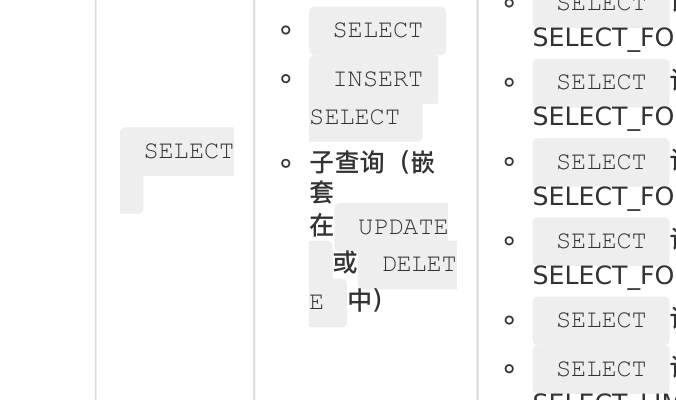

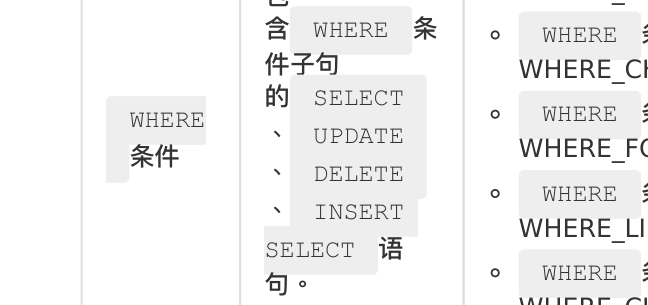

**数据变更**

| 检测项 | 适用的SQL语句 | 规则名称与规则标识 |
| --- | --- | --- |
| 插入数据 | <code>• INSERT</code><br><code>SELECT</code><br><code>• INSERT</code><br><code>[IGNORE]</code><br><code>• REPLACE</code> | • 插入语句建议指定<code> INSERT </code>字段列表：ASSIGN_INSERT_COLUMN_NAME_LIST<br>• 插入语句中<code> INSERT </code>字段名不能重复：INSERT_COLUMN_NAME_FORBID_DUPLICATE<br>• 插入语句不能为<code> NOT NULL </code>列插入<code> NULL </code>值：NOT_NULL_COLUMN_FORBID_INSERT_NULL<br>• 插入语句中<code> INSERT </code>字段列表要和值列表匹配：INSERT_COLUMN_MUST_MATCH_VALUES<br>• 插入语句限制一条<code> INSERT VALUES </code>的总行数：LIMIT_INSERT_VALUES_TOTAL_ROWS<br>• 插入语句检测<code> INSERT </code>的表或字段是否存在：INSERT_CHECK_TABLE_COLUMN_EXISTS<br>• 插入语句不建议使用<code> SYSDATA() </code>函数：INSERT_FORBID_USE_SYSDATE_FUNCTION |
| 修改、删除数据 | <code>• UPDATE</code><br><code>• DELETE</code> | • <code> UPDATE </code>或<code> DELETE </code>语句限制多表关联的数量：UPDELETE_LIMIT_TABLE_JOIN_COUNT<br>• <code> UPDATE </code>或<code> DELETE </code>语句建议指定<code> WHERE </code>条件：UPDELETE_ASSIGN_WHERE_CONDITION<br>• <code> UPDATE </code>或<code> DELETE </code>语句检测<code> WHERE </code>条件是否包含子查询：UPDELETE_CHECK_WHERE_EXIST_SUB_QUERY<br>• <code> UPDATE </code>或<code> DELETE </code>语句限制<code> LIMIT </code>数据量大小：UPDELETE_CHECK_LIMIT_AFFECTED_ROWS<br>• <code> UPDATE </code>或<code> DELETE </code>语句检测多表关联语法是否完整（如<code> join </code>遗漏<code> on </code>子句）：UPDELETE_CHECK_TABLE_JOIN_LOSS_ON<br>• <code> UPDATE </code>或<code> DELETE </code>语句不能有<code> ORDER BY </code>子句：UPDELETE_FORBID_ORDER_BY<br>• <code> UPDATE </code>语句检测<code> SET </code>多个列之间的分隔符（<code> and </code>非法）：UPDATE_CHECK_SET_ITEM_DELIMITER<br>• <code> UPDATE </code>多表时检测<code> SET </code>的列是否指定表前缀：UPDATE_MULTI_TABLE_CHECK_SET_COLUMN_PREFIX<br>• <code> UPDATE </code>语句检测涉及表或字段是否存在：UPDATE_CHECK_TABLE_COLUMN_EXIST<br>• <code> UPDATE </code>语句检测是否更新了主键：UPDATE_CHECK_PRIMARY_KEY_CHANGE<br>• <code> UPDATE </code>语句检测是否更新了唯一键：UPDATE_CHECK_UNIQUE_KEY_CHANGE<br>• <code> UPDATE </code>语句建议同时更新表上的“修改时间”列：UPDATE_ALSO_TO_UPDATE_MODIFY_TIME_COLUMN<br>• <code> UPDATE </code>语句不建议更新表上的“创建时间”列：UPDATE_FORBID_MODIFY_CREATE_TIME_COLUMN |

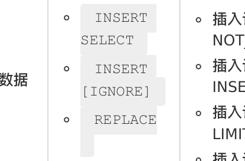

- **SQL优化建议**支持的检测项如下。

  | 类别 | 检测点 |
  | --- | --- |
  | 无 | • 优化主键为<code> int </code>类型的表：OPTIMIZE_PRIMARY_IS_INT_TABLE<br>• 预警自增主键剩余可用空间风险：SNIFFING_AUTO_PRIMARY_REMAIN_SPACE<br>• 预警唯一索引<code> </code>（<code>uk</code>）<code>null </code>值风险：SNIFFING_UNIQUE_EXIST_NULL_RISK<br>• DDL锁表或变更失败预警与优化：ALTER_LOCK_FAIL_SNIFFING_OPTIMIZE<br>• SQL注入风险检测：CHECK_SQL_INJECTION_RISK<br>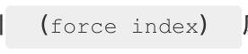<br>• 强制索引<code> </code>（<code>force index</code>）<code> </code>风险检测：CHECK_SQL_ASSIGN_FORCE_INDEX<br>• 执行计划索引检查：SQL_EXPLAIN_INDEX_CHECK<br>• DMS索引分析与推荐：DMS_INDEX_ANALYZE_AND_SUGGEST |

<a id="section-7-2-3-11"></a>

#### 7.2.3.11. SQL执行控制

SQL执行控制可控制SQL任务执行的数量、阻止因执行的SQL导致业务受阻等问题。

**检测点**

<table>
  <tr>
    <th>适用范围</th>
    <th>配置项</th>
    <th>描述</th>
  </tr>
  <tr>
    <td rowspan="4">SQL任务</td>
    <td>SQL执行前数据库锁超时机制</td>
    <td>锁等待超时保护机制默认开启，可防止通过DMS执行的SQL导致业务SQL阻塞。</td>
  </tr>
  <tr>
    <td>SQL执行前目标资源并发控制</td>
    <td>DMS系统自适应默认开启，DMS将控制通过DMS同一时间执行的SQL数量。</td>
  </tr>
  <tr>
    <td>SQL执行前数据库负载检查</td>
    <td>线程数检查保护机制默认开启，如果数据库负载过高，暂停执行SQL。您可以设置允许最大运行中的线程数量、失败时重试的间隔时间和失败后重试次数。</td>
  </tr>
  <tr>
    <td>SQL执行后sleep策略</td>
    <td>DMS系统自适应默认开启，可防止DMS的SQL执行过快导致主备延迟、DTS链路延迟等。</td>
  </tr>
  <tr>
    <td>无锁结构变更</td>
    <td>无锁结构变更运行参数控制</td>
    <td>打开参数配置开关，通过调整各参数的值改变无锁结构变更任务运行时的行为。无锁结构变更运行参数包括：<br>• 配置切换表时锁表超时时间<br>• 配置切换表失败时重试次数<br>• 配置全量拷贝策略和大小<br>• 配置切换表的时间窗口<br>• 配置切换表完成后原表清理策略<br>说明<br>• 正常情况下，您无需配置任何参数，DMS自动采用最优和最安全的方式执行变更。如需更改，请务必理解参数含义后再操作。<br>• 鼠标放在参数右侧的上，可以查看对应参数含义。</td>
  </tr>
</table>

<a id="section-7-2-3-12"></a>

#### 7.2.3.12. 库表同步

库表同步支持结构同步、空库初始化、表一致性修复和影子表同步功能，安全规则可以分别对这四个功能进行控制。

**基础配置项**

| 配置名 | 说明 |
| --- | --- |
| 开启执行能力 | 默认处于关闭状态，即库表同步将丧失SQL执行能力，仅能对比表结构差异，且其他配置项和检测点的安全规则均会失效。 |
| 库表同步默认审批模板 | 您可以直接使用默认值，也可以通过切换审批模板来更改默认审批模板的审批流程，详情请参见自定义审批流程。 |
| 分析阶段脚本过期时间（单位：小时） | 合理设置过期时间可以避免执行任务之前目标库表结构发生变化带来的风险。 |

**支持的检测点**

库表同步有四个检测点，分别对应了库表同步中的功能，每个检测点之间没有关联关系。例如，当您提交一个结构同步工单时，只有基础配置项和结构同步校验检查点会起作用。

> 每个检测点内置了大量的安全规则模板供您使用，您也可以根据需求新增规则。
>
> **说明**

| 检测点 | 说明 |
| --- | --- |
| 结构同步校验 | 对结构同步工单做相应的限制或设置审批流程。 |
| 空库初始化校验 | 对空库初始化工单做相应的限制或设置审批流程。 |
| 表一致性修复校验 | 对表一致性修复工单做相应的限制或设置审批流程。 |
| 影子表同步校验 | 对影子表同步工单做相应的限制或设置审批流程。 |

**支持的因子**

因子是系统内置变量，可用来获取安全规则校验的上下文信息，例如获取SQL类型、影响行数等。因子名称以 `@fac.` 为前缀，库表同步支持的因子如下表所示。

| 因子名 | 说明 |
| --- | --- |
| @fac.env_type | 环境类型，值为环境标识，例如DEV、PRODUCT。 |
| @fac.schema_name | schema名称。 |

**支持的动作**

动作是满足if条件之后系统执行的行为，例如禁止提交工单、允许执行、拒绝执行等，表达了安全规则的目的。动作名以 `@act.` 为前缀，库表同步支持的动作请参见下表。

<table>
  <tr>
    <th>动作名</th>
    <th>说明</th>
  </tr>
  <tr>
    <td>@act.forbid_submit_order</td>
    <td>禁止提交工单，例如<code> @act.forbid_submit_order </code> <code>'</code>禁止提交的原因<code>' </code>。</td>
  </tr>
  <tr>
    <td>@act.do_not_approve</td>
    <td rowspan="3">指定审批模板ID。</td>
  </tr>
  <tr>
    <td>@act.choose_approve_template</td>
  </tr>
  <tr>
    <td>@act.choose_approve_template_with_reason</td>
  </tr>
</table>

<a id="section-7-2-3-13"></a>

#### 7.2.3.13. 敏感列变更

本文档介绍如何设置敏感列变更工单的审批流程。

**基础配置项**

**敏感列默认审批模板**：当审批规则校验中未配置审批流程时，系统会采用此默认的审批模板。您可以通过切换审批模板来更改默认审批模板的审批流程。

**支持的检测点**

**审批规则校验**：当一个敏感列变更工单被提交时，系统会根据审批规则校验中定义的规则对敏感列变更工单作出相应处理。

> 每个检测点内置了大量的安全规则模板供您使用，您也可以根据需求新增规则。
>
> **说明**

**支持的因子**

因子是系统内置变量，可用来获取安全规则校验的上下文信息，例如获取SQL类型、影响行数等。因子名称以 `@fac.` 为前缀，敏感列变更支持的因子如下表所示。

| 因子名 | 说明 |
| --- | --- |
| @fac.column_level_change_typ e | 敏感列级别变更类型，取值：一共四种类型：<br>• upper：敏感级别提升，包含：<br>• 内部提升为敏感。<br>• 内部提升为机密。<br>• 敏感提升为机密。<br>• sensitive_to_inner：敏感降为内部。<br>• confidential_to_sensitive：机密降为敏感。<br>• confidential_to_inner：机密降为内部。 |

**支持的动作**

动作是满足if条件之后系统执行的行为，例如禁止提交工单、允许执行、拒绝执行等，表达了安全规则的目的。动作名以 `@act.` 为前缀，敏感列变更支持的动作请参见下表。

<table>
  <tr>
    <th>动作名</th>
    <th>说明</th>
  </tr>
  <tr>
    <td>@act.forbid_submit_order</td>
    <td>禁止提交工单，例如<code> @act.forbid_submit_order </code> <code>'</code>禁止提交的原因<code>' </code>。</td>
  </tr>
  <tr>
    <td>@act.do_not_approve</td>
    <td rowspan="3">指定审批模板ID。</td>
  </tr>
  <tr>
    <td>@act.choose_approve_template</td>
  </tr>
  <tr>
    <td>@act.choose_approve_template_with_reason</td>
  </tr>
</table>

<a id="section-7-2-3-14"></a>

#### 7.2.3.14. 测试数据构建

本文档介绍如何设置测试数据构建工单的审批流程。

**基础配置项**

**测试数据构建默认审批模板**：当审批规则中未配置不同风险的审批流程时，系统会采用默认的审批模板。

**支持的检测点**

**审批规则校验**：系统会根据审批规则校验中定义的规则对测试数据构建工单作出相应处理。

> 每个检测点内置了大量的安全规则模板供您使用，您也可以根据需求新增规则。
>
> **说明**

**支持的因子**

因子是系统内置变量，可用来获取安全规则校验的上下文信息，例如获取SQL类型、影响行数等。因子名称以 `@fac.` 为前缀，测试数据构建支持的因子如下表所示。

| 因子名 | 说明 |
| --- | --- |
| @fac.env_type | 环境类型，值是环境标识，例如DEV、PRODUCT。 |
| @fac.schema_name | schema名称。 |

**支持的动作**

动作是满足if条件之后系统执行的行为，例如禁止提交工单、允许执行、拒绝执行等，表达了安全规则的目的。动作名以 `@act.` 为前缀，测试数据构建支持的动作请参见下表。

<table>
  <tr>
    <th>动作名</th>
    <th>说明</th>
  </tr>
  <tr>
    <td>@act.forbid_submit_order</td>
    <td>禁止提交工单，例如<code> @act.forbid_submit_order </code> <code>'</code>禁止提交的原因<code>' </code>。</td>
  </tr>
  <tr>
    <td>@act.do_not_approve</td>
    <td rowspan="3">指定审批模板ID。</td>
  </tr>
  <tr>
    <td>@act.choose_approve_template</td>
  </tr>
  <tr>
    <td>@act.choose_approve_template_with_reason</td>
  </tr>
</table>

<a id="section-7-2-3-15"></a>

#### 7.2.3.15. 数据库克隆

本文档介绍如何设置数据库克隆工单的审批流程。

**基础配置项**

**数据库克隆默认审批模板**：当审批规则校验中未配置审批流程时，系统会采用此默认的审批模板。您可以通过切换审批模板来更改默认审批模板的审批流程。

**支持的检测点**

**审批规则校验**：系统会根据审批规则校验中定义的规则让数据库克隆工单走对应的审批流程。

> 每个检测点内置了大量的安全规则模板供您使用，您也可以根据需求新增规则。
>
> **说明**

**支持的动作**

动作是满足if条件之后系统执行的行为，例如禁止提交工单、允许执行、拒绝执行等，表达了安全规则的目的。动作名以 `@act.` 为前缀，数据库克隆支持的动作请参见下表。

<table>
  <tr>
    <th>动作名</th>
    <th>说明</th>
  </tr>
  <tr>
    <td>@act.forbid_submit_order</td>
    <td>禁止提交工单，例如<code> @act.forbid_submit_order </code> <code>'</code>禁止提交的原因<code> </code>。</td>
  </tr>
  <tr>
    <td>@act.do_not_approve</td>
    <td rowspan="3">指定审批模板ID。</td>
  </tr>
  <tr>
    <td>@act.choose_approve_template</td>
  </tr>
  <tr>
    <td>@act.choose_approve_template_with_reason</td>
  </tr>
</table>


<a id="section-7-2-4"></a>

### 7.2.4. 为实例设置安全规则

本文介绍为实例设置安全规则的方法。

**前提条件**

- 执行该操作的用户角色为DBA或管理员。

- 数据库实例的管控模式为**安全协同**。

**操作步骤**

1. 登录DMS控制台。

2. 在顶部菜单栏中，选择**数据资产 > 实例管理**。

3. 在目标实例右侧的操作列中，选择**更多 > 编辑实例**。

4. <strong>可选：</strong>在**编辑实例**对话框中，将管控模式设置为**安全协同**。

5. 在**安全规则**下拉框中，选择目标安全规则。

6. 单击**提交**。

<a id="section-7-3"></a>

## 7.3. 自定义审批流程

在DMS中的实例级安全规则可以针对数据库实例或数据库操作设置不同的审批流程。但是在实际业务环境中实例级安全规则可能有一定的局限性，本文介绍自定义审批流程的具体操作。

**前提条件**

用户角色为DBA或管理员。

**背景信息**

您可以使用自定义审批流程解决下列场景中遇到的问题。

- 数据库实例上只有1个DBA，需要多个DBA角色参与审批，避免单人审批影响整体审批效率。

- 数据库实例被多个业务公用，需要多个业务方都处于审批流程中，按需审批对应业务的操作工单流程。

**操作步骤**

本文以设置多个DBA角色参与审批为例介绍配置流程，其他场景配置流程与本文类似。

1. 登录DMS控制台。

2. 在顶部菜单栏中，选择**安全与规范 > 审批流程**。

3. 新增审批节点。

   <ol type="i">

   <li>

   单击左侧的**审批节点**页签，然后单击**新增审批节点**。

   </li>

   <li>

   配置审批节点的信息。

   <table>
     <tr>
       <th width="89">配置</th>
       <th>说明</th>
     </tr>
     <tr>
       <td>节点名称</td>
       <td>全局唯一，不能与现有的节点同名。</td>
     </tr>
     <tr>
       <td>备注</td>
       <td>为节点配置备注信息便于后续识别。</td>
     </tr>
     <tr>
       <td>审批人</td>
       <td>选择审批人员的云账号，可输入前缀关键字进行匹配。<br>说明避免审批流程中设置单人审批。一般建议每个节点至少设置2名审批人员。</td>
     </tr>
   </table>

   </li>

   <li>

   单击**提交**。

   </li>

   </ol>

4. 新增审批模板。

   <ol type="i">

   <li>

   单击左侧的**审批模板**页签，然后单击**新增审批模板**。

   </li>

   <li>

   配置审批模板的信息。

   <table>
     <tr>
       <th width="89">配置</th>
       <th>说明</th>
     </tr>
     <tr>
       <td>模板名称</td>
       <td>全局唯一，不能与现有的模板同名。</td>
     </tr>
     <tr>
       <td>备注</td>
       <td>为模板配置备注信息便于后续识别。</td>
     </tr>
     <tr>
       <td>审批节点</td>
       <td>单击增加节点，选择所需的审批节点。本案例选择系统内置的Owner和步骤3中新建的审批节点来实现一个节点中多个DBA参与审批的需求。<br>说明审批流程按照审批顺序的数值从小到大执行。</td>
     </tr>
   </table>

   </li>

   <li>

   单击**提交**。新增完成后，您可以获取到该审批模板的模板ID，本案例为9。

   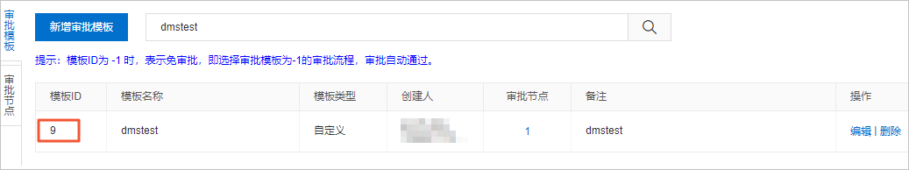

   </li>

   </ol>

5. 应用新的审批流程。

   本步骤以设置**SQL变更 > 风险审批规则**中的**中风险审批流程**的安全规则管控为例，其他模块的配置流程与本案例类似。

   <ol type="i">

   <li>

   在顶部导航栏，单击**安全与规范 > 安全规则**。

   </li>

   <li>

   找到目标规则集，单击**操作**列的**编辑**。

   </li>

   <li>

   单击左侧的**SQL变更**页签。

   </li>

   <li>

   选择检测点为**风险审批规则**。

   </li>

   <li>

   单击**中风险审批流程**对应的**编辑**。

   </li>

   <li>

   在**规则DSL**区域框中替换模板ID。

   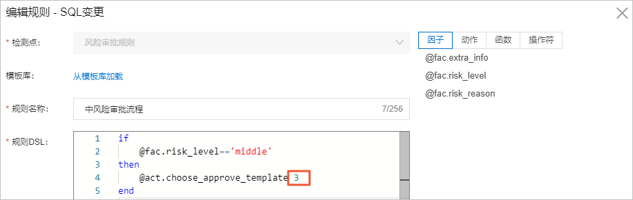

   > 在本案例中，将上图中的 `3` 替换为步骤4中新增的审批模板对应ID，即 `9` 。
   >
   > **说明**

   </li>

   <li>

   单击**提交**。

   </li>

   </ol>

**执行结果**

新提交的数据变更流程，满足对应规则后，多个DBA角色都可以接收到审批消息、处理审批流程。

<a id="section-7-4"></a>

## 7.4. 访问IP白名单

DMS支持设置访问IP白名单，可以对DMS的服务范围进行有效管控，只允许部分特定信任网络环境访问DMS。

**前提条件**

执行该操作的用户角色为管理员。

**操作步骤**

1. 登录DMS控制台。

2. 在顶部菜单栏中，选择**安全与规范 > 访问IP白名单**。

3. 根据业务需求，选择执行下述步骤。

   - 开启或关闭白名单控制功能

     单击**点击开启**或**点击关闭**来开启或关闭白名单控制功能。

   - 新增白名单

     <ol type="a">

     <li>

     单击**新增白名单**。

     </li>

     <li>

     在弹出的对话框中填写IP地址和说明信息。

     > **说明**
     >
     > - IP地址之间以英文分号（;）分隔，不可重复。
     >
     > - 支持格式如：10.23.12.24（单个IP地址）、10.23.12.24/24（CIDR模式，即无类域间路由，/24表示了地址中前缀的长度，范围[1，32]）。
     >
     > - 设置为0.0.0.0/0表示对访问的IP来源不作任何限制。

     </li>

     </ol>

     <ol type="i" start="100">

     <li>

     单击**提交**。

     </li>

     </ol>

   - 编辑白名单

     <ol type="a">

     <li>

     定位至目标IP白名单，单击**操作**列的**编辑**。

     </li>

     <li>

     在弹出的对话框中调整IP地址信息。

     </li>

     </ol>

     <ol type="i" start="100">

     <li>

     单击**提交**。

     </li>

     </ol>

   - 删除白名单

     <ol type="a">

     <li>

     定位至目标IP白名单，单击**操作**列的**删除**。

     </li>

     <li>

     在弹出的对话框中单击**确认**。

     > 最少保留一个IP白名单，即无法删除最后一个IP白名单。
     >
     > **说明**

     </li>

     </ol>

<a id="section-7-5"></a>

## 7.5. 操作审计

操作审计功能支持查询SQL窗口产生的SQL语句列表、工单列表、登录列表、操作日志等，可以方便快速地定位、排查数据库问题以及提供审计用途。

**功能说明**

数据管理DMS的操作审计功能包含了操作日志与操作审计：

| 功能 | 说明 | 内容项 |
| --- | --- | --- |
| 操作日志 | 用户通过DMS系统发起所有操作的流水账式日志。 | 包含纯管理、配置类的操作行为，也包含SQL窗口产生的SQL语句列表、工单列表、登录列表。 |
| 操作审计 | 仅包含用户在DMS系统中对数据库进行直接操作的所有行为。<br>说明为操作审计工作提供统一视图入口，方便您快速定位、排查数据库问题。 | SQL窗口产生的SQL语句列表、工单列表、登录列表。<br>说明仅管理员、DBA、工单的发起者和工单相关人能够查看工单详情。 |

> **说明**
>
> - 管控模式为**稳定变更**和**安全协同**的实例，日志数据在DMS中永久保留，您可随时访问与查看。
>
> - 管控模式为**自由操作**的实例，仅能查看7天内的日志数据。

**操作入口与支持的用户角色**

DMS支持多种角色用户、多入口按需进行操作审计：

| 审计维度 | 限制 | 操作审计入口 | 支持的用户角色 |
| --- | --- | --- | --- |
| 数据库 | 仅限查看当前数据库的操作审计。 | • 在目标数据库的SQL窗口，单<br>击右上角的图标 。<br>• 在DMS实例列表中，展开目标实例，右键单击目标数据库，在弹出的列表中，选择<strong>操作审</strong><strong>计</strong>。 | 管理员、安全管理员、DBA、实例Owner、普通用户。<br>说明普通用户仅限查看当前数据库中当前用户的操作审计。 |
| 实例 | 仅限查看当前实例的操作审计。 | 在DMS实例列表中，右键单击目标实例，在弹出的列表中，选择<strong>操</strong><strong>作审计</strong>。 | 管理员、安全管理员、DBA、实例Owner、普通用户。<br>说明普通用户仅限查看当前实例中当前用户的操作审计。 |
| 全局 | 查看全局的操作审计。 | 在页面顶部菜单栏，选择<strong>安全与规</strong><strong>则 &gt; 操作审计</strong>。 | 管理员、安全管理员、DBA。 |

**下载操作审计**

本示例将介绍如何查看与下载全局近1个月的SQL窗口产生的SQL语句列表。

1. 登录DMS控制台。

2. 在顶部菜单栏中，选择**安全与规则 > 操作审计**。

3. 单击**操作审计**，单击**SQL窗口列表**。

4. 在**时间**区域，选择**近1月**，并单击**搜索**。系统将返回搜索结果。

5. 单击

   图标即可下载。

   

   系统将以XLSX文件的格式导出当前搜索页的结果。

   > 如需预览或导出更多结果，您可以将**每页显示**参数设置为**100**。
   >
   > **说明**

<a id="section-7-6"></a>

## 7.6. 敏感数据管理

<a id="section-7-6-1"></a>

### 7.6.1. 敏感数据保护概览

如果您有对敏感数据进行管控和脱敏的需求，可以使用敏感数据保护功能对数据库元数据进行扫描，识别、脱敏和管理敏感数据。

**支持的数据库**

- 关系型数据库：

  - MySQL：RDS MySQL、PolarDB-X、其他来源MySQL

  - SQL Server：RDS SQL Server、其他来源SQL Server

  - PostgreSQL：RDS PostgreSQL、其他来源PostgreSQL

  - OceanBase

  - Oracle

  - 达梦数据库

- 数据仓库：

  - AnalyticDB MySQL

  - AnalyticDB PostgreSQL

**功能结构图**

通过敏感数据保护功能，可帮助企业及时有效地发现与识别敏感数据资产，避免敏感数据滥用，有效保护企业的敏感数据资产，防止数据泄露造成企业经营资损或者罚款。敏感数据保护结构图如下图所示：

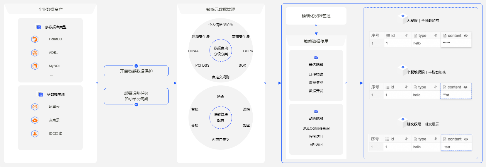

**功能特性**

- 提供敏感数据资产大盘，解决企业敏感数据分布的统一纳管问题。

- 元数据自动化扫描。

  - 自定义数据扫描触发周期。

  - 自动识别企业敏感数据和对敏感数据进行分类分级，提供及时发现和有效管理企业资产中敏感数据的能力。

  - 内置和自定义分类分级模板，完善业务精细化分类管理模型，可以使用最小授权原则管理敏感数据。

- 敏感数据脱敏管理。

  - 通过内置和自定义的方式提供灵活的脱敏算法管理，实现不同场景、不同字段的差异化脱敏，解决最细粒度授权、最小范围敏感数据接触问题。

  - 提供脱敏规则、识别规则的测试环境。

  - 管理人员和应用对脱敏数据的访问。

- 对敏感数据进行使用监控、异常审计与预警，解决敏感数据的异常使用与数据泄露的溯源问题。

**名词解释**

- 安全级别：根据存储业务的数据性质差异，部分字段如手机号码、身份证号码等属于敏感数据，常规查询数据时此类字段的值不应展现。根据数据的敏感程度，将数据分为3个安全级别：

  - 低敏感

    > 安全协同管控模式的数据默认为低敏感。
    >
    > **说明**

  - 中敏感

  - 高敏感

  > 设置安全级别后，对使用数据的影响：
  >
  > **说明**
  >
  > - SQL Console中查询数据时，对无权限的中敏感、高敏感字段显示为星号（\*）或者按自定义的方式显示。
  >
  > - 查询、导出、变更数据时，需要单独申请中敏感、高敏感字段的权限。
  >
  > - 导出、变更数据时，如果数据涉及中敏感、高敏感字段，DBA、管理员可设置不同的审批流程。

- 识别规则：包含系统内置的行业、法案等识别规则，同时支持用户按需自定义基于元数据和数据内容的识别规则。

- 数据分类：根据各类法案、法规进行数据分类，同时支持用户新增数据分类。

  - 一级分类：例如个人信息、企业信息、位置信息等。

  - 二级分类：例如手机号、邮箱、银行卡等。

- 脱敏算法：目前支持的脱敏算法为哈希、遮掩、替换、变换和加密，用户可基于内置脱敏算法灵活配置新的脱敏规则。

- 脱敏策略：在为选定的敏感字段配置脱敏规则后形成一个脱敏策略。

<a id="section-7-6-2"></a>

### 7.6.2. 开通敏感数据保护

如果您的数据库中包含敏感信息，可以开通敏感数据保护功能，对数据库元数据进行扫描，识别、脱敏和管理敏感数据。本文介绍开通敏感数据保护功能和创建元数据扫描任务的方法。

**前提条件**

- 用户角色为管理员、DBA和安全管理员。

  > 鼠标移动到界面右上角的  ，查看您的角色。
  >
  > **说明**

- 支持的数据库：

  - 关系型数据库：MySQL、SQL Server、PostgreSQL、Oracle、达梦数据库、PolarDB-X、OceanBase。

  - 数据仓库：AnalyticDB MySQL、AnalyticDB PostgreSQL。

**操作步骤**

1. 登录DMS控制台。

2. 在顶部菜单栏中，选择**数据资产 > 敏感数据大盘**。

3. 在**实例列表**区域，选择**未开启**页签。

4. 搜索目标实例，在目标实例**操作**列，单击**立即开启**。

   > 实例未开启敏感数据保护才可以在该页面搜索到。
   >
   > **说明**

5. 在**开启敏感数据保护**对话框中，打开**立即配置扫描任务**开关，配置扫描任务后单击**确认**。表 1. 配置扫描任务

   <table>
     <tr>
       <th width="90">项目</th>
       <th>说明</th>
     </tr>
     <tr>
       <td>即时任务</td>
       <td>配置完成后，系统立即扫描目标数据库中的元数据，并标记敏感字段。</td>
     </tr>
     <tr>
       <td>定时任务</td>
       <td>设置日期和时间。系统会在设定时间自动扫描目标数据库中的元数据，并标记敏感字段。</td>
     </tr>
     <tr>
       <td>周期任务</td>
       <td>配置调度周期和具体时间。系统会在指定周期自动扫描目标数据库中的元数据，并标记敏感字段。</td>
     </tr>
   </table>

6. 在**扫描任务配置结果提醒**对话框中，单击**账密授权**。

   > 实例的管控模式为自由操作或稳定变更，需要进行账密授权操作。
   >
   > **说明**

7. 输入目标实例的数据库账号和密码，单击**确认**。

8. <strong>可选：</strong>单击**操作**列中的**任务详情**，在**识别任务**页签下，查看扫描任务的日志。您可以查看任务的创建人、创建时间、启动时间、完成时间、状态、执行结果等。

9. <strong>可选：</strong>单击**操作**列中的**敏感数据列表**，在**字段管控**页签下，查看目标实例的敏感数据等级和分布。您还可以在该页面对敏感字段进行管理，例如调整敏感等级、调整脱敏规则和授权用户。具体操作，请参见管理敏感数据。

<a id="section-7-6-3"></a>

### 7.6.3. 管理敏感数据

本文介绍调整字段的敏感等级、脱敏规则的方法，以及为字段添加、回收用户授权的方法。

**前提条件**

用户角色为管理员、DBA和安全管理员。

> 鼠标移动到界面右上角的  ，查看您的角色。
>
> **说明**

**操作步骤**

1. 登录DMS控制台。

2. 在顶部菜单栏中，选择**安全与规范 > 敏感数据管理 > 敏感数据列表**。

3. 单击**字段管控**页签。

   - 调整字段的敏感等级。

     <ol type="a">

     <li>

     单击数据库名前的  ，展开表的字段列表。

     </li>

     <li>

     在右侧**操作**列中，单击**调整敏感等级**。

     > 如果您需要调整多个字段的敏感等级为同一个级别，选中目标字段，单击页面左上
     >
     > **说明**
     >
     > 角的**调整敏感等级**。

     </li>

     </ol>

     <ol type="i" start="100">

     <li>

     在**敏感等级调整**对话框中，选中目标安全级别并单击**确认**。

     </li>

     </ol>

   - 调整字段的脱敏规则。

     <ol type="a">

     <li>

     选中需要调整脱敏规则的字段。

     </li>

     <li>

     单击页面左上角的**调整脱敏规则**。

     </li>

     </ol>

     <ol type="i" start="100">

     <li>

     在**请选择脱敏规则**对话框中，选择自定义的脱敏规则并单击**保存**。关于自定义脱敏规则，请参见新增脱敏规则。

     > 系统默认的脱敏规则为DEFAULT，如果您需要将脱敏规则重置为DEFAULT，在右
     >
     > **说明**
     >
     > 侧**操作**列中，单击**重置脱敏规则**。

     </li>

     </ol>

   - 为字段添加授权用户。

     > 仅针对安全协同管控模式，其他管控模式不支持该功能。
     >
     > **说明**

     <ol type="a">

     <li>

     选中需要添加授权用户的字段。

     </li>

     <li>

     单击页面左上角的**授权用户**。

     </li>

     </ol>

     <ol type="i" start="100">

     <li>

     在**授权用户**对话框中，在**添加用户**下拉列表中选择目标用户。

     </li>

     <li value="500">

     配置**权限设置**信息。具体配置信息如下所示。如果用户没有字段的权限，字段全加密显示。

     <table>
       <tr>
         <th width="90">项目</th>
         <th>描述</th>
       </tr>
       <tr>
         <td>权限类型</td>
         <td>选择权限类型：<br>• 查询：可以通过SQLConsole执行SQL查看数据。<br>• 导出：对应数据导出工单提单权限。<br>• 变更：对应数据变更、数据导入工单提交权限。</td>
       </tr>
       <tr>
         <td>过期时间</td>
         <td>选择具体时间：<br>说明如果您需要按天或小时授权，过期时间请选择<strong>其他</strong>。</td>
       </tr>
     </table>

     </li>

     </ol>

     <ol type="a" start="5">

     <li>

     单击**确认**。

     </li>

     </ol>

   - 回收敏感列权限。

     - 在目标字段右侧的**操作**列中，单击**管理权限**。

     - 在**分类**中，选择**敏感列权限**。

     - 在右侧的**操作**列中，单击**回收权限**，回收敏感列授权。

     > **说明**
     >
     > - 在右侧的**操作**列中，单击**查看详情**，查看敏感字段授权详细信息。
     >
     > - 您还可以在此页面，对目标数据库进行其他权限的授权和回收。

<a id="section-7-6-4"></a>

### 7.6.4. 管理敏感数据识别规则

敏感数据保护功能中内置了几十种敏感数据识别规则，覆盖了中华人民共和国网络安全法、GDPR、SOX法案、PCI DSS、HIPAA等法律法规，重点覆盖个人隐私信息保护。如果内置的识别规则不能满足您的业务需求，可以新增敏感数据的识别规则。

**前提条件**

用户角色为管理员、DBA和安全管理员。

> 鼠标移动到界面右上角的  ，查看您的角色。
>
> **说明**

**操作步骤**

1. 登录DMS控制台。

2. 在顶部菜单栏中，选择**安全与规范 > 敏感数据管理 > 敏感数据识别**。

3. 单击**识别规则**页签。

4. 单击**新增规则**。

5. 在**新建识别规则**面板中，设置识别规则，单击**提交**。

   <table>
     <tr>
       <th width="90">项目</th>
       <th>操作</th>
     </tr>
     <tr>
       <td>规则名</td>
       <td>输入新建规则的名称。<br>说明提交后名称不可修改。</td>
     </tr>
     <tr>
       <td>备注信息</td>
       <td>输入新建规则的备注，方便后续的管理。</td>
     </tr>
     <tr>
       <td>数据类型</td>
       <td>选择规则需要识别的数据类型。<br>说明您也可以手动添加新的数据分类。</td>
     </tr>
     <tr>
       <td>敏感等级</td>
       <td>设置识别出的字段的目标敏感等级，更多信息请参见敏感数据保护概览。<br>• 低敏感：对应DMS的原分类为内部。安全协同管控模式的数据默认为低敏感。<br>• 中敏感：对应DMS的原分类为敏感。<br>• 高敏感：对应DMS的原分类为机密。</td>
     </tr>
     <tr>
       <td>规则配置</td>
       <td>• 元数据扫描。<br>• 包含：当字段名包含输入的字符时，会被标记为目标敏感等级。<br>• 不包含：当字段名包含输入的字符时，不会被标记为目标敏感等级。<br>说明如果需要过滤多个字段，使用半角逗号（,）将字符隔开。<br>• 数据内容扫描。输入正则表达式匹配数据内容。<br>说明您可以输入测试数据，单击<strong>测试</strong>，根据测试结果验证您输入的正则表达式是否符合预期。<br>• 匹配成功：测试数据会被标记为目标敏感等级。<br>• 匹配失败：测试数据不会被标记为目标敏感等级。</td>
     </tr>
   </table>

6. 打开新建规则的状态开关。

   > **说明**
   >
   > - 新增规则的默认状态为关闭状态。状态开关被打开，识别规则才会起作用。
   >
   > - 内置的识别规则不能编辑，但您可以关闭规则的状态。
   >
   > - 规则的状态改变后，识别规则会在下一次的识别任务中起作用。

<a id="section-7-6-5"></a>

### 7.6.5. 新增脱敏规则

敏感数据保护功能中内置了一个全遮掩的脱敏规则，如果您需要其他的脱敏方式，可以基于内置的某个脱敏算法进行自定义。本文介绍新增脱敏规则的方法。

**前提条件**

用户角色为管理员、DBA和安全管理员。

> 鼠标移动到界面右上角的  ，查看您的角色。
>
> **说明**

**操作步骤**

1. 登录DMS控制台。

2. 在顶部菜单栏中，选择**安全与规范 > 敏感数据管理 > 数据脱敏管理**。

3. 在**脱敏规则**页签下，单击**新增脱敏规则**。

4. 在**新增规则**面板中，选择并配置一种脱敏规则。系统内置5种脱敏算法：

   - 哈希：

     - MD5：一种被广泛使用的密码散列函数，可以产生出一个128位（16字节）的散列值。

     - SHA1：一种密码散列数，可以生成一个被称为消息摘要的160位（20字节）散列值。

     - SHA256：使用的哈希值长度是256位。

     - HMAC：基于Hash函数和密钥进行消息认证。

   - 遮掩：

     - 全遮掩：对整个数据进行脱敏。

       例如，对手机号码1381111\*\*\*\*进行全遮掩，设置遮掩字符串为\*\*\*\*\*\*\*\*\*\*\*，则脱敏结果为\*\*\*\*\*\*\*\*\*\*\*。

     - 固定位置遮掩：对字段的固定位置进行脱敏处理。

       例如，对IP地址192.168.255.254的第2段号码进行遮掩，设置遮掩字符串为\*\*\*，遮掩位置为(5,7)，则脱敏结果为192.\*\*\*.255.254。

     - 固定字符遮掩：对字段的固定字符进行脱敏处理。

       例如，对邮箱username@example.com中的example进行遮掩，设置遮掩字符串为\*\*\*\*\*\*\*，待遮掩字符串为example，则脱敏结果为username@\*\*\*\*\*\*\*.com。

   - 替换：

     - 映射替换：将目标字符串替换为设置的字符串。

       例如，将字符串abcd中的ab替换为mn，设置目标字符串为ab，替换字符串为mn，则脱敏结果为mncd。

     - 随机替换：将字段的固定位置，替换为设置的随机字符。

       例如，对邮箱username@example.com中的username进行随机替换，设置替换位置为(1,8)，随机字符为abc，其中的一个脱敏结果为acbbbbac@example.com。

       > 如果随机字符的个数大于等于2，脱敏结果不唯一，是随机的。
       >
       > **说明**

   - 变换：

     - 数字取整：保留小数点前第几位。

       例如，原始数据为1234.12，设置保留小数点前第2位，则脱敏结果为1230。

     - 日期取整：日期取整级别。

       例如，原始数据为2021-10-14 15:15:30，设置日期取整级别为hour，则脱敏结果为2021-10-14 15:00:00。

     - 字符位移：字符串循环左移几位。

       例如，原始数据为345678，设置字符串左移位数为2，则循环左移后的脱敏结果为567834。

   - 加密：

     - DES：采用DES算法进行加密，密钥长度为8字符，脱敏结果为16字符。

     - AES：一种比DES安全的加密方式，密钥长度为16字符，脱敏结果为32字符。

5. <strong>可选：</strong>模拟测试。

   <ol type="i">

   <li>

   输入原始数据。

   </li>

   <li>

   单击**测试**。

   </li>

   <li>

   查看脱敏结果是否符合预期。

   </li>

   </ol>

6. 单击**提交**。

   > 敏感数据默认的脱敏规则为系统内置的DEFAULT，如果您需要将新增的脱敏规则应用于
   >
   > **说明**
   >
   > 敏感数据，请参见管理敏感数据。

<a id="section-7-6-6"></a>

### 7.6.6. 行级管控

针对某些特定的表，不同的人员只能访问不同的数据行记录，传统解决方案需要用视图来支持，现在通过DMS的行级管控即可实现统一的行级权限管控。

**前提条件**

用户角色为管理员、DBA或安全管理员。

> 鼠标移动到界面右上角的  ，查看您的角色。
>
> **说明**

**背景信息**

行级管控旨在对数据表进行横向数据安全保护，所有的行通过一个或者多个确定的值（可枚举）来进行区分，这些值称为管控值，用户在DMS上访问受管控值对应的行时，需要有该行权限才能进行访问。

> 一个值可能对应到多行，那么如果一个用户具有一个管控值的行权限，则可能对应拥有该
>
> **说明**
>
> 表多行数据的访问权限。

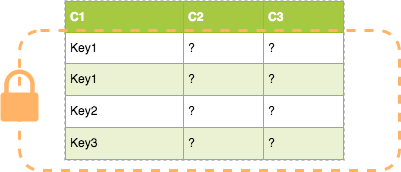

**功能限制**

- 敏感数据管理目前仅支持关系型数据库（例如MySQL），暂不支持NoSQL。

- 如需使用该功能，数据库实例的管控模式需处于安全协同模式。

- 仅支持物理库，暂不支持逻辑库。

- 对行级管控表的SQL查询、订正、删除，筛选条件会做如下限制：

  <ol type="i">

  <li>

  限制用户需要带上受管控字段进行数据筛选。

  </li>

  <li>

  行级管控表的所有行都会纳入管控范围，针对不具备所有行权限的用户，对管控字段的筛选操作符仅支持 `=` 和 `in` ，即要求明确筛选值且筛选值在管控值列表内。

  </li>

  <li>

  针对不具备所有行权限的用户，筛选条件会受到一些使用限制，比如OR、XOR、逻辑非等运算操作均无法使用。

  </li>

  </ol>

**术语说明**

<table>
  <tr>
    <th width="90">术语</th>
    <th>说明</th>
  </tr>
  <tr>
    <td>行权限</td>
    <td>行级管控表的管控值，作为访问行的资源，可供用户进行资源权限申请，将行级管控权限定义为行权限，收敛到权限体系中。安全协同管控模式下的权限体系可支持库、表、列（字段）、行这几个不同维度的权限管控。</td>
  </tr>
  <tr>
    <td>单值</td>
    <td>用户申请某个行级管控表的行权限时选择<strong>单值</strong>，可针对每一个管控值进行单独申请。<br>说明一个值可能对应到多行，如果用户具有一个管控值的行权限，则可能对应拥有该表多行数据的访问权限。</td>
  </tr>
  <tr>
    <td>所有</td>
    <td>用户申请某个行级管控表的行权限时选择<strong>所有</strong>，则具备当前行级管控表的所有行权限。具备所有行权限的用户，可无限制地访问整个行级管控表，且后续增加或修改管控值，该用户对这些行也具备访问权限。</td>
  </tr>
  <tr>
    <td>管控表</td>
    <td>需要进行行级管控的表，称为行级管控表。</td>
  </tr>
  <tr>
    <td>管控字段</td>
    <td>实现行级管控表的管控值，收敛到一个字段，这个字段称之为管控字段。</td>
  </tr>
  <tr>
    <td>配置组</td>
    <td>通过一个配置组收敛具有相同管控值的行级管控表。例如表A和表B都需要使用同样的管控值来进行行级管控，则可通过一个配置组对表A和表B进行管理，只需要配置一份管控值，表A和表B可同时使用。</td>
  </tr>
</table>

**操作步骤**

1. 登录DMS控制台。

2. 在顶部菜单栏中，选择**安全与规范 > 敏感数据管理 > 敏感数据列表**。

3. 单击**行级管控**页签。

4. 添加管控组。

   <ol type="i">

   <li>

   单击**添加管控组**。

   </li>

   <li>

   在弹出的对话框中，配置管控组信息。

   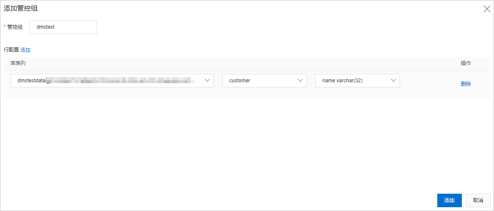

   | 配置 | 说明 |
   | --- | --- |
   | 管控组 | 填入管控组名称。 |
   | 行配置 | 单击<strong>添加</strong>，添加一条库表列配置框。<br>说明您可以重复本操作添加多个库表列配置框。 |
   | 库表列 | 在库名框中输入数据库名称的关键字搜索并选择目标数据库，然后下拉选择目标表和目标字段。<br>说明目标字段即为管控字段。 |

   </li>

   <li>

   单击**添加**。

   </li>

   </ol>

5. 导入管控值。

   <ol type="i">

   <li>

   定位至刚创建的管控组，单击**操作**列的**详情**。

   </li>

   <li>

   单击**添加行值**。

   </li>

   <li>

   在弹出的对话框中，选择是否为追加行值，然后填入具体的行值内容。

   > 多个行值以英文逗号（,）分隔。
   >
   > **说明**

   </li>

   <li>

   单击**导入**。

   </li>

   </ol>

**相关操作**

执行本文的操作后，如果用户没有管控表中管控行的权限，在执行查询操作会提示无权访问对应的行。该用户可通过申请对应行的权限来获得对应行的访问权限，详情请参见申请权限。

<a id="section-7-7"></a>

## 7.7. 数据水印

本文为您介绍水印嵌入和水印提取的操作步骤。

**前提条件**

实例已开通敏感数据保护功能。详细信息，请参见开通敏感数据保护。

**使用场景**

用于数据的散布或分发过程中追溯源头。

**注意事项**

- 建议导出数据超过200条时使用数据水印嵌入。

- 使用水印提取功能时，需要保证文件中数据超过200条，否则可能会出现水印提取失败（未提取到水印）的情况。

**水印嵌入**

水印嵌入是指将标识信息嵌入到数据或文件中，使其具备一定的标识度。

> 如下以安全协同模式的RDS MySQL数据库实例进行操作举例。
>
> **说明**

1. 登录DMS控制台。

2. 在顶部菜单栏中，选择**数据库开发 > 数据导出 > SQL结果集导出**。

   > 若您使用的是极简模式的控制台，请单击左上角的
   >
   > 图标，选择**全部功能 > 数据库开**
   >
   > **说明**
   >
   > 
   >
   > **发 > 数据导出 > SQL结果集导出**。

3. 配置以下信息：

   | 配置 | 说明 |
   | --- | --- |
   | <strong>数据库名</strong>（必选） | 选择目标的数据库。<br>说明您需要有该数据库的导出权限。 |
   | <strong>原因类别</strong>（必选） | 选择导出数据的原因，方便后续查找。<br>说明数据库的管控模式为安全协同才会出现该配置项。 |
   | <strong>业务背景</strong>（必选） | 详细描述导出数据的原因或目标，减少沟通成本。<br>说明数据库的管控模式为安全协同才会出现该配置项。 |
   | <strong>影响行数</strong>（必选） | 预估本次导出会影响的数据行数，您可以在SQLConsole中使用<code> count </code>命令进行统计。<br>说明在预检查阶段，系统将会显示实际影响行数，您可以再次校验是否符合预期，及时发现异常，避免发生数据安全事故。 |
   | <strong>跳过校验</strong>（可选） | 是否跳过校验，若选中<strong>跳过校验</strong>，您还需要填写原因。<br>警告选中<strong>跳过校验</strong>后，DMS不会校验导出影响行数，如果数据量较大可能对正常的业务产生风险，请谨慎选择。 |
   | <strong>敏感数据脱敏</strong>（必选） | 选择是否给导出的数据进行脱敏。 |
   | <strong>相关人</strong>（可选） | 设置的相关人员都可查看工单，并协同工作，非相关人员则不能查看工单（管理员、DBA除外）。<br>说明数据库的管控模式为安全协同才会出现该配置项。 |
   | <strong>导出SQL语句</strong>（必选） | 填入可直接执行的SQL语句，例如<code> SELECT * FROM testtable </code>，提交申请时DMS会自动校验语法正确性，如果不正确则无法提交。<br>说明<br>• 仅支持<code> SELECT </code>查询语句。<br>• 支持一次提交多条SQL。SQL之间请使用英文分号（;）分隔。<br>• SQL语句必须与业务一致。<br>• 请请勿编写对数据库不友好的SQL，以免影响线上业务运行。 |
   | <strong>是否嵌入水印</strong>（必选） | 选择<strong>是</strong>。 |
   | <strong>水印嵌入方式</strong>（必选） | 您可选择如下一种或多种嵌入方式：<br>• 数据水印：是指将标识信息通过一定方式嵌入到数据中，该水印信息数据使用者难以察觉。<br>• 文件水印：是指将标识信息通过一定方式嵌入到文件中，该水印信息数据使用者可以直接看到。 |
   | <strong>数据水印信息</strong>/<strong>文件水印</strong><strong>信息</strong>（必选） | 请输入水印信息。 |
   | <strong>水印嵌入字段</strong>（可选） | 请输入水印嵌入字段。<br>说明若您未指定水印嵌入字段，系统会默认选择一个字段。 |
   | <strong>主键/唯一键</strong>（可选） | 请输入主键/唯一键，多个数据之间使用英文逗号（,）分割。<br>说明建议您填写该信息，可以大幅度提升数据水印的鲁棒性。 |
   | <strong>工单附件</strong>（可选） | 您可以上传图片或文档对本次的导出操作进行补充说明。<br>说明数据库的管控模式为安全协同才会出现该配置项。 |

4. 配置完成后单击**提交申请**，等待审批完成。系统将执行SQL预检查。

5. 单击**提交审批**，等待审批通过。

   > 您可以在工单详情页的**审批**区域查看审批进展。
   >
   > **说明**

6. 在**执行/自助执行**区域框，单击**执行导出**。

7. 在**导出设置**对话框中，配置导出格式。

   <table>
     <tr>
       <th width="154">配置项</th>
       <th>说明</th>
     </tr>
     <tr>
       <td><strong>格式</strong>（必选）</td>
       <td>导出的文件格式，支持<strong>CSV</strong>、<strong>EXCEL</strong>、<strong>SQL</strong>、<strong>JSON</strong>（NoSQL）等文件格式。<br>说明若您选择嵌入文件水印，请在导出时选择EXCEL格式的文件。</td>
     </tr>
     <tr>
       <td><strong>字符集</strong>（必选）</td>
       <td>导出内容的字符集，支持<strong>默认字符集</strong>、<strong>GBK</strong>、<strong>UTF-8</strong>、<strong>ISO-8859-1</strong>格式 。</td>
     </tr>
     <tr>
       <td><strong>执行策略</strong>（必选）</td>
       <td>执行策略，支持：<br>• <strong>立即执行</strong>：系统立即执行导出。<br>• <strong>定时执行</strong>：系统将根据您设定的时间点执行导出，可避开业务高峰期。<br>说明设置定时执行后不可修改配置项。</td>
     </tr>
     <tr>
       <td><strong>导出模式</strong>（必选）</td>
       <td>导出模式，支持：<br>• <strong>极速模式</strong>：导出时不允许终断任务。<br>• <strong>一般模式</strong>：导出时允许中断任务。</td>
     </tr>
   </table>

   > 系统将根据如上配置执行导出，您可以在控制台上查看导出进度。
   >
   > **说明**

8. 系统导出完成后，单击**下载导出文件**，下载至本地。

**水印提取**

对于不易察觉的水印，可以通过DMS的水印提取功能检测文件是否嵌入水印信息。

1. 登录DMS控制台。

2. 在顶部菜单栏中，选择**安全与规范 > 数据水印**。

   > 若您使用的是极简模式的控制台，请单击左上角的
   >
   > 图标，选择**全部功能 > 安全与规**
   >
   > **说明**
   >
   > 
   >
   > **范 > 数据水印**。

3. 单击右上角的**数据水印**。

4. 进入**数据水印工单列表**页，配置如下信息：

   <table>
     <tr>
       <th width="186">配置项</th>
       <th>说明</th>
     </tr>
     <tr>
       <td><strong>文件类型</strong>（必选）</td>
       <td>选择您需要提取水印文件的类型，取值：<br>• CSV<br>• EXCEL</td>
     </tr>
     <tr>
       <td><strong>上传文件</strong>（必选）</td>
       <td>请上传您需要提取水印的文件。<br>说明仅支持上传.xlsx文件和.csv文件。</td>
     </tr>
     <tr>
       <td><strong>业务背景</strong>（必选）</td>
       <td>填写提取文件水印的用途，减少沟通成本。</td>
     </tr>
     <tr>
       <td><strong>数据库名</strong>（可选）</td>
       <td>选择目标的数据库。</td>
     </tr>
     <tr>
       <td><strong>主键/唯一键</strong>（可选）</td>
       <td>请输入主键/唯一键，多个数据之间使用英文逗号（,）分割。<br>说明为确保水印提取的准确性，若您在嵌入水印时指定了主键/唯一键，在水印提取时也需要指定相同的主键/唯一键。</td>
     </tr>
     <tr>
       <td><strong>水印嵌入字段</strong>（可选）</td>
       <td>请输入水印嵌入字段。</td>
     </tr>
   </table>

5. 单击**提交申请**。

6. 待申请审批通过后，单击**执行/自助执行**区域的**执行**按钮。

   执行成功后，您可以看到水印提取的状态，同时，也可以查看水印提取结果的详细信息。

<a id="section-8"></a>

# 8.解决方案

<a id="section-8-1"></a>

## 8.1. 创建周期性全量数据快照

数据管理DMS的T+1全量数据快照功能支持将业务表的数据按照每天或每小时1次的频率在数据仓库中形成数据快照，方便您以小时、日、月等时间维度对数据进行统计分析。本文介绍创建T+1全量数据快照工单的方法。

**前提条件**

- 快照引擎：存储快照的目标数据库。

  - 数据库类型：AnalyticDB for MySQL。

  - 实例的管控模式为安全协同。

- 快照数据源：生成快照的源数据库。

  - 数据库类型：RDS MySQL、PolarDB MySQL版或由PolarDB MySQL版组成的物理库或逻辑库。

    > 若需使用逻辑库，您需要先配置逻辑库和逻辑表。
    >
    > **说明**

  - 实例的管控模式为安全协同，查看管控模式，请参见管控模式。

- 您使用的是阿里云账号或拥有AliyunDTSFullAccess权限策略的RAM用户。

  > 如果RAM用户没有被授权AliyunDTSFullAccess，界面会出现**提示授权**对话框。使用主
  >
  > **说明**
  >
  > 账号或拥有AdministratorAccess权限策略的RAM用户进行授权。

**背景信息**

传统数据快照需要在某个时间点对整个库、部分表做全量备份，在数据量较大的情况下，不仅拿不到某个准确时间点的快照，还可能对线上业务库造成压力。

T+1全量数据快照先通过DTS实时解析日志获取业务侧数据变化（对生产影响极小），形成增量拉链表，然后在DMS中按照客户需求进行任务调度，在云原生数仓AnalyticDB MySQL版中生成全量数据快照。数据快照按天或小时进行分区，每个分区中包含历史全量数据。

> 不同于传统拉链表，DMS提供的拉链表不仅能够记录增量数据，还会记录数据实时变化信
>
> **说明**
>
> 息，通过拉链表能够准确查询任意时间点的快照数据。

**应用场景**

T+1全量数据快照是数仓建设过程中业务数据入仓的常用方式，以天或小时为周期将业务表的全量数据入仓，方便以日或月为维度进行统计分析：

- 记录用户的每日余额，用于财务系统的账单、对账等场景。

- 记录某个商品的每日价格，用于跟踪当前商品的价格是否处于历史低位，可用于促销提醒等场景。

- 统计截止前一天的订单总额，了解业务运行情况。

**使用限制**

如果快照数据源中的表结构发生了改变，可能会影响同步链路的可用性，目前只支持新增列。

> 新建表、删除表、清空表、重命名表、删除列、重命名列、修改列类型等DDL都会使链路
>
> **说明**
>
> 中断，如果链路中断，您需要在运维中心进行修复或者提交工单。

**操作步骤**

1. 登录DMS控制台。

2. 在顶部菜单栏中，选择**解决方案 > T+1全量数据快照**。

   > **说明**
   >
   > 若您使用的是极简模式的控制台，请单击控制台左上角的
   >
   > 图标，选择**全部功能 > 解决方案 >**
   >
   > 
   >
   > **T+1全量数据快照**。

3. 在页面右上角，单击**T+1全量数据库快照**。

4. 在**T+1全量数据快照工单申请**页面，输入工单信息。

   <table>
     <tr>
       <th width="154">项目</th>
       <th>描述</th>
     </tr>
     <tr>
       <td>工单名称</td>
       <td>输入工单名称。</td>
     </tr>
     <tr>
       <td>快照引擎</td>
       <td>选择存储快照的目标数据库。</td>
     </tr>
     <tr>
       <td>快照数据源</td>
       <td>选择需要创建快照的源数据库。</td>
     </tr>
     <tr>
       <td>快照表配置</td>
       <td>添加快照表：<br>i. 在左侧<strong>原表</strong>中，选中需要创建快照的表。<br><br>ii. 单击，将选中的表添加到快照列表中。<br>iii. 在<strong>快照粒度</strong>中，选中生成快照的周期。<br>• 小时：每小时生成一张快照。<br>• 天：每天生成一张快照。iv. 在<strong>时间字段</strong>下拉框中，选择时间类型的字段。字段类型为必须为datetime、timestamp或date。<br>说明系统按照选定字段的时间为标准创建数据快照，而不是系统时间。</td>
     </tr>
     <tr>
       <td>小时表表名配置</td>
       <td>如果您配置了小时级快照粒度，需要设置小时快照表的前缀和后缀，默认小时表的前缀为<code> ods_ </code>，后缀为<code> _dltahh </code>。</td>
     </tr>
     <tr>
       <td>天表表名配置</td>
       <td>如果您配置了天级快照粒度，需要设置天快照表的前缀和后缀，默认天表的前缀为<code> ods_ </code>，后缀为<code> _dlta </code>。</td>
     </tr>
     <tr>
       <td>快照数据全量保留</td>
       <td>设置是否全量保留快照数据：<br>• 是：快照数据全量保留，默认为每个快照表创建10240个分区，快照最多保留426天。<br>• 否：自定义每个快照表的分区数。<br>• 小时表分区数=保留天数*24。<br>• 天表分区数=保留天数。</td>
     </tr>
   </table>

5. 单击**提交申请**。待工单审批通过后：

   - 天任务会在每天00时00~10分启动，例如，2021年12月13日零时以后，在快照引擎中写入一个2021-12-13的分区，包含2021-12-13之前的所有数据。

   - 小时任务会在每个小时的0~5分启动，例如，在2021年12月13日16时以后，在快照引擎中写入一个2021-12-13 16:00:00的分区，包含2021-12-13 16:00:00之前的所有数据。

6. <strong>可选：</strong>查看数据快照结果。在快照引擎的SQL窗口，查看快照数据。

   例如，查看小时表中2021年12月13日16时之前的全部数据快照，SQL查询语句如下：

   ```sql
   SELECT * FROM `前缀_tablename_后缀` WHERE ds='2021-12-13 16:00:00';
   ```

   > **说明**
   >
   > - 您可以根据设置的小时表、天表的前缀、后缀查找您需要的表。
   >
   > - 快照表的分区键为ds，您可以通过分区键ds过滤数据，查询目标时间以前的全量数据。

7. <strong>可选：</strong>在**T+1全量数据快照工单列表**页面，单击工单号右侧**操作**列中的**运维**，查看工单执行情况。

   - 查看任务执行情况：

     - 天任务：如果工单配置了天级快照粒度，您可以在**天任务**页签中，查看每一天的任务列表，您还可以终止或重跑该任务。

     - 小时任务：如果工单配置了小时级快照粒度，您可以在**小时任务**页签中，查看每小时的任务列表，您还可以终止或重跑该任务。

   - 查看同步链路状态：单击**中间表同步链路**，页面跳转到**数据同步**页面，您可以在该页面查看同步链路的状态和维护该同步链路。

<a id="section-9"></a>

# 9.运维管理

<a id="section-9-1"></a>

## 9.1. 用户管理

用户管理功能用来维护数据管理DMS平台上的用户，本文介绍添加用户的方法，和支持的其他功能，如修改用户的权限、角色等。

**前提条件**

用户角色为管理员。

**添加用户**

将用户加入当前租户中。

1. 登录DMS控制台。

2. 在顶部菜单栏中，选择**运维管理 > 用户管理**。

3. 在页面左上角，单击**新增**。

4. 在**添加用户**对话框的在**阿里云账号**文本框中，输入需要加入租户的阿里云账号UID。

   > 鼠标移动到界面右上角的
   >
   > ，查看您的UID。
   >
   > **说明**
   >
   > 

5. 为待添加用户选择一个或多个系统角色。

   | 角色 | 说明 | 权限 |
   | --- | --- | --- |
   | 普通用户 | • 使用数据库进行数据查询与变更、表结构查看与变更等操作。<br>• 可以是企业的研发人员、测试人员、产品人员、运营人员、数据分析师等。 | • 不可查看实例管理、用户管理、任务管理、配置管理、通知管理、数据库分组、智能化运维功能。<br>• 申请数据库对象权限后，才可以在SQL窗口和数据方案中执行相关操作。 |
   | 安全管理员 | • 进行数据字段安全分级、人员操作审计等。<br>• 可以是企业的内审人员、安全管理员等。 | 在普通用户基础上，可使用<strong>操作日志</strong>、<strong>敏感数据管理</strong>、<strong>数据</strong><strong>保护伞</strong>。 |
   | DBA | • 管理和运维数据库实例资源、数据库研发规范、数据库研发流程、任务执行等。<br>• 可以是企业的DBA、运维等。 | 在普通用户基础上，可使用除<strong>用户管理</strong>以外的功能。 |
   | 管理员 | • 管理员数量没有限制。<br>• 管理员对应审批流程中的Admin节点。 | • 只有管理员可以使用<strong>用户管理</strong>功能。<br>• 可使用所有的功能。 |
   | 技术支持 | 适用于数据分析师等角色。 | 具有查看实例、库、表中元数据的权限，包含查看表详情、导出整个数据库结构等。 |

6. 单击**确认**。

**其他功能介绍**

| 功能 | 描述 | 操作 |
| --- | --- | --- |
| 编辑用户 | 对用户的名称、角色等进行编辑。 | 在目标用户的<strong>操作</strong>列中，单击<strong>编辑</strong>，编辑用户的显示名、角色、手机号等。 |
| 授权 | 为用户添加实例、数据库、表、行、敏感列的权限。 | 在目标用户的<strong>操作</strong>列中，选择<strong>授权</strong>，根据您的需求为用户进行资源授权。 |
| 访问控制 | 开启访问控制的用户仅允许查看与访问已授权数据库。 | 在目标用户的<strong>操作</strong>列中，选择<strong>更多 &gt; 访问控制</strong>，开启访问控制。 |
| 权限详情 | 查看目标用户拥有的实例、库、表、行、敏感列、安全访问代理等权限。 | 在目标用户的<strong>操作</strong>列中，选择<strong>更多 &gt; 权限详情</strong>，查看授予用户的权限。 |
| 禁用 | 目标用户在当前租户中的状态为禁用，不可以进行任何操作。 | 在目标用户的<strong>操作</strong>列中，选择<strong>更多 &gt; 禁用</strong>，将用户的状态设置为禁用。 |
| 删除 | 将目标用户从当前租户中移除。 | 在目标用户的<strong>操作</strong>列中，选择<strong>更多 &gt; 删除</strong>，删除用户。 |

<a id="section-9-2"></a>

## 9.2. 任务管理

通过任务管理功能，您可以管理通过工单创建的各种任务，也可以直接新增SQL任务。

**前提条件**

用户角色为DBA或管理员。

**操作步骤**

1. 登录DMS控制台。

2. 在顶部菜单栏中，选择**运维管理 > 任务管理**。

3. 在**任务管理**页面，您可以看到通过工单创建的各种任务。

4. 单击选中对应的任务，根据业务需求选择执行下述操作。执行**暂停**、**重试**、**删除**等操作。

   - 暂停任务

     单击**暂停**来停止执行该任务。

   - 重试任务

     当任务处于**失败**状态时，您可以单击**重试**来重新执行该任务。

   - 删除任务

     单击**删除**，该任务将处于**删除**状态，且不再会被执行。

   - 查看日志

     单击**日志**，可查看该条任务的系统调度日志。

   - 关闭忽略报错

     单击**关闭忽略报错**，若任务执行过程中出现报错，则不会忽略错误继续执行。

5. <strong>可选：</strong>单击**新增SQL任务**，在弹出的对话框中配置新任务，并单击**提交任务**。

<a id="section-9-3"></a>

## 9.3. 配置管理

数据管理DMS开放了系统层面的配置，管理员角色可通过对这些配置进行更改，来实现更灵活的管理需求。

**前提条件**

用户角色为管理员。

**操作步骤**

1. 登录DMS控制台。

2. 在顶部菜单栏中，选择**运维管理 > 配置管理**。

3. 定位至目标参数名，单击**操作**列的**编辑**。

   > 您还可以单击**编辑历史**查看该参数的编辑历史信息。
   >
   > **说明**

4. 在弹出的对话框中，输入对应参数值。

5. 单击**确定修改**。

**关于数据变更原因分类参数值的说明**

| key | value | 原因分类描述 |
| --- | --- | --- |
| config_correct | Modify Config | 修改配置项。 |
| project_init_data | Init Project Data | 项目初始化数据。 |
| program_bug | Program Bug | 程序BUG。 |
| require_deal_without_backend_f unction | Requirements Without Backend Function | 无后台功能的需求处理。 |
| history_data_clear | History Data Clean | 历史数据清理。 |
| test | Test | 测试。 |
| mis_operation | Mis Operation | 误操作。 |
| others | Others | 其他。 |

<a id="section-9-4"></a>

## 9.4. 数据库分组

通过数据库分组功能，您可以在SQL变更或结构设计中快速载入该分组中的所有数据库。

**前提条件**

待分组的目标数据库需满足下述条件：

- 管控模式为安全协同。

- 同为物理库或逻辑库。

- 环境类型一致，例同为dev环境。

- 数据库引擎类型一致，例同为MySQL。

**创建数据库分组**

1. 登录DMS控制台。

2. 在顶部菜单栏中，选择**运维管理 > 数据库分组**。

3. 单击**新建分组**按钮。

4. 在**新建分组**对话框的**分组名称**文本框中，输入分组名称。

5. 选择分组类型为**普通分组**或**异地多活**。

6. 单击**增加数据库**。

7. 在**搜索数据库**对话框中，添加多个数据库。

   <ol type="i">

   <li>

   输入关键词搜索数据库。

   </li>

   <li>

   单击目标数据库右侧的**添加**按钮，将目标数据库加入分组中。

   </li>

   <li>

   添加其他目标数据库。

   </li>

   <li>

   数据库添加完毕后，关闭**搜索数据库**对话框。

   </li>

   </ol>

8. 单击**保存**。

**支持的应用场景**

- SQL变更

  当SQL变更工单中选择某数据库分组中的任意一个数据库时，DMS将会弹窗提醒您所选的数据库处于多套变更的分组绑定中。此刻若您单击**确定**按钮，DMS将会快速将对应分组中的所有数据库载入**数据库**列表中（无需您依次选择），若您单击**取消**按钮则不会载入分组中的其他数据库。

  当前该功能支持的数据变更类别为：数据变更、数据导入等。

- 结构设计

  当结构设计项目中选择某数据库分组中的任意一个数据库为基准库，在您单击**执行变更到基准库**时，DMS将会提示您选择的库处于多套发布的分组绑定中，工单变更的内容将同步发布到分组的其它库中。

  结构设计的操作步骤，请参见结构设计。
