阿里云  
专有云  
专有云运维平台  
平台运维操作指南  
产品版本：V3.18.6  
文档版本：20251205

**目录**

- [1.管控服务运维](#section-1)
    - [1.1. 基础服务管控](#section-1-1)
        - [1.1.1. 专有云规则中心](#section-1-1-1)
        - [1.1.2. 专有云配置中心](#section-1-1-2)
        - [1.1.3. 负载均衡中间件](#section-1-1-3)
        - [1.1.4. 消息中间件metaq](#section-1-1-4)
            - [1.1.4.1. metaq集群](#section-1-1-4-1)
            - [1.1.4.2. metaq主题](#section-1-1-4-2)
        - [1.1.5. 定时任务schedulerx](#section-1-1-5)
            - [1.1.5.1. DtsJob配置](#section-1-1-5-1)
            - [1.1.5.2. DtsJob管控](#section-1-1-5-2)
        - [1.1.6. dubbo注册中心](#section-1-1-6)
            - [1.1.6.1. dubbo3注册中心](#section-1-1-6-1)
        - [1.1.7. 缓存中间件](#section-1-1-7)
        - [1.1.8. zookeeper](#section-1-1-8)
    - [1.2. 配置管理平台•CMDB](#section-1-2)
        - [1.2.1. 入门](#section-1-2-1)
            - [1.2.1.1. 登录Apsara Uni-manager运维控制台](#section-1-2-1-1)
            - [1.2.1.2. 进入配置管理平台CMDB](#section-1-2-1-2)
        - [1.2.2. 概览](#section-1-2-2)
        - [1.2.3. 资源拓扑](#section-1-2-3)
            - [1.2.3.1. 资源管理](#section-1-2-3-1)
            - [1.2.3.2. 拓扑查询](#section-1-2-3-2)
        - [1.2.4. 模型信息](#section-1-2-4)
            - [1.2.4.1. 模型管理](#section-1-2-4-1)
            - [1.2.4.2. 模型拓扑](#section-1-2-4-2)
    - [1.3. 底座容器运维平台](#section-1-3)
        - [1.3.1. 平台简介](#section-1-3-1)
        - [1.3.2. 功能介绍](#section-1-3-2)
            - [1.3.2.1. 容器引擎运维](#section-1-3-2-1)
            - [1.3.2.2. 容器实例运维](#section-1-3-2-2)
    - [1.4. API运维平台](#section-1-4)
        - [1.4.1. 临时限流](#section-1-4-1)
        - [1.4.2. POP网关](#section-1-4-2)
            - [1.4.2.1. 网关调用统计](#section-1-4-2-1)
            - [1.4.2.2. API调用统计](#section-1-4-2-2)
            - [1.4.2.3. 调用历史](#section-1-4-2-3)
            - [1.4.2.4. 跨Region调用历史](#section-1-4-2-4)
            - [1.4.2.5. API兼容映射层管控](#section-1-4-2-5)
            - [1.4.2.6. 元数据查询](#section-1-4-2-6)
        - [1.4.3. OPSAPI网关](#section-1-4-3)
            - [1.4.3.1. 网关调用统计](#section-1-4-3-1)
            - [1.4.3.2. API调用统计](#section-1-4-3-2)
            - [1.4.3.3. 调用历史](#section-1-4-3-3)
        - [1.4.4. 运维API管理](#section-1-4-4)
            - [1.4.4.1. namespace管理](#section-1-4-4-1)
            - [1.4.4.2. API管理](#section-1-4-4-2)
            - [1.4.4.3. API统计报表](#section-1-4-4-3)
                - [1.4.4.3.1. 统计任务](#section-1-4-4-3-1)
                - [1.4.4.3.2. 统计报表](#section-1-4-4-3-2)
        - [1.4.5. 运维工具](#section-1-4-5)
            - [1.4.5.1. 服务概览](#section-1-4-5-1)
            - [1.4.5.2. 链路分析](#section-1-4-5-2)
    - [1.5. 操作系统运维平台](#section-1-5)
        - [1.5.1. 系统基线中心](#section-1-5-1)
            - [1.5.1.1. 产品集群系统基线](#section-1-5-1-1)
        - [1.5.2. 诊断中心](#section-1-5-2)
            - [1.5.2.1. 系统诊断](#section-1-5-2-1)
            - [1.5.2.2. 资源QoS诊断](#section-1-5-2-2)
                - [1.5.2.2.1. 节点资源QoS](#section-1-5-2-2-1)
                - [1.5.2.2.2. 容器资源QoS](#section-1-5-2-2-2)
        - [1.5.3. 任务中心](#section-1-5-3)
        - [1.5.4. 授权激活中心](#section-1-5-4)
            - [1.5.4.1. 授权激活状态](#section-1-5-4-1)
            - [1.5.4.2. 授权使用详情](#section-1-5-4-2)
            - [1.5.4.3. 授权转移](#section-1-5-4-3)
- [2.容灾管理](#section-2)
    - [2.1. 同城容灾管理平台ASR](#section-2-1)
        - [2.1.1. ASR介绍](#section-2-1-1)
            - [2.1.1.1. 什么同城容灾管理平台ASR](#section-2-1-1-1)
            - [2.1.1.2. ASR部署架构](#section-2-1-1-2)
            - [2.1.1.3. ASR角色和权限说明](#section-2-1-1-3)
        - [2.1.2. 登录ASR控制台](#section-2-1-2)
        - [2.1.3. 日常态视图](#section-2-1-3)
            - [2.1.3.1. 概览](#section-2-1-3-1)
            - [2.1.3.2. 平台监控](#section-2-1-3-2)
                - [2.1.3.2.1. 使用场景](#section-2-1-3-2-1)
                - [2.1.3.2.2. 产品监控](#section-2-1-3-2-2)
                - [2.1.3.2.3. 同步监控](#section-2-1-3-2-3)
                - [2.1.3.2.4. 大屏监控](#section-2-1-3-2-4)
            - [2.1.3.3. 平台检查](#section-2-1-3-3)
                - [2.1.3.3.1. 检查环境](#section-2-1-3-3-1)
                - [2.1.3.3.2. 检查产品](#section-2-1-3-3-2)
            - [2.1.3.4. 容灾演练](#section-2-1-3-4)
                - [2.1.3.4.1. 使用须知](#section-2-1-3-4-1)
                - [2.1.3.4.2. 演练方案](#section-2-1-3-4-2)
                    - [2.1.3.4.2.1. 默认计划演练](#section-2-1-3-4-2-1)
                    - [2.1.3.4.2.2. 自定义计划演练](#section-2-1-3-4-2-2)
                - [2.1.3.4.3. 查看演练记录](#section-2-1-3-4-3)
                - [2.1.3.4.4. 查看演练大屏](#section-2-1-3-4-4)
            - [2.1.3.5. 灾难恢复](#section-2-1-3-5)
                - [2.1.3.5.1. 灾难恢复](#section-2-1-3-5-1)
                    - [2.1.3.5.1.1. 机房掉电灾难恢复](#section-2-1-3-5-1-1)
                    - [2.1.3.5.1.2. 机房孤岛灾难恢复](#section-2-1-3-5-1-2)
                    - [2.1.3.5.1.3. 脑裂灾难恢复（双机房）](#section-2-1-3-5-1-3)
                - [2.1.3.5.2. 故障模拟](#section-2-1-3-5-2)
                    - [2.1.3.5.2.1. 故障模拟（双机房）](#section-2-1-3-5-2-1)
                    - [2.1.3.5.2.2. 故障模拟（三机房）](#section-2-1-3-5-2-2)
                - [2.1.3.5.3. 查看灾难恢复记录](#section-2-1-3-5-3)
        - [2.1.4. 运维态视图](#section-2-1-4)
            - [2.1.4.1. 监控中心](#section-2-1-4-1)
                - [2.1.4.1.1. 检查环境](#section-2-1-4-1-1)
                - [2.1.4.1.2. 检查产品](#section-2-1-4-1-2)
            - [2.1.4.2. 配置中心](#section-2-1-4-2)
                - [2.1.4.2.1. 管理DCI专线](#section-2-1-4-2-1)
                - [2.1.4.2.2. 仲裁管理](#section-2-1-4-2-2)
                - [2.1.4.2.3. 告警管理](#section-2-1-4-2-3)
                    - [2.1.4.2.3.1. 修改告警规则](#section-2-1-4-2-3-1)
                - [2.1.4.2.4. 主题设置](#section-2-1-4-2-4)
            - [2.1.4.3. 安全中心](#section-2-1-4-3)
                - [2.1.4.3.1. 备份数据](#section-2-1-4-3-1)
                - [2.1.4.3.2. 逃逸登录管理](#section-2-1-4-3-2)
        - [2.1.5. 附录](#section-2-1-5)
            - [2.1.5.1. 加密与备份](#section-2-1-5-1)
            - [2.1.5.2. 如何获取ASR登录地址](#section-2-1-5-2)
    - [2.2. 异地容灾管理平台ASR-DR](#section-2-2)
        - [2.2.1. 登录异地容灾运维平台](#section-2-2-1)
        - [2.2.2. 首页概览](#section-2-2-2)
        - [2.2.3. 容灾监控](#section-2-2-3)
            - [2.2.3.1. 云平台监控](#section-2-2-3-1)
            - [2.2.3.2. 保护组状态监控](#section-2-2-3-2)
        - [2.2.4. 平台基础能力运维](#section-2-2-4)
            - [2.2.4.1. 管理云产品信息](#section-2-2-4-1)
            - [2.2.4.2. 容灾互联管理](#section-2-2-4-2)
            - [2.2.4.3. 管理容灾网关](#section-2-2-4-3)
            - [2.2.4.4. 配置大屏地图](#section-2-2-4-4)
        - [2.2.5. 容灾运维](#section-2-2-5)
            - [2.2.5.1. 管理同步实体](#section-2-2-5-1)
                - [2.2.5.1.1. 单步骤跳过](#section-2-2-5-1-1)
                - [2.2.5.1.2. 单步骤重做](#section-2-2-5-1-2)
                - [2.2.5.1.3. 配置限流](#section-2-2-5-1-3)
                - [2.2.5.1.4. 删除保护组中的保护实体](#section-2-2-5-1-4)
                - [2.2.5.1.5. 查看同步实体日志](#section-2-2-5-1-5)
            - [2.2.5.2. 执行站点容灾演练](#section-2-2-5-2)
            - [2.2.5.3. 执行站点灾难恢复](#section-2-2-5-3)
            - [2.2.5.4. 查看站点容灾计划执行历史](#section-2-2-5-4)
        - [2.2.6. 管理自身容灾](#section-2-2-6)
            - [2.2.6.1. 创建自身容灾](#section-2-2-6-1)
            - [2.2.6.2. 执行故障切换](#section-2-2-6-2)
            - [2.2.6.3. 执行演练切换](#section-2-2-6-3)
            - [2.2.6.4. 查看自身容灾详情](#section-2-2-6-4)
            - [2.2.6.5. 解除绑定](#section-2-2-6-5)
            - [2.2.6.6. 删除自身容灾](#section-2-2-6-6)
        - [2.2.7. 附录](#section-2-2-7)
            - [2.2.7.1. DNS地址查找方式](#section-2-2-7-1)
            - [2.2.7.2. 配置DNS域名转发](#section-2-2-7-2)
            - [2.2.7.3. 配置DTS参数](#section-2-2-7-3)
- [3.计算运维](#section-3)
    - [3.1. 计算运维控制台](#section-3-1)
        - [3.1.1. 计算运维概览](#section-3-1-1)
        - [3.1.2. 计算集群运维](#section-3-1-2)
            - [3.1.2.1. 配置CPU超卖比](#section-3-1-2-1)
        - [3.1.3. 计算服务器运维](#section-3-1-3)
            - [3.1.3.1. ECS物理机运维](#section-3-1-3-1)
        - [3.1.4. 专属资源池运维](#section-3-1-4)
            - [3.1.4.1. 查看专属资源池详情](#section-3-1-4-1)
            - [3.1.4.2. 创建专属资源池](#section-3-1-4-2)
            - [3.1.4.3. 删除专属资源池](#section-3-1-4-3)
            - [3.1.4.4. 管理专属资源池](#section-3-1-4-4)
                - [3.1.4.4.1. 新增服务器](#section-3-1-4-4-1)
                - [3.1.4.4.2. 将服务器移出DRP](#section-3-1-4-4-2)
                - [3.1.4.4.3. 修改管理员主账号ID](#section-3-1-4-4-3)
                - [3.1.4.4.4. 管理机器业务状态](#section-3-1-4-4-4)
        - [3.1.5. ECS运维](#section-3-1-5)
            - [3.1.5.1. ECS实例](#section-3-1-5-1)
            - [3.1.5.2. 云盘](#section-3-1-5-2)
            - [3.1.5.3. 镜像](#section-3-1-5-3)
            - [3.1.5.4. 快照](#section-3-1-5-4)
            - [3.1.5.5. 弹性网卡](#section-3-1-5-5)
            - [3.1.5.6. 安全组](#section-3-1-5-6)
            - [3.1.5.7. 运维设备](#section-3-1-5-7)
                - [3.1.5.7.1. USB设备挂载](#section-3-1-5-7-1)
                - [3.1.5.7.2. CDROM设备挂载](#section-3-1-5-7-2)
        - [3.1.6. 规格容量运维](#section-3-1-6)
            - [3.1.6.1. 计算容量分析](#section-3-1-6-1)
            - [3.1.6.2. 规格管理](#section-3-1-6-2)
            - [3.1.6.3. 资源预留](#section-3-1-6-3)
        - [3.1.7. 迁移任务管理](#section-3-1-7)
            - [3.1.7.1. 任务列表](#section-3-1-7-1)
            - [3.1.7.2. 迁移约束配置](#section-3-1-7-2)
            - [3.1.7.3. CPU兼容性配置](#section-3-1-7-3)
        - [3.1.8. ECS智能运维](#section-3-1-8)
            - [3.1.8.1. ECS实例事件](#section-3-1-8-1)
            - [3.1.8.2. ECS物理机事件](#section-3-1-8-2)
            - [3.1.8.3. ECS运维事件](#section-3-1-8-3)
            - [3.1.8.4. ECS工作流](#section-3-1-8-4)
        - [3.1.9. 计算运维配置](#section-3-1-9)
        - [3.1.10. 运维审计日志](#section-3-1-10)
        - [3.1.11. 天宫运维](#section-3-1-11)
            - [3.1.11.1. 天宫云产品](#section-3-1-11-1)
            - [3.1.11.2. 天宫工作流](#section-3-1-11-2)
    - [3.2. ECS诊断](#section-3-2)
        - [3.2.1. 登录Apsara Uni-manager运维控制台](#section-3-2-1)
        - [3.2.2. 概述](#section-3-2-2)
        - [3.2.3. 诊断ECS实例或者宿主机的异常问题](#section-3-2-3)
        - [3.2.4. 查看冷迁移历史记录](#section-3-2-4)
        - [3.2.5. NC运维指南](#section-3-2-5)
        - [3.2.6. 实例运维指南](#section-3-2-6)
        - [3.2.7. 查看运维事件列表](#section-3-2-7)
        - [3.2.8. 配置OpsCode限流规则](#section-3-2-8)
        - [3.2.9. 故障恢复](#section-3-2-9)
    - [3.3. 裸机管理运维控制台](#section-3-3)
        - [3.3.1. 什么是裸机管理](#section-3-3-1)
        - [3.3.2. 快速入门](#section-3-3-2)
            - [3.3.2.1. 使用流程](#section-3-3-2-1)
            - [3.3.2.2. 登录裸机管理运维控制台](#section-3-3-2-2)
        - [3.3.3. 实例管理](#section-3-3-3)
            - [3.3.3.1. 注册实例](#section-3-3-3-1)
            - [3.3.3.2. 批量注册实例](#section-3-3-3-2)
            - [3.3.3.3. 重新注册实例](#section-3-3-3-3)
            - [3.3.3.4. 查询实例](#section-3-3-3-4)
            - [3.3.3.5. 释放实例](#section-3-3-3-5)
            - [3.3.3.6. 重启实例](#section-3-3-3-6)
            - [3.3.3.7. 停止实例](#section-3-3-3-7)
            - [3.3.3.8. 启动实例](#section-3-3-3-8)
            - [3.3.3.9. 删除实例](#section-3-3-3-9)
            - [3.3.3.10. 查询操作日志](#section-3-3-3-10)
            - [3.3.3.11. 编辑属性](#section-3-3-3-11)
            - [3.3.3.12. 修改主机名](#section-3-3-3-12)
            - [3.3.3.13. 重置实例密码](#section-3-3-3-13)
            - [3.3.3.14. 修改网关端口](#section-3-3-3-14)
            - [3.3.3.15. 登录带外控制台](#section-3-3-3-15)
        - [3.3.4. 监控告警](#section-3-3-4)
            - [3.3.4.1. 实例监控](#section-3-3-4-1)
                - [3.3.4.1.1. 查看裸机实例监控信息](#section-3-3-4-1-1)
            - [3.3.4.2. 裸机实例告警](#section-3-3-4-2)
                - [3.3.4.2.1. 查询裸机实例告警](#section-3-3-4-2-1)
                - [3.3.4.2.2. 查看未处理告警](#section-3-3-4-2-2)
                - [3.3.4.2.3. 查看已处理告警](#section-3-3-4-2-3)
                - [3.3.4.2.4. 处理告警](#section-3-3-4-2-4)
            - [3.3.4.3. 托管实例告警](#section-3-3-4-3)
                - [3.3.4.3.1. 查询托管实例告警](#section-3-3-4-3-1)
                - [3.3.4.3.2. 查看未处理告警](#section-3-3-4-3-2)
                - [3.3.4.3.3. 查看已处理告警](#section-3-3-4-3-3)
                - [3.3.4.3.4. 处理告警](#section-3-3-4-3-4)
        - [3.3.5. 基础配置](#section-3-3-5)
            - [3.3.5.1. 镜像管理](#section-3-3-5-1)
                - [3.3.5.1.1. 自定义镜像上传](#section-3-3-5-1-1)
                - [3.3.5.1.2. 公共镜像](#section-3-3-5-1-2)
                - [3.3.5.1.3. 查询镜像](#section-3-3-5-1-3)
                - [3.3.5.1.4. 删除镜像](#section-3-3-5-1-4)
                - [3.3.5.1.5. 镜像状态管理](#section-3-3-5-1-5)
                - [3.3.5.1.6. 镜像导出](#section-3-3-5-1-6)
            - [3.3.5.2. 网络管理](#section-3-3-5-2)
            - [3.3.5.3. 机型管理](#section-3-3-5-3)
                - [3.3.5.3.1. 添加机型](#section-3-3-5-3-1)
                - [3.3.5.3.2. 修改机型](#section-3-3-5-3-2)
                - [3.3.5.3.3. 查询机型](#section-3-3-5-3-3)
                - [3.3.5.3.4. 删除机型](#section-3-3-5-3-4)
            - [3.3.5.4. GPU配置](#section-3-3-5-4)
                - [3.3.5.4.1. 添加GPU](#section-3-3-5-4-1)
                - [3.3.5.4.2. 修改GPU信息](#section-3-3-5-4-2)
                - [3.3.5.4.3. 查询GPU信息](#section-3-3-5-4-3)
                - [3.3.5.4.4. 删除GPU信息](#section-3-3-5-4-4)
    - [3.4. 容器运维控制台](#section-3-4)
        - [3.4.1. ACK集群运维](#section-3-4-1)
        - [3.4.2. 组件运维](#section-3-4-2)
            - [3.4.2.1. 组件列表](#section-3-4-2-1)
        - [3.4.3. 白屏变更](#section-3-4-3)
            - [3.4.3.1. K8s版本基线](#section-3-4-3-1)
            - [3.4.3.2. troopers配置](#section-3-4-3-2)
        - [3.4.4. 日志管理](#section-3-4-4)
        - [3.4.5. 操作审计](#section-3-4-5)
        - [3.4.6. ETCD运维](#section-3-4-6)
            - [3.4.6.1. etcd备份](#section-3-4-6-1)
    - [3.5. BMCP运维平台](#section-3-5)
        - [3.5.1. 运维概述](#section-3-5-1)
        - [3.5.2. 快速入门](#section-3-5-2)
            - [3.5.2.1. BMCP运维平台](#section-3-5-2-1)
            - [3.5.2.2. 使用流程](#section-3-5-2-2)
            - [3.5.2.3. 登录BMCP运维平台](#section-3-5-2-3)
        - [3.5.3. 概览](#section-3-5-3)
        - [3.5.4. 可视化监控](#section-3-5-4)
            - [3.5.4.1. 作业路径分析](#section-3-5-4-1)
        - [3.5.5. 告警管理](#section-3-5-5)
            - [3.5.5.1. 资源事件告警](#section-3-5-5-1)
            - [3.5.5.2. 作业事件告警](#section-3-5-5-2)
        - [3.5.6. 集群管理](#section-3-5-6)
            - [3.5.6.1. 计算](#section-3-5-6-1)
                - [3.5.6.1.1. 集群](#section-3-5-6-1-1)
                    - [3.5.6.1.1.1. 查看计算集群详情](#section-3-5-6-1-1-1)
                - [3.5.6.1.2. 节点](#section-3-5-6-1-2)
                    - [3.5.6.1.2.1. 查看计算节点详情](#section-3-5-6-1-2-1)
                    - [3.5.6.1.2.2. 操作计算节点](#section-3-5-6-1-2-2)
            - [3.5.6.2. 存储](#section-3-5-6-2)
            - [3.5.6.3. 网络](#section-3-5-6-3)
                - [3.5.6.3.1. 获取子网](#section-3-5-6-3-1)
        - [3.5.7. 资源管理](#section-3-5-7)
            - [3.5.7.1. 计算](#section-3-5-7-1)
                - [3.5.7.1.1. 服务器](#section-3-5-7-1-1)
                    - [3.5.7.1.1.1. 查看服务器详情](#section-3-5-7-1-1-1)
                    - [3.5.7.1.1.2. 注册资源](#section-3-5-7-1-1-2)
                    - [3.5.7.1.1.3. 管理服务器资源状态](#section-3-5-7-1-1-3)
                    - [3.5.7.1.1.4. 远程登录服务器](#section-3-5-7-1-1-4)
                    - [3.5.7.1.1.5. 重新注册服务器](#section-3-5-7-1-1-5)
                    - [3.5.7.1.1.6. 服务器资源使能](#section-3-5-7-1-1-6)
                - [3.5.7.1.2. GPU卡](#section-3-5-7-1-2)
                    - [3.5.7.1.2.1. 查看GPU详情](#section-3-5-7-1-2-1)
            - [3.5.7.2. 存储](#section-3-5-7-2)
                - [3.5.7.2.1. 查看文件系统详情](#section-3-5-7-2-1)
                - [3.5.7.2.2. 查看服务器资源详情](#section-3-5-7-2-2)
                - [3.5.7.2.3. 查看计算节点缓存](#section-3-5-7-2-3)
            - [3.5.7.3. 网络](#section-3-5-7-3)
                - [3.5.7.3.1. 网元](#section-3-5-7-3-1)
                    - [3.5.7.3.1.1. 查询网元详情](#section-3-5-7-3-1-1)
        - [3.5.8. 巡检诊断](#section-3-5-8)
            - [3.5.8.1. 诊断](#section-3-5-8-1)
                - [3.5.8.1.1. 集群/节点](#section-3-5-8-1-1)
                - [3.5.8.1.2. 作业](#section-3-5-8-1-2)
        - [3.5.9. 日志管理](#section-3-5-9)
            - [3.5.9.1. 集群/节点](#section-3-5-9-1)
- [4.网络运维](#section-4)
    - [4.1. 网络运维控制台](#section-4-1)
        - [4.1.1. 网络大盘](#section-4-1-1)
            - [4.1.1.1. 概览](#section-4-1-1-1)
            - [4.1.1.2. 网络拓扑](#section-4-1-1-2)
            - [4.1.1.3. 自定义视图](#section-4-1-1-3)
        - [4.1.2. 基础网络](#section-4-1-2)
            - [4.1.2.1. 网元管理](#section-4-1-2-1)
            - [4.1.2.2. SYSLOG日志](#section-4-1-2-2)
            - [4.1.2.3. HPN管理](#section-4-1-2-3)
                - [4.1.2.3.1. HPN网元](#section-4-1-2-3-1)
                - [4.1.2.3.2. RDMA网卡运维](#section-4-1-2-3-2)
                - [4.1.2.3.3. HPN性能分析](#section-4-1-2-3-3)
                - [4.1.2.3.4. HPN即时诊断](#section-4-1-2-3-4)
            - [4.1.2.4. CPN管理](#section-4-1-2-4)
                - [4.1.2.4.1. CPN一键诊断](#section-4-1-2-4-1)
                - [4.1.2.4.2. CPN性能分析](#section-4-1-2-4-2)
                - [4.1.2.4.3. CPN接入网关](#section-4-1-2-4-3)
                    - [4.1.2.4.3.1. RDMA设备管理](#section-4-1-2-4-3-1)
                    - [4.1.2.4.3.2. RDMA设备策略管理](#section-4-1-2-4-3-2)
                    - [4.1.2.4.3.3. RDMA设备接口策略管理](#section-4-1-2-4-3-3)
                - [4.1.2.4.4. RDMA网卡运维](#section-4-1-2-4-4)
                - [4.1.2.4.5. CPN网络管理](#section-4-1-2-4-5)
                    - [4.1.2.4.5.1. CPN拓扑](#section-4-1-2-4-5-1)
                    - [4.1.2.4.5.2. CPN网元](#section-4-1-2-4-5-2)
                - [4.1.2.4.6. CPN网络监控](#section-4-1-2-4-6)
                    - [4.1.2.4.6.1. CPN主机监控大盘](#section-4-1-2-4-6-1)
                    - [4.1.2.4.6.2. CPN交换机大盘](#section-4-1-2-4-6-2)
                    - [4.1.2.4.6.3. NAK报文分析工具](#section-4-1-2-4-6-3)
                    - [4.1.2.4.6.4. 高精度监控大盘](#section-4-1-2-4-6-4)
                    - [4.1.2.4.6.5. 交换机高精度大盘](#section-4-1-2-4-6-5)
                    - [4.1.2.4.6.6. job维度监控](#section-4-1-2-4-6-6)
                    - [4.1.2.4.6.7. CPN流监控](#section-4-1-2-4-6-7)
            - [4.1.2.5. 云接入网关](#section-4-1-2-5)
            - [4.1.2.6. 专线管理](#section-4-1-2-6)
                - [4.1.2.6.1. 专线大盘](#section-4-1-2-6-1)
                - [4.1.2.6.2. 专线分组](#section-4-1-2-6-2)
                - [4.1.2.6.3. 接入点管理](#section-4-1-2-6-3)
                - [4.1.2.6.4. 接入设备管理](#section-4-1-2-6-4)
                - [4.1.2.6.5. 物理专线管理](#section-4-1-2-6-5)
                - [4.1.2.6.6. VBR管理](#section-4-1-2-6-6)
                - [4.1.2.6.7. 路由器接口管理](#section-4-1-2-6-7)
                - [4.1.2.6.8. 路由表管理](#section-4-1-2-6-8)
            - [4.1.2.7. opsDNS管理](#section-4-1-2-7)
                - [4.1.2.7.1. opsDNS监控](#section-4-1-2-7-1)
                - [4.1.2.7.2. opsDNS域名服务](#section-4-1-2-7-2)
            - [4.1.2.8. 租户DNS管理](#section-4-1-2-8)
                - [4.1.2.8.1. 节点管理（云内）](#section-4-1-2-8-1)
                - [4.1.2.8.2. 节点管理（跨云）](#section-4-1-2-8-2)
            - [4.1.2.9. 算力平台接入网关](#section-4-1-2-9)
                - [4.1.2.9.1. 实例管理](#section-4-1-2-9-1)
                - [4.1.2.9.2. 操作历史记录](#section-4-1-2-9-2)
                - [4.1.2.9.3. 裸机网络管理](#section-4-1-2-9-3)
                - [4.1.2.9.4. 运维配置](#section-4-1-2-9-4)
                    - [4.1.2.9.4.1. VPC内申请裸机](#section-4-1-2-9-4-1)
                    - [4.1.2.9.4.2. VPC内释放裸机](#section-4-1-2-9-4-2)
                    - [4.1.2.9.4.3. 删除路由表项](#section-4-1-2-9-4-3)
                    - [4.1.2.9.4.4. 删除路由器接口](#section-4-1-2-9-4-4)
                    - [4.1.2.9.4.5. 删除VBR](#section-4-1-2-9-4-5)
                    - [4.1.2.9.4.6. 删除物理专线](#section-4-1-2-9-4-6)
                    - [4.1.2.9.4.7. 一键清除资源](#section-4-1-2-9-4-7)
                    - [4.1.2.9.4.8. 查看专线带宽](#section-4-1-2-9-4-8)
                    - [4.1.2.9.4.9. 查看Trunk使用情况](#section-4-1-2-9-4-9)
                    - [4.1.2.9.4.10. 查看BM VPN使用情况](#section-4-1-2-9-4-10)
                    - [4.1.2.9.4.11. 显示BD使用情况](#section-4-1-2-9-4-11)
                    - [4.1.2.9.4.12. 检查初始化配置](#section-4-1-2-9-4-12)
                    - [4.1.2.9.4.13. 检查路由配置](#section-4-1-2-9-4-13)
                    - [4.1.2.9.4.14. 显示裸机网络网关信息](#section-4-1-2-9-4-14)
        - [4.1.3. 网络产品](#section-4-1-3)
            - [4.1.3.1. SLB运维](#section-4-1-3-1)
                - [4.1.3.1.1. SLB集群管理](#section-4-1-3-1-1)
                - [4.1.3.1.2. SLB管理](#section-4-1-3-1-2)
            - [4.1.3.2. Proxy运维](#section-4-1-3-2)
                - [4.1.3.2.1. Proxy管理](#section-4-1-3-2-1)
            - [4.1.3.3. XGW运维](#section-4-1-3-3)
                - [4.1.3.3.1. XGW集群管理](#section-4-1-3-3-1)
                - [4.1.3.3.2. XGW管理](#section-4-1-3-3-2)
                - [4.1.3.3.3. NAT网关监控](#section-4-1-3-3-3)
                - [4.1.3.3.4. RI实例](#section-4-1-3-3-4)
            - [4.1.3.4. CGW运维](#section-4-1-3-4)
                - [4.1.3.4.1. CGW集群管理](#section-4-1-3-4-1)
                - [4.1.3.4.2. CGW管理](#section-4-1-3-4-2)
            - [4.1.3.5. CEN运维](#section-4-1-3-5)
                - [4.1.3.5.1. CEN-TR集群管理](#section-4-1-3-5-1)
                - [4.1.3.5.2. CEN工作流](#section-4-1-3-5-2)
            - [4.1.3.6. AVS运维](#section-4-1-3-6)
                - [4.1.3.6.1. AVS管理](#section-4-1-3-6-1)
            - [4.1.3.7. VPC运维](#section-4-1-3-7)
                - [4.1.3.7.1. 天宫VPC](#section-4-1-3-7-1)
                - [4.1.3.7.2. VPC工作流](#section-4-1-3-7-2)
        - [4.1.4. 网络监控告警](#section-4-1-4)
            - [4.1.4.1. 网络告警大盘](#section-4-1-4-1)
            - [4.1.4.2. 网络告警设置](#section-4-1-4-2)
                - [4.1.4.2.1. 监控规则管理](#section-4-1-4-2-1)
                - [4.1.4.2.2. 告警模板管理](#section-4-1-4-2-2)
                - [4.1.4.2.3. Trap模板设置](#section-4-1-4-2-3)
        - [4.1.5. 智能诊断](#section-4-1-5)
            - [4.1.5.1. 网络巡检](#section-4-1-5-1)
            - [4.1.5.2. 智能路径分析](#section-4-1-5-2)
            - [4.1.5.3. 网络实例诊断](#section-4-1-5-3)
            - [4.1.5.4. 容器网络诊断](#section-4-1-5-4)
            - [4.1.5.5. 网络健康评估](#section-4-1-5-5)
            - [4.1.5.6. 光模块异常分析](#section-4-1-5-6)
        - [4.1.6. 网络资源](#section-4-1-6)
            - [4.1.6.1. 网络资产管理](#section-4-1-6-1)
            - [4.1.6.2. IP地址池管理](#section-4-1-6-2)
                - [4.1.6.2.1. IP地址池](#section-4-1-6-2-1)
                - [4.1.6.2.2. 采集设置](#section-4-1-6-2-2)
            - [4.1.6.3. 反向访问](#section-4-1-6-3)
            - [4.1.6.4. 云实例管理](#section-4-1-6-4)
        - [4.1.7. 流量可视化](#section-4-1-7)
            - [4.1.7.1. 可视化设置](#section-4-1-7-1)
            - [4.1.7.2. 可视化概览](#section-4-1-7-2)
            - [4.1.7.3. 流搜索与调度](#section-4-1-7-3)
        - [4.1.8. 云服务联通](#section-4-1-8)
            - [4.1.8.1. 动态VIP](#section-4-1-8-1)
            - [4.1.8.2. 动态DNS](#section-4-1-8-2)
        - [4.1.9. 网络变更](#section-4-1-9)
            - [4.1.9.1. 变更方案列表](#section-4-1-9-1)
            - [4.1.9.2. 方案执行历史](#section-4-1-9-2)
    - [4.2. 虚拟网络管理2.0•齐天](#section-4-2)
        - [4.2.1. 什么是虚拟网络运维平台](#section-4-2-1)
        - [4.2.2. 登录虚拟网络运维平台](#section-4-2-2)
        - [4.2.3. 一键查询](#section-4-2-3)
        - [4.2.4. 管理云服务实例](#section-4-2-4)
        - [4.2.5. Tunnel VIP](#section-4-2-5)
            - [4.2.5.1. 申请四层监听VIP](#section-4-2-5-1)
            - [4.2.5.2. 查询云产品的Tunnel VIP](#section-4-2-5-2)
        - [4.2.6. 申请Direct Any Tunnel VIP](#section-4-2-6)
        - [4.2.7. 专线接入](#section-4-2-7)
            - [4.2.7.1. 概述](#section-4-2-7-1)
            - [4.2.7.2. 管理接入点](#section-4-2-7-2)
            - [4.2.7.3. 管理接入设备](#section-4-2-7-3)
            - [4.2.7.4. 创建物理专线](#section-4-2-7-4)
            - [4.2.7.5. 创建虚拟边界路由器](#section-4-2-7-5)
            - [4.2.7.6. 创建路由器接口](#section-4-2-7-6)
            - [4.2.7.7. 创建路由表](#section-4-2-7-7)
        - [4.2.8. 管理VPC瑶池工作流](#section-4-2-8)
        - [4.2.9. 云服务反向访问](#section-4-2-9)
        - [4.2.10. 权限管控](#section-4-2-10)
- [5.存储运维](#section-5)
    - [5.1. CDS运维•CDS-OPS](#section-5-1)
        - [5.1.1. 运维指南](#section-5-1-1)
            - [5.1.1.1. 登录Apsara Uni-manager运维控制台](#section-5-1-1-1)
            - [5.1.1.2. 功能总览](#section-5-1-1-2)
            - [5.1.1.3. 权限配置](#section-5-1-1-3)
                - [5.1.1.3.1. CDS Ops授权管理](#section-5-1-1-3-1)
                - [5.1.1.3.2. HDR-OPS授权管理](#section-5-1-1-3-2)
            - [5.1.1.4. 产品概览](#section-5-1-1-4)
            - [5.1.1.5. 存储管理](#section-5-1-1-5)
                - [5.1.1.5.1. 使用前须知](#section-5-1-1-5-1)
                - [5.1.1.5.2. 管理块存储集群（EBS-2.0&CDS-EBS）](#section-5-1-1-5-2)
                    - [5.1.1.5.2.1. 块存储集群总览](#section-5-1-1-5-2-1)
                    - [5.1.1.5.2.2. 管理集群详情](#section-5-1-1-5-2-2)
                    - [5.1.1.5.2.3. 查看计算节点](#section-5-1-1-5-2-3)
                    - [5.1.1.5.2.4. 管理存储集](#section-5-1-1-5-2-4)
                    - [5.1.1.5.2.5. 管理云盘](#section-5-1-1-5-2-5)
                    - [5.1.1.5.2.6. 云盘热迁移](#section-5-1-1-5-2-6)
                    - [5.1.1.5.2.7. 灰度运维](#section-5-1-1-5-2-7)
                - [5.1.1.5.3. 管理块存储集群（EBS-1.0）](#section-5-1-1-5-3)
                    - [5.1.1.5.3.1. 块存储集群总览](#section-5-1-1-5-3-1)
                    - [5.1.1.5.3.2. 管理集群详情](#section-5-1-1-5-3-2)
                - [5.1.1.5.4. 管理对象存储集群](#section-5-1-1-5-4)
                    - [5.1.1.5.4.1. 对象存储集群总览](#section-5-1-1-5-4-1)
                    - [5.1.1.5.4.2. 管理集群详情](#section-5-1-1-5-4-2)
                    - [5.1.1.5.4.3. 管理Bucket](#section-5-1-1-5-4-3)
                    - [5.1.1.5.4.4. 管理同步配置](#section-5-1-1-5-4-4)
                    - [5.1.1.5.4.5. 运维机器人](#section-5-1-1-5-4-5)
                - [5.1.1.5.5. 管理日志存储集群](#section-5-1-1-5-5)
                    - [5.1.1.5.5.1. 日志存储集群总览](#section-5-1-1-5-5-1)
                    - [5.1.1.5.5.2. 管理集群详情](#section-5-1-1-5-5-2)
            - [5.1.1.6. 监控中心](#section-5-1-1-6)
                - [5.1.1.6.1. 查看自定义看板](#section-5-1-1-6-1)
                - [5.1.1.6.2. 查看资源监控信息](#section-5-1-1-6-2)
                - [5.1.1.6.3. 查看存储指标监控信息](#section-5-1-1-6-3)
                - [5.1.1.6.4. 查询服务监控信息](#section-5-1-1-6-4)
            - [5.1.1.7. 事件告警](#section-5-1-1-7)
                - [5.1.1.7.1. 告警概览](#section-5-1-1-7-1)
                - [5.1.1.7.2. 处理当前告警](#section-5-1-1-7-2)
                - [5.1.1.7.3. 查看历史告警](#section-5-1-1-7-3)
            - [5.1.1.8. 日常巡检](#section-5-1-1-8)
                - [5.1.1.8.1. 巡检中心](#section-5-1-1-8-1)
                - [5.1.1.8.2. SLA监测](#section-5-1-1-8-2)
            - [5.1.1.9. 智能运维](#section-5-1-1-9)
                - [5.1.1.9.1. 主机运维](#section-5-1-1-9-1)
                    - [5.1.1.9.1.1. 查看全部工作流](#section-5-1-1-9-1-1)
                    - [5.1.1.9.1.2. 发起集群扩容工作流](#section-5-1-1-9-1-2)
                    - [5.1.1.9.1.3. 发起集群缩容工作流](#section-5-1-1-9-1-3)
                    - [5.1.1.9.1.4. 发起集群节点维修工作流](#section-5-1-1-9-1-4)
                    - [5.1.1.9.1.5. 发起集群从单机房扩容到三机房工作流](#section-5-1-1-9-1-5)
                    - [5.1.1.9.1.6. 发起CDS集群部署模式切换工作流](#section-5-1-1-9-1-6)
                - [5.1.1.9.2. 维护硬盘](#section-5-1-1-9-2)
                    - [5.1.1.9.2.1. 维护故障硬盘](#section-5-1-1-9-2-1)
                    - [5.1.1.9.2.2. 主动更换硬盘](#section-5-1-1-9-2-2)
                    - [5.1.1.9.2.3. 查看硬盘维护历史](#section-5-1-1-9-2-3)
                - [5.1.1.9.3. 日志管理](#section-5-1-1-9-3)
                    - [5.1.1.9.3.1. 采集日志数据](#section-5-1-1-9-3-1)
                    - [5.1.1.9.3.2. 查询日志信息](#section-5-1-1-9-3-2)
            - [5.1.1.10. 系统管理](#section-5-1-1-10)
                - [5.1.1.10.1. 查看插件信息](#section-5-1-1-10-1)
                - [5.1.1.10.2. 查看任务列表](#section-5-1-1-10-2)
                - [5.1.1.10.3. 查询审计日志](#section-5-1-1-10-3)
                - [5.1.1.10.4. 系统清理](#section-5-1-1-10-4)
                    - [5.1.1.10.4.1. 管理清理配置](#section-5-1-1-10-4-1)
                    - [5.1.1.10.4.2. 清理任务](#section-5-1-1-10-4-2)
            - [5.1.1.11. 数据服务](#section-5-1-1-11)
                - [5.1.1.11.1. 管理存储网关服务](#section-5-1-1-11-1)
                - [5.1.1.11.2. 使用HDR-OPS](#section-5-1-1-11-2)
                    - [5.1.1.11.2.1. 使用前须知](#section-5-1-1-11-2-1)
                    - [5.1.1.11.2.2. 查看站点对信息](#section-5-1-1-11-2-2)
                    - [5.1.1.11.2.3. 查看告警信息](#section-5-1-1-11-2-3)
                    - [5.1.1.11.2.4. 查看巡检任务](#section-5-1-1-11-2-4)
                    - [5.1.1.11.2.5. 管理运维任务](#section-5-1-1-11-2-5)
                    - [5.1.1.11.2.6. 管理运维配置](#section-5-1-1-11-2-6)
                    - [5.1.1.11.2.7. 管理云站点](#section-5-1-1-11-2-7)
- [6.数据库运维](#section-6)
    - [6.1. RDS运维•杜康](#section-6-1)
        - [6.1.1. 登录杜康-数据库管理平台](#section-6-1-1)
        - [6.1.2. 首页](#section-6-1-2)
        - [6.1.3. 实例管理](#section-6-1-3)
            - [6.1.3.1. 实例批量管理](#section-6-1-3-1)
                - [6.1.3.1.1. 批量迁移实例](#section-6-1-3-1-1)
                - [6.1.3.1.2. 批量实例参数刷新](#section-6-1-3-1-2)
                - [6.1.3.1.3. 批量DIY参数刷新](#section-6-1-3-1-3)
                - [6.1.3.1.4. 批量Redis参数刷新](#section-6-1-3-1-4)
                - [6.1.3.1.5. 批量任务管理](#section-6-1-3-1-5)
                - [6.1.3.1.6. 批量任务类型管理](#section-6-1-3-1-6)
                - [6.1.3.1.7. SQL模板管理](#section-6-1-3-1-7)
            - [6.1.3.2. 单实例管理](#section-6-1-3-2)
                - [6.1.3.2.1. 概述](#section-6-1-3-2-1)
                - [6.1.3.2.2. 查看实例](#section-6-1-3-2-2)
                - [6.1.3.2.3. 实例诊断](#section-6-1-3-2-3)
                - [6.1.3.2.4. 应急处理方案](#section-6-1-3-2-4)
                - [6.1.3.2.5. 实例大盘](#section-6-1-3-2-5)
                - [6.1.3.2.6. 实例计划迁移管理](#section-6-1-3-2-6)
        - [6.1.4. 主机管理](#section-6-1-4)
            - [6.1.4.1. 新建主机](#section-6-1-4-1)
            - [6.1.4.2. 批量配置主机](#section-6-1-4-2)
            - [6.1.4.3. 查看主机信息](#section-6-1-4-3)
        - [6.1.5. 集群管理](#section-6-1-5)
            - [6.1.5.1. 新建集群](#section-6-1-5-1)
            - [6.1.5.2. 管理服务类型](#section-6-1-5-2)
            - [6.1.5.3. 管理服务节点](#section-6-1-5-3)
            - [6.1.5.4. DB配置模板](#section-6-1-5-4)
            - [6.1.5.5. 方寸山集群管理](#section-6-1-5-5)
            - [6.1.5.6. Location管理](#section-6-1-5-6)
        - [6.1.6. 任务管理](#section-6-1-6)
            - [6.1.6.1. 管理中断任务](#section-6-1-6-1)
            - [6.1.6.2. 临时关闭任务管理](#section-6-1-6-2)
        - [6.1.7. 系统管理](#section-6-1-7)
    - [6.2. DTS运维•DTS](#section-6-2)
        - [6.2.1. DTS运维平台简介](#section-6-2-1)
        - [6.2.2. 登录DTS运维平台](#section-6-2-2)
        - [6.2.3. 任务管理](#section-6-2-3)
            - [6.2.3.1. 管理任务](#section-6-2-3-1)
            - [6.2.3.2. 管理任务中的具体模块](#section-6-2-3-2)
        - [6.2.4. 任务引擎](#section-6-2-4)
            - [6.2.4.1. 查询任务](#section-6-2-4-1)
        - [6.2.5. 监控报警](#section-6-2-5)
            - [6.2.5.1. 查看全量任务监控信息](#section-6-2-5-1)
            - [6.2.5.2. 查看大盘数据](#section-6-2-5-2)
        - [6.2.6. 集群管控](#section-6-2-6)
            - [6.2.6.1. 管理集群](#section-6-2-6-1)
            - [6.2.6.2. 通过DStore控制台管理数据订阅任务](#section-6-2-6-2)
        - [6.2.7. 资源管理](#section-6-2-7)
            - [6.2.7.1. 查看DTS资源](#section-6-2-7-1)
            - [6.2.7.2. 管理DTS资源](#section-6-2-7-2)
            - [6.2.7.3. 查看DTS网段](#section-6-2-7-3)
        - [6.2.8. 运维案例](#section-6-2-8)
            - [6.2.8.1. 查看告警](#section-6-2-8-1)
            - [6.2.8.2. 查看日志](#section-6-2-8-2)
            - [6.2.8.3. 数据迁移和数据同步运维案例](#section-6-2-8-3)
            - [6.2.8.4. 数据订阅运维案例](#section-6-2-8-4)
    - [6.3. 数据库备份服务•DBS](#section-6-3)
        - [6.3.1. DBS运维平台简介](#section-6-3-1)
        - [6.3.2. 登录DBS运维平台](#section-6-3-2)
        - [6.3.3. 任务管理](#section-6-3-3)
            - [6.3.3.1. 管理任务](#section-6-3-3-1)
            - [6.3.3.2. 管理任务中的具体模块](#section-6-3-3-2)
        - [6.3.4. 资源管理](#section-6-3-4)
            - [6.3.4.1. 查看DBS资源](#section-6-3-4-1)
            - [6.3.4.2. 下线DBS资源](#section-6-3-4-2)
            - [6.3.4.3. 查看DBS网段](#section-6-3-4-3)
        - [6.3.5. 使用方法](#section-6-3-5)
            - [6.3.5.1. 如何查看备份计划下的所有子任务](#section-6-3-5-1)
            - [6.3.5.2. 如何快速查看全量备份任务或备份集下载任务](#section-6-3-5-2)
            - [6.3.5.3. 如何手动重启任务](#section-6-3-5-3)
- [7.中间件运维](#section-7)
    - [7.1. 消息队列运维·RocketMQ](#section-7-1)
        - [7.1.1. 登录消息队列运维·RocketMQ控制台](#section-7-1-1)
        - [7.1.2. 概览](#section-7-1-2)
        - [7.1.3. Broker管理](#section-7-1-3)
        - [7.1.4. NameServer管理](#section-7-1-4)
        - [7.1.5. 元数据管理](#section-7-1-5)
        - [7.1.6. Copilot](#section-7-1-6)
            - [7.1.6.1. 热升级](#section-7-1-6-1)
            - [7.1.6.2. 容灾搭建](#section-7-1-6-2)
            - [7.1.6.3. 容灾解除](#section-7-1-6-3)
        - [7.1.7. 操作审计](#section-7-1-7)
- [8.大数据运维](#section-8)
    - [8.1. 大数据通用运维•大数据管家](#section-8-1)
        - [8.1.1. 大数据管家](#section-8-1-1)
        - [8.1.2. 通用操作](#section-8-1-2)
        - [8.1.3. 快速入门](#section-8-1-3)
            - [8.1.3.1. 登录大数据管家](#section-8-1-3-1)
            - [8.1.3.2. 设置主题](#section-8-1-3-2)
            - [8.1.3.3. 查看仪表盘](#section-8-1-3-3)
            - [8.1.3.4. 查看集群运行状况](#section-8-1-3-4)
            - [8.1.3.5. 查看集群报警并处理](#section-8-1-3-5)
        - [8.1.4. 监控](#section-8-1-4)
            - [8.1.4.1. 仪表盘](#section-8-1-4-1)
            - [8.1.4.2. 资源库](#section-8-1-4-2)
            - [8.1.4.3. 健康度](#section-8-1-4-3)
            - [8.1.4.4. 报表](#section-8-1-4-4)
        - [8.1.5. 运维](#section-8-1-5)
            - [8.1.5.1. ABM运维功能和入口](#section-8-1-5-1)
            - [8.1.5.2. 业务运维](#section-8-1-5-2)
                - [8.1.5.2.1. 查看定时作业统计](#section-8-1-5-2-1)
                - [8.1.5.2.2. 创建及配置MaxCompute同城容灾项目](#section-8-1-5-2-2)
        - [8.1.6. 管理](#section-8-1-6)
            - [8.1.6.1. 管理概述](#section-8-1-6-1)
            - [8.1.6.2. 作业服务](#section-8-1-6-2)
                - [8.1.6.2.1. 概述](#section-8-1-6-2-1)
                - [8.1.6.2.2. 作业](#section-8-1-6-2-2)
                    - [8.1.6.2.2.1. 手动执行作业](#section-8-1-6-2-2-1)
                    - [8.1.6.2.2.2. 开启和关闭定时作业](#section-8-1-6-2-2-2)
                    - [8.1.6.2.2.3. 查看某个作业的执行历史](#section-8-1-6-2-2-3)
                    - [8.1.6.2.2.4. 查看执行历史](#section-8-1-6-2-2-4)
            - [8.1.6.3. 健康管理](#section-8-1-6-3)
                - [8.1.6.3.1. 监控配置](#section-8-1-6-3-1)
                - [8.1.6.3.2. 巡检管理](#section-8-1-6-3-2)
            - [8.1.6.4. 操作审计](#section-8-1-6-4)
        - [8.1.7. 跳转至其他平台](#section-8-1-7)
    - [8.2. elasticsearch搜索服务管控](#section-8-2)
        - [8.2.1. 登录Elasticsearch运维控制台](#section-8-2-1)
        - [8.2.2. 实例管理](#section-8-2-2)
            - [8.2.2.1. 实例列表](#section-8-2-2-1)
            - [8.2.2.2. 创建实例](#section-8-2-2-2)
            - [8.2.2.3. 查看实例基本信息](#section-8-2-2-3)
            - [8.2.2.4. 登录Kibana控制台](#section-8-2-2-4)
            - [8.2.2.5. 快照备份](#section-8-2-2-5)
            - [8.2.2.6. 快照恢复](#section-8-2-2-6)
            - [8.2.2.7. 插件管理](#section-8-2-2-7)
                - [8.2.2.7.1. 安装、更新及卸载插件](#section-8-2-2-7-1)
                - [8.2.2.7.2. 修改配置](#section-8-2-2-7-2)
            - [8.2.2.8. 集群运维](#section-8-2-2-8)
            - [8.2.2.9. 集群配置](#section-8-2-2-9)
        - [8.2.3. 平台管理](#section-8-2-3)
            - [8.2.3.1. 仓库管理](#section-8-2-3-1)
            - [8.2.3.2. 插件管理](#section-8-2-3-2)
            - [8.2.3.3. 资源管理](#section-8-2-3-3)
            - [8.2.3.4. 可用区配置](#section-8-2-3-4)
            - [8.2.3.5. 操作管控](#section-8-2-3-5)
            - [8.2.3.6. 基准测试](#section-8-2-3-6)
        - [8.2.4. 日志与监控](#section-8-2-4)
            - [8.2.4.1. 查看日志](#section-8-2-4-1)
- [9.安全管理](#section-9)
    - [9.1. 安全运营](#section-9-1)
        - [9.1.1. 云安全管理中心（SOC）](#section-9-1-1)
            - [9.1.1.1. 态势监控](#section-9-1-1-1)
            - [9.1.1.2. 风险分析](#section-9-1-1-2)
                - [9.1.1.2.1. 威胁事件](#section-9-1-1-2-1)
                - [9.1.1.2.2. 威胁调查](#section-9-1-1-2-2)
                - [9.1.1.2.3. 云产品检查](#section-9-1-1-2-3)
                - [9.1.1.2.4. 弱点分析](#section-9-1-1-2-4)
                - [9.1.1.2.5. 流量分析](#section-9-1-1-2-5)
            - [9.1.1.3. 威胁情报](#section-9-1-1-3)
                - [9.1.1.3.1. 情报概览](#section-9-1-1-3-1)
                - [9.1.1.3.2. 情报管理](#section-9-1-1-3-2)
            - [9.1.1.4. 资产管理](#section-9-1-1-4)
                - [9.1.1.4.1. 平台资产](#section-9-1-1-4-1)
            - [9.1.1.5. 日志管理](#section-9-1-1-5)
                - [9.1.1.5.1. 日志概览](#section-9-1-1-5-1)
                - [9.1.1.5.2. 平台日志](#section-9-1-1-5-2)
                - [9.1.1.5.3. 租户日志](#section-9-1-1-5-3)
                - [9.1.1.5.4. 日志配置](#section-9-1-1-5-4)
                    - [9.1.1.5.4.1. 管理日志源](#section-9-1-1-5-4-1)
                    - [9.1.1.5.4.2. 设置日志解析模板](#section-9-1-1-5-4-2)
                    - [9.1.1.5.4.3. 设置日志转发](#section-9-1-1-5-4-3)
            - [9.1.1.6. 策略管理](#section-9-1-1-6)
                - [9.1.1.6.1. 分析规则](#section-9-1-1-6-1)
                - [9.1.1.6.2. 响应策略](#section-9-1-1-6-2)
    - [9.2. 网络安全](#section-9-2)
        - [9.2.1. Web应用防火墙](#section-9-2-1)
            - [9.2.1.1. 防护配置](#section-9-2-1-1)
                - [9.2.1.1.1. 防护站点管理](#section-9-2-1-1-1)
                - [9.2.1.1.2. 攻击防护策略](#section-9-2-1-1-2)
                - [9.2.1.1.3. 自定义规则](#section-9-2-1-1-3)
                - [9.2.1.1.4. CC防护规则](#section-9-2-1-1-4)
            - [9.2.1.2. 防护日志](#section-9-2-1-2)
                - [9.2.1.2.1. 攻击检测日志](#section-9-2-1-2-1)
                - [9.2.1.2.2. CC防护日志](#section-9-2-1-2-2)
                - [9.2.1.2.3. 系统操作日志](#section-9-2-1-2-3)
                - [9.2.1.2.4. 访问日志](#section-9-2-1-2-4)
            - [9.2.1.3. 系统设置](#section-9-2-1-3)
                - [9.2.1.3.1. 配置全局系统设置](#section-9-2-1-3-1)

<a id="section-1"></a>

# 1.管控服务运维

<a id="section-1-1"></a>

## 1.1. 基础服务管控

<a id="section-1-1-1"></a>

### 1.1.1. 专有云规则中心

该页面可以查询产品在基础服务webapp-rule中配置的业务规则，方便动态调整业务逻辑。

**操作步骤**

1. 登录Apsara Uni-manager运维控制台。

2. 在顶部菜单栏，选择**平台运维** > **管控服务运维** > **基础服务管控**。

3. 在左侧导航栏，选择**专有云规则中心**。

4. 在**规则列表**页签下，默认根据**产品code**进行业务规则的查询，单击**高级筛选**可以根据**产品code**或者**action**进行规则的查询，其中展示内容如下。

   - 产品code

   - action

   - 场景tag

   - 配置状态

   - 注册时间

     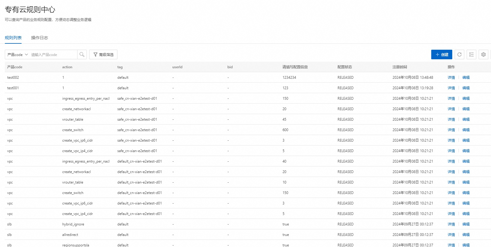

5. 单击其中一条数据的**详情**，可以查看该条规则的详情信息。

   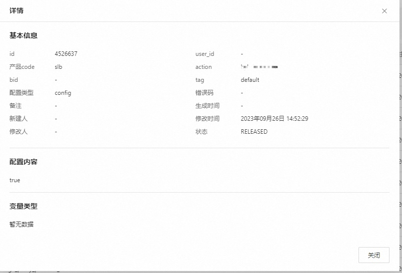

6. 在**操作日志**页签下，默认根据**状态**进行操作日志的查询，其中展示内容如下。

   - 基础服务

   - 状态

   - 操作

   - 创建时间

   - 审批时间

   - 工作量id

     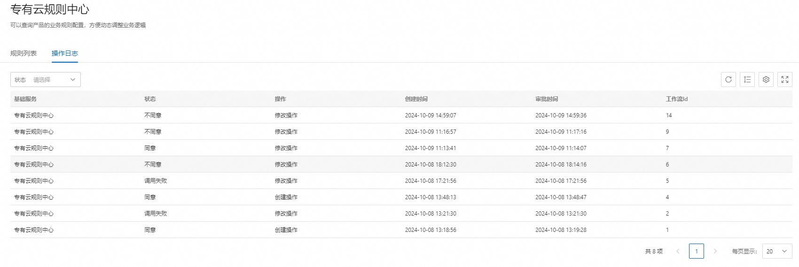

<a id="section-1-1-2"></a>

### 1.1.2. 专有云配置中心

可以查询配置中心的数据，支撑业务开关、限流等动态配置场景。

**操作步骤**

1. 登录Apsara Uni-manager运维控制台。

2. 在顶部菜单栏，选择**平台运维** > **管控服务运维** > **基础服务管控**。

3. 在左侧导航栏，选择**专有云配置中心**。

4. 在**配置列表**页签下，默认根据**Data Id**进行配置信息的查询，单击**高级筛选**可以根据**Data Id**或者**Group**进行配置信息的查询，其中展示内容如下。

   - Data Id

   - Group

   - 场景tag

   - 配置状态

   - 注册时间

     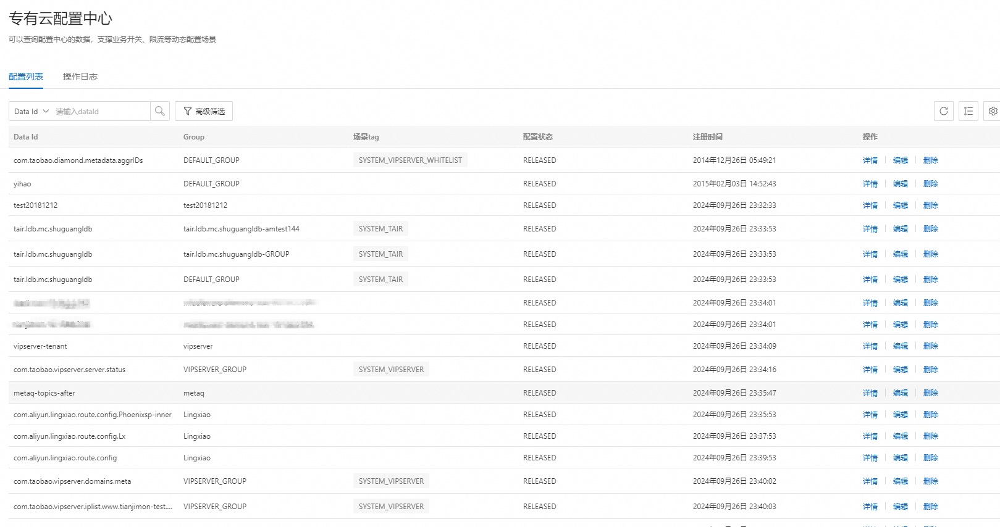

5. 单击其中一条数据的**详情**，可以查看该条配置的详情信息。

   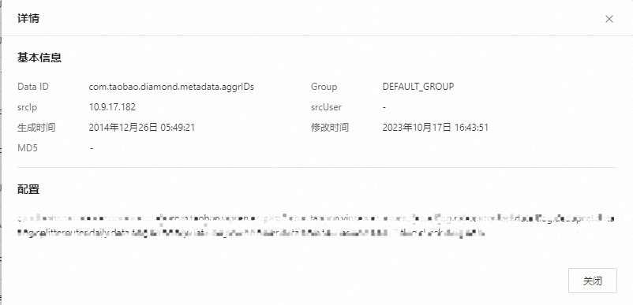

6. 在**操作日志**页签下，默认根据**状态**进行操作日志的查询，其中展示内容如下。

   - 基础服务

   - 状态

   - 操作

   - 创建时间

   - 审批时间

   - 工作量id

     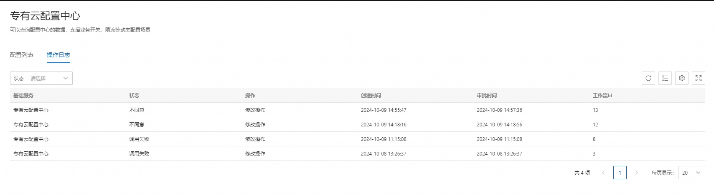

<a id="section-1-1-3"></a>

### 1.1.3. 负载均衡中间件

可以查询当前软负载均衡配置，域名及后端挂载IP的状态。

**操作步骤**

1. 登录Apsara Uni-manager运维控制台。

2. 在顶部菜单栏，选择**平台运维** > **管控服务运维** > **基础服务管控**。

3. 在左侧导航栏，选择**负载均衡中间件**。

4. 页面只提供通过**域名**进行查询，其中展示内容如下。

   - dom

   - 场景tag

   - 配置状态

   - 注册时间

     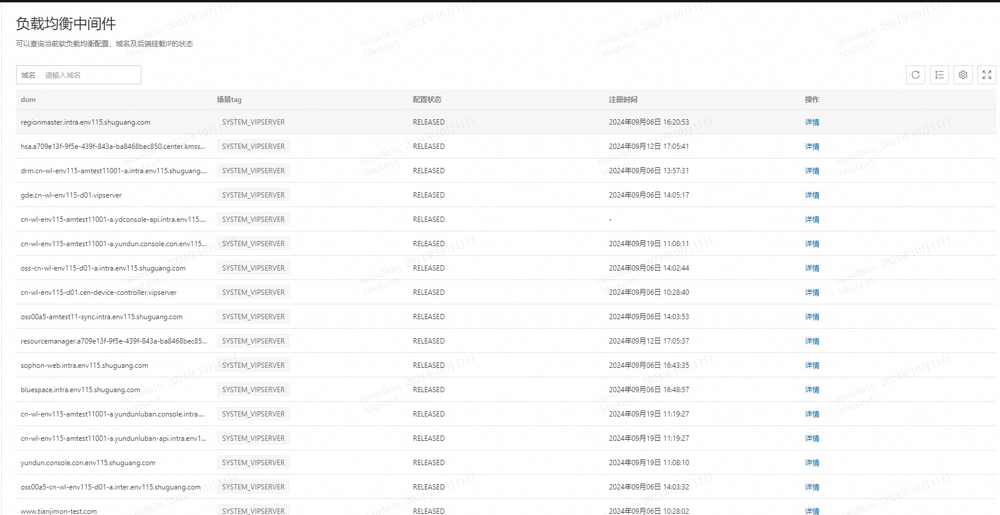

5. 单击其中一条数据的**详情**，可以查看该条负责均衡配置的详情信息。

   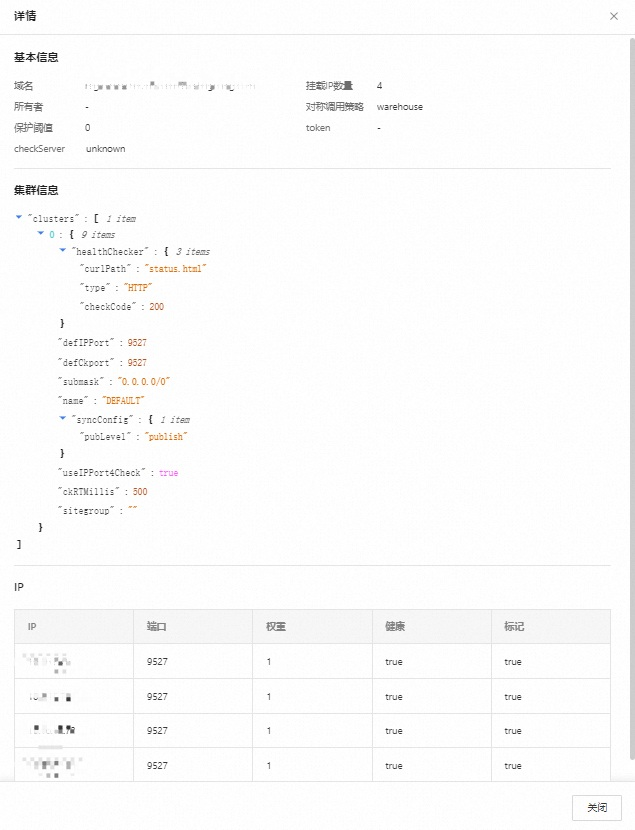

<a id="section-1-1-4"></a>

### 1.1.4. 消息中间件metaq

消息中间件的白屏控制台，提供了消息中间件的集群、主题、消息的查询能力。

<a id="section-1-1-4-1"></a>

#### 1.1.4.1. metaq集群

查看metaq的集群信息。

**操作步骤**

1. 登录Apsara Uni-manager运维控制台。

2. 在顶部菜单栏，选择**平台运维** > **管控服务运维**> **基础服务管控**。

3. 在左侧导航栏，选择**消息中间件metaq** >**metaq集群**。

4. 页面展示如下信息。

   - 分片

   - 编号

   - 地址

   - 版本

   - 生产消息TPS

   - 消费消息TPS

   - 昨日生产总数

   - 昨日消费总数

   - 今日生产总数

   - 今日消费总数

   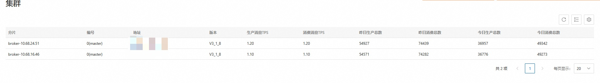

<a id="section-1-1-4-2"></a>

#### 1.1.4.2. metaq主题

查看metaq的topic信息。

**操作步骤**

1. 登录Apsara Uni-manager运维控制台。

2. 在顶部菜单栏，选择**平台运维** > **管控服务运维**> **基础服务管控**。

3. 在左侧导航栏，选择**消息中间件metaq** >**metaq主题**。

4. 页面提供了根据**Topic**查询Topic信息，展示如下信息。

   - Topic

     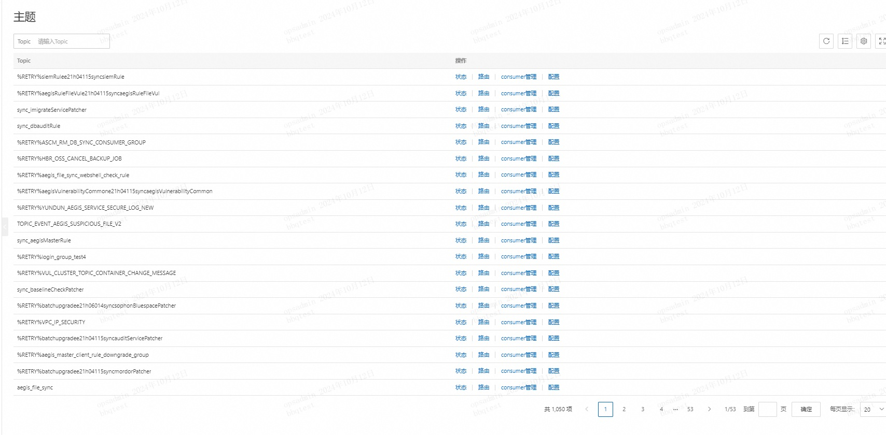

   - 选择其中一条数据单击**状态**可查看topic的状态信息。

     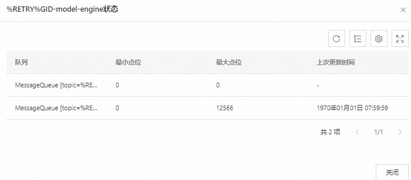

   - 单击**路由**可查看topic的路由信息。

     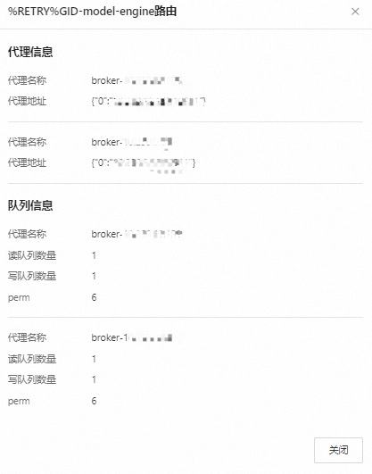

   - 单击**consumer管理**可查看topic的consumer的信息。

     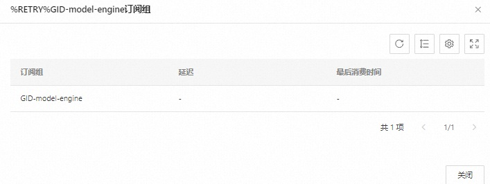

   - 单击**配置**可查看topic的配置信息。

     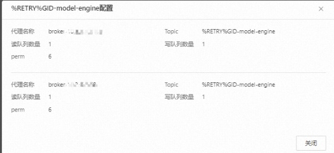

<a id="section-1-1-5"></a>

### 1.1.5. 定时任务schedulerx

schedulerx定时任务白屏控制台

<a id="section-1-1-5-1"></a>

#### 1.1.5.1. DtsJob配置

提供定时任务中间件任务的运维功能和运维操作日志查看，运维功能包括任务信息的查询、删除、修改、触发一次、停用、终止等操作。

**运维功能操作步骤**

**定时任务详情查看**

1. 登录Apsara Uni-manager运维控制台。

2. 在顶部菜单栏，选择**平台运维** > **管控服务运维**> **基础服务管控**。

3. 在左侧导航栏，选择**定时任务schedulerx** > **DtsJob配置**。

4. 下拉框中选择**分组ID**。

5. 在当前页面可以展示如下信息。

   - Job ID。

   - Job描述。

   - Job关键信息。

   - 操作。

     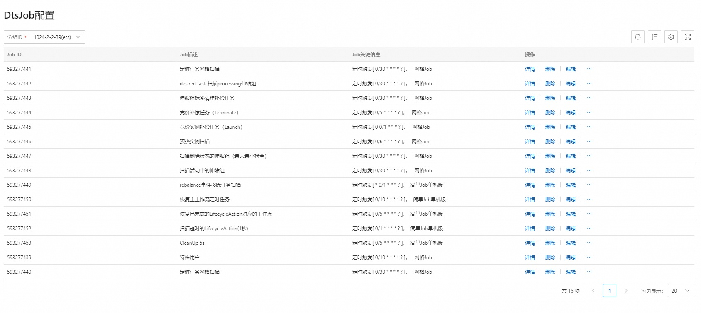

6. 单击其中一个Job的**详情**，进入Job的详情页，页面展示如下信息。

   - Job处理接口。

   - Job关键信息。

   - 定时表达式。

   - Job描述。

   - 自定义Job。

     

**任务的删除操作**

1. 确认需要删除的任务后点击操作下的删除按钮

   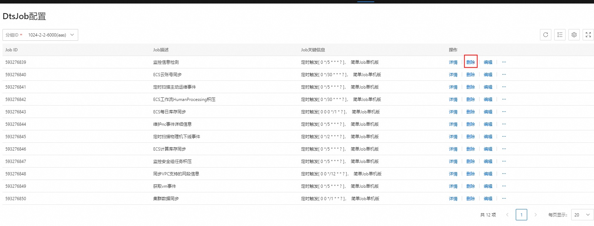

2. 执行完步骤1之后，会弹出确认窗口，点击创建删除工作流

   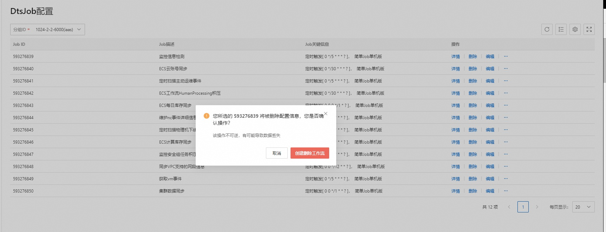

3. 执行完步骤2之后会弹出编辑审批信息窗口，工单标题和描述会自动生产，也会人工修改，补充上变更原因之后点击确认。

   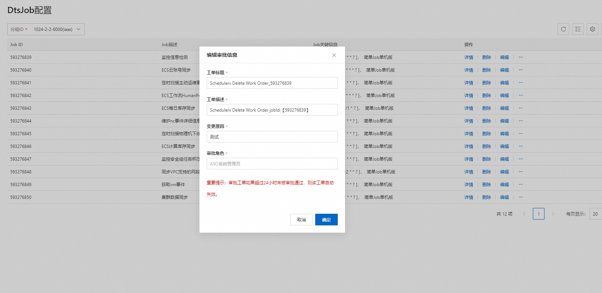

4. 执行完步骤3之后会弹出如下提示，按照提示即可查看审批提交信息。

   

5. 按照步骤4操作后的提示进入对应的页面，管理员权限的用户可在该页面完成审批，当审批完成之后本次运维操作执行成功，任务将会被删除。

   **同理，其他列如编辑，停用，触发一次，终止运维操作步骤与删除操作一致。**

**操作日志查询功能操作步骤**

1. 在左侧导航栏，选择**定时任务schedulerx** > <strong>DtsJob配置-></strong>操作日志。

   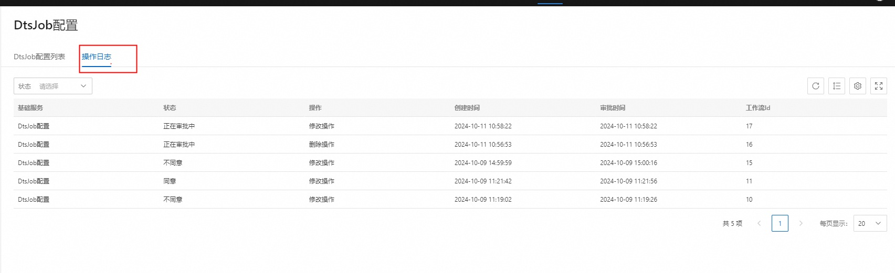

2. 状态下拉框可根据不同状态查看提交的运维操作审批信息。

<a id="section-1-1-5-2"></a>

#### 1.1.5.2. DtsJob管控

查询定时任务schedulerx触发时间的和运行状态相关信息。

**操作步骤**

1. 登录Apsara Uni-manager运维控制台。

2. 在顶部菜单栏，选择**平台运维** > **管控服务运维** > **基础服务管控**。

3. 在左侧导航栏，选择**定时任务schedulerx** > **DtsJob管控**。

4. 下拉框中选择**分组ID**。

5. 在当前页面可以展示如下信息。

   - Job ID

   - Job描述

   - Job状态

   - Job触发时间

     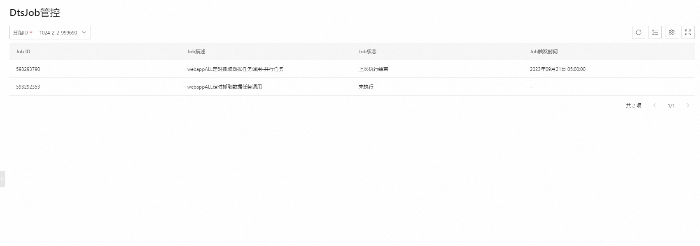

<a id="section-1-1-6"></a>

### 1.1.6. dubbo注册中心

dubbo注册中心的白屏控制台

<a id="section-1-1-6-1"></a>

#### 1.1.6.1. dubbo3注册中心

nacos的白屏控制台，作为dubbo3的注册中心可以查询服务信息和节点信息。

**操作步骤**

1. 登录Apsara Uni-manager运维控制台。

2. 在顶部菜单栏，选择**平台运维** > **管控服务运维** > **基础服务管控**。

3. 在左侧导航栏，选择**dubbo注册中心** > **dubbo3注册中心**。

4. 页面有**服务**、**节点**两个页签。

   <ol type="i">

   <li>

   **服务**页签下，页面展示的内容如下。

   - 服务名

     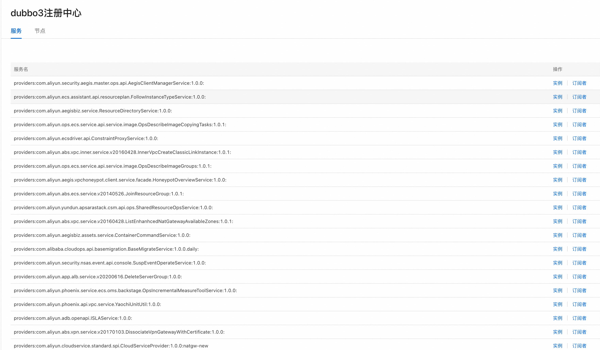

   - 单击**实例**查看实例的详情信息，页面展示信息如下。

     - IP

     - 端口号

     - Dubbo版本

     - 权重

     - 健康状态

       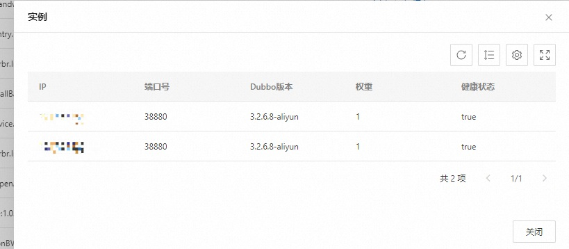

   - 单击**订阅者**查看订阅者信息，页面展示如下。

     - app

     - IP

     - agent

       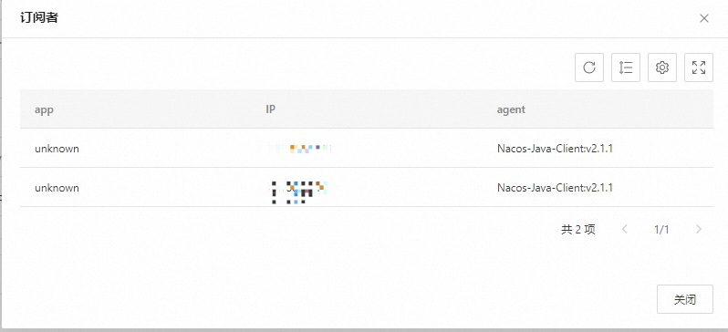

   </li>

   <li>

   **节点**页签下，可以查看当前环境nacos各个节点的状态，展示信息如下。

   - 节点IP

   - 节点状态

     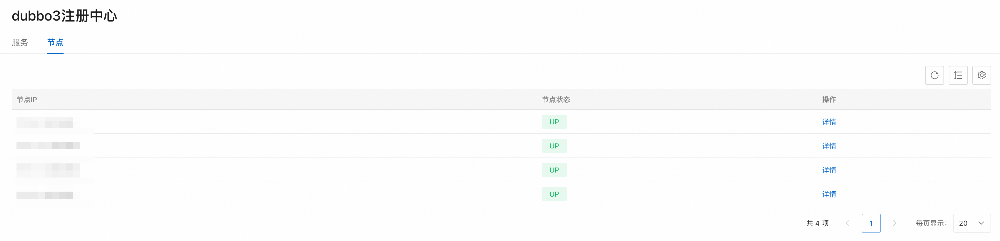

   - 单击其中一条数据的**详情**可查看节点详情信息。

     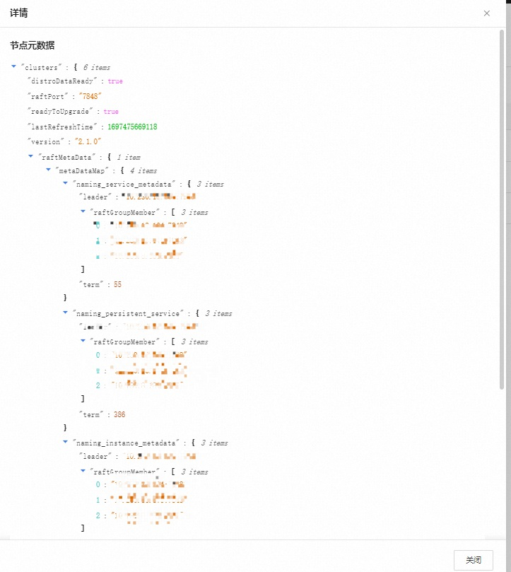

   </li>

   </ol>

<a id="section-1-1-7"></a>

### 1.1.7. 缓存中间件

用于查看 tair缓存中间件各namespace 详情。

**操作步骤**

1. 登录Apsara Uni-manager运维控制台。

2. 在顶部菜单栏，选择**平台运维** > **管控服务运维**> **基础服务管控**。

3. 在左侧导航栏，选择**缓存中间件** 。

4. 在页面上可以根据**namespace**获取目标信息，展示如下信息。

   - namespace

   - usersize

   - quota

   - 使用率

   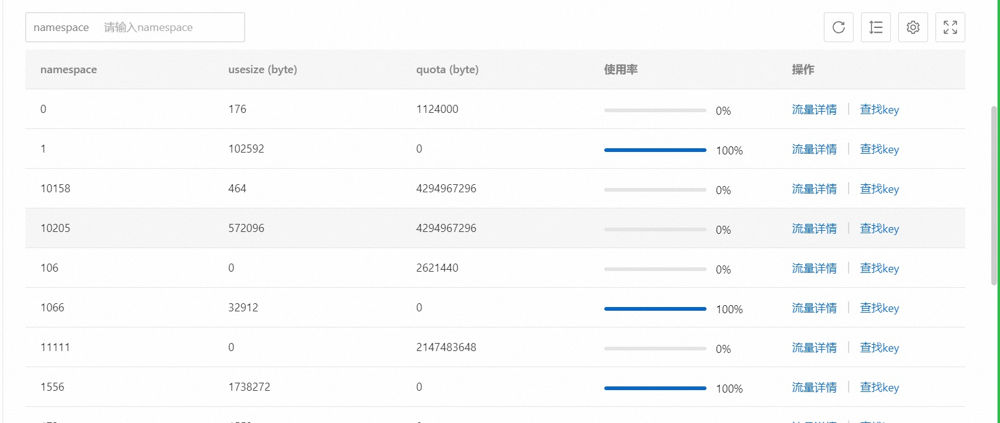

5. 单击**流量详情**，其中显示信息如下。

   - server

   - namespace

   - in

   - out

   - status

   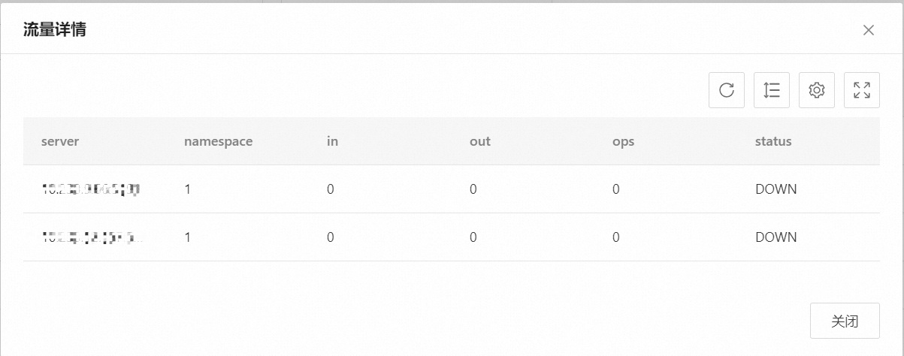

6. 单击**查找key**，其中页面可以根据key获取目标信息，展示如下信息。

   - key

   - value

   - version

   - mdate

   - cdate

   - edate

   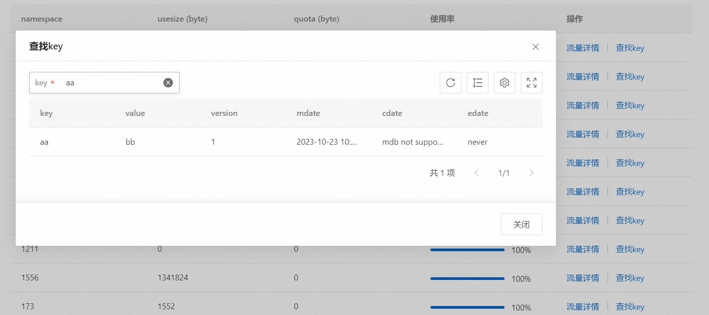

<a id="section-1-1-8"></a>

### 1.1.8. zookeeper

zookeeper分布式应用程序协调服务白屏控制台。

**操作步骤**

1. 登录Apsara Uni-manager运维控制台。

2. 在顶部菜单栏，选择**平台运维** > **管控服务运维**> **基础服务管控**。

3. 在左侧导航栏，选择**zookeeper** 。

4. 页面展示如下信息。

   - **路径**：使用方创建的路径名。

   - **产品**：接入的产品方名字。

   - **子节点数**：路径下对应的字节点数量。

   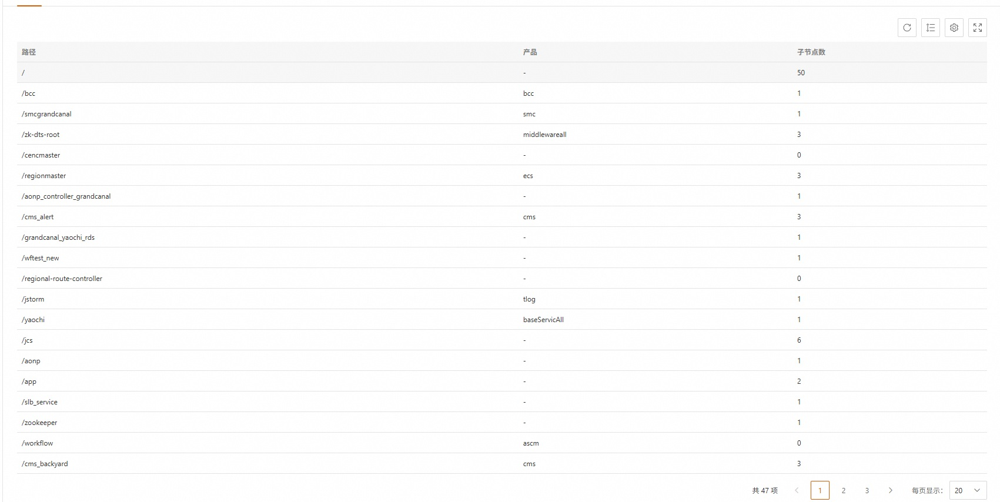

<a id="section-1-2"></a>

## 1.2. 配置管理平台•CMDB

<a id="section-1-2-1"></a>

### 1.2.1. 入门

<a id="section-1-2-1-1"></a>

#### 1.2.1.1. 登录Apsara Uni-manager运维控制台

本文介绍运维工程师等相关用户如何登录到Apsara Uni-manager运维控制台。

**前提条件**

- 已从部署人员或管理员处获取Apsara Uni-manager运维控制台的访问地址、用户名和密码。

  Apsara Uni-manager运维控制台访问地址格式为*region-id*.ops.console.*intranet-domain-id*。

- 推荐使用Chrome浏览器。

**操作步骤**

1. 打开浏览器。

2. 在地址栏中，输入Apsara Uni-manager运维控制台的访问地址，按回车键。

   

   > **说明**
   >
   > 您可以单击右上角的当前语言切换其它语言。当前支持简体中文、English语言切换。

3. 输入正确的用户名及密码。

   > **说明**
   >
   > - 登录Apsara Uni-manager运维控制台的用户名和密码请从部署人员或管理员处获取。
   >
   > - 若连续输入密码错误三次，系统将启动图片验证码登录功能；若连续输入错误五次，账户将被锁定，请联系管理员进行激活。
   >
   > - 首次登录Apsara Uni-manager运维控制台时，需要修改登录用户名的密码，请按照提示完成密码修改。
   >
   >   为提高安全性，密码必须满足以下要求：
   >
   >   - 必须包含英文大小写字母。
   >
   >   - 必须包含阿拉伯数字（0~9）。
   >
   >   - 必须包含特殊符号，包括感叹号（!）、at（@）、井号（#）、美元符号（$）、百分号（%）等。
   >
   >   - 密码长度为10~20个字符。

4. 单击**同意协议并登录**。

<a id="section-1-2-1-2"></a>

#### 1.2.1.2. 进入配置管理平台CMDB

1. 登录Apsara Uni-manager运维控制台。

2. 在顶部菜单栏中，选择 **平台运维** > **管控服务运维** > **配置管理平台·CMDB**，进入CMDB界面。

   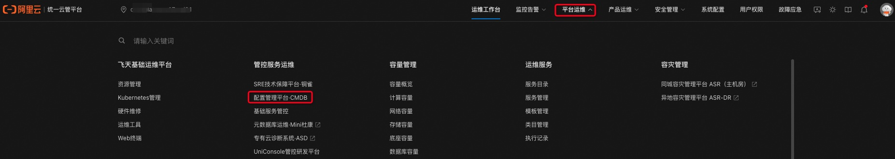

<a id="section-1-2-2"></a>

### 1.2.2. 概览

介绍CMDB概览页的展示内容。

**数据大盘**

展示当前底座CMDB中的模型统计和数据信息。

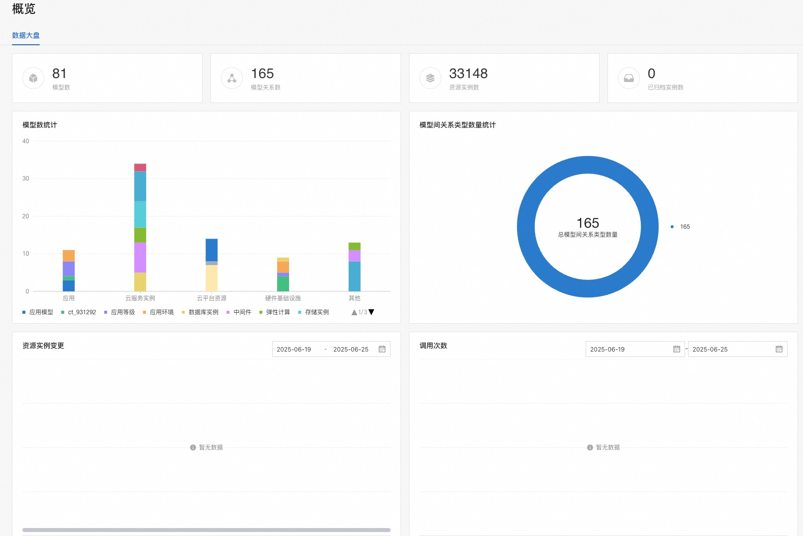

指标说明如下：

| 指标名称 | 指标说明 |
| --- | --- |
| 模型数 | 当前CMDB中所有模型的总数。 |
| 模型关系数 | 当前CMDB中所有模型与模型间的关系总数。 |
| 资源实例数 | 当前CMDB中所有模型内实例数据的总行数。 |
| 已归档实例数 | 当前CMDB中所有模型内已经归档的实例数据行数。 |
| 模型数统计 | 当前CMDB中所有模型的个数。 |
| 模型间关系类型数量统计 | 按照模型间的关系类型进行分类统计。 |
| 资源实例变更 | 展示选择时间段内的实例新增、修改、删除实例数量。 |
| 调用次数 | 内外部系统调用CMDB的接口次数统计，按调用方系统、天进行分类统计。 |

<a id="section-1-2-3"></a>

### 1.2.3. 资源拓扑

以资源为核心，提供单模型的资源列表查询、多模型的资源间拓扑查询、资源的变更日志能力。

<a id="section-1-2-3-1"></a>

#### 1.2.3.1. 资源管理

按一级和二级分类展示，查询单个模型内的资源信息。

**查看资源列表**

1. 登录Apsara Uni-manager运维控制台。

2. 进入配置管理平台CMDB。

3. 在左侧导航栏，选择**资源拓扑**>**资源管理**。

4. 在**资源管理**页面，可以获取所有的模型分类、当前选择的模型分类下所有模型，以及当前选择模型的资源列表。

   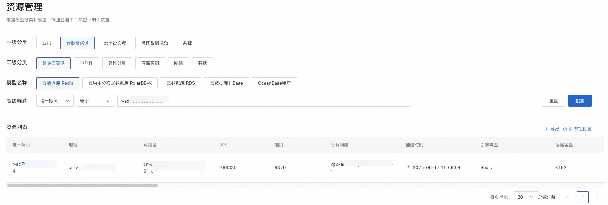

   > **说明**
   >
   > - 资源列表页展示的字段支持自定义设置。用户可以通过单击列表右上角的**列表项设置**进行相应的设置。
   >
   > - 模型资源支持单资源实例查看属性字段详情、关联关系以及变更记录。

5. 在资源列表，单击第一列目标资源，可查看资源详情。

   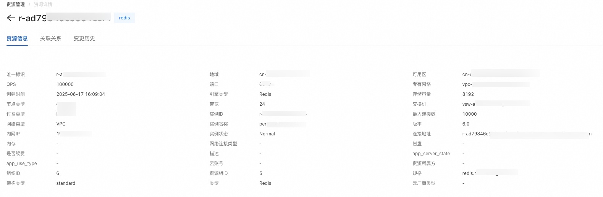

**导出资源列表**

在**资源管理**页面，单击资源列表右上角的**导出**，一键导出所选模型的资源实例。


<a id="section-1-2-3-2"></a>

#### 1.2.3.2. 拓扑查询

拓扑查询提供了存在关联关系的不同模型间数据的查询能力。

**即时查询**

1. 登录Apsara Uni-manager运维控制台。

2. 进入配置管理平台CMDB。

3. 在左侧导航栏，选择**资源拓扑 > 拓扑查询**。

4. 在**拓扑查询**页面，添加**展示结果**模型和**过滤条件**，单击**搜索**，查询不同模型之间存在关联关系的数据。

   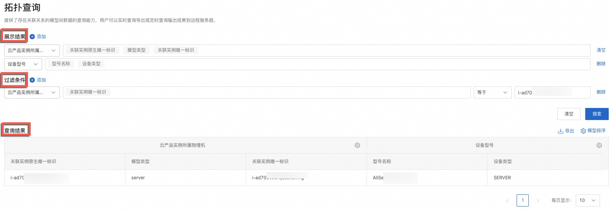

   页面中各区域说明如下：

   - **展示结果**：设置查询结果需要展示的模型字段，可以添加多个存在关联关系的模型。

   - **过滤条件**：设置查询的筛选条件，可以添加多个条件。

   - **查询结果**：展示当前的查询结果。查询结果显示后，将同时呈现**导出**和**模型排序**的按钮。

     > **说明**
     >
     > 对于查询结果的列表内容，平台同时支持一键导出文档。

5. （可选）在**查询结果**区域，单击**模型排序**，可通过拖拽调整模型的前后展示顺序。

   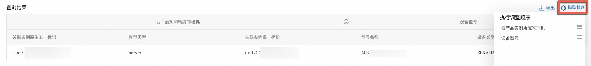

6. （可选）在**查询结果**区域，单击列表中模型名称后的设置按钮，可以对当前模型内部的字段顺序进行设置。

   

<a id="section-1-2-4"></a>

### 1.2.4. 模型信息

<a id="section-1-2-4-1"></a>

#### 1.2.4.1. 模型管理

展示当前CMDB所有的模型字段信息和模型关联信息。

**查看模型**

1. 登录Apsara Uni-manager运维控制台。

2. 进入配置管理平台CMDB。

3. 在左侧导航栏，选择**模型信息**>**模型管理**。

4. 在**模型管理**页面，选择左侧的目标模型，右侧展示该模型的基本信息，并默认展示**模型字段**相关内容。

   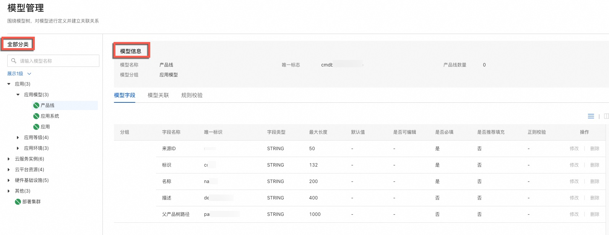

   页面中各区域说明如下：

   - **全部分类**：展示平台内所有的模型分类，仅支持查看。

   - **模型信息**：展示所选模型的模型信息，仅支持**模型字段**、**模型关联**以及**规则校验**相关内容的查看。

5. （可选）在**模型字段**页签中，单击模式图标以切换显示模式，支持列表模型和分组模型两种查看方式。

   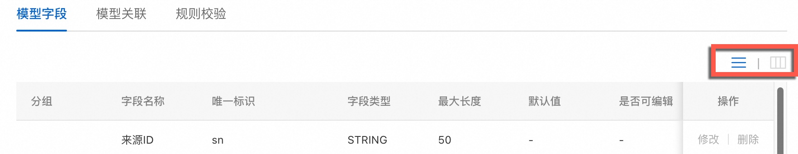

6. 在**模型信息**区域，单击**模型关联**页签，查看与当前模型有关联关系的模型信息。

   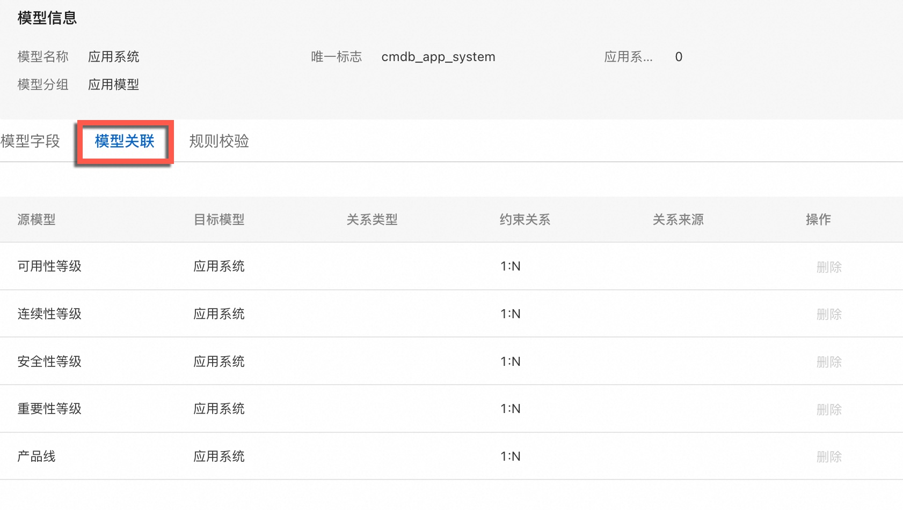

7. 在**模型信息**区域，单击**规则校验**页签，查看当前模型的规则校验。

   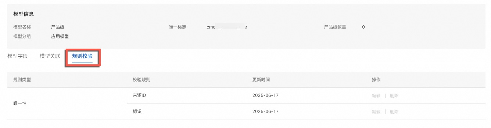

<a id="section-1-2-4-2"></a>

#### 1.2.4.2. 模型拓扑

模型拓扑提供了一种图形化方式查看模型间关联关系的能力。

**查看模型拓扑**

1. 登录Apsara Uni-manager运维控制台。

2. 进入配置管理平台CMDB。

3. 在左侧导航栏，选择**模型信息**>**模型拓扑**。

4. 在**模型拓扑**页面，选择下拉列表中的目标模型作为根节点进行查询，选中后，将以该模型为中心显示其拓扑关系图。

   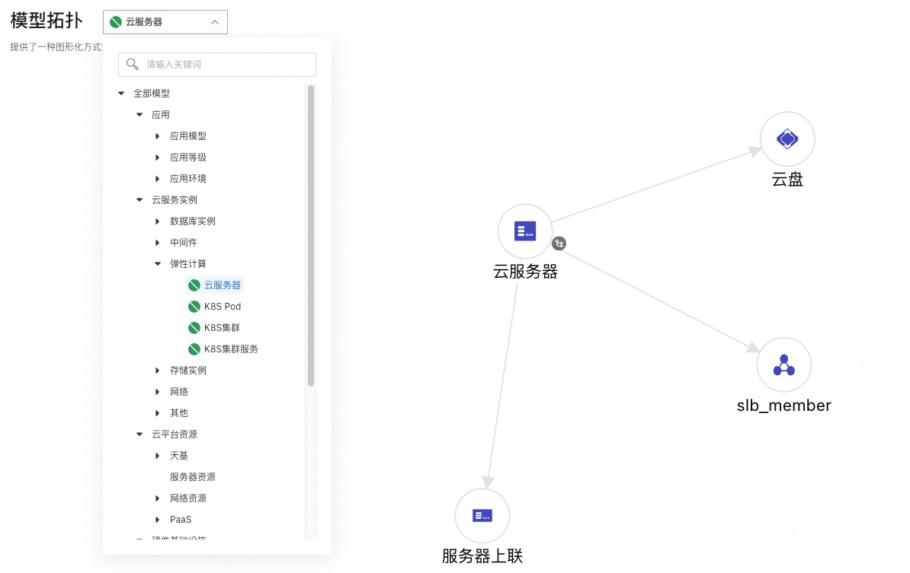

5. 在模型拓扑图中，单击模型  图标，可展开深层次的模型间的关联关系。

   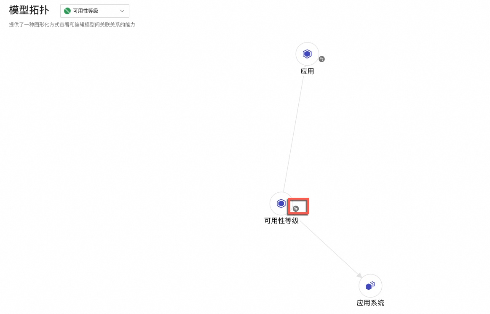

6. 单击目标模型图标，可在右侧查看详细的模型信息。

<a id="section-1-3"></a>

## 1.3. 底座容器运维平台

<a id="section-1-3-1"></a>

### 1.3.1. 平台简介

本文介绍了容器运维平台COP的诞生背景和基本能力预计设计架构

**背景**

在过去，专有云的运维体系缺少统一的容器维度视图，在统一基座的背景下，运维同学需要同时熟悉tianji和k8s两套底座的技术体系，运维成本偏高。另外，缺失统一的容器资源画像让运维人员无法查看容器的全貌，无法为未来容器技术演进提供数据支撑。因此，我们从更高层次抽象，设计了容器运维平台COP，能解决以上痛点

**设计架构**

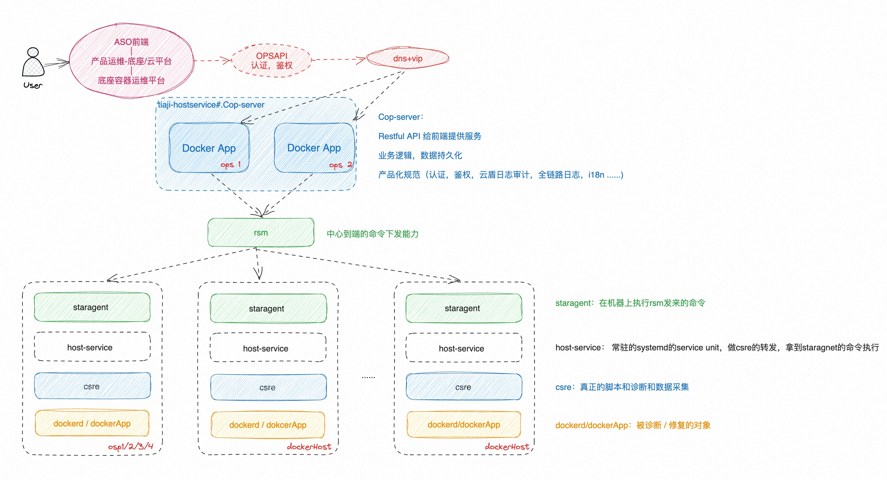

**基本能力**

- 全局视角查看所有使用了容器服务（tianji-dockerdaemon）的机器的容器引擎的状态列表

- 全局视角查看所有使用了容器服务（tianji-dockerdaemon）的机器的所有容器实例的状态列表

- 提供一键采集指定机器上容器引擎的运行日志，堆栈日志，性能分析日志的能力

- 提供容器引擎/容器实例的一键诊断功能，并自动匹配已知问题相关KB

- 提供容器引擎/容器实例的一键修复功能，针对已知问题做自动化修复

<a id="section-1-3-2"></a>

### 1.3.2. 功能介绍

本节具体介绍容器运维平台的功能，功能介绍按照页面菜单顺序依次介绍，包括如下两部分：

- 容器引擎运维

- 容器实例运维

平台入口在aso吊顶菜单产品运维--底座/云平台--底座容器运维平台，如下图所示：

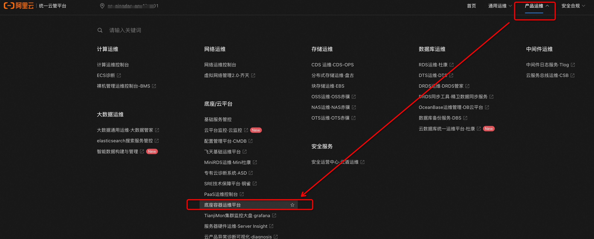

<a id="section-1-3-2-1"></a>

#### 1.3.2.1. 容器引擎运维

本节主要介绍容器引擎运维页面的功能，包括容器引擎列表，容器引擎诊断与修复，容器引擎日志采集三部分

**一，容器引擎列表**


如图所示，可以看到所有部署了容器服务的机器的容器引擎状态，列表信息包含 机器名 ， 架构 ， 状


态 ， 引擎版本 以及 启动时间 等，还可以根据上方的筛选按钮进行筛选，快速定位自己所需要的信息，可选的筛选项包括所属机器，状态和架构

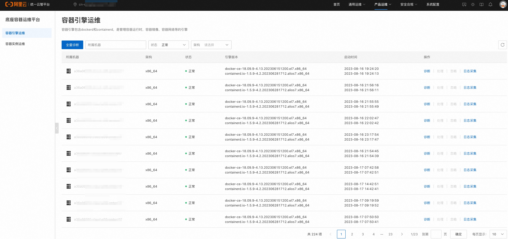

**二，容器引擎诊断与修复**

**全量诊断**

默认情况下，系统会每15分钟自动对所有容器引擎诊断一次，也即列表数据每15分钟更新一次，如果希望手动


诊断可以单击列表上方按钮 全量诊断 立即开始一次诊断，注意，全量诊断时间较长，需要耐心等待一会儿，诊断结束后会自动刷新列表

**单个诊断**


如果希望只诊断单个容器引擎，可以单击对应容器引擎右侧的 诊断 按钮进行单个容器引擎的诊断，诊断结束后会自动刷新列表

**查看诊断结果**


诊断结果仅仅针对于异常容器引擎，所以状态正常的容器引擎的列表右侧的 处理 和 忽略 按钮是灰色的，可


以手动在列表上方状态栏进行筛选，得到异常的项，如果单击 忽略 会暂时隐藏对应的行，但是下一次诊断如果错误还在就还会重新显示，操作界面如下图

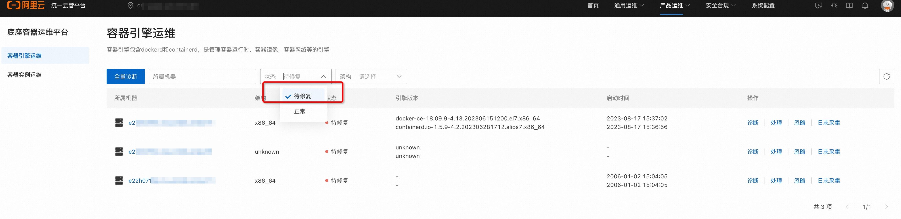

单击处理进入后可以看到具体的诊断结果，可以看到相关的诊断项目以及简单的修复建议，右侧还有对应的查看匹配的kb操作，单击 查看`kb` 可以下载kb文档

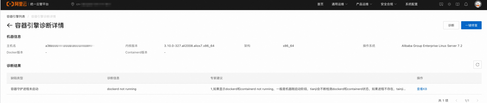


单击右上角的 一键修复 可以修复部分已知问题（不一定能修复当前诊断出来的错误，只支持可以全自动化的修复功能，更多请参考KB），效果如下图：

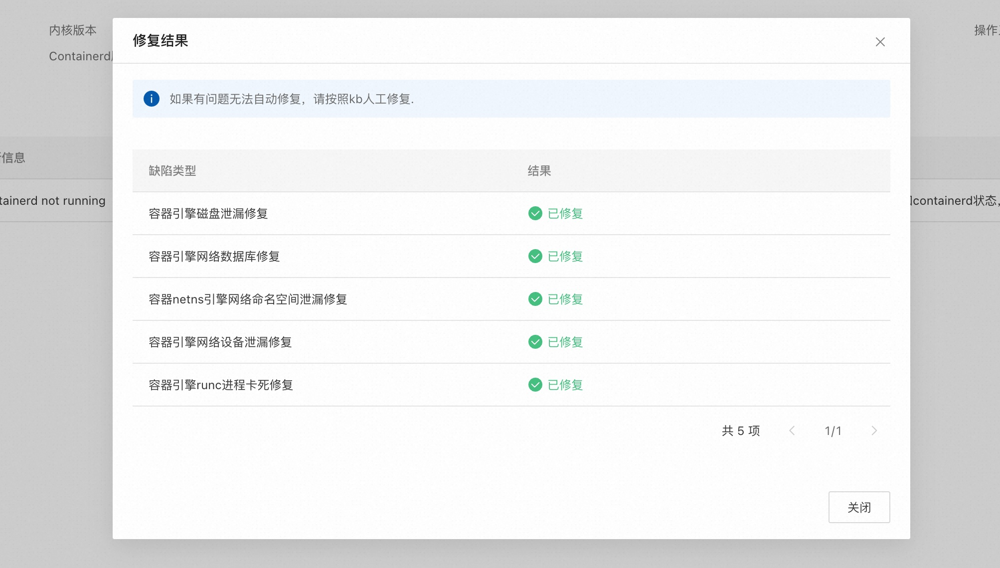

**三，容器引擎日志采集**


在容器引擎列表页面，单击对应行右侧的 日志采集 按钮进入日志采集页面，单击右侧 开始采集 即可开启采集功能，采集成功后会在文件列表处显示对应的日志文件名称，大小以及下载链接（oss链接），其中log采集的是引擎进程的运行日志，stack采集的容器引擎进程的堆栈日志，pprof采集的是容器引擎的性能日志（火焰图，链路耗时等）：

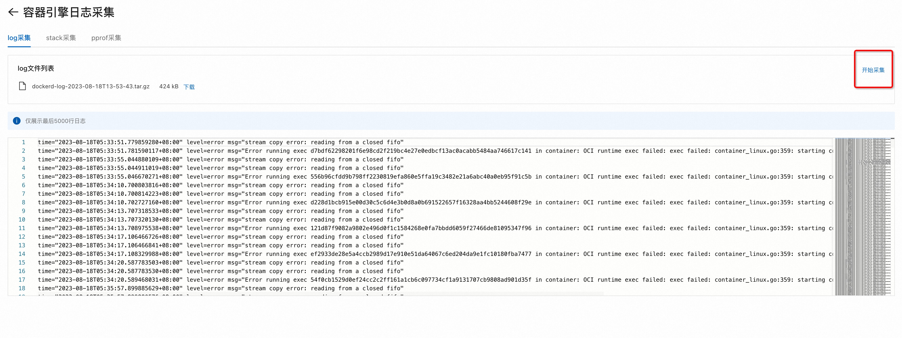

log采集和stack采集都提供当前采集的日志的最后5000行预览，pprof采集不提供预览，且pprof采集因为需要对程序运行状态采样所以耗时较久（分钟级别）

<a id="section-1-3-2-2"></a>

#### 1.3.2.2. 容器实例运维

本节主要介绍容器实例运维页面的功能，包括容器实例列表，容器实例诊断与修复两部分

**一，容器实例列表**

如图所示，可以看到所有部署了容器服务的机器的所有容器实例（dockerapp，dockervm）状态，列表信息包


含 容器`ID` , 容器名 ， 状态 ， 所属`SR` ， 所在机器 ，还可以根据上方的筛选按钮进行筛选，快速定位自己所需要的信息，筛选项包括容器ID，容器名，所在机器和状态四个条件

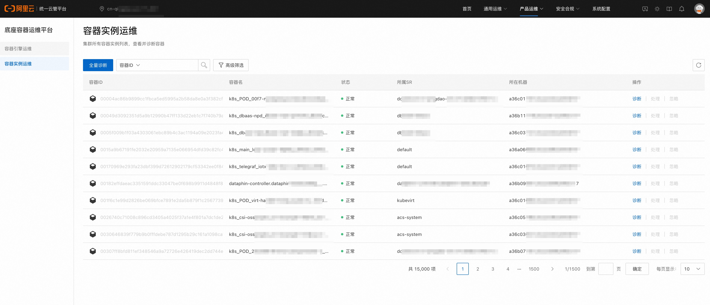

**二，容器实例诊断与修复**

**全量诊断**

默认情况下，系统会每15分钟自动对所有容器实例诊断一次，也即列表数据每15分钟更新一次，如果希望手动


诊断可以单击列表上方按钮 全量诊断 立即开始一次诊断，注意，全量诊断时间较长，需要耐心等待一会儿，诊断结束后会自动刷新列表

**单个诊断**


如果希望只诊断单个容器实例，可以单击对应容器实例列表右侧的 诊断 按钮进行单个容器实例的诊断，诊断结束后会自动刷新列表

**查看诊断结果**


诊断结果仅仅针对于异常容器实例，所以状态正常的容器实例的列表右侧的 处理 和 忽略 按钮是灰色的，可以手动在列表上方状态栏进行筛选，选择状态为“待修复”得到异常的项，如果单击 忽略 会暂时隐藏对应的行，但是下一次诊断如果错误还在就还会重新显示，操作界面如下图

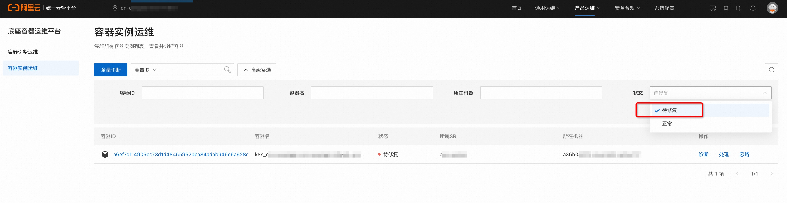

单击处理进入后可以看到具体的诊断结果，可以看到相关的诊断项目以及简单的修复建议，右侧还有对应的查看匹配的kb操作，单击 查看`kb` 可以下载kb文档


单击右上角的 一键修复 可以修复部分已知问题（不一定能修复当前诊断出来的错误，只支持可以全自动化的修复功能，更多请参考KB），效果如下图：


<a id="section-1-4"></a>

## 1.4. API运维平台

<a id="section-1-4-1"></a>

### 1.4.1. 临时限流

**创建限流模式**

1. 登录Apsara Uni-manager运维控制台。

2. 在顶部菜单栏，选择**平台运维** > **管控服务运维** > **API运维平台** 。

   

3. 进入**API运维平台**后，左侧导航栏选择**临时限流**。

4. 可以通过**网关类型**、**状态**、**操作类型**筛选目标限流模式。

5. 单击**创建限流模式**，配置如下参数后单击**确定**创建限流规则。

   <table>
     <tr>
       <th width="122">参数</th>
       <th>参数说明</th>
     </tr>
     <tr>
       <td>网关类型</td>
       <td>选择网关类型。<br>• POP<br>• OPSAPI</td>
     </tr>
     <tr>
       <td>identifier</td>
       <td>选择限流对象。<br>• 产品维度限流<br>• API维度限流<br>• UID维度限流</td>
     </tr>
     <tr>
       <td>产品名</td>
       <td>选择限流产品。</td>
     </tr>
     <tr>
       <td>操作类型</td>
       <td>目前仅支持<strong>FLOE_CONTROL</strong>。</td>
     </tr>
     <tr>
       <td>grad</td>
       <td>目前仅支持<strong>QPS</strong>。</td>
     </tr>
     <tr>
       <td>value</td>
       <td>输入当前对象设置的最大QPS，当目标对象的访问量超过该值时，多余的请求将被网关拒绝。value需大于0。</td>
     </tr>
     <tr>
       <td>最大排队时间</td>
       <td>输入最大排队时间，单位毫秒。</td>
     </tr>
   </table>

   

**更多操作**

**编辑限流模式**

1. 单击目标限流模式对应**操作**列的**编辑**。

2. 修改参数信息后单击**确定**。

   > **说明**
   >
   > 目前支持修改具体的QPS值和最大排队时间。

**启动限流模式**

1. 单击目标限流模式对应**操作**列的**启动**。

2. 在弹出的对话框中单击**确定**。

   > **说明**
   >
   > **状态**为**已停止**时支持启动限流模式。

**停止限流模式**

1. 单击目标限流模式对应**操作**列的**停止**。

2. 在弹出的对话框中单击**确定**。停止的规则将不再生效。

   > **说明**
   >
   > **状态**为**已启用**时支持停止限流模式。

**删除限流模式**

1. 单击目标限流模式对应**操作**列的**删除**。

2. 在弹出的对话框中单击**确定**。

<a id="section-1-4-2"></a>

### 1.4.2. POP网关

<a id="section-1-4-2-1"></a>

#### 1.4.2.1. 网关调用统计

**操作步骤**

1. 登录Apsara Uni-manager运维控制台。

2. 在顶部菜单栏，选择**平台运维** > **管控服务运维** > **API运维平台** 。

   

3. 进入**API运维平台**后，左侧导航栏选择**POP网关 > 网关调用统计**。

   

4. 第一部分展示**网关负载总趋势**和**网关耗时总趋势**，以分钟，小时粒度绘制的折线图。

   > **说明**
   >
   > 支持仅显示**请求成功数**或**请求失败数**的折线图，单击左下角字体可关闭显示，下方可滑动取某一时间段展示，可选时间粒度为一分钟，三十分钟，一小时，六小时，十二小时，二十四小时。

   

   > **说明**
   >
   > 支持仅显示**平均耗时**或**P99**的折线图，单击左下角字体可关闭显示，下方可滑动取某一时间段展示，可选时间粒度为一分钟，三十分钟，一小时，六小时，十二小时，二十四小时。

   

5. 第二部分展示**调用量统计**和**耗时统计**TopN，分别可以显示**产品级**和**API级**。

   > **说明**
   >
   > 支持仅显示**请求成功数**、**4xx失败数**、**5xx失败数**和**其他失败数**，单击左下角字体可关闭显示，Top可取范围1-100之间。

   

6. 第三部分可以查看相应的调用来源分布，可以根据**监控指标**、**时间范围**等信息选择展示。

   

   <ol type="i">

   <li>

   单击**调用来源分布**可以查看调用方的AK信息。

   

   </li>

   <li>

   单击**临时限流**支持设置临时限流。

   

   </li>

   </ol>

<a id="section-1-4-2-2"></a>

#### 1.4.2.2. API调用统计

**操作步骤**

1. 登录Apsara Uni-manager运维控制台。

2. 在顶部菜单栏，选择**平台运维** > **管控服务运维** > **API运维平台** 。

   

3. 进入**API运维平台**后，左侧导航栏选择**POP网关** > **API调用统计**。

   

4. 第一部分展示API**调用趋势**与**耗时趋势**，可以根据选择**namespace**、**时间粒度**等来查看相应API的调用趋势与耗时趋势折线图。

   > **说明**
   >
   > 支持仅显示**请求成功数**或**请求失败数**的折线图，单击左下角字体可关闭显示，下方可滑动取某一时间段展示，可选时间粒度为一分钟、三十分钟、一小时、六小时、十二小时、二十四小时。

   

   > **说明**
   >
   > 支持仅显示**平均耗时**或**P99**的折线图，单击左下角字体可关闭显示，下方可滑动取某一时间段展示，可选时间粒度为一分钟，三十分钟，一小时，六小时，十二小时，二十四小时。

   

5. 第二部分展示**调用统计**TopN，分为**调用量统计**和**耗时统计**。

   > **说明**
   >
   > 支持仅显示**请求成功数**、**4xx失败数**、**5xx失败数**和**其他失败数**，单击左下角字体可关闭显示，Top可取范围1-100之间。

   

6. 第三部分可以查看某个API的相关信息。

   

   <ol type="i">

   <li>

   单击**调用来源分布**查看该API调用AK分布、namespace、来源IP、User-Agent等相关信息。

   

   </li>

   <li>

   单击**监控数据**查看API控制指标。

   

   </li>

   <li>

   单击**调用趋势**查看调用趋势，可选择时间粒度。

   

   </li>

   </ol>

<a id="section-1-4-2-3"></a>

#### 1.4.2.3. 调用历史

**操作步骤**

1. 登录Apsara Uni-manager运维控制台。

2. 在顶部菜单栏，选择**平台运维** > **管控服务运维** > **API运维平台** 。

   

3. 进入**API运维平台**后，左侧导航栏选择**POP网关** > **调用历史**。

   

4. 查看pop调用历史相关信息，可通过上方相关查询条件筛选过滤，统计维度可分为调用量排序和统计时间排序

   

<a id="section-1-4-2-4"></a>

#### 1.4.2.4. 跨Region调用历史

**操作步骤**

1. 登录Apsara Uni-manager运维控制台。

2. 在顶部菜单栏，选择**平台运维** > **管控服务运维** > **API运维平台** 。

   

3. 进入**API运维平台**后，左侧导航栏选择**POP网关** > **跨Region调用历史**。

   

4. 查看跨Region调用的历史信息，可通过上放查询条件进行筛选过滤，IP支持模糊查询。

   > **说明**
   >
   > 展示来自非本Region的调用记录信息。

   

<a id="section-1-4-2-5"></a>

#### 1.4.2.5. API兼容映射层管控

**操作步骤**

1. 登录Apsara Uni-manager运维控制台。

2. 在顶部菜单栏，选择**平台运维** > **管控服务运维** > **API运维平台** 。

   

3. 进入**API运维平台**后，左侧导航栏选择**POP网关** > **API兼容映射层管控**。该页面下展示了POP支持兼容映射的API大盘，在该界面下，支持Api运维平台管理员单一/批量启停POP对该API的兼容映射规则。

   > **重要**
   >
   > 启停一条兼容规则需要等待最多5分钟才能同步生效至POP网关。

   

4. 单击**详情**按钮，可以查看某一条API的兼容映射规则。下图展示了ASRBR_2021-10-15_RestartRecoveryInstance这一API的兼容映射规则，该API在当前版本中发生过参数名变动。为保证客户侧API调用的兼容性，当该映射规则生效时，每当调用者调用该API，且传递参数中包含InstanceTaskId，POP会识别该参数，并将其转换为TaskInstanceId，最终传递给服务端。

   

<a id="section-1-4-2-6"></a>

#### 1.4.2.6. 元数据查询

**操作步骤**

1. 登录Apsara Uni-manager运维控制台。

2. 在顶部菜单栏，选择**平台运维** > **管控服务运维** > **API运维平台** 。

   

3. 进入**API运维平台**后，左侧导航栏选择**POP网关** > **元数据查询**。

   

4. 按顺序填写需要查询的API信息。

   > **说明**
   >
   > 可查看API的**基本信息**、**服务信息**、**API入参出参**、**产品XML配置**、**版本xml配置**和**API XML配置**。

   

   

<a id="section-1-4-3"></a>

### 1.4.3. OPSAPI网关

<a id="section-1-4-3-1"></a>

#### 1.4.3.1. 网关调用统计

**操作步骤**

1. 登录Apsara Uni-manager运维控制台。

2. 在顶部菜单栏，选择**平台运维** > **管控服务运维** > **API运维平台** 。

   

3. 进入**API运维平台**后，左侧导航栏选择**OPSAPI网关** > **网关调用统计**。

   

4. 第一部分展示**网关负载总趋势**，以小时为粒度绘制的折线图。

   > **说明**
   >
   > 支持仅显示**请求成功数**或**请求失败数**的折线图，单击左下角字体可关闭显示。

   

5. 第二部分展示**统计调用**TopN，分别可以显示**产品级**和**API级**。

   > **说明**
   >
   > 支持仅显示**请求成功数**或**请求失败数**，单击左下角字体可关闭显示，Top可取范围1-100之间。

   

6. 第三部分可以查看相应的调用来源分布。可以根据**监控指标**、**时间范围**等信息选择展示。

   

   <ol type="i">

   <li>

   单击**调用来源分布**可以查看调用方的AK信息。

   

   </li>

   <li>

   单击**临时限流**设置临时限流。

   

   </li>

   </ol>

<a id="section-1-4-3-2"></a>

#### 1.4.3.2. API调用统计

**操作步骤**

1. 登录Apsara Uni-manager运维控制台。

2. 在顶部菜单栏，选择**平台运维** > **管控服务运维** > **API运维平台** 。

   

3. 进入**API运维平台**后，左侧导航栏选择**OPSAPI网关** > **API调用统计**。

   

4. 第一部分展示API调用趋势，可以根据选择**namespace**、**apiCode**等来查看相应API的调用趋势折线图。

   > **说明**
   >
   > 支持仅显示**请求成功数**或**请求失败数**的折线图，单击左下角字体可关闭显示。

   

5. 第二部分展示**调用统计**TopN，分为**调用量统计**和**耗时统计**。

   > **说明**
   >
   > 支持仅显示**请求成功数**或**请求失败数**，单击左下角字体可关闭显示，Top可取范围1-100之间。

   

6. 第三部分可以查看某个API的相关信息。

   

   <ol type="i">

   <li>

   单击**调用来源分布**查看调用AK分布。

   

   </li>

   <li>

   单击**监控数据**查看API控制指标。

   

   </li>

   <li>

   单击**调用趋势**查看调用趋势。

   

   </li>

   </ol>

<a id="section-1-4-3-3"></a>

#### 1.4.3.3. 调用历史

**操作步骤**

1. 登录Apsara Uni-manager运维控制台。

2. 在顶部菜单栏，选择**平台运维** > **管控服务运维** > **API运维平台** 。

   

3. 进入**API运维平台**后，左侧导航栏选择**OPSAPI网关** > **调用历史**。

   

4. 查看opsapi调用历史相关信息，可通过上方相关查询条件筛选过滤，统计维度可分为调用量排序和统计时间排序

   

<a id="section-1-4-4"></a>

### 1.4.4. 运维API管理

用于查看和管理注册在OPSAPI网关上的产品信息和API信息。

<a id="section-1-4-4-1"></a>

#### 1.4.4.1. namespace管理

通过此页面查看当前注册在OPSAPI网关上的产品的namespace信息。

**前提条件**

OPSAPI已到达终态。

**操作步骤**

1. 登录Apsara Uni-manager运维控制台。

2. 在顶部菜单栏，选择**平台运维** > **管控服务运维** > **API运维平台**。

3. 在左侧导航栏，选择**运维API管理** > **namespace管理**。

4. 查看当前注册在OPSAPI网关上的产品信息。也可以根据**namespace**筛选获取目标产品信息。

   

5. 在目标namespace的**操作**列，单击**管理API**将进入**API管理**页面，在该页面获取目标API信息。

<a id="section-1-4-4-2"></a>

#### 1.4.4.2. API管理

通过此页面查看注册到OPSAPI网关上的产品的API信息。

**前提条件**

OPSAPI已到达终态。

**操作步骤**

1. 登录Apsara Uni-manager运维控制台。

2. 在顶部菜单栏，选择**平台运维** > **管控服务运维** > **API运维平台**。

3. 在左侧导航栏，选择**运维API管理** > **API管理**。

4. 单击**高级筛选**，可以根据**API名称**、**namespace**以及**状态**组合筛序获取目标API信息。

   

5. 在目标API对应**操作**列，单击**预览**可以获取API的详细信息，包括**基本信息**、**服务信息**、**API入参**以及**API出参**。

   

6. 在目标API对应**操作**列，单击**调试**可以测试注册到opsGw的接口是否可用。

   输入对应参数后单击**提交**发起请求，响应数据展示在**返回信息**中。

   

<a id="section-1-4-4-3"></a>

#### 1.4.4.3. API统计报表

<a id="section-1-4-4-3-1"></a>

##### 1.4.4.3.1. 统计任务

通过创建定时统计任务，定期按照统计策略捞取各个网关的审计日志，并聚合生成报表。

**新建任务**

1. 登录Apsara Uni-manager运维控制台。

2. 在顶部菜单栏，选择**平台运维** > **管控服务运维** > **API运维平台**。

3. 在左侧导航栏，选择**运维API管理** > **API统计报表** > **统计任务**。

4. 单击**新建任务**，配置如下参数后单击**确定**。

   | 参数 | 参数说明 |
   | --- | --- |
   | 任务名称 | 输入统计任务的名称。<br>重要任务名称需保持全局唯一，否则会导致创建任务失败。 |
   | 间隔时间 | 选择统计任务的间隔时间。<br>• 1小时<br>• 6小时<br>• 12小时<br>• 24小时 |
   | 数据源 | 目前支持如下数据源：<br>• opsapi-sls<br>• pop-sls |
   | 统计策略 | 目前仅支持<strong>关键字捞取</strong>。 |
   | 关键字 | 单击<strong>添加条目</strong>，<strong>key</strong>选择<strong>ALL_KEY</strong>，<strong>value</strong>输入关键字。 |
   | 自定义聚合策略 | 选择自定义聚合策略。 |

   

**更多操作启动统计任务**

1. 在目标统计任务的**操作**列，单击**启动**。

2. 在任务对应的**状态**列显示为**RUNNING**，表示任务启动成功。

**停止统计任务**

1. 在目标统计任务的**操作**列，单击**停止**。

2. 在任务对应的**状态**列显示为**STOP**，表示任务停止成功。

**查看任务详情**

1. 在页面上方支持输入**任务名称**进行过滤查询目标统计任务。

2. 在目标统计任务的**操作**列，单击**任务详情**。

3. 在弹出的对话中获取统计任务的详细信息。

**查看任务报表**

1. 在目标统计任务的**操作**列，单击**查看报表**。

2. 页面跳转到**统计报表**中，在当前页面获取统计任务的统计报表。

**删除统计任务**

1. 在目标统计任务的**操作**列，单击**删除**。

2. 在弹出的对话中单击**确定**即可删除统计任务。

<a id="section-1-4-4-3-2"></a>

##### 1.4.4.3.2. 统计报表

通过此页面获取统计任务的按照时间间隔统计的报表信息。

**操作步骤**

1. 登录Apsara Uni-manager运维控制台。

2. 在顶部菜单栏，选择**平台运维** > **管控服务运维** > **API运维平台**。

3. 在左侧导航栏，选择**运维API管理** > **API统计报表** > **统计报表**。

4. 在页面上方支持输入**任务名称**获取目标统计任务的的统计报表。

5. 在目标统计任务对应的**操作**列，单击**查看详情**。

6. 在弹出的对话中获取详细的报表详情，包括**基本信息**、**匹配信息**以及**时间分布**。

   - 拖动时间分布下的滑块，可以查看对应时间段的命中情况。

   - 将鼠标悬浮在图中，可以查看对应时间节点下的命中次数。

   

<a id="section-1-4-5"></a>

### 1.4.5. 运维工具

<a id="section-1-4-5-1"></a>

#### 1.4.5.1. 服务概览

**操作步骤**

1. 登录Apsara Uni-manager运维控制台。

2. 在顶部菜单栏，选择**平台运维** > **管控服务运维** > **API运维平台** 。

   

3. 进入**API运维平台**后，左侧导航栏选择**运维工具** > **服务概览**。

   

4. 服务概览主要分为如下五部分，可以通过选择对应的**服务角色**、**时间范围**、**请求类型**来查看五种情况。

   

   - **调用接口情况**

     

   - **调用数据库情况**

     

   - **调用缓存情况**

     

   - **接收消息情况**

     

   - **发送消息情况**

     

<a id="section-1-4-5-2"></a>

#### 1.4.5.2. 链路分析

**操作步骤**

1. 登录Apsara Uni-manager运维控制台。

2. 在顶部菜单栏，选择**平台运维** > **管控服务运维** > **API运维平台** 。

   

3. 进入**API运维平台**后，左侧导航栏选择**运维工具** > **链路分析**。

   

4. 可以通过**Traceld**以及**时间范围**来查看。

   

<a id="section-1-5"></a>

## 1.5. 操作系统运维平台

<a id="section-1-5-1"></a>

### 1.5.1. 系统基线中心

<a id="section-1-5-1-1"></a>

#### 1.5.1.1. 产品集群系统基线

以产品集群视角查看系统基线，为每个产品的每个集群维护一份系统基线，支持依照灰度策略对单集群进行系统基线变更：安装/卸载rpm软件包、控制系统服务启停、修改系统参数、修改文件属主。

**注意事项**

企业版版本热升级前，请导出系统基线并联系研发人员把局点所有临时变更固化到对应的目标版本中，否则系统基线将被新版本基线覆盖。

**操作步骤**

1. 登录Apsara Uni-manager运维控制台。

2. 在顶部菜单栏，选择**平台运维** > **管控服务运维** > **操作系统运维平台**。

3. 在左侧导航栏，选择**系统基线中心** > **产品集群系统基线**。

4. 在**产品集群**区域，提供所有产品及集群列表，并展示对应的基线终态。

   - 绿色表示产品集群全部已达终态，红色表示有部分产品集群未达终态，黄色表示产品集群中有部分机器基线状态为加载失败或者机器上的基线配置与集群基线配置不一致。

   - 单击**全部展示**，支持将产品集群列表全部展开；单击**全部收起**，支持将产品集群列表全部收起。

   - 在产品集群列表上方可以根据**产品/集群**名称获取目标产品集群，支持模糊搜索。

5. 选择目标产品集群。

6. 在**集群系统基线管理**区域，展示目标集群的**机器总数**、**已达终态**、**未达终态**、**加载失败**、**基线对齐**的数据。

   

7. 单击右上角的**详情**，进入**产品集群系统基线详情**页，查看集群维度的系统基线配置。

   

   - 单击**高级筛选**，支持根据**基线**、**模块**组合筛选获取目标基线信息。

   - 将鼠标悬浮于**详细基线信息**列，单击  支持复制基线信息。

   - 单击**基线展示**，支持将基线内容以JSON形式进行展示，单击  支持复制基线配置。

   - 单击**基线比较**，在弹出的对话框中选择**目标基线**，目标基线支持选择某个**产品**或某台**机器**，然后单击**比较**，将会展示两者基线之间的差异点。

     

8. 在**机器列表**区域，展示所有机器信息，包括**机器**、**OS类型**、**内核版本**、**基线终态**、**基线对齐**。

   > **说明**
   >
   > **基线对齐**表示单机系统基线与集群系统基线是否一致。

   

   - 单击**高级筛选**，支持根据**机器**、**OS类型**、**内核版本**、**基线终态**、**基线对齐**组合筛选获取目标机器信息。

   - 单击目标机器对应**操作**列的**详情**，将展示机器系统基线详细内容，包括**基线**、**模块**、**基线终态**、**详细基线信息**。

     

     - 单击**高级筛选**，支持根据**基线**、**模块**、**基线终态**组合筛选获取目标基线信息。

     - 将鼠标悬浮于**详细基线信息**列，单击  支持复制基线信息。

     - 单击**基线展示**，支持将基线内容以JSON形式进行展示，单击  支持复制基线配置。

     - 单击**基线比较**，在弹出的对话框中选择**目标基线**，目标基线支持选择某个**产品**或某台**机器**，然后单击**比较**，将会展示两者基线之间的差异点。

   - 单击目标机器对应**操作**列的**终态检测**，在弹出的对话框中单击**确定**，将检查系统配置与系统基线的一致性。

<a id="section-1-5-2"></a>

### 1.5.2. 诊断中心

<a id="section-1-5-2-1"></a>

#### 1.5.2.1. 系统诊断

提供系统全量机器的自助诊断。

**操作步骤**

1. 登录Apsara Uni-manager运维控制台。

2. 在顶部菜单栏，选择**平台运维** > **管控服务运维** > **操作系统运维平台**。

3. 在左侧导航栏，选择**诊断中心** > **系统诊断**。

4. 单击**高级筛选**，支持根据**Hostname/IP**、**产品**、**集群**组合筛选获取目标机器。

   

5. 单击目标机器对应**操作**列的**自助诊断**，进入**系统诊断详情**页。

   

   <ol type="i">

   <li>

   在**基本信息**区域展示**机器**、**IP**、**SN**、**产品**以及**集群**信息。

   </li>

   <li>

   在**自助诊断**区域，选择**诊断能力集**，单击**执行**。

   </li>

   <li>

   等待**任务状态**为succeeded时，查看**诊断结果**。

   </li>

   </ol>

<a id="section-1-5-2-2"></a>

#### 1.5.2.2. 资源QoS诊断

<a id="section-1-5-2-2-1"></a>

##### 1.5.2.2.1. 节点资源QoS

展示聚合多项基础指标的节点资源QoS，便于运维人员查看节点资源健康度；观测节点的资源竞争和干扰状况，辅助运维精准调优资源配置。

**操作步骤**

1. 登录Apsara Uni-manager运维控制台。

2. 在顶部菜单栏，选择**平台运维** > **管控服务运维** > **操作系统运维平台**。

3. 在左侧导航栏，选择**诊断中心** > **资源QoS诊断** > **节点资源QoS**。

4. 展示节点资源QoS信息，包括**Hostname/IP**、**所属集群/产品**、**CPU资源QoS**、**Mem资源QoS**、**IO资源QoS**。

   单击**高级筛选**，支持根据**Hostname/IP**、**产品**、**集群**、**CPU资源QoS**、**Mem资源QoS**、**IO资源QoS**组合筛选获取目标节点资源QoS。

   

   > **说明**
   >
   > - 节点资源QoS的含义如下：
   >
   >   - critical：严重
   >
   >   - warning：警告
   >
   >   - normal：正常
   >
   > - 当节点资源QoS为critical或warning时，可以将鼠标悬浮于状态之上查看**资源QoS评分**和**资源QoS详情**。

<a id="section-1-5-2-2-2"></a>

##### 1.5.2.2.2. 容器资源QoS

展示聚合多项基础指标的实例资源QoS，便于运维人员查看实例资源健康度；观测节点上应用实例的资源竞争和干扰状况，辅助运维精准调优资源配置。

**操作步骤**

1. 登录Apsara Uni-manager运维控制台。

2. 在顶部菜单栏，选择**平台运维** > **管控服务运维** > **操作系统运维平台**。

3. 在左侧导航栏，选择**诊断中心** > **资源QoS诊断** > **容器资源QoS**。

4. 展示实例资源QoS信息，包括**实例ID**、**Hostname/IP**、**实例名**、**归属SR**、**所属集群/产品**、**CPU资源QoS**、**Mem资源QoS**。

   单击**高级筛选**，支持根据**实例ID**、**实例名**、**归属SR**、**Hostname/IP**、**产品**、**集群**、**CPU资源QoS**、**Mem资源QoS**、**IO资源QoS**组合筛选获取目标实例资源QoS。

   

   > **说明**
   >
   > - 实例资源QoS的含义如下：
   >
   >   - critical：严重
   >
   >   - warning：警告
   >
   >   - normal：正常
   >
   > - 当实例资源QoS为critical或warning时，可以将鼠标悬浮于状态之上查看**资源QoS评分**和**资源QoS详情**。

<a id="section-1-5-3"></a>

### 1.5.3. 任务中心

记录用户的所有系统运维操作并显示任务状态。

**操作步骤**

1. 登录Apsara Uni-manager运维控制台。

2. 在顶部菜单栏，选择**平台运维** > **管控服务运维** > **操作系统运维平台**。

3. 在左侧导航栏，选择**任务中心**。

4. 展示用户所有的系统运维操记录，包括**任务ID**、**名称**、**状态**、**创建者**、**创建时间**、**结束时间**。

   单击**高级筛选**，支持根据**任务ID**、**名称**、**状态**、**创建者**、**创建时间**组合筛选获取目标运维操作记录。

   

<a id="section-1-5-4"></a>

### 1.5.4. 授权激活中心

<a id="section-1-5-4-1"></a>

#### 1.5.4.1. 授权激活状态

展示阿里云服务器操作系统V3的授权激活状态。

**操作步骤**

1. 登录Apsara Uni-manager运维控制台。

2. 在顶部菜单栏，选择**平台运维** > **管控服务运维** > **操作系统运维平台**。

3. 在左侧导航栏，选择**授权激活中心** > **授权激活状态**。

4. 查看**阿里云服务器操作系统V3**的授权激活状态，包括**产品名称/id**、**授权数量**、**软件授权服务周期**、**激活时间**、**授权类型**、**状态**。

   

<a id="section-1-5-4-2"></a>

#### 1.5.4.2. 授权使用详情

展示阿里云服务器操作系统V3的授权使用详情。

**前提条件**

阿里云服务器操作系统V3软件授权激活成功后开始统计授权使用详情。

**操作步骤**

1. 登录Apsara Uni-manager运维控制台。

2. 在顶部菜单栏，选择**平台运维** > **管控服务运维** > **操作系统运维平台**。

3. 在左侧导航栏，选择**授权激活中心** > **授权使用详情**。

4. 查看**阿里云服务器操作系统V3**的授权使用情况，包括**产品名称/id**、**授权数量**、**已使用授权数量**、**剩余授权数量**、**授权使用方式**、**更新时间**。

   支持根据**更新时间**获取目标授权使用记录。

   

<a id="section-1-5-4-3"></a>

#### 1.5.4.3. 授权转移

进行授权跨region转移，仅用于产品激活和授权统计使用，不会影响renew和授权方式。

**授权转移**

1. 登录Apsara Uni-manager运维控制台。

2. 在顶部菜单栏，选择**平台运维** > **管控服务运维** > **操作系统运维平台**。

3. 在左侧导航栏，选择**授权激活中心** > **授权转移**。

4. 单击目标region对应**操作**列的**授权转移**。

   > **说明**
   >
   > - 中心Region的授权转移页面允许授权转移操作。
   >
   >   若已有正在执行的授权转移任务，则暂不支持再次执行授权转移，授权转移任务的最大执行时间为15分钟。
   >
   > - 单元Region的授权转移页面禁止授权转移操作。

5. 配置如下参数后单击**确定**。

   | 参数 | 参数说明 |
   | --- | --- |
   | 转入授权Region | 选择转移授权的Region。 |
   | 转移授权数量 | 输入转移授权的数量，最多可转移授权数量不超过当前Region剩余授权数量。 |

   

**相关操作**

**查看授权转移操作记录**

1. 单击目标region对应**操作**列的**操作记录**。

2. 查看授权转移的操作记录，包括**任务**、**状态**、**操作授权数量**、**转出授权Region**、**转入授权Region**、**操作用户名**以及**操作时间**。

   

<a id="section-2"></a>

# 2.容灾管理

<a id="section-2-1"></a>

## 2.1. 同城容灾管理平台ASR

<a id="section-2-1-1"></a>

### 2.1.1. ASR介绍

<a id="section-2-1-1-1"></a>

#### 2.1.1.1. 什么同城容灾管理平台ASR

ASR（Apsara Stack Resilience），即同城容灾管理平台，同城容灾是指在与生产中心同一城市不同地点设立同城灾备中心，应对影响范围较小的局部灾难。同城容灾架构全面覆盖核心云产品，包括网络产品、云计算产品、数据库产品、存储产品、中间件产品和大数据计算产品，实现跨可用区（AZ）高可用。在灾难发生时可以快速切换至备AZ，云产品对应服务域名不变。

专有云同城容灾提供同城双机房和同城三机房等部署方案。

<a id="section-2-1-1-2"></a>

#### 2.1.1.2. ASR部署架构

本文介绍ASR的部署架构。

ASR不依赖云平台服务，在发生机房级故障时，仍然可以正常工作，保持云业务的连续性。主备机房分别部署一套ASR系统，以处理不同场景的机房级故障，具体部署架构如下：


1. 主机房ASR负责处理备机房断电 、备机房网络孤岛故障和机房脑裂（双机房） 的场景下的容灾切换。

2. 备机房ASR负责处理主机房断电、主机房网络孤岛故障场景下的容灾切换。

<a id="section-2-1-1-3"></a>

#### 2.1.1.3. ASR角色和权限说明

本文介绍ASR中各功能在主机房和备机房的操作权限，以及可操作的用户角色权限。

**角色和权限说明**

| 用户角色 | 登录方式 | 权限说明 |
| --- | --- | --- |
| 系统管理员（admin） | 1. 使用Apsara Uni-manager运维控制台的opsadmin用户和相应密码登录运维控制台。<br>2. 在顶部菜单中选择<strong>平台运维 &gt; 容灾管理 &gt; 同城容灾管</strong><strong>理平台ASR（主机房）</strong>或选择<strong>平台运维 &gt; 容灾管理 &gt;</strong><strong>同城容灾管理平台ASR（备机房）</strong>。<br>3. 获取URL登录地址后，重新在浏览器中输入<em>URL地</em><em>址</em>/user/login，以admin用户和密码登录。<br>说明<br>• ASR备机房的访问地址格式为asr-xs-&lt;region-id&gt;.console.&lt;intranet-domain-id&gt;.com/user/login。<br>• ASR主机房的访问地址格式为asr-xm-&lt;region-id&gt;.console.&lt;intranet-domain-id&gt;.com/user/login。 | • 具有容灾演练（备机房）、故障模拟、灾难恢复等操作权限。<br>• 具有平台监控、平台检查、告警管理、创建新用户、创建告警规则等在同城容灾管理平台的所有操作权限。 |
| 中级运维（Intermediate Maintenance） | 1. 使用Apsara Uni-manager运维控制台的opsadmin用户和相应密码登录运维控制台。<br>2. 在顶部菜单中选择<strong>平台运维 &gt; 容灾管理 &gt; 同城容灾管</strong><strong>理平台ASR（主机房）</strong>或选择<strong>平台运维 &gt; 容灾管理 &gt;</strong><strong>同城容灾管理平台ASR（备机房）</strong>。 | 具有概览、平台监控、平台检查、容灾演练（备机房）、告警管理和DCI专线管理操作权限。 |

**角色和功能说明**

ASR中各功能在主机房和备机房的操作权限、可操作的用户角色权限如下表所示。

**功能分**

**菜单项**

**功能**

**主机房**

**备机房**

**用户角色**

**类**

- 中级运维（IntermediateMaintenance）

概览

支持

支持

**概览**

-

：opsadmin

- 系统管理员（admin）

**平台监控 > 产品**

产品监控

支持

支持

**监控**

**平台监控 > 同步**

同步监控

不支持

支持

**监控**

- 中级运维（IntermediateMaintenance）

平台监

：opsadmin

**平台监控 > 大屏**

控

大屏监控

不支持

支持

**监控**

- 系统管理员（admin）

<table>
  <tr>
    <td rowspan="2">平台检查</td>
    <td>平台检查 &gt; 环境检查</td>
    <td>环境检查</td>
    <td>支持</td>
    <td>支持</td>
    <td rowspan="2">• 中级运维（IntermediateMaintenance）：opsadmin<br>• 系统管理员（admin）</td>
  </tr>
  <tr>
    <td>平台检查 &gt; 产品检查</td>
    <td>产品检查</td>
    <td>支持</td>
    <td>支持</td>
  </tr>
  <tr>
    <td rowspan="10">故障模拟</td>
    <td>灾难恢复 &gt; 故障模拟 &gt; 操作审批</td>
    <td>操作审批</td>
    <td>支持</td>
    <td>支持</td>
    <td rowspan="10">系统管理员（admin）</td>
  </tr>
  <tr>
    <td>灾难恢复 &gt; 故障模拟 &gt; 环境检查</td>
    <td>环境检查</td>
    <td>支持</td>
    <td>支持</td>
  </tr>
  <tr>
    <td rowspan="7">灾难恢复 &gt; 故障模拟 &gt; 开始注入</td>
    <td>注入主机房断电故障</td>
    <td>不支持</td>
    <td>支持</td>
  </tr>
  <tr>
    <td>注入备机房断电故障</td>
    <td>支持</td>
    <td>不支持</td>
  </tr>
  <tr>
    <td>注入主机房孤岛故障</td>
    <td>支持</td>
    <td>不支持</td>
  </tr>
  <tr>
    <td>注入备机房孤岛故障</td>
    <td>支持</td>
    <td>不支持</td>
  </tr>
  <tr>
    <td>注入脑裂故障（只有双机房场景支持）</td>
    <td>支持</td>
    <td>不支持</td>
  </tr>
  <tr>
    <td>注入单产品故障</td>
    <td>支持</td>
    <td>支持</td>
  </tr>
  <tr>
    <td>注入单边故障（只有三机房场景支持）</td>
    <td>支持</td>
    <td>支持</td>
  </tr>
  <tr>
    <td>灾难恢复 &gt; 故障模拟 &gt; 机房复原</td>
    <td>机房复原</td>
    <td>支持</td>
    <td>支持</td>
  </tr>
  <tr>
    <td>容灾演练</td>
    <td>• 容灾演练 &gt;演练方案<br>• 容灾演练 &gt;演练记录</td>
    <td>产品切换/切回</td>
    <td>不支持</td>
    <td>支持</td>
    <td>• 中级运维（IntermediateMaintenance）：opsadmin<br>• 系统管理员（admin）</td>
  </tr>
</table>

备机房故障或脑裂故障

支持

不支持

恢复

掉电故障恢

不支持

支持

复

- **灾难恢复 >平台切换**

灾难恢

系统管理员（admin）

复

孤岛故障恢

- **灾难恢复 >**

  不支持

  支持

  复

  **平台切回**

  单产品故障

  不支持

  支持

  恢复

  平台切回

  不支持

  支持

  支持

  > **说明**

- **系统设置 >**

  > 具有中级运

  - 中级运维

  **告警管理 >**

  > 维

  （IntermediateMaintenance）

  **告警规则**

  > （Interme

  告警管理

  支持

  ：opsadmin

  > diateMain

- **系统设置 >**

  > tenance

  - 系统管理员（admin）

  **告警管理 >**

  > ）：

  **告警记录**

  > opsadmin角色的用户不支持。

  - 中级运维（IntermediateMaintenance）

**系统设置 > 修改**

修改密码

支持

支持

：opsadmin

**密码**

- 系统管理员（admin）

**系统设置 > 仲裁**

系统设

仲裁管理

支持

支持

系统管理员（admin）

**管理**

置

支持

> **说明**
>
> 具有中级运维

- 中级运维

> （Interme

（IntermediateMaintenance）

管理DCI专

**系统设置 > DCI**

支持

：opsadmin

> diateMain

线

**专线管理**

> tenance

- 系统管理员（admin）

> ）：opsadmin角色的用户不支持。

**系统设置 > 数据**

数据备份

支持

支持

系统管理员（admin）

**备份**

<a id="section-2-1-2"></a>

### 2.1.2. 登录ASR控制台

同城容灾管理平台ASR针对日常运维、容灾逃逸和租户运营场景提供了三种登录方式。

> **说明**
>
> 后续文档中同城容灾管理平台ASR简称ASR控制台。

**前提条件**

- 使用统一运维平台登录时，您已从部署人员或管理员处获取Apsara Uni-manager运维控制台的访问地址、用户名和密码。

  Apsara Uni-manager运维控制台访问地址格式为<em>&lt;region-id></em>.ops.console.*&lt;intranet-domain-id>*。

- 使用容灾逃逸登录时，您已从部署人员或管理员处获取ASR的访问地址、用户名和密码。

  > **说明**
  >
  > - 主机房故障时需登录备机房ASR，备机房故障登录主机房ASR，两者域名不同。
  >
  > - ASR备机房的访问地址格式为asr-xs-&lt;region-id>.console.&lt;intranet-domain-id>.com/user/login。
  >
  > - ASR主机房的访问地址格式为asr-xm-&lt;region-id>.console.&lt;intranet-domain-id>.com/user/login。

- 使用租户运营场景登录时，您已从部署人员处获取Apsara Uni-manager运营控制台的服务域名地址。

**统一运维平台登录**

> **说明**
>
> 根据Apsara Uni-manager运维控制台为同城容灾配置的不同权限，登录同城容灾管理平台后所呈现的视图将会有所差异，具体如下：
>
> - Apsara Uni-manager运维控制台为同城容灾用户仅配置容灾监控权限时，只展示日常态视图功能模块，且无法切换至运维态视图。
>
> - Apsara Uni-manager运维控制台为同城容灾用户仅配置容灾运维权限时，只展示运维态视图功能模块，且无法切换至日常态视图。
>
> - Apsara Uni-manager运维控制台为同城容灾用户同时配置容灾监控和容灾运维，或配置系统管理员权限时，将展示日常状态和运维状态的功能，并支持两者之间进行切换。

1. 打开浏览器。

2. 在地址栏中，输入Apsara Uni-manager运维控制台的访问地址，按回车键。

   

   > **说明**
   >
   > 您可以单击右上角的当前语言切换其它语言。当前支持简体中文、English语言切换。

3. 输入正确的用户名及密码。

   > **说明**
   >
   > - 登录Apsara Uni-manager运维控制台的用户名和密码请从部署人员或管理员处获取。
   >
   > - 若连续输入密码错误三次，系统将启动图片验证码登录功能；若连续输入错误五次，账户将被锁定，请联系管理员进行激活。
   >
   > - 首次登录Apsara Uni-manager运维控制台时，需要修改登录用户名的密码，请按照提示完成密码修改。
   >
   >   为提高安全性，密码必须满足以下要求：
   >
   >   - 必须包含英文大小写字母。
   >
   >   - 必须包含阿拉伯数字（0~9）。
   >
   >   - 必须包含特殊符号，包括感叹号（!）、at（@）、井号（#）、美元符号（$）、百分号（%）等。
   >
   >   - 密码长度为10~20个字符。

4. 单击**同意协议并登录**。

5. 在顶部菜单中选择**平台运维 > 容灾管理 > 同城容灾管理平台ASR（主机房）**。

6. 在顶部菜单中选择**平台运维 > 容灾管理 > 同城容灾管理平台ASR（备机房）**。

7. （可选）单击页面顶部日常态/运维态，可切换至另一个视图页面。

   > **说明**
   >
   > 必须同时具备容灾监控或容灾运维权限，或者具备系统管理员权限，方可支持视图切换。

   

8. 单击页面顶部机房可跳转至相应机房页面。

   

**容灾逃逸登录**

> **重要**
>
> 容灾逃逸登录开关默认处于关闭状态。如需通过该方式进行登录，请提前启用该开关并设置登录密码，具体请参见逃逸登录管理。

1. 在浏览器地址栏中，输入同城容灾管理平台ASR的访问地址，单击回车键。

   > **说明**
   >
   > - 主机房故障时需登录备机房ASR，备机房故障登录主机房ASR，两者域名不同。
   >
   > - ASR备机房的访问地址格式为asr-xs-&lt;region-id>.console.&lt;intranet-domain-id>.com/user/login。
   >
   > - ASR主机房的访问地址格式为asr-xm-&lt;region-id>.console.&lt;intranet-domain-id>.com/user/login。

   

   > **说明**
   >
   > 您可以单击右上角的当前语言下拉切换语言，支持简体中文、English和繁體中文。

2. 输入正确的用户名和密码。

   > **说明**
   >
   > 登录ASR的用户名和密码请从部署人员或管理员处获取。

3. 单击**登录**。

4. 单击页面顶部日常态/运维态，可切换至另一个视图页面。

   

5. 单击页面顶部机房可跳转至相应机房页面。

   

**租户运营登录**

如果您需要按业务应用维度恢复单块业务与容灾演练，可通过登录Apsara Uni-manager运营控制台创建保护组。

**操作步骤**

1. 在浏览器地址栏中，输入Apsara Uni-manager运营控制台的服务域名地址，按回车键。

   

   > **说明**
   >
   > - 单击页面右上角的当前语言可以切换其它语言。
   >
   > - 授权登录是第三方认证中配置了全局IdP设置才会显示，且“授权登录”名称用户可按需自定义。
   >
   > - 由于浏览器证书过期或环境开启HTTPS认证等出现多次单击继续访问或无Apsara Uni-manager运营控制台地址入口等现象，此时需要安装证书才能正常访问。单击页面右上角的**浏览器证书安装**，可打开浏览器证书安装指南。

2. 输入正确的用户名及密码。

   > **说明**
   >
   > - 请向运营管理员获取登录控制台的用户名和密码。
   >
   > - 首次登录Apsara Uni-manager运营控制台时，需要修改登录用户名的密码，请按照提示完成密码修改。为提高安全性，密码长度必须为10~32位，且包含英文字母大小写、阿拉伯数字和特殊符号（感叹号（!）、at（@）、井号（#）、美元符号（$）、百分号（%）等）。

3. 单击**账号登录**。

4. 如果账号已激活MFA多因素认证，请根据以下两种情况进行操作：

   - **管理员强制开启MFA后的首次登录**

     <ol type="a">

     <li>

     在绑定虚拟MFA设备页面中，按页面提示步骤绑定MFA设备。

     </li>

     <li>

     按照步骤2重新输入账号和密码，单击**账号登录**。

     </li>

     </ol>

     <ol type="i" start="100">

     <li>

     输入6位MFA码后单击**认证**。

     </li>

     </ol>

   - **您已开启并绑定MFA**

     输入6位MFA码后单击**认证**。

     > **说明**
     >
     > 绑定并开启MFA的操作请参见《 Apsara Uni-manager运营控制台 用户指南》的**管理多因素认证**章节。

5. 在顶部菜单中选择**产品**。

6. 在左侧导航栏中选择**容灾与备份**。

7. 在**容灾与备份**区域选择**容灾服务 > 同城容灾管理平台 ASR**。

<a id="section-2-1-3"></a>

### 2.1.3. 日常态视图

<a id="section-2-1-3-1"></a>

#### 2.1.3.1. 概览

通过概览页面对容灾的整体能力做了呈现，使用户能更直观、更快捷的了解整个平台的容灾能力。用户登录ASR控制台后就能对整体平台容灾能力有初步认识和大致了解。支持用户直接查看容灾机房状态和机房间的网络流量、预测强切换的时长和结果，同时支持查看容灾平台的使用记录。

**操作步骤**

1. 登录同城容灾管理平台ASR（主机房）或同城容灾管理平台ASR（备机房），登录方法请参见登录ASR控制台。

2. 在**概览**页面可以看到容灾机房状态、机房间网络流量、强切预测、实例同步状态等信息。

   

   

   > **说明**
   >
   > - 上述图片仅为三机房示例，具体显示内容会根据容灾形态变化，功能是一样的。请以实际环境为准。
   >
   > - 开启仲裁管理功能后，如果发生机房故障，会自动检测并开启切换，用户可根据界面提示查看灾难恢复记录。

各区域的信息如下表所示。

<table>
  <tr>
    <th width="137">区域</th>
    <th>描述</th>
  </tr>
  <tr>
    <td>容灾机房状态</td>
    <td>• 展示每个机房的角色（主/备/三机房）、机器数量、机房名称、机房内产品集群部署数量、产品主备分布情况。<br>• 单击<strong>查看</strong>可跳转至<strong>产品监控</strong>页面查看产品在机房内的分布情况和巡检结果，具体请查看产品监控章节。</td>
  </tr>
  <tr>
    <td>机房间网络流量</td>
    <td>• 展示最近时间点内的流量信息。<br>• 单击<strong>查看详情</strong>，可查看近1小时、近1天机房间的网络流量，每条折线表示一条专线。<br>• 如果机房间网络线路显示<strong>无流量</strong>单击跳转至DCI专线管理页面，需要配置DCI专线信息。<br>说明系统中设置的DCI专线信息会影响机房间网络流量。</td>
  </tr>
  <tr>
    <td>云平台强切预测</td>
    <td>展示云平台预测强切的时长和趋势。</td>
  </tr>
  <tr>
    <td>产品强切预测</td>
    <td>展示所有产品预测的强切时长和预计强切状态。强切状态分为成功、失败、有风险、超时等。<br>• 成功：表示所有的产品都会强切成功。<br>• 失败：表示某些监控项直接影响强切失败。<br>• 有风险：表示某些监控项可能会对强切造成影响。<br>• 超时：表示强切耗费的时长比预测的时长长。</td>
  </tr>
  <tr>
    <td>实例同步状态</td>
    <td>统计并展示所有实例的RPO数据，显示正常实例数、异常实例数（同步超时和同步中断）。</td>
  </tr>
  <tr>
    <td>实例同步详情</td>
    <td>• 统计并展示一周内RPO持续异常实例，展示实例的信息包括：实例名称、采样时间、同步延迟时间。默认以同步延迟时间降序排列显示。<br>• 单击实例名称，可跳转至对应云产品控制台的实例详情页面。</td>
  </tr>
  <tr>
    <td>平台使用记录</td>
    <td>展示产品的容灾能力现状、上次演练情况、上次查看告警/监控时间和灾难恢复情况。<br>• 产品容灾能力现状：展示未做过产品切换的数量及占比，展示从未做过容灾切换的产品名称。<br>• 上次演练情况（热切）：展示上次热切演练的产品数量、距现在的时长。<br>• 灾难恢复使用情况（强切）：展示灾难恢复的使用记录，包括整机房强切次数和单产品强切次数。</td>
  </tr>
</table>

<a id="section-2-1-3-2"></a>

#### 2.1.3.2. 平台监控

<a id="section-2-1-3-2-1"></a>

##### 2.1.3.2.1. 使用场景

本文介绍平台监控界面的应用场景和注意事项。

**功能概述**

平台监控包括产品监控和同步监控，各部分的功能和检查项如下所示：

- 产品监控页面从产品视角展示云产品的容灾形态、在主备机房和第三机房的服务状态、同步组件状态、容灾切换能力等信息；同时支持进入可视化大屏监控页面。

- 同步监控主要展示数据库和存储产品的数据同步延迟满足度。

**使用场景**

- 日常监控：在云平台日常运行期间，您需要定期巡检各项检查项。

- 演练前检查：在演练切换或演练切回前都需要检查平台监控信息，各监控项不可有异常。

> **说明**
>
> 部分产品不仅需要检查产品监控是否存在异常，还需要进行产品摸底，在进行演练切换前，请联系ASR产研团队进行摸底。

<a id="section-2-1-3-2-2"></a>

##### 2.1.3.2.2. 产品监控

在演练切换或演练切回前，按产品类型统计各类产品总数和异常数，以卡片形式显示各产品、底座组件所在节点位置、功能状态以及巡检结果等信息。如果存在异常状态产品或底座，请修复正常后再执行切换或切回操作。

**产品监控**

在执行演练切换或切回前，您需要查看产品的监控状态是否有异常，如果异常，执行演练切换、切回时会提示**产品不具备容灾切换条件**，请修复后再执行切换或切回。

1. 在同城容灾管理平台ASR（主机房）或同城容灾管理平台ASR（备机房）的左侧导航栏中选择**平台监控 > 产品监控**。

2. 在**产品监控**区域，查看是否存在监控状态为异常的产品。单击状态异常的产品名称可以跳转至下方对应卡片，卡片中显示节点位置、功能状态、巡检结果等信息。

3. 下拉选择产品类型、产品名称、主服务位置和产品状态，即可筛选出符合条件的产品监控项。

   

   单击页面右上角**可视化监控大屏**可跳转至大屏监控界面，具体操作请参见大屏监控。

   常见的异常及处理方式如下：

   - SSH隧道异常：在飞天基础运维平台上查看产品是否到达终态，未达终态请先修复终态问题。如果产品到达终态但异常依旧存在，请提交工单处理。

   - RDS出现同步延迟实例数量、运行中任务数量不为0：此时需要登录杜康运维平台检查具体的实例同步情况和任务执行情况。

   - Tablestore RPO不为0：降低业务量，等待20分钟，等待RPO自动恢复，如果长时间不恢复，请提工单处理。

   - 主备服务出现服务异常：请从飞天基础运维平台查看产品是否到达终态，未达终态及时修复终态问题。如果产品到达终态，但异常依旧存在，请提交工单处理。

**底座组件监控**

在执行演练切换或切回前，您需要查看底座组件的监控状态是否有异常，如果异常，执行演练切换、切回时会提示**产品不具备容灾切换条件**，请修复后再执行切换或切回。

1. 在同城容灾管理平台ASR（主机房）或同城容灾管理平台ASR（备机房）的左侧导航栏中选择**平台监控 > 产品监控**。

2. 在**底座组件监控**区域，查看是否存在监控状态为异常的底座组件。单击健康状态异常的产品名称可跳转至下方对应的卡片，卡片中显示节点位置、功能状态、巡检结果等信息。

3. 下拉选择产品名称、主服务位置和产品状态，即可筛选出符合条件的底座监控项。

   

   单击页面右上角**可视化监控大屏**可跳转至大屏监控界面，具体操作请参见大屏监控。

   常见的异常及处理方式如下：

   - SSH隧道异常：在飞天基础运维平台上查看产品是否到达终态，未达终态请先修复终态问题。如果产品到达终态但异常依旧存在，请提交工单处理。

   - MINIRDS出现同步延迟实例数量、运行中任务数量不为0：此时需要登录杜康运维平台检查具体的实例同步情况和任务执行情况。

   - 主备服务出现服务异常：请从飞天基础运维平台查看产品是否到达终态，未达终态及时修复终态问题。如果产品到达终态，但异常依旧存在，请提交工单处理。

<a id="section-2-1-3-2-3"></a>

##### 2.1.3.2.3. 同步监控

您可以查看RDS、Redis、PolarDB-X 2.0、MongoDB、AnalyticDB PostgreSQL版、OSS的数据同步延迟满足度、同步正常实例数、同步异常实例数，以及各实例的同步延迟时间等。

1. 登录备机房ASR控制台。

2. 在左侧导航栏中选择**平台监控** > **同步监控**，页面显示实例的同步监控情况，同步异常的实例会以红色标显示。

   > **说明**
   >
   > - **RDS监控**包含多款数据库产品的监控，包括RDS MySQL版、RDS PostgreSQL版、RDS PolarDB版、RDS PPAS版。
   >
   > - 云产品监控的告警阈值可以在**系统设置** > **告警管理** > **告警规则**中配置，在相应产品的**数据同步延时检查**监控项中修改**异常阈值**。

   

   同步监控页面功能说明如下表所示：

   <table>
     <tr>
       <th width="186">功能</th>
       <th>描述</th>
     </tr>
     <tr>
       <td>数据同步延迟满足度</td>
       <td>显示云产品同步延迟是否满足RPO的百分比，如果未达到100%，查看<strong>状态</strong>为<strong>同步失败</strong>的实例排查解决问题。</td>
     </tr>
     <tr>
       <td>搜索</td>
       <td>支持按照不同云产品搜索查看实例数据的同步情况，下拉选择以<strong>实例ID</strong>、<strong>实例名称</strong>、<strong>当前位</strong><strong>置</strong>、<strong>实例引擎</strong>或<strong>状态</strong>维度搜索。<br>• 在<strong>实例ID</strong>中输入实例ID，单击。<br>• 在<strong>实例名称</strong>中输入实例名称，单击。<br>• 在<strong>当前位置</strong>中下拉选择机房名称，系统会自动筛选出符合条件的内容。<br>• 在<strong>实例引擎</strong>中下拉选择引擎名称，系统会自动筛选出符合条件的内容。<br>说明仅云数据库 RDS支持以实例引擎进行搜索。<br>• 在<strong>状态</strong>中下拉选择实例状态，可选<strong>正常</strong>、<strong>异常</strong>。单击<strong>高级筛选</strong>支持以几种查询维度组合进行搜索。</td>
     </tr>
     <tr>
       <td>页面跳转</td>
       <td>单击云产品的实例ID/实例名称，可跳转至对应云产品控制台的实例详情页面。</td>
     </tr>
     <tr>
       <td>查看实例数据同步情况</td>
       <td>• 单击操作列，可以查看近1天、近6小时、近1小时的实例数据同步（RPO）情况。<br>• 单击操作列，可以隐藏实例数据同步折线图。</td>
     </tr>
   </table>

<a id="section-2-1-3-2-4"></a>

##### 2.1.3.2.4. 大屏监控

演练大屏是容灾演练切换的实时可视化展示页面，您可在此查看容灾切换过程中的产品编排、执行进度以及各产品耗时等关键数据。

**操作步骤**

1. 登录同城容灾管理平台ASR（备机房），登录方法请参见登录ASR控制台。

2. 在左侧导航栏中选择**容灾演练 > 演练大屏**。

   **演练中大屏**

   

   **演练完成大屏**

   

   | 区域 | 说明 |
   | --- | --- |
   | <strong>日常态</strong>/<strong>演练态</strong> | • 日常态展示监控大屏，包括容灾云产品数量统计、异常云产品实例详情、选中产品概览等内容。<br>• 演练态展示演练大屏，包括容灾切换过程中的产品编排、执行进度以及各产品耗时等信息。 |
   | 切换流程概括切回流程概况 | 展示该容灾地域的容灾产品切换/切回所耗费的时长和当前操作完成时间。 |
   | 产品&amp;底座切换详情产品&amp;底座切回详情 | • 展示当前操作所包含的执行产品个数，执行情况和执行类型分布等信息。<br>• 执行情况包括执行中、执行成功、执行失败和等待中。 |
   | 产品切换甘特图产品切回甘特图 | • 以容灾切换批次粒度展示本次切换或切回所包含的所有产品的切换时长、开始时间和结束时间等信息。<br>• 单击，可放大以产品粒度展示切换或切回信息。 |
   | 投屏 | 单击<strong>投屏</strong>，将以全屏形式展示。 |

<a id="section-2-1-3-3"></a>

#### 2.1.3.3. 平台检查

<a id="section-2-1-3-3-1"></a>

##### 2.1.3.3.1. 检查环境

通过检查环境可以更方便快捷地了解容灾产品的版本、产品基线、DNS资源、VIP资源、数据库资源等信息。在环境部署成功后，请通过环境检查查看各检查项是否满足容灾的条件。

1. 登录同城容灾管理平台ASR（主机房）或同城容灾管理平台ASR（备机房），登录方法请参见登录ASR控制台。

2. 在左侧导航栏中选择**平台检查 > 环境检查**。

3. 在**环境检查**页面，在对应的区域框中单击右上角的**立即检查**，查看相应的检查项。各检查项的说明如下：

   - **是否做A'**：产品在重新部署或升级后，主机房需要对该产品做A'，即Rolling，去重新感知机房最新的配置。请检查已做A'的产品列表是否和重新部署或升级的产品一致。

     

   - **集群部署**：展示各产品是对等部署或非对等部署，了解各产品部署的集群。

     > **说明**
     >
     > - 标黄项：该feature目前为非对等部署，但备集群不要求必须部署，可忽略。
     >
     > - 标红项：该feature目前为非对等部署，且备集群要求必须部署，必须处理。

     

   - **产品版本**：ASR会检查各产品主备机房的版本是否一致，如果版本不一致，ASR会显示该产品为异常产品，您需要将该产品主备机房的版本升级到相同的版本，以免造成容灾切换失败。

     

   - **产品基线**：ASR会检查环境中的基线配置和飞天基础运维平台中的基线配置是否相同。

     - 如果显示“产品基线变量检查通过”，说明基线检查正常。

       

     - 如果显示“产品基线变量检查未通过”，请检查相关的配置。

       

   - **DNS资源**：ASR从飞天基础运维平台中获取产品的DNS资源信息，根据资源信息下的域名获取实际对应的VIP，再根据实际VIP和飞天基础运维平台资源信息中的VIP进行对比。如果两者不一致，则**比对结果**显示为**异常**，请检查并修改相应配置。

     

   - **VIP资源**：ASR从飞天基础运维平台中获取到产品的VIP资源信息，根据资源信息中的VIP信息到SLB中查询该VIP所对应的RealServer IP，再根据RealServer IP和VIP资源信息中NCList做比对。如果两者不一致，ASR界面上会将相应的RealServer IP标红，请检查并修改相应配置。

     

   - **数据库资源**：ASR从飞天基础运维平台中获取产品的数据库资源信息，根据该信息连接对应的数据库，检查数据库主库的read-only属性。如果为只读，ASR会显示该产品**状态**为**异常**，请修改该数据库的配置。

     

   - **机房间网络情况**：检查SLB和VPC相关网段的路由发布是否正常。如果**状态**显示**异常**，请联系运维人员修复。

     

   - **BGP路由**：检查OPS-DNS、专有云DNS、SLB、VPC的BGP路由信息发布情况。如果**状态**显示**异常**，请联系运维人员修复。

     

<a id="section-2-1-3-3-2"></a>

##### 2.1.3.3.2. 检查产品

在容灾切换前后以及容灾切回前后，请执行产品检查，检查容灾产品的状态。

1. 登录同城容灾管理平台ASR（主机房）或同城容灾管理平台ASR（备机房），登录方法请参见登录ASR控制台。

2. 在左侧导航栏中选择**平台检查 > 产品检查**。

3. 单击**负载均衡 SLB**、**底座域名解析**、**元数据库**区域右上角的**立即检查**，检查各产品的状态是否有异常。

   如果产品检查项状态为异常，请重点关注该检查项的错误提示和错误信息，根据错误内容排查解决问题。

   

<a id="section-2-1-3-4"></a>

#### 2.1.3.4. 容灾演练

容灾演练是指在不中断网络和电力的情况下，执行产品的主备切换演练操作。

<a id="section-2-1-3-4-1"></a>

##### 2.1.3.4.1. 使用须知

容灾演练分为自定义演练和默认演练两种类型，自定义演练支持用户根据自身需求选择某一个或多个产品进行演练；默认演练支持用户选择全部产品或单个产品进行演练。

**功能概述**

同城容灾演练是容灾平台交付验收和周期检验的重要环节。通过定期组织容灾演练，可以检验容灾平台处理重大问题的能力，完善容灾响应机制。演练中出现问题请立刻联系阿里云容灾研发技术团队解决，避免影响业务正常运行。

- 默认演练计划：根据实际演练需求，选取同城容灾管理平台中预置的单个产品演练计划进行实施，或是选择包含全部产品的整体演练计划进行演练。

- 自定义演练计划：根据实际演练需求，可以灵活自定义选取多个云产品，创建演练计划并执行演练。

> **说明**
>
> 三机房场景下，ASR支持主可用区模式数据库产品切回，将实例主库切回到实例创建时主库所在的可用区，包括**单产品故障后服务切回**和**掉电故障后服务切回**中数据库产品切回等全部情况。

**演练流程图**


<a id="section-2-1-3-4-2"></a>

##### 2.1.3.4.2. 演练方案

按照演练的类型，演练方案也分为自定义演练计划和默认演练计划两种，请根据实际需求创建对应的演练计划。

- 自定义演练计划：根据实际演练需求，可以灵活选取多个云产品以创建自定义的演练计划并执行演练。

- 默认演练计划：自由选取云平台中任意一个预先设定好的单个产品演练计划进行实施，亦或是选择包含所有产品的整体演练计划进行演练。

<a id="section-2-1-3-4-2-1"></a>

###### 2.1.3.4.2.1. 默认计划演练

容灾该演练是指在不中断网络以及不中断电力的情况下，执行云产品的主备切换和切回演练。默认计划演练支持选择单个产品或者云平台（全部产品）进行演练。

**操作步骤**

1. 以管理员账号登录同城容灾管理平台ASR（备机房）或登录同城容灾管理平台ASR（主机房），登录方法请参见登录ASR控制台。

2. 在左侧导航栏中选择**容灾演练 > 演练计划**。

3. 在**演练计划**页面，选择**默认计划**页签。

   > **说明**
   >
   > 登录同城容灾管理平台ASR（备机房）或登录同城容灾管理平台ASR（主机房）支持的演练机房不同。同城容灾管理平台ASR（备机房）支持选择的演练机房为主机房和第三机房；同城容灾管理平台ASR（主机房）支持选择的演练机房为备机房。

   

4. 在**默认计划**页签，选择全产品切换演练或单个云产品切换演练。

5. 在弹出提示框上确认产品检查已通过，同时勾选网络与业务应用容灾适配均已完成,我已知晓后果，单击**切换**。

   

   切回操作同理，当提示框上显示产品异常时，请在产品监控查看异常项详情。

   

6. 切换后会跳转至演练计划的详情页，可查看切换结果。

   

<a id="section-2-1-3-4-2-2"></a>

###### 2.1.3.4.2.2. 自定义计划演练

容灾演练是指在不中断网络以及不中断电力的情况下，执行产品的主备切换和切回演练。自定义计划演练可以根据需要选择待演练的多个云产品，演练完成后自动汇总演练数据同时生成演练报告。

**操作步骤**

1. 以管理员账号登录同城容灾管理平台ASR（备机房）或登录同城容灾管理平台ASR（主机房），登录方法请参见登录ASR控制台。

2. 在左侧导航栏中选择**容灾演练 > 演练计划**。

3. 在**演练计划**页面，选择**自定义计划**页签。

4. 单击**创建计划**，参考下表填写参数。

   <table>
     <tr>
       <th width="89">参数名称</th>
       <th>参数描述</th>
     </tr>
     <tr>
       <td>计划名称</td>
       <td>请自定义演练名称。名称的长度为10~40个字符，支持中文、大小写字母、数字、下划线等。</td>
     </tr>
     <tr>
       <td>演练机房</td>
       <td>请选择待演练的机房。<br>说明登录同城容灾管理平台ASR（备机房）或登录同城容灾管理平台ASR（主机房）支持的演练机房不同。同城容灾管理平台ASR（备机房）支持选择的演练机房为主机房和第三机房；同城容灾管理平台ASR（主机房）支持选择的演练机房为备机房。</td>
     </tr>
     <tr>
       <td>演练产品</td>
       <td>选择待演练的云产品，然后单击<strong>确定</strong>。</td>
     </tr>
     <tr>
       <td>计划描述</td>
       <td>非必填，请输入该计划的其他信息。不允许超过100个字符。</td>
     </tr>
   </table>

5. 单击**确定**。

   

6. 在页面右上角提示切换/切回计划的执行情况，单击**前往查看**，查看切换/切回的执行详情。

   

7. 在**自定义计划**列表中，支持查看演练计划的详情，对演练计划切换、切回和删除操作。

   - 查看自定义演练计划详情：

     <ol type="a">

     <li>

     单击演练计划**操作**列**详情**。

     

     </li>

     <li>

     可查看基本详情、批次信息和演练的云产品列表。

     </li>

     </ol>

     <ol type="i" start="100">

     <li>

     在页面左下角支持**切换**、**切回**和**跳转执行页**操作。

     </li>

     <li value="500">

     单击右上角**可视化演练大屏**，可跳转至大屏页面查看演练过程。

     </li>

     </ol>

   - 切换自定义演练计划：

     目前系统中没有切换/切回任务时，才支持切换操作。

     <ol type="a">

     <li>

     单击演练计划**操作**列**切换**。

     </li>

     <li>

     在弹出提示框上单击**确定**。

     </li>

     </ol>

   - 切回自定义演练计划：

     只有切换成功的演练计划才支持切回操作。

     <ol type="a">

     <li>

     单击演练计划**操作**列**切回**。

     </li>

     <li>

     在弹出提示框上单击**确定**。

     </li>

     </ol>

   - 删除自定义演练计划：

     <ol type="a">

     <li>

     单击演练计划**操作**列**删除**。

     </li>

     <li>

     在弹出提示框上单击**删除**。

     </li>

     </ol>

<a id="section-2-1-3-4-3"></a>

##### 2.1.3.4.3. 查看演练记录

您可以查看默认演练和自定义演练的历史演练记录和演练结果。

**操作步骤**

1. 以管理员账号登录同城容灾管理平台ASR（备机房），登录方法请参见容灾逃逸登录。

2. 在左侧导航栏中选择**容灾演练 > 演练记录**。

   演练记录页面展示计划名称、演练机房、演练产品、状态、操作类型等内容，同时支持查看演练记录、演练报告和演练大屏。

3. 支持以执行产品、机房、执行时间、演练状态和操作类型维度查询，或者以这几个维度的组合结果搜索。

   - 查看演练记录：

     <ol type="a">

     <li>

     单击**操作**列**查看记录**。

     </li>

     <li>

     即可查看执行详情。

     

     </li>

     </ol>

   - 查看演练报告：

     <ol type="a">

     <li>

     单击**操作**列**查看报告**，或在查看记录页面单击**查看报告**。

     

     </li>

     <li>

     单击**下载报告**即可下载至本地查看。

     </li>

     </ol>

   - 查看大屏。

     在**演练记录**页面单击**操作**列**查看大屏**。

     

     > **说明**
     >
     > 大屏页面的操作请参见大屏监控。

<a id="section-2-1-3-4-4"></a>

##### 2.1.3.4.4. 查看演练大屏

演练大屏是容灾演练切换的实时可视化展示页面，您可在此查看容灾切换过程中的产品编排、执行进度以及各产品耗时等关键数据。

**操作步骤**

1. 登录同城容灾管理平台ASR（备机房），登录方法请参见登录ASR控制台。

2. 在左侧导航栏中选择**容灾演练 > 演练大屏**。

   **演练中大屏**

   

   **演练完成大屏**

   

   | 区域 | 说明 |
   | --- | --- |
   | <strong>日常态</strong>/<strong>演练态</strong> | • 日常态展示监控大屏，包括容灾云产品数量统计、异常云产品实例详情、选中产品概览等内容。<br>• 演练态展示演练大屏，包括容灾切换过程中的产品编排、执行进度以及各产品耗时等信息。 |
   | 切换流程概括切回流程概况 | 展示该容灾地域的容灾产品切换/切回所耗费的时长和当前操作完成时间。 |
   | 产品&amp;底座切换详情产品&amp;底座切回详情 | • 展示当前操作所包含的执行产品个数，执行情况和执行类型分布等信息。<br>• 执行情况包括执行中、执行成功、执行失败和等待中。 |
   | 产品切换甘特图产品切回甘特图 | • 以容灾切换批次粒度展示本次切换或切回所包含的所有产品的切换时长、开始时间和结束时间等信息。<br>• 单击，可放大以产品粒度展示切换或切回信息。 |
   | 投屏 | 单击<strong>投屏</strong>，将以全屏形式展示。 |

<a id="section-2-1-3-5"></a>

#### 2.1.3.5. 灾难恢复

灾难恢复可以确保在遭遇自然灾害、系统故障或其他突发事件后，能够维持正常运行或尽快恢复运行状态。当云平台灾难发生时，可以执行“灾备恢复”流程进行恢复。如果在未发生灾难时，可以使用ASR提供“故障模拟”功能进行故障注入，然后执行“灾难恢复”流程进行演练。

**功能概述**

- **灾难恢复**：指在发生重大故障或灾难事件时，能够快速恢复云平台以及云平台业务系统的能力。其目的在于确保在遭遇自然灾害、系统故障或其他突发事件后，能够维持正常运行或尽快恢复运行状态。

- **故障模拟**：指在真实灾难未发生时，为了验证系统灾难恢复能力，通过故障注入的形式，模拟机房断电、机房网络孤岛和脑裂的故障场景。

> **说明**
>
> 三机房场景下，ASR支持主可用区模式数据库产品切回，将实例主库切回到实例创建时主库所在的可用区，包括**单产品故障后服务切回**和**掉电故障后服务切回**中数据库产品切回等全部情况。

<a id="section-2-1-3-5-1"></a>

##### 2.1.3.5.1. 灾难恢复

灾难恢复是指在发生重大故障或灾难事件时，能够快速恢复云平台以及云平台业务系统的能力。其目的在于确保在遭遇自然灾害、系统故障或其他突发事件后，能够维持正常运行或尽快恢复运行状态。

**灾难恢复场景**

灾难恢复场景包括以下几类：

- 主机房掉电灾难恢复：主机房的电源发生故障，唤醒备机房和第三机房的云产品来快速恢复线上业务。

- 主机房孤岛灾难恢复：主机房对外网络、连接备机房和连接第三机房的网络同时出现故障，唤醒备机房和第三机房的服务保持业务连续性。

- 单产品故障灾难恢复：主机房的某个产品出现故障，唤醒备机房和第三机房对应产品（不保证数据丢失等于0）。

- 备机房故障灾难恢复：备机房的电源发生故障，唤醒主机房和第三机房的云产品来快速恢复线上业务。

**灾难恢复流程图**


> **说明**
>
> 灾难恢复时的平台切换和平台切回操作需要用户手动执行，但是开启仲裁功能后，支持为底座中间件服务提供自动仲裁切换能力，具体包括Zookeeper、Tair和Schedulerx中间件组件，可快速恢复线上业务。

<a id="section-2-1-3-5-1-1"></a>

###### 2.1.3.5.1.1. 机房掉电灾难恢复

本章节介绍发生真实机房掉电灾难时，同城容灾管理平台是如何执行平台切换和切回操作，以确保系统的连续性和可靠性。

机房掉电切换

机房的电源发生故障时，您可以执行如下步骤唤醒备机房的云产品来快速恢复线上业务。

**操作步骤**

1. 以管理员账号登录同城容灾管理平台ASR（备机房）或登录同城容灾管理平台ASR（主机房），登录方法请参见容灾逃逸登录。

2. 在左侧导航栏中选择**灾难恢复 > 平台切换**。

3. 单击**机房掉电故障**页签。

   > **说明**
   >
   > 登录同城容灾管理平台ASR（备机房）或登录同城容灾管理平台ASR（主机房）支持的故障机房不同。具体场景如下所示：
   >
   > - 双机房场景：
   >
   >   - 登录同城容灾管理平台ASR（备机房）：故障机房是主机房，故障场景包括：主机房掉电故障和主机房网络孤岛。
   >
   >   - 登录同城容灾管理平台ASR（主机房）：故障机房是备机房，故障场景包括：备机房掉电故障、备机房网络孤岛和主备机房脑裂恢复。
   >
   > - 三机房场景：
   >
   >   - 登录同城容灾管理平台ASR（备机房）：故障机房是主机房和第三机房，故障场景包括：主机房掉电故障、主机房网络孤岛、第三机房掉电故障和第三机房网络孤岛。
   >
   >   - 登录同城容灾管理平台ASR（主机房）：故障机房是备机房，故障场景包括：备机房掉电故障和备机房网络孤岛。

   

4. 选择故障机房。

5. 选择全产品切换或单个云产品切换。

   > **说明**
   >
   > 如果是单产品故障切换场景的话，请选择单个故障云产品进行切换。

6. 在弹出提示框上单击**切换**。

   

> **说明**
>
> 如果切换失败，请联系ASR产研团队进行问题排查。

机房掉电切回

在机房掉电恢复后，您可以按照如下步骤将业务切回至原机房。

**前提条件**

- 已执行机房掉电切换，并且已经切换成功。

- 掉电机房已经复原成功。

**操作步骤**

1. 以管理员账号登录同城容灾管理平台ASR（备机房）或登录同城容灾管理平台ASR（主机房），登录方法请参见容灾逃逸登录。

2. 在左侧导航栏中选择**灾难恢复 > 平台切回**。

3. 单击**机房掉电故障**页签。

   > **说明**
   >
   > 登录同城容灾管理平台ASR（备机房）或登录同城容灾管理平台ASR（主机房）支持的故障机房不同。具体场景如下所示：
   >
   > - 双机房场景：
   >
   >   - 登录同城容灾管理平台ASR（备机房）：故障机房是主机房，故障场景包括：主机房掉电故障和主机房网络孤岛。
   >
   >   - 登录同城容灾管理平台ASR（主机房）：故障机房是备机房，故障场景包括：备机房掉电故障、备机房网络孤岛和主备机房脑裂恢复。
   >
   > - 三机房场景：
   >
   >   - 登录同城容灾管理平台ASR（备机房）：故障机房是主机房和第三机房，故障场景包括：主机房掉电故障、主机房网络孤岛、第三机房掉电故障和第三机房网络孤岛。
   >
   >   - 登录同城容灾管理平台ASR（主机房）：故障机房是备机房，故障场景包括：备机房掉电故障和备机房网络孤岛。

   

4. 选择故障机房。

5. 选择全产品切回或单个云产品切回。

6. 在弹出提示框上单击**切回**。

   

> **说明**
>
> 如果切回失败，请联系ASR产研团队排查问题并处理。

<a id="section-2-1-3-5-1-2"></a>

###### 2.1.3.5.1.2. 机房孤岛灾难恢复

本章节介绍发生真实机房孤岛灾难时，同城容灾管理平台是如何执行平台切换和切回操作，以确保系统的连续性和可靠性。

机房孤岛切换

在主机房对外网络和连接备机房的网络同时出现故障时，您可以执行如下步骤唤醒备机房的服务，保持业务连续性。

**操作步骤**

1. 以管理员账号登录同城容灾管理平台ASR（备机房）或登录同城容灾管理平台ASR（主机房），登录方法请参见容灾逃逸登录。

2. 在左侧导航栏中选择**灾难恢复 > 平台切换**。

3. 单击**机房网络孤岛**页签。

   > **说明**
   >
   > 登录同城容灾管理平台ASR（备机房）或登录同城容灾管理平台ASR（主机房）支持的故障机房不同。具体场景如下所示：
   >
   > - 双机房场景：
   >
   >   - 登录同城容灾管理平台ASR（备机房）：故障机房是主机房，故障场景包括：主机房掉电故障和主机房网络孤岛。
   >
   >   - 登录同城容灾管理平台ASR（主机房）：故障机房是备机房，故障场景包括：备机房掉电故障、备机房网络孤岛和主备机房脑裂恢复。
   >
   > - 三机房场景：
   >
   >   - 登录同城容灾管理平台ASR（备机房）：故障机房是主机房和第三机房，故障场景包括：主机房掉电故障、主机房网络孤岛、第三机房掉电故障和第三机房网络孤岛。
   >
   >   - 登录同城容灾管理平台ASR（主机房）：故障机房是备机房，故障场景包括：备机房掉电故障和备机房网络孤岛。

   

4. 选择故障机房。

5. 选择全产品切换或单个云产品切换。

   > **说明**
   >
   > 如果是单产品故障切换场景的话，请选择单个故障云产品进行切换。

6. 在弹出提示框上单击**切换**。

   

> **说明**
>
> 如果切换失败，请联系ASR产研团队进行问题排查。

机房孤岛切回

在机房孤岛网络恢复的情况下，按照如下步骤将业务切回至原机房。

**前提条件**

- 已执行机房孤岛切换操作，并且切换成功。

- 机房孤岛故障已经复原。

**操作步骤**

1. 以管理员账号登录同城容灾管理平台ASR（备机房）或登录同城容灾管理平台ASR（主机房），登录方法请参见容灾逃逸登录。

2. 在左侧导航栏中选择**灾难恢复 > 平台切回**。

3. 单击**机房网络孤岛**页签。

   > **说明**
   >
   > 登录同城容灾管理平台ASR（备机房）或登录同城容灾管理平台ASR（主机房）支持的故障机房不同。具体场景如下所示：
   >
   > - 双机房场景：
   >
   >   - 登录同城容灾管理平台ASR（备机房）：故障机房是主机房，故障场景包括：主机房掉电故障和主机房网络孤岛。
   >
   >   - 登录同城容灾管理平台ASR（主机房）：故障机房是备机房，故障场景包括：备机房掉电故障、备机房网络孤岛和主备机房脑裂恢复。
   >
   > - 三机房场景：
   >
   >   - 登录同城容灾管理平台ASR（备机房）：故障机房是主机房和第三机房，故障场景包括：主机房掉电故障、主机房网络孤岛、第三机房掉电故障和第三机房网络孤岛。
   >
   >   - 登录同城容灾管理平台ASR（主机房）：故障机房是备机房，故障场景包括：备机房掉电故障和备机房网络孤岛。

   

4. 选择故障机房。

5. 选择全产品切回或单个云产品切回。

6. 在弹出提示框上单击**切回**。

   

<a id="section-2-1-3-5-1-3"></a>

###### 2.1.3.5.1.3. 脑裂灾难恢复（双机房）

本章节介绍发生真实主备机房脑裂灾难时，同城容灾管理平台是如何执行平台切换和切回操作，以确保系统的连续性和可靠性。

机房脑裂切换（双机房）

主机房与备机房之间的网络出现故障时，您可以在主机房的ASR上执行如下步骤，唤醒主机房的云产品来快速恢复线上业务。

> **重要**
>
> 脑裂灾难恢复只存在双机房部署场景中，三机房场景不存在该故障。

**操作步骤**

1. 以管理员账号登录同城容灾管理平台ASR（主机房），登录方法请参见容灾逃逸登录。

2. 在左侧导航栏中选择**灾难恢复 > 平台切换**。

3. 选择**主备机房脑裂恢复**页签。

   

4. 保持默认故障机房。

5. 选择全产品切换或单个云产品切换。

   > **说明**
   >
   > 如果是单产品故障切换场景的话，请选择单个故障云产品进行切换。

6. 在弹出提示框上单击**切换**。

   

   > **说明**
   >
   > 如果切换失败，请联系ASR产研团队进行问题排查。

> **警告**
>
> 如果是脑裂故障场景，切换后请停止备机房的SLB服务。

机房脑裂切回（双机房）

在主机房与备机房之间的网络恢复的情况下，按照如下步骤将业务切回至原机房。

**操作步骤**

1. 以管理员账号登录同城容灾管理平台ASR（主机房），登录方法请参见容灾逃逸登录。

2. 在左侧导航栏中选择**灾难恢复 > 平台切回**。

3. 选择**主备机房脑裂恢复**页签。

   

4. 选择故障机房。

5. 选择全产品切回或单个云产品切回。

6. 在弹出提示框上单击**切回**。

   

   > **说明**
   >
   > 如果切回失败，请联系ASR产研团队进行问题排查。

<a id="section-2-1-3-5-2"></a>

##### 2.1.3.5.2. 故障模拟

故障模拟是一种测试和验证技术，主要用于评估云平台在遭遇故障或灾难情况下的恢复能力。故障模拟通过人为引入故障，模拟潜在的系统故障，以观察和分析云平台灾难恢复过程。

**故障模拟流程图**

同城容灾根据实际部署模式可分为双机房和三机房，双机房和三机房包括的故障场景如下所示：

- **双机房故障场景**：

  - 机房断电故障：主机房或备机房整个电力设施故障，没有UPS，所有机器下电。

  - 机房网络孤岛：主机房或备机房对外的网络设备、接入的光纤或专线故障，机房与云外不互通。

  - 脑裂：主备机房间的专线或光纤故障，导致主备机房不互通。

  - 单产品故障：主机房或备机房的某个产品故障，状态异常。

- **三机房故障场景**：

  - 机房断电故障：主机房、备机房或第三机房整个电力设施故障，没有UPS，所有机器下电。

  - 机房网络孤岛：主机房、备机房或第三机房对外的网络设备、接入的光纤或专线故障，机房与云外不互通。

  - 单边故障：三个机房中某一个机房与其他两个机房间网络故障，无法通信。

  - 单产品故障：主机房、备机房或第三机房的某个产品故障，状态异常。


> **说明**
>
> 故障模拟功能指的是人工注入类似于真实灾难的故障类型（非真实灾难），从而使机房产生对应的故障现象。用于验证容灾能力的同时也可以帮助业务人员的尽快熟悉容灾业务。

<a id="section-2-1-3-5-2-1"></a>

###### 2.1.3.5.2.1. 故障模拟（双机房）

故障模拟是指通过故障注入的形式，模拟机房断电、机房网络孤岛和脑裂的故障场景。

操作前准备

本文介绍故障注入场景的操作平台和需要准备的信息。

| 操作场景 | 操作平台 | 准备信息 |
| --- | --- | --- |
| 主机房断电 | 同城容灾管理平台ASR（备机房） | • 主机房ops1机器IP和密码<br>• 备机房ops1机器IP和密码<br>• 带外账号和密码 |
| 主机房断电恢复 | 同城容灾管理平台ASR（备机房） | 主机房ops2机器IP和密码 |
| 备机房断电 | 同城容灾管理平台ASR（主机房） | • 主机房ops1机器IP和密码<br>• 备机房ops1机器IP和密码<br>• 带外账号和密码 |
| 备机房断电恢复 | 同城容灾管理平台ASR（主机房） | 无 |
| 主机房网络孤岛 | 同城容灾管理平台ASR（主机房） | 无 |
| 主机房网络孤岛恢复 | 同城容灾管理平台ASR（主机房） | 无 |
| 备机房网络孤岛 | 同城容灾管理平台ASR（主机房） | 无 |
| 备机房网络孤岛恢复 | 同城容灾管理平台ASR（主机房） | 无 |
| 脑裂 | 同城容灾管理平台ASR（主机房） | 无 |
| 脑裂恢复 | 同城容灾管理平台ASR（主机房） | 无 |
| 单产品故障 | 同城容灾管理平台ASR（主机房） /同城容灾管理平台ASR（备机房） | 无 |
| 单产品恢复 | 同城容灾管理平台ASR（主机房） /同城容灾管理平台ASR（备机房） | 无 |

操作审批

机房故障注入属于高危操作，未经授权和允许严禁擅自操作。因此，故障注入前需要事先申请故障操作的审批码。

**前提条件**

请执行检查环境确保环境检查正常后再申请审批码。

**操作步骤**

1. 以管理员账号登录同城容灾管理平台ASR（主机房）或同城容灾管理平台ASR（备机房），登录方法请参见容灾逃逸登录。

   > **说明**
   >
   > 请根据故障注入场景选择登录不同的同城容灾管理平台ASR，具体故障注入场景请参见操作前准备。

2. 在左侧导航栏中选择**灾难恢复 > 故障模拟 > 操作审批**。

3. 单击**新增**，选择故障注入场景和授权用户，单击**提交**。

   在弹框中会显示生成的审批码，请记录并保存，在注入故障时会用到。

检查环境注入故障前，您需要先检查环境是否正常。在确保环境正常的情况下，才能模拟出机房发生故障后造成的后果。环境不符合预期的情况下，请勿继续往下操作。

**背景信息**

不同故障注入场景的前置环境检查项会有所不同，请根据页面提示进行操作。通用环境检查步骤如下。

**操作步骤**

1. 以管理员账号登录同城容灾管理平台ASR（主机房）或同城容灾管理平台ASR（备机房），登录方法请参见容灾逃逸登录。

   > **说明**
   >
   > 请根据故障场景选择登录不同的同城容灾管理平台ASR，具体故障注入场景请参见操作前准备。

2. 在左侧导航栏中选择**灾难恢复 > 故障模拟 > 环境检查** 。

3. 单击**选择机房**，选择**主机房**或**备机房**。

   

4. 在**验证账号**页面，按照提示依次输入环境信息。

   

5. 单击**下一步**。信息验证无误后，ASR开始检查交换机状态。

   如果出现交换机检查状态异常的情况，可由现场运维工程师解决异常，或者根据环境具体情况选择忽略异常。

   

6. ASR开始检查服务器，依次检查SN码、带外IP、主机名对应的情况和服务器供电信息。

   如果出现服务器检查状态异常的情况，可联系现场运维工程师解决异常或者根据环境具体情况选择忽略异常。

   另外单击**查看SR**可查询该机器的ServerRole信息。

   

7. 单击**完成**，完成环境检查。

机房断电故障

注入机房断电故障

ASR通过对机房所有机器执行关机操作，模拟机房电源故障的场景。

**前提条件**

已申请相应场景的操作审批码，具体操作请参见操作审批。

**操作步骤**

1. 以管理员账号登录同城容灾管理平台ASR（主机房）或同城容灾管理平台ASR（备机房），登录方法请参见容灾逃逸登录。

   > **说明**
   >
   > - 如果注入主机房断电故障时，请以管理员账号或高级运维角色账号登录同城容灾管理平台ASR（备机房）。
   >
   > - 如果注入备机房断电故障时，请以管理员账号或高级运维角色账号登录同城容灾管理平台ASR（主机房）。

2. 在左侧导航栏中选择**灾难恢复 > 故障模拟 > 开始注入**。

3. 选择要关闭的交换机端口。您可以根据需要选择关闭**互联网网络连接**和**用户物理专线**。

   

   > **说明**
   >
   > 系统会自动识别审批码及用户是否符合预期，否则不允许进行操作。

4. 单击**开始执行**，输入已经审批好的审批码，进入账号验证页面。依次输入环境信息后单击**提交**。

5. 环境检查完成后，单击**下一步**。

6. 在**注入故障**页面，选择是否进行数据保护。

   - **优雅故障注入**：ASR会首先切换DNS、MINIRDS、RDS至对端机房，减少数据丢失。

   - **完整故障注入**：ASR会直接对机房机器进行关机，存在数据丢失的风险。

7. （可选）在**主机房服务器**页面显示待关闭的服务器列表。如果有服务器不需要关闭，请在**移除无需关闭的服务器**文本框中，输入服务器名称，单击**提交**。

   

8. 单击**开始**，开始关闭机房服务器。

9. 等待机房服务器关闭完成后，单击**开始关闭ops机器**。

0. 页面显示故障注入成功后，单击**完成**。

**后续步骤**

注入机房断电故障后，验证容灾切换成功且业务正常可用后，请复原机房断电，具体请参见复原机房断电。

拉起断电机房

ASR通过对机房全部机器进行开机操作，模拟机房上电的场景。

**前提条件**

已执行掉电切换操作，并且验证各业务正常可用。

**操作步骤**

1. 以管理员账号登录同城容灾管理平台ASR（主机房）或同城容灾管理平台ASR（备机房），登录方法请参见容灾逃逸登录。

   > **说明**
   >
   > - 如果注入机房断电故障是在同城容灾管理平台ASR（主机房）操作的，请登录同城容灾管理平台ASR（主机房）复原机房。
   >
   > - 如果注入机房断电故障是在同城容灾管理平台ASR（备机房）操作的，请登录同城容灾管理平台ASR（备机房）复原机房。

2. 在左侧导航栏中选择**灾难恢复 > 故障模拟 > 机房复原**。

   

   > **说明**
   >
   > 系统会自动识别审批码及用户是否符合预期，否则不允许进行操作。

3. 单击**开始执行**，输入已经审批好的审批码，无需验证账号信息，ASR会进行机房复原前环境信息检查。

4. 在**机房复原**页面。单击**开启**，便可对机房服务器进行开机。

5. 主机房断电复原过程中，需要在机房服务器开机完成后，进行恢复DNS操作，具体步骤如下：

   > **说明**
   >
   > 备机房断电复原无需执行该步骤。

   <ol type="i">

   <li>

   输入主机房ops2的IP和密码信息。

   </li>

   <li>

   将掉电机房dns-master置为STANDBY状态。

   </li>

   <li>

   检查同步日志。

   </li>

   <li>

   检查dnsapi1和dnsapi2地址。

   </li>

   <li>

   增加anycastIp地址。

   </li>

   <li>

   开启OSPFD或BGPD发布路由。

   </li>

   </ol>

6. 待全部机器开启后，系统显示机房复原成功，单击**完成**。

机房网络孤岛

注入机房网络孤岛故障

ASR通过断开跨机房网络连接，模拟机房断网的场景。

**前提条件**

已申请相应场景的操作审批码，具体操作请参见操作审批。

**操作步骤**

1. 以管理员账号登录同城容灾管理平台ASR（主机房），登录方法请参见容灾逃逸登录。

2. 在左侧导航栏中选择**灾难恢复 > 故障模拟 > 开始注入**。

3. 在选择要关闭的交换机端口中，手动选择是否关闭**互联网网络连接**和**用户物理专线**，默认关闭**跨机房网络连接**。

   

   > **说明**
   >
   > ASR系统会自动识别审批码及用户是否符合预期，否则不允许进行操作。

4. 单击**开始执行**，输入已审批完成的审批码，ASR开始进行环境检查。

5. 环境检查完成后，单击**下一步**。

6. 在**注入故障**页面，根据需要选择**开始**或者**跳过**关闭互联网网络连接、用户物理专线、跨机房网络连接。

7. 页面显示故障注入成功后，单击**完成**。

   

**后续步骤**

注入机房网络孤岛故障后，验证容灾切换成功且业务正常可用后，请复原机房网络孤岛，具体请参见复原机房网络孤岛。

复原网络孤岛机房

ASR通过开启跨机房网络连接，模拟机房孤岛复原的场景。

**前提条件**

机房孤岛切换成功，并且验证各业务正常可用。

**操作步骤**

1. 以管理员账号登录同城容灾管理平台ASR（主机房），登录方法请参见容灾逃逸登录。

2. 在左侧导航栏中选择**灾难恢复 > 故障模拟 > 机房复原**。

   

   > **说明**
   >
   > 系统会自动识别审批码及用户是否符合预期，否则不允许进行操作。

3. 单击**开始执行**，输入已经审批好的审批码，无需验证账号信息，ASR会进行机房复原前环境信息检查。

4. 交换机检查项完成后，单击**下一步**。

5. 在**恢复环境**页面。根据需要选择**开启**或者**跳过**互联网网络连接、用户物理专线、跨机房网络连接。

   

6. 待各项的操作状态显示**已完成**后，单击**机房复原完成**。

脑裂

注入脑裂故障

ASR通过断开跨机房网络连接，模拟脑裂故障场景。

**前提条件**

已申请相应场景的操作审批码，具体步骤请参见操作审批。

**操作步骤**

1. 以管理员账号登录同城容灾管理平台ASR（主机房），登录方法请参见容灾逃逸登录。

2. 在左侧导航栏中选择**灾难恢复 > 故障模拟 > 开始注入**。

   

3. 单击**开始执行**，输入已经审批好的审批码。ASR开始进行环境检查。

4. 交换机检查项完成后，单击**下一步**。

5. 在**注入故障**页面，单击**开始**。

   

6. 操作状态显示完成后，单击**故障注入完成**。

7. 页面显示故障注入成功后，单击**完成**。

   

**后续步骤**

注入脑裂故障后，验证容灾切换成功且业务正常可用后，请复原脑裂，具体请参见复原脑裂。

修复机房间网络

ASR通过开启跨机房网络连接，模拟脑裂场景复原的场景。

**前提条件**

- 已申请相应场景的操作审批码，具体步骤请参见操作审批。

- 已成功注入脑裂故障，具体步骤请参见注入脑裂故障。

**操作步骤**

1. 以管理员账号登录同城容灾管理平台ASR（主机房），登录方法请参见容灾逃逸登录。

2. 在左侧导航栏中选择**灾难恢复 > 故障模拟 > 机房复原**。

   > **说明**
   >
   > 系统会自动识别审批码及用户是否符合预期，否则不允许进行操作。

   

3. 单击**开始执行**，输入已经审批好的审批码，无需验证账号信息，ASR会进行机房复原前环境信息检查。

4. 交换机检查项完成后，单击**下一步**。

5. 在**恢复环境**页面，单击**开启**，开启跨机房网络连接。

6. 待各项的操作状态显示**已完成**后，单击**机房复原完成**。

7. 在复原结果页面，单击**完成**。

单产品故障

注入单产品故障

ASR通过关闭产品集群，模拟产品故障的场景。

**前提条件**

已申请相应场景的操作审批码，具体步骤请参见操作审批。

**操作步骤**

1. 以管理员账号登录同城容灾管理平台ASR（主机房）或同城容灾管理平台ASR（备机房），登录方法请参见容灾逃逸登录。

2. 在左侧导航栏中选择**灾难恢复 > 故障模拟 > 开始注入**。

3. 单击**开始执行**。输入已申请的审批码，单击**确定**。

   

   > **说明**
   >
   > ASR会自动识别审批码及用户是否符合预期，否则不允许进行操作。

4. 根据界面提示信息依次输入环境信息，输入完后单击**提交**。

5. 选择待注入故障的产品，和所在机房，单击**查询**。选中待关闭集群前的复选框。单击**开始**。

   

   > **说明**
   >
   > 如果关闭集群失败，请单击**重试**。

6. 单击**故障注入完成**。

   

7. 单击**完成**。

**后续处理**

注入单产品故障后，验证容灾切换成功且业务正常可用后，请复原单产品故障，具体请参见复原单产品故障。

复原单产品故障

ASR通过开启产品的集群模拟单产品故障复原的场景。

**前提条件**

执行单产品故障切换成功，并且验证各业务正常可用。

**操作步骤**

1. 以管理员账号登录同城容灾管理平台ASR（主机房）或同城容灾管理平台ASR（备机房），登录方法请参见容灾逃逸登录。

   > **说明**
   >
   > - 如果执行注入单产品故障时在同城容灾管理平台ASR（主机房）操作，请登录同城容灾管理平台（主机房）。
   >
   > - 如果执行注入单产品故障时在同城容灾管理平台ASR（备机房）操作，请登录同城容灾管理平台（备机房）。

2. 在左侧导航栏中选择**灾难恢复 > 故障模拟 > 机房复原**。

3. 单击**开始执行**。输入审批码，单击**确定**。

   > **说明**
   >
   > ASR会自动识别审批码及用户是否符合预期，否则不允许进行操作。

4. 根据界面提示信息依次输入环境信息，输入完后单击**提交**。

5. 在**恢复环境**配置向导页面，单击右上角的**开始**。

   

   > **说明**
   >
   > 如果开启集群失败，请单击**重试**。

6. 开启集群成功后，单击**机房复原完成**。

   

7. 单击**完成**。

<a id="section-2-1-3-5-2-2"></a>

###### 2.1.3.5.2.2. 故障模拟（三机房）

故障模拟是指通过故障注入的形式，模拟机房断电、机房网络孤岛和单边故障等故障场景。

操作前准备

本文介绍故障注入场景的操作环境和需要准备的信息。

| 场景 | 操作平台 | 准备信息 |
| --- | --- | --- |
| 主机房断电 | 同城容灾管理平台ASR（备机房） | • 主机房ops1机器IP和密码<br>• 备机房ops1机器IP和密码<br>• 第三机房ops1机器IP和密码<br>• 带外账号和密码 |
| 主机房断电恢复 | 同城容灾管理平台ASR（备机房） | 主机房ops2机器IP和密码 |
| 备机房断电 | 同城容灾管理平台ASR（主机房） | • 主机房ops1机器IP和密码<br>• 备机房ops1机器IP和密码<br>• 第三机房ops1机器IP和密码<br>• 带外账号和密码 |
| 备机房断电恢复 | 同城容灾管理平台ASR（主机房） | 无 |
| 第三机房断电 | 同城容灾管理平台ASR（主机房） | • 主机房ops1机器IP和密码<br>• 备机房ops1机器IP和密码<br>• 第三机房ops1机器IP和密码<br>• 带外账号和密码 |
| 第三机房断电恢复 | 同城容灾管理平台ASR（主机房） | 无 |
| 主机房网络孤岛 | 同城容灾管理平台ASR（主机房） | 待关闭的交换机及端口信息 |
| 主机房网络孤岛恢复 | 同城容灾管理平台ASR（主机房） | 无 |
| 备机房网络孤岛 | 同城容灾管理平台ASR（主机房） | 待关闭的交换机及端口信息 |
| 备机房网络孤岛恢复 | 同城容灾管理平台ASR（主机房） | 无 |
| 单边故障 | 同城容灾管理平台ASR（主机房） | 待关闭的交换机及端口信息 |
| 单边故障恢复 | 同城容灾管理平台ASR（主机房） | 无 |
| 单产品故障 | 同城容灾管理平台ASR（主机房） /同城容灾管理平台ASR（备机房） | 无 |
| 单产品恢复 | 同城容灾管理平台ASR（主机房） /同城容灾管理平台ASR（备机房） | 无 |

操作审批

机房故障注入属于高危操作，未经授权和允许严禁擅自操作。因此，故障注入前需要事先申请故障操作的审批码。

**前提条件**

请执行检查环境确保环境检查正常后再申请审批码。

**操作步骤**

1. 以管理员账号登录同城容灾管理平台ASR（主机房）或同城容灾管理平台ASR（备机房），登录方法请参见容灾逃逸登录。

   > **说明**
   >
   > 请根据故障注入场景选择登录不同的同城容灾管理平台ASR，具体故障注入场景请参见操作前准备。

2. 在左侧导航栏中选择**灾难恢复 > 故障模拟 > 操作审批**。

3. 单击**新增**，选择故障注入场景和授权用户，单击**提交**。

   在弹框中会显示生成的审批码，请记录并保存，在注入故障时会用到。

检查环境

进行故障注入前，您需要先检查环境是否正常。在确保环境正常的情况下，才能模拟出机房发生故障后造成的后果。环境不符合预期的情况下，请勿继续后续操作。

**背景信息**

不同故障注入场景的前置环境检查项会有不同，请根据页面提示进行操作。通用环境检查步骤如下。

**操作步骤**

1. 以管理员账号登录同城容灾管理平台ASR（主机房）或同城容灾管理平台ASR（备机房），登录方法请参见容灾逃逸登录。

   > **说明**
   >
   > 请根据故障场景选择登录不同的同城容灾管理平台ASR，具体故障注入场景请参见操作前准备。

2. 在左侧导航栏中选择**灾难恢复 > 故障模拟 > 环境检查**。

3. 单击**选择机房**，选择主机房、备机房或第三机房。

   

4. 在**验证账号**页面，按照提示依次输入环境信息。

   

5. 单击**下一步**。信息验证无误后，ASR开始检查交换机状态。

   如果出现交换机检查状态异常的情况，可由现场运维工程师解决异常，或者根据环境具体情况选择忽略异常。

   

6. ASR开始检查服务器，依次检查SN码、带外IP、主机名对应的情况和服务器供电信息。

   如果出现服务器检查状态异常的情况，可由现场运维工程师解决或者根据环境具体情况选择忽略异常。

   另外单击**查看SR**可查询该机器的ServerRole信息。

   

7. 单击**完成**，完成环境检查。

机房断电故障

执行机房断电

ASR通过对机房所有机器执行关机操作，模拟机房电源故障的场景。

**前提条件**

- 提前获取到对应的环境信息，具体信息请参见操作前准备。

- 已申请相应场景的操作审批码，具体步骤请参见操作审批。

**操作步骤**

1. 以管理员账号登录同城容灾管理平台ASR（主机房）或同城容灾管理平台ASR（备机房），登录方法请参见容灾逃逸登录。

   > **说明**
   >
   > - 如果注入主机房断电故障时，请以管理员账号或高级运维角色账号登录同城容灾管理平台ASR（备机房）。
   >
   > - 如果注入备机房断电故障或注入第三机房故障时，请以管理员账号或高级运维角色账号登录同城容灾管理平台ASR（主机房）。

2. 在左侧导航栏中选择**灾难恢复 > 故障模拟 > 故障注入**。

3. 选择要关闭的交换机端口。您可以根据需要选择关闭**互联网网络连接**和**用户物理专线**。

   

   > **说明**
   >
   > 系统会自动识别审批码及用户是否符合预期，否则不允许进行操作。

4. 单击**开始执行**，输入已经审批好的审批码，进入账号验证页面。

5. 根据界面提示信息依次输入环境信息，输入完后单击**提交**。

6. 环境检查完成后，单击**下一步**。

7. 在**注入故障**页面，选择是否进行数据保护。

   - **优雅故障注入**：ASR会首先切换MINIRDS、RDS至对端机房，减少数据丢失。

   - **完整故障注入**：ASR会直接对机房机器进行关机，存在数据丢失的风险。

8. **可选：** 在**主机房服务器**页面显示待关闭的服务器列表。如果有服务器不需要关闭，请在**移除无需关闭的服务器**文本框中，输入服务器名称，单击**提交**。

   

9. 单击**开始**，开始关闭机房服务器。

0. 等待机房服务器关闭完成后，单击**开始关闭ops机器**。

1. 页面显示故障注入成功后，单击**完成**。

   

**后续步骤**

注入机房断电故障后，验证容灾切换成功且业务正常可用后，请复原机房断电，具体请参见复原断电机房。

复原断电机房

ASR通过对机房全部机器进行开机操作，模拟机房上电的场景。

**操作步骤**

1. 以管理员账号登录同城容灾管理平台ASR（主机房）或同城容灾管理平台ASR（备机房），登录方法请参见容灾逃逸登录。

2. 在左侧导航栏中选择**灾难恢复 > 故障模拟 > 机房复原**。

   

   > **说明**
   >
   > 系统会自动识别审批码及用户是否符合预期，否则不允许进行操作。

3. 单击**开始执行**，输入已经审批好的审批码，无需验证账号信息。

   ASR进行机房复原前环境信息检查。

4. 在**机房复原**页面。单击**开启**，便可对机房服务器进行开机。

5. 主机房断电复原过程中，需要在机房服务器开机完成后，进行恢复DNS操作，具体步骤如下：

   > **说明**
   >
   > 备机房断电复原无需此步骤。

   <ol type="i">

   <li>

   输入主机房ops2的IP和密码信息。

   </li>

   <li>

   检查dnsapi1和dnsapi2地址。

   </li>

   <li>

   增加anycastVip地址。

   </li>

   <li>

   开启OSPF或BGP发布路由。

   </li>

   </ol>

6. 待全部机器开启后，系统显示机房复原成功，单击**完成**。

机房网络孤岛

注入机房网络孤岛故障

ASR通过断开跨机房网络连接，模拟机房断网的场景。

**前提条件**

已申请相应场景的操作审批码，具体操作请参见操作审批。

**操作步骤**

1. 以管理员账号登录同城容灾管理平台ASR（主机房），登录方法请参见容灾逃逸登录。

2. 在左侧导航栏中选择**灾难恢复 > 故障模拟 > 开始注入**。

3. 在选择要关闭的交换机端口中，手动选择是否关闭**互联网网络连接**和**用户物理专线**，默认关闭**跨机房网络连接**。

   

   > **说明**
   >
   > ASR系统会自动识别审批码及用户是否符合预期，否则不允许进行操作。

4. 单击**开始执行**，输入已经审批完成的审批码。

   ASR开始进行环境检查。

5. 环境检查完成后，单击**下一步**。

6. 在**注入故障**页面，根据需要选择**开始**或者**跳过**关闭互联网网络连接、用户物理专线、跨机房网络连接。

7. 页面显示故障注入成功后，单击**完成**。

   

复原机房网络孤岛

ASR通过开启跨机房网络连接，模拟机房孤岛复原的场景。

**前提条件**

机房孤岛切换成功，并且验证各业务正常可用。

**操作步骤**

1. 以管理员账号登录同城容灾管理平台ASR（主机房），登录方法请参见容灾逃逸登录。

2. 在左侧导航栏中选择**灾难恢复 > 故障模拟 > 机房复原**。

   

   > **说明**
   >
   > 系统会自动识别审批码及用户是否符合预期，否则不允许进行操作。

3. 单击**开始执行**，输入已经审批好的审批码，无需验证账号信息。

   ASR进行机房复原前环境信息检查。

4. 交换机检查项完成后，单击**下一步**。

5. 在**恢复环境**页面。根据需要选择**开启**或者**跳过**互联网网络连接、用户物理专线、跨机房网络连接。

   

   > **说明**
   >
   > 待开启的交换机名称、交换机端口、厂商等信息，是读取了故障注入时输入的信息，不允许再次输入。

6. 待各项的操作状态显示**已完成**后，单击**机房复原完成**。

单边故障

单边故障是指两个机房之间的网络连接异常。ASR通过断开跨机房网络连接，模拟单边故障场景。

注入单边故障

ASR通过断开跨机房网络连接，模拟单边故障场景。

**前提条件**

已申请相应场景的操作审批码，具体操作请参见操作审批。

**操作步骤**

1. 以管理员账号登录同城容灾管理平台ASR（主机房），登录方法请参见容灾逃逸登录。

2. 在左侧导航栏中选择**灾难恢复 > 故障模拟 > 开始注入**。

   

   > **说明**
   >
   > ASR系统会自动识别审批码及用户是否符合预期，否则不允许进行操作。

3. 单击**开始执行**，输入已经审批好的审批码。

   ASR开始进行环境检查。

4. 交换机检查项完成后，单击**下一步**。

5. 在**注入故障**页面，手动输入交换机名称、交换机端口、厂商信息，如果有多个端口，可以增加多行，并提交信息。

6. 单击**开始**。

   

7. 操作状态显示完成后，单击**故障注入完成**。

8. 页面显示故障注入成功后，单击**完成**。

复原单边故障

ASR通过开启跨机房网络连接，模拟单边故障复原的场景。

**前提条件**

已注入单边故障。

**操作步骤**

1. 以管理员账号登录同城容灾管理平台ASR（主机房），登录方法请参见容灾逃逸登录。

2. 在左侧导航栏中选择**灾难恢复 > 故障模拟 > 机房复原**。

   

   > **说明**
   >
   > 系统会自动识别审批码及用户是否符合预期，否则不允许进行操作。

3. 单击**开始执行**，输入已经审批好的审批码，无需验证账号信息。

   ASR进行机房复原前环境信息检查。

4. 交换机检查项完成后，单击**下一步**。

5. 在**恢复环境**页面，单击**开启**，会根据故障注入时所输入的交换机和端口进行开启三机房网络连接。

   

6. 待各项的操作状态显示**已完成**后，单击**机房复原完成**。

   

单产品故障

注入单产品故障

ASR通过关闭产品集群，模拟产品故障的场景。

**前提条件**

已申请相应场景的操作审批码，具体步骤请参见操作审批。

**操作步骤**

1. 以管理员账号登录同城容灾管理平台ASR（主机房）或同城容灾管理平台ASR（备机房），登录方法请参见容灾逃逸登录。

2. 在左侧导航栏中选择**灾难恢复 > 故障模拟 > 开始注入**。

3. 单击**开始执行**。输入已申请的审批码，单击**确定**。

   

   > **说明**
   >
   > ASR会自动识别审批码及用户是否符合预期，否则不允许进行操作。

4. 根据界面提示信息依次输入环境信息，输入完后单击**提交**。

5. 选择待注入故障的产品，和所在机房，单击**查询**。选中待关闭集群前的复选框。单击**开始**。

   

   > **说明**
   >
   > 如果关闭集群失败，请单击**重试**。

6. 单击**故障注入完成**。

   

7. 单击**完成**。

**后续处理**

注入单产品故障后，验证容灾切换成功且业务正常可用后，请复原单产品故障，具体请参见复原单产品故障。

复原单产品故障

ASR通过开启产品的集群模拟单产品故障复原的场景。

**前提条件**

执行单产品故障切换成功，并且验证各业务正常可用。

**操作步骤**

1. 以管理员账号登录同城容灾管理平台ASR（主机房）或同城容灾管理平台ASR（备机房），登录方法请参见容灾逃逸登录。

   > **说明**
   >
   > - 如果执行注入单产品故障时在同城容灾管理平台ASR（主机房）操作，请登录同城容灾管理平台（主机房）。
   >
   > - 如果执行注入单产品故障时在同城容灾管理平台ASR（备机房）操作，请登录同城容灾管理平台（备机房）。

2. 在左侧导航栏中选择**灾难恢复 > 故障模拟 > 机房复原**。

3. 单击**开始执行**。输入审批码，单击**确定**。

   > **说明**
   >
   > ASR会自动识别审批码及用户是否符合预期，否则不允许进行操作。

4. 根据界面提示信息依次输入环境信息，输入完后单击**提交**。

5. 在**恢复环境**配置向导页面，单击右上角的**开始**。

   

   > **说明**
   >
   > 如果开启集群失败，请单击**重试**。

6. 开启集群成功后，单击**机房复原完成**。

   

7. 单击**完成**。

<a id="section-2-1-3-5-3"></a>

##### 2.1.3.5.3. 查看灾难恢复记录

灾难恢复记录中记录了各种故障恢复和自动切换操作的时间、执行结果、日志和切换时长。

**操作步骤**

1. 以管理员账号登录同城容灾管理平台ASR（备机房），登录方法请参见容灾逃逸登录。

2. 在左侧导航栏中选择**灾难恢复 > 恢复记录**。

   

3. 查看记录详情。

   - 查看日志详情，针对掉电灾难恢复和孤岛灾难恢复记录。

     <ol type="a">

     <li>

     单击恢复名称前的  ，查看具体的恢复产品、操作时间、状态、执行时间等。

     </li>

     <li>

     单击**查看日志**，可以查看恢复时的日志详情。

     </li>

     </ol>

   - 查看恢复过程详情。

     - 单击**操作**列**查看详情**，可查看灾难恢复的执行过程。

       

<a id="section-2-1-4"></a>

### 2.1.4. 运维态视图

<a id="section-2-1-4-1"></a>

#### 2.1.4.1. 监控中心

<a id="section-2-1-4-1-1"></a>

##### 2.1.4.1.1. 检查环境

通过检查环境可以更方便快捷地了解容灾产品的版本、产品基线、DNS资源、VIP资源、数据库资源等信息。在环境部署成功后，请通过环境检查查看各检查项是否满足容灾的条件。

1. 登录同城容灾管理平台ASR（主机房）或同城容灾管理平台ASR（备机房）的运维态，登录方法请参见登录ASR控制台。

2. 在左侧导航栏中选择**监控中心 > 环境检查**。

3. 在**环境检查**页面，在对应的区域框中单击右上角的**立即检查**，查看相应的检查项。各检查项的说明如下：

   - **是否做A'**：产品在重新部署或升级后，主机房需要对该产品做A'，即Rolling，去重新感知机房最新的配置。请检查已做A'的产品列表是否和重新部署或升级的产品一致。

     

   - **集群部署**：展示各产品是对等部署或非对等部署，了解各产品部署的集群。

     > **说明**
     >
     > - 标黄项：该feature目前为非对等部署，但备集群不要求必须部署，可忽略。
     >
     > - 标红项：该feature目前为非对等部署，且备集群要求必须部署，必须处理。

     

   - **产品版本**：ASR会检查各产品主备机房的版本是否一致，如果版本不一致，ASR会显示该产品为异常产品，您需要将该产品主备机房的版本升级到相同的版本，以免造成容灾切换失败。

     

   - **产品基线**：ASR会检查环境中的基线配置和飞天基础运维平台中的基线配置是否相同。

     - 如果显示“产品基线变量检查通过”，说明基线检查正常。

       

     - 如果显示“产品基线变量检查未通过”，请检查相关的配置。

       

   - **DNS资源**：ASR从飞天基础运维平台中获取产品的DNS资源信息，根据资源信息下的域名获取实际对应的VIP，再根据实际VIP和飞天基础运维平台资源信息中的VIP进行对比。如果两者不一致，则**比对结果**显示为**异常**，请检查并修改相应配置。

     

   - **VIP资源**：ASR从飞天基础运维平台中获取到产品的VIP资源信息，根据资源信息中的VIP信息到SLB中查询该VIP所对应的RealServer IP，再根据RealServer IP和VIP资源信息中NCList做比对。如果两者不一致，ASR界面上会将相应的RealServer IP标红，请检查并修改相应配置。

     

   - **数据库资源**：ASR从飞天基础运维平台中获取产品的数据库资源信息，根据该信息连接对应的数据库，检查数据库主库的read-only属性。如果为只读，ASR会显示该产品**状态**为**异常**，请修改该数据库的配置。

     

   - **机房间网络情况**：检查SLB和VPC相关网段的路由发布是否正常。如果**状态**显示**异常**，请联系运维人员修复。

     

   - **BGP路由**：检查OPS-DNS、专有云DNS、SLB、VPC的BGP路由信息发布情况。如果**状态**显示**异常**，请联系运维人员修复。

     

<a id="section-2-1-4-1-2"></a>

##### 2.1.4.1.2. 检查产品

在容灾切换前后以及容灾切回前后，请执行产品检查，检查容灾产品的状态。

1. 登录同城容灾管理平台ASR（主机房）或同城容灾管理平台ASR（备机房）运维态，登录方法请参见登录ASR控制台。

2. 在左侧导航栏中选择**监控中心 > 产品检查**。

3. 单击**负载均衡 SLB**、**底座域名解析**、**元数据库**区域右上角的**立即检查**，检查各产品的状态是否有异常。

   如果产品检查项状态为异常，请重点关注该检查项的错误提示和错误信息，根据错误内容排查解决问题。

   

<a id="section-2-1-4-2"></a>

#### 2.1.4.2. 配置中心

<a id="section-2-1-4-2-1"></a>

##### 2.1.4.2.1. 管理DCI专线

通过配置DCI信息后，将机房间的设备之前的网络流量通过**概览**页面显示出来，使用户直观看到不同机房间的设备之间的数据传输情况。

**前提条件**

如果是批量导入DCI专线信息，需要在Apsara Uni-manager运维控制台选择**产品运维 > 网络运维 > 网络运维控制台**进入**网络运维控制台**，然后在左侧导航栏中选择**基础网络 > 专线管理 > 专线实例**，提前创建专线信息。

**操作步骤**

1. 登录同城容灾管理平台ASR（主机房）或同城容灾管理平台ASR（备机房）运维态，登录方法请参见登录ASR控制台。

2. 在左侧导航栏中选择**配置中心 > DCI专线管理**。

3. 新增专线信息。

   - 新增单条DCI信息。

     <ol type="a">

     <li>

     单击**新增专线**。

     </li>

     <li>

     根据下表输入各参数值。

     | 参数名称 | 参数说明 | 参数配置 |
     | --- | --- | --- |
     | 当前设备 | 表示数据传输的本端机器名称。 | 用户自定义，例如：ISW-VM-G1-1.AMTEST82 |
     | 当前端口 | 表示数据传输的本端机器上数据流出或流入的端口号。 | 用户自定义，例如：10GE1/0/6 |
     | 对端设备 | 表示数据传输的对端机器名称。 | 用户自定义，例如：ISW-VM-G1-1.AMTEST82 |
     | 对端端口 | 表示数据传输的对端机器上数据流出或流入的端口号。 | 用户自定义，例如：10GE1/0/6 |
     | 当前机房 | 表示当前设备所在的机房名称。 | 用户自定义，例如：amtest1 |
     | 对端机房 | 表示对端设备所在的机房名称。 | 用户自定义，例如：amtest2 |
     | 带宽（Mbps） | 表示当前设备和对端设备直接数据传输的最大速率，单位：Mbps。 | 请根据实际数据传输速率填写，例如：100。 |

     </li>

     </ol>

     <ol type="i" start="100">

     <li>

     单击**确定**。

     </li>

     </ol>

   - 批量新增DCI信息。

     <ol type="a">

     <li>

     单击**导入**。

     </li>

     <li>

     在弹出的**专线导入**弹框中，勾选需要新增的DCI专线信息。

     </li>

     </ol>

     <ol type="i" start="100">

     <li>

     单击**确定**。

     </li>

     </ol>

**相关操作**

配置完DCI专线信息后，您还可以执行以下操作。

<table>
  <tr>
    <th width="122">任务名称</th>
    <th>操作步骤</th>
  </tr>
  <tr>
    <td>自定义列字段</td>
    <td>1. 单击页面右上角。<br>2. 勾选需要显示的列字段，不显示的取消勾选。<br>3. 单击<strong>重置</strong>，可以恢复默认情况勾选全部列字段。</td>
  </tr>
  <tr>
    <td>修改专线信息</td>
    <td>1. 单击<strong>操作</strong>列<strong>修改</strong>。<br>2. 修改需要改的参数值。<br>3. 单击<strong>确定</strong>。</td>
  </tr>
  <tr>
    <td>删除专线信息</td>
    <td>1. 单击<strong>操作</strong>列<strong>删除</strong>。<br>2. 在弹出的提示框中单击<strong>确定</strong>。</td>
  </tr>
</table>

<a id="section-2-1-4-2-2"></a>

##### 2.1.4.2.2. 仲裁管理

针对标准的三机房部署场景中，仲裁服务用于检测是否有机房发生真实的机房级故障，发生机房级故障后会判断当前是否满足仲裁切换条件，从而决定是否需要发起仲裁切换，然后将产品和底座切换至正常机房。

**约束条件**

仲裁切换时具有以下约束，请仔细阅读：

- 当仲裁切换失败时，仲裁功能不会执行切换重试，需要人为介入。

- 当机房故障恢复时，仲裁不会自动切回业务服务到原机房。

> **重要**
>
> 仲裁服务仅对主机房故障场景执行自动仲裁切换。

**仲裁流程**

在执行仲裁切换前，仲裁服务会进行仲裁检测，以下展示整个仲裁服务的执行过程：


1. 用户在**仲裁管理**页面开启仲裁服务，ASR判断机房正常后开启仲裁。

2. 仲裁服务会分为以下4步依次进行仲裁检测：

   <ol type="i">

   <li>

   检查各个机房的节点服务心跳是否正常：

   - 如果存在心跳，则表示机房无故障退出本次探测。

   - 如果不存在心跳，则进行下一步检测。

   </li>

   <li>

   参考产品巡检，Tianji服务巡检异常时执行下一步探测，具体请参见产品监控，否则退出本次探测。

   </li>

   <li>

   仲裁产品巡检，所有仲裁产品服务巡检异常时执行下一步探测，否则退出本次探测。

   </li>

   <li>

   检测机房间ISW连通性。

   </li>

   </ol>

3. 当仲裁服务探测结束后，会进入仲裁决策阶段，只有满足仲裁切换的条件后才会发起仲裁切换；条件如下所示：

   - 达到用户设置的仲裁检测次数。

   - 切换目标机房的产品是正常状态。

   - 切换产品依赖的元数据库已切换至目标机房。

4. 仲裁切换：满足仲裁决策条件后，ASR会强制切换仲裁产品，切换完成后，页面会有相关的提醒弹窗。

5. 等待机房修复：仲裁切换完成后，需要用户修复故障机房，仲裁能力检测到机房修复后，整个仲裁流程才会结束。但此时仲裁功能还是保持开启状态，如果需要关闭仲裁功能，请手动关闭。

**前提条件**

- 主备机房的ASR正常工作。

- 仲裁产品巡检结果正常。

- 各个机房间ISW连通性检查正常。

**操作步骤**

1. 登录同城容灾管理平台ASR（备机房）运维态，登录方法请参见登录ASR控制台。

2. 在左侧导航栏中选择**配置中心 > 仲裁管理**。

3. 在**仲裁管理**页面单击**前往创建仲裁**。

   

4. 在**仲裁管理**页面选择需要自动仲裁切换的云产品。只有勾选的产品在判定需要仲裁后才能执行强制切换。

   

   > **说明**
   >
   > - 上述截图仅为示例，请以实际环境为准。系统目前支持自动仲裁切换的服务，包括云原生分布式数据库PolarDB-X 2.0、底座中间件服务、云解析DNS、铜雀、MemeberK8S、底座表格存储、应用实时监控服务ARMS和可观测监控Prometheus版。
   >
   > - 单击页面上方的《仲裁使用说明》会展示仲裁能力和切换约束。

5. 在**ISW信息**行单击**新增ISW**依次添加主机房、备机房、三机房的ISW信息，且每个机房至少添加两个ISW。

6. 在**机房故障探测次数**选择次数。表示当仲裁服务探测到机房故障时，重复检查的次数。只有当所有检查均失败才会发起仲裁切换，每次检查之间的时间间隔约为 40 秒。

7. 单击**保存配置**。

> **说明**
>
> 由于机房搬迁时机房会下电，为防止由于仲裁能力导致的自动切换情况发生，所以在机房搬迁前需要关闭仲裁功能。

**其他操作**

仲裁服务开启后，您还可以执行以下操作。

| 任务名称 | 操作步骤 |
| --- | --- |
| 修改仲裁 | 1. 在<strong>仲裁管理</strong>页面，单击<strong>修改仲裁</strong>。<br>2. 修改完成后单击<strong>保存配置</strong>。 |
| 关闭仲裁 | 在<strong>仲裁管理</strong>页面，单击<strong>关闭仲裁</strong>。 |

<a id="section-2-1-4-2-3"></a>

##### 2.1.4.2.3. 告警管理

同城容灾管理平台会预置部分告警规则，用户可根据实际需求，修改已有告警规则或者创建新的告警规则。

**预置告警规则**

| 监控项 | 产品名称 | 告警级别 | 检查周期 |
| --- | --- | --- | --- |
| 是否做A' | 云原生分布式数据库PolarDB-X、日志服务 SLS、应用实时监控服务ARMS、交互式分析 Hologres、负载均衡 SLB、底座域名解析、文件存储 NAS、专有网络 VPC、机器学习 PAI、容器服务 Kubernetes、云数据库 RDS、云防火墙、云原生基础组件Dauth、元数据库、数据总线 DataHub、DataWorks、访问控制RAM、网络设备监控、基础中间件服务BaseServiceALL、云盾-基础组件、产品服务化基座、API网关、平台侧堡垒机、授权信息、底座中间件服务、云服务器 ECS、数据库备份服务 DBS、开放网络服务平台、密钥管理服务 KMS、云数据库 OceanBase、域名解析DNS、云盾高级版对象存储 OSS、底座表格存储、表格存储 Tablestore、Web应用防火墙、专有云运维平台ASO、消息队列 MQ、统一云管平台ASCM、分布式任务调度平台SchedulerX2.0、分布式事务中间件TXC、实时计算 Realtime Compute、专有云WEB基础服务、底座日志服务、Prometheus监控、资源编排 ROS、铜雀、异地容灾管理平台ASR-DR、关系网络分析、分布式命名与配置服务、云服务总线 CSB、数据传输服务 DTS、远程日志TLog、弹性伸缩BUFFER、飞天基础运维平台、运维管控API、数据资源平台 DataQ、大数据计算 MaxCompute、TaoKeeper、虚拟网络管理2.0齐天 | P2 | 30mi n |
| 集群部署 | 底座中间件服务、统一云管平台ASCM、产品服务化基座、专有云运维平台ASO、云原生基础组件Dauth、云数据库 OceanBase、飞天基础运维平台、分布式事务中间件TXC、实时计算 Realtime Compute、运维管控API、异地容灾管理平台ASR-DR、数据资源平台 DataQ、云服务总线 CSB、交互式分析 Hologres、资源编排 ROS、数据传输服务 DTS、消息队列 MQ、负载均衡 SLB、日志服务 SLS、DataWorks、文件存储 NAS、弹性伸缩、云防火墙、容器服务 Kubernetes、分布式命名与配置服务、大数据计算 MaxCompute、机器学习 PAI、专有网络 VPC、Prometheus监控、网络设备监控、访问控制RAM、云数据库 RDS、TaoKeeper、远程日志TLog、云原生分布式数据库PolarDB-X、数据库备份服务 DBS、铜雀云服务器 ECS、应用实时监控服务ARMS、平台侧堡垒机、分布式任务调度平台 SchedulerX2.0、元数据库、表格存储Tablestore、对象存储 OSS、虚拟网络管理2.0 齐天、专有云WEB基础服务、数据总线 DataHub、API网关、密钥管理服务 KMS、云盾-基础组件、授权信息、BUFFER、开放网络服务平台、基础中间件服务BaseServiceALL、域名解析DNS、云盾高级版、关系网络分析、Web应用防火墙 | P2 | 30mi n |
| 产品版本 | 资源编排 ROS、云服务总线 CSB、分布式任务调度平台 SchedulerX2.0、数据传输服务 DTS、底座表格存储、统一云管平台ASCM、DataWorks、基础中间件服务BaseServiceALL、分布式事务中间件TXC、专有云运维平台ASO、底座日志服务、云数据库 OceanBase、Web应用防火墙、对象存储 OSS、表格存储 Tablestore、密钥管理服务 KMS、授权信息、网络设备监控、云服务器 ECS、API网关、消息队列MQ、数据库备份服务 DBS、底座中间件服务、云盾-基础组件、云盾高级版、开放网络服务平台、远程日志TLog、飞天基础运维平台、实时计算 Realtime Compute、专有云WEB基础服务、平台侧堡垒机、运维管控API、元数据库、BUFFER、域名解析DNS、访问控制RAM、产品服务化基座、交互式分析 Hologres、异地容灾管理平台ASR-DR、应用实时监控服务ARMS、容器服务 Kubernetes、云原生分布式数据库PolarDB-X、云数据库 RDS、铜雀、机器学习 PAI、专有网络 VPC、Prometheus监控、TaoKeeper、数据总线 DataHub、底座域名解析、负载均衡 SLB、文件存储NAS、云防火墙、日志服务 SLS、云原生基础组件Dauth、虚拟网络管理2.0 齐天、关系网络分析、大数据计算 MaxCompute、弹性伸缩、分布式命名与配置服务、数据资源平台 DataQ | P2 | 30mi n |
| 产品基线 | 同城容灾管理平台ASR | P2 | 30mi n |
| DNS资源 | 数据资源平台 DataQ、网络设备监控、弹性伸缩、大数据计算 MaxCompute、数据传输服务 DTS、资源编排 ROS、消息队列 MQ、元数据库、云盾-基础组件、云数据库OceanBase、云服务总线 CSB、基础中间件服务BaseServiceALL、分布式事务中间件TXC、授权信息、专有云运维平台ASO、Web应用防火墙、表格存储 Tablestore、分布式任务调度平台 SchedulerX2.0、对象存储 OSS、虚拟网络管理2.0 齐天、实时计算 Realtime Compute、统一云管平台ASCM、密钥管理服务 KMS、开放网络服务平台、铜雀、产品服务化基座、云服务器 ECS、数据总线 DataHub、云盾高级版、云防火墙、域名解析DNS、飞天基础运维平台、运维管控API、数据库备份服务 DBS、专有云WEB基础服务、BUFFER、访问控制RAM、异地容灾管理平台ASR-DR、TaoKeeper、API网关、云原生基础组件Dauth、底座中间件服务、容器服务Kubernetes、机器学习 PAI、Prometheus监控、云数据库 RDS、应用实时监控服务ARMS、云原生分布式数据库PolarDB-X、专有网络 VPC、交互式分析 Hologres、文件存储 NAS、DataWorks、远程日志TLog、负载均衡 SLB、平台侧堡垒机、关系网络分析、分布式命名与配置服务、日志服务 SLS | P2 | 30mi n |
| VIP资源 | 大数据计算 MaxCompute、Prometheus监控、文件存储 NAS、负载均衡 SLB、数据总线 DataHub、日志服务 SLS、专有网络 VPC、云数据库 RDS、远程日志TLog、容器服务 Kubernetes、机器学习 PAI、分布式命名与配置服务、底座中间件服务、应用实时监控服务ARMS、云原生分布式数据库PolarDB-X、分布式事务中间件TXC、关系网络分析、域名解析DNS、云防火墙、云盾-基础组件、授权信息、虚拟网络管理2.0齐天、飞天基础运维平台、铜雀、基础中间件服务BaseServiceALL、资源编排ROS、云盾高级版、数据传输服务 DTS、云服务总线 CSB、BUFFER、分布式任务调度平台 SchedulerX2.0、弹性伸缩、产品服务化基座、DataWorks、运维管控API、数据资源平台 DataQ、密钥管理服务 KMS、元数据库、对象存储 OSS、表格存储Tablestore、统一云管平台ASCM、API网关、Web应用防火墙、云数据库OceanBase、专有云运维平台ASO、网络设备监控、开放网络服务平台、TaoKeeper、消息队列 MQ、实时计算 Realtime Compute、交互式分析Hologres、平台侧堡垒机、访问控制RAM、云原生基础组件Dauth、异地容灾管理平台ASR-DR、云服务器 ECS、专有云WEB基础服务、数据库备份服务 DBS | P2 | 30mi n |
| 数据库资源 | 元数据库、异地容灾管理平台ASR-DR、Web应用防火墙、API网关、实时计算Realtime Compute、对象存储 OSS、平台侧堡垒机、表格存储 Tablestore、铜雀、云防火墙、密钥管理服务 KMS、分布式任务调度平台 SchedulerX2.0、BUFFER、域名解析DNS、弹性伸缩、数据资源平台 DataQ、运维管控API、飞天基础运维平台、开放网络服务平台、虚拟网络管理2.0 齐天、数据传输服务 DTS、统一云管平台ASCM、资源编排 ROS、云服务总线 CSB、底座中间件服务、DataWorks、数据总线 DataHub、网络设备监控、分布式事务中间件TXC、专有云运维平台ASO、容器服务 Kubernetes、机器学习 PAI、交互式分析 Hologres、应用实时监控服务ARMS、Prometheus监控、云数据库 OceanBase、专有网络 VPC、文件存储NAS、产品服务化基座、负载均衡 SLB、消息队列 MQ、日志服务 SLS、云原生分布式数据库PolarDB-X、分布式命名与配置服务、云服务器 ECS、大数据计算MaxCompute、数据库备份服务 DBS、远程日志TLog、云原生基础组件Dauth、云盾高级版、TaoKeeper、访问控制RAM、基础中间件服务BaseServiceALL、云盾-基础组件、专有云WEB基础服务、关系网络分析、授权信息、云数据库 RDS | P2 | 30mi n |
| 机房间网络情况 | 底座域名解析、负载均衡 SLB、专有网络 VPC、域名解析DNS | P2 | 30mi n |
| BGP路由 | 底座域名解析、负载均衡 SLB、专有网络 VPC、域名解析DNS | P2 | 30mi n |
| 产品服务能力检查 | 元数据库、底座域名解析、负载均衡 SLB | P2 | 30mi n |
| 产品容灾能力检查 | Elasticsearch on k8s、底座中间件服务、云数据库 HBase、消息队列 Kafka、云盾-统一日志分析、MemberK8S、分布式事务中间件TXC、分布式命名与配置服务、TaoKeeper、数据资源平台 DataQ、负载均衡 SLB、底座域名解析、日志服务 SLS、云数据库 MongoDB、实时计算 Realtime Compute、域名解析DNS、DataWorks、云数据库 Redis、云原生数据仓库AnalyticDB、多模数据库Lindorm、应用实时监控服务ARMS、云数据库 RDS、底座日志服务、关系网络分析、大数据管家 ABM、云盾-原始设备制造商OEM、数据总线 DataHub、企业级分布式应用服务EDAS、交互式分析 Hologres、消息队列 MQ、数据库备份服务 DBS、飞天基础运维平台、Prometheus监控、开放网络服务平台、铜雀、云服务器 ECS、表格存储Tablestore、密钥管理服务 KMS、底座表格存储、云原生数据仓库AnalyticDB PostgreSQL版、对象存储 、OSS元数据库 | P2 | 1min |
| 数据同步延时检查 | 云数据库 Redis、云数据库 RDS、交互式分析 Hologres、云数据库 MongoDB、云原生数据仓库AnalyticDB PostgreSQL版、对象存储 OSS、表格存储 Tablestore | P2 | 1min |
| 保护组检查 | 同城容灾管理平台ASR | P2 | 1min |

<a id="section-2-1-4-2-3-1"></a>

###### 2.1.4.2.3.1. 修改告警规则

根据实际需求，当需要调整各产品告警级别时，您可以进行如下操作修改。

**操作步骤**

1. 登录同城容灾管理平台ASR（备机房）运维态，登录方法请参见登录ASR控制台。

2. 在左侧导航栏中选择**配置中心 > 告警管理**。

3. 在目标规则**操作**列，单击**修改**。

4. 在弹出的**编辑告警规则**对话框中修改告警级别。

   > **说明**
   >
   > 对于同步延迟类型的告警，系统同时支持对告警阈值和告警级别进行修改。

   告警级别说明：

   - P1：致命监控项告警

   - P2：严重监控项告警

   - P3：一般监控项告警

   - P4：普通监控项告警

   

5. 单击**确定**。

<a id="section-2-1-4-2-4"></a>

##### 2.1.4.2.4. 主题设置

本章节介绍如何设置监控大屏或演练大屏的主题色、Logo以及平台名称。

**背景信息**

- 支持外观切换，支持调整控制台的主题颜色。

- 支持调整大屏页面的Logo信息配置。

- 支持设置大屏标题。

- 支持一键恢复出厂设置，恢复操作不可逆。

**操作步骤**

1. 登录同城容灾管理平台ASR（主机房）或同城容灾管理平台ASR（备机房）运维态，登录方法请参见登录ASR控制台。

2. 在左侧导航栏中选择**配置中心 > 主题设置**。

   

3. 参考下表设置大屏参数。

   <table>
     <tr>
       <th>区域</th>
       <th>参数名称</th>
       <th>参数说明</th>
     </tr>
     <tr>
       <td rowspan="2">外观与主体</td>
       <td>主题色</td>
       <td>分为默认主题色和自定义色板。<br>• 默认主题色：推荐的主题色。<br>• 自定义色板：单击自定义选择主题色。<br>说明自定义颜色的透明度不能高于0.4。</td>
     </tr>
     <tr>
       <td>预览</td>
       <td>选择主题色后支持预览大屏展示效果。</td>
     </tr>
     <tr>
       <td rowspan="2">品牌配置</td>
       <td>平台Logo</td>
       <td>支持上传Logo图片，建议图片长宽比例为1：1（如200*200PX），大小不超过2M，格式为gif、png、jpg或jpeg。</td>
     </tr>
     <tr>
       <td>平台名称</td>
       <td>请自定义大屏上显示的名称，建议不超过20个中文汉字，或40个字符。</td>
     </tr>
   </table>

4. 单击**保存**。当平台配置需要恢复出厂设置时，可单击页面下方的**恢复出厂设置**，重新登录后生效。

<a id="section-2-1-4-3"></a>

#### 2.1.4.3. 安全中心

<a id="section-2-1-4-3-1"></a>

##### 2.1.4.3.1. 备份数据

将ASR控制台的数据保存在容器本地，然后将容器中的数据备份在OSS实例中，当用户需要恢复备份的数据时，通过一键恢复功能将用户信息以及告警等信息恢复到ASR控制台。

**操作步骤**

1. 登录同城容灾管理平台ASR（主机房）或同城容灾管理平台ASR（备机房）运维态，登录方法请参见登录ASR控制台。

2. 在左侧导航栏中选择**安全中心 > 数据备份**。

   

3. 单击**立即备份**，在弹出的提示框上单击**确定**。ASR控制台会将用户账号和告警规则等信息备份到一个OSS实例中。

> **说明**
>
> 如果用户需要在ASR控制台恢复备份的数据，单击**一键恢复**，然后在弹出的提示框上单击**确定**，就可以把OSS里备份的数据恢复到ASR控制台。

<a id="section-2-1-4-3-2"></a>

##### 2.1.4.3.2. 逃逸登录管理

本章节介绍如何打开逃逸登录开关并设置登录密码。

**操作步骤**

1. 通过统一运维平台登录同城容灾管理平台ASR（主机房）或同城容灾管理平台ASR（备机房）运维态，登录方法请参见登录ASR控制台。

2. 在左侧导航栏中选择**安全中心 > 逃逸登录管理**。

3. 打开逃逸开关，允许通过https://{域名}/user/login登录ASR。

4. 根据界面提示输入旧密码和新密码，单击**提交**。

| 参数名称 | 描述 |
| --- | --- |
| 旧密码 | 请输入该管理员账号的登录密码。 |
| 新密码 | 请输入该管理员账号登录ASR控制台的新密码。 |
| 再次输入密码 | 请再次输入新密码。 |

> **说明**
>
> 密码长度为12~20位，并由如下四种类型组成。
>
> - 数字
>
> - 英文大、小写字母
>
> - 特殊字符，包括感叹号（！）、at（@）、井号（#）、美元符号（$）、百分号（%）等。

<a id="section-2-1-5"></a>

### 2.1.5. 附录

<a id="section-2-1-5-1"></a>

#### 2.1.5.1. 加密与备份

ASR通过加密存储用户密钥、离线备份数据来保证用户数据安全。通过记录审计日志，记录系统的安全事件和活动，以及防止内部滥用和不当行为追踪和识别潜在的安全威胁和攻击。

- 密钥加密：ASR用户登录口令在数据库内通过MD5算法加密存储。

  > **说明**
  >
  > 其他的数据不涉及加密存储，如配置信息、人员信息等。

- 审计日志：ASR用户的操作日志接入云盾审计日志，存储在SLSINNER中。

  > **说明**
  >
  > Docker内的日志不备份。

- 离线备份：ASR的数据采取离线备份的方式，数据库内容每12小时通过mysqldump备份一次。数据存放在OSS中，保存5天后删除。

<a id="section-2-1-5-2"></a>

#### 2.1.5.2. 如何获取ASR登录地址

本章节介绍首次登录同城容灾管理平台ASR时，如何在统一云管平台获取ASR的环境登录地址。

**前提条件**

请提前获取Apsara Uni-manager运维控制台的访问地址、用户名和密码。

**操作步骤**

1. 登录Apsara Uni-manager运维控制台。

2. 在顶部菜单中选择**平台运维 > 飞天基础运维平台 > 资源管理**。

3. 在**飞天基础运维平台**左侧菜单栏中选择**运维工具 > 资源大盘**。

4. 在资源大盘页面，选择**Name**，输入bcmc-domain，单击  。

   

5. 单击Result列的  ，再单击里面的值将内容放大展示。记录并保存dns的值。

   

6. 参考上一步查看并保存另一个机房的登录地址。

   > **说明**
   >
   > 其中asr-xs.cn代表备机房地址，asr-xm-cn代表主机房地址。

7. 参考登录ASR控制台即可登录同城容灾管理平台ASR。

<a id="section-2-2"></a>

## 2.2. 异地容灾管理平台ASR-DR

<a id="section-2-2-1"></a>

### 2.2.1. 登录异地容灾运维平台

本文介绍登录ASR-DR异地容灾运维平台的具体操作。

**前提条件**

- 已从部署人员或管理员处获取Apsara Uni-manager运维控制台的访问地址、用户名和密码。

  Apsara Uni-manager运维控制台访问地址格式为*region-id*.ops.console.*intranet-domain-id*。

- 推荐使用Chrome浏览器。

**操作步骤**

1. 打开浏览器。

2. 在地址栏中，输入Apsara Uni-manager运维控制台的访问地址，按回车键。

   

   > **说明**
   >
   > 您可以单击右上角的当前语言切换其它语言。当前支持简体中文、English语言切换。

3. 输入正确的用户名及密码。

   > **说明**
   >
   > - 登录Apsara Uni-manager运维控制台的用户名和密码请从部署人员或管理员处获取。
   >
   > - 若连续输入密码错误三次，系统将启动图片验证码登录功能；若连续输入错误五次，账户将被锁定，请联系管理员进行激活。
   >
   > - 首次登录Apsara Uni-manager运维控制台时，需要修改登录用户名的密码，请按照提示完成密码修改。
   >
   >   为提高安全性，密码必须满足以下要求：
   >
   >   - 必须包含英文大小写字母。
   >
   >   - 必须包含阿拉伯数字（0~9）。
   >
   >   - 必须包含特殊符号，包括感叹号（!）、at（@）、井号（#）、美元符号（$）、百分号（%）等。
   >
   >   - 密码长度为10~20个字符。

4. 单击**同意协议并登录**。

5. 在Apsara Uni-manager运维控制台的顶部菜单栏，选择**平台运维 > 容灾管理 > 异地容灾管理平台ASR-DR**。

<a id="section-2-2-2"></a>

### 2.2.2. 首页概览

ASR-DR异地容灾运维平台的首页展示如下信息：授权使用量统计、节点任务负载统计、异常同步实体总量统计、未分配任务统计、带宽使用量和专线流量使用量。

> **重要**
>
> - 在部署ASR-DR异地容灾运维平台时，需要一并配置专线实例信息，若未配置，首页线形图将不能呈现数据。
>
> - 配置专线实例信息请联系阿里云工程师。


**参数说明**

<table>
  <tr>
    <th width="186">参数</th>
    <th>说明</th>
  </tr>
  <tr>
    <td>授权使用量统计</td>
    <td>以环形图的形式呈现当前保护组和同步实体授权使用量情况，蓝色代表保护组。黄色代表同步实体。分子代表已使用量，分母代表授权总量。</td>
  </tr>
  <tr>
    <td>节点任务负载统计</td>
    <td>以环形图的形式呈现ASR-DR各节点任务分布数量。</td>
  </tr>
  <tr>
    <td>异常同步实体总量统计</td>
    <td>以环形图的形式呈现按照容灾产品统计同步状态为异常状态的同步实体。</td>
  </tr>
  <tr>
    <td>未分配任务统计</td>
    <td>以环形图的形式展示未分配的同步任务。</td>
  </tr>
  <tr>
    <td>带宽使用量</td>
    <td>以线性图呈现云数据库RDS和对象存储OSS的流量带宽使用情况。</td>
  </tr>
  <tr>
    <td>专线流量使用量</td>
    <td>以线形图呈现ASR-DR互联专线实例流入流量和流出流量使用情况。</td>
  </tr>
</table>

<a id="section-2-2-3"></a>

### 2.2.3. 容灾监控

<a id="section-2-2-3-1"></a>

#### 2.2.3.1. 云平台监控

云平台监控旨在监测云产品的容灾状态，包括云产品服务可用性、域名解析、网络访问等指标，以确保云平台能够在发生故障时快速切换到其他地域，从而保障客户业务连续性。

**操作步骤**

1. 登录异地容灾运维平台。

2. 在左侧导航栏选择**容灾监控** > **云平台监控**。

3. 选择容灾互联，查看互联地域下的产品巡检情况。

   

4. 鼠标放至产品上方可现实产品监控的详细情况。

   

5. 单击**查看更多**，查看巡检详情。

   

<a id="section-2-2-3-2"></a>

#### 2.2.3.2. 保护组状态监控

本章节介绍如何查看保护组同步实体的检查结果。

**操作步骤**

1. 登录异地容灾运维平台。

2. 在左侧导航栏选择**容灾监控** > **保护组状态监控**。

   

3. 单击**查看同步实体检查结果**。

   

   显示当前保护组中包含的同步实体名称、所属产品、同步状态、同步延迟检查、产品实例状态（生产实例）、产品实例状态（灾备实例）和检查时间。

<a id="section-2-2-4"></a>

### 2.2.4. 平台基础能力运维

本文介绍异地容灾运维平台中平台基础能力运维的四大功能。

在异地容灾运维平台中，平台基础能力运维主要包括六大功能模块：云信息管理、参数配置管理、节点管理、VPC管理、容量管理和数据升级。具体的功能信息如下表所示。

| 功能模块 | 描述 | 说明 | 操作指导 |
| --- | --- | --- | --- |
| 云信息管理 | 获取所有的云实例信息，删除不必要的云实例信息。 | • 在删除之前需要确保云实例下不存在保护组、计划等实例。<br>• 删除云实例会同时删除云实例所注册的VPC信息、地域配置（含地域支持的容灾产品和状态）和云产品配置等信息。 | • 刷新：单击刷新列表。<br>• 切换展示风格：单击选择<strong>默</strong><br><strong>认</strong>或者<strong>紧凑</strong>型风格展示。<br>• 自定义列字段：单击选择需<br>要在页面展示的字段信息。<br>• 全屏显示列表：单击以全屏<br>模式展示，单击退出全屏模<br>式。 |

<table>
  <tr>
    <td colspan="2">参数配置管理</td>
    <td>进行产品参数动态化配置。</td>
    <td>无</td>
    <td>1. 在页面选择对应的云产品页签，按照界面提示输入各产品的参数值。<br>2. 单击<strong>提交</strong>。</td>
  </tr>
  <tr>
    <td colspan="2">节点管理</td>
    <td>• 查看当前asrdr集群的节点信息，展示未分配的任务。<br>• 单击<strong>详情</strong>即可看到当前节点正在执行的任务。</td>
    <td>无</td>
    <td>单击<strong>展示未分配任务</strong>，可显示未分配的任务列表。</td>
  </tr>
  <tr>
    <td rowspan="2">VPC管理</td>
    <td>VPC注册信息</td>
    <td><strong>移除</strong>：当前云实例已有VPC注册信息，可以查看、移除对应的VPC注册信息。<strong>注册</strong>：当前云实例没有VPC注册信息，可以注册对应的VPC信息。<strong>校验</strong>：当前VPC授权出错或者VPC类型实例访问失败，可以校验VPC注册信息的有效性，即调用接口查看VPC中appId和地址池Id是否依旧有效。</td>
    <td>无</td>
    <td>• 刷新：单击刷新列表。<br>• 切换展示风格：单击选择<strong>默</strong><br><strong>认</strong>或者<strong>紧凑</strong>型风格展示。<br>• 自定义列字段：单击选择需<br>要在页面展示的字段信息。<br>• 全屏显示列表：单击以全屏<br>模式展示，单击退出全屏模<br>式。</td>
  </tr>
  <tr>
    <td>VPC授权信息</td>
    <td><strong>查看</strong>：若当前云实例已授权，支持查看对应的VPC授权信息。<strong>授权</strong>：若当前云实例未授权，支持对实例进行授权。</td>
    <td>无</td>
    <td>1. 选择云实例和区域名称，输入实例ID。<br>2. 单击<strong>查询</strong>。</td>
  </tr>
  <tr>
    <td colspan="2">容灾网关管理</td>
    <td>针对跨云场景，用于管理与配置不同云中的容灾网关。</td>
    <td>无</td>
    <td>请参见管理容灾网关。</td>
  </tr>
  <tr>
    <td colspan="2">容量管理</td>
    <td>用于统计保护组和同步实体的资源使用量。</td>
    <td>无</td>
    <td>无。</td>
  </tr>
  <tr>
    <td colspan="2">大屏地图配置</td>
    <td>用于创建在大屏上展示的容灾地域。</td>
    <td>无</td>
    <td>请参见配置大屏地图。</td>
  </tr>
  <tr>
    <td colspan="2">数据升级</td>
    <td>将保护组数据、容灾计划数据全部升级。</td>
    <td>存量用户在升级后需要做数据升级操作。</td>
    <td>1. 单击<strong>数据升级</strong>。<br>2. 在弹出的提示框上单击<strong>确定</strong>。<br>3. 根据界面提示进行操作。</td>
  </tr>
</table>

<a id="section-2-2-4-1"></a>

#### 2.2.4.1. 管理云产品信息

需要先在Apsara Uni-manager运维平台完成灾备云和生产云的配置才能在Apsara Uni-manager运营平台使用异地容灾管理平台。在正确添加生产云实例后，您需要配置支持的容灾产品以及对应的地址，ASR-DR才能对生产云的资源实例进行容灾。本文介绍跨云容灾场景的相关配置。

**操作须知**

首次登录Apsara Uni-manager运维平台的异地容灾管理平台时，需要配置灾备云，如图所示。单击**灾备云**区域的**编辑**或者单击列表中**操作**列**编辑**，配置成功后状态会变为运行中。配置参数时请参考操作步骤的表格说明进行配置。


**操作步骤**

1. 登录异地容灾运维平台。

2. 在左侧导航栏中选择**平台基础运维 > 云信息管理**。

3. 单击**添加云**，参考下表填写参数。

   

   | 名称 | 描述 |
   | --- | --- |
   | 云名称 | 自定义的云中心名称信息，方便识别。由中文、英文、数字、短划线（-）、下划线（_）或英文句号（.）组成，长度为4~20个字节。 |
   | 云类别 | 请选择生产云的云类别。<br>• 敏捷版<br>• 企业版<br>• 公共云<br>说明当云类别选择公共云时，请在<strong>参数配置管理</strong>将SYNC_CHANNEL的参数值进行修改，具体包括以下三个参数，其中true表示打开，false表示关闭。其他参数请保持默认值，不建议修改：<br>• guard::daemonEnabled：表示否启用保护组状态同步。<br>• recovery::daemonEnabled：表示是否启用容灾计划任务数据同步。<br>• resource-sync::resourceSyncEnable：表示是否启用资源（保护组、容灾计划等）数据同步。<br>• resource-sync::asyncPullEnabled：允许公共云远程拉取专有云的云实例、保护组、容灾计划数据。 |
   | 云管控 | 请选择生产云的云管控类型，请选择<strong>异地容灾管理平台</strong>。<br>• <strong>ASCM运营平台</strong>：灾备云通过调用API来获取生产云信息。<br>• <strong>异地容灾管理平台</strong>（推荐）：灾备云通过调用ASR-DR的API来获取生产云信息。 |
   | 管控API接入点 | • 请填写对端云在异地容灾管理平台中<strong>云信息管理</strong>菜单的<strong>管控API接入点</strong>的值。<br>• 如果<strong>云类别</strong>选择<strong>公共云</strong>，请填写公共云侧异地容灾管理平台中<strong>云信息管理</strong>菜单的<strong>管控API接入</strong><strong>点</strong>的值。 |
   | AccessKEY <strong>ID</strong>、<strong>AccessK</strong> ey Secret | • 当<strong>云类别</strong>选择<strong>敏捷版</strong>或<strong>企业版</strong>时，请填写对端云上运营管理员账号的AccessKey ID和AccessKey Secret。获取方法请参见获取AccessKey。<br>• 当<strong>云类别</strong>选择<strong>公共云</strong>时，请在公共云上创建一个具备AliyunASRFullAccess权限的子账号，填写其AK和SK。 |
   | 协议 | • 可选，当<strong>云类别</strong>选择<strong>公共云</strong>时，需要配置。<br>• 勾选表示您同意在公共云的异地容灾管理平台协议。 |

4. 单击**校验**，校验成功后单击**确定**。

5. 配置云产品。

   <ol type="i">

   <li>

   单击相应云**操作**列的**配置**，进入**云产品配置**页面。

   

   </li>

   <li>

   在**基础产品**区域，单击对应产品的  图标，配置相关参数，参数说明如下表所示。

   > **重要**
   >
   > - 云实例的管控类型为**ASCM运营平台**时，系统获取的云产品默认配置可能有误，需要您进一步确认，各产品配置信息获取方法请参见获取生产云实例配置信息。
   >
   > - 云实例的管控类型为**异地容灾管理平台**时，系统获取的云产品默认配置是准确的，无需进一步确认。

   **产品**

   **名称**

   **描述**

   用于单点登录、鉴权、资源获取。请填写生产云 `oneService` 服

   **ASCM地址**

   务 `ascm-portal.domain` 的值，获取方法请参见获取生产云实例配置信息。

   用于调用asapi接口。请填写 `asapi` 服

   **统一云管平台**

   **asapi地址**

   务 `asapi.gateway.endpoint` 的值。ASR-DR自动配置，但仍

   **ASCM**

   需您进一步确认。

   用于调用ASCM POP接口。中心region按照 `ascm.{ internet-domain}` ，单元region按照 `ascm.{region}.{internet-`

   **ASCM POP 地址**

   `domain}` 拼写，ASR-DR自动配置，但仍需您进一步确认。

   用于建立数据库产品的同步链路。请填写生产云 `dts-dts` 服

   **DTS地址**

   务 `dts.openapi.endpoint` 的值，ASR-DR自动配置，但仍需您进一步确认。

   **数据传输服务 DTS**

   请配置为生产云 `dts-dts` 服务 `dts.check.dns:dts.check.port` 的值，获取方法请参见获取生产云实例配置信息。ASR-DR自动配置，但仍需您进一步确

   **DTS Check地址**

   认。

   请配置为生产云 `dts-dts` 服务 `dts.check.token` 的值，获

   **DTS Check接口凭**

   取方法请参见获取生产云实例配置信息。ASR-DR自动配置，但仍需

   **证**

   您进一步确认。

   用于查询环境信息。请填写生产云 `oneService` 服

   **产品服务化基座**

   **oneConsole地址**

   务 `console.domain` 的值，获取方法请参见获取生产云实例配置信息。

   用于VPC注册、连接VPC类型的PolarDB-X 1.0、RDS实例。对应生产云 `vpc-yaochi` 服务 `vpc-`

   **专有网络 VPC**

   **VPC地址**

   `inner.openapi.endpoint` 的值，ASR-DR自动配置，但仍需您进一步确认。

   用于验证RAM AK和SK信息。请填写 `ram-ramService` 服务 `ram-openapi.endpoint` 的值，获取方法请参见获取生产云实例配置信息。

   **RAM地址**

   > **重要**
   >
   > 必须配置RAM中心Region地址。

   用于实现RAM鉴权。请填写 `ram-ramService` 服务 `ram-`

   **访问控制RAM**

   **RAM Slave地址**

   `slave.endpoint` 的值，获取方法请参见获取生产云实例配置信息。

   用于获取阿里云账号的临时Token。请填写 `ram-ramService` 服务 `sts-openapi.endpoint` 的值，参数的获取方法请参见获取生产云实例配置信息。

   **STS地址**

   > **重要**
   >
   > 必须配置STS中心Region地址。

   asrdr申请的账号的Accesskey ID，通过调用主云RSM来运行相关

   **asrdr AK**

   检查命令。获取方式参见获取AccessKey。

   asrdr申请的账号的AccessKey Secret，通过调用主云RSM来运行

   **asrdr SK**

   相关检查命令。获取方式参见获取AccessKey。

   用于调用ASR-DR的OpenAPI，请填写 `asrdr-backend` 服

   **asrdr api**

   务 `asrdr_api_endpoint` 的值。ASR-DR自动配置，但仍需您

   **endpoint**

   进一步确认。

   用于调用ASR-DR的 `asrdr-osssync` 服务的OpenAPI，

   请填写 `asrdr-osssync` 服务的 `asrdr-osssync` 值。ASR-DR自动配置，但仍需您进一步确认。

   **异地容灾管理平台**

   **asrdr osssync**

   **ASR-DR**

   **api endpoint**

   > **说明**
   >
   > 如果是增量的AsrOssSyncServiceCluster，需要重新rolling ASR-DR集群，ASR-DR才会自动配置。

   用于从ASR-DR处获取资源包。 请填写 `asrdr` 服

   **asrdr resource**

   务 `asrdr_resource_endpoint` 的值。ASR-DR自动配置，但

   **endpoint**

   仍需您进一步确认。

   asrdr服务账号的Accesskey ID，用于STS临时Token调用。请填写 `account.asr.accesskey-id` 的值，获取方法请参见获取

   **asrdr服务账号AK**

   生产云实例配置信息。

   asrdr服务账号的AccessKey Secret，用于STS临时Token调用。请填写 `account.asr.accesskey-secret` 的值，获取方法请

   **asrdr服务账号SK**

   参见获取生产云实例配置信息。

   用于调用Tianji POP接口所需的AccessKey Id。请填写 `account.defaultUser.accesskey-id` 的值，获取方法

   **天基ak**

   请参见获取生产云实例配置信息。

   用于调用Tianji POP接口所需的AccessKey Secret。请填写 `account.defaultUser.accesskey-secret` 的值，获取

   **天基sk**

   **飞天基础运维平台**

   方法请参见获取生产云实例配置信息。

   用于调用Tianji的OpenAPI，获取集群状态相关信息。请填写 `tianji-endpoint` 服务 `api_server.endpoint` 的

   **天基endpoint**

   值，ASR-DR自动配置，但仍需您进一步确认。

   用于调用RSM的OpenApi，执行网络检查相关命令。请填写 `rsm` 服务 `rsm.api.domain` 的值，ASR-DR自动配置，但

   **远程系统管理 RSM**

   **RSM地址**

   仍需您进一步确认。

   <table>
     <tr>
       <td>Parthenon</td>
       <td>Parthenon访问地址</td>
       <td>用于调用Parthenon API来检查PaaS平台上部署的产品的跨云网络连通性健康状况。ASR-DR自动配置，但仍需您进一步确认。<strong>Parthenon访问地址</strong>的拼接规则为：region.api.parthenon.intranet-domain。请根据tianji集群的终态配置中<strong>kv.conf</strong>文件中<code> region </code>和<code> intranet-domain </code>的值进行确认。</td>
     </tr>
     <tr>
       <td rowspan="4">负载均衡 SLB</td>
       <td>SLB API 地址</td>
       <td>用于调用SLB API来修改实例vip的状态。ASR-DR自动配置，但仍需您进一步确认。SLB API地址取值为：<code> service:slb-</code><code>controller:slb.api.domain </code>。</td>
     </tr>
     <tr>
       <td>DEFAULT AK</td>
       <td>用于调用SLB接口所需的AccessKey Id。请填写<code> account.defaultUser.accesskey-id </code>的值，获取方法请参见获取生产云实例配置信息。</td>
     </tr>
     <tr>
       <td>DEFAULT SK</td>
       <td>用于调用SLB接口所需的AccessKey Secret。请填写<code> account.defaultUser.accesskey-secret </code>的值，获取方法请参见获取生产云实例配置信息。</td>
     </tr>
     <tr>
       <td>SLB OPS API 地址</td>
       <td>用于调用SLB OPS API来获取实例的负载均衡id和实例所属userId。ASR-DR自动配置，但仍需您进一步确认。SLB OPS API地址取值为：<code> service:slb-ops-</code><code>api:slb_ops_api_dyn_url </code>。</td>
     </tr>
   </table>

   </li>

   <li>

   在**容灾产品**区域，单击  图标，选择容灾产品类型，根据不同的产品类型配置对应参数，参数说明如下表

   所示。

   **产品**

   **名称**

   **描述**

   用于调用OSS同步接口、查询OSS实例。请填写生产云 `oss-server` 服务 `api-endpoint` 的值，ASR-

   **OSS地址**

   DR自动配置，但仍需您进一步确认。

   用于调用OSS POP接口。请填写生产云 `oss-`

   **OSS赤骥Pop地址**

   `chiji` 服务 `pop-api-endpoint` 的值，ASR-DR自动配置，但仍需您进一步确认。

   ASR-DR调用OSS POP接口需要验证AccessKey ID。请填写Apsara Uni-manager运维控制台opsadmin的AK

   **OPS-Admin AK**

   值。

   **对象存储 OSS**

   ASR-DR调用OSS POP接口需要验证AccessKey Secret。请填写Apsara Uni-manager运维控制台

   **OPS-Admin SK**

   opsadmin的SK值。

   用于授权代理用户访问bucket的权限。获取方法请参见《阿里云 *v3.\*\*\** 部署指南》中**产品容灾配置 > OSS容**

   **OSS 代理用户 PK**

   **灾配置**章节，填写Apsara Uni-manager运营控制台创建的代理用户的UID。

   用于调用Tunnel架构下Tablestore的同步接口。请填写

   **表格存储 Tablestore**

   生产云  `TableStoreOCM` 服务 `ocm.pop_tablestore_endpoint` 的值，ASR-

   > **说明**

   DR自动配置，但仍需您进一步确认。

   **OTS Tunnel服务地址**

   > 在云管控为ASRDR条件下，会自动注册OTS代理主账号信息。
   >
   > - 在跨云场景，配置生

   用于授权Tablestore产品访问生产站点实例。获取方法请

   > 产云会注册

   参见《阿里云 *v3.\*\*\** 部署指南》中**产品容灾配置 > OTS**

   **OTS代理主账号 PK**

   > 两朵云配

   **容灾配置**章节。填写Apsara Uni-manager运营控制台创

   > 置，配置顺

   建的代理一级组织的UID。

   > 序需为灾备云 > 生产云。

   用于授权Tablestore产品访问生产站点实例。获取方法请

   > - 在跨

   参见《阿里云 *v3.\*\*\** 部署指南》中**产品容灾配置 > OTS**

   **OTS代理主账号 AK**

   > region场

   **容灾配置**章节。填写Apsara Uni-manager运营控制台创

   > 景，配置生

   建的代理一级组织的Accesskey ID。

   > 产region会注册两个region配

   用于授权Tablestore产品访问生产站点实例。获取方法请

   > 置，配置顺

   参见《阿里云 *v3.\*\*\** 部署指南》中**产品容灾配置 > OTS**

   **OTS代理主账号 SK**

   > 序需为灾备

   **容灾配置**章节。填写Apsara Uni-manager运营控制台创

   > region >

   建的代理一级组织的Accesskey Secret。

   > 生产region。

   用于注册Tablestore代理主账号的信息，请填写生产云 `TableStoreOCM` 服务 `ocm.endpoint` 的

   **OTS OCM内部地址**

   值。ASR-DR自动配置，但仍需您进一步确认。

   用于调用ADB 3.0实例查询、授权等接口。请填写生产

   **云原生数据仓库**

   云 `analyticdb-yaochi` 服

   **ADB3.0地址**

   **AnalyticDB MySQL**

   务 `adb.openapi.endpoint` 的值，ASR-DR自动配

   **版3.0**

   置，但仍需您进一步确认。

   用于调用RDS实例查询、授权等接口。请填写生产云 `rds-yaochi` 服

   **云数据库 RDS**

   **RDS地址**

   务 `rds.openapi.endpoint` 的值，ASR-DR自动配置，但仍需您进一步确认。

   用于调用PolarDB-X 1.0实例查询、授权等接口。请填写

   **云原生分布式数据**

   生产云 `drds-console` 服务 `prectrl.api` 的

   **PolarDB-X地址**

   **库PolarDB-X**

   值，ASR-DR自动配置，但仍需您进一步确认。

   用于调用PolarDB实例查询、授权等接口。请填写生产云 `polardb-yaochi` 服务 `polardb.openapi-`

   **云原生关系型数据库**

   **PolarDB地址**

   `vpc.endpoint` 的值。获取方法请参见获取生产云实例

   **PolarDB**

   配置信息。ASR-DR自动配置，但仍需您进一步确认。

   选择MQ。

   **支持产品类型**

   用于调用MQ同步接口。请填写生产云 `mq-router` 服

   **MQ Router OnsAddr**

   务 `router.onsAddr` 的值，ASR-DR自动配置，但仍

   **地址**

   需您进一步确认。

   用于调用MQ Topic操作接口。请填写生产云 `mq-`

   **消息队列MQ**

   **MQ地址**

   `console` 服务 `console.domain` 的值，ASR-DR自动配置，但仍需您进一步确认。

   ASR-DR调用MQ接口需要验证Accesskey ID。请填写生产云 `mq-console` 服

   **onsInnerApi**

   务 `onsInnerApiAccessKey` 的值，获取方法请参见获取生产云实例配置信息。

   用于调用DNS Control的接口。请填写生产云 `dnsService` 服

   **DNS CONTROL地址**

   务 `dns_control.pop_domain` 的值，获取方法请参见获取生产云实例配置信息。

   DNS地址主要用于调用DNS操作接口。请填写生产云 `dnsService` 服

   **DNS地址**

   务 `dns_universal_control.pop_domain` 的

   **域名解析 DNS**

   值，ASR-DR自动配置，但仍需您进一步确认。

   ASR-DR调用DNS接口需要验证Accesskey ID。请填写

   **DNS AK**

   Apsara Uni-manager运营控制台容灾组织的AK值。

   ASR-DR调用DNS接口需要验证AccessKey Secret。请

   **DNS SK**

   填写Apsara Uni-manager运营控制台容灾组织的SK值。

   用于调用SchedulerX同步链路相关接口。请填写生产云SchedulerX的 `schedulerx2PopDomainName` 地

   **SchedulerX pop地址**

   址，ASR-DR自动配置，但仍需您进一步确认。

   **SCHEDULERX**

   用于调用SchedulerX实例查询，设置读写等接口。请填写生产云SchedulerX

   **SchedulerX 地址**

   的 `schedulerx2DomainName` 地址，ASR-DR自动配置，但仍需您进一步确认。

   生产云大数据管家的配置中心BCC API。请填写生产云 `bcc-web` 服务 `api.endpoint` 的值，ASR-DR自动配置，但仍需您进一步确认。

   **BCC API地址**

   生产云大数据管家的配置中心AppName。请填写生产云 `bcc-web` 服务 `maxgraph-app` 的值，ASR-

   **BCC App**

   DR自动配置，但仍需您进一步确认。

   **大数据开发治理平台DataWorks**

   生产云大数据管家的配置中心AppKey。请填写生产云 `bcc-web` 服务 `maxgraph-key` 的值，ASR-

   **BCC Key**

   DR自动配置，但仍需您进一步确认。

   生产云大数据管家的配置中心AuthUserKey。请填写生产云 `bcc-web` 服务 `maxgraph-passwd` 的值，ASR-

   **BCC Password**

   DR自动配置，但仍需您进一步确认。

   生产云大数据管家的配置中心AuthUser。请填写生产云 `bcc-web` 服务 `maxgraph-user` 的值，ASR-

   **BCC User**

   DR自动配置，但仍需您进一步确认。

   用于调用HBASE实例查询、授权等接口。请填写生产云 `hbase-yaochi` 服

   **云数据库 HBase**

   **HBASE地址**

   务 `hbase.openapi.endpoint` 的值，ASR-DR自动配置，但仍需您进一步确认。

   Lindorm地址主要用于调用Lindorm操作接口。请填写生产云 `lindorm` 服务 `lindorm_pop_endpoint` 的

   **Lindorm地址**

   值，ASR-DR自动配置，但仍需您进一步确认。

   ASR-DR调用LTS接口需要验证Accesskey ID。请填写生产云 `account.asr.accesskey-id` 的值，获取方法

   **多模数据库Lindorm**

   **LTS鉴权AK**

   请参见获取生产云实例配置信息。

   ASR-DR调用LTS接口需要验证AccessKey Secret。请填写生产云 `account.asr.accesskey-secret` 的

   **LTS鉴权SK**

   值，获取方法请参见获取生产云实例配置信息。

   用于调用MongoDB实例查询、授权等接口。请填写生产云 `mongodb-yaochi` 服务 `mongodb.openapi-`

   **云数据库 MongoDB**

   **MongoDB地址**

   `vpc.endpoint` 的值，ASR-DR自动配置，但仍需您进一步确认。

   用于调用Redis实例查询、授权等接口。请填写生产云 `kvstore-yaochi` 服务 `kvstore.openapi-`

   **云数据库 Redis**

   **Redis地址**

   `vpc.endpoint` 的值，ASR-DR自动配置，但仍需您进一步确认。

   用于调用Hologres实例查询、授权等接口。请填写生产云 `hologres-init` 服务 `holo-`

   **Hologres管控地址**

   `manager.endpoint` 的值，ASR-DR自动配置，但仍需您进一步确认。

   **交互式分析 Hologres**

   用于调用Hologres-pop接口。请填写生产云 `hologres-init` 服

   **Hologres-pop地址**

   务 `pop_holo_remote_recover_dns` 的值，ASR-DR自动配置，但仍需您进一步确认。

   用于调用HDR接口。请填写生产云 `cds-bcdr` 服

   **云服务器 ECS**

   **HDR地址**

   务 `hdr.openapi.endpoint` 的值，ASR-DR自动配置，但仍需您进一步确认。

   用于调用DataHub接口。请填写生产云 `datahub-frontend` 服务

   **数据总线 DataHub**

   **DataHub 地址**

   的 `datahub_frontend.endpoint` 的值，ASR-DR自动配置，但仍需您进一步确认。

   用于调用PolarDB-X 2.0接口。请填写生产云 `apsaradb-polarx-engine-openapi` 服务

   **云原生分布式数据库**

   **PolarDBX2.0 地址**

   的 `polarx.openapi.endpoint` 的值，ASR-DR自动

   **PolarDB-X 2.0**

   配置，但扔需您进一步确认。

   用于调用ECS接口。请填写生产云 `ecs-yaochi` 服务

   **ECS POP API 地址**

   的  `ecs.openapi.endpoint` 的值，ASR-DR自动配置，但仍需您进一步确认。

   **流量网关 IngressGW**

   用于调用SLB接口。请填写生产云 `slb-`

   **SLB POP API 地址**

   `controller` 服务的 `slb.api.domain` 的值，ASR-DR自动配置，但仍需您进一步确认。

   </li>

   <li>

   把所有产品配置完后，可以返回至**云信息管理页**面执行其他操作。

   </li>

   </ol>

**相关操作**

添加云成功后，您还可以执行以下操作。

<table>
  <tr>
    <th width="89">任务名称</th>
    <th>操作步骤</th>
  </tr>
  <tr>
    <td>编辑云</td>
    <td>1. 单击<strong>操作</strong>列<strong>编辑</strong>。<br>2. 在编辑弹框中修改相应参数值。<br>3. 修改完成后单击<strong>校验</strong>，校验通过后单击<strong>确定</strong>。</td>
  </tr>
  <tr>
    <td>删除云</td>
    <td>1. 单击<strong>操作</strong>列<strong>删除</strong>。<br>2. 在弹出提示框上单击<strong>确定</strong>。</td>
  </tr>
</table>

<a id="section-2-2-4-2"></a>

#### 2.2.4.2. 容灾互联管理

本章节介绍如何使不同地域之间进行互联，从而在两地域间进行容灾。

**操作步骤**

1. 登录异地容灾运维平台。

2. 在左侧导航栏中选择**平台基础运维 > 容灾互联管理**。

   

3. 单击**新增容灾互联**，参考下表配置参数值。

   | 参数名称 | 参数说明 |
   | --- | --- |
   | 容灾互联名称 | 请自定义容灾互联名称。 |
   | 描述 | 请填写容灾互联关系的其他信息。 |
   | 容灾互联地域 | 请至少配置两个地域，形成主备关系。 |
   | 容灾互联产品 | 系统自动识别互联地域中支持的云产品，请保持默认。 |

4. 单击**提交**。

**相关操作**

| 任务名称 | 操作步骤 |
| --- | --- |
| 开始联通 | 单击<strong>操作</strong>列<strong>开始联通</strong>。联通失败后单击<strong>重试</strong>会再次联通。 |
| 查看详情 | 单击<strong>操作</strong>列<strong>详情</strong>，可查看容灾互联地域中互联产品的基本信息和联通性。 |
| 编辑容灾互联地域 | 1. 单击<strong>操作</strong>列<strong>编辑</strong>。<br>2. 修改后单击<strong>提交</strong>。 |
| 删除容灾互联地域 | 1. 单击<strong>操作</strong>列<strong>删除</strong>。<br>2. 在弹出提示框上单击<strong>确定</strong>。 |

<a id="section-2-2-4-3"></a>

#### 2.2.4.3. 管理容灾网关

本章节介绍在跨云场景下，如何配置对端的网关信息，从而使跨云两端互为容灾关系并成功打通两端的网络。

**背景信息**

由于安全限制，管控域API接口无法直接跨云调用，因此将其封装并注册至POP，形成独立的容灾网关，以提升接口管理效率并为其他容灾产品提供独立入口。

**操作步骤**

1. 登录异地容灾运维平台。

2. 在左侧导航栏中选择**平台基础运维 > 容灾网关管理**，页面显示互为容灾关系的地域信息。

   

3. 单击**新增 acl**，参考下表配置请求端信息后单击**下一步**。

   > **说明**
   >
   > ACL（Access Control List）访问控制列表：用于定义和控制进出网络的数据包，以确保网络流量符合安全策略和访问控制要求。

   <table>
     <tr>
       <th width="131">参数名称</th>
       <th>描述</th>
     </tr>
     <tr>
       <td>请求端产品</td>
       <td>请填写请求端云需要对接的云产品，例如，ASR-DR。</td>
     </tr>
     <tr>
       <td>请求端IP段</td>
       <td>请填写请求端云产品的接口所处的IP段，格式：*.*.*.*/掩码，例如，192.168.1.0/24。</td>
     </tr>
     <tr>
       <td>请求端用户uid</td>
       <td>请填写请求端用户AK所对应的UID，在请求端登录用户的个人信息中查看。</td>
     </tr>
   </table>

4. 在**action 权限控制**向导页，勾选对应的目标端产品后单击**下一步**。

   

5. 单击**提交**。

**相关操作**

<table>
  <tr>
    <th width="89">任务名称</th>
    <th>操作步骤</th>
  </tr>
  <tr>
    <td>查看acl</td>
    <td>1. 单击对应地域<strong>操作</strong>列<strong>查看acl</strong>。<br>2. 单击<strong>操作</strong>列<strong>详情</strong>。</td>
  </tr>
  <tr>
    <td>修改acl</td>
    <td>1. 单击对应地域<strong>操作</strong>列<strong>查看acl</strong>。<br>2. 单击<strong>操作</strong>列<strong>修改</strong>。<br>3. 重新选择action，单击<strong>提交</strong>。</td>
  </tr>
  <tr>
    <td>删除acl</td>
    <td>1. 单击对应地域<strong>操作</strong>列<strong>查看acl</strong>。<br>2. 单击<strong>操作</strong>列<strong>删除</strong>。<br>3. 在弹出的提示框上单击<strong>确定</strong>。</td>
  </tr>
</table>

<a id="section-2-2-4-4"></a>

#### 2.2.4.4. 配置大屏地图

本章节介绍用户如何配置大屏所用的容灾地域，配置后的地域信息将在大屏上显示异地容灾的数据。

**场景描述**

- **异地容灾**：异地主备容灾方案在政务、能源、交通、医保等行业应用广泛，适用于以下场景。

  - 业务连续性要求较高。

  - 不依赖数据强一致。

  - 要求具备区域性故障防范能力。

  - 城市相距百公里以上。

- **三地两中心**：两地三中心容灾方案主要应用于金融行业，适用于以下场景。

  - 需要防范城市级大范围自然灾害。

  - 具备区域性故障防范能力。

  - 要求关键业务数据同步延迟约等于0。

  - 预算充足。

**操作步骤**

1. 登录异地容灾运维平台。

2. 在左侧导航栏中选择**平台基础运维 > > 大屏地图配置**。

3. 单击**新建容灾地域**，参考下表配置参数值。

   | 参数名称 | 说明 |
   | --- | --- |
   | 地域 ID | 下拉选择所在地域的ID。 |
   | 地域名称 | 请输入地域的名称，例如<strong>杭州机房</strong>。 |
   | 所在城市 | 下拉选择地域所处的城市。 |
   | 可用区 | 系统自动生成后，选择相应的可用区。 |

4. 单击**确定**。

**其他操作**

新建容灾地域成功后，您还可以执行以下操作。

<table>
  <tr>
    <th width="122">任务名称</th>
    <th>操作步骤</th>
  </tr>
  <tr>
    <td>查询容灾地域</td>
    <td>输入地域、可用区，下拉选择城市，系统会筛选出符合条件的容灾地域。</td>
  </tr>
  <tr>
    <td>编辑容灾地域</td>
    <td>1. 单击<strong>操作</strong>列<strong>编辑</strong>。<br>2. 重新输入<strong>地域名称</strong>或<strong>所在城市</strong>。<br>3. 单击<strong>确定</strong>。</td>
  </tr>
  <tr>
    <td>删除容灾地域</td>
    <td>1. 单击<strong>操作</strong>列<strong>删除</strong>。<br>2. 在弹出的提示框上单击<strong>确定</strong>。</td>
  </tr>
</table>

<a id="section-2-2-5"></a>

### 2.2.5. 容灾运维

本文介绍容灾运维的两大功能模块及其说明。

容灾运维主要包括同步实体管理和计划管理两大功能模块，具体的功能信息如下表所示。

<table>
  <tr>
    <td>功能模块</td>
    <td></td>
    <td>描述</td>
    <td>说明</td>
  </tr>
  <tr>
    <td colspan="2">同步实体管理</td>
    <td>可以查看保护组列表和详情，针对不需要使用的保护组和保护实体进行删除；查看当前同步实体的任务执行列表、执行步骤详情、单步骤执行日志；进行单步骤重做和单步骤跳过。</td>
    <td>• 单步骤<strong>重做</strong>是指同步实体执行过程中某子步骤执行失败，可以选择重做当前步骤，重试当前步骤继续执行。<br>• 单步骤<strong>跳过</strong>是指同步实体执行过程中某子步骤持续性执行失败，当前步骤如若不影响后续流程，可以选择跳过当前步骤，从下一步骤继续执行。</td>
  </tr>
  <tr>
    <td rowspan="4">计划管理</td>
    <td>演练切换</td>
    <td rowspan="4">可以查看演练计划和故障计划的执行实例、针对已完成的实例进行删除；查看执行实例详情信息、计划步骤详情、计划子步骤执行日志；进行单步骤重做和单步骤跳过和强切。</td>
    <td rowspan="4"><strong>强切</strong>是指计划执行过程中某子步骤持续性执行失败，选择跳过所有非必要步骤。<br>说明这种操作一般在主端发生故障的场景下使用，即所有关于主端的步骤都会一次性跳过。</td>
  </tr>
  <tr>
    <td>演练回切</td>
  </tr>
  <tr>
    <td>故障切换</td>
  </tr>
  <tr>
    <td>故障回切</td>
  </tr>
</table>

<a id="section-2-2-5-1"></a>

#### 2.2.5.1. 管理同步实体

<a id="section-2-2-5-1-1"></a>

##### 2.2.5.1.1. 单步骤跳过

在同步实体管理和计划管理中单步骤跳过的方式相同，此处以同步实体中的单步骤跳过为例介绍如何进行单步骤跳过。

**操作步骤**

1. 登录异地容灾运维平台。

2. 在左侧导航栏中选择**容灾运维 > 同步实体管理**。

3. 在保护组列表选中目标实例单击**详情**。

4. 在**保护组详情**页面查看同步实体信息，单击右侧操作栏的**任务**。

   

5. 在任务详情页单击左侧符号，即可查看执行步骤详情。

   

6. 在步骤详情页面找到**任务状态**为**失败**的步骤，在右侧操作栏选择**跳过。**

7. 单步骤跳过后，该步骤的**运行状态**会变成**跳过**。

   

**相关操作**

在同步实体管理页面，您还可以执行以下操作。

<table>
  <tr>
    <th width="122">任务名称</th>
    <th>操作步骤</th>
  </tr>
  <tr>
    <td>高级搜索</td>
    <td>1. 选择主云列表，输入保护组ID和保护组名称，然后选择同步方向。<br>2. 单击<strong>搜索</strong>。如果搜索条件有误，单击<strong>重置</strong>可清空搜索条件。</td>
  </tr>
  <tr>
    <td>刷新列表</td>
    <td>单击刷新列表。</td>
  </tr>
  <tr>
    <td>切换展示风格</td>
    <td>单击选择<strong>默认</strong>或者<strong>紧凑</strong>型风格展示。</td>
  </tr>
  <tr>
    <td>自定义列字段</td>
    <td>单击选择需要在页面展示的字段信息。</td>
  </tr>
  <tr>
    <td>全屏显示列表</td>
    <td>单击以全屏模式展示，单击退出全屏模式。</td>
  </tr>
</table>

<a id="section-2-2-5-1-2"></a>

##### 2.2.5.1.2. 单步骤重做

在同步实体管理和计划管理中单步骤重做的方式相同，此处以同步实体中的单步骤重做为例介绍如何进行单步骤重做。

**操作步骤**

1. 登录异地容灾运维平台。

2. 在左侧导航栏中选择**容灾运维 > 同步实体管理**。

3. 在保护组列表选中目标实例单击**详情**。

4. 在**保护组详情**页面查看同步实体信息，单击右侧操作栏的**任务。**

   

5. 在任务详情页单击左侧符号，即可查看执行步骤详情。

   

6. 在步骤详情页面找到**任务状态**为**失败**的步骤，在右侧操作栏选择**重做**。

   

7. 重做成功后，该步骤的**运行状态**会变成**已完成**。

**相关操作**

在同步实体管理页面，您还可以执行以下操作。

| 任务名称 | 操作步骤 |
| --- | --- |
| 刷新列表 | 单击刷新列表。 |
| 切换展示风格 | 单击选择<strong>默认</strong>或者<strong>紧凑</strong>型风格展示。 |
| 自定义列字段 | 单击选择需要在页面展示的字段信息。 |

<a id="section-2-2-5-1-3"></a>

##### 2.2.5.1.3. 配置限流

目前仅支持实例类型是对象存储OSS、云定义存储CDSOSS、云数据库RDS、分布式关系型数据库DRDS、云数据库Redis和云数据库MongoDB的实例进行限流配置。

**背景信息**

目前异地容灾支持混合云容灾或专有云异地容灾，其中不同容灾场景支持的云产品存在区别，如下所示：

- 专有云异地容灾支持云产品：对象存储OSS、云数据库RDS、分布式关系型数据库DRDS、云数据库Redis和云数据库MongoDB。

- 混合云容灾支持云产品：对象存储OSS和云定义存储CDSOSS。

**操作步骤**

1. 登录异地容灾运维平台。

2. 在左侧导航栏中选择**容灾运维 > 同步实体管理**。

   - **配置专有云云产品限流值**。

     <ol type="a">

     <li>

     单击实例类型为OSS、RDS、DRDS、Redis或MongoDB的保护组**操作**列**详情**。

     </li>

     <li>

     在**保护组详情**页面单击**操作**列**限流配置**。

     

     </li>

     </ol>

     <ol type="i" start="100">

     <li>

     参考下表设置参数，设置完成后单击**确定**。

     <table>
       <tr>
         <th width="89">参数名称</th>
         <th>描述</th>
       </tr>
       <tr>
         <td>限流维度</td>
         <td>下拉选择限制数据流量的维度：<br>• 带宽：指某个信道或系统在单位时间内能够传输数据的最大容量（或最高速率）<strong>。</strong><br>• QPS：每秒处理的请求数。</td>
       </tr>
       <tr>
         <td>任务类型</td>
         <td>下拉选择任务类型：<br>• 增量复制：只限制新增的数据量。<br>• 历史复制：限制所有的数据量。<br>说明只有实例类型为OSS时，才需要配置该参数，实例类型为其他云产品时无需配置。</td>
       </tr>
       <tr>
         <td>限流值</td>
         <td>自定义输入限制的阈值。</td>
       </tr>
     </table>

     </li>

     </ol>

   - **配置混合云云产品限流值**。

     <ol type="a">

     <li>

     单击实例类型为OSS或CDSOSS的保护组**操作**列**详情**。

     </li>

     <li>

     在**保护组详情**页面单击**操作**列**限流配置**。

     </li>

     </ol>

     <ol type="i" start="100">

     <li>

     在限流配置页面单击**新增**。

     </li>

     <li value="500">

     参考下表设置参数，设置完成后单击**确定**。

     > **说明**
     >
     > 在同时创建集群级限流和任务级限流的情况下，任务级限流将优先被应用。

     <table>
       <tr>
         <th width="89">参数名称</th>
         <th>描述</th>
       </tr>
       <tr>
         <td>限流级别</td>
         <td>请根据实际情况选择：<br>• <strong>API</strong>：以接口维度进行限流。<br>• <strong>集群级</strong>：以整个集群维度进行限流，整个集群共用这个限制。配置值最小100MB/秒， 当配置的值小于100MB/秒时，则使用100MB/秒。<br>• <strong>任务级</strong>：以单个任务维度进行限流。单任务限流值必须小于等于集群限流值，所有任务级别限流值之和必须小于等于集群限流值。</td>
       </tr>
       <tr>
         <td>配置值</td>
         <td>请输入开始时间:结束时间:TPS值。例如：000000:235959:30000。</td>
       </tr>
       <tr>
         <td>地域</td>
         <td>可选，当<strong>限流级别</strong>选择<strong>API</strong>时，需要配置该参数。请选择限流目标所在的地域。</td>
       </tr>
       <tr>
         <td>限流目标</td>
         <td>可选，当<strong>限流级别</strong>选择<strong>API</strong>时，需要配置该参数。请输入需要限流的目标API。目前仅支持ListObjects。</td>
       </tr>
     </table>

     </li>

     </ol>

     <ol type="a" start="5">

     <li>

     新增成功后单击**确定**，退出限流配置页面。

     </li>

     </ol>

**其他操作**

限流配置成功后，您还可以执行以下操作。

<table>
  <tr>
    <th width="90">任务名称</th>
    <th>操作步骤</th>
  </tr>
  <tr>
    <td>编辑限流</td>
    <td>1. 在<strong>限流配置</strong>页面，单击<strong>操作</strong>列<strong>编辑</strong>。<br>2. 修改限流值后单击<strong>确定</strong>。</td>
  </tr>
  <tr>
    <td>删除限流</td>
    <td>1. 在<strong>限流配置</strong>页面，单击<strong>操作</strong>列，单击<strong>删除</strong>。<br>2. 在弹出的提示框上单击<strong>确定</strong>。</td>
  </tr>
</table>

<a id="section-2-2-5-1-4"></a>

##### 2.2.5.1.4. 删除保护组中的保护实体

介绍如何删除保护组中的实体。

**操作步骤**

1. 登录异地容灾运维平台。

2. 在左侧导航栏中选择**容灾运维 > 同步实体管理**。

3. 在保护组列表选中目标实例单击**详情**。

4. 在**保护组详情**页面，单击相应实体**操作**列的**删除**。

5. 在弹出的提示框上单击**确定**。

<a id="section-2-2-5-1-5"></a>

##### 2.2.5.1.5. 查看同步实体日志

在容灾演练或容灾灾难恢复过程中会产生很多日志，本章节介绍如何查看保护组中同步实体的日志。

**操作步骤**

1. 登录异地容灾运维平台。

2. 在左侧导航栏中选择**容灾运维 > 同步实体管理**。

3. 在保护组列表选中目标实例单击**详情**。

4. 在**保护组**详情页面，单击**操作**列的**日志**，在页面右侧可查看日志信息。

5. 需要关闭日志信息时，单击**确定**或**取消**。

<a id="section-2-2-5-2"></a>

#### 2.2.5.2. 执行站点容灾演练

模拟所有站点设备全部故障需要将所有业务进行切换演练，执行绑定提前创建好的容灾计划，机房切换时会批量执行这些容灾计划。

**前提条件**

已创建容灾计划，请参见创建业务容灾计划。

> **说明**
>
> 本操作不支持混合云容灾。

**操作步骤**

1. 登录异地容灾运维平台。

2. 在左侧导航栏中选择**容灾运维 > 站点容灾演练**。

3. 绑定容灾计划。

   <ol type="i">

   <li>

   单击**绑定容灾计划**。

   </li>

   <li>

   勾选需要执行的演练计划，支持同时选择多个容灾计划。

   </li>

   <li>

   单击**确定**，绑定后的容灾计划将在**站点容灾演练**页面显示。

   </li>

   </ol>

4. 设置执行顺序。

   <ol type="i">

   <li>

   将鼠标放至执行顺序列的数字上，单击  。

   </li>

   <li>

   输入0~9的整数，数字越小执行优先级越高，数字相同的计划将同时执行。

   </li>

   <li>

   单击**确定**。

   </li>

   </ol>

5. 启动切换计划。

   <ol type="i">

   <li>

   单击页面右上角**启动所有切换**。

   </li>

   <li>

   在弹出的提示框上单击**确定**。

   </li>

   <li>

   此时所有计划开始从主到备的切换阶段。

   </li>

   <li>

   所有计划主到备的切换完成后，进入等待回切状态，此时单击**开始切回**，进入从备到主的切回阶段。

   </li>

   <li>

   所有计划从备到主的切回阶段完成后，对应地域的业务恢复正常。

   </li>

   </ol>

**相关操作**

在站点容灾演练页面支持您进行以下操作。

<table>
  <tr>
    <th width="122">任务名称</th>
    <th>操作步骤</th>
  </tr>
  <tr>
    <td>查看计划详情</td>
    <td>1. 单击计划名称，进入<strong>计划详情</strong>页面。<br>2. 查看该计划的详情。<br>• 在<strong>计划步骤</strong>页签查看容灾计划的执行步骤。<br>• 在<strong>进度</strong>页签查看切换进度：<br>• 如果需要通知容灾演练进度，单击<strong>中止</strong>，在弹出的弹框上确认需要中止的任务。<br>• 如果遇到异常并且不影响演练结果，单击<strong>强制通过</strong>，在弹出的提示框上单击<strong>强制通</strong><strong>过</strong>。<br>• 在<strong>关联保护组</strong>页签查看该计划关联的保护组，以及每个保护组包含的实例。<br>• 在<strong>历史记录</strong>页签查看<strong>演练概览</strong>，包括<strong>演练成功率</strong>、<strong>保护组切换成功率</strong>、<strong>保护组切回成</strong><strong>功率</strong>、<strong>同步延迟满足率</strong>、<strong>切换时长满足率</strong>和<strong>切回时满足率</strong>。</td>
  </tr>
  <tr>
    <td>查看演练总结</td>
    <td>在<strong>计划详情</strong>页面，单击<strong>查看演练总结</strong>。</td>
  </tr>
  <tr>
    <td>下载报告</td>
    <td>在<strong>计划详情</strong>页面，单击<strong>下载报告</strong>，可以将演练报告下载至本地查看。</td>
  </tr>
  <tr>
    <td>解绑容灾计划</td>
    <td>• 批量解除绑定容灾计划<br>i. 在<strong>站点容灾演练</strong>页面，勾选需要解除绑定的容灾计划。ii. 单击页面下方的<strong>解除绑定</strong>。iii. 在弹出的提示框上单击<strong>确定</strong>。<br>• 解除绑定单个容灾计划<br>i. 在<strong>站点容灾演练</strong>页面，单击<strong>操作</strong>列<strong>解除绑定</strong>。ii. 在弹出的提示框上单击<strong>确定</strong>。</td>
  </tr>
</table>

<a id="section-2-2-5-3"></a>

#### 2.2.5.3. 执行站点灾难恢复

针对真实的站点设备全部故障需要将所有业务进行切换的场景，执行绑定提前创建好的容灾计划，机房切换时会批量执行这些容灾计划。

**前提条件**

已创建容灾计划，请参见创建业务容灾计划。

> **说明**
>
> 本操作不支持混合云容灾。

**操作步骤**

1. 登录异地容灾运维平台。

2. 在左侧导航栏中选择**容灾运维 > 站点灾难恢复**。

3. 绑定容灾计划。

   <ol type="i">

   <li>

   单击**绑定容灾计划**。

   </li>

   <li>

   勾选需要绑定的故障计划，可同时选择多个。

   </li>

   <li>

   单击确定。

   </li>

   </ol>

4. 设置执行顺序。

   <ol type="i">

   <li>

   将鼠标放至执行顺序列的数字上，单击  。

   </li>

   <li>

   输入0~9的整数，数字越小执行优先级越高，数字相同的计划将同时执行。

   </li>

   <li>

   单击**确定**。

   </li>

   </ol>

5. 启动切换计划。

   <ol type="i">

   <li>

   单击页面右上角**启动所有切换**。

   </li>

   <li>

   在弹出的提示框上单击**确定**。

   </li>

   <li>

   此时所有计划开始从主到备的切换阶段。

   </li>

   <li>

   所有计划主到备的切换完成后，进入等待回切状态，此时单击**开始切回**，进入从备到主的切回阶段。

   </li>

   <li>

   所有计划从备到主的切回阶段完成后，对应地域的业务恢复正常。

   </li>

   </ol>

**相关操作**

在站点灾难恢复页面支持您进行以下操作。

<table>
  <tr>
    <th width="122">任务名称</th>
    <th>操作步骤</th>
  </tr>
  <tr>
    <td>查看计划详情</td>
    <td>1. 单击计划名称，进入<strong>计划详情</strong>页面。<br>2. 查看该计划的详情。<br>• 在<strong>计划步骤</strong>页签查看容灾计划的执行步骤。<br>• 在<strong>进度</strong>页签查看切换进度：<br>• 如果需要通知容灾演练进度，单击<strong>中止</strong>，在弹出的弹框上确认需要中止的任务。<br>• 如果遇到异常并且不影响演练结果，单击<strong>强制通过</strong>，在弹出的提示框上单击<strong>强制通</strong><strong>过</strong>。<br>• 在<strong>关联保护组</strong>页签查看该计划关联的保护组，以及每个保护组包含的实例。<br>• 在<strong>历史记录</strong>页签查看<strong>演练概览</strong>，包括<strong>演练成功率</strong>、<strong>保护组切换成功率</strong>、<strong>保护组切回成</strong><strong>功率</strong>、<strong>同步延迟满足率</strong>、<strong>切换时长满足率</strong>和<strong>切回时满足率</strong>。</td>
  </tr>
  <tr>
    <td>查看演练总结</td>
    <td>在<strong>计划详情</strong>页面，单击<strong>查看演练总结</strong>。</td>
  </tr>
  <tr>
    <td>下载报告</td>
    <td>在<strong>计划详情</strong>页面，单击<strong>下载报告</strong>，可以将演练报告下载至本地查看。</td>
  </tr>
  <tr>
    <td>解绑容灾计划</td>
    <td>• 批量解除绑定容灾计划<br>i. 在<strong>站点灾难恢复</strong>页面，勾选需要解除绑定的容灾计划。ii. 单击页面下方的解除绑定。iii. 在弹出的提示框上单击<strong>确定</strong>。<br>• 解除绑定单个容灾计划<br>i. 在<strong>站点灾难恢复</strong>页面，单击<strong>操作</strong>列<strong>解除绑定</strong>。ii. 在弹出的提示框上单击<strong>确定</strong>。</td>
  </tr>
</table>

<a id="section-2-2-5-4"></a>

#### 2.2.5.4. 查看站点容灾计划执行历史

本文介绍用户如何查看站点容灾计划的计划步骤、进度、关联的保护组以及历史执行记录。

**前提条件**

已创建站点容灾演练计划或站点灾难恢复计划。

**操作步骤**

1. 登录异地容灾运维平台。

2. 在左侧导航栏中选择**容灾运维 > 站点计划执行历史**。

   > **说明**
   >
   > 已经执行过的站点容灾计划，会在**站点计划执行历史**页面自动生成一条执行记录，计划名称开头为AUTO_CREATE_REGION_PLAN的记录就是系统自动生成的<em>。</em>

   - 查看灾难演练记录。

     <ol type="a">

     <li>

     选择**灾难演练记录**页签。

     </li>

     <li>

     单击计划名称，进入计划详情页面。

     </li>

     </ol>

     <ol type="i" start="100">

     <li>

     在计划详情页面可以看到**计划步骤**、**进度**、**关联保护组**和**历史记录**。

     <table>
       <tr>
         <th width="105">计划详情项</th>
         <th>说明</th>
       </tr>
       <tr>
         <td>计划步骤</td>
         <td>在计划详情页面选择<strong>计划步骤</strong>页签，可以查看该计划执行切换/切回时的所有步骤。<br>• 如果该计划的<strong>计划状态</strong>是<strong>执行完成</strong>，在<strong>计划步骤</strong>页签单击<strong>开始演</strong><strong>练</strong>，可以重新执行该计划。<br>• 如果该计划的计划类型是演练计划，在<strong>计划步骤</strong>页签单击<strong>转为故</strong><strong>障计划</strong>，再单击提示框上的<strong>确定</strong>，即可转换该计划的计划类型。</td>
       </tr>
       <tr>
         <td>进度</td>
         <td>a. 在计划详情页面选择<strong>进度</strong>页签。<br>说明在<strong>灾难演练记录</strong>页签，单击<strong>操作</strong>列<strong>详情</strong>，可以直接进入<strong>进</strong><strong>度</strong>页面。<br>可以查看该计划执行切换/切回时所耗费的时长、以及详细进度。<br>b. 在进度页签左侧区域，可以查看每个步骤的耗时；单击<strong>查看日</strong><strong>志</strong>，即可查看每个步骤执行时所记录的日志信息。<br>c. 单击左侧区域的某个步骤，在右侧会显示该步骤的详细进度。<br>d. 单击列表前，即可查看该步骤下的子步骤信息。</td>
       </tr>
       <tr>
         <td>关联保护组</td>
         <td>在计划详情页面选择<strong>关联保护组</strong>页签，可以查看该计划关联的所有保护组状态、实例数量等信息。</td>
       </tr>
       <tr>
         <td>历史记录</td>
         <td>a. 在计划详情页面选择<strong>历史记录</strong>页签。在<strong>演练概览</strong>区域统计并显示该计划的<strong>演练成功率</strong>、<strong>保护组切换成</strong><strong>功率</strong>、<strong>保护组切回成功率</strong>、<strong>RPO满足率</strong>、<strong>切换时长满足率</strong>以及<strong>切</strong><strong>回时长满足率</strong>。<br>b. 单击<strong>历史记录</strong>下方列表中的<strong>查看演练总结</strong>。<br>说明在<strong>灾难演练记录</strong>页签，单击<strong>操作</strong>列<strong>查看演练总结</strong>，可以直接进入演练总结页面。<br>• 在概览可以查看统计的<strong>演练成功率</strong>、<strong>保护组切换成功率</strong>、<strong>保护</strong><strong>组切回成功率</strong>、<strong>RPO满足率</strong>、<strong>切换时长满足率</strong>以及<strong>切回时长满</strong><strong>足率</strong>。<br>• 在演练结论区域可以看到在Apsara Uni-manager运营控制台所填写的演练结论。<br>• 在<strong>产品切换耗时排行</strong>/<strong>产品切回耗时排行</strong>页签，会按照耗时由短到长的顺序显示。<br>c. 单击<strong>下载报告</strong>，可以将演练报告下载至本地查看。只有<strong>计划状态</strong>是<strong>执行完成</strong>并且在运营控制台完成报告创建操作后，才支持下载报告。</td>
       </tr>
     </table>

     </li>

     </ol>

   - 查看灾难恢复记录。

     <ol type="a">

     <li>

     选择**灾难恢复记录**页签。

     </li>

     <li>

     单击计划名称，进入计划详情页面。

     </li>

     </ol>

     <ol type="i" start="100">

     <li>

     在计划详情页面可以看到**计划步骤**、**进度**、**关联保护组**和**历史记录**。

     <table>
       <tr>
         <th width="105">计划详情项</th>
         <th>说明</th>
       </tr>
       <tr>
         <td>计划步骤</td>
         <td>在计划详情页面选择<strong>计划步骤</strong>页签，可以查看该计划执行切换/切回时的所有步骤。<br>• 如果该计划的<strong>计划状态</strong>是<strong>执行完成</strong>，在<strong>计划步骤</strong>页签单击<strong>开始演</strong><strong>练</strong>，可以重新执行该计划。<br>• 在<strong>计划步骤</strong>页签单击<strong>开始故障切换</strong>，再单击提示框上的<strong>确定</strong>，即可启动该计划执行切换操作。</td>
       </tr>
       <tr>
         <td>进度</td>
         <td>a. 在计划详情页面选择<strong>进度</strong>页签。<br>说明在<strong>灾难恢复记录</strong>页签，单击<strong>操作</strong>列<strong>详情</strong>，可以直接进入<strong>进</strong><strong>度</strong>页面。<br>可以查看该计划执行切换/切回时所耗费的时长、以及详细进度。<br>b. 在进度页签左侧区域，可以查看每个步骤的耗时；单击<strong>查看日</strong><strong>志</strong>，即可查看每个步骤执行时所记录的日志信息。<br>c. 单击左侧区域的某个步骤，在右侧会显示该步骤的详细进度。<br>d. 单击列表前，即可查看该步骤下的子步骤信息。</td>
       </tr>
       <tr>
         <td>关联保护组</td>
         <td>在计划详情页面选择<strong>关联保护组</strong>页签，可以查看该计划关联的所有保护组状态、实例数量等信息。</td>
       </tr>
       <tr>
         <td>历史记录</td>
         <td>支持查看灾难恢复记录。</td>
       </tr>
     </table>

     </li>

     </ol>

<a id="section-2-2-6"></a>

### 2.2.6. 管理自身容灾

介绍自身容灾创建、查看详情、解除绑定的指导步骤。

<a id="section-2-2-6-1"></a>

#### 2.2.6.1. 创建自身容灾

自身容灾创建成功后，仅支持在备ASR-DR执行故障切换和演练切换操作。

**前提条件**

- 生产云购买且部署异地容灾管理平台ASR-DR。

- 生产云与灾备云建立ASR-DR自身容灾关系。

**操作步骤**

1. 登录异地容灾运维平台。

2. 在左侧导航栏中选择**自身容灾管理**。

3. 单击**创建自身容灾**，下拉选择容灾云和容灾区域。

4. 单击**创建并配置**。如果不需要立即配置容灾参数，请单击**创建**。

   

5. 单击**校验**，输入校验值。

6. 校验成功后单击**创建并配置**，也可以单击**创建**后再配置。

7. 配置成功后**状态**为**配置完成**如下图所示。

   

<a id="section-2-2-6-2"></a>

#### 2.2.6.2. 执行故障切换

当业务在灾备云运行期间出现故障时，需要通过自身容灾切换将业务切回生产云时，本章节介绍在异地容灾管理平台如何执行故障切换操作，以及如何查看故障切换步骤和切换进度。

**背景信息**

当业务在灾备站点对外提供服务期间，发生全局站点级故障时（如灾备站点断网或断电），灾备站点ASR-DR无法访问和使用，从而无法将业务从灾备站点回切到生产站点，这种情况下可以通过ASR-DR自身容灾能力，将ASR-DR切换至生产站点继续使用，在生产站点的ASR-DR上执行故障切换，将业务切回到生产站点，达到容灾业务连续性的目的。

**前提条件**

已创建并配置自身容灾，请参见创建自身容灾。

**操作步骤**

1. 登录灾备站点的异地容灾运维平台。

2. 在左侧导航栏中单击**自身容灾管理**。

3. 执行故障切换。

   - 单击对应生产云自身容灾**操作**列的**故障切换**，

   - 单击对应生产云自身容灾**操作**列的**查看详情**，在自身容灾详情页面单击**启动故障切换**。

4. 启动故障切换后登录生产站点的运维控制台，参考查看自身容灾详情查看切换步骤和切换进度。

   

<a id="section-2-2-6-3"></a>

#### 2.2.6.3. 执行演练切换

针对ASR-DR部署在灾备云，在业务切换到灾备云运行期间，当灾备云故障时业务不能被切回到生产云，所以提供自身容灾能力来解决该问题。执行演练切换操作，提高发生故障时故障切换的成功率。

**背景信息**

当业务在灾备站点对外提供服务期间，发生全局站点级故障时（如灾备站点断网或断电），灾备站点ASR-DR无法访问和使用，从而无法将业务从灾备站点回切到生产站点，这种情况下可以通过ASR-DR自身容灾能力，将ASR-DR切换至生产站点继续使用，在生产站点的ASR-DR上执行故障切换，将业务切回到生产站点，达到容灾业务连续性的目的。

**前提条件**

已创建并配置自身容灾，请参见创建自身容灾。

**操作步骤**

1. 登录灾备站点的异地容灾运维平台。

2. 在左侧导航栏中单击**自身容灾管理**。

3. 执行演练切换。

   - 单击对应生产云自身容灾**操作**列的**演练切换**。

   - 单击对应生产云自身容灾**操作**列的**查看详情**，在自身容灾详情页面单击**启动演练切换**。

4. 启动演练切换后登录生产站点的运维控制台，参考查看自身容灾详情查看切换步骤和切换进度。

   

<a id="section-2-2-6-4"></a>

#### 2.2.6.4. 查看自身容灾详情

在生产站点可以查看故障切换和演练切换的步骤及切换进度。

**操作步骤**

1. 登录异地容灾运维平台。

2. 在左侧导航栏中选择**自身容灾管理**。

3. 在自身容灾页面会展示容灾列表。

4. 单击**操作**列**查看详情**，会展示容灾基本信息、切换步骤和切换进度。

<a id="section-2-2-6-5"></a>

#### 2.2.6.5. 解除绑定

**操作步骤**

1. 登录异地容灾运维平台。

2. 在左侧导航栏中选择**自身容灾管理**。

3. 在自身容灾页面真实创建成功的容灾列表。

4. 单击**操作**列**解除绑定**，在弹出的提示框上单击**确定**。解除绑定后自身容灾的状态为未配置，支持重新配置或删除操作。

   

   > **说明**
   >
   > 解除绑定请在备ASRDR上执行。

<a id="section-2-2-6-6"></a>

#### 2.2.6.6. 删除自身容灾

仅支持删除未配置的自身容灾。例如：刚创建未配置的自身容灾或者已配置但解除绑定的自身容灾。

**操作步骤**

1. 登录异地容灾运维平台。

2. 在左侧导航栏中选择**自身容灾管理**。

3. 在自身容灾页面真实创建成功的容灾列表。

4. 单击**操作**列**删除**，在弹出的提示框上单击**确定**。

<a id="section-2-2-7"></a>

### 2.2.7. 附录

<a id="section-2-2-7-1"></a>

#### 2.2.7.1. DNS地址查找方式

本文介绍DNS地址的查找方式。

1. 登录Apsara Uni-manager运维控制台。

2. 在顶部菜单栏选择**平台运维 > 飞天基础运维平台 > 资源管理**。

3. 在**飞天基础运维平台**左侧导航栏中，选择**资源管理 > 产品集群运维**。

4. 在**产品列表**中搜索dnsProduct，在目标集群**操作**列单击**集群详情**。

   

5. 单击**终态配置**页签，选择 `services/dnsService/user/dns.conf` 文件。

   

6. 单击**显示内容**，其中anycastVip为dns的NameServer IP，与DNS管控界面ServerIP一致。

> **说明**
>
> internetIps字段的前2个IP为DNS发起forward的源，这些IP分别绑定在bindServerRole容器中，通常情况下只有2个IP。

<a id="section-2-2-7-2"></a>

#### 2.2.7.2. 配置DNS域名转发

两朵云做主备容灾时，需要在生产端和灾备端分别配置域名访问，打通域名解析功能，本文指导用户如何配置DNS域名访问。

> **重要**
>
> 在配置过程中由于添加生产端opsDns到生产端的dnsProduct的转发需要修改tianji配置文件并rolling tianji集群，自动化配置风险较高，因此需要用户手动配置。其他内容会自动配置。

**前提条件**

- 生产端和灾备端网络已打通。

- 生产端已成功部署，并在容器内生成DNS配置文件。

> **说明**
>
> 如果前提条件不满足，请参考手动配置DNS转发进行配置。

**自动化配置两端DNS域名转发**

1. 获取生产端opsadmin的AK/SK和pop-vip-ops。

   <ol type="i">

   <li>

   以opsadmin登录Apsara Uni-manager运维控制台。

   

   </li>

   <li>

   单击右上角

   ，单击**个人信息**。

   </li>

   <li>

   获取opsadmin的AK/SK。

   

   </li>

   <li>

   在菜单栏中选择**平台运维 > 飞天基础运维平台 > 资源管理**。

   </li>

   <li>

   在**产品集群运维**页面，输入webappAll，查看StandardCloudCluster集群详情。

   </li>

   <li>

   单击**操作**列**集群详情**，在集群详情页面单击**资源详情**。

   

   </li>

   <li>

   查看pop-vip-ops的资源详情，单击资源申请结果，获取并保存vip_ip的值。

   

   > **说明**
   >
   > 如果生产端的pop-vip-ops发生了变化，需要重新rolling生产端asrdr集群。

   在灾备端ASR-DR容器内执行以下命令。

   pop_vip_ops，ops_admin_ak，ops_admin_sk替换成上述步骤获取到的值，生产端到灾备端的DNS转发规则和IP白名单配置完成，灾备端到生产端的DNS转发规则和IP白名单配置完成。

   ```text
   python alidata/bin/dns/auto_config_dns.py asrdr -v {pop_vip_ops} -a {ops_admin_ak} -s {
   ops_admin_sk}
   ```

   </li>

   <li>

   在本端ASR-DR容器的/home/admin/asrdr/config/dns/dns_conf.{regionId}.ops获取内容。

   

   </li>

   </ol>

2. 新增OPS-DNS到本云租户DNS的转发规则。

   <ol type="i">

   <li>

   登录至Apsara Uni-manager运维控制台。

   </li>

   <li>

   在菜单栏中选择**平台运维 > 飞天基础运维平台 > 资源管理**。

   </li>

   <li>

   在**产品集群运维**页面，输入tianji，搜索tianji集群。

   </li>

   <li>

   单击**操作**列**集群详情**，在集群详情页面单击**终态配置**。

   </li>

   <li>

   在左侧搜索框中输入dns_zone.conf.jj2，单击显示内容，将步骤一获取到的dns_conf.{regionId}.ops内容添加到该文件中。

   内容格式如下所示：

   ```text
   zone_forwarders:
     - zone: 对端云internet-domain
       forwarders:
       - 本云租户DNS nameserver地址
       - 本云租户DNS nameserver地址
     - zone: 对端云intranet-domain
       forwarders:
       - 本云租户DNS nameserver地址
       - 本云租户DNS nameserver地址
   ```

   

   </li>

   <li>

   添加后单击**预览并提交**。

   </li>

   <li>

   单击**集群Rolling**。

   </li>

   <li>

   待tianji集群rolling完成后，为使tianji配置生效，下面两种方式选择一种执行：

   - 进入ops1/2的dnsslave容器中分别执行：/root/opsbuild/deploy.py （执行该命令前要请关闭BGP进程，否则在执行deploy.py期间会重启named，导致云平台域名解析一段时间不可用，通常情况下是秒级，对云平台无大影响，但存在小概率deploy卡住的情况存在，建议关闭进程。操作：通过ps aux | grep bgp过滤下，并kill -9。）

   - 逐一重启DnsSlave#节点。（必须等待前一个重启到终态后再重启下一个。）

   - 如果主云是同城容灾双机房，B机房也需要配置转发规则，执行上面使tianji配置生效的操作。

   </li>

   </ol>

3. 检查执行结果。

   <ol type="i">

   <li>

   在Apsara Uni-manager运维控制台，选择**安全管理 > 网络安全 > 网络安全管理中心**。

   </li>

   <li>

   在左侧导航栏中选择**东西向安全管理 > DNS转发规则**。

   

   </li>

   <li>

   登录Apsara Uni-manager运营控制台，选择**产品 > 网络 > 云上网络 > 云解析 DNS**。

   </li>

   <li>

   在**云内全局域名**页面，选择**全局转发配置**页签。

   

   </li>

   <li>

   tianji集群rolling成功，dns_zone.conf.jj2固化成功。

   </li>

   </ol>

**手动配置DNS转发**

1. 将生产端/home/admin/asrdr/config/dns/路径下的dns配置文件dns_conf.{des_region}，拷贝到灾备端ASR-DR容器/home/admin/asrdr/config/dns/下。（如果生产端没有部署ASR-DR，可以按照配置文件格式及命名规则将文件放至指定目录。）

2. 在灾备端的ASR-DR容器里执行以下命令。

   ```text
   python /alidata/bin/dns/auto_config_dns.py manual -r des_region
   # des_region⽬标端region
   ```

   当前操作在灾备端ASR-DR执行，仅完成灾备端到生产端的DNS转发规则和ip白名单配置

3. 在本端ASR-DR容器的/home/admin/asrdr/config/dns/dns_conf.{regionId}.ops获取内容。

   

4. 参考上述步骤在生产端ASR-DR容器再执行一遍。

5. 新增OPS-DNS到本云租户DNS的转发规则。

   <ol type="i">

   <li>

   登录至Apsara Uni-manager运维控制台。

   </li>

   <li>

   在菜单栏中选择**平台运维 > 飞天基础运维平台 > 资源管理**。

   </li>

   <li>

   在**产品集群运维**页面，输入tianji，搜索tianji集群。

   </li>

   <li>

   单击**操作**列**集群详情**，在集群详情页面单击**终态配置**。

   </li>

   <li>

   在左侧搜索框中输入dns_zone.conf.jj2，单击显示内容，将步骤三获取到的dns_conf.{regionId}.ops内容添加到该文件中。

   内容格式如下所示：

   ```text
   zone_forwarders:
     - zone: 对端云internet-domain
       forwarders:
       - 本云租户DNS nameserver地址
       - 本云租户DNS nameserver地址
     - zone: 对端云intranet-domain
       forwarders:
       - 本云租户DNS nameserver地址
       - 本云租户DNS nameserver地址
   ```

   

   </li>

   <li>

   添加后单击**预览并提交**。

   </li>

   <li>

   单击**集群Rolling**。

   </li>

   <li>

   待tianji集群rolling完成后，为使tianji配置生效，下面两种方式选一种执行即可：

   - 进入ops1/2的dnsslave容器中分别执行：/root/opsbuild/deploy.py （执行该命令前要请关闭BGP进程，否则在执行deploy.py期间会重启named，导致云平台域名解析一段时间不可用，通常情况下是秒级，对云平台无大影响，但存在小概率deploy卡住的情况存在，建议关闭进程。操作：通过ps aux | grep bgp过滤下，并kill -9）

   - 逐一重启DnsSlave#节点。（必须等待前一个重启到终态后再重启下一个）

   - 如果主云是同城容灾双机房，B机房也需要配置转发规则，执行上面使tianji配置生效的操作。

   </li>

   </ol>

6. 检查执行结果。

   <ol type="i">

   <li>

   在Apsara Uni-manager运维控制台，选择**安全管理 > 网络安全 > 网络安全管理中心**。

   </li>

   <li>

   在左侧导航栏中选择**东西向安全管理 > DNS转发规则**。

   

   </li>

   <li>

   登录Apsara Uni-manager运营控制台，选择**产品 > 网络 > 云上网络 > 云解析 DNS**。

   </li>

   <li>

   在**云内全局域名**页面，选择**全局转发配置**页签。

   

   </li>

   <li>

   tianji集群rolling成功，dns_zone.conf.jj2固化成功。

   </li>

   </ol>

<a id="section-2-2-7-3"></a>

#### 2.2.7.3. 配置DTS参数

两朵云做主备容灾时，数据库类产品需要对DTS进行相关配置。本文指导用户如何配置DTS。

**前提条件**

- 生产端和灾备端网络已打通。

- 生产端已成功部署ASRDR，并在容器内生成DTS SQL模板文件。

> **说明**
>
> 如果前提条件无法满足，请参考手动配置本端DTS进行配置。

**自动化配置本端DTS**

1. 获取生产端opsadmin的AK/SK和pop_ops_vip。

   <ol type="i">

   <li>

   以opsadmin登录Apsara Uni-manager运维控制台。

   

   </li>

   <li>

   单击右上角

   ，单击**个人信息**。

   </li>

   <li>

   获取opsadmin的AK/SK。

   

   </li>

   <li>

   在菜单栏中选择**平台运维 > 飞天基础运维平台 > 资源管理**。

   </li>

   <li>

   在**产品集群运维**页面，输入webappAll，查看StandardCloudCluster集群详情。

   </li>

   <li>

   单击**操作**列**集群详情**，在集群详情页面单击**资源详情**。

   

   </li>

   <li>

   查看ops的资源详情，单击资源申请结果，获取vip_ip的值。

   

   </li>

   </ol>

2. 登录灾备ASR-DR容器，请参见登录容器。

3. 在灾备端容器内执行以下命令。

   ```text
   python alidata/bin/dts/dts_new/auto_config_dts.py asrdr -v {pop_ops_vip} -a 
   {ops_admin_ak} -s {ops_admin_sk}
   ```

   pop_ops_vip、ops_admin_ak和 ops_admin_sk替换成上述步骤获取到的值，脚本执行完成后会在灾备端DTS数据库插入生产端相关信息。

4. 在灾备端DTS数据库内执行以下命令，查看DTS数据库。

   ```sql
   select * from region_pattern where pattern_expression = '^区域ID'\G
   ```

   

   ```sql
   select * from config where config_code = 'cross_cloud_internet_check_flag';
   ```

   

   ```sql
   select * from region_list where REGIONS like '%区域ID%'\G
   ```

   

   ```sql
   select * from dts_region_info where region = '区域ID'\G
   ```

   

**手动配置本端DTS**

> **说明**
>
> 如果灾备端ASRDR容器无法访问生产端asrdr-backend申请的asrdr-backend-ops对应的VIP，建议手动配置本端DTS。

1. 将生产端asrdr容器里DTS的SQL模板/home/admin/asrdr/config/dts/dts_conf.{des_region}，拷贝到灾备端端asrdr容器/home/admin/asrdr/config/dts/下。

2. 在灾备端容器内执行以下命令。

   ```text
   python alidata/bin/dts/dts_new/auto_config_dts.py manual -r {des_region}
   # des_region⽬标region
   ```

   执行脚本时，会自动替换{current_region}，运行过程会输出实际执行的sql语句。

   

3. 在灾备端DTS数据库内执行以下命令，查看DTS数据库。

   ```sql
   select * from region_pattern where pattern_expression = '^区域ID'\G
   ```

   

   ```sql
   select * from config where config_code = 'cross_cloud_internet_check_flag';
   ```

   

   ```sql
   select * from region_list where REGIONS like '%区域ID%'\G
   ```

   

   ```sql
   select * from dts_region_info where region = '区域ID'\G
   ```

   

<a id="section-3"></a>

# 3.计算运维

<a id="section-3-1"></a>

## 3.1. 计算运维控制台

<a id="section-3-1-1"></a>

### 3.1.1. 计算运维概览

本文介绍如何查看IaaS运维相关产品的核心指标，及时掌控服务状态。

**操作步骤**

1. 登录Apsara Uni-manager运维控制台。

2. 在顶部菜单栏，选择**产品运维** > **计算运维** > **计算运维控制台**。

3. 系统默认进入**计算运维概览**页面，在右上角的**时间范围**下拉框中选择需要展示的时间范围（包括近7天、近一个月），然后查看概览信息。

   

4. 在**迁移数据**区域，查看迁移运维的次数，包括**冷迁移**、**热迁移**、**整机迁移**和**集群迁移**。

5. 在**一键搜索**区域的文本框，可以输入实例ID、云盘ID、镜像ID（仅支持系统镜像）、弹性网卡ID、安全组ID、ECS实例私网IP、ECS实例公网IP、物理机IP或物理机主机名实现精确查找，根据搜索信息进入相应页面。

6. 在**高可用监控**区域，查看高可用生效数据，包括**宕机次数/实例宕机迁移次数**、**夯机检测次数**、**物理机预留次数/实例预留次数**。

7. 在**主动运维Top5**区域，查看主动运维处理的次数排名前五的运维数据。

8. 在**产品检测**区域，查看**检测分**以及处于**正常**、**风险**、**异常**和**建议**状态的检查项数量。

   > **说明**
   >
   > 在该区域右上角，单击**立即检测**。在弹出的**产品检测**对话框，查看刷新后的仪表盘分数、各检查项的描述、结果解决方案以及异常详情。

9. 在**资源数据**区域，查看如下数据。

   - **集群数**：包括**计算集群**、**存储集群**和**混部集群**的数量；

   - **计算服务器数**：包括**正常**、**运维锁定**和**NC宕机**状态的计算服务器数量；

   - **ECS数**：包括**运行中**、**已停止**和**待启动**状态的ECS数量。

0. 在**容量分配率**区域，查看目标集群各指标的**总量**、**已使用**、**分配率**。

   > **说明**
   >
   > 系统默认展示全部集群的指标统计数据。在该区域右上角选择目标集群，系统将展示该目标集群各指标的统计数据。

   各指标说明如下表所示。

   | 指标 | 说明 |
   | --- | --- |
   | vCPU（核） | 虚拟CPU，是虚拟机的部件。 |
   | 内存（GB） | 售卖内存。 |
   | EIP（个） | 弹性公网IP数量。 |

1. 在**管控服务健康状态**区域，查看各产品下对应服务的健康状态。

   单击服务名称，在弹出的**部署机器列表**对话框，查看该服务的**状态**、**服务角色**、**IP**（服务所部署物理机IP）、**主机名**、**集群**、**状态描述**和**所属产品**。

<a id="section-3-1-2"></a>

### 3.1.2. 计算集群运维

针对计算集群进行运维操作，帮助用户了解集群信息与状态。

**查看计算集群及运维详情**

1. 登录Apsara Uni-manager运维控制台。

2. 在顶部菜单栏，选择**产品运维** > **计算运维** > **计算运维控制台**。

3. 在左侧导航栏，选择**计算集群运维**，系统默认显示所有集群详细信息。

   

4. 在页面右上方，概览集群**总数**以及所有集群中**未达终态**和**已达终态**数量。

   > **说明**
   >
   > **未达终态**集群数量用红色显示。

5. 在页面左上方，输入集群名称，支持模糊搜索查看目标集群列表。

   查看目标集群的**集群名称/别名**、**地域**、**CPU处理器**、**集群类型**、**计算类型**、**是否终态**、**可用区**、**服务器数量**、**规格族**和**集群规格类型**。

   > **说明**
   >
   > - **计算类型**说明如下：
   >
   >   
   >
   >   - `CPU` ：表示在KVM架构下为ECS实例提供CPU和内存资源。
   >
   >   - 本地盘 ：表示在KVM架构下为ECS实例提供本地存储、CPU和内存资源。
   >
   >   - `GPU` ：表示在KVM架构下为ECS实例提供GPU、CPU和内存资源。
   >
   >   - 混部 ：表示计算资源和存储资源于一台物理机。
   >
   >   - 神龙 ：表示在神龙架构下为ECS实例提供CPU和内存资源。
   >
   >   - `VMOC` ：表示VMOC架构下为ECS实例提供CPU和内存资源。其中，VMOC架构可以在非神龙物理机上部署神龙架构，为ECS实例提供算力支持。
   >
   > - **集群规格类型**说明如下：
   >
   >   - `share,ncTypeHybrid` 表示共享集群。
   >
   >   - `pin,exclusive,ncTypeHybrid` 表示独享集群。
   >
   >   - `bare_metal` 表示裸金属集群。

6. 查看计算集群运维详情。

   <ol type="i">

   <li>

   单击目标**集群名称**，进入**计算集群运维详情**页面。

   </li>

   <li>

   在**概览**页签下，查看该集群下计算服务器和ECS实例详情。

   

   - 在**集群信息**区域，查看该集群的详细信息。包括集群所在Region（地域）、集群类型、是否为天宫1.0集群、可用区、集群ID、规格族、集群状态、网络类型、物理网络、云盘类型、集群规格类型、是否支持宕机迁移、已分配用户aliUid。

     > **说明**
     >
     > - **云盘类型**：
     >
     >   - IO7：SSD盘
     >
     >   - IO8：高效云盘
     >
     >   - IO9：本地盘（SSD）
     >
     >   - IO11：本地盘（HDD）
     >
     >   - IO15：高性能云盘
     >
     >   - IO16：普通性能云盘
     >
     > - 支持配置集群**是否支持宕机迁移**，默认为**是**。若选择**暂时关闭**，则在倒计时时间内禁止宕机迁移，倒计时结束后将重新开启集群宕机迁移功能。
     >
     > - 在区域右上角，单击**登录集群AG**，可以登录集群运维网关，实现简单运维。具体可参见登录集群AG。
     >
     > - 在区域右上角，单击**集群迁移**支持将计算集群上所有物理机迁移到其他计算集群上，具体可参见集群迁移任务。

   - 在**服务器资源**区域，查看该集群计算服务器的台数、CPU的个数、可售内存。

   - 在**ECS实例**区域，查看实例总数、运行中实例数和异常实例数。

   - 在**NC状态分布**区域，查看物理机处于各种状态的统计数据。

     > **说明**
     >
     > 将鼠标悬停在分布图上，系统会显示对应状态及该状态下NC数量。

     物理机状态参数说明如下表所示。

     <table>
       <tr>
         <th width="90">参数</th>
         <th>说明</th>
       </tr>
       <tr>
         <td>宕机</td>
         <td>物理机死机。</td>
       </tr>
       <tr>
         <td>正常</td>
         <td>物理机服务正常，表示可调度实例到此机器。</td>
       </tr>
       <tr>
         <td>无心跳</td>
         <td>物理机心跳丢失。</td>
       </tr>
       <tr>
         <td>运维锁定</td>
         <td>手动锁定物理机。</td>
       </tr>
       <tr>
         <td>预留锁定</td>
         <td>强制预留，给recover vm或modify vm使用，不够的时候要做碎片整理，报警；需要保证心跳，随时可用。</td>
       </tr>
       <tr>
         <td>初始化中</td>
         <td>物理机需要regionmaster重新下发物理机上所有vpc配置。</td>
       </tr>
     </table>

   - 在**ECS实例状态分布**区域，查看ECS实例的状态分布图。

     ECS实例状态参数说明如下表所示。

     | 参数 | 说明 |
     | --- | --- |
     | 运行中 | 稳定状态，实例正常运行状态。 |
     | 已停止 | 稳定状态，实例已经创建完成等待启动，或者实例被正常停止，实例都会处于已停止状态。处于该状态下的实例不能对外提供业务。 |
     | 待启动 | 中间状态，实例创建后，在进入运行中之前的状态。如果长时间处于该状态，说明出现异常。 |
     | 创建中 | 中间状态，在控制台上或通过API接口执行重启、启动等操作后，实例进入运行中之前的状态。如果长时间处于该状态，说明出现异常。 |
     | 停止中 | 中间状态，在控制台上或通过API接口执行停止操作后，实例进入已停止之前的状态。如果长时间处于该状态，说明出现异常。 |
     | 释放中 | 中间状态，实例一直在释放中，释放后实例进入已释放的状态。 |

   - 在**库存使用率**区域，查看各指标的总量、已用量和使用量的占比。

   - 在**库存**区域，查看该集群下实例规格的库存详情。

     > **说明**
     >
     > - 资源类型包括公共资源和专属资源。
     >
     >   - 全部资源：包含公共资源和专属资源。
     >
     >   - 公共资源：所有用户可以使用的资源。
     >
     >   - drp-xxxx：专属资源，只有拥有该专属资源池权限的用户可以使用。
     >
     > - 单击**可用库存**、**已用库存**、**总库存**列，列表可以按照升序或降序进行排序。
     >
     > - 库存列表支持根据**规格**、**资源选择**过滤。

   </li>

   <li>

   单击**配置**页签，支持配置CPU超卖比以及查看配置CPU超卖比记录，具体可参见配置CPU超卖比。

   </li>

   <li>

   单击**计算服务器**页签。

   - 查看目标集群下计算服务器列表，包括**主机名/别名**、**NC IP/ID**、**专属资源池**、**机型**、**CPU(核)/内存**、**业务状态**、**ECS数量**、**是否是DDH**、**SN**、**机房/机柜**。

     > **说明**
     >
     > **业务状态**的参数说明，请参见物理机状态参数表。

     

   - 查看计算服务器运维详情。

     <ol type="a">

     <li>

     单击目标**主机名**。

     </li>

     <li>

     查看**计算服务器运维详情**，具体内容请参见计算服务器运维详情。

     </li>

     </ol>

   - 查看ECS实例详情。

     <ol type="a">

     <li>

     在**ECS数量**列，单击对应数量。

     </li>

     <li>

     在弹出的**实例列表**面板，查看**实例ID**、**状态**、**实例名称**、**CPU**和**内存**。

     

     </li>

     </ol>

     <ol type="i" start="100">

     <li>

     单击**实例ID**，系统进入**实例详情**页面，具体内容请参见ECS实例。

     </li>

     </ol>

   - 对目标集群下计算服务器的业务状态进行管理。

     | 操作项 | 操作场景 | 操作步骤 |
     | --- | --- | --- |
     | 锁定NC | • 如果该NC异常，不希望新建的实例分配到此NC，可进行手动锁定NC。该状态无法自动改变。<br>• 如果想要做资源预留，可进行手动锁定NC。 | a. 在计算服务器列表<strong>操作</strong>列，单击<strong>锁定NC</strong>。<br>b. 在弹出<strong>锁定NC</strong>对话框，确认<strong>操作机器</strong>，选择<strong>锁定状</strong><strong>态</strong>，输入<strong>锁定原因</strong>。<br>c. 配置完成后，单击<strong>确定</strong>。 |
     | 解锁NC | 解锁NC可以对无心跳、运维锁定、预留锁定状态的机器进行操作，使其可以被正常调度，解锁NC后机器会自动业务上线。 | a. 在计算服务器列表<strong>操作</strong>列，单击<strong>解锁NC</strong>。<br>b. 在弹出<strong>解锁NC</strong>对话框，确认<strong>操作机器</strong>并输入<strong>操作原</strong><strong>因</strong>。<br>c. 配置完成后，单击<strong>确定</strong>。 |
     | 业务上线 | 业务上线可以对无心跳、运维锁定、预留锁定、宕机和初始化中的机器进行操作，使其业务上线。 | a. 在计算服务器列表<strong>操作</strong>列，单击<strong>业务上线</strong>。<br>b. 在弹出对话框的<strong>操作原因</strong>文本框，输入变更人、变更工单标题和操作原因。<br>c. 配置完成后，单击<strong>确定</strong> |

   </li>

   </ol>

**登录集群AG**

登录集群AG（Admin Gateway），是指登录集群运维网关，可以通过这个操作进入Terminal Service页面，对虚拟机进行命令行操作，实现简单运维。

**操作步骤**

1. 在目标集群对应的**操作**列，单击**登录集群AG**。

2. 在弹出的对话框中确认**影响**和**恢复方案**后，勾选**我已阅读上述提示，并确认操作**。

3. 单击**确定**，系统将进入Terminal Service页面。

4. 在页面左侧单击*vmXXX*，根据实际情况，在右侧进行命令行操作。

   

   > **说明**
   >
   > *vmXXX*为虚拟机ID。

<a id="section-3-1-2-1"></a>

#### 3.1.2.1. 配置CPU超卖比

本文介绍了如何以集群的维度修改CPU超卖比，根据实际需求动态调整集群中可售卖的CPU数量。

**限制条件**

- 仅支持在集群维度上调整CPU的超卖比。该功能仅适用于部分共享型实例，并要求集群的所有规格族皆属于以下支持范围内：

  - Intel实例：ecs.s5-k, ecs.s6-k, ecs.s7-k, ecs.s8-k

  - Hygon实例：ecs.s5-hg-k, ecs.s6-hg-k, ecs.s7-hg-k

  - Yitian实例：ecs.s8-yt-k

  - Kunpeng实例：ecs.s5-kp-k

  - Feiteng实例：ecs.s5-ft-k, ecs.s6-ft-k

  - Sunway实例：ecs.s6-sw-k

  - 自定义实例：ecs.anyshare（若某集群售卖仅有anyshare，则不支持。）

- 状态为**offline**的服务器不支持调整CPU超卖比。

- 在扩缩容中的集群不支持调整CPU超卖比。

- 集群所有服务器中至少有一台状态为**正常（free）**，则支持调整CPU超卖比。

- 单个集群3小时内只允许修改一次。

**注意事项**

- 发起CPU超卖比变更前会检测集群中所有服务器当前的超卖比是否一致<strong>，</strong>如果不一致则不允许变更。

- 发起CPU超卖比变更时会先进行预检任务，如果预检任务失败则不会发起超卖比变更任务。请根据预检任务中提示的失败信息处理后再次发起变更。同一个集群3小时内只允许调整一次CPU超卖比，预检任务没有该限制。

- 专有宿主机（Dedicated Host，DDH）不受集群超卖比调整影响，具体规则如下：

  - 集群调整超卖比后，DDH的vCPU值不变。

  - 当DDH被释放后，可售卖的vCPU值将会按照集群最新配置的超卖比计算。

- 下调集群CPU超卖比时，会检测**集群当前已售卖vCPU**是否大于（**集群调整后可售卖vCPU**\*80%）的数据；如果大于则不允许调整。

- 调整超卖比较大时，可能会导致性能下降，包括响应时间增加、资源争用加剧和主机稳定性问题，请谨慎调整。

- 调整超卖比后，可以在**配置CPU超卖比记录**中查询变更的详情，变更时间较长且不允许终止、取消、回滚。

- 不保证所有服务器变更成功，变更失败的服务器请联系运维人员按照EOCC修改。

- 调整超卖比后，不会影响专属资源池内的物理机，当物理机从专属资源池释放后，其超卖比将配置为集群最新的超卖比。

**操作步骤**

1. 登录Apsara Uni-manager运维控制台。

2. 在顶部菜单栏，选择**产品运维** > **计算运维** > **计算运维控制台**。

3. 在左侧导航栏，选择**计算集群运维**。

4. 单击目标集群名称，进入**计算集群运维详情**页面。

5. 切换至**配置**页签。

6. 在**配置CPU超卖比**页签下，支持CPU超卖比调整，输入**操作原因**后，勾选**我已阅读上述提示，并确认操作**，然后单击**提交**。

7. 在**配置CPU超卖比记录**页签下，支持查看配置CPU超卖比的记录。

   可以根据**任务类型**过滤目标记录，获取**任务ID**、**集群名**、**任务状态**、**任务类型**、**变更前单台服务器vCPU**、**变更后单台服务器vCPU**、**任务开始时间**、**任务结束时间**以及**结果**。

**常见异常问题**

**集群超卖比不一致**

集群超卖比不一致时不允许调整CPU超卖比，可能原因如下：

1. 通过黑屏方式变更过集群中部分服务器的超卖比。

2. 通过白屏方式变更CPU超卖比，变更任务状态显示**部分成功**，即存在部分服务器因为异常情况超卖比变更失败。

当出现集群超卖比不一致导致无法调整CPU超卖比时，请联系运维人员按照EOCC操作，将集群超卖比调整一致。

**部分服务器剩余vCPU为负数**

当下调集群CPU超卖比时，只会检测整个集群已售卖vCPU是否超过限制，不会检测单台服务器，可能出现部分服务器vCPU为负数的情况。此时可以通过热/冷迁移的方式将部分ecs迁移至其他的服务器。

<a id="section-3-1-3"></a>

### 3.1.3. 计算服务器运维

针对计算服务器进行运维操作，帮助用户了解服务器信息与状态。

**查看计算服务器及运维详情**

1. 登录Apsara Uni-manager运维控制台。

2. 在顶部菜单栏，选择**产品运维** > **计算运维** > **计算运维控制台**。

3. 在左侧导航栏，选择**计算服务器运维**。

   在页面右上方，概览计算服务器**总数**和处于**free**、**mlock**和**nc_down**状态的计算服务器数量。

   

4. 在**机器列表**页签，显示所有计算服务器信息。

   在页面上方，可以输入IP、主机名、SN进行精确查找；也可以单击**高级筛选**，根据**机型**、**机房**和**机柜**组合筛选获取目标服务器信息。

5. 获取机器列表信息，包括**主机名/别名**、**NC IP/ID**、**CPU(核)/内存**、**集群/机型**、**专属资源池ID**、**业务状态**、**CPU处理器**、**计算类型**、**是否是ddh**、**SN**、**机房/机柜**。

   > **说明**
   >
   > - **业务状态**的参数说明，请参见物理机状态参数。
   >
   > - **计算类型**的说明，请参见计算类型。

6. 查看计算服务器的运维详情。

   <ol type="i">

   <li>

   在机器列表的**主机名/别名**列，单击目标计算服务器的主机名称。

   </li>

   <li>

   在页面右上角，支持如下操作：

   | 操作 | 操作说明 |
   | --- | --- |
   | 锁定 | 具体内容可参见锁定NC。 |
   | 解锁 | 具体内容可参见解锁NC。 |
   | 业务上线 | 具体内容可参见业务上线。 |
   | 整机迁移 | 具体内容可参见整机迁移。 |

   </li>

   <li>

   在**计算器服务运维详情**页面，查看如下内容。

   <table>
     <tr>
       <th width="121">区域/页签</th>
       <th>说明</th>
     </tr>
     <tr>
       <td>业务信息</td>
       <td>查看<strong>业务ID</strong>、<strong>IP</strong>、<strong>主机名</strong>、<strong>业务状态</strong>、<strong>管控心跳</strong>、<strong>售卖形态</strong>、<strong>集群</strong>、<strong>售卖规格族</strong>、<strong>操作系统模</strong><strong>板</strong>、<strong>计算类型</strong>、<strong>是否是DDH</strong>、<strong>是否支持宕机迁移</strong>和<strong>专属资源池ID</strong>。<br><br>说明<br>• 单击集群名称，进入<strong>计算集群运维详情</strong>页面，查看计算集群运维详情，具体可参见查看计算集群运维详情。<br>• 单击右上角的<strong>刷新</strong>按钮，支持刷新业务信息。</td>
     </tr>
     <tr>
       <td>硬件信息</td>
       <td>查看计算服务器的<strong>SN</strong>、<strong>机型</strong>、<strong>机柜</strong>、<strong>CPU型号</strong>、<strong>GPU</strong>、<strong>CPU（核）</strong>和<strong>内存</strong>。<br></td>
     </tr>
     <tr>
       <td>资源信息</td>
       <td>查看<strong>CPU（核）</strong>和<strong>内存（GB）</strong>的使用情况，包括使用率、已使用量、可使用量和总量。<br></td>
     </tr>
     <tr>
       <td>ECS实例</td>
       <td>• 查看实例列表：<br>• 在实例列表上方，可以根据<strong>实例ID</strong>进行精确查找；也可以单击<strong>高级筛选</strong>，根据<strong>瑶池状</strong><strong>态</strong>和<strong>AlliUid</strong>组合筛选获取目标实例信息。<br>• 实例列表包括<strong>实例ID/名称</strong>、<strong>CPU/内存</strong>、<strong>状态</strong>、<strong>专属资源池ID</strong>、<strong>私网IP/弹性公网IP</strong>、<strong>带</strong><strong>宽</strong>、<strong>用户信息</strong>、<strong>镜像</strong>、<strong>创建时间</strong>、<strong>是否天宫资源</strong>和<strong>是否是ddh</strong>。<br>• 查看实例详情：单击目标<strong>实例ID</strong>进入实例详情页，具体内容请参见查看实例详情。<br>• 管理实例：包括诊断目标实例、进行实例迁移、查看迁移历史、查看操作审计、变更实例状态、ISO管理和修改内网带宽，具体内容请参见更多操作。<br></td>
     </tr>
     <tr>
       <td>性能监控</td>
       <td>选择起始时间和终止时间，查看各性能指标的趋势图，指标包括CPU（%）、内存（%）、系统负载、网络重传（%）和网络流量（MB）。<br></td>
     </tr>
     <tr>
       <td>管控服务</td>
       <td>• 搜索并查看服务角色以及对应的状态。<br>• 飞天基础运维平台运维：在目标服务角色的<strong>操作</strong>列，单击<strong>Tianji运维</strong>，系统进入飞天基础运维平台的集群运维页面，具体内容可参见《飞天基础运维平台运维指南》。<br></td>
     </tr>
     <tr>
       <td>整机迁移任务</td>
       <td>• 查看整机迁移任务列表：包括<strong>任务ID</strong>、<strong>源NC IP及ID</strong>、<strong>实例数量</strong>、<strong>任务状态</strong>、<strong>任务成功</strong><strong>率</strong>、<strong>目标选择策略</strong>、<strong>目标信息</strong>、<strong>任务结果</strong>、<strong>创建时间</strong>、<strong>更新时间</strong>、<strong>迁移原因</strong>、<strong>操作人</strong>。<br><br>• 查看整机迁移详情：单击迁移任务对应<strong>操作</strong>列的<strong>详情</strong>，查看整机迁移任务的<strong>基本信息</strong>和<strong>迁移实</strong><strong>例</strong>列表。<br>说明<br>• 冷迁移：实例状态为待启动进行的实例迁移。<br>• 热迁移：实例状态为运行中进行的实例迁移。<br><br>• 重新发起任务：如果整机迁移任务失败，可在目标任务的<strong>操作</strong>列，单击<strong>重新发起</strong>，在弹出的对话框填写<strong>操作原因</strong>后，单击<strong>确定</strong>。<br>• 终止任务：如果想取消任务，在<strong>操作</strong>列，单击<strong>终止任务</strong>，在弹出的对话框的文本框输入原因，单击<strong>确定</strong>。<br>说明迁移成功的任务不支持终止任务。</td>
     </tr>
     <tr>
       <td>操作审计</td>
       <td>目标计算服务器运维过程中，涉及风险的操作都会进行操作审计。支持查看如下审计信息，具体内容请参见运维审计日志。<br>• ASO操作历史<br>• POP API调用历史<br>• 后羿API调用历史</td>
     </tr>
   </table>

   </li>

   </ol>

**操作审计**

**背景说明**

计算服务器运维过程中涉及风险的操作都会进行操作审计，支持查看具体的审计内容。

**操作步骤**

1. 在目标计算服务器对应的**操作**列，单击**操作审计**。

2. 在弹出的**操作审计**面板查看详细内容，具体内容请参见运维审计日志。

**锁定NC**

**背景说明**

可以根据不同的业务场景锁定NC，使NC无法开出新的实例。

- 运维锁定：锁定后该机器上的ECS实例发生重启会被调度到其他NC上，标记为宕机不迁移的ECS除外。

- 资源预留锁定：当正常NC无法满足宕机迁移所需资源时，资源预留锁定的NC会被用来做宕机恢复的NC。

**操作步骤**

1. 在目标计算服务器对应的**操作**列，单击**锁定**。

2. 在弹出的**锁定NC**对话框，确认**操作机器**，选择**锁定状态**，填写**变更人**、**变更工单标题**以及**锁定原因**。

   

3. 配置完成后，单击**确定**。

**解锁NC**

**背景说明**

解锁NC可以对业务状态为无心跳、运维锁定、预留锁定状态的机器进行操作，使其可以被正常调度，解锁NC后机器会自动业务上线。

**操作步骤**

1. 在目标计算服务器对应的**操作**列，单击**解锁**。

2. 在弹出的**解锁NC**对话框，确认**操作机器**并在**操作原因**文本框输入原因。

   

3. 配置完成后，单击**确定**。

**业务上线**

**背景说明**

业务上线可以对无心跳、运维锁定、预留锁定、宕机和初始化中的机器进行操作，使其业务上线。

**前提条件**

计算服务器状态为**运维锁定**状态时支持业务上线。

**操作步骤**

1. 在目标计算服务器对应的**操作**列，将鼠标悬停于  图标，单击**上线**。

2. 在弹出的对话框，确认**主机名**并在**操作原因**文本框输入原因。

3. 配置完成后，单击**确定**。

**整机迁移**

**背景说明**

在计算服务器缩容、服务器维修等场景下，需要将该服务器上所有的ECS实例迁出，然后才可以对服务器进行操作。此时，可以使用整机迁移，将所有的ECS实例迁移到其他计算服务器上。

**前提条件**

计算服务器的**业务状态**为**正常**或**运维锁定**时支持整机迁移。

**注意事项**

- 提交迁移任务之后服务器将进入运维锁定状态，任务完成、失败或取消之后需要手动提交解锁。

- 整机迁移任务会根据ECS调度规则，尽量将服务器上的ECS迁到其他服务器，迁移结果受多方因素影响，不保证一次整机迁移任务一定成功。

- **停止**或**待启动**状态的ECS如果被迁移，会被尝试启动到**运行中**状态。

- 不支持迁移到指定服务器。

- 整机迁移结束或成功后，必须再次检查服务器上是否有ECS残留。

- 专属资源池实例只允许在专属资源池内迁移。

**操作步骤**

1. 在目标计算服务器对应的**操作**列，将鼠标悬停于  图标，单击**整机迁移**。

2. 配置如下参数项。

   **配置区域**

   **参数项**

   **说明**

   选择待进行整机迁移的服务器。在NC列表上方的搜索框中输入主机名、NC ID或NC IP，搜索服务器并选中作为源物理机。

   **迁移源NC**

   **选择机器**

   > **重要**
   >
   > 仅支持选择1台服务器。

   选择是否开启灰度迁移。开启后会按照灰度策略先迁移一批实

   **开启灰度迁移**

   例，然后停止任务，需要用户主动恢复任务后才能继续迁移。

   启用该模式会在普通迁移的基础上，支持将ECS实例迁移到可用的跨代CPU型号的物理机上。CPU型号的兼容性信息，请参

   **增强热迁移兼容性**

   见CPU兼容性配置。

   - **随机选择**：默认目标物理机选择方式。实例会随机迁移至资源充足的机器上。

   - **指定NC**：手动指定实例迁移的机器，存在迁移失败的风险。在NC列表上方先根据集群、主机名、NC IP或NC ID搜索目标机器，然后选中1台作为目标物理机。

     > **说明**
     >
     > 系统会对每1台物理机是否适合选择给出建议以供参考，但不影响目标物理机的选中，即也可以根据实际情况，选中**不建议**的NC。

   **目标选择策略**

   **迁移目标配置**

   - **指定集群**：手动指定实例迁移的集群，存在迁移失败的风险。在集群列表上方先根据集群名称搜索目标集群，然后选中1个作为目标集群。

     > **说明**
     >
     > 系统会对每1个集群是否适合选择给出建议以供参考，但不影响目标集群的选中，即也可以根据实际情况，选中**不建议**的集群。

   <table>
     <tr>
       <td rowspan="7">迁移高级参数配置<br>说明<br>• 设置迁移高级参数可以增加迁移的成功率，但需要结合实际业务情况进行配置。<br>• 如果需要配置说明文档中没有收纳的迁移高级参数，请通过黑屏命令迁移。<br>• 单击<strong>配</strong>置说<strong>明</strong>，查看该区域下的参数说明。</td>
       <td>允许业务中断时间</td>
       <td>热迁移最后阶段的业务中断时间。单位：ms。<br>• 取值范围：200~2000<br>• 默认值：300</td>
     </tr>
     <tr>
       <td>检查SLB</td>
       <td>• 取值范围：<br>• <strong>是</strong>：检查待迁移实例是否挂载SLB，如果已挂载，迁移任务可能会失败。<br>• <strong>否</strong>：不检查SLB，直接略过该检查进行迁移。<br>• 默认值：<strong>否</strong></td>
     </tr>
     <tr>
       <td>检查AVS版本</td>
       <td>• 取值范围：<br>• <strong>是</strong>：检查源宿主机与目标宿主机的AVS版本是否一致。如果不一致，迁移任务会失败。<br>• <strong>否</strong>：不检查AVS版本，直接略过该检查进行迁移。<br>• 默认值：<strong>是</strong></td>
     </tr>
     <tr>
       <td>检查NC的虚拟化版本</td>
       <td>• 取值范围：<br>• <strong>是</strong>：检查目标宿主机的虚拟化版本是否能够进行热迁移。如果不能，迁移任务会失败。<br>• <strong>否</strong>：不检查虚拟化版本，直接略过该检查进行迁移。<br>• 默认值：<strong>是</strong></td>
     </tr>
     <tr>
       <td>允许使用预留NC</td>
       <td>• 取值范围：<br>• <strong>是</strong>：允许将实例迁移到预留的宿主机上。<br>• <strong>否</strong>：不允许将实例迁移到预留的宿主机上。<br>• 默认值：<strong>否</strong></td>
     </tr>
     <tr>
       <td>检查CPU标志</td>
       <td>• 取值范围：<br>• <strong>是</strong>：检查源宿主机的CPU标签集是否为目标宿主机标签集的子集。如果不是，迁移任务会失败。<br>• <strong>否</strong>：不检查宿主机的标签集，直接略过该检查进行迁移。<br>• 默认值：<strong>是</strong></td>
     </tr>
     <tr>
       <td>检查镜像</td>
       <td>• 取值范围：<br>• <strong>是</strong>：检查镜像是否支持热迁移，如果不支持热迁移，迁移任务会失败。<br>• <strong>否</strong>：直接跳过该检查进行迁移。<br>• 默认值：<strong>是</strong></td>
     </tr>
     <tr>
       <td>操作信息</td>
       <td>操作原因</td>
       <td>输入物理机进行整机迁移的原因。</td>
     </tr>
   </table>

3. 配置完成后，勾选**我已阅读上述提示，并确实操作**，单击**提交**。

**后续操作**

执行整机迁移任务后，可以查看迁移的执行情况。

1. 切换至**整机迁移任务**页签，查看整机迁移任务列表。

2. 单击**高级筛选**，支持通过**任务ID**或**源物理机ID**获取目标任务。

   <table>
     <tr>
       <th width="125">参数项</th>
       <th>说明</th>
     </tr>
     <tr>
       <td>任务ID</td>
       <td>迁移任务ID。</td>
     </tr>
     <tr>
       <td>源NC ID及IP</td>
       <td>执行迁移任务的物理机IP地址及ID。</td>
     </tr>
     <tr>
       <td>实例数量</td>
       <td>被迁移的ECS实例数量。</td>
     </tr>
     <tr>
       <td>任务状态</td>
       <td>迁移任务状态。可能值：<br>• 任务初始化<br>• 任务执行中<br>• 迁移成功<br>• 迁移失败<br>• 任务创建失败<br>• 创建ECS迁移任务中<br>• 已取消<br>• 已暂停<br>• 任务部分成功<br>• 定时中</td>
     </tr>
     <tr>
       <td>任务成功率</td>
       <td>迁移任务的成功率，计算方式为：迁移任务的成功率=迁移成功的子任务数量÷所有子任务数量×100%</td>
     </tr>
     <tr>
       <td>目标选择策略</td>
       <td>创建迁移任务时，配置的<strong>目标选择策略</strong>。</td>
     </tr>
     <tr>
       <td>目标信息</td>
       <td>创建迁移任务时配置的目标机器或集群。</td>
     </tr>
     <tr>
       <td>创建时间</td>
       <td>迁移任务的创建时间。</td>
     </tr>
     <tr>
       <td>更新时间</td>
       <td>迁移任务的更新时间。</td>
     </tr>
     <tr>
       <td>迁移原因</td>
       <td>创建迁移任务的原因。</td>
     </tr>
     <tr>
       <td>操作人</td>
       <td>创建迁移任务的账号。</td>
     </tr>
     <tr>
       <td>任务结果</td>
       <td>迁移任务的执行结果。</td>
     </tr>
   </table>

3. 单击目标整机迁移任务对应**操作**列的**详情**，获取更详细的内容。

   - **基本信息**：任务ID、实例数量和任务状态等。

   - **迁移实例**：该整机迁移任务中需要迁移的ECS实例迁移信息。

4. 根据业务需求支持取消整机迁移任务。

   > **说明**
   >
   > 终止迁移任务后：
   >
   > - 该迁移任务的**任务状态**变为**已取消**。
   >
   > - 该迁移任务中处于**任务等待中**（init）的子任务会被终止，处于**等待中**（pending）和**迁移中**（migrating）的子任务不受影响。

   <ol type="i">

   <li>

   在迁移任务列表中找到目标迁移任务，单击**操作**列的**终止任务**。

   </li>

   <li>

   在弹出的对话框中单击**确定**。

   </li>

   </ol>

**下线维修**

**使用场景**

当前环境确认无法通过软件层面修复物理机故障，必须下线物理机进行维修时，需要及时告知客户并且获得授权后才能到客户现场执行物理机下线维修操作，然后在物理机维修完成后重新将物理机上线至物理机原来的计算集群。

> **说明**
>
> 推荐在**ECS物理机运维**页签进行下线维修物理机，具体可参见ECS物理机运维。

> **警告**
>
> 迁移过程中可能会导致业务中断，请在空闲时间段内，谨慎操作。

**操作步骤**

1. 在目标计算服务器对应的**操作**列，将鼠标悬停于  图标，单击**下线维修**。

2. 在**下线维修**对话框，确认目标物理机的**主机名**、**IP**、**所在集群**、**SN**等信息无误后，填写**下线理由**和**下线操作人**。

   

3. 配置完成后，单击**确定**。

**后续操作**

查看物理机下线维修详情。

1. 单击**ECS物理机运维**页签。

2. 单击目标物理机**操作**列的**详情**，进入物理机维修详情页面，可参见ECS物理机运维。

<a id="section-3-1-3-1"></a>

#### 3.1.3.1. ECS物理机运维

通过ECS物理机运维功能，创建并查看物理机下线维修任务。

**使用场景**

当前环境确认无法通过软件层面修复物理机故障，必须下线物理机进行维修时，需要及时告知客户并且获得授权后才能到客户现场执行物理机下线维修操作，然后在物理机维修完成后重新将物理机上线回物理机原来的计算集群。

**使用限制**

仅支持下线计算集群中的物理机，即CPU集群和MOC集群。

> **说明**
>
> 在**计算服务器运维**页面的**机器列表**页签下，查看物理机所在**集群**列信息，其中CPU集群名称格式为 `ECS-CPU-X-XXXX` ，MOC集群名称格式为 `ECS-MOC-X-XXXX` 。

**注意事项**

- 下线维修物理机时，会自动将物理机上的ECS实例迁移到同集群的其他物理机上。该物理机维修完毕并上线成功后，会自动添加回原来的计算集群，已迁移的ECS实例不会重新迁移回该物理机。

  > **警告**
  >
  > 迁移过程中可能会导致业务中断，请在空闲时间段内，谨慎操作。

- 如果ECS实例迁移后的目标物理机容量不足或存在其他问题，则会导致迁移失败。此时，可以在物理机维修详情页面单击**步骤3：整机疏散**下方的**重试**。如果重试失败，需要手动迁移物理机上的ECS实例，然后在物理机维修详情页面单击**步骤3：整机疏散**下方的**重试**，才能继续下线维修物理机。手动迁移ECS实例的操作，请参见计算服务器运维或ECS实例。

**操作步骤**

1. 登录Apsara Uni-manager运维控制台。

2. 在顶部菜单栏，选择**产品运维** > **计算运维** > **计算运维控制台**。

3. 在左侧导航栏，选择**计算服务器运维**。

4. 切换至**ECS物理机运维**页签，单击**新建物理机维修**，创建物理机下线维修任务。

   > **说明**
   >
   > 也可以在**计算服务器运维**页面，通过**下线维修**创建物理机下线维修任务，具体请参见计算服务器运维。

5. 配置如下参数后单击**确定**。

   

   | 配置项 | 说明 |
   | --- | --- |
   | 目标集群 | 选择物理机所在集群，仅支持选择CPU集群和MOC集群。 |
   | 目标机器 | 选择目标物理机。 |
   | 操作人 | 填写物理机下线维修的操作人。 |
   | 操作理由 | 根据实际情况填写物理机下线维修原因。 |

6. 查看物理机下线维修列表，包括**主机名**、**维修ID**、**IP**、**原集群**、**维修原因**、**维修状态**、**发起时间**、**机柜**和**操作人**。

7. 在目标物理机对应的**操作**列，单击**详情**获取物理机下线维修详情。

   

   - 在**基本信息**区域：查看**物理机IP**、**维修ID**、**当前步骤**、**维修状态**、**开始时间**、**结束时间**和**原集群**。

   - 在**执行信息**区域，查看物理机下线维修流程。当**步骤5：ECS NC下线**操作完毕，表示目标物理机已从集群中下线，可以对物理机进行维修。

     > **说明**
     >
     > 物理机下线过程中，需要关注如下流程：
     >
     > - **步骤1：物理机下线前置检查**：如果检查失败说明目标物理机不符合下线要求。
     >
     > - **步骤3：整机疏散**：如果疏散失败（即ECS实例迁移失败），建议单击**步骤3：整机疏散**下方的**重试**或在手动迁移该物理机上的ECS实例后单击**步骤3：整机疏散**下方的**重试**。手动迁移ECS实例的操作，请参见计算服务器运维或ECS实例。
     >
     > - **步骤4：天基下线**：耗时较长，请耐心等待并关注飞天基础运维平台上该物理机的状态。

8. 在确定目标物理机维修完成后，需要在目标物理机维修详情页面的**步骤6：等待确认维修完成**区域，单击**维修步骤完成**，然后在弹出的对话框中，单击**确定**。

   物理机下线维修流程将会自动开始执行，直至**步骤9：完成运维**执行完毕，表示物理机下线维修完成，并且该物理机已自动添加回原来的计算集群。

   > **说明**
   >
   > 如果流程中的**步骤8：物理机上线动作**一直处于**等待**（**rolling**）状态，需要关注飞天基础运维平台上物理机所在集群状态及集群的**rolling**进度。

<a id="section-3-1-4"></a>

### 3.1.4. 专属资源池运维

专属资源池 DRP（Dedicate Resource Pool，DRP）是专属于某个租户的资源池，仅对该租户可见可用，其他租户未经授权不可见。专属资源池由运维管理员创建，并指定归属租户，具备资源划分灵活、支持租户共享、统一运维等特点。通过DRP，专有云运维管理员可将一组物理机授权给单一租户独享使用，确保租户无需与其他租户竞争物理资源，从而实现资源隔离。租户还可获取DRP详细属性信息，包括vCPU数量、内存大小、可用规格列表、剩余规格数量、超卖比调整权限等，以实现资源自主规划、满足安全合规要求并优化部署成本。DRP支持部署集能力，可以通过部署集对DRP内的实例的亲和性进行约束。

<a id="section-3-1-4-1"></a>

#### 3.1.4.1. 查看专属资源池详情

您可以查看专属资源池的详情，包括专属资源池的ID、名称、状态、规格族、服务器信息等。

**操作步骤**

1. 登录Apsara Uni-manager运维控制台。

2. 在顶部菜单栏，选择**产品运维** > **计算运维** > **计算运维控制台**。

3. 在左侧导航栏，选择**专属资源池运维**。

4. 查看专属资源池信息。

   您可以查看专属资源池的基本信息，例如专属资源池的ID、名称、状态、规格族等。

   您也可以根据如下步骤，设置专属资源池列表的显示信息。

   <ol type="i">

   <li>

   在页面右上方，单击  图标。

   </li>

   <li>

   在**自定义列表项**对话框中，选中专属资源池的展示项。

   </li>

   <li>

   选择完成后，列表项将实时更新。

   </li>

   </ol>

5. 在页面左上方，输入专属资源池ID或管理主账号ID进行查询。

   默认展示全部专属资源池。

6. 找到需要查看详情的专属资源池，在**专属资源池ID/名称**列中，单击专属资源池ID。

   默认进入**概览**页签。

   专属资源池概览页的信息如下表所示。

   <table>
     <tr>
       <th width="155">区域</th>
       <th>说明</th>
     </tr>
     <tr>
       <td>专属资源池信息</td>
       <td>查看专属资源池的基本信息，包括专属资源池ID、名称、管理员主账号ID、规格族等。</td>
     </tr>
     <tr>
       <td>服务器资源</td>
       <td>查看专属资源池的服务器信息，包括服务器数量、CPU、可售内存。</td>
     </tr>
     <tr>
       <td>ECS实例</td>
       <td>查看专属资源池内的ECS实例总数、运行中的实例数、异常实例数、临时调度到公共资源池的实例数。</td>
     </tr>
     <tr>
       <td>NC状态分布</td>
       <td>查看物理机处于各种状态的统计数据。</td>
     </tr>
     <tr>
       <td>ECS实例状态分布</td>
       <td>查看ECS实例处于各种状态的统计数据。</td>
     </tr>
     <tr>
       <td>库存使用率</td>
       <td>查看各指标使用率，指标包括vCPU、内存、GPU、本地盘。<br>说明数据可能存在延迟，请以ECS规格库存为准。</td>
     </tr>
     <tr>
       <td>库存</td>
       <td>查看该专属资源池下实例规格的库存详情。您也可以在库存列表的左上方输入规格进行搜索。</td>
     </tr>
   </table>

7. 单击**计算服务器**页签，查看专属资源池的服务器信息。

<a id="section-3-1-4-2"></a>

#### 3.1.4.2. 创建专属资源池

本文介绍创建专属资源池的方法。

> **重要**
>
> 请先确保Apsara Uni-manager运营控制台版本已经为v3.18.6后再使用专属资源池功能。

**前提条件**

环境首次升级至v3.18.6版本或新部署v3.18.6后，需要手动配置专属资源池菜单的展示。否则，ECS运维控制台左侧导航栏将不会显示专属资源池运维，您可以按如下步骤开启专属资源池运维菜单的展示。

1. 登录Apsara Uni-manager运维控制台。

2. 在顶部导航栏，单击**用户权限**。

3. 在左侧导航栏，单击**菜单管理**。

4. 在菜单数据页面，选择**产品运维 > 计算运维 > 计算运维控制台 > 专属资源池**。

5. 在操作列，单击**修改**。

6. 在编辑菜单栏勾选**是否展示**后，单击**确定**。

更多**菜单管理**内容，请查看《Apsara Uni-manager运维控制台 用户指南》中**用户权限 > 菜单管理**章节。

**注意事项**

- 专属资源池不保证物理机间热迁移功能，为最大限度支持热迁移操作，请优先选择集群、CPU型号相同的物理机。

- 一台物理机只能同时属于一个专属资源池。在创建专属资源池时，如果物理机无法被选择，将鼠标悬停于选择框上，系统将显示具体限制原因。限制原因包括：

  - INVALID_STATUS_RLOCK：物理机状态为rlock。

  - MACHINE_HAS_ECS_INSTANCE：物理机中存在实例。

  - MACHINE_ALREADY_BOND_OTHER_DRP：物理机已绑定其他专属资源池。

  - MACHINE_ALREADY_BOND_CURRENT_DRP：物理机已绑定当前专属资源池。

  - MACHINE_IN_TIANGONG1：物理机属于天宫1.0集群。

  - MACHINE_ALREADY_CREATE_DEDICATED_HOST：物理机已创建专属宿主机。

  - CLUSTER_HAS_TOO_MANY_DRP：同集群中专属资源池数量过多。

  - UNKNOWN_REASON：未知原因。

**操作步骤**

1. 登录Apsara Uni-manager运维控制台。

2. 在顶部菜单栏，选择**产品运维** > **计算运维** > **计算运维控制台**。

3. 在左侧导航栏，选择**专属资源池运维**。

4. 在专属资源池列表上方，单击**创建专属资源池**。

5. 在**基础配置**页面进行基本信息的配置和机器组的选择，然后单击**下一步**。

   <table>
     <tr>
       <th>类别</th>
       <th>配置项</th>
       <th>是否必选</th>
       <th>说明</th>
     </tr>
     <tr>
       <td rowspan="2">基本信息</td>
       <td>可用区</td>
       <td>是</td>
       <td>同一个专属资源池中的物理机是同一个可用区。</td>
     </tr>
     <tr>
       <td>规格族</td>
       <td>否</td>
       <td>• 专属资源池支持的规格族在创建专属资源池时就需要确定，且后续不能修改。<br>• 该参数是可选项，如果不输入规格族在<strong>机器组选择</strong>中会默认展示该可用区中所有不同类型的机器组。<br>• 支持模糊搜索。</td>
     </tr>
     <tr>
       <td>机器组选择</td>
       <td>机器组选择</td>
       <td>是</td>
       <td>• 创建专属资源池时必须选择一个机器组，且后续不可更改。<br>• 同一机器组中的物理机，其规格族完全一致。</td>
     </tr>
   </table>

6. 在**物理机选择**页面选择物理机，然后单击下一步。

   默认仅展示支持扩容的可用物理机。您可以勾选**查看全部物理机**来查看该机器组下的所有物理机。此外，在列表上方的搜索栏中，支持通过输入NC ID、IP地址、主机名、SN进行搜索。

7. 在**配置基本信息**页面进行配置，配置完成后，单击**提交**。

   **类别**

   **配置项**

   **是否必选**

   **说明**

   专属资源池管理员ID，该ID与一级组织的UID相对应。查看一级组织UID的信息，请参见《Apsara

   是

   **管理员主账号ID**

   Uni-manager运营控制台用户指南》中的**企业中心> 资源管理 > 组织管理 > 管理组织**章节。

   - 专属资源池名称的命名结构由三部分组成，且各部分之间以半角句号（.）进行分隔。

     - 固定前缀：drp。

     - 支持的规格族：ecs.xxx。

   是

   **专属资源池名称**

   - 用户自定义字段。

   **基本信息**

   - 专属资源池名称的长度为2～120个中文、英文字符。

   是

   长度为2～120个中文、英文字符。

   **专属资源池描述**

   <table>
     <tr>
       <td rowspan="2">其他信息</td>
       <td>实例调度策略</td>
       <td>是</td>
       <td>在专属资源池中物理机异常且资源不足时，是否允许专属资源池内的实例临时移出专属资源池。<br>• <strong>不允许实例迁出专属资源池</strong>：物理机异常且专属资源池内资源不足时实例保持停止状态，实例不会调度出专属资源池。<br>• <strong>允许实例迁出专属资源池</strong>：实例允许临时调度出专属资源池，调度出去后实例依然属于专属资源池，当专属资源池内资源充足时，可以通过重启、启动、迁移操作将实例调度回专属资源池。</td>
     </tr>
     <tr>
       <td>操作原因</td>
       <td>是</td>
       <td>输入创建专属资源池的操作原因。</td>
     </tr>
   </table>

<a id="section-3-1-4-3"></a>

#### 3.1.4.3. 删除专属资源池

**前提条件**

删除专属资源池前，请确保其中不包含任何实例。

**操作步骤**

1. 登录Apsara Uni-manager运维控制台。

2. 在顶部菜单栏，选择**产品运维** > **计算运维** > **计算运维控制台**。

3. 在左侧导航栏，选择**专属资源池运维**。

4. 在**操作**列，单击**删除**。

5. 在弹出的对话框中确认专属资源池信息，并填写**原因**后，单击**确定**。

<a id="section-3-1-4-4"></a>

#### 3.1.4.4. 管理专属资源池

<a id="section-3-1-4-4-1"></a>

##### 3.1.4.4.1. 新增服务器

本文介绍如何扩容专属资源池资源。

**注意事项**

当物理机加入专属资源池后，其CPU超卖比会有以下的结果：

- 专属资源池调整过超卖比：扩容物理机与专属资源池CPU超卖比保持一致。

- 专属资源池未调整过超卖比：扩容物理机超卖比不变。

**操作步骤**

1. 登录Apsara Uni-manager运维控制台。

2. 在顶部菜单栏，选择**产品运维** > **计算运维** > **计算运维控制台**。

3. 在左侧导航栏，选择**专属资源池运维**。

4. 找到需要查看详情的专属资源池，在**专属资源池ID/名称**列中，单击专属资源池ID。

   默认进入**概览**页。

5. 单击**计算服务器**页签。

6. 在计算服务器列表上方，单击**新增服务器**。

7. 勾选物理服务器后，单击**确定**。

<a id="section-3-1-4-4-2"></a>

##### 3.1.4.4.2. 将服务器移出DRP

**注意事项**

- 不包含ECS实例的物理机可以移出DRP。

- 当物理机移出DRP后，其CPU超卖比会恢复到原集群的超卖比。

**操作步骤**

1. 登录Apsara Uni-manager运维控制台。

2. 在顶部菜单栏，选择**产品运维** > **计算运维** > **计算运维控制台**。

3. 在左侧导航栏，选择**专属资源池运维**。

4. 在**专属资源池ID/名称**列中，单击目标专属资源池ID。

   默认进入**概览**页。

5. 单击**计算服务器**页签。

6. 找到目标服务器，在**操作**列，单击**移出DRP**。

7. 在弹出的移出DRP确认页，确认专属资源池信息和待缩容物理机后，单击**确定**。

<a id="section-3-1-4-4-3"></a>

##### 3.1.4.4.3. 修改管理员主账号ID

管理员主账号ID是专属资源池管理员的ID，该ID与一级组织的UID相对应。本文介绍如何修改管理员主账号ID。

**注意事项**

修改管理员ID后，原管理员组织将自动变为普通用户。

**操作步骤**

1. 登录Apsara Uni-manager运维控制台。

2. 在顶部菜单栏，选择**产品运维** > **计算运维** > **计算运维控制台**。

3. 在左侧导航栏，选择**专属资源池运维**。

4. 在专属资源池列表，单击**专属资源池ID/名称**列。

5. 在专属资源池详情页，单击**管理员主账号ID**右侧的  图标。

6. 在弹出的对话框中，您可以清空输入框并从下拉菜单中选择主账号ID或直接输入主账号ID。

   更多一级组织UID的信息，请参见<strong>《Apsara Uni-manager运营控制台用户指南》</strong>中的**企业中心 > 资源管理 > 组织管理 > 管理组织**章节。

<a id="section-3-1-4-4-4"></a>

##### 3.1.4.4.4. 管理机器业务状态

本文介绍如何管理专属资源池内机器的业务状态，包括锁定NC、解锁NC和业务上线的相关步骤。

**操作步骤**

1. 登录Apsara Uni-manager运维控制台。

2. 在顶部菜单栏，选择**产品运维** > **计算运维** > **计算运维控制台**。

3. 在左侧导航栏，选择**专属资源池运维**。

4. 找到需要查看详情的专属资源池，在**专属资源池ID/名称**列中，单击专属资源池ID。

   默认进入**概览**页。

5. 单击**计算服务器**页签。

6. 在操作列中管理机器业务状态，具体操作如下表所示。

   | 操作项 | 操作场景 | 操作步骤 |
   | --- | --- | --- |
   | 锁定NC | • 如果该NC异常，不希望新建的实例分配到此NC，可进行手动锁定NC。该状态无法自动改变。<br>• 如果想要做资源预留，可进行手动锁定。 | i. 在计算服务器列表操作列，单击<strong>锁定NC</strong>。ii. 在弹出的<strong>锁定NC</strong>对话框中，确认操作机器，选择锁定状态，填写<strong>操作原因</strong>。iii. 配置完成后，单击<strong>确定</strong>。 |
   | 解锁NC | 解锁NC可以对无心跳、运维锁定、预留锁定状态的机器进行操作，使其可以被正常调度，解锁NC后机器会自动业务上线。 | i. 在计算服务器列表操作列，单击<strong>解锁NC</strong>。ii. 在弹出的<strong>解锁NC</strong>对话框中，确认操作机器，填写<strong>操作原因</strong>。iii. 填写完成后，单击<strong>确定</strong>。 |
   | 业务上线 | 业务上线可以对无心跳、运维锁定、预留资源、宕机和初始化中的机器进行操作，使其业务上线。 | i. 在计算服务器列表操作列，单击<strong>业务上线</strong>。ii. 在弹出的对话框中，确认操作机器，填写<strong>操</strong><strong>作原因</strong>。iii. 填写完成后，单击<strong>确定</strong>。 |

<a id="section-3-1-5"></a>

### 3.1.5. ECS运维

<a id="section-3-1-5-1"></a>

#### 3.1.5.1. ECS实例

ECS实例是一个虚拟的计算环境，包含CPU、内存等最基础的计算组件，是云服务器呈现给每个用户的实际操作实体。本章节介绍如何完成对ECS实例的运维操作。

**查看实例及详情**

1. 登录Apsara Uni-manager运维控制台。

2. 在顶部菜单栏，选择**产品运维** > **计算运维** > **计算运维控制台**。

3. 在左侧导航栏，选择**ECS运维** > **ECS实例**。

4. 在页面右上方，概览ECS实例**总数**以及**运行中**、**已停止**、**创建中**和**释放中**的实例数量。

   > **说明**
   >
   > 页头数量为ECS真实存在的实例数量，表格中的实例数量可能会因为管控工作流异常导致不准确，真实使用量应以页头数量为准。

5. 在页面左上方文本框，可以输入ECS实例ID、私网IP、弹性公网IP，实现精确查找；也可以单击**高级筛选**，根据**实例ID/私网IP/弹性公网IP**、**实例名称**、**宿主机ID**、**宿主机IP**、**主机名/别名**、**瑶池状态**、**VPC ID**、**主账号ID**和**天宫资源**组合筛选获取目标实例。

   > **说明**
   >
   > - **实例ID/私网IP/弹性公网IP**支持输入多个，多个可用英文逗号分隔。
   >
   > - **宿主机ID**、**宿主机IP**、**主机名/别名**无法组合筛选。
   >
   > - **主账号ID**与**天宫资源**无法组合筛选。
   >
   > - **天宫资源**：
   >
   >   - **天宫1.0**：指云产品On ECS部署的初级架构，该架构仅支持通过飞天基础运维平台部署。天宫1.0主要代理云产品对ECS的资源申请，且资源申请时会独占ECS集群。集群中的ECS实例归属天宫1.0账号和VPC。
   >
   >   - **天宫2.0**：指云产品On ECS部署的升级架构，该架构支持通过飞天基础运维平台或K8s云原生部署。天宫2.0架构上以IaC（Infrastructure as Code）基线声明形式屏蔽复杂的资源生命周期管理，资源调用时会共享租户侧ECS集群。集群中的ECS实例归属天宫2.0账号和VPC。

   

6. 查看目标实例列表，包括**实例ID/名称**、**宿主机**、**主机名/别名**、**集群**、**CPU/内存**、**状态**、**专属资源池ID**、**VPC ID**、**私网IP/弹性公网IP**、**RDMA IP**、**带宽**、**用户信息**、**镜像**、**创建时间**、**是否天宫资源**和**是否是ddh**。

   > **说明**
   >
   > **状态**列含义如下所示：
   >
   > - **瑶池**：ECS在瑶池数据库中的状态，瑶池管控是ECS瑶池服务申请的数据库，负责售卖、约束、库存等ECS业务逻辑的控制。
   >
   > - **后羿**：后羿管控是ECS的调度系统，所有有关ECS实例的创建、变更、删除等操作都经由后羿下发任务给NC物理机。

7. 查看实例详情。

   <ol type="i">

   <li>

   在ECS实例列表的**实例ID/名称**列，单击目标实例ID。

   </li>

   <li>

   在页面右上角，可以对目标实例进行更多操作，具体请参见更多操作。

   > **说明**
   >
   > 登录AG可参见登录集群AG。

   </li>

   <li>

   在**实例详情**页面查看详情信息。

   | 区域/页签 | 说明 |
   | --- | --- |

   <table>
     <tr>
       <th width="89">基本信息</th>
       <th>查看<strong>实例ID</strong>、<strong>实例名称</strong>、<strong>CPU/内存</strong>、<strong>规格</strong>、<strong>GPU核数</strong>、<strong>Region</strong>、<strong>可用区</strong>、<strong>创建时</strong><strong>间</strong>、<strong>主账号ID</strong>、<strong>瑶池状态</strong>、<strong>后羿状态</strong>、<strong>集群</strong>、<strong>宿主机ID</strong>、<strong>宿主机</strong>、<strong>机柜</strong>、<strong>是否是DDH实</strong><strong>例</strong>、<strong>是否支持宕机迁移</strong>、<strong>专属资源池ID</strong>。<br></th>
     </tr>
     <tr>
       <td>配置信息</td>
       <td>查看实例<strong>是否IO优化</strong>、<strong>系统镜像</strong>、<strong>操作系统</strong>、<strong>系统盘</strong>、<strong>网络类型</strong>、<strong>内网带宽</strong>、<strong>私有</strong><strong>IP</strong>、<strong>RDMA IP</strong>、<strong>专有网络ID</strong>、<strong>虚拟交换机</strong>和<strong>NAT IP Address</strong>。<br>说明单击<strong>修改内网带宽</strong>支持修改内网带宽，具体可参见修改内网带宽。<br></td>
     </tr>
     <tr>
       <td>云盘</td>
       <td>• 查看云盘列表，支持根据云盘ID过滤目标列表，列表包括<strong>云盘ID</strong>、<strong>云盘类型</strong>、<strong>状态</strong>、<strong>集</strong><strong>群</strong>和<strong>特性</strong>。<br>• 查看云盘详情，单击<strong>云盘ID</strong>进入<strong>云盘详情</strong>页，具体可参见查看云盘详情。<br>• 单击集群名称，进入<strong>计算集群运维详情</strong>页，具体可参见查看计算集群运维详情。<br>• 云盘相关操作，包括<strong>卸载</strong>、<strong>操作审计</strong>、<strong>打快照</strong>和<strong>查看快照</strong>，具体操作请参见云盘更多操作。<br></td>
     </tr>
     <tr>
       <td>网卡</td>
       <td>• 查看网卡列表，包括<strong>网卡ID/MAC地址</strong>、<strong>状态</strong>、<strong>网卡类型</strong>、<strong>虚拟交换机</strong>和<strong>IP</strong>。<br>• 查看网卡详情，单击<strong>网卡ID</strong>进入<strong>网卡详情</strong>页，具体可参见查看弹性网卡详情。<br>• 网卡相关操作，包括<strong>操作审计</strong>，具体可参见弹性网卡操作审计。<br></td>
     </tr>
   </table>

   <table>
     <tr>
       <th width="127">安全组</th>
       <th>• 查看安全组列表，包括<strong>安全组ID/名称</strong>、<strong>网络类型</strong>、<strong>专有网络ID</strong>和<strong>创建时间</strong>。<br>• 查看安全组详情，单击<strong>安全组ID</strong>进入<strong>安全组详情</strong>页，具体可参见查看安全组详情。<br>• 安全组相关操作，包括<strong>操作审计</strong>，具体可参见安全组操作审计。<br></th>
     </tr>
     <tr>
       <td>快照</td>
       <td>• 查看快照列表，包括<strong>快照ID/名称</strong>、<strong>后羿快照ID</strong>、<strong>快照类型</strong>、<strong>磁盘ID/类型</strong>、<strong>进度</strong>和<strong>创建</strong><strong>时间</strong>。<br>• 查看快照对应的云盘详情：单击<strong>磁盘ID</strong>进入<strong>云盘详情</strong>页面，具体请参见查看云盘详情。<br>• 快照相关操作，包括<strong>删除</strong>、<strong>操作审计</strong>和<strong>创建镜像</strong>，具体可参见快照更多操作。</td>
     </tr>
     <tr>
       <td>性能监控</td>
       <td>选择目标时间段，查看各实例性能指标的趋势图，包括<strong>CPU使用率</strong>、<strong>实例云盘读写</strong><strong>BPS（Byte/s）</strong>、<strong>实例云盘IOPS（次/s）</strong>、<strong>公网带宽（bit/s）</strong>和<strong>内网带宽（bit/s）</strong>。<br></td>
     </tr>
     <tr>
       <td>ASO迁移任务</td>
       <td>在Apsara Uni-manager运维控制台触发迁移任务后，可以通过迁移任务查看迁移的执行情况，追踪迁移结果。查看ASO迁移任务，包括<strong>任务ID</strong>、<strong>实例ID</strong>、<strong>源NC ID及IP</strong>、<strong>目标NC ID及IP</strong>、<strong>任务状</strong><strong>态</strong>、<strong>任务类型</strong>、<strong>重试次数</strong>（已重试次数/最大重试次数）、<strong>迁移请求结果</strong>、<strong>创建时间</strong>、<strong>开始</strong><strong>时间</strong>、<strong>更新时间</strong>、<strong>迁移原因</strong>、<strong>操作人</strong>和<strong>迁移任务结果</strong>。</td>
     </tr>
     <tr>
       <td>后羿迁移日志</td>
       <td>查询一个ECS生命周期内，通过ECS管控迁移调度的历史记录，包含冷迁移和热迁移。<br>• 查看实例迁移历史：包括<strong>源NC</strong>、<strong>目标NC</strong>、<strong>日志类型</strong>、<strong>状态</strong>、<strong>是否由ASO发起</strong>、<strong>ASO</strong><strong>迁移任务ID</strong>、<strong>创建时间</strong>、<strong>更新时间</strong>、<strong>迁移原因</strong>、<strong>迁移速率</strong>、<strong>操作人</strong>。<br>• 支持根据<strong>日志类型</strong>、<strong>日志状态</strong>组合筛选获取目标迁移日志。</td>
     </tr>
     <tr>
       <td>操作审计</td>
       <td>查看该实例的<strong>ASO操作历史</strong>、<strong>POP API调用历史</strong>和<strong>后羿API调用历史</strong>，具体请参见运维审计日志。<br></td>
     </tr>
   </table>

   </li>

   </ol>

8. 查看计算服务器运维详情。

   <ol type="i">

   <li>

   在ECS实例列表的**宿主机**列，单击NC IP。

   </li>

   <li>

   在**计算服务器运维详情**页面查看详情信息，具体内容请参见查看计算服务器的运维详情。

   </li>

   </ol>

9. 查看计算集群运维详情。

   <ol type="i">

   <li>

   在ECS实例列表的**集群**列，单击集群名称。

   </li>

   <li>

   在**计算集群运维详情**页面查看详情信息，具体内容请参见查看计算集群运维详情。

   </li>

   </ol>

**更多操作**

**实例迁移**

**背景说明**

当实例或NC出现了故障时，需要将实例从某个NC迁移到其他NC，进行故障迁移。故障迁移根据实例的状态分为**冷迁移**和**热迁移**。

- **冷迁移**表示对待启动、停止、启动失败的实例所进行的实例迁移。

- **热迁移**表示实例状态为运行中所进行的实例迁移。

**操作步骤**

1. 在目标ECS实例的**操作**列，选择**迁移** > **实例迁移**。

   > **说明**
   >
   > 系统会根据实例的运行状态，自动选择**冷迁移**或**热迁移**。

2. 配置如下参数项。

   - **冷迁移**：只能迁移状态为**待启动**或**停止**的实例。

     > **说明**
     >
     > 冷迁移是一种将停止状态的虚拟机从一个物理宿主机迁移到其它物理宿主机的技术。请仔细阅读如下提示：
     >
     > <ol type="a">
     >
     > <li>
     >
     > 该功能是在ASO创建一个ECS冷迁移的调度任务，具体任务执行情况可以在任务列表或该ECS详情页查看。
     >
     > </li>
     >
     > <li>
     >
     > 最终ECS的停留状态会按照任务配置参数执行。
     >
     > </li>
     >
     > </ol>
     >
     > <ol type="i" start="100">
     >
     > <li>
     >
     > 如冷迁移失败请查看迁移任务结果信息，再根据ECS日志排查具体原因。
     >
     > </li>
     >
     > <li value="500">
     >
     > 专属资源池实例只允许在专属资源池内迁移。
     >
     > </li>
     >
     > </ol>

     <table>
       <tr>
         <th>配置区域</th>
         <th>参数项</th>
         <th>说明</th>
       </tr>
       <tr>
         <td>实例信息</td>
         <td>选择实例</td>
         <td>选择待迁移的实例。在实例列表上方的搜索框中输入待迁移的实例ID，然后在实例列表中选中该实例。<br>重要仅支持选择1台ECS实例。</td>
       </tr>
       <tr>
         <td rowspan="2">目标选择</td>
         <td>目标选择策略</td>
         <td>• <strong>随机选择</strong>：默认目标物理机选择方式，实例随机迁移至资源充足的机器上。<br>• <strong>系统推荐</strong>：系统经过过滤后筛选出的迁移成功率较高的目标物理机。<br>重要如果主机列表中数据为空，则说明没有符合条件的目标物理机，建议选择其他策略。<br>• <strong>指定NC</strong>：手动指定实例迁移机器。在NC列表上方先根据集群、主机名、NC IP或NC ID搜索目标机器，然后选中1台作为目标物理机。<br>说明系统会对每1台物理机是否适合选择给出建议以供参考，但不影响目标物理机的选中，即也可以根据实际情况，选中<strong>不</strong><strong>建议</strong>的NC。<br>• <strong>指定集群</strong>：手动指定实例迁移的集群。在集群列表上方先根据集群名称搜索目标集群，然后选中1个作为目标集群。<br>说明系统会对每1个集群是否适合选择给出建议以供参考，但不影响目标集群的选中，即也可以根据实际情况，选中<strong>不建</strong><strong>议</strong>的集群。</td>
       </tr>
       <tr>
         <td>恢复模式</td>
         <td>选择实例迁移后机器的运行状态，取值范围：<br>• 迁移后启动<br>• 迁移后停机</td>
       </tr>
       <tr>
         <td>操作信息</td>
         <td>操作原因</td>
         <td>输入实例进行冷迁移的原因。</td>
       </tr>
     </table>

   - **热迁移**：只能迁移状态为**运行中**的实例。

     > **说明**
     >
     > 热迁移是一种将运行状态的虚拟机从一个物理宿主机迁移到其它物理宿主机的技术。请仔细阅读如下提示：
     >
     > <ol type="a">
     >
     > <li>
     >
     > 该功能是在ASO创建一个ECS热迁移的调度任务，具体任务执行情况可以在任务列表或该ECS详情页查看。
     >
     > </li>
     >
     > <li>
     >
     > 普通热迁移要求源端宿主机与目地端宿主机CPU型号一致，开启增强热迁移兼容性可以跨CPU型号迁移。
     >
     > </li>
     >
     > </ol>
     >
     > <ol type="i" start="100">
     >
     > <li>
     >
     > 频繁迁移ECS会导致ECS管控服务锁住该ECS热迁移等操作，可以再次尝试或按照KB增加更多NO_CHECK参数操作。
     >
     > </li>
     >
     > <li value="500">
     >
     > 神龙实例请在**迁移高级参数配置**中将**允许业务中断时间**设置为2000ms。
     >
     > </li>
     >
     > </ol>
     >
     > <ol type="a" start="5">
     >
     > <li>
     >
     > 专属资源池实例只允许在专属资源池内迁移。
     >
     > </li>
     >
     > </ol>

     | 配置区域 | 参数项 | 说明 |
     | --- | --- | --- |

     选择待迁移的实例。在实例列表上方的搜索框中输入待迁移的实例ID，然后在实例列表中选中该实例。

     **实例信息**

     **选择实例**

     > **重要**
     >
     > 仅支持选择1台ECS实例。

     输入迁移速率，单位为MBps。

     **迁移基本参数配置**

     **迁移速率**

     迁移速率建议大于500MBps，实际迁移速率受到物理机网络、负载等因素影响，可能会低于设定值。

     启用该模式会在普通迁移的基础上，支持将ECS实例迁移到可用的跨代CPU型号的物理机上。CPU型号的兼容性信息，请参见CPU兼容性配置。

     **增强热迁移兼容性**

     > **重要**
     >
     > 开启该功能后，如果**目标选择策略**设置为**系统推荐**策略，将会额外展示可用的跨代CPU型号的物理机。

     - **随机选择**：默认目标物理机选择方式，实例随机迁移至资源充足的机器上。

     - **系统推荐**：系统经过过滤后筛选出的迁移成功率较高的目标物理机。

       > **说明**
       >
       > 如果主机列表中数据为空，则说明没有符合条件的目标物理机，建议选择其他策略。

     - **指定NC**：手动指定实例迁移的机器，存在迁移失败的风险。在NC列表上方先根据集群、主机名、NC IP或NC ID搜索目标机器，然后选中1台作为目标物理机。

     **目标选择**

     **目标选择策略**

     > **说明**
     >
     > 系统会对每1台物理机是否适合选择给出建议以供参考，但不影响目标物理机的选中，即也可以根据实际情况，选中**不建议**的NC。

     - **指定集群**：手动指定实例迁移的集群。在集群列表上方先根据集群名称搜索目标集群，然后选中1个作为目标集群。

       > **说明**
       >
       > 系统会对每1个集群是否适合选择给出建议以供参考，但不影响目标集群的选中，即也可以根据实际情况，选中**不建议**的集群。

     <table>
       <tr>
         <td rowspan="7">迁移高级参数配置<br>说明<br>• 可以单击<strong>配置说</strong><strong>明</strong>，查看该区域下的参数说明。<br>• 设置迁移高级参数可以增加迁移的成功率，但需要结合实际业务情况进行配置。<br>• 如果需要配置说明文档中没有收纳的迁移高级参数，请通过黑屏命令迁移。</td>
         <td>允许业务中断时间</td>
         <td>热迁移最后阶段的业务中断时间。单位：ms。<br>• 取值范围：200~2000<br>• 默认值：300</td>
       </tr>
       <tr>
         <td>检查SLB</td>
         <td>• 取值范围：<br>• <strong>是</strong>：检查待迁移实例是否挂载SLB，如果已挂载，迁移任务可能会失败。<br>• <strong>否</strong>：不检查SLB，直接略过该检查进行迁移。<br>• 默认值：<strong>否</strong></td>
       </tr>
       <tr>
         <td>检查AVS版本</td>
         <td>• 取值范围：<br>• <strong>是</strong>：检查源宿主机与目标宿主机的AVS版本是否一致。如果不一致，迁移任务会失败。<br>• <strong>否</strong>：不检查AVS版本，直接略过该检查进行迁移。<br>• 默认值：<strong>是</strong></td>
       </tr>
       <tr>
         <td>检查NC的虚拟化版本</td>
         <td>• 取值范围：<br>• <strong>是</strong>：检查目标宿主机的虚拟化版本是否能够进行热迁移。如果不能，迁移任务会失败。<br>• <strong>否</strong>：不检查虚拟化版本，直接略过该检查进行迁移。<br>• 默认值：<strong>是</strong></td>
       </tr>
       <tr>
         <td>允许使用预留NC</td>
         <td>• 取值范围：<br>• <strong>是</strong>：允许将实例迁移到预留的宿主机上。<br>• <strong>否</strong>：不允许将实例迁移到预留的宿主机上。<br>• 默认值：<strong>否</strong></td>
       </tr>
       <tr>
         <td>检查CPU标志</td>
         <td>• 取值范围：<br>• <strong>是</strong>：检查源宿主机的CPU标签集是否为目的宿主机标签集的子集。如果不是，迁移任务会失败。<br>• <strong>否</strong>：不检查宿主机的标签集，直接略过该检查进行迁移。<br>• 默认值：<strong>是</strong></td>
       </tr>
       <tr>
         <td>检查镜像</td>
         <td>• 取值范围：<br>• <strong>是</strong>：检查镜像是否支持热迁移，如果不支持热迁移，迁移任务会失败。<br>• <strong>否</strong>：直接跳过该检查进行迁移。<br>• 默认值：<strong>是</strong></td>
       </tr>
       <tr>
         <td>操作信息</td>
         <td>操作原因</td>
         <td>输入实例进行热迁移的原因。</td>
       </tr>
       <tr>
         <td colspan="2">迁移前置检查</td>
         <td>单击<strong>迁移前置检查</strong>，等待预检通过。</td>
       </tr>
     </table>

3. 选中**我已阅读上述提示，并确认操作**，然后单击**提交**。

**查看迁移历史**

查询一个ECS生命周期内，通过ECS实例迁移调度的历史记录。

1. 在目标ECS实例对应的**操作**列，选择**迁移** > **后羿迁移日志**。

2. 在弹出的**迁移历史**面板，支持根据**日志类型**和**日志状态**组合筛选获取目标迁移信息。

3. 查看该实例的迁移信息，包括**源NC**、**目标NC**、**日志类型**、**状态**、**是否由ASO发起**、**ASO迁移任务ID**、**创建时间**、**更新时间**、**迁移原因**、**迁移速率**、**操作人**。

**操作审计**

**背景说明**

目标实例运维运维过程中涉及风险的操作都会进行操作审计，支持查看具体的审计内容。

**操作步骤**

1. 在目标ECS实例对应的**操作**列，单击**操作审计**。

2. 在弹出的**操作审计**面板查看详细内容，具体请参见运维审计日志。

   

**启动实例**

**背景说明**

在实例处于已停止等无法正常提供服务的状态时，如需使用实例需要先启动实例。

**前提条件**

目标实例处于**待启动**、**停止**或**启动失败**状态。

**操作步骤**

1. 在目标ECS实例对应的**操作**列，单击**启动**。

   也可以勾选多个目标实例，在列表下方，单击**启动**进行批量操作。

2. 在弹出的对话框中确认实例ID，输入**操作原因**，然后单击**确定**。

   

**停止实例**

**背景说明**

如果暂时不需要使用一台实例，可以停止实例。

**前提条件**

目标实例处于**运行中**状态。

> **重要**
>
> 停止实例会导致实例上的程序中断运行，请确保在对业务影响最低的时段进行操作。

**操作步骤**

1. 在目标ECS实例对应的**操作**列，将鼠标悬停在  图标上，并单击**停止**。

   也可以勾选多个目标实例，在列表下方，单击**停止**进行批量操作。

2. 在弹出的对话框中确认实例ID，输入**操作原因**，然后单击**确定**。

   

**重启实例**

**背景说明**

修改实例登录密码后、安装系统更新等情况下，需要重启实例。

**前提条件**

目标实例处于**运行中**状态。

> **警告**
>
> 重启操作会造成实例停止工作，造成业务中断，请谨慎执行。

**操作步骤**

1. 在目标ECS实例对应的**操作**列，将鼠标悬停在  图标上，并单击重启。

   也可以勾选多个目标实例，在列表下方，单击**重启**进行批量操作。

2. 在弹出的对话框中确认实例ID，选择是否开启**强制重启**，输入**操作原因**，然后单击**确定**。

   

**ISO管理**

**背景说明**

对目标实例挂载或卸载ISO，其中挂载ISO可以使系统进入救援模式，对异常实例进行操作。

**前提条件**

实例只有在**停止**状态下可以进行挂载或卸载ISO。

**操作步骤**

1. 在目标ECS实例对应的**操作**列，将鼠标悬停在  图标上，单击**ISO管理**。

2. 在弹出的**ISO管理**对话框，根据业务需要，挂载ISO或卸载ISO。

   

   - 挂载ISO：

     <ol type="a">

     <li>

     在**可用ISO**列表的**操作**列，单击**挂载**。

     </li>

     <li>

     在弹出的对话框输入**操作人姓名**、**变更单号**和**操作原因**。

     </li>

     </ol>

     <ol type="i" start="100">

     <li>

     填写完成后，单击**确定**，系统会将挂载后的ISO显示在**已挂载ISO**列表中。

     </li>

     </ol>

   - 卸载ISO：

     <ol type="a">

     <li>

     在**已挂载ISO**列表的**操作**列，单击**卸载**。

     </li>

     <li>

     在弹出的对话框输入**操作人姓名**、**变更单号**和**操作原因**。

     </li>

     </ol>

     <ol type="i" start="100">

     <li>

     填写完成后，单击**确定**，系统会将卸载后的ISO显示在**可用ISO**列表中。

     </li>

     </ol>

**修改内网带宽**

**使用场景**

ECS实例配置内网带宽即可调整内网出入带宽峰值。内网带宽为同一地域、同一专有网络内的ECS实例之间的通信带宽，可在实例规格范围内自由配置。

**限制条件**

仅支持待启动、运行中、停止、停止失败四种状态的ECS实例修改内网带宽。

**操作步骤**

1. 在目标ECS实例对应的**操作**列，将鼠标悬停在  图标上，并单击**修改内网带宽**。

   也可以勾选多个目标实例，在列表下方，单击**更多** > **修改内网带宽**进行批量操作。

2. 在弹出的对话框中确认**实例ID**，并配置如下参数。

   - **内网入带宽**：如不指定则不修改配置。

   - **内网出带宽**：内网出带宽对CPU核数有限制，至少4核才会生效；如不指定则不修改配置。

   - **操作原因**：输入修改内网带宽的操作原因。

   > **说明**
   >
   > 修改单个实例时，将默认显示当前的内网入带宽和内网出带宽数值，批量修改时不显示。

   

3. 单击**确定**。

<a id="section-3-1-5-2"></a>

#### 3.1.5.2. 云盘

云盘挂载在ECS实例上，增加了ECS实例的存储空间，本章节介绍如何查询并查看云盘详情以及运维操作。

**查看云盘及运维详情**

1. 登录Apsara Uni-manager运维控制台。

2. 在顶部菜单栏，选择**产品运维** > **计算运维** > **计算运维控制台**。

3. 在左侧导航栏，选择**ECS运维** > **云盘**。

   

4. 在页面上方可以根据**云盘ID**、**云盘类型**、**状态**以及**ECS实例**组合筛选获取目标云盘信息；也可以在页面右上方，选择是否勾选**仅天宫资源**对云盘进行筛选。

5. 查看目标云盘信息，包括**云盘ID/名称**、**云盘类型**、**容量**、**ECS实例**、**挂载点**、**所在集群**、**状态**、**存储类型**、**后羿磁盘ID**、**主账号ID**和**创建时间**。

   > **说明**
   >
   > - **云盘类型**：包括系统盘和数据盘。
   >
   > - **存储类型**：包括本地磁盘、本地SSD盘、普通云盘、SSD云盘、预配置SSD、高效云盘、ESSD云盘、高性能云盘和普通性能云盘。
   >
   > - **后羿磁盘ID**：磁盘在第一次创建时在ECS后羿数据库生成的唯一ID，仅在后羿数据库使用。

6. 查看云盘详情。

   <ol type="i">

   <li>

   在云盘列表的**云盘ID/名称**列，单击目标云盘ID。

   </li>

   <li>

   在页面右上角，可以对目标云盘进行相关操作，具体请参见更多操作。

   </li>

   <li>

   进入**云盘详情**页面查看云盘详细信息。

   

   <table>
     <tr>
       <th width="90">区域</th>
       <th>说明</th>
     </tr>
     <tr>
       <td>基本信息</td>
       <td>包括<strong>云盘ID</strong>、<strong>后羿磁盘ID</strong>、<strong>云盘名称</strong>、<strong>云盘类型</strong>、<strong>存储类型</strong>、<strong>云盘容量</strong>、<strong>挂载点</strong>、<strong>创</strong><strong>建时间</strong>、<strong>挂载时间</strong>、<strong>卸载时间</strong>、<strong>修改时间</strong>、<strong>Region</strong>、<strong>可用区</strong>、<strong>集群</strong>和<strong>主账号ID</strong>。</td>
     </tr>
     <tr>
       <td>快照信息</td>
       <td>包括<strong>自动快照策略ID</strong>。</td>
     </tr>
   </table>

   </li>

   </ol>

7. 查看实例详情。

   <ol type="i">

   <li>

   在云盘列表的**ECS实例**列，单击目标实例。

   </li>

   <li>

   进入**实例详情**页面，具体请参见查看实例详情。

   </li>

   </ol>

8. 查看所在集群详情。

   <ol type="i">

   <li>

   在云盘列表的**所在集群**列，单击目标集群。

   </li>

   <li>

   进入**计算集群运维详情**页面，具体请参见查看计算集群运维详情。

   </li>

   </ol>

**更多操作**

**操作审计**

**背景说明**

查看目标云盘的操作记录。

**操作步骤**

1. 在目标云盘对应的**操作**列，单击**操作审计**。

2. 在弹出的**操作审计**面板查看详细内容，具体请参见运维审计日志。

   

**打快照**

**背景说明**

快照功能常用于日常数据备份、实例误释放恢复、制作自定义镜像等场景。在回滚云盘、修改关键系统文件、更换操作系统前，可以提前创建快照，提高操作容错率。

**前提条件**

- 云服务器仅在**Stopped**或**Running**状态下才能创建快照，但刚创建完成从未启动过的实例不能创建快照。

- 刚创建完成的云服务器系统盘，或刚增加从快照创建的数据盘，由于尚未完成数据的加载，此时创建快照会返回错误。一般来说，系统盘创建完成 一小时后即可创建快照，数据盘的可创建快照的时间取决于磁盘数据的大小。

- 新增加一块磁盘后，如果实例尚未启动过，新增的这块磁盘不能用于创建快照。

- 如果快照创建没有完成（即进度没有达到 100%），那么不能对同一磁盘再次创建快照。

- 快照数量的配额取决于该账号下拥有的磁盘总数量。最多可创建的快照数量=磁盘数量\*6+6。

- 磁盘挂载的实例创建后第一次启动前，不能创建快照。

- 独立普通云盘创建后，如果没有挂载过，创建快照会出现错误提示。

**操作步骤**

1. 在目标云盘对应的**操作**列，单击**打快照**。

2. 在弹出的**打快照**对话框，确认云盘ID并配置如下参数后单击**确定**。

   

   <table>
     <tr>
       <th width="89">参数</th>
       <th>参数说明</th>
     </tr>
     <tr>
       <td>快照名称</td>
       <td>输入快照名称。<br>说明<br>• 长度为2~128个英文或中文字符。<br>• 必须以大小写字母或中文开头，不能以http://和https://开头。<br>• 可以包含数字、半角冒号（:）、下划线（_）或者短划线（-）。<br>• 为防止和自动快照的名称冲突，不能以auto开头。</td>
     </tr>
     <tr>
       <td>快照描述</td>
       <td>输入快照相关的描述信息。<br>说明<br>• 长度限制在2~256个字符，不填则为空，默认为空。<br>• 不能以http://和https://开头。</td>
     </tr>
     <tr>
       <td>操作原因</td>
       <td>输入创建快照的原因，方便生成审计日志，便于排查跟踪问题。</td>
     </tr>
   </table>

**查看快照**

**背景说明**

查看云盘的快照信息，并进行快照管理和查看自动快照策略。

**操作步骤**

1. 在目标云盘对应的**操作**列，单击**查看快照**。

2. 跳转至**快照**页面，具体请参见快照。

<a id="section-3-1-5-3"></a>

#### 3.1.5.3. 镜像

镜像是ECS实例运行环境的模板，模板中包括了特定的操作系统信息，有时也额外包括了一些预装的应用程序。镜像文件相当于副本文件，该副本文件包含了一个或多个磁盘中的所有数据，对于云服务器ECS而言，这些磁盘可以是单个系统盘，也可以是系统盘加数据盘的组合。可以使用镜像创建新的ECS实例或更换ECS实例的系统盘。

**操作步骤**

1. 登录Apsara Uni-manager运维控制台。

2. 在顶部菜单栏，选择**产品运维** > **计算运维** > **计算运维控制台**。

3. 在左侧导航栏，选择**ECS运维** > **镜像**。

4. 在**镜像管理**页签下，查看镜像的详细信息。

   - 在页面上方可以根据**镜像ID**和**镜像类型**组合筛选获取目标镜像。

     > **重要**
     >
     > 当**镜像类型**为**自定义镜像**时，必须选择**主账号ID**。

   - 镜像列表包括**镜像ID**、**容量**、**状态**、**地域**、**镜像类型**和**主账号ID**。

   - 灰度下线镜像：单击目标镜像对应**操作**列的**灰度下线**，检查**镜像ID**无误并填写**操作原因**，然后单击**确定**。

     > **说明**
     >
     > - 灰度下线后，镜像管理列表默认不展示已下线的镜像。您可以在**镜像类型**中选择**灰度下线镜像**进行查看。
     >
     > - 灰度下线后，在创建ECS实例时默认不展示已下线的镜像。
     >
     > - 如需重新使用镜像，请单击目标镜像操作栏**上线**选项。

   

5. 在**ISO管理**页签下，查看ISO文件的系统类型和是否为可挂载状态。

   - 在页面上方可以输入ISO名称进行精确查找。

   - IOS列表包括ISO**名称**、**系统类型**和**状态**。

   - 上传ISO：单击**上传ISO**，在弹出的对话框中上传**镜像文件**，选择**OSS**和**操作系统**，然后单击**确定**。

     > **说明**
     >
     > - 镜像文件命名规范：
     >
     >   <ol type="a">
     >
     >   <li>
     >
     >   使用UTF-8编码；
     >
     >   </li>
     >
     >   <li>
     >
     >   区分大小写；
     >
     >   </li>
     >
     >   </ol>
     >
     >   <ol type="i" start="100">
     >
     >   <li>
     >
     >   长度必须在1~1023字节之间；
     >
     >   </li>
     >
     >   <li value="500">
     >
     >   不能以/或\\字符开头。
     >
     >   </li>
     >
     >   </ol>
     >
     > - 若文件名称已在ISO名称列表中存在，新上传的文件将覆盖原有版本。
     >
     > - 添加的文件大小不能超过5GB。

   

6. 在**格式转换任务**页签下，支持将VMDK格式的镜像转换为RAW格式。

   > **说明**
   >
   > - 镜像转换前，请先通过ASCM中OSS控制台将需要转换的本地镜像文件上传到Bucket。
   >
   > - 转换格式目前仅支持VMDK转换为RAW，最大镜像大小支持100G。

   <ol type="i">

   <li>

   单击**创建转换任务**，在弹出的对话框中配置如下参数。

   | 参数 | 说明 |
   | --- | --- |
   | AccessKey ID | 用户的访问密钥标识符，用于标识用户身份。 |
   | AccessKey Secret | 用户的密钥，必须严格保密，用于生成请求签名。 |
   | OSS Bucket | 存储镜像的容器属性。 |
   | OSS Object | 镜像内容属性。 |

   

   > **说明**
   >
   > - AccessKey ID、AccessKey Secret使用Bucket所在组织的信息，可在ASCM-企业-组织管理-管理Accesskey查询。
   >
   > - 镜像转换成功后会上传到原镜像Bucket下。

   </li>

   <li>

   单击**确定**进行格式转换，等待完成后查看是否转换成功。

   </li>

   </ol>

<a id="section-3-1-5-4"></a>

#### 3.1.5.4. 快照

快照服务是一种数据保护服务，当云盘发生故障时（例如感染病毒、配置错误、数据误删除等），可通过快照快速恢复数据。

**使用场景**

快照常用于日常数据备份、实例误释放恢复、制作自定义镜像等场景。在回滚云盘、修改关键系统文件、更换操作系统前，可以提前创建快照，提高操作容错率。

**查看快照**

1. 登录Apsara Uni-manager运维控制台。

2. 在顶部菜单栏，选择**产品运维** > **计算运维** > **计算运维控制台**。

3. 在左侧导航栏，选择**ECS运维** > **快照**。

4. 在**快照管理**页签下，选择**主账号ID**，显示目标主账号下的所有快照信息。

   

   - 在页面上方，可以根据**主账号ID**、**快照ID**、**云盘ID**和**实例ID**组合筛选获取目标快照信息。

     > **说明**
     >
     > **主账号ID**为必填信息。

   - 查看快照列表：包括**快照ID/名称**、**后羿快照ID**、**快照类型**、**云盘ID/类型**、**进度**（创建快照的进度）、**Region**、**创建时间**和**修改时间**。

     > **说明**
     >
     > - **后羿快照ID**：快照在第一次创建时在ECS后羿数据库生成的唯一ID，仅在后羿数据库使用。
     >
     > - **快照类型**：包括**系统快照**、**用户快照**、**定时快照**和**复制快照**。

   - 查看目标快照对应的云盘详情：在快照列表对应的**云盘ID/类型**列，单击云盘ID，进入**云盘详情**页面，具体请参见查看云盘详情。

5. 在**自动快照策略**页签下，查看**自动快照策略ID**、**自动快照策略名称**和**关联云盘数**。

   

   > **说明**
   >
   > 自动快照策略适用于系统盘和数据盘，可以周期性地为磁盘创建快照，可以有效避免手动创建快照可能存在的风险。例如：
   >
   > - 当在ECS实例上部署了个人网站或者数据库等应用，实例受到系统安全攻击或者触发系统漏洞时，可能来不及手动创建快照。使用最近时间点的自动快照回滚云盘可以有效恢复数据，降低损失。
   >
   > - 将自动快照策略设置在系统定期维护之前，可以免去手动创建快照，也能避免因人为疏忽忘记创建快照。

**更多操作**

**删除快照**

**前提条件**

对于创建过自定义镜像的快照，需要先删除创建的镜像后才能删除快照。

**操作步骤**

1. 在**快照管理**页签下，单击目标快照对应**操作**列的**删除**。

2. 在弹出的对话框，确认快照ID并填写**操作原因**，然后单击**删除**。

   

**操作审计**

**背景说明**

查看快照相关操作的操作审计日志。

**操作步骤**

1. 在**快照管理**页签下，单击目标快照对应**操作**列的**操作审计**。

2. 在弹出的**操作审计**面板查看详细内容，具体请参见运维审计日志。

   

**创建镜像**

**背景信息**

创建自定义镜像，并使用自定义镜像创建实例或者更换实例的系统盘，方便地持有具有相同操作系统和数据环境信息的实例。

**前提条件**

- 快照已达到完成状态（进度为100%）。

- 快照的云盘类型为系统盘。

**操作步骤**

1. 在**快照管理**页签下，单击目标快照对应**操作**列的**创建镜像**。

2. 在弹出的**创建镜像**对话框，配置如下参数后单击**确定**。

   

   <table>
     <tr>
       <th width="89">参数</th>
       <th>参数说明</th>
     </tr>
     <tr>
       <td>镜像名称</td>
       <td>输入镜像名称。<br>说明<br>• 长度为2~128个英文或中文字符。<br>• 必须以大小写字母或中文开头，不能以http://和https://开头。</td>
     </tr>
     <tr>
       <td>镜像描述</td>
       <td>输入镜像相关的描述信息。<br>说明<br>• 长度限制在0~256个字符，不填则为空，默认为空。<br>• 不能以http://和https://开头。</td>
     </tr>
     <tr>
       <td>操作原因</td>
       <td>输入创建镜像的原因，方便生成审计日志，便于排查跟踪问题。</td>
     </tr>
   </table>

<a id="section-3-1-5-5"></a>

#### 3.1.5.5. 弹性网卡

弹性网卡ENI（Elastic Network Interface）是一种可以绑定到专有网络VPC类型ECS实例上的虚拟网卡。通过弹性网卡，可以实现高可用集群搭建、低成本故障转移和精细化的网络管理。

**查看弹性网卡及详情**

1. 登录Apsara Uni-manager运维控制台。

2. 在顶部菜单栏，选择**产品运维** > **计算运维** > **计算运维控制台**。

3. 在左侧导航栏，选择**ECS运维** > **弹性网卡**。

4. 在页面上方可以根据**网卡ID**、**VPC**、**ECS实例ID**和**私网IP**组合筛选获取目标弹性网卡信息。

   > **说明**
   >
   > - 使用**私网IP**查询时，VPC为必填。
   >
   > - **网卡ID**、**私网IP**可查询多个，之间用逗号分隔。

   

5. 查看弹性网卡列表，包括**网卡ID**、**状态**、**可用区**、**ECS实例ID**、**网卡类型**、**MAC地址**和**创建时间**。

6. 查看弹性网卡详情。

   <ol type="i">

   <li>

   在弹性网卡列表的**网卡ID**列，单击目标网卡ID。

   </li>

   <li>

   在页面右上角，可以对弹性网卡进行相关操作，可参考更多操作。

   </li>

   <li>

   在**网卡详情**页面查看详细内容。

   

   <table>
     <tr>
       <th width="102">区域</th>
       <th>说明</th>
     </tr>
     <tr>
       <td>基本信息</td>
       <td>包括<strong>网卡ID</strong>、<strong>网卡类型</strong>、<strong>状态</strong>、<strong>网卡名称</strong>、<strong>VPC</strong>、<strong>虚拟交换机</strong>、<strong>私网IP</strong>、<strong>公网</strong><strong>IP</strong>、<strong>IPV6</strong>、<strong>MAC地址</strong>和<strong>ECS实例</strong>。</td>
     </tr>
     <tr>
       <td>业务信息</td>
       <td>包括<strong>Region</strong>、<strong>可用区</strong>和<strong>主账号ID</strong>。</td>
     </tr>
     <tr>
       <td>VPort信息</td>
       <td>包括<strong>VPort Name</strong>、<strong>VPC</strong>、<strong>虚拟交换机</strong>和<strong>状态</strong>。</td>
     </tr>
     <tr>
       <td>安全组</td>
       <td>• 查看安全组列表：包括<strong>安全组ID/名称</strong>、<strong>网络类型</strong>、<strong>专有网络ID</strong>和<strong>创建时间</strong>。<br>• 查看安全组详情：单击<strong>安全组ID/名称</strong>列的安全组ID，页面跳转至<strong>安全组详情</strong>页面，可参考查看安全组详情。<br>• 操作审计：单击目标安全组对应<strong>操作</strong>列的<strong>操作审计</strong>，在弹出的<strong>操作审计</strong>面板查看详细内容，具体可参考运维审计日志。</td>
     </tr>
   </table>

   </li>

   </ol>

7. 查看弹性网卡关联的ECS实例详情。

   <ol type="i">

   <li>

   在弹性网卡列表的**ECS实例ID**列，单击目标实例ID。

   </li>

   <li>

   在**实例详情**页面查看详细内容，具体请参见查看实例详情。

   </li>

   </ol>

**更多操作**

**操作审计**

1. 在目标弹性网卡对应的**操作**列，单击**操作审计**。

2. 在弹出的**操作审计**面板查看详细内容，具体可参考运维审计日志。

   

<a id="section-3-1-5-6"></a>

#### 3.1.5.6. 安全组

安全组是一种虚拟防火墙，用于控制安全组内ECS实例的入流量和出流量，从而提高ECS实例的安全性。安全组具备状态检测和数据包过滤能力，可以基于安全组的特性和安全组规则的配置在云端划分安全域。

**查看安全组及详情**

1. 登录Apsara Uni-manager运维控制台。

2. 在顶部菜单栏，选择**产品运维** > **计算运维** > **计算运维控制台**。

3. 在左侧导航栏，选择**ECS运维** > **安全组**。

4. 在页面上方，可以根据**安全组ID**、**ECS实例ID**和**主账号ID**组合筛选获取目标安全组信息。

   

5. 查看安全组列表，包括**安全组ID/名称**、**Region**、**网络类型**、**专有网络ID**和**创建时间**。

6. 查看安全组详情。

   <ol type="i">

   <li>

   在安全组列表的**安全组ID/名称**列，单击目标安全组ID。

   </li>

   <li>

   在安全组详情页面查看详细内容。

   

   - **基本信息**区域：包括**安全组ID**、**VPC**、**描述**、**创建时间**和**修改时间**。

   - **安全组规则**页签：查看**入方向**和**出方向**的规则详情。

     相关参数说明如下表所示。

     <table>
       <tr>
         <th width="90">参数</th>
         <th>说明</th>
       </tr>
       <tr>
         <td>规则方向</td>
         <td>• <strong>出方向</strong>：指ECS实例访问内网中其他ECS实例或者公网上的资源。<br>• <strong>入方向</strong>：指内网中的其他ECS实例或公网上的资源访问ECS实例。</td>
       </tr>
       <tr>
         <td>授权策略</td>
         <td>• <strong>允许</strong>：放行该端口相应的访问请求。<br>• <strong>拒绝</strong>：直接丢弃数据包，不会返回任何回应信息。如果两个安全组规则其他都相同，只有授权策略不同，则<strong>拒绝</strong>策略生效，<strong>允许</strong>策略不生效。</td>
       </tr>
       <tr>
         <td>网卡类型</td>
         <td>仅支持内网网卡。专有网络中，ECS实例内部无法看到公网网卡，也只能设置内网安全组规则，但安全组规则同时对内网和公网生效。</td>
       </tr>
       <tr>
         <td>协议类型</td>
         <td>协议类型包括：<br>• <strong>ALL</strong>：可用于完全互相信任的应用场景。<br>• <strong>TCP</strong>：可用于允许或拒绝一个或几个连续的端口。<br>• <strong>UDP</strong>：可用于允许或拒绝一个或几个连续的端口。<br>• <strong>ICMP</strong>：使用<code> ping </code>程序检测实例之间的通信状况。<br>• <strong>ICMPv6</strong>：使用<code> ping6 </code>程序检测实例之间的通信状况。<br>• <strong>GRE</strong>：用于VPN服务。</td>
       </tr>
       <tr>
         <td>授权对象</td>
         <td>授权对象受授权类型影响。</td>
       </tr>
       <tr>
         <td>端口范围</td>
         <td>端口范围受协议类型影响。<br>• 协议类型为<strong>ALL</strong>：显示为<strong>-1/-1</strong>，表示不限制端口。<br>• 协议类型为<strong>TCP</strong>：自定义端口范围，有效的端口值是1~65535。必须采用&lt;开始端口&gt;/&lt;结束端口&gt;的格式。例如80/80表示端口80，1/22表示1到22端口。<br>• 协议类型为<strong>UDP</strong>：自定义端口范围，有效的端口值是1~65535。必须采用&lt;开始端口&gt;/&lt;结束端口&gt;的格式。例如80/80表示端口80，1/22表示1到22端口。<br>• 协议类型为<strong>ICMP</strong>：显示为<strong>-1/-1</strong>，表示不限制端口。<br>• 协议类型为<strong>ICMPv6</strong>：显示为<strong>-1/-1</strong>，表示不限制端口。<br>• 协议类型为<strong>GRE</strong>：显示为<strong>-1/-1</strong>，表示不限制端口。</td>
       </tr>
       <tr>
         <td>优先级</td>
         <td>默认值为1，即最高优先级，可设置范围1~100。</td>
       </tr>
       <tr>
         <td>描述</td>
         <td>安全组规则描述信息，方便后续管理。长度为1~512个英文或中文字符。</td>
       </tr>
     </table>

   - **ECS实例**页签：查看安全组关联的ECS实例列表，具体请参考ECS实例。

   </li>

   </ol>

**操作审计**

1. 在目标安全组对应的**操作**列，单击**操作审计**。

2. 在弹出的**操作审计**面板查看详细内容，具体请参见运维审计日志。

   

<a id="section-3-1-5-7"></a>

#### 3.1.5.7. 运维设备

<a id="section-3-1-5-7-1"></a>

##### 3.1.5.7.1. USB设备挂载

本文介绍如何将物理机USB设备挂载到ECS实例。

**注意事项**

- 支持将物理机上的USB设备挂载到实例内部，供实例使用。单物理机、单实例挂载USB设备数量存在上限，默认均为4个设备。

- 挂载过程前，存在前置检查。挂载过程中，实例会做重启。挂载设备后，物理机会被置为运维锁定状态，实例会禁止冷迁移、白屏热迁移。

- 如挂载之后，实例被非预期迁移、USB设备被拔出，会标记为外部已卸载状态。

- 需要在挂载设备弹窗完成环境检查后，再插入设备进行挂载。外部卸载状态需要根据EOCC方案进行处理。

**操作步骤**

1. 登录Apsara Uni-manager运维控制台。

2. 在顶部菜单栏，选择**产品运维** > **计算运维** > **计算运维控制台**。

3. 在左侧导航栏，选择**ECS运维 > 运维设备**。

   系统默认进入**USB设备**页签。您可以在查看已挂载的USB设备相关信息，支持通过起止时间、物理机IP、实例ID和挂载状态进行精确筛选。

4. 在左上角单击**挂载设备**，在弹出框中输入需要挂载的实例名称和设备名称。

5. 单击**环境检查**和**查询**，确保设备可以正确挂载。

6. 确认无误后单击**挂载设备**，完成USB设备挂载。

7. 若USB设备不再使用，可在设备列表操作列中单击**卸载**，即可卸载USB设备。

<a id="section-3-1-5-7-2"></a>

##### 3.1.5.7.2. CDROM设备挂载

本文介绍如何将物理机CDROM设备挂载到ECS实例内部，供实例使用。

**注意事项**

- 单个实例仅支持挂载一个CDROM文件；挂载CDROM设备之后，物理机会被置为运维锁定状态，实例会禁止冷迁移、白屏热迁移。

- 如挂载之后，实例被非预期迁移、重启，会标记为外部已卸载状态。

**操作步骤**

1. 登录Apsara Uni-manager运维控制台。

2. 在顶部菜单栏，选择**产品运维** > **计算运维** > **计算运维控制台**。

3. 在左侧导航栏，选择**ECS运维 > 运维设备**。

4. 在页签中选择**CDROM设备**。

   您可以在CDROM设备页签查看已挂载的设备相关信息，支持通过起止时间、物理机IP、实例ID和挂载状态进行精确筛选。

5. 在左上角单击**挂载设备**，在弹出框中输入需要挂载的实例名称、设备名称、CDROM地址和MD5校验信息。

6. 单击**查询**，确保填写信息准确无误。

7. 确认无误后单击**挂载设备**，完成CDROM设备挂载。

8. 若CDROM设备不再使用，可在设备列表操作列中单击**卸载**，即可卸载CDROM设备。

<a id="section-3-1-6"></a>

### 3.1.6. 规格容量运维

<a id="section-3-1-6-1"></a>

#### 3.1.6.1. 计算容量分析

可以查询ECS规格容量库存使用情况，掌握ECS容量和库存使用趋势。

**操作步骤**

1. 登录Apsara Uni-manager运维控制台。

2. 在顶部菜单栏，选择**产品运维** > **计算运维** > **计算运维控制台**。

3. 在左侧导航栏，选择**规格容量运维** > **计算容量分析**。

4. 在计算容量分析页面查看如下内容。

   

   - 在**容量分配率**区域：查看ECS实例规格各指标的使用情况，包括vCPU、内存、GPU和本地盘的库存总量、已用量和使用率。

   - 在**vCPU/内存使用趋势**区域：在该区域右上方选择查询时间段，查看vCPU和内存使用趋势。

     > **说明**
     >
     > 将鼠标悬停在折线图上，系统将显示当天对应指标的具体数值。

   - 在**库存**区域：

     - 支持根据**可用区**、**资源类型**、**实例类型**组合筛选获取目标库存列表。

     - 库存列表包括**可用区**、**资源类型**、**实例类型**、**CPU/内存**、**可用库存**、**已用库存**、**总库存**。

     - **资源类型**包括公共资源和专属资源。

       - 全部资源：包含公共资源和专属资源。

       - 公共资源：所有用户可以使用的资源。

       - drp-xxxx：专属资源，只有拥有该专属资源池权限的用户可以使用。

     - 单击**可用库存**、**总库存**列，列表可以按照升序或降序进行排序。

<a id="section-3-1-6-2"></a>

#### 3.1.6.2. 规格管理

在此页面可以查询、管理规格，也可以在已有ECS实例规格不能满足要求时创建自定义规格。

**新增自定义规格**

**背景信息**

自定义规格的格式为 实例规格族`.c`（`CPU`核数）`m`（内存大小）`.customize.XXX` ，其中 `XXX` 为手动输入的自定义规格描述。支持设置实例规格自定义名称、vCPU大小和内存大小；网络带宽能力、网络收发包能力、多队列等参数自动生成。

**操作步骤**

1. 登录Apsara Uni-manager运维控制台。

2. 在顶部菜单栏，选择**产品运维** > **计算运维** > **计算运维控制台**。

3. 在左侧导航栏，选择**规格容量运维** > **规格管理**。

4. 切换至**自定义规格**页签下，单击**新增规格**，在弹出的对话框中配置如下参数后单击**新增**。

   > **说明**
   >
   > 自定义规格添加完成后，不会立刻生效，需要等待系统同步时间。

   

   | 参数 | 参数说明 |
   | --- | --- |
   | 规格族 | 选择自定义规格的规格族。可供选择的实例规格由所选择的地域以及库存供应决定。 |
   | 实例规格名称 | 输入实例规格名称的自定义部分，自定义字段为小写英文字母，最多支持10个字母。 |
   | CPU核数（vGPU） | 虚拟CPU，在参数配置中为变量。取值为1或大于1的偶数。<br>说明请勿超过物理机的最大核数，否则将无法成功添加该规格。 |
   | 内存大小（GB） | 虚拟内存，在参数配置中为变量。取值为1或大于1的偶数。<br>说明请勿超过物理机的内存大小，否则将无法成功添加该规格。 |
   | GPU数量 | 在<strong>规格族</strong>选择GPU规格族时生效，取值为0、1、2、3、4、8。 |
   | GPU规格 | 在<strong>规格族</strong>选择GPU规格族时生效，仅显示，不可以编辑。 |
   | 本地盘数量（盘） | 在<strong>规格族</strong>选择本地盘规格族时生效，取值为为0、1或大于1的整数。 |
   | 本地盘单盘可用存储容量（GB） | 在<strong>规格族</strong>选择本地盘规格族时生效，仅显示，不可以编辑。 |
   | 本地盘磁盘类型 | 在<strong>规格族</strong>选择本地盘规格族时生效，仅显示，不可以编辑。 |
   | 最大挂载云盘数量 | 仅显示，不可以编辑。 |
   | 最大挂载弹性网卡数量 | 仅显示，不可以编辑。 |
   | 最大网络带宽（Gbps） | 在输入CPU核数后自动生成，也可以进行编辑。 |
   | 网络收发包（万PPS） | 在输入CPU核数后自动生成，也可以进行编辑。 |
   | 操作原因 | 输入操作原因。 |

5. 返回至自定义规格列表，单击新增自定义规格对应**状态**列的**创建中**，在弹出的页面中查看自定义规格的创建进度。

**查看规格**

**注意事项**

- 全部规格页面可以管理该Region内所有的标准规格、自定义规格；DDH规格无法管理。

- 天宫规格、总库存为0的规格即使状态为**已启用**，ASCM平台上也无法看到。

- 对规格进行上线或下线操作后，在规格状态变为**已启用**或**已禁用**之前请不要对该规格进行任何操作。

**操作步骤**

1. 登录Apsara Uni-manager运维控制台。

2. 在顶部菜单栏，选择**产品运维** > **计算运维** > **计算运维控制台**。

3. 在左侧导航栏，选择**规格容量运维** > **规格管理**。

4. 在**全部规格**页签下，在页面上方可以根据**规格族**、**规格名称**获取目标规格。

5. 查看目标规格的**规格名称**、**规格族**、**状态**、**CPU核数**、**内存**、**最大挂载云盘数量**、**最大挂载弹性网卡数量**、**最大网络带宽**和**网络收发包**。

   

6. 在目标规格对应**操作**列，单击**详情**，可以查看规格的**基本信息**和**拓展属性**。

**启用规格**

> **说明**
>
> - 只有规格为**已禁用**状态才可以进行启用操作。
>
> - 规格启用之后，需要大约30到60分钟正式生效。

1. 单击待启用的规格对应**操作**列的**启用**。

2. 在弹出的对话框中确认规格名称并输入**操作原因**，然后单击**确定**。

3. 单击目标规格对应**状态**列的**启用中**，在弹出的页面中查看启用进度。

**禁用规格**

> **说明**
>
> - 只有规格为**已启用**状态才可以进行禁用操作。
>
> - 规格禁用之后，需要大约30到60分钟正式生效。

1. 单击待禁用的规格对应**操作**列的**禁用**。

2. 在弹出的对话框中确认规格名称并输入**操作原因**，然后单击**确定**。

3. 单击目标规格对应**状态**列的**禁用中**，在弹出的页面中查看禁用进度。

**查看规格操作记录**

1. 在目标规格对应**操作**列，单击**操作记录**。

2. 在弹出的面板可以查看**ASO操作历史**和**POP API调用历史**。

   

   - **ASO操作历史**包括**操作资源**、**操作Action**、**操作时间**、**操作结果**、**错误信息**、**RequestId**、**请求参数**、**操作人**。

   - **POP API调用历史**包括**操作Action**、**操作时间**、**RequestId**、**HTTP 返回码**、**错误信息**、**产品**、**请求参数**、**调用者**。

<a id="section-3-1-6-3"></a>

#### 3.1.6.3. 资源预留

提供ECS实例、物理机两个维度的资源预留能力。

**实例管理预留**

**使用场景**

为ECS实例提供资源预留，保障实例故障触发HA时，计算集群有足够的可用资源。

**注意事项**

- 为指定的ECS实例提供1V1的资源预留能力，实例需要处于运行中或者已停止状态。

- 实例资源预留创建成功后，会在其他非指定ECS实例所在的物理机上扣减资源提供预留。

- 冷迁移（含宕机迁移）以及热迁移到预留物理机后会使用该预留资源。

- 超过失效时间后6小时内状态自动流转。

**操作步骤**

1. 登录Apsara Uni-manager运维控制台。

2. 在顶部菜单栏，选择**产品运维** > **计算运维** > **计算运维控制台**。

3. 在左侧导航栏，选择**规格容量运维** > **资源预留**。

4. 在**实例关联预留**页签下，查看已预留资源的实例相关信息。

   并支持通过**实例ID**、**预留名称**、**状态**和**创建时间**组合筛选进行精确查找。

5. 单击**创建实例预留**，在弹出的对话框中配置如下参数。

   | 参数 | 参数说明 |
   | --- | --- |
   | 实例ID | 输入资源预留的实例ID。 |
   | 预留名称 | 输入资源预留名称。 |
   | 失效时间 | 选择实例资源预留的失效时间。 |
   | 预留说明 | 输入实例资源预留的相关说明。 |

   

6. 确认无误后单击**确定**，完成ECS实例的资源预留。

**物理机预留**

**使用场景**

为物理机进行资源预留，保障物理机故障触发HA时，计算集群有足够的可用资源。

**注意事项**

- 为指定的ECS物理机提供资源预留能力，物理机上不能存在实例。

- 创建后物理机将会流转到预留锁定状态，并扣减库存。

**操作步骤**

1. 登录Apsara Uni-manager运维控制台。

2. 在顶部菜单栏，选择**产品运维** > **计算运维** > **计算运维控制台**。

3. 在左侧导航栏，选择**规格容量运维** > **资源预留**。

4. 在**物理机预留**页签下，查看已预留资源的物理机相关信息。

   并支持通过**物理机IP**、**预留名称**、**状态**和**创建时间**组合筛选进行精确查找。

5. 单击**创建物理机预留**，在弹出的对话框中配置如下参数。

   | 参数 | 参数说明 |
   | --- | --- |
   | 物理机IP | 输入资源预留的物理机IP。 |
   | 预留名称 | 输入资源预留名称。 |
   | 失效时间 | 选择物理机预留的失效时间。 |
   | 预留说明 | 输入物理机预留的相关说明。 |

   

6. 确认无误后单击**确定**，完成物理机的资源预留。

<a id="section-3-1-7"></a>

### 3.1.7. 迁移任务管理

<a id="section-3-1-7-1"></a>

#### 3.1.7.1. 任务列表

本文介绍了如何创建、查看迁移任务。

**ECS迁移任务**

**使用背景**

- 当实例或NC出现故障时，可以通过实例迁移方式确保系统的稳定性，即将实例从某个NC迁移至其他正常的NC。

- 在**ECS迁移任务**页签下可以查看ECS迁移任务、整机迁移任务和批量迁移任务信息，其中整机迁移任务或批量迁移任务实际由多个子任务（每个子任务为1台ECS实例迁移任务），因此每个子任务的迁移任务信息也会显示在ECS迁移任务列表中，即ECS迁移任务列表中的ECS迁移任务包含创建的单台ECS实例迁移任务，也可能包含整机迁移和批量迁移创建的子任务。

- 也可以在**ECS实例**页面找到目标ECS实例，然后为该实例创建迁移任务。具体操作请参见实例迁移。

**创建ECS迁移任务**

1. 登录Apsara Uni-manager运维控制台。

2. 在顶部菜单栏，选择**产品运维** > **计算运维** > **计算运维控制台**。

3. 在左侧导航栏，选择**迁移任务管理**。

4. 在**任务列表** > **ECS迁移任务**页签下，单击**创建ECS迁移任务**创建单台ECS实例迁移任务。

5. 配置如下参数项。

   - **冷迁移**：只能迁移状态为**待启动**或**停止**的实例。

     > **说明**
     >
     > 冷迁移是一种将停止状态的虚拟机从一个物理宿主机迁移到其它物理宿主机的技术。请仔细阅读如下提示：
     >
     > <ol type="a">
     >
     > <li>
     >
     > 该功能是在ASO创建一个ECS冷迁移的调度任务，具体任务执行情况可以在任务列表或该ECS详情页查看。
     >
     > </li>
     >
     > <li>
     >
     > 最终ECS的停留状态会按照任务配置参数执行。
     >
     > </li>
     >
     > </ol>
     >
     > <ol type="i" start="100">
     >
     > <li>
     >
     > 如冷迁移失败请查看迁移任务结果信息，再根据ECS日志排查具体原因。
     >
     > </li>
     >
     > <li value="500">
     >
     > 专属资源池实例只允许在专属资源池内迁移。
     >
     > </li>
     >
     > </ol>

     | 配置区域 | 参数项 | 说明 |
     | --- | --- | --- |
     | 实例信息 | 选择实例 | 选择待迁移的实例。在实例列表上方的搜索框中输入待迁移的实例ID，然后在实例列表中选中该实例。<br>重要仅支持选择1台ECS实例。 |

     <table>
       <tr>
         <td rowspan="2">目标选择</td>
         <td>目标选择策略</td>
         <td>• <strong>随机选择</strong>：默认目标物理机选择方式，实例随机迁移至资源充足的机器上。<br>• <strong>系统推荐</strong>：系统经过过滤后筛选出的迁移成功率较高的目标物理机。<br>重要如果主机列表中数据为空，则说明没有符合条件的目标物理机，建议选择其他策略。<br>• <strong>指定NC</strong>：手动指定实例迁移机器。在NC列表上方先根据集群、主机名、NC IP或NC ID搜索目标机器，然后选中1台作为目标物理机。<br>说明系统会对每1台物理机是否适合选择给出建议以供参考，但不影响目标物理机的选中，即也可以根据实际情况，选中<strong>不</strong><strong>建议</strong>的NC。<br>• <strong>指定集群</strong>：手动指定实例迁移的集群。在集群列表上方先根据集群名称搜索目标集群，然后选中1个作为目标集群。<br>说明系统会对每1个集群是否适合选择给出建议以供参考，但不影响目标集群的选中，即也可以根据实际情况，选中<strong>不建</strong><strong>议</strong>的集群。</td>
       </tr>
       <tr>
         <td>恢复模式</td>
         <td>选择实例迁移后机器的运行状态，取值范围：<br>• 迁移后启动<br>• 迁移后停机</td>
       </tr>
       <tr>
         <td>操作信息</td>
         <td>操作原因</td>
         <td>输入实例进行冷迁移的原因。</td>
       </tr>
     </table>

   - **热迁移**：只能迁移状态为**运行中**的实例。

     > **说明**
     >
     > 热迁移是一种将运行状态的虚拟机从一个物理宿主机迁移到其它物理宿主机的技术。请仔细阅读如下提示：
     >
     > <ol type="a">
     >
     > <li>
     >
     > 该功能是在ASO创建一个ECS热迁移的调度任务，具体任务执行情况可以在任务列表或该ECS详情页查看。
     >
     > </li>
     >
     > <li>
     >
     > 普通热迁移要求源端宿主机与目地端宿主机CPU型号一致，开启增强热迁移兼容性可以跨CPU型号迁移。
     >
     > </li>
     >
     > </ol>
     >
     > <ol type="i" start="100">
     >
     > <li>
     >
     > 频繁迁移ECS会导致ECS管控服务锁住该ECS热迁移等操作，可以再次尝试或按照KB增加更多NO_CHECK参数操作。
     >
     > </li>
     >
     > <li value="500">
     >
     > 神龙实例请在**迁移高级参数配置**中将**允许业务中断时间**设置为2000ms。
     >
     > </li>
     >
     > </ol>
     >
     > <ol type="a" start="5">
     >
     > <li>
     >
     > 专属资源池实例只允许在专属资源池内迁移。
     >
     > </li>
     >
     > </ol>

     **配置区域**

     **参数项**

     **说明**

     选择待迁移的实例。在实例列表上方的搜索框中输入待迁移的实例ID，然后在实例列表中选中该实例。

     **实例信息**

     **选择实例**

     > **重要**
     >
     > 仅支持选择1台ECS实例。

     输入迁移速率，单位为MBps。

     **迁移基本参数配置**

     **迁移速率**

     迁移速率建议大于500MBps，实际迁移速率受到物理机网络、负载等因素影响，可能会低于设定值。

     启用该模式会在普通迁移的基础上，支持将ECS实例迁移到可用的跨代CPU型号的物理机上。CPU型号的兼容性信息，请参见CPU兼容性配置。

     **增强热迁移兼容性**

     > **重要**
     >
     > 开启该功能后，如果**目标选择策略**设置为**系统推荐**策略，将会额外展示可用的跨代CPU型号的物理机。

     - **随机选择**：默认目标物理机选择方式，实例随机迁移至资源充足的机器上。

     - **系统推荐**：系统经过过滤后筛选出的迁移成功率较高的目标物理机。

       > **说明**
       >
       > 如果主机列表中数据为空，则说明没有符合条件的目标物理机，建议选择其他策略。

     - **指定NC**：手动指定实例迁移的机器，存在迁移失败的风险。在NC列表上方先根据集群、主机名、NC IP或NC ID搜索目标机器，然后选中1台作为目标物理机。

       > **说明**

     **目标选择策略**

     **目标选择**

     > 系统会对每1台物理机是否适合选择给出建议以供参考，但不影响目标物理机的选中，即也可以根据实际情况，选中**不建议**的NC。

     - **指定集群**：手动指定实例迁移的集群。在集群列表上方先根据集群名称搜索目标集群，然后选中1个作为目标集群。

       > **说明**
       >
       > 系统会对每1个集群是否适合选择给出建议以供参考，但不影响目标集群的选中，即也可以根据实际情况，选中**不建议**的集群。

     <table>
       <tr>
         <td rowspan="7">迁移高级参数配置<br>说明<br>• 可以单击<strong>配置说</strong><strong>明</strong>，查看该区域下的参数说明。<br>• 设置迁移高级参数可以增加迁移的成功率，但需要结合实际业务情况进行配置。<br>• 如果需要配置说明文档中没有收纳的迁移高级参数，请通过黑屏命令迁移。</td>
         <td>允许业务中断时间</td>
         <td>热迁移最后阶段的业务中断时间。单位：ms。<br>• 取值范围：200~2000<br>• 默认值：300</td>
       </tr>
       <tr>
         <td>检查SLB</td>
         <td>• 取值范围：<br>• <strong>是</strong>：检查待迁移实例是否挂载SLB，如果已挂载，迁移任务可能会失败。<br>• <strong>否</strong>：不检查SLB，直接略过该检查进行迁移。<br>• 默认值：<strong>否</strong></td>
       </tr>
       <tr>
         <td>检查AVS版本</td>
         <td>• 取值范围：<br>• <strong>是</strong>：检查源宿主机与目标宿主机的AVS版本是否一致。如果不一致，迁移任务会失败。<br>• <strong>否</strong>：不检查AVS版本，直接略过该检查进行迁移。<br>• 默认值：<strong>是</strong></td>
       </tr>
       <tr>
         <td>检查NC的虚拟化版本</td>
         <td>• 取值范围：<br>• <strong>是</strong>：检查目标宿主机的虚拟化版本是否能够进行热迁移。如果不能，迁移任务会失败。<br>• <strong>否</strong>：不检查虚拟化版本，直接略过该检查进行迁移。<br>• 默认值：<strong>是</strong></td>
       </tr>
       <tr>
         <td>允许使用预留NC</td>
         <td>• 取值范围：<br>• <strong>是</strong>：允许将实例迁移到预留的宿主机上。<br>• <strong>否</strong>：不允许将实例迁移到预留的宿主机上。<br>• 默认值：<strong>否</strong></td>
       </tr>
       <tr>
         <td>检查CPU标志</td>
         <td>• 取值范围：<br>• <strong>是</strong>：检查源宿主机的CPU标签集是否为目的宿主机标签集的子集。如果不是，迁移任务会失败。<br>• <strong>否</strong>：不检查宿主机的标签集，直接略过该检查进行迁移。<br>• 默认值：<strong>是</strong></td>
       </tr>
       <tr>
         <td>检查镜像</td>
         <td>• 取值范围：<br>• <strong>是</strong>：检查镜像是否支持热迁移，如果不支持热迁移，迁移任务会失败。<br>• <strong>否</strong>：直接跳过该检查进行迁移。<br>• 默认值：<strong>是</strong></td>
       </tr>
       <tr>
         <td>操作信息</td>
         <td>操作原因</td>
         <td>输入实例进行热迁移的原因。</td>
       </tr>
     </table>

     | 迁移前置检查 | 单击<strong>迁移前置检查</strong>，等待预检通过。 |
     | --- | --- |

6. 选中**我已阅读上述提示，并确认操作**，然后单击**提交**。

**查看ECS迁移任务**

1. 在**ECS迁移任务**列表中支持通过**任务ID**、**实例ID**、**任务类型**或**任务状态**获取目标迁移任务。

2. 查看ECS实例迁移任务列表。参数含义如下：

   <table>
     <tr>
       <th width="141">参数项</th>
       <th>说明</th>
     </tr>
     <tr>
       <td>任务ID</td>
       <td>ECS迁移任务ID。</td>
     </tr>
     <tr>
       <td>实例ID</td>
       <td>被迁移ECS实例的实例ID。</td>
     </tr>
     <tr>
       <td>源NC ID及IP</td>
       <td>被迁移ECS实例所在的源物理机ID及IP地址。</td>
     </tr>
     <tr>
       <td>目标NC ID及IP</td>
       <td>迁移ECS实例的目标物理机ID及IP地址。</td>
     </tr>
     <tr>
       <td>任务状态</td>
       <td>ECS迁移任务状态。可能值：<br>• 前置检查失败<br>• 已取消<br>• 任务初始化<br>• 等待中<br>• 迁移中<br>• 迁移成功<br>• 迁移失败</td>
     </tr>
     <tr>
       <td>迁移进度</td>
       <td>ECS迁移任务的迁移进度。</td>
     </tr>
     <tr>
       <td>任务类型</td>
       <td>ECS迁移任务类型，可能值：<br>• 热迁移<br>• 冷迁移</td>
     </tr>
     <tr>
       <td>重试次数</td>
       <td>ECS迁移任务失败后，重新执行的次数和最多可以重试的次数。最多支持重试5次，当5次迁移任务均执行失败时，该ECS迁移任务的<strong>任务状态</strong>会变为<strong>迁移失败</strong>。</td>
     </tr>
     <tr>
       <td>迁移请求结果</td>
       <td>发起迁移请求后返回的结果，不代表迁移任务最终结果。</td>
     </tr>
     <tr>
       <td>创建时间</td>
       <td>ECS迁移任务的创建时间。</td>
     </tr>
     <tr>
       <td>开始时间</td>
       <td>ECS迁移任务的开始时间。</td>
     </tr>
     <tr>
       <td>更新时间</td>
       <td>ECS迁移任务的更新时间。</td>
     </tr>
     <tr>
       <td>迁移原因</td>
       <td>创建ECS迁移任务的原因。</td>
     </tr>
     <tr>
       <td>操作人</td>
       <td>创建ECS迁移任务的账号。</td>
     </tr>
     <tr>
       <td>迁移任务结果</td>
       <td>ECS迁移任务的执行结果。</td>
     </tr>
   </table>

**取消ECS迁移任务**

根据业务需求支持取消ECS迁移任务。

> **说明**
>
> 迁移中的任务支持终止任务。

1. 在迁移任务列表中找到目标迁移任务，单击**操作**列的**取消任务**。

2. 在弹出的对话框的文本框输入原因，单击**确定**。

**整机迁移任务**

**使用背景**

- 在计算服务器缩容、服务器维修等场景下，需要将该服务器上所有的ECS实例迁出，然后才可以对服务器进行操作。此时可以使用整机迁移将所有的ECS实例迁移到其他计算服务器上。

- 服务器状态必须为**正常**或**运维锁定**。

- 提交迁移任务之后服务器将进入运维锁定状态，任务完成、失败或取消之后需要手动提交解锁。

- 整机迁移任务会根据ECS调度规则，尽量将服务器上的ECS迁到其他服务器，迁移结果受多方因素影响，不保证一次整机迁移任务一定成功。

- **停止**或**待启动**状态的ECS如果被迁移，将会保持ECS的原有状态。

- 整机迁移结束或成功后，必须再次检查服务器上是否有ECS残留。

- 专属资源池实例只允许在专属资源池内迁移。

- 也可以在**计算服务器运维**页面找到待进行整机迁移的服务器，然后为该服务器创建整机迁移任务。具体操作请参见整机迁移。

**创建整机迁移任务**

1. 登录Apsara Uni-manager运维控制台。

2. 在顶部菜单栏，选择**产品运维** > **计算运维** > **计算运维控制台**。

3. 在左侧导航栏，选择**迁移任务管理**。

4. 在**任务列表** > **整机迁移任务**页签下，单击**创建整机迁移任务**创建整机迁移任务。

5. 配置如下参数项。

   | 配置区域 | 参数项 | 说明 |
   | --- | --- | --- |

   选择待进行整机迁移的服务器。在NC列表上方的搜索框中输入主机名、NC ID或NC IP，搜索服务器并选中作为源物理机。

   > **重要**

   **迁移源NC**

   **选择机器**

   > 仅支持选择1台服务器。

   选择是否开启灰度迁移。开启后会按照灰度策略先迁移一批实

   **开启灰度迁移**

   例，然后停止任务，需要用户主动恢复任务后才能继续迁移。

   启用该模式会在普通迁移的基础上，支持将ECS实例迁移到可用的跨代CPU型号的物理机上。CPU型号的兼容性信息，请参

   **增强热迁移兼容性**

   见CPU兼容性配置。

   - **随机选择**：默认目标物理机选择方式。实例会随机迁移至资源充足的机器上。

   - **指定NC**：手动指定实例迁移的机器，存在迁移失败的风险。在NC列表上方先根据集群、主机名、NC IP或NC ID搜索目标机器，然后选中1台作为目标物理机。

     > **说明**
     >
     > 系统会对每1台物理机是否适合选择给出建议以供参考，但不影响目标物理机的选中，即也可以根据实际情况，选中**不建议**的NC。

   **目标选择策略**

   - **指定集群**：手动指定实例迁移的集群，存在迁移失败的风险。在集群列表上方先根据集群名称搜索目标集群，然后选中1个作为目标集群。

   **迁移目标配置**

   > **说明**
   >
   > 系统会对每1个集群是否适合选择给出建议以供参考，但不影响目标集群的选中，即也可以根据实际情况，选中**不建议**的集群。

   <table>
     <tr>
       <td rowspan="7">迁移高级参数配置<br>说明<br>• 设置迁移高级参数可以增加迁移的成功率，但需要结合实际业务情况进行配置。<br>• 如果需要配置说明文档中没有收纳的迁移高级参数，请通过黑屏命令迁移。<br>• 单击<strong>配</strong>置说<strong>明</strong>，查看该区域下的参数说明。</td>
       <td>允许业务中断时间</td>
       <td>热迁移最后阶段的业务中断时间。单位：ms。<br>• 取值范围：200~2000<br>• 默认值：300</td>
     </tr>
     <tr>
       <td>检查SLB</td>
       <td>• 取值范围：<br>• <strong>是</strong>：检查待迁移实例是否挂载SLB，如果已挂载，迁移任务可能会失败。<br>• <strong>否</strong>：不检查SLB，直接略过该检查进行迁移。<br>• 默认值：<strong>否</strong></td>
     </tr>
     <tr>
       <td>检查AVS版本</td>
       <td>• 取值范围：<br>• <strong>是</strong>：检查源宿主机与目标宿主机的AVS版本是否一致。如果不一致，迁移任务会失败。<br>• <strong>否</strong>：不检查AVS版本，直接略过该检查进行迁移。<br>• 默认值：<strong>是</strong></td>
     </tr>
     <tr>
       <td>检查NC的虚拟化版本</td>
       <td>• 取值范围：<br>• <strong>是</strong>：检查目标宿主机的虚拟化版本是否能够进行热迁移。如果不能，迁移任务会失败。<br>• <strong>否</strong>：不检查虚拟化版本，直接略过该检查进行迁移。<br>• 默认值：<strong>是</strong></td>
     </tr>
     <tr>
       <td>允许使用预留NC</td>
       <td>• 取值范围：<br>• <strong>是</strong>：允许将实例迁移到预留的宿主机上。<br>• <strong>否</strong>：不允许将实例迁移到预留的宿主机上。<br>• 默认值：<strong>否</strong></td>
     </tr>
     <tr>
       <td>检查CPU标志</td>
       <td>• 取值范围：<br>• <strong>是</strong>：检查源宿主机的CPU标签集是否为目标宿主机标签集的子集。如果不是，迁移任务会失败。<br>• <strong>否</strong>：不检查宿主机的标签集，直接略过该检查进行迁移。<br>• 默认值：<strong>是</strong></td>
     </tr>
     <tr>
       <td>检查镜像</td>
       <td>• 取值范围：<br>• <strong>是</strong>：检查镜像是否支持热迁移，如果不支持热迁移，迁移任务会失败。<br>• <strong>否</strong>：直接跳过该检查进行迁移。<br>• 默认值：<strong>是</strong></td>
     </tr>
     <tr>
       <td>操作信息</td>
       <td>操作原因</td>
       <td>输入物理机进行整机迁移的原因。</td>
     </tr>
   </table>

6. 选中**我已阅读上述提示，并确认操作**，然后单击**提交**。

**查看整机迁移任务**

1. 在**整机迁移任务**列表中支持通过**任务ID**、**源物理机ID**或**任务状态**获取目标迁移任务。

2. 查看整机迁移任务列表。参数含义如下：

   <table>
     <tr>
       <th width="125">参数项</th>
       <th>说明</th>
     </tr>
     <tr>
       <td>任务ID</td>
       <td>迁移任务ID。</td>
     </tr>
     <tr>
       <td>源NC ID及IP</td>
       <td>执行迁移任务的物理机IP地址及ID。</td>
     </tr>
     <tr>
       <td>实例数量</td>
       <td>被迁移的ECS实例数量。</td>
     </tr>
     <tr>
       <td>任务状态</td>
       <td>迁移任务状态。可能值：<br>• 任务初始化<br>• 任务执行中<br>• 迁移成功<br>• 迁移失败<br>• 任务创建失败<br>• 创建ECS迁移任务中<br>• 已取消<br>• 已暂停<br>• 任务部分成功<br>• 定时中</td>
     </tr>
     <tr>
       <td>任务成功率</td>
       <td>迁移任务的成功率，计算方式为：迁移任务的成功率=迁移成功的子任务数量÷所有子任务数量×100%</td>
     </tr>
     <tr>
       <td>目标选择策略</td>
       <td>创建迁移任务时，配置的<strong>目标选择策略</strong>。</td>
     </tr>
     <tr>
       <td>目标信息</td>
       <td>创建迁移任务时配置的目标机器或集群。</td>
     </tr>
     <tr>
       <td>创建时间</td>
       <td>迁移任务的创建时间。</td>
     </tr>
     <tr>
       <td>更新时间</td>
       <td>迁移任务的更新时间。</td>
     </tr>
     <tr>
       <td>迁移原因</td>
       <td>创建迁移任务的原因。</td>
     </tr>
     <tr>
       <td>操作人</td>
       <td>创建迁移任务的账号。</td>
     </tr>
     <tr>
       <td>任务结果</td>
       <td>迁移任务的执行结果。</td>
     </tr>
   </table>

3. 单击目标整机迁移任务对应**操作**列的**详情**，获取更详细的内容。

   - **基本信息**：任务ID、实例数量和任务状态等。

   - **迁移实例**：该整机迁移任务中需要迁移的ECS实例迁移信息。

     > **说明**
     >
     > 每1台ECS实例迁移信息，均为1个整机迁移任务的子任务。每个子任务的详细任务信息，均可以通过在**ECS迁移任务**页签的迁移任务列表中搜索该子任务的ECS实例ID进行查看。

**取消整机迁移任务**

根据业务需求支持取消整机迁移任务。

> **说明**
>
> - **任务执行中**的整机迁移任务支持终止任务。
>
> - 该整机迁移任务中处于**任务提交中**的子任务会被终止，处于**等待中**和**迁移中**的子任务不受影响。

1. 在整机迁移任务列表中找到目标迁移任务，单击**操作**列的**取消任务**。

2. 在弹出的对话框中单击**确定**。

**暂停整机迁移任务**

> **说明**
>
> **任务执行中**的整机迁移任务支持暂停任务。

1. 在整机迁移任务列表中找到目标迁移任务，单击**操作**列的**暂停任务**。

2. 在弹出的对话框中单击**确定**。

**恢复整机迁移任务**

> **说明**
>
> **已暂停**的整机迁移任务支持恢复任务。

1. 在整机迁移任务列表中找到目标迁移任务，单击**操作**列的**恢复任务**。

2. 在弹出的对话框中单击**确定**。

**批量ECS迁移任务**

**使用背景**

- 批量ECS迁移任务会根据迁移目标配置尽量将这批ECS实例迁移到目标服务器，但受多方因素影响，不保证批量迁移任务一定会执行成功。

- 仅支持批量迁移同一规格族的ECS实例。

- 仅支持批量迁移状态为**运行中**、**停止**或**待启动**的ECS实例。

- **停止**或**待启动**状态的ECS如果被迁移，会保持迁移前ECS实例的状态。

**创建批量ECS迁移任务**

1. 登录Apsara Uni-manager运维控制台。

2. 在顶部菜单栏，选择**产品运维** > **计算运维** > **计算运维控制台**。

3. 在左侧导航栏，选择**迁移任务管理**。

4. 在**任务列表** > **批量ECS迁移任务**页签下，单击**创建批量迁移任务**进行创建批量ECS迁移任务。

5. 配置如下参数项。

   **配置区域**

   **参数项**

   **说明**

   选择待迁移的多台ECS实例。

   可以在实例列表上方输入实例ID，搜索待迁移的ECS实例，使用半

   **实例信息**

   **选择实例**

   角逗号（,）分隔。例如： `i-ez*****deuz,i-ez*****g4b4,i-ez*****02zd` 。

   选择是否开启分批迁移。

   - **是**：批量任务将分成不同批次进行迁移。

   **开启分批迁移**

   - **否**

   选择是否开启定时迁移。

   **迁移任务配置**

   - **是**：批量迁移任务将在设置好的定时迁移时间开始执行。

   **开启定时迁移**

   - **否**

   **开启定时迁移**选择**是**时生效。

   **定时迁移时间**

   选择批量迁移任务的定时迁移时间。

   选择是否开启灰度迁移。开启后会按照灰度策略先迁移一批实例，

   **开启灰度迁移**

   然后停止任务，需要用户主动恢复任务后才能继续迁移。

   启用该模式会在普通迁移的基础上，支持将ECS实例迁移到可用的跨代CPU型号的物理机上。CPU型号的兼容性信息，请参见CPU兼

   **增强热迁移兼容性**

   容性配置。

   - **随机选择**：默认目标物理机选择方式。实例会随机迁移至资源充足的机器上。

   - **指定NC**：手动指定实例迁移的机器，存在迁移失败的风险。在NC列表上方先根据集群、主机名、NC IP或NC ID搜索目标机器，然后选中1台作为目标物理机。

     > **说明**

   **迁移目标配置**

   > 系统会对每1台物理机是否适合选择给出建议以供参考，但不影响目标物理机的选中，即也可以根据实际情况，选中**不建议**的NC。

   **目标选择策略**

   - **指定集群**：手动指定实例迁移的集群，存在迁移失败的风险。在集群列表上方先根据集群名称搜索目标集群，然后选中1个作为目标集群。

     > **说明**
     >
     > 系统会对每1个集群是否适合选择给出建议以供参考，但不影响目标集群的选中，即也可以根据实际情况，选中**不建议**的集群。

   <table>
     <tr>
       <td rowspan="7">迁移高级参数配置<br>说明<br>• 设置迁移高级参数可以增加迁移的成功率，但需要结合实际业务情况进行配置。<br>• 如果需要配置说明文档中没有收纳的迁移高级参数，请通过黑屏命令迁移。<br>• 可以单击<strong>配置</strong><strong>说明</strong>，查看该区域下的参数说明。</td>
       <td>允许业务中断时间</td>
       <td>热迁移最后阶段的业务中断时间。单位：ms。<br>• 取值范围：200~2000<br>• 默认值：300</td>
     </tr>
     <tr>
       <td>检查SLB</td>
       <td>• 取值范围：<br>• <strong>是</strong>：检查待迁移实例是否挂载SLB，如果已挂载，迁移任务可能会失败。<br>• <strong>否</strong>：不检查SLB，直接略过该检查进行迁移。<br>• 默认值：<strong>否</strong></td>
     </tr>
     <tr>
       <td>检查AVS版本</td>
       <td>• 取值范围：<br>• <strong>是</strong>：检查源宿主机与目标宿主机的AVS版本是否一致。如果不一致，迁移任务会失败。<br>• <strong>否</strong>：不检查AVS版本，直接略过该检查进行迁移。<br>• 默认值：<strong>是</strong></td>
     </tr>
     <tr>
       <td>检查NC的虚拟化版本</td>
       <td>• 取值范围：<br>• <strong>是</strong>：检查目标宿主机的虚拟化版本是否能够进行热迁移。如果不能，迁移任务会失败。<br>• <strong>否</strong>：不检查虚拟化版本，直接略过该检查进行迁移。<br>• 默认值：<strong>是</strong></td>
     </tr>
     <tr>
       <td>允许使用预留NC</td>
       <td>• 取值范围：<br>• <strong>是</strong>：允许将实例迁移到预留的宿主机上。<br>• <strong>否</strong>：不允许将实例迁移到预留的宿主机上。<br>• 默认值：<strong>否</strong></td>
     </tr>
     <tr>
       <td>检查CPU标志</td>
       <td>• 取值范围：<br>• <strong>是</strong>：检查源宿主机的CPU标签集是否为目标宿主机标签集的子集。如果不是，迁移任务会失败。<br>• <strong>否</strong>：不检查宿主机的标签集，直接略过该检查进行迁移。<br>• 默认值：<strong>是</strong></td>
     </tr>
     <tr>
       <td>检查镜像</td>
       <td>• 取值范围：<br>• <strong>是</strong>：检查镜像是否能够进行热迁移，若不能，迁移任务将会失败。<br>• <strong>否</strong>：不检查镜像，直接略过进行迁移。<br>• 默认值：<strong>是</strong></td>
     </tr>
     <tr>
       <td>操作信息</td>
       <td>操作原因</td>
       <td>输入批量迁移ECS实例的原因。</td>
     </tr>
   </table>

6. 选中**我已阅读上述提示，并确认操作**，然后单击**提交**。

**查看批量ECS迁移任务**

1. 在**批量ECS迁移任务**列表中支持通过**任务ID**、**任务状态**获取目标迁移任务。

2. 查看批量迁移任务列表。参数含义如下：

   <table>
     <tr>
       <th width="121">参数项</th>
       <th>说明</th>
     </tr>
     <tr>
       <td>任务ID</td>
       <td>迁移任务ID。</td>
     </tr>
     <tr>
       <td>ECS列表</td>
       <td>被迁移的所有ECS实例ID，使用半角逗号（,）分隔。例如：<code> i-ez*****deuz,i-</code><code>ez*****g4b4,i-ez*****02zd </code>。</td>
     </tr>
     <tr>
       <td>实例数量</td>
       <td>被迁移的ECS实例数量。</td>
     </tr>
     <tr>
       <td>任务状态</td>
       <td>迁移任务状态。可能值：<br>• 任务初始化<br>• 任务执行中<br>• 迁移成功<br>• 迁移失败<br>• 任务创建失败<br>• 创建ECS迁移任务中<br>• 已取消<br>• 任务部分成功<br>• 已暂停<br>• 定时中</td>
     </tr>
     <tr>
       <td>任务成功率</td>
       <td>迁移任务的成功率，计算方式为：迁移任务的成功率=迁移成功的子任务数量÷所有子任务数量×100%</td>
     </tr>
     <tr>
       <td>目标选择策略</td>
       <td>创建迁移任务时，配置的<strong>目标选择策略</strong>。</td>
     </tr>
     <tr>
       <td>目标信息</td>
       <td>创建迁移任务时配置的目标机器或集群。</td>
     </tr>
     <tr>
       <td>迁移原因</td>
       <td>创建迁移任务的原因。</td>
     </tr>
     <tr>
       <td>创建时间</td>
       <td>迁移任务的创建时间。</td>
     </tr>
     <tr>
       <td>更新时间</td>
       <td>迁移任务的更新时间。</td>
     </tr>
     <tr>
       <td>操作人</td>
       <td>创建迁移任务的账号。</td>
     </tr>
     <tr>
       <td>任务结果</td>
       <td>迁移任务的执行结果。</td>
     </tr>
   </table>

3. 单击目标批量迁移ECS迁移任务对应**操作**列的**详情**，获取更详细的内容。

   - **基本信息**：任务ID、实例数量和任务状态等。

   - **迁移实例**：该批量ECS迁移任务中需要迁移的ECS实例迁移信息。

     > **说明**
     >
     > 每1台ECS实例迁移信息，均为1个批量迁移任务的子任务。每个子任务的详细任务信息，均可以通过在**ECS迁移任务**页签的迁移任务列表中搜索该子任务的ECS实例ID进行查看。

**取消批量ECS迁移任务**

根据业务需求支持取消批量ECS迁移任务。

> **说明**
>
> - 任务执行中的批量ECS迁移任务支持终止任务。
>
> - 该批量ECS迁移任务中处于**任务提交中**的子任务会被终止，处于**等待中**和**迁移中**的子任务不受影响。

1. 在批量ECS迁移任务列表中找到目标迁移任务，单击**操作**列的**取消任务**。

2. 在弹出的对话框中单击**确定**。

**暂停批量ECS迁移任务**

> **说明**
>
> **任务执行中**的批量ECS迁移任务支持暂停任务。

1. 在批量ECS迁移任务列表中找到目标迁移任务，单击**操作**列的**暂停任务**。

2. 在弹出的对话框中单击**确定**。

**恢复批量ECS迁移任务**

> **说明**
>
> **已暂停**的批量ECS迁移任务支持恢复任务。

1. 在批量ECS迁移任务列表中找到目标迁移任务，单击**操作**列的  > **恢复任务**。

2. 在弹出的对话框中单击**确定**。

**批量整机迁移任务**

**使用背景**

- 提交迁移任务之后服务器将进入运维锁定状态，任务完成、失败或取消之后需要手动提交解锁。

- 迁移结果受多方因素影响，不保证一定成功，您可以通过任务详情查看每一台ECS的详细迁移信息。

- **停止**或**待启动**状态的ECS如果被迁移，将会保持ECS的原有状态。

- 专属资源池实例只允许在专属资源池内迁移，为了提供任务成功率，尽量选择专属资源池ID相同的物理机。

**创建批量整机迁移任务**

1. 登录Apsara Uni-manager运维控制台。

2. 在顶部菜单栏，选择**产品运维** > **计算运维** > **计算运维控制台**。

3. 在左侧导航栏，选择**迁移任务管理**。

4. 在**任务列表** > **批量整机迁移任务**页签下，单击**创建批量整机迁移任务**进行创建批量整机迁移任务。

5. 配置如下参数项。

   **配置区域**

   **参数项**

   **说明**

   选择待进行整机迁移的服务器。在NC列表上方的搜索框中输入主机名、NC ID或NC IP，搜索服务器并选中作为源物理机。

   **迁移源NC**

   **选择机器**

   > **说明**
   >
   > 您可以批量选择需要迁移的服务器，支持多台服务器一键清空。

   选择是否开启灰度迁移。开启灰度迁移，批量整机迁移任务将会在迁移完部分物理机（默认为1台）后停止任务，需要用户主动恢

   **开启灰度迁移**

   复任务后才能继续迁移。

   启用该模式会在普通迁移的基础上，支持将ECS实例迁移到可用的跨代CPU型号的物理机上。CPU型号的兼容性信息，请参

   **增强热迁移兼容性**

   见CPU兼容性配置。

   **随机选择**：默认目标物理机选择方式。实例会随机迁移至资源充

   **目标选择策略**

   足的机器上。

   **迁移目标配置**

   <table>
     <tr>
       <td rowspan="7">迁移高级参数配置<br>说明<br>• 设置迁移高级参数可以增加迁移的成功率，但需要结合实际业务情况进行配置。<br>• 如果需要配置说明文档中没有收纳的迁移高级参数，请通过黑屏命令迁移。<br>• 单击<strong>配</strong>置说<strong>明</strong>，查看该区域下的参数说明。</td>
       <td>允许业务中断时间</td>
       <td>热迁移最后阶段的业务中断时间。单位：ms。<br>• 取值范围：200~2000<br>• 默认值：300</td>
     </tr>
     <tr>
       <td>检查SLB</td>
       <td>• 取值范围：<br>• <strong>是</strong>：检查待迁移实例是否挂载SLB，如果已挂载，迁移任务可能会失败。<br>• <strong>否</strong>：不检查SLB，直接略过该检查进行迁移。<br>• 默认值：<strong>否</strong></td>
     </tr>
     <tr>
       <td>检查AVS版本</td>
       <td>• 取值范围：<br>• <strong>是</strong>：检查源宿主机与目标宿主机的AVS版本是否一致。如果不一致，迁移任务会失败。<br>• <strong>否</strong>：不检查AVS版本，直接略过该检查进行迁移。<br>• 默认值：<strong>是</strong></td>
     </tr>
     <tr>
       <td>检查NC的虚拟化版本</td>
       <td>• 取值范围：<br>• <strong>是</strong>：检查目标宿主机的虚拟化版本是否能够进行热迁移。如果不能，迁移任务会失败。<br>• <strong>否</strong>：不检查虚拟化版本，直接略过该检查进行迁移。<br>• 默认值：<strong>是</strong></td>
     </tr>
     <tr>
       <td>允许使用预留NC</td>
       <td>• 取值范围：<br>• <strong>是</strong>：允许将实例迁移到预留的宿主机上。<br>• <strong>否</strong>：不允许将实例迁移到预留的宿主机上。<br>• 默认值：<strong>否</strong></td>
     </tr>
     <tr>
       <td>检查CPU标志</td>
       <td>• 取值范围：<br>• <strong>是</strong>：检查源宿主机的CPU标签集是否为目标宿主机标签集的子集。如果不是，迁移任务会失败。<br>• <strong>否</strong>：不检查宿主机的标签集，直接略过该检查进行迁移。<br>• 默认值：<strong>是</strong></td>
     </tr>
     <tr>
       <td>检查镜像</td>
       <td>• 取值范围：<br>• <strong>是</strong>：检查镜像是否支持热迁移，如果不支持热迁移，迁移任务会失败。<br>• <strong>否</strong>：直接跳过该检查进行迁移。<br>• 默认值：<strong>是</strong></td>
     </tr>
     <tr>
       <td>操作信息</td>
       <td>操作原因</td>
       <td>输入物理机进行整机迁移的原因。</td>
     </tr>
   </table>

6. 选中**我已阅读上述提示，并确认操作**，然后单击**提交**。

**查看批量整机迁移任务**

1. 在**批量整机迁移任务**列表中支持通过**任务ID**或**任务状态**获取目标迁移任务。

2. 查看批量整机迁移任务列表。参数含义如下：

   <table>
     <tr>
       <th width="105">参数项</th>
       <th>说明</th>
     </tr>
     <tr>
       <td>任务ID</td>
       <td>迁移任务ID。</td>
     </tr>
     <tr>
       <td>物理机列表</td>
       <td>被迁移的所有物理机ID。</td>
     </tr>
     <tr>
       <td>物理机数量</td>
       <td>被迁移的物理机数量。</td>
     </tr>
     <tr>
       <td>任务状态</td>
       <td>迁移任务状态。可能值：<br>• 任务初始化<br>• 任务执行中<br>• 迁移成功<br>• 迁移失败<br>• 任务创建失败<br>• 创建整机迁移任务中<br>• 已取消<br>• 已暂停<br>• 任务部分成功</td>
     </tr>
     <tr>
       <td>任务成功率</td>
       <td>迁移任务的成功率，计算方式为：迁移任务的成功率=迁移成功的子任务数量÷所有子任务数量×100%</td>
     </tr>
     <tr>
       <td>创建时间</td>
       <td>迁移任务的创建时间。</td>
     </tr>
     <tr>
       <td>更新时间</td>
       <td>迁移任务的更新时间。</td>
     </tr>
     <tr>
       <td>迁移原因</td>
       <td>创建迁移任务的原因。</td>
     </tr>
     <tr>
       <td>操作人</td>
       <td>创建迁移任务的账号。</td>
     </tr>
     <tr>
       <td>任务结果</td>
       <td>迁移任务的执行结果。</td>
     </tr>
   </table>

3. 单击目标批量整机迁移任务对应**操作**列的**详情**，获取更详细的内容。

   - **基本信息**：任务ID、物理机数量和任务状态等。

   - **迁移物理机**：该批量整机迁移任务中需要迁移的物理机迁移信息。

     单击目标物理机对应**操作**列的**详情**，可以查看该物理机中的ECS实例迁移信息。

     > **说明**
     >
     > 每1台ECS实例迁移信息，均为1个整机迁移任务的子任务。每个子任务的详细任务信息，均可以通过在**ECS迁移任务**页签的迁移任务列表中搜索该子任务的ECS实例ID进行查看。

**取消批量整机迁移任务**

根据业务需求支持取消批量整机迁移任务。

> **说明**
>
> **任务执行中**的批量整机迁移任务支持终止任务。

1. 在批量整机迁移任务列表中找到目标迁移任务，单击**操作**列的**取消任务**。

2. 在弹出的对话框中单击**确定**。

**暂停批量整机迁移任务**

> **说明**
>
> **任务执行中**的批量整机迁移任务支持暂停任务。

1. 在批量整机迁移任务列表中找到目标迁移任务，单击**操作**列的**暂停任务**。

2. 在弹出的对话框中单击**确定**。

**恢复批量整机迁移任务**

> **说明**
>
> **已暂停**的批量整机迁移任务支持恢复任务。

1. 在批量整机迁移任务列表中找到目标迁移任务，单击**操作**列的**恢复任务**。

2. 在弹出的对话框中单击**确定**。

**集群迁移任务**

**使用背景**

集群迁移将会尽可能得清空集群内的所有物理机，请仔细阅读如下提示：

- 提交迁移任务之后集群内的物理机都将进入运维锁定状态，任务成功/失败后需要手动提交解锁。

- 迁移可能受多方因素影响不一定成功，您可以通过任务详情查看每一台ECS的详细迁移信息。

- **停止**或**待启动**状态的ECS如果被迁移，会保持原来的状态。

**创建集群迁移任务**

1. 登录Apsara Uni-manager运维控制台。

2. 在顶部菜单栏，选择**产品运维** > **计算运维** > **计算运维控制台**。

3. 在左侧导航栏，选择**迁移任务管理**。

4. 在**任务列表** > **集群迁移任务**页签下，单击**创建集群迁移任务**进行创建集群迁移任务。

5. 配置如下参数项。

   | 配置区域 | 参数项 | 说明 |
   | --- | --- | --- |

   选择待进行集群迁移的计算集群。在列表上方的搜索框中输

   **迁移源集群**

   **集群名**

   入集群名进行搜索。

   开启灰度迁移，集群迁移任务将会在迁移完部分物理机（默认为1台）后停止任务，需要用户主动恢复任务后才能继续

   **开启灰度迁移**

   迁移。

   启用该模式会在普通迁移的基础上，支持将ECS实例迁移到

   **迁移目标配置**

   可用的跨代CPU型号的物理机上。CPU型号的兼容性信息，

   **增强热迁移兼容性**

   请参见CPU兼容性配置。

   **随机选择**：默认目标集群选择方式。实例会随机迁移至资源

   **目标选择策略**

   充足的机器上。

   热迁移最后阶段的业务中断时间。单位：ms。

   - 取值范围：200~2000

   **允许业务中断时间**

   - 默认值：300

   - 取值范围：

     - **是**：检查待迁移实例是否挂载SLB，如果已挂载，迁移任务可能会失败。

   **检查SLB**

   - **否**：不检查SLB，直接略过该检查进行迁移

   - 默认值：**否**

   - 取值范围：

     - **是**：检查源宿主机与目标宿主机的AVS版本是否一致。如果不一致，迁移任务会失败。

   **检查AVS版本**

   - **否**：不检查AVS版本，直接略过该检查进行迁移。

   - 默认值：**是**

   **迁移高级参数配置**

   > **说明**

   - 取值范围：

   > - 设置迁移高级

   - **是**：检查目标宿主机的虚拟化版本是否能够进行热迁

   > 参数可以增加

   移。如果不能，迁移任务会失败。

   > 迁移的成功

   **检查NC的虚拟化版本**

   > 率，但您需要

   - **否**：不检查虚拟化版本，直接略过该检查进行迁移。

   > 结合实际业务情况进行配

   - 默认值：**是**

   > 置。
   >
   > - 如果需要配置

   - 取值范围：

   > 说明文档中没有收纳的迁移

   - **是**：允许将实例迁移到预留的宿主机上。

   > 高级参数，请

   **允许使用预留NC**

   > 通过黑屏命令

   - **否**：不允许将实例迁移到预留的宿主机上。

   > 迁移。

   - 默认值：**否**

   > - 可以单击**配置说明**，查看该区域下的参数说明。

   - 取值范围：

     - **是**：检查源宿主机的CPU标签集是否为目标宿主机标签集的子集。如果不是，迁移任务会失败。

   **检查CPU标志**

   - **否**：不检查宿主机的标签集，直接略过该检查进行迁移。

   - 默认值：**是**

   - 取值范围：

     - **是**：检查镜像是否能够进行热迁移，若不能，迁移任务将会失败。

   **检查镜像**

   - **否**：不检查镜像，直接略过进行迁移。

   - 默认值：**是**

   输入集群迁移的原因。

   **操作信息**

   **操作原因**

6. 选中**我已阅读上述提示，并确认操作**，然后单击**提交**。

**查看集群迁移任务**

1. 在**集群迁移任务**列表中支持通过**任务ID**、**集群名称**或**任务状态**获取目标迁移任务。

2. 查看集群迁移任务列表。参数含义如下：

   <table>
     <tr>
       <th width="105">参数项</th>
       <th>说明</th>
     </tr>
     <tr>
       <td>任务ID</td>
       <td>迁移任务ID。</td>
     </tr>
     <tr>
       <td>集群名称</td>
       <td>被迁移的集群名称。</td>
     </tr>
     <tr>
       <td>物理机数量</td>
       <td>被迁移的物理机数量。</td>
     </tr>
     <tr>
       <td>任务状态</td>
       <td>迁移任务状态。可能值：<br>• 任务初始化<br>• 任务执行中<br>• 迁移成功<br>• 迁移失败<br>• 任务创建失败<br>• 创建整机迁移任务中<br>• 已取消<br>• 已暂停<br>• 任务部分成功</td>
     </tr>
     <tr>
       <td>任务成功率</td>
       <td>迁移任务的成功率，计算方式为：迁移任务的成功率=迁移成功的子任务数量÷所有子任务数量×100%</td>
     </tr>
     <tr>
       <td>创建时间</td>
       <td>迁移任务的创建时间。</td>
     </tr>
     <tr>
       <td>更新时间</td>
       <td>迁移任务的更新时间。</td>
     </tr>
     <tr>
       <td>迁移原因</td>
       <td>创建迁移任务的原因。</td>
     </tr>
     <tr>
       <td>操作人</td>
       <td>创建迁移任务的账号。</td>
     </tr>
     <tr>
       <td>任务结果</td>
       <td>迁移任务的执行结果。</td>
     </tr>
   </table>

3. 单击目标批量整机迁移任务对应**操作**列的**详情**，获取更详细的内容。

   - **基本信息**：任务ID、实例数量和任务状态等。

   - **迁移物理机**：该集群迁移任务中需要迁移的物理机迁移信息。

     单击目标物理机对应**操作**列的**详情**，可以查看该物理机中的ECS实例迁移信息。

     > **说明**
     >
     > 每1台ECS实例迁移信息，均为1个整机迁移任务的子任务。每个子任务的详细任务信息，均可以通过在**ECS迁移任务**页签的迁移任务列表中搜索该子任务的ECS实例ID进行查看。

**取消集群迁移任务**

根据业务需求支持取消集群迁移任务。

> **说明**
>
> **任务执行中**的集群迁移任务支持终止任务。

1. 在集群迁移任务列表中找到目标迁移任务，单击**操作**列的**取消任务**。

2. 在弹出的对话框中单击**确定**。

**暂停集群迁移任务**

> **说明**
>
> **任务执行中**的集群迁移任务支持暂停任务。

1. 在集群迁移任务列表中找到目标迁移任务，单击**操作**列的**暂停任务**。

2. 在弹出的对话框中单击**确定**。

**恢复集群迁移任务**

> **说明**
>
> **已暂停**的集群迁移任务支持恢复任务。

1. 在集群迁移任务列表中找到目标迁移任务，单击**操作**列的**恢复任务**。

2. 在弹出的对话框中单击**确定**。

<a id="section-3-1-7-2"></a>

#### 3.1.7.2. 迁移约束配置

本文介绍了如何配置迁移任务约束。

**使用背景**

如果默认的迁移任务约束条件（即默认迁移速率和默认超时时间）不满足当前实际业务需要，可以自定义配置迁移任务的约束条件。

> **说明**
>
> 在修改默认迁移速率和超时时间后创建的迁移任务，将使用新的默认迁移速率和超时时间进行迁移。

**操作步骤**

1. 登录Apsara Uni-manager运维控制台。

2. 在顶部菜单栏，选择**产品运维** > **计算运维** > **计算运维控制台**。

3. 在左侧导航栏，选择**迁移任务管理**。

4. 切换至**迁移约束配置**页签。

5. 配置如下参数项，然后单击**提交**。

   - <strong>默认速率配置：</strong>配置迁移任务的默认速率，如果创建迁移任务时没有配置速率，将按照默认速率迁移。

     > **重要**
     >
     > 配置迁移任务的默认速率前，请先了解如下事项：
     >
     > - 设置的速率仅代表迁移中允许的最大速率，实际迁移速率受到物理机网络、负载等因素影响，可能会低于设定值。
     >
     > - 默认速率不宜过小，建议大于500MBps。
     >
     > - 在创建单台ECS迁移任务时，如果配置了迁移速率，则该迁移任务将以配置的速率进行迁移。如果未配置，将采用下表中的**KVM实例迁移速率**或**神龙实例迁移速率**进行迁移。
     >
     > - 在创建整机迁移和批量迁移任务时，无法配置迁移速率。子任务会优先采用下表中的**整机迁移速率**或**批量迁移速率**进行迁移。

     | 配置项 | 说明 | 默认值 |
     | --- | --- | --- |
     | KVM实例迁移速率 | 使用KVM架构的ECS实例默认迁移速率。单位：MBps取值范围：20~2000 | 500 |
     | 神龙实例迁移速率 | 使用神龙架构的ECS实例默认迁移速率。单位：MBps取值范围：20~2000 | 1024 |
     | 整机迁移速率 | 整机迁移速率。单位：MBps取值范围：20~2048 | 800 |
     | 批量ECS迁移速率 | 批量ECS迁移速率。单位：MBps取值范围：20~2000 | 800 |
     | 批量整机、集群迁移速率 | 批量整机和集群的迁移速率。单位：MBps取值范围：20~2000 | 800 |

   - <strong>默认超时时间配置：</strong>配置迁移任务的默认超时时间。创建迁移任务时无法配置超时时间，只能使用默认超时时间。

     > **重要**
     >
     > 配置迁移任务的默认超时时间前，请先了解如下事项：
     >
     > - 超时时间仅限制Apsara Uni-manager运维控制台上的迁移任务，迁移任务超时会直接失败，但ECS可能仍然处于迁移中。
     >
     > - 建议**ECS迁移超时时间**小于**整机迁移超时时间**和**批量迁移超时时间**；批量整机、集群超时时间需要大于其余几项。
     >
     > - 迁移任务超时则会直接失败，因此建议超时时间不宜设置过小（不建议低于5分钟），对于超时的迁移任务请仔细检查对应的ECS状态。

     | 配置项 | 说明 | 默认值 |
     | --- | --- | --- |
     | ECS迁移超时时间 | 单台ECS迁移任务超时时间。单位：分钟取值范围：10~60 | 20 |
     | 整机迁移超时时间 | 整机迁移任务超时时间。单位：分钟取值范围：30~600 | 60 |
     | 批量ECS迁移超时时间 | 批量ECS迁移任务超时时间。单位：分钟取值范围：30~600 | 60 |
     | 批量整机、集群超时时间 | 批量整机、集群迁移任务超时时间。单位：分钟取值范围：60~600 | 600 |

   - **整机、批量ECS迁移任务灰度配置**：配置整机和批量ECS迁移任务的灰度生效数量和比例。

     > **重要**
     >
     > 灰度迁移是一种逐步迁移的方式，迁移任务会按照灰度策略先迁移一批实例，然后停止任务，需要用户主动恢复任务后才能继续迁移。

     | 配置项 | 说明 | 默认值 |
     | --- | --- | --- |
     | 灰度生效最小实例数量 | 任务包含的实例数量必须大于等于该值时，灰度迁移才会生效。单位：台取值范围：1~100 | 5 |
     | 灰度生效比例 | 开启灰度迁移后，当已迁移实例数量达到总数量该比例时，任务会主动停止。单位：%取值范围：5~50 | 10 |

   - **批量整机、集群迁移灰度配置**：配置批量整机和集群迁移的灰度生效物理机数。

     > **重要**
     >
     > 灰度迁移是一种逐步迁移的方式，迁移任务会按照灰度策略先迁移一批物理机，然后停止任务，需要用户主动恢复任务后才能继续迁移。

     | 配置项 | 说明 | 默认值 |
     | --- | --- | --- |
     | 灰度生效物理机数 | 任务包含的物理机数量必须大于等于该值时，灰度迁移才会生效。单位：台取值范围：1~10 | 1 |

   - **ASO迁移限制**：配置热迁移任务允许的最大实例规格。

     > **重要**
     >
     > - ASO默认的热迁移实例最大内存为256GB，即内存超过256GB的实例无法创建热迁移任务。
     >
     > - 在创建迁移任务时，实例列表中将展示ASO是否支持热迁移，并注明原因。

     | 配置项 | 说明 | 默认值 |
     | --- | --- | --- |
     | 允许实例最大内存 | ASO允许热迁移的最大实例规格。单位：GB取值范围：128~1024 | 256 |

<a id="section-3-1-7-3"></a>

#### 3.1.7.3. CPU兼容性配置

本文介绍了如何查看CPU兼容性配置。

**使用背景**

当进行ECS实例热迁移时，如果开启了**增强热迁移兼容性**（即可跨物理机CPU型号进行热迁移），则只有源物理机与目标物理机的CPU兼容才能迁移成功，否则该热迁移任务会失败。因此，建议在开启**增强热迁移兼容性**功能前，先按照本文操作查看支持进行跨物理机CPU型号及CPU兼容性信息。

> **重要**
>
> 热迁移CPU兼容性说明如下：
>
> - 在**CPU兼容性配置**页面查询不到的CPU兼容性信息，Apsara Uni-manager运维控制台将会禁止热迁移ECS实例，该热迁移任务会失败。
>
> - 不支持在Apsara Uni-manager运维控制台上新增热迁移CPU兼容性信息。
>
>   可以联系阿里云技术支持增加CPU兼容性信息，增加成功后可以创建热迁移任务，但是仍然存在迁移失败的风险。

**操作步骤**

1. 登录Apsara Uni-manager运维控制台。

2. 在顶部菜单栏，选择**产品运维** > **计算运维** > **计算运维控制台**。

3. 在左侧导航栏，选择**迁移任务管理**。

4. 切换至**CPU兼容性配置**页签，在CPU列表中查看CPU兼容性，支持通过**源CPU型号**搜索CPU兼容信息。

   | 配置项 | 说明 |
   | --- | --- |
   | 源CPU型号 | 待迁移ECS实例所在物理服务器的CPU型号。 |
   | 目标CPU型号 | 接收ECS实例的物理服务器的CPU型号。 |

   

<a id="section-3-1-8"></a>

### 3.1.8. ECS智能运维

<a id="section-3-1-8-1"></a>

#### 3.1.8.1. ECS实例事件

支持实例视角的事件查询，以便掌握ECS实例的异常态势。

**前提条件**

- ECS产品已到达终态。

- Apsara Uni-manager运维控制台已到达终态。

**操作步骤**

1. 登录Apsara Uni-manager运维控制台。

2. 在顶部菜单栏，选择**产品运维** > **计算运维** > **计算运维控制台**。

3. 在左侧导航栏，选择**ECS智能运维** > **ECS实例事件**。

4. 可以查询所有的ECS实例事件信息，也可以通过高级筛选根据**日期区段**、**OpsCode**、**事件ID**、**实例ID**、**物理机IP**、**磁盘ID**、**主机ID**组合筛选获取目标ECS实例事件。

   > **说明**
   >
   > - 在查询过程中，请至少填写一个除时间以外的参数。
   >
   > - OpsCode的含义如下所示。
   >
   >   - InstanceFailure.Reboot：实例重启
   >
   >   - SystemFailure.Alert：系统告警
   >
   >   - InstanceFailure.Alert：实例告警
   >
   >   - SystemMaintenance.Reboot：主动运维重启
   >
   >   - SystemFailure.PerformanceAffect：系统性能影响
   >
   >   - SystemFailure.PerformanceImpact：系统性能重大影响
   >
   >   - SystemFailure.Reboot：系统重启

   

5. 在目标ECS实例事件的**操作**列，单击**详情**，可查看事件详情。

   

6. 在目标ECS实例事件的**实例ID**列，单击实例ID，可查看实例详情，具体可参考查看实例详情。

7. 在目标ECS实例事件的**物理机IP**列，单击物理机IP，可查看计算服务器运维详情，具体可参考查看计算服务器的运维详情。

8. 在目标ECS实例事件的**集群名称**列，单击集群名称，可查看计算集群运维详情，具体可参考查看计算集群运维详情。

<a id="section-3-1-8-2"></a>

#### 3.1.8.2. ECS物理机事件

支持物理机事件影响面分析，当有ECS的物理机宕机触发ECS宕机迁移时，可以查看被迁移的ECS实例。

**前提条件**

ECS产品已到达终态。

**操作步骤**

1. 登录Apsara Uni-manager运维控制台。

2. 在顶部菜单栏，选择**产品运维** > **计算运维** > **计算运维控制台**。

3. 在左侧导航栏，选择**ECS智能运维** > **ECS物理机事件**。

4. 可以查看所有ECS物理机事件信息，也可以通过**日期区段**、**物理机IP**和**事件状态**组合筛选获取目标ECS物理机事件。

   

5. 查看ECS物理机事件列表，包括**物理机IP**、**集群**、**影响实例数**、**影响VCPU数**、**发生次数**、**发生时间**、**更新时间**、**事件状态**、**事件类型**、**事件名称**、**事件描述**、**事件等级**和**事件原因**。

6. 在目标ECS物理机事件对应的**操作**列，单击**详情**，可以查看ECS物理机事件的详细信息。

   

   <table>
     <tr>
       <th width="138">区域</th>
       <th>说明</th>
     </tr>
     <tr>
       <td>物理机基本信息</td>
       <td>• 包括<strong>物理机IP</strong>、<strong>主机名</strong>、<strong>SN</strong>、<strong>机型</strong>、<strong>CPU（核）</strong>、<strong>内存（M）</strong>、<strong>操作系统模板</strong>、<strong>集</strong><strong>群</strong>、<strong>机柜</strong>和<strong>CPU型号</strong>。<br>• 单击集群名称，页面跳转到<strong>计算集群运维详情</strong>页面，具体可参考查看计算集群运维详情。</td>
     </tr>
     <tr>
       <td>事件详情</td>
       <td>包括<strong>事件ID</strong>、<strong>事件类型</strong>、<strong>影响ECS数</strong>、<strong>发布时间</strong>和<strong>状态</strong>。</td>
     </tr>
     <tr>
       <td>影响实例信息</td>
       <td>• 包括<strong>实例ID</strong>、<strong>CPU（核）</strong>、<strong>内存（GB）</strong>、<strong>告警详情</strong>、<strong>发布时间</strong>。<br>• 单击<strong>实例ID</strong>，查看实例详情，具体可参考查看实例详情。<br>• 单击<strong>导出</strong>，可以将影响实例信息列表导出到本地查看。</td>
     </tr>
   </table>

7. 单击目标ECS物理机事件对应的**物理机IP**，页面跳转到**计算服务器运维详情**页面，具体可参考查看计算服务器的运维详情。

8. 单击目标ECS物理机事件对应的**集群**，页面跳转到**计算集群运维详情**页面，具体可参考查看计算集群运维详情。

<a id="section-3-1-8-3"></a>

#### 3.1.8.3. ECS运维事件

通过ECS运维事件查看主动运维工作流，并支持自定义主动运维上报和上报本地盘维修单。

**查看主动运维工作流及详情**

1. 登录Apsara Uni-manager运维控制台。

2. 在顶部菜单栏，选择**产品运维** > **计算运维** > **计算运维控制台**。

3. 在左侧导航栏，选择**ECS智能运维** > **ECS运维事件**。

4. 单击**高级筛选**，可以根据**日期区段**、**主动运维类型**、**NC IP**、**事件状态**、**运维对象**和**Instance Id**组合筛选获取目标主动运维工作流。

   

5. 查看主动运维工作流列表，包括**主动运维类型**、**NC IP**、**集群**、**状态**、**原因类别**、**内容**、**补充说明**、**更新时间**、**创建时间**、**提交人**和**处理人**。

6. 在目标主动运维工作流对应**NC IP**列，单击IP，页面跳转至**计算服务器运维详情**，具体可参考查看计算服务器的运维详情。

7. 在目标主动运维工作流对应**操作**列，单击**详情**获取工作流的详细信息。

   

   <table>
     <tr>
       <th width="90">区域</th>
       <th>说明</th>
     </tr>
     <tr>
       <td>基础信息</td>
       <td>获取<strong>工作流ID</strong>、<strong>工作流名称</strong>、<strong>操作资源</strong>、<strong>创建时间</strong>、<strong>启动时间</strong>和<strong>最新更新时间</strong>。</td>
     </tr>
     <tr>
       <td>当前节点</td>
       <td>获取工作当前执行的工作项信息，包括<strong>节点位置</strong>、<strong>节点任务</strong>、<strong>起始信息</strong>、<strong>终止信息</strong>、<strong>状</strong><strong>态</strong>、<strong>结果</strong>、<strong>更新时间</strong>和<strong>说明</strong>。<br>• 单击<strong>起始信息</strong>或<strong>终止信息</strong>的数字项，可以获取起始信息或终止信息的详细内容。<br>• 单击<strong>跳转链接</strong>，跳转到主动运维页面获取详细的工作项信息，具体可参考《ECS诊断》。<br>• 当工作项状态为失败时，可以单击<strong>重试</strong>并输入<strong>操作原因</strong>进行重试操作。如果还是无法执行成功，可单击<strong>下一步</strong>，跳过当前步骤直接执行下一步节点任务。<br>警告仅在出现无法解析的报错，且需要在研发技术人员的指导下使用。</td>
     </tr>
     <tr>
       <td>工作流</td>
       <td>获取工作流的详细执行内容。<br>• 单击<strong>起始信息</strong>或<strong>终止信息</strong>的数字项，可以获取起始信息或终止信息的详细内容。<br>• 节点执行结果异常时，单击节点区域右侧的<strong>跳转链接</strong>，跳转到主动运维页面获取详细的工作项信息。</td>
     </tr>
   </table>

8. 当**主动运维类型**为**专有云本地隔离盘维修**时，在工作流详情页面下可以执行如下操作：

   <table>
     <tr>
       <th width="152">操作</th>
       <th>操作说明</th>
     </tr>
     <tr>
       <td>确认维修完成</td>
       <td>当用户维修完成后单击页面右上方<strong>确认维修完成</strong>，在弹出的对话框中填写原因，单击<strong>完成工作流</strong>修改工作流状态。</td>
     </tr>
     <tr>
       <td>授权磁盘隔离</td>
       <td>当用户确认发生本地盘异常并需要隔离维修的情况下，单击页面右上方<strong>授权磁盘隔</strong><strong>离</strong>，在弹出的对话框中填写原因，单击<strong>授权磁盘隔离</strong>完成授权。</td>
     </tr>
     <tr>
       <td>授权解除磁盘隔离</td>
       <td>在用户单击确认维修完成之后，单击页面右上方<strong>授权解除磁盘隔离</strong>，在弹出的对话框中填写原因，单击<strong>授权接触磁盘隔离</strong>完成授权解除。</td>
     </tr>
   </table>

**主动运维上报**

> **警告**
>
> 执行主动运维动作的过程中，可能会中断业务（例如重启操作），请务必告知用户并获得用户授权后谨慎操作。

**操作步骤**

1. 单击**主动运维上报**。

2. 配置如下参数后单击**确定**。

   

   | 参数 | 参数说明 |
   | --- | --- |
   | IP | 主动运维的目标服务器IP地址。 |

   <table>
     <tr>
       <td>主动运维类型</td>
       <td>即运维事件的OpsCode，选择范围如下所示。<br>• <strong>0x410A01-锁定NC</strong>：锁定物理机，锁定期间无法创建或迁移ECS实例到该物理机。<br>• <strong>0x40003000001001-物理机深度下线(无热迁移)</strong>：在运维窗口迁移物理机上的ECS实例后，重启物理机。<br>• <strong>0x40003000001066-NC模板变配工作流</strong>：物理机变配。<br>• <strong>0x400003-物理机深度下线(带热迁移-VM运维)</strong>：热迁移物理机上的ECS实例后，重启物理机。<br>• <strong>0x400012-物理机强制重启</strong>：强制重启物理机。<br>• <strong>0x400011-恢复物理机上线</strong>：将物理机流转到正常运行状态。<br>• <strong>0x3000000000802-野VM处理</strong>：清理环境中的野ECS实例。<br>• <strong>0x400016-本盘宕机拉起</strong>：本地盘物理机宕机后，带外重启物理机，然后启动ECS实例。<br>• <strong>0x400018-强制NC宕机迁移</strong>：对处于宕机状态的物理机，强制进行宕机迁移操作。<br>• <strong>0x30000000001005-VM crash启动</strong>：出现Crash异常之后，重启ECS实例。<br>• <strong>0x40001000008001-CN宕机清理MOC</strong>：神龙CN宕机后，标记MOC卡宕机并进行自动清理。<br>• <strong>0x4000A000000008-内存碎片整理</strong>：清理物理机中的内存碎片。<br>• <strong>0x4000A000000007-NC锁定后自动解锁</strong>：锁定物理机后，自动解锁。<br>• <strong>0x30003000001001-启动VM</strong>：启动ECS实例。<br>• <strong>0x99001000000001-专有云本地盘隔离维修</strong>：本地盘物理机磁盘隔离以及更换磁盘进行维修。<br>• <strong>0x30000000000408-qemu热升级工作流</strong>：热升级qemu进程。<br>• <strong>0x8000000000001-tianji物理机下线</strong>：物理机下线维修。<br>• <strong>0x40007000000203-reload Pync工作流</strong>：pync长时间运行产生的文件句柄过多。<br>重要<br>• 选择的主动运维类型不同，需要填写的配置项也不同，请根据界面提示进行填写。<br>• 在配置主动运维上报时，仅支持选择允许手动上报的运维动作，可以屏蔽或放开需要的主动运维动作，来避免错误运维动作触发高风险操作，以满足现场运维需求。运维动作配置具体可参见审批配置。</td>
     </tr>
     <tr>
       <td>原因分类</td>
       <td>物理机需要进行主动运维的原因，主要包含如下几类。<br>• 硬件：例如风扇、存储卡、主板故障。<br>• 内核：例如cgroup oom异常。<br>• 网络：例如网线故障。<br>• 系统：例如内存碎片化故障。<br>• 异常夯机。<br>• 安全攻防：例如网络DDoS攻击。<br>• 内部重启。</td>
     </tr>
     <tr>
       <td>操作原因</td>
       <td>填写运维动作的操作原因。</td>
     </tr>
   </table>

**主动运维类型**

| 分类 | 提交方式 | 流程解析 |
| --- | --- | --- |
| 锁定NC | 手动提交 | 1. 服务器锁定<br>2. 完成运维 |
| 恢复物理机上线 | 手动提交 | 1. NC恢复上线状态<br>2. 完成运维 |
| NC锁定后自动解锁 | 手动提交 | 1. 服务器锁定<br>2. 等待定时解锁时间<br>3. 恢复NC状态<br>4. 完成运维 |
| 启动VM | 手动提交 | 1. 启动VM<br>2. 完成VM运维 |
| 物理机深度下线(无热迁移) | • 自动提交<br>• 手动提交 | 1. ASO授权动作：需要系统管理员登录ASO控制台，在<strong>平台运</strong><strong>维</strong> &gt; <strong>运维变更</strong> &gt; <strong>流程审批</strong>进行授权操作，并且在审批之前确保NC上的业务运行状态正常。<br>2. 服务器锁定<br>3. 初始化实例状态<br>4. 通知用户<br>5. 运维窗口内recoverVM：如果存在实例，则需要手动迁移处理后进行重试；也可以执行跳过，后续进行宕机迁移，但耗时较久。<br>6. 重启前检查<br>7. shutdown NC：需要登录ASO控制台，在<strong>飞天基础运维平</strong><strong>台</strong> &gt; <strong>资源管理</strong>进行审批各SR允许关机操作。<br>8. publish event<br>9. oob on NC<br>10. 检查NC是否启动<br>11. 完成运维 |

<table>
  <tr>
    <td>物理机深度下线(带热迁移-VM运维)</td>
    <td>• 自动提交<br>• 手动提交</td>
    <td>1. ASO授权动作：需要系统管理员登录ASO控制台，在<strong>平台运</strong><strong>维</strong> &gt; <strong>运维变更</strong> &gt; <strong>流程审批</strong>进行授权操作，并且在审批之前确保NC上的业务运行状态正常。<br>2. 服务器锁定<br>3. 初始化实例状态<br>4. 在线迁移：如果迁移失败，则需要在<strong>迁移任务管理</strong>进行手动迁移操作。默认迁移50%以上的VM表示迁移完成。<br>5. VM预留RI资源<br>6. 通知用户<br>7. 运维窗口内recoverVM：若步骤4的迁移未完全迁移，则手动迁移处理后进行重试；也可以执行跳过，后续进行宕机迁移，但耗时较久。<br>8. 重启前检查<br>9. publish event<br>10. shutdown NC：需要登录ASO控制台，在<strong>飞天基础运维平</strong><strong>台</strong> &gt; <strong>资源管理</strong>进行审批各SR允许关机操作。<br>11. 仅启动带vm或存储节点的机器<br>12. publish event<br>13. 释放RI资源池<br>14. 完成运维</td>
  </tr>
  <tr>
    <td>物理机强制重启</td>
    <td>• 自动提交<br>• 手动提交</td>
    <td>1. ASO授权动作：需要系统管理员登录ASO控制台，在<strong>平台运</strong><strong>维</strong> &gt; <strong>运维变更</strong> &gt; <strong>流程审批</strong>进行授权操作，并且在审批之前确保NC上的业务运行状态正常。<br>2. shutdown NC：需要登录ASO控制台，在<strong>飞天基础运维平</strong><strong>台</strong> &gt; <strong>资源管理</strong>进行审批各SR允许关机操作。<br>3. 等VM迁移走<br>4. 等待NC Down<br>5. oob on NC<br>6. 完成运维</td>
  </tr>
  <tr>
    <td>野VM处理</td>
    <td>手动提交</td>
    <td>1. 虚拟机残留清理<br>2. 完成运维</td>
  </tr>
  <tr>
    <td>VM crash启动</td>
    <td>• 自动提交<br>• 手动提交</td>
    <td>1. CrashVM订正状态<br>2. 启动VM<br>3. 完成VM运维</td>
  </tr>
</table>

<table>
  <tr>
    <td>CN宕机清理MOC</td>
    <td>• 自动提交<br>• 手动提交</td>
    <td>1. ASO授权动作：需要系统管理员登录ASO控制台，在<strong>平台运</strong><strong>维</strong> &gt; <strong>运维变更</strong> &gt; <strong>流程审批</strong>进行授权操作，并且在审批之前确保NC上的业务运行状态正常。<br>2. 服务器锁定<br>3. cn_down后清理moc<br>4. NC状态变为NCDown<br>5. shutdown NC：：需要登录ASO控制台，在<strong>飞天基础运维</strong><strong>平台</strong> &gt; <strong>资源管理</strong>进行审批各SR允许关机操作。<br>6. 等VM迁移走<br>7. 等待NC Down<br>8. oob on NC<br>9. 完成运维</td>
  </tr>
  <tr>
    <td>内存碎片整理</td>
    <td>• 自动提交<br>• 手动提交</td>
    <td>1. 服务器锁定<br>2. Drop Caches<br>3. Trim Memory<br>4. 恢复NC状态<br>5. 完成运维</td>
  </tr>
  <tr>
    <td>强制NC宕机迁移</td>
    <td>• 自动提交<br>• 手动提交</td>
    <td>1. NC变为NCDown<br>2. 完成运维</td>
  </tr>
  <tr>
    <td>Reload PYNC工作流</td>
    <td>• 自动提交<br>• 手动提交</td>
    <td>1. ASO授权动作<br>2. 服务器锁定<br>3. 重载pync<br>4. 恢复NC状态<br>5. 完成运维</td>
  </tr>
</table>

**上报本地盘维修单**

> **说明**
>
> 若机器已经存在待解决的工作流，请先完成工作流再上报，否则上报不会生效。

**操作步骤**

1. 单击**上报本地盘维修单**。

2. 配置如下参数后单击**上报**。

   

   <table>
     <tr>
       <th width="89">参数</th>
       <th>参数说明</th>
     </tr>
     <tr>
       <td>指定机器</td>
       <td>输入上报本地盘维修单机器的hostname，需要在现场环境物理机上获取。</td>
     </tr>
     <tr>
       <td>槽位号</td>
       <td>输入槽位号，需要在现场环境物理机上获取。</td>
     </tr>
     <tr>
       <td>原因</td>
       <td>输入上报本地盘维修单的原因。</td>
     </tr>
   </table>

**修改工作流状态**

**前提条件**

当主动运维工作流状态为执行中时支持状态流转。

**操作步骤**

- 完成工作流

  <ol type="i">

  <li>

  在目标主动运维工作流对应**操作**列，单击**状态流转** > **完成工作流**。

  </li>

  <li>

  在弹出的对话框中单击**确定**。

  </li>

  </ol>

- 取消工作流

  <ol type="i">

  <li>

  在目标主动运维工作流对应**操作**列，单击**状态流转** > **取消工作流**。

  </li>

  <li>

  在弹出的对话框中单击**确定**。

  </li>

  </ol>

<a id="section-3-1-8-4"></a>

#### 3.1.8.4. ECS工作流

本文介绍如何获取ECS的工作流信息，包括查看工作流详情以及执行相关操作。该页面内容较为专业，建议L2使用。

**查看工作流及活动详情**

1. 登录Apsara Uni-manager运维控制台。

2. 在顶部菜单栏，选择**产品运维** > **计算运维** > **计算运维控制台**。

3. 在左侧导航栏，选择**ECS智能运维** > **ECS工作流**。

4. 单击**高级筛选**，可以根据**工作流实例id**、**工作流名称**、**工作流状态**、**业务ID**、**主账号ID**、**InstanceId**以及**查询时间段**组合筛选获取目标工作流。

   > **说明**
   >
   > **工作流状态**说明如下：
   >
   > - SCHEDULABLE：可调度状态
   >
   > - HUMAN_PROCESSING：等待人工处理状态
   >
   > - RUNNING：运行中
   >
   > - COMPLETED：成功执行完成
   >
   > - FAILED：运行失败
   >
   > - TERMINATED：终止状态

5. 查看工作流列表，包括**工作流名称**、**工作流实例ID**、**业务ID**、**主账号ID**、**InstanceId**、**开始时间**、**结束时间**、**执行节点**和**执行状态**。

   

6. 在目标工作流对应的**操作**列，单击**活动详情**获取ECS工作流的详细信息，包括**活动ID**、**活动名称**、**方法**、**状态**、**输入**、**输出**、**异常**、**开始时间**和**结束时间**。

   

**重启工作流**

**前提条件**

当工作流状态为**COMPLETED**、**FAILED**或**HUMAN_PROCESSING**时支持重启工作流。

**操作步骤**

1. 在目标工作流对应**操作**列，单击**重新启动**。

2. 在弹出的对话框中单击**确定**。

**回滚工作流**

**前提条件**

当工作流状态为**HUMAN_PROCESSING**时支持回滚工作流。

**操作步骤**

1. 在目标工作流对应**操作**列，单击**回滚**。

2. 在弹出的对话框中单击**确定**。

**终止工作流**

**前提条件**

当工作流状态为**HUMAN_PROCESSING**时支持终止工作流。

**操作步骤**

1. 在目标工作流对应**操作**列，单击**终止**。

2. 在弹出的对话框中单击**确定**。

<a id="section-3-1-9"></a>

### 3.1.9. 计算运维配置

本文介绍ECS监控项的配置以及运维动作的配置。

**监控配置**

**背景说明**

介绍如何为ECS监控项开启ASO告警推送并设置告警级别。

**操作步骤**

1. 登录Apsara Uni-manager运维控制台。

2. 在顶部菜单栏，选择**产品运维** > **计算运维** > **计算运维控制台**。

3. 在左侧导航栏，选择**计算运维配置**。

4. 在**监控配置**页签下，查看如下类别的监控项列表，列表项包括**监控项**、**描述**、**监控类型**、**资源类型**、**是否推送ASO**和**ASO告警级别**。

   

   <table>
     <tr>
       <th width="121">监控类别</th>
       <th>说明</th>
     </tr>
     <tr>
       <td>管控侧监控</td>
       <td>ECS软件管控层面相关的监控，例如<strong>monitor_data_loss_too_long</strong>（监控数据长时间异常丢失）。</td>
     </tr>
     <tr>
       <td>虚拟化侧监控</td>
       <td>ECS物理机上虚拟化服务相关的监控，例如<strong>vm_monitor_qemu_exception</strong>（虚拟化获取VM监控数据异常）。</td>
     </tr>
     <tr>
       <td>系统侧监控</td>
       <td>ECS物理机操作系统层面的监控，例如<strong>cgroup_mem_limitation</strong>（CGROUP内存超限）。</td>
     </tr>
     <tr>
       <td>硬件侧监控</td>
       <td>ECS物理机的硬件监控，例如<strong>hardware_exception_alarm</strong>（硬件异常告警）。</td>
     </tr>
   </table>

   <table>
     <tr>
       <th width="121">夯机监控</th>
       <th>ECS物理机层面的夯机监控，例如<strong>nc_hang_exception</strong>（物理机夯机异常）。</th>
     </tr>
     <tr>
       <td>宕机迁移监控</td>
       <td>ECS物理机触发宕机后的实例迁移相关监控，例如<strong>nc_down_alert</strong>（NC宕机导致VM宕机）。</td>
     </tr>
   </table>

5. 配置监控项告警信息。

   <ol type="i">

   <li>

   在目标监控项对应的**操作**列，单击**编辑**。

   </li>

   <li>

   修改如下信息后单击**确定**。

   

   <table>
     <tr>
       <th width="156">配置项</th>
       <th>说明</th>
     </tr>
     <tr>
       <td>ASO告警是否推送</td>
       <td>选择告警产生后是否显示到告警列表中，默认开启。当开启ASO告警推送后，当该监控项产生ASO告警时，将会在告警列表中收到该告警信息，然后根据该告警详情快速处理问题。<br>重要关闭告警推送后，将不能在告警列表中收到该告警信息，可能会错过重要告警。</td>
     </tr>
   </table>

   <table>
     <tr>
       <td>ASO告警级别</td>
       <td>在告警列表中显示的告警等级。<br>• 每个ECS监控项均已内置监控级别，不同的ECS监控项的监控级别有所不同。因此可能需要设置的监控级别参数项如下，具体参数项请实际界面显示为准。<br>• <strong>fatal</strong>：致命<br>• <strong>critical</strong>：严重<br>• <strong>warning</strong>：警告<br>• <strong>low_warning</strong>：低警告<br>• 告警的等级，可以根据实际需要进行修改。<br>• 告警级别说明如下：<br>• P1：紧急<br>• P2：重要<br>• P3：次要<br>• P4：提醒<br>• 管控侧监控、虚拟化侧监控、系统侧监控、硬件侧监控和宕机迁移监控：<br>• 默认值：P3。<br>• 取值范围：P2，P3和P4。<br>• 夯机监控：<br>• 默认值：P1。<br>• 取值范围：P2，P3和P4。<br>重要夯机监控项的ASO告警等级从默认值P1修改为其他级别后，不能再修改回P1级别。</td>
     </tr>
   </table>

   </li>

   </ol>

**运维动作配置**

**背景说明**

介绍如何为主动运维动作进行流控配置与审批配置。

**操作步骤**

1. 登录Apsara Uni-manager运维控制台。

2. 在顶部菜单栏，选择**产品运维** > **计算运维** > **计算运维控制台**。

3. 在左侧导航栏，选择**计算运维配置**。

4. 在**运维动作配置**页签下，查看主动运维动作列表，包括**OpsCode**（运维类型）、**流控状态**、**流控生效时间**、**允许手动上报**、**手动上报审批**、**region限流时长（分钟）**、**region限流数量**、**集群限流时长（分钟）**、**集群限流数**和**限流策略**。

   

5. 流控配置。

   > **说明**
   >
   > 通过流控配置，即为不同主动运维动作设置运维动作流控的大小，以满足现场运维需求。以为物理机配置了夯机主动运维为例：
   >
   > 当运维动作开始执行后，若环境问题未被修复，则会一直下线、重启该物理机直至夯机问题修复。此时，如果为主动运维动作进行流控配置，例60小时内仅执行1次，则该运维动作执行1次后，Apsara Uni-manager运维控制台会自动放弃该工作流不再重复执行，可以针对该问题进行其他运维操作，及时修复问题。

   <ol type="i">

   <li>

   单击目标运维动作对应**操作**列的**流控配置**。

   > **重要**
   >
   > 流控配置中只要Region或集群维度任意一个超过主动运维动作的流控配置，Apsara Uni-manager运维控制台将不会再执行该主动运维动作。

   </li>

   <li>

   配置如下信息后单击**确定**。

   | 配置项 | 说明 | 推荐配置 |
   | --- | --- | --- |
   | 是否打开流控 | 选择是否开启流控配置。<br>• 关闭<br>• 打开 | 打开 |
   | 限流时长（分钟） | <strong>是否打开流控</strong>选择<strong>打开</strong>时生效。Region内，主动运维动作执行的时间段。 | 10080 |
   | 限流次数（次） | <strong>是否打开流控</strong>选择<strong>打开</strong>时生效。Region内，主动运维动作执行的次数。 | 1 |
   | 集群限流时长（分钟） | <strong>是否打开流控</strong>选择<strong>打开</strong>时生效。集群内，主动运维动作执行的时间段。 | 10080 |
   | 集群限流数（次） | <strong>是否打开流控</strong>选择<strong>打开</strong>时生效。集群内，主动运维动作执行的次数。 | 1 |
   | 限制策略 | <strong>是否打开流控</strong>选择<strong>打开</strong>时生效。仅支持设置为<strong>放弃</strong>，表示当主动运维动作超过流控配置后，会自动放弃执行该工作流。 | 放弃 |

   

   </li>

   </ol>

6. 审批配置。

   > **说明**
   >
   > - 通过审批流程，可以根据实际需要创建主动运维动作并调整主动运维的审批步骤（例如跳过审批步骤直接开始执行运维操作），以满足现场运维需求。例如可以通过在**审批配置**中取消**0x400012-物理机强制重启**运维类型的**允许手动上报**功能，取消后，将不能在**主动运维上报**页面选择该运维动作，可以有效减少该问题的误操作。
   >
   >   **重要**
   >
   >   跳过审批可能会不利于后期审计，建议保留审批流程，由Apsara Uni-manager运维控制台的管理员统一审批。
   >
   > - 默认情况下，需要联系Apsara Uni-manager运维控制台的管理员，在**通用运维** > **变更管理** >**流程审批** > **待我审批**下完成审批，才能进行主动运维。
   >
   > - 具体支持配置手动上报功能和手动上报审批功能的运维类型以Apsara Uni-manager运维控制台显示为准，部分运维类型不允许修改审批配置，只能以默认配置为准。例如**0x4000A000000007-NC锁定后自动解锁**默认允许手动上报但不支持手动上报审批，表示该主动运维任务提交后，可以无需Apsara Uni-manager运维控制台管理员审批，直接执行运维任务。

   <ol type="i">

   <li>

   单击目标运维动作对应**操作**列的**审批配置**。

   </li>

   <li>

   配置如下信息后单击**确定**。

   

   <table>
     <tr>
       <th width="152">配置项</th>
       <th>说明</th>
     </tr>
     <tr>
       <td>是否支持手动上报</td>
       <td>选择是否支持在<strong>主动运维</strong>页面配置主动运维事件上报，默认为<strong>是</strong>。<br>• <strong>是</strong>：支持手动上报，在主动运维上报时可以选择到该运维类型。<br>• <strong>否</strong>：不支持手动上报，在主动运维上报时无法选择到该运维类型，请谨慎操作。主动运维上报操作可参见主动运维上报。</td>
     </tr>
     <tr>
       <td>手动上报审批</td>
       <td><strong>是否支持手动上报</strong>选择<strong>是</strong>时生效。选择主动运维上报动作是否需要审批，默认为<strong>是</strong>。<br>• <strong>是</strong>：主动运维上报需要审批。<br>• <strong>否</strong>：主动运维上报不需要审批。</td>
     </tr>
   </table>

   </li>

   </ol>

**云盘释放时间调整**

**背景说明**

在计算运维配置中，允许用户根据实际需求设置云盘的释放时间。这一功能主要用于避免资源浪费，同时确保数据安全和业务连续性。

**注意事项**

- 释放云盘将导致数据不可恢复，建议在释放前创建快照备份数据。

- 若云盘已开启**自动快照随云盘释放**，自动快照会在云盘释放时一并删除。

**操作步骤**

1. 登录Apsara Uni-manager运维控制台。

2. 在顶部菜单栏，选择**产品运维** > **计算运维** > **计算运维控制台**。

3. 在左侧导航栏，选择**计算运维配置**。

4. 在**云盘释放时间调整**页签下，配置如下参数后单击**提交**。

   <table>
     <tr>
       <th width="121">参数</th>
       <th>参数说明</th>
     </tr>
     <tr>
       <td>磁盘回收时间</td>
       <td>设置实例释放时，同步释放的云盘从pangu中被回收的时间。云盘将在实例释放后等待0~48小时自动回收，回收后可以正常使用该云盘。取值范围：0~48单位：小时<br>说明输入-1表示暂未配置，云盘将采用ECS默认回收时间策略，实例释放时云盘将按照相应策略进行释放或回收。</td>
     </tr>
     <tr>
       <td>操作原因</td>
       <td>调整云盘释放时间的原因。</td>
     </tr>
   </table>

   

<a id="section-3-1-10"></a>

### 3.1.10. 运维审计日志

可以查看各资源的ASO操作历史、POP API调用历史和后羿API调用历史，从而知悉ECS计算控制台全局高危操作，使得操作有迹可循。

**操作步骤**

1. 登录Apsara Uni-manager运维控制台。

2. 在顶部菜单栏，选择**产品运维** > **计算运维** > **计算运维控制台**。

3. 在左侧导航栏，选择**运维审计日志**。

4. 在各页签查看对应信息。

   <table>
     <tr>
       <th width="162">页签</th>
       <th>说明</th>
     </tr>
     <tr>
       <td>ASO操作历史</td>
       <td>i. 在页面上方根据<strong>操作资源</strong>和<strong>日期区段</strong>组合筛选获取目标记录。ii. 查看对应操作资源的<strong>操作Action</strong>、<strong>操作时间</strong>、<strong>操作结果</strong>、<strong>错误信息</strong>、<strong>RequestId</strong>、<strong>请求</strong><strong>参数</strong>、<strong>操作人</strong>和<strong>操作原因</strong>。<br></td>
     </tr>
     <tr>
       <td>POP API调用历史</td>
       <td>i. 在页面上方根据<strong>搜索关键字</strong>和<strong>日期区段</strong>组合筛选获取目标记录，其中关键字包括<strong>操作</strong><strong>Action</strong>、<strong>RequestId</strong>或<strong>调用者</strong>。ii. 查看对应操作资源的<strong>操作Action</strong>、<strong>操作时间</strong>、<strong>RequestId</strong>、<strong>Http返回码</strong>、<strong>错误信</strong><strong>息</strong>、<strong>产品</strong>、<strong>请求参数</strong>和<strong>调用者</strong>。<br></td>
     </tr>
     <tr>
       <td>后羿API调用历史</td>
       <td>i. 在页面上方根据<strong>搜索关键字</strong>和<strong>日期区段</strong>组合筛选获取目标记录，其中关键字包括<strong>操作</strong><strong>Action</strong>、<strong>RequestId</strong>或<strong>请求IP</strong>。ii. 查看对应操作资源的<strong>操作Action</strong>、<strong>RequestId</strong>、<strong>请求时间</strong>、<strong>请求返回码</strong>、<strong>请求IP</strong>、<strong>请求</strong><strong>耗时（ms）</strong>和<strong>请求参数</strong>。<br></td>
     </tr>
   </table>

<a id="section-3-1-11"></a>

### 3.1.11. 天宫运维

<a id="section-3-1-11-1"></a>

#### 3.1.11.1. 天宫云产品

本文将为您介绍如何查看部署形态为OnEcs的云产品基本信息，适用于天宫1.0和天宫2.0架构。

**操作步骤**

1. 登录Apsara Uni-manager运维控制台。

2. 在顶部菜单栏，选择**产品运维** > **计算运维** > **计算运维控制台**。

3. 在左侧导航栏，选择**天宫运维** > **天宫云产品**。

4. 系统默认显示部署形态为OnEcs的云产品详细信息，包含**云产品名称**、**天宫架构**、**天宫机器组数量**。

   

   在页面左上方，可以输入**云产品名称**精确查找相应的云产品。

5. 查看云产品详情。

   <ol type="i">

   <li>

   选择目标云产品，单击云产品**操作**列的**详情**，进入云产品详情页。

   </li>

   <li>

   在**概览**页签可查看**基本信息**以及**天宫资源库存**。

   

   - **基本信息**：包含**天宫架构**、**天宫机器组数量**。

   - **天宫资源库存**：包含**机器组ID**、**资源模板**、**已生产实例数**、**还能生产实例数**。

     输入**机器组ID**可精确查找相应的机器组。

   </li>

   <li>

   切换**天宫机器组**页签，可查看机器组的**类型**、**资源模板**、**VM镜像**、**支持规格（族）**、**部署策略**、<strong>天宫实例数（已创建/总数）</strong>详细信息。

   输入**机器组ID**可精确查找相应的机器组。

   

   - 单击**资源模板**，可查看机器组的资源模板详情。

   - 单击**天宫实例数（已创建/总数）**，可查看实例的状态详情。

   </li>

   </ol>

<a id="section-3-1-11-2"></a>

#### 3.1.11.2. 天宫工作流

本文为您介绍如何查看由天基下发任务所触发的天宫适配层工作流信息，包括资源处理和实例克隆等状态信息。同时，我们还将提供一些常见的运维操作，帮助您更好地管理天宫适配层。

**操作步骤**

1. 登录Apsara Uni-manager运维控制台。

2. 在顶部菜单栏，选择**产品运维** > **计算运维** > **计算运维控制台**。

3. 在左侧导航栏，选择**天宫运维** > **天宫工作流**。

4. 系统默认显示由天基下发任务所触发的天宫适配层工作流信息，包含**工作流ID**、**工作流发起者**、**工作流类型**、**实例ID/主机名**、**工作流状态**、**异常信息**。

   > **说明**
   >
   > - **工作流发起者**：由天基project、cluster和server_role_group信息组成，全局唯一。
   >
   > - **工作流类型**：包含单实例创建、单实例更新、实例删除、实例克隆、实例重新克隆。
   >
   > - **实例ID/主机名**：单击**实例ID/主机名**，您可查看实例详情，请参考实例详情。
   >
   > - **工作流状态**：包含完成、失败两种状态。
   >
   > - **异常信息**：您可查看工作流失败时的详细信息。

5. 单击**高级筛选**，支持根据**工作流ID**、**工作流类型**、**主机名**组合筛选精准查找目标工作流。

6. 查看工作流日志。

   <ol type="i">

   <li>

   选择目标工作流，单击**操作**列的**查看工作流日志**。

   </li>

   <li>

   选择**起始日期**及**结束日志**，系统将自动筛选出符合条件的工作流日志，您可查看日志详情，包含**时间**、**日志级别**、**日志内容**。

   > **说明**
   >
   > 仅支持查看7日内的日志。

   </li>

   </ol>

<a id="section-3-2"></a>

## 3.2. ECS诊断

<a id="section-3-2-1"></a>

### 3.2.1. 登录Apsara Uni-manager运维控制台

本文介绍运维工程师等相关用户如何登录到Apsara Uni-manager运维控制台。

**前提条件**

- 已从部署人员或管理员处获取Apsara Uni-manager运维控制台的访问地址、用户名和密码。

  Apsara Uni-manager运维控制台访问地址格式为*region-id*.ops.console.*intranet-domain-id*。

- 推荐使用Chrome浏览器。

**操作步骤**

1. 打开浏览器。

2. 在地址栏中，输入Apsara Uni-manager运维控制台的访问地址，按回车键。

   

   > **说明**
   >
   > 您可以单击右上角的当前语言切换其它语言。当前支持简体中文、English语言切换。

3. 输入正确的用户名及密码。

   > **说明**
   >
   > - 登录Apsara Uni-manager运维控制台的用户名和密码请从部署人员或管理员处获取。
   >
   > - 若连续输入密码错误三次，系统将启动图片验证码登录功能；若连续输入错误五次，账户将被锁定，请联系管理员进行激活。
   >
   > - 首次登录Apsara Uni-manager运维控制台时，需要修改登录用户名的密码，请按照提示完成密码修改。
   >
   >   为提高安全性，密码必须满足以下要求：
   >
   >   - 必须包含英文大小写字母。
   >
   >   - 必须包含阿拉伯数字（0~9）。
   >
   >   - 必须包含特殊符号，包括感叹号（!）、at（@）、井号（#）、美元符号（$）、百分号（%）等。
   >
   >   - 密码长度为10~20个字符。

4. 单击**同意协议并登录**。

<a id="section-3-2-2"></a>

### 3.2.2. 概述

ECS诊断是阿里云专有云中的一个运维产品，为ECS实例和宿主机提供异常诊断功能和主动运维功能，帮助您实现自助运维。

ECS诊断主要包括以下功能：

<table>
  <tr>
    <th width="106">功能</th>
    <th>说明</th>
  </tr>
  <tr>
    <td>全链路定界</td>
    <td>支持对ECS实例和宿主机的当前问题或历史问题进行根因诊断：<br>• ECS实例诊断场景：会关联ECS从控制台到数据端全链路上的组件，并且结合宿主机等基础设施的异常信息，综合给出根因。<br>• 宿主机诊断场景：会关联宿主机上所有的ECS实例，并且结合宿主机相关的基础设施的异常信息，综合给出根因。</td>
  </tr>
  <tr>
    <td>主动运维</td>
    <td>支持针对以下场景的主动运维工作流：<br>• 0x410A01-[NE]锁NC-&gt;完成通过本工作流锁定宿主机，宿主机状态变成<strong>mlock</strong>，系统将不能在此宿主机上创建ECS实例。例如宿主机如果发生了硬件故障（CPU/内存等），需要先将宿主机锁定，等待宿主机上的ECS实例迁移后，再关闭物理机。<br>• 0x400012-NC强制重启当宿主机出现问题时，可以通过本工作流强制重启宿主机。<br>重要无论宿主机上是否存在ECS实例，执行此运维工作流后都会强制重启。<br>• 0x400011-恢复NC上线当宿主机重启之后，宿主机状态变成<strong>nc_down</strong>，系统将不能在此宿主机上创建ECS实例。如果您已经排查异常问题，确认能够重新使用此宿主机，通过本工作流可以将宿主机状态变成<strong>free</strong>，恢复上线。<br>• 0x10001000008002-NC上VM残留处理当ECS实例通过热迁移等操作，可能会在原宿主机上残留，通过本工作流可以处理残留的ECS实例。</td>
  </tr>
</table>

<a id="section-3-2-3"></a>

### 3.2.3. 诊断ECS实例或者宿主机的异常问题

如果ECS实例（即VM）或者宿主机（即NC）存在异常，您可以在全链路定界页面进行诊断，并根据诊断结果识别ECS实例或者宿主机的异常原因。

**背景信息**

诊断和识别ECS实例或者宿主机的异常问题后，您可以通过主动运维事件处理异常问题。具体操作，请参见NC运维指南。

**操作步骤**

1. 登录Apsara Uni-manager运维控制台。

2. 在顶部菜单栏，选择**产品运维 > 计算运维 > ECS诊断**。

3. 在**全链路定界**页面，设置查询条件，单击

   图标。

   

   <table>
     <tr>
       <th width="89">查询条件</th>
       <th>说明</th>
     </tr>
     <tr>
       <td>起止时间</td>
       <td>设置查询的开始和结束时间。默认情况下查询最近2天的异常信息。如果需要查询历史记录，您可以设置查询起始和结束时间，支持最大间隔时间为10天。</td>
     </tr>
     <tr>
       <td>机器ID</td>
       <td>设置ECS实例ID或者物理机IP地址。您可以在Apsara Uni-manager运维控制台的<strong>ECS实例</strong>查看ECS实例ID和宿主机IP地址。具体操作，请参见查看实例详情。</td>
     </tr>
   </table>

4. 在查询结果中查看实例或宿主机的诊断信息。

   

   | 区域 | 区域属性 | 说明 |
   | --- | --- | --- |
   | ① | 资源标签 | 显示诊断目标的状态等信息，您可以将鼠标放到标签上查看详细信息。 |
   | ② | 诊断概览 | 显示诊断项目数量和异常数量等信息。 |

   <table>
     <tr>
       <td>③</td>
       <td>根因诊断结果</td>
       <td>显示诊断的问题类型和诊断信息。问题类型包括以下几种：<br>• <strong>控制面问题</strong>：指影响用户启动实例、停止实例、迁移实例、创建快照等操作的根因诊断。<br>• <strong>NC问题</strong>：指影响宿主机可用性的根因诊断，例如服务故障等。<br>• <strong>NC性能</strong>：指可能影响宿主机性能的根因诊断，例如L3 cache miss、内存带宽争抢、tdc retry变高等。<br>• <strong>VM可用性</strong>：指影响用户的ECS实例可用性的根因诊断，例如磁盘读写故障，服务故障等。<br>• <strong>VM性能</strong>：指ECS实例性能的根因诊断，例如限速丢包、安全组丢包等。诊断信息中包括所属宿主机、异常信息、异常原因等信息。您可以单击相应链接，查看具体信息。</td>
     </tr>
     <tr>
       <td>④</td>
       <td>基本信息</td>
       <td>显示机型、集群和规格族等信息。您可以单击相应链接，查看具体信息。</td>
     </tr>
     <tr>
       <td>⑤</td>
       <td>诊断详情列表</td>
       <td>查询与诊断机器相关的所有异常列表信息。包括以下两部分：<br>• 通过异常类别分类诊断的异常信息。<br>• 通过异常列表显示查询的异常信息。您可以单击相应链接，查看具体信息。</td>
     </tr>
   </table>

<a id="section-3-2-4"></a>

### 3.2.4. 查看冷迁移历史记录

您可以在全链路定界页面查看ECS实例（即VM）的冷迁移记录，方便事后回溯。

**背景信息**

冷迁移，即ECS实例需要停止后才能迁移到其他宿主机。

**操作步骤**

1. 登录Apsara Uni-manager运维控制台。

2. 在顶部菜单栏，选择**产品运维 > 计算运维 > ECS诊断**。

3. 在**全链路定界**页面，设置查询条件，单击

   图标。

   

   <table>
     <tr>
       <th width="89">查询条件</th>
       <th>说明</th>
     </tr>
     <tr>
       <td>起止时间</td>
       <td>设置查询的开始和结束时间。默认情况下查询最近2天的异常信息。如果需要查询历史记录，您可以设置查询起始和结束时间，支持最大间隔时间为10天。</td>
     </tr>
     <tr>
       <td>机器ID</td>
       <td>设置ECS实例ID。您可以在Apsara Uni-manager运维控制台的<strong>ECS实例</strong>页面查看ECS实例ID和宿主机IP地址。具体操作，请参见查看实例详情。</td>
     </tr>
   </table>

4. 查询ECS实例后，在页面左上角单击**冷迁移历史查询**。

   

5. 在**冷迁移历史**列表中，查看ECS实例的冷迁移记录。您可以查看以下信息：

   | 信息 | 说明 |
   | --- | --- |
   | 实例id | ECS实例ID。 |
   | 创建时间 | ECS实例冷迁移开始时间。 |
   | 修改时间 | ECS实例冷迁移结束时间。 |
   | 迁移状态 | ECS实例冷迁移的迁移状态。 |
   | 迁移目的IP | 冷迁移后ECS实例所在宿主机IP。 |
   | 迁移源IP | 冷迁移前ECS实例所在宿主机IP。 |
   | 迁移后配置 | 冷迁移后CPU和内存等配置信息。 |
   | 迁移前配置 | 冷迁移前CPU和内存等配置信息。 |
   | 迁移原因 | ECS冷迁移原因。 |
   | 迁移性能详情 | 迁移性能详情说明。 |

<a id="section-3-2-5"></a>

### 3.2.5. NC运维指南

您在全链路定界页面诊断ECS实例或者宿主机的异常问题后，可以通过主动运维中的NC运维功能处理异常。

**背景信息**

当ECS实例或宿主机遇到异常故障时，您可以采取以下步骤进行运维处理：

1. 步骤一：创建NC运维事件

2. 步骤二：查看工作流执行结果

3. （可选）步骤三：批量管理NC运维事件

**步骤一：创建NC运维事件**

1. 登录Apsara Uni-manager运维控制台。

2. 在顶部菜单栏，选择**产品运维 > 计算运维 > ECS诊断**。

3. 在左侧导航栏，选择**主动运维 > NC运维**。

4. 单击**新建运维**，配置以下运维信息。

   <table>
     <tr>
       <th width="123">参数</th>
       <th>说明</th>
     </tr>
     <tr>
       <td>指定服务器</td>
       <td>设置宿主机的IP地址，支持设置多个IP地址，以半角逗号（,）分隔。</td>
     </tr>
     <tr>
       <td>选择运维类型</td>
       <td>仅可选择<strong>自动运维</strong>。</td>
     </tr>
     <tr>
       <td>关联opcode</td>
       <td>选择要执行的运维工作流。<br>• 0x410A01-[NE]锁NC-&gt;完成通过本工作流锁定宿主机，宿主机状态变成<strong>mlock</strong>，系统将不能在此宿主机上创建ECS实例。<br>• 0x400012-NC强制重启当宿主机出现问题时，可以通过本工作流强制重启宿主机。<br>重要无论宿主机上是否存在ECS实例，执行此运维工作流后都会强制重启。<br>• 0x400011-恢复NC上线当宿主机重启之后，宿主机状态变成<strong>nc_down</strong>，系统将不能在此宿主机上创建ECS实例。如果您已经排查异常问题，确认能够重新使用此宿主机，通过本工作流可以将宿主机状态变成<strong>free</strong>，恢复上线。<br>• 0x10001000008002-NC上VM残留处理当ECS实例通过热迁移等操作，可能会在原宿主机上残留，通过本工作流可以处理残留的ECS实例。<br>• 0x4000A000000007-NC锁定后自动解锁锁定物理机后，自动解锁。<br>• 0x40003000001001-物理机深度下线（无热迁移）在运维窗口迁移物理机上的ECS实例后，重启物理机。<br>• 0x400003-[E][深]物理机下线（VM运维属性）热迁移物理机上的ECS实例后，重启物理机。<br>• 0x400016-本盘宕机拉起本地盘物理机宕机后，带外重启物理机，然后启动ECS实例。<br>• 0x400018-强制NC宕机迁移对处于宕机状态的物理机，强制进行宕机迁移操作。<br>• 0x40001000008001-CN宕机清理MOC神龙CN宕机后，标记MOC卡宕机并进行自动清理。<br>• 0x4000A000000008-内存碎片整理清理物理机中的内存碎片。<br>• 0x99001000000001-专有云本地盘隔离维修本地盘物理机磁盘隔离以及更换磁盘进行维修。<br>• 0x8000000000001-物理机tianji下线物理机下线维修。<br>• 0x40007000000203-reload Pync工作流Pync服务在长期运行过程中可能会累积过多文件句柄。通过本工作流可以关闭文件句柄，并重载Pync服务，使其回到正常状态。选择运维工作流后，还需要设置运维工作流涉及的相关设置项。更多信息，请参见工作流设置说明。</td>
     </tr>
     <tr>
       <td>是否发送通知</td>
       <td>仅可选择<strong>否</strong>。</td>
     </tr>
     <tr>
       <td>选择原因分类</td>
       <td>根据故障类型选择运维的原因。</td>
     </tr>
     <tr>
       <td>原因补充</td>
       <td>对故障问题进一步补充说明。</td>
     </tr>
     <tr>
       <td>忽略检查</td>
       <td>默认选择<strong>否</strong>。</td>
     </tr>
   </table>

5. 单击**提交**。

   您可以在列表中查看NC运维事件。

**步骤二：查看工作流执行结果**

创建完NC运维事件后，系统会根据运维工作流执行运维操作，您可以在列表中查看工作流中每一个节点的执行情况。具体操作如下：

1. 选择**主动运维 > NC运维**，在**主动运维**页面，查看NC运维事件执行情况。

   在主动运维事件列表中，您可以查看已创建的NC运维事件、宿主机信息、运维状态、运维工作流等信息。

2. 在**工作流**列，单击查看运维工作流详情。

   在工作流详情页，您可以查看该运维工作流中每一个节点的执行情况。

3. （条件必选）如果运维工作流的任务节点处于中断状态（例如**待执行**等），您可以在**操作**列执行对应操作。

运维工作流中所有任务节点执行完成后，系统将反馈最终执行结果。

**（可选）步骤三：批量管理NC运维事件**

您也可以批量管理NC运维事件。

1. 选择**主动运维 > NC运维**，在**主动运维**页面，选中多个NC运维事件。

2. 单击页面底部操作按钮，批量管理NC运维事件。

   支持以下批量操作：

   - **批量解锁**：批量解锁宿主机，对应宿主机的**nc状态**将从**mlock**状态变为**free**状态。

   - **批量取消运维**：批量取消宿主机的运维操作，对应宿主机的**操作**列变为**已取消**。

   - **批量完成**：批量完成宿主机运维的操作，对应宿主机的**操作**列变为**已完成**。

**工作流设置说明**

在**关联opcode**参数中可以选择不同的工作流，每个工作流的具体设置项如下所示。

> **说明**
>
> 一般情况下，您可以直接使用系统默认设置，无需修改。

- **0x410A01-[NE]锁NC->完成**

  | 工作流设置项 | 说明 |
  | --- | --- |
  | alertRuleName | 触发的运维规则名称。 |

- **0x400012-NC强制重启**

  <table>
    <tr>
      <th width="161">工作流设置项</th>
      <th>说明</th>
    </tr>
    <tr>
      <td>alertRuleName</td>
      <td>触发的运维规则名称。</td>
    </tr>
    <tr>
      <td>needDumpCn</td>
      <td>是否对管控节点CN（Controller Node）进行内存转储（Dump）。取值如下：<br>• 0：不限流<br>• 1：限流默认值为0。</td>
    </tr>
    <tr>
      <td>needLimit</td>
      <td>运维限流开关。取值如下：<br>• 0：不限流<br>• 1：限流默认值为1。</td>
    </tr>
  </table>

- **0x400011-恢复NC上线**

  | 工作流设置项 | 说明 |
  | --- | --- |
  | NcReOnline | 重启宿主机的间隔时间。 |
  | parallel | 设置并发数量，默认值为4。 |
  | ReOnline.ignoreStatus | 恢复上线时是否忽略后羿的状态。 |

- **0x10001000008002-NC上VM残留处理**

  <table>
    <tr>
      <th width="182">工作流设置项</th>
      <th>说明</th>
    </tr>
    <tr>
      <td>foreCleanWildVm</td>
      <td>是否检查ECS实例在宿主机上的进程状态。取值如下：<br>• true：当ECS为释放状态时，不会检查进程状态。<br>• false：当ECS为其他状态时，检查进程状态。默认值为false。</td>
    </tr>
    <tr>
      <td>vm</td>
      <td>设置ECS实例ID。</td>
    </tr>
  </table>

- **0x4000A000000007-NC锁定后自动解锁**

  | 工作流设置项 | 说明 |
  | --- | --- |
  | alertRuleName | 触发的运维规则名称。 |
  | WaitThenRetry.waitMinutes | NC锁定后自动解锁时间，单位：分。默认为60分钟。 |

- **0x40003000001001-物理机深度下线（无热迁移）**

  | 工作流设置项 | 说明 |
  | --- | --- |
  | alertRuleName | 触发的运维规则名称。 |
  | expectRate | 热迁移成功率，超过预设值则表示热迁移成功。单位：%。默认值为50%。 |
  | migpercent | 重启前进行检查，如果热迁移失败率小于预期，则返回成功。默认值为0.1。 |
  | needLimit | 运维限流开关。取值如下：<br>• 0：不限流<br>• 1：限流默认值为1。 |
  | orderId | 工单ID。 |
  | useNcDownRecover | 是否使用NC宕机迁移VM。取值如下：<br>• true：是。<br>• false：否。默认值为true。 |

- **0x400003-[E][深]物理机下线（VM运维属性）**

  | 工作流设置项 | 说明 |
  | --- | --- |
  | alertRuleName | 触发的运维规则名称。 |
  | OpsEvnLiveMigrate.expectRate | 热迁移成功率，超过预设值则表示热迁移成功。单位：%。默认值为50%。 |
  | CheckBeforeReboot.migpercent | 重启前进行检查，如果热迁移失败率小于预期，则返回成功，默认值为0.1。 |
  | needLimit | 运维限流开关。取值如下：<br>• 0：不限流<br>• 1：限流默认值为1。 |
  | orderId | 工单ID。 |
  | useNcDownRecover | 是否使用NC宕机迁移VM。取值如下：<br>• true：是。<br>• false：否。默认值为true。 |

- **0x400016-本盘宕机拉起**

  | 工作流设置项 | 说明 |
  | --- | --- |
  | alertRuleName | 触发的运维规则名称。 |
  | ncIsFailure | 异常数据是否记录。取值如下：<br>• true:运维侧记录nc异常。<br>• false:不记录。 |
  | OpsEvnPowerOffNc.powerOffWait | 实例关机的等待时间，单位为分钟。默认值为0。 |
  | parallel | 设置并发数量，默认值为2。 |
  | WaitXSecondRetry.RetryTime | 等待重试时间，默认值为90。 |
  | StartVm.forceStart | 本地盘宕机拉起之后是否自动拉起实例。取值如下：<br>• true：是。<br>• false：否。默认值为false。 |
  | vm | 设置ECS实例ID。 |

- **0x400018-强制NC宕机迁移**

  | 工作流设置项 | 说明 |
  | --- | --- |
  | alertRuleName | 触发的运维规则名称。 |
  | parallel | 设置并发数量，默认值为2。 |

- **0x40001000008001-CN宕机清理MOC**

  | 工作流设置项 | 说明 |
  | --- | --- |
  | alertRuleName | 触发的运维规则名称。 |

- **0x4000A000000008-内存碎片整理**

  | 工作流设置项 | 说明 |
  | --- | --- |
  | alertRuleName | 触发的运维规则名称。 |
  | DropCachesMessage | 默认值为Drop Caches。 |
  | DropCachesSkip | 是否跳过删除缓存消息（<strong>DropCachesMessage</strong>）步骤。取值如下：<br>• true：跳过。<br>• false：不跳过。默认值为false。 |
  | forceMocDropCache | 神龙机器是否强制清理Moc内存。取值如下：<br>• true：是。<br>• false：否。默认值为false。 |
  | TrimMemoryMessage | 默认值为Trim Memory。 |
  | TrimMemorySkip | 是否跳过<strong>TrimMemoryMessage</strong>步骤。取值如下：<br>• true：跳过。<br>• false：不跳过。默认值为false。 |

- **0x99001000000001-专有云本地盘隔离维修**

  | 工作流设置项 | 说明 |
  | --- | --- |
  | orderId | 工单ID。 |
  | pciSlot | 本地盘槽位号。 |
  | urlType | 维修单来源，默认值为0。 |

- **0x8000000000001-物理机tianji下线**

  > **说明**
  >
  > 该工作流无配置设置项需求，您可直接使用，无须进行任何设置。

- **0x40007000000203-reload Pync工作流**

  | 工作流设置项 | 说明 |
  | --- | --- |
  | alertRuleName | 触发的运维规则名称。 |

<a id="section-3-2-6"></a>

### 3.2.6. 实例运维指南

您在全链路定界页面诊断ECS实例的异常问题后，可以通过主动运维中的实例运维功能处理异常。

**背景信息**

当ECS实例遇到异常故障时，您可以采取以下步骤进行运维处理：

1. 步骤一：创建实例运维事件

2. 步骤二：查看工作流执行结果

3. （可选）步骤三：批量管理实例运维事件

**步骤一：创建实例运维事件**

1. 登录Apsara Uni-manager运维控制台。

2. 在顶部菜单栏，选择**产品运维 > 计算运维 > ECS诊断**。

3. 在左侧导航栏，选择**主动运维 > 实例运维**。

4. 单击**新建运维**，配置以下运维信息。

   <table>
     <tr>
       <th width="110">参数</th>
       <th>说明</th>
     </tr>
     <tr>
       <td>vm</td>
       <td>实例ID。</td>
     </tr>
     <tr>
       <td>运维类型</td>
       <td>选择要执行的运维工作流。<br>• 0x30000000001005-VM crash启动此操作用于启动处于崩溃（crash）状态的虚拟机。与标准的虚拟机启动不同，VM Crash启动会在重启过程中修正虚拟机的状态，确保其恢复到正常运行条件。<br>• 0x30003000001001-启动VM该功能针对已停止（stop）状态的虚拟机执行启动操作，将虚拟机从停止状态恢复到运行状态，使其可以继续执行任务。<br>• 0x30000000000408-qemu热升级工作流对虚拟机执行热升级，即在不中断虚拟机正在运行的服务的情况下，更新qemu进程以应用新的修补或功能增强。选择运维工作流后，还需要设置运维工作流涉及的相关设置项。更多信息，请参见工作流设置说明。</td>
     </tr>
     <tr>
       <td>原因分类</td>
       <td>根据故障类型选择运维的原因。</td>
     </tr>
     <tr>
       <td>comment</td>
       <td>运维任务描述信息。</td>
     </tr>
   </table>

5. 单击**确定**。

**步骤二：查看工作流执行结果**

创建完实例运维事件后，系统会根据运维工作流执行运维操作，您可以在列表中查看工作流中每一个节点的执行情况。具体操作如下：

1. 在**VM 粒度运维**页面，查看实例运维事件执行情况。

   在实例运维事件列表中，您可以查看已创建的实例运维事件的运维类型、原因类别、运维状态、运维工作流等信息。

2. 在**VmName**列，单击目标VM名称，在页面右侧弹出的面板中，查看该实例运维事件的基本信息。

3. 在**工作流**列，单击查看运维工作流详情。

   在工作流详情页，您可以查看该运维工作流中每一个节点的执行情况。

4. （条件必选）如果运维工作流的任务节点处于中断状态（例如**待执行**等），您可以在**操作**列执行对应的操作。

   运维工作流中所有任务节点执行完成后，系统将反馈最终执行结果。

**（可选）步骤三：批量管理实例运维事件**

您也可以批量管理多个实例运维事件。

1. 在**VM 粒度运维**页面，选中多个实例运维事件。

2. 单击页面左上角的操作按钮，批量管理实例运维事件。

   支持以下批量操作：

   - **批量完成**：批量完成虚拟机的运维操作。

   - **批量取消**：批量取消虚拟机的运维操作。

**工作流设置说明**

在**关联opcode**参数中可以选择不同的工作流，每个工作流的具体设置项如下所示。

> **说明**
>
> 一般情况下，您可以直接使用系统默认设置，无需修改。

- **0x30000000001005-VM crash启动**

  | 工作流设置项 | 说明 |
  | --- | --- |
  | alertRuleName | 触发的运维规则名称。 |
  | isRedeployStartVM | 迁移启动。 |

- **0x30003000001001-启动VM**

  | 工作流设置项 | 说明 |
  | --- | --- |
  | alertRuleName | 触发的运维规则名称。 |
  | isRedeployStartVM | 启动的时是否更换NC，取值如下：<br>• true：更换NC。<br>• false：不更换NC。默认值为false。 |
  | needDumpCn | 是否强制启动VM，取值如下：<br>• true：强制启动VM。<br>• false：不强制启动VM。默认值为false。 |

- **0x30000000000408-qemu热升级工作流**

  > **说明**
  >
  > 该工作流无配置设置项需求，您可直接使用，无须进行任何设置。

<a id="section-3-2-7"></a>

### 3.2.7. 查看运维事件列表

运维事件列表可记录包括NC运维、VM运维以及告警中心（alarmcenter）提交的运维事件。本文介绍如何在运维事件列表中搜索并查看事件信息的方法，包括查看运维事件ID、资源类型、事件状态、提交人、扩展字段和工作流等。

**操作步骤**

1. 登录Apsara Uni-manager运维控制台。

2. 在顶部菜单栏，选择**产品运维 > 计算运维 > ECS诊断**。

3. 在左侧导航栏，选择**主动运维 > 运维事件列表**。

4. 进入**运维事件列表**页面。

   系统展示所有运维事件的基本信息。具体参数说明如下：

   > **说明**
   >
   > 您可以在页面右上角通过输入资源ID，或者使用**高级搜索**筛选目标运维事件。

   <table>
     <tr>
       <th width="148">参数项</th>
       <th>说明</th>
     </tr>
     <tr>
       <td>eventId</td>
       <td>运维事件的唯一标识符ID。</td>
     </tr>
     <tr>
       <td>resourceId</td>
       <td>与事件关联的资源ID，用于快速识别受影响的资源。</td>
     </tr>
     <tr>
       <td>actionCode</td>
       <td>与事件相关的操作码（opcode），标记特定的运维动作。</td>
     </tr>
     <tr>
       <td>resouceType</td>
       <td>涉及的资源类型，例如虚拟机、物理机等。</td>
     </tr>
     <tr>
       <td>状态（Status）</td>
       <td>指运维事件的当前状态，用中文或英文表示。</td>
     </tr>
     <tr>
       <td>提交人</td>
       <td>记录提交该运维事件的人员信息。</td>
     </tr>
     <tr>
       <td>扩展字段</td>
       <td>用于记录提交信息的字段。</td>
     </tr>
     <tr>
       <td>备注</td>
       <td>用于备注额外信息，以便于理解或处理事件的详细背景。</td>
     </tr>
     <tr>
       <td>bizEventId</td>
       <td>业务事件ID，若存在关联业务流程时使用。</td>
     </tr>
     <tr>
       <td>gmtCreate</td>
       <td>指运维事件的创建时间，遵循国际标准格式，例如：2024-02-29T16:09:40。</td>
     </tr>
     <tr>
       <td>运维时间</td>
       <td>指工作流的更新时间，遵循国际标准格式，例如：2024-02-29T16:09:40。<br>说明未产生工作流时显示为空。</td>
     </tr>
     <tr>
       <td>工作流</td>
       <td>运维事件相关的工作流ID，您可以单击工作流ID查看工作流执行详情。</td>
     </tr>
     <tr>
       <td>操作</td>
       <td>您可以修改运维事件状态如下所示：<br>• <strong>submitError-提交运维失败</strong>：标记事件提交过程中遇到的失败。<br>• <strong>ignore-忽略</strong>：忽略该事件，不进行进一步处理。<br>• <strong>wait-重试</strong>：等待后续操作或重试。<br>• <strong>plan-等待执行计划</strong>：标记事件为等待执行计划状态。<br>• <strong>scheduled-执行中</strong>：标记运维事件当前正在执行中，操作尚未完成。<br>• <strong>fail-失败</strong>：标记事件处理失败。<br>• <strong>limited-限流被放弃</strong>：标记运维事件由于限流策略已经被系统放弃，不会执行。<br>• <strong>blacked-运维被加黑</strong>：标记该运维事件由于某些原因被加入黑名单，不再允许执行相关操作。<br>• <strong>abort-被终止</strong>：标记运维事件在执行过程中被中断或主动终止，操作未能完成。<br>• <strong>success-成功</strong>：标记事件处理成功。<br>说明在页面左下角，您可以通过单击<strong>批量修改状态</strong>来同时更新多个运维事件的状态。</td>
     </tr>
   </table>

<a id="section-3-2-8"></a>

### 3.2.8. 配置OpsCode限流规则

通过配置OpsCode限流规则，您能够控制在指定时间段内允许执行的运维工作流次数，从而避免操作的冗余执行，确保系统稳定性和资源的合理分配。同时，您还可以按实际情况灵活调整限流规则，以适应不同的主动运维任务需求。本文介绍OpsCode限流规则的配置流程。

**操作步骤**

1. 登录Apsara Uni-manager运维控制台。

2. 在顶部菜单栏，选择**产品运维 > 计算运维 > ECS诊断**。

3. 在左侧导航栏，选择**主动运维 > opscode限流规则**。

4. 在**OpCode限流规则**页面，您可以查看每个特定OpCode的限流规则详情，包括全网限流时长、全网限流数、限流策略和失败保护策略等信息。同时，在页面右上角的搜索框中，输入OpCode可查看目标信息（支持模糊搜索）。

5. 单击页面右上角**新建**，在**新建/编辑OpsCodeLimit 限流规则**面板中，配置OpsCode限流规则。具体参数说明如下：

   > **重要**
   >
   > - 对于**限流策略**、**失败保护策略**和<strong>失败保护时长（分）</strong>以外的配置项，如果您将特定条件参数的限流数量设置为0，那么在对应维度下OpCode将不受限流控制。
   >
   > - 请根据实际需求调整限流参数，以确保您的OpCode限流规则能够正确地按照预期工作。

   <table>
     <tr>
       <th width="190">配置项</th>
       <th>说明</th>
     </tr>
     <tr>
       <td>OpsCode</td>
       <td>指定需要应用限流规则的OpCode。</td>
     </tr>
     <tr>
       <td>全网限流时长</td>
       <td>设置在全网络范围内限流特定OpCode的时长。单位：分钟。</td>
     </tr>
     <tr>
       <td>全网限流数（24小时）</td>
       <td>在24小时内，对全网络中特定OpCode的限流次数。</td>
     </tr>
     <tr>
       <td>全网单用户限流数</td>
       <td>设置单个用户对特定OpCode的限流次数上限。</td>
     </tr>
     <tr>
       <td>全网同原因限流数</td>
       <td>对相同原因触发的OpCode限流操作，在全网络范围内的限流次数上限。</td>
     </tr>
     <tr>
       <td>集群限流时长</td>
       <td>在特定集群内，OpsCode的限流时长。单位：分钟。推荐配置为10080分钟，即168小时。</td>
     </tr>
     <tr>
       <td>集群限流数</td>
       <td>在特定集群内，OpsCode的限流次数上限。推荐配置为1次。</td>
     </tr>
     <tr>
       <td>azone限流时长</td>
       <td>在特定可用区内，OpCode的限流时长。单位：分钟。</td>
     </tr>
     <tr>
       <td>azone限流数</td>
       <td>在特定可用区内，OpCode的限流次数上限。</td>
     </tr>
     <tr>
       <td>region限流时长</td>
       <td>在特定区域内，OpCode的限流时长。单位：分钟。</td>
     </tr>
     <tr>
       <td>region限流数</td>
       <td>在特定区域内，OpCode的限流次数上限。</td>
     </tr>
     <tr>
       <td>限流策略</td>
       <td>选择执行限流时所采用的策略规则。取值如下：<br>• <strong>放弃任务</strong>：表示当主动运维动作超过限流配置后，会自动放弃执行该工作流。<br>• <strong>延期执行</strong>：表示当主动运维动作超过限流配置后，会自动暂停执行该工作流，随后按照系统定时任务被重新激活并继续执行。</td>
     </tr>
     <tr>
       <td>失败保护策略</td>
       <td>当限流规则执行失败时，所采取的备用措施。取值如下：<br>• <strong>放弃任务</strong>：表示当主动运维动作超过限流配置后，会自动放弃执行该工作流。<br>• <strong>延期执行</strong>：表示当主动运维动作超过限流配置后，会自动暂停执行该工作流，随后按照系统定时任务被重新激活并继续执行。</td>
     </tr>
     <tr>
       <td>失败保护时长（分）</td>
       <td>设置失败保护策略的有效时长，单位：分钟。</td>
     </tr>
     <tr>
       <td>失败保护数量</td>
       <td>设置在失败保护时长内允许的最大操作次数。</td>
     </tr>
   </table>

6. 单击**提交**。

   > **说明**
   >
   > 您可以在OpCode限流规则列表中查看目标OpCode的**修改人**和**修改时间**信息。

7. （可选）如果您不再需要某条特定的OpCode限流规则，您可以进行删除操作。

   <ol type="i">

   <li>

   在OpCode限流规则列表中，找到待删除的规则，单击**操作**列的  图标。

   </li>

   <li>

   在弹出的**操作提示**对话框中，单击**确定**。

   </li>

   </ol>

<a id="section-3-2-9"></a>

### 3.2.9. 故障恢复

如果ECS实例（即VM）或者宿主机（即NC）发生故障，您可以在故障恢复平台页面进行查看，并根据故障类型来恢复ECS实例或者宿主机。

**操作步骤**

1. 登录Apsara Uni-manager运维控制台。

2. 在顶部菜单栏，选择**产品运维 > 计算运维 > ECS诊断**。

3. 在左侧导航栏，单击**故障快恢**，进入**故障恢复平台**页面。

4. 在页面右上角，选择您想要查询的数据时间范围，然后单击**搜索**进行数据查询。

   > **说明**
   >
   > 查询时间间隔不能大于24个小时。

5. 单击**监控概况**页签，查看宿主机故障概览信息。

   

6. 根据所需管理的资源类型，选择对应的功能页签进行操作。

   - **监控NC恢复**

     <ol type="a">

     <li>

     单击**监控nc恢复**页签，您可以查看NC IP、宿主机状态详情、故障时间和恢复时间等信息。

     

     </li>

     <li>

     在页面左下角，单击**批量操作**选择对应功能，以同时处理多个宿主机的故障。

     - **NC带外开机**

       > **说明**
       >
       > 该功能暂不支持。

     - **VM原地拉起**：在虚拟机发生崩溃或异常停止后，不迁移虚拟机到其他宿主机上，而是直接重启虚拟机。

     - **NC恢复上线**：当NC由于某些问题而离线或服务中断时，此功能被用来重新激活NC，使其恢复正常工作状态。

     - **健康检查**：对多个宿主机的管理架构、网络连接以及服务性能进行全面的健康评估。

     </li>

     </ol>

   - **监控VM恢复**

     <ol type="a">

     <li>

     单击**监控vm恢复**页签，您可以查看实例ID、实例状态明细、故障时间和故障类型等信息。

     

     </li>

     <li>

     在页面左下角，单击**批量操作**选择对应功能，以同时管理多个实例的故障。

     - **VM开机**：同时启动一个或多个选中的虚拟机实例。

     - **VM迁移**：将选中的一个或多个虚拟机实例从其当前宿主机迁移到另一台宿主机上。

     - **更新vm状态**：批量刷新或同步所选虚拟机的状态信息。

     - **健康检查**：对多个虚拟机的管理架构、网络连接以及服务性能进行全面的健康评估。

     </li>

     </ol>

> **说明**
>
> 您也可以通过单击**操作**列的**操作记录**，来查阅该故障的创建时间、故障时间、提交人、操作和结果等信息。

<a id="section-3-3"></a>

## 3.3. 裸机管理运维控制台

<a id="section-3-3-1"></a>

### 3.3.1. 什么是裸机管理

裸机管理BMS（BareMetal Mangement Service）是指将物理服务器通过云平台来按需和弹性的提供给租户使用的一种云服务，通常用来为核心数据库、关键应用系统、高性能计算等业务提供计算资源支撑。

裸机管理服务借助专有云一体化运维平台，实现了对物理机进行深度且精细的节点级管理。这一功能包括但不限于添加、删除物理机节点，电源状态控制，以及系统部署等核心操作。在圆满完成了服务器的基础搭建与配套预配置任务后，管理员能够通过直观易用的UI界面实现裸金属设备的批量部署。部署阶段结束后，可利用这些裸金属设备构建高性能的裸金属主机，并支持用户根据实际需求自定义安装各种操作系统，涵盖x86架构下的AliOS和CentOS。此外，该服务还提供了对裸金属主机从创建到退役的全生命周期精细化管理。

**特点和优势**

**全生命周期运维管理**

覆盖裸机资源从注册、释放、删除到重新注册的完整生命周期管理，支持远程开关机、强制重启、属性配置、主机名修改、密码重置及带外控制台登录等精细化运维操作。通过集中化操作减少人工干预，降低运维复杂度。

**多维度监控与告警**

实时监控CPU、内存、磁盘、网络等关键性能指标，辅助容量规划。裸机实例和托管实例提供统一告警展示、分级处置及闭环管理。通过多维数据关联分析，能够快速定位问题根源，从而提升系统稳定性。

**标准化与灵活配置**

支持对镜像、网络、机型及GPU资源进行标准化管理，通过基础配置管理提升跨团队协作效率，满足动态业务扩展需求，并最大化计算资源的利用率。

**功能特性**

**实例管理**

实例管理为管理员提供覆盖物理机全生命周期的资产运维管理能力，包括实例注册、实例释放、实例删除及重新注册等核心操作，支持对实例执行远程开关机、强制重启等远程运维操作，实现实例状态的实时管控。此外，平台提供实例属性配置、主机名修改、密码重置及带外控制台登录等精细化运维功能，构建完整的裸机实例运维解决方案。

**监控告警**

监控告警为管理员提供裸机资源的监控解决方案，支持对已注册物理机进行统一监控告警管理。监控告警包含如下核心模块：

- 实例监控 提供CPU、内存、磁盘、网络等关键资源的多维性能指标监控，实时呈现资源利用率，助力精准容量规划。

- 裸机实例告警 针对裸机资源，实现故障告警的集中展示与分级处置，支持历史告警追溯与闭环管理。

- 托管实例告警 面向用户侧托管实例，实现故障告警的集中展示与分级处置，支持历史告警追溯与闭环管理。

系统通过监控告警功能实现跨资源类型的故障全景视图，结合告警分级机制，帮助管理员快速定位问题根源并执行高效处置，全面提升裸机资源的可用性与运维响应速度。

**基础配置**

基础配置为裸机实例的注册与运维提供核心参数配置能力，涵盖镜像数据、网络信息、机型信息及GPU异构计算资源配置等维度。基础配置包含如下功能模块：

- 镜像管理 支持自定义镜像与公共镜像的全生命周期管理，包括镜像导出及状态管理（启用/禁用）。其中，自定义镜像还支持上传和删除。通过镜像管理实现操作系统与应用环境的标准化部署。

- 网络管理 提供子网信息的查询与获取功能，支持子网参数信息的展示，包括子网名称、IP 范围、网关等。

- 机型管理 支持硬件规格的灵活配置，包括机型创建、参数修改、机型删除，满足多样化的业务场景需求，优化资源利用效率。

- GPU资源配置 实现异构计算单元的精细化管理，支持GPU型号添加、参数编辑及资源释放，保障 AI/ 高性能计算场景的资源适配性。

<a id="section-3-3-2"></a>

### 3.3.2. 快速入门

<a id="section-3-3-2-1"></a>

#### 3.3.2.1. 使用流程

本节介绍裸机管理运维控制台的基本使用流程。通过裸机管理运维控制台，管理员可将裸机注册到专有云平台，并实现裸机的上下电、删除、释放、修改属性、重置密码等运维管理。注意在使用裸机管理运维服务前需要完成基本的服务器上架以及相关网络联通工作。

裸机的基本操作说明如下：

- 添加机型：在进行实例注册时，用户需选择相应的机型。管理员可通过裸机管理运维控制台添加机型，并按照页面提示设置机型名称、CPU 信息、内存信息等相关参数。

- 注册实例：管理员通过裸机管理运维控制台注册裸机服务对裸机进行基本信息配置，选择管理类型、实例架构，指定安装镜像，配置网络信息，输入实例名称和描述信息等完成裸机注册。

- 查询实例：支持查询资源池中的所有已注册的裸机实例，每个实例的信息除管理员输入的信息外，还包括系统自动设置的信息，如创建时间、自动分配的IP、裸机运行状态、Agent状态、电源状态、运维状态等。

- 释放实例：支持管理员释放指定ID的裸机，释放后，会进入资源池并重装。裸机释放成功后，用户可再次申请使用。

<a id="section-3-3-2-2"></a>

#### 3.3.2.2. 登录裸机管理运维控制台

本节为您介绍如何登录到ASO运维控制台，并进入裸机管理运维控制台。

**前提条件**

- 您需要登录ASO运维控制台后进入裸机管理运维控制台，确认您已从部署人员处获取ASO运维控制台的服务域名地址。

- 推荐使用Chrome浏览器。

**操作步骤**

1. 在浏览器地址栏中，输入ASO运维控制台的访问地址，按回车键。

2. 输入正确的用户名及密码。

3. 单击登录，进入ASO运维控制台页面。

4. 在页面顶部的菜单栏中，选择**产品运维 > 计算运维 > 裸机管理运维控制台-BMS** **。**

<a id="section-3-3-3"></a>

### 3.3.3. 实例管理

实例管理主要提供实例的注册、批量注册、释放、重新注册、查询资产运维管理功能，以及管理员对存量实例进行开关机、重启等远程运维操作的功能。

<a id="section-3-3-3-1"></a>

#### 3.3.3.1. 注册实例

在裸机管理运维服务中，可以根据实际运维需求进行裸机实例的注册，本节介绍如何注册实例。

**操作步骤**

1. 登录裸机管理运维控制台。

2. 在左侧导航栏中，单击**实例管理 > 实例列表**。

3. 在**实例列表**页面，单击左上方的**注册实例**按钮。

4. 在弹出的**注册实例**浮动面板中的**基本信息**区域，根据页面提示选择**地域、可用区**。

5. 在**实例**区域，选择需要的**管理类型、架构**、**机型**信息，根据页面提示填入**SN**、**设备型号**、**机房**、**房间**、**机柜**、**机位号**、**维修时间**等。

   - 在**管理类型**，可以选择**裸机纳管**或者**带内纳管**。

     - 裸机纳管，使用云平台提供的标准镜像初始化裸金属服务器，开启裸金属实例。

     - 带内纳管，不修改原有设备上的操作系统。

6. 在**镜像**区域，可以选择**公共镜像**或者**自定义镜像**。

   > **说明**
   >
   > **管理类型**选择**裸机纳管**时，才可以配置**镜像。**

7. 在**网络**区域，依次设置**物理机网关**、**物理机网关端口**、**子网**、**子网IP**、**带外信息。**

8. 在**配置密码**区域，设置**登录密码**，登录名默认为root。

9. 在**实例名称**区域，按要求设置**实例名称**、**主机名**、**实例描述**。

0. 完成上述参数配置后，单击**提交**，完成实例的注册。

<a id="section-3-3-3-2"></a>

#### 3.3.3.2. 批量注册实例

在裸机管理运维服务中，管理员可以通过上传.xls等格式的文件对裸机实例进行批量注册。本节介绍如何通过上传本地文件批量注册裸机实例。

**前提条件**

已具备设置好相关参数的本地.csv/xls/xlsx格式的批量上传文件。

**操作步骤**

1. 登录裸机管理运维控制台。

2. 在左侧导航栏中，单击**实例管理 > 实例列表**。

3. 在**实例列表**页面，单击左上方的**批量注册**按钮。

4. 在弹出的**批量注册**对话框中，根据页面提示选择**地域**和**可用区**。

5. 在上传文件区域，根据模板格式要求填入各参数，并选择文件进行上传。

6. 单击**确定**按钮，完成裸机的批量注册。

具体模板格式参照下表或下载模板文件（模板文件在批量创建对话框中下载）

| \* C P U A r c h | \* M a c h i n e T y p e | \* D e v i c e M o d e l | \* I D C | \* | R o o m | \* R \* a R c a k c U k n i t | \* W a r r a n t y P e r i o d | \* I m a g e T y p e | \* D e f a u l t I m a g e | \*A S WI D | \*CGWPor ts | \* S u b n e t | \* R a w I P | \* S N | \* D e f a u lt H o s t N a m e | \* I n s t a n c e N a m e | B M C I P | B M C U s e r | B M C P a s s w o r d | De sc rip tio n | L o g i n N a m e | L o g i n P w d |
| --- | --- | --- | --- | --- | --- | --- | --- | --- | --- | --- | --- | --- | --- | --- | --- | --- | --- | --- | --- | --- | --- | --- |
| x 8 6 _6 4 | t e st -0 1 | H S W | t e s t | 1 -1 -1 |  | A 0 1 1 | 2 0 2 2 -0 8 -0 2 | p u b l i c | U b u n t u -1 8.0 4 | HS W-68 00-G1 1-2-AM TE ST | Ten-GigabitEt hernet1/0/1,Ten-GigabitEt hernet2/0/1 | H S W.2 5 G E -1 | X X X.X X X.X X X.X X X | S N 6 6 6 6 6 6 6 6 | r e g -t e s t-0 1 | r e g -t e s t -0 1 | X X X.X X X.X X X.X X X | n a m e X | p a s s w o r d |  | n a m e Y | p a s s w o r d |
| x 8 6 _6 4 | t e st -0 2 | H S W | t e s t | 1 -1 -1 |  | A 0 2 2 | 2 0 2 2 -0 8 -0 1 | p u b l i c | U b u n t u -1 8.0 4 | HS W-68 00-G1 1-2-AM TE ST | Ten-GigabitEt hernet1/0/1,Ten-GigabitEt hernet2/0/1 | H S W.2 5 G E -1 | X X X.X X X.X X X.X X X | S N 8 8 8 8 8 8 8 8 | r e g -t e s t-0 2 | r e g -t e s t -0 2 | X X X.X X X.X X X.X X X | n a m e X | p a s s w o r d |  | n a m e Y | p a s s w o r d |

> **说明**
>
> 模板中的相关主要参数注解如下（参数值不区分大小写）
>
> - CPUArch：CPU架构 （可填值为：x86_64/aarch64/sw_64）
>
> - MachineType：机型
>
> - DeviceModel：设备型号
>
> - IDC：机房
>
> - Room：房间
>
> - Rack：机柜
>
> - RackUnit：机位号
>
> - WarrantyPeriod：维修时间
>
> - ImageType：镜像类型
>
> - ASWID：物理机网关
>
> - CGWPorts：物理机网关端口
>
> - Subnet：子网
>
> - RawIP：子网IP
>
> - SN：序列号
>
> - DefaultHostName：主机名
>
> - InstanceName：实例名称
>
> - BMCIP：带外IP
>
> - BMCUser：带外用户名
>
> - BMCPassword：带外密码

<a id="section-3-3-3-3"></a>

#### 3.3.3.3. 重新注册实例

在裸机运维服务中，管理员可对资源池中的现有裸机实例进行重新注册，从而实现重装机操作。本节介绍如何重新注册实例。

**前提条件**

- 已注册实例，详情请参见注册实例。

- 所需要重新注册的裸机实例资源属主为资源池中。

- 所需要重新注册裸机在线状态需处于稳定状态（如：运行中、已停止、注册失败、无心跳等）。

**操作步骤**

1. 登录裸机管理运维控制台。

2. 在左侧导航栏中，单击**实例管理 > 实例列表**。

3. 在**实例列表**页面，查找待重新注册的实例所在的行，单击该行操作列的**重新注册**。

4. 在弹出的**重新注册**页面中，根据页面提示设置各参数，具体设置细则请参照**注册实例**。

5. 完成上述参数配置后，单击**提交**，完成实例的重新注册。

<a id="section-3-3-3-4"></a>

#### 3.3.3.4. 查询实例

您可以根据实际需求查询并查看已存在实例的相关信息，本节介绍如何查询实例以及查看实例详细信息。

**前提条件**

已注册实例，详情请参见注册实例。

**操作步骤**

1. 登录裸机管理运维控制台。

2. 在左侧导航栏中，单击**实例管理 > 实例列表**。

3. 在**实例列表**页面中，选择筛选条件并在搜索框中输入相应信息进行搜索，查询出符合条件的实例。当前支持的筛选条件包括：**实例名称**、**实例ID**、**SN**、**子网IP**、**专有网络IP**、**带外IP**。

4. 查找到物理机后，单击实例后面的**管理**，进入**实例详情**页面查看该物理机的详细信息，如实例名称、SN、区域信息、在线状态、电源状态、Agent状态、创建时间，裸机配置信息等。

<a id="section-3-3-3-5"></a>

#### 3.3.3.5. 释放实例

租户侧的裸机资源需要在租户侧释放，若租户侧释放失败可以在运维控制台执行强制释放，本节介绍如何释放裸机。

**前提条件**

- 已注册裸机，详情请参见注册实例。

- 待释放的裸机资源属主为租户。

- 所要释放的实例操作状态需处于释放失败的状态。

**背景信息**

- 支持管理员对实例列表中资源属主为租户且操作状态为释放失败的裸机执行释放操作。裸机释放后，会进入资源池并重装。裸机释放成功后，ASCM用户可再次申请使用。

- 管理员无权对租户侧实例在线状态为正常的裸机进行释放操作。

> **警告**
>
> 注意：释放实例有一定的风险性，请谨慎操作！

**操作步骤**

1. 登录裸机管理运维控制台。

2. 在左侧导航栏中，单击**实例管理 > 实例列表**。

3. 在**实例列表**页面，查找待释放裸机所在的行，单击该行操作列的**实例状态**。

4. 在弹出的下拉菜单中单击**释放实例**。

5. 单击**释放**完成裸机的释放。

<a id="section-3-3-3-6"></a>

#### 3.3.3.6. 重启实例

本节介绍如何重启裸机。

**前提条件**

- 已注册裸机，详情请参见注册实例。

- 待重启的裸机资源属主为资源池。

- 实例列表中的裸机在线状态需处于稳定状态（如：运行中、已停止、创建失败、无心跳等）。

**背景信息**

支持管理员对指定的裸机执行重启操作，重启后裸机状态变为重启中。

> **警告**
>
> 注意：重启实例有一定的风险性，请谨慎操作！

**操作步骤**

**方法a：**

1. 登录裸机管理运维控制台。

2. 在左侧导航栏中，单击**实例管理 > 实例列表**。

3. 在**实例列表**页面，查找待重启裸机所在的行，单击该行操作列的**实例状态**。

4. 在弹出的下拉菜单中单击**重启实例**。

5. 在弹出的对话框中，单击**确定**。

6. 在弹出的二次**警告**对话框中，单击<strong>确定，</strong>完成裸机的重启。

**方法b：**

1. 登录裸机管理运维控制台。

2. 在左侧导航栏中，单击**实例管理 > 实例列表**。

3. 在**实例列表**页面，查找待重启裸机所在的行，单击该行操作列的**管理**。

4. 在实例详情页单击右上角的**重启**按钮<strong>。</strong>

5. 在弹出的对话框中，单击**确定**。

6. 在弹出的二次**警告**对话框中，单击<strong>确定，</strong>完成裸机的重启。

<a id="section-3-3-3-7"></a>

#### 3.3.3.7. 停止实例

管理员可对指定的裸机执行关机操作，关机后裸机在线状态最终变为无心跳。本节介绍如何停止裸机实例。

**前提条件**

- 已注册裸机，详情请参见注册实例。

- 待停止的裸机资源属主为资源池。

- 实例列表中的裸机在线状态需处于稳定状态（如：运行中、已停止、失败、无心跳等）。

**操作步骤**

> **警告**
>
> 注意：停止实例有一定的风险性，请谨慎操作！

**方法a：**

1. 登录裸机管理运维控制台。

2. 在左侧导航栏中，单击**实例管理 > 实例列表**。

3. 在**实例列表**页面，查找待关机裸机所在的行，单击该行操作列的**实例状态**。

4. 在弹出的下拉菜单中单击**停止实例**。

5. 在弹出的对话框中，单击**确定**。

6. 在弹出的二次**警告**对话框中，单击<strong>确定，</strong>完成裸机的关机。

**方法b：**

1. 登录裸机管理运维控制台。

2. 在左侧导航栏中，单击**实例管理 > 实例列表**。

3. 在**实例列表**页面，查找待关机裸机所在的行，单击该行操作列的**管理**。

4. 在实例详情页单击右上角的**停止**按钮<strong>。</strong>

5. 在弹出的对话框中，单击**确定**。

6. 在弹出的二次**警告**对话框中，单击<strong>确定，</strong>完成裸机的停止。

<a id="section-3-3-3-8"></a>

#### 3.3.3.8. 启动实例

管理员可对指定的裸机执行开机操作，开机后，裸机状态变为正常，本节介绍如何开启裸机。

**前提条件**

- 已注册裸机，详情请参见注册实例。

- 待启动的裸机资源属主为资源池。

- 具有已经关机的裸机。

**操作步骤**

**方法a：**

1. 登录裸机管理运维控制台。

2. 在左侧导航栏中，单击**实例管理 > 实例列表**。

3. 在**实例列表**页面，查找待开机裸机所在的行，单击该行操作列的**实例状态**。

4. 在弹出的下拉菜单中单击**启动实例**。

5. 在弹出的对话框中，单击**确定**，完成裸机的开机。

**方法b：**

1. 登录裸机管理运维控制台。

2. 在左侧导航栏中，单击**实例管理 > 实例列表**。

3. 在**实例列表**页面，查找待开机裸机所在的行，单击该行操作列的**管理**。

4. 在实例详情页单击右上角的**启动**按钮<strong>。</strong>

5. 在弹出的对话框中，单击**确定**，完成裸机的开机。

<a id="section-3-3-3-9"></a>

#### 3.3.3.9. 删除实例

本节介绍如何删除裸机。

**前提条件**

- 已注册裸机，详情请参见注册实例。

- 待删除的裸机资源属主为资源池。

- 实例列表中的裸机在线状态需处于稳定状态（如：运行中、已停止、创建失败、无心跳等）。

**背景信息**

- 支持管理员对实例列表中资源属主为资源池的裸机执行删除操作。

- 当前仅支持管理员对资源属主为资源池的裸机进行删除操作，租户侧的裸机管理员无法删除。

> **警告**
>
> 注意：删除实例有一定的风险性，请谨慎操作！

**操作步骤**

1. 登录裸机管理运维控制台。

2. 在左侧导航栏中，单击**实例管理 > 实例列表**。

3. 在**实例列表**页面，查找待释放裸机所在的行，单击该行操作列的**实例状态**。

4. 在弹出的下拉菜单中单击**删除实例**。

5. 在弹出的对话框中，再次确认要删除的实例信息。

6. 单击**删除**完成裸机的删除。

<a id="section-3-3-3-10"></a>

#### 3.3.3.10. 查询操作日志

根据运维需求，支持管理员查看指定的裸机操作日志信息。本节介绍如何查看裸机实例的操作日志信息。

**前提条件**

已注册裸机，详情请参见注册实例。

**操作步骤**

1. 登录裸机管理运维控制台。

2. 在左侧导航栏中，单击**实例管理 > 实例列表**。

3. 在**实例列表**页面中，选择筛选条件并在搜索框中输入相应信息进行搜索，查询出符合条件的裸机实例。当前支持的筛选条件包括：**实例名称**、**实例ID**、**SN**、**子网IP**、**专有网络IP**、**带外IP**。

4. 查找到物理机后，单击实例的**操作状态**（如：运行中、已停止、创建失败）或后面的**操作日志。**

5. 在弹出的**操作日志**对话框中，查看裸机状态的操作信息，如操作状态、状态子项、开始时间、检查结果、描述信息。

<a id="section-3-3-3-11"></a>

#### 3.3.3.11. 编辑属性

管理员可以根据实际情况修改实例名称和实例描述信息，本节介绍如何编辑修改实例的名称和描述信息。

**前提条件**

- 已注册实例，详情请参见注册实例。

- 待修改的裸机实例资源属主为资源池。

**操作步骤**

1. 登录裸机管理运维控制台。

2. 在左侧导航栏中，单击**实例管理 > 实例列表**。

3. 在**实例列表**页面，查找所需实例所在的行，单击该行操作列的**管理**。

4. 在实例详情页单击右上角的**更多**按钮<strong>。</strong>

5. 在弹出的下拉菜单中单击**编辑属性**。

6. 在弹出的**编辑属性**对话框中，按照提示要求修改实例名称和实例描述信息。

<a id="section-3-3-3-12"></a>

#### 3.3.3.12. 修改主机名

管理员可以根据实际情况修改实例的主机名，本节介绍如何编辑修改实例的主机名。

**前提条件**

- 已注册实例，详情请参见注册实例。

- 待修改的裸机实例资源属主为资源池。

**操作步骤**

1. 登录裸机管理运维控制台。

2. 在左侧导航栏中，单击**实例管理 > 实例列表**。

3. 在**实例列表**页面，查找所需实例所在的行，单击该行操作列的**管理**。

4. 在实例详情页单击右上角的**更多**按钮<strong>。</strong>

5. 在弹出的下拉菜单中单击**修改主机名**。

6. 在弹出的**修改主机名**对话框中，可重新设置实例的主机名。

<a id="section-3-3-3-13"></a>

#### 3.3.3.13. 重置实例密码

管理员可以根据实际情况重置实例的密码，本节介绍如何重置实例密码。

**前提条件**

- 已注册实例，详情请参见注册实例。

- 待重置密码的裸机实例资源属主为资源池。

**操作步骤**

1. 登录裸机管理运维控制台。

2. 在左侧导航栏中，单击**实例管理 > 实例列表**。

3. 在**实例列表**页面，查找所需实例所在的行，单击该行操作列的**管理**。

4. 在实例详情页单击右上角的**更多**按钮<strong>。</strong>

5. 在弹出的下拉菜单中单击**重置实例密码**。

6. 在弹出的**重置实例密码**对话框中，按照提示要求输入实例的新密码。

7. 单击**确定**，完成实例的密码重置。

<a id="section-3-3-3-14"></a>

#### 3.3.3.14. 修改网关端口

管理员可以根据实际情况修改实例的网关和网关端口信息，本节介绍如何修改实例的网关和网关端口信息。

**前提条件**

- 已注册实例，详情请参见注册实例。

- 待修改的裸机实例资源属主为资源池。

**操作步骤**

1. 登录裸机管理运维控制台。

2. 在左侧导航栏中，单击**实例管理 > 实例列表**。

3. 在**实例列表**页面，查找所需实例所在的行，单击该行操作列的**管理**。

4. 在实例详情页单击右上角的**更多**按钮<strong>。</strong>

5. 在弹出的下拉菜单中单击**修改网关端口**。

6. 在弹出的**修改网关端口**对话框中，可重新设置实例的物理机网关和物理机网关端口信息。

7. 单击**确定**，完成实例的网关信息修改。

<a id="section-3-3-3-15"></a>

#### 3.3.3.15. 登录带外控制台

为了应对运维场景中的机器故障，提供了带外控制台功能，允许管理员通过带外控制台登录实例，以便进行故障诊断和排查。本节介绍如何登录裸机实例的带外控制台。

**前提条件**

- 已注册裸机，详情请参见注册实例。

- 目标裸机实例已具备带外IP。

**操作步骤**

1. 登录裸机管理运维控制台。

2. 在左侧导航栏中，单击**实例管理 > 实例列表**。

3. 在**实例列表**页面，查找所需实例所在的行，单击该行操作列的**管理**。

4. 在实例详情页单击右上角的**更多**按钮<strong>。</strong>

5. 在弹出的下拉菜单中单击**带外控制台**。

6. 在弹出的带外控制台登录页面中，输入账号信息，单击**登录**，即可完成实例带外控制台的登录操作。

<a id="section-3-3-4"></a>

### 3.3.4. 监控告警

监控告警提供管理员对已注册的裸机进行资源集中监控的能力，并且提供管理员对裸机集群资源池中所有裸机产生的故障告警进行查询和处理的能力，同时也提供对用户侧托管的裸机实例产生的故障告警进行查询和处理的能力。

<a id="section-3-3-4-1"></a>

#### 3.3.4.1. 实例监控

实例监控用于提供管理员注册的裸机资源的相关运行状况信息，例如查看裸机实例的CPU使用率指标、内存相关指标以及网络相关指标等。

实例监控提供如下功能：

- **基础数据指标**

  包含资源池CPU总核数、资源池内存总容量、资源池磁盘总容量，资源池磁盘使用率。

- CPU使用率

- **内存使用率**

- **磁盘读写速率**

- **系统平均负载**

- **网络带宽使用率**

- **连接数**

<a id="section-3-3-4-1-1"></a>

##### 3.3.4.1.1. 查看裸机实例监控信息

管理员可对已注册的裸机实例进行资源集中监控，对裸机资源的CPU使用率、内存使用率、磁盘负载、网络负载、服务器在线数量等相关资源进行监控。本节介绍如何查看裸机实例的相关资源的运行状况信息。

**前提条件**

已注册裸机实例，详情请参见注册实例。

**操作步骤**

1. 登录裸机管理运维控制台。

2. 在左侧导航栏中，单击**监控告警 > 实例监控**。

3. 在**实例监控**页面中，管理员可以查看裸机实例的基础数据指标。

<a id="section-3-3-4-2"></a>

#### 3.3.4.2. 裸机实例告警

裸机实例告警功能提供了管理员处理已注册裸机实例故障告警的能力，确保及时发现和解决潜在问题，保障裸机实例的稳定运行。

<a id="section-3-3-4-2-1"></a>

##### 3.3.4.2.1. 查询裸机实例告警

本节介绍如何查询已注册的裸机实例的告警信息

**前提条件**

已注册裸机实例，详情请参见注册实例<strong>。</strong>

**背景信息**

- 您可以根据实际需求查询并查看已注册实例的告警信息。

- 目前平台所产生的告警类型为：MemoryMonitor、OobMonitor、CPUMonitor、BoardMonitor、PowerMonitor。

- MemoryMonitor、CPUMonitor、BoardMonitor、PowerMonitor的告警级别均为P2·重要。

- OobMonitor的告警级别为P3·次要。

**操作步骤**

1. 登录裸机管理运维控制台。

2. 在左侧导航栏中，单击**监控告警 > 裸机实例告警**。

3. 在**裸机实例告警**页面中，选择筛选条件，然后单击**搜索**，查询出符合条件的裸机告警信息。当前支持的筛选条件包括：SN、告警类型、告警级别、告警次数、实例IP、起止时间。

4. 查找到物理机后，可以查看实例的相关告警信息。

<a id="section-3-3-4-2-2"></a>

##### 3.3.4.2.2. 查看未处理告警

您可以根据实际需求查看已注册实例的未处理告警信息，本节介绍如何查看已注册实例的未处理告警信息。

**前提条件**

已注册裸机实例，详情请参见注册实例<strong>。</strong>

**操作步骤**

1. 登录裸机管理运维控制台。

2. 在左侧导航栏中，单击**监控告警 > 裸机实例告警**。

3. 在**裸机实例告警**页面中，单击**未处理**标签。

4. 在**未处理**告警页面中，可以查看所有实例未处理的告警信息。

<a id="section-3-3-4-2-3"></a>

##### 3.3.4.2.3. 查看已处理告警

您可以根据实际需求查看已注册实例的已处理告警信息，本节介绍如何查看已注册实例的已处理告警信息。

**前提条件**

已注册裸机实例，详情请参见注册实例<strong>。</strong>

**操作步骤**

1. 登录裸机管理运维控制台。

2. 在左侧导航栏中，单击**监控告警 > 裸机实例告警**。

3. 在**裸机实例告警**页面中，单击**已处理**标签。

4. 在**已处理**告警页面中，可以查看所有实例已处理的告警信息。

<a id="section-3-3-4-2-4"></a>

##### 3.3.4.2.4. 处理告警

本节介绍如何处理已注册实例的告警。

**前提条件**

已注册裸机实例，详情请参见注册实例<strong>。</strong>

**背景信息**

- 您可以根据实际需求处理已注册实例所产生的告警。

- 告警的处理方式分为忽略和已修复，具体处理方式请依据裸机实际处理情况选择。

- 告警的检测周期一般为30分钟/次。

**操作步骤**

1. 登录裸机管理运维控制台。

2. 在左侧导航栏中，单击**监控告警 > 裸机实例告警**。

3. 在**裸机实例告警**页面中，查找待处理告警所在的行，单击该行操作列的**新建事件单**。

4. 在弹出的对话框中，可根据实际处理状况来选择处理方式，例如若该告警为误报或者无需处理，处理方式可选择为**忽略**，填写**处理人**，说明告警**关闭原因**，单击<strong>确定，</strong>完成告警的处理。

5. 若现场运维人员根据该告警的提供的信息对裸机进行了现场修复并反馈给相关运维人员后，处理方式可选择为**已修复**，填写**处理人**，说明告警**关闭原因**，单击**确定**，完成告警的处理。

<a id="section-3-3-4-3"></a>

#### 3.3.4.3. 托管实例告警

托管实例告警为管理员提供了处理租户侧托管实例产生的故障告警能力。该功能使管理员能够及时发现并解决潜在问题，确保托管实例的稳定运行和高可用性。

<a id="section-3-3-4-3-1"></a>

##### 3.3.4.3.1. 查询托管实例告警

本节介绍如何查询已托管的裸机实例的告警信息。

**前提条件**

租户已托管裸机实例<strong>。</strong>

**背景信息**

- 您可以根据实际需求查询并查看已托管实例的告警信息。

- 目前平台所产生的告警类型为：MemoryMonitor、OobMonitor、CPUMonitor、BoardMonitor、PowerMonitor。

- MemoryMonitor、CPUMonitor、BoardMonitor、PowerMonitor的告警级别均为P2·重要。

- OobMonitor的告警级别为P3·次要。

**操作步骤**

1. 登录裸机管理运维控制台。

2. 在左侧导航栏中，单击**监控告警 > 托管实例告警**。

3. 在**托管实例告警**页面中，选择筛选条件，然后单击搜索图标，查询出符合条件的裸机告警信息。当前支持的筛选条件包括：SN、告警类型、告警级别、告警次数、实例IP、起止时间。

4. 查找到物理机后，可以查看实例的相关告警信息。

<a id="section-3-3-4-3-2"></a>

##### 3.3.4.3.2. 查看未处理告警

您可以根据实际需求查看已托管实例的未处理告警信息，本节介绍如何查看已托管实例的未处理告警信息。

**前提条件**

租户已托管裸机实例。

**操作步骤**

1. 登录裸机管理运维控制台。

2. 在左侧导航栏中，单击**监控告警 > 托管实例告警**。

3. 在**托管实例告警**页面中，单击**未处理**标签。

4. 在**未处理**告警页面中，可以查看所有实例未处理的告警信息。

<a id="section-3-3-4-3-3"></a>

##### 3.3.4.3.3. 查看已处理告警

您可以根据实际需求查看已托管实例的已处理告警信息，本节介绍如何查看已托管实例的已处理告警信息。

**前提条件**

租户已托管裸机实例。

**操作步骤**

1. 登录裸机管理运维控制台。

2. 在左侧导航栏中，单击**监控告警 > 托管实例告警**。

3. 在**托管实例告警**页面中，单击**已处理**标签。

4. 在**已处理**告警页面中，可以查看所有实例已处理的告警信息。

<a id="section-3-3-4-3-4"></a>

##### 3.3.4.3.4. 处理告警

本节介绍如何处理已托管实例的告警。

**前提条件**

租户已托管裸机实例。

**背景信息**

- 您可以根据实际需求处理已托管实例所产生的告警。

- 告警的处理方式分为忽略和已修复，具体处理方式请依据裸机实际处理情况选择。

- 告警的检测周期一般为30分钟/次。

**操作步骤**

1. 登录裸机管理运维控制台。

2. 在左侧导航栏中，单击**监控告警 > 托管实例告警**。

3. 在**托管实例告警**页面中，查找待处理告警所在的行，单击该行操作列的**新建事件单**。

4. 在弹出的对话框中，可根据实际处理状况来选择处理方式，例如若该告警为误报或者无需处理，处理方式可选择为**忽略**，填写**处理人**，说明告警**关闭原因**，单击<strong>确定，</strong>完成告警的处理。

5. 若现场运维人员根据该告警的提供的信息对裸机进行了现场修复并反馈给相关运维人员后，处理方式可选择为**已修复**，填写**处理人**，说明告警**关闭原因**，单击**确定**，完成告警的处理。

<a id="section-3-3-5"></a>

### 3.3.5. 基础配置

基础配置汇集了管理员在注册和维护裸机实例时所需的至关重要的信息，包括镜像元数据、网络配置信息、机型规格和GPU信息。通过提供这些关键细节，基础配置简化了裸机实例的管理，确保了其高效和可靠的部署。

<a id="section-3-3-5-1"></a>

#### 3.3.5.1. 镜像管理

镜像管理用于维护裸机装机时使用的镜像元数据，提供了自定义镜像的查询、状态管理、删除、导出等功能，公共镜像的查询、状态管理、导出等功能，管理员可根据需求自定义上传所需的镜像。

<a id="section-3-3-5-1-1"></a>

##### 3.3.5.1.1. 自定义镜像上传

本节介绍如何上传自定义镜像。

**前提条件**

本地具有符合规格的自定义镜像文件。

**背景信息**

用户可以根据实际需求上传自定义的镜像文件，格式限制为.tgz、.qcow2。

**操作步骤**

1. 登录裸机管理运维控制台。

2. 在左侧导航栏中，单击**基础配置 > 镜像管理**。

3. 在**镜像管理**页面中，单击左上角**自定义镜像**标签按钮，再次单击**自定义镜像上传**按钮。

4. 在右侧浮动面板中，根据页面提示设置各参数，输入镜像名称，选择镜像适用平台以及系统架构等。

5. 选择本地镜像文件，支持上传的镜像格式为.tgz、.qcow2。

6. 单击**确定**按钮，完成镜像上传。

> **说明**
>
> 所登录环境证书会影响到镜像上传，请检查所登录环境证书有效期，如果所登录环境证书已过期，上传镜像时会提示镜像上传失败，如已过期请联系环境管理员或自行解决，自行解决方法如下：
>
> 1. 上传镜像文件报错后，打开浏览器开发者模式。
>
> 2. 在开发者控制台找到报错信息，并复制“https…”报错链接。
>
> 3. 将报错链接在新的标签页打开。
>
> 4. 在弹出的告警页面中，点选**高级**，并选择继续，之后会跳转至新的页面。
>
> 5. 完成上述操作后，便可继续上传镜像。

<a id="section-3-3-5-1-2"></a>

##### 3.3.5.1.2. 公共镜像

本节介绍公共镜像如何使用。

**前提条件**

所登录环境中已具备相关镜像资源。

**背景信息**

- 目前平台提供.tgz和.qcow2格式的两种公共镜像。

- 默认情况下平台上会提供部分已经适配的公共镜像，如果公共镜像页面镜像信息为空或者公共镜像状态不是“可用”状态，请联系开发人员。

- 公共镜像的启用状态为“禁用”时，在裸机创建页面会查不到相应的镜像信息，需要在镜像管理页面通过镜像状态操作修改为“启用”。

- 部分公共镜像仅为兼容历史版本产品迁移使用，不支持镜像导出。

> **说明**
>
> 公共镜像不提供删除操作。

**操作步骤**

1. 登录裸机管理运维控制台。

2. 在左侧导航栏中，单击**基础配置 > 镜像管理**。

   默认进入**自定义镜像**页签。

3. 在**镜像管理**页面中，单击左上角**公共镜像**标签按钮。

4. 在公共镜像列表页面中列出了目前能获取到的所有公共镜像资源，并提供了镜像状态管理与镜像导出功能。

<a id="section-3-3-5-1-3"></a>

##### 3.3.5.1.3. 查询镜像

用户可以根据实际需求查询并查看已存在镜像的相关信息，本节介绍如何查询镜像以及查看镜像的详细信息。

**前提条件**

已具有公共镜像资源或已创建自定义镜像，详情请参见自定义镜像上传。

**操作步骤**

1. 登录裸机管理运维控制台。

2. 在左侧导航栏中，单击**基础配置 > 镜像管理**。

   默认进入**自定义镜像**页签。

3. 在**镜像管理**页面中，选择筛选条件并在搜索框中输入相应信息，然后单击搜索图标，查询出符合条件的镜像。当前支持的筛选条件包括：**镜像名称**、**镜像ID**。

4. 查找到镜像后，可以查看列表中该镜像的详细信息，例如镜像名称、ID、大小、架构、平台、格式、创建时间、可用状态、启用状态等。

<a id="section-3-3-5-1-4"></a>

##### 3.3.5.1.4. 删除镜像

您可以删除指定名称的自定义镜像，本节介绍如何删除镜像。

**前提条件**

已创建自定义镜像，详情请参见自定义镜像上传。

> **重要**
>
> 删除时会一并删除镜像源文件，请谨慎操作。

**操作步骤**

1. 登录裸机管理运维控制台。

2. 在左侧导航栏中，单击**基础配置 > 镜像管理**。

   默认进入**自定义镜像**页签。

3. 在**镜像管理**页面查找到需要删除的镜像，单击其后面的**删除镜像**。

4. 在弹出的对话框中，单击**确认**。

<a id="section-3-3-5-1-5"></a>

##### 3.3.5.1.5. 镜像状态管理

本节介绍如何更改镜像状态。

**前提条件**

- 已具有公共镜像资源或已创建自定义镜像，详情请参见自定义镜像上传。

- 待更改镜像未被引用。

**背景信息**

支持更改指定镜像的状态，更改镜像状态为禁用后，该镜像则不能在装机时被引用；如果镜像已被引用，则不允许更改状态为禁用。

**操作步骤**

**禁用镜像**

1. 登录裸机管理运维控制台。

2. 在左侧导航栏中，单击**基础配置 > 镜像管理**。

   默认进入**自定义镜像**页签。

3. 在**镜像管理**页面查找到需要更改状态的镜像，单击其后面的**启用状态**下拉按钮。

4. 在弹出的下拉菜单中单击**禁用镜像**。

5. 在状态列表中，该镜像可用状态变更为<strong>不可用，</strong>启用状态变为**禁用**。

**启用镜像**

1. 登录裸机管理运维控制台。

2. 在左侧导航栏中，单击**基础配置 > 镜像管理**。

   默认进入**自定义镜像**页签。

3. 在**镜像管理**页面查找到需要更改状态且已被禁用的镜像，单击其后面的**启用状态**下拉按钮。

4. 在弹出的下拉菜单中单击**启用镜像**。

5. 在状态列表中，该镜像可用状态变更为<strong>可用，</strong>启用状态变为**启用**。

<a id="section-3-3-5-1-6"></a>

##### 3.3.5.1.6. 镜像导出

您可以将公共镜像和上传的自定义镜像导出到本地，本节介绍如何导出镜像。

**前提条件**

已具有公共镜像资源或已创建自定义镜像，详情请参见自定义镜像上传。

**操作步骤**

1. 登录裸机管理运维控制台。

2. 在左侧导航栏中，单击**基础配置 > 镜像管理**。

   默认进入**自定义镜像**页签。

3. 在**镜像管理**页面查找到需要导出的镜像，单击其后面的**镜像导出**。

4. 等待镜像下载完成。

<a id="section-3-3-5-2"></a>

#### 3.3.5.2. 网络管理

管理员可以根据实际需求查询并查看已存在子网的相关信息或获取新的子网信息，本节介绍如何查询子网信息以及刷新子网信息。

**操作步骤**

1. 登录裸机管理运维控制台。

2. 在左侧导航栏中，单击**基础配置 > 网络管理**。

3. 在**网络管理**页面中，选择筛选条件并在搜索框中输入相应信息，查询出符合条件的子网。当前支持的筛选条件为**子网名称**。

4. 在**网络管理**页面中，单击左上角**获取子网**按钮，可获取或刷新新的子网信息。

<a id="section-3-3-5-3"></a>

#### 3.3.5.3. 机型管理

机型管理为管理员提供了对机型的新增、查询、修改和删除功能。通过这些操作，管理员可以灵活地管理机型信息，以满足不断变化的业务需求。机型管理模块有助于确保机型信息的准确性和一致性，从而简化裸机实例的管理和部署。

<a id="section-3-3-5-3-1"></a>

##### 3.3.5.3.1. 添加机型

完成机型创建后，您可以根据实际需求查询并查看已创建机型的相关信息，本节介绍如何添加机型。

**操作步骤**

1. 登录裸机管理运维控制台

2. 在左侧导航栏中，单击**基础配置 > 机型管理**。

3. 在**机型管理**页面中，单击左上角的**添加机型**。

4. 在弹出的**添加机型**对话框中，根据页面提示设置机型名称、CPU信息、内存信息、磁盘信息等。

5. 完成上述参数配置后，单击**确定**，完成机型的添加。

<a id="section-3-3-5-3-2"></a>

##### 3.3.5.3.2. 修改机型

本节介绍如何修改机型的配置信息。

**前提条件**

- 已创建机型，详情请参见添加机型。

- 待修改机型未注册裸机。

**背景信息**

除机型名外，其他的全部属性均可修改。完成机型修改后，管理员可以根据实际需求查询并查看已修改机型的相关信息。

**操作步骤**

1. 登录裸机管理运维控制台

2. 在左侧导航栏中，单击**基础配置 > 机型管理**。

3. 在**机型管理**页面中，查找到需要修改的机型，单击其后面的**修改**。

4. 在弹出的**修改机型**对话框中，根据实际需要重新配置机型的各个参数。

5. 完成上述参数配置后，单击**确定**，完成机型的修改。

<a id="section-3-3-5-3-3"></a>

##### 3.3.5.3.3. 查询机型

管理员可以根据实际需求查询并查看已存在机型的相关信息，本节介绍如何查询机型以及查看机型的详细信息。

**前提条件**

已创建机型，详情请参见添加机型。

**操作步骤**

1. 登录裸机管理运维控制台

2. 在左侧导航栏中，单击**基础配置 > 机型管理**。

3. 在**机型管理**页面中，选择筛选条件并在搜索框中输入相应信息，查询出符合条件的机型。当前支持的筛选条件包括：机型名称、磁盘类型和厂商名。

<a id="section-3-3-5-3-4"></a>

##### 3.3.5.3.4. 删除机型

本节介绍如何删除机型。

**前提条件**

- 已创建机型，详情请参见添加机型。

- 待删除机型未被裸机实例所引用。

> **警告**
>
> 注意：删除机型有一定的风险性且操作不可逆，请谨慎操作！

**操作步骤**

> **说明**
>
> 支持管理员删除指定名称的机型，如果该机型已经注册物理机，则不允许删除。

1. 登录裸机管理运维控制台

2. 在左侧导航栏中，单击**基础配置 > 机型管理**。

3. 在**机型管理**页面查找到需要删除的机型，单击其后面的**删除**。

4. 在弹出的对话框中，单击**确定**，完成机型的删除。

<a id="section-3-3-5-4"></a>

#### 3.3.5.4. GPU配置

GPU配置功能包括对GPU信息的新增、查询、修改及删除操作。管理员能够运用此功能添加新的GPU配置信息，高效检索现有GPU配置信息数据，适时更新已存在的配置内容，并在必要时执行删除操作。

<a id="section-3-3-5-4-1"></a>

##### 3.3.5.4.1. 添加GPU

本节介绍如何新增GPU配置信息。

**背景信息**

完成GPU配置信息创建后，您可以根据实际需求查询并查看已创建GPU的相关配置信息。

**操作步骤**

1. 登录裸机管理运维控制台。

2. 在左侧导航栏中，单击**基础配置 > GPU配置**。

3. 在**GPU配置**页面中，单击左上角的**添加GPU**。

4. 在弹出的**添加GPU**对话框中， 选择GPU厂商，输入GPU型号信息。

5. 完成上述参数配置后，单击**确定**，完成GPU的添加。

<a id="section-3-3-5-4-2"></a>

##### 3.3.5.4.2. 修改GPU信息

本节介绍如何修改GPU的配置信息。

**前提条件**

已创建GPU配置信息，详情请参见添加GPU。

**操作步骤**

1. 登录裸机管理运维控制台。

2. 在左侧导航栏中，单击**基础配置 > GPU配置**。

3. 在**GPU配置**页面中，查找到需要修改的GPU，单击其后面的**编辑**。

4. 在弹出的**编辑GPU**对话框中，根据实际需要重新配置GPU的各参数。

5. 完成上述参数配置后，单击**确定**，完成GPU信息的修改。

<a id="section-3-3-5-4-3"></a>

##### 3.3.5.4.3. 查询GPU信息

管理员可以根据实际需求查询并查看已存在GPU的相关信息，本节介绍如何查询GPU信息。

**前提条件**

已添加GPU信息，详情请参见添加GPU。

**操作步骤**

1. 登录裸机管理运维控制台。

2. 在左侧导航栏中，单击**基础配置 > GPU配置**。

3. 在**GPU配置**页面中，在搜索框中输入GPU型号信息，查询出符合条件的GPU信息。

<a id="section-3-3-5-4-4"></a>

##### 3.3.5.4.4. 删除GPU信息

管理员可以删除指定的GPU信息，本节介绍如何删除GPU信息。

**前提条件**

已创建GPU信息，详情请参见添加GPU。

> **警告**
>
> 注意：删除GPU信息操作不可逆，请谨慎操作！

**操作步骤**

1. 登录裸机管理运维控制台。

2. 在左侧导航栏中，单击**基础配置 > GPU配置**。

3. 在**GPU配置**页面查找到需要删除的GPU信息，单击其后面的**删除**。

4. 在弹出的对话框中，单击**确定**，完成GPU信息的删除。

<a id="section-3-4"></a>

## 3.4. 容器运维控制台

<a id="section-3-4-1"></a>

### 3.4.1. ACK集群运维

您可以通过ACK集群页面快速查看环境中所有创建集群的基本信息。

**操作步骤**

1. 在Apsara Uni-manager运维控制台的顶部菜单栏，选择**产品运维 > 计算运维 > 容器运维控制台**。

   

2. 在左侧导航栏单击**ACK集群**进入集群列表页面，您可以查看环境中所有集群的**集群数量**、**节点数量**、**K8s版本**、**操作系统**以及环境中所有集群的整体信息。

3. 在**集群列表**区域，您可以查看所有集群相关的信息，同时支持按照集群的**名称**、**状态**、**类型**以及**标签**搜索待查看的集群。

   | 集群信息 | 说明 |
   | --- | --- |
   | 集群ID/名称 | 集群的ID和名称。 |
   | 集群状态 | 集群目前的状态，例如运行中、创建失败等。 |
   | 标签 | 集群的标签。 |
   | 类型 | 集群的类型，显示为专有集群。 |
   | 节点数 | 集群的节点数。 |
   | 使用量 | 集群的CPU和内存使用量。 |
   | 版本 | 集群版本。 |
   | 创建时间 | 集群的创建时间。 |
   | 操作 | 可对集群执行的操作，例如您可以单击<strong>查看日志</strong>，查看集群的日志信息。 |

4. 在**集群ID/名称**列，定位目标集群后，单击集群名称即可进入单个集群详情页面，您可以查看集群的基本信息以及集群的**API Server 内网连接端点**、**Pod 网络 CIDR**、**Service CIDR**、**kube-proxy 代理模式**、**节点 IP 数量**、**网络插件**等信息。

<a id="section-3-4-2"></a>

### 3.4.2. 组件运维

<a id="section-3-4-2-1"></a>

#### 3.4.2.1. 组件列表

您可以通过组件列表页面快速查看所有组件的基本信息。

**操作步骤**

1. 在Apsara Uni-manager运维控制台的顶部菜单栏，选择**产品运维 > 计算运维 > 容器运维控制台**。

   

2. 在左侧导航栏选择**组件运维 > 组件列表**，您可以查看环境中所有组件的信息。

3. 在**组件列表**页面，您可以根据组件名称或版本筛选所需查看的组件，然后在组件**名称**列单击目标组件名称，即可进入**组件详情**页面。

   > **说明**
   >
   > 您还可以在目标组件右侧**操作**列，单击**查看集群**，查看与该组件关联的集群的状态。

4. 在**组件详情**页面，您可以查看该组件的基本信息，包括**组件名**、**组件 ID**、**组件类型**、**创建时间**、**组件描述**和**组件模板**。

<a id="section-3-4-3"></a>

### 3.4.3. 白屏变更

<a id="section-3-4-3-1"></a>

#### 3.4.3.1. K8s版本基线

您可以通过**K8S版本基线**页面快速查看基线信息。

**操作步骤**

1. 在Apsara Uni-manager运维控制台的顶部菜单栏，选择**产品运维 > 计算运维 > 容器运维控制台**。

   

2. 在左侧导航栏选择**白屏变更 > K8S版本基线**，您可以查看基线的**名称**、**基线类型**、**版本**、**集群类型**、**属性**、**创建时间**和可执行操作。您还可以按照基线名称搜索想要查看的基线。

   > **说明**
   >
   > 您可以在对应基线右侧的**操作**列，查看基线的YAML文件或JSON文件。

<a id="section-3-4-3-2"></a>

#### 3.4.3.2. troopers配置

您可以通过troopers配置页面快速查看和编辑troopers配置的相关信息。

**操作步骤**

1. 在Apsara Uni-manager运维控制台的顶部菜单栏，选择**产品运维 > 计算运维 > 容器运维控制台**。

   

2. 在左侧导航栏选择**白屏变更 > troopers配置**，您可以查看配置项的名称、内容、创建时间、更新时间和可执行操作。您还可以按名称搜索想要查看的配置项。

3. 定位所需改的配置项，在对应的**配置内容**列单击**查看**，即可查看当前配置项的配置信息，您还可以单击右侧**操作**列下的**编辑**，更新当前配置项的配置信息。

   

<a id="section-3-4-4"></a>

### 3.4.4. 日志管理

您可以通过日志管理页面搜索和查看troopers等服务日志。

**操作步骤**

1. 在Apsara Uni-manager运维控制台的顶部菜单栏，选择**产品运维 > 计算运维 > 容器运维控制台**。

   

2. 在左侧导航栏选择**日志管理**，您可以按照logstore和起止时间搜索需要查看的troopers等日志。

<a id="section-3-4-5"></a>

### 3.4.5. 操作审计

您可以通过操作审计页面查看操作的相关信息。

**操作步骤**

1. 在Apsara Uni-manager运维控制台的顶部菜单栏，选择**产品运维 > 计算运维 > 容器运维控制台**。

   

2. 在左侧导航栏单击**操作审计**，您可以查看操作的**变更名称**、**变更描述**、**操作类型**、**操作对象**、**变更类型**、**状态**、**用户**。

   > **重要**
   >
   > 在对应变更的**操作**列，您可以只读方式**查看变更**，同时还可以**回滚变更**。

<a id="section-3-4-6"></a>

### 3.4.6. ETCD运维

<a id="section-3-4-6-1"></a>

#### 3.4.6.1. etcd备份

您可以通过etcd备份记录页面备份容器服务的etcd数据并查看历史备份信息。

**操作步骤**

1. 在Apsara Uni-manager运维控制台的顶部菜单栏，选择**产品运维 > 计算运维 > 容器运维控制台**。

   

2. 在左侧导航栏选择**ETCD运维 > ETCD备份**，您可以查看历史etcd备份记录的**集群id**、**bucket**、**用户id**、**id**、**日志**、**创建时间**和**状态**。

3. 在页面左上角，单击**立刻备份**可以对etcd进行备份操作，在弹出的窗口中输入以下信息后，单击**确定**。

   

   | 配置项 | 说明 |
   | --- | --- |
   | Access key | 访问密钥。 |
   | Access secret | 访问密钥密码。 |
   | 集群id | 集群ID。 |
   | Bucket name | Bucket名称。 |

<a id="section-3-5"></a>

## 3.5. BMCP运维平台

<a id="section-3-5-1"></a>

### 3.5.1. 运维概述

本文介绍裸金属算力平台（BareMetal Computing Platform，简称BMCP）BMCP运维的目的、要求、注意事项、以及寻求帮助的方式。

**目的**

本手册指导维护人员对裸金属算力平台进行预防性地维护，确保系统长期稳定运行。维护人员可以根据本手册的指导，处理维护过程中发现的系统问题。如果根据本手册无法解决系统问题，请寻求阿里云工程师的技术支持。

**要求**

- 维护人员必须拥有IT行业技能，包括计算机网络知识、计算机操作知识、问题分析排查能力。

- 维护人员必须经过阿里云系统岗前培训，学习必要的阿里云系统知识，包括但不限于系统原理、组网、特性使用和维护工具的使用。

> **重要**
>
> 在维护操作过程中，维护人员务必遵守操作规章，确保人身安全和系统安全。对用户数据严格保密，未经用户书面许可，禁止复制、传播用户数据。

**注意事项**

为了系统的稳定运行，避免意外事故的发生，维护人员需遵循以下事项：

- 分层分权管理：

  对网络、设备、系统、数据实行分层分权管理，相应业务的维护人员仅拥有完成自身角色任务相对应的权限，防止越权操作而引起系统故障。

- 系统安全：

  - 在对系统进行任何操作前，需清楚地了解操作的结果，避免危险操作影响系统运行。

  - 在操作过程中遇到的问题，需清楚记录以便问题排查和故障处理。

- 人身和数据安全：

  - 操作电气设备时，必须根据设备要求做好安全措施。

  - 需使用安全的设备接入业务网络。

  - 未经授权，严禁对数据进行复制和传播。

**寻求帮助**

维护人员在系统维护过程中，需要相关帮助，可以联系阿里云技术支持获取帮助。

<a id="section-3-5-2"></a>

### 3.5.2. 快速入门

<a id="section-3-5-2-1"></a>

#### 3.5.2.1. BMCP运维平台

裸金属算力（BareMetal Computing Platform，简称BMCP）运维平台是一个前沿的运维技术解决方案，专注于智算、高性能计算和双算融合场景，构建了基于Intel架构的高性能计算体系，和基于NVIDIA架构的智算体系，均兼容国产软硬件生态。该平台为运维人员提供算力拓扑可视化的资源运维系统，通过作业任务与调度链路视角实现计算、网络和存储的一体化运维管理，从而显著提升了运维效能。

**特点和优势**

- 全栈设备管理

  提供面向多租户的算力归一化运维平台产品，覆盖计算、存储和网络资源端到端拓扑运维能力。

- 多架构兼容的算力供给

  - 支持业界主流的 intel cpu+nvidia gpu 训推平台。

  - 支持海光 CPU+海光 GPU、鲲鹏 CPU+昇腾 NPU 的国产软硬件生态平台，保障算力供应自主可控。

- 可视化实时监控

  可视化节点-链路-网元三级拓扑监控，通过时间切片染色的方式展示计算、存储和网络资源的实时状态监控，监控结果直观可见。

- 作业路径分析

  作业路径分析展示拓扑视图，实现租户作业视角在运维面的投射，按作业粒度实现精准监控、告警、诊断、日志采集等运维动作。

- 智能设备巡检和故障诊断

  利用硬件设备状态和日志数据的智能分析，实现多层级的巡检能力，提前消除集群任务作业风险；

  实现集群和计算任务粒度的分层诊断功能，能够快速锁定故障点位，以便实施隔离或维修等运维动作。

- ROI 提升

  支持众多厂商消费级和数据中心级的 GPU 卡利旧，盘活存量算力资源，提升 ROI。

**说明**

该裸金属算力运维平台是面向未来的企业级运维解决方案，适合需要处理大规模计算任务的科研机构、智能计算任务、大型互联网公司和金融行业等，为他们提供了一个强大灵活的资源运维平台。

**功能特性**

- **作业路径分析**

  作业任务在数据面的智能拓扑分析，对作业任务全生命周期内的节点、GPU、RDMA网卡、RDMA网元和链路等算网资源的可视化管理。

- **资源管理**

  资源管理汇聚承载业务的物理资源，实现计算、存储及网络资源的统一管理

- **告警管理**

  监控算力资源的各种稳定性指标，包括节点、GPU、RDMA等资源，对异常事件实时告警

- **集群管理**

  集群管理汇聚承载业务的算力逻辑资源，实现计算、存储及网络逻辑资源的统一管理。

- **巡检诊断**

  支持多种诊断场景，快速锁定算力平台故障点位

- **日志管理**

  日志管理支持集群、节点等维度的日志导出，提升整体运维效率和系统可靠性

<a id="section-3-5-2-2"></a>

#### 3.5.2.2. 使用流程

本节将介绍BMCP运维平台的基本使用流程。通过本服务，用户可以查看7天内的训练/推理任务拓扑图，观察任务的GPU/网卡/交换机使用情况以及各种流量指标。

<a id="section-3-5-2-3"></a>

#### 3.5.2.3. 登录BMCP运维平台

本节为您介绍如何登录到运维控制台，并进入BMCP运维平台。

**前提条件**

- 您需要登录ASO运维控制台后进入裸金属算力平台BMCP，请提前确认您已从部署人员处获取ASO运维控制台的服务域名地址。

- 推荐使用Chrome浏览器。

**操作步骤**

1. 在浏览器地址栏中，输入ASO运维控制台的访问地址，按回车键。

2. 输入正确的用户名及密码。

   *请向运营管理员获取登录控制台的用户名和密码。*

   > **说明**
   >
   > 首次登录ASO控制台时，需要修改登录用户名的密码，请按照提示完成密码修改。为提高安全性，密码长度必须为 8~20 位，且至少包含以下两种类型：
   >
   > - 英文大写或小写字母（A~Z、a~z）
   >
   > - 阿拉伯数字（0~9）
   >
   > - 特殊符号（感叹号（！）、at（@）、井号（#）、美元符号（$）、百分号（%）等）
   >
   > *opsadmin管理员账号具有所有权限，操作不受限，在运维管理中请慎重操作！*

3. 单击**登录**，进入ASO运维控制台页面。

4. 在页面顶部的菜单栏中，选择**产品运维 > 计算运维 > BMCP运维平台**。

<a id="section-3-5-3"></a>

### 3.5.3. 概览

本文介绍BMCP运维平台概览页的内容。概览数据包括告警统计、资源数据、算力统计、管控服务信息等多个方面。

**告警看板**

告警看板中展示计算、网络、存储类别的告警统计。


**资源统计**

资源统计中涵盖智算集群、超算集群、存储集群的资源数据。

- 智算集群的总数、服务器数、实例数。

  - 智算集群包括**裸金属-智算算力集群**和**容器-智算算力集群**等。

  - 智算实例包括**智算高网**型实例、**智算纳管**型实例、**智算基础**型实例等。

  - 智算实例仅包括裸金属实例，不包括ECS实例。

- 超算集群的总数、服务器数、实例数。

  - 超算集群包括**裸金属-超算算力集群**等。

  - 超算实例包括**高性能高网**型实例等。

- 存储集群的总数、服务器数、文件系统数。

  

**资源看板**

资源看板中包含智算资源、超算资源和存储资源的使用情况。

> **说明**
>
> - 超算资源不包括智算集群中的CPU核及内存。
>
> - 智算资源不包括超算集群中的GPU卡数和显存。

- 智算资源（GPU卡数量和显存大小）

  - 单击下拉框可以筛选GPU卡类型，如**英伟达**、**海光**等，筛选后只显示对应类型GPU卡的数量及其显存总量。

    > **说明**
    >
    > 可选的GPU卡类型已界面为准。

  - 展示资源的已分配、未分配、总量和分配率。

    - 已分配的资源数量表示已分配给租户的资源数量。

    - 未分配的资源数量表示资源池中的资源数量。

    - 总量表示已分配给租户的资源数量和资源池中的资源数量之和。

    - 分配率表示（资源池中的资源数量）/（已分配给租户的资源数量+资源池中的资源数量）✖️ 100%。

  

- 超算资源（CPU核数量和内存大小）

  - 单击下拉框可以筛选CPU卡类型，如**英特尔**、**海光**等，筛选后只显示对应类型CPU核的数量及其内存总量。

    > **说明**
    >
    > 可选的GPU卡类型已界面为准。

  - 展示资源的已分配、未分配、总量和分配率。

    - 已分配的资源数量表示已分配给租户的资源数量。

    - 未分配的资源数量表示资源池中的资源数量。

    - 总量表示已分配给租户的资源数量和资源池中的资源数量之和。

    - 分配率表示（资源池中的资源数量）/（已分配给租户的资源数量+资源池中的资源数量）✖️ 100%。

  

- 存储资源

  - 单击下拉框可选存储资源类型，如**APFS**、**CPFS**，筛选后将仅显示对应类型的存储资源使用情况。

  - 展示存储资源的**已使用**、**已分配**、**总量**和**使用率**。

  

**算力看板**

算力看板中包含GPU卡算力和CPU卡算力使用情况。

- GPU卡算力（单位为TFLOPS）

  - 单击下拉框可以筛选GPU卡类型，筛选后只显示对应类型GPU卡的算力使用情况。

  - 展示时序范围不可选择，算力看板会展示近一周以及当天的总算力、已分配算力、算力分配率。

- CPU卡算力（单位为TFLOPS）

  - 单击下拉框可以筛选CPU卡类型，筛选后只显示对应类型CPU卡的算力使用情况。

  - 展示时序范围不可选择，算力看板会展示近一周以及当天的总算力、已分配算力、算力分配率。

> **说明**
>
> - CPU算力均为超算CPU算力，不包括智算集群中的CPU算力。
>
> - GPU算力均为智算CPU算力，不包括超算集群中的GPU算力。


**管控服务**

管控服务模块中展示计算、网络、存储类别管控服务的服务状态。服务状态可为**异常**或**已达终态**。其中**异常**表明对应服务未完成部署，**已达终态**表明对应服务已完成部署。


<a id="section-3-5-4"></a>

### 3.5.4. 可视化监控

<a id="section-3-5-4-1"></a>

#### 3.5.4.1. 作业路径分析

本节介绍如何使用作业路径分析。

**使用限制**

仅Hygon DCUK100-AI、APG PG1 A910E和昆仑芯P800支持作业路径分析。

**前提条件**

任务所在集群安装了ai-task-inspector组件，如果还未安装，可以通过**BMCP-集群管理-软件实例**安装容器运维服务。

> **说明**
>
> 任务可以通过很多产品发起，如PAI或AI Studio等，只要该任务占用了BMCP节点的GPU资源，就可以使用作业路径分析功能。

**操作步骤**

1. 登录BMCP运维平台。

2. 在左侧导航栏中，单击**作业路径分析**。

3. 在**作业路径分析**页面中，通过筛选项寻找**作业ID**，选择完成后，单击**搜索**。

   > **说明**
   >
   > - 先选择**起止时间**，最长允许查询当前时间7天以前的任务。
   >
   > - **节点ID**不是必选项，如果选择了**节点ID**，**集群ID**会自动填写为该节点所在的集群。
   >
   > - **集群ID**和**命名空间**都是必选项，最后选择**作业ID**。
   >
   > - **作业信息**是默认折叠的，可以通过单击左侧的
   >
   >   展开，展开后展示作业状态、占用的资源和作业
   >
   >   
   >
   >   起止时间等信息。

4. 单击**作业详情**，右侧会展开**作业基本信息**和**监控**页面。在**作业基本信息**页面可以看到作业占用的节点列表，在**监控**页面可以看到作业占用节点的平均CPU利用率等指标。

5. 单击**作业视图**，选择**时间片**，下方画布会显示这个时间片内作业的拓扑结构和资源占用，其中拓扑结构包括**GPU卡、RDMA卡、交换机**等元件和他们之间的链路关系；资源占用包括GPU使用率、RDMA网卡带宽占用等指标。

   > **说明**
   >
   > 鼠标划入GPU卡、RDMA等元件，会显示具体的元件名称和资源占用。

<a id="section-3-5-5"></a>

### 3.5.5. 告警管理

<a id="section-3-5-5-1"></a>

#### 3.5.5.1. 资源事件告警

本文档介绍了资源事件告警页面功能，以及如何通过创建事件单来处理告警。

**前提条件**

- CMS产品已部署并终态。

> **说明**
>
> 资源事件告警强依赖CMS产品，使用前请确认CMS产品已经部署并到达终态。

**操作步骤**

1. 登录BMCP运维平台。

2. 在左侧导航栏中，单击**告警管理**。

3. 在**资源事件告警**页面中，可以看到局点内告警列表。

   默认进入**计算**页签。

   

4. 查看**计算**告警。

   <ol type="i">

   <li>

   您可以通过**告警级别、告警状态、告警来源、告警ID**等对告警进行筛选；单击**高级筛选**可以使用告警ID、告警名称、日期对告警进行组合筛选。

   > **说明**
   >
   > 告警级别包括：**紧急、严重、警告、提示。**
   >
   > 告警状态包括<strong>：已处理、未处理。</strong>
   >
   > 告警来源包括：**计算（带内）、计算（带外）、网络。**

   </li>

   <li>

   对于状态为“未处理”的告警，可以点击**添加事件单**按钮对其进行处理，处理后该条告警状态会变为“已处理”。

   

   > **说明**
   >
   > 处理方式包括忽略（认为该告警无需处理）和已修复（该告警对应的故障已被处理）。

   </li>

   </ol>

5. 单击**存储**页签，查看**存储**告警。

   您可以通过**告警级别、告警状态、告警名称、告警内容**、**告警开始时间**等对告警进行筛选；单击**高级筛选**可以使用告警名称、告警内容、日期对告警进行组合筛选。

   > **说明**
   >
   > 告警级别包括：**紧急、严重、警告、提示。**
   >
   > 告警状态包括<strong>：已处理、未处理。</strong>
   >
   > 告警来源包括：**计算（带内）、计算（带外）、网络。**

<a id="section-3-5-5-2"></a>

#### 3.5.5.2. 作业事件告警

本文档介绍如何查看作业告警。

1. 登录BMCP运维平台。

2. 在左侧导航栏中，单击**告警管理**。

3. 在**作业事件告警**页面中，可以根据作业属性，通过作业所在的**集群ID**、**命名空间Namespace**，和**作业ID**来唯一定位一个作业，点击查询展示该作业生命周期内全部关联的告警。


<a id="section-3-5-6"></a>

### 3.5.6. 集群管理

<a id="section-3-5-6-1"></a>

#### 3.5.6.1. 计算

<a id="section-3-5-6-1-1"></a>

##### 3.5.6.1.1. 集群

<a id="section-3-5-6-1-1-1"></a>

###### 3.5.6.1.1.1. 查看计算集群详情

本节介绍了如何查询BMCP集群及其集群详情（集群基本信息、集群中节点信息、集群操作日志），查询范围包括裸金属-智算算力集群、容器-智算算力集群、裸金属-超算算力集群。

**前提条件**

已在Apsara Uni-manager运营控制台创建BMCP集群。

**操作步骤**

1. 登录BMCP运维平台。

2. 在左侧导航栏中，单击**集群管理**。

3. 单击**计算 > 集群**页签。

   该页面展示了局点内所有租户拥有的计算集群。

4. 查询计算集群：

   - 基础查询：

     <ol type="a">

     <li>

     支持输入集群ID、集群名称或下拉选择标签。

     </li>

     <li>

     单击  ，模糊查询符合条件的集群。

     </li>

     </ol>

   - 高级筛选：

     <ol type="a">

     <li>

     单击**高级筛选**。

     </li>

     <li>

     支持同时输入集群ID、集群名称或下拉选择标签。

     </li>

     </ol>

     <ol type="i" start="100">

     <li>

     单击**搜索**，进行所选条件复合模糊查询.

     </li>

     </ol>

5. 单击对应集群操作列**详情**，可查看集群的**基本信息**、**集群节点**和**操作记录**。

   <ol type="i">

   <li>

   **基本信息**

   基本信息页包括的信息如下表所示。

   <table>
     <tr>
       <th width="89">信息分类</th>
       <th>描述</th>
     </tr>
     <tr>
       <td>基本信息</td>
       <td>基本信息包括集群ID、集群名称、集群状态、节点数和创建事件等。</td>
     </tr>
     <tr>
       <td>配置信息</td>
       <td>配置信息包括集群实例规格、CPU核数、内存大小、GPU显存大小和算力等。</td>
     </tr>
     <tr>
       <td>存储信息</td>
       <td>存储信息包括高性能存储状态等。</td>
     </tr>
   </table>

   </li>

   <li>

   **集群节点**

   单击**集群节点**页签，即可查看分配到该集群中的**裸金属节点**，无法查看分配到该集群中的**ECS节点**。节点信息包括**节点名称/ID**、**在线状态**、**SN**、**节点IP**、**机型**等。您可以单击目标节点**操作**列的**详情**查看节点的详细信息。更多节点详情内容，请参见查看计算节点详情。

   </li>

   <li>

   **监控**

   单击**监控**页签，即可查看集群的监控信息，包括内存使用率、集群负载和连接数等。

   </li>

   <li>

   **操作日志**

   单击操作日志页签，即可查看集群的操作日志。可依据操作类型和操作事件查看该集群的历史操作日志。

   <ol type="a">

   <li>

   单击**操作类型**会弹出下拉框，从中选择一个标签（如：创建集群、删除集群、扩容集群、缩容集群等）即会立刻筛选出对应操作类型的**操作日志**。若不选会展示所有类型的**操作日志**

   </li>

   <li>

   单击**操作时间**选择**起始日期**与**结束日期**（均可精确到秒）并单击**确定**，会筛选出从起始日期到结束日期内的**操作日志**

   </li>

   </ol>

   <ol type="i" start="100">

   <li>

   单击**操作详情**可以查看该操作内部的原子步骤及其详细信息。

   </li>

   </ol>

   </li>

   </ol>

<a id="section-3-5-6-1-2"></a>

##### 3.5.6.1.2. 节点

<a id="section-3-5-6-1-2-1"></a>

###### 3.5.6.1.2.1. 查看计算节点详情

本节介绍了如何查询BMCP计算节点及其节点详情（节点基本信息、节点操作日志），查询范围包括已分配给裸金属-智算算力集群、容器-智算算力集群、裸金属-超算算力集群的节点，以及资源池中未分配的节点。

**操作步骤**

1. 登录BMCP运维平台。

2. 在左侧导航栏中，单击**集群管理**。

3. 在**集群管理**页面中，单击**计算 > 节点**页签进入页面。该页面展示了局点内所有租户拥有的计算节点以及资源池中的计算节点。

4. 查询计算节点：

   - 基础查询：

     <ol type="a">

     <li>

     支持输入节点ID、节点名称、SN、所属集群ID、子网IP、专有网络IP、带外IP或下拉选择标签。

     </li>

     <li>

     单击  ，模糊查询符合条件的节点。

     </li>

     </ol>

   - 高级筛选：

     <ol type="a">

     <li>

     单击**高级筛选**。

     </li>

     <li>

     支持同时输入节点ID、节点名称、SN、所属集群ID、子网IP、专有网络IP、带外IP。

     </li>

     </ol>

     <ol type="i" start="100">

     <li>

     单击**搜索**，进行所选条件复合模糊查询。

     </li>

     </ol>

5. 单击对应节点操作列**详情**，可查看节点的**基本信息**、**监控**和**操作日志**。

   <ol type="i">

   <li>

   基本信息

   基本信息页包含的信息如下表所示。

   <table>
     <tr>
       <th width="89">信息分类</th>
       <th>描述</th>
     </tr>
     <tr>
       <td>基本信息</td>
       <td><strong>基本信息</strong>包括<strong>节点ID</strong>、<strong>节点名称</strong>、<strong>SN</strong>、<strong>地域</strong>、<strong>可用区</strong>等信息</td>
     </tr>
     <tr>
       <td>配置信息</td>
       <td><strong>配置信息</strong>包括节点的<strong>CPU</strong>、<strong>GPU</strong>、<strong>操作系统</strong>、<strong>网络</strong>、<strong>网卡</strong>、<strong>磁盘</strong>等硬件固件信息。</td>
     </tr>
   </table>

   </li>

   <li>

   监控

   单击**监控**页签，即可查看节点的监控信息，包括CPU使用率、内存使用率、负载、连接数等。

   </li>

   <li>

   操作日志

   单击操作日志页签，可依据操作类型查看该节点的历史操作日志。

   <ol type="a">

   <li>

   单击**操作类型**会弹出下拉框，从中选择一个标签（如：申请实例、重新申请、运维实例、挂载实例、挂载存储、卸载存储、请求异常等）即会立刻筛选出对应操作类型的**操作日志**。若不选则不过滤，会展示该节点所有类型的**操作日志**。

   </li>

   <li>

   单击**操作时间**选择**起始日期**与**结束日期**（均精确到日）并单击**确定**，会筛选出从起始日期00:00:00到结束日期23:59:59内的**操作日志**。

   </li>

   </ol>

   <ol type="i" start="100">

   <li>

   单击**操作详情**可以查看该操作内部的全部原子步骤及其详细信息。

   </li>

   </ol>

   </li>

   </ol>

6. 单击对应节点操作列**节点状态**，可对该节点进行操作，具体操作规则参考操作计算节点。

7. 单击对应节点操作列**资源使能**，可对该节点进行操作，具体操作规则参考操作计算节点。

<a id="section-3-5-6-1-2-2"></a>

###### 3.5.6.1.2.2. 操作计算节点

本节介绍了如何对资源池中未分配的BMCP节点进行操作。

**前提条件**

BMCP节点已注册。

**操作步骤**

1. 登录BMCP运维平台。

2. 在左侧导航栏中，单击**集群管理 > 计算 > 节点**进入节点页面，或继续单击**详情**进入详情页。对节点的操作在列表页与详情页均可进行。

3. 对节点进行**资源使能操作**。

   <ol type="i">

   <li>

   确认节点类型为**智算高网**且资源属主为**资源池**，**运维侧**仅可对**资源池**中的**智算高网型节点**进行**资源使能**操作。

   <ol type="a">

   <li>

   在列表页中单击**资源使能**，已启用资源使能的节点**启用**按钮为灰色，不可选用，单击**禁用**后此节点不可被添加到集群中。

   </li>

   <li>

   在列表页中单击**资源使能**，已禁用资源使能的节点**禁用**按钮为灰色，不可选用，单击**启用**后此节点可被添加到集群中。

   </li>

   </ol>

   <ol type="i" start="100">

   <li>

   在详情页中，若节点已禁用**资源使能**，可单击**更多 > 资源使能 > 启用**，启用后此节点可被添加到集群中。

   </li>

   <li value="500">

   在详情页中，若节点已启用**资源使能**，可单击**更多 > 资源使能 > 禁用**，禁用后此节点不可被添加到集群中。

   </li>

   </ol>

   </li>

   </ol>

4. 对节点进行**节点状态操作**。

   <ol type="i">

   <li>

   确认资源属主为**资源池**，**运维侧**仅可对**资源池**中的未分配节点进行**节点状态**操作。

   <ol type="a">

   <li>

   在列表页中单击节点状态，会展示当前节点可进行的操作，不可进行的操作会置灰。从中选择单击一项后会执行相应的操作。

   </li>

   <li>

   在详情页中，会直观展示当前节点可进行的操作，不可进行的操作会置灰。从中选择单击一项后会执行相应的操作。

   </li>

   </ol>

   </li>

   </ol>

5. 修改节点信息。

   <ol type="i">

   <li>

   修改网关端口：进入**集群管理 > 计算 > 节点 > 节点详情**，单击**更多 > 修改网关端口**即可修改节点网关对应的网关端口，从下拉框中选择可用的网关端口，单击**确定**后生效。

   </li>

   <li>

   修改节点名称&描述：进入**集群管理 > 计算 > 节点 > 节点详情**，单击**更多 > 编辑属性**即可修改节点的名称和描述，单击**确定**后生效。

   </li>

   </ol>

6. 登录带外控制台。

   进入**集群管理 > 计算 > 节点 > 节点详情**，单击**更多 > 带外控制台**即可进入该机器的带外控制台。

<a id="section-3-5-6-2"></a>

#### 3.5.6.2. 存储

**查看存储集群详情**

1. 登录BMCP运维平台。

2. 在左侧导航栏中，单击**集群管理**。

3. 在**集群管理**页面中，单击**存储**。

4. 查看集群的健康状态、磁盘类型、文件系统类型、节点数量等信息。

5. 查找目标集群。

   您可以在集群列表右上方的搜索框中输入**集群ID**进行精确查询。

6. 单击目标集群**操作**列的**详情**，查看集群的详细信息。

   - 在**集群详情**页签，查看**文件系统数量**、**节点数量**、**文件系统类型**、**健康状态**、**磁盘类型**等信息。

   - 在**集群节点**页签，查看节点的**管理IP**、**SN**、**机型**、**CPU架构**、**内存**等信息。

     支持通过节点名称精确查询。

   - 在**服务**页签，查看服务角色和状态。

     支持通过服务名称模糊查询。

     您可以单击目标服务角色**操作**列的**Tianji运维**。

   - 在**监控**页签，查看监控信息。

**查看客户端集群详情**

1. 登录BMCP运维平台。

2. 在左侧导航栏中，单击**集群管理**。

3. 在**集群管理**页面中，单击**存储**。

4. 单击**客户端集群**。

   查看集群的状态、类型、节点数量、Quorum节点数量、**挂载文件系统**等信息。

5. 查找目标集群。

   您可以在集群列表右上方的搜索框中输入**集群名称**进行精确查询。

6. 单击目标集群**操作**列的**详情**，查看集群的详细信息。

   - 在**集群详情**页签，查看集群的节点数量、Quorum节点数量、基本信息和配置信息。

   - 在**集群节点**页签，查看节点类型、节点状态等基本信息。

     您也可以单击目标节点**操作**列的**详情**，查看节点的详细信息，包括节点的基本信息、配置信息、监控信息和操作日志。

<a id="section-3-5-6-3"></a>

#### 3.5.6.3. 网络

<a id="section-3-5-6-3-1"></a>

##### 3.5.6.3.1. 获取子网

本节介绍了如何查询以及更新当前局点内全量云接入交换机的信息。

**操作步骤**

1. 登录BMCP运维平台。

2. 在左侧导航栏中，单击**集群管理**。

3. 单击**网络**页签。

   该页面展示了局点内所有云接入交换机，交换机类型包括**HSW**、**CHSW**。展示内容包括每个交换机的**子网名称**、**IP范围**、**网关**、**描述**、**更新时间**等。

4. 在列表页上方，输入**子网名称**进行**模糊查询**。

5. 单击**获取子网**，即可实时获取当前局点内新加入的云接入交换机并同步到页面上。

<a id="section-3-5-7"></a>

### 3.5.7. 资源管理

<a id="section-3-5-7-1"></a>

#### 3.5.7.1. 计算

<a id="section-3-5-7-1-1"></a>

##### 3.5.7.1.1. 服务器

<a id="section-3-5-7-1-1-1"></a>

###### 3.5.7.1.1.1. 查看服务器详情

本节介绍了如何查询局点内的全量物理服务器列表及其详细信息。

**操作步骤**

1. 登录BMCP运维平台。

2. 在左侧导航栏中，单击**资源管理**。

   默认进入**计算 > 服务器**页签，该页面展示了局点内所有物理服务器。

3. 查询服务器：

   - 基础查询：

     <ol type="a">

     <li>

     支持输入主机名、SN、机型或下拉选择标签。

     </li>

     <li>

     单击  ，模糊查询符合条件的服务器。

     </li>

     </ol>

   - 高级筛选：

     <ol type="a">

     <li>

     单击**高级筛选**。

     </li>

     <li>

     支持同时输入主机名、SN、机型。

     </li>

     </ol>

     <ol type="i" start="100">

     <li>

     单击**搜索**，进行所选条件复合模糊查询。

     </li>

     </ol>

5. 单击目标服务器操作列**详情**，可查看服务器的**基本信息**、**监控**和**操作日志**。

   <ol type="i">

   <li>

   基本信息

   基本信息包含的信息如下表所示。

   <table>
     <tr>
       <th width="89">信息分类</th>
       <th>描述</th>
     </tr>
     <tr>
       <td>基本信息</td>
       <td>基本信息包括<strong>资源ID</strong>、<strong>资源名</strong>称、<strong>SN</strong>、<strong>地狱</strong>、<strong>可用区</strong>等信息。</td>
     </tr>
     <tr>
       <td>配置信息</td>
       <td>配置信息包括服务器的<strong>机型</strong>、<strong>CPU</strong>、<strong>GPU</strong>、<strong>操作系统</strong>、<strong>网络</strong>、<strong>网卡信息</strong>、<strong>磁盘信</strong><strong>息</strong>等硬件固件信息。</td>
     </tr>
   </table>

   </li>

   <li>

   监控

   单击**监控**页签，您可以查看指定时间内的CPU使用率、内存使用率、负载、磁盘读、磁盘写、连接数等监控数据。

   </li>

   <li>

   操作日志

   单击**操作日志**页签，可依据操作类型和操作时间查看该服务器的历史操作日志。

   <ol type="a">

   <li>

   单击**操作类型**会弹出下拉框，从中选择一个标签（如：申请实例、重新申请、运维实例、挂载实例、挂载存储、卸载存储等）即会立刻筛选出对应操作类型的**操作日志**。若不选择，则不过滤，会展示该节点所有类型的**操作日志**。

   </li>

   <li>

   单击**操作时间**选择**起始日期**与**结束日期**（均精确到日）并单击**确定**，会筛选出从起始日期00:00:00到结束日期23:59:59内的**操作日志**。

   </li>

   </ol>

   <ol type="i" start="100">

   <li>

   单击**操作详情**可以查看该操作内部的全部原子步骤及其详细信息。

   </li>

   </ol>

   </li>

   </ol>

<a id="section-3-5-7-1-1-2"></a>

###### 3.5.7.1.1.2. 注册资源

本文介绍如何注册服务器资源。

**操作步骤**

1. 登录BMCP运维平台。

2. 在左侧导航栏中，单击**资源管理**。

   默认进入**计算 > 服务器**页签，该页面展示了局点内所有物理服务器

3. 在服务器列表上方，单击**注册资源**。

4. 配置**物理机网关端口**、**子网**、**子网IP**、**带外信息**。

5. 配置登录密码。

   密码长度为8~30 个字符，且必须同时包含大写字母、小写字母、数字、特殊字符中的三项。

   支持的特殊字符包括 ()\`~!@#$%^&\*_-+=|{}[]:;'<>,.?/。

   > **重要**
   >
   > 请牢记您所设置的密码，如遗忘可登录裸金属管理运维控制台重置密码。

6. 配置**资源名称**、**主机名**、**资源描述**。

   > **说明**
   >
   > 资源名称：长度为2～128个字符，支持大写字母、小写字母、数字、短划线(-)和半角句号（.），且必须以大小写字母或数字开头

7. 完成配置后，单击**确定**。

<a id="section-3-5-7-1-1-3"></a>

###### 3.5.7.1.1.3. 管理服务器资源状态

本文介绍如何对服务器资源执行启动、重启、停止、删除、释放操作。

**操作步骤**

1. 登录BMCP运维平台。

2. 在左侧导航栏中，单击**资源管理**。

   默认进入**计算 > 服务器**页签，该页面展示了局点内所有物理服务器。

3. 筛选目标服务器。

4. 在目标服务器**操作**列，单击**资源状态**。

   您可以对单个资源执行启动、重启、停止、删除、释放操作。

5. 您也可以选择一个或多个服务器资源，然后单击服务器列表底部的**删除资源**和**释放资源**。

<a id="section-3-5-7-1-1-4"></a>

###### 3.5.7.1.1.4. 远程登录服务器

本文介绍如何远程登录服务器。

**前提条件**

服务器状态是运行中。

**操作步骤**

1. 登录BMCP运维平台。

2. 在左侧导航栏中，单击**资源管理**。

   默认进入**计算 > 服务器**页签，该页面展示了局点内所有物理服务器。

3. 筛选目标服务器。

4. 在目标服务器**操作**列，单击**远程登录**。

5. 在弹出的登录界面上输入密码，单击**确定**。

<a id="section-3-5-7-1-1-5"></a>

###### 3.5.7.1.1.5. 重新注册服务器

本文介绍如何重新注册服务器。

**操作步骤**

1. 登录BMCP运维平台。

2. 在左侧导航栏中，单击**资源管理**。

3. 在**资源管理**页面中，单击**计算**页签。

   该页面展示了局点内所有物理服务器

4. 在目标服务器操作列，单击  图标，然后单击**重新注册**。

5. 在**重新注册**页面完成基本信息、资源、镜像、网络、密码、资源名称的配置。

   <ol type="i">

   <li>

   在**基本信息**区域，配置**地域**和**可用区**。

   </li>

   <li>

   在**资源**区域，配置**资源类型**、**架构**、**机型**、**SN**、**设备型号**、**机房**、**房间**、**机柜**、**SN**、**机位号**、**维保时间**。

   </li>

   <li>

   在**镜像**区域，配置镜像类型、镜像。

   </li>

   <li>

   在**网络**区域，配置**物理机网关**、**物理机网关端口**、**子网**、**子网IP**、**带外信息**。

   </li>

   <li>

   在**配置密码**区域，配置**登录密码**以及**确认密码**。

   密码长度为8~30 个字符，且必须同时包含大写字母、小写字母、数字、特殊字符中的三项。

   支持的特殊字符包括 ()\`~!@#$%^&\*_-+=|{}[]:;'<>,.?/。

   > **重要**
   >
   > 请牢记您所设置的密码，如遗忘可登录裸金属管理运维控制台重置密码。

   </li>

   <li>

   在**资源名称**区域，配置**资源名称**、**主机名**、**资源描述**。

   > **说明**
   >
   > 资源名称：长度为2～128个字符，支持大写字母、小写字母、数字、短划线(-)和半角句号（.），且必须以大小写字母或数字开头

   </li>

   </ol>

6. 完成配置后，单击**确定**。

<a id="section-3-5-7-1-1-6"></a>

###### 3.5.7.1.1.6. 服务器资源使能

本文介绍如何启用和禁用服务器资源。

**前提条件**

服务器**资源属主**为**资源池**。

**启用资源**

1. 登录BMCP运维平台。

2. 在左侧导航栏中，单击**资源管理**。

   默认进入**计算 > 服务器**页签，该页面展示了局点内所有物理服务器。

3. 筛选目标服务器。

4. 在目标服务器**操作**列，单击  图标。

5. 单击**资源使能 > 启用**。

6. 在弹出的确认框，单击确定。

**禁用资源**

> **重要**
>
> 禁用后该资源将无法添加到集群。

1. 登录BMCP运维平台。

2. 在左侧导航栏中，单击**资源管理**。

   默认进入**计算 > 服务器**页签，该页面展示了局点内所有物理服务器。

3. 筛选目标服务器。

4. 在目标服务器**操作**列，单击  图标。

5. 单击**资源使能 > 禁用**。

6. 在弹出的确认框，单击确定。

<a id="section-3-5-7-1-2"></a>

##### 3.5.7.1.2. GPU卡

<a id="section-3-5-7-1-2-1"></a>

###### 3.5.7.1.2.1. 查看GPU详情

本节介绍了如何查询局点内已装机的裸金属机器上的GPU卡资源列表以及每张GPU卡的具体信息。

**前提条件**

裸金属机器完成装机后才可查询到机器上拥有的GPU卡。

**操作步骤**

1. 登录BMCP运维平台。

2. 在左侧导航栏中，单击**资源管理**。

3. 在**资源管理**页面中，点击**计算 > GPU卡**页签进入页面。该页面展示了局点内所有已装机服务器上的GPU卡资源。

4. 查询GPU：

   - 基础查询：

     <ol type="a">

     <li>

     支持GPU ID、所属节点ID、GPU型号或下拉选择标签。

     </li>

     <li>

     单击  ，模糊查询符合条件的GPU卡。

     </li>

     </ol>

   - 高级筛选：

     <ol type="a">

     <li>

     单击**高级筛选**。

     </li>

     <li>

     支持同时输入GPU ID、所属节点ID、GPU型号。

     </li>

     </ol>

     <ol type="i" start="100">

     <li>

     单击**搜索**，进行所选条件复合模糊查询。

     </li>

     </ol>

5. 单击对应GPU卡操作列**详情**，可查看GPU卡的**基本信息**。

   基本信息页包含的信息如下表所示。

   <table>
     <tr>
       <th width="111">信息分类</th>
       <th>描述</th>
     </tr>
     <tr>
       <td>GPU卡信息</td>
       <td>包括<strong>GPU ID</strong>、<strong>所属节点</strong>、<strong>所属服务器</strong>、<strong>厂商</strong>、<strong>GPU型号</strong>、<strong>显存容量</strong>、<strong>算力</strong>等信息。</td>
     </tr>
     <tr>
       <td>配置信息</td>
       <td>包括<strong>VBIOS版本</strong>、<strong>驱动名称</strong>、<strong>驱动版本</strong>、<strong>BusInfo</strong>等信息。</td>
     </tr>
   </table>

<a id="section-3-5-7-2"></a>

#### 3.5.7.2. 存储

<a id="section-3-5-7-2-1"></a>

##### 3.5.7.2.1. 查看文件系统详情

本文介绍如何查看文件系统资源的详情。

**操作步骤**

1. 登录BMCP运维平台。

2. 在左侧导航栏中，单击**资源管理**。

3. 在**资源管理**页面中，单击**存储**页签。

   默认进入**文件系统页签**。

4. 您可以在文件系统列表上方的搜索框中输入**文件系统名称**进行筛选。也可以单击**高级筛选**，使用**文件系统名称**进行筛选。

5. 单击目标文件系统**存储集群**列的名称。

   查看文件系统的存储集群信息，包括集群文件系统数量、节点数量、容量、健康状态、文件系统类型、集群节点信息、服务角色、监控信息等。

6. 单击目标文件系统**客户端集群**列的名称。

   查看文件系统的客户端集群信息，包括节点数量、Quorum节点数量、集群类型、挂载文件系统路径、缓存的最大文件数量、工作线程、集群节点等信息。

7. 单击目标文件系统**操作**列的详情。

   查看文件系统的详情，包括文件系统名称、存储集群、客户端集群、规格、监控信息等。

<a id="section-3-5-7-2-2"></a>

##### 3.5.7.2.2. 查看服务器资源详情

本文介绍如何查看服务器资源的信息。

**操作步骤**

1. 登录BMCP运维平台。

2. 在左侧导航栏中，单击**资源管理**。

3. 在**资源管理**页面中，单击**存储**页签。

   默认进入**文件系统页签**。

4. 单击**服务器**页签。

   您可以在服务器列表上方的搜索框中输入**主机名**、**IP**、**SN**进行筛选。也可以单击**高级筛选**，使用**主机名**、**IP**、**SN**进行组合查询。

5. 单击目标服务器**存储集群ID**列的ID。

   查看目标服务器的存储集群信息，包括集群文件系统数量、节点数量、容量、健康状态、文件系统类型、集群节点信息、服务角色、监控信息等。

<a id="section-3-5-7-2-3"></a>

##### 3.5.7.2.3. 查看计算节点缓存

本文介绍如何查看计算节点缓存资源的详情。

**操作步骤**

1. 登录BMCP运维平台。

2. 在左侧导航栏中，单击**资源管理**。

3. 在**资源管理**页面中，单击**存储**页签。

   默认进入**文件系统页签**。

4. 单击**计算节点缓存**页签。

   您可以在缓存实例列表上方的搜索框中选择**集群ID**进行筛选。

5. 单击缓存实例**操作**列的**详情**。

   查看缓存实例的详细信息，包括**基本信息**、**worker相关配置参数**、**fuse相关配置参数**。

   - **基本信息**包括**实例标签**、**命名空间**、**读写类型**、**缓存节点数量**、**fuse状态**等。

   - **worker相关配置参数**包括**服务端口**、**后端文件系统**、**缓存页大小**、**回源数据块**等。

   - **fuse相关配置参数**包括**内核缓存**、**缓存分片大小**、**聚合fuse请求大小**、**异步IO类型**等。

<a id="section-3-5-7-3"></a>

#### 3.5.7.3. 网络

<a id="section-3-5-7-3-1"></a>

##### 3.5.7.3.1. 网元

<a id="section-3-5-7-3-1-1"></a>

###### 3.5.7.3.1.1. 查询网元详情

本节介绍了如何查询局点内全部网元资源（包括DSW、RDSW、HSW、CHSW、EHSW、RASW等）。

**前提条件**

无

**操作步骤**

1. 登录BMCP运维平台。

2. 在左侧导航栏中，单击**资源管理**。

3. 在**资源管理**页面中，点击**网络 > 网元**页签进入页面。该页面展示了局点内所有网元资源。

4. 查询网元：

   - 基础查询：

     <ol type="a">

     <li>

     支持网元名称、管理IP下拉选择标签。

     </li>

     <li>

     单击  ，模糊查询符合条件的网元。

     </li>

     </ol>

   - 高级筛选：

     <ol type="a">

     <li>

     单击**高级筛选**。

     </li>

     <li>

     支持同时输入网元名称、管理IP。

     </li>

     </ol>

     <ol type="i" start="100">

     <li>

     单击**搜索**，进行所选条件复合模糊查询。

     </li>

     </ol>

5. 单击对应网元操作列**详情**，可查看网元的**基本信息**。

6. 在**网元详情 > 基本信息**中，包含了GPU卡的**基本信息**和**端口**。

7. 查询端口。

   - 基础查询：

     <ol type="a">

     <li>

     支持端口名称下拉选择标签。

     </li>

     <li>

     单击  ，模糊查询符合条件的网元。

     </li>

     </ol>

   - 高级筛选：

     <ol type="a">

     <li>

     单击**高级筛选**。

     </li>

     <li>

     支持输入端口名称。

     </li>

     </ol>

     <ol type="i" start="100">

     <li>

     单击**搜索**，进行所选条件复合模糊查询。

     </li>

     </ol>

<a id="section-3-5-8"></a>

### 3.5.8. 巡检诊断

<a id="section-3-5-8-1"></a>

#### 3.5.8.1. 诊断

<a id="section-3-5-8-1-1"></a>

##### 3.5.8.1.1. 集群/节点

本节介绍如何对集群或节点进行诊断。

**操作步骤**

1. 登录BMCP运维平台。

2. 在左侧导航栏中，单击**巡检诊断**。

3. 在**巡检诊断**页面中，单击**诊断**页签进入页面，在集群/节点页面中，可以对集群或节点创建诊断任务，并查看诊断结果。

4. 单击**创建任务**按钮可以发起任务，依次指定任务名称，选择对集群或节点诊断，并确定诊断范围后，选择诊断项目。

5. 单击**确定**，发起任务。

6. 检索历史诊断任务，可以使用单个检索条件进行检索，包括使用任务ID精确匹配、使用任务名称模糊查询、使用时间范围进行查询，也可以点击高级筛选对三个条件进行复合筛选。

7. 取消诊断任务。

   单击目标任务**操作**列的**取消**。

8. 查看诊断结果。

   当诊断状态变更为已完成后，可单击操作列的**详情**查看诊断结果。

<a id="section-3-5-8-1-2"></a>

##### 3.5.8.1.2. 作业

本节介绍如何对作业任务涉及到的集群进行诊断。

1. 登录BMCP运维平台。

2. 在左侧导航栏中，单击**巡检诊断**。

3. 单击**诊断**页签。

4. 在作业页面中，可以根对作业任务涉及到的集群创建诊断任务，并查看诊断结果。

5. 单击创建任务按钮可以发起任务，依次指定**任务名称**、**集群ID**、**命名空间**、**作业ID**后，选择**诊断项**。

6. 单击**确定**，发起任务。

7. 检索历史作业诊断任务，可以使用集群ID、命名空间、作业ID三个条件对作业诊断进行复合筛选。

8. 取消诊断任务。

   单击目标任务**操作**列的**取消**可中断当前的诊断任务。

9. 查看诊断结果。

   当诊断状态变更为已完成后，可单击**详情**查看诊断结果。

<a id="section-3-5-9"></a>

### 3.5.9. 日志管理

<a id="section-3-5-9-1"></a>

#### 3.5.9.1. 集群/节点

本节介绍如何拉取集群或节点上的日志。

1. 登录BMCP运维平台。

2. 在左侧导航栏中，单击**日志管理**。

3. 在**日志管理**页面中，单击**集群/节点日志**页签进入页面。

4. 在集群/节点页面中，可以对集群或节点创建日志拉取任务，并下载日志压缩文件包结果。

5. 单击**创建任务**按钮可以发起日志拉取任务，依次指定**任务名称**，选择**日志类型**，并确定拉取范围后，选择**时间范围**。

6. 单击**确定**，发起任务。

7. 单击日志拉取任务记录的**详情**可以查看日志拉取任务的信息。

8. 勾选日志拉取任务，单击**导出日志**，可以下载对应的日志压缩文件包。

<a id="section-4"></a>

# 4.网络运维

<a id="section-4-1"></a>

## 4.1. 网络运维控制台

<a id="section-4-1-1"></a>

### 4.1.1. 网络大盘

<a id="section-4-1-1-1"></a>

#### 4.1.1.1. 概览

网络大盘概览展示网络产品的核心指标，帮助用户及时掌控产品及设备状态。

**操作步骤**

1. 登录Apsara Uni-manager运维控制台。

2. 在顶部菜单栏，选择**产品运维** > **网络运维** > **网络运维控制台**。

3. 在左侧导航栏，选择**网络大盘** > **概览**。

4. 查看网络大盘信息。

   - **告警水位概览**

     <table>
       <tr>
         <th width="89">区域</th>
         <th>描述</th>
       </tr>
       <tr>
         <td>告警概览</td>
         <td>• <strong>告警分布</strong>：展示网络设备产生告警的总数量以及告警事件来源类型分布情况。<br>• <strong>告警列表</strong>：默认展示事件中心的<strong>P1</strong>、<strong>P2</strong>等级的告警信息列表。包括<strong>名称/事件</strong><strong>code</strong>、<strong>描述</strong>、<strong>告警关联对象、来源类型</strong>、<strong>告警来源</strong>、<strong>告警类型</strong>、<strong>告警等级</strong>、<strong>告警次</strong><strong>数</strong>、<strong>是否恢复</strong>、<strong>发生时间</strong>、<strong>恢复时间</strong>、<strong>自动恢复事件周期</strong>、<strong>自动恢复时间</strong>等详细信息。单击右上角<strong>查看详情</strong>，支持打开弹出框查看<strong>告警列表</strong>。<br>• <strong>高级筛选</strong>：根据<strong>名称</strong>、<strong>关联对象、告警等级</strong>、<strong>来源类型、告警触发源、关联事件</strong><strong>CODE</strong>、<strong>告警类型</strong>组合筛选，进行精准查找。<br>• 单击目标告警对应<strong>详情</strong>列<strong>详情</strong>，在<strong>事件详情</strong>弹出框中可以查看具体的告警信息。</td>
       </tr>
     </table>

     <table>
       <tr>
         <td>端口概览</td>
         <td>• <strong>端口使用率</strong>：展示各网络设备的端口使用率。单击右上角<strong>查看详情</strong>，可以获取各网络设备的详细信息，包括<strong>设备角色</strong>、<strong>设备名</strong><strong>称</strong>、<strong>IP地址</strong>、<strong>使用率</strong>、<strong>设备状态</strong>、<strong>端口总计</strong>和<strong>已使用</strong>。<br><br>• <strong>光模块健康比例分布：</strong>展示系统中光模块当天状态分布情况。<br>• <strong>异常光模块列表</strong>：默认展示<strong>异常</strong>状态光模块列表。包括<strong>主机名</strong>、<strong>接口名称</strong>、<strong>归属类</strong><strong>型</strong>、<strong>厂商</strong>、<strong>型号</strong>、<strong>状态</strong>、<strong>故障概率</strong>、<strong>预期剩余寿命</strong>、<strong>智能分析结果</strong>等详细信息。单击右上角<strong>查看详情</strong>，支持打开弹出框查看<strong>异常光模块列表</strong>。<br>• <strong>高级筛选</strong>：可以根据<strong>光模块型号</strong>、<strong>光模块厂商、光模块状态、主机名</strong>、<strong>接口名</strong><strong>称</strong>、<strong>所属设备类型</strong>组合筛选，进行精准查找。<br>• 单击目标光模块<strong>操作</strong>列的<strong>详情</strong>，页面跳转至<strong>智能诊断</strong> &gt; <strong>光模块异常分析</strong>，查看目标光模块预测详情内容。具体可参考光模块异常分析。</td>
       </tr>
       <tr>
         <td>流量大盘</td>
         <td>选择目标时间段后，展示SLB集群和XGW集群的历史收发水位趋势图。</td>
       </tr>
     </table>

     

   - **TOPN**：按照各项数据的数量值排序，默认展示top5指标。支持各区域根据topn个数、目标时间段等条件筛选展示。

     | 区域 | 描述 |
     | --- | --- |

     <table>
       <tr>
         <th width="89">物理网络</th>
         <th>• 交换机 CPU<br>• 交换机内存<br>• 交换机端口<br>• <strong>交换机端口带宽</strong>（入方向、出方向）<br>• <strong>交换机端口包速率</strong>（入方向、出方向）<br>• <strong>交换机端口错包</strong>（入方向、出方向）<br>• <strong>交换机端口丢包</strong>（入方向、出方向）</th>
       </tr>
       <tr>
         <td>网元设备</td>
         <td>• XGW<br>• XGW CPU 使用率<br>• XGW 大页内存使用率<br>• <strong>XGW 端口带宽</strong>（入方向、出方向）<br>• <strong>XGW 端口包速率</strong>（入方向、出方向）<br>• <strong>XGW 端口丢包率</strong>（入方向、出方向）<br>• LVS<br>• LVS 新建连接数<br>• LVS 关闭连接数<br>• LVS 失败连接数<br>• LVS 并发连接数<br>• <strong>LVS 带宽</strong>（入方向、出方向）<br>• <strong>LVS 包速率</strong>（入方向、出方向）<br>• <strong>LVS 丢包</strong>（入方向、出方向）<br>• SLB_PROXY<br>• PROXY 请求数<br>• PROXY qps<br>• PROXY 平均响应时间<br>• PROXY 接收连接数<br>• PROXY 处理连接数<br>• PROXY 并发连接数<br>• AVS<br>• AVS CPU 使用率<br>• AVS 入方向丢包<br>• AVS 入方向缓冲丢包<br>• AVS 新建连接数<br>• AVS 并发连接数<br>• <strong>AVS 带宽</strong>（入方向、出方向）<br>• <strong>AVS 包速率</strong>（入方向、出方向）<br>• <strong>AVS 错包</strong>（入方向、出方向）</td>
       </tr>
     </table>

     | 网络资源 | • EIP<br>• EIP 带宽<br>• <strong>EIP 包速率</strong>（入方向、出方向）<br>• 反向访问<br>• <strong>反向访问带宽</strong>（入方向、出方向）<br>• <strong>反向访问包速率</strong>（入方向、出方向）<br>• <strong>反向访问限速丢包</strong>（入方向、出方向）<br>• <strong>反向访问丢包</strong>（入方向、出方向）<br>• NATGW<br>• NATGW 并发连接数<br>• NATGW 丢弃连接数<br>• NATGW 限速丢弃连接数<br>• vlink<br>• <strong>VLINK 带宽</strong>（入方向、出方向）<br>• <strong>VLINK包速率</strong>（入方向、出方向）<br>• 4层VIP<br>• SLB 监听新建连接数/SLB 后端新建连接数<br>• SLB 监听并发连接数/SLB 后端并发连接数<br>• SLB 监听丢弃连接数/SLB 后端丢弃连接数<br>• <strong>SLB 监听包速率</strong>（入方向、出方向）/<strong>SLB后端包速率</strong>（入方向、出方向）<br>• <strong>SLB 监听带宽</strong>（入方向、出方向）/<strong>SLB 后端带宽</strong>（入方向、出方向）<br>• <strong>SLB 监听丢包</strong>（入方向、出方向）/<strong>SLB 后端丢包</strong>（入方向、出方向）<br>• 7层VIP<br>• PROXY 监听新建连接数<br>• PROXY 监听每秒请求数<br>• PROXY 监听处理延迟<br>• PROXY 监听并发连接数<br>• vport<br>• AVS vport 新建连接数<br>• AVS vport 并发连接数<br>• <strong>AVS vport 包速率</strong>（入方向、出方向）<br>• <strong>AVS vport 带宽</strong>（入方向、出方向）<br>• <strong>AVS vport 丢包</strong>（入方向、出方向） |
     | --- | --- |

<a id="section-4-1-1-2"></a>

#### 4.1.1.2. 网络拓扑

可以通过此页面查看物理网络的拓扑关系。

**前提条件**

产品BaseServiceAll的NetworkBaseServiceCluster集群已部署且已到终态。

**操作步骤**

1. 登录Apsara Uni-manager运维控制台。

2. 在顶部菜单栏，选择**产品运维** > **网络运维** > **网络运维控制台**。

3. 在左侧导航栏，选择**网络大盘** > **网络拓扑**。

4. 选择目标**机房**后，可以查看目标物理机房的物理网络拓扑结构。

   

   - 单击**基准拓扑**或**动态拓扑**可以查看对应类型的网络拓扑图。

   - 若**动态拓扑**或**基准拓扑**存在偏移，可以单击**更新拓扑**来更新。

   - 网络设备不同颜色代表了网络设备的状态。

     - 蓝色：表示对象正常。

     - 橙色：表示对象异常。

   - 当拓扑类型为**基准拓扑**时，可以选择开启或关闭**实时告警刷新**功能。关闭后，如果后续产生新的告警，拓扑图上的设备或链路状态将不再更新。

   - 当拓扑类型为**动态拓扑**时，**实时告警刷新**功能会自动关闭。

5. 在网络拓扑图中，可以查看各网络设备信息和互联链路状态。

   - 单击网络设备图标，查看网络设备信息，包括**设备基本信息**和**告警列表**。

     

   - 单击网络设备间的连线，查看设备间的互联链路状态，包括**链路信息列表**和**告警列表**。

     

<a id="section-4-1-1-3"></a>

#### 4.1.1.3. 自定义视图

通过此页面可以新建自定义视图，按需设置视图的展示内容和规则，集中汇总并展示感兴趣的监控数据和图表信息。

**前提条件**

产品BaseServiceAll的NetworkBaseServiceCluster集群已部署且已到终态。

**新建视图**

1. 登录Apsara Uni-manager运维控制台。

2. 在顶部菜单栏，选择**产品运维** > **网络运维** > **网络运维控制台**。

3. 在左侧导航栏，选择**网络大盘** > **自定义视图**。

4. 单击**新建视图**。

5. 在弹出的对话框中输入**视图名称**及**视图描述**后，单击**确定**。

   待视图添加成功后，系统自动跳转到该视图所在的页面。

   

   > **说明**
   >
   > **视图名称**具有唯一性，如果出现**视图已存在**的提示时，请修改视图名称直到不出现重名后，再单击**确定**。

6. 新建子视图。

   <ol type="i">

   <li>

   单击视图下方的  图标。

   </li>

   <li>

   在弹出的面板中，配置如下参数后单击**确定**。

   子视图添加成功后，系统会自动跳转到该视图所在的页面，并显示子视图。

   

   <table>
     <tr>
       <th width="90">参数</th>
       <th>参数说明</th>
     </tr>
     <tr>
       <td>设备</td>
       <td>选择待监控的设备。</td>
     </tr>
     <tr>
       <td>监控类型</td>
       <td>选择监控的类型：<br>• <strong>interface</strong>：交换机接口，包含接口的水位、错包和丢包等。<br>• <strong>hardware</strong>：交换机硬件，包含内存和CPU使用率等。<br>• <strong>capacity</strong>：其他容量，目前暂不支持。</td>
     </tr>
     <tr>
       <td>监控项</td>
       <td>根据所选的监控类型，在列表中选择对应的监控项。</td>
     </tr>
     <tr>
       <td>监控子项</td>
       <td>根据所选的监控项，选择对应的监控子项。</td>
     </tr>
   </table>

   </li>

   <li>

   根据需求，可以重复步骤6继续新建子视图。

   </li>

   </ol>

**查看视图**

1. 在页面上方的下拉列表中选择视图名称，选择起始时间和结束时间，单击**搜索**。

2. 页面展示目标视图下所有子视图的监控数据图表。

   

**删除视图**

**删除子视图**

1. 根据查看视图获取目标视图。

2. 单击目标子视图的右上角  图标。

3. 在弹出的确认框中，单击**确定**。

**删除视图**

> **重要**
>
> 删除视图会同时删除内部关联的子视图，请谨慎操作。

1. 根据查看视图获取目标视图。

2. 在视图右上角，单击**删除视图**。

3. 在弹出的确认框中，单击**确定**。

<a id="section-4-1-2"></a>

### 4.1.2. 基础网络

<a id="section-4-1-2-1"></a>

#### 4.1.2.1. 网元管理

网元即网络设备，包括交换机、路由器等。网元管理页面主要展示了物理网络设备的基础信息和运行状态，同时，还提供了对物理网络设备相关的配置管理操作，包含设备管理、密码管理以及配置一致性比对等。NOE适配各厂商的功能可参考ASO-NOE（网络运维控制台）支持交换机监控能力说明。

**设备管理**

设备管理主要展示了物理网元设备的监控信息，同时还提供了对网络设备的采集设置操作。

**网络监控**

**背景说明**

在**网络监控**页面，查看专有云内物理网络设备的基础信息、运行状态及流量监控等信息，及时了解全网设备的健康状态。

**前提条件**

产品BaseServiceAll的NetworkBaseServiceCluster集群已部署且已到终态。

**操作步骤**

1. 登录Apsara Uni-manager运维控制台。

2. 在顶部菜单栏，选择**产品运维** > **网络运维** > **网络运维控制台**。

3. 在左侧导航栏，选择**基础网络** > **网元管理**。

4. 在**设备管理**页签下的**网络监控**子页签，选择**IDC**机房后，可以查看专有云内物理网络设备列表。

   列表包括**设备名称**、**管理IP**、**SN**、**业务域**、**厂商**、**型号**、**角色**、**在线时间**、**Ping状态**、**Snmp状态**以及**最近更新**。

   > **说明**
   >
   > - 单击列表右上角的**导出**，将网络设备信息导出到本地。
   >
   > - 当**Ping状态**、**Snmp状态**出现异常时，对应状态变为红色。
   >
   > - 在列表右上角的搜索框中，输入设备名称或管理IP，查找指定设备的监控信息。
   >
   > - **管理IP**、**Ping状态**和**Snmp状态**支持排序，**角色**支持过滤。

   

5. 单击目标**设备名称**，或者单击目标设备对应**详情**列的**详情**，可以查看物理网络设备详情。具体内容如下：

   <table>
     <tr>
       <th width="90">区域</th>
       <th>说明</th>
     </tr>
     <tr>
       <td>基本信息</td>
       <td>查看<strong>设备名称</strong>、<strong>IP</strong>、<strong>SN</strong>、<strong>厂商</strong>、<strong>型号</strong>、<strong>角色</strong>、<strong>在线时间</strong>、<strong>Ping状态</strong>、<strong>Snmp状态</strong>、<strong>最近更</strong><strong>新</strong>、<strong>发行版本</strong>和<strong>软件版本</strong>。<br></td>
     </tr>
   </table>

   <table>
     <tr>
       <td>端口</td>
       <td>• 查看该设备的端口列表，包括<strong>端口名称</strong>、<strong>端口速率</strong>、<strong>端口描述</strong>、<strong>管理状态</strong>、<strong>操作状态</strong>、<strong>对</strong><strong>端设备</strong>、<strong>对端接口</strong>、<strong>对端描述</strong>以及<strong>最近更新</strong>。<br>说明<strong>管理状态</strong>和<strong>操作状态</strong>支持排序；并且出现异常时，对应状态变为红色。<br><br>• 查看端口详情。<br>a. 单击目标<strong>端口名称</strong>，或者单击目标端口对应<strong>详情</strong>列中的<strong>查看</strong>。<br>b. 获取端口基本信息和水位数据。在水位数据区域，可以根据<strong>快速查询</strong>选择时间段，也可以在右上角自定义时间段，获取目标时间内的流量数据。<br></td>
     </tr>
   </table>

   <table>
     <tr>
       <td>CPU使用率</td>
       <td>查看该设备的CPU使用率信息。<br></td>
     </tr>
     <tr>
       <td>内存使用率</td>
       <td>查看该设备的内存使用率信息。<br></td>
     </tr>
     <tr>
       <td>聚合端口管理</td>
       <td>• 查看该设备的所有聚合端口信息。<br><br>• 单击目标聚合端口对应<strong>操作</strong>列的<strong>查看</strong>，可获取该聚合端口的水位信息。<br></td>
     </tr>
     <tr>
       <td>告警信息</td>
       <td>查看该设备的告警信息。<br><br>说明日常运维过程中，需要及时关注设备的告警信息。<strong>告警信息</strong>页签无数据，表示设备运行正常；若出现告警事件，系统会显示当前未恢复的告警事件，请及时处理。</td>
     </tr>
   </table>

6. （可选）删除网络设备监控信息。

   <ol type="i">

   <li>

   单击目标设备对应**详情**列的**删除**。

   </li>

   <li>

   在弹出来的提示框中单击**删除**。

   </li>

   </ol>

**采集设置**

**功能介绍**

采集设置功能主要提供对物理网元设备采集周期的设置和OOB网段的管理。

- 采集网络设备信息前，需要根据业务需求设置网络设备信息的采集周期。

- OOB网段管理主要用于对物理网元设备管理范围的设置，通常需要由运维工程师添加当前待管理的网络设备所在的纳管网段。

**前提条件**

产品BaseServiceAll的NetworkBaseServiceCluster集群已部署且已到终态。

**背景说明**

首次使用网络运维控制台的网元管理功能时，需要添加当前专有云网络设备规划好的设备loopback IP地址段，一般为IP规划表中的netdev.loopback字段对应的地址段。当网络进行扩容，同时伴随loopback IP地址段的扩容时，也需要将扩容涉及的IP地址网段添加至管理范围，扩容IP地址段的添加方式与首次录入的方法相同。录入完成后，即可在页面查询当前管理的设备的网段信息。

**操作步骤**

1. 登录Apsara Uni-manager运维控制台。

2. 在顶部菜单栏，选择**产品运维** > **网络运维** > **网络运维控制台**。

3. 在左侧导航栏，选择**基础网络** > **网元管理**。

4. 在**设备管理**页签下的**采集设置**子页签，可以进行如下配置：

   <table>
     <tr>
       <th width="126">区域</th>
       <th>配置说明</th>
     </tr>
     <tr>
       <td>采集周期设置</td>
       <td>i. 分别设置<strong>自动扫描周期</strong>、<strong>设备扫描周期</strong>、<strong>端口扫描周期</strong>以及<strong>链路扫描周期</strong>。<br><br>说明如果无特殊需求，建议使用初始默认值即可。<br>ii. 单击<strong>提交</strong>。提交后，系统将会根据该配置来采集设备信息。</td>
     </tr>
     <tr>
       <td>OOB网段管理</td>
       <td>• 新增网段<br>a. 单击<strong>新增网段</strong>。<br>b. 在弹出的对话框中，配置如下信息后单击<strong>确定</strong>。<br><br>• <strong>管理网段</strong>：输入含掩码信息的IP地址段和掩码，例10.0.0.0/8。<br>• <strong>机房</strong>：选择机房。<br>• <strong>业务域</strong>：选择<strong>带内</strong>或<strong>带外</strong>。<br>• 查看网段列表<br><br>a. 在列表上方搜索框中，输入<strong>ID/管理网段/机房</strong>，单击图标可以查看目标网段的相关信<br>息。<br>b. 网段列表包括<strong>ID</strong>、<strong>管理网段</strong>、<strong>机房</strong>、<strong>业务域</strong>、<strong>创建时间</strong>和<strong>最后修改</strong>。<br>• 编辑网段<br>a. 单击目标网段对应<strong>操作</strong>列的<strong>编辑</strong>。<br>b. 修改参数后单击<strong>确定</strong>。<br>• 删除网络<br>a. 单击目标网段对应<strong>操作</strong>列的<strong>删除</strong>。<br>b. 在弹出的对话框中单击<strong>确定</strong>。</td>
     </tr>
   </table>

**密码管理**

修改物理网络设备的密码。

**操作步骤**

1. 登录Apsara Uni-manager运维控制台。

2. 在顶部菜单栏，选择**产品运维** > **网络运维** > **网络运维控制台**。

3. 在左侧导航栏，选择**基础网络** > **网元管理**。

4. 在**密码管理**页签下，获取所有的现网设备。

   > **说明**
   >
   > 在搜索框中输入设备名称可以进行精确查找。

5. 勾选待修改密码的设备，单击**加入实施**，待修改密码的设备会出现在右侧**实施设备**中。

   

   > **说明**
   >
   > 加入**实施设备**后，如果需要移出设备，可以在目标设备对应**操作**列中单击**管理** > **删除**，移出单个设备，或者单击右侧的**清空**按钮，移出所有加入实施的物理设备。

6. 在修改密码前，系统需要对旧密码进行验证。在页面右下角输入**用户名**和**旧密码**，然后单击**验证**。

   > **说明**
   >
   > - 如果添加了多个实施设备且旧密码不一致，请分开进行验证。
   >
   > - 验证通过后，实施设备列表的验证状态为**验证通过**。

7. 验证通过后，可以选择对一台或者所有设备进行密码修改。

   - 修改一台设备的密码

     

     <ol type="a">

     <li>

     在目标设备对应**操作**列中，单击**管理** > **设置账号密码**。

     </li>

     <li>

     在弹出的对话框中输入**用户名**和**密码**，然后单击**确定**。

     </li>

     </ol>

   - 修改所有设备的密码

     <ol type="a">

     <li>

     在**实施设备**区域下方，单击**修改**。

     </li>

     <li>

     在弹出的对话框中输入**用户名**和**密码**，然后单击**确定**。

     </li>

     </ol>

**配置一致性比对**

可以将设备上当前运行的配置与启动时的配置进行一致性比对。

**前提条件**

产品BaseServiceAll的NetworkBaseServiceCluster集群已部署且已到终态。

**操作步骤**

1. 登录Apsara Uni-manager运维控制台。

2. 在顶部菜单栏，选择**产品运维** > **网络运维** > **网络运维控制台**。

3. 在左侧导航栏，选择**基础网络** > **网元管理**。

4. 在**配置一致性比对**页签下，获取网络设备列表，包括**设备名称**、**设备厂商**、**设备登陆IP**以及**结果**。

   > **说明**
   >
   > 在搜索框中输入设备名称可以进行精确查找。

   

5. 勾选待比对配置的设备，单击**一致性比对**。

   - 单击**刷新状态**可以获取比对结果。

   - 单击**导出结果**，可以将对比差异结果导出到本地进行查看。

<a id="section-4-1-2-2"></a>

#### 4.1.2.2. SYSLOG日志

Syslog日志基于时间、日志等级、模块等维度，将系统内网络硬件设备产生的日志信息进行记录和存储，方便后续的分析和管理，以快速发现和解决问题，提高设备的可用性和稳定性。

**查看日志**

1. 登录Apsara Uni-manager运维控制台。

2. 在顶部菜单栏，选择**产品运维** > **网络运维** > **网络运维控制台**。

3. 在左侧导航栏，选择**基础网络** > **SYSLOG日志**。

4. 单击**高级筛选**，通过**机房**、**来源设备**、**记录时间**、**日志内容**、**解析状态**、**日志级别**、**厂商**以及**告警模块**组合筛选目标日志信息。

5. 在日志列表中，查看日志数据信息。

   

   <table>
     <tr>
       <th width="90">列表项</th>
       <th>列表项说明</th>
     </tr>
     <tr>
       <td>记录时间</td>
       <td>日志记录的时间，支持排序。</td>
     </tr>
     <tr>
       <td>日志内容</td>
       <td>解析后的日志数据，即原始日志中的content部分。</td>
     </tr>
     <tr>
       <td>来源设备</td>
       <td>日志数据的来源设备。</td>
     </tr>
     <tr>
       <td>解析状态</td>
       <td>日志数据解析的状态，包括<strong>解析成功</strong>、<strong>解析失败</strong>。<br>说明日志解析失败可能的原因如下：<br>• 日志格式不满足RFC 3164规范。<br>• 网络设备非专有云支持的重资产厂商。</td>
     </tr>
     <tr>
       <td>日志级别</td>
       <td>日志数据的级别，包括<strong>紧急</strong>、<strong>告警</strong>、<strong>严重</strong>、<strong>错误</strong>、<strong>警告</strong>、<strong>通知</strong>、<strong>信息</strong>、<strong>调试</strong>。</td>
     </tr>
     <tr>
       <td>模块</td>
       <td>日志数据所属模块。</td>
     </tr>
     <tr>
       <td>原始日志</td>
       <td>日志数据的原始文本，即未解析的日志信息。</td>
     </tr>
     <tr>
       <td>厂商</td>
       <td>设备所属厂商。</td>
     </tr>
   </table>

6. 单击操作列的**详情**，可查看更详细的日志信息，如告警匹配结果、模块详情、Location信息等。

   

**更多操作**

**日志导出**

在日志列表上方，单击**日志导出**，即可将日志信息导出至本地进行查看。

> **说明**
>
> 默认导出全部日志信息。

**测试解析**

1. 在日志列表上方，单击**测试解析**。

2. 输入**原始文本**，单击**提交**。

   > **说明**
   >
   > 单击**重置**，会将原始文本中的内容清空。

3. 在解析结果区域，查看Description、Hostname、LogLevel等解析结果信息。

<a id="section-4-1-2-3"></a>

#### 4.1.2.3. HPN管理

> **说明**
>
> 此功能默认不展示，如果需要使用本功能，在**用户权限** > **菜单管理**下编辑菜单项，进行**展示**操作。

<a id="section-4-1-2-3-1"></a>

##### 4.1.2.3.1. HPN网元

展示云平台中HPN网络设备资产与监控运维信息。

**操作步骤**

1. 登录Apsara Uni-manager运维控制台。

2. 在顶部菜单栏，选择**产品运维** > **网络运维** > **网络运维控制台**。

3. 在左侧导航栏，选择**基础网络** > **HPN管理** > **HPN网元**。

4. 在页面上方可以根据**机房**和**网元名称**组合筛选获取目标网元的相关信息。

   

5. 单击目标网元名称，或者单击目标网元对应**操作**列的**详情**，进入设备详情页，可以获取如下信息：

   - 设备基本信息。

     

   - 在**端口**页签下，获取端口相关信息。

     单击目标**端口名称**或者对应**操作**列的**查看**，可进入端口详情页获取端口详细信息。

     

   - 在**CPU使用率**页签下，查看CPU的使用情况。

     

   - 在**内存使用率**页签下，查看内存的使用情况。

     

   - 在**聚合端口管理**页签下，获取聚合端口列表信息。

     单击目标聚合端口对应**操作**列的**查看**，查看聚合端口的水位图。

     

   - 在**告警信息**页签下，获取设备相关的告警信息。

     在**告警详情**列，单击**查看**可以获取告警详细信息。

     

**删除网元设备**

1. 在目标网元设备的**操作**列，单击**删除**。

2. 在弹出的对话框中单击**确定**。

   > **说明**
   >
   > 删除操作无法恢复，请谨慎操作。

<a id="section-4-1-2-3-2"></a>

##### 4.1.2.3.2. RDMA网卡运维

RDMA网卡运维是通过性能监控，定期检查RDMA网卡的性能指标，以便及时发现问题，快速排查并解决问题，保证网络稳定性和可靠性。

**相关概念**

<strong>RDMA（</strong>Remote Direct Memory Access<strong>）</strong>：全称远程直接数据存取，是一种高速网络技术，为了解决网络传输中服务器端数据处理的延迟而产生的。RDMA通过网络将资料直接传入计算机的存储区，把数据从一个系统快速移动到远程系统存储器中，实现了主机之间直接访问内存，但不对操作系统造成任何的影响，提高了数据传输速度、降低了CPU负载。

**操作步骤**

1. 登录Apsara Uni-manager运维控制台。

2. 在顶部菜单栏，选择**产品运维** > **网络运维** > **网络运维控制台**。

3. 在左侧导航栏，选择**基础网络** > **HPN管理** > **RDMA网卡运维**。

4. 在页面右上角选择**数据源**，数据源支持如下类型。

   - **BMS**（Bare Metal Server）：指数据来源于裸金属服务器。

   - **PAI**（Platform of Artificial Intelligence）：指数据来源于机器学习。

   - **CPFS**（Cloud Paralleled File System）: 指数据来源于文件存储。

   - **SCC**（Super Computing Cluster）: 指数据来源于超级计算集群。

   > **说明**
   >
   > - 选择**PAI**类型数据源，还需要继续选择**集群**和**ViewType**。
   >
   > - 选择**CPFS**、**SCC**类型数据源，还需要继续选择**集群**。

5. 在**集群**页签，查看集群维度的监控信息。

   

   | 区域 | 说明 |
   | --- | --- |
   | 平均QP数 | 在RDMA网络中，平均拥有的QP数量。当数据源选择PAI时，无此参数项。<br>• 当QP数不足时，会导致通信队列拥塞，影响数据传输效率和稳定性。<br>• 当QP数过多时，会增加系统的开销、复杂性，以及增加系统的故障率。<br>说明QP即Queue Pair，是RDMA网络中的关键概念，用于描述一对端点之间的通信队列。 |
   | 网络状态异常数 | 在RDMA网络中，网络设备或流量出现异常的次数。 |
   | RDMA平均发送吞吐（Mbps） | 在RDMA网络中，单位时间内网络中所有节点的平均发送数据吞吐量。 |
   | RDMA平均接受吞吐（Mbps） | 在RDMA网络中，单位时间内网络中所有节点的平均接收数据吞吐量。 |
   | 监控图表 | i. 在监控图表右侧选择起止时间，查看时间区间内的监控数据。ii. 在<strong>吞吐大盘</strong>区域，查看时间区间内RDMA_TX_BYTES和RDMA_RX_BYTES数据。<br>• RDMA_TX_BYTES是指RDMA网络中发送数据时所传输的字节数量。<br>• RDMA_RX_BYTES是指RDMA网络中接收数据时所接收的字节数量。iii. 在<strong>RDMA网络基础数据</strong>显示区域，查看时间区间内以下数据。<br>• <strong>RDMA_IGNORE_CNP_AVG</strong>指RDMA网络中平均忽略CNP数据包的数量。<br>说明CNP（Congestion Notification Packet）数据包是用于网络拥塞控制的数据包。当网络出现拥塞时会发送CNP数据包通知发送方减少发送速率，避免网络拥塞和数据包丢失。<br>• <strong>RDMA_OOB_AVG</strong>指RDMA网络中处理OOB数据的平均个数。<br>说明OOB（Out-of-Band）数据是RDMA网络中传输的一种特殊类型的数据。<br>• <strong>RDMA_OOS_AVG</strong>指RDMA网络中处理OOS数据的平均个数。<br>说明OOS（ Out-of-Order）数据是RDMA网络中传输的一种特殊类型的数据。当数据包在传输时发生丢失、延迟等情况就会出现OOS数据。<br>• <strong>RDMA_SENT_CNP_AVG</strong>指RDMA网络中发送CNP数据包的平均个数。<br>• <strong>RDMA_HANDLE_CNP_AVG</strong>指RDMA网络中处理CNP数据包的平均个数。<br>• <strong>RDMA_TX_BYTES_AVG</strong>指RDMA网络中发送数据的平均字节数。<br>• <strong>RDMA_RX_BYTES_AVG</strong>指RDMA网络中接收数据的平均字节数。 |
   | RDMA网络总览表 | 查看RDMA网络中节点列表，包括<strong>节点</strong>、<strong>发送吞吐</strong>、<strong>接收吞吐</strong>、<strong>网络QP数</strong>、<strong>网络处理</strong><strong>CNP数</strong>、<strong>数据报文乱序</strong>、<strong>网络缓冲区溢出</strong>等数据。 |

6. 在**节点**页签，查看节点维度的监控信息。

   

   <table>
     <tr>
       <th>参数</th>
       <th>说明</th>
     </tr>
     <tr>
       <td>RDMA网络QP数</td>
       <td rowspan="5">以节点的维度，展示相关监控数据信息，具体参数说明请参见集群维度描述。</td>
     </tr>
     <tr>
       <td>网络状态异常数</td>
     </tr>
     <tr>
       <td>RDMA网络发送吞吐 ( Mbps )</td>
     </tr>
     <tr>
       <td>RDMA网络接收吞吐 ( Mbps )</td>
     </tr>
     <tr>
       <td>监控图表</td>
     </tr>
   </table>

<a id="section-4-1-2-3-3"></a>

##### 4.1.2.3.3. HPN性能分析

HPN性能分析，是指对HPN（High Performance Network）网络性能的分析。通过测试机器在压力情况下性能的表现，考察当前软硬件所能承受的最大负荷和抗压能力，帮助用户找出机器的压力极限，为运维提供充分的数据依据，以提高网络的性能。

**操作步骤**

1. 登录Apsara Uni-manager运维控制台。

2. 在顶部菜单栏，选择**产品运维** > **网络运维** > **网络运维控制台**。

3. 在左侧导航栏，选择**基础网络** > **HPN管理** > **HPN性能分析**。

4. 单击**新建测试**，创建分析任务。

   

   创建任务参数的动态组合如下表所示。

   <table>
     <tr>
       <th>测试集群</th>
       <th>协议类型</th>
       <th>测试类型</th>
       <th>需要输入的参数</th>
       <th>流量模型选中值</th>
       <th>节点列表</th>
     </tr>
     <tr>
       <td rowspan="5">任意</td>
       <td rowspan="3">RDMA</td>
       <td rowspan="2">流量测试</td>
       <td rowspan="2">• 测试QP数<br>• 节点端口<br>• 测试时长<br>• GDR</td>
       <td>MtoN</td>
       <td>• Server<br>• Client</td>
     </tr>
     <tr>
       <td>FullMesh</td>
       <td>• Server</td>
     </tr>
     <tr>
       <td>时延测试</td>
       <td>• 节点端口</td>
       <td>无此参数</td>
       <td>• Server</td>
     </tr>
     <tr>
       <td rowspan="2">TCP</td>
       <td rowspan="2">流量测试</td>
       <td rowspan="2">• 节点端口<br>• 测试时长<br>• 并发连接数</td>
       <td>MtoN</td>
       <td>• Server<br>• Client</td>
     </tr>
     <tr>
       <td>FullMesh</td>
       <td>• Server</td>
     </tr>
   </table>

   创建任务的参数说明如下表所示。

   <table>
     <tr>
       <th width="106">参数</th>
       <th>参数说明</th>
     </tr>
     <tr>
       <td>测试QP数</td>
       <td>测试进程流的数量，影响测试带宽的大小。</td>
     </tr>
     <tr>
       <td>节点端口</td>
       <td>测试所使用的端口号。</td>
     </tr>
     <tr>
       <td>测试时长</td>
       <td>本次测试的时长，单位为秒。</td>
     </tr>
     <tr>
       <td>GDR</td>
       <td>是否开启GDR。如果开启GDR，会绑定RDMA网卡与对应的GPU进行流量测试。开启前请先确认机器是否支持，如果不支持请不要开启该选项。</td>
     </tr>
     <tr>
       <td>并发连接数</td>
       <td>同一时间内，可以同时处理的连接数。</td>
     </tr>
     <tr>
       <td>MtoN</td>
       <td>全称Many to Many，是指多对多的关系模型。即测试<strong>Clients</strong>节点到<strong>Servers</strong>节点的单向连通性，包括单个<strong>Client</strong>节点到单个<strong>Server</strong>节点、多个<strong>Clients</strong>节点到多个<strong>Servers</strong>节点等情况。</td>
     </tr>
     <tr>
       <td>FullMesh</td>
       <td>指网络拓扑结构中所有节点之间互相连接的情况，即测试所有目标节点两两之间的连通性。</td>
     </tr>
     <tr>
       <td>Client</td>
       <td>流量测试的发送方。</td>
     </tr>
     <tr>
       <td>Server</td>
       <td>流量测试的接收方。</td>
     </tr>
   </table>

5. 单击**提交**，弹出创建成功的弹窗。

   - 单击**取消**：返回创建分析任务页面，可重新修改参数创建新的分析任务。

   - 单击**查看任务详情**：跳转到**分析任务详情**页面。

**更多操作**

**查看任务详情**

1. 在**HPN性能分析**页面，单击高级筛选，可以根据**起止时间**、**任务ID**、**测试类型**、**协议类型**、**流量模型**和**任务状态**组合筛选获取目标任务列表。

2. 在分析任务列表，单击目标任务操作列的**详情**。

3. 在**分析任务详情**页面，查看任务的基本信息和分析结果。

**刷新任务**

在分析任务列表，单击目标任务操作列的**刷新**，更新任务。

<a id="section-4-1-2-3-4"></a>

##### 4.1.2.3.4. HPN即时诊断

HPN即时诊断，是指对HPN（High Performance Network）网络中节点的诊断，包括系统软件检查、网络检查、GPU检查等，并提供诊断结果和详情，以帮助管理员更好的理解和管理网络性能与故障问题。

**操作步骤**

1. 登录Apsara Uni-manager运维控制台。

2. 在顶部菜单栏，选择**产品运维** > **网络运维** > **网络运维控制台**。

3. 在左侧导航栏，选择**基础网络** > **HPN管理** > **HPN即时诊断**。

4. 选择**测试集群**和**节点**，单击**诊断**。

   > **说明**
   >
   > 节点支持选择多个。

5. 查看诊断结果。

   

   <table>
     <tr>
       <th width="90">诊断结果</th>
       <th>说明</th>
     </tr>
     <tr>
       <td>诊断项</td>
       <td>展示诊断项信息，包括<strong>OS发型版本</strong>、<strong>OS内核版本</strong>、<strong>服务器CPU型号</strong>、<strong>服务器磁盘空</strong><strong>间</strong>、<strong>RDMA网卡驱动安装</strong>、<strong>RDMA网卡驱动加载</strong>、<strong>bonding模块安装</strong>、<strong>GDR模块安装</strong>、<strong>GDR</strong><strong>模块加载</strong>、<strong>RDMA设备的数量</strong>、<strong>RDMA设备固件版本</strong>、<strong>RDMA设备聚合模式</strong>、<strong>RDMA设备聚合</strong><strong>状态</strong>、<strong>RDMA设备HASH策略</strong>、<strong>RDMA设备端口速率</strong>、<strong>RDMA设备MTU设置</strong>、<strong>PCIe MRR配</strong><strong>置</strong>、<strong>PCIe链路详情</strong>、<strong>PCIe链路速率</strong>、<strong>PCIe链路宽度</strong>、<strong>GPU在线检查</strong>等。</td>
     </tr>
     <tr>
       <td>诊断结果</td>
       <td>展示诊断项对应的诊断结果，包括<strong>通过</strong>和<strong>失败</strong>两种结果。</td>
     </tr>
     <tr>
       <td>诊断详情</td>
       <td>展示诊断项对应的诊断详情。例如：RDMA设备端口速率一致。</td>
     </tr>
     <tr>
       <td>当前值</td>
       <td>展示诊断项对应的诊断值信息。</td>
     </tr>
   </table>

<a id="section-4-1-2-4"></a>

#### 4.1.2.4. CPN管理

<a id="section-4-1-2-4-1"></a>

##### 4.1.2.4.1. CPN一键诊断

指对CPN网络中节点的诊断，展示诊断项、诊断详情以及诊断结果等内容，以帮助管理员更好的理解和管理网络性能与故障问题。

**操作步骤**

1. 登录Apsara Uni-manager运维控制台。

2. 在顶部菜单栏，选择**产品运维** > **网络运维** > **网络运维控制台**。

3. 在左侧导航栏，选择**基础网络 > CPN管理 > CPN一键诊断**。

4. 单击**新建诊断**，创建诊断任务。

   创建诊断任务的参数说明如下表所示。

   <table>
     <tr>
       <th width="89">参数</th>
       <th>参数说明</th>
     </tr>
     <tr>
       <td>任务名称</td>
       <td>诊断任务的任务名称。</td>
     </tr>
     <tr>
       <td>资源池</td>
       <td>默认值为否。指未加入计算集群的裸金属服务器的资源集合。</td>
     </tr>
     <tr>
       <td>集群</td>
       <td>指执行诊断任务的集群。</td>
     </tr>
     <tr>
       <td>组别</td>
       <td>指集群内，根据上联的交换机的segment，对主机进行分组。每个组别上限为100台主机。</td>
     </tr>
     <tr>
       <td>诊断节点</td>
       <td>执行诊断任务的主机节点。</td>
     </tr>
   </table>

   > **说明**
   >
   > 诊断节点支持选择多个。

5. 在弹出的提示框上确认选择参数无误后，单击**确定**。诊断任务会立即开始运行。

**查看诊断分析结果**

1. 登录Apsara Uni-manager运维控制台。

2. 在顶部菜单栏，选择**产品运维** > **网络运维** > **网络运维控制台**。

3. 在左侧导航栏，选择**基础网络 > CPN管理 > CPN一键诊断**。

4. 单击诊断任务**操作**列**详情**。

   | 诊断分析结果 | 说明 |
   | --- | --- |
   | 诊断结果 | 展示该诊断任务所包含的节点的诊断结果。 |
   | 概览视图 | 展示该诊断任务所包含的集群、用例总数、正常数和异常数。 |
   | 详情视图 | 支持按<strong>节点</strong>或<strong>诊断项</strong>维度查询诊断详情。 |

5. 单击**诊断结果**页签，在列表内对应异常列单击**详情**，支持查看**诊断结果详情**。在右侧弹窗**异常项**对应列单击**详情**，支持查看**异常诊断结果详情**。

6. 单击**概览视图**页签，可查看该诊断任务所包含的集群、IP以及用例执行的总数、正常数和异常数。

7. 单击**详情视图**页签，支持按**节点**或**诊断项**维度查询诊断详情，可查看诊断结果、诊断详情、错误信息等内容。

**相关操作**

在**CPN 一键诊断**页面，您还可以进行如下操作。

<table>
  <tr>
    <th width="122">任务名称</th>
    <th>操作步骤</th>
  </tr>
  <tr>
    <td>筛选诊断任务</td>
    <td>• 基础筛选<br>i. 下拉选择<strong>起止时间</strong>或<strong>状态</strong>。ii. 在搜索框中选择时间或状态，会自动筛选出符合条件的诊断任务。<br>• 高级筛选<br>i. 单击<strong>高级筛选</strong>。ii. 设置<strong>起止时间</strong>和<strong>状态</strong>，单击<strong>搜索</strong>。</td>
  </tr>
  <tr>
    <td>重试</td>
    <td>1. 单击诊断任务<strong>操作</strong>列<strong>重试</strong>。<br>2. 在弹出的提示框上单击<strong>确定</strong>。</td>
  </tr>
  <tr>
    <td>删除</td>
    <td>1. 单击诊断任务<strong>操作</strong>列<strong>删除</strong>。<br>2. 在弹出的提示框上单击<strong>确定</strong>。</td>
  </tr>
</table>

<a id="section-4-1-2-4-2"></a>

##### 4.1.2.4.2. CPN性能分析

CPN性能分析是通过测试机器在压力情况下性能的表现，考察当前软硬件所能承受的最大负荷和抗压能力，帮助用户找出机器的压力极限，为运维提供充分的数据依据，以提高网络的性能。

**操作步骤**

1. 登录Apsara Uni-manager运维控制台。

2. 在顶部菜单栏，选择**产品运维** > **网络运维** > **网络运维控制台**。

3. 在左侧导航栏，选择**基础网络 > CPN管理 > CPN性能分析**。

4. 单击**新建测试**，创建分析任务。

   

   RDMA创建任务参数的动态组合如下表所示。

   **测试集群**

   **协议类型**

   **测试类型**

   **需要输入的参数**

   **流量模型选中值**

   **节点列表**

   - **Server**

   **MtoN**

   - **Client**

   - **测试QP数**

   - **节点端口**

   **流量测试**

   **FullMesh**

   **Server**

   - **测试时长**

   - **GDR**

   *任意*

   **RDMA**

   **Ring**

   **Server**

   - **节点端口**

     无此参数

   **时延测试**

   **Server**

   - **测试时长**

   RDMA创建任务的参数说明如下表所示。

   <table>
     <tr>
       <th width="107">参数</th>
       <th>参数说明</th>
     </tr>
     <tr>
       <td>测试QP数</td>
       <td>测试进程流的数量，影响测试带宽的大小。<br>• 当QP数不足时，会导致通信队列拥塞，影响数据传输效率和稳定性。<br>• 当QP数过多时，会增加系统的开销、复杂性，以及增加系统故障率。<br>说明QP即Queue Pair，是RDMA网络中的关键概念，用于描述一对端点之间的通信队列。</td>
     </tr>
     <tr>
       <td>节点端口</td>
       <td>测试所使用的端口号。</td>
     </tr>
     <tr>
       <td>测试时长</td>
       <td>本次测试的时长，单位为秒。</td>
     </tr>
     <tr>
       <td>GDR</td>
       <td>是否开启GDR。如果开启GDR，会绑定RDMA网卡与对应的GPU进行流量测试。开启前请先确认机器是否支持，如果不支持请不要开启该选项。</td>
     </tr>
     <tr>
       <td>MtoN</td>
       <td>全称Many to Many，是指多对多的关系模型。即测试<strong>Clients</strong>节点到<strong>Servers</strong>节点的单向连通性，包括单个<strong>Client</strong>节点到单个<strong>Server</strong>节点、多个<strong>Clients</strong>节点到多个<strong>Servers</strong>节点等情况。</td>
     </tr>
     <tr>
       <td>FullMesh</td>
       <td>指网络拓扑结构中所有节点之间互相连接的情况，即测试所有目标节点两两之间的连通性。</td>
     </tr>
     <tr>
       <td>Ring</td>
       <td>指网络中多个节点之间形成一个闭环，数据包从一个节点发送到下一个节点，依次传递，最终回到起始节点，用来检测网络中实际可用带宽。</td>
     </tr>
     <tr>
       <td>Client</td>
       <td>流量测试的发送方。</td>
     </tr>
     <tr>
       <td>Server</td>
       <td>流量测试的接收方。</td>
     </tr>
   </table>

   通讯库创建任务的参数说明如下表所示。

   | 测试集群 | 协议类型 | 测试类型 | 通信库 | 需要输入的参数 |
   | --- | --- | --- | --- | --- |
   | <em>任意</em> | 通讯库 | 通讯库测试 | • NCCL<br>• CPN-CCL<br>• RCCL<br>• PCCL | • <strong>算法</strong>：通信库任务执行的时候选择的算法，不同的算法执行的时候，算法带宽、总线带宽和执行时间都会有区别。<br>• <strong>通信原语</strong>：不同的通信源语数据传输和处理的方式也不同，直接下拉选择。<br>• <strong>超时时间</strong>：如果性能测试的时间大于设置的超时时间加一分钟，则测试任务失败。<br>• <strong>数据类型</strong>：性能分析测试时的数据类型，直接下拉选择。<br>• <strong>迭代次数</strong>：当前任务执行的次数。<br>• <strong>起始字节数</strong>：设置任务开始最小数据量。<br>• <strong>截止字节数</strong>：任务结束的最大数据量。<br>• <strong>步长因子</strong>：一般是大于1的整数，当指定为2的时候，数据规格会按照两倍的关系递增，依次类推，第一行和最后一行分别对应起始字节数和截止字节数。<br>• <strong>主机列表</strong>：单击<strong>添加条目</strong>设置。<br>• <strong>mpirun自定义参数</strong>：用户自定义参数，格式：<code> --mca ... --mca ... </code>，例如：<code> --</code><code>mca pml ob1 --mca coll ^hcoll --mca</code><br><code>btl tcp,self --mca btl_tcp_if_include</code><br><code>bond0 --mca oob_tcp_if_include bond0</code> <code>--bind-to none </code>。<br>• <strong>NCCL参数</strong>：用户自定义设置属性和值。 |

5. 单击**提交**，弹出创建成功的提示。

**相关操作**

在**CPN 性能分析**页面，您还可以执行如下操作。

<table>
  <tr>
    <th width="154">任务名称</th>
    <th>操作步骤</th>
  </tr>
  <tr>
    <td>查询测试任务</td>
    <td>• 基础筛选设置起止时间后，系统自动筛选符合条件的测试任务。<br>• 高级筛选<br>i. 单击<strong>高级筛选</strong>。ii. 设置起止时间，选择测试类型、协议类型和状态。iii. 单击<strong>搜索</strong>。</td>
  </tr>
  <tr>
    <td>查看性能分析详情</td>
    <td>1. 单击任务<strong>操作</strong>列<strong>详情</strong>。<br>2. 支持查看分析任务的基本信息、分析结果和设备信息。</td>
  </tr>
  <tr>
    <td>导出性能分析详情</td>
    <td>说明<strong>测试类型</strong>为<strong>流量测试</strong>和<strong>时延测试</strong>两类的分析任务支持导出功能。<br>1. 单击目标任务<strong>操作</strong>列<strong>详情</strong>。<br>2. 在<strong>分析任务详情</strong>页面，单击<strong>分析结果</strong>右侧<strong>导出</strong>。<br>3. 在本地查看导出的excel文件。</td>
  </tr>
  <tr>
    <td>重试测试任务</td>
    <td>1. 单击任务<strong>操作</strong>列<strong>重试</strong>。<br>2. 在弹出的提示框上单击<strong>确定</strong>，<strong>任务状态</strong>会变成<strong>进行中</strong>。</td>
  </tr>
  <tr>
    <td>删除测试任务</td>
    <td>1. 单击任务<strong>操作</strong>列<strong>删除</strong>。<br>2. 在弹出的提示框上单击<strong>确定</strong>。</td>
  </tr>
  <tr>
    <td>终止测试任务</td>
    <td>1. 单击任务<strong>操作</strong>列<strong>终止</strong>。<br>2. 在弹出的提示框上单击<strong>确定</strong>，<strong>任务状态</strong>会马上变成<strong>终止</strong><strong>中</strong>。最后<strong>任务状态</strong>变成<strong>已终止</strong>，表示终止成功。</td>
  </tr>
</table>

<a id="section-4-1-2-4-3"></a>

##### 4.1.2.4.3. CPN接入网关

<a id="section-4-1-2-4-3-1"></a>

###### 4.1.2.4.3.1. RDMA设备管理

本文介绍如何管理RDMA设备，包括扫描、删除等操作。

**操作步骤**

1. 登录Apsara Uni-manager运维控制台。

2. 在顶部菜单栏，选择**产品运维** > **网络运维** > **网络运维控制台**。

3. 在左侧导航栏，选择**基础网络 > CPN管理 > CPN接入网关**。

4. 选择**RDMA设备管理**页签。

5. 管理RDMA设备。

   - 扫描新设备

     单击**扫描新设备**，系统会将新增的RDMA设备录入到系统中。

   - 查询新设备

     - 基础筛选

       <ol type="a">

       <li>

       下拉选择**设备名称**、**设备厂商**、**设备型号**、**设备角色**、**设备管理IP**、**序列号**或**设备状态**。

       </li>

       <li>

       在搜索框中输入对应的设备名称、设备厂商等内容或选择设备状态，单击  。

       </li>

       </ol>

     - 高级筛选

       <ol type="a">

       <li>

       单击**高级筛选**。

       </li>

       <li>

       输入设备名称、设备厂商、设备型号、设备角色、设备管理IP和序列号，选择设备状态。

       </li>

       </ol>

       <ol type="i" start="100">

       <li>

       单击**搜索**。

       </li>

       </ol>

   - 删除新设备

     <ol type="a">

     <li>

     单击**操作**列**删除**。

     </li>

     <li>

     在弹出的提示框上单击**确定**。

     </li>

     </ol>

<a id="section-4-1-2-4-3-2"></a>

###### 4.1.2.4.3.2. RDMA设备策略管理

本文介绍如何设置RDMA设备的策略，用于统一管理RDMA设备。

**操作步骤**

1. 登录Apsara Uni-manager运维控制台。

2. 在顶部菜单栏，选择**产品运维** > **网络运维** > **网络运维控制台**。

3. 在左侧导航栏，选择**基础网络 > CPN管理 > CPN接入网关**。

4. 选择**RDMA设备策略管理**页签。

5. 单击**创建RDMA设备策略**，参考下表填写参数值。

   <table>
     <tr>
       <th width="119">参数名称</th>
       <th>说明</th>
     </tr>
     <tr>
       <td>策略名称</td>
       <td>设置该策略的名称，用户自定义。</td>
     </tr>
     <tr>
       <td>描述</td>
       <td>非必填，输入该策略的其他描述。</td>
     </tr>
     <tr>
       <td>设备厂商</td>
       <td>下拉选择，系统会自动将<strong>RDMA设备管理</strong>页面的设备厂商统计，然后供用户选择。</td>
     </tr>
     <tr>
       <td>设备角色</td>
       <td>下拉选择适用该策略的设备角色：<br>• <strong>RASW</strong>：是RDMA网络场景下数据交换模块的接入交换机。<br>• <strong>RDSW</strong>：是RDMA网络场景下数据交换模块的核心交换机，用于连接各个接入交换机。<br>• <strong>EHSW</strong>：是RDMA场景下存管网接入交换机。</td>
     </tr>
     <tr>
       <td>设备型号</td>
       <td>系统会自动统计<strong>RDMA设备管理</strong>页面的设备型号，下拉选择适用该策略的设备型号。</td>
     </tr>
     <tr>
       <td>设备列表</td>
       <td>系统会自动统计<strong>RDMA设备管理</strong>页面的设备型号下的所有设备，下拉选择适用该策略的具体设备。</td>
     </tr>
     <tr>
       <td>Headroom</td>
       <td>roce队列数据缓冲区大小，Headroom最大可用的cell资源；请输入全局数据缓冲区的大小。</td>
     </tr>
   </table>

6. 单击**确定**。

**相关操作**

在**RDMA设备策略管理**页面，您还可以执行如下操作。

| 任务名称 | 操作步骤 |
| --- | --- |
| 查询RDMA设备策略 | 1. 下拉选择<strong>设备名称</strong>、<strong>设备厂商</strong>、<strong>设备型号</strong>、<strong>设备角色</strong>、<strong>设备管理IP</strong>、<strong>序列号</strong>或<strong>设备状态</strong>。<br>2. 在搜索框中输入设备名称、设备厂商、设备型号、设备角色、设备管理IP、序列号或设备状态，单击。 |
| 查看RDMA设备策略详情 | 1. 单击<strong>操作</strong>列<strong>详情</strong>。<br>2. 查看完成后单击<strong>确定</strong>或<strong>取消</strong>。 |
| 重试RDMA设备策略 | 1. 单击<strong>操作</strong>列<strong>重试</strong>。<br>2. 在弹出的提示框上单击<strong>确定</strong>。 |

<a id="section-4-1-2-4-3-3"></a>

###### 4.1.2.4.3.3. RDMA设备接口策略管理

本文介绍如何配置接口的策略，包括查询、重试等操作。

**操作步骤**

1. 登录Apsara Uni-manager运维控制台。

2. 在顶部菜单栏，选择**产品运维** > **网络运维** > **网络运维控制台**。

3. 在左侧导航栏，选择**基础网络 > CPN管理 > CPN接入网关**。

4. 选择**RDMA设备接口策略管理**页签。

5. 单击**创建RDMA设备接口策略**，参考下表填写参数值。

   | 参数名称 | 说明 |
   | --- | --- |
   | 策略名称 | 设置该策略的名称，用户自定义。 |
   | 描述 | 非必填，输入该策略的其他描述。 |
   | 设备厂商 | 下拉选择，系统会自动将<strong>RDMA设备管理</strong>页面的设备厂商统计，然后供用户选择。 |
   | 设备角色 | 下拉选择适用该策略的设备角色：<br>• <strong>RASW</strong>：是RDMA网络场景下数据交换模块的接入交换机。<br>• <strong>RDSW</strong>：是RDMA网络场景下数据交换模块的核心交换机，用于连接各个接入交换机。<br>• <strong>EHSW</strong>：是RDMA场景下存管网接入交换机。 |
   | 设备型号 | 系统会自动统计<strong>RDMA设备管理</strong>页面的设备型号，下拉选择适用该策略的设备型号。 |
   | 设备列表 | 系统会自动统计<strong>RDMA设备管理</strong>页面的设备型号下的所有设备，下拉选择适用该策略的具体设备。 |
   | RoCE队列PFC配<strong>置</strong>（RDMA over Converged Ethernet） | • <strong>Headroom 缓存门限</strong>：roce队列数据缓冲区大小，Headroom最大可用的cell资源。<br>• <strong>反压帧触发门限</strong>：分析网络流量模型，确保所有入接口的反压帧触发门限之和不大于出接口的尾丢弃门限值。<br>• <strong>反压帧停止门限与触发门限间的偏移量</strong>：当某802.1p优先级报文使用的cell资源减少了一个固定值时，停止发送PFC PAUSE帧，使对端设备恢复流量发送。<br>• <strong>PFC 预留门限</strong>：Guaranteed存储空间中为某802.1p优先级报文预留的cell资源。<br>• <strong>PFC功能</strong>：通过使用PFC功能，使得某种类型的流量拥塞不会影响其他类型流量的正常转发，从而达到同一链路上不同类型的报文互不影响。<br>• <strong>死锁监测功能</strong>：当发生链路故障或设备故障时，路由重新收敛期间可能会出现短暂环路。此时 ，设备间反复发送和接收PFC帧，报文无法转发，接口缓冲区的cell资源一直被占用无法释放，设备进入PFC死锁状态。 |
   | RoCE队列WRED配置 | • <strong>ECN功能</strong>：ECN功能利用IP报文头中的DS域来标记报文传输路径上的拥塞状态。支持该功能的终端设备可以通过报文内容判断出传输路径上发生了拥塞，从而调整报文的发送方式，避免拥塞加剧。<br>• <strong>队列平均长度的下限</strong>：当转发设备的报文在出方向进入队列排队，该队列的长度下限（也称为ECN门限）。<br>• <strong>队列平均长度的上限</strong>：当转发设备的报文在出方向进入队列排队，该队列的长度上限（也称为ECN门限）。<br>• <strong>丢弃概率</strong>：在使用了ECN后，代表的是标记概率，该值越大，表示在上下限门限之间被标记的报文数越多。<br>说明<br>• 当转发设备的报文在出方向进入队列排队，该队列的长度小于下限（也称为ECN门限）时，不对报文进行任何处理，转发设备直接将报文从出接口转发。<br>• 当转发设备的报文在出方向进入队列排队，该队列的长度大于下限但小于上限时：<br>• 如果设备接收到的报文中ECN域取值为00，表示报文发送端不支持ECN功能，转发设备按照丢弃概率计算是否丢弃该接收的报文。<br>• 如果设备接收到的报文中ECN域取值为01或者10，表示报文发送端支持ECN功能， 将按照丢弃概率来修改部分入方向报文的ECN域为11后继续转发该报文，所有入方向接收到的报文均不丢弃。<br>• 如果设备接收到的报文中ECN域取值为11，表示该报文在之前的转发设备上已经出现拥塞，此时转发设备不处理报文，直接将报文从出接口转发。<br>• 当转发设备的报文在出方向进入队列排队，该队列的长度大于上限时：<br>• 如果设备接收到的报文中ECN域取值为00，表示报文发送端不支持ECN功能，转发设备丢弃接收的报文。<br>• 如果设备接收到的报文中ECN域取值为01或者10，表示报文发送端支持ECN功能，将入方向报文的ECN域修改为11后继续转发该报文，所有入方向接收到的报文均不丢弃。<br>• 如果设备接收到的报文中ECN域取值为11，表示该报文在之前的转发设备上已经出现拥塞，此时转发设备不处理报文，直接将报文从出接口转发。 |

6. 单击**确定**。

**相关操作**

在**RDMA设备接口策略管理**页面，您还可以执行如下操作。

| 任务名称 | 操作步骤 |
| --- | --- |
| 查询RDMA设备接口策略 | 1. 下拉选择<strong>策略名称</strong>、<strong>设备厂商</strong>、<strong>设备型号</strong>、<strong>设备角色</strong>或<strong>设备管理IP</strong>。<br>2. 在搜索框中输入策略名称、设备厂商、设备型号、设备角色或设备管理IP，单击。 |
| 查看RDMA设备接口策略详情 | 1. 单击<strong>操作</strong>列<strong>详情</strong>。<br>2. 查看完成后单击<strong>确定</strong>或<strong>取消</strong>。 |
| 重试RDMA设备接口策略 | 1. 单击<strong>操作</strong>列<strong>重试</strong>。<br>2. 在弹出的提示框上单击<strong>确定</strong>。 |

<a id="section-4-1-2-4-4"></a>

##### 4.1.2.4.4. RDMA网卡运维

RDMA网卡运维是通过性能监控，定期检查RDMA网卡的性能指标，以便及时发现问题，快速排查并解决问题，保证网络稳定性和可靠性。

**相关概念**

<strong>RDMA（</strong>Remote Direct Memory Access<strong>）</strong>：全称远程直接数据存取，是一种高速网络技术，为了解决网络传输中服务器端数据处理的延迟而产生的。RDMA通过网络将资料直接传入计算机的存储区，把数据从一个系统快速移动到远程系统存储器中，实现了主机之间直接访问内存，但不对操作系统造成任何的影响，提高了数据传输速度、降低了CPU负载。

**操作步骤**

1. 登录Apsara Uni-manager运维控制台。

2. 在顶部菜单栏，选择**产品运维** > **网络运维** > **网络运维控制台**。

3. 在左侧导航栏，选择**基础网络 > CPN管理 > RDMA网卡运维**。

4. 在页面右上角选择**数据源**和**集群**，目前数据源仅支持CPN。

5. 在**集群**页签，查看集群维度的监控信息。

   

   | 区域 | 说明 |
   | --- | --- |
   | 平均QP数 | 在RDMA网络中，平均拥有的QP数量。当数据源选择PAI时，无此参数项。<br>• 当QP数不足时，会导致通信队列拥塞，影响数据传输效率和稳定性。<br>• 当QP数过多时，会增加系统的开销、复杂性，以及增加系统的故障率。<br>说明QP即Queue Pair，是RDMA网络中的关键概念，用于描述一对端点之间的通信队列。 |
   | 网络状态异常数 | 在RDMA网络中，网络设备或流量出现异常的次数。 |
   | RDMA平均发送吞吐（Mbps） | 在RDMA网络中，单位时间内网络中所有节点的平均发送数据吞吐量。 |
   | RDMA平均接受吞吐（Mbps） | 在RDMA网络中，单位时间内网络中所有节点的平均接收数据吞吐量。 |
   | 监控图表 | i. 在监控图表右侧选择起止时间，查看时间区间内的监控数据。ii. 在<strong>吞吐大盘</strong>区域，查看时间区间内RDMA_TX_BYTES和RDMA_RX_BYTES数据。<br>• RDMA_TX_BYTES是指RDMA网络中发送数据时所传输的字节数量。<br>• RDMA_RX_BYTES是指RDMA网络中接收数据时所接收的字节数量。iii. 在<strong>RDMA网络基础数据</strong>显示区域，查看时间区间内以下数据。<br>• <strong>RDMA_IGNORE_CNP_AVG</strong>：指RDMA网络中平均忽略CNP数据包的数量。<br>说明CNP（Congestion Notification Packet）数据包是用于网络拥塞控制的数据包。当网络出现拥塞时会发送CNP数据包通知发送方减少发送速率，避免网络拥塞和数据包丢失。<br>• <strong>RDMA_TX_PFC_PAUSE_AVG</strong>：指RDMA网络中发送数据时平均PFC数据包的数量。<br>• <strong>RDMA_RX_PFC_PAUSE_AVG</strong>：指RDMA网络中接收数据时平均PFC数据包的数量。<br>• <strong>RDMA_OOB_AVG</strong>：指RDMA网络中处理OOB数据的平均个数。<br>说明OOB（Out-of-Band）数据是RDMA网络中传输的一种特殊类型的数据。<br>• <strong>RDMA_OOS_AVG</strong>：指RDMA网络中处理OOS数据的平均个数。<br>说明OOS（ Out-of-Order）数据是RDMA网络中传输的一种特殊类型的数据。当数据包在传输时发生丢失、延迟等情况就会出现OOS数据。<br>• <strong>RDMA_SENT_CNP_AVG</strong>：指RDMA网络中发送CNP数据包的平均个数。<br>• <strong>RDMA_MARKED_ECN_AVG</strong>：指RDMA网络中标记平均ECN数据包的数量。<br>• <strong>RDMA_HANDLE_CNP_AVG</strong>：指RDMA网络中处理CNP数据包的平均个数。<br>• <strong>RDMA_TX_PFC_TRANS_AVG</strong>：指RDMA网络中发送数据时平均切换PFC数据包的数量。<br>• <strong>RDMA_QP_CNT_AVG</strong>：指RDMA网络中QP平均个数。<br>• <strong>RDMA_TX_BYTES_AVG</strong>：指RDMA网络中发送数据的平均字节数。<br>• <strong>RDMA_RX_BYTES_AVG</strong>：指RDMA网络中接收数据的平均字节数。 |
   | RDMA网络总览表 | 查看RDMA网络中节点列表，包括<strong>节点</strong>、<strong>发送吞吐</strong>、<strong>接收吞吐</strong>、<strong>网络QP数</strong>、<strong>网络处理</strong><strong>CNP数</strong>、<strong>数据报文乱序</strong>、<strong>网络缓冲区溢出</strong>等数据。 |

6. 在**节点**页签，查看节点维度的监控信息。

   

   <table>
     <tr>
       <th>参数</th>
       <th>说明</th>
     </tr>
     <tr>
       <td>RDMA网络QP数</td>
       <td rowspan="5">以节点的维度，展示相关监控数据信息，具体参数说明请参见集群维度描述。</td>
     </tr>
     <tr>
       <td>网络状态异常数</td>
     </tr>
     <tr>
       <td>RDMA网络发送吞吐 ( Mbps )</td>
     </tr>
     <tr>
       <td>RDMA网络接收吞吐 ( Mbps )</td>
     </tr>
     <tr>
       <td>监控图表</td>
     </tr>
   </table>

<a id="section-4-1-2-4-5"></a>

##### 4.1.2.4.5. CPN网络管理

<a id="section-4-1-2-4-5-1"></a>

###### 4.1.2.4.5.1. CPN拓扑

以集群和节点的维度查询并展示拓扑信息。

**操作步骤**

1. 登录Apsara Uni-manager运维控制台。

2. 在顶部菜单栏，选择**产品运维** > **网络运维** > **网络运维控制台**。

3. 在左侧导航栏，选择**基础网络 > CPN管理 > CPN网络管理 > CPN拓扑**。

4. 在页面左上角选择**集群**和**节点**。

5. 单击**查询**，即可查看拓扑信息。

   

**相关操作**

拓扑图展示成功后，您还可以执行如下操作。

| 任务名称 | 操作步骤 |
| --- | --- |
| 放大/缩小拓扑图 | 单击拓扑图右上角或，可放大或缩小拓扑图。 |
| 重置拓扑图画布 | 单击拓扑图右上角，可重置画布。 |
| 全屏显示拓扑图 | 1. 单击拓扑图右上角，可全屏显示拓扑图。<br>2. 单击右上角，退出全屏显示。 |

<a id="section-4-1-2-4-5-2"></a>

###### 4.1.2.4.5.2. CPN网元

本文介绍如何查看云平台中网络设备资产与监控运维信息。

**操作步骤**

1. 登录Apsara Uni-manager运维控制台。

2. 在顶部菜单栏，选择**产品运维** > **网络运维** > **网络运维控制台**。

3. 在左侧导航栏，选择**基础网络 > CPN管理 > CPN网络管理 > CPN网元**。

4. 下拉选择机房后，在**网元名称**搜索框中输入网元名称。

5. 单击网元名称或**操作**列**详情**，进入到网元详情页面。

   

   <table>
     <tr>
       <th width="121">页签名称</th>
       <th>说明</th>
     </tr>
     <tr>
       <td>端口</td>
       <td>展示该网元设备的端口信息，单击端口名称或<strong>操作</strong>列<strong>查看</strong>，可以查看该端口的水位数据。</td>
     </tr>
     <tr>
       <td>CPU使用率</td>
       <td>展示该网元设备的CPU使用率。</td>
     </tr>
     <tr>
       <td>内存使用率</td>
       <td>展示该网元设备的内存使用率。</td>
     </tr>
     <tr>
       <td>聚合端口管理</td>
       <td>展示该网元设备的聚合端口信息，单击<strong>操作</strong>列<strong>查看</strong>，可以查看对应端口的流量。</td>
     </tr>
     <tr>
       <td>告警信息</td>
       <td>展示该网元设备的告警信息。</td>
     </tr>
   </table>

**相关操作**

在**CPN 网元**页面，您还可以执行如下操作。

| 任务名称 | 操作步骤 |
| --- | --- |
| 删除CPN网元 | 1. 单击<strong>操作</strong>列<strong>删除</strong>。<br>2. 在弹出的提示框上单击<strong>确定</strong>。 |

<a id="section-4-1-2-4-6"></a>

##### 4.1.2.4.6. CPN网络监控

<a id="section-4-1-2-4-6-1"></a>

###### 4.1.2.4.6.1. CPN主机监控大盘

主要用于监控智能计算网络服务器端的RDMA网络相关关键指标，包括带宽、丢包率及流量控制等。

**操作步骤**

1. 登录Apsara Uni-manager运维控制台。

2. 在顶部菜单栏，选择**产品运维** > **网络运维** > **网络运维控制台**。

3. 在左侧导航栏，选择**基础网络 > CPN管理 > CPN网络监控 > CPN主机监控大盘**。

4. 在页面右上角单击**变量筛选**，选择相应的**Cluster**和**Host**，单击**确定**。

5. 在**CPN主机监控大盘**页面，可监控包括**网络情况概览**、**端侧拥塞丢包**、**网卡RDMA丢包**、**网卡RDMA通信**

   **QP数量&网卡状态**、**网络拥塞指标**、**网络物理吞吐**、**网卡队列吞吐**在内的性能指标，单击每条指标前的  可

   查看其详情。

   

<a id="section-4-1-2-4-6-2"></a>

###### 4.1.2.4.6.2. CPN交换机大盘

主要用于监控智能计算相关交换机的运行状态，包括带宽、丢包和流量控制等指标。

**操作步骤**

1. 登录Apsara Uni-manager运维控制台。

2. 在顶部菜单栏，选择**产品运维** > **网络运维** > **网络运维控制台**。

3. 在左侧导航栏，选择**基础网络 > CPN管理 > CPN网络监控 > CPN交换机大盘**。

4. 在页面右上角单击**变量筛选**，选择相应的**idc**和**host**，单击**确定**。

5. 在**CPN交换机大盘**页面，可监控包括**网络情况概览**、**锐捷异常指标Top50**、**华三异常指标Top50**、**队列指**

   **标**、**端口指标**、**告警情况**、**日志**在内的性能指标，单击每条指标前的  可查看其详情。

   

<a id="section-4-1-2-4-6-3"></a>

###### 4.1.2.4.6.3. NAK报文分析工具

NAK报文分析工具：该工具通过实时采集网络中的NAK报文，经过聚合分析，生成矩阵图，快速识别异常节点。

**操作步骤**

1. 登录Apsara Uni-manager运维控制台。

2. 在顶部菜单栏，选择**产品运维** > **网络运维** > **网络运维控制台**。

3. 在左侧导航栏，选择**基础网络 > CPN管理 > CPN网络监控 > NAK报文分析工具**。

4. 在页面右上角单击**变量筛选**，选择相应的**网络集群**、**源设备组**和**目的设备组**，单击**确定**。

5. 在**NAK报文分析工具**界面，可选择查看相应的**网络集群级别NAK大盘**、**设备组级别NAK大盘**，单击每条指标

   前的  可查看其详情。

   

<a id="section-4-1-2-4-6-4"></a>

###### 4.1.2.4.6.4. 高精度监控大盘

CPN主机侧秒级指标高精度监控大盘，提供网卡设备和bond设备的流量监控。

**操作步骤**

1. 登录Apsara Uni-manager运维控制台。

2. 在顶部菜单栏，选择**产品运维** > **网络运维** > **网络运维控制台**。

3. 在左侧导航栏，选择**基础网络 > CPN管理 > CPN网络监控 > 高精度监控大盘**。

4. 在页面上方选择**高精度监控集群**和**节点**，点击开启高精度任务。

5. 在弹窗内设置任务**持续时长(s)**（范围1-600，默认值为300），单击**确认**。

6. 在页面右上方下拉列表选择监控起止时间，单击**确认**。

7. 在页面右上方单击刷新按钮或设置自动刷新时间，查看最新的监控数据。

> **说明**
>
> 当已选节点中，任意一个处于开启状态时，禁止再次开启任务，直到任务持续时间结束。


<a id="section-4-1-2-4-6-5"></a>

###### 4.1.2.4.6.5. 交换机高精度大盘

CPN交换机侧秒级指标高精度监控大盘，提供交换机设备的流量监控。

**操作步骤**

1. 登录Apsara Uni-manager运维控制台。

2. 在顶部菜单栏，选择**产品运维** > **网络运维** > **网络运维控制台**。

3. 在左侧导航栏，选择**基础网络 > CPN管理 > CPN网络监控 > 交换机高精度监控大盘**。

4. 在页面上方选择相关参数，点击**开启高精度任务**。

   创建高精度监控任务的参数说明如下表所示。

   | 参数 | 参数说明 |
   | --- | --- |
   | idc | 进行高精度监控任务的idc。 |
   | 交换机 | 进行高精度监控任务的交换机。 |
   | 端口 | 指执行诊断任务的端口。 |
   | 队列 | 交换机端口的队列，0~7。 |

5. 在弹窗内设置任务**持续时长(s)**（范围1-600，默认值为300）和**任务类型**，单击**确认**。

   > **说明**
   >
   > 任务类型为选择监控任务的监控对象。如未选择相应的监控对象，在下方卡片中将不显示相关数据。

6. 在页面右上方下拉列表选择监控起止时间，单击**确认**。

7. 在页面右上方单击刷新按钮或设置自动刷新时间，查看最新的监控数据。

> **说明**
>
> 当已选节点中，任意一个处于开启状态时，禁止再次开启任务，直到任务持续时间结束。

<a id="section-4-1-2-4-6-6"></a>

###### 4.1.2.4.6.6. job维度监控

CPN提供基于job维度的监控功能，包括主机TopN指标、端侧拥塞丢包、网卡RDMA丢包等指标的监控。

**前提条件**

查看job维度监控前，请确认已经在AI Studio的任务建模中创建相关任务。

**操作步骤**

1. 登录Apsara Uni-manager运维控制台。

2. 在顶部菜单栏，选择**产品运维** > **网络运维** > **网络运维控制台**。

3. 在左侧导航栏，选择**基础网络 > CPN管理 > CPN网络监控 > job维度监控**。

4. 在**job维度监控**页面顶部，单击右上角的**展开更多**，点击下拉菜单来选择指定的**idc**、**Cluster**、**JobType**、**TrainJobId**、**Tips**、 **hostIps**、 **swNames**。

5. 选择完成后，下方面板会加载相应监控数据，可查看监控指标包括**主机TopN指标**、**端侧拥塞丢包**、**网卡RDMA丢包**、**网卡RDMA通信QP数量&网卡状态**、**网络拥塞指标**、**网络物理吞吐**、**网卡队列吞吐**、**交换机TopN指标**、**锐捷异常指标Top50**、**华三异常指标Top50**、**交换机队列指标**、**交换机端口指标**。点击每个面

   板前  ，可折叠或展开相应面板。


<a id="section-4-1-2-4-6-7"></a>

###### 4.1.2.4.6.7. CPN流监控

CPN支持全局流量可观测功能，包括通信关系可视化、通信路径可视化、通信质量可视化、拥塞发生时影响的流可视化。

**前提条件**

CPN基于流的可视化功能默认关闭，使用前需确保cpn-lsgo数据库开关已打开。具体操作如下：

```sql
update config_detail_info set config_value='on' where config_key in 
('tracing_open','cpn_gtp','cpn_gto','cpn_gts','asnet-cpn-lsgo-agent');
```

数据库开关打开后，需要重启服务。

**操作步骤**

1. 登录Apsara Uni-manager运维控制台。

2. 在顶部菜单栏，选择**产品运维** > **网络运维** > **网络运维控制台**。

3. 在左侧导航栏，选择**基础网络 > CPN管理 > CPN网络监控 > CPN流监控**。

4. 在**主机**页签，查看主机维度的流量监控信息。

   - 高级筛选：支持根据**集群名**、**源NC管理口ip**、**源nic**、**目的NC管理口ip**、**目的nic**、**时间**进行筛选查看流列表。

   - 查看流详情：单击**操作**列**详情**，可以查看**流变化事件**、**路径变化事件**、**RTT趋势**等详情信息。

   

   

5. 在**交换机**页签，查看交换机维度的流量监控信息。

   - 高级筛选：支持根据**本端设备**、**类型**、**本端设备端口**、**对端设备**、**时间**进行筛选查看流列表。

   - 查看流详情

     <ol type="a">

     <li>

     单击**操作**列**详情**，可以查看端口负载的流列表。

     </li>

     <li>

     在**流列表**界面，单击**操作**列**详情**，可以查看指定流的**流变化事件**、**路径变化事件**、**RTT趋势**等详情信息。

     </li>

     </ol>

   

   

   

   

<a id="section-4-1-2-5"></a>

#### 4.1.2.5. 云接入网关

客户裸机是通过云接入网关（专用HSW设备）接入VPC，实现客户裸机资源的统一管理的。系统提供实例管理、操作历史记录、裸机VPC网络管理、裸机专线网络管理、运维配置等操作，以完成云接入网关的日常运维工作。

> **说明**
>
> 此功能默认不展示，如果需要使用本功能，在**用户权限** > **菜单管理**下编辑菜单项，进行**展示**操作。

**实例管理**

在实例管理页面，将新增云接入网关设备纳管到云平台进行统一管理。并查看当前系统中云接入网关实例的汇总信息。

**显示设备列表**

1. 登录Apsara Uni-manager运维控制台。

2. 在顶部菜单栏，选择**产品运维** > **网络运维** > **网络运维控制台**。

3. 在左侧导航栏，选择**基础网络** > **云接入网关**。

4. 单击**实例管理**页签下的**显示设备列表**，查看实例详情。

   <table>
     <tr>
       <th width="137">名称</th>
       <th>说明</th>
     </tr>
     <tr>
       <td>云接入网关名称</td>
       <td>云接入网关的名称。</td>
     </tr>
     <tr>
       <td>IBGP角色</td>
       <td>云接入网关在环境中担任的角色。</td>
     </tr>
     <tr>
       <td>管理IP</td>
       <td>云接入网关的IP地址。</td>
     </tr>
     <tr>
       <td>厂商</td>
       <td>云接入网关设备的厂商。</td>
     </tr>
     <tr>
       <td>型号</td>
       <td>云接入网关设备的型号。</td>
     </tr>
     <tr>
       <td>管理状态</td>
       <td>云接入网关的初始化状态。<br>• 未初始化<br>• 初始化中<br>• 初始化成功</td>
     </tr>
     <tr>
       <td>授权状态</td>
       <td>云接入网关的授权状态。<br>• 未授权<br>• 已授权<br>说明使用云接入网关设备，需要在朱雀规划中规划云接入网关licnese数量。如果朱雀规划云接入网关license数量比实际云接入网关少的时候，缺少license授权，设备状态则为未授权状态，需要扩容云接入网关license数量。</td>
     </tr>
     <tr>
       <td>创建时间</td>
       <td>云接入网关创建的时间。</td>
     </tr>
   </table>

**扫描新设备**

1. 登录Apsara Uni-manager运维控制台。

2. 在顶部菜单栏，选择**产品运维** > **网络运维** > **网络运维控制台**。

3. 在左侧导航栏，选择**基础网络** > **云接入网关**。

4. 单击**实例管理**页签下**扫描新设备**。

   - 选择**扫描堆叠组网设备**页签，列表显示**云接入网关名称**、**管理IP**、**IBGP角色**、**厂商**、**型号**等。执行以下步骤可以通过纳管设置设备对应的IBGP角色。

     <ol type="a">

     <li>

     单击目标设备**操作**列的**纳管**。

     或者勾选多个目标设备，单击列表下方的**批量纳管**。

     </li>

     <li>

     在**IBGP角色**列的下拉列表中选择需要设置的IBGP角色。

     IBGP角色表示云接入网关在环境中担任的角色。支持Client、Client和RR合一、独立RR。

     - **Client**：表示当前云接入网关做为IBGP邻居的客户端角色，只做服务器接入。

     - **Client和RR合一**：表示当前云接入网关既做为IBGP邻居的RR角色反射路由，也做服务器接入。

     - **独立RR**：表示当前云接入网关只做IBGP邻居的RR角色反射路由，不做服务器接入。

     > **重要**
     >
     > IBGP角色组网配置要求如下所示：
     >
     > - 单机房部署：至少部署一组云接入网关IBGP角色为RR角色，其余设备IBGP角色为Client。
     >
     > - 多机房部署：至少有两个机房各部署一组云接入网关角色为RR角色，其余设备IBGP角色为Client。
     >
     > - RR角色推荐如下所示：
     >
     >   - 默认RR角色推荐：Client和RR合一。
     >
     >   - 对于网络稳定性要求特别高的需求推荐RR角色选择独立RR。

     </li>

     </ol>

     <ol type="i" start="100">

     <li>

     单击**确定**。

     </li>

     </ol>

   - 选择**扫描去堆叠组网设备**页签，列表显示**云接入网关名称1**、**管理IP1**、**云接入网关名称2**、**管理IP2**、**IBGP角色**、**厂商**、**型号**等。执行以下步骤可以通过纳管设置设备对应的IBGP角色。

     <ol type="a">

     <li>

     单击目标设备**操作**列的**纳管**。

     或者勾选多个目标设备，单击列表下方的**批量纳管**。

     </li>

     <li>

     在**IBGP角色**列的下拉列表中选择需要设置的IBGP角色。

     IBGP角色表示云接入网关在环境中担任的角色。支持Client、Client和RR合一、独立RR。

     - **Client**：表示当前云接入网关做为IBGP邻居的客户端角色，只做服务器接入。

     - **Client和RR合一**：表示当前云接入网关既做为IBGP邻居的RR角色反射路由，也做服务器接入。

     - **独立RR**：表示当前云接入网关只做IBGP邻居的RR角色反射路由，不做服务器接入。

     > **重要**
     >
     > IBGP角色组网配置要求如下所示：
     >
     > - 单机房部署：至少部署一组云接入网关IBGP角色为RR角色，其余设备IBGP角色为Client。
     >
     > - 多机房部署：至少有两个机房各部署一组云接入网关角色为RR角色，其余设备IBGP角色为Client。
     >
     > - RR角色推荐如下所示：
     >
     >   - 默认RR角色推荐：Client和RR合一。
     >
     >   - 对于网络稳定性要求特别高的需求推荐RR角色选择独立RR。

     </li>

     </ol>

     <ol type="i" start="100">

     <li>

     单击**确定**。

     </li>

     </ol>

**操作历史记录**

根据运维需要，查看云接入网关提供的被裸机管控和运维控制台调用的API记录和结果。

1. 登录Apsara Uni-manager运维控制台。

2. 在顶部菜单栏，选择**产品运维** > **网络运维** > **网络运维控制台**。

3. 在左侧导航栏，选择**基础网络** > **云接入网关**。

4. 单击**操作历史记录**页签，查看操作历史记录。

   单击**高级筛选**，可以根据**起止时间**、**裸机名称**、**VPC ID**、**vSwitch ID**、**VBR ID**、**BD ID**以及**云接入网关名称**组合筛选获取目标操作历史纪律。

   <table>
     <tr>
       <th width="137">字段</th>
       <th>说明</th>
     </tr>
     <tr>
       <td>ID</td>
       <td>当前API操作的操作记录索引。</td>
     </tr>
     <tr>
       <td>裸机名称</td>
       <td>VPC内申请或者释放裸机时的裸机名称。</td>
     </tr>
     <tr>
       <td>创建时间</td>
       <td>当前API操作发生的时间。</td>
     </tr>
     <tr>
       <td>API操作</td>
       <td>API操作的类别。例如：VPC内申请裸机、VPC内释放裸机等。<br>• <strong>add</strong>：表示VPC内申请裸机。<br>• <strong>del</strong>：表示VPC内释放裸机。<br>• <strong>del_pc </strong>：表示删除物理专线。<br>• <strong>del_vbr</strong>：表示删除虚拟路由器接口。<br>• <strong>del_router_intf </strong>：表示删除路由器接口。<br>• <strong>del_route_entry </strong>：表示删除路由表项。</td>
     </tr>
     <tr>
       <td>vSwitch ID</td>
       <td>VPC内申请或者释放裸机时专用的Vswitch ID。</td>
     </tr>
     <tr>
       <td>云接入网关名称</td>
       <td>当前API操作涉及的云接入网关的名称。</td>
     </tr>
     <tr>
       <td>端口</td>
       <td>裸机所属的端口信息。</td>
     </tr>
     <tr>
       <td>状态</td>
       <td>API操作的状态。<br>• <strong>success</strong>表示操作成功。<br>• 如果当前API正在执行，则该值表示为当前的API状态实时值。<br>• 如果当前API已完成但不是<strong>success</strong>，则该值表示API失败的信息。如create vpc connection fail。</td>
     </tr>
   </table>

5. 单击目标操作历史记录对应**操作**列的**详情**，查看更多详细信息。如地域ID、发起方、返回码等。

   

**裸机VPC网络管理**

**查看VPC内裸机的网络信息**

1. 在**裸机VPC网络管理**页签下，单击**高级筛选**，可以通过**裸机名称**、**VPC ID**、**vSwitch ID**和**云接入网关名称**组合筛选获取目标裸机信息。

2. 查看符合筛选条件的裸机VPC网络信息。

   <table>
     <tr>
       <th width="137">名称</th>
       <th>描述</th>
     </tr>
     <tr>
       <td>裸机名称</td>
       <td>裸机的名称。</td>
     </tr>
     <tr>
       <td>SN</td>
       <td>裸机的序列号。</td>
     </tr>
     <tr>
       <td>状态</td>
       <td>裸机的状态。</td>
     </tr>
     <tr>
       <td>VPC ID</td>
       <td>裸机所属的VPC ID。</td>
     </tr>
     <tr>
       <td>vSwitch ID</td>
       <td>裸机所属的专用Vswitch ID。</td>
     </tr>
     <tr>
       <td>云接入网关名称</td>
       <td>裸机所属的云接入网关的名称。根据云接入网关名称可以区分堆叠和解堆叠组网设备进行相关操作。</td>
     </tr>
     <tr>
       <td>端口</td>
       <td>裸机所属云接入网关的端口。</td>
     </tr>
     <tr>
       <td>创建时间</td>
       <td>裸机网络的创建时间。</td>
     </tr>
     <tr>
       <td>裸机IP</td>
       <td>单击<strong>管理</strong>为裸机分配IP，帮助用户对裸机进行网络配置。具体可参见裸机IP管理。</td>
     </tr>
   </table>

3. 单击裸机对应**操作**列的**详情**，查看该裸机的其他详细信息（如物理专线ID、VPC路由器接口、VBR路由器接口等）。

   

**创建裸机实例**

根据运维需要，创建裸机实例并接入VPC，裸机接入VPC后即具备VPC内私网访问能力。

**操作步骤**

1. 登录Apsara Uni-manager运维控制台。

2. 在顶部菜单栏，选择**产品运维** > **网络运维** > **网络运维控制台**。

3. 在左侧导航栏，选择**基础网络** > **云接入网关**。

4. 单击**裸机VPC网络管理**页签。

5. 单击**创建裸机实例**，输入**裸机名称**、**SN**和**描述**，然后单击**确定**。

   

**裸机接入VPC**

**操作步骤**

在创建好的裸机实例对应的**操作**列，单击**接入VPC**，配置如下参数，然后单击**确定**。


<table>
  <tr>
    <th>名称</th>
    <th>说明</th>
  </tr>
  <tr>
    <td>裸机名称</td>
    <td>显示裸机的名称，无需设置。</td>
  </tr>
  <tr>
    <td>裸机SN</td>
    <td>显示裸机的序列号，无需设置。</td>
  </tr>
  <tr>
    <td>AccessKey ID</td>
    <td rowspan="2">可在专有云运营控制台上根据VPC所属的组织，在<strong>组织管理</strong>页面中获取。具体可参见《Apsara Uni-manager运营控制台 用户指南》中的<strong>管理组织AccessKey</strong>章节。</td>
  </tr>
  <tr>
    <td>AccessKey Secret</td>
  </tr>
  <tr>
    <td>vSwitch ID</td>
    <td>裸机所属的专用虚拟交换机。</td>
  </tr>
  <tr>
    <td>区域ID</td>
    <td>默认当前环境的地域名称。</td>
  </tr>
  <tr>
    <td>云接入网关名称</td>
    <td>裸机所属的物理机网关。根据云接入网关名称可以区分堆叠和解堆叠组网设备进行相关操作。</td>
  </tr>
  <tr>
    <td>端口</td>
    <td>裸机物理机网关的端口。</td>
  </tr>
  <tr>
    <td>裸机描述</td>
    <td>裸机相关描述信息。</td>
  </tr>
</table>

**裸机离开VPC**

裸机离开VPC后，即断开裸机VPC网络连接，实现了资源的访问隔离。

**操作步骤**

在裸机实例所在行，执行**离开VPC**或**删除实例**操作。

- 单击**操作**列的<strong>离开VPC，</strong>将裸机移除VPC。

  > **说明**
  >
  > 裸机成功接入VPC后才会显示。

- 单击**操作**列的**删除实例**，将裸机移除VPC并删除该裸机实例。

  > **说明**
  >
  > 通过裸机网络管理页面创建的裸机实例才会显示删除实例。

**裸机IP管理**

通过裸机IP管理为裸机分配IP，帮助用户对裸机进行网络配置。

**背景信息**

云接入网关与裸机管理服务配合，由裸机服务完成裸机装机、IP分配和网络配置，云接入网关实现裸机接入专有网络VPC。

但在一些场景下，无法使用裸机服务完成裸机装机和网络配置，可是仍然需要借助云接入网关将裸机接入到专有网络VPC中。在这样的这些场景，缺失裸机IP分配的能力，用户只能手工维护IP分配结果，容易出现IP冲突，易用性差。因此在云接入网关运维页面扩展裸机网络管理，增加裸机IP管理功能。

**前提条件**

裸机已接入VPC。

**操作步骤**

1. 在裸机实例对应的**裸机IP**列，单击**管理**。

2. 在**裸机IP管理**面板，单击**申请裸机IP**。

3. 在**申请裸机IP**面板，填写**裸机网卡**、**IP**和**IP描述**，然后单击**确定。**

   

   > **说明**
   >
   > IP为空则自动生成。

4. 裸机IP申请成功后，可以在**裸机IP管理**面板查看/管理IP信息。

   - 单击裸机IP所在行的**编辑**，可修改IP地址信息。

   - 单击裸机IP所在行的**释放**，可释放该IP地址信息。

**裸机专线网络管理**

在裸机专线网络管理页面，查看绑定专线网关的裸机网络。

**查看裸机专线详情**

1. 在**裸机专线网络管理**页签下，单击**高级筛选**，可以通过**vSwitch ID**、**VPC ID**和**专线网关名称**组合筛选获取目标裸机信息。

2. 查看符合筛选条件的裸机专线网络信息。

   | 名称 | 描述 |
   | --- | --- |
   | VPC ID | 裸机所属的VPC ID。 |
   | vSwitch ID | 裸机所属的专用Vswitch ID。 |
   | 状态 | 裸机的状态。 |
   | 专线网关设备1名称 | 裸机所属的专线网关设备1的名称。 |
   | 云上探测专线网关1的源地址 | 专线网关设备1的源地址。 |
   | 专线网关设备2名称 | 裸机所属的专线网关设备2的名称。 |
   | 云上探测专线网关2的源地址 | 专线网关设备2的源地址。 |
   | 创建时间 | 裸机网络的创建时间。 |

3. 单击裸机对应**操作**列的**详情**，查看该裸机专线网络的详细信息。

**删除裸机专线网络**

**操作步骤**

在裸机实例所在行，单击对应**操作**列的**删除**，即可删除该裸机实例。

**运维配置**

**VPC内申请裸机**

在运维应急场景下，可以使用该功能将裸机所属的云接入网关的物理端口加入到VPC网络。

> **警告**
>
> - 该操作必须在研发人员的指导下进行，切勿自行操作，以免影响业务的正常运行。
>
> - 该操作仅会操作裸机连接到云接入网关的端口，不会对裸机进行任何操作，如果需要配置裸机的业务网口IP、路由等信息，请咨询对应的产品团队进行配置指导。
>
> - 一般情况下，不能使用此操作在VPC内申请裸机，而是应当由裸机管控调用API来开通裸机网络。

**操作步骤**

1. 登录Apsara Uni-manager运维控制台。

2. 在顶部菜单栏，选择**产品运维** > **网络运维** > **网络运维控制台**。

3. 在左侧导航栏，选择**基础网络** > **云接入网关**。

4. 单击**运维配置**页签。

5. 在下拉列表中，选择**VPC内申请裸机**。

   

6. 参考下表，填写配置参数，单击**下一步**。

   <table>
     <tr>
       <th>名称</th>
       <th>描述</th>
     </tr>
     <tr>
       <td>地域ID</td>
       <td>当前环境的地域名称。</td>
     </tr>
     <tr>
       <td>云接入网关名称</td>
       <td>选择裸机连接到的云接入网关的名称。根据云接入网关名称可以区分堆叠和解堆叠组网设备进行相关操作。</td>
     </tr>
     <tr>
       <td>vSwitch ID</td>
       <td>填写裸机待加入的vSwitch ID值，可从专有云运营控制台中的专有网络VPC上获取。</td>
     </tr>
     <tr>
       <td>端口</td>
       <td>选择裸机连接到云接入网关的端口。</td>
     </tr>
     <tr>
       <td>AccessKey ID</td>
       <td rowspan="2">可在专有云运营控制台上根据VPC所属的组织，在<strong>组织管理</strong>页面中获取。具体可参见《Apsara Uni-manager运营控制台 用户指南》中的<strong>管理组织AccessKey</strong>章节。</td>
     </tr>
     <tr>
       <td>AccessKey Secret</td>
     </tr>
     <tr>
       <td>裸机名称</td>
       <td>待申请的裸机名称，不同裸机的裸机名称不能相同。</td>
     </tr>
   </table>

   > **说明**
   >
   > 如果输入错误，可在页面下方单击**重新填写**后，重新输入配置信息。

7. 参数校验，检查参数填写是否正确。

   - 参数正确，单击**确认下发**，系统开始下发配置。

     待配置下发成功后，页面会显示**下发结果：成功**。

   - 参数有误，单击**返回修改**，重新填写参数。

8. （可选）配置下发成功后，可以在**裸机VPC网络管理**页签根据裸机名称查询到该裸机已加入到VPC网络中。

**VPC内释放裸机**

在运维应急场景下，可以使用该功能将裸机所属的云接入网关的物理端口与VPC网络断开。

> **警告**
>
> - 该操作必须在研发人员的指导下进行，切勿自行操作，以免影响业务的正常运行。
>
> - 该操作仅会操作裸机连接到云接入网关的端口，不会对裸机进行任何操作，如果需要配置裸机的业务网口IP、路由等信息，请咨询对应的产品团队进行配置指导。
>
> - 一般情况下，不能使用此操作在VPC内释放裸机，而是应当由裸机管控调用API来删除裸机网络。

**操作步骤**

1. 登录Apsara Uni-manager运维控制台。

2. 在顶部菜单栏，选择**产品运维** > **网络运维** > **网络运维控制台**。

3. 在左侧导航栏，选择**基础网络** > **云接入网关**。

4. 单击**运维配置**页签。

5. 在下拉列表中，选择**VPC内释放裸机**。

   

6. 参考下表，填写配置参数，单击**下一步**。

   <table>
     <tr>
       <th width="137">名称</th>
       <th>描述</th>
     </tr>
     <tr>
       <td>地域ID</td>
       <td>当前环境的地域名称。</td>
     </tr>
     <tr>
       <td>云接入网关名称</td>
       <td>选择裸机连接到的云接入网关的名称。根据云接入网关名称可以区分堆叠和解堆叠组网设备进行相关操作。</td>
     </tr>
     <tr>
       <td>裸机名称</td>
       <td>待释放的裸机名称。可在<strong>裸机VPC网络管理</strong>页签获取裸机名称。</td>
     </tr>
   </table>

   > **说明**
   >
   > 如果输入错误，可在页面下方单击**重新填写**后，重新输入配置信息。

7. 参数校验，检查参数填写是否正确。

   - 参数正确，单击**确认下发**，系统开始下发配置。

     待配置下发成功后，页面会显示**下发结果：成功**。

   - 参数有误，单击**返回修改**，重新填写参数。

8. （可选）配置下发成功后，可以在**裸机VPC网络管理**页签根据裸机名称查询，发现VPC网络中已经没有该裸机。

**删除路由表项**

在运维应急场景下，可以使用此功能删除VPC内指向裸机子网的路由表项和VBR上默认的路由表项。

> **警告**
>
> - 该操作为应急处理操作，非常规操作，且所有操作必须在研发人员的指导下进行，切勿自行操作，以免影响业务的正常运行。
>
> - 一般情况下，不能使用此操作来删除VPC路由表项，本操作仅作为应急处理操作。
>
> - 一次只能删除一条路由表项，如果需要删除多条路由表项，则需要多次执行本操作。

**操作步骤**

1. 登录Apsara Uni-manager运维控制台。

2. 在顶部菜单栏，选择**产品运维** > **网络运维** > **网络运维控制台**。

3. 在左侧导航栏，选择**基础网络** > **云接入网关**。

4. 单击**运维配置**页签。

5. 在下拉列表中，选择**删除路由表项**。

   

6. 参考下表，填写配置信息，单击**下一步**。

   <table>
     <tr>
       <th>参数</th>
       <th>删除VPC路由表项</th>
       <th>删除VBR路由表项</th>
     </tr>
     <tr>
       <td>地域ID</td>
       <td>当前环境的地域名称。</td>
       <td>当前环境的地域名称。</td>
     </tr>
     <tr>
       <td>路由表ID</td>
       <td>VPC路由表ID，可从专有云的VPC控制台上获取，详细获取操作请参考 <strong>《专有网络VPC用户</strong><strong>指南》</strong>文档。</td>
       <td>VBR路由表ID。如果该VBR所涉及的裸机已经成功地加入到VPC网络，可在<strong>裸机VPC网络管理</strong>页签根据裸机名称查询后，在详细信息中获取该值，即VBR路由表ID对应的值。如果该VBR所涉及的裸机未成功加入到VPC网络，可在<strong>操作历史记录</strong>页签，根据裸机名称查询后，再根据<strong>API操作</strong>为<strong>add</strong>以及操作时间，找到对应的操作记录并查看详细信息，详细信息中的<strong>VBR路由表ID</strong>即为该值。</td>
     </tr>
     <tr>
       <td>路由接口ID</td>
       <td>VPC路由接口ID，可从专有云的VPC控制台上获取，详细获取操作请参考 <strong>《专有网络VPC用户</strong><strong>指南》</strong>文档。</td>
       <td>VBR路由接口ID。如果该VBR所涉及的裸机已经成功地加入到VPC网络，可在<strong>裸机VPC网络管理</strong>页签根据裸机名称查询后，在详细信息中获取该值，即VBR RI对应的值。如果该VBR所涉及的裸机未成功加入到VPC网络，可在<strong>操作历史记录</strong>页签，根据裸机名称查询后，再根据<strong>API操作</strong>为<strong>add</strong>以及操作时间，找到对应的操作记录并查看详细信息，详细信息中的VBR RI即为该值。</td>
     </tr>
     <tr>
       <td>路由目的CIDR</td>
       <td>VPC指向的目标网段，可从专有云的VPC控制台上获取，详细获取操作请参考 <strong>《专有网络VPC</strong><strong>用户指南》</strong>文档。</td>
       <td>固定值0.0.0.0/0。</td>
     </tr>
     <tr>
       <td>AccessKey ID</td>
       <td rowspan="2">可在专有云运营控制台上根据VPC所属的组织，在<strong>组织管理</strong>页面中获取。具体可参见《Apsara Uni-manager运营控制台 用户指南》中的<strong>管理</strong><strong>组织AccessKey</strong>章节。</td>
       <td rowspan="2">可在专有云运营控制台上根据VBR所属的组织，在<strong>组织管理</strong>页面中获取。具体可参见《Apsara Uni-manager运营控制台 用户指南》中的<strong>管理</strong><strong>组织AccessKey</strong>章节。</td>
     </tr>
     <tr>
       <td>AccessKey Secret</td>
     </tr>
   </table>

   > **说明**
   >
   > 如果输入错误，可在页面下方单击**重新填写**后，重新输入配置信息。

7. 参数校验，检查参数填写是否正确。

   - 参数正确，单击**确认下发**，系统开始下发配置。

     待配置下发成功后，页面会显示**下发结果：成功**。

   - 参数有误，单击**返回修改**，重新填写参数。

8. （可选）根据实际故障场景，如果路由表中有多条路由表项，需要重复步骤5~步骤8，删除其他路由表项。

**删除路由器接口**

在运维应急场景下，可以使用此功能删除VPC的路由器接口和VBR路由器接口。

> **警告**
>
> 该操作为应急处理操作，非常规操作，且所有操作必须在研发人员的指导下进行，切勿自行操作，以免影响业务的正常运行。

**操作步骤**

1. 登录Apsara Uni-manager运维控制台。

2. 在顶部菜单栏，选择**产品运维** > **网络运维** > **网络运维控制台**。

3. 在左侧导航栏，选择**基础网络** > **云接入网关**。

4. 单击**运维配置**页签。

5. 在下拉列表中，选择**删除路由器接口**。

   

6. 参考下表，填写配置信息，单击**下一步**。

   | 名称 | 删除VPC路由器接口 | 删除VBR路由器接口 |
   | --- | --- | --- |
   | 地域ID | 当前环境的地域名称。 | 当前环境的地域名称。 |

   <table>
     <tr>
       <td>路由器接口ID</td>
       <td>VPC路由接口ID，可在<strong>操作历史记录</strong>页签，根据裸机名称查询后，再根据<strong>API操</strong><strong>作</strong>为<strong>add</strong>以及操作时间，找到对应的操作记录并查看详细信息，详细信息中的<strong>VPC</strong> <strong>RI</strong>即为该值。</td>
       <td>VBR路由器接口ID。如果该VBR所涉及的裸机已经成功地加入到VPC网络，可在<strong>裸机VPC网络管理</strong>页签根据裸机名称查询后，在详细信息中获取该值，即VBR RI对应的值。如果该VBR所涉及的裸机未成功加入到VPC网络，可在<strong>操作历史记录</strong>页签，根据裸机名称查询后，再根据<strong>API操作</strong>为<strong>add</strong>以及操作时间，找到对应的操作记录并查看详细信息，详细信息中的VBR RI即为该值。</td>
     </tr>
     <tr>
       <td>AccessKey ID</td>
       <td rowspan="2">可在专有云运营控制台上根据VPC所属的组织，在<strong>组织管理</strong>页面中获取。具体可参见《Apsara Uni-manager运营控制台 用户指南》中的<strong>管理组织AccessKey</strong>章节。</td>
       <td rowspan="2">可在专有云运营控制台上根据VBR所属的组织，在<strong>组织管理</strong>页面中获取。具体可参见《Apsara Uni-manager运营控制台 用户指南》中的<strong>管理组</strong><strong>织AccessKey</strong>章节。</td>
     </tr>
     <tr>
       <td>AccessKey Secret</td>
     </tr>
   </table>

   > **说明**
   >
   > 如果输入错误，可在页面下方单击**重新填写**后，重新输入配置信息。

7. 参数校验，检查参数填写是否正确。

   - 参数正确，单击**确认下发**，系统开始下发配置。

     待配置下发成功后，页面会显示**下发结果：成功**。

   - 参数有误，单击**返回修改**，重新填写参数。

8. （可选）配置下发成功后，可以选择**产品运维** > **网络运维** > **虚拟网络管理2.0·齐天**，跳转到齐天首页，输入该路由接口ID信息搜索，若无法找到该路由器接口，说明删除成功。

**删除VBR**

在运维应急场景下，可以使用此功能删除VBR。

> **警告**
>
> 该操作为应急处理操作，非常规操作，且所有操作必须在研发人员的指导下进行，切勿自行操作，以免影响业务的正常运行。

**操作步骤**

1. 登录Apsara Uni-manager运维控制台。

2. 在顶部菜单栏，选择**产品运维** > **网络运维** > **网络运维控制台**。

3. 在左侧导航栏，选择**基础网络** > **云接入网关**。

4. 单击**运维配置**页签。

5. 在下拉列表中，选择**删除VBR**。

   

6. 参考下表，填写配置信息，单击**下一步**。

   <table>
     <tr>
       <th>名称</th>
       <th>描述</th>
     </tr>
     <tr>
       <td>地域ID</td>
       <td>当前环境的地域名称。</td>
     </tr>
     <tr>
       <td>VBR ID</td>
       <td>待删除的VBR ID，可在<strong>操作历史记录</strong>页签，根据裸机名称查询后，再根据<strong>API操</strong><strong>作</strong>为<strong>add</strong>以及操作时间，找到对应的操作记录并查看详细信息，详细信息中的VBR ID即为该值。</td>
     </tr>
     <tr>
       <td>AccessKey ID</td>
       <td rowspan="2">可在专有云运营控制台上根据VBR所属的组织，在<strong>组织管理</strong>页面中获取。具体可参见《Apsara Uni-manager运营控制台 用户指南》中的<strong>管理组织AccessKey</strong>章节。</td>
     </tr>
     <tr>
       <td>AccessKey Secret</td>
     </tr>
   </table>

   > **说明**
   >
   > 如果输入错误，可在页面下方单击**重新填写**后，重新输入配置信息。

7. 参数校验，检查参数填写是否正确。

   - 参数正确，单击**确认下发**，系统开始下发配置。

     待配置下发成功后，页面会显示**下发结果：成功**。

   - 参数有误，单击**返回修改**，重新填写参数。

8. （可选）配置下发成功后，可以选择**产品运维** > **网络运维** > **虚拟网络管理2.0·齐天**，跳转到齐天首页，输入该VBR ID信息搜索，若无法找到该VBR，说明删除成功。

**删除物理专线**

在运维应急场景下，可以使用此功能删除物理专线。

> **警告**
>
> 该操作为应急处理操作，非常规操作，且所有操作必须在研发人员的指导下进行，切勿自行操作，以免影响业务的正常运行。

**操作步骤**

1. 登录Apsara Uni-manager运维控制台。

2. 在顶部菜单栏，选择**产品运维** > **网络运维** > **网络运维控制台**。

3. 在左侧导航栏，选择**基础网络** > **云接入网关**。

4. 单击**运维配置**页签。

5. 在下拉列表中，选择**删除物理专线**。

   

6. 参考下表，填写配置信息，单击**下一步**。

   <table>
     <tr>
       <th>名称</th>
       <th>描述</th>
     </tr>
     <tr>
       <td>地域ID</td>
       <td>当前环境的地域名称。</td>
     </tr>
     <tr>
       <td>物理专线ID</td>
       <td>待删除的物理专线ID，可在<strong>操作历史记录</strong>页签，根据裸机名称查询后，再根据<strong>API操</strong><strong>作</strong>为<strong>add</strong>以及操作时间，找到对应的操作记录并查看详细信息，详细信息中的<strong>物理专线</strong><strong>ID</strong>即为该值。</td>
     </tr>
     <tr>
       <td>AccessKey ID</td>
       <td rowspan="2">可在专有云运营控制台上根据VPC所属的组织，在<strong>组织管理</strong>页面中获取。具体可参见《Apsara Uni-manager运营控制台 用户指南》中的<strong>管理组织AccessKey</strong>章节。</td>
     </tr>
     <tr>
       <td>AccessKey Secret</td>
     </tr>
   </table>

   > **说明**
   >
   > 如果输入错误，可在页面下方单击**重新填写**后，重新输入配置信息。

7. 参数校验，检查参数填写是否正确。

   - 参数正确，单击**确认下发**，系统开始下发配置。

     待配置下发成功后，页面会显示**下发结果：成功**。

   - 参数有误，单击**返回修改**，重新填写参数。

8. （可选）配置下发成功后，可以选择**产品运维** > **网络运维** > **虚拟网络管理2.0·齐天**，跳转到齐天首页，输入该物理专线ID搜索，若无法找到该物理专线，说明删除成功。

**一键清除资源**

在运维应急场景下，可以使用此功能一键清除资源。清除的资源包括VPC路由表项、VBR路由表项、VPC路由器接口、VBR路由器接口、VBR以及物理专线。

> **警告**
>
> 该操作为应急处理操作，非常规操作，且所有操作必须在研发人员的指导下进行，切勿自行操作，以免影响业务的正常运行。

**操作步骤**

1. 登录Apsara Uni-manager运维控制台。

2. 在顶部菜单栏，选择**产品运维** > **网络运维** > **网络运维控制台**。

3. 在左侧导航栏，选择**基础网络** > **云接入网关**。

4. 单击**运维配置**页签。

5. 在下拉列表中，选择**一键清除资源**。

   

6. 参考下表，填写参数信息，单击**下一步**。

   <table>
     <tr>
       <th>名称</th>
       <th>描述</th>
     </tr>
     <tr>
       <td>地域ID</td>
       <td>当前环境的地域ID名称。</td>
     </tr>
     <tr>
       <td>云接入网关名称</td>
       <td>选择裸机连接到的云接入网关的名称。</td>
     </tr>
     <tr>
       <td>AccessKey ID</td>
       <td rowspan="2">可在专有云运营控制台上根据VPC所属的组织，在<strong>组织管理</strong>页面中获取。具体可参见《Apsara Uni-manager运营控制台 用户指南》中的<strong>管理组织AccessKey</strong>章节。</td>
     </tr>
     <tr>
       <td>AccessKey Secret</td>
     </tr>
     <tr>
       <td>VPC路由接口ID</td>
       <td>VPC路由接口ID，可从专有云的VPC控制台上获取，详细获取操作请参考 <strong>《专有网</strong><strong>络VPC用户指南》</strong>文档。</td>
     </tr>
     <tr>
       <td>VPC路由表ID</td>
       <td>VPC路由表ID，可从专有云的VPC控制台上获取，详细获取操作请参考 <strong>《专有网络</strong><strong>VPC用户指南》</strong>文档。</td>
     </tr>
     <tr>
       <td>VBR路由表ID</td>
       <td>VBR路由表ID。如果该VBR所涉及的裸机已经成功地加入到VPC网络，可在<strong>裸机VPC网络管理</strong>页签根据裸机名称查询后，在详细信息中获取，详细信息中的<strong>VBR路由表ID</strong>即为该值。如果该VBR所涉及的裸机未成功加入到VPC网络，可在<strong>操作历史记录</strong>页签，根据裸机名称查询后，再根据<strong>API操作</strong>为<strong>add</strong>以及操作时间，找到对应的操作记录并查看详细信息，详细信息中的<strong>VBR路由表ID</strong>即为该值。</td>
     </tr>
     <tr>
       <td>VPC CIDR1</td>
       <td>VPC指向的目标网段1，可从专有云的VPC控制台上获取，详细获取操作请参考 <strong>《专</strong><strong>有网络VPC用户指南》</strong>文档。</td>
     </tr>
     <tr>
       <td>VPC CIDR2</td>
       <td>VPC指向的目标网段2，可从专有云的VPC控制台上获取，详细获取操作请参考 <strong>《专</strong><strong>有网络VPC用户指南》</strong>文档。</td>
     </tr>
     <tr>
       <td>VBR路由接口ID</td>
       <td>VBR路由接口ID。如果该VBR所涉及的裸机已经成功地加入到VPC网络，可在<strong>裸机VPC网络管理</strong>页签根据裸机名称查询后，在详细信息中获取该值，详细信息中的<strong>VBR RI</strong>即为该值。如果该VBR所涉及的裸机未成功加入到VPC网络，可在<strong>操作历史记录</strong>页签，根据裸机名称查询后，再根据<strong>API操作</strong>为<strong>add</strong>以及操作时间，找到对应的操作记录并查看详细信息，详细信息中的<strong>VBR RI</strong>即为该值。</td>
     </tr>
     <tr>
       <td>VBR ID</td>
       <td>待删除的VBR ID，可在<strong>操作历史记录</strong>页签，根据裸机名称查询后，再根据<strong>API操</strong><strong>作</strong>为<strong>add</strong>以及操作时间，找到对应的操作记录并查看详细信息，详细信息中的<strong>VBR</strong> <strong>ID</strong>即为该值。</td>
     </tr>
     <tr>
       <td>物理专线ID</td>
       <td>待删除的物理专线 ID，可在<strong>操作历史记录</strong>页签，根据裸机名称查询后，再根据<strong>API操</strong><strong>作</strong>为<strong>add</strong>以及操作时间，找到对应的操作记录并查看详细信息，详细信息中的<strong>物理专</strong><strong>线ID</strong>即为该值。</td>
     </tr>
     <tr>
       <td>Trunk ID</td>
       <td>无需填写。</td>
     </tr>
   </table>

   > **说明**
   >
   > 如果输入错误，可在页面下方单击**重新填写**后，重新输入配置信息。

7. 参数校验，检查参数填写是否正确。

   - 参数正确，单击**确认下发**，系统开始下发配置。

     待配置下发成功后，页面会显示**下发结果：成功**。

   - 参数有误，单击**返回修改**，重新填写参数。

**查看专线带宽**

根据运维需要，查看系统中云接入网关实例连接VPC时路由接口对应的专线带宽值。

**操作步骤**

1. 登录Apsara Uni-manager运维控制台。

2. 在顶部菜单栏，选择**产品运维** > **网络运维** > **网络运维控制台**。

3. 在左侧导航栏，选择**基础网络** > **云接入网关**。

4. 单击**运维配置**页签。

5. 在下拉列表中，选择**查看专线带宽**。

   

6. 输入如下表的过滤条件，单击**查询**。系统显示符合条件的专线带宽信息。

   <table>
     <tr>
       <th>名称</th>
       <th>描述</th>
     </tr>
     <tr>
       <td>地域ID</td>
       <td>当前环境的地域名称。</td>
     </tr>
     <tr>
       <td>路由器接口ID</td>
       <td>即VBR RI，可在<strong>裸机VPC网络管理</strong>页签中根据指定VPC ID和云接入网关名称查询后，单击操作列<strong>详情</strong>获取。</td>
     </tr>
     <tr>
       <td>AccessKey ID</td>
       <td rowspan="2">可在专有云运营控制台上根据VPC所属的组织，在<strong>组织管理</strong>页面中获取。具体可参见《Apsara Uni-manager运营控制台 用户指南》中的<strong>管理组织AccessKey</strong>章节。</td>
     </tr>
     <tr>
       <td>AccessKey Secret</td>
     </tr>
   </table>

7. 获取的带宽信息即为当前VPC在HSW上的专线带宽的规格字符串，再根据规格字符串和带宽对照表，得到以bit/s为单位的带宽值。

   | 规格字符串 | 带宽（单位bit/s） |
   | --- | --- |
   | Large.1 | 1G |
   | Large.2 | 2G |
   | Large.4 | 4G |
   | Large.5 | 5G |
   | Xlarge.1 | 10G |
   | Xlarge.2 | 20G |
   | Xlarge.4 | 40G |
   | Xlarge.5 | 50G |
   | Xlarge.8 | 80G |
   | Xlarge.10 | 100G |
   | Xlarge.16 | 160G |
   | Xlarge.20 | 200G |
   | Xlarge.50 | 500G |
   | Xlarge.320 | 3200G |

**修改专线带宽**

在运维应急场景下，可使用此功能修改专线带宽。

> **警告**
>
> 该操作可能影响客户业务，未经授权，禁止操作！同时变更操作必须在技术支持指导下执行！

**操作步骤**

1. 登录Apsara Uni-manager运维控制台。

2. 在顶部菜单栏，选择**产品运维** > **网络运维** > **网络运维控制台**。

3. 在左侧导航栏，选择**基础网络** > **云接入网关**。

4. 单击**运维配置**页签。

5. 在下拉列表中，选择**修改专线带宽**。

   

6. 参考下表，填写参数信息，单击**下一步**。

   <table>
     <tr>
       <th>名称</th>
       <th>说明</th>
     </tr>
     <tr>
       <td>地域ID</td>
       <td>当前环境的地域名称。</td>
     </tr>
     <tr>
       <td>路由器接口ID</td>
       <td>即VBR RI，可在<strong>裸机VPC网络管理</strong>页签中根据指定VPC ID和云接入网关名称查询后，单击操作列<strong>详情</strong>获取。</td>
     </tr>
     <tr>
       <td>路由器接口规格</td>
       <td>选择新的专线带宽规格。</td>
     </tr>
     <tr>
       <td>AccessKey ID</td>
       <td rowspan="2">可在专有云运营控制台上根据VPC所属的组织，在<strong>组织管理</strong>页面中获取。具体可参见《Apsara Uni-manager运营控制台 用户指南》中的<strong>管理组织AccessKey</strong>章节。</td>
     </tr>
     <tr>
       <td>AccessKey Secret</td>
     </tr>
   </table>

7. 参数校验，检查参数填写是否正确。

   - 参数正确，单击**确认下发**，系统开始下发配置。

     待配置下发成功后，页面会显示**下发结果：成功**。

   - 参数有误，单击**返回修改**，重新填写参数。

8. （可选）配置下发成功后，可参考查看专线带宽确认是否已修改。

**查看trunk使用情况**

可以通过查看trunk的使用情况，及时了解硬件端口的使用情况。

**操作步骤**

1. 登录Apsara Uni-manager运维控制台。

2. 在顶部菜单栏，选择**产品运维** > **网络运维** > **网络运维控制台**。

3. 在左侧导航栏，选择**基础网络** > **云接入网关**。

4. 单击**运维配置**页签。

5. 在下拉列表中，选择**查看trunk使用情况**。

6. 输入**Trunk ID**、**云接入网关名称**，选择Trunk的**状态**（**空闲**、**已使用**、**创建中**或**删除中**），单击**搜索**，查看符合条件的trunk的使用情况。

   > **说明**
   >
   > **Trunk ID**为**裸机VPC网络管理**页签中查到的**端口**末尾的整数。如端口号为10GE1/0/40，则**Trunk ID**为40。

**查看BM VPN使用情况**

通过查看BM VPN使用情况，可以查看系统中云接入网关实例已经分配的BM VPN信息。

**操作步骤**

1. 登录Apsara Uni-manager运维控制台。

2. 在顶部菜单栏，选择**产品运维** > **网络运维** > **网络运维控制台**。

3. 在左侧导航栏，选择**基础网络** > **云接入网关**。

4. 单击**运维配置**页签。

5. 在下拉列表中，选择**查看BMVPN使用情况**。

6. 输入**云接入网关名称**、**vxlan id**、**BM VPN名称**，选择**状态**（**成功**或**创建中**），单击**搜索**，查看当前所有的HSW交换机已分配的BM VPN的情况。

**显示BD使用情况**

通过查看BD使用情况，及时了解BD配置的下发情况。

**操作步骤**

1. 登录Apsara Uni-manager运维控制台。

2. 在顶部菜单栏，选择**产品运维** > **网络运维** > **网络运维控制台**。

3. 在左侧导航栏，选择**基础网络** > **云接入网关**。

4. 单击**运维配置**页签。

5. 在下拉列表中，选择**显示BD使用情况**。

6. 输入**云接入网关名称**、**BD ID**、**vSwitch ID**，选择**状态**（**成功**、**创建中**或**删除中**），单击**搜索**，查看BD使用情况。

**检查初始化配置**

在运维应急场景下，可以使用该功能检查HSW交换机初始化配置是否成功。

> **说明**
>
> 该操作仅限于检查平台接入网关交换机初始化状态及初始化配置是否成功，不会对裸机进行任何操作。

**操作步骤**

1. 登录Apsara Uni-manager运维控制台。

2. 在顶部菜单栏，选择**产品运维** > **网络运维** > **网络运维控制台**。

3. 在左侧导航栏，选择**基础网络** > **云接入网关**。

4. 单击**运维配置**页签。

5. 在下拉列表中，选择**检查初始化配置**。

   

6. 参考下表，填写参数信息，单击**下一步**。

   | 名称 | 描述 |
   | --- | --- |
   | 区域ID | 当前环境的地域名称。 |
   | HSW名称 | 实例管理中的待检查交换机的名称。 |

   > **说明**
   >
   > 如果输入错误，可在页面下方单击**重新填写**后，重新输入配置信息。

7. 参单击**检查**，检查交换机的初始化配置信息。

**检查路由配置**

在运维应急场景下，可以使用该功能定位异常操作检查裸机路由配置是否正确。

**背景说明**

在添加裸机失败后，通过该操作定位异常操作，对HSW设备进行扫描。该操作仅限于检查裸机路由配置是否正常，不会对裸机进行任何操作。

**操作步骤**

1. 登录Apsara Uni-manager运维控制台。

2. 在顶部菜单栏，选择**产品运维** > **网络运维** > **网络运维控制台**。

3. 在左侧导航栏，选择**基础网络** > **云接入网关**。

4. 单击**运维配置**页签。

5. 在下拉列表中，选择**检查路由配置**。

   

6. 参考下表，填写参数信息，单击**下一步**。

   <table>
     <tr>
       <th>名称</th>
       <th>描述</th>
     </tr>
     <tr>
       <td>区域ID</td>
       <td>当前环境的地域名称。</td>
     </tr>
     <tr>
       <td>裸机名称</td>
       <td>VPC内申请或者释放裸机时的裸机名称，在一个地域内唯一标识裸机。</td>
     </tr>
     <tr>
       <td>AccessKey ID</td>
       <td rowspan="2">可在专有云运营控制台上根据VPC所属的组织，在<strong>组织管理</strong>页面中获取。具体可参见《Apsara Uni-manager运营控制台 用户指南》中的<strong>管理组织AccessKey</strong>章节。</td>
     </tr>
     <tr>
       <td>AccessKey Secret</td>
     </tr>
   </table>

   > **说明**
   >
   > 如果输入错误，可在页面下方单击**重新填写**后，重新输入配置信息。

7. 单击**检查**，检查路由配置信息。

**显示裸机网络网关信息**

在运维应急场景下，可以使用该功能检查虚拟交换机的网关。

**背景说明**

该操作是应急处理操作，在裸机网络不通的情况下可以通过该操作查看。该操作仅限于检查vswitch网关信息，不会对裸机进行任何操作。

**操作步骤**

1. 登录Apsara Uni-manager运维控制台。

2. 在顶部菜单栏，选择**产品运维** > **网络运维** > **网络运维控制台**。

3. 在左侧导航栏，选择**基础网络** > **云接入网关**。

4. 单击**运维配置**页签。

5. 在下拉列表中，选择**显示裸机网络网关信息**。

   

6. 参考下表，填写参数信息，单击**下一步**。

   <table>
     <tr>
       <th>名称</th>
       <th>描述</th>
     </tr>
     <tr>
       <td>地域ID</td>
       <td>当前环境的地域名称。</td>
     </tr>
     <tr>
       <td>vSwitch ID</td>
       <td>vSwitch ID值，可从专有云VPC的控制台上获取。</td>
     </tr>
     <tr>
       <td>AccessKey ID</td>
       <td rowspan="2">可在专有云运营控制台上根据VPC所属的组织，在<strong>组织管理</strong>页面中获取。具体可参见《Apsara Uni-manager运营控制台 用户指南》中的<strong>管理组织AccessKey</strong>章节。</td>
     </tr>
     <tr>
       <td>AccessKey Secret</td>
     </tr>
   </table>

   > **说明**
   >
   > 如果输入错误，可在页面下方单击**重新填写**后，重新输入配置信息。

7. 单击**检查**，检查裸机网络网关信息。

**单RR升级双RR**

在运维应急场景下，可使用此功能升级双RR。

> **警告**
>
> 该操作可能影响客户业务，未经授权，禁止操作！同时变更操作必须在技术支持指导下执行！

**操作步骤**

1. 登录Apsara Uni-manager运维控制台。

2. 在顶部菜单栏，选择**产品运维** > **网络运维** > **网络运维控制台**。

3. 在左侧导航栏，选择**基础网络** > **云接入网关**。

4. 单击**运维配置**页签。

5. 在下拉列表中，选择**单RR升级双RR**。

   

6. 参考下表，填写参数信息，单击**提交**。

   | 名称 | 说明 |
   | --- | --- |
   | 地域ID | 当前环境的地域名称。 |
   | 已有RR设备名称 | 当前需要升级的RR设备名称。 |
   | 新RR设备名称 | 输入新的RR设备名称。 |

**单RR升级双RR操作记录**

通过查看单RR升级双RR操作记录，及时了解RR设备状态。

**操作步骤**

1. 登录Apsara Uni-manager运维控制台。

2. 在顶部菜单栏，选择**产品运维** > **网络运维** > **网络运维控制台**。

3. 在左侧导航栏，选择**基础网络** > **云接入网关**。

4. 单击**运维配置**页签。

5. 在下拉列表中，选择**单RR升级双RR操作记录**。

6. 输入**已有RR设备名称**、**新RR设备名称**、**请求 id**，查看符合条件的单RR升级双RR操作记录。

7. 单击对应记录**操作**列**详情**，可以查看额外信息、HttpCode响应码等操作记录详情。

**Switch绑定专线网关**

> **警告**
>
> 该操作为应急处理操作，非常规操作，且所有操作必须在研发人员的指导下进行，切勿自行操作，以免影响业务的正常运行。

**操作步骤**

1. 登录Apsara Uni-manager运维控制台。

2. 在顶部菜单栏，选择**产品运维** > **网络运维** > **网络运维控制台**。

3. 在左侧导航栏，选择**基础网络** > **云接入网关**。

4. 单击**运维配置**页签。

5. 在下拉列表中，选择**Switch绑定专线网关**。

   

6. 参考下表，填写配置参数，单击**下一步**。

   <table>
     <tr>
       <th>名称</th>
       <th>描述</th>
     </tr>
     <tr>
       <td>地域ID</td>
       <td>当前环境的地域名称。</td>
     </tr>
     <tr>
       <td>vSwitch ID</td>
       <td>vSwitch ID值，可从专有云VPC的控制台上获取。</td>
     </tr>
     <tr>
       <td>AccessKey ID</td>
       <td rowspan="2">可在专有云运营控制台上根据VPC所属的组织，在<strong>组织管理</strong>页面中获取。具体可参见《Apsara Uni-manager运营控制台 用户指南》中的<strong>管理组织AccessKey</strong>章节。</td>
     </tr>
     <tr>
       <td>AccessKey Secret</td>
     </tr>
     <tr>
       <td>专线网关设备1名称</td>
       <td>裸机所属的专线网关设备1的名称。可在<strong>裸机专线网络管理</strong>页签中根据指定VPC ID和云接入网关名称查询后，单击操作列<strong>详情</strong>获取。</td>
     </tr>
     <tr>
       <td>云上探测专线网关1的源地址</td>
       <td>专线网关设备1的源地址。可在<strong>裸机专线网络管理</strong>页签中根据指定VPC ID和云接入网关名称查询后，单击操作列<strong>详情</strong>获取。</td>
     </tr>
     <tr>
       <td>专线网关设备2名称</td>
       <td>裸机所属的专线网关设备2的名称。可在<strong>裸机专线网络管理</strong>页签中根据指定VPC ID和云接入网关名称查询后，单击操作列<strong>详情</strong>获取。</td>
     </tr>
     <tr>
       <td>云上探测专线网关2的源地址</td>
       <td>专线网关设备2的源地址。可在<strong>裸机专线网络管理</strong>页签中根据指定VPC ID和云接入网关名称查询后，单击操作列<strong>详情</strong>获取。</td>
     </tr>
   </table>

   > **说明**
   >
   > 如果输入错误，可在页面下方单击**重新填写**后，重新输入配置信息。

7. 参数校验，检查参数填写是否正确。

   - 参数正确，单击**确认下发**，系统开始下发配置。

     待配置下发成功后，页面会显示**下发结果：成功**。

   - 参数有误，单击**返回修改**，重新填写参数。

**Switch解绑专线网关**

> **警告**
>
> 该操作为应急处理操作，非常规操作，且所有操作必须在研发人员的指导下进行，切勿自行操作，以免影响业务的正常运行。

**操作步骤**

1. 登录Apsara Uni-manager运维控制台。

2. 在顶部菜单栏，选择**产品运维** > **网络运维** > **网络运维控制台**。

3. 在左侧导航栏，选择**基础网络** > **云接入网关**。

4. 单击**运维配置**页签。

5. 在下拉列表中，选择**Switch解绑专线网关**。

   

6. 参考下表，填写配置参数，单击**下一步**。

   <table>
     <tr>
       <th>名称</th>
       <th>描述</th>
     </tr>
     <tr>
       <td>地域ID</td>
       <td>当前环境的地域名称。</td>
     </tr>
     <tr>
       <td>vSwitch ID</td>
       <td>vSwitch ID值，可从专有云VPC的控制台上获取。</td>
     </tr>
     <tr>
       <td>AccessKey ID</td>
       <td rowspan="2">可在专有云运营控制台上根据VPC所属的组织，在<strong>组织管理</strong>页面中获取。具体可参见《Apsara Uni-manager运营控制台 用户指南》中的<strong>管理组织AccessKey</strong>章节。</td>
     </tr>
     <tr>
       <td>AccessKey Secret</td>
     </tr>
   </table>

   > **说明**
   >
   > 如果输入错误，可在页面下方单击**重新填写**后，重新输入配置信息。

7. 参数校验，检查参数填写是否正确。

   - 参数正确，单击**确认下发**，系统开始下发配置。

     待配置下发成功后，页面会显示**下发结果：成功**。

   - 参数有误，单击**返回修改**，重新填写参数。

<a id="section-4-1-2-6"></a>

#### 4.1.2.6. 专线管理

<a id="section-4-1-2-6-1"></a>

##### 4.1.2.6.1. 专线大盘

专线大盘提供VPC专线、DCI专线以及互联专线的实例管理与运维监控能力。

**操作步骤**

1. 登录Apsara Uni-manager运维控制台。

2. 在顶部菜单栏，选择**产品运维** > **网络运维** > **网络运维控制台**。

3. 在左侧导航栏，选择**基础网络** > **专线管理** > **专线大盘**。

4. 在页面上方可以查看**VPC专线**、**DCI专线**以及**互联专线**的告警实例数、正常实例数以及所占百分比。

   

5. 选择**VPC专线**，可以获取如下信息：

   - 在**专线实例**页签下，查看**接入点概览**以及**专线列表**。

     

     - 在**专线列表**区域，单击**高级筛选**，可以根据**接入设备名称**、**接入点ID**、**接入设备所在机房**、**业务状态**以及**RegionID**组合筛选获取目标专线。

     - 在**专线列表**区域，单击目标专线**操作**列的**详情**，可以获取对应专线实例的详细信息。

       

   - 在**监控告警**页签下，查看实例监控告警相关信息。

     在目标告警的**告警详情**列，单击**详情**可以获取告警的详细信息。

     

6. 选择**DCI专线**，可以获取如下信息：

   - 在**专线实例**页签下，查看**DCI互联拓扑**以及**专线实例**。

     

     - 在**专线实例**区域，单击**高级筛选**，可以根据**实例名称**、**专线的类型**、**接入Region**、**对端Region**、**专线两侧的互联类型**以及**专线的启用状态**组合筛选获取目标专线。

     - 在**专线实例**区域，单击目标专线**操作**列的**详情**，可以获取对应专线实例的详细信息。

     - 在**专线实例**区域，还支持如下操作：

       - **创建DCI专线**

         单击**创建DCI专线**，根据如下参数完成配置，单击**确定**。

         **分类**

         **参数**

         **参数说明**

         输入专线的名称。

         **专线名称**

         选择专线类型，支持如下类型：

         **专线的类型**

         - **域间专线**

         - **同城容灾**

         选择专线源端所属的Region ID。

         **Region**

         选择专线源端所属的IDC机房名称。

         **Data Center**

         **本端基础配置**

         输入提供专线服务的运营商名称。

         **运营商**

         选择专线接入的接入点设备名称。

         **接入设备**

         选择专线接入对应的设备端口名称。

         **接入端口**

         输入接入端口类型。

         **端口类型**

         输入专线的带宽大小，单位为M。

         **专线带宽**

         选择专线的直连状态。

         **直连状态**

         - **防火墙**

         - **直连**

         当**直连状态**选择**防火墙**时参数生效。

         选择防火墙类型，支持如下类型：

         **防火墙类型**

         - **云防火墙**

         **直连属性及防火墙信**

         - **用户防火墙**

         **息**

         - **其他**

         当**直连状态**选择**防火墙**时参数生效。

         **防火墙名称**

         输入专线防火墙的设备名称。

         当**直连状态**选择**防火墙**时参数生效。

         **防火墙备注**

         输入专线防火墙的设备备注信息。

         展示专线目的端所属的Region ID。

         **对端Region**

         输入专线源端所属的IDC机房名称。

         **Peer Data Center**

         输入专线接入到对端的接入点设备名称。

         **对端基础配置**

         **对端设备**

         输入专线接入到对端的接入点设备的端口名称。

         **对端端口**

         输入专线接入到对端的接入点设备对应的端口类型。

         **对端端口类型**

         输入专线源端的接口IP地址，以IP/掩码的格式填写。

         **本端IP**

         输入专线对端的接口IP地址，以IP/掩码的格式填写。

         **对端IP**

         选择专线在创建完成后启用或禁用。

         **启用状态**

         **其他配置**

         选择专线实例所属的专线分组。

         **关联专线分组**

         单击**创建专线分组**可以进行新建，具体操作，请参见专线分组。

         输入创建专线的备注信息。

         **备注**

       - **修改专线实例**

         单击目标专线**操作**列的**修改**，在弹出的对话框中修改参数，然后单击**确定**。

       - **删除专线实例**

         > **说明**
         >
         > 该操作不可恢复，请谨慎操作！

         单击目标专线**操作**列的  **> 删除**，在弹出的对话框中，单击**确定**。

       - **一键诊断**

         单击目标专线**操作**列的  **> 一键诊断** ，跳转至**网络实例诊断结果**页面，具体操作，请参考网络实例诊

         断。

   - 在**监控告警**页签下，查看实例监控告警相关信息。

     在目标告警的**告警详情**列，单击**详情**可以获取告警的详细信息。

     

7. 选择**互联专线**，可以获取如下信息：

   - 在**专线实例**页签下，查看**互联专线拓扑**以及**专线实例**。

     

     在**专线实例**区域，还支持如下操作：

     - 单击**高级筛选**，可以根据**实例名称**、**专线的类型**、**接入Region**、**对端Region**、**专线两侧的互联类型**以及**专线的启用状态**组合筛选获取目标专线，

     - **查看实例详情**：单击目标专线**操作**列的**详情**，可以获取对应专线实例的详细信息。

     - **创建互联专线**：单击**创建互联专线**，在弹出框中完成相关配置，单击**确定**。

       具体参数说明，请参考创建DCI专线。

     - **修改专线实例**：单击目标专线**操作**列的**修改**，在弹出的对话框中修改相关参数，然后单击**确定**。

     - **删除专线实例**：单击目标专线**操作**列的  **> 删除**，在弹出的对话框中，单击**确定**。

       > **说明**
       >
       > 该操作不可恢复，请谨慎操作！

     - **一键诊断**：单击目标专线**操作**列的  **> 一键诊断**，跳转至**网络实例诊断果结**页面，具体操作，请参考网

       络实例诊断。

   - 在**监控告警**页签下，查看实例监控告警相关信息。

     在目标告警的**告警详情**列，单击**详情**可以获取告警的详细信息。

     

<a id="section-4-1-2-6-2"></a>

##### 4.1.2.6.2. 专线分组

专线分组管理提供DCI专线以及互联专线的专线组管理能力。

**创建专线组**

1. 登录Apsara Uni-manager运维控制台。

2. 在顶部菜单栏，选择**产品运维** > **网络运维** > **网络运维控制台**。

3. 在左侧导航栏，选择**基础网络** > **专线管理** > **专线分组**。

4. 在**专线分组管理**页面，单击**创建专线组**。

5. 在**创建专线组**弹出框中，根据以下内容完成参数配置。

   | 配置参数 | 参数说明 |
   | --- | --- |
   | 专线组名称 | 输入自定义专线组名称。 |
   | 专线组类型 | 选择专线组的类型：<br>• DCI 专线<br>• 互联专线 |
   | Region | 选择专线组源端所属的Region ID。 |
   | Data Center | 选择专线组源端所属的IDC机房名称。 |
   | PeerRegion | 选择<strong>专线组类型</strong>后，输入专线组目的端所属的Region ID。 |
   | Peer Data Center | 选择<strong>专线组类型</strong>后，输入专线组目的端所属的IDC机房名称。 |
   | 备注 | 输入专线组的相关备注内容。 |

   

6. 单击**确定**。

**查看专线组详情**

1. 在**专线分组管理**页面，查看创建的专线组信息，包括**分组名称**、**分组类型**、**源 Region ID**、**源 IDC**、**对端Region ID**、**对端 IDC**、**备注**、**创建时间**、**最后更新**等。

   - 单击**高级筛选**，可以根据**分组名称**、**分组类型**、**源Region ID**、**源IDC**、**对端Region ID**、**对端 IDC**以及**备注**组合筛选获取目标专线组。

     

   - 单击目标专线组**操作**列的**详情**，在**专线分组详情**页面，可以获取对应专线组的**分组详情**以及**关联专线实例**。

     

     **关联专线实例**

     在**关联专线实例**区域，支持如下操作：

     - **关联实例**：单击**关联实例**，选择需要关联的**专线组的类型**以及**关联的专线实例**，然后单击**确定**。

       

     - **查看关联实例详情**：单击目标关联实例**操作**列的**详情**，获取关联实例的详细信息。

       

     - **取消关联实例**：单击目标关联实例**操作**列的**取消关联**，在弹出的对话框中，单击**确定**。

**后续操作**

<table>
  <tr>
    <th width="106">操作</th>
    <th>操作说明</th>
  </tr>
  <tr>
    <td>编辑专线组</td>
    <td>1. 在<strong>专线分组管理</strong>页面，单击目标专线组<strong>操作</strong>列的<strong>编辑</strong>。<br>2. 在弹出的对话框中，修改配置参数，然后单击<strong>确定</strong>。具体参数说明，请参考创建专线组。</td>
  </tr>
  <tr>
    <td>删除专线组</td>
    <td>1. 在<strong>专线分组管理</strong>页面，单击目标专线组<strong>操作</strong>列的<strong>删除</strong>。<br>2. 在弹出的对话框中，单击<strong>确定</strong>。<br>说明执行该操作会删除专线分组以及与专线实例的关联信息，请确认！</td>
  </tr>
</table>

<a id="section-4-1-2-6-3"></a>

##### 4.1.2.6.3. 接入点管理

接入点是阿里云在各个地域落地的数据中心，每个地域下会有一个或者多个接入点。本文介绍如何管理接入点。

**操作步骤**

1. 登录Apsara Uni-manager运维控制台。

2. 在顶部菜单栏，选择**产品运维** > **网络运维** > **网络运维控制台**。

3. 在左侧导航栏，选择**基础网络** > **专线管理** > **接入点管理**。

4. 在**接入点管理**页面，查看接入点信息，包括**接入点ID**、**管理所在Region**、**物理所在Region**、**类型**、**状态**、**接入点名称**、**描述**、**物理位置**、**机房运营商**、**创建时间**以及**修改时间**。

   支持输入**接入点ID**快速获取目标接入点信息。

   

   - **查看接入点详情**

     单击目标接入点**操作**列的**详情**，可以获取对应接入点的详细内容。

     

   - **修改接入点**

     <ol type="a">

     <li>

     单击目标接入点**操作**列的**编辑**。

     </li>

     <li>

     在**编辑接入点**对话框中，根据以下内容修改对应接入点的配置信息，然后单击**确定**。

     <table>
       <tr>
         <th width="152">配置参数</th>
         <th>参数说明</th>
       </tr>
       <tr>
         <td>接入点ID</td>
         <td>显示当前的接入点ID，不支持修改。</td>
       </tr>
       <tr>
         <td>接入点名称</td>
         <td>输入接入点名称。长度2256个字符以内，不能以<code> http:// </code>或<code> https:// </code>开头。</td>
       </tr>
       <tr>
         <td>描述</td>
         <td>输入接入点的描述。长度2256个字符以内，不能以<code> http:// </code>或<code> https:// </code>开头。</td>
       </tr>
       <tr>
         <td>接入点状态</td>
         <td>选择接入点的状态：<br>• 状态良好<br>• 接入客户较多<br>• 接入客户已满<br>• 不可用</td>
       </tr>
       <tr>
         <td>物理位置</td>
         <td>输入接入点的位置。</td>
       </tr>
       <tr>
         <td>机房运营商</td>
         <td>输入接入点机房的运营商。</td>
       </tr>
       <tr>
         <td>物理所在Region</td>
         <td>输入接入点物理所在的地域。</td>
       </tr>
     </table>

     

     </li>

     </ol>

<a id="section-4-1-2-6-4"></a>

##### 4.1.2.6.4. 接入设备管理

本文介绍如何管理接入设备。

**操作步骤**

1. 登录Apsara Uni-manager运维控制台。

2. 在顶部菜单栏，选择**产品运维** > **网络运维** > **网络运维控制台**。

3. 在左侧导航栏，选择**基础网络** > **专线管理** > **接入设备管理**。

4. 在**接入设备管理**页面，查看接入设备信息，包括**设备ID**、**Region**、**接入点ID**、**设备状态**、**物理位置**、**接入方式**、**设备名称**、**描述**、**创建时间**以及**修改时间**。

   支持输入**设备ID**快速获取目标接入设备信息。

   

   - **查看接入设备详情**

     单击目标接入设备**操作**列的**详情**，可以获取对应接入设备的详细内容。

     

   - **修改接入设备**

     <ol type="a">

     <li>

     单击目标接入设备**操作**列的**编辑**。

     </li>

     <li>

     在**编辑接入设备**对话框，根据以下内容修改对应接入设备的配置信息，然后单击**确定**。

     | 配置参数 | 参数说明 |
     | --- | --- |
     | 设备ID | 显示当前设备ID，不支持修改。 |
     | 设备状态 | 选择接入设备的状态：<br>• 状态良好<br>• 接入客户已满<br>• 不可用 |
     | 设备物理位置 | 输入接入设备的位置信息。 |
     | 是否使用XNET 管理CSW | 选择是否使用XNET管理CSW：<br>• 是<br>• 否 |
     | XNET Endpoint URL | 输入XNET Endpoint URL。 |
     | XNET Device ID | 输入XNET Device ID。 |
     | VXLAN封装的外层源IP | 输入VXLAN封装的外层源IP。 |
     | VXLAN封装的内层源Mac | 输入VXLAN封装的内层源Mac。 |
     | 设备管理IP | 输入接入设备管理IP。 |
     | 设备制造商名称 | 输入接入设备的制造商名称。 |
     | 设备model | 输入接入设备的Model。 |
     | 设备名称 | 输入接入设备的名称。 |
     | 描述 | 输入接入设备的描述信息。 |

     

     </li>

     </ol>

<a id="section-4-1-2-6-5"></a>

##### 4.1.2.6.5. 物理专线管理

通过一条租用运营商的专线可以将本地数据中心连接到阿里云接入点，建立专线连接。本文介绍如何管理物理专线。

**操作步骤**

1. 登录Apsara Uni-manager运维控制台。

2. 在顶部菜单栏，选择**产品运维** > **网络运维** > **网络运维控制台**。

3. 在左侧导航栏，选择**基础网络** > **专线管理** > **物理专线管理**。

4. 在**物理专线管理**页面，单击**创建物理专线**。

5. 在**创建物理专线**弹出框中，根据以下内容完成参数配置，然后单击**确定**。

   <table>
     <tr>
       <th width="121">配置参数</th>
       <th>参数说明</th>
     </tr>
     <tr>
       <td>物理专线名称</td>
       <td>输入自定义物理专线的名称。长度2128个字符以内，不能以<code> http:// </code>或<code> https:// </code>开头。</td>
     </tr>
     <tr>
       <td>描述</td>
       <td>输入物理专线的描述。长度2128个字符以内，不能以<code> http:// </code>或<code> https:// </code>开头。</td>
     </tr>
     <tr>
       <td>BID</td>
       <td>输入BID。默认为<strong>26842</strong>。</td>
     </tr>
     <tr>
       <td>主账号ID</td>
       <td>输入待接入VPC的账号ID。</td>
     </tr>
     <tr>
       <td>接入点类型</td>
       <td>选择物理专线接入点类型。当前仅支持选择<strong>VPC接入点</strong>。<strong>VPC接入点</strong>：VPC - VPC接入点，可接受访问VPC类型网络的专线接入。</td>
     </tr>
     <tr>
       <td>接入点ID</td>
       <td>选择IDC所在的地域ID。</td>
     </tr>
     <tr>
       <td>接入端口类型</td>
       <td>选择接入端口的类型。</td>
     </tr>
     <tr>
       <td>设备名称</td>
       <td>输入CSW设备的名称。长度2256个字符以内，不能以<code> http:// </code>或<code> https:// </code>开头。</td>
     </tr>
     <tr>
       <td>设备端口</td>
       <td>输入CSW设备的端口。</td>
     </tr>
     <tr>
       <td>接入带宽</td>
       <td>输入物理专线接入接口的带宽。单位：Mbps。取值范围：2~10000。</td>
     </tr>
     <tr>
       <td>冗余物理专线</td>
       <td>输入前期申请过的任意一条物理专线，与该物理专线形成冗余物理专线。在建立第二条物理专线连接时，如果传入需要冗余的物理专线ID，阿里云将为其分配独立的AD设备，以提供更高的高可用性。 传入对应的物理专线必须存在，而且处于Allocated/Confirmed/Enabled状态之一。</td>
     </tr>
   </table>

   

6. 创建成功后，可以查看物理专线信息，包括**主账号ID**、**Instance ID**、**接入点ID**、**设备ID**、**专线状态**、**业务状态**、**物理专线名称**、**描述**、**使用运营商**、**接入带宽**、**接入端口类型**、**物理端口**、**专线对端地址**、**冗余物理专线**、**开通时间**以及**创建时间**。

   - 创建完成后**状态**为**施工中**，等待一段时间变成**已确认**表示创建成功。

   - 支持通过**状态**、**BID**、**主账号ID**、**Instance ID**快速获取目标物理专线信息。

   - **状态**支持选择**申请中**、**审批通过**、**施工中**、**施工完成**、**已确认**、**已启用**、**已取消**、**已拒绝**、**已终止**、**已删除**。

   

**更多操作**

<table>
  <tr>
    <th width="122">操作</th>
    <th>操作说明</th>
  </tr>
  <tr>
    <td>开启物理专线</td>
    <td>1. 在<strong>物理专线管理</strong>页面，单击目标物理专线<strong>操作</strong>列的<strong>开启</strong>。<br>2. 在弹出的对话框中，单击<strong>确定</strong>。<br>说明<strong>专线状态</strong>为<strong>已确认</strong>的物理专线，支持该操作。</td>
  </tr>
  <tr>
    <td>取消物理专线</td>
    <td>1. 在<strong>物理专线管理</strong>页面，单击目标物理专线<strong>操作</strong>列的<strong>取消</strong>。<br>2. 在弹出的对话框中，单击<strong>确定</strong>。<br>说明<strong>专线状态</strong>为<strong>申请中</strong>/<strong>施工完成</strong>/<strong>审批通过</strong>/<strong>已确认</strong>的物理专线，支持该操作。</td>
  </tr>
  <tr>
    <td>终止物理专线</td>
    <td>1. 在<strong>物理专线管理</strong>页面，单击目标物理专线<strong>操作</strong>列的<strong>终止</strong>。<br>2. 在弹出的对话框中，单击<strong>确定</strong>。<br>说明<strong>专线状态</strong>为<strong>已启用</strong>的物理专线，支持该操作。</td>
  </tr>
  <tr>
    <td>删除物理专线</td>
    <td>1. 在<strong>物理专线管理</strong>页面，单击目标物理专线<strong>操作</strong>列的<strong>删除。</strong><br>2. 在弹出的对话框中，单击<strong>确定</strong>。<br>说明<strong>专线状态</strong>为<strong>已拒绝</strong>/<strong>已取消</strong>/<strong>已终止</strong>的物理专线，支持该操作。</td>
  </tr>
  <tr>
    <td>批准物理专线</td>
    <td>1. 在<strong>物理专线管理</strong>页面，单击目标物理专线<strong>操作</strong>列的<strong>批准</strong>。<br>2. 在弹出的对话框中，单击<strong>确定</strong>。<br>说明<strong>专线状态</strong>为<strong>申请中</strong>的物理专线，支持该操作。</td>
  </tr>
  <tr>
    <td>拒绝物理专线</td>
    <td>1. 在<strong>物理专线管理</strong>页面，单击目标物理专线<strong>操作</strong>列的<strong>拒绝</strong>。<br>2. 在弹出的对话框中，单击<strong>确定</strong>。<br>说明<strong>专线状态</strong>为<strong>申请中</strong>的物理专线，支持该操作。</td>
  </tr>
  <tr>
    <td>确认物理专线</td>
    <td>1. 在<strong>物理专线管理</strong>页面，单击目标物理专线<strong>操作</strong>列的<strong>确认</strong>。<br>2. 在弹出的对话框中，单击<strong>确定</strong>。<br>说明<strong>专线状态</strong>为<strong>施工完成</strong>的物理专线，支持该操作。</td>
  </tr>
</table>

<a id="section-4-1-2-6-6"></a>

##### 4.1.2.6.6. VBR管理

VBR是CPE（Customer-premises equipment）设备和VPC之间的一个路由器，作为数据从VPC到本地数据中心的转发桥梁。本文介绍如何管理VBR。

**操作步骤**

1. 登录Apsara Uni-manager运维控制台。

2. 在顶部菜单栏，选择**产品运维** > **网络运维** > **网络运维控制台**。

3. 在左侧导航栏，选择**基础网络** > **专线管理** > **VBR管理**。

4. 在**VBR管理**页面，单击**创建虚拟边界路由器**。

5. 在**创建虚拟边界路由器**弹出框中，根据以下内容完成参数配置，然后单击**确定**。

   <table>
     <tr>
       <th width="144">配置参数</th>
       <th>参数说明</th>
     </tr>
     <tr>
       <td>BID</td>
       <td>输入BID。默认为<strong>26842</strong>。</td>
     </tr>
     <tr>
       <td>主账号ID</td>
       <td>输入待接入VPC的账号ID。</td>
     </tr>
     <tr>
       <td>Region</td>
       <td>显示VBR所在地域（管理实例的Region ID）。</td>
     </tr>
     <tr>
       <td>物理专线ID</td>
       <td>输入边界路由器要连接的物理专线ID。</td>
     </tr>
     <tr>
       <td>VLAN ID</td>
       <td>输入虚拟边界路由器（VBR）专线侧接口的VLAN，范围为1-2999。该属性只允许物理专线owner指定/修改。</td>
     </tr>
     <tr>
       <td>本端IP地址</td>
       <td>输入专线侧接口的本端IP地址。在接口状态不是waiting时必填。 该属性只允许VBR owner指定/修改。</td>
     </tr>
     <tr>
       <td>对端IP地址</td>
       <td>输入专线侧接口的对端IP地址。在接口状态不是waiting时必填。 该属性只允许VBR owner指定/修改。</td>
     </tr>
     <tr>
       <td>子网掩码</td>
       <td>输入专线侧接口本端与对端互联的子网掩码。在接口状态不是waiting时必填。 该属性只允许VBR owner指定/修改。</td>
     </tr>
     <tr>
       <td>VBR名称</td>
       <td>输入VBR的名字。长度2128个字符以内，不能以<code> http:// </code>或<code> https:// </code>开头。</td>
     </tr>
     <tr>
       <td>描述</td>
       <td>输入VBR的描述信息。长度2128个字符以内，不能以<code> http:// </code>或<code> https:// </code>开头。</td>
     </tr>
     <tr>
       <td>Owner Bid</td>
       <td>输入Owner Bid。</td>
     </tr>
     <tr>
       <td>Owner AliUid</td>
       <td>输入Owner AliUid。</td>
     </tr>
   </table>

   

6. 创建完成后，返回**VBR管理**页面。列表默认不展示数据，可以根据实际需求筛选查看目标虚拟边界路由器信息。

   - 单击**高级筛选**，支持通过**BID**、**UID**、**VBR ID**组合搜索目标虚拟边界路由器。

   - 虚拟边界路由器信息包括**VBR ID**、**VLAN ID**、**VLAN Interface ID**、**状态**、**路由表ID**、**本端IP地址**、**对端IP地址**、**子网掩码**、**VBR名称**、**描述**、**物理专线ID**、**业务状态**、**接入点ID**、**设备ID**以及**来源**。

   

**更多操作**

| 操作 | 操作说明 |
| --- | --- |
| 确认 | 1. 在<strong>VBR管理</strong>页面，单击目标虚拟边界路由器<strong>操作</strong>列的<strong>确认</strong>。<br>2. 在弹出的对话框中，单击<strong>确定</strong>。<br>说明<strong>状态</strong>为<strong>unconfirmed</strong>的虚拟边界路由器，支持该操作。 |

<table>
  <tr>
    <td>修改虚拟边界路由器</td>
    <td>1. 在<strong>VBR管理</strong>页面，单击目标虚拟边界路由器<strong>操作</strong>列的<strong>编辑</strong>。<br>2. 在弹出的对话框中，修改虚拟边界路由器，单击<strong>确定</strong>。<br><br>说明<strong>状态</strong>为<strong>active</strong>/<strong>terminated</strong>/<strong>unconfirmed</strong>的虚拟边界路由器，支持该操作。</td>
  </tr>
  <tr>
    <td>释放虚拟边界路由器</td>
    <td>1. 在<strong>VBR管理</strong>页面，单击目标虚拟边界路由器<strong>操作</strong>列的<strong>释放</strong>。<br>2. 在弹出的对话框中，单击<strong>确定</strong>。<br>说明<br>• <strong>状态</strong>为<strong>active</strong>/<strong>terminated</strong>的虚拟边界路由器，支持该操作。<br>• <strong>状态</strong>为<strong>active</strong>的虚拟边界路由器不能直接释放，需要执行<strong>终止</strong>操作后才可以释放。</td>
  </tr>
  <tr>
    <td>恢复虚拟边界路由器</td>
    <td>1. 在<strong>VBR管理</strong>页面，单击目标虚拟边界路由器<strong>操作</strong>列的<strong>恢复</strong>。<br>2. 在弹出的对话框中，单击<strong>确定</strong>。<br>说明<strong>状态</strong>为<strong>terminated</strong>的虚拟边界路由器，支持该操作。</td>
  </tr>
  <tr>
    <td>终止虚拟边界路由器</td>
    <td>1. 在<strong>VBR管理</strong>页面，单击目标虚拟边界路由器<strong>操作</strong>列的<strong>终止</strong>。<br>2. 在弹出的对话框中，单击<strong>确定</strong>。<br>说明<strong>状态</strong>为<strong>active</strong>的虚拟边界路由器，支持该操作。</td>
  </tr>
</table>

<a id="section-4-1-2-6-7"></a>

##### 4.1.2.6.7. 路由器接口管理

创建完成边界路由器后，可以创建单个或者一对路由器接口连接边界路由器和VPC。本文介绍如何管理路由器接口。

**操作步骤**

1. 登录Apsara Uni-manager运维控制台。

2. 在顶部菜单栏，选择**产品运维** > **网络运维** > **网络运维控制台**。

3. 在左侧导航栏，选择**基础网络** > **专线管理** > 路由器接口管理。

4. 在**路由器接口管理**页面，单击**创建路由器接口**，打开**创建路由器接口**向导页面。

5. 在**本端信息**配置向导，根据以下内容完成配置，单击**下一步**。

   <table>
     <tr>
       <th width="138">配置参数</th>
       <th>参数说明</th>
     </tr>
     <tr>
       <td>创建路由器类型</td>
       <td>选择创建路由器类型：<br>• 单个<br>• 一对</td>
     </tr>
     <tr>
       <td>名称</td>
       <td>输入路由器接口的名称。</td>
     </tr>
     <tr>
       <td>描述</td>
       <td>输入路由器接口的描述。</td>
     </tr>
     <tr>
       <td>BID</td>
       <td>输入BID。默认为<strong>26842</strong>。</td>
     </tr>
     <tr>
       <td>UID</td>
       <td>输入待连接VPC的UID。</td>
     </tr>
     <tr>
       <td>Region</td>
       <td>展示路由器接口的Region ID。</td>
     </tr>
     <tr>
       <td>路由器类型</td>
       <td>选择本端路由器类型：<br>• VRouter<br>• VBR</td>
     </tr>
     <tr>
       <td>可用区</td>
       <td>选择路由器接口的可用区。</td>
     </tr>
     <tr>
       <td>路由器ID</td>
       <td>输入本端路由器ID。</td>
     </tr>
     <tr>
       <td>接入点ID</td>
       <td>输入本端接入点的地域ID。<br>说明当本端<strong>路由器类型</strong>选择VBR时，需要配置此参数。</td>
     </tr>
     <tr>
       <td>角色</td>
       <td>选择角色：<br>• <strong>InitiatingSide</strong>：发起端<br>• <strong>AcceptingSide</strong>：接收端<br>说明当本端<strong>路由器类型</strong>选择<strong>VRouter</strong>时，需要配置此参数。</td>
     </tr>
     <tr>
       <td>规格</td>
       <td>选择路由器接口规格。</td>
     </tr>
     <tr>
       <td>健康检查源IP</td>
       <td>输入健康检查源IP。<br>说明当本端<strong>路由器类型</strong>选择<strong>VRouter</strong>且<strong>角色</strong>选择<strong>AcceptingSide</strong>时，需要配置此参数。</td>
     </tr>
     <tr>
       <td>健康检查目的IP</td>
       <td>输入健康检查目的IP。<br>说明当本端<strong>路由器类型</strong>选择<strong>VRouter</strong>且<strong>角色</strong>选择<strong>AcceptingSide</strong>时，需要配置此参数。</td>
     </tr>
     <tr>
       <td>跳过库存检查</td>
       <td>选择是否跳过库存检查：<br>• 是<br>• 否</td>
     </tr>
   </table>

   

6. 在**对端信息**配置向导，根据以下内容完成配置，单击**下一步**。

   - **单个创建**

     <table>
       <tr>
         <th width="214">配置</th>
         <th>说明</th>
       </tr>
       <tr>
         <td>Region</td>
         <td>输入对端路由器接口的Region ID。</td>
       </tr>
       <tr>
         <td>路由器类型</td>
         <td>对端路由器类型，支持以下选择：<br>• VRouter<br>• VBR<br>说明<br>• 当<strong>本端信息</strong>配置向导中<strong>路由器类型</strong>选择<strong>VBR</strong>时，对端<strong>路由器类</strong><strong>型</strong>仅支持选择<strong>VRouter</strong>。<br>• 当<strong>本端信息</strong>配置向导中<strong>路由器类型</strong>选择<strong>VRouter</strong>且<strong>角色</strong>选择<strong>InitiatingSide</strong>时，对端<strong>路由器类型</strong>仅支持选择<strong>VRouter</strong>。</td>
       </tr>
       <tr>
         <td>路由器ID</td>
         <td>输入对端路由器ID。</td>
       </tr>
       <tr>
         <td>路由器接口ID</td>
         <td>输入对端路由器接口ID。</td>
       </tr>
       <tr>
         <td>对端路由器接口OwnerID</td>
         <td>输入对端路由器接口OwnerID。</td>
       </tr>
     </table>

     

   - **成对创建**

     <table>
       <tr>
         <th width="121">配置</th>
         <th>说明</th>
       </tr>
       <tr>
         <td>名字</td>
         <td>输入路由器接口的名称。</td>
       </tr>
       <tr>
         <td>描述</td>
         <td>输入路由器接口的描述。</td>
       </tr>
       <tr>
         <td>Bid</td>
         <td>输入BID。</td>
       </tr>
       <tr>
         <td>Uid</td>
         <td>输入待连接VPC的UID。</td>
       </tr>
       <tr>
         <td>Region</td>
         <td>展示路由器接口的Region ID。</td>
       </tr>
       <tr>
         <td>路由器类型</td>
         <td>对端路由器类型，支持以下选择：<br>• VRouter<br>• VBR<br>说明<br>• 当<strong>本端信息</strong>配置向导中<strong>路由器类型</strong>选择<strong>VBR</strong>时，对端<strong>路由器类</strong><strong>型</strong>仅支持选择<strong>VRouter</strong>。<br>• 当<strong>本端信息</strong>配置向导中<strong>路由器类型</strong>选择<strong>VRouter</strong>且<strong>角色</strong>选择<strong>InitiatingSide</strong>时，对端<strong>路由器类型</strong>仅支持选择<strong>VRouter</strong>。</td>
       </tr>
       <tr>
         <td>可用区</td>
         <td>选择路由器接口的可用区。<br>说明当对端<strong>路由器类型</strong>选择<strong>VRouter</strong>时，需要配置此参数。</td>
       </tr>
       <tr>
         <td>路由器ID</td>
         <td>输入对端VPC的ID。</td>
       </tr>
       <tr>
         <td>接入点ID</td>
         <td>输入对端接入点的地域ID。<br>说明当对端<strong>路由器类型</strong>选择<strong>VBR</strong>时，需要配置此参数。</td>
       </tr>
       <tr>
         <td>角色</td>
         <td>显示对端路由器角色。<br>说明<br>• 当<strong>本端信息</strong>配置向导中<strong>路由器类型</strong>选择<strong>VBR</strong>时，对端路由器<strong>角</strong><strong>色</strong>为<strong>AcceptingSide</strong>。<br>• 当<strong>本端信息</strong>配置向导中<strong>路由器类型</strong>选择<strong>VRouter</strong>且<strong>角色</strong>选择<strong>InitiatingSide</strong>时，对端路由器<strong>角色</strong>为<strong>AcceptingSide</strong>。<br>• 当<strong>本端信息</strong>配置向导中<strong>路由器类型</strong>选择<strong>VRouter</strong>且<strong>角色</strong>选择<strong>AcceptingSide</strong>时，对端路由器<strong>角色</strong>为<strong>InitiatingSide</strong>。</td>
       </tr>
       <tr>
         <td>规格</td>
         <td>选择对端路由器接口规格。</td>
       </tr>
       <tr>
         <td>跳过库存检查</td>
         <td>选择是否跳过库存检查：<br>• 是<br>• 否</td>
       </tr>
     </table>

     

7. 在**确认配置**向导，确认配置的**本端信息**和**对端信息**，单击**创建**。

   

8. 创建完成后，返回**路由器接口管理**页面。列表默认不展示数据，可以根据实际需求筛选查看目标路由器接口。

   - 当状态为**Active**时，表示路由器接口创建成功。

   - 单击**高级筛选**，支持通过**BID**、**UID**组合搜索目标路由器接口。

   - 路由器接口信息包括**本端路由器ID**、**本端路由器类型**、**本端路由器接口ID**、**本端路由器接口状态**、**本端接入点ID**、**角色**、**对端路由器ID**、**对端路由器类型**、**对端路由器接口ID**、**对端路由器接口状态**、**对端接入点ID**、**对端路由器接口OwnerID**、**GlobalTunnelId**、**业务状态、连接时间、创建时间**以及**修改时间**。

   

**更多操作**

**查看路由器接口详情**

在**路由器接口管理**页面，单击目标路由器接口**操作**列的**详情**，可以获取对应路由器接口的详细内容。


**修改路由器接口规格**

1. 在**路由器接口管理**页面，单击目标路由器接口**操作**列的**修改规格。**

2. 在弹出的对话框中，单击**确定**。

   

**修改路由器接口属性**

> **说明**
>
> **本端路由器接口状态**为**Active**/**Inactive**/**Idle**的路由器接口，支持**修改属性**操作。

1. 在**路由器接口管理**页面，单击目标路由器接口**操作**列的**修改属性**。

2. 在弹出的**修改属性**对话框中，根据以下情况修改属性，单击**确定**。

   <table>
     <tr>
       <th width="214">配置参数</th>
       <th>参数说明</th>
     </tr>
     <tr>
       <td>对端路由器接口ID</td>
       <td>输入对端路由器接口ID。<br>说明当<strong>本端路由器接口状态</strong>为<strong>Idle</strong>时，需要配置此参数。</td>
     </tr>
     <tr>
       <td>对端路由器ID</td>
       <td>输入对端路由器ID。<br>说明当<strong>本端路由器接口状态</strong>为<strong>Idle</strong>时，需要配置此参数。</td>
     </tr>
     <tr>
       <td>对端路由器接口OwnerID</td>
       <td>输入对端路由器接口OwnerID。<br>说明当<strong>本端路由器接口状态</strong>为<strong>Idle</strong>时，需要配置此参数。</td>
     </tr>
     <tr>
       <td>健康检查源IP</td>
       <td>输入健康检查源IP。<br>说明当<strong>本端路由器接口状态</strong>为<strong>Active</strong>/<strong>Inactive</strong>；<strong>本端路由器类</strong><strong>型</strong>为<strong>VRouter</strong>，<strong>角色</strong>为<strong>AcceptingSide</strong>；且<strong>对端路由器类型</strong>为<strong>VBR</strong>时，需要配置此参数。</td>
     </tr>
     <tr>
       <td>健康检查目的IP</td>
       <td>输入健康检查目的IP。<br>说明当<strong>本端路由器接口状态</strong>为<strong>Active</strong>/<strong>Inactive</strong>；<strong>本端路由器类</strong><strong>型</strong>为<strong>VRouter</strong>，<strong>角色</strong>为<strong>AcceptingSide</strong>；且<strong>对端路由器类型</strong>为<strong>VBR</strong>时，需要配置此参数。</td>
     </tr>
     <tr>
       <td>路由器接口名称</td>
       <td>输入路由器接口的名称。</td>
     </tr>
     <tr>
       <td>描述</td>
       <td>输入路由器接口的描述。</td>
     </tr>
   </table>

**设置路由器接口为激活/非激活**

> **说明**
>
> - **本端路由器接口状态**为**Active**的路由器接口，支持**设为非激活**操作。
>
> - **本端路由器接口状态**为**Inactive**的路由器接口，支持**设为激活**操作。

1. 在**路由器接口管理**页面，单击目标路由器接口**操作**列的**设为激活**/**设为非激活**。

2. 在弹出的对话框中，单击**确定**。

**路由器接口发起连接**

> **说明**
>
> **本端路由器接口状态**为**Idle**且**角色**为**InitiatingSide**（接收端不可发起连接）的路由器接口，支持**发起连接**操作。

1. 在**路由器接口管理**页面，单击目标路由器接口**操作**列的**发起连接**。

2. 在弹出的对话框中，单击**确定**。

**删除路由器接口**

> **说明**
>
> **本端路由器接口状态**为**Inactive**的路由器接口，支持**删除**操作。

1. 在**路由器接口管理**页面，单击目标路由器接口**操作**列的**删除**。

2. 在弹出的对话框中，单击**确定**。

<a id="section-4-1-2-6-8"></a>

##### 4.1.2.6.8. 路由表管理

路由表是指路由器上管理路由条目的列表。本文介绍如何管理路由表。

**操作步骤**

1. 登录Apsara Uni-manager运维控制台。

2. 在顶部菜单栏，选择**产品运维** > **网络运维** > **网络运维控制台**。

3. 在左侧导航栏，选择**基础网络** > **专线管理** > **路由表管理**。

4. 在**路由表管理**页面，通过**高级筛选**，组合输入**BID**、**UID**、**路由表ID**、**路由器ID**，单击**搜索**获取目标路由表。

   路由表信息包括**路由表ID、路由器ID**、**路由器类型、状态、类型、路由条目数**等<strong>。</strong>

   

5. 添加路由条目。

   <ol type="i">

   <li>

   单击目标路由表**操作**列的**添加路由条目**。

   </li>

   <li>

   根据以下内容完成配置，然后单击**创建**。

   <table>
     <tr>
       <th width="105">配置参数</th>
       <th>参数说明</th>
     </tr>
     <tr>
       <td>BID</td>
       <td>输入BID。默认为<strong>26842</strong>。</td>
     </tr>
     <tr>
       <td>主账号ID</td>
       <td>输入待接入VPC的账号ID。</td>
     </tr>
     <tr>
       <td>路由表ID</td>
       <td>输入该路由条目所属路由表的ID。</td>
     </tr>
     <tr>
       <td>目的网段</td>
       <td>输入网络掩码。示例：255.255.255.0/24。</td>
     </tr>
     <tr>
       <td>ECMP</td>
       <td>选择是否开启ECMP：<br>• 是<br>• 否</td>
     </tr>
     <tr>
       <td>下一跳类型</td>
       <td>选择下一跳类型：<br>• Instance<br>• Tunnel<br>• Havip<br>• RouterInterface<br>说明当<strong>ECMP</strong>选择<strong>开启</strong>时，<strong>下一跳类型</strong>仅支持选择<strong>RouterInterface</strong>。</td>
     </tr>
     <tr>
       <td>可用区</td>
       <td>选择可用区。<br>说明当<strong>ECMP</strong>选择<strong>开启</strong>时，需要配置此参数。</td>
     </tr>
     <tr>
       <td>下一跳ID</td>
       <td>输入路由条目的下一跳接口ID。<br>说明当<strong>ECMP</strong>选择<strong>不开启</strong>时，需要配置此参数。</td>
     </tr>
     <tr>
       <td>下一跳列表</td>
       <td>设置下一跳列表。<br>• <strong>下一跳ID</strong>：输入路由条目的下一跳接口ID。<br>• <strong>权重</strong>：输入权重。<br>说明<br>• 当<strong>ECMP</strong>选择<strong>开启</strong>时，需要配置此参数。<br>• 单击<strong>添加条目</strong>，支持添加多个下一跳。<br>• 单击目标下一跳对应<strong>操作</strong>列中的，可以删除下一跳。<br></td>
     </tr>
   </table>

   

   > **说明**
   >
   > **下一跳ID**可以通过**VBR管理**页面查询，在列表中的**VLAN Interface ID**获取。

   </li>

   </ol>

6. 管理路由条目。

   <ol type="i">

   <li>

   单击目标路由表**操作**列的**管理路由条目**。

   </li>

   <li>

   在**管理路由条目**弹出框中，查看**路由条目列表**。

   

   </li>

   <li>

   （可选）单击目标路由条目**操作**列的**删除**，可以删除路由条目。

   </li>

   </ol>

<a id="section-4-1-2-7"></a>

#### 4.1.2.7. opsDNS管理

<a id="section-4-1-2-7-1"></a>

##### 4.1.2.7.1. opsDNS监控

**操作步骤**

1. 登录Apsara Uni-manager运维控制台。

2. 在顶部菜单栏，选择**产品运维** > **网络运维** > **网络运维控制台**。

3. 在左侧导航栏，选择**基础网络** > **opsDNS管理** > **opsDNS监控**。

4. 选择**集群**和**起止时间**后，查看目标集群的实例在目标时间段的**QPS**、域名**解析成功率**的趋势图。

   将鼠标悬停于节点上，查看对应时间节点的数据。

   

<a id="section-4-1-2-7-2"></a>

##### 4.1.2.7.2. opsDNS域名服务

本文展示了opsDNS域名服务的相关配置流程。

**注意事项**

1. 请再次明确本次提交域名解析记录的影响范围，尤其关注解析类型切换带来的潜在影响。

2. 域名记录操作具备幂等性，对同一域名相同解析类型、相同的解析记录进行添加操作时会进行覆盖。

3. 同一域名相同解析类型下所有记录的TTL需保持一致，默认以最后一次添加的解析记录配置的TTL为准，TTL的值为uint32的正整数。

4. 同一域名的CNAME解析类型与其他解析类型互斥，请在新增CNAME类型的记录前移除已存在的其他类型记录条目，CNAME记录至多只能有1条。

5. 不能对云内已定义的zone（例如tbsite.net）添加CNAME类型的记录。

6. 新增域名仅限于云内已定义的zone，不支持外部zone域名注册。

**操作步骤**

1. 登录Apsara Uni-manager运维控制台。

2. 在顶部菜单栏，选择**产品运维** > **网络运维** > **网络运维控制台**。

3. 在左侧导航栏，选择**基础网络** > **opsDNS管理** > **opsDNS域名服务**。

4. 查看域名解析列表，包括**域名**、**资源类型**、**解析记录**以及**TTL**。

   单击**高级筛选**，支持根据**域名**、**记录类型**、**记录值**组合筛选获取目标域名解析信息。

   

5. 单击<strong>新增域名解析，</strong>配置如下参数后单击**确定。**

   新增域名解析，需要0到5分钟正式生效。

   <table>
     <tr>
       <th width="90">参数</th>
       <th>参数说明</th>
     </tr>
     <tr>
       <td>域名</td>
       <td>输入域名记录名称。<br>说明域名记录名称由域名前缀和域名后缀组成，域名前缀必须满足如下格式要求：<br>i. 域名中不可以出现下划线，即只能用英文字母、数字、连字符-。ii. 域名的起始字符只能是英文字母或数字，不能是连字符。iii. 域名的结尾字符只能是英文字母或数字或者.，不能是连字符。iv. 不允许添加泛域名，即不支持用*.作为开头表示泛域名的解析记录。</td>
     </tr>
     <tr>
       <td>资源类型</td>
       <td>选择域名解析的资源类型。<br>• A<br>• AAAA<br>• CHAME<br>说明<br>i. CNAME不能和其他类型共存，如果已经存在了A或AAAA类型， 再添加CNAME会删掉已有的类型；如果已有CNAME类型，再添加A或AAAA也会删掉CNAME。ii. CNAME最多只能有1条。iii. CNAME不能给DNS区配置，即OPSDNS的固定后缀（如tbsite.net, amtest00、inter.env00.shuguang.com. 这种后缀）只能有NS/SOA/A记录，不能有CNAME记录。</td>
     </tr>
     <tr>
       <td>解析记录</td>
       <td>输入解析记录。<br>说明<br>i. A类型的解析记录，必须是1个合法的IPv4地址。ii. AAAA类型的解析记录，必须是1个合法的IPv6地址。iii. CNAME类型的解析记录，必须是1个合法的域名，域名的字符集和长度要求同前面的域名，但是CNAME的值不能是泛域名。</td>
     </tr>
     <tr>
       <td>TTL</td>
       <td>输入记录被缓存的有效时间长度。</td>
     </tr>
   </table>

   

6. 返回至域名解析列表，单击目标域名解析对应**操作**列的**详情**，可以查看详细的解析记录，支持根据**记录值**获取目标解析记录。

   

7. 在解析记录页面支持如下操作。

   - 新增解析记录：单击**添加解析记录**，配置**解析记录**后单击**确定**。新增之后，需要0到5分钟正式生效。

     

   - 删除解析记录：单击目标解析记录对应**操作**列的**删除**，在弹出的对话框中确认提示信息，并输入**DELETE**，然后单击**确定**。删除之后，需要0到5分钟正式生效。

     

<a id="section-4-1-2-8"></a>

#### 4.1.2.8. 租户DNS管理

<a id="section-4-1-2-8-1"></a>

##### 4.1.2.8.1. 节点管理（云内）

DNS服务器列表，用于监控节点角色，节点状态，数据同步一致性。本文通过查看服务器列表，介绍如何进行DNS服务器云内节点管理。

**操作步骤**

1. 登录Apsara Uni-manager运维控制台。

2. 在顶部菜单栏，选择**产品运维** > **网络运维** > **网络运维控制台**。

3. 在左侧导航栏，选择**基础网络** > **租户DNS管理** > **节点管理（云内）**。

4. 在**节点管理**页面，**集群管理**区域可以查看**集群工作模式**和**集群工作状态**，还可以查看DNS服务器列表。

   列表包括**服务实例IP地址**、**服务实例角色**、**工作模式**、**工作状态**、**最新同步logid**、**服务地址**、**服务实例备注**等。

   

5. 单击列表左上角<strong>设置应急组，</strong>在弹出框中，选择开启或关闭<strong>应急组开关，</strong>选择**服务实例**，然后单击**确定**，可以设置应急组<strong>。</strong>

   

6. 返回**节点管理**页面，在DNS服务器列表还支持以下操作。

   - 单击目标DNS服务器**操作**列的**备注**，输入**备注**内容，然后单击**确定**，可以备注服务实例节点信息。

     

   - 若目标DNS服务器的**服务器实例角色**为**follower**，单击**操作**列的**切主**，然后单击**确定**，支持切换服务器主节点。

     

     > **说明**
     >
     > 执行切主操作后，数据同步集群将重新选主，将节点切换为leader角色。

<a id="section-4-1-2-8-2"></a>

##### 4.1.2.8.2. 节点管理（跨云）

DNS服务器列表，用于监控节点角色，节点状态，数据同步一致性。本文通过查看服务器列表，介绍如何进行DNS服务器跨云节点管理。

**操作步骤**

1. 登录Apsara Uni-manager运维控制台。

2. 在顶部菜单栏，选择**产品运维** > **网络运维** > **网络运维控制台**。

3. 在左侧导航栏，选择**基础网络** > **租户DNS管理** > **节点管理（跨云）**。

4. 在**节点管理**页面，**集群管理**区域可以查看**集群工作模式**和**集群工作状态**，还可以查看DNS服务器列表。

   列表包括**服务实例IP地址**、**服务实例角色**、**工作模式**、**工作状态**、**最新同步logid**、**服务地址**、**服务实例备注**等。

   

5. 单击列表左上角<strong>设置应急组，</strong>在弹出框中，选择开启或关闭<strong>应急组开关，</strong>选择**服务实例**，然后单击**确定**，可以设置应急组<strong>。</strong>

   

6. 返回**节点管理**页面，在DNS服务器列表还支持以下操作。

   - 单击目标DNS服务器**操作**列的**备注**，输入**备注**内容，然后单击**确定**，可以备注服务实例节点信息。

     

   - 若目标DNS服务器的**服务器实例角色**为**follower**，单击**操作**列的**切主**，然后单击**确定**，支持切换服务器主节点。

     

     > **说明**
     >
     > 执行切主操作后，数据同步集群将重新选主，将节点切换为leader角色。

<a id="section-4-1-2-9"></a>

#### 4.1.2.9. 算力平台接入网关

<a id="section-4-1-2-9-1"></a>

##### 4.1.2.9.1. 实例管理

在实例管理页面，查看当前系统中算力平台接入网关实例的汇总信息，包括算力平台接入网关名称、IBGP角色和创建时间等。

**操作步骤**

1. 登录Apsara Uni-manager运维控制台。

2. 在顶部菜单栏中选择**产品运维**> **网络运维**> **网络运维控制台**。

3. 在左侧导航栏上，单击**基础网络 > 算力平台接入网关**。

4. 单击**实例管理**页签，选择**扫描新设备**页签。

   <ol type="i">

   <li>

   单击目标设备**操作**列的**纳管**。

   或者勾选多个目标设备，单击列表下方的**批量纳管**。

   </li>

   <li>

   设置设备对应的**IBGP角色**。

   IBGP角色表示算力平台接入网关在环境中担任的角色。支持Client、Client和RR合一、独立RR。

   - **Client**：表示当前算力平台接入网关做为IBGP邻居的客户端角色，只做服务器接入。

   - **Client和RR合一**：表示当前算力平台接入网关既做为IBGP邻居的RR角色反射路由，也做服务器接入。

   - **独立RR**：表示当前算力平台接入网关只做IBGP邻居的RR角色反射路由，不做服务器接入。

   > **重要**
   >
   > IBGP角色组网配置要求如下所示：
   >
   > - 单机房部署：至少部署一组算力平台接入网关IBGP角色为RR角色，其余设备IBGP角色为Client。
   >
   > - 多机房部署：至少有两个机房各部署一组算力平台接入网关角色为RR角色，其余设备IBGP角色为Client。
   >
   > - RR角色推荐如下所示：
   >
   >   - 默认RR角色推荐：Client和RR合一。
   >
   >   - 对于网络稳定性要求特别高的需求推荐RR角色选择独立RR。

   </li>

   <li>

   单击**确定**。

   </li>

   </ol>

**查看算力平台接入网关实例**

在**实例管理**页签下单击**显示设备列表**，查看实例详情。

<table>
  <tr>
    <th width="184">名称</th>
    <th>说明</th>
  </tr>
  <tr>
    <td>算力平台接入网关名称</td>
    <td>算力平台接入网关的名称。</td>
  </tr>
  <tr>
    <td>IBGP角色</td>
    <td>算力平台接入网关在环境中担任的角色。<br>• <strong>Client</strong>：表示当前算力平台接入网关做为IBGP邻居的客户端角色，只做服务器接入。<br>• <strong>Client和RR合一</strong>：表示当前算力平台接入网关既做为IBGP邻居的RR角色反射路由，也做服务器接入。<br>• <strong>独立RR</strong>：表示当前算力平台接入网关只做IBGP邻居的RR角色反射路由，不做服务器接入。</td>
  </tr>
  <tr>
    <td>管理IP</td>
    <td>算力平台接入网关的IP地址。</td>
  </tr>
  <tr>
    <td>管理状态</td>
    <td>算力平台接入网关的初始化状态。<br>• 未初始化<br>• 初始化中<br>• 初始化成功</td>
  </tr>
  <tr>
    <td>创建时间</td>
    <td>算力平台接入网关创建的时间。</td>
  </tr>
</table>

<a id="section-4-1-2-9-2"></a>

##### 4.1.2.9.2. 操作历史记录

根据运维需要，查看算力平台接入网关提供的被裸机管控和运维控制台调用的API记录和结果。

**操作步骤**

1. 登录Apsara Uni-manager运维控制台。

2. 在顶部菜单栏中选择**产品运维** > **网络运维** > **网络运维控制台**。

3. 在左侧导航栏上，单击**基础网络** > **算力平台接入网关**。

4. 单击**操作历史记录**页签。

5. （可选）在时间区间选择需要查看的**起始日期**和**结束日期。**

6. 查看操作历史记录。

   | 字段 | 说明 |
   | --- | --- |
   | ID | 当前API操作的操作记录索引。 |
   | 创建时间 | 当前API操作发生的时间。 |
   | 裸机名称 | VPC内申请或者释放裸机时的裸机名称。 |
   | API操作 | API操作的类别。例如：VPC内申请裸机、VPC内释放裸机等。<br>• <strong>add</strong>：表示VPC内申请裸机。<br>• <strong>del</strong>：表示VPC内释放裸机。<br>• <strong>del_pc </strong>：表示删除物理专线。<br>• <strong>del_vbr</strong>：表示删除虚拟路由器接口。<br>• <strong>del_router_intf </strong>：表示删除路由器接口。<br>• <strong>del_route_entry </strong>：表示删除路由表项。 |
   | Vswitch ID | VPC内申请或者释放裸机时的Vswitch ID。 |
   | 算力平台接入网关名称 | 当前API操作涉及的算力平台接入网关的名称。 |
   | 端口 | 裸机所属的端口信息。 |
   | 状态 | API操作的状态。<br>• <strong>success</strong>表示操作成功。<br>• 如果当前API正在执行，则该值表示为当前的API状态实时值。<br>• 如果当前API已完成但不是<strong>success</strong>，则该值表示API失败的信息。如create vpc connection fail。 |
   | 操作 | 单击目标<strong>操作</strong>列的<strong>详情</strong>，查看更多详细信息。如地域ID、发起方、返回码等。 |

<a id="section-4-1-2-9-3"></a>

##### 4.1.2.9.3. 裸机网络管理

在裸机网络管理页面，查看通过算力平台接入网关已成功接入到VPC网络的裸机信息。

**操作步骤**

1. 登录Apsara Uni-manager运维控制台。

2. 在顶部菜单栏中选择**产品运维**> **网络运维**> **网络运维控制台**。

3. 在左侧导航栏上，单击**基础网络** > **算力平台接入网关**。

4. 单击**裸机网络管理**页签。

5. 创建裸机实例并接入VPC。

   <ol type="i">

   <li>

   单击**创建裸机实例**，输入**裸机名称**、**SN**和**描述**，单击**确定**。

   </li>

   <li>

   在创建好的裸机实例所在行，单击**接入VPC**。

   <table>
     <tr>
       <th width="152">名称</th>
       <th>说明</th>
     </tr>
     <tr>
       <td>裸机名称</td>
       <td>显示裸机的名称，无需设置。</td>
     </tr>
     <tr>
       <td>裸机SN</td>
       <td>显示裸机的序列号，无需设置。</td>
     </tr>
     <tr>
       <td>AK、SK</td>
       <td>可在专有云运营控制台上根据VPC所属的组织，在<strong>组织管理</strong>页面中获取。具体可参见《Apsara Uni-manager运营控制台 用户指南》中的<strong>管理组织</strong>章节。</td>
     </tr>
     <tr>
       <td>区域ID</td>
       <td>默认当前环境的地域名称。</td>
     </tr>
     <tr>
       <td>Vswitch ID</td>
       <td>裸机所属的专用虚拟交换机。</td>
     </tr>
     <tr>
       <td>算力接入网关名称</td>
       <td>裸机所属的物理机网关。</td>
     </tr>
     <tr>
       <td>端口</td>
       <td>裸机物理机网关的端口。</td>
     </tr>
     <tr>
       <td>裸机描述</td>
       <td>裸机相关描述信息。</td>
     </tr>
   </table>

   </li>

   <li>

   单击**确定**。

   </li>

   </ol>

**相关操作**

创建成功裸机实例后，您还可以执行如下操作。

<table>
  <tr>
    <th width="154">任务名称</th>
    <th>操作步骤</th>
  </tr>
  <tr>
    <td>查询裸机实例</td>
    <td>1. 下拉选择起止时间、裸机名称、VPC ID、Vswitch ID、VBR ID、BD ID或算力平台接入网关名称。<br>2. 设置查询条件后，系统自动筛选出符合条件的实例。</td>
  </tr>
  <tr>
    <td>查看裸机实例详情</td>
    <td>1. 单击<strong>操作</strong>列<strong>详情</strong>，查看物理专线ID、VBR ID、逻辑名称等信息。<br>2. 单击<strong>关闭</strong>，关闭详情页。</td>
  </tr>
  <tr>
    <td>离开VPC</td>
    <td>1. 单击已接入VPC实例的<strong>操作</strong>列<strong>离开VPC</strong>。<br>2. 在弹出的警告提示框上单击<strong>离开</strong>。</td>
  </tr>
  <tr>
    <td>删除裸机实例</td>
    <td>1. 单击<strong>操作</strong>列<strong>删除VPC</strong>。<br>2. 在弹出的警告提示框上单击<strong>离开</strong>。</td>
  </tr>
</table>

<a id="section-4-1-2-9-4"></a>

##### 4.1.2.9.4. 运维配置

<a id="section-4-1-2-9-4-1"></a>

###### 4.1.2.9.4.1. VPC内申请裸机

在运维应急场景下，使用该功能将裸机所属的算力平台接入网关的物理端口加入到VPC网络。

**前提条件**

> **警告**
>
> - 该操作必须在研发人员的指导下进行，切勿自行操作，以免影响业务的正常运行。
>
> - 此操作仅会操作裸机连接到算力平台接入网关的端口，不会对裸机进行任何操作，如果需要配置裸机的业务网口IP、路由等信息，请咨询对应的产品团队进行配置指导。
>
> - 一般情况下，不能使用此操作在VPC内申请裸机，而是应当由裸机管控调用API来开通裸机网络。

- **操作步骤**

  <ol type="i">

  <li>

  登录Apsara Uni-manager运维控制台。

  </li>

  <li>

  在顶部菜单栏中选择**产品运维**> **网络运维**>**网络运维控制台**。

  </li>

  <li>

  在左侧导航栏上，单击**基础网络** > **算力平台接入网关**。

  </li>

  <li>

  单击**运维配置**页签。

  </li>

  <li>

  在页面左侧列表中，选择**VPC内申请裸机**。

  

  </li>

  <li>

  参考下表，填写配置信息。

  | 名称 | 描述 |
  | --- | --- |
  | 地域ID | 当前环境的地域名称。 |
  | 算力平台接入网关名称 | 选择裸机连接到的算力平台接入网关的名称。 |
  | Vswitch ID | 填写裸机待加入的Vswitch ID值，可从专有云运营控制台中的专有网络VPC中获取。 |
  | 端口 | 选择裸机连接到算力平台接入网关的端口。 |
  | <strong>AK</strong>、<strong>SK</strong> | 可在专有云运营控制台上根据VPC所属的组织，在<strong>组织管理</strong>页面中获取。具体可参见《Apsara Uni-manager运营控制台 用户指南》中的<strong>管理组织</strong>章节。 |
  | 裸机名称 | 待申请加入VPC的裸机名称，不同裸机的裸机名称不能相同。 |

  </li>

  <li>

  完成后，单击**下一步**，验证信息。

  </li>

  <li>

  确认填写的内容无误后，单击**确认下发**。

  待配置下发成功后，页面会显示下发结果**成功**。配置下发成功后，您可在**裸机网络管理**页面根据裸机名称查询到该裸机已加入到VPC网络中。

  </li>

  </ol>

<a id="section-4-1-2-9-4-2"></a>

###### 4.1.2.9.4.2. VPC内释放裸机

在运维应急场景，使用该功能将裸机所属的算力平台接入网关的物理端口与VPC网络断开。

**背景信息**

> **警告**
>
> - 该操作必须在研发人员的指导下进行，切勿自行操作，以免影响业务的正常运行。
>
> - 此操作仅会操作裸机连接到算力平台接入网关的端口，不会对裸机进行任何操作，如果需要配置裸机的业务网口IP、路由等信息，请咨询对应的产品团队进行配置指导。
>
> - 一般情况下，不能使用此操作在VPC内释放裸机，而是应当由裸机管控调用API来删除裸机网络。

**操作步骤**

1. 登录Apsara Uni-manager运维控制台。

2. 在顶部菜单栏中选择**产品运维**>**网络运维**>**网络运维控制台**。

3. 在左侧导航栏上，单击**基础网络** > **算力平台接入网关**。

4. 单击**运维配置**页签。

5. 在页面左侧列表中，选择**VPC内释放裸机**。

   

6. 参考下表，填写配置信息。

   | 名称 | 描述 |
   | --- | --- |
   | 地域ID | 当前环境的地域名称。 |
   | 裸机名称 | 待释放的裸机名称。可在<strong>裸机网络管理</strong>页面中获取裸机名称。 |

   > **说明**
   >
   > 如果输入错误，可在页面下方单击**重新填写**后，重新输入配置信息。

7. 完成后，单击**下一步**，验证信息。

8. 确认填写内容无误后，单击**确认下发**。

   待配置下发成功后，页面会显示下发结果**成功**。 配置下发成功后，您可在**裸机网络管理**页面根据裸机名称查询，发现VPC网络中已经没有该裸机。

<a id="section-4-1-2-9-4-3"></a>

###### 4.1.2.9.4.3. 删除路由表项

在运维应急场景下，您可以使用此功能删除VPC内指向裸机子网的路由表项和VBR上默认的路由表项。

> **警告**
>
> - 该操作必须在研发人员的指导下进行，切勿自行操作，以免影响业务的正常运行。
>
> - 一般情况下，不能使用此操作来删除VPC路由表项，本操作仅作为应急处理操作。
>
> - 本操作一次只能删除一条路由表项，如果需要删除多条路由表项，则需要多次执行本操作。

**操作步骤**

1. 登录Apsara Uni-manager运维控制台。

2. 在顶部菜单栏，选择**产品运维**>**网络运维**>**网络运维控制台**。

3. 在左侧导航栏上，单击**基础网络** > **算力平台接入网关**。

4. 单击**运维配置**页签。

5. 在页面左侧下拉列表中，选择**删除路由表项**。

   

   <table>
     <tr>
       <th width="133">名称</th>
       <th>描述</th>
     </tr>
     <tr>
       <td>地域ID</td>
       <td>当前环境的地域名称。</td>
     </tr>
     <tr>
       <td>路由表ID</td>
       <td>可在<strong>裸机网络管理</strong>页面根据裸机名称查询后，获取详情中的<strong>VPC路由表ID</strong>或<strong>VBR路由表</strong><strong>ID</strong>值。</td>
     </tr>
     <tr>
       <td>路由器接口ID</td>
       <td>可在<strong>裸机网络管理</strong>页面根据裸机名称查询后，获取详情中的<strong>VPC路由器接口</strong>或<strong>VBR路由器接</strong><strong>口</strong>值。</td>
     </tr>
     <tr>
       <td>路由目的CIDR</td>
       <td>裸机子网的目标网段。可在<strong>裸机网络管理</strong>页面根据裸机名称查询后，获取详情中的<strong>裸机网络 CIDR</strong>。</td>
     </tr>
     <tr>
       <td><strong>AK</strong>、<strong>SK</strong></td>
       <td>裸机所属的组织AK和SK信息。可在专有云运营控制台上根据所属的组织，在<strong>组织管理</strong>页面中获取。具体可参见《Apsara Uni-manager运营控制台 用户指南》中的<strong>管理组织</strong>章节。</td>
     </tr>
   </table>

6. 完成后，单击**下一步**，验证信息。

7. 确认填写的内容无误后，单击**确认下发**。待配置下发成功后，页面会显示下发结果**成功**。

<a id="section-4-1-2-9-4-4"></a>

###### 4.1.2.9.4.4. 删除路由器接口

在运维应急场景下，可以使用此功能删除VPC的路由器接口和VBR路由器接口。

> **警告**
>
> 该操作必须在研发人员的指导下进行，切勿自行操作，以免影响业务的正常运行。

**操作步骤**

1. 登录Apsara Uni-manager运维控制台。

2. 在顶部菜单栏中选择**产品运维**> **网络运维**>**网络运维控制台**。

3. 在左侧导航栏上，单击**基础网络** > **算力平台接入网关**。

4. 单击**运维配置**页签。

5. 在页面左侧列表中，选择**删除路由器接口**。

6. 参考下表，填写配置信息。

   <table>
     <tr>
       <th width="124">名称</th>
       <th>描述</th>
     </tr>
     <tr>
       <td>地域ID</td>
       <td>当前环境的地域名称。</td>
     </tr>
     <tr>
       <td>路由器接口ID</td>
       <td>可在<strong>裸机网络管理</strong>页面根据裸机名称查询后，获取详情中<strong>VPC路由器接口</strong>或<strong>VBR路由器接</strong><strong>口</strong>值。</td>
     </tr>
     <tr>
       <td><strong>AK</strong>、<strong>SK</strong></td>
       <td>裸机所属的组织的AK和SK信息。可在专有云运营控制台上根据所属的组织，在<strong>组织管理</strong>页面中获取。具体可参见《Apsara Uni-manager运营控制台 用户指南》中的<strong>管理组织</strong>章节。</td>
     </tr>
   </table>

7. 完成后，单击**下一步**，验证信息。

8. 确认填写的内容无误后，单击**确认下发**。待配置下发成功后，页面会显示下发结果**成功**。

<a id="section-4-1-2-9-4-5"></a>

###### 4.1.2.9.4.5. 删除VBR

在运维应急场景下，可以使用此功能删除VBR。

> **警告**
>
> 该操作必须在研发人员的指导下进行，切勿自行操作，以免影响业务的正常运行。

**操作步骤**

1. 登录Apsara Uni-manager运维控制台。

2. 在顶部菜单栏中选择**产品运维**> **网络运维**>**网络运维控制台**。

3. 在左侧导航栏上，单击**基础网络** > **算力平台接入网关**。

4. 单击**运维配置**页签。

5. 在页面左侧列表中，选择**删除VBR**。

6. 参考下表，填写配置信息。

   <table>
     <tr>
       <th width="88">名称</th>
       <th>描述</th>
     </tr>
     <tr>
       <td>地域ID</td>
       <td>当前环境的地域名称。</td>
     </tr>
     <tr>
       <td>VBR ID</td>
       <td>待删除的VBR ID。可在<strong>裸机网络管理</strong>页面根据裸机名称查询后，获取详情中<strong>VBR ID</strong>值。</td>
     </tr>
   </table>

   | <strong>AK</strong>、<strong>SK</strong> | 裸机所属VBR的组织的AK和SK信息。可在专有云运营控制台上根据VBR所属的组织，在<strong>组织管</strong><strong>理</strong>页面中获取。具体可参见《Apsara Uni-manager运营控制台 用户指南》中的<strong>管理组织</strong>章节。 |
   | --- | --- |

7. 完成后，单击**下一步**，验证信息。

8. 确认填写的内容无误后，单击**确认下发**。

<a id="section-4-1-2-9-4-6"></a>

###### 4.1.2.9.4.6. 删除物理专线

在运维应急场景下，可以使用此功能删除物理专线。

> **警告**
>
> 该操作必须在研发人员的指导下进行，切勿自行操作，以免影响业务的正常运行。

**操作步骤**

1. 登录Apsara Uni-manager运维控制台。

2. 在顶部菜单栏中选择**产品运维**> **网络运维**>**网络运维控制台**。

3. 在左侧导航栏上，单击**基础网络** > **算力平台接入网关**。

4. 单击**运维配置**页签。

5. 在页面左侧列表中，选择**删除物理专线**。

6. 参考下表，填写配置信息。

   <table>
     <tr>
       <th width="109">名称</th>
       <th>描述</th>
     </tr>
     <tr>
       <td>地域ID</td>
       <td>当前环境的地域名称。</td>
     </tr>
     <tr>
       <td>物理专线ID</td>
       <td>待删除的物理专线ID。可在<strong>裸机网络管理</strong>页面根据裸机名称查询后，获取详情中<strong>物理专线ID</strong>值。</td>
     </tr>
     <tr>
       <td><strong>AK</strong>、<strong>SK</strong></td>
       <td>裸机所属VPC的组织的AK和SK信息。可在专有云运营控制台上根据VPC所属的组织，在<strong>组织管</strong><strong>理</strong>页面中获取。具体可参见《Apsara Uni-manager运营控制台 用户指南》中的<strong>管理组织</strong>章节。</td>
     </tr>
   </table>

7. 完成后，单击**下一步**，验证信息。

8. 确认填写的内容无误后，单击**确认下发**。

<a id="section-4-1-2-9-4-7"></a>

###### 4.1.2.9.4.7. 一键清除资源

在运维应急场景下，可以使用此功能一键清除资源。清除的资源包括VPC路由表项、VBR路由表项、VPC路由器接口、VBR路由器接口、VBR以及物理专线。

> **警告**
>
> 该操作必须在研发人员的指导下进行，切勿自行操作，以免影响业务的正常运行。

**操作步骤**

1. 登录Apsara Uni-manager运维控制台。

2. 在顶部菜单栏中选择**产品运维**> **网络运维**>**网络运维控制台**。

3. 在左侧导航栏上，单击**基础网络** > **算力平台接入网关**。

4. 单击**运维配置**页签。

5. 在页面左侧列表中，选择**一键清除资源**。

6. 参考下表，填写配置信息。

   | 名称 | 描述 |
   | --- | --- |
   | 地域ID | 当前环境的地域名称。 |
   | 算力平台接入网关名称 | 选择裸机连接到的算力平台接入网关的名称。 |
   | <strong>AK</strong>、<strong>SK</strong> | VPC所属组织的AK和SK信息，可在专有云控制台上根据VPC所属的组织，在<strong>组织管理</strong>页面中获取。具体可参见《Apsara Uni-manager运营控制台 用户指南》中的<strong>管理组织</strong>章节。 |
   | VPC路由接口ID | VPC路由接口ID。可在<strong>裸机网络管理</strong>页面根据裸机名称查询后，获取详情中的<strong>VPC路由接口</strong>值。 |
   | VPC路由表ID | VPC路由表ID。可在<strong>裸机网络管理</strong>页面根据裸机名称查询后，获取详情中的<strong>VPC路由表ID</strong>值。 |
   | VBR路由表ID | VBR路由表ID。可在<strong>裸机网络管理</strong>页面根据裸机名称查询后，获取详情中的<strong>VBR路由表ID</strong>值。 |
   | VPC CIDR1 | VPC内指向裸机子网的目标网段1。可在<strong>裸机网络管理</strong>页面根据裸机名称查询后，获取详情中的<strong>裸机网络 CIDR</strong>。 |
   | VPC CIDR2 | VPC内指向裸机子网的目标网段2。可在<strong>裸机网络管理</strong>页面根据裸机名称查询后，获取详情中的<strong>裸机网络 CIDR</strong>。 |
   | VBR路由接口ID | VBR路由接口ID。可在<strong>裸机网络管理</strong>页面根据裸机名称查询后，获取详情中的<strong>VBR路由器接口</strong>值。 |
   | VBR ID | 待删除的VBR ID。可在<strong>裸机网络管理</strong>页面根据裸机名称查询后，获取详情中的<strong>VBR ID</strong>值。 |
   | 物理专线ID | 待删除的物理专线 ID。可在<strong>裸机网络管理</strong>页面根据裸机名称查询后，获取详情中的<strong>物理专线ID</strong>值。 |
   | Trunk ID | Trunk ID为<strong>裸机网络管理</strong>页面中查看到的<strong>端口</strong>末尾的整数。如端口为10GE1/0/40，则Trunk ID为40。可以不填写。 |

7. 完成后，单击**下一步**，验证信息。

8. 确认填写的内容无误后，单击**确认下发**。

<a id="section-4-1-2-9-4-8"></a>

###### 4.1.2.9.4.8. 查看专线带宽

根据运维需要，查看系统中算力平台接入网关实例连接VPC时路由接口对应的专线带宽值。

**操作步骤**

1. 登录Apsara Uni-manager运维控制台。

2. 在顶部菜单中选择**产品运维** > **网络运维**> **网络运维控制台**。

3. 在左侧导航栏上，单击**基础网络** > **算力平台接入网关**。

4. 单击**运维配置**页签。

5. 在页面左侧下拉列表中，选择**查看专线带宽**。

6. 输入过滤条件，单击**查询**。系统显示符合条件的专线带宽信息。

   获取的带宽信息即为当前VPC在PHSW交换机上的专线带宽的规格字符串，再根据规格字符串和带宽对照表，得到以bit/s为单位的带宽值。

   **过滤条件表**

   <table>
     <tr>
       <th width="124">名称</th>
       <th>描述</th>
     </tr>
     <tr>
       <td>地域ID</td>
       <td>当前环境的地域名称。</td>
     </tr>
     <tr>
       <td>路由器接口ID</td>
       <td>即<strong>VBR路由器接口</strong>，可在<strong>裸机网络管理</strong>页签中根据指定VPC ID和算力平台接入网关名称查询后，单击操作列<strong>详情</strong>获取。</td>
     </tr>
     <tr>
       <td><strong>AK</strong>、<strong>SK</strong></td>
       <td>可在专有云运营控制台上根据VBR所属的组织，在<strong>组织管理</strong>页面中获取。具体可参见《Apsara Uni-manager运营控制台 用户指南》中的<strong>管理组织</strong>章节。</td>
     </tr>
   </table>

   **带宽对照表**

   | 规格字符串 | 带宽（单位bit/s） |
   | --- | --- |
   | Large.1 | 1G |
   | Large.2 | 2G |
   | Large.5 | 5G |
   | Xlarge.1 | 10G |
   | Xlarge.2 | 20G |
   | Xlarge.4 | 40G |
   | Xlarge.5 | 50G |
   | Xlarge.8 | 80G |
   | Xlarge.10 | 100G |
   | Xlarge.16 | 160G |
   | Xlarge.20 | 200G |

<a id="section-4-1-2-9-4-9"></a>

###### 4.1.2.9.4.9. 查看Trunk使用情况

通过查看Trunk的使用情况，可以及时了解硬件端口的使用情况。

**操作步骤**

1. 登录Apsara Uni-manager运维控制台。

2. 在顶部菜单栏中选择**产品运维**> **网络运维**>**网络运维控制台**。

3. 在左侧导航栏上，单击**基础网络** > **算力平台接入网关**。

4. 单击**运维配置**页签。

5. 在页面左侧列表中，选择**查看trunk使用情况**。

6. 输入Trunk ID、算力平台接入网关名称，并选择Trunk的状态（空闲、已使用、创建中、删除中），单击**搜索**。

   > **说明**
   >
   > Trunk ID为**裸机网络管理**页面中查到的**端口**末尾的整数。如端口号为10GE1/0/40，则Trunk ID为40。

7. 在列表中，查看符合筛选条件的Trunk。

<a id="section-4-1-2-9-4-10"></a>

###### 4.1.2.9.4.10. 查看BM VPN使用情况

通过显示BM VPN使用情况，可以查看系统中算力平台接入网关实例已经分配的BM VPN信息。

**操作步骤**

1. 登录Apsara Uni-manager运维控制台。

2. 在顶部菜单栏，选择**产品运维 > 网络运维 > 网络运维控制台**。

3. 在左侧导航栏上，单击**基础网络** > **算力平台接入网关**。

4. 单击**运维配置**页签。

5. 在页面左侧下拉列表中，选择**查看BMVPN使用情况**。

6. 输入**算力平台接入网关名称**、**vxlan id**、**BM VPN名称**，并选择状态（成功、创建中），单击**搜索**。

7. 在列表中，查看当前系统中符合查询条件的算力平台接入网关实例已经分配的BM VPN信息。

<a id="section-4-1-2-9-4-11"></a>

###### 4.1.2.9.4.11. 显示BD使用情况

通过查看BD使用情况，可以及时了解BD配置的下发情况。

**操作步骤**

1. 登录Apsara Uni-manager运维控制台。

2. 在顶部菜单栏中选择**产品运维**> **网络运维**>**网络运维控制台**。

3. 在左侧导航栏上，单击**基础网络** > **算力平台接入网关**。

4. 单击**运维配置**页签。

5. 在页面左侧列表中，选择**显示BD使用情况**。

6. 输入算力平台接入网关名称、BD ID、Vswitch ID，并选择状态（成功、创建中、删除中），单击**搜索**。

7. 在列表中，查看符合查询条件的BD。

<a id="section-4-1-2-9-4-12"></a>

###### 4.1.2.9.4.12. 检查初始化配置

使用该功能检查算力平台接入网关交换机的初始化配置是否完整。

> **说明**
>
> 该操作仅限于检查算力平台接入网关交换机初始化状态及初始化配置是否成功，不会对裸机进行任何操作。

**操作步骤**

1. 登录Apsara Uni-manager运维控制台。

2. 在顶部菜单栏中选择**产品运维**> **网络运维**>**网络运维控制台**。

3. 在左侧导航栏上，单击**基础网络** > **算力平台接入网关**。

4. 单击**运维配置**页签。

5. 在页面左侧列表中，选择**检查初始化配置**。

6. 参考下表，填写参数信息。

   <table>
     <tr>
       <th width="100">名称</th>
       <th>说明</th>
     </tr>
     <tr>
       <td>区域ID</td>
       <td>当前环境的地域名称。</td>
     </tr>
     <tr>
       <td>HSW名称</td>
       <td>待检查算力平台接入网关交换机的名称，即实例管理中的算力平台接入网关名称。</td>
     </tr>
   </table>

7. 参数填写完成后，单击**下一步**。

8. 确认参数无误后，单击**检查**，检查HSW交换机的初始化配置信息。

<a id="section-4-1-2-9-4-13"></a>

###### 4.1.2.9.4.13. 检查路由配置

使用该功能定位异常操作，对算力平台接入网关交换机进行扫描，检查裸机路由配置是否正确。

> **说明**
>
> 该操作仅限于检查裸机路由配置是否正常，不会对裸机进行任何操作。

**操作步骤**

1. 登录Apsara Uni-manager运维控制台。

2. 在顶部菜单栏中选择**产品运维**> **网络运维**>**网络运维控制台**。

3. 在左侧导航栏上，单击**基础网络** > **算力平台接入网关**。

4. 单击**运维配置**页签。

5. 在页面左侧列表中，选择**检查路由配置**。

6. 参考下表，填写参数信息。

   <table>
     <tr>
       <th width="91">名称</th>
       <th>描述</th>
     </tr>
     <tr>
       <td>区域ID</td>
       <td>当前环境的地域名称。</td>
     </tr>
     <tr>
       <td>裸机名称</td>
       <td>待检测裸机网络路由的裸机名称。可从<strong>裸机网络管理</strong>页面获取裸机名称。</td>
     </tr>
     <tr>
       <td><strong>AK</strong>、<strong>SK</strong></td>
       <td>裸机所属的组织的AK和SK信息。可在专有云运营控制台上根据所属的组织，在<strong>组织管理</strong>页面中获取。具体可参见《Apsara Uni-manager运营控制台 用户指南》中的<strong>管理组织</strong>章节。</td>
     </tr>
   </table>

7. 参数填写完成后，单击**下一步**。

8. 参数确认无误后，单击**检查**，检查路由配置信息。

<a id="section-4-1-2-9-4-14"></a>

###### 4.1.2.9.4.14. 显示裸机网络网关信息

在裸机网络不通的运维应急场景下，可以使用该功能检查虚拟交换机的网关。

> **说明**
>
> 该操作仅限于检查Vswitch网关信息，不会对裸机进行任何操作。

**操作步骤**

1. 登录Apsara Uni-manager运维控制台。

2. 在顶部菜单栏中选择**产品运维**> **网络运维**>**网络运维控制台**。

3. 在左侧导航栏上，单击**基础网络** > **算力平台接入网关**。

4. 单击**运维配置**页签。

5. 在页面左侧列表中，选择**显示裸机网络网关信息**。

6. 参考下表，填写参数信息。

   <table>
     <tr>
       <th width="122">名称</th>
       <th>描述</th>
     </tr>
     <tr>
       <td>地域ID</td>
       <td>当前环境的地域名称。</td>
     </tr>
     <tr>
       <td>Vswitch ID</td>
       <td>裸机专用Vswitch ID值，可从专有云运营控制台中的专有网络VPC上获取。</td>
     </tr>
     <tr>
       <td>AK、SK</td>
       <td>可在专有云运营控制台上根据VPC所属的组织，在<strong>组织管理</strong>页面中获取。具体可参见《Apsara Uni-manager运营控制台 用户指南》中的<strong>管理组织</strong>章节。</td>
     </tr>
   </table>

7. 参数填写完成后，单击**下一步**。

8. 参数确认无误后，单击**检查**，检查虚拟交换机网关信息。

<a id="section-4-1-3"></a>

### 4.1.3. 网络产品

<a id="section-4-1-3-1"></a>

#### 4.1.3.1. SLB运维

<a id="section-4-1-3-1-1"></a>

##### 4.1.3.1.1. SLB集群管理

通过设置SLB集群标签，方便用户在租户控制台中选择对应集群，提高SLB集群的易用性。

**操作步骤**

1. 登录Apsara Uni-manager运维控制台。

2. 在顶部菜单栏，选择**产品运维** > **网络运维** > **网络运维控制台**。

3. 在左侧导航栏，选择**网络产品** > **SLB 运维** > **SLB集群管理**。

4. 在**SLB集群管理**页面，选择可用区，单击**搜索**，查看需要的集群信息。

   

5. 在目标集群**操作**列，单击**修改标签**，在弹出的对话框中，修改标签名称，然后单击**确认**。

   > **说明**
   >
   > 默认集群不支持修改。

<a id="section-4-1-3-1-2"></a>

##### 4.1.3.1.2. SLB管理

SLB管理页面从集群和实例两个方面展示了SLB四层的服务资源与监控运维信息。

**SLB集群**

在SLB集群页面查看集群内单设备节点的基本信息、bps、pps、活跃连接数、非活跃连接数及水位情况。

**前提条件**

产品BaseServiceAll的NetworkBaseServiceCluster集群已部署且已到终态。

**操作步骤**

1. 登录Apsara Uni-manager运维控制台。

2. 在顶部菜单栏，选择**产品运维** > **网络运维** > **网络运维控制台**。

3. 在左侧导航栏，选择**网络产品** > **SLB 运维** > **SLB管理**。

4. 在**SLB管理**页面，单击**SLB集群**页签，选择需要查看的**集群**，系统将显示当前集群中的设备**节点信息**和**集群水位数据**。

   

   - 在**节点信息**区域，查看节点列表信息，包括**节点IP**、**工作状态**、**本地IP**、**服务单元**、**Site ID**和**LVS group ID**。

     **查看节点详情**：在目标设备节点**操作**列，单击**详情**，进入**SLB节点详情**页面，获取**节点信息**和**水位数据**。

     

     - **节点信息**：包括**IP**、**工作状态**、**Local地址段**、**网卡**、**LVS Group ID**、**代理检查类型**、**Site ID**、**活跃连接数限制**、**非活跃连接数限制**、**IN方向bps限制**、**Out方向bps限制**、**IN方向pps限制**、**Out方向pps限制**等。

     - **水位数据**：选择**起止时间**，查看该节点在指定时间范围内的运行水位图。各指标数据含义请参考节点/实例水位数据指标说明。

       > **说明**
       >
       > - 起始时间与结束时间的范围不得超过12小时。
       >
       > - 单击**最近5分钟**、**最近30分钟**、**最近1小时**、**最近6小时**可以快速查询对应时间范围内的水位数据信息。
       >
       > - 将鼠标悬停于图中任意一个时间节点，系统会显示该时间节点的所有指标的数值。

   - 在**集群水位数据**区域，选择起止时间，查看集群在目标时间范围内的运行水位图。包括**核心指标**和**全部指标**。各指标数据含义请参考集群水位数据指标说明。

     > **说明**
     >
     > - 起始时间与结束时间的范围不得超过12小时。
     >
     > - 单击**最近1小时**、**最近3小时**、**最近6小时**、**最近12小时**可以快速查询对应时间范围内的水位数据信息。
     >
     > - 将鼠标悬停于图中任意一个时间节点，系统会显示该时间节点的所有指标的数值。

**SLB实例**

在SLB实例页面查看实例的基本信息以及bps、pps的水位情况。

**前提条件**

产品BaseServiceAll的NetworkBaseServiceCluster集群已部署且已到终态。

**操作步骤**

1. 登录Apsara Uni-manager运维控制台。

2. 在顶部菜单栏，选择**产品运维** > **网络运维** > **网络运维控制台**。

3. 在左侧导航栏，选择**网络产品** > **SLB 运维** > **SLB管理**。

4. 在**SLB管理**页面，单击**SLB实例**页签，可以查看SLB实例列表信息，包括**IP地址**、**实例ID**、**网络类型**、**产品**、**所属AZone**以及**更新时间**。

   单击**高级筛选**，可以根据**IP版本**、**IP地址**、**实例 ID**、**产品名称**以及**网络类型**组合搜索获取目标SLB实例。

   

5. 在目标SLB实例**操作**列，单击**详情**，进入**SLB实例详情**页面。可以查看**实例信息**、**服务器组信息**和**水位数据**。

   

   - 在**实例信息**区域，查看SLB实例的基本信息，供运维工程师在出现故障时进行排障和确认设备归属。

     单击**限速规则**右侧**修改**，可以更改SLB实例的限速规则。

     

     > **说明**
     >
     > 实例限速值设置上限：10Gbps（10G机型）/15Gbps（40G机型）。

   - 在**服务器组信息**区域，查看SLB实例的服务器组信息，包括**服务器组**、**监听名称**等。

     - 查看权重调整详情：单击目标服务器组**操作**列的**查看详情**，获取对应服务器组权重调整详情。

       

     - 调整权重

       <ol type="a">

       <li>

       单击目标服务器组**操作**列的**调节权重**，在弹出的面板中，修改**权重**列数据，然后单击**确定**。

       </li>

       <li>

       在弹出的对话框中，确认提示内容，单击**确定**。

       

       </li>

       </ol>

       > **说明**
       >
       > - 在维修或应急场景后，尽量恢复权重设置，在后续升级同城双机房容灾场景系统会恢复默认权重，确认后变更生效。
       >
       > - 租户侧开通的SLB，请到Apsara Uni-manager运营控制台（ASCM）进行调整。

   - 在**水位数据**区域，选择**起止时间**，查看SLB实例在指定时间内的运行水位图。各指标数据含义请参考节点/实例水位数据指标说明。

     > **说明**
     >
     > - 起始时间与结束时间的范围不得超过12小时。
     >
     > - 单击**最近5分钟**、**最近30分钟**、**最近1小时**、**最近6小时**可以快速查询对应时间范围内的水位数据信息。
     >
     > - 将鼠标悬停于图中任意一个时间节点，系统会显示该时间节点的所有指标的数值。

     查看水位详情：单击目标水位图右上角的**详情**，可以查看具体的RS水位详情。

     

**集群水位数据指标说明**

**指标分类**

**指标**

**描述**

**示例**

每秒入bit数

**InBitsPS**

248

每秒出bit数

**核心指标**

**OutBitsPS**

208

新建连接数

**ConnsPS**

1

每秒丢弃连接数

**DropConnsPS**

0

每秒入包数

**InPktsPS**

1

新建连接数

**ConnsPS**

1

活跃连接数

**ActConnsPS**

0

ACL每秒丢弃bit数

**aclDBitsPS**

0

非活跃连接数

**InActConnPS**

1

每秒出丢包数

**OutDPktsPS**

0

每秒失败连接数

**FailConnPS**

0

**全部指标**

每秒入bit数

**InBitsPS**

248

每秒出bit数

**OutBitsPS**

208

每秒出包数

**OutPktsPS**

1

每秒入丢包数

**InDPktsPS**

0

ACL每秒丢弃包数

**aclDPktsPS**

0

每秒出丢弃bit数

**OutDBitesPS**

0

每秒并发连接数

**MaxConnsPs**

1

每秒入丢弃bit数

**InDBitesPS**

0

**节点/实例水位数据指标说明**

| 指标 | 描述 | 示例 |
| --- | --- | --- |
| ActConnsPS | 活跃连接数 | 0 |
| ConnsPS | 新建连接数 | 1 |
| DropConnsPS | 每秒丢弃连接数 | 0 |
| FailConnPS | 每秒失败连接数 | 0 |
| InActConnPS | 非活跃连接数 | 1 |
| InBitsPS | 每秒入bit数 | 248 |
| InDBitesPS | 每秒入丢弃bit数 | 0 |
| InDPktsPS | 每秒入丢包数 | 0 |
| InPktsPS | 每秒入包数 | 1 |
| MaxConnsPs | 每秒并发连接数 | 1 |
| OutBitsPS | 每秒出bit数 | 208 |
| OutDBitesPS | 每秒出丢弃bit数 | 0 |
| OutDPktsPS | 每秒出丢包数 | 0 |
| OutPktsPS | 每秒出包数 | 1 |

<a id="section-4-1-3-2"></a>

#### 4.1.3.2. Proxy运维

<a id="section-4-1-3-2-1"></a>

##### 4.1.3.2.1. Proxy管理

Proxy管理包含SLB七层的服务资源与监控运维信息。

**Proxy集群**

查看SLB Proxy集群的节点状态、水位数据、集群聚合监控指标。

**操作步骤**

1. 登录Apsara Uni-manager运维控制台。

2. 在顶部菜单栏，选择**产品运维** > **网络运维** > **网络运维控制台**。

3. 在左侧导航栏，选择**网络产品** > **Proxy 运维** > **Proxy 管理**。

4. 在**Proxy 管理**页面，单击**Proxy 集群**页签，选择**集群**，查看目标集群的**节点信息**和**集群聚合监控**。

   

5. 在**节点信息**区域。

   - 查看节点列表：包括**节点**、**所属集群**和**形态**等。

   - 查看节点详情：单击目标节点名称或者**操作**列的**详情**，进入**SLB Proxy节点详情**页面，选择**起止时间**，查看节点的各项指标**水位数据**。

     

     > **说明**
     >
     > - 起始时间与结束时间的范围不得超过12小时。
     >
     > - 单击**最近5分钟**、**最近30分钟**、**最近1小时**、**最近6小时**快速查询对应时间范围内的水位数据信息。
     >
     > - 将鼠标悬停于图中任意一个时间节点，系统会显示该时间节点的所有指标的数值。

     相关指标含义如下表所示：

     **分类**

     **指标**

     **描述**

     系统处理硬中断的时间与总时间的百分比

     **hirq**

     系统处理软中断的时间与总时间的百分比

     **sirq**

     系统CPU占用率

     **sys**

     **slb_proxy_cpu**

     CPU执行用户进程的时间与总时间的百分比

     **user**

     CPU使用时间与总时间的百分比

     **util**

     CPU等待I/O操作完成的时间与总时间的百分比

     **wait**

     向要服务的设备发出I/O请求的平均时间（毫秒）

     **await**

     向设备发出的请求的平均队列长度（个）

     **qusize**

     向设备发出的请求的平均大小（以扇区为单位，个）

     **rqsize**

     每秒从设备读取的扇区数（个）

     **rrqms**

     每秒向设备发出的读取请求数（个）

     **rs**

     每秒从设备读取的扇区数（个）

     **rsecs**

     **slb_proxy_diskio**

     向设备发出I/O请求的平均服务时间（毫秒）

     **svctm**

     向设备发出I/O请求的CPU时间与CPU总时间的百分比（设备的

     **util**

     带宽利用率）

     每秒向设备发出的合并写入请求数（个）

     **wrqms**

     每秒向设备发出的写入请求数（个）

     **ws**

     每秒写入设备的扇区数（个）

     **wsecs**

     一分钟的系统平均负载（%）

     **load1**

     五分钟的系统平均负载（%）

     **load5**

     十五分钟的系统平均负载（%）

     **load15**

     **slb_proxy_load**

     在采样时刻，系统中活跃的任务（不包括运行已结束的任务）

     **plit**

     数（个）

     在采样时刻，运行队列的任务数（个）

     **runq**

     等待被写回到磁盘的数据大小（KB）

     **Dirty**

     可收回slab内存大小（KB）

     **SReclaimable**

     已经被分配的共享内存大小（KB）

     **Shmem**

     内核数据结构缓存大小（KB）

     **Slab**

     正在被写回的数据大小（KB）

     **Writeback**

     buff使用的内存大小（KB）

     **slb_proxy_mem**

     **buff**

     操作系统分配给文件缓冲区的内存大小（KB）

     **cach**

     空闲的物理内存大小（KB）

     **free**

     系统总的内存大小（KB）

     **total**

     已经使用的内存大小（KB）

     **used**

     内存使用率

     **util**

     总共接收的新TCP连接数（个）

     **accept**

     活跃的TCP连接数（个），等于read+write+wait。

     **active**

     每秒平均收到的TCP连接数（个）

     **cps**

     HTTP2 每秒处理请求数

     **h2qps**

     总共处理的TCP连接数（个）

     **handle**

     平均处理连接数

     **handleps**

     HTTP 每秒处理请求数

     **httpqps**

     每秒处理的请求数（个）

     **qps**

     读取请求数据的TCP连接数（个）

     **read**

     **slb_proxy_qps**

     总共产生请求数（个）

     **reqs**

     平均响应时间（毫秒）

     **rt**

     每秒处理的spdy请求数（个）

     **spdyps**

     SSL 连接失败数

     **sslf**

     平均SSL握手时间（毫秒）

     **sslhst**

     每秒处理的SSL请求数（个）

     **sslqps**

     SSLv3 连接失败数

     **sslv3f**

     长连接等待的TCP连接数（个）

     **wait**

     向用户写响应数据的TCP连接数（个）

     **write**

     每秒发起TCP连接失败的次数（个）

     **AtmpFa**

     当前TCP连接数（个）

     **CurrEs**

     每秒TCP连接被重置的次数（个）

     **EstRes**

     每秒主动发起TCP连接数（个）

     **active**

     **slb_proxy_tcp**

     每秒流入tcpsegment数（个）

     **iseg**

     由于listenaccept队列满导致被丢弃的TCP请求数（个）

     **lisove**

     每秒流出tcpsegment数（个）

     **outseg**

     每秒被动生成的TCP连接数（个）

     **pasive**

     根据重传segment和总的segment，计算出的重传率。

     **retran**

6. 在**集群聚合监控**区域，选择**起止时间**，分别在**核心指标**和**全部指标**页签中查看对应集群聚合监控指标。

   > **说明**
   >
   > - 起始时间与结束时间的范围不得超过12小时。
   >
   > - 将鼠标悬停于图中任意一个时间节点，系统会显示该时间节点的所有指标的数值。

   相关指标含义如下表所示：

   **页签**

   **名称**

   **描述**

   每秒处理的请求数（个）

   **核心指标**

   **qps**

   总共接收的新TCP连接数（个）

   **accept**

   活跃的TCP连接数（个），等于read+write+wait。

   **active**

   每秒平均收到的TCP连接数（个）

   **cps**

   HTTP2 每秒处理请求数

   **h2qps**

   总共处理的TCP连接数（个）

   **handle**

   平均处理连接数

   **handleps**

   HTTP 每秒处理请求数

   **httpqps**

   每秒处理的请求数（个）

   **qps**

   读取请求数据的TCP连接数（个）

   **read**

   **全部指标**

   总共产生请求数（个）

   **reqs**

   平均响应时间（毫秒）

   **rt**

   每秒处理的spdy请求数（个）

   **spdyps**

   SSL 连接失败数

   **sslf**

   平均SSL握手时间（毫秒）

   **sslhst**

   每秒处理的SSL请求数（个）

   **sslqps**

   SSLv3 连接失败数

   **sslv3f**

   长连接等待的TCP连接数（个）

   **wait**

   向用户写响应数据的TCP连接数（个）

   **write**

**Proxy实例**

查看SLB Proxy实例监控指标及水位图。

**前提条件**

产品BaseServiceAll的NetworkBaseServiceCluster集群已部署且已到终态。

**操作步骤**

1. 登录Apsara Uni-manager运维控制台。

2. 在顶部菜单栏，选择**产品运维** > **网络运维** > **网络运维控制台**。

3. 在左侧导航栏，选择**网络产品** > **Proxy 运维** > **Proxy 管理**。

4. 在**Proxy 管理**页面，单击**Proxy 实例**页签。

5. 选择**集群**，输入实例ID或VIP地址后选择**监听实例**，选择**起止时间**，单击**搜索**。

6. 单击**请求**、**连接**、**流量**、**时延**、**状态码**页签，分别查看对应指标项的水位图。

   相关指标含义如下表所示：

   **名称**

   **描述**

   每秒平均收到的请求数量（个）

   **qps**

   当前并发请求数量（个）

   **req_concurrent**

   **请求**

   因限速不转发的请求数量（个）

   **REQ_DROP**

   <table>
     <tr>
       <td rowspan="2">连接</td>
       <td>conn_concurrent</td>
       <td>当前并发连接数量（个）</td>
     </tr>
     <tr>
       <td>cps</td>
       <td>每秒平均收到的连接数量（个）</td>
     </tr>
     <tr>
       <td rowspan="2">流量</td>
       <td>inBitsPS</td>
       <td>入流量（比特/秒）</td>
     </tr>
     <tr>
       <td>outBitsPS</td>
       <td>出流量（比特/秒）</td>
     </tr>
     <tr>
       <td rowspan="2">时延</td>
       <td>rt</td>
       <td>平均处理延时时间（毫秒）</td>
     </tr>
     <tr>
       <td>upstream_rt</td>
       <td>后端ECS平均处理延时时间（毫秒）</td>
     </tr>
     <tr>
       <td rowspan="7">状态码</td>
       <td>status_code_2xx</td>
       <td>返回2xx响应码的请求数量（个）</td>
     </tr>
     <tr>
       <td>status_code_3xx</td>
       <td>返回3xx响应码的请求数量（个）</td>
     </tr>
     <tr>
       <td>status_code_4xx</td>
       <td>返回4xx响应码的请求数量（个）</td>
     </tr>
     <tr>
       <td>status_code_5xx</td>
       <td>返回5xx响应码的请求数量（个）</td>
     </tr>
     <tr>
       <td>status_code_other</td>
       <td>返回其它响应码的请求数量（非2xx 3xx 4xx 5xx）（个）</td>
     </tr>
     <tr>
       <td>upstream_code_4xx</td>
       <td>后端ECS返回4xx响应码的请求数量（个）</td>
     </tr>
     <tr>
       <td>upstream_code_5xx</td>
       <td>后端ECS返回5xx响应码的请求数量（个）</td>
     </tr>
   </table>

<a id="section-4-1-3-3"></a>

#### 4.1.3.3. XGW运维

<a id="section-4-1-3-3-1"></a>

##### 4.1.3.3.1. XGW集群管理

**操作步骤**

1. 登录Apsara Uni-manager运维控制台。

2. 在顶部菜单栏，选择**产品运维** > **网络运维** > **网络运维控制台**。

3. 在左侧导航栏，选择**网络产品** > **XGW运维** > **XGW集群管理**。

4. 选择**地域**后，可查看目标地域的**可用区列表**以及**集群拓扑关系**图。

   > **说明**
   >
   > 仅支持x86物理机形态管理。

   

5. 单击目标可用区对应**操作**列的**设置备份可用区**。

   > **说明**
   >
   > 未配置备份可用区的可用区支持此操作。

6. 配置**选择备份可用区**后，单击**确定**。

   > **说明**
   >
   > - 备份可用区只支持相同Region、相同架构的集群。
   >
   > - 选择备份可用区时，该备份可用区不能已被其他可用区指定为备份。

   

**相关操作**

**解除备份可用区**

> **说明**
>
> 已配置备份可用区的可用区支持此操作。

1. 单击目标可用区对应**操作**列的**解除备份可用区**。

2. 在弹出的对话框中单击**确定**。

**查看变更历史**

1. 单击目标可用区对应**操作**列的**变更历史**。

2. 在变更历史对话框中查看可用区的历史变更记录。

   

3. 单击目标变更记录对应**操作**列的**查看详情**，页面跳转至**方案执行详情**页，查看更详细的信息，具体可参考方案执行历史。

<a id="section-4-1-3-3-2"></a>

##### 4.1.3.3.2. XGW管理

XGW管理就是对VPC网关的管理，可以查看设备节点和服务实例相关的水位信息。

**XGW集群**

在XGW管理页面查看XGW网络产品的基本信息、运行状态、聚合流量及各设备节点的水位情况。

**前提条件**

产品BaseServiceAll的NetworkBaseServiceCluster集群已部署且已到终态。

**操作步骤**

1. 登录Apsara Uni-manager运维控制台。

2. 在顶部菜单栏，选择**产品运维** > **网络运维** > **网络运维控制台**。

3. 在左侧导航栏，选择**网络产品** > **XGW运维** > **XGW管理**。

4. 在**XGW集群**页签下，选择需要查看的**集群**，系统显示当前集群中的所有设备**节点信息**和**聚合流量**水位情况。

5. 在**节点信息**区域。

   

   - 查看节点列表：包括**Hostname**、**IDC**、**IP**和**State**。

   - 查看节点详情：在节点对应的的**操作**列中，单击**详情**进入到节点详情页面，查看节点水位数据，相关指标含义参考指标含义表。

6. 在**聚合流量**区域，查看当前的设备节点水位流量信息。相关指标含义如下表所示。

   

   > **说明**
   >
   > - 起始时间与结束时间的范围不得超过24小时。
   >
   > - 单击**最近1小时**、**最近3小时**、**最近6小时**、**最近1天**快速查询对应时间范围内的水位数据信息。
   >
   > - 将鼠标悬停于图中任意一个时间节点，系统会显示该时间节点的所有指标的数值。

   <table>
     <tr>
       <th>分类</th>
       <th>名称</th>
       <th>描述</th>
     </tr>
     <tr>
       <td rowspan="2">ByteRate</td>
       <td>InByteRate</td>
       <td>入方向字节速率（比特/秒）</td>
     </tr>
     <tr>
       <td>OutByteRate</td>
       <td>出方向字节速率（比特/秒）</td>
     </tr>
     <tr>
       <td rowspan="2">PacketLossRate</td>
       <td>PacketLossRateIn</td>
       <td>入方向报文丢弃速率（个/秒）</td>
     </tr>
     <tr>
       <td>PacketLossRateOut</td>
       <td>出方向报文丢弃速率（个/秒）</td>
     </tr>
     <tr>
       <td rowspan="2">PacketRate</td>
       <td>PacketRateIn</td>
       <td>入方向报文速率（个/秒）</td>
     </tr>
     <tr>
       <td>PacketRateOut</td>
       <td>出方向报文速率（个/秒）</td>
     </tr>
   </table>

**实例监控**

在实例监控页面查看某个实例的水位情况。

**前提条件**

产品BaseServiceAll的NetworkBaseServiceCluster集群已部署且已到终态。

**操作步骤**

1. 登录Apsara Uni-manager运维控制台。

2. 在顶部菜单栏，选择**产品运维** > **网络运维** > **网络运维控制台**。

3. 在左侧导航栏，选择**网络产品** > **XGW运维** > **XGW管理**。

4. 在**实例监控**页签下，选择需要查看的实例所在的**集群**，输入需要查询的**实例IP地址**，然后单击**搜索**，查看该实例运行的水位图。相关指标含义如下表所示。

   > **说明**
   >
   > - 起始时间与结束时间的范围不得超过12小时。
   >
   > - 单击**最近5分钟**、**最近30分钟**、**最近1小时**、**最近6小时**快速查询对应时间范围内的水位数据信息。
   >
   > - 将鼠标悬停于图中任意一个时间节点，系统会显示该时间节点的所有指标的数值。

   | 名称 | 描述 |
   | --- | --- |
   | InBps | 入方向字节速率（比特/秒） |
   | InDropSpeed | 入方向丢包速率（个/秒） |
   | InFinSpeed | 入方向fin包速率（个/秒） |
   | InPps | 入方向数据包速率（个/秒） |
   | InRateLimitDropSpeed | 入方向限速丢包速率（个/秒） |
   | InRstSpeed | 入方向rst 包速率（个/秒） |
   | InSynAckSpeed | 入方向syn_ack包速率（个/秒） |
   | OutBps | 出方向字节速率（比特/秒） |
   | OutDropSpeed | 出方向丢包速率（个/秒） |
   | OutFinSpeed | 出方向fin包速率（个/秒） |
   | OutPps | 出方向数据包速率（个/秒） |
   | OutRateLimitDropSpeed | 出方向限速丢包速率（个/秒） |
   | OutRstSpeed | 出方向rst包速率（个/秒） |
   | OutSynAckSpeed | 出方向syn_ack包速率（个/秒） |

<a id="section-4-1-3-3-3"></a>

##### 4.1.3.3.3. NAT网关监控

在多云异地容灾、混合云等场景下，可以根据tunnel ID查询NAT网关实例监控数据。

**操作步骤**

1. 登录Apsara Uni-manager运维控制台。

2. 在顶部菜单栏，选择**产品运维** > **网络运维** > **网络运维控制台**。

3. 在左侧导航栏，选择**网络产品** > **XGW运维** > **NAT网关监控**。

4. 选择**集群**、**起始日期**和**结束日期**，输入**Tunnel ID**，单击**查询**查看实例监控趋势图。

   

   > **说明**
   >
   > 将鼠标悬停于图上任意时间点，可查看该时间点的监控数据。

   指标含义如下表所示。

   | 指标 | 描述 |
   | --- | --- |
   | CurrNum | 当前实例数（个） |
   | EstablishRate | Establish建联速率（连接个数/秒） |
   | RatelimitDrop | 限速丢包数（个） |
   | CapacityDropInc | Inc容量丢包数（个） |
   | CapacityDrop | 容量丢包数（个） |
   | IninNum | 初始化实例数（个） |
   | RatelimitDropInc | Inc限速丢包数（个） |

<a id="section-4-1-3-3-4"></a>

##### 4.1.3.3.4. RI实例

本文介绍了如何查看路由器接口的实例列表以及实例详情的运维信息。

**操作步骤**

1. 登录Apsara Uni-manager运维控制台。

2. 在顶部菜单栏，选择**产品运维** > **网络运维** > **网络运维控制台**。

3. 在左侧导航栏，选择**网络产品** > **XGW运维** > **RI实例**。

4. 在高级筛选下，在**查询条件**中选择**VPC ID**或**UID**，然后输入对应查询参数。

5. （可选）根据**连接类型**、**RI ID**、**路由器类型**、**路由器ID**、**实例状态**、**实例名称**、**对端RI ID**、**对端路由器ID**、**对端路由器类型**、**对端Region ID**组合筛选进行查询。

   

6. 单击**搜索**，页面展示目标UID的所有RI实例列表。

   > **说明**
   >
   > 当**查询条件**选择**VPC ID**，则会自动查询所属UID的所有RI实例列表。

7. 在目标实例对应**操作**列，单击**详情**，查看实例详细运维信息，若存在水位信息，则页面同时展示水位数据。

   

<a id="section-4-1-3-4"></a>

#### 4.1.3.4. CGW运维

> **说明**
>
> **CGW运维**菜单栏默认隐藏，如有**CGW运维**需求，请参考手册《Apsara Uni-manager运维控制台 用户指南》中**用户权限** > **菜单管理**章节，修改对应菜单配置，显示**CGW运维**菜单栏。

<a id="section-4-1-3-4-1"></a>

##### 4.1.3.4.1. CGW集群管理

**操作步骤**

1. 登录Apsara Uni-manager运维控制台。

2. 在顶部菜单栏，选择**产品运维** > **网络运维** > **网络运维控制台**。

3. 在左侧导航栏，选择**网络产品** > **CGW运维** > **CGW集群管理**。

4. 选择**地域**后，可查看目标地域的**可用区列表**以及**集群拓扑关系**图。

   > **说明**
   >
   > 仅支持x86物理机形态管理。

   

5. 单击目标可用区对应**操作**列的**设置备份可用区**。

   > **说明**
   >
   > 未配置备份可用区的可用区支持此操作。

6. 配置**选择备份可用区**后，单击**确定**。

   > **说明**
   >
   > - 备份可用区只支持相同Region、相同架构的集群。
   >
   > - 选择备份可用区时，该备份可用区不能已被其他可用区指定为备份。

   

**相关操作**

**解除备份可用区**

> **说明**
>
> 已配置备份可用区的可用区支持此操作。

1. 单击目标可用区对应**操作**列的**解除备份可用区**。

2. 在弹出的对话框中单击**确定**。

**查看变更历史**

1. 单击目标可用区对应**操作**列的**变更历史**。

2. 在变更历史对话框中查看可用区的历史变更记录。

   

3. 单击目标变更记录对应**操作**列的**查看详情**，页面跳转至**方案执行详情**页，查看更详细的信息，具体可参考方案执行历史。

<a id="section-4-1-3-4-2"></a>

##### 4.1.3.4.2. CGW管理

查看CGW网络产品的基本信息、运行状态、聚合流量及各设备节点的水位情况。

**前提条件**

BaseServiceAll产品的NetworkBaseServiceCluster集群已部署且已到达终态。

**操作步骤**

1. 登录Apsara Uni-manager运维控制台。

2. 在顶部菜单栏，选择**产品运维** > **网络运维** > **网络运维控制台**。

3. 在左侧导航栏，选择**网络产品** > **CGW运维** > **CGW管理**。

4. 在**CGW集群**页签下，选择需要查看的**集群**，系统将显示当前集群中的设备**节点信息**和**聚合流量**水位信息。

5. 在**节点信息**区域。

   - 查看节点列表：包括**Hostname**、**IDC**、**IP**和**State**。

   - 查看节点详情：在节点对应的的**操作**列中，单击**详情**进入到节点详情页面，查看节点水位数据，相关指标含义参考指标含义表。

     

6. 在**聚合流量**区域，查看当前的设备节点水位流量信息。相关指标含义如下表所示。

   > **说明**
   >
   > - 起始时间与结束时间的范围不得超过24小时。
   >
   > - 单击**最近1小时**、**最近3小时**、**最近6小时**、**最近1天**快速查询对应时间范围内的水位数据信息。
   >
   > - 将鼠标悬停于图中任意一个时间节点，系统会显示该时间节点的所有指标的数值。

   <table>
     <tr>
       <th>分类</th>
       <th>参数</th>
       <th>描述</th>
     </tr>
     <tr>
       <td rowspan="2">ByteRate</td>
       <td>InByteRate</td>
       <td>入方向字节速率（比特/秒）</td>
     </tr>
     <tr>
       <td>OutByteRate</td>
       <td>出方向字节速率（比特/秒）</td>
     </tr>
     <tr>
       <td rowspan="2">PacketLossRate</td>
       <td>PacketLossRateIn</td>
       <td>入方向报文丢弃速率（个/秒）</td>
     </tr>
     <tr>
       <td>PacketLossRateOut</td>
       <td>出方向报文丢弃速率（个/秒）</td>
     </tr>
     <tr>
       <td rowspan="2">PacketRate</td>
       <td>PacketRateIn</td>
       <td>入方向报文速率（个/秒）</td>
     </tr>
     <tr>
       <td>PacketRateOut</td>
       <td>出方向报文速率（个/秒）</td>
     </tr>
   </table>

<a id="section-4-1-3-5"></a>

#### 4.1.3.5. CEN运维

> **说明**
>
> 此功能默认不展示，如果需要使用本功能，在**用户权限** > **菜单管理**下编辑菜单项，进行**展示**操作。

<a id="section-4-1-3-5-1"></a>

##### 4.1.3.5.1. CEN-TR集群管理

运行在物理机上的虚拟机实例，具有独立的IP地址，可以访问公共网络，运行应用服务。

**操作步骤**

1. 登录Apsara Uni-manager运维控制台。

2. 在顶部菜单栏，选择**产品运维** > **网络运维** > **网络运维控制台**。

3. 在左侧导航栏，选择**网络产品** > **CEN 运维** > **CEN-TR 集群管理**。

4. 在**CEN-TR集群页**页面，查看**节点信息**和**聚合指标**。

   

   - **节点信息**：选择**集群**，列表对应展示目标集群相关的信息，包括**节点IP**、**Hostname**、**状态**等。

   - **聚合指标**：默认展示最近1小时的指标数据，包括**核心指标**以及**全部指标**。

     各指标含义如下表所示：

     | 指标 | 含义 |
     | --- | --- |
     | multicast_rx_bps | TR节点入向组播比特速率 |
     | multicast_rx_pps | TR节点入向组播报文速率 |
     | multicast_target_tx_bps | TR节点出向组播预期比特速率 |
     | multicast_target_tx_pps | TR节点出向组播预期报文速率 |
     | multicast_tx_bps | TR节点出向组播比特速率 |
     | multicast_tx_pps | TR节点出向组播报文速率 |
     | rx_bps（核心指标） | TR节点入向比特速率 |
     | rx_drop_pps | TR节点入向报文丢弃速率 |
     | rx_pps | TR节点入向报文速率 |
     | tx_bps（核心指标） | TR节点出向比特速率 |
     | tx_drop_pps | TR节点出向报文丢弃速率 |
     | tx_pps | TR节点出向报文速率 |

     > **说明**
     >
     > - 选择**起止时间**，可以筛选查看目标时间段的指标数据。
     >
     > - 单击**最近1小时**、**最近3小时**、**最近6小时**、**最近12小时**，可以快速筛选查看最近的指标数据。
     >
     > - 起止时间选择的时间间隔不能大于12小时。

**更多操作**

**查看节点监控**

在**节点信息**列表，单击对应节点**操作**列的**详情**，在**TR 节点**页面可以获取目标节点的监控数据趋势图，包括**流量**、**CPU使用率**以及**内存使用率**。


关键指标含义如下表所示：

**分类**

**指标**

**含义**

TR节点入向组播比特速率

multicast_rx_bps

TR节点出向组播预期比特速率

multicast_target_tx_bps

TR节点出向组播比特速率

**Flow**

multicast_tx_bps

TR节点入向比特速率

rx_bps

TR节点出向比特速率

tx_bps

TR节点入向组播报文速率

multicast_rx_pps

**流量**

TR节点出向组播报文速率

multicast_tx_pps

TR节点出向组播预期报文速率

multicast_target_tx_pps

TR节点入向报文丢弃速率

rx_drop_pps

**BandWidth**

TR节点出向报文丢弃速率

tx_drop_pps

TR节点出向报文速率

tx_pps

TR节点入向报文速率

rx_pps

<table>
  <tr>
    <td>CPU使用率</td>
    <td>cpu_util</td>
    <td>CPU使用率（百分比）</td>
  </tr>
  <tr>
    <td>内存使用率</td>
    <td>mem_util</td>
    <td>内存使用率（百分比）</td>
  </tr>
</table>

> **说明**
>
> - 选择**查询时间**，可以筛选查看目标时间段各指标的数据。
>
> - 单击**最近1小时**、**最近3小时**、**最近6小时**、**最近1天**，可以快速筛选查看最近的指标数据。
>
> - 单击**请选择cpu号**下拉选择cpu，支持按型号分类查看CPU使用率。

<a id="section-4-1-3-5-2"></a>

##### 4.1.3.5.2. CEN工作流

通过CEN工作流页面，可以查看云企业网实例的工作流事件详情及其相关步骤信息。当工作流状态异常时，可以对工作流事件进行重推、跳跃以及终止操作。

**操作步骤**

1. 登录Apsara Uni-manager运维控制台。

2. 在顶部菜单栏，选择**产品运维** > **网络运维** > **网络运维控制台**。

3. 在左侧导航栏，选择**网络产品** > **CEN 运维** > **CEN 工作流**。

4. 在页面上方选择**瑶池类型**并输入**事件ID**，然后单击**搜索**。

   **瑶池类型**支持选择**中心瑶池**和**BR瑶池**。

5. 查看对应工作流的**基本信息**和**步骤详情**。

   

   - **基本信息**：包括**事件ID**、**UID**、**ContextNameSpace**、**NameSpace**、**实例ID**、**SourceNameSpace**、**当前状态**、**处理次数**以及**事件信息详情**。

     鼠标悬浮在**事件信息详情**右侧的**查看**上，可以查看事件的详细信息。

   - <strong>步骤详情：</strong>包括步骤序号、**事件ID、Namespace、State、StepMessage、Data、创建时间、修改时间等。**

     鼠标悬浮在目标步骤**StepMessage**列的**详情**上，可以查看对应步骤的详细信息。

**更多操作**

<table>
  <tr>
    <th width="106">操作</th>
    <th>操作说明</th>
  </tr>
  <tr>
    <td>终止工作流</td>
    <td>1. 在<strong>基本信息</strong>区域，单击右上角<strong>终止</strong>。<br>2. 在弹出的对话框中，单击<strong>确定</strong>。</td>
  </tr>
  <tr>
    <td>重推工作流</td>
    <td>当目标工作流事件状态不是<strong>Succeed</strong>时，可以对该异常工作流执行重试操作。<br>1. 在<strong>基本信息</strong>区域，单击右上角<strong>重推</strong>。<br>2. 在弹出的对话框中，单击<strong>确定</strong>。</td>
  </tr>
  <tr>
    <td>跳跃工作流</td>
    <td>1. 在<strong>基本信息</strong>区域，单击右上角<strong>跳跃</strong>。<br>2. 在弹出的对话框中，设置跳跃方式和跳跃的步数。<br><br>• <strong>请选择跳跃方式</strong>：支持选择<strong>上一步</strong>、<strong>下一步</strong>和<strong>指定步数</strong>。<br>• <strong>跳跃的步数</strong>：输入跳跃的步数。当跳跃方式选择<strong>指定步数</strong>时，该参数生效且需要配置。<br>3. 单击<strong>确定</strong>。</td>
  </tr>
</table>

<a id="section-4-1-3-6"></a>

#### 4.1.3.6. AVS运维

<a id="section-4-1-3-6-1"></a>

##### 4.1.3.6.1. AVS管理

通过此页面可以获取AVS基本信息以及AVS水位大盘信息。

**操作步骤**

1. 登录Apsara Uni-manager运维控制台。

2. 在顶部菜单栏，选择**产品运维** > **网络运维** > **网络运维控制台**。

3. 在左侧导航栏，选择**网络产品** > **AVS运维** > **AVS管理**。

4. 通过此页面可以获取AVS列表，包括**主机名**、**NC IP**、**内核版本**、**pync版本**、**rpm版本**、**mvssSDK版本**、**vtools版本**。

   

5. 单击目标AVS对应**操作**列的**详情**，获取节点的监控数据，包括**netdev流量**、**CPU使用率**、**vport总流量**、**vxlanVport总流量**、**物理网卡流量**在目标时间段的趋势图。

   关键指标含义如下表所示。

   **分类**

   **指标**

   **含义**

   netdev网卡入方向报文数

   if_ipackets_sum

   netdev网卡出方向报文数

   if_opackets_sum

   Flow

   netdev网卡入方向丢弃报文数

   if_idrop_sum

   **netdev流量**

   netdev网卡出方向丢弃报文数

   if_odrop_sum

   netdev网卡入方向字节数

   if_ibytes_sum

   BandWidth

   netdev网卡出方向字节数

   if_obytes_sum

   CPU平均使用率

   usage_avg

   CPU最小使用率

   **CPU使用率**

   usage_min

   CPU最大使用率

   usage_max

   入向报文数

   rx_packets_sum

   入向丢弃报文数

   rx_dropped_sum

   出向报文数

   tx_packets_sum

   出向丢弃报文数

   tx_dropped_sum

   SLB方向出向报文数

   slb_tx_packets_sum

   SLB方向出向丢弃报文数

   slb_tx_dropped_sum

   SLB方向入向报文数

   slb_rx_packets_sum

   SLB方向入向丢弃报文数

   slb_rx_dropped_sum

   Flow

   入向限速丢包数

   rx_pps_limit_error_sum

   出向限速丢包数

   tx_pps_limit_error_sum

   入向安全组丢包数

   rx_acl_error_sum

   出向安全组丢包数

   tx_acl_error_sum

   出向IPv6报文数

   ipv6_tx_packets_sum

   出向IPv6安全组丢弃报文数

   ipv6_tx_acl_error_sum

   入向IPv6报文数

   ipv6_rx_packets_sum

   入向IPv6安全组丢弃报文数

   ipv6_rx_acl_error_sum

   入向字节数

   rx_bytes_sum

   入向丢弃报文字节数

   rx_dropped_bytes_sum

   出向字节数

   tx_bytes_sum

   出向丢弃报文字节数

   tx_dropped_bytes_sum

   SLB方向出向字节数

   slb_tx_bytes_sum

   BandWidth

   SLB方向出向丢弃报文字节数

   slb_tx_dropped_bytes_sum

   SLB方向入向字节数

   slb_rx_bytes_sum

   SLB方向入向丢弃报文字节数

   slb_rx_dropped_bytes_sum

   出向IPv6字节数

   ipv6_tx_bytes_sum

   入向IPv6字节数

   ipv6_rx_bytes_sum

   IGW方向出向报文数

   tx_igw_packets_avg

   **vport总流量**

   IGW方向入向报文数

   rx_igw_packets_avg

   NorthSouthFlow

   IGW方向出向IPv6报文数

   ipv6_tx_igw_packets_avg

   IGW方向入向IPv6报文数

   ipv6_rx_igw_packets_avg

   IGW方向出向字节数

   tx_igw_bytes_avg

   IGW方向入向字节数

   rx_igw_bytes_avg

   NorthSouthBandWi dth

   IGW方向出向IPv6字节数

   ipv6_tx_igw_bytes_avg

   IGW方向入向IPv6字节数

   ipv6_rx_igw_bytes_avg

   快转会话总数

   session_count_sum

   SLB类型会话数

   slb_session_count_sum

   UDP\\ICMP类型会话数

   noconn_flows_num_sum

   Connecting状态会话数（新建连

   tcp_connecting_flows_num_s

   接数）

   um

   Established状态会话数（并发连

   tcp_established_flows_num_

   接数）

   sum

   Connect

   Closing状态会话数

   tcp_closing_flows_num_sum

   Closed状态会话数

   tcp_closed_flows_num_sum

   入向新建会话失败数

   rx_session_new_fail_sum

   入向更新会话失败数

   rx_session_update_fail_sum

   出向新建会话失败数

   tx_session_new_fail_sum

   出向更新会话失败数

   tx_session_update_fail_sum

   出向报文重传率

   tx_retrans_avg

   入向报文重传率

   rx_retrans_avg

   IGW方向出向报文重传率

   tx_igw_retrans_avg

   IGW方向入向报文重传率

   rx_igw_retrans_avg

   RetransmissionRate

   出向IPv6报文重传率

   ipv6_rx_retrans_avg

   入向IPv6报文重传率

   ipv6_tx_retrans_avg

   IGW方向出向IPv6报文重传率

   ipv6_tx_igw_retrans_avg

   IGW方向入向IPv6报文重传率

   ipv6_rx_igw_retrans_avg

   入向报文数

   rx_packets_avg

   出向报文数

   tx_packets_avg

   入向丢弃报文数

   rx_dropped_avg

   出向丢弃报文数

   tx_dropped_avg

   入向pps限速丢包数

   rx_pps_limit_error_avg

   入向快转丢包数

   rx_fastpath_error_avg

   出向pps限速丢包数

   tx_pps_limit_error_avg

   Flow

   出向快转丢包数

   tx_fastpath_error_avg

   入向cpu限速丢包数

   rx_cpu_limit_error_avg

   出向cpu限速丢包数

   tx_cpu_limit_error_avg

   **vxlanVport总流量**

   relay错误报文数

   relay_packet_err_avg

   relay报文数

   relay_packet_avg

   入向位置表匹配错误数

   rx_loc_route_error_avg

   入向位置表IPv6匹配错误数

   ipv6_rx_loc_error_avg

   入向bps限速丢包数

   rx_bps_limit_error_avg

   出向bps限速丢包数

   tx_bps_limit_error_avg

   入向字节数

   rx_bytes_avg

   BandWidth

   入向丢弃报文字节数

   rx_dropped_bytes_avg

   出向字节数

   tx_bytes_avg

   出向丢弃报文字节数

   tx_dropped_bytes_avg

   入向丢弃报文数

   rx_drop_packets_avg

   入向错误报文数

   rx_error_packets_avg

   入向缓冲丢包数

   rx_missed_errors_avg

   Flow

   入向报文数

   rx_packets_avg

   **物理网卡流量**

   出向错误报文数

   tx_error_packets_avg

   出向报文数

   tx_packets_avg

   入向字节数

   rx_bytes_avg

   BandWidth

   出向字节数

   tx_bytes_avg

<a id="section-4-1-3-7"></a>

#### 4.1.3.7. VPC运维

<a id="section-4-1-3-7-1"></a>

##### 4.1.3.7.1. 天宫VPC

**操作步骤**

1. 登录Apsara Uni-manager运维控制台。

2. 在顶部菜单栏，选择**产品运维** > **网络运维** > **网络运维控制台**。

3. 在左侧导航栏，选择**网络产品** > **VPC运维** > **天宫VPC**。

4. 单击**高级筛选**，可以根据**VPC ID**、**状态**以及**创建时间**组合筛选获取目标VPC及相关信息。

   

5. 单击目标VPC名称或对应**操作**列的**详情**，进入VPC详情页获取详细信息，包括**VPC实例信息**、**VRouter信息**以及**VSwitch列表**。

   

6. 在**VSwitch列表**区域，可以执行如下操作：

   - 创建VSwitch：单击创建**创建VSwitch**，配置如下参数后单击**确定**。

     | 参数 | 参数说明 |
     | --- | --- |
     | AZone | 输入创建VSwitch关联的可用区ID。 |
     | CIDR | 输入VSwitch配置所属的IPv4网段。 |
     | 用途 | 选择VSwitch的业务用途，支持以下两种用途：<br>• 云产品<br>• 容器网络 |
     | 描述 | 输入VSwitch相关的描述信息。 |

     

   - 查看VSwitch：单击**高级筛选**，可以根据**实例ID**、**Owner**、**AZone**以及**创建时间**组合筛选获取目标VSwitch信息。

   - 删除VSwitch：单击目标VSwitch对应**操作**列的**删除**，在弹出的对话框中单击**确定**。

     > **重要**
     >
     > 删除后无法恢复，请谨慎操作。

<a id="section-4-1-3-7-2"></a>

##### 4.1.3.7.2. VPC工作流

您可以查看和管理VPC瑶池工作流。

**操作步骤**

1. 登录Apsara Uni-manager运维控制台。

2. 在顶部菜单栏，选择**产品运维** > **网络运维** > **网络运维控制台**。

3. 在左侧导航栏，选择**网络产品** > **VPC运维** > **VPC工作流**。

4. 在**VPC工作流**页面，配置以下参数，查询要查看的进程任务，然后单击**确定**。

   <table>
     <tr>
       <th width="125">参数</th>
       <th>说明</th>
     </tr>
     <tr>
       <td>工作流名称</td>
       <td>输入自定义工作流名称。</td>
     </tr>
     <tr>
       <td>执行状态</td>
       <td>选择任务的执行状态。<br>• <strong>ALL</strong>：所有状态。<br>• <strong>SCHEDULABLE</strong>：可调度。<br>• <strong>RUNNING</strong>：执行中。<br>• <strong>PAUSED</strong>：暂停。<br>• <strong>HUMAN_PROCESSING</strong>：人工介入。<br>• <strong>COMPLETED</strong>：已完成。<br>• <strong>FAILED</strong>：失败。<br>• <strong>TIMEOUT</strong>：超时。</td>
     </tr>
     <tr>
       <td>Request ID</td>
       <td>输入任务的Request ID。</td>
     </tr>
     <tr>
       <td>AliUid</td>
       <td>输入阿里云账户ID。</td>
     </tr>
     <tr>
       <td>InstanceId</td>
       <td>输入当前工作流操作的实例iID。</td>
     </tr>
   </table>

   您可以在**列表**区域看到根据以上参数筛选的进程任务。

5. 在**工作流列表**区域，找到目标进程任务，在**操作**列单击**详情**，在**工作流详情页**，您可以看到该进程任务的活动名称、方法、失败原因等信息。

6. （可选）在**工作流列表**区域，找到目标进程任务，在**操作**列单击**终止**或**重试**，可以终止进行中的工作流或重新执行该工作流。

<a id="section-4-1-4"></a>

### 4.1.4. 网络监控告警

<a id="section-4-1-4-1"></a>

#### 4.1.4.1. 网络告警大盘

展示平台网络各组件告警状态信息。

**前提条件**

产品BaseServiceAll的NetworkBaseServiceCluster集群已部署且已到终态。

**操作步骤**

1. 登录Apsara Uni-manager运维控制台。

2. 在顶部菜单栏，选择**产品运维** > **网络运维** > **网络运维控制台**。

3. 在左侧导航栏，选择**网络监控告警** > **网络告警大盘**。

4. 在**当前告警**页签下，查看平台网络各组件告警事件，也可以根据**设备名称**、**设备IP**或**告警名称**进行精准查找。

   

5. 将鼠标悬停在目标告警对应**告警详情**列的**详情**上，查看具体的告警信息。

6. 排查告警产生的原因，处理告警。

   - 如果确认告警不影响系统正常运行，则可以在告警对应的**操作**列中单击**忽略**，在弹出的对话框中单击**确定**忽略该告警。

   - 如果确认告警无意义，则可以在告警对应的**操作**列中单击**删除**，在弹出的对话框中单击**确定**删除该告警。

   - 告警被处理后，可以在**历史告警**页签下查询该告警。将鼠标悬停在目标告警对应**告警详情**列的**查看**上，获取具体的告警信息。

     

**更多操作**

<table>
  <tr>
    <th width="122">操作</th>
    <th>操作步骤</th>
  </tr>
  <tr>
    <td>导出告警</td>
    <td>1. 在告警列表上方，单击<strong>导出表格</strong>。<br>2. 在弹出的对话框中单击<strong>确定</strong>，可以将当前告警信息导出到本地。</td>
  </tr>
  <tr>
    <td>删除全部告警</td>
    <td>1. 在告警列表上方，单击<strong>全部删除</strong>。<br>2. 在弹出的对话框中单击<strong>确定</strong>，将清除所有告警记录。</td>
  </tr>
</table>

<a id="section-4-1-4-2"></a>

#### 4.1.4.2. 网络告警设置

<a id="section-4-1-4-2-1"></a>

##### 4.1.4.2.1. 监控规则管理

为监控实例的监控指标项关联匹配的告警模板，当监控指标满足告警模板中设定的告警规则时，触发监控项告警事件。

**前提条件**

- 产品BaseServiceAll的NetworkBaseServiceCluster集群已部署且已到达终态。

- 已创建告警模板。

**限制条件**

仅支持为物理网络设备的接口监控项配置监控规则。

**创建监控规则**

1. 登录Apsara Uni-manager运维控制台。

2. 在顶部菜单栏，选择**产品运维** > **网络运维** > **网络运维控制台**。

3. 在左侧导航栏，选择**网络监控告警** > **网络告警设置** > **监控规则管理**。

4. 单击**创建监控规则**，进入规则创建引导页面，请按流程完成所有配置。

   <ol type="i">

   <li>

   基础规则配置。

   配置如下参数后单击**下一步**。

   <table>
     <tr>
       <th>分类</th>
       <th>参数</th>
       <th>参数说明</th>
     </tr>
     <tr>
       <td rowspan="5">基础配置</td>
       <td>名称</td>
       <td>输入监控规则名称。</td>
     </tr>
     <tr>
       <td>监控指标类别</td>
       <td>选择监控指标的类型。<br>• ApsaraNetwork<br>• NetworkDevice</td>
     </tr>
     <tr>
       <td>监控指标类型</td>
       <td>选择监控指标的类型。</td>
     </tr>
     <tr>
       <td>监控指标组</td>
       <td>选择监控指标组。</td>
     </tr>
     <tr>
       <td>监控指标项</td>
       <td>选择监控指标项。</td>
     </tr>
     <tr>
       <td rowspan="6">监控节点配置</td>
       <td>产品集群</td>
       <td>选择监控节点所属的集群。</td>
     </tr>
     <tr>
       <td>IDC</td>
       <td>选择监控节点所属机房。</td>
     </tr>
     <tr>
       <td>制造商</td>
       <td>选择监控节点所属制造商。</td>
     </tr>
     <tr>
       <td>监控节点</td>
       <td>选择监控节点。</td>
     </tr>
     <tr>
       <td>监控实例</td>
       <td>选择监控实例。</td>
     </tr>
     <tr>
       <td>是否启用</td>
       <td>选择是否启用监控。</td>
     </tr>
   </table>

   

   </li>

   <li>

   关联告警模板。

   在页面中选中与监控项关联的告警模板，单击**下一步**。

   

   </li>

   <li>

   确认信息。

   在页面中确认参数配置是否符合预期：

   - 如果不符合预期，单击**上一步**，进行修改。

   - 如果符合预期，单击**创建**，完成监控规则的创建。

   </li>

   </ol>

   > **说明**
   >
   > 监控规则创建完成后，默认为启用状态。

**更多操作**

**查看监控规则**

1. 在**监控规则管理**页面，可以获取监控规则列表，包括**监控规则名称**、**监控节点**、**监控类别**、**监控类型**、**监控项**、**监控实例**、**关联告警模板**、**启用状态**以及**创建时间**。

   

2. 单击目标**监控规则名称**，进入**监控规则详情**页面，获取监控规则的**配置信息**和**关联告警模板**。

   

3. 单击目标监控规则对应**关联告警模板**的数字，获取关联告警模板信息。

   

**启用监控规则**

1. 在目标监控规则的**操作**列，单击**启用**。

   > **说明**
   >
   > 当监控规则的**启用状态**为**禁用**时支持启用监控规则。

2. 在弹出的对话框中单击**确定**。

**禁用监控规则**

1. 在目标监控规则的**操作**列，单击**禁用**。

   > **说明**
   >
   > 当监控规则的**启用状态**为**启用**时支持禁用监控规则。

2. 在弹出的对话框中单击**确定**。

**删除监控规则**

1. 在目标监控规则的**操作**列，单击**删除**。

2. 在弹出的对话框中单击**删除**。

<a id="section-4-1-4-2-2"></a>

##### 4.1.4.2.2. 告警模板管理

告警模板中配置的是监控指标项的告警条件。当监控指标项达到设定的告警条件时，会按照配置的告警规则或抑制规则进行报警通知或消息抑制动作。

**前提条件**

产品BaseServiceAll的NetworkBaseServiceCluster集群已部署且已到达终态。

**限制条件**

仅支持为物理网络设备的接口监控项创建告警模板。

**创建告警模板**

1. 登录Apsara Uni-manager运维控制台。

2. 在顶部菜单栏，选择**产品运维** > **网络运维** > **网络运维控制台**。

3. 在左侧导航栏，选择**网络监控告警** > **网络告警设置** > **告警模板管理**。

4. 单击**创建告警模板**，在弹出的对话框中配置如下参数后单击**确定**。

   **分类**

   **参数**

   **参数说明**

   告警规则名称

   输入告警模板的名称，全局唯一。

   监控指标类别

   选择监控指标的一级类别。

   基础配置

   监控指标类型

   选择监控指标类型。

   监控指标组

   选择监控指标组。

   监控指标项

   选择监控指标项。

   聚合函数

   选择监控指标的分析的计算函数。

   判定规则

   表达式

   选择监控指标是否触发的运算符。

   告警值

   按监控指标属性输入数值或字符串字段。

   持续周期（次）

   指标连续到达阈值进而触发告警的周期，默认为1。

   最小告警间隔（次）

   设置连续两次告警的最小间隔周期。

   最大通知上限（次）

   设定告警的最大通知次数上限，默认值为1000。

   设置告警的级别。

   告警设置

   - P1

   告警级别

   - P2

   - P3

   - P4

   规则描述

   输入告警模板的备注信息。

   启用状态

   选择告警模板的启用状态。

   

   > **说明**
   >
   > 告警模板创建完成后，默认为启用状态。

**更多操作**

**查看告警模板**

1. 在**告警模板管理**页面，可以获取告警模板列表，包括**告警模板名称**、**监控类别**、**监控类型**、**监控项**、**启用状态**以及**创建时间**。

   

2. 单击目标**告警模板名称**，进入**告警模板详情**页面，获取更多信息。

   

**启用告警模板**

1. 在目标模板的**操作**列，单击**启用**。

   > **说明**
   >
   > 当告警模板的**启用状态**为**禁用**时支持启用告警模板。

2. 在弹出的对话框中单击**确定**。

**禁用告警模板**

1. 在目标模板的**操作**列，单击**禁用**。

   > **说明**
   >
   > 当告警模板的**启用状态**为**启用**时支持禁用告警模板。

2. 在弹出的对话框中单击**确定**。

**删除告警模板**

1. 在目标模板的**操作**列，单击**删除**。

2. 在弹出的对话框中单击**删除**。

<a id="section-4-1-4-2-3"></a>

##### 4.1.4.2.3. Trap模板设置

本文主要介绍了网络设备Trap告警规则的配置与管理。当初始配置的Trap订阅无法满足监控需求时，可以按需增加新的Trap进行监控匹配。

**前提条件**

产品BaseServiceAll的NetworkBaseServiceCluster集群已部署且已到终态。

**背景信息**

本文档中的Trap即SNMP（Simple Network Management Protocol） Trap。SNMP Trap是SNMP的一部分，是被管理设备（这里指交换机、路由器等网络设备）主动发送SNMP消息到NOC监控服务器的一种机制，当被监控端（即交换机监控指标）出现异常时，运行于交换机内部的SNMP代理程序会向NOC监控服务器发告警事件。

**新增Trap**

1. 登录Apsara Uni-manager运维控制台。

2. 在顶部菜单栏，选择**产品运维** > **网络运维** > **网络运维控制台**。

3. 在左侧导航栏，选择**网络监控告警** > **网络告警设置** > **Trap模板设置**。

4. 单击**新增Trap**，配置如下参数信息。

   

   | 名称 | 描述 | 示例值 |
   | --- | --- | --- |
   | Trap Name | 输入告警事件的名称。 | linkdown、BGPneighbor down等，可自定义。 |
   | Trap OID | 输入告警事件的OID。 | .1.3.6.1.4.1.25506.8.35.12.1.12<br>该字段请严格按照设备文档进行配置，请勿自定义。 |
   | Trap Type | 选择告警事件的类型。<br>• 接口<br>• 硬件<br>• 协议<br>• 其他 | 无 |
   | Trap Index | 告警项的索引ID。该字段即为Trap消息中标识告警对象的KV信息，一般选取接口名称、协议ID、索引ID等作为告警项索引使用。该配置项可以设置多条参数值。 | 请严格按照设备文档进行配置，请勿自定义。 |
   | Trap Msg | 告警项的消息信息。该字段即为Trap消息中标识告警数据KV信息，一般选取告警项的补充信息，例如，表明状态机位置、当前状态、系统提示信息等。该配置项可以设置多条参数值。 | 请严格按照设备文档进行配置，请勿自定义。 |
   | 告警类型 | 选择告警类型。<br>• 故障<br>• 恢复 | 无 |
   | 告警关联 | 选择该条告警为有恢复告警还是无恢复告警。<br>说明选择<strong>有恢复</strong>，需要输入关联的告警Trap配置。 | 无 |

5. 单击**确定**。提交后，系统确认Trap OID和Trap Name无重复后，完成新增Trap的告警配置。

   新的配置提交后，后续匹配该Trap OID类型的告警事件会被关注，并显示在**网络告警大盘**的**当前告警**和**历史告警**中。

**更多操作**

**查看Trap**

1. 在Trap模板设置页面下，查看Trap列表，包括**Trap名称**、**Trap OID**、**Trap类型**、**恢复告警**、**告警类型**以及**告警详情**。

   

2. 在列表上方可以根据**Trap名称**、**Trap OID**或者**Trap类型**进行精准查找。

3. 将鼠标悬停在目标Trap对应**告警详情**列的**详情**，可以查看该Trap的告警详情。

**导出Trap**

单击**导出表格**，将全部Trap信息导出至本地。

**删除Trap**

1. 在目标Trap对应的**操作**列，单击**删除**。

2. 在弹出的对话框中单击**确定**。

<a id="section-4-1-5"></a>

### 4.1.5. 智能诊断

<a id="section-4-1-5-1"></a>

#### 4.1.5.1. 网络巡检

周期调度网络巡检任务并转化结果为巡检事件或告警。

**操作步骤**

1. 登录Apsara Uni-manager运维控制台。

2. 在顶部菜单栏，选择**产品运维** > **网络运维** > **网络运维控制台**。

3. 在左侧导航栏，选择**智能诊断** > **网络巡检**。

4. 在网络巡检列表查看巡检配置，包括**名称**、**描述**、**执行周期**、**启用状态**、**执行次数**、**归属产品**、**归属服务**、**归属角色**。

   单击**高级筛选**，支持根据**名称**、**归属产品**、**归属服务**、**归属角色**、启用状态组合筛选获取目标巡检配置。

   

   > **说明**
   >
   > 单击**执行次数**列，列表可以按照升序或降序进行排序。

5. 单击目标巡检配置对应**操作**列的**查看详情**，在弹出的面板中获取巡检项详情，包括**执行信息**和**相关事件**。

   - 在**执行信息**页签下，获取**基本信息**、**执行信息**。在**执行信息**区域，支持如下操作：

     

     - 根据**任务ID**、**状态**、**执行时间**组合筛选获取目标执行任务。

     - 将鼠标悬浮于目标执行任务对应**执行状态**列的状态，或者**操作**列的**执行参数**、**额外信息**，将获取执行结果信息、执行参数信息、额外信息。

       > **说明**
       >
       > 执行状态的含义如下：
       >
       > - waiting：巡检任务等待触发
       >
       > - running：巡检任务运行中
       >
       > - success：巡检任务执行成功
       >
       > - failed：巡检任务执行失败
       >
       > - timeout：巡检任务结果等待超时
       >
       > - cleaned：上一次平台运行残留任务将在平台初始化时被清理

   - 在**相关事件**页签下，获取事件列表。

     

     - 事件列表包括**事件名称**、**事件描述**、**事件关联对象**、**事件来源类型**、**事件来源**、**事件超时时间**、**事件等级**、**关联告警ID**、**发生时间**。

     - 单击**高级筛选**，支持根据**时间**、**事件名称**、**事件关联对象**、**告警等级**、**事件来源类型**、**事件异常类型**组合筛选获取目标事件。

     - 单击目标事件对应**操作**列的**详情**，在弹出的对话框中获取事件详情。

**更多操作**

<table>
  <tr>
    <th width="122">操作</th>
    <th>操作说明</th>
  </tr>
  <tr>
    <td>导入巡检配置</td>
    <td>1. 单击<strong>导入巡检配置</strong>。<br>2. 选择需要导入的巡检配置文件，单击<strong>打开</strong>。</td>
  </tr>
  <tr>
    <td>启用巡检配置</td>
    <td>说明网络巡检配置的<strong>启用状态</strong>为<strong>停止</strong>时支持启用。<br>1. 单击目标巡检配置对应<strong>操作</strong>列的<strong>启用</strong>。<br>2. 在弹出的对话框中单击<strong>确定</strong>。</td>
  </tr>
  <tr>
    <td>停止巡检配置</td>
    <td>说明网络巡检配置的<strong>启用状态</strong>为<strong>启动</strong>时支持停止。<br>1. 单击目标巡检配置对应<strong>操作</strong>列的<strong>停止</strong>。<br>2. 在弹出的对话框中单击<strong>确定</strong>。</td>
  </tr>
</table>

<a id="section-4-1-5-2"></a>

#### 4.1.5.2. 智能路径分析

智能路径分析转发功能提供路径诊断能力，通过快速建立IP路径，建立端到端的路径分析，助力故障界定，缩短故障界定时间。

**前提条件**

产品BaseServiceAll的NetworkBaseServiceCluster集群已部署且已到达终态。

**操作步骤**

1. 登录Apsara Uni-manager运维控制台。

2. 在顶部菜单栏，选择**产品运维** > **网络运维** > **网络运维控制台**。

3. 在左侧导航栏，选择**智能诊断** > **智能路径分析**。

4. 单击**创建路径分析**，配置如下参数后单击**分析**。

   

   | 参数 | 参数说明 | 示例 |
   | --- | --- | --- |
   | 访问场景 | 选择路径分析的场景，包含如下场景：<br>• <strong>ECS互访</strong>：业务VPC内ECS相互访问的场景。<br>• <strong>ECS访问负载均衡</strong>：业务VPC内ECS主动请求负载均衡实例的场景。<br>• <strong>ECS访问AnyTunnel</strong>：业务VPC内ECS主动访问AnyTunnel VIP的场景。<br>• <strong>ECS访问SingleTunnel</strong>：业务VPC内ECS主动访问SingleTunnel VIP的场景。<br>• <strong>ECS访问IDC</strong>：业务VPC内ECS与客户IDC主机并网后相互访问的场景。<br>• <strong>ECS访问互联网</strong>：业务VPC内ECS访问互联网服务的场景。<br>• <strong>天基容器互访</strong>：云平台管控容器Docker相互访问的场景。<br>• <strong>天基容器访问负载均衡</strong>：云平台管控容器Docker主动访问平台侧负载均衡实例的场景。<br>• <strong>天基容器访问NC</strong>：云平台管控容器Docker主动访问云平台物理机的场景。<br>• <strong>NC互访</strong>：云平台物理机相互访问的场景。<br>• <strong>NC访问天基容器</strong>：云平台物理机主动访问云平台管控容器Docker的场景。<br>• <strong>NC访问负载均衡</strong>：云平台物理机主动访问平台侧负载均衡实例的场景。 | ECS互访 |
   | 物理链路分析 | 开启或关闭物理链路分析功能。<br>• 开启时需要对交换机设备下发配置，将会显著延长分析时间。<br>• 关闭时可以缩短分析时间，但将不会有物理设备的抓包数据。 | / |
   | 源IP | 源节点IP，支持IPv4和IPv6格式。 | 192.168.1.1或FE80::/10 |
   | 目的IP | 目的节点IP，支持IPv4和IPv6格式。 | 192.168.1.1或FE80::/10 |
   | 探测协议 | 路径分析探测报文的协议类型，包含如下协议：<br>• TCP<br>• UDP<br>• ICMP | TCP |
   | 源端口 | 源节点端口，未填写默认全部端口。 | 80 |
   | 目的端口 | 目的节点端口，未填写默认全部端口。 | 8080 |
   | 探测报文数 | 路径分析总的探测报文数量。 | 10 |
   | 源VpcId | 源节点在VPC内时必须存在源节点所在VpcId。 | vpc-\*\*fczvaczv |
   | 目的VpcId | 目的节点在VPC内时必须存在源节点所在VpcId。 | vpc-\*\*fczvaczv |
   | 超时时间 | 分析任务抓包的总时间超过该时间，将停止抓包。单位：分钟。 | 5 |

5. 在**路径分析**区域：将展示分析任务的状态时间轴，并给出每个阶段预估需要的时间。时间轴下方展示路径的拓扑图。分析完成后，将展示分析结果。

   

   > **说明**
   >
   > - 对于ECS类型或NC类型的路径节点，可以单击拓扑图中的蓝色链接字样打开详情页面。
   >
   > - 选中拓扑图后，可以通过拖动鼠标改变整个拓扑图所在位置。

6. 在**诊断详情**区域：将展示本次任务相关详细信息。

   

7. 在**逐条分析**区域：如果分析任务执行成功，将展示本次任务所抓取报文的分析详情。可以逐条展开查看报文的分析详情。

**相关操作**

<table>
  <tr>
    <th width="186">操作</th>
    <th>操作说明</th>
  </tr>
  <tr>
    <td>查看历史分析任务详情</td>
    <td>1. 选择时间范围，查看目标时间段内的智能路径分析任务信息。<br><br>2. 在目标分析任务的<strong>操作</strong>列，单击<strong>详情</strong>。可查看分析结果，包括路径分析、诊断详情以及逐条分析内容。</td>
  </tr>
  <tr>
    <td>终止分析任务</td>
    <td>在目标分析任务的<strong>操作</strong>列，单击<strong>终止</strong>。<br>说明当分析任务状态为<strong>完成</strong>时不支持终止分析任务。</td>
  </tr>
</table>

<a id="section-4-1-5-3"></a>

#### 4.1.5.3. 网络实例诊断

网络实例诊断功能提供便捷的一键分析网络实例运行状态的能力。

**使用场景**

该功能能够一键分析网络实例，判断其是否有非预期的运行状态，提供可视化、自动化的诊断能力，能够提高网络运维工程师的运维效率、降低运维风险，有效提升专有云网络运维质量。

**限制条件**

- 产品BaseServiceAll的NetworkBaseServiceCluster集群已部署且已到达终态。

- 一次诊断任务启动后，直至诊断结束才会停止，不能执行暂停或终止操作。

**操作步骤**

1. 登录Apsara Uni-manager运维控制台。

2. 在顶部菜单栏，选择**产品运维** > **网络运维** > **网络运维控制台**。

3. 在左侧导航栏，选择**智能诊断** > **网络实例诊断**。

4. 在**一键分析网络实例运行状态**区域，选择以下任意一种诊断类型并输入对应的实例ID，然后单击**立即诊断**。

   - SLB

   - DNS

   - 弹性公网IP

   - 边界路由器

   - 物理专线

   - NAT网关

   - DCI专线

   - 互联专线

5. 系统将进入实例诊断结果页面，在此页面可以查看**实例详情**、**实例拓扑**、**诊断详情**。

   > **说明**
   >
   > - **实例详情**仅在诊断类型为SLB时生效。
   >
   > - 在诊断结果页面上方的文本框中，默认显示当前诊断的实例ID。也可以输入其他实例ID，单击**诊断**，再次进行诊断。

   此处以SLB实例诊断结果为例进行详细介绍。

   - 实例详情：

     

   - 实例拓扑：

     

     - 在以上拓扑图示例中，第一列表示SLB实例，第二列表示SLB实例对应的监听实例，第三列表示监听实例对应的后端服务器。

     - 如果后端服务器是ECS类型或飞天基础运维平台机器类型，单击拓扑图中的realServer，系统将弹出面板展示服务器详情。

     - 选中拓扑图后，可以通过拖动鼠标改变整个拓扑图的位置。

   - 诊断详情：包括**诊断项名称**、**诊断项描述**、**诊断结果**以及**诊断详情**。

     

6. 也可以在**任务列表**区域查看实例的历史诊断结果。

   选择时间范围，在目标诊断任务的**操作**列，单击**详情**，可查看诊断结果，包括**实例详情**（仅SLB实例诊断包含）、**实例拓扑**和**诊断详情**。

<a id="section-4-1-5-4"></a>

#### 4.1.5.4. 容器网络诊断

基于互访场景提供容器网络的一键智能诊断能力。

**使用场景**

该功能能够一键分析容器网络，判断其是否有非预期的运行状态，提供可视化、自动化的诊断能力，能够提高网络运维工程师的运维效率、降低运维风险，有效提升专有云网络运维质量。

**操作步骤**

1. 登录Apsara Uni-manager运维控制台。

2. 在顶部菜单栏，选择**产品运维** > **网络运维** > **网络运维控制台**。

3. 在左侧导航栏，选择**智能诊断** > **容器网络诊断**。

4. 单击**创建诊断任务**，配置如下参数后单击**提交**。

   | 参数 | 参数说明 |
   | --- | --- |
   | 源IP | 输入源IP地址。 |
   | 目的节点信息 | 选择目的IP或者目的域名并输入对应信息。 |
   | 目的端口 | 输入目的端口号。 |
   | 协议 | 选择协议类型：<br>• tcp<br>• udp |
   | 开启全局检查 | 选择是否开启全局检查，开启后无拓扑图信息。 |

   

5. 待诊断任务运行结束，在页面下方可以获取**路径分析**拓扑图以及**配置诊断报告**。

   

**相关操作**

<table>
  <tr>
    <th width="154">操作</th>
    <th>操作说明</th>
  </tr>
  <tr>
    <td>查看历史诊断任务</td>
    <td>1. 在目标诊断任务的<strong>操作</strong>列，单击<strong>详情</strong>。<br>2. 页面进入诊断任务详情页，可以获取路径分析拓扑图和配置诊断报告等相关内容。</td>
  </tr>
  <tr>
    <td>终止诊断任务</td>
    <td>当诊断任务在运行中状态时才支持终止操作。<br>1. 在目标诊断任务的<strong>操作</strong>列，单击<strong>终止</strong>。<br>2. 在弹出的对话框中单击<strong>确定</strong>。</td>
  </tr>
</table>

<a id="section-4-1-5-5"></a>

#### 4.1.5.5. 网络健康评估

网络健康评估，是通过检查网络每一层的健康状态，对不同层次网络的性能、容量、功能、状态等健康度进行评估诊断，以整体的评估的视角查看网络健康状态的全貌，实时发现网络中各个层次的问题和风险，保障网络正常运行。

**操作步骤**

1. 登录Apsara Uni-manager运维控制台。

2. 在顶部菜单栏，选择**产品运维** > **网络运维** > **网络运维控制台**。

3. 在左侧导航栏，选择**智能诊断** > **网络健康评估**。

4. 在健康度概览列表，查看各网络层次的健康度评估情况。

   

   | 评估层次名称 | 说明 | 维度 |
   | --- | --- | --- |
   | 网络服务接入 | 通过对服务实例的功能及配置检查，及时发现网络服务实例接入及配置方面的问题。 | 功能健康评估得分、正常诊断项和诊断项总数、该层整体得分（百分制） |
   | overlay网络层 | 检查XGW、AVS、CSW、CGW、SNA、HSW等服务的物理服务器本身的监控结果、网元节点的监控结果以及水位错包监控结果，综合判断服务健康状态。 | 状态健康评估得分、正常诊断项和诊断项总数、该层整体得分（百分制） |
   | 网络产品管控 | 检查VPC、SLB、DNS、NSP等产品控制面告警，依赖产品自身监控数据，及时发现问题。 | 状态健康评估得分、正常诊断项和诊断项总数、该层整体得分（百分制） |
   | 设备层 | 通过对设备关键指标的监控判断设备的健康状态。 | 性能健康评估得分、容量健康评估得分、状态健康评估得分、正常诊断项和诊断项总数、该层整体得分（百分制） |
   | 协议层 | 主要检查路由协议状态，如OSPF/BGP状态检测等。 | 容量健康评估得分、正常诊断项和诊断项总数、该层整体得分（百分制） |
   | 网络层 | 主要检查设备互联状态、网络物理接口、光模块智能预测、NC网卡的监控数据，从而进行综合判断。 | 性能健康评估得分、状态健康评估得分、正常诊断项和诊断项总数、该层整体得分（百分制） |

5. 单击目标评估层次操作列的**详情**，进入**健康度详情**页面。

   <ol type="i">

   <li>

   在**KPI详情**区域，可通过KPI名称、状态、网络评估层次类型快速查找KPI信息。

   

   <table>
     <tr>
       <th width="202">参数</th>
       <th>说明</th>
     </tr>
     <tr>
       <td>KPI名称</td>
       <td>评估层次下的KPI名称。不同评估层次的KPI会不同。</td>
     </tr>
     <tr>
       <td>层次类型</td>
       <td>评估层次类型，不同评估层次有所不同。<br>• 网络服务接入：仅支持<strong>功能</strong>类型。<br>• overlay网络层：仅支持<strong>状态</strong>类型。<br>• 网络产品管控：仅支持<strong>状态</strong>类型。<br>• 设备层：仅支持<strong>性能</strong>、<strong>容量</strong>和<strong>状态</strong>类型。<br>• 协议层：仅支持<strong>容量</strong>类型。<br>• 网络层：仅支持<strong>性能</strong>和<strong>状态</strong>类型。</td>
     </tr>
     <tr>
       <td>状态</td>
       <td>KPI的状态，包括严重、异常、亚健康、健康四种。</td>
     </tr>
     <tr>
       <td>诊断项总数</td>
       <td>KPI的总诊断项数量。</td>
     </tr>
     <tr>
       <td>诊断项通过数</td>
       <td>KPI诊断项中通过的数量。</td>
     </tr>
     <tr>
       <td>诊断项异常数</td>
       <td>KPI诊断项中异常的数量，单击数字，可将下方异常事件按当前KPI进行过滤。</td>
     </tr>
     <tr>
       <td>健康评估得分（百分制）</td>
       <td>KPI的健康评估分数，即诊断项通过数/诊断项总数。</td>
     </tr>
     <tr>
       <td>更新时间</td>
       <td>KPI诊断的更新时间。</td>
     </tr>
   </table>

   </li>

   <li>

   在**异常事件**区域，可通过KPI名称、起始时间、清除时间、展示已清除问题、等级、关联实例、事件类型快速查找异常事件。

   列表信息如下所示。

   <table>
     <tr>
       <th width="90">参数</th>
       <th>说明</th>
     </tr>
     <tr>
       <td>名称</td>
       <td>异常事件的名称。</td>
     </tr>
     <tr>
       <td>KPI名称</td>
       <td>异常事件所属的KPI名称。</td>
     </tr>
     <tr>
       <td>问题描述</td>
       <td>异常事件的问题描述。</td>
     </tr>
     <tr>
       <td>关联实例</td>
       <td>异常事件关联的实例信息。</td>
     </tr>
     <tr>
       <td>危险等级</td>
       <td>异常事件的危险等级信息，严重程度关系为P1&gt;P2&gt;P3&gt;P4&gt;P5&gt;P6&gt;P7。</td>
     </tr>
     <tr>
       <td>类型</td>
       <td>异常事件的所属类型，包括状态、功能、容量、性能等。</td>
     </tr>
     <tr>
       <td>清除标记</td>
       <td>异常事件的<strong>清除标记</strong>默认显示<strong>否</strong>，单击操作列<strong>清除</strong>后，显示为<strong>是</strong>。</td>
     </tr>
     <tr>
       <td>确认标记</td>
       <td>异常事件的<strong>确认标记</strong>默认显示<strong>否</strong>，单击操作列<strong>确认</strong>后，显示为<strong>是</strong>。</td>
     </tr>
     <tr>
       <td>起始时间</td>
       <td>异常事件发生的起始时间。</td>
     </tr>
     <tr>
       <td>清除时间</td>
       <td>异常事件清除的时间。</td>
     </tr>
   </table>

   <ol type="a">

   <li>

   单击目标异常事件操作列的**详情**，查看异常事件详情。

   </li>

   <li>

   单击目标异常事件操作列的**确认**，对该事件标记，表示该事件确实属于异常事件。

   </li>

   </ol>

   <ol type="i" start="100">

   <li>

   根据异常事件的名称、问题描述、危险等级和关联实例等信息，及时处理解决后，单击操作列的**清除**。

   > **说明**
   >
   > 仅进行**确认**操作后，才会显示**清除**。

   </li>

   </ol>

   </li>

   </ol>

<a id="section-4-1-5-6"></a>

#### 4.1.5.6. 光模块异常分析

基于AI智能算法，对光模块异常情况进行分析以及预测，辅助运维人员定位故障。

**操作步骤**

1. 登录Apsara Uni-manager运维控制台。

2. 在顶部菜单栏，选择**产品运维** > **网络运维** > **网络运维控制台**。

3. 在左侧导航栏，选择**智能诊断** > **光模块异常分析**。

4. 在页面上方区域，查看系统中光模块当天状态分布和时间区间内光模块状态分布情况。

   > **说明**
   >
   > 光模块分为四种状态（健康、亚健康、异常、未知），折线图展示健康光模块占比变化趋势。

   

5. 在页面下方列表，查看光模块基本信息和分析结果等，也可以单击**高级筛选**，根据**光模块型号**、**光模块厂商**、**光模块状态**、**主机名**、**接口名称**以及**所属设备类型**组合筛选获取目标光模块。

   <table>
     <tr>
       <th width="122">参数</th>
       <th>说明</th>
     </tr>
     <tr>
       <td>主机名</td>
       <td>光模块所属设备的名称。</td>
     </tr>
     <tr>
       <td>接口名称</td>
       <td>光模块所属设备的接口名称。</td>
     </tr>
     <tr>
       <td>归属类型</td>
       <td>光模块所属设备类型，包括NETWORK_SWITCH(网络交换机)和NC（数字输入模块）两种类型。</td>
     </tr>
     <tr>
       <td>厂商</td>
       <td>光模块厂商。</td>
     </tr>
     <tr>
       <td>型号</td>
       <td>光模块型号。</td>
     </tr>
     <tr>
       <td>状态</td>
       <td>光模块的状态。</td>
     </tr>
     <tr>
       <td>故障概率</td>
       <td>光模块的故障概率。故障概率通过发射功率、接受功率、偏置电流变化幅度（方差）进行预测。</td>
     </tr>
     <tr>
       <td>预期剩余寿命</td>
       <td>光模预期剩余寿命。<br>说明剩余寿命基于偏置电流监控数据和阈值进行计算，当偏置电流阈值数据或当前数值无法采集时显示为unknown。</td>
     </tr>
     <tr>
       <td>智能分析结果</td>
       <td>光模块的智能分析结果。基于当前预测故障概率和剩余寿命等数据，可以得出三类异常分析结果：<br>• 故障概率过高<br>• 剩余寿命不足<br>• 光模块接触不良</td>
     </tr>
   </table>

6. 单击目标光模块操作列的**详情**，进入**光模块预测详情**页面。

   <ol type="i">

   <li>

   在页面上方区域，查看光模块的基本信息和预测信息。

   </li>

   <li>

   在页面下方区域，选择时间区间，查看光模块指标图示，包括**温度**、**偏置电流**、**电压**、**发射功率**、**接收功率**等。

   <table>
     <tr>
       <th width="90">指标</th>
       <th>说明</th>
     </tr>
     <tr>
       <td>温度</td>
       <td>光模块的温度会影响光模块的性能和寿命，温度过高或者过低，可能会导致光模块的性能受损，缩短光模块的使用寿命。<br>• 温度过高可能会影响光模块的传输距离和传输速率，还会导致发光器和探测器的性能下降，导致光模块故障。<br>• 温度过低会导致影响光模块的性能，缩短使用寿命。</td>
     </tr>
     <tr>
       <td>偏置电流</td>
       <td>光模块的偏置电流是用来激励激光器发射光信号的电流，偏置电流的大小会影响激光器的输出功率和光模块的传输距离。<br>• 偏置电流过大，可能会导致激光器的老化和损坏，缩短光模块的使用寿命。<br>• 偏置电流过小，可能会导致激光器输出功率不足，使传输距离受限。</td>
     </tr>
     <tr>
       <td>电压</td>
       <td>光模块的电压是指用来激励激光器发射光信号和接收器接收光信号的电压。当电压不稳定或偏离规定范围，会导致光模块的性能下降或故障。<br>• 电压偏低时，可能会导致光模块发射功率降低。<br>• 电压偏高时，可能会导致光模块故障。</td>
     </tr>
     <tr>
       <td>发射功率</td>
       <td>光模块的发射功率是指激光器输出的光信号的功率大小。光模块发射功率的大小会影响光模块的传输距离和书传输速率。<br>• 过高的发射功率可能会损坏光模块。<br>• 过低的发射功率可能会导致传输距离受限。</td>
     </tr>
     <tr>
       <td>接收功率</td>
       <td>光模块的接收功率是指接收器接收光信号的功率大小。光模块接收功率的大小会影响光模块的接收灵敏度和传输性能。当接收功率超出规定范围，会导致信号传输中断、错误增多、降低传输距离等问题，所以可以通过监控接收功率及时发现并处理问题。<br>• 当接收功率偏高时，可以减小发射功率或检查连接光纤的长度。<br>• 当接收功率偏低时，可以增加发射功率或检查连接光纤的质量。</td>
     </tr>
   </table>

   </li>

   </ol>

<a id="section-4-1-6"></a>

### 4.1.6. 网络资源

<a id="section-4-1-6-1"></a>

#### 4.1.6.1. 网络资产管理

支持展示专有云网络的网络资产，可以通过资产类型、IP地址、实例ID等属性进行过滤查询。

**前提条件**

产品BaseServiceAll的NetworkBaseServiceCluster集群已部署且已到达终态。

**背景信息**

- VPC内资源仅展示部分实例，特定实例需通过实例IP、ID单独查询。

- 过滤属性包括资产类型、IP地址、IP版本、网络类型、实例ID、所属AZone、Product、ClusterName、Service、ServerRole、IP地址池ID、为底座资源、为带外资源、VPCID。

- 过滤查询时，选择Service需先选择Product、ClusterName。

- 过滤查询时，选择ServiceRole需先选择Product、ClusterName、Service。

**操作步骤**

1. 登录Apsara Uni-manager运维控制台。

2. 在顶部菜单栏，选择**产品运维** > **网络运维** > **网络运维控制台**。

3. 在左侧导航栏，选择**网络资源** > **网络资产管理**。

4. 单击**高级筛选**，可以通过**资产类型**、**IP地址**、**IP版本**、**网络类型**、**实例ID**、**所属AZone**、**Product**、**ClusterName**、**Service**、**ServerRole**、**IP地址池ID**、**为底座资源**、**为带内资源**以及**vpcId**组合筛选获取专有云网络的网络资产信息。

   

5. 单击**重载IP数据**，可以刷新IP地址信息。

6. 在目标资产的**操作**列，单击**查看详情**可以查看实例详情。

<a id="section-4-1-6-2"></a>

#### 4.1.6.2. IP地址池管理

<a id="section-4-1-6-2-1"></a>

##### 4.1.6.2.1. IP地址池

基于云平台视角查看全量云产品声明的IP地址段信息。支持用户按运维需求新增扩容IP网段、查询IP网段详情或删除IP网段等常规运维操作。冲突校验功能为IP网段扩容场景提供了工具化的地址冲突检查能力，支持同时检查、分析地址段包含与被包含两种场景。

**背景信息**

适用于多云异地容灾、混合云等场景，支持以下功能：

一个云实例中会部署多个云产品，在网络变更、安全审核等运维场景中，需要按需查看特定云产品声明的IP网段信息，用于分析变更范围及安全规则策略等。本功能支持查看云实例中各个云产品申请的IP地址网段信息，同时支持用户自定义网段的录入功能。

**操作步骤**

1. 登录Apsara Uni-manager运维控制台。

2. 在顶部菜单栏，选择**产品运维** > **网络运维** > **网络运维控制台**。

3. 在左侧导航栏，选择**网络资源** > **IP地址池管理** > **IP地址池**。

   可以查看网段类别、协议、IPv4前缀、IPv6前缀的分布情况以及网段列表信息。

   

4. 在网段列表区域，还可以执行如下操作。

   - 查询网段

     <ol type="a">

     <li>

     单击**高级筛选**。

     </li>

     <li>

     通过**ID**、**IPResourceName**、**网段信息**、**协议**、**产品**、**ClusterName**、**Service**、**ServerRole**、**启用状态**以及**网段类别**等组合设置筛选条件。

     </li>

     </ol>

     <ol type="i" start="100">

     <li>

     单击**搜索**。

     </li>

     </ol>

   - 查看网段详情：单击目标网段**操作**列的**详情**，在弹出的面板中查看实例的详细信息。

   - 增加网段：单击**人工录入**，配置如下参数后单击**确定**。

     

     | 参数 | 描述 |
     | --- | --- |
     | 网段名称 | 输入需要录入的网段名称。 |
     | 网段信息 | 输入需要录入的网段信息。 |
     | 协议类型 | 选择录入的网段所属的协议类型。<br>• IPv4<br>• IPv6 |
     | 网段归属 | 选择网段的归属。<br>• 网络设备<br>• 云产品<br>• 其他 |
     | 网络类型layer | 选择录入网段所属网络类型。<br>• 平台网络<br>• 租户网络 |
     | Region | 选择录入的网段所属的Region信息。 |
     | 可用区 | 选择可用区域。 |
     | 网段类别 | 选择网段的类别。<br>• 私网网段<br>• 公网网段<br>• 公网私用<br>• 其他 |
     | 产品名称 | 选择录入网段所属产品名称。 |
     | 集群名称 | 选择录入网段所属集群名称。 |
     | 服务名称 | 选择录入网段所属服务名称。 |
     | 服务角色 | 选择录入网段所属服务角色。 |
     | IDC | 选择录入网段机房信息。 |
     | 关联网络设备 | 选择录入网段来源设备。 |
     | 关联网络接口 | 选择录入网段关联端口名称。 |
     | 备注 | 输入录入网段备注信息。 |
     | 启用 | 设置是否启用录入网段。 |
     | 过期时间 | 选择网段的过期时间。 |

   - 删除网段：单击目标网段**操作**列的**删除**，在弹出的对话框中单击确定将删除该网段。

5. 单击**冲突验证**，在弹出的对话框中输入目标IP网段信息 ，单击**检测**，系统将显示网段冲突校验结果。

<a id="section-4-1-6-2-2"></a>

##### 4.1.6.2.2. 采集设置

提供基于平台全局视角查看云产品地址池的采集配置信息，同时支持触发单一地址池数据的刷新。

**背景信息**

适用于多云异地容灾、混合云等场景，支持以下功能：

- 查看云平台所有云产品IP地址池采集规则列表信息。

- 按需触发单一地址池数据刷新操作。

**操作步骤**

1. 登录Apsara Uni-manager运维控制台。

2. 在顶部菜单栏，选择**产品运维** > **网络运维** > **网络运维控制台**。

3. 在左侧导航栏，选择**网络资源** > **IP地址池管理** > **采集设置**。

4. 根据**地址池名称**查询目标地址池的网段采集配置信息。

   

5. 单击目标地址池对应**操作**列的**详情**，可以查看实例的详情。

   

6. 单击目标地址池对应**操作**列的**单次触发**，在弹出的对话框中单击**确定**，系统将展示触发结果。

   

<a id="section-4-1-6-3"></a>

#### 4.1.6.3. 反向访问

反向访问通过建立NAT映射实现底座云服务主动访问VPC服务。

**创建反向访问实例**

1. 登录Apsara Uni-manager运维控制台。

2. 在顶部菜单栏，选择**产品运维** > **网络运维** > **网络运维控制台**。

3. 在左侧导航栏，选择**网络资源** > **反向访问**。

4. 单击**创建反向接入**，配置如下参数后单击**创建app**。

   创建成功后页面显示系统自动分配标识反向访问云服务的AppID。

   | 参数 | 参数说明 |
   | --- | --- |
   | app名称 | 输入创建app的名称。 |
   | app描述 | 输入创建app的相关描述。 |
   | uid | 用户标识，用于资源纳管，必选。 |

   

5. 在**Server地址池设置**区域，配置如下参数后单击**创建**。

   <table>
     <tr>
       <th width="122">参数</th>
       <th>参数说明</th>
     </tr>
     <tr>
       <td>地址池ID</td>
       <td>输入新增App Server的地址池ID，不输入则创建新的地址池ID。</td>
     </tr>
     <tr>
       <td>地址池名字</td>
       <td>输入地址池名称。</td>
     </tr>
     <tr>
       <td>地址池描述</td>
       <td>输入地址池相关的描述信息。</td>
     </tr>
     <tr>
       <td>创建类型</td>
       <td>选择新增App Server的创建类型。<br>• VPC内<br>• 非VPC内<br>说明当添加类型为<strong>VPC内</strong>的App Server时，仅支持批量添加同一VPC内实例，使用逗号分隔instanceId/instanceIp。</td>
     </tr>
     <tr>
       <td>vpcId</td>
       <td>当<strong>创建类型</strong>选择<strong>VPC内</strong>时生效。输入App Server所在的vpc id。</td>
     </tr>
     <tr>
       <td>serverIds</td>
       <td>当<strong>创建类型</strong>选择<strong>VPC内</strong>时生效。输入需要添加的App Server的实例id，支持批量创建，用英文逗号进行分隔。</td>
     </tr>
     <tr>
       <td>vswitchId</td>
       <td>当<strong>创建类型</strong>选择<strong>VPC内</strong>时生效。输入App Server实例所在的vswitch id。</td>
     </tr>
     <tr>
       <td>mappingIp</td>
       <td>当<strong>创建类型</strong>选择<strong>VPC内</strong>时生效。为上述指定的vswitch创建mappingIp资源，该资源用于App Server的IP地址映射。<br>说明当vswitch中存在未使用完的mappingIp，则当前创建的资源不一定被使用，如果该vswitch中目前没有mappingIp，不在这里指定创建的话后续流程将会报错。</td>
     </tr>
     <tr>
       <td>serverIps</td>
       <td>当<strong>创建类型</strong>选择<strong>非VPC内</strong>时生效。输入需要添加的App Server的经典网络IP。</td>
     </tr>
   </table>

   

6. 继续配置如下参数后单击**创建ECS授权**。

   | 参数 | 参数说明 |
   | --- | --- |
   | VPC ID | 需要授权访问的ECS所在的VPC ID。 |
   | 创建类型 | 选择创建ECS授权的创建类型。<br>• 实例ID<br>• 实例IP |
   | instanceId | 当<strong>创建类型</strong>选择<strong>实例ID</strong>时生效。输入创建ECS授权的实例ID。 |
   | instanceIp | 当<strong>创建类型</strong>选择<strong>实例IP</strong>时生效。输入创建ECS授权的私网IP。 |
   | instancePort | 输入指定用于授权反向访问的映射端口。 |

   

7. 查看反向访问实例详情。

   <ol type="i">

   <li>

   单击目标反向访问实例对应**操作**列的**详情**。

   </li>

   <li>

   进入到**反向访问实例详情**页面，获取**基本信息**、**Server地址池**以及**ECS反向授权**。

   

   </li>

   <li>

   在**Server地址池**页签下，可以执行如下操作。

   | 操作 | 操作步骤 |
   | --- | --- |
   | 新增地址池 | a. 单击<strong>新增地址池</strong>。<br>b. 参考步骤5配置参数后单击<strong>创建</strong>。 |

   <table>
     <tr>
       <td>查看server详情</td>
       <td>a. 单击目标地址池对应<strong>操作</strong>列的<strong>server详情</strong>。<br>b. 获取server详情列表，包括<strong>VPC ID</strong>、<strong>Server ID</strong>、<strong>Server IP</strong>、<strong>Server Mapping</strong> <strong>IP</strong>、<strong>server类型</strong>以及<strong>状态</strong>。<br><br>说明<br>• 单击<strong>新增App Server</strong>可以新增App Server。<br>• 单击目标App Server对应<strong>操作</strong>列的<strong>删除</strong>，可以删除App Server。</td>
     </tr>
     <tr>
       <td>修改地址池</td>
       <td>a. 单击目标地址池对应<strong>操作</strong>列的<strong>修改</strong>。<br>b. 在弹出的对话框中修改地址池属性，完成后单击<strong>修改</strong>。<br>说明仅支持修改地址池<strong>名称</strong>以及<strong>描述</strong>。</td>
     </tr>
     <tr>
       <td>删除地址池</td>
       <td>a. 单击目标地址池对应<strong>操作</strong>列的<strong>删除</strong>。<br>b. 在弹出的对话框中单击<strong>删除</strong>。<br>说明在删除地址池之前，先删除与它相关的所有App Server，否则删除失败！提交后将立即删除，请谨慎操作！</td>
     </tr>
   </table>

   </li>

   <li>

   在**ECS反向授权**页签下，可以执行如下操作。

   <table>
     <tr>
       <th width="90">操作</th>
       <th>操作步骤</th>
     </tr>
     <tr>
       <td>新增授权</td>
       <td>a. 单击<strong>新增授权</strong>。<br>b. 参考步骤6配置参数后单击<strong>创建ECS授权</strong>。</td>
     </tr>
     <tr>
       <td>删除授权</td>
       <td>a. 单击目标App Server对应<strong>操作</strong>列的<strong>删除</strong>。<br>b. 在弹出的对话框中单击<strong>删除</strong>。<br>说明提交后将立即删除，请谨慎操作！</td>
     </tr>
   </table>

   </li>

   </ol>

**更多操作**

**修改反向访问实例**

1. 单击目标反向访问实例对应**操作**列的**修改**。

2. 在弹出的对话框中修改实例属性，完后后单击**修改**。

   > **说明**
   >
   > 仅支持修改**实例名称**以及**描述**。

**删除反向访问实例**

1. 单击目标反向访问实例对应**操作**列的**详情**。

2. 进入到**反向访问实例详情**页面，单击右上角的**删除实例**。

3. 在弹出的对话框中单击**删除**。

   > **说明**
   >
   > 在删除反向访问实例之前，先删除与它相关的所有App Server与地址池，否则删除失败！

<a id="section-4-1-6-4"></a>

#### 4.1.6.4. 云实例管理

云服务实例的生命周期管理，包括创建，删除以及状态查询。

**创建云服务实例**

1. 登录Apsara Uni-manager运维控制台。

2. 在顶部菜单栏，选择**产品运维** > **网络运维** > **网络运维控制台**。

3. 在左侧导航栏，选择**网络资源** > **云实例管理**。

4. 在**CloudInstance管理**页面，单击**创建云服务实例** > **创建云服务实例**。

5. 在**创建云服务实例**页面，根据如下操作，完成实例创建。

   **步骤一：创建VPC 云服务实例**

   在**创建VPC 云服务实例**向导，配置如下参数，单击**创建**。

   <table>
     <tr>
       <th width="178">参数</th>
       <th>参数说明</th>
     </tr>
     <tr>
       <td>RegionID</td>
       <td>实例的地域ID。</td>
     </tr>
     <tr>
       <td>云服务实例ID</td>
       <td>选择云产品实例的ID。</td>
     </tr>
     <tr>
       <td>Tunnel类型</td>
       <td>• <strong>SingleTunnel</strong>：申请SingleTunnel VIP后，使单个VPC内的ECS可以访问外部的云服务。<br>• <strong>AnyTunnel</strong>：申请AnyTunnel VIP后，所有VPC内的ECS都可访问该云服务。</td>
     </tr>
     <tr>
       <td>IpVersion</td>
       <td>选择协议类型。默认为<strong>Ipv4</strong>。<br>• Ipv4<br>• Ipv6</td>
     </tr>
     <tr>
       <td>CloudInstance IP</td>
       <td>为该实例分配VIP。如果不指定，则系统自动分配一个VIP。</td>
     </tr>
     <tr>
       <td>Vswitch ID</td>
       <td>当<strong>Tunnel类型</strong>为<strong>SingleTunnel</strong>时生效。需要访问外部云服务的ecs所在的VPC内的任意一个VSwitch ID。</td>
     </tr>
     <tr>
       <td>UID</td>
       <td>当<strong>Tunnel类型</strong>为<strong>SingleTunnel</strong>时生效。VSwitch创建者的UID，Vswitch创建者不是API调用者的情况下必填。</td>
     </tr>
     <tr>
       <td>BID</td>
       <td>当<strong>Tunnel类型</strong>为<strong>SingleTunnel</strong>时生效。VSwitch创建者的BID，Vswitch创建者不是API调用者的情况下必填。</td>
     </tr>
     <tr>
       <td>CIDR Type</td>
       <td>当<strong>Tunnel类型</strong>为<strong>AnyTunnel</strong>时生效。<br>• <strong>link_local（普通云服务）</strong>：选择该CIDR类型后，ALB VIP需要从除过100.100.100.0/24以外的掩码分配anyTunnel地址。<br>• <strong>特殊inner（特殊服务：ECS META Server）服务</strong>：选择该CIDR类型后，ALB VIP需要从100.100.100.0/24掩码分配anyTunnel地址。</td>
     </tr>
   </table>

   

   **步骤二：添加Real Server到LB实例**

   在**添加Real Server到LB实例**向导，完成如下配置，单击**创建**。

   <table>
     <tr>
       <th width="87">参数</th>
       <th>参数说明</th>
     </tr>
     <tr>
       <td>VPC ID</td>
       <td>若要添加专有网络类型的ECS实例，则输入所属VPC的ID。</td>
     </tr>
     <tr>
       <td>RS列表</td>
       <td>要添加的后端服务器列表。<br>• <strong>IP</strong>：Real Server的IP。<br>• <strong>weight</strong>：Real Server的权重。范围为0-1000，若留空，默认值为100。<br>说明<br>• 单击<strong>添加RS机器</strong>，支持添加多个RS。<br>• 单击目标RS机器对应<strong>操作</strong>列的<strong>删除</strong>，可以删除RS机器。</td>
     </tr>
   </table>

   

   **步骤三：创建监听**

   在**创建监听**向导，根据以下参数完成配置，单击**创建**。

   | 参数 | 参数说明 |
   | --- | --- |
   | 协议 | 选择监听协议。<br>• Tcp<br>• Udp |
   | 前端端口 | 输入VIP的前端端口。 |
   | 后端端口 | 输入Real Server的服务端口。 |

   | 配置 | 单击<strong>配置</strong>，可以配置<strong>调度策略</strong>、<strong>会话保持时间(秒)</strong>、<strong>健康检查方式</strong>等。 |
   | --- | --- |

   > **说明**
   >
   > - 单击**添加监听**，支持添加多个监听配置。
   >
   > - 单击**删除**，可以删除不需要的监听配置。

   

6. （可选）云服务实例创建成功后，**状态**为**工作中**，可返回至**CloudInstance管理**页面，在实例列表查看。

**创建Direct Any Tunnel**

1. 在**CloudInstance管理**页面，单击创建云服务实例 > **创建Direct Any Tunnel**。

2. 在**创建云服务实例**页面，配置如下参数，单击**创建**。

   <table>
     <tr>
       <th width="178">参数</th>
       <th>参数说明</th>
     </tr>
     <tr>
       <td>RegionID</td>
       <td>显示实例的地域ID。</td>
     </tr>
     <tr>
       <td>云服务实例ID</td>
       <td>输入云产品实例的ID。默认随机显示任意云产品实例ID。</td>
     </tr>
     <tr>
       <td>Tunnel类型</td>
       <td>仅支持选择<strong>Direct Any Tunnel</strong>。申请Direct Any Tunnel VIP后，所有VPC内的ECS实例都可以通过申请的VIP访问该云服务。</td>
     </tr>
     <tr>
       <td>CloudInstance IP</td>
       <td>输入CloudInstance IP。如果不指定，则系统自动分配一个VIP。</td>
     </tr>
     <tr>
       <td>CIDR Type</td>
       <td>• <strong>link_local（普通云服务）</strong>：选择该CIDR类型后，Direct Any Tunnel VIP需要从除过100.100.100.0/24以外的掩码分配anyTunnel地址。<br>• <strong>特殊inner（特殊服务：ECS META Server）服务</strong>：选择该CIDR类型后，Direct Any Tunnel VIP需要从100.100.100.0/24掩码分配anyTunnel地址。</td>
     </tr>
   </table>

   

3. （可选）Direct Any Tunnel创建成功后，**状态**为**工作中**，可返回至**CloudInstance管理**页面，在实例列表查看。

**存量资源纳管**

**前提条件**

当前未执行过存量资源纳管操作。

**操作步骤**

> **重要**
>
> - 存量资源纳管操作会尝试纳管原齐天界面创建的**SingleTunnel**、**AnyTunnel**、**DirectAnyTunnel**资源。执行该动作后，一旦所有资源均成功纳管，则不允许重复执行。
>
> - 存量资源纳管执行后，若列表出现**Tunnel类型**为**InvalidResource**的实例，则表示该实例为原齐天平台的异常资源（创建中止、无效资源等）。
>
>   此类实例**状态**显示为**Invalid**，只支持用户查看和删除，不支持管理（编辑RS、编辑监听），后续如有使用需求推荐删除后重新创建。

1. 在**CloudInstance管理**页面，单击云服务实例列表上方的**存量资源纳管**。

2. 在弹出框中确认信息，单击**确定**，资源纳管启动成功。

3. 刷新**CloudInstance管理**页面，若云服务实例列表出现非noe开头的云服务实例ID，则表示存量资源纳管执行完成。

   - 若所有资源均成功纳管，**存量资源纳管**功能将被置灰。

   - 若存在部分资源纳管失败，功能显示为**部分资源纳管失败**。支持对失败的资源再次尝试纳管。

     <ol type="a">

     <li>

     单击实例列表上方的**部分资源纳管失败**。

     </li>

     <li>

     在弹出框中，单击**确定**进行重试，再次启动资源纳管。

     </li>

     </ol>

**相关操作**

<table>
  <tr>
    <th width="138">操作</th>
    <th>操作说明</th>
  </tr>
  <tr>
    <td>编辑RS</td>
    <td>说明<br>• <strong>Tunnel类型</strong>为<strong>DirectAnyTunnel</strong>的实例不支持编辑RS。<br>• <strong>状态</strong>为<strong>创建失败</strong>或<strong>Invalid</strong>的实例不支持编辑RS。<br>1. 单击目标云服务实例对应<strong>操作</strong>列的<strong>编辑RS</strong>。<br>2. 在弹出的对话框中，编辑RS列表参数，单击<strong>确定</strong>。具体参数配置，请参考步骤二：添加Real Server到LB实例。<br>3. （可选）若编辑RS操作失败，目标实例<strong>状态</strong>变更为<strong>更新失败</strong>，单击<strong>编辑RS</strong>可再次更新RS列表。</td>
  </tr>
  <tr>
    <td>编辑监听</td>
    <td>说明<br>• <strong>Tunnel类型</strong>为<strong>DirectAnyTunnel</strong>的实例不支持编辑监听。<br>• <strong>状态</strong>为<strong>创建失败</strong>或<strong>Invalid</strong>的实例不支持编辑监听。<br>1. 单击目标云服务实例对应<strong>操作</strong>列的编辑监听。<br>2. 在弹出的对话框中，编辑监听列表参数，单击<strong>确定</strong>。具体参数配置，请参考步骤三：创建监听。<br>3. （可选）若编辑监听操作失败，目标实例<strong>状态</strong>变更为<strong>更新失败</strong>，单击<strong>编辑监听</strong>可再次更新监听列表。</td>
  </tr>
  <tr>
    <td>删除云服务实例</td>
    <td>1. 单击目标云服务实例对应<strong>操作</strong>列的<strong>删除</strong>。<br>2. 在弹出的对话框中，单击<strong>确定</strong>。</td>
  </tr>
</table>

<a id="section-4-1-7"></a>

### 4.1.7. 流量可视化

流量可视化可以对云平台中物理网络和虚拟网络进行监控，并对网络中的实时流量以及历史流量进行分析。还会按虚拟网络、公网访问、边界物理网络类型分析流量并生成可视化图表，您也可以根据流量数据或者流量监控指标排查并解决问题。

> **说明**
>
> 此功能默认不展示，如果需要使用本功能，在**用户权限** > **菜单管理**下编辑菜单项，进行**展示**操作。

<a id="section-4-1-7-1"></a>

#### 4.1.7.1. 可视化设置

在查看流量可视化前，需要先完成分析设备管理、采集规则管理、场景管理等初始化配置工作，以按照用户业务需求实现流量收集、处理、分析展示。

**操作流程**

流量可视化的初始化配置操作流程如下所示。

1. 新增分析器和新增分析口具体操作请参见分析设备管理。

2. 新增采集规则具体操作请参见采集规则管理。

3. 新增分析场景具体操作请参见场景管理。

**分析设备管理**

分析设备包括分析器和分析口，流量的采集和分析依赖于分析设备。在进行流量采集和分析之前，需要先完成相关分析设备的创建。

- **分析器**是指进行流量分析的设备，也称为NPM。包括NPM物理机和NPM中控机2种服务器。

- **分析口**是指NPM设备的流量采集端口，作为采集分析指定场景流量的接收端口。

**操作步骤**

1. 登录Apsara Uni-manager运维控制台。

2. 在顶部菜单栏，选择**产品运维** > **网络运维** > **网络运维控制台**。

3. 在左侧导航栏，选择**流量可视化** > **可视化设置**。

4. 在**分析设备管理**页签下，可以执行如下操作。

   | 区域 | 操作任务 | 操作步骤 |
   | --- | --- | --- |
   |  |  | i. 在<strong>分析器管理</strong>区域，单击列表上方的<strong>新增分析器</strong>。 |

   <ol type="i" start="2">

   <li>

   在**新增分析器**面板，填写分析器信息。

   

   </li>

   </ol>

   新增分析器

   分析器管理

   - **可用区**：选择分析器所在的可用区。

   - **分析器名称**：自定义分析器的名称。

   - **分析器角色**：NPM设备担任的角色。

     - **NPM物理机**：流量收集、处理的作用。

     - **NPM中控机**：流量分析展示的作用。

     - **银河安全网关**：配置VPC镜像规则的时候优先引流至流量网关，无需经过NPM设备。

   - <strong>管理IP：</strong>NPM设备的IP地址<strong>。</strong>

   - **用户名**：NPM设备的用户名。

   - **密码**：NPM设备的密码。

   - **序列号**：NPM设备的序列号信息。

   - **Portal**：指厂商NPM中控设备的Web页面地址，用于日常运维和管理NPM设备。该Portal由系统自动生成，在分析器创建完成后，在列表中查看。

   - **分析器说明**：自定义分析器描述信息。

   <ol type="i" start="3">

   <li>

   单击**确定**。

   </li>

   <li value="1">

   在**分析器管理**区域，单击目标分析器**操作**列的**详情**。

   </li>

   </ol>

   查看分析器详情

   <ol type="i" start="2">

   <li>

   在**详情**面板，查看分析器详情信息。

   </li>

   <li value="1">

   在**分析器管理**区域，单击目标分析器**操作**列的**编辑**。

   </li>

   <li>

   在**编辑分析器**面板，修改参数后单击**确定**。

   </li>

   </ol>

   编辑分析器

   > **说明**
   >
   > **分析器角色**不支持修改。

   > **重要**
   >
   > 如果采集规则有关联该分析器，则分析器不支持删除。

   删除分析器

   <ol type="i">

   <li>

   在**分析器管理**区域，单击目标分析器**操作**列的**删除**。

   </li>

   <li>

   单击**确定**。

   </li>

   </ol>

   > **说明**
   >
   > 新建分析口前，请确保已完成分析器的新增。

   <ol type="i">

   <li>

   在**分析口管理**区域，单击列表上方的**新增分析口**。

   </li>

   <li>

   在**新增分析口**面板，填写分析口信息。

   

   - <strong>分析口名称：</strong>自定义分析口的名称。

   - <strong>分析器名称：</strong>选择对应的分析器。

   - <strong>分析器物理接口名称：</strong>选择分析器对应的物理接口。

   - **分析口类型**：选择分析口对应的类型。

   </li>

   </ol>

   新增分析口

   - VPC

   - Physical

   - ACK

   - ALL

   - **分析口IP**：填写分析口的IP地址。

   - **说明**：自定义分析口描述信息。

   <table>
     <tr>
       <td rowspan="4">分析口管理</td>
       <td></td>
       <td>iii. 单击<strong>确定</strong>。</td>
     </tr>
     <tr>
       <td>查看分析口详情</td>
       <td>i. 在<strong>分析口管理</strong>区域，单击目标分析口<strong>操作</strong>列的<strong>详情</strong>。ii. 在<strong>详情</strong>面板，查看分析口详情信息。</td>
     </tr>
     <tr>
       <td>编辑分析口</td>
       <td>i. 在<strong>分析口管理</strong>区域，单击目标分析口<strong>操作</strong>列的<strong>编辑</strong>。ii. 在<strong>编辑分析口</strong>面板，修改参数后单击<strong>确定</strong>。<br>说明<strong>分析器名称</strong>和<strong>分析器物理接口名称</strong>不支持修改。</td>
     </tr>
     <tr>
       <td>删除分析口</td>
       <td>重要如果采集规则有关联该分析口，则分析口不支持删除。<br>i. 在<strong>分析口管理</strong>区域，单击目标分析口<strong>操作</strong>列的<strong>删除</strong>。ii. 单击<strong>确定</strong>。</td>
     </tr>
   </table>

**采集规则管理**

采集规则定义了流量的数据来源、分析模式等，以供分析设备按定义的采集规则进行流量采集和分析。

**前提条件**

新建采集规则前，请确保已完成分析器和分析口的新增。新增分析器和分析口具体参见分析设备管理。

**操作步骤**

1. 登录Apsara Uni-manager运维控制台。

2. 在顶部菜单栏，选择**产品运维** > **网络运维** > **网络运维控制台**。

3. 在左侧导航栏，选择**流量可视化**> **可视化设置**。

4. 在**采集规则管理**页签下，可以执行如下操作。

   <table>
     <tr>
       <th width="122">操作任务</th>
       <th>操作说明</th>
     </tr>
     <tr>
       <td>新增采集规则</td>
       <td>i. 在采集规则列表上方，单击<strong>新增采集规则</strong>。ii. 在<strong>新增采集规则</strong>面板，填写采集规则信息，具体参数可参考附录。<br><br>iii. 单击<strong>确定</strong>。</td>
     </tr>
     <tr>
       <td>编辑采集规则</td>
       <td>i. 单击目标采集规则<strong>操作</strong>列的<strong>编辑</strong>。ii. 在<strong>编辑采集规则</strong>面板，修改。<br>说明<br>• 当<strong>数据源类型</strong>为<strong>弹性网卡</strong>时支持修改<strong>可用区</strong>、<strong>规则名称</strong>、<strong>显示VPC镜像过滤规</strong><strong>则</strong>、<strong>SLB实例</strong>和<strong>说明</strong>。<br>• 当<strong>数据源类型</strong>为<strong>物理交换机</strong>时支持修改<strong>可用区</strong>、<strong>规则名称</strong>和<strong>说明</strong>。<br>• 当<strong>数据源类型</strong>为<strong>ACK容器</strong>时支持修改<strong>规则名称</strong>和<strong>ACK集群ID</strong>。<br>iii. 单击<strong>确定</strong>。</td>
     </tr>
     <tr>
       <td>删除采集规则</td>
       <td>重要如果分析场景有关联该采集规则，则采集规则不支持删除。<br>i. 单击目标采集规则<strong>操作</strong>列的<strong>删除</strong>。ii. 单击<strong>确定</strong>。</td>
     </tr>
   </table>

**附录**

新增采集规则参数表

| 参数 | 参数说明 |
| --- | --- |
| 可用区 | 选择采集规则所属的可用区。 |
| 规则名称 | 自定义采集规则的名称。 |
| 数据源类型 | 数据源的类型。<br>• <strong>弹性网卡</strong>：从弹性网卡进行流量采集。<br>• <strong>物理交换机</strong>：从物理交换机进行流量采集。<br>• <strong>ACK容器</strong>：从ACK容器进行流量采集。 |
| 流量分析模式 | 目前仅支持<strong>流量镜像</strong>，指将流量完整地复制到分析口。 |
| AliUid | 当<strong>数据源类型</strong>为<strong>弹性网卡</strong>时生效。<strong>AliUid</strong>对应的一级组织需在ASCM上已经对云接入网关服务账号进行授权。<br>说明只有经授权后，本产品将会为该一级组织租户：创建VPC镜像，创建SLB资源，SLB后端挂接NPM服务器或流量网关。 |
| 选择VPC | 当<strong>数据源类型</strong>为<strong>弹性网卡</strong>时生效。选择弹性网卡所属的VPC。 |
| 选择ENI | 当<strong>数据源类型</strong>为<strong>弹性网卡</strong>时生效。选择具体的弹性网卡。 |
| 显示VPC镜像过滤规则 | 当<strong>数据源类型</strong>为<strong>弹性网卡</strong>时生效。选择是否显示VPC镜像过滤规则。<br>• 显示<br>• 隐藏 |
| 入方向规则的采集策略 | 当<strong>数据源类型</strong>为<strong>弹性网卡</strong>且<strong>显示VPC镜像过滤规则</strong>为<strong>显示</strong>时生效。选择入方向规则的采集策略。<br>• 采集网络流量<br>• 不采集网络流量 |
| 入方向规则网络流量的源地址网段 | 当<strong>数据源类型</strong>为<strong>弹性网卡</strong>且<strong>显示VPC镜像过滤规则</strong>为<strong>显示</strong>时生效。输入入方向规则网络流量的源地址网段。 |
| 入方向规则网络流量的源端口范围 | 当<strong>数据源类型</strong>为<strong>弹性网卡</strong>且<strong>显示VPC镜像过滤规则</strong>为<strong>显示</strong>时生效。输入入方向规则网络流量的源端口范围。<br>说明端口范围为1~65535，使用正斜线（/）隔开起始端口和终止端口，格式为1/200、80/80。当协议类型取值为ALL或ICMP时，该参数无需设置，表示不限制端口。 |
| 入方向需要镜像的网络流量使用的协议类型 | 当<strong>数据源类型</strong>为<strong>弹性网卡</strong>且<strong>显示VPC镜像过滤规则</strong>为<strong>显示</strong>时生效。选择入方向需要镜像的网络流量使用的协议类型。<br>• ALL<br>• ICMP<br>• TCP<br>• UDP |
| 入方向规则网络流量的目的地址网段 | 当<strong>数据源类型</strong>为<strong>弹性网卡</strong>且<strong>显示VPC镜像过滤规则</strong>为<strong>显示</strong>时生效。输入入方向规则网络流量的目的地址网段。 |
| 入方向规则网络流量的目的端口范围 | 当<strong>数据源类型</strong>为<strong>弹性网卡</strong>且<strong>显示VPC镜像过滤规则</strong>为<strong>显示</strong>时生效。输入入方向规则网络流量的目的端口范围。<br>说明端口范围为1~65535，使用正斜线（/）隔开起始端口和终止端口，格式为1/200、80/80。当协议类型取值为ALL或ICMP时，该参数无需设置，表示不限制端口。 |
| 出方向规则的采集策略 | 当<strong>数据源类型</strong>为<strong>弹性网卡</strong>且<strong>显示VPC镜像过滤规则</strong>为<strong>显示</strong>时生效。选择出方向规则的采集策略。<br>• 采集网络流量<br>• 不采集网络流量 |
| 出方向规则网络流量的源地址网段 | 当<strong>数据源类型</strong>为<strong>弹性网卡</strong>且<strong>显示VPC镜像过滤规则</strong>为<strong>显示</strong>时生效。输入出方向规则网络流量的源地址网段。 |
| 出方向规则网络流量的源端口范围 | 当<strong>数据源类型</strong>为<strong>弹性网卡</strong>且<strong>显示VPC镜像过滤规则</strong>为<strong>显示</strong>时生效。输入出方向规则网络流量的源端口范围。<br>说明端口范围为1~65535，使用正斜线（/）隔开起始端口和终止端口，格式为1/200、80/80。当协议类型取值为ALL或ICMP时，该参数无需设置，表示不限制端口。 |
| 出方向需要镜像的网络流量使用的协议类型 | 当<strong>数据源类型</strong>为<strong>弹性网卡</strong>且<strong>显示VPC镜像过滤规则</strong>为<strong>显示</strong>时生效。选择出方向需要镜像的网络流量使用的协议类型。<br>• ALL<br>• ICMP<br>• TCP<br>• UDP |
| 出方向规则网络流量的目的地址网段 | 当<strong>数据源类型</strong>为<strong>弹性网卡</strong>且<strong>显示VPC镜像过滤规则</strong>为<strong>显示</strong>时生效。输入出方向规则网络流量的目的地址网段。 |
| 出方向规则网络流量的目的端口范围 | 当<strong>数据源类型</strong>为<strong>弹性网卡</strong>且<strong>显示VPC镜像过滤规则</strong>为<strong>显示</strong>时生效。输入出方向规则网络流量的目的端口范围。<br>说明端口范围为1~65535，使用正斜线（/）隔开起始端口和终止端口，格式为1/200、80/80。当协议类型为ALL或ICMP时，该参数无需设置，表示不限制端口。 |
| SLB类型 | 当<strong>数据源类型</strong>为<strong>弹性网卡</strong>时生效。可选择<strong>使用已有SLB实例</strong>或<strong>创建新SLB实例</strong>。 |
| SLB实例 | 当<strong>数据源类型</strong>为<strong>弹性网卡</strong>且<strong>SLB类型</strong>为<strong>使用已有SLB实例</strong>时生效。选择已有的SLB实例。 |
| SLB后端设备名称 | 当<strong>数据源类型</strong>为<strong>弹性网卡</strong>且<strong>SLB类型</strong>为<strong>创建新SLB实例</strong>时生效。选择SLB后端设备名称。 |
| SLB后端设备分析口名称 | 当<strong>数据源类型</strong>为<strong>弹性网卡</strong>且<strong>SLB类型</strong>为<strong>创建新SLB实例</strong>时生效。选择SLB后端设备分析口名称。 |
| 数据源宿主设备 | 当<strong>数据源类型</strong>为<strong>物理交换机</strong>时生效。选择物理交换机的宿主设备。 |
| 数据源宿主设备端口名称 | 当<strong>数据源类型</strong>为<strong>物理交换机</strong>时生效。选择物理交换宿主设备的端口，支持多选。 |
| 数据源端口ID | 当<strong>数据源类型</strong>为<strong>物理交换机</strong>时生效。根据选择的数据源宿主设备和数据源宿主设备端口名称自动匹配。 |
| 分析器名称 | 当<strong>数据源类型</strong>为<strong>物理交换机</strong>时生效。选择采集的分析器。 |
| 分析口名称 | 当<strong>数据源类型</strong>为<strong>物理交换机</strong>时生效。选择采集的分析口。 |
| 分析口VLANID | 当<strong>数据源类型</strong>为<strong>物理交换机</strong>时生效。输入分析口的VLANID。 |
| 创建资源类型 | 当<strong>数据源类型</strong>为<strong>ACK容器</strong>时生效。选择创建资源类型，目前仅支持<strong>SLB实例</strong>。 |
| SLB类型 | 当<strong>数据源类型</strong>为<strong>ACK容器</strong>时生效。选择SLB类型。<br>• <strong>数据通道</strong>：创建SLB实例，用于链接ACK集群以及NPM的ACK流量分析口，承载ACK的流量，属于数据通道。<br>• <strong>信令通道</strong>：创建SLB实例，用于链接ACK集群以及NPM的管理口，属于信令通道。 |
| 一级组织AliUid | 当<strong>数据源类型</strong>为<strong>ACK容器</strong>时生效。<strong>AliUid</strong>对应的一级组织需在ASCM上已经对云接入网关服务账号进行授权。<br>说明只有经授权后，本产品将会为该一级组织租户：创建VPC镜像，创建SLB资源，SLB后端挂接NPM服务器或流量网关。 |
| ACK集群ID | 当<strong>数据源类型</strong>为<strong>ACK容器</strong>时生效。选择具体的ACK集群。 |
| 选择VPC | 当<strong>数据源类型</strong>为<strong>ACK容器</strong>时生效。选择ACK集群所属的VPC。 |
| 选择Vswitch | 当<strong>数据源类型</strong>为<strong>ACK容器</strong>时生效。选择ACK集群所属的虚拟机。 |
| SLB后端设备名称 | 当<strong>数据源类型</strong>为<strong>ACK容器</strong>时生效。选择SLB后端设备名称。 |
| SLB后端设备分析口名称 | 当<strong>数据源类型</strong>为<strong>ACK容器</strong>时生效。选择SLB后端设备分析口名称。 |
| 说明 | 当<strong>数据源类型</strong>为<strong>弹性网卡</strong>或<strong>物理交换机</strong>时生效。采集规则的描述信息。 |

**场景管理**

根据实际业务，可以关联不同的采集规则，以满足不同流量分析场景的需求。

**前提条件**

新建分析场景前，请确保已完成采集规则的新增。新增采集规则具体参见采集规则管理。

**操作步骤**

1. 登录Apsara Uni-manager运维控制台。

2. 在顶部菜单栏，选择**产品运维** > **网络运维** > **网络运维控制台**。

3. 在左侧导航栏，选择**流量可视化**> **可视化设置**。

4. 在**场景管理**页签下，可以执行如下操作。

   | 操作任务 | 操作说明 |
   | --- | --- |

   <table>
     <tr>
       <td>新增分析场景</td>
       <td>i. 在分析场景列表上方，单击<strong>新建分析场景</strong>。ii. 在<strong>新增场景</strong>面板，填写场景信息。<br><br>• <strong>可用区</strong>：选择分析场景所在的可用区。<br>• <strong>场景名称</strong>：自定义场景名称。<br>• <strong>网络类型</strong>：选择分析场景的网络类型。<br>• <strong>VPC</strong>：虚拟网络类型。<br>• <strong>BORDER</strong>：边界物理网络类型。<br>• <strong>采集规则</strong>：选择分析场景需要关联的采集规则，支持多选。<br>• <strong>说明</strong>：自定义场景描述信息。iii. 单击<strong>确定</strong>。</td>
     </tr>
     <tr>
       <td>编辑分析场景</td>
       <td>i. 单击目标场景<strong>操作</strong>列的<strong>编辑</strong>。ii. 在<strong>编辑场景</strong>面板，修改分析场景信息。<br>说明<strong>网络类型</strong>不支持修改。<br>iii. 单击<strong>确定</strong>。</td>
     </tr>
     <tr>
       <td>删除分析场景</td>
       <td>i. 单击目标场景<strong>操作</strong>列的<strong>删除</strong>。ii. 单击<strong>确定</strong>。</td>
     </tr>
   </table>

**网络资源列表**

展示当前流量可视化功能所创建出来的全部SLB实例信息。

**操作步骤**

1. 登录Apsara Uni-manager运维控制台。

2. 在顶部菜单栏，选择**产品运维** > **网络运维** > **网络运维控制台**。

3. 在左侧导航栏，选择**流量可视化**> **可视化设置**。

4. 在**网络资源列表**页签下，获取网络资源列表，包括**可用区**、**资源ID**、**资源值**、**资源类型**、**VpcId**、**资源用途**、**资源归属**、**创建时间**。

   

<a id="section-4-1-7-2"></a>

#### 4.1.7.2. 可视化概览

可视化概览以趋势图和饼图的形式展示虚拟网络、边界物理网络类型流量情况。便于用户查看历史和实时流量，并根据业务场景进行统计分析。

**前提条件**

已完成流量可视化初始配置，具体操作请参见可视化设置。

**操作步骤**

1. 登录Apsara Uni-manager运维控制台。

2. 在顶部菜单栏，选择**产品运维** > **网络运维** > **网络运维控制台**。

3. 在左侧导航栏，选择**流量可视化**> **可视化概览**。

4. 在页面右上方选择起止时间，查看该时间段内的流量情况。

   <table>
     <tr>
       <th>统计项</th>
       <th>描述</th>
       <th>更多操作</th>
     </tr>
     <tr>
       <td>网络流数量</td>
       <td>展示在选择时间段内<strong>虚拟网络</strong>、<strong>边界物理网络</strong>类型全部场景流量的流数目。</td>
       <td>单击数字可跳转到<strong>流搜索与调度</strong>页面。</td>
     </tr>
     <tr>
       <td>资源统计</td>
       <td>展示在选择时间段内的<strong>VPC数量、EIP数量</strong>、<strong>ECS数</strong><strong>量</strong>。</td>
       <td>无。</td>
     </tr>
     <tr>
       <td>虚拟网络</td>
       <td>展示在选择时间段内<strong>虚拟网络</strong>类型不同指标的<strong>流量趋</strong><strong>势</strong>、<strong>占比分布</strong>和<strong>排行概览</strong>情况。</td>
       <td rowspan="2">• 单击<strong>查看详情</strong>跳转到详情对话框，在详情对话框选择<strong>网络类型</strong>、<strong>场景</strong>、<strong>起</strong><strong>止时间</strong>，然后<strong>选择指标</strong>查看不同场景下的<strong>流量趋势</strong>、<strong>占比分布</strong>、<strong>排行概</strong><strong>览</strong>。<br>• 单击<strong>选择指标</strong>选择需要查看的指标。</td>
     </tr>
     <tr>
       <td>边界物理网络</td>
       <td>展示在选择时间段内<strong>边界物理网络</strong>类型不同指标的<strong>流量</strong><strong>趋势</strong>、<strong>占比分布</strong>和<strong>排行概览</strong>情况。</td>
     </tr>
   </table>

   

<a id="section-4-1-7-3"></a>

#### 4.1.7.3. 流搜索与调度

通过流搜索与调度可以查看更详细的流数据并进行流量调度，以均衡的处理系统中的任务，高效地利用系统资源。

**操作步骤**

1. 登录Apsara Uni-manager运维控制台。

2. 在顶部菜单栏，选择**产品运维** > **网络运维** > **网络运维控制台**。

3. 在左侧导航栏，选择**流量可视化**> **流搜索与调度**。

4. 单击**二元组**或**五元组**，展开**高级筛选**设置筛选条件后，单击**搜索**。

   | 类型 | 高级筛选条件 |
   | --- | --- |

   | 二元组 | 二元组指通过<strong>源IP</strong>和<strong>目的IP</strong>来确定网络流量。<br>• <strong>起止时间</strong>：选择开始时间和结束时间。<br>• <strong>网络类型</strong>：选择<strong>VPC</strong>或<strong>BORDER</strong>。<br>• <strong>场景</strong>：选择需要查询的具体场景。<br>• <strong>源VPC ID</strong>：仅网络类型为<strong>VPC</strong>时支持填写。<br>• <strong>目的VPC ID</strong>：仅网络类型为<strong>VPC</strong>时支持填写。<br>• <strong>源Vswitch ID</strong>：仅网络类型为<strong>VPC</strong>时支持填写。<br>• <strong>目的Vswitch ID</strong>：仅网络类型为<strong>VPC</strong>时支持填写。<br>• <strong>源云产品</strong>：仅网络类型为<strong>BORDER</strong>时支持选择。<br>• <strong>目的云产品</strong>：仅网络类型为<strong>BORDER</strong>时支持选择。<br>• <strong>源IP</strong>：源IP地址，同时支持按网段搜索。<br>• <strong>目的IP</strong>：目的IP地址，同时支持按网段搜索。<br>• <strong>关键指标</strong>：支持选择多个指标。<br>• <strong>排序依据指标</strong>：选择依据哪个指标进行排序。<br>• <strong>排序规则</strong>：选择升序、降序。<br> |
   | --- | --- |

   | 五元组 | 五元组指通过<strong>源IP</strong>、<strong>源端口</strong>、<strong>目的IP</strong>、<strong>目的端口</strong>、<strong>协议类型</strong>来确定网络流量。<br>• <strong>起止时间</strong>：选择开始时间和结束时间。<br>• <strong>网络类型</strong>：选择<strong>VPC</strong>或<strong>BORDER</strong>。<br>• <strong>场景</strong>：选择需要查询的具体场景。<br>• <strong>源VPC ID</strong>：仅网络类型为<strong>VPC</strong>时支持填写。<br>• <strong>目的VPC ID</strong>：仅网络类型为<strong>VPC</strong>时支持填写。<br>• <strong>源Vswitch ID</strong>：仅网络类型为<strong>VPC</strong>时支持填写。<br>• <strong>目的Vswitch ID</strong>：仅网络类型为<strong>VPC</strong>时支持填写。<br>• <strong>源云产品</strong>：仅网络类型为<strong>BORDER</strong>时支持选择。<br>• <strong>目的云产品</strong>：仅网络类型为<strong>BORDER</strong>时支持选择。<br>• <strong>协议类型</strong>：选择<strong>只显示TCP流量</strong>、<strong>只显示UDP流量</strong>或<strong>其他类型流量</strong>。<br>• <strong>源IP</strong>：源IP地址，同时支持按网段搜索。<br>• <strong>目的IP</strong>：目的IP地址，同时支持按网段搜索。<br>• <strong>源端口</strong>：源端口号。<br>• <strong>目的端口</strong>：目的端口号。<br>• <strong>关键指标</strong>：支持选择多个指标。<br>• <strong>排序依据指标</strong>：选择依据哪个指标进行排序。<br>• <strong>排序规则</strong>：选择升序、降序。<br> |
   | --- | --- |

5. 在列表中，查看符合筛选条件的流量信息。

   - **查看二元组流量详情**

     <ol type="a">

     <li>

     单击二元组目标流量**操作**列的**详情**。

     </li>

     <li>

     在**流量详情**面板，查看**云网络关联信息**和**流量趋势**。

     

     </li>

     </ol>

     <ol type="i" start="100">

     <li>

     （可选）单击二元组目标流量**操作**列的**五元组展开**，自动跳转到五元组列表。

     </li>

     </ol>

   - **查看五元组流量详情**

     五元组列表中可以查看更详细（协议类型、源IP、目的IP、源端口、目的端口确定的网络流量）的流量信息。

     <ol type="a">

     <li>

     单击五元组目标流量**操作**列的**详情**。

     </li>

     <li>

     在**流量详情**面板，查看**云网络关联信息**和**流量趋势**。

     

     </li>

     </ol>

<a id="section-4-1-8"></a>

### 4.1.8. 云服务联通

提供云产品网络访问及VIP、DNS配置功能，实现多朵云、IDC（Internet Data Center）与专有云之间云服务互访。

> **说明**
>
> 此功能默认不展示，如果需要使用本功能，在**用户权限** > **菜单管理**下编辑菜单项，进行**展示**操作。

<a id="section-4-1-8-1"></a>

#### 4.1.8.1. 动态VIP

动态VIP功能扩展了云服务联通网络能力，支持以云产品通过飞天基础运维平台申请的VIP资源为模板创建动态VIP，创建时支持修改**type**、**tunnel_type**、**ipprotocol**属性，其他属性与产品中定义的模板VIP资源一致。在产品扩容、缩容、升级、降级过程中，将通过与飞天基础运维平台联动实现动态VIP资源与模板VIP资源的同步更新。

**背景信息**

- 在大容量场景下，通过动态VIP功能扩容多个OSS Intranet VIP资源，解决单VIP网速被限制在5 Gbps的问题。

- 混合云场景下，用户需从互联网访问Apsara Uni-manager运营控制台，通过动态VIP功能为Apsara Uni-manager运营控制台创建Internet VIP资源。

- 目前动态VIP tunnel类型仅支持classic_to_any_tyunnel。

**创建动态VIP**

1. 登录Apsara Uni-manager运维控制台。

2. 在顶部菜单栏，选择**产品运维** > **网络运维** > **网络运维控制台**。

3. 在左侧导航栏，选择**云服务联通** > **动态VIP**。

4. 单击**创建动态VIP**，配置如下参数后单击**确定**完成动态VIP的创建。

   

   | 参数 | 描述 |
   | --- | --- |
   | 云名称 | 云实例名称 |
   | Region | 所属地域的ID |
   | Project | 产品名称 |
   | Cluster | 集群名称 |
   | Service | 服务名称 |
   | ServiceRole | 服务角色名称 |
   | Application | 应用名称 |
   | 模板VIP名称 | 模板VIP名称 |
   | DynVipType | 负载均衡实例的类型 |
   | DynVipTunnelType | tunnel类型 |
   | Ipprotocol | VIP资源类型 |
   | SuName | 服务单元 |

**更多操作**

**查看动态VIP**

1. 在**高级筛选**下可以根据**VIP地址**和**模板VIP名称**组合筛选获取目标动态VIP记录。

2. 单击动态VIP记录，右侧的**详情**，查看详细的动态VIP信息。

**更新动态VIP**

当动态VIP基础属性与模板VIP基础属性值不一致，或动态VIP操作失败时，动态VIP的**状态**列会显示为**异常**。当系统检测到动态VIP状态异常时，为减少业务影响，会自动检查并删除与异常动态VIP关联的DNS记录。

运维人员需要确认动态VIP异常是否因为产品升级或扩缩容时资源变更导致：

- 是：单击动态VIP记录右侧的**更新**，系统会再次通过飞天基础运维平台API查询模板VIP参数，与动态VIP可变属性组合后更新动态VIP资源。

- 否：请联系阿里云技术支持。

**删除动态VIP**

1. 单击动态VIP记录右侧的**删除**。

2. 在弹出的对话框中单击**确定**，删除对应的动态VIP。

   > **重要**
   >
   > 删除VIP为高危操作，请谨慎执行。删除前请确保该VIP无存量会话，确保DNS记录不再解析到该VIP。

<a id="section-4-1-8-2"></a>

#### 4.1.8.2. 动态DNS

动态DNS与动态VIP功能配合使用，通过将云产品中申请的DNS资源解析到多个VIP（1个产品申请的静态VIP和多个动态VIP）实现网络横向扩展。

**背景信息**

适用于多云异地容灾、混合云等场景，支持以下功能：

- 支持为ops-dns intranet-domain、 internet-domain对应的zone添加域名。ops-dns默认采用轮转方式返回解析记录。

- 支持在租户DNS下添加转发记录，将指定zone的域名解析请求转发到外部DNS服务器，例如其他专有云、异构云、阿里公共云DNS服务器。

> **警告**
>
> 在飞天基础运维平台解析DNS域名之前请确保动态VIP与静态VIP参数完全一致，并且VIP监听访问正常，否则可能导致网络异常。

**创建动态DNS信息**

1. 登录Apsara Uni-manager运维控制台。

2. 在顶部菜单栏，选择**产品运维** > **网络运维** > **网络运维控制台**。

3. 在左侧导航栏，选择**云服务联通** > **动态DNS**。

4. 单击**添加DNS记录**，配置如下参数后单击**确定**完成动态DNS的创建。

   

   <table>
     <tr>
       <th width="129">参数</th>
       <th>描述</th>
     </tr>
     <tr>
       <td>云名称</td>
       <td>云实例名称。</td>
     </tr>
     <tr>
       <td>所在地域</td>
       <td>所属地域的ID。</td>
     </tr>
     <tr>
       <td>DNS类型</td>
       <td>DNS类型，可选值：dns product、ops dns。</td>
     </tr>
     <tr>
       <td>DNS记录类型</td>
       <td>记录类型。当<strong>DNS类型</strong>为<strong>dns product</strong>时可选<strong>Forward-Zone</strong>；当<strong>DNS</strong><strong>类型</strong>为<strong>ops dns</strong>时可选<strong>A</strong>。</td>
     </tr>
     <tr>
       <td>远端云ID</td>
       <td>当<strong>DNS类型</strong>为<strong>dns product</strong>时生效。当前云所纳管的云示例ID。</td>
     </tr>
     <tr>
       <td>DnsZone</td>
       <td>当<strong>DNS类型</strong>为<strong>dns product</strong>时生效。DNS区域，多个地址用英文逗号（,）分隔。</td>
     </tr>
     <tr>
       <td>Forwarders</td>
       <td>当<strong>DNS类型</strong>为<strong>dns product</strong>时生效。转发的IP地址，多个地址用英文逗号（,）分隔。</td>
     </tr>
   </table>

   | DnsDomain | 当<strong>DNS类型</strong>为<strong>ops dns</strong>时生效。DNS域地址。 |
   | --- | --- |
   | DnsRecord | 当<strong>DNS类型</strong>为<strong>ops dns</strong>时生效。DNS记录的IP地址。 |

**更多操作**

**查看动态DNS**

在**高级筛选**下可以根据**远端云ID**、**记录类型**、**Zone**、**DnsDomain**、**Forwarders/records**组合筛选获取目标动态DNS信息。

**更新动态DNS**

1. 单击DNS记录右侧的**更新**。

2. 在窗口中修改**远端云ID**和**DnsRecord**参数信息，修改完成后单击**确定**。

**删除动态DNS**

1. 单击DNS记录右侧的**删除**。

2. 在弹出的**删除**对话框中单击**确定**删除对应的动态DNS。

> **警告**
>
> 高危操作，请谨慎执行。删除DNS记录前请确保同一域名存在备用解析记录，或无其他客户端访问该域名。

<a id="section-4-1-9"></a>

### 4.1.9. 网络变更

网络变更提供了主流场景下交换机配置的简化流程，包括RAMA扩容、KVM地址扩容、SLB VIP扩容、ASW扩容等。

<a id="section-4-1-9-1"></a>

#### 4.1.9.1. 变更方案列表

变更方案列表展示了当前变更平台可用方案列表。

**前提条件**

- 朱雀增量规划已经完成，并且已获取到终态文件。

- 按照朱雀增量规划完成交换机上架、连线部署。

- 完成新增交换机加电、版本补丁更新操作。

- 完成DSW关联配置新增操作。

**变更方案**

平台预置的变更方案如下表所示。

| 方案名称 | 风险等级 | 描述 |
| --- | --- | --- |
| 交换机账号密码变更 | 高风险 | 因特殊需求或密码策略等原因，需要修改交换机的密码。请牢记修改后的密码。 |
| ACL规则配置 | 高风险 | 为交换机配置acl规则，可以同时配置多条acl规则，一次变更配置的端口共用一套acl规则。不可用于已有acl组的规则添加，回滚时会删除整个acl组。 |
| 专有云企业版云平台ASW增量部署 | 低风险 | 专有云企业版云平台ASW增量部署。 |
| CGW设置3AZ容灾关系 | 高风险 | 只能针对当前三AZ+单集群采用，后续如果支持更多AZ，或者CGW更多集群，该方案不适用。 |
| 经典网络和IDC并网 | 高风险 | 客户需要通过ISW或CSW打通IDC网络和云上经典网络。本方案将通过物理接口或子接口的方式，配置云侧交换机nqa和静态路由，支持云侧交换机单机房、主备和双活三种形态。输入参数通过逗号分割一一对应。 |
| eip网段扩容 | 低风险 | 在专有云V3环境中，当EIP资源不足或已使用完时，需要通过本方案进行EIP网段的扩容。 |
| kvm_docker网段新增 | 低风险 | kvm_docker网段新增。 |
| kvm_docker网段扩容 | 低风险 | kvm_docker网段扩容。 |
| VPC存量专线新增路由并网环境检查 | 低风险 | VPC存量专线新增路由并网方案执行前进行环境检查。 |
| 新增rama网段 | 低风险 | 新增rama网段。 |
| rama网段扩容 | 低风险 | rama网段扩容。 |
| XGW/CGW集群设置主备关系 | 高风险 | XGW/CGW集群主备关系配置。 |
| SLB VIP地址段扩容 | 低风险 | VIP资源池的IP不足，或平台部署中规划的网段资源不足，可以通过此方案进行VIP网段的扩容。 |
| snmp配置 | 高风险 | 在配置网络监控时，对网络设备进行网管配置snmp。 |
| 公网私用增加vpc网段 | 高风险 | 专有云环境，VPC的私网地址受key_value_config_info中的private_cidr控制，绑定EIP后ECS会根据管控从该表下发的私网配置进行路由判断，以决定数据的转发路径，在一些场景下，客户需要将一些公网或者伪公网（公网私用）地址当做私网地址处理，因此需要将这些公网地址以私网网段的形式下发给AVS，调整方式为直接修改key_value_config_info中的vpc_default_private_cidr，或者调整vpc的User_cidr表，使用客户自定义的私网配置。 |
| VPC mapping_server地址段扩容 | 低风险 | 对于专有云而言，反向访问用来提供经典网络单向访问VPC的能力。交付时会规划一定数量的反向访问用地址。随着环境的使用，可能出现反向访问地址用尽的情况。此时，必须要扩容反向访问地址，才能继续提供反向访问能力。 |

**查看变更方案信息**

1. 登录Apsara Uni-manager运维控制台。

2. 在顶部菜单栏，选择**产品运维** > **网络运维** > **网络运维控制台**。

3. 在左侧导航栏，选择**网络变更** > **变更方案列表**。

4. 在**变更方案列表**页面，展示**方案名称**、**风险等级**、**影响产品**、**执行次数**以及**描述**等信息。

   单击**高级筛选**，支持根据**方案名称**、**风险等级**、**影响产品**组合筛选获取目标变更方案信息。

   > **说明**
   >
   > 单击**执行次数**列的数据，可以跳转至**方案执行历史**页面查看对应的执行历史信息，具体可参考方案执行历史。

   

5. 单击目标变更方案对应**操作**列的**详情**，在**变更方案详情页**可以查看**基本信息**和**方案流程图**。

   > **说明**
   >
   > 在**方案流程图**中，单击步骤图标，可以查看**步骤详情**，包括**步骤信息**和**执行信息**。

   

**创建变更工作流**

1. 在**变更方案列表**下，单击目标变更方案对应**操作**列的**发起执行**，配置相关参数。

   > **说明**
   >
   > - 同时支持在**变更方案详情页**中，单击右上角**发起执行**，配置相关参数。
   >
   > - 根据变更方案的不同，需要配置的参数也不同，此处以界面为准。

2. 单击**确定**，页面跳转至**方案执行详情**页。

   - 在**基本信息**区域，查看变更方案的基本信息，包括工作流状态等。

     - 当**执行状态**为ParamVerifying时，表示工作流已暂停，处于参数检查结果确认状态，需要变更执行人进一步确认。

     - 当**执行状态**为W_Running，需等待状态转变为ParamVerifying。

     - 当**执行状态**为Failed或者W_MaxRetries等异常状态时，则中断本次变更，并检查日志排除问题，待问题排查完成后继续或重新执行变更。

     - 等待最终**执行状态**进入了End状态，即代表工作流结束。

   - 在**执行进度**区域，支持**继续执行**、**暂停**、**终止**等操作变更方案。

     - 单击**确认参数**，查看本次检查项的检查结果，并根据实际情况，判断该检查结果是否正常。

     - 单击**审批通过**，将继续执行工作流。

     - 单击**终止工作流**，将结束工作流。

     - 当工作流处于W_MaxRetries状态时，单击**重试**支持对工作流进行重试操作。

     - 单击**查看详情**，获取**步骤详情**，包括**基本信息**、**执行信息**以及**参数信息**。

   - 在**执行信息**区域，查看**事件记录**、**参数检查**以及**执行日志**。

**更多操作**

**导入方案**

在**变更方案列表**下，单击列表上方的**导入方案**，选择需要导入的变更方案。

<a id="section-4-1-9-2"></a>

#### 4.1.9.2. 方案执行历史

通过此页面查看变更方案执行的历史信息。

**操作步骤**

1. 登录Apsara Uni-manager运维控制台。

2. 在顶部菜单栏，选择**产品运维** > **网络运维** > **网络运维控制台**。

3. 在左侧导航栏，选择**网络变更** > **方案执行历史**。

4. 在方案执行历史列表，展示**工作流ID**、**方案名称**、**描述**、**执行时间**、**执行结果**、**执行人**以及**执行参数**等信息。

   单击**高级筛选**，支持根据**方案名称**、**执行结果**、**执行时间**、**提交人**、**工作流ID**、**执行参数**组合筛选获取目标方案执行信息。

   

   > **说明**
   >
   > **执行结果**的含义可参考参考信息。

5. 单击目标方案执行历史对应**操作**列的**查看详情**，页面跳转至**方案执行详情**页，支持如下操作。

   - 在**基本信息**区域，查看变更方案的基本信息。

   - 在**执行进度**区域，支持**继续执行**、**暂停**、**终止**变更方案。

     在对应步骤下支持如下操作。

     - 单击**查看详情**，获取**步骤详情**，包括**基本信息**、**执行信息**以及**参数信息**。

     - 当执行状态为ParamVerifying时，表示工作流已暂停，处于参数检查结果确认状态，需要变更执行人进一步确认。单击**确认参数**，查看本次检查项的检查结果，并根据实际情况，判断该检查结果是否正常，单击**终止工作流**将结束工作流，单击**审批通过**将继续执行工作流。等待最终工作流进入了End状态，即代表工作流结束。

     - 当执行状态为Failed或者 `W_MaxRetries` 等异常状态时，则中断本次变更，并检查日志排除问题，待问题排查完成后继续或重新执行变更。

     - 当工作流处于W_MaxRetries状态时，单击**重试**支持对工作流进行重试操作。

   - 在**执行信息**区域，查看**事件记录**、**参数信息**以及**执行日志**。

   

**参考信息**

变更方案**执行结果**的含义及运行状态如下表所示。

| 执行结果 | 说明 | 运行状态 |
| --- | --- | --- |
| Pending | 待执行 | Launching（启动中） |
| Preparing | 环境准备中 | Launching（启动中） |
| ParamParsing | 参数预处理 | Launching（启动中） |
| TransformBuilding | 工作流配置编排 | Launching（启动中） |
| ContextBuilding | 工作流上下文生成 | Launching（启动中） |
| WardenLaunching | 工作流引擎启动 | Launching（启动中） |
| TaskRunning | 工作流运行中 | Running（运行中） |
| ParamVerifying | 待审批参数 | Interrupted（中断） |
| End | 工作流完成 | Closed（停止） |
| Cleaned | 工作流作为残留数据被清理 | Closed（停止） |
| Failed | 工作流执行异常 | Closed（停止） |
| W_Init | 工作流引擎初始化工作流 | Running（运行中） |
| W_New | 工作流引擎新建工作流 | Running（运行中） |
| W_Adopting | 工作流引擎分发工作流 | Running（运行中） |
| W_Start | 工作流引擎启动工作流 | Running（运行中） |
| W_Running | 工作流引擎工作流运行中 | Running（运行中） |
| W_Done | 工作流引擎工作流收尾 | Interrupted（中断） |
| W_Closed | 工作流引擎工作流关闭 | Closed（停止） |
| W_Cancelled | 工作流引擎工作流取消 | Closed（停止） |
| W_StepError | 工作流引擎工作流步骤异常 | Closed（停止） |
| W_MaxRetries | 工作流引擎工作流达最大重试次数 | Closed（停止） |
| W_Paused | 工作流引擎工作流暂停 | Interrupted（中断） |
| W_Rollback | 工作流引擎工作流回滚 | Running（运行中） |
| W_Misfired | 工作流引擎触发工作流过时终止 | Closed（停止） |
| W_Escaping | 工作流引擎工作流逃逸 | Running（运行中） |
| W_EscapeFail | 工作流引擎工作流逃逸失败 | Closed（停止） |
| W_EscapeSuccess | 工作流引擎工作流逃逸成功 | Closed（停止） |
| W_QuotaReached | 工作流引擎达最大工作流限额 | Closed（停止） |

<a id="section-4-2"></a>

## 4.2. 虚拟网络管理2.0•齐天

<a id="section-4-2-1"></a>

### 4.2.1. 什么是虚拟网络运维平台

虚拟网络运维平台是网络流量数据分析系统，为资源规划，诊断监控，系统管理，用户画像等提供数据支撑。

通过虚拟网络运维平台，您可以配置、监控和管理虚拟网络环境，确保网络的性能、安全性和可靠性，同时提高运维效率。

本版本目前只提供以下功能：

- VPC

  管理云服务实例

- SLB

  - Tunnel VIP管理

  - Direct Any Tunnel VIP 管理

- 高速通道

  - 日常运维管理

    - 接入点管理

    - 接入设备管理

  - 网络环境管理

    - 物理专线管理

    - 虚拟边界路由器管理

    - 路由器接口管理

    - 路由表管理

- 网络控制器

  VPC瑶池工作流管理

<a id="section-4-2-2"></a>

### 4.2.2. 登录虚拟网络运维平台

本节介绍如何登录虚拟网络运维平台。

**前提条件**

- 登录Apsara Uni-manager运维控制台前，确认您已从部署人员处获取Apsara Uni-manager运维控制台的访问地址、用户名和密码。

  Apsara Uni-manager运维控制台访问地址格式为 `ops.asconsole.intranet-domain-id.com` 。

- 推荐使用Chrome浏览器。

**操作步骤**

1. 打开浏览器。

2. 在地址栏中，输入Apsara Uni-manager运维控制台的访问地址 `ops.asconsole.intranet-domain-id.com` ，按回车键。

3. 输入正确的用户名及密码。

   

   > 您可以单击页面右上角的下拉按钮来进行语言切换。
   >
   > **说明**

   首次登录Apsara Uni-manager运维控制台时，需要修改登录用户名的密码，请按照提示完成密码修改。

   为提高安全性，密码必须满足以下要求：

   - 英文大小写字母

   - 阿拉伯数字（0~9）

   - 特殊符号，包括感叹号（！）、at（@）、井号（#）、美元符号（$）、百分号（%）等

   - 密码长度10~20个字符

4. 单击**登录**，进入**Apsara Uni-manager**运维控制台页面。

5. 在顶部菜单栏，选择**产品运维 > 网络运维 > 虚拟网络管理2.0·齐天**。

<a id="section-4-2-3"></a>

### 4.2.3. 一键查询

您可以通过输入实例ID，查询网络实例的详细信息。

**操作步骤**

1. 登录虚拟网络运维平台。

   

2. 输入VPC或者SLB的实例ID，可以查看实例相关的详细信息。

   - 输入VPC实例ID，查看VPC、虚拟路由和交换机的详细信息。

     - 实例详情

       

     - 路由器、路由表、路由器接口和交换机信息

       

   - 输入SLB的实例ID，查看SLB实例相关信息。

     - 实例配置信息、VIP信息、规格信息和用户信息

       

     - 监听信息

       单击**后端服务器/健康检查**列的**查看**，可以查看后端服务器详细信息。

       

<a id="section-4-2-4"></a>

### 4.2.4. 管理云服务实例

您可以新增和查询某个地域下的云服务实例。

**操作步骤**

1. 登录虚拟网络运维平台。

2. 在**产品**页签下，选择**VPC > 云服务实例类型管理**。

3. 在**选择地域**后选择需要管理云服务实例的地域，可以查看该地域下所有的云服务实例。

4. 单击**新增**，新增云服务类型。

<a id="section-4-2-5"></a>

### 4.2.5. Tunnel VIP

<a id="section-4-2-5-1"></a>

#### 4.2.5.1. 申请四层监听VIP

您可以为专有网络VPC中的云服务申请一个四层监听VIP来转发流量。

**操作步骤**

1. 登录虚拟网络运维平台。

2. 在顶部菜单栏，单击**产品**，然后单击**SLB > VIP管理**。

3. 单击**创建ALB VIP申请**。

4. 在**创建VPC 云服务实例**页签下，选择RegionID、云产品、云服务实例ID、Any VIP、CIDR类型和Tunnel类型，然后单击**创建。**

   <table>
     <tr>
       <th width="124">参数</th>
       <th>配置</th>
     </tr>
     <tr>
       <td>RegionID</td>
       <td>选择实例的地域ID。</td>
     </tr>
     <tr>
       <td>云产品</td>
       <td>选择云产品类型。</td>
     </tr>
     <tr>
       <td>云服务实例ID</td>
       <td>选择云产品实例的ID。</td>
     </tr>
     <tr>
       <td>Tunnel类型</td>
       <td>• <strong>singleTunnel</strong>：申请singleTunnel VIP后，使单个VPC内的ECS可以访问外部的云服务。<br>• <strong>anyTunnel</strong>：申请anyTunnel VIP后，所有VPC内的ECS都可访问该云服务。</td>
     </tr>
     <tr>
       <td>Any VIP</td>
       <td>为该实例分配VIP。如果不指定，则系统自动分配一个VIP。</td>
     </tr>
     <tr>
       <td>CIDR Type</td>
       <td>• <strong>link_local（普通云服务）</strong>：选择该CIDR类型后，ALB VIP需要从除过100.100.100.0/24以外的掩码分配anyTunnel地址。<br>• <strong>特殊inner（特殊服务：ECS META Server）服务</strong>：选择该CIDR类型后，ALB VIP需要从100.100.100.0/24掩码分配anyTunnel地址。</td>
     </tr>
   </table>

5. 在**创建LB 实例**页签，选择一个主机房或使用默认机房，然后单击**创建**。

6. 在**添加Real Server 到LB实例**页签，完成以下配置，然后单击**确定**。

   - **VPC ID**：如果要添加专有网络类型的ECS实例，则输入所属VPC的ID。

   - **RS 列表**：要添加的后端服务器列表，一个后端服务器就是一行。每个后端服务器由IP地址和权重组成，IP地址和权重之间可以空格或逗号分隔，若不指定则使用默认值100。

   

7. 在**创建监听**页面，单击**添加**配置一个UDP或TCP监听，然后单击**提交**。

8. 在**引流**页面，选择**是**，然后单击**确定**。

**执行结果**

至此，申请了VIP的云服务就可以通过创建的四层监听进行流量转发了。

<a id="section-4-2-5-2"></a>

#### 4.2.5.2. 查询云产品的Tunnel VIP

您可以查询已申请了负载均衡VIP的云产品的创建时间、连通性、VIP等信息。

**操作步骤**

1. 登录虚拟网络运维平台。

2. 在顶部菜单栏，在**产品**页签下，选择**SLB > VIP管理**。

3. 在**Tunnel VIP管理**页面，选择地域ID和要查询的产品及状态，单击**查询**。

   

<a id="section-4-2-6"></a>

### 4.2.6. 申请Direct Any Tunnel VIP

您可以为专有网络VPC中的云服务申请一个Direct Any Tunnel VIP通过XGW进行流量转发。

**操作步骤**

1. 登录虚拟网络运维平台。

2. 在**产品**页签下，选择**SLB > Direct Any Tunnel VIP管理**。

3. 在**Direct Any Tunnel VIP管理**页面，单击**创建Direct Any Tunnel VIP**。

4. 在**创建Direct Any Tunnel VIP**页面，配置以下参数，然后单击**创建**。

   | 参数 | 说明 |
   | --- | --- |
   | Region | 选择实例的地域ID。 |
   | 云产品 | 选择要创建Direct Any Tunnel VIP的云产品类型。<br>• <strong>dns</strong>：DNS服务器。<br>• <strong>ntp</strong>：NTP服务器。 |
   | 云服务实例ID | 选择云产品实例的ID。 |
   | Tunnel 类型 | 系统自动显示Tunnel类型为<strong>Direct Any Tunnel</strong>：申请Direct Any Tunnel VIP后，所有VPC内的ECS实例都可以通过申请的VIP访问该云服务。 |
   | Any VIP | 为该实例分配VIP。 |
   | CIDR Type | <strong>link_local（普通云服务）</strong>：选择该CIDR类型后，Direct Any Tunnel VIP需要从除了100.100.100.0/24以外的掩码分配anyTunnel地址。<strong>inner</strong>：选择该CIDR类型后，Direct Any Tunnel VIP需要从100.100.100.0/24掩码分配anyTunnel地址。 |
   | 设置云服务实例的LVSGW VIP | 选择是否设置云服务实例的LVSGW VIP。默认为否。 |

   创建完成后，您创建的Direct Any Tunnel VIP云服务实例可以通过XGW进行流量转发。

5. （可选）您可以修改已创建的Direct Any Tunnel VIP云服务实例的LVSGWVIP，您也可以删除已创建的实例。

   - 修改LVSGWVIP

     <ol type="a">

     <li>

     找到目标Direct Any Tunnel VIP实例，在**操作**列单击**修改LVSGWVIP**。

     </li>

     <li>

     在**修改LVSGWVIP**对话框，输入新的VIP，然后单击**确定**。

     </li>

     </ol>

   - 删除实例

     <ol type="a">

     <li>

     找到目标Direct Any Tunnel VIP实例，在**操作**列单击**删除**。

     </li>

     <li>

     在弹出的对话框，单击**确定**。

     </li>

     </ol>

<a id="section-4-2-7"></a>

### 4.2.7. 专线接入

<a id="section-4-2-7-1"></a>

#### 4.2.7.1. 概述

您可以通过专线接入，连接另外一个IDC。

在VPC专线接入前，确保CSW初始化配置满足以下条件：

- CSW已提前加载VLAN功能所需要的license。

- CSW设备的回环管理地址需要配置在loopback100上。

- VPC API配置只支持三层子接口的模式，需要提前确认好CSW上联的对接模式。

- 删除bridge-domain的默认配置。

- CSW的配置需要开启netconf 和stelnet功能，具体配置见CSW初始化配置模版。

- 要添加在接口上添加service type tunnel配置。

需要获取用户账号信息：

- BID：用户账号群组ID，如国内用户账号的BID为26842，国际用户账号的BID为26888。

- UID：必须为待接入VPC的账号ID。

<a id="section-4-2-7-2"></a>

#### 4.2.7.2. 管理接入点

接入点是阿里云在各个地域落地的数据中心，每个地域下会有一个或者多个接入点。介绍如何查询某地域下接入点的信息和修改接入点的详细操作步骤。

**查询接入点信息**

完成以下操作，查询接入点信息：

1. 登录虚拟网络运维平台。

2. 在顶部菜单栏，单击**产品**，选择**高速通道 > 日常运维管理**。

3. 在左侧导航栏，单击**日常运维管理 > 接入点管理**。

4. 选择接入点所在的Regio和输入接入点ID。

5. 单击**查询**，查看接入点信息。

**修改接入点**

完成以下操作，修改接入点：

1. 找到目标接入点，在**操作**列单击**修改**。

2. 在**修改接入点**对话框，根据以下内容重新设置接入点信息，然后单击**修改**。

   | 配置 | 说明 |
   | --- | --- |
   | 接入点ID | 显示当前的接入点ID。 |
   | 请输入接入点名字 | 输入接入点名称。长度为2~256个字符，不能以<code> http:// </code>或<code> https:// </code>开头。 |
   | 描述 | 输入接入点的描述。长度为2~256个字符，不能以<code> http:// </code>或<code> https:// </code>开头。 |
   | 接入点状态 | 选择接入点的状态。取值：<br>• <strong>状态良好</strong>。<br>• <strong>接入客户较多</strong>。<br>• <strong>接入客户已满</strong>。<br>• <strong>不可用</strong>。 |
   | 接入点物理位置 | 输入接入点的位置。 |
   | 接入点机房运营商 | 输入接入点机房的运营商。 |
   | 接入点物理所在的Region | 输入接入点物理所在的地域。 |

<a id="section-4-2-7-3"></a>

#### 4.2.7.3. 管理接入设备

介绍如何查询某地域下接入设备的信息和修改接入设备的详细操作步骤。

**查询接入设备信息**

完成以下操作，查询接入设备信息：

1. 登录虚拟网络运维平台。

2. 在顶部菜单栏，单击**产品**，选择**高速通道 > 日常运维管理**。

3. 在左侧导航栏，单击**日常运维管理 > 接入设备管理**。

4. 选择接入设备所在的**Region**和**设备Id**。

   > **说明**
   >
   > 可以不设置接入设备ID，则查询该Region所有接入设备的信息。

5. 单击**查询**。

6. 找到目标设备ID，在**操作**列单击**查看详情**，可以查看当前接入设备的详细信息。

**修改接入设备**

完成以下操作，修改接入设备：

1. 找到目标接入设备，在**操作**列单击**修改**。

2. 在**修改接入设备**对话框，根据以下内容修改接入设备信息，然后单击**修改**。

   | 配置 | 说明 |
   | --- | --- |
   | 设备Id | 显示当前设备ID。 |
   | Region | 当前接入设备的地域。 |
   | 设备状态 | 选择接入设备的状态。取值：<br>• <strong>状态良好</strong>。<br>• <strong>接入客户已满</strong>。<br>• <strong>不可用</strong>。 |
   | 设备物理位置 | 输入接入设备的位置信息。 |
   | 是否使用XNET 管理CSW | 是否使用XNET 管理CSW。取值：<br>• <strong>是</strong>。<br>• <strong>否</strong>。 |
   | XNET Endpoint URL | 输入XNET Endpoint URL。 |
   | XNET Device ID | 输入XNET Device ID。 |
   | VXLAN封装的外层源IP | 输入VXLAN封装的外层源IP。 |
   | VXLAN封装的内层源Mac | 输入VXLAN封装的内层源Mac。 |
   | 设备管理IP | 输入接入设备管理IP。 |
   | 设备制造商名 | 输入接入设备的制造商名称。 |
   | 设备model | 输入接入设备的Model。 |
   | 设备名字 | 输入接入设备的名称。 |
   | 设备描述信息 | 输入接入设备的描述信息。 |

<a id="section-4-2-7-4"></a>

#### 4.2.7.4. 创建物理专线

您可以通过一条租用运营商的专线将本地数据中心连接到阿里云接入点，建立专线连接。介绍如何查询某地域下物理专线的信息和创建物理专线的详细操作步骤。

**操作步骤**

1. 登录虚拟网络运维平台。

2. 在**产品**页签下，选择**高速通道 > 网络环境管理**。

3. 在左侧导航栏，选择**网络环境管理 > 物理专线管理**，然后单击**创建物理专线**。

4. 在**创建物理专线**对话框，根据以下内容配置物理专线信息，然后单击**创建**。

   <table>
     <tr>
       <th width="121">配置</th>
       <th>说明</th>
     </tr>
     <tr>
       <td>名字</td>
       <td>物理专线的名称。长度为2～128个字符，不能以<code> http:// </code>或<code> https:// </code>开头。</td>
     </tr>
     <tr>
       <td>描述</td>
       <td>物理专线的描述。长度为2～128个字符，不能以<code> http:// </code>或<code> https:// </code>开头。</td>
     </tr>
     <tr>
       <td>UID</td>
       <td>待接入VPC的账号ID。</td>
     </tr>
     <tr>
       <td>Region</td>
       <td>管理接入设备的Region ID。<br>说明不一定等同于接入设备物理上所在的Region，必须与所属的接入点在同一Region。</td>
     </tr>
     <tr>
       <td>接入点类型</td>
       <td>选择物理专线接入类型。取值：<strong>VPC接入点</strong>。</td>
     </tr>
     <tr>
       <td>接入点ID</td>
       <td>选择您的IDC所在的地域ID。</td>
     </tr>
     <tr>
       <td>设备名字</td>
       <td>CSW设备的名称。长度为2～256个字符，不能以<code> http:// </code>或<code> https:// </code>开头。</td>
     </tr>
     <tr>
       <td>设备端口</td>
       <td>CSW设备的端口。</td>
     </tr>
     <tr>
       <td>接入带宽</td>
       <td>选择物理专线接入接口的带宽。单位：Mbps。取值范围：2~10000。</td>
     </tr>
     <tr>
       <td>接入端口类型</td>
       <td>选择接入端口的类型。</td>
     </tr>
     <tr>
       <td>冗余物理专线</td>
       <td>选择一条之前申请过的物理专线，与该物理专线形成冗余物理专线。</td>
     </tr>
   </table>

5. 在**物理专线管理**页面，找到已创建的物理专线，然后单击**操作 > 开启**。

<a id="section-4-2-7-5"></a>

#### 4.2.7.5. 创建虚拟边界路由器

VBR是CPE（Customer-premises equipment）设备和VPC之间的一个路由器，作为数据从VPC到本地数据中心的转发桥梁。介绍如何查询某地域下VBR的信息和创建VBR的详细操作步骤。

**操作步骤**

1. 登录虚拟网络运维平台。

2. 在**产品**页签下，选择**高速通道 > 网络环境管理**。

3. 选择**网络环境管理 > VBR管理**。

4. 单击**创建虚拟边界路由器**。

   <ol type="i">

   <li>

   在**创建虚拟边界路由器**对话框，根据以下内容配置边界路由器。

   以下内容仅列出与边界路由器相关的配置。

   <table>
     <tr>
       <th width="123">配置</th>
       <th>说明</th>
     </tr>
     <tr>
       <td>物理专线ID</td>
       <td>该边界路由器要连接的物理专线ID。</td>
     </tr>
     <tr>
       <td>VLAN ID</td>
       <td>输入边界路由器的VLAN ID，范围为0-2999。在创建路由器接口时，通过VLAN ID来划分使用该专线的子公司或部门，相互之间二层隔离网络不通。</td>
     </tr>
     <tr>
       <td>本端的IP地址</td>
       <td>物理专线侧接口的本端IP地址。</td>
     </tr>
     <tr>
       <td>对端的IP地址</td>
       <td>物理专线侧接口的对端IP地址。</td>
     </tr>
     <tr>
       <td>子网掩码</td>
       <td>物理专线侧本端与对端互连的子网掩码。</td>
     </tr>
     <tr>
       <td>名字</td>
       <td>物理专线的名字。</td>
     </tr>
     <tr>
       <td>描述</td>
       <td>物理专线的描述信息。</td>
     </tr>
   </table>

   </li>

   </ol>

5. 然后单击**创建**。

   创建成功后，VBR的状态为**active**。可单击**操作**列的**释放**、**修改**、**终止**或**查看详情**，对实例进行管理。

<a id="section-4-2-7-6"></a>

#### 4.2.7.6. 创建路由器接口

创建好边界路由器后，创建一对路由器接口连接边界路由器和VPC。边界路由器必须是连接发起端。

**操作步骤**

1. 登录虚拟网络运维平台。

2. 在**产品**页签下，选择**高速通道 > 网络环境管理**。

3. 选择**网络环境管理 > 路由器接口管理**。

4. 单击**创建路由器接口**。

5. 在**创建路由器接口**对话框，根据以下内容配置**本端信息**，然后单击**下一步**。

   本端路由器接口的信息填写已创建的VBR的信息。

   <table>
     <tr>
       <th width="137">配置</th>
       <th>说明</th>
     </tr>
     <tr>
       <td>创建路由器类型</td>
       <td>选择创建路由器的类型。取值：<br>• <strong>单个</strong>。<br>• <strong>一对</strong>。此处选择<strong>一对</strong>。</td>
     </tr>
     <tr>
       <td>名字</td>
       <td>路由器接口的名称。</td>
     </tr>
     <tr>
       <td>描述</td>
       <td>路由器接口的描述。</td>
     </tr>
     <tr>
       <td>Bid</td>
       <td>输入BID。</td>
     </tr>
     <tr>
       <td>Uid</td>
       <td>待连接VPC的UID。</td>
     </tr>
     <tr>
       <td>Region</td>
       <td>选择路由器接口的Region ID。</td>
     </tr>
     <tr>
       <td>路由器类型</td>
       <td>选择路由器类型。取值：<br>• <strong>VRouter</strong>。<br>• <strong>VBR</strong>。此处选择VBR。</td>
     </tr>
     <tr>
       <td>路由器ID</td>
       <td>选择VBR的ID。</td>
     </tr>
     <tr>
       <td>选择接入点ID</td>
       <td>输入接入点的地域ID。</td>
     </tr>
     <tr>
       <td>角色</td>
       <td>选择角色。取值：<br>• <strong>InitiatingSide</strong>。<br>• <strong>AcceptingSide</strong>：当<strong>路由器类型</strong>选择<strong>VRouter</strong>时可选。</td>
     </tr>
     <tr>
       <td>规格</td>
       <td>选择路由器接口规格。</td>
     </tr>
     <tr>
       <td>跳过库存检查</td>
       <td>是否跳过库存检查。取值：<br>• <strong>是</strong>。<br>• <strong>否</strong>。</td>
     </tr>
   </table>

6. 根据以下内容配置**对端信息**，然后单击**创建**。

   对端路由器接口填写要接入的VPC的信息。

   | 配置 | 说明 |
   | --- | --- |
   | 名字 | 路由器接口的名称。 |
   | 描述 | 路由器接口的描述。 |
   | 路由器类型 | 选择路由器类型。取值：<strong>VRouter</strong>。 |
   | 可用区 | 选择可用区。 |
   | 路由器ID | 选择对端VPC的ID。 |
   | 选择接入点ID | 输入接入点的地域ID。 |
   | 角色 | 选择角色。取值：<strong>AcceptingSide</strong>： |
   | 规格 | 选择路由器接口规格。 |
   | 健康检查源IP | 输入健康检查源IP。 |
   | 监控检查源目的IP | 输入健康检查源目的IP。 |
   | 跳过库存检查 | 是否跳过库存检查。取值：<br>• <strong>是</strong>。<br>• <strong>否</strong>。 |

   当路由器接口的状态为**active**时，表示路由器接口创建成功。

   

<a id="section-4-2-7-7"></a>

#### 4.2.7.7. 创建路由表

路由表是指路由器上管理路由条目的列表。介绍如何查询某地域下路由表的信息和创建路由表的详细操作步骤。

**操作步骤**

1. 完成以下操作，在边界路由器中添加指向云上VPC和本地IDC的路由：

   <ol type="i">

   <li>

   登录虚拟网络运维平台。

   </li>

   <li>

   在**产品**页签下，选择**高速通道 > 网络环境管理**。

   </li>

   <li>

   选择**网络环境管理 > 路由表管理**。

   </li>

   <li>

   支持输入Region、BID、UID、路由器类型、路由表ID和路由器ID等搜索条件，单击**查询**，查找目标路由表。

   </li>

   <li>

   单击**操作**列的**添加路由条目**。

   </li>

   <li>

   在**添加路由条目**对话框，根据以下内容添加一条目标网段为VPC网段的路由条目，然后单击**创建**。

   <table>
     <tr>
       <th width="105">配置</th>
       <th>说明</th>
     </tr>
     <tr>
       <td>路由表ID</td>
       <td>该路由条目所属路由表的ID。</td>
     </tr>
     <tr>
       <td>目的网段</td>
       <td>输入目的网段。</td>
     </tr>
     <tr>
       <td>ECMP</td>
       <td>是否开启ECMP。取值：<br>• <strong>是</strong>。<br>• <strong>否</strong>。</td>
     </tr>
     <tr>
       <td>下一跳类型</td>
       <td>选择下一跳类型。<br>说明如果您开启ECMP，则吓一跳类型只能为<strong>RouterInterface</strong>。</td>
     </tr>
     <tr>
       <td>下一跳ID</td>
       <td>路由条目的下一跳接口ID。</td>
     </tr>
   </table>

   </li>

   <li>

   重复上述步骤，添加一条指向连接的IDC的路由。

   > **说明**
   >
   > 下一跳RI您可以在管理VBR页面的**VLAN Interface ID**中查到。

   </li>

   </ol>

2. 在VPC中添加指向VBR的路由器接口的路由。

3. 在本地IDC的网关设备中，配置一条指向VPC的路由。

<a id="section-4-2-8"></a>

### 4.2.8. 管理VPC瑶池工作流

您可以查看VPC中各种操作的执行状态，也可以对某个任务进行重启。

**操作步骤**

1. 登录虚拟网络运维平台。

2. 在**产品**页签下，选择**网络控制器 > 工作流管理**。

3. 在**VPC瑶池工作流管理页面**，配置以下参数，查询要查看的进程任务，然后单击**确定**。

   <table>
     <tr>
       <th width="125">参数</th>
       <th>说明</th>
     </tr>
     <tr>
       <td>Region</td>
       <td>选择要查询的地域。</td>
     </tr>
     <tr>
       <td>工作流名称</td>
       <td>输入自定义工作流名称。</td>
     </tr>
     <tr>
       <td>执行状态</td>
       <td>选择任务的执行状态。<br>• <strong>ALL</strong>：所有状态。<br>• <strong>SCHEDULABLE</strong>：可调度。<br>• <strong>RUNNING</strong>：执行中。<br>• <strong>PAUSED</strong>：暂停。<br>• <strong>HUMAN_PROCESSING</strong>：人工介入。<br>• <strong>COMPLETED</strong>：已完成。<br>• <strong>FAILED</strong>：失败。<br>• <strong>TIMEOUT</strong>：超时。</td>
     </tr>
     <tr>
       <td>Request ID</td>
       <td>输入任务的Request ID。</td>
     </tr>
     <tr>
       <td>AliUid</td>
       <td>输入阿里云账户ID。</td>
     </tr>
     <tr>
       <td>InstanceId</td>
       <td>输入物理专线ID。</td>
     </tr>
     <tr>
       <td>时间范围</td>
       <td>选择时间范围。您可以自定义时间范围，也可以选择15分钟、1小时、4小时、一天或一周等时间范围。</td>
     </tr>
   </table>

   您可以在**工作流列表**区域看到根据以上参数筛选的进程任务。

4. （可选）在**工作流列表**区域，找到目标进程任务，然后在**操作**列单击**活动详情**，在**详情页**，您可以看到该进程任务的活动名称、方法、失败原因等信息。

<a id="section-4-2-9"></a>

### 4.2.9. 云服务反向访问

云服务不能被外网直接访问，您需要给云服务器地址设置外网访问权限。

**前提条件**

您需要登录Apsara Uni-manager运营控制台，获取**AccessKeyId**和**AccessKeySecret**。

**操作步骤**

1. 登录虚拟网络运维平台。

2. 在顶部菜单栏，单击**产品**，选择**云服务管理 > 云服务反向访问**。

3. 输入**AccessKey ID**和**AccessKey Secret**，单击**确定**。

4. 在**云服务反向接入管理**页面，单击**新建云服务反向接入**。

5. 在**分配 app_id**页签下，选择地域，输入名称和描述。

6. 单击**继续**，在**创建地址池**页签下，显示系统自动分配标识反向访问云服务的app_id和给服务分配反向访问云服务地址的地址池。

7. 单击**继续**，在**addserver 地址**页签下，配置反向访问的云服务器。

   - **vpcid**类型：输入VPC ID和ECS实例ID或者singletunnel云服务实例ID。

   - **Serverip**类型：反向访问的云服务器IP地址。

8. 单击**继续**，在**创建mapping_ip**页签下，输入虚拟交换机 ID和被访问的VPC-ECS的映射IP。

9. 单击**继续**，在**授权完成**页签下，输入VPC ID、反向访问的云服务器地址和提供服务的端口号。

   实例端口（InstancePort）为数字，通过逗号隔开，例如 `10,20,30` 。最多可以设置10个实例端口。

<a id="section-4-2-10"></a>

### 4.2.10. 权限管控

本文介绍如何实现齐天管理控制台的只读角色和读写角色的权限管控。

**操作步骤**

1. 使用阿里云账号登录Apsara Uni-manager运维控制台。

2. 在顶部菜单栏单击**系统配置**，然后在左侧导航栏选择**用户权限 > 用户管理**。

3. 在**用户管理**页面单击**添加**。

4. 在**新增用户**面板完成以下配置，单后单击**确定**。

   <table>
     <tr>
       <th width="121">参数</th>
       <th>描述</th>
     </tr>
     <tr>
       <td>用户名</td>
       <td>自定义用户名。</td>
     </tr>
     <tr>
       <td>密码</td>
       <td>自定义密码，支持10~20个字符，必须包含小写字母、大写字母、数字和特殊字符。</td>
     </tr>
     <tr>
       <td>再次确认密码</td>
       <td>再次输入密码，确保两次输入的密码一致。</td>
     </tr>
     <tr>
       <td>显示名</td>
       <td>输入显示名。</td>
     </tr>
     <tr>
       <td>登录策略</td>
       <td>在下拉列表选择登录策略。</td>
     </tr>
     <tr>
       <td>角色</td>
       <td>在双列表框中选择角色。</td>
     </tr>
     <tr>
       <td>部门</td>
       <td>在下拉列表选择部门。</td>
     </tr>
     <tr>
       <td>手机</td>
       <td>输入手机号码。</td>
     </tr>
   </table>

5. 在左侧导航栏选择**系统配置 > 用户权限 > 角色管理**，然后在**角色管理**页面单击**增加**。

6. 在**新增角色**面板完成以下配置，然后单击**确定**。

   <table>
     <tr>
       <th width="89">参数</th>
       <th>描述</th>
     </tr>
     <tr>
       <td>角色名</td>
       <td>自定义角色名。</td>
     </tr>
     <tr>
       <td>角色描述</td>
       <td>自定义角色描述。</td>
     </tr>
     <tr>
       <td>基础角色</td>
       <td>在双列表框中选择基础角色：在搜索框内搜索齐天，在搜索结果中选择<strong>齐天只读角色</strong>。</td>
     </tr>
     <tr>
       <td>菜单</td>
       <td>选中目标菜单的复选框。</td>
     </tr>
     <tr>
       <td>产品</td>
       <td>选中目标产品的复选框。</td>
     </tr>
   </table>

7. 在左侧导航栏选择**系统配置 > 用户权限 > 用户管理**，在**用户管理**页面，在目标用户的**操作**列单击**修改**。

8. 在**修改用户**面板，通过关键字搜索需要添加的角色 ，并选中角色将其添加至右侧的已选择列表中，然后单击**确定**。

**结果验证**

1. 使用新建的RAM用户登录虚拟网络运维平台，将鼠标悬浮至顶部菜单栏的**产品**，然后在悬浮菜单中选择**SLB > VIP管理**，然后单击**创建ALB VIP申请**，完成配置后单击**创建**。

   在控制台页面提示**当前用户权限不足**，则表示用RAM用户权限不足，创建失败。

2. 使用阿里云账号（主账号）登录虚拟网络运维平台，重复尝试**创建ALB VIP申请**，资源创建成功表示已实现账号对虚拟网络运维平台的读写权限分离。

<a id="section-5"></a>

# 5.存储运维

<a id="section-5-1"></a>

## 5.1. CDS运维•CDS-OPS

<a id="section-5-1-1"></a>

### 5.1.1. 运维指南

<a id="section-5-1-1-1"></a>

#### 5.1.1.1. 登录Apsara Uni-manager运维控制台

本文介绍运维工程师等相关用户如何登录到Apsara Uni-manager运维控制台。

**前提条件**

- 已从部署人员或管理员处获取Apsara Uni-manager运维控制台的访问地址、用户名和密码。

  Apsara Uni-manager运维控制台访问地址格式为*region-id*.ops.console.*intranet-domain-id*。

- 推荐使用Chrome浏览器。

**操作步骤**

1. 打开浏览器。

2. 在地址栏中，输入Apsara Uni-manager运维控制台的访问地址，按回车键。

   

   > **说明**
   >
   > 您可以单击右上角的当前语言切换其它语言。当前支持简体中文、英文、繁体中文三种语言切换。

3. 输入正确的账户名及密码。

   > **说明**
   >
   > - 登录Apsara Uni-manager运维控制台的用户名和密码请从部署人员或管理员处获取。
   >
   > - 若连续输入密码错误三次，系统将启动图片验证码登录功能；若连续输入错误五次，账户将被锁定，请联系管理员进行激活。
   >
   > - 首次登录Apsara Uni-manager运维控制台时，需要修改登录用户名的密码，请按照提示完成密码修改。
   >
   >   为提高安全性，密码必须满足以下要求：
   >
   >   - 必须包含英文大小写字母。
   >
   >   - 必须包含阿拉伯数字（0~9）。
   >
   >   - 必须包含特殊符号，包括感叹号（!）、at（@）、井号（#）、美元符号（$）、百分号（%）等。
   >
   >   - 密码长度为10~20个字符。

4. 单击**同意协议并登录**。

<a id="section-5-1-1-2"></a>

#### 5.1.1.2. 功能总览

CDS Ops是CDS产品的统一运维平台，支持对存储集群以及运行在存储集群上的对象存储服务、日志存储服务、块存储服务等进行日常运维管理。本文介绍了CDS Ops支持的功能特性，请根据实际需要使用。

> **说明**
>
> 如果使用过程中遇到问题，请联系阿里云技术支持。

**产品概览**

通过概览页面，运维人员可以查看CDS产品的容量水位、当前告警、已使用容量服务分布、硬件资源、存储资源和集群状态信息，便于整体了解CDS产品信息并及时处理异常情况。更多信息，请参见产品概览。

**存储管理**

运维人员可以管理块存储、对象存储、日志存储等服务的容量水位、集群等信息，具体说明请参见下表。

> **说明**
>
> 不同集群部署的产品以及支持的功能可能不同，请以实际情况为准。

**块存储集群（CDS-EBS&EBS2.0）**

CDS Ops支持管理CDS-EBS集群以及纳管的EBS-1.0集群或者EBS-2.0集群。对于CDS-EBS集群和纳管的EBS-2.0集群，CDS Ops提供了相同的功能体验。

<table>
  <tr>
    <th width="138">功能特性</th>
    <th>描述</th>
  </tr>
  <tr>
    <td>块存储集群总览</td>
    <td>通过概览页面，运维人员可以查看块存储集群的容量、IOHANG、资源概览、当前告警和集群列表信息，便于整体了解集群信息和及时处理异常情况。</td>
  </tr>
  <tr>
    <td>管理集群详情</td>
    <td>在集群详情页面，运维人员可以按需执行如下操作：<br>• 集群概览<br>• 查看容量信息<br>• 监控集群：查看集群监控信息、查看BlockServer监控信息<br>• 配置集群信息:配置Block Rebalance、配置EC模式、配置盘古服务信息<br>• 管理服务：管理BlockMaster、管理BlockServer、管理快照服务器、管理盘古服务<br>• 管理主机</td>
  </tr>
  <tr>
    <td>查看计算节点</td>
    <td>计算节点是集群中用于执行计算任务的节点。通过查看集群中的计算节点信息、计算节点上的ECS实例以及ECS实例关联的磁盘设备，运维人员可以了解计算节点、ECS实例和云盘之间的关联关系以及快速定位TDC状态异常的计算节点。</td>
  </tr>
  <tr>
    <td>管理存储集</td>
    <td>根据集群或者存储集ID搜索到EBS的存储集后，运维人员可以查看存储集信息、存储集中包含的云盘信息和存储集中不同分区的容量使用情况，以及编辑存储集的不同分区包含的集群。</td>
  </tr>
  <tr>
    <td>管理云盘</td>
    <td>通过云盘列表查看所有集群包含的云盘信息以及查看云盘的属性和监控信息。对于EBS-2.0集群和CDS-EBS集群，运维人员还可以对集群中的云盘进行修改IOPS和吞吐上限的操作。</td>
  </tr>
  <tr>
    <td>云盘热迁移</td>
    <td>通过创建云盘热迁移任务，运维人员可以快速完成块存储集群之间的云盘迁移，迁移期间不影响云盘的使用，提升云盘的维护效率。</td>
  </tr>
  <tr>
    <td>灰度运维</td>
    <td>通过执行灰度运维任务，运维人员可以快速批量执行常见的运维命令，降低运维的复杂度，减少故障时的影响范围，发现问题时及时停止（命令结果的exit code不为0时），并且可以指定灰度节奏和观察期时长，为运维命令在机器上的批量运行提供合理的灰度节奏，同时在灰度执行过程中，还可以实时查看当前的执行进度和结果。</td>
  </tr>
</table>

**块存储集群（EBS1.0）**

CDS Ops支持管理CDS-EBS集群以及纳管的EBS-1.0集群或者EBS-2.0集群。对于纳管的EBS-1.0集群，CDS Ops提供了基础的查看功能以及简单的运维功能。

<table>
  <tr>
    <th width="138">操作任务</th>
    <th>描述</th>
  </tr>
  <tr>
    <td>块存储集群总览</td>
    <td>通过概览页面，运维人员可以查看块存储集群的容量、IOHANG、资源概览、当前告警和集群列表信息，便于整体了解集群信息和及时处理异常情况。</td>
  </tr>
  <tr>
    <td>管理集群详情</td>
    <td>在集群详情页面，运维人员可以按需执行如下操作：<br>• 集群概览<br>• 查看容量信息<br>• 监控集群：查看集群监控信息、查看RiverServer监控信息<br>• 管理服务：管理RiverCluster、管理RiverServer、管理盘古服务</td>
  </tr>
</table>

**对象存储集群**

CDS Ops支持管理CDS-OSS集群和纳管的OSS集群，并提供相同的功能体验。

<table>
  <tr>
    <th width="154">功能特性</th>
    <th>描述</th>
  </tr>
  <tr>
    <td>对象存储集群总览</td>
    <td>通过概览页面，运维人员可以查看对象存储集群的容量、资源概览、当前告警和集群列表信息，便于整体了解集群信息和及时处理异常情况。</td>
  </tr>
  <tr>
    <td>管理集群详情</td>
    <td>在集群详情页面，运维人员可以按需执行如下操作：<br>• 集群概览<br>• 查看容量信息<br>• 监控集群：查看集群监控信息、检查集群健康状态、运行后台任务<br>• 配置集群信息：配置KV信息、配置EC类型、配置后台任务运行时间、配置GlobalFlag、配置盘古服务信息<br>• 管理服务：管理KV服务、管理接入层服务、管理盘古服务<br>• 管理主机</td>
  </tr>
  <tr>
    <td>管理Bucket</td>
    <td>创建Bucket后，运维人员可以管理Bucket、查询Bucket信息以及为用户或Bucket配置QoS信息。</td>
  </tr>
  <tr>
    <td>管理同步配置</td>
    <td>根据要实现的数据同步场景管理集群的同步配置。<br>• 使用跨区域复制前，运维人员需要为集群配置跨区域同步边。<br>• 使用跨云复制前，运维人员需要为集群配置跨云同步边。为集群创建同步边后，运维人员可以按需管理同步边和查看集群同步监控信息。</td>
  </tr>
  <tr>
    <td>运维机器人</td>
    <td>系统提供故障机器智能分析与诊断、热点问题智能分析与诊断、KV Checkready失败自动修复、文件损坏紧急处理方案、KV回收站自动调整、OSS自动禁写和恢复等运维机器人用于自动运维任务，简化人工操作，提升运维效率。通过查看运维历史，运维人员可以及时了解运维机器人中运维任务的运行情况。</td>
  </tr>
</table>

**日志存储集群**

CDS Ops支持管理CDS-SLS集群。

<table>
  <tr>
    <th width="154">功能特性</th>
    <th>描述</th>
  </tr>
  <tr>
    <td>日志存储集群总览</td>
    <td>通过概览页面，运维人员可以查看日志存储集群的总容量水位、当前告警和部署集群信息，便于整体了解集群信息和及时处理异常情况。</td>
  </tr>
  <tr>
    <td>管理集群详情</td>
    <td>在集群详情页面，运维人员可以按需执行如下操作：<br>• 集群概览<br>• 查看容量信息<br>• 配置集群信息：配置EC类型、配置盘古服务信息<br>• 管理盘古服务<br>• 管理主机</td>
  </tr>
</table>

**监控中心**

通过监控中心，运维人员可以在自定义看板中查看所添加资源的监控详情、监控资源、查询存储指标和查询服务监控信息。

**事件告警**

通过告警管理，运维人员可以例行维护集群的告警。详细功能说明请参见下表。

<table>
  <tr>
    <th width="122">功能特性</th>
    <th>描述</th>
  </tr>
  <tr>
    <td>告警概览</td>
    <td>运维人员可以在告警概览页面，查看当前告警、告警统计、告警历史等信息。</td>
  </tr>
  <tr>
    <td>处理当前告警</td>
    <td>CDS Ops管理的告警信息来源于CDS集群和纳管集群。当系统发生告警时，运维人员可以查看当前告警信息的列表以及告警项、归属模块、集群名称、描述、资源名称、告警时间等详细信息。收到告警信息后，请及时处理告警，并根据实际情况确认告警和手动清除告警。</td>
  </tr>
  <tr>
    <td>查看告警历史</td>
    <td>自动恢复和手动清除后的告警会显示在历史告警列表中。运维人员可以查看在指定时间范围内的告警信息列表以及查看告警项、归属模块、集群名称、描述、资源名称、告警时间、是否自动恢复、是否已确认等详细信息。</td>
  </tr>
</table>

**日常巡检**

通过日常巡检，运维人员可以定期对集群进行巡检。

<table>
  <tr>
    <th width="90">功能特性</th>
    <th>描述</th>
  </tr>
  <tr>
    <td>巡检中心</td>
    <td>系统默认已内置了不同的巡检项并会定时对集群进行巡检。通过巡检中心，运维人员可以查看不同巡检项的最近一次执行情况等信息以及手动执行巡检项。</td>
  </tr>
  <tr>
    <td>SLA监测</td>
    <td>通过实时监测块存储服务系统的关键SLA（Service Level Agreement）指标，为软件升级、配置变更、服务运维等操作场景提供可用性监测保障，及时发现系统异常，减小异常发生时的影响范围。</td>
  </tr>
</table>

**智能运维**

通过智能运维，运维人员可以对集群的主机、硬盘或日志进行智能化管理。详细功能说明请参见下表。

<table>
  <tr>
    <th width="90">功能特性</th>
    <th>描述</th>
  </tr>
  <tr>
    <td>主机运维</td>
    <td>通过主机运维，运维人员可以根据运维场景对集群发起相应的智能运维工作流。通过工作流持续跟踪集群扩容进展，有效地降低运维难度并提高运维效率。<br>• 当为了合理分配计算存储资源需要在集群中增加物理主机时，运维人员可以发起集群扩容工作流。<br>• 当为了合理分配计算存储资源需要在集群中减少物理主机时，运维人员可以发起集群缩容工作流。<br>• 当集群中物理主机故障需要维修时，运维人员可以发起集群节点维修工作流。<br>• 对于全新部署的CDS-OSS集群，如需提高集群的可用性和容错能力，运维人员可以发起集群从单机房扩容到三机房工作流，将单机房集群扩展为三机房集群。<br>• 对于4或5节点的Lite集群，如需扩容至6节点及以上的标准集群时，在节点扩容后，需要发起部署模式切换流程。具体操作，请参见发起CDS集群部署模式切换工作流。为集群发起运维工作流后，运维人员可以通过查看全部工作流了解运维进展以及按需管理工作流。</td>
  </tr>
</table>

<table>
  <tr>
    <td>维护硬盘</td>
    <td>通过硬盘运维，运维人员可以根据运维场景选择硬盘热维护操作。<br>• 当Chunk服务器的HDD类型的数据盘以及NVMe SSD类型的数据盘出现故障时，运维人员可以在故障硬盘的数据完成备份后维护硬盘。<br>• 当由于硬盘容量升级、硬盘性能升级、硬盘定期维护等情况需要更换正常运行的硬盘时，运维人员可以发起主动更换硬盘流程进行操作。硬盘热维护完成后，运维人员可以查看硬盘维护历史。</td>
  </tr>
  <tr>
    <td>日志管理</td>
    <td>运维人员根据问题现象判断异常服务或者模块后，手动采集日志数据，用于快速定位和处理问题。系统对关键性服务的日志进行了统一存储和索引，运维人员可以根据服务类型、项目、存储服务等维度查询日志信息。</td>
  </tr>
</table>

**系统管理**

对系统插件、服务日志进行管理。详细功能说明请参见下表。

<table>
  <tr>
    <th width="122">功能特性</th>
    <th>描述</th>
  </tr>
  <tr>
    <td>管理插件</td>
    <td>系统默认会完成已部署数据服务（例如云存储网关服务）和阿里云存储产品（日志存储服务）的注册，运维人员可以通过插件管理功能查看已注册的服务信息。</td>
  </tr>
  <tr>
    <td>查看任务列表</td>
    <td>系统中执行时间较长的一些任务以异步方式执行，运维人员可以在任务列表中查看异步任务的执行结果。</td>
  </tr>
  <tr>
    <td>查询审计日志</td>
    <td>系统会将用户对系统有修改影响的访问记录在日志中。在进行安全维护时，运维人员可以根据关键字快速检索不同维度的审计日志，便于快速定位和及时处理故障问题，保证系统安全。</td>
  </tr>
  <tr>
    <td>系统清理</td>
    <td>任务的日志存储在系统盘中。自动触发压缩任务和清理任务的功能默认已关闭。为了防止系统盘被服务日志写满，运维人员可以通过以下方式清理日志。<br>• 自动清理日志：通过管理清理配置手动开启自动触发功能，并按需设置自动触发的阈值以及删除服务。开启自动触发功能后，当服务日志空间占用达到指定阈值时，系统会自动执行服务日志的压缩任务或者清理任务。<br>• 手动清理日志：通过清理任务手动压缩或者删除日志。</td>
  </tr>
</table>

**数据服务**

<table>
  <tr>
    <th width="154">功能特性</th>
    <th>描述</th>
  </tr>
  <tr>
    <td>管理存储网关服务</td>
    <td>创建和配置云存储网关后，运维人员可以查看网关的信息，以及收集并下载网关内部的文件共享（NFS或者SMB）访问OSS的日志信息和共享相关操作的日志信息。</td>
  </tr>
  <tr>
    <td>HDR-OPS</td>
    <td>HDR-OPS是针对混合云容灾HDR提供的统一运维管理工具。在数据容灾场景中，运维人员可以对HDR站点进行查看站点信息、查看告警信息、查看巡检任务、管理运维任务和管理云站点的运维操作。</td>
  </tr>
</table>

<a id="section-5-1-1-3"></a>

#### 5.1.1.3. 权限配置

<a id="section-5-1-1-3-1"></a>

##### 5.1.1.3.1. CDS Ops授权管理

系统管理员默认具有CDS Ops工具所有功能的操作权限。为了满足不同用户对系统的访问控制需求，系统支持通过使用CDS Ops相关的三种角色CDS administrator、CDS support和CDS developer来控制用户操作CDS Ops的权限。

**CDS角色说明**

角色是一组访问权限的集合，在创建用户时，需要为用户赋予不同的角色，以满足不同用户对系统的访问控制需求。

CDS Ops相关的三个角色的权限说明请参见下表。

| 角色名称 | 中文名称 | 权限说明 |
| --- | --- | --- |
| CDS administrator | CDS存储管理员 | 具有大部分的读操作以及极少的修改操作权限。一般授予日常运维人员用于监控系统运行情况。 |
| CDS support | CDS技术支持经理 | 除了包括CDS administrator的所有权限外，还具有一些正常读写操作的权限。 |
| CDS developer | CDS开发人员 | 除了包括CDS support的所有权限外，还具有一些高危运维操作的权限，请谨慎添加。 |

**新增用户**

通过新增用户并为用户赋予CDS Ops相关角色，用来控制用户访问CDS Ops的权限。

1. 登录Apsara Uni-manager运维控制台。

2. 在顶部菜单栏上，单击**用户权限**。

3. 在左侧导航栏中，单击**用户管理**页签。

4. 在**用户管理**页面的**用户列表**页签，单击**添加**。

5. 在**新增用户**对话框，配置用户信息后，单击**确定**。

   <table>
     <tr>
       <th width="122">参数</th>
       <th>说明</th>
     </tr>
     <tr>
       <td>用户名</td>
       <td>用户名称。最长支持48个字符，可包含数字、字母、下划线（_）、短划线（-）、半角句号（.），支持邮箱格式。其中下划线不支持连续使用。</td>
     </tr>
     <tr>
       <td>密码</td>
       <td>用户密码。长度为10~20个字符，必须包含小写字母、大写字母、数字、特殊字符。</td>
     </tr>
     <tr>
       <td>再次确认密码</td>
       <td>输入确认密码，与密码保持一致。</td>
     </tr>
     <tr>
       <td>显示名</td>
       <td>用户的显示名称。</td>
     </tr>
     <tr>
       <td>登录策略</td>
       <td>登录策略信息。</td>
     </tr>
     <tr>
       <td>角色</td>
       <td>用户角色，例如产品运维员。</td>
     </tr>
     <tr>
       <td>部门</td>
       <td>用户所属部门信息。</td>
     </tr>
     <tr>
       <td>手机</td>
       <td>用户手机号码。</td>
     </tr>
     <tr>
       <td>邮箱</td>
       <td>用户邮箱信息。</td>
     </tr>
     <tr>
       <td>允许创建AK</td>
       <td>是否允许用户创建AccessKey。默认不允许用户创建AccessKey。</td>
     </tr>
   </table>

<a id="section-5-1-1-3-2"></a>

##### 5.1.1.3.2. HDR-OPS授权管理

HDR-OPS是针对混合云容灾HDR提供的统一运维管理工具。使用HDR-OPS功能前，请新增授权角色并授予用户相应角色，以实现对HDR-OPS功能的操作。

**新增授权角色**

创建授权角色，用于授予用户操作HDR-OPS的权限。

1. 登录Apsara Uni-manager运维控制台。

2. 在顶部菜单栏，单击**用户权限**。

3. 在左侧导航栏，单击**角色管理**页签。

4. 在**角色管理**页面，单击**创建角色**。

5. 在**新增角色**页面，配置用户信息。

   <ol type="i">

   <li>

   在**基础配置**步骤，设置角色名称和角色描述，然后单击**下一步: ASO控制台权限**。

   </li>

   <li>

   在**ASO控制台权限**步骤，按需选择所需ASO控制台操作权限，然后单击**下一步: 产品控制台权限** 。

   </li>

   <li>

   在**产品控制台权限**步骤，找到**存储运维**区域，并选择**混合云容灾运维**为**只读**或者**读写**，然后单击**下一步: 菜单权限**。

   </li>

   <li>

   在**菜单权限**步骤，选择**ASO菜单 > 产品运维 > 存储运维**节点下的**CDS 运维·CDS-OPS**菜单，然后单击**创建**。

   </li>

   <li>

   在**创建角色成功**对话框，单击**确定**。

   </li>

   </ol>

**新增用户**

新增用户后，通过该用户登录Apsara Uni-manager运维控制台进行HDR-OPS操作。

1. 登录Apsara Uni-manager运维控制台。

2. 在顶部菜单栏，单击**用户权限**。

3. 在左侧导航栏，单击**用户管理**页签。

4. 在**用户管理**页面的**用户列表**页签，单击**添加**。

5. 在**新增用户**对话框，配置用户信息后，单击**确定**。

   <ol type="i">

   <li>

   设置用户名、密码、再次确认密码、登录策略和部门。

   为了便于识别用户，您也可以根据需要设置显示名、手机或者邮箱信息。

   </li>

   <li>

   选择角色为创建的授权角色。

   </li>

   </ol>

<a id="section-5-1-1-4"></a>

#### 5.1.1.4. 产品概览

通过概览页面，您可以查看CDS产品的容量水位、当前告警、已使用容量服务分布、硬件资源、存储资源和集群状态信息，便于整体了解CDS产品信息并及时处理异常情况。

1. 登录CDS运维平台控制台。

   <ol type="i">

   <li>

   登录Apsara Uni-manager运维控制台。

   </li>

   <li>

   在顶部菜单栏，选择**产品运维 > 存储运维 > CDS运维·CDS-OPS**。

   </li>

   </ol>

2. 在左侧导航栏中，单击**CDS-概览**。

3. 在**CDS-概览**页面，查看产品概览信息。

   - CDS产品整体信息

     查看CDS产品的当前告警、物理容量水位、硬件资源和存储资源。各监控指标说明请参见下表。

     <table>
       <tr>
         <th width="122">监控项</th>
         <th>说明</th>
       </tr>
       <tr>
         <td>当前告警</td>
         <td>所有集群中不同等级的告警数量以及最近5条告警记录。单击<strong>更多</strong>或者不同等级的告警信息，您可以在<strong>当前告警</strong>页面查看和处理当前告警信息。具体操作，请参见处理当前告警。</td>
       </tr>
       <tr>
         <td>物理容量水位</td>
         <td>集群中各产品的物理总容量、已使用容量和容量占比。</td>
       </tr>
       <tr>
         <td>硬件资源</td>
         <td>所有集群中的服务器总数、服务器的正常个数和异常个数、硬盘总数以及硬盘的正常个数和异常个数。</td>
       </tr>
       <tr>
         <td>存储资源</td>
         <td>所有集群中的存储集群数、云盘数、Bucket数等。<br>说明集群中部署不同产品时显示的存储资源不同，请以实际界面为准。当集群中部署EBS产品时会存在云盘数，当集群中部署OSS产品时会存在Bucket数。</td>
       </tr>
     </table>

   - 集群状态信息

     查看CDS Ops平台管理的所有集群信息，集群信息包括集群名称、集群更新时间、集群类型（例如CDS-EBS、CDS-EBS&CDS-OSS、OSS、CDS-OSS、EBS-1.0等）、集群已使用物理容量占比、集群总物理容量和已使用物理容量。

     集群支持按照名称、总容量或者已使用容量维度进行升序或者降序排列。系统默认按照已使用容量降序排列集群，请根据实际需要选择合适的排列方式。

     通过执行以下操作，您可以在对应存储集群页面管理和配置存储集群。

     - 对于EBS-1.0集群、OSS1.0集群、CDS-EBS集群、CDS-OSS集群和CDS -SLS集群，直接单击**运维**。

     - 对于CDS-EBS集群、CDS-OSS集群融合部署情况，移动鼠标到**运维**上，选择**块存储**或者**对象存储**。

<a id="section-5-1-1-5"></a>

#### 5.1.1.5. 存储管理

<a id="section-5-1-1-5-1"></a>

##### 5.1.1.5.1. 使用前须知

通过集群管理，您可以对各存储服务的集群进行查看、监控、配置、管理或者维护。不同集群支持的功能不同，请以实际情况为准。

**支持的集群类型**

CDS Ops支持管理的集群类型请参见下表。

> **说明**
>
> 不同集群部署的服务可能不同，单个集群中包括的集群类型请以实际为准。

<table>
  <tr>
    <th width="122">集群类型</th>
    <th>说明</th>
  </tr>
  <tr>
    <td>对象存储集群</td>
    <td>对象存储OSS（Object Storage Service ）是阿里云提供的安全、低成本、高可靠的云存储服务。使用OSS，您可以通过网络随时存储和调用包括文本、图片、音频和视频等在内的各种非结构化数据文件。CDS Ops支持管理CDS-OSS集群和纳管的OSS集群，并提供相同的功能体验。您可以访问<strong>CDS-对象存储</strong>，对对象存储集群和盘古集群进行管理。更多信息，请参见对象存储集群总览。<br>• 对于CDS-OSS集群，盘古集群的底座为盘古2.0。您可以通过CDS Ops管理盘古2.0集群。<br>• 对于纳管的OSS集群，盘古集群的底座为盘古1.0。不支持通过CDS Ops对盘古1.0集群进行管理。</td>
  </tr>
  <tr>
    <td>日志存储集群</td>
    <td>日志服务SLS（Log Service）是针对日志类数据的一站式服务。您无需开发就能快捷完成日志数据采集、消费以及查询分析等功能，提升运维和运营效率，建立DT时代海量日志处理能力。CDS Ops支持管理CDS-SLS集群。您可以访问<strong>CDS-日志存储</strong>，对日志存储集群和盘古集群进行管理。更多信息，请参见日志存储集群总览。</td>
  </tr>
  <tr>
    <td>块存储集群</td>
    <td>块存储EBS（Elastic Block Storage）具有丰富的产品类型，包括基于分布式存储架构的弹性块存储产品，以及基于物理机本地硬盘的本地存储产品。CDS Ops支持管理CDS-EBS集群以及纳管的EBS-1.0集群或者EBS-2.0集群。<br>• 对于CDS-EBS集群和纳管的EBS-2.0集群，CDS Ops提供了相同的功能体验。<br>• 对于纳管的EBS-1.0集群，CDS Ops提供了基础的查看功能以及简单的运维功能。您可以访问<strong>CDS-块存储</strong>，对块存储集群和盘古集群进行查看或管理。更多信息，请参见块存储集群总览（CDS-EBS&amp;EBS2.0）和块存储集群总览（EBS1.0）。</td>
  </tr>
</table>

**注意事项**

- 当前只有CDS集群支持融合部署CDS-OSS和CDS-EBS服务，其他服务不支持融合部署。

- 对于纳管的OSS集群，不支持通过CDS Ops对其盘古集群进行管理。

- 修改集群配置信息、服务器重启、服务重启、删除文件等均属于高危操作，请谨慎操作。如需进行相应操作，请联系阿里云技术支持。

<a id="section-5-1-1-5-2"></a>

##### 5.1.1.5.2. 管理块存储集群（EBS-2.0&CDS-EBS）

<a id="section-5-1-1-5-2-1"></a>

###### 5.1.1.5.2.1. 块存储集群总览

通过概览页面，您可以查看块存储集群的容量、IOHANG、资源概览、当前告警和集群列表信息，便于整体了解集群信息和及时处理异常情况。

**操作步骤**

1. 登录CDS运维平台控制台。

   <ol type="i">

   <li>

   登录Apsara Uni-manager运维控制台。

   </li>

   <li>

   在顶部菜单栏，选择**产品运维 > 存储运维 > CDS运维·CDS-OPS**。

   </li>

   </ol>

2. 在左侧导航栏中，选择**CDS-块存储 > 集群运维**。

3. 在**集群运维**页面，查看和管理块存储集群列表信息。

   - 块存储集群整体信息

     查看所有块存储集群的容量、IOHANG、资源概览和当前告警。各监控指标说明请参见下表。

     <table>
       <tr>
         <th width="91">监控项</th>
         <th>说明</th>
       </tr>
       <tr>
         <td>容量</td>
         <td>所有块存储集群的总物理容量使用情况，包括已使用容量、总容量和已使用容量占比。</td>
       </tr>
       <tr>
         <td>IOHANG</td>
         <td>计算节点、ECS、云盘和计算集群中出现的IOHANG数量。</td>
       </tr>
       <tr>
         <td>资源概览</td>
         <td>所有块存储集群的主机数、硬盘数、已创建的云盘数和已为云盘创建的快照数。</td>
       </tr>
       <tr>
         <td>当前告警</td>
         <td>所有块存储集群中不同等级的告警数量以及最近5条告警记录。单击<strong>更多</strong>或者不同等级的告警信息，您可以在<strong>当前告警</strong>页面查看和处理当前告警信息。具体操作，请参见处理当前告警。</td>
       </tr>
     </table>

   - 集群列表

     在**集群列表**区域，您可以查看CDS Ops平台管理的所有部署了块存储服务的集群列表信息以及根据需要执行相应操作。

     <table>
       <tr>
         <th width="122">操作</th>
         <th>说明</th>
       </tr>
       <tr>
         <td>查看集群信息</td>
         <td>在集群列表中查看集群的名称、存储介质、存储架构、已用容量/总容量、可用区、异常/总物理主机数等信息。</td>
       </tr>
       <tr>
         <td>搜索集群</td>
         <td>根据集群名称或者存储介质搜索所需集群。</td>
       </tr>
       <tr>
         <td>扩容集群</td>
         <td>当为了合理分配计算存储资源需要在集群中增加物理主机时，您可以发起集群扩容流程。<br>重要不支持对EBS-1.0集群进行扩缩容操作。<br>单击目标集群<strong>操作</strong>列的<strong>集群扩容</strong>，发起集群扩容工作流。</td>
       </tr>
       <tr>
         <td>缩容集群</td>
         <td>当为了合理分配计算存储资源需要在集群中减少物理主机时，您可以发起集群缩容流程。<br>重要不支持对EBS-1.0集群进行扩缩容操作。<br>单击目标集群<strong>操作</strong>列的<strong>集群缩容</strong>，发起集群缩容工作流。</td>
       </tr>
       <tr>
         <td>编辑集群名称</td>
         <td>根据实际业务需要修改集群名称。具体步骤如下：<br>a. 单击目标集群<strong>操作</strong>列的<strong>编辑名称</strong>。<br>b. 在<strong>编辑名称</strong>对话框，修改集群名称。<br>c. 单击<strong>确定</strong>。</td>
       </tr>
     </table>

     <table>
       <tr>
         <td>管理集群详情</td>
         <td>单击集群名称，在<strong>集群详情</strong>页面，您可以查看集群的属性、概览信息、容量、监控、主机等以及按需配置集群信息和管理集群服务。<br>• 查看集群属性查看集群名称、存储介质、存储架构、灾备信息、可用区、总物理主机、总Chunk服务器等信息。<br>• 查看集群概览查看集群的物理容量水位、主服务器BlockMaster、存储服务器BlockServer、云盘数、快照数、最近的巡检项、集群监控数据等信息。更多信息，请参见集群概览。<br>• 查看集群容量查看块存储集群的物理容量水位、已用物理容量分布、物理容量使用趋势、库存容量使用趋势以及按需进行物理容量预测。更多信息，请参见查看容量信息。<br>• 查看集群监控查看集群和BlockServer的实时监控数据以及指定时间范围内的平均延迟、IOPS、吞吐量等历史监控数据。更多信息，请参见查看集群监控信息和查看BlockServer监控信息。<br>• 配置集群信息配置集群的EC模式、Block Rebalance以及盘古服务。更多信息，请参见配置EC模式、配置Block Rebalance和配置盘古服务信息。<br>• 管理集群服务管理集群的主服务器BlockMaster、存储服务器BlockServer、快照服务器以及盘古服务。更多信息，请参见管理BlockMaster、管理BlockServer、管理快照服务器和管理盘古服务。<br>• 管理集群主机在<strong>主机</strong>页签，查看集群中的所有主机信息以及按需执行相应操作。更多信息，请参见管理主机。</td>
       </tr>
     </table>

<a id="section-5-1-1-5-2-2"></a>

###### 5.1.1.5.2.2. 管理集群详情

集群概览

通过查看集群的物理容量水位、云盘数、快照数、巡检项等信息，您可以整体了解集群信息并及时处理异常情况。

**操作步骤**

1. 登录CDS运维平台控制台。

   <ol type="i">

   <li>

   登录Apsara Uni-manager运维控制台。

   </li>

   <li>

   在顶部菜单栏，选择**产品运维 > 存储运维 > CDS运维·CDS-OPS**。

   </li>

   </ol>

2. 在左侧导航栏中，选择**CDS-块存储 > 集群运维**。

3. 在**集群运维**页面的**集群列表**区域，单击目标集群名称。

   > **说明**
   >
   > 您也可以直接在界面右上方选择目标集群进行集群的查看和管理。

4. 在**概览**页签，查看集群概览信息。

   - **集群整体信息**

     查看集群的物理容量水位、主服务器个数和状态、存储服务器个数和状态、云盘数以及快照数。各监控指标说明请参见下表。

     <table>
       <tr>
         <th width="202">监控项</th>
         <th>说明</th>
       </tr>
       <tr>
         <td>物理容量水位</td>
         <td>集群的物理容量的使用情况，包括已使用物理容量占比、已用物理容量和总物理容量。<br>• 总物理容量：盘古层分配给块存储能够使用的物理容量总量。<br>• 已用物理容量：块存储层已使用的物理容量总量，包括内部数据占用和用户数据占用。</td>
       </tr>
       <tr>
         <td>主服务器BlockMaster</td>
         <td>主服务器的个数以及正常或异常状态的个数。</td>
       </tr>
       <tr>
         <td>存储服务器BlockServer</td>
         <td>存储服务器的个数以及正常或异常状态的个数。</td>
       </tr>
       <tr>
         <td>云盘数</td>
         <td>集群中的云盘总个数。</td>
       </tr>
       <tr>
         <td>快照数</td>
         <td>集群中已为云盘创建的快照总个数。</td>
       </tr>
     </table>

   - **巡检项**

     查看巡检项的名称、统计详情、最近一次执行时间和备注信息。

     单击巡检项**统计**列的对应数字，您可以在**巡检结果**页面查看最近一次执行详情；单击巡检项**最近执行**列的时间，您可以在**巡检历史**页面查看最近一次巡检执行时间。

   - **监控数据**

     设置时间范围或者直接单击指定时间查看集群一段时间内块存储集群的云盘和快照趋势图、集群读写延迟、集群总IOPS和集群总吞吐量的监控数据。

     不同监控项的具体监控数据说明请参见下表。

     <table>
       <tr>
         <th width="154">监控项</th>
         <th>说明</th>
       </tr>
       <tr>
         <td>云盘和快照趋势图</td>
         <td>集群的云盘和快照使用情况。当前监控项只支持天级粒度查询，且当天数据隔天产出。包括如下监控数据：<br>• 云盘数量：云盘总个数。<br>• 快照数量：快照总个数。</td>
       </tr>
       <tr>
         <td>集群读写延迟</td>
         <td>集群的平均读写延迟。包括如下监控数据：<br>• 读延迟：平均读延迟。<br>• 写延迟：平均写延迟。</td>
       </tr>
       <tr>
         <td>集群总IOPS</td>
         <td>集群每秒I/O读写操作的总次数。包括如下监控数据：<br>• 读IOPS：集群每秒I/O读取操作的总次数。<br>• 写IOPS：集群每秒I/O写入操作的总次数。</td>
       </tr>
       <tr>
         <td>集群总吞吐量</td>
         <td>集群读写数据的总吞吐量。包括如下监控数据：<br>• 读：集群读取数据的总吞吐量。<br>• 写：集群写入数据的总吞吐量。</td>
       </tr>
     </table>

     通过单击监控项中的某一监控数据来显示或者取消显示该监控数据，例如单击云盘和快照趋势图的云盘数量监控项，可以取消显示该监控数据。

     将鼠标移动到数据趋势线上，界面中会显示该时间节点上具体的数值。

     单击不同监控项区域的**操作**，您可以选择**数据下载**，下载对应监控数据信息到本地；选择**保存为图片**，保存对应监控数据信息为图片。

查看容量信息

您可以按需查看块存储集群的物理容量水位、容量分布、物理容量使用趋势、库存容量趋势图等信息。

**操作步骤**

1. 登录CDS运维平台控制台。

   <ol type="i">

   <li>

   登录Apsara Uni-manager运维控制台。

   </li>

   <li>

   在顶部菜单栏，选择**产品运维 > 存储运维 > CDS运维·CDS-OPS**。

   </li>

   </ol>

2. 在左侧导航栏中，选择**CDS-块存储 > 集群运维**。

3. 在**集群运维**页面的**集群列表**区域，单击目标集群名称。

   > **说明**
   >
   > 您也可以直接在界面右上方选择目标集群进行集群的查看和管理。

4. 在**容量**页签，查看集群容量信息。

   <table>
     <tr>
       <th width="154">容量信息</th>
       <th>说明</th>
     </tr>
     <tr>
       <td>物理容量水位</td>
       <td>查看已用物理容量、总物理容量、已用物理容量占比。<br>• 总物理容量：该集群可写入的最大空间。<br>• 已用物理容量：盘古上报的已用物理容量。单击<strong>物理容量水位</strong>区块右上角的<strong>更多</strong>，您可以查看裸盘容量、总物理容量、系统预留容量、系统安全容量、已用物理容量和可用物理容量的详细信息。<br>说明<br>• 库存容量充足的情况下，已用物理水位达到80%时，禁止创建新云盘；若未使用库存容量小于新创建云盘容量，本次创建云盘也会失败。<br>• 已用物理水位达到95%时，禁止用户写入数据。<br>• 将鼠标放置到容量后的图标上，系统会在悬浮框中提示各个容量代表的含义或<br><br>计算公式。</td>
     </tr>
     <tr>
       <td>已用物理容量分布</td>
       <td>查看云盘写入容量、可回收&amp;系统占用容量、已使用容量、库存容量、超卖系数等信息。</td>
     </tr>
     <tr>
       <td>容量趋势</td>
       <td>在<strong>容量趋势</strong>页签，选择时间范围，查看物理容量使用趋势和库存容量趋势图。<br>• 物理容量使用趋势：查看指定时间范围内的总物理容量和已使用物理容量。<br>• 库存容量趋势图：查看指定时间范围内已用库存容量趋势图。<br>说明单击监控项区域右上角的<strong>操作</strong>，您可以选择<strong>数据下载</strong>，将对应监控数据信息下载到本地；选择<strong>保存为图片</strong>，将对应监控数据信息保存为图片。</td>
     </tr>
     <tr>
       <td>容量预测</td>
       <td>当采集了CDS集群中存储服务指定天数内每天产生的容量数据后，系统会每天预测一次CDS集群未来一周的容量趋势。运维人员可以根据预测的容量趋势进行集群扩缩容规划等，提前预防可能由于存储容量耗尽而引起的集群故障，确保集群安全稳定运行。<br>说明<br>• 预测的容量趋势仅供参考，具体请以实际容量为准。<br>• 容量预测能力依赖足够的样本数积累，如果集群中的容量数据不足所需天数，则系统将无法进行容量预测。新部署集群暂时没有预测数据。<br>在<strong>容量预测</strong>页签，查看物理容量的预测信息。</td>
     </tr>
   </table>

监控集群

查看集群监控信息

通过查看集群的实时监控数据以及指定时间范围内集群的读写延迟、集群总IOPS等历史监控数据，您可以及时了解集群的资源使用水平。

**操作步骤**

1. 登录CDS运维平台控制台。

   <ol type="i">

   <li>

   登录Apsara Uni-manager运维控制台。

   </li>

   <li>

   在顶部菜单栏，选择**产品运维 > 存储运维 > CDS运维·CDS-OPS**。

   </li>

   </ol>

2. 在左侧导航栏中，选择**CDS-块存储 > 集群运维**。

3. 在**集群运维**页面的**集群列表**区域，单击目标集群名称。

   > **说明**
   >
   > 您也可以直接在界面右上方选择目标集群进行集群的查看和管理。

4. 在**监控**页签，单击**集群**。

5. 在**集群**页签，查看集群的实时监控数据，以及选择时间范围并查看集群的历史监控数据。

   实时监控数据包括平均读延迟、平均写延迟、平均读吞吐、平均写吞吐、平均读io size、平均写io size、平均读IOPS、平均写IOPS、总读吞吐、总写吞吐、实时监控数据的数据时间以及近10分钟历史平均写延迟的趋势图。

   > **说明**
   >
   > - 实时监控数据单位以控制台显示为准。
   >
   > - 在近10分钟历史监控图上，红色区域表示超过了一定的预警值。如果出现了红色区域，请重点关注。

   历史监控数据包括集群读写延迟、集群总IOPS和集群总吞吐量，不同监控项的具体监控数据说明请参见下表。

   <table>
     <tr>
       <th width="122">监控项</th>
       <th>说明</th>
     </tr>
     <tr>
       <td>集群读写延迟</td>
       <td>集群的平均读写延迟。包括如下监控数据：<br>• 读延迟：平均读延迟。<br>• 写延迟：平均写延迟。</td>
     </tr>
     <tr>
       <td>集群总IOPS</td>
       <td>集群每秒I/O读写操作的总次数。包括如下监控数据：<br>• 读IOPS：集群每秒I/O读取操作的总次数。<br>• 写IOPS：集群每秒I/O写入操作的总次数。</td>
     </tr>
     <tr>
       <td>集群总吞吐量</td>
       <td>集群读写数据的总吞吐量。包括如下监控数据：<br>• 读：集群读取数据的总吞吐量。<br>• 写：集群写入数据的总吞吐量。</td>
     </tr>
   </table>

   将鼠标移动到数据趋势线上，界面中会显示该时间节点上具体的数值。

   单击不同监控项区域的**操作**，您可以选择**数据下载**，下载对应监控数据信息到本地；选择**保存为图片**，保存对应监控数据信息为图片。

查看BlockServer监控信息

通过查看BlockServer的实时监控数据以及指定时间范围内BlockServer的平均延迟、读写IOPS等历史监控数据，您可以及时了解BlockServer的资源使用水平。

**操作步骤**

1. 登录CDS运维平台控制台。

   <ol type="i">

   <li>

   登录Apsara Uni-manager运维控制台。

   </li>

   <li>

   在顶部菜单栏，选择**产品运维 > 存储运维 > CDS运维·CDS-OPS**。

   </li>

   </ol>

2. 在左侧导航栏中，选择**CDS-块存储 > 集群运维**。

3. 在**集群运维**页面的**集群列表**区域，单击目标集群名称。

   > **说明**
   >
   > 您也可以直接在界面右上方选择目标集群进行集群的查看和管理。

4. 在**监控**页签，单击**BlockServer**。

5. 在**BlockServer**页签，查看实时监控数据，以及选择NC和时间范围并查看BlockServer的历史监控数据。

   实时监控数据包括平均读延迟、平均写延迟、平均读吞吐、平均写吞吐、平均读io size、平均写io size、平均读IOPS、平均写IOPS、总读吞吐、总写吞吐、实时监控数据的数据时间以及近10分钟历史平均写延迟的趋势图。

   > **说明**
   >
   > - 实时监控数据单位以控制台显示为准。
   >
   > - 在近10分钟历史监控图上，红色区域表示超过了一定的预警值。如果出现了红色区域，请重点关注。

   历史监控数据包括平均延迟、读写IOPS和吞吐量，不同监控项的具体监控数据说明请参见下表。

   <table>
     <tr>
       <th width="95">监控项</th>
       <th>说明</th>
     </tr>
     <tr>
       <td>平均延迟</td>
       <td>BlockServer的平均读写延迟。包括如下监控数据：<br>• 读延迟：平均读延迟。<br>• 写延迟：平均写延迟。</td>
     </tr>
     <tr>
       <td>读写IOPS</td>
       <td>BlockServer每秒I/O读写操作的次数。包括如下监控数据：<br>• 读IOPS：每秒I/O读取操作的次数。<br>• 写IOPS：每秒I/O写入操作的次数。</td>
     </tr>
     <tr>
       <td>吞吐量</td>
       <td>BlockServer读写数据的总吞吐量。包括如下监控数据：<br>• 读：读取数据的吞吐量。<br>• 写：写入数据的吞吐量。</td>
     </tr>
   </table>

   将鼠标移动到数据趋势线上，界面中会显示该时间节点上具体的数值。

   单击不同监控项区域的**操作**，您可以选择**数据下载**，下载对应监控数据信息到本地；选择**保存为图片**，保存对应监控数据信息为图片。

配置集群信息

配置EC模式

集群默认采用纠删码EC（Erasure Coding）来保障用户数据的可靠性和一致性，EC能提高存储可靠性。相比三副本技术而言，EC能够以更小的数据冗余度获得高数据可靠性。

**背景信息**

在非折叠场景下，对应EC N+M，数据在存储时，会将一个文件按特定大小分片，每N片数据作为一组并产生M个校验块。对于普通EC，这N+M个数据块会存放在不同的服务器上，因此至少需要N+M台服务器才能完成数据存储。EC算法能够保障在有M个数据块损坏或丢失时恢复文件，因此普通EC可以保障M台服务器故障时不丢失数据。

**注意事项**

- 集群的EC配置修改后，存量云盘会自动转换到新的EC模式，新建云盘默认会采用集群的EC模式。

- 当集群正在进行主机运维操作时无法修改EC，请在主机运维工作流执行结束后重试。

- 为集群开启EC模式后不支持关闭（即不能修改回三副本模式），请谨慎操作。

- 修改EC配置时，只支持修改为能获得更低冗余度的EC配置，系统会自动计算出符合更低冗余度的EC配置供选择。

**配置集群EC类型**

1. 登录CDS运维平台控制台。

   <ol type="i">

   <li>

   登录Apsara Uni-manager运维控制台。

   </li>

   <li>

   在顶部菜单栏，选择**产品运维 > 存储运维 > CDS运维·CDS-OPS**。

   </li>

   </ol>

2. 在左侧导航栏中，选择**CDS-块存储 > 集群运维**。

3. 在**集群运维**页面的**集群列表**区域，单击目标集群名称。

   > **说明**
   >
   > 您也可以直接在界面右上方选择目标集群进行集群的查看和管理。

4. 在**配置**页签，单击**EC配置**。

5. 在**EC配置**页签，按需修改EC的**配置类型**。

   配置类型会显示该集群目前支持的所有EC配置，选择EC配置后，副本数将显示为该配置下计算得出的副本数。

   > **说明**
   >
   > 部分集群不支持选择配置类型，请以实际为准。

6. 单击**保存**。

**查看集群云盘EC配置分布**

集群中云盘的EC配置会与集群的EC配置一致，您可以在**EC配置**页签的**集群云盘EC配置分布**区域查看集群中云盘的EC配置分布情况。

修改集群的EC配置后，存量云盘会自动转换到新的EC模式，请通过查看集群云盘的EC配置分布确认存量云盘是否已全部转换到新的EC模式。

**查看折叠Chunk数量**

正常情况下，集群的折叠Chunk数量为0。当由于服务器故障或短暂处于亚健康状态导致服务器数量不能满足EC的N+M要求时，集群会有部分数据被折叠。通过查看一段时间内的折叠Chunk数量变化，您可以了解当前发生折叠的数据量。

> **重要**
>
> - 仅Lite集群支持数据折叠。
>
> - 集群数据出现折叠时，可能是服务器相关的硬件错误导致的，请查看集群的硬件相关告警并尽快处理相应告警。具体操作，请参见处理当前告警。

1. 在**配置**页签，单击**EC配置**。

2. 在**EC配置**页签的**折叠Chunk数量**区域，选择时间范围，即可查看指定时间范围内的折叠Chunk数量。

配置Block Rebalance

系统默认已开启Block Rebalance功能，当数据由于增加BlockServer或者下线故障的BlockServer分配不均衡时，集群会自动对BlockServer上的分片（Segment）数量进行平衡，保证合理利用整个集群中的资源。

**背景信息**

通过查看平均每台BlockServer上的Segment数量以及所有BlockServer上所有Segment数量的方差，运维人员可以判断Segment分布是否均衡。

**操作步骤**

1. 登录CDS运维平台控制台。

   <ol type="i">

   <li>

   登录Apsara Uni-manager运维控制台。

   </li>

   <li>

   在顶部菜单栏，选择**产品运维 > 存储运维 > CDS运维·CDS-OPS**。

   </li>

   </ol>

2. 在左侧导航栏中，选择**CDS-块存储 > 集群运维**。

3. 在**集群运维**页面的**集群列表**区域，单击目标集群名称。

   > **说明**
   >
   > 您也可以直接在界面右上方选择目标集群进行集群的查看和管理。

4. 在**配置**页签，单击**Rebalance**。

5. 在**Rebalance**页签，查看基础信息和Rebalance的配置。

   - 基础信息：包括平均每台BlockServer上的Segment数和所有BlockServer上所有Segment数量的方差信息。

   - Rebalance的配置：包括Block Rebalance开关配置项，系统默认已开启了Block Rebalance功能。

配置盘古服务信息

您可以查看并按需配置Replica流控、集群回收站配置、全集群离线巡检状态、配额和Qos等信息。

> **重要**
>
> 修改集群信息可能导致系统异常，请谨慎操作。

配置Replica流控

根据实际情况配置Replica流控上下限实现数据复制流控。当需要快速完成数据复制时，您可以增加Replica流控上下限；当需要Replica占用较少资源时，可以降低Replica流控上下限。

1. 登录CDS运维平台控制台。

   <ol type="i">

   <li>

   登录Apsara Uni-manager运维控制台。

   </li>

   <li>

   在顶部菜单栏，选择**产品运维 > 存储运维 > CDS运维·CDS-OPS**。

   </li>

   </ol>

2. 在左侧导航栏中，选择**CDS-块存储 > 集群运维**。

3. 在**集群运维**页面的**集群列表**区域，单击目标集群名称。

   > **说明**
   >
   > 您也可以直接在界面右上方选择目标集群进行集群的查看和管理。

4. 在**配置**页签，单击**盘古配置**。

5. 在**盘古配置**页签下的**Replica流控**页签，查看流控信息并按需修改复制操作速度。

6. 按需修改复制操作速度。

   <ol type="i">

   <li>

   单击对应复制操作速度**操作**列的**编辑**。

   </li>

   <li>

   在**修改配置**对话框，修改速度上限或者下限，来限制从源服务器读取数据和写入数据到目的服务器的速度上下限。

   速度上限和下限的取值范围均为1~100000 MB/s，单位为MB/s。

   > **重要**
   >
   > - 读取速度和写入速度的限制范围应当相同，否则只能以两者中较小的值来进行数据复制。
   >
   > - 读写速率设置会影响性能，请谨慎操作。

   </li>

   <li>

   单击**确定**。

   </li>

   </ol>

**配置集群回收站**

开启回收站后，集群各项服务进行过程中删除的文件会保存到回收站。回收站关闭时，文件会直接删除，不会保存到回收站。

1. 在**配置**页签，单击**盘古配置**。

2. 在**盘古配置**页签下的**集群回收站设置**页签，查看回收站配置并按需选择需要修改相应配置。

   功能具体说明请参见下表。

   <table>
     <tr>
       <th width="138">功能</th>
       <th>说明</th>
     </tr>
     <tr>
       <td>回收站功能</td>
       <td>是否开启回收站。取值范围如下：<br>• TRUE（默认值）：开启回收站。开启回收站后，在集群中删除的文件会暂存到回收站。<br>• FALSE：关闭回收站。关闭回收站后，文件会直接删除不会保存到回收站。</td>
     </tr>
     <tr>
       <td>一般回收百分比</td>
       <td>当磁盘的剩余可用空间小于指定的百分比时，开始以普通速度清理系统中垃圾数据。</td>
     </tr>
     <tr>
       <td>紧急回收百分比</td>
       <td>当磁盘的剩余可用空间小于指定的百分比时，开始以紧急回收速度清理系统中垃圾数据。<br>说明紧急回收速度高于一般回收速度。</td>
     </tr>
     <tr>
       <td>回收站保存期限</td>
       <td>一般情况下配置此参数为86400。取值范围为3600~8640000000，单位为秒。</td>
     </tr>
   </table>

3. 按需修改集群回收站配置。

   <ol type="i">

   <li>

   单击目标功能**操作**列的**编辑**。

   </li>

   <li>

   在**修改配置**对话框，按需修改功能的配置。

   您可以同时配置多个功能，达成特定任务。

   <table>
     <tr>
       <th width="170">任务项</th>
       <th>说明</th>
     </tr>
     <tr>
       <td>关闭回收站自动回收</td>
       <td>开启回收站功能，同时设置<strong>一般回收百分比</strong>和<strong>紧急回收百分比</strong>为0。</td>
     </tr>
     <tr>
       <td>冻结回收站</td>
       <td>开启回收站功能，同时设置<strong>一般回收百分比</strong>和<strong>紧急回收百分比</strong>为0，并设置<strong>回收站保存</strong><strong>期限</strong>为8640000000秒。<br>说明冻结回收站后，回收站中的文件不会删除，确保数据安全。</td>
     </tr>
     <tr>
       <td>清空回收站</td>
       <td>开启回收站功能，同时设置<strong>一般回收百分比</strong>和<strong>紧急回收百分比</strong>为100。</td>
     </tr>
     <tr>
       <td>关闭回收站</td>
       <td>开启回收站功能，同时设置<strong>一般回收百分比</strong>和<strong>紧急回收百分比</strong>为100，待回收站清空后，关闭回收站功能。</td>
     </tr>
   </table>

   </li>

   <li>

   单击**确定**。

   </li>

   </ol>

**配置全集群离线巡检开关**

开启全集群离线自动巡检功能后，系统会定时自动分析集群的运行状态。

1. 在**配置**页签，单击**盘古配置**。

2. 在**盘古配置**页签下的**全集群离线巡检开关**页签，查看全集群离线巡检的配置并按需修改全集群离线巡检开关配置。

3. 按需修改全集群离线巡检开关状态。

   <ol type="i">

   <li>

   单击全集群离线巡检状态**操作**列的**编辑**。

   </li>

   <li>

   在**修改配置**对话框，修改全集群离线巡检状态。

   状态取值包括enable和disable。其中enable表示开启全集群离线自动巡检，disable表示关闭全集群离线自动巡检。

   </li>

   <li>

   单击**确定**。

   </li>

   </ol>

**查看配额和Qos**

1. 在**配置**页签，单击**盘古配置**。

2. 在**盘古配置**页签下的**配额和Qos**页签，查看集群基本信息、配额或Qos信息。

   > **说明**
   >
   > 只有CDS-OSS&CDS-EBS混部集群中才会显示基本信息和Qos信息。如果是CDS-EBS集群，则只显示块存储服务的配额信息。

   - 基本信息：集群类型、Qos功能、机械盘VIOPS、闪存盘VIOPS、总存储用量、SSD缓存盘的总容量。

   - 配额：不同服务的当前已使用容量、集群存储服务容量配额和当前状态。

   - Qos：HDD和SSD中不同服务的VIOPS占比信息。

管理服务

管理BlockMaster

BlockMaster是Block管控节点，主要负责管理云盘的元数据并在创建虚拟块设备时生成块设备的ID等信息，分配Segment到不同的BlockServer以及根据BlockServer上报的无效数据和碎片数据进行GC Worker调度。通过该功能，您可以查看BlockMaster的IP地址、服务位置等信息，检查服务器状态以及获取版本信息。

**操作步骤**

1. 登录CDS运维平台控制台。

   <ol type="i">

   <li>

   登录Apsara Uni-manager运维控制台。

   </li>

   <li>

   在顶部菜单栏，选择**产品运维 > 存储运维 > CDS运维·CDS-OPS**。

   </li>

   </ol>

2. 在左侧导航栏中，选择**CDS-块存储 > 集群运维**。

3. 在**集群运维**页面的**集群列表**区域，单击目标集群名称。

   > **说明**
   >
   > 您也可以直接在界面右上方选择目标集群进行集群的查看和管理。

4. 在**服务**页签，单击**主服务器BlockMaster**。

5. 在**主服务器BlockMaster**页签，查看Block Master服务器的详细信息，以及根据需要执行相应操作。

   <table>
     <tr>
       <th width="138">操作</th>
       <th>说明</th>
     </tr>
     <tr>
       <td>获取版本信息</td>
       <td>通过以下方式获取服务器的版本信息。<br>• 方式一：单击服务器<strong>操作</strong>列的<strong>获取版本信息</strong>，然后在<strong>获取版本信息</strong>对话框查看服务器的版本信息。<br>• 方式二：单击<strong>获取版本信息</strong>，然后在<strong>获取版本信息</strong>对话框，查看服务器的版本信息。</td>
     </tr>
     <tr>
       <td>检查服务器状态</td>
       <td>检查服务器的状态。单击服务器<strong>操作</strong>列的<strong>检查状态</strong>，检查服务器的状态。</td>
     </tr>
   </table>

管理BlockServer BlockServer主要负责通过FlatLogFile API管理分片（Segments）存储在盘古分布式文件系统上的数据文件。通过该功能，您可以查看BlockServer的IP地址、服务位置、硬盘分区等信息以及获取版本信息。

**背景信息**

BlockServer通过Index Map维护了Segments中的数据逻辑区块地址LBA（Logical Block Address）与实际存储文件中的偏移地址的关系，使读请求可以快速定位到在盘古文件中的实际数据。另外BlockServer通过预读缓存来减少实际的文件I/O，以优化读取速度。

BlockServer会搜集Segments内垃圾数据占比和碎片程度并上报给BlockMaster，然后由BlockMaster调度GC Worker来进行垃圾回收或碎片整理。GC（垃圾回收）任务结束后，系统会根据GC任务产生的Compaction文件更新Index Map（Import Compaction）并删除无效的数据文件来完成GC任务。

**操作步骤**

1. 登录CDS运维平台控制台。

   <ol type="i">

   <li>

   登录Apsara Uni-manager运维控制台。

   </li>

   <li>

   在顶部菜单栏，选择**产品运维 > 存储运维 > CDS运维·CDS-OPS**。

   </li>

   </ol>

2. 在左侧导航栏中，选择**CDS-块存储 > 集群运维**。

3. 在**集群运维**页面的**集群列表**区域，单击目标集群名称。

   > **说明**
   >
   > 您也可以直接在界面右上方选择目标集群进行集群的查看和管理。

4. 在**服务**页签，单击**存储服务器BlockServer**。

5. 在**存储服务器BlockServer**页签，查看BlockServer信息，以及根据需要获取服务器的版本信息。

   您可以通过以下方式获取服务器的版本信息。

   - 方式一：单击服务器**操作**列的**获取版本信息**，然后在**获取版本信息**对话框查看服务器的版本信息。

   - 方式二：单击**获取版本信息**，然后在**获取版本信息**对话框，查看服务器的版本信息。

管理快照服务器

通过此功能，您可以查看快照服务器的服务地址、任务负载、上传任务数、复制任务数、下载任务数、延迟加载等信息以及获取版本信息。

**操作步骤**

1. 登录CDS运维平台控制台。

   <ol type="i">

   <li>

   登录Apsara Uni-manager运维控制台。

   </li>

   <li>

   在顶部菜单栏，选择**产品运维 > 存储运维 > CDS运维·CDS-OPS**。

   </li>

   </ol>

2. 在左侧导航栏中，选择**CDS-块存储 > 集群运维**。

3. 在**集群运维**页面的**集群列表**区域，单击目标集群名称。

   > **说明**
   >
   > 您也可以直接在界面右上方选择目标集群进行集群的查看和管理。

4. 在**服务**页签，单击**快照服务器**。

5. 在**快照服务器**页签，查看快照服务器的服务位置（服务地址）、状态、加载（快照任务负载）、上传（快照数据上传的任务数量）、复制（快照数据复制的任务数）、延迟加载（快照数据下载的任务数量）信息。

6. 单击页面左上角**获取版本信息**，然后在**获取版本信息**对话框，查看服务器的版本信息。

管理盘古服务

您可以按需管理Meta服务器、Chunk服务器、文件信息。

管理Meta服务器

Meta服务器用于维护集群元数据，指示上层服务如何进行数据读写。您可以查看Meta服务器信息，切换从Meta服务器为主Meta服务器，为Meta服务器生成CPT以及获取Meta服务器的构建信息。

1. 登录CDS运维平台控制台。

   <ol type="i">

   <li>

   登录Apsara Uni-manager运维控制台。

   </li>

   <li>

   在顶部菜单栏，选择**产品运维 > 存储运维 > CDS运维·CDS-OPS**。

   </li>

   </ol>

2. 在左侧导航栏中，选择**CDS-块存储 > 集群运维**。

3. 在**集群运维**页面的**集群列表**区域，单击目标集群名称。

   > **说明**
   >
   > 您也可以直接在界面右上方选择目标集群进行集群的查看和管理。

4. 在**服务**页签，单击**盘古服务**。

5. 在**盘古服务**页签下的**Meta服务器**页签，查看Meta服务器信息，并按需单击Meta服务器的不同功能执行相应操作。

   <table>
     <tr>
       <th width="178">操作</th>
       <th>说明</th>
     </tr>
     <tr>
       <td>切换为主Meta服务器</td>
       <td>一般情况下无需手动切换主Meta服务器。只有当前主Meta服务器发生故障时，才需要手动切换。切换操作一般在数秒内完成。单击从Meta服务器<strong>操作</strong>列的<strong>切换为主Meta服务器</strong>，将从Meta服务器切换为主Meta服务器。</td>
     </tr>
     <tr>
       <td>生成CPT</td>
       <td>生成CheckPoint（CPT）信息，用于记录服务器的运行数据。生成的信息一般保存在Meta服务器的系统盘中。单击Meta服务器<strong>操作</strong>列的<strong>生成CPT</strong>，生成Meta服务器的CheckPoint信息。</td>
     </tr>
     <tr>
       <td>获取构建信息</td>
       <td>获取构建信息，用于问题定位时提供详细的版本信息。单击Meta服务器<strong>操作</strong>列的<strong>构建信息</strong>，获取Meta服务器的详细构建信息。</td>
     </tr>
   </table>

管理Chunk服务器

Chunk服务器在集群中负责实际的数据读写。您可以查看Chunk服务器的信息，配置Chunk服务器的状态，将Chunk服务器加入或者移除黑名单、获取Chunk服务器的构建信息以及查看和管理Chunk服务器上的硬盘。

1. 在**服务**页签，单击**盘古服务**。

2. 在**盘古服务**页签下的**Chunk服务器**页签，查看Chunk服务器信息，并按需单击Chunk服务器的不同功能执行相应操作。

   <table>
     <tr>
       <th width="189">操作</th>
       <th>说明</th>
     </tr>
     <tr>
       <td>配置Chunk服务器状态</td>
       <td>单击Chunk服务器的<strong>设置状态</strong>，配置Chunk服务器的状态，服务器状态包括只读、正常和下线三种。<br>警告下线服务器的风险较大，请谨慎操作。</td>
     </tr>
     <tr>
       <td>加入或者移除黑名单</td>
       <td>对应上层服务来说，当Chunk服务器临时不需要写入数据时，可以将Chunk服务器加入黑名单。Chunk服务器加入黑名单后，不再分配新的Chunk，新的数据不会再写入，也不能拷贝数据到该Chunk服务器。<br>警告将服务器加入黑名单后，该服务器不可用，请谨慎操作。<br>将鼠标移动到Chunk服务器<strong>操作</strong>列的图标，单击<strong>加入黑名单</strong>，将Chunk服务器加入黑<br>名单。<br>当Chunk服务器加入黑名单后，将鼠标移动到Chunk服务器<strong>操作</strong>列的图标，单击<strong>移除</strong><br><strong>黑名单</strong>，将Chunk服务器从黑名单中移除。</td>
     </tr>
     <tr>
       <td>重启服务</td>
       <td>重启当前机器的Chunk Server服务。<br>警告重启服务的风险较大，请谨慎操作。<br>单击Chunk服务器<strong>操作</strong>列的<strong>重启服务</strong>，重启Chunk服务器上的服务。</td>
     </tr>
     <tr>
       <td>获取构建信息</td>
       <td>获取构建信息，用于问题定位时提供详细的版本信息。<br>将鼠标移动到Chunk服务器<strong>操作</strong>列的图标上，单击<strong>构建信息</strong>，获取Chunk服务器的详<br>细构建信息。</td>
     </tr>
     <tr>
       <td>查看和管理硬盘</td>
       <td>单击主机前的加号图标，您可以查看硬盘的信息，例如Chunk Disk ID、介质、非临时Chunk数量、临时Chunk数量、状态等信息。一般情况下硬盘状态为正常。如果由于硬盘出错、释放空闲硬盘等情况需要下线硬盘，您可以设置硬盘状态为下线，此时系统会发起数据复制，待备份状态变为完成后，即可安全下线硬盘。如果由于硬盘没有出现异常但仍然需要更换，您可以设置硬盘状态为错误，此时系统会发起数据复制，待备份状态变为完成后，即可进行硬盘热维护。<br>i. 单击目标硬盘<strong>操作</strong>列的<strong>设置状态</strong>。ii. 在<strong>硬盘状态</strong>对话框，选择硬盘状态。<strong>正常</strong>表示硬盘运行正常，<strong>下线</strong>表示硬盘已下线，<strong>错误</strong>表示硬盘需要进行维护。iii. 单击<strong>确定</strong>。</td>
     </tr>
   </table>

**管理文件**

管理盘古集群系统的文件，您可以管理集群中的目录和文件以及清空回收站。

1. 在**服务**页签，单击**盘古服务**。

2. 在**盘古服务**页签下的**文件管理**页签，查看系统根目录的信息，并按需执行相应操作。

   | 操作 | 说明 |
   | --- | --- |
   | 查看根目录配额 | 单击<strong>查看根目录配额</strong>，查看根目录的EntryNumber、FileNumber、FileLogicalLength和FilePhysicalLength的限制信息。其中FileLogicalLength和FilePhysicalLength的单位均为字节。各限制项说明如下：<br>• EntryNumber：根目录能保存的文件和目录总数。<br>• FileNumber ：根目录下能保存的文件总数。<br>• FileLogicalLength：根目录下文件的逻辑长度最大值。<br>• FilePhysicalLength ：根目录下文件的物理长度最大值。 |
   | 搜索文件 | 在搜索框中输入File ID，搜索所需文件。 |
   | 操作目录<br>警告对目录和文件的修改操作可能导致系统异常，请谨慎操作。 | 您可以对目录执行如下操作：<br>• 查看目录配额单击目录<strong>操作</strong>列的<strong>查看配额</strong>，查看目录的EntryNumber、FileNumber、FileLogicalLength和FilePhysicalLength的限制信息。<br>• 固定或者解除固定目录单击目录的<strong>操作</strong>列的<strong>固定</strong>，固定目录。目录固定后，不能移动和删除目录。目录固定后，您可以单击目录<strong>操作</strong>列的<strong>解除固定</strong>，解除固定目录。 |
   | 操作文件<br>警告对目录和文件的修改操作可能导致系统异常，请谨慎操作。 | 您可以对文件执行如下操作：<br>• 查看Chunk信息单击文件<strong>操作</strong>列的<strong>查看Chunk信息</strong>，查看文件的Chunk基础信息（例如文件ID、文件类型、Chunk数、APP名称等）以及所有Chunk信息（例如Chunk ID、状态、服务器等）。<br>• 修改Replica为了提高文件的可靠性，盘古的文件会保存多个副本，您可以配置文件的副本数，更高的副本数可以提高数据的安全性，但会占用更多的空间，一般建议副本最小值和副本最大值均配置为3。单击文件<strong>操作</strong>列的<strong>副本配置</strong>，修改文件的副本最小值和副本最大值来配置文件保存在盘古的副本数。当数据发生丢失、复制或迁移后，系统会按此设置进行文件复制或删除。 |
   | 清空回收站<br>警告对目录和文件的修改操作可能导致系统异常，请谨慎操作。 | 单击deleted目录<strong>操作</strong>列的<strong>清空回收站</strong>，清空回收站中的文件。<br>说明deleted目录中的文件回收策略和集群回收站的设置一致。 |

管理主机

在集群的主机页签，查看集群包含的主机信息以及主机详情（例如容量、硬盘、服务角色、归属集群、监控等）。

**查看主机列表**

1. 登录CDS运维平台控制台。

   <ol type="i">

   <li>

   登录Apsara Uni-manager运维控制台。

   </li>

   <li>

   在顶部菜单栏，选择**产品运维 > 存储运维 > CDS运维·CDS-OPS**。

   </li>

   </ol>

2. 在左侧导航栏中，选择**CDS-块存储 > 集群运维**。

3. 在**集群运维**页面的**集群列表**区域，单击目标集群名称。

   > **说明**
   >
   > 您也可以直接在界面右上方选择目标集群进行集群的查看和管理。

4. 在**主机**页签，查看主机列表的信息以及按需执行相应操作。

   <table>
     <tr>
       <th width="189">操作</th>
       <th>说明</th>
     </tr>
     <tr>
       <td>查看主机信息</td>
       <td>在主机列表中查看主机名称、IP地址、CPU核数、内存、状态、机器类型等信息。</td>
     </tr>
     <tr>
       <td>搜索主机</td>
       <td>根据主机名称、状态或者CPU核数搜索所需主机。</td>
     </tr>
     <tr>
       <td>查看Meta服务器信息</td>
       <td>在右上方单击<strong>Meta服务器</strong>，查看Meta服务器的主机IP、角色和CPT生成时间。</td>
     </tr>
     <tr>
       <td>查看Chunk服务器信息</td>
       <td>在右上方单击<strong>Chunk服务器</strong>，查看Chunk服务器的主机名、IP地址、HDD坏盘数/HDD总盘数、状态等信息。</td>
     </tr>
     <tr>
       <td>查看主机详情</td>
       <td>单击主机名称，在<strong>主机详情</strong>页面，查看主机的属性、容量、硬盘、服务角色、归属集群、监控和逻辑资源信息。更多信息，请参见管理主机详情。</td>
     </tr>
   </table>

**管理主机详情**

1. 在**主机**页签，单击目标主机名称。

2. 在**主机详情**页面，查看主机的属性、容量、硬盘、服务角色、归属集群、监控和逻辑资源信息。

   <table>
     <tr>
       <th width="154">操作</th>
       <th>说明</th>
     </tr>
     <tr>
       <td>查看主机属性</td>
       <td>查看主机名称、所属集群、IP地址、CPU核数、内存等信息。</td>
     </tr>
     <tr>
       <td>查看主机容量信息</td>
       <td>在<strong>容量</strong>页签，查看主机的容量水位和主机中各硬盘的容量信息。<br>• 容量水位：包括主机中所有硬盘的总物理容量、已用物理容量和已使用容量占比。<br>• 硬盘容量：包括主机中各HDD硬盘的健康状态、挂载路径、已用容量占比、硬盘SN和diskID信息以及各SSD硬盘的健康状态、已用容量占比、硬盘SN和diskID信息。</td>
     </tr>
   </table>

   <table>
     <tr>
       <td>查看和管理硬盘信息</td>
       <td>在<strong>硬盘</strong>页签，查看主机中的所有硬盘信息，并按需执行相应操作。<br>• 查看硬盘信息在硬盘列表中查看设备名、所属集群、所属主机、用途、类型、型号、SN、挂载点等信息。<br>• 搜索硬盘根据设备名、用途或者状态搜索所需硬盘。<br>• 查看硬盘详情单击设备名，在<strong>硬盘详情</strong>页面，查看硬盘的属性、归属主机、监控和SMART信息。更多信息，请参见查看硬盘详情。<br>• 设置硬盘状态<br>重要只有数据盘和缓存盘才支持此操作，系统盘和日志盘不支持。<br>一般情况下硬盘状态为正常。如果由于硬盘出错、释放空闲硬盘等情况需要下线硬盘，您可以设置硬盘状态为下线，此时系统会发起数据复制，待备份状态变为完成后，即可安全下线硬盘。如果由于硬盘没有出现异常但仍然需要更换，您可以设置硬盘状态为错误，此时系统会发起数据复制，待备份状态变为完成后，即可进行硬盘热维护。<br>a. 单击目标硬盘<strong>操作</strong>列的<strong>设置状态</strong>。<br>b. 在<strong>硬盘状态</strong>对话框，选择硬盘状态。<strong>正常</strong>表示硬盘运行正常，<strong>下线</strong>表示硬盘已下线，<strong>错误</strong>表示硬盘需要进行维护。<br>c. 单击<strong>确定</strong>。<br>• 更换硬盘<br>重要只有数据盘和缓存盘才支持此操作，系统盘和日志盘不支持。<br>当硬盘状态为错误时，如需更换硬盘，请单击硬盘<strong>操作</strong>列的<strong>更换硬盘</strong>进行操作。具体操作，请参见维护硬盘。</td>
     </tr>
     <tr>
       <td>查看服务角色</td>
       <td>在<strong>服务角色</strong>页签，查看主机包括的角色信息，例如服务角色、服务名称和状态。您可以根据角色、服务或者状态搜索所需服务角色。</td>
     </tr>
     <tr>
       <td>查看归属集群信息</td>
       <td>在<strong>归属集群</strong>页签，查看集群的名称、存储介质、存储架构等信息。单击集群名称，在<strong>集群详情</strong>页面，查看集群的属性、容量和监控以及按需配置集群、管理服务和主机信息。</td>
     </tr>
     <tr>
       <td>查看主机监控信息</td>
       <td>在<strong>监控</strong>页签，选择时间范围，查看一段时间内主机的CPU、内存、负载、IOPS（每秒读写次数）、NTP和流量的监控信息。单击不同监控项区域的<strong>操作</strong>，您可以选择<strong>数据下载</strong>，下载对应监控数据信息到本地；选择<strong>保存为图片</strong>，保存对应监控数据信息为图片。</td>
     </tr>
     <tr>
       <td>查看资源角色</td>
       <td>在<strong>逻辑资源</strong>页签，查看主机的资源角色信息。</td>
     </tr>
   </table>

**查看硬盘详情**

1. 在**主机**页签，单击目标主机名称。

2. 在**硬盘**页签，单击目标设备名。

3. 在**硬盘详情**页面，查看硬盘的属性、归属主机、监控和SMART信息。

   - 查看硬盘属性

     查看硬盘的设备名、用途、介质、类型、型号、SN、挂载点等信息。

   - 查看归属主机信息

     在**归属主机**页签，查看主机名称、归属集群、IP地址、CPU核数、内存、状态、机器类型等信息。

     当集群中物理主机故障需要维修时，您可以单击主机**操作**列的**维修**，发起节点维修流程。具体操作，请参见发起集群节点维修工作流。

     单击主机名称，在**主机详情**页面，查看主机的属性、容量、监控、硬盘、服务角色、归属集群和逻辑资源信息。

   - 查看硬盘监控信息

     在**监控**页签，选择时间范围，查看一段时间内硬盘的IOPS（每秒读写次数）监控信息。

     单击不同监控项区域的**操作**，您可以选择**数据下载**，下载对应监控数据信息到本地；选择**保存为图片**，保存对应监控数据信息为图片。

   - 查看SMART信息

     SMART信息可用于评估硬盘的健康状态和预测潜在故障。在**SMART信息**页签，您可以查看硬盘的SMART详细信息。SMART信息包括START OF INFORMATION SECTION和START OF READ SMART DATA SECTION两部分。具体说明如下：

     - 查看硬盘基础信息

       在**START OF INFORMATION SECTION**区域，查看硬盘的基础信息，例如硬盘序列号、硬盘是否支持SMART功能、SMART功能的状态等。

     - 查看SMART具体信息

       在START OF READ SMART DATA SECTION区域下的Vendor Specific SMART Attributes with Thresholds部分，查看SMART的详细信息。常用的SMART信息说明请参见下表。

       <table>
         <tr>
           <th colspan="2">属性名称（ATTRIBUTE_NAME）</th>
           <th>说明</th>
         </tr>
         <tr>
           <td>Spin_Up_Time</td>
           <td>启动时间</td>
           <td>硬盘通电后磁盘达到额定转速所需的时间。该参数是HDD健康状态的重要指标，反映主轴电机和机械部件的可靠性。长启动时间可能预示机械部件老化或故障（例如电机磨损、润滑不足）。</td>
         </tr>
         <tr>
           <td>Reallocated_S ector_Ct</td>
           <td>重映射扇区数</td>
           <td>硬盘因检测到坏扇区而自动将数据转移到备用区域的次数。该参数是硬盘健康的核心指标，直接反映介质或NAND单元的物理损伤程度。</td>
         </tr>
         <tr>
           <td>Seek_Error_Ra te</td>
           <td>寻道错误率</td>
           <td>磁头在移动到目标磁道时发生的错误频率。该参数是HDD机械部件健康的关键指标，反映磁头定位的可靠性。频繁寻道错误可能预示磁头、电机或盘片故障。</td>
         </tr>
         <tr>
           <td>Power_On_Hou rs</td>
           <td>通电时间</td>
           <td>硬盘累计通电时间，单位为小时。过长的通电时间可能增加老化风险。对于长期使用的硬盘，建议定期备份数据并关注其他关键参数。</td>
         </tr>
         <tr>
           <td>Power_Cycle_C ount</td>
           <td>通电周期计数</td>
           <td>硬盘自出厂以来累计的通电（启动）和断电（停止）次数，即开关机或拔插电源的总次数。高启动次数可能加速机械部件老化（对HDD影响显著）。对于频繁开关机的设备，建议定期备份数据并监控其他健康参数。</td>
         </tr>
         <tr>
           <td>End-to-End_Error</td>
           <td>端到端错误计数</td>
           <td>数据传输过程中检测到的错误。</td>
         </tr>
         <tr>
           <td>Reported_Unc orrect</td>
           <td>报告的不可纠正错误数</td>
           <td>硬盘在读写操作中检测到的、无法通过纠错机制修复的数据错误次数。</td>
         </tr>
         <tr>
           <td>Power-Off_Retract_Co unt</td>
           <td>意外断电回位次数</td>
           <td>硬盘因意外断电或异常掉电导致磁头强制回位的次数。频繁的意外断电可能严重损害机械硬盘（HDD）。建议使用UPS（不间断电源） 或稳定电源以减少此类风险，避免数据丢失。</td>
         </tr>
         <tr>
           <td>Load_Cycle_Co unt</td>
           <td>磁头加载/卸载计数</td>
           <td>硬盘磁头从“停泊区”移动到“数据区”或从“数据区”返回“停泊区”的次数。该参数用于评估机械硬盘的机械部件（如磁头、臂架）的磨损程度。频繁的加载/卸载操作会导致机械部件摩擦增加，长期可能降低硬盘寿命。</td>
         </tr>
         <tr>
           <td>Temperature_Celsius</td>
           <td>温度</td>
           <td>硬盘当前的工作温度。单位为摄氏度℃。</td>
         </tr>
         <tr>
           <td>Reallocated_E vent_Count</td>
           <td>重映射事件计数</td>
           <td>硬盘因检测到不可修复的坏扇区而触发的数据重映射操作的总次数。</td>
         </tr>
         <tr>
           <td>Offline_Uncorr ectable</td>
           <td>离线不可修复错误数</td>
           <td>硬盘在离线自检（Offline Scan）过程中检测到的无法通过纠错机制修复的坏扇区或坏块数量。</td>
         </tr>
         <tr>
           <td>UDMA_CRC_Err or_Count</td>
           <td>UDMA循环冗余校验错误计数</td>
           <td>硬盘通过UDMA（Ultra Direct Memory Access）接口与主机传输数据时检测到的数据校验错误的总次数。</td>
         </tr>
         <tr>
           <td>Total_LBAs_Wr itten</td>
           <td>总逻辑块地址写入量</td>
           <td>自硬盘启动以来通过逻辑块地址（LBA）写入的总扇区数。该参数用于估算硬盘的使用寿命。</td>
         </tr>
         <tr>
           <td>Total_LBAs_Re ad</td>
           <td>总逻辑块地址读取量</td>
           <td>自硬盘启动以来通过逻辑块地址（LBA）读取的总扇区数。该参数用于分析设备的使用负载模式和读取性能趋势。</td>
         </tr>
       </table>

<a id="section-5-1-1-5-2-3"></a>

###### 5.1.1.5.2.3. 查看计算节点

计算节点是集群中用于执行计算任务的节点。通过查看集群中的计算节点信息、计算节点上的ECS实例以及ECS实例关联的磁盘设备，您可以了解计算节点、ECS实例和云盘之间的关联关系以及快速定位TDC状态异常的计算节点。

**背景信息**

云服务器ECS（以下简称ECS实例）是一个虚拟的计算环境，包含CPU、内存等最基础的计算组件，是云服务器呈献给每个用户的实际操作实体。云盘是为云服务器ECS提供的数据块级别的块存储产品。ECS实例依托于集群中计算节点的资源对外提供服务。在使用ECS实例时，您需要创建云盘用作ECS实例的系统盘和数据盘。

为了帮助运维人员了解集群中的计算节点、ECS实例和云盘的关联关系，CDS Ops提供了计算节点功能。

**操作步骤**

1. 登录CDS运维平台控制台。

   <ol type="i">

   <li>

   登录Apsara Uni-manager运维控制台。

   </li>

   <li>

   在顶部菜单栏，选择**产品运维 > 存储运维 > CDS运维·CDS-OPS**。

   </li>

   </ol>

2. 在左侧导航栏中，选择**CDS-块存储 > 计算节点**。

   系统默认会显示已接入ECS集群的计算节点。

3. 在**计算节点**页面，查看计算节点列表信息。

   计算节点信息包括计算节点名称、所属计算集群名称、IP地址、可用区和TDC状态信息。

   > **说明**
   >
   > TDC负责将后端存储和前端组件（例如虚拟块设备驱动VRBD）桥接起来，承载块存储IO，同时提供形态丰富的CLI接口，例如磁盘的创建与销毁，快照的创建与回滚等。如果计算节点的TDC状态异常，则可能会影响磁盘和快照的使用，请联系阿里云技术支持协助处理。

4. 按需查看计算节点的ECS实例信息。

   <ol type="i">

   <li>

   单击目标计算节点**操作**列的**查看ECS**。

   </li>

   <li>

   在**ECS列表**页面，查看计算节点包含的ECS列表信息和ECS实例的云盘信息。

   | 操作 | 说明 |
   | --- | --- |
   | 查看计算节点的ECS实例信息 | 查看ECS实例、所属计算集群名称、主机名和IP地址信息。 |
   | 查看与ECS实例关联的云盘信息 | 查看计算节点对应的ECS列表信息。<br>a. 在<strong>ECS列表</strong>页面，单击ECS实例<strong>操作</strong>列的<strong>详情</strong>。<br>b. 在<strong>云盘列表</strong>面板，查看ECS实例用到的云盘列表信息。在<strong>云盘列表</strong>面板，您可以单击磁盘设备(deviceKey)进行云盘查看和管理。 |

   </li>

   </ol>

<a id="section-5-1-1-5-2-4"></a>

###### 5.1.1.5.2.4. 管理存储集

根据集群或者存储集ID搜索到EBS的存储集后，您可以查看存储集信息、存储集中包含的云盘信息和存储集中不同分区的容量使用情况，以及编辑存储集的不同分区包含的集群。

**前提条件**

已创建存储集。具体操作，请参见<strong>《CDS用户指南》</strong>中“块存储”文档的“创建存储集”章节。

**操作步骤**

1. 登录CDS运维平台控制台。

   <ol type="i">

   <li>

   登录Apsara Uni-manager运维控制台。

   </li>

   <li>

   在顶部菜单栏，选择**产品运维 > 存储运维 > CDS运维·CDS-OPS**。

   </li>

   </ol>

2. 在左侧导航栏，选择**CDS-块存储 > 存储集**。

3. 在**存储集**页面，选择集群或者填写存储集ID后，查看存储集列表的信息，并根据需要执行相应操作。

   | 操作 | 说明 |
   | --- | --- |
   | 查看存储集信息 | 在存储集列表中查看存储集的ID、告警状态、所属地域、分区、包含的集群等信息。在存储集列表中，当存储集的<strong>告警状态</strong>列显示为<strong>异常</strong>时，表示该存储集中存在告警，请重点关注并根据以下说明及时排查处理异常。<br>说明目前只支持存储集的容量水位告警。<br>• 如果存储集中存在未绑定集群的分区，请在存储集的<strong>操作</strong>列单击<strong>集群编辑</strong>，为存储集的分区绑定集群。为分区绑定集群后，等待一段时间，如果分区绑定成功，则存储集的<strong>告警状态</strong>会变更为<strong>正</strong><strong>常</strong>；如果分区绑定失败或者被绑的集群云盘容量不足，则存储集的<strong>告警状态</strong>不会变更为<strong>正</strong><strong>常</strong>。<br>• 如果存储集的所有分区均已绑定集群，但至少存在一个分区中所有集群的已用容量占比达到告警阈值，请根据实际需要扩容集群。 |
   | 编辑分区集群 | 存储集的分区默认未绑定集群，您可以编辑分区集群以绑定分区集群。<br>重要一个集群允许绑定到不同存储集的分区中，但在同一个存储集内，一个集群只能绑定到其中一个分区。<br>i. 单击目标存储集<strong>操作</strong>列的<strong>集群编辑</strong>。ii. 在<strong>编辑分区集群</strong>对话框，对分区进行添加或删除集群的操作并单击<strong>确定</strong>。iii. 在<strong>提示</strong>对话框，单击<strong>确定</strong>。 |
   | 查看分区容量监控信息 | 查看存储集中所有分区的状态、已用物理容量、总物理容量、已用物理容量占比以及容量不足的告警阈值信息。<br>说明当存储集的分区中所有集群的已用容量占比达到告警阈值时，分区的<strong>状态</strong>会由<strong>容量充</strong><strong>足</strong>变更为<strong>容量不足</strong>。<br>i. 单击目标存储集<strong>操作</strong>列的<strong>容量监控</strong>。ii. 在<strong>分区容量监控</strong>对话框，查看分区容量监控信息。 |
   | 查看存储集中的云盘信息 | 创建云盘或者ECS实例时，如果指定了存储集，则您可以在该页面查看云盘及其所属存储集的关系。单击目标存储集<strong>操作</strong>列的<strong>云盘</strong>，您可以在<strong>云盘</strong>页面查看存储集中包含的云盘列表并管理云盘。具体操作，请参见管理云盘。 |

<a id="section-5-1-1-5-2-5"></a>

###### 5.1.1.5.2.5. 管理云盘

通过云盘列表查看所有集群包含的云盘信息以及查看云盘的属性和监控信息。

**前提条件**

已创建云盘。具体操作，请参见<strong>《CDS用户指南》</strong>中“块存储”文档的“创建云盘”章节。

**管理云盘列表**

1. 登录CDS运维平台控制台。

   <ol type="i">

   <li>

   登录Apsara Uni-manager运维控制台。

   </li>

   <li>

   在顶部菜单栏，选择**产品运维 > 存储运维 > CDS运维·CDS-OPS**。

   </li>

   </ol>

2. 在左侧导航栏，选择**CDS-块存储 > 云盘**。

3. 在**云盘**页面，搜索所需云盘。

   - 根据集群和存储集搜索：设置**搜索类型**为**集群+存储集**，并选择集群、存储集或存储集分区。

   - 根据磁盘信息搜索：设置**搜索类型**为**磁盘**，并输入磁盘设备、磁盘前端ID、云盘ID或云盘名称并选择条件。

     系统支持一次输入多个，按半角逗号（,）分隔，也可以输入一个单击确定后再继续输入。单次最多支持查询20个云盘。

   搜索到云盘后，您可以查看云盘列表的信息，并根据需要执行相应操作。

   > **重要**
   >
   > 多数运维操作只对具有CDS support或者CDS developer权限的用户可见。

   <table>
     <tr>
       <th width="175">操作</th>
       <th>说明</th>
     </tr>
     <tr>
       <td>查看云盘信息</td>
       <td>在云盘列表中查看磁盘设备、云盘ID、卷ID、设备大小、盘类型、副本、EC配置等信息。</td>
     </tr>
     <tr>
       <td>查看云盘详情</td>
       <td>单击磁盘设备名称，在<strong>云盘详情</strong>页面，查看云盘的属性和监控信息。</td>
     </tr>
     <tr>
       <td>修改IOPS和吞吐上限</td>
       <td>警告此功能仅用于运维场景，请谨慎操作。<br>修改设备的IOPS和吞吐上限。具体操作如下：<br>重要在云盘扩容、云盘热变配、更换操作系统的场景下，云盘QOS数值将恢复为ECS自动计算值，之前的所有修改均会被覆盖。<br>i. 单击设备对应的<strong>修改IOPS和吞吐上限</strong>。ii. 在<strong>修改IOPS和吞吐上限</strong>对话框，根据设备支持的吞吐上限和IOPS上限设置吞吐上限和IOPS上限。其中吞吐量的单位为MB/s。如需将云盘的IOPS和吞吐量上限恢复到初始值，请打开<strong>重置</strong>开关。iii. 单击<strong>确定</strong>。</td>
     </tr>
   </table>

**查看云盘详情**

1. 在**云盘**页面，单击目标磁盘设备名称。

2. 在**云盘详情**页面，查看硬盘的属性和监控信息。

   - 查看云盘属性

     在**属性**区域，查看云盘的磁盘设备（deviceKey）、设备ID、磁盘前端ID、云盘ID等信息。

   - 查看秒级监控信息

     > **重要**
     >
     > 最多只支持查询1小时内的秒级监控信息。

     在**秒级监控**页签，选择时间范围，即可查询云盘的秒级读写延迟、吞吐量、读写IOPS、IO队列深度（Qsize）和IO块大小（Bsize）的监控信息。

     将鼠标移动到数据趋势线上，界面中会显示该时间节点上具体的数值。

     单击不同监控项区域的**操作**，您可以选择**数据下载**，下载对应监控数据信息到本地；选择**保存为图片**，保存对应监控数据信息为图片。

   - 查看分钟级监控信息

     > **重要**
     >
     > 最多只支持查询1小时内的分钟级监控信息。

     在**分钟级监控**页签，选择时间范围，即可查看云盘的分钟级读写延迟、吞吐量和读写IOPS的监控信息。

     将鼠标移动到数据趋势线上，界面中会显示该时间节点上具体的数值。

     单击不同监控项区域的**操作**，您可以选择**数据下载**，下载对应监控数据信息到本地；选择**保存为图片**，保存对应监控数据信息为图片。

   - 查看分段延迟信息

     > **重要**
     >
     > 最多只支持查询1小时内的延迟数据。

     当云盘发生异常时，您可以通过分段延迟查看指定时间范围内云盘的不同IO操作经过各模块的延时信息，可用于判断产生异常的模块。

     在**分段延迟**页签，设置时间范围、请求类型、延迟以及异常IO的数据源，即可查看云盘在指定范围内满足所选条件的IO延迟信息列表。

     > **重要**
     >
     > 当前只支持对延迟大于1000毫秒的异常IO进行分析。

     单击时长前的加号图标，您可以查看此次IO经过各模块的延时信息。将鼠标移动到相应模块名称上，系统会显示模块更详细的信息。

<a id="section-5-1-1-5-2-6"></a>

###### 5.1.1.5.2.6. 云盘热迁移

通过创建云盘热迁移任务，您可以快速完成块存储集群之间的云盘迁移，迁移期间不影响云盘的使用，提升云盘的维护效率。云盘热迁移功能支持在 EBS1.0 集群之间、CDS-EBS 集群之间以及 EBS1.0 与 CDS-EBS 集群之间，对单个或多个云盘进行在线迁移。

**注意事项**

- 只支持可用区内的迁移，迁移前后的云盘类型和云盘ID不变。

  > **重要**
  >
  > 迁移前后云盘格式和容量必须保持不变，且源集群与目标集群不可相同，否则迁移将失败。

- 不支持迁移具有IA快照或已加入复制对的云盘。

- 迁移源集群与目标集群的OSS domain必须相同。

- 迁移过程中会有1秒内的IO延迟，属于正常现象，建议在业务低谷时间段进行迁移。

- 迁移会占用网络带宽，请注意观察并控制并发数量。每个集群最多支持16个并发。

- 迁移任务在完成前可以取消。迁移任务成功后，如果云盘要迁回源集群，请再次发起一次迁移任务。

- 迁移完成后，数据将由源集群全量复制到目的集群。为了保证数据正确性，云盘在源集群中的数据会保留一段时间（7天）后自动释放。如果源集群使用率较高（80%以上），则数据保留时间可能会缩短。

**创建云盘迁移任务**

1. 登录CDS运维平台控制台。

   <ol type="i">

   <li>

   登录Apsara Uni-manager运维控制台。

   </li>

   <li>

   在顶部菜单栏，选择**产品运维 > 存储运维 > CDS运维·CDS-OPS**。

   </li>

   </ol>

2. 在左侧导航栏中，选择**CDS-块存储 > 云盘热迁移**。

3. 在**云盘热迁移**页面，单击**创建迁移**。

4. 在**创建云盘迁移任务**面板，任选一种方式配置要迁移的云盘以及选择目标集群。

   > **重要**
   >
   > 选定云盘后，目标集群必须支持该IO类型的云盘。

   - 选择**搜索类型**为**集群**并设置源集群后，在磁盘设备列表中选择单个或多个同一IO类型的云盘。

   - 选择**搜索类型**为**硬盘**后，在磁盘设备列表中选择单个或多个同一IO类型的云盘。

     系统支持根据磁盘设备（deviceKey）、磁盘前端ID、云盘ID或云盘名称搜索云盘，可同时查询多个（依次输入选中或同时输入多个并用半角逗号隔开），单次最多查询20个。

5. 单击**创建**。

   系统开始进行云盘热迁移。云盘热迁移需要花费一段时间，请耐心等待。

**相关操作**

创建云盘热迁移任务后，您可以查看各个云盘的迁移任务运行情况以及按需执行如下操作：

- 查询热迁移任务

  设置源集群、目标集群、DeviceKey、任务类型、状态中的一个或者多个参数来筛选热迁移任务。其中状态包括失败、成功、初始化、无效、已准备、已创建、运行中、已停止、验证、验证中、已验证和已销毁选项。

- 查看云盘热迁移任务的运行详情

  单击目标迁移任务**操作**列的**查看详情**后，在**任务详情**面板，查看任务的基础信息和日志详情。

- 恢复迁移任务

  当迁移任务执行失败或者已停止时，单击目标迁移任务**操作**列的**恢复**，然后在**恢复**对话框单击**确定**，重新执行该迁移任务。

- 关闭无效的迁移任务

  当迁移任务无效时，单击目标迁移任务**操作**列的**关闭**，然后在**关闭**对话框单击**确定**，关闭无效的迁移任务。

- 停止迁移任务当迁移任务处于已准备、已创建、运行中、验证、验证中或者已验证状态时，单击目标迁移任务**操作**列的**停止**，然后在**停止**对话框单击**确定**，停止该迁移任务。

<a id="section-5-1-1-5-2-7"></a>

###### 5.1.1.5.2.7. 灰度运维

通过执行灰度运维任务，您可以快速批量执行常见的运维命令，降低运维的复杂度，减少出故障时的影响范围，发现问题时及时停止（命令结果的exit code不为0时），并且可以指定灰度节奏和观察期时长，为运维命令在机器上的批量运行提供合理的灰度节奏，同时在灰度执行过程中，还可以实时查看当前的执行进度和结果。

**背景信息**

通过执行灰度运维任务，您可以快速批量执行常见的运维命令（例如hostname、/apsara/deploy/pangu_blockadmin等）。灰度运维支持以下特性：

- 设置灰度策略，支持灰度速度、批次之间的间隔时间等策略设置。

- 命令白名单机制，集群只支持执行命令白名单中的命令。

- 基于集群和命令状态过滤运维任务。

**操作步骤**

1. 登录CDS运维平台控制台。

   <ol type="i">

   <li>

   登录Apsara Uni-manager运维控制台。

   </li>

   <li>

   在顶部菜单栏，选择**产品运维 > 存储运维 > CDS运维·CDS-OPS**。

   </li>

   </ol>

2. 在左侧导航栏中，选择**CDS-块存储 > 灰度运维**。

3. 在**灰度运维**页面，单击**发起执行**。

4. 在**发起执行**对话框，根据下表说明配置参数。

   <table>
     <tr>
       <th width="90">参数</th>
       <th>说明</th>
     </tr>
     <tr>
       <td>存储类型</td>
       <td>固定取值为<strong>EBS块存储</strong>，无法修改。</td>
     </tr>
     <tr>
       <td>集群</td>
       <td>执行命令的集群。系统支持选择全部类型的集群，包括rivermaster集群、计算集群和存储集群。</td>
     </tr>
     <tr>
       <td>目标机器</td>
       <td>执行命令的目标机器，支持选择多个。</td>
     </tr>
     <tr>
       <td>命令</td>
       <td>要执行的命令。只有命令校验成功后才能执行命令。输入命令后，单击<strong>校验</strong>，校验命令是否正确。<br>说明选择集群后，将鼠标移到命令后的图标，您可以查询当前集群支持的命令白名单。</td>
     </tr>
     <tr>
       <td>执行原因</td>
       <td>执行命令的原因。</td>
     </tr>
     <tr>
       <td>执行超时</td>
       <td>命令的超时时间，可选配置。单位为秒。默认值为259200（即3天）。如果命令执行时间超过该值，则命令执行失败。</td>
     </tr>
     <tr>
       <td>灰度速度</td>
       <td>在批量执行运维命令时，根据选定的目标机器数量，将运维任务划分为不同的批次和执行顺序。取值范围如下：<br>• 单机器：批次数等于选定的目标机器总数，每批含有一台机器。<br>• 默认：根据目标机器选定的顺序，划分为不同的批次，并且逐批增加并发度，最多为16台机器并发执行。如果剩余目标机器数不足对应批次的机器数量时，则全部并发执行。<br>• 最快：根据目标机器选定的顺序，划分为不同的批次，每16台机器为一个批次，剩余目标机器数少于16台机器则划分到同一个批次。每批次内机器的运维任务并发执行。</td>
     </tr>
     <tr>
       <td>观察期</td>
       <td>根据选定的灰度速度，批次之间间隔执行的时间。即上一个批次执行完成后需要等待指定的时间后才可继续执行下一个批次。<br>重要观察期批次数不能大于目标机器数。</td>
     </tr>
   </table>

5. 单击**确定**后，在**确定**对话框，单击**确定**。

   命令执行成功后，您可以执行如下操作：

   - 查看命令执行详情

     单击任务**操作**列的**详情**，您可以在**执行详情**面板查看任务的执行详情、命令详情和进度详情。

     在**进度详情**区域，单击**执行结果详情**列的**查看**，您可以查看执行结果详情。

   - 再次执行命令

     单击**操作**列的**再次执行**后，在**再次执行**对话框，根据需要修改目标机器、执行原因等参数并单击**确定**，再次执行该命令。

   - 搜索指定集群的运维任务

     选择集群或执行状态后，系统会显示该集群对应执行状态的运维任务列表。

<a id="section-5-1-1-5-3"></a>

##### 5.1.1.5.3. 管理块存储集群（EBS-1.0）

<a id="section-5-1-1-5-3-1"></a>

###### 5.1.1.5.3.1. 块存储集群总览

通过概览页面，您可以查看块存储集群的容量、IOHANG、资源概览、当前告警和集群列表信息，便于整体了解集群信息和及时处理异常情况。

**操作步骤**

1. 登录CDS运维平台控制台。

   <ol type="i">

   <li>

   登录Apsara Uni-manager运维控制台。

   </li>

   <li>

   在顶部菜单栏，选择**产品运维 > 存储运维 > CDS运维·CDS-OPS**。

   </li>

   </ol>

2. 在左侧导航栏中，选择**CDS-块存储 > 集群运维**。

3. 在**集群运维**页面，查看和管理块存储集群列表信息。

   - 块存储集群整体信息

     查看所有块存储集群的容量、IOHANG、资源概览和当前告警。各监控指标说明请参见下表。

     <table>
       <tr>
         <th width="91">监控项</th>
         <th>说明</th>
       </tr>
       <tr>
         <td>容量</td>
         <td>所有块存储集群的总物理容量使用情况，包括已使用容量、总容量和已使用容量占比。</td>
       </tr>
       <tr>
         <td>IOHANG</td>
         <td>计算节点、ECS、云盘和计算集群中存在的IOHANG数量。</td>
       </tr>
       <tr>
         <td>资源概览</td>
         <td>所有块存储集群的主机数、硬盘数、已创建的云盘数和已为云盘创建的快照数。</td>
       </tr>
       <tr>
         <td>当前告警</td>
         <td>所有块存储集群中不同等级的告警数量以及最近5条告警记录。单击<strong>更多</strong>或者不同等级的告警信息，您可以在<strong>当前告警</strong>页面查看和处理当前告警信息。具体操作，请参见处理当前告警。</td>
       </tr>
     </table>

   - 集群列表

     在**集群列表**区域，您可以查看CDS Ops平台管理的所有部署了块存储服务的集群列表信息以及根据需要执行相应操作。

     <table>
       <tr>
         <th width="122">操作</th>
         <th>说明</th>
       </tr>
       <tr>
         <td>查看集群信息</td>
         <td>在集群列表中查看集群的名称、存储介质、存储架构、已用容量/总容量、可用区、异常/总物理主机数等信息。</td>
       </tr>
       <tr>
         <td>搜索集群</td>
         <td>根据集群名称或者存储介质搜索所需集群。</td>
       </tr>
       <tr>
         <td>编辑集群名称</td>
         <td>根据实际业务需要修改集群名称。具体步骤如下：<br>a. 单击目标集群<strong>操作</strong>列的<strong>编辑名称</strong>。<br>b. 在<strong>编辑名称</strong>对话框，修改集群名称。<br>c. 单击<strong>确定</strong>。</td>
       </tr>
     </table>

     <table>
       <tr>
         <td>管理集群详情</td>
         <td>单击存储架构为EBS-1.0的集群名称，在<strong>集群详情</strong>页面，您可以查看集群的属性、概览信息、容量、监控等以及按需管理集群服务和管理主机。<br>• 查看集群属性查看集群名称、存储介质、存储架构、容量信息、可用区、总物理主机、总Chunk服务器等信息。<br>• 查看集群概览查看集群的物理容量水位、主服务器RiverCluster、存储服务器RiverServer、云盘数、快照数、最近的巡检项、集群监控数据等信息。更多信息，请参见集群概览。<br>• 查看集群容量查看块存储集群的库存容量水位和物理容量水位。更多信息，请参见查看容量信息。<br>• 查看集群监控查看集群和RiverServer的实时监控数据以及指定时间范围内的平均延迟、IOPS、吞吐量等历史监控数据。更多信息，请参见查看集群监控信息和查看RiverServer监控信息。<br>• 管理集群服务管理集群的主服务器RiverCluster、存储服务器RiverServer以及盘古服务。更多信息，请参见管理RiverCluster、管理RiverServer和管理盘古服务。<br>• 管理集群主机在<strong>主机</strong>页签，查看集群中的所有主机信息以及按需执行相应操作。更多信息，请参见管理主机。</td>
       </tr>
     </table>

<a id="section-5-1-1-5-3-2"></a>

###### 5.1.1.5.3.2. 管理集群详情

集群概览

通过查看集群的物理容量水位、云盘数、快照数、巡检项等信息，您可以整体了解集群信息并及时处理异常情况。

**背景信息**

为了便于存量集群管控，CDS Ops支持对基于盘古1.0的EBS集群和盘古集群进行显示，您可以通过CDS Ops查看集群概览信息以及进行盘古集群管理，但通过CDS Ops不能对基于盘古1.0的EBS集群进行运维，支持对盘古集群进行运维。

**操作步骤**

1. 登录CDS运维平台控制台。

   <ol type="i">

   <li>

   登录Apsara Uni-manager运维控制台。

   </li>

   <li>

   在顶部菜单栏，选择**产品运维 > 存储运维 > CDS运维·CDS-OPS**。

   </li>

   </ol>

2. 在左侧导航栏中，选择**CDS-块存储 > 集群运维**。

3. 在**集群运维**页面的**集群列表**区域，单击目标集群名称。

   > **说明**
   >
   > 您也可以直接在界面右上方选择目标集群进行集群的查看和管理。

4. 在**概览**页签，查看集群概览信息。

   - **集群整体信息**

     查看集群的容量水位图、已用物理容量、总物理容量、主服务器个数和状态、存储服务器个数和状态、云盘数以及快照数。各监控指标说明请参见下表。

     | 监控项 | 描述 |
     | --- | --- |
     | 总物理容量 | 盘古层分配给块存储能够使用的物理容量总量。 |
     | 已用物理容量 | 块存储层已使用的物理容量总量，包括内部数据占用和用户数据占用。 |
     | 主服务器RiverCluster | 主服务器的个数以及正常或异常状态的个数。 |
     | 存储服务器RiverServer | 存储服务器的个数以及正常或异常状态的个数。 |
     | 云盘数 | 集群中的云盘总个数。 |
     | 快照数 | 集群中已为云盘创建的快照总个数 |

   - **巡检项**

     查看巡检项的名称、统计详情、最近一次执行时间和备注信息。

     单击巡检项**统计**列的对应数字，您可以在**巡检结果**页面查看最近一次执行详情；单击巡检项**最近执行**列的时间，您可以在**巡检历史**页面查看最近一次巡检执行时间。

   - **监控数据**

     设置时间范围或者直接单击指定时间查看一段时间内块存储集群的云盘和快照趋势图的监控数据。

     当前监控项只支持天级粒度查询，且当天数据隔天产出。

     通过单击监控项中的某一监控数据来显示或者取消显示该监控数据，例如单击云盘和快照趋势图的云盘数量监控数据，可以取消显示该监控数据。

     将鼠标移动到数据趋势线上，界面中会显示该时间节点上具体的数值。

     单击不同监控项区域的**操作**，您可以选择**数据下载**，下载对应监控数据信息到本地；选择**保存为图片**，保存对应监控数据信息为图片。

查看容量信息

通过查看集群的库存容量水位和物理容量水位信息，运维人员可以了解集群的容量使用情况，便于根据实际业务情况进行扩缩容规划。

**操作步骤**

1. 登录CDS运维平台控制台。

   <ol type="i">

   <li>

   登录Apsara Uni-manager运维控制台。

   </li>

   <li>

   在顶部菜单栏，选择**产品运维 > 存储运维 > CDS运维·CDS-OPS**。

   </li>

   </ol>

2. 在左侧导航栏中，选择**CDS-块存储 > 集群运维**。

3. 在**集群运维**页面的**集群列表**区域，单击目标集群名称。

   > **说明**
   >
   > 您也可以直接在界面右上方选择目标集群进行集群的查看和管理。

4. 在**容量**页签，查看集群的库存容量水位和物理容量水位。

   <table>
     <tr>
       <th width="122">容量信息</th>
       <th>说明</th>
     </tr>
     <tr>
       <td>库存容量水位</td>
       <td>查看已用库存容量、总库存容量、已用库存容量占比。<br>• 总库存容量：用户可以创建的云盘容量总和，并不代表用户可以实际写入的数据量总和。<br>• 已用库存容量：用户已创建的云盘容量总和。</td>
     </tr>
     <tr>
       <td>物理容量水位</td>
       <td>查看已用物理容量、总物理容量、已用物理容量占比。<br>• 总物理容量：该集群可写入的最大空间。<br>• 已用物理容量：盘古上报的已用物理容量。<br>说明<br>• 库存容量充足的情况下，已用物理水位达到80%时，禁止创建新云盘；若未使用库存容量小于新创建云盘容量，本次创建云盘也会失败。<br>• 已用物理水位达到95%时，禁止用户写入数据。<br>• 将鼠标放置到容量后的图标上，系统会在悬浮框中提示各个容量代表的含义或<br><br>计算公式。</td>
     </tr>
   </table>

监控集群

查看集群监控信息

通过查看指定时间范围内集群的读写延迟、集群总IOPS等历史监控数据，您可以了解集群的资源使用水平。

**操作步骤**

1. 登录CDS运维平台控制台。

   <ol type="i">

   <li>

   登录Apsara Uni-manager运维控制台。

   </li>

   <li>

   在顶部菜单栏，选择**产品运维 > 存储运维 > CDS运维·CDS-OPS**。

   </li>

   </ol>

2. 在左侧导航栏中，选择**CDS-块存储 > 集群运维**。

3. 在**集群运维**页面的**集群列表**区域，单击目标集群名称。

   > **说明**
   >
   > 您也可以直接在界面右上方选择目标集群进行集群的查看和管理。

4. 在**监控**页签，单击**集群**。

5. 在**集群**页签，选择时间范围并查看集群的历史监控数据。

   历史监控数据包括集群读写延迟、集群总IOPS和集群总吞吐量，不同监控项的具体监控数据说明请参见下表。

   <table>
     <tr>
       <th width="122">监控项</th>
       <th>说明</th>
     </tr>
     <tr>
       <td>集群读写延迟</td>
       <td>集群的平均读写延迟。包括如下监控数据：<br>• 读延迟：平均读延迟。<br>• 写延迟：平均写延迟。</td>
     </tr>
     <tr>
       <td>集群总IOPS</td>
       <td>集群每秒I/O读写操作的总次数。包括如下监控数据：<br>• 读IOPS：集群每秒I/O读取操作的总次数。<br>• 写IOPS：集群每秒I/O写入操作的总次数。</td>
     </tr>
     <tr>
       <td>集群总吞吐量</td>
       <td>集群读写数据的总吞吐量。包括如下监控数据：<br>• 读：集群读取数据的总吞吐量。<br>• 写：集群写入数据的总吞吐量。</td>
     </tr>
   </table>

   将鼠标移动到数据趋势线上，界面中会显示该时间节点上具体的数值。

   单击不同监控项区域的**操作**，您可以选择**数据下载**，下载对应监控数据信息到本地；选择**保存为图片**，保存对应监控数据信息为图片。

查看RiverServer监控信息

通过查看指定时间范围内RiverServer的平均延迟、读写IOPS等历史监控数据，您可以了解RiverServer的资源使用水平。

**操作步骤**

1. 登录CDS运维平台控制台。

   <ol type="i">

   <li>

   登录Apsara Uni-manager运维控制台。

   </li>

   <li>

   在顶部菜单栏，选择**产品运维 > 存储运维 > CDS运维·CDS-OPS**。

   </li>

   </ol>

2. 在左侧导航栏中，选择**CDS-块存储 > 集群运维**。

3. 在**集群运维**页面的**集群列表**区域，单击目标集群名称。

   > **说明**
   >
   > 您也可以直接在界面右上方选择目标集群进行集群的查看和管理。

4. 在**监控**页签，单击**RiverServer**。

5. 在**RiverServer**页签，选择NC和时间范围并查看RiverServer的历史监控数据。

   历史监控数据包括平均延迟、读写IOPS和吞吐量，不同监控项的具体监控数据说明请参见下表。

   <table>
     <tr>
       <th width="95">监控项</th>
       <th>说明</th>
     </tr>
     <tr>
       <td>平均延迟</td>
       <td>RiverServer的平均读写延迟。包括如下监控数据：<br>• 读延迟：平均读延迟。<br>• 写延迟：平均写延迟。</td>
     </tr>
     <tr>
       <td>读写IOPS</td>
       <td>RiverServer每秒I/O读写操作的次数。包括如下监控数据：<br>• 读IOPS：每秒I/O读取操作的次数。<br>• 写IOPS：每秒I/O写入操作的次数。</td>
     </tr>
     <tr>
       <td>吞吐量</td>
       <td>RiverServer读写数据的总吞吐量。包括如下监控数据：<br>• 读：读取数据的吞吐量。<br>• 写：写入数据的吞吐量。</td>
     </tr>
   </table>

   将鼠标移动到数据趋势线上，界面中会显示该时间节点上具体的数值。

   单击不同监控项区域的**操作**，您可以选择**数据下载**，下载对应监控数据信息到本地；选择**保存为图片**，保存对应监控数据信息为图片。

管理服务

查看RiverCluster信息

RiverCluster是存储服务的管控节点，主要负责管理云盘的元数据等信息，分配不同的RiverServer对云盘进行服务，实现云盘服务的高可用。通过该功能，您可以查看RiverCluster的IP地址、服务位置等信息。

**操作步骤**

1. 登录CDS运维平台控制台。

   <ol type="i">

   <li>

   登录Apsara Uni-manager运维控制台。

   </li>

   <li>

   在顶部菜单栏，选择**产品运维 > 存储运维 > CDS运维·CDS-OPS**。

   </li>

   </ol>

2. 在左侧导航栏中，选择**CDS-块存储 > 集群运维**。

3. 在**集群运维**页面的**集群列表**区域，单击目标集群名称。

   > **说明**
   >
   > 您也可以直接在界面右上方选择目标集群进行集群的查看和管理。

4. 在**服务**页签，单击**主服务器RiverCluster**。

5. 在**主服务器RiverCluster**页签，查看RiverCluster服务器的详细信息。

查看RiverServer信息

通过该功能，您可以查看RiverServer的IP地址、服务位置等信息。

**操作步骤**

1. 登录CDS运维平台控制台。

   <ol type="i">

   <li>

   登录Apsara Uni-manager运维控制台。

   </li>

   <li>

   在顶部菜单栏，选择**产品运维 > 存储运维 > CDS运维·CDS-OPS**。

   </li>

   </ol>

2. 在左侧导航栏中，选择**CDS-块存储 > 集群运维**。

3. 在**集群运维**页面的**集群列表**区域，单击目标集群名称。

   > **说明**
   >
   > 您也可以直接在界面右上方选择目标集群进行集群的查看和管理。

4. 在**服务**页签，单击**存储服务器RiverServer**。

5. 在**存储服务器RiverServer**页签，查看RiverServer信息。

管理盘古服务

CDS Ops支持对EBS1.0产品的盘古集群进行运维操作，主要包括管理Meta服务器、管理Chunk服务器以及管理文件。

管理Meta服务器

Meta服务器用于维护集群元数据，指示上层服务如何进行数据读写。您可以查看Meta服务器信息，切换从Meta服务器为主Meta服务器，为Meta服务器生成CPT以及获取Meta服务器的构建信息。

1. 登录CDS运维平台控制台。

   <ol type="i">

   <li>

   登录Apsara Uni-manager运维控制台。

   </li>

   <li>

   在顶部菜单栏，选择**产品运维 > 存储运维 > CDS运维·CDS-OPS**。

   </li>

   </ol>

2. 在左侧导航栏中，选择**CDS-块存储 > 集群运维**。

3. 在**集群运维**页面的**集群列表**区域，单击目标集群名称。

   > **说明**
   >
   > 您也可以直接在界面右上方选择目标集群进行集群的查看和管理。

4. 在**服务**页签，单击**盘古服务**。

5. 在**盘古服务**页签下的**Meta服务器**页签，查看Meta服务器信息，并按需单击Meta服务器的不同功能执行相应操作。

   <table>
     <tr>
       <th width="178">操作</th>
       <th>说明</th>
     </tr>
     <tr>
       <td>切换为主Meta服务器</td>
       <td>一般情况下无需手动切换主Meta服务器。只有当前主Meta服务器发生故障时，才需要手动切换。切换操作一般在数秒内完成。单击从Meta服务器<strong>操作</strong>列的<strong>切换为主Meta服务器</strong>，切换从Meta服务器为主Meta服务器。</td>
     </tr>
     <tr>
       <td>生成CPT</td>
       <td>生成CheckPoint（CPT）信息，用于记录服务器的运行数据。生成的信息一般保存在Meta服务器的系统盘中。单击Meta服务器<strong>操作</strong>列的<strong>生成CPT</strong>，生成Meta服务器的CheckPoint信息。</td>
     </tr>
     <tr>
       <td>获取构建信息</td>
       <td>获取构建信息，用于问题定位时提供详细的版本信息。单击Meta服务器<strong>操作</strong>列的<strong>构建信息</strong>，获取Meta服务器的详细构建信息。</td>
     </tr>
   </table>

管理Chunk服务器

Chunk服务器在集群中负责实际的数据读写。您可以查看Chunk服务器的信息，配置Chunk服务器的状态，将Chunk服务器加入或者移除黑名单、获取Chunk服务器的构建信息以及查看和管理Chunk服务器上的硬盘。

1. 在**服务**页签，单击**盘古服务**。

2. 在**盘古服务**页签下的**Chunk服务器**页签，查看Chunk服务器信息，并按需单击Chunk服务器的不同功能执行相应操作。

   <table>
     <tr>
       <th width="189">操作</th>
       <th>说明</th>
     </tr>
     <tr>
       <td>配置Chunk服务器状态</td>
       <td>单击Chunk服务器的<strong>设置状态</strong>，配置Chunk服务器的状态，服务器状态包括只读、正常和下线三种。<br>警告下线服务器的风险较大，请谨慎操作。</td>
     </tr>
     <tr>
       <td>加入或者移除黑名单</td>
       <td>对应上层服务来说，当Chunk服务器临时不需要写入数据时，可以将Chunk服务器加入黑名单。Chunk服务器加入黑名单后，不再分配新的Chunk，新的数据不会再写入，也不能拷贝数据到该Chunk服务器。<br>警告将服务器加入黑名单后，该服务器不可用，请谨慎操作。<br>将鼠标移动到Chunk服务器<strong>操作</strong>列的图标，单击<strong>加入黑名单</strong>，将Chunk服务器加入黑<br>名单。<br>当Chunk服务器加入黑名单后，将鼠标移动到Chunk服务器<strong>操作</strong>列的图标，单击<strong>移除</strong><br><strong>黑名单</strong>，将Chunk服务器从黑名单中移除。</td>
     </tr>
     <tr>
       <td>重启服务</td>
       <td>重启当前机器的Chunk Server服务。<br>警告重启服务的风险较大，请谨慎操作。<br>单击Chunk服务器<strong>操作</strong>列的<strong>重启服务</strong>，重启Chunk服务器上的服务。</td>
     </tr>
     <tr>
       <td>获取构建信息</td>
       <td>获取构建信息，用于问题定位时提供详细的版本信息。<br>将鼠标移动到Chunk服务器<strong>操作</strong>列的图标上，单击<strong>构建信息</strong>，获取Chunk服务器的详<br>细构建信息。</td>
     </tr>
   </table>

**管理文件**

管理盘古集群系统的文件，您可以管理集群中的目录和文件以及清空回收站。

1. 在**服务**页签，单击**盘古服务**。

2. 在**盘古服务**页签下的**文件管理**页签，查看系统根目录的信息，并按需执行相应操作。

   | 操作 | 说明 |
   | --- | --- |
   | 查看根目录配额 | 单击<strong>查看根目录配额</strong>，查看根目录的EntryNumber、FileNumber、FileLogicalLength和FilePhysicalLength的限制信息。其中FileLogicalLength和FilePhysicalLength的单位均为字节。各限制性说明如下：<br>• EntryNumber：根目录能保存的文件和目录总数。<br>• FileNumber ：根目录下能保存的文件总数。<br>• FileLogicalLength：根目录下文件的逻辑长度最大值。<br>• FilePhysicalLength ：根目录下文件的物理长度最大值。 |
   | 搜索文件 | 在搜索框中输入File ID，搜索所需文件。 |
   | 操作目录<br>警告对目录和文件的修改操作可能导致系统异常，请谨慎操作。 | 您可以对目录执行如下操作：<br>• 查看目录配额单击目录<strong>操作</strong>列的<strong>查看配额</strong>，查看目录的EntryNumber、FileNumber、FileLogicalLength和FilePhysicalLength的限制信息。<br>• 固定或者解除固定目录单击目录的<strong>操作</strong>列的<strong>固定</strong>，固定目录。目录固定后，不能移动和删除目录。目录固定后，您可以单击目录<strong>操作</strong>列的<strong>解除固定</strong>，解除固定目录。 |
   | 操作文件<br>警告对目录和文件的修改操作可能导致系统异常，请谨慎操作。 | 您可以对文件执行如下操作：<br>• 查看Chunk信息单击文件<strong>操作</strong>列的<strong>查看Chunk信息</strong>，查看文件的Chunk基础信息（例如文件ID、文件类型、Chunk数、APP名称等）以及所有Chunk信息（例如Chunk ID、状态、服务器等）。<br>• 修改Replica为了提高文件的可靠性，盘古的文件会保存多个副本，您可以配置文件的副本数，更高的副本数可以提高数据的安全性，但会占用更多的空间，一般建议副本最小值和副本最大值均配置为3。单击文件<strong>操作</strong>列的<strong>副本配置</strong>，修改文件的副本最小值和副本最大值来配置文件保存在盘古的副本数。当数据发生丢失、复制或迁移后，系统会按此设置进行文件复制或删除。 |
   | 清空回收站<br>警告对目录和文件的修改操作可能导致系统异常，请谨慎操作。 | 单击deleted目录<strong>操作</strong>列的<strong>清空回收站</strong>，清空回收站中的文件。<br>说明deleted目录中的文件回收策略和集群回收站的设置一致。 |

管理主机

在集群的主机页签，查看集群包含的主机信息以及主机详情（例如容量、硬盘、服务角色、归属集群、监控等）。

**查看主机列表**

1. 登录CDS运维平台控制台。

   <ol type="i">

   <li>

   登录Apsara Uni-manager运维控制台。

   </li>

   <li>

   在顶部菜单栏，选择**产品运维 > 存储运维 > CDS运维·CDS-OPS**。

   </li>

   </ol>

2. 在左侧导航栏中，选择**CDS-块存储 > 集群运维**。

3. 在**集群运维**页面的**集群列表**区域，单击目标集群名称。

   > **说明**
   >
   > 您也可以直接在界面右上方选择目标集群进行集群的查看和管理。

4. 在**主机**页签，查看主机列表的信息以及按需执行相应操作。

   <table>
     <tr>
       <th width="189">操作</th>
       <th>说明</th>
     </tr>
     <tr>
       <td>查看主机信息</td>
       <td>在主机列表中查看主机名称、IP地址、CPU核数、内存、状态、机器类型等信息。</td>
     </tr>
     <tr>
       <td>搜索主机</td>
       <td>根据主机名称、状态或者CPU核数搜索所需主机。</td>
     </tr>
     <tr>
       <td>查看Chunk服务器信息</td>
       <td>在右上方单击<strong>Chunk服务器</strong>，查看Chunk服务器的主机名、IP地址、HDD坏盘数/HDD总盘数、状态等信息。</td>
     </tr>
     <tr>
       <td>查看主机详情</td>
       <td>单击主机名称，在<strong>主机详情</strong>页面，查看主机的属性、容量、服务角色、归属集群、监控和逻辑资源信息。更多信息，请参见管理主机详情。</td>
     </tr>
   </table>

**管理主机详情**

1. 在**主机**页签，单击目标主机名称。

2. 在**主机详情**页面，查看主机的属性、容量、服务角色、归属集群、监控和逻辑资源信息。

   <table>
     <tr>
       <th width="154">操作</th>
       <th>说明</th>
     </tr>
     <tr>
       <td>查看主机属性</td>
       <td>查看主机名称、所属集群、IP地址、CPU核数、内存等信息。</td>
     </tr>
     <tr>
       <td>查看主机容量信息</td>
       <td>在<strong>容量</strong>页签，查看主机的容量水位。容量水位包括主机的总物理容量、已用物理容量和已使用容量占比。</td>
     </tr>
     <tr>
       <td>查看服务角色</td>
       <td>在<strong>服务角色</strong>页签，查看主机包括的角色信息，例如服务角色、服务名称和状态。您可以根据角色、服务或者状态搜索所需服务角色。</td>
     </tr>
     <tr>
       <td>查看归属集群信息</td>
       <td>在<strong>归属集群</strong>页签，查看集群的名称、存储介质、存储架构等信息。单击集群名称，在<strong>集群详情</strong>页面，查看集群的属性、容量和监控以及按需管理服务和主机信息。</td>
     </tr>
     <tr>
       <td>查看主机监控信息</td>
       <td>在<strong>监控</strong>页签，选择时间范围，查看一段时间内主机的CPU、内存、负载、IOPS（每秒读写次数）、NTP和流量的监控信息。单击不同监控项区域的<strong>操作</strong>，您可以选择<strong>数据下载</strong>，下载对应监控数据信息到本地；选择<strong>保存为图片</strong>，保存对应监控数据信息为图片。</td>
     </tr>
     <tr>
       <td>查看资源角色</td>
       <td>在<strong>逻辑资源</strong>页签，查看主机的资源角色信息。</td>
     </tr>
   </table>

<a id="section-5-1-1-5-4"></a>

##### 5.1.1.5.4. 管理对象存储集群

<a id="section-5-1-1-5-4-1"></a>

###### 5.1.1.5.4.1. 对象存储集群总览

通过概览页面，您可以查看对象存储集群的容量、资源概览、当前告警和集群列表信息，便于整体了解集群信息和及时处理异常情况。

**操作步骤**

1. 登录CDS运维平台控制台。

   <ol type="i">

   <li>

   登录Apsara Uni-manager运维控制台。

   </li>

   <li>

   在顶部菜单栏，选择**产品运维 > 存储运维 > CDS运维·CDS-OPS**。

   </li>

   </ol>

2. 在左侧导航栏中，选择**CDS-对象存储 > 集群运维**。

3. 在**集群运维**页面，查看对象存储集群总览信息和管理集群列表。

   - **对象存储集群整体信息**

     查看所有对象存储集群的容量、资源概览和当前告警。各监控指标说明请参见下表。

     <table>
       <tr>
         <th width="90">监控项</th>
         <th>说明</th>
       </tr>
       <tr>
         <td>容量</td>
         <td>所有对象存储集群的物理容量水位情况以及2.0集群的逻辑容量水位情况，包括总容量、已使用容量和已使用容量占比。</td>
       </tr>
       <tr>
         <td>资源概览</td>
         <td>所有对象存储集群的主机数、硬盘数、存储空间（Bucket）数和对象（Object）数。</td>
       </tr>
       <tr>
         <td>当前告警</td>
         <td>所有对象存储集群中不同等级的告警数量以及最近5条告警记录。单击<strong>更多</strong>或者不同等级的告警信息，您可以在<strong>当前告警</strong>页面查看和处理当前告警信息。具体操作，请参见处理当前告警。</td>
       </tr>
     </table>

   - **管理集群列表**

     在**集群列表**区域，您可以查看CDS Ops平台管理的所有部署了对象存储服务的集群列表信息以及按需执行相应操作。

     <table>
       <tr>
         <th width="122">操作</th>
         <th>说明</th>
       </tr>
       <tr>
         <td>查看集群信息</td>
         <td>在集群列表中查看集群的名称、存储介质、存储架构、已用容量/总容量、可用区、异常/总物理主机数等信息。其中CDS-OSS集群的存储架构为CDS-OSS，CDS-OSS 3AZ集群的存储架构为CDS-OSS_ZRS，OSS1.0集群的存储架构为OSS。</td>
       </tr>
       <tr>
         <td>搜索集群</td>
         <td>根据集群名称或者存储介质搜索所需集群。</td>
       </tr>
       <tr>
         <td>扩容集群</td>
         <td>当为了合理分配计算存储资源需要在集群中增加物理主机时，您可以发起集群扩容流程。<br>重要只有CDS-OSS集群和CDS-OSS 3AZ集群支持扩缩容的运维操作。<br>单击目标集群<strong>操作</strong>列的<strong>集群扩容</strong>，发起集群扩容工作流。</td>
       </tr>
       <tr>
         <td>缩容集群</td>
         <td>当为了合理分配计算存储资源需要在集群中减少物理主机时，您可以发起集群缩容流程。<br>重要只有CDS-OSS集群和CDS-OSS 3AZ集群支持扩缩容的运维操作。<br>单击目标集群<strong>操作</strong>列的<strong>集群缩容</strong>，发起集群缩容工作流。</td>
       </tr>
       <tr>
         <td>编辑集群名称</td>
         <td>根据实际业务需要修改集群名称。具体步骤如下：<br>a. 单击目标集群<strong>操作</strong>列的<strong>编辑名称</strong>。<br>b. 在<strong>编辑名称</strong>对话框，修改集群名称。<br>c. 单击<strong>确定</strong>。</td>
       </tr>
       <tr>
         <td>管理集群详情</td>
         <td>单击集群名称，在<strong>集群详情</strong>页面，您可以查看集群的属性、概览信息、容量、监控等以及按需配置集群信息、管理集群服务和管理主机。<br>• 查看集群属性查看集群名称、存储介质、存储架构、灾备信息、可用区、总物理主机、总Chunk服务器、总Meta服务器等信息。<br>• 查看集群概览查看集群的概览信息和不同维度的Top10 Bucket排行榜。更多信息，请参见集群概览。<br>• 查看集群容量查看对象存储集群的逻辑容量水位、物理容量水位、已用物理容量分布、物理容量使用趋势等信息。更多信息，请参见查看容量信息。<br>• 查看集群监控查看集群和第三方监控信息以及按需检查集群健康状态和运行后台任务。更多信息，请参见查看集群监控信息、检查集群健康状态和运行后台任务。<br>• 配置集群信息配置集群的KV信息、EC模式、后台任务、GlobalFlag、QoS以及盘古服务。更多信息，请参见配置KV信息、配置EC类型、配置后台任务运行时间、配置GlobalFlag、配置盘古服务信息和配置Qos信息。<br>• 管理集群服务管理集群的KV服务、前端服务以及盘古服务。更多信息，请参见管理KV服务、管理接入层服务和管理盘古服务。<br>• 管理集群主机在<strong>主机</strong>页签，查看集群中的所有主机信息以及按需执行相应操作。更多信息，请参见管理主机。</td>
       </tr>
     </table>

<a id="section-5-1-1-5-4-2"></a>

###### 5.1.1.5.4.2. 管理集群详情

集群概览

通过集群概览，您可以查看集群的概览信息和不同维度的Top10 Bucket排行榜。

**查看集群概览信息**

集群的概览信息包括物理容量水位、Bucket数量、对象数、今日集群监控信息，以及存储量、QPS（每秒读写次数）、带宽统计和Latency（时延）的数据监控信息。

1. 登录CDS运维平台控制台。

   <ol type="i">

   <li>

   登录Apsara Uni-manager运维控制台。

   </li>

   <li>

   在顶部菜单栏，选择**产品运维 > 存储运维 > CDS运维·CDS-OPS**。

   </li>

   </ol>

2. 在左侧导航栏中，选择**CDS-对象存储 > 集群运维**。

3. 在**集群运维**页面的**集群列表**区域，单击目标集群名称。

   > **说明**
   >
   > 您也可以直接在界面右上方选择目标集群进行集群的查看和管理。

4. 在**概览**页签，查看集群概览信息。

   > **说明**
   >
   > 您也可以单击页面右上角的**更多运维能力** > **对象存储产品运维平台**，跳转到数据魔方控制台管理集群。

   - 集群整体信息

     查看集群的物理容量水位、Bucket数量、对象数和今日集群监控信息。各监控指标的说明请参见下表。

     | 监控项 | 说明 |
     | --- | --- |
     | 物理容量水位 | 集群的已用物理容量占比、已用物理容量和总物理容量。 |
     | Bucket数量 | 集群中Bucket的个数以及今日新增数量。 |
     | 对象数 | 集群中对象的个数以及今日新增数量。 |
     | 今日集群监控信息 | 集群当天的入流量、出流量、总请求数、读请求数和写请求数。 |

   - 基础监控数据

     设置时间范围或者直接单击指定时间查看一段时间内对象存储集群中Bucket存储量、QPS（每秒请求数）、带宽统计和Latency（时延）的监控数据。

     - 存储量：统计集群中Bucket的存储量大小。

     - QPS：统计各类API请求次数。

     - 带宽统计：统计集群中Bucket产生的流量大小。

     - Latency：统计各类API请求的Latency及其最大值。

     将鼠标移动到数据趋势线上，界面中会显示该时间节点上具体的数值。

     单击不同监控项区域的**操作**，您可以选择**数据下载**，下载对应监控数据信息到本地；选择**保存为图片**，保存对应监控数据信息为图片。

**查看Bucket排行榜**

您可以查看集群中指定时间范围内的内部出错数、请求数、内网流入流量、内网流出流量等维度的Top10 Bucket排行信息。

1. 登录CDS运维平台控制台。

   <ol type="i">

   <li>

   登录Apsara Uni-manager运维控制台。

   </li>

   <li>

   在顶部菜单栏，选择**产品运维 > 存储运维 > 云定义存储运维·CDS**。

   </li>

   </ol>

2. 在左侧导航栏中，选择**CDS-对象存储 > 集群运维**。

3. 在**集群运维**页面的**集群列表**区域，单击目标集群名称。

   > **说明**
   >
   > 您也可以直接在界面右上方选择目标集群进行集群的查看和管理。

4. 单击**bucket排行榜**页签，然后选择指定时间段，查看集群中的Bucket排行榜。

   单击排行榜中的Bucket名称，您可以查看对应Bucket信息，例如Bucket属性、Bucket监控信息。

查看容量信息您可以按需查看对象存储集群的逻辑容量水位、物理容量水位、已用物理容量分布、物理容量使用趋势等信息。

**操作步骤**

1. 登录CDS运维平台控制台。

   <ol type="i">

   <li>

   登录Apsara Uni-manager运维控制台。

   </li>

   <li>

   在顶部菜单栏，选择**产品运维 > 存储运维 > CDS运维·CDS-OPS**。

   </li>

   </ol>

2. 在左侧导航栏中，选择**CDS-对象存储 > 集群运维**。

3. 在**集群运维**页面的**集群列表**区域，单击目标集群名称。

   > **说明**
   >
   > 您也可以直接在界面右上方选择目标集群进行集群的查看和管理。

4. 单击**容量**页签，查看集群容量信息。

   <table>
     <tr>
       <th width="154">容量信息</th>
       <th>说明</th>
     </tr>
     <tr>
       <td>逻辑容量水位</td>
       <td>查看已用逻辑容量、总逻辑容量和已用逻辑容量占比。<br>• 总逻辑容量：用户实际可以写入的最大数据量（含元数据信息、GC、回收站等内部逻辑模块占用空间）。<br>• 已用逻辑容量：用户实际已写入的数据量以及系统服务占用的容量。单击<strong>逻辑容量水位</strong>区块右上角的<strong>更多</strong>，您可以查看集群的副本数。</td>
     </tr>
     <tr>
       <td>物理容量水位</td>
       <td>查看已用物理容量、总物理容量和已用物理容量占比。<br>• 总物理容量：该集群可写入的最大空间。<br>• 已用物理容量：盘古上报的已用物理容量。单击<strong>物理容量水位</strong>区块右上角的<strong>更多</strong>，您可以查看裸盘容量、总物理容量、系统预留容量、系统安全容量、已用物理容量和可用物理容量的详细信息。</td>
     </tr>
     <tr>
       <td>已用物理容量分布</td>
       <td>查看已用物理容量、用户Bucket容量、其他服务Bucket容量、可回收&amp;系统占用容量等信息。</td>
     </tr>
     <tr>
       <td>物理容量使用趋势</td>
       <td>单击<strong>容量趋势</strong>页签，筛选时间范围，查看总物理容量和已使用物理容量的使用趋势。<br>说明单击监控项区域右上角的<strong>操作</strong>，您可以选择<strong>数据下载</strong>，将对应监控数据信息下载到本地；选择<strong>保存为图片</strong>，将对应监控数据信息保存为图片。</td>
     </tr>
   </table>

   <table>
     <tr>
       <td>物理容量预测</td>
       <td>当采集了CDS集群中存储服务指定天数内每天产生的容量数据后，系统会每天预测一次CDS集群未来一周的容量趋势。运维人员可以根据预测的容量趋势进行集群扩缩容规划等，提前预防可能由于存储容量耗尽而引起的集群故障，确保集群安全稳定运行。<br>说明<br>• 预测的容量趋势仅供参考，具体请以实际容量为准。<br>• 容量预测能力依赖足够的样本数积累，如果集群中的容量数据不足所需天数，则系统将无法进行容量预测。新部署集群暂时没有预测数据。<br>在<strong>容量预测</strong>页签，查看物理容量的预测信息。</td>
     </tr>
   </table>

监控集群

查看集群监控信息

通过查看指定时间范围内集群的SLA、Http Status、存储量、QPS、带宽统计和Latency数据监控信息，您可以了解集群的运行状态。

**操作步骤**

1. 登录CDS运维平台控制台。

   <ol type="i">

   <li>

   登录Apsara Uni-manager运维控制台。

   </li>

   <li>

   在顶部菜单栏，选择**产品运维 > 存储运维 > CDS运维·CDS-OPS**。

   </li>

   </ol>

2. 在左侧导航栏中，选择**CDS-对象存储 > 集群运维**。

3. 在**集群运维**页面的**集群列表**区域，单击目标集群名称。

   > **说明**
   >
   > 您也可以直接在界面右上方选择目标集群进行集群的查看和管理。

4. 在**监控**页签，单击**监控**。

5. 在**监控**页签，选择时间范围或者指定时间，查看集群的数据监控信息。

   具体监控数据说明如下：

   

   - SLA（服务可用性）：OSS服务的SLA可用性监控。计算公式为 每`10`秒或每小时非`5XX`请求数`÷`总有效请求数`×100%` 。

     > **重要**
     >
     > 503错误不计入SLA，一般来说，503错误是由用户配置问题导致的错误。

   - Http Status（HTTP状态）：分别统计5XX、403、404、499、4XX_other、2XX、3XX返回状态码个数和请求占比。

   - 存储量：统计集群中Bucket的存储量。

   - QPS（每秒请求数）：统计各类API请求次数。

   - 带宽统计：统计集群中Bucket产生的流量大小。

   - Latency（时延）：统计各类API请求的Latency及其最大值。

   将鼠标移动到数据趋势线上，界面中会显示该时间节点上具体的数值。

   单击不同监控项区域的**操作**，您可以选择**数据下载**，下载对应监控数据信息到本地；选择**保存为图片**，保存对应监控数据信息为图片。

检查集群健康状态

KV Engine属于对象存储系统的索引层，是一个Key-Value存储系统，用于管理海量数据的索引信息。通过检查集群健康状态，您可以了解集群中KV Engine的运行状态。

**操作步骤**

1. 登录CDS运维平台控制台。

   <ol type="i">

   <li>

   登录Apsara Uni-manager运维控制台。

   </li>

   <li>

   在顶部菜单栏，选择**产品运维 > 存储运维 > CDS运维·CDS-OPS**。

   </li>

   </ol>

2. 在左侧导航栏中，选择**CDS-对象存储 > 集群运维**。

3. 在**集群运维**页面的**集群列表**区域，单击目标集群名称。

   > **说明**
   >
   > 您也可以直接在界面右上方选择目标集群进行集群的查看和管理。

4. 在**监控**页签，单击**健康检查**。

5. 在**健康检查**页签，单击**分析**。

   集群的健康状态检查完成后，您可以查看检测项目、检查组件名称、检测结果、失败原因等信息。

运行后台任务

您可以根据需要手动执行集群的OSS生命周期、垃圾回收等后台任务。

**背景信息**

后台任务支持手动执行或者自动运行。系统默认会每天自动运行后台任务，且不支持关闭自动运行后台任务操作。

- 手动执行：手动单次执行后台任务。

- 自动运行：通过指定后台任务运行时间，系统会每天定时自动运行集群的后台任务。具体操作，请参见配置后台任务运行时间。

**操作步骤**

1. 登录CDS运维平台控制台。

   <ol type="i">

   <li>

   登录Apsara Uni-manager运维控制台。

   </li>

   <li>

   在顶部菜单栏，选择**产品运维 > 存储运维 > CDS运维·CDS-OPS**。

   </li>

   </ol>

2. 在左侧导航栏中，选择**CDS-对象存储 > 集群运维**。

3. 在**集群运维**页面的**集群列表**区域，单击目标集群名称。

   > **说明**
   >
   > 您也可以直接在界面右上方选择目标集群进行集群的查看和管理。

4. 在**监控**页签，单击**后台任务**。

5. 在**后台任务**页签，选择日期。

   系统会显示指定时间的后台任务情况。单击任务**操作**列的**查看详情**，您可以查看任务运行的详细信息。

6. 按需运行相应任务。

   - 运行生命周期任务

     在**生命周期**区域，单击**立即运行**，然后在**提示**对话框单击**确定**。

   - 运行垃圾回收任务

     在**垃圾回收**区域，单击**立即运行**，然后在**提示**对话框单击**确定**。

   任务运行完成后，您可以查看任务运行状态、运行时间等信息。

配置集群信息

配置KV信息

根据需要配置KV监控数据容量等KV Server信息以及为KM Master开启或者关闭分区自动分裂。一般情况下，KV配置保持默认即可，如果需要配置请在专业人员指导下进行配置。

**操作步骤**

1. 登录CDS运维平台控制台。

   <ol type="i">

   <li>

   登录Apsara Uni-manager运维控制台。

   </li>

   <li>

   在顶部菜单栏，选择**产品运维 > 存储运维 > CDS运维·CDS-OPS**。

   </li>

   </ol>

2. 在左侧导航栏中，选择**CDS-对象存储 > 集群运维**。

3. 在**集群运维**页面的**集群列表**区域，单击目标集群名称。

   > **说明**
   >
   > 您也可以直接在界面右上方选择目标集群进行集群的查看和管理。

4. 在**配置**页签，单击**KV配置**。

5. 在**KV配置**页签，单击不同KV页签，配置KV信息。

   KV配置为异步操作，配置完成后会有一定的延迟，请在任务列表中查看配置的完成状态。

   - 配置KV Server信息

     在**KV Server**页签，单击KV监控数据容量、Memfile Cell数dump阈值、KV回收带宽、每轮回收LogData最大容量等功能**操作**列的**编辑**，修改对应配置。

   - 为KM Master开启或者关闭分区自动分裂

     在**KM Master**页签，单击分区自动分裂**操作**列的**编辑**，开启或者关闭分区自动分裂。分区自动分裂默认已开启，建议保持默认配置。

配置EC模式

集群默认采用纠删码EC（Erasure Coding）来保障用户数据的可靠性和一致性，EC能提高存储可靠性。相比三副本技术而言，EC能够以更小的数据冗余度获得高数据可靠性。当出现ECFoldChunks告警时，您可以通过查看折叠Chunk数量信息来了解当前发生折叠的数据量。

**背景信息**

在非折叠场景下的EC N+M，系统在存储数据时会将一个文件按特定大小分片，每N片数据作为一组并产生M个校验块。EC算法能够保证在有M个数据块损坏或丢失时恢复文件，因此普通EC可以保障M台服务器故障时不丢失数据。对于EC N+M，根据容灾情况不同集群的起建规模有差异，具体说明如下：

- 在非容灾或同城2AZ容灾场景下，单集群的起建规模是N+2M台服务器。

- 在同城3AZ容灾场景下，3AZ集群的起建规模请参见下表说明。

  | EC配置 | 3AZ集群起建规模 | 单AZ中最少节点数 |
  | --- | --- | --- |
  | 6+6 | 21台服务器 | 7 |
  | 12+12 | 39台服务器 | 13 |
  | 24+18 | 66台服务器 | 22 |

折叠EC允许一台服务器上有超过一个数据块。相对于普通EC，折叠EC支持使用更少服务器完成数据存储，但是带来的问题是数据安全性降低。折叠EC最多会允许一台服务器存储M个数据块，当有一台服务器故障时可能丢失M个数据块，因此折叠EC只能保障一台服务器故障时不丢失数据。对于非容灾或同城2AZ容灾场景下EC N+M的情况，折叠EC时集群的最低起建规模是N+M台服务器，从数据安全角度考虑（折叠EC只能容忍一台服务器故障），推荐使用N+2M台服务器。

> **重要**
>
> 目前3AZ集群不支持折叠EC功能。

**注意事项**

- 当集群正在进行主机运维操作时无法修改EC，请在主机运维工作流执行结束后重试。

- 为集群开启EC模式后不支持关闭（即不能修改回三副本模式），请谨慎操作。

- 修改EC配置时，只支持修改为能获得更低冗余度的EC配置，系统会自动计算出符合更低冗余度的EC配置供选择。

**配置EC类型**

1. 登录CDS运维平台控制台。

   <ol type="i">

   <li>

   登录Apsara Uni-manager运维控制台。

   </li>

   <li>

   在顶部菜单栏，选择**产品运维 > 存储运维 > CDS运维·CDS-OPS**。

   </li>

   </ol>

2. 在左侧导航栏中，选择**CDS-对象存储 > 集群运维**。

3. 在**集群运维**页面的**集群列表**区域，单击目标集群名称。

   > **说明**
   >
   > 您也可以直接在界面右上方选择目标集群进行集群的查看和管理。

4. 在**配置**页签，单击**EC配置**。

5. 在**EC配置**页签，根据服务器数量选择EC类型。

   配置类型会显示该集群目前支持的所有EC配置，选择EC配置后，副本数将显示为该配置下计算得出的副本数。

6. 单击**保存**。

**查看折叠Chunk数量**

正常情况下，集群的折叠Chunk数量为0。当由于服务器故障或短暂处于亚健康状态导致服务器数量不能满足EC的N+M要求时，集群会有部分数据被折叠。通过查看一段时间内的折叠Chunk数量变化，您可以了解当前发生折叠的数据量。

> **重要**
>
> 集群数据出现折叠时，可能是服务器相关的硬件错误导致的，请查看集群的硬件相关告警并尽快处理相应告警。具体操作，请参见处理当前告警。

1. 在**配置**页签，单击**EC配置**。

2. 在**EC配置**页签的**折叠Chunk数量**区域，选择时间范围，即可查看指定时间范围内的折叠Chunk数量。

配置后台任务运行时间

如果您希望生命周期、垃圾回收等后台任务能在指定时间自动运行，请配置后台任务的运行时间。

**操作步骤**

1. 登录CDS运维平台控制台。

   <ol type="i">

   <li>

   登录Apsara Uni-manager运维控制台。

   </li>

   <li>

   在顶部菜单栏，选择**产品运维 > 存储运维 > CDS运维·CDS-OPS**。

   </li>

   </ol>

2. 在左侧导航栏中，选择**CDS-对象存储 > 集群运维**。

3. 在**集群运维**页面的**集群列表**区域，单击目标集群名称。

   > **说明**
   >
   > 您也可以直接在界面右上方选择目标集群进行集群的查看和管理。

4. 在**配置**页签，单击**后台任务配置**。

5. 在**后台任务配置**页签，单击不同页签，配置不同后台任务的运行时间。

   为后台任务配置运行时间后，系统会在指定时间自动运行后台任务。后台任务配置为异步操作，配置完成后会有一定的延迟，请在任务列表中查看配置的完成状态。

   - 配置生命周期（LifeCycle）运行时间

     在**LifeCycle**页签，单击LifeCycle**操作**列的**编辑**，配置任务每日运行时间。

     > **重要**
     >
     > LifeCycle的每日运行时间为UTC时间，配置时请注意UTC时间与本地时间的时差。

   - 配置垃圾回收（GC）运行时间

     在**GC**页签，单击GC**操作**列的**编辑**，配置任务每日运行时间。

     > **重要**
     >
     > GC的每日运行时间为本地时间。

配置GlobalFlag

您可以按需配置集群中各服务的配置项。一般情况下，GobalFlag配置保持默认即可，如果需要配置请在专业人员指导下进行配置。

**操作步骤**

1. 登录CDS运维平台控制台。

   <ol type="i">

   <li>

   登录Apsara Uni-manager运维控制台。

   </li>

   <li>

   在顶部菜单栏，选择**产品运维 > 存储运维 > CDS运维·CDS-OPS**。

   </li>

   </ol>

2. 在左侧导航栏中，选择**CDS-对象存储 > 集群运维**。

3. 在**集群运维**页面的**集群列表**区域，单击目标集群名称。

   > **说明**
   >
   > 您也可以直接在界面右上方选择目标集群进行集群的查看和管理。

4. 在**配置**页签，单击**GlobalFlag管理**。

5. 在**GlobalFlag管理**页签，选择不同方式查询或者配置Flag信息。

   - 在**精简版**页签，根据Flag名称查询或者配置Flag信息。

     - 根据Flag名称查询Flag信息

       选择Flag名称，在右侧列表中会显示不同服务器的Flag配置详细信息，例如服务类型、Flag值、服务器IP地址等。

     - 配置Flag信息

       选择Flag名称并设置Flag值，单击**提交**，修改所选Flag名称的值。

   - 在**专业版**页签，根据下表说明设置参数，然后单击**提交**。

     <table>
       <tr>
         <th width="92">参数</th>
         <th>描述</th>
       </tr>
       <tr>
         <td>服务类型</td>
         <td>后台服务模块类型，取值范围为<strong>oss_service</strong>、<strong>oss</strong>和<strong>img</strong>。</td>
       </tr>
       <tr>
         <td>角色</td>
         <td>服务中不同角色。取值范围为all、master和worker。只有当设置<strong>服务类</strong><strong>型</strong>为<strong>oss_service</strong>时，才能设置此参数。</td>
       </tr>
       <tr>
         <td>操作</td>
         <td>要执行的操作。取值范围如下：<br>• set：配置Flag信息。<br>• get：查询Flag信息。</td>
       </tr>
       <tr>
         <td>Flag名称</td>
         <td>Flag名称。</td>
       </tr>
       <tr>
         <td>Flag值</td>
         <td>Flag的值。只有当设置<strong>操作</strong>为<strong>set</strong>时，才能设置此参数。</td>
       </tr>
       <tr>
         <td>备注</td>
         <td>Flag的备注信息。只有当设置<strong>操作</strong>为<strong>set</strong>时，才能设置此参数。</td>
       </tr>
     </table>

配置盘古服务信息

您可以查看并按需配置Replica流控、集群回收站配置、全集群离线巡检状态、配额等信息。

配置Replica流控

根据实际情况配置Replica流控上下限实现数据复制流控。当需要快速完成数据复制时，您可以增加Replica流控上下限；当需要Replica占用较少资源时，您可以降低Replica流控上下限。

1. 登录CDS运维平台控制台。

   <ol type="i">

   <li>

   登录Apsara Uni-manager运维控制台。

   </li>

   <li>

   在顶部菜单栏，选择**产品运维 > 存储运维 > CDS运维·CDS-OPS**。

   </li>

   </ol>

2. 在左侧导航栏中，选择**CDS-对象存储 > 集群运维**。

3. 在**集群运维**页面的**集群列表**区域，单击目标集群名称。

   > **说明**
   >
   > 您也可以直接在界面右上方选择目标集群进行集群的查看和管理。

4. 在**配置**页签，单击**盘古配置**。

5. 在**盘古配置**页签下的**Replica流控**页签，查看流控名称和取值并按需修改复制操作速度。

6. 按需修改复制操作速度。

   <ol type="i">

   <li>

   单击对应复制操作速度**操作**列的**编辑**。

   </li>

   <li>

   在**修改配置**对话框，修改速度上限或者下限，来限制从源服务器读取数据和写入数据到目的服务器的速度上下限。

   速度上限和下限的取值范围均为1~100000 MB/s，单位为MB/s。

   > **重要**
   >
   > - 读取速度和写入速度的限制范围应当相同，否则只能以两者中较小的值来进行数据复制。
   >
   > - 读写速率设置会影响性能，请谨慎操作。

   </li>

   <li>

   单击**确定**。

   </li>

   </ol>

**配置集群回收站**

1. 在**配置**页签，单击**盘古配置**。

2. 在**盘古配置**页签下的**集群回收站设置**页签，查看回收站配置并按需选择需要修改相应配置。

   功能具体说明请参见下表。

   <table>
     <tr>
       <th width="138">功能</th>
       <th>说明</th>
     </tr>
     <tr>
       <td>回收站功能</td>
       <td>是否开启回收站。取值范围如下：<br>• TRUE（默认值）：开启回收站。开启回收站后，在集群中删除的文件会暂存到回收站。<br>• FALSE：关闭回收站。关闭回收站后，文件会直接删除不会保存到回收站。</td>
     </tr>
     <tr>
       <td>一般回收百分比</td>
       <td>当磁盘的剩余可用空间小于指定的百分比时，开始以普通速度清理系统中垃圾数据。</td>
     </tr>
     <tr>
       <td>紧急回收百分比</td>
       <td>当磁盘的剩余可用空间小于指定的百分比时，开始以紧急回收速度清理系统中垃圾数据。<br>说明紧急回收速度高于一般回收速度。</td>
     </tr>
     <tr>
       <td>回收站保存期限</td>
       <td>一般情况下配置此参数为86400。取值范围为3600~8640000000，单位为秒。</td>
     </tr>
   </table>

3. 按需修改集群回收站配置。

   <ol type="i">

   <li>

   单击目标功能**操作**列的**编辑**。

   </li>

   <li>

   在**修改配置**对话框，按需修改功能的配置。

   您可以同时配置多个功能，达成特定任务。

   <table>
     <tr>
       <th width="170">任务项</th>
       <th>说明</th>
     </tr>
     <tr>
       <td>关闭回收站自动回收</td>
       <td>开启回收站功能，同时设置<strong>一般回收百分比</strong>和<strong>紧急回收百分比</strong>为0。</td>
     </tr>
     <tr>
       <td>冻结回收站</td>
       <td>开启回收站功能，同时设置<strong>一般回收百分比</strong>和<strong>紧急回收百分比</strong>为0，并设置<strong>回收站保存</strong><strong>期限</strong>为8640000000秒。<br>说明冻结回收站后，回收站中的文件不会删除，确保数据安全。</td>
     </tr>
     <tr>
       <td>清空回收站</td>
       <td>开启回收站功能，同时设置<strong>一般回收百分比</strong>和<strong>紧急回收百分比</strong>为100。</td>
     </tr>
     <tr>
       <td>关闭回收站</td>
       <td>开启回收站功能，同时设置<strong>一般回收百分比</strong>和<strong>紧急回收百分比</strong>为100，待回收站清空后，关闭回收站功能。</td>
     </tr>
   </table>

   </li>

   <li>

   单击**确定**。

   </li>

   </ol>

**配置全集群离线巡检开关**

开启全集群离线自动巡检功能后，系统会定时自动分析集群的运行状态。

1. 在**配置**页签，单击**盘古配置**。

2. 在**盘古配置**页签下的**全集群离线巡检开关**页签，查看全集群离线巡检的配置并按需修改全集群离线巡检开关配置。

3. 按需修改全集群离线巡检开关状态。

   <ol type="i">

   <li>

   单击全集群离线巡检状态**操作**列的**编辑**。

   </li>

   <li>

   在**修改配置**对话框，修改全集群离线巡检状态。

   状态取值包括enable和disable。其中enable表示开启全集群离线自动巡检，disable表示关闭全集群离线自动巡检。

   </li>

   <li>

   单击**确定**。

   </li>

   </ol>

**查看配额和Qos**

1. 在**配置**页签，单击**盘古配置**。

2. 在**盘古配置**页签下的**配额和Qos**页签，查看集群基本信息、配额或Qos信息。

   > **说明**
   >
   > 只有CDS-OSS&CDS-EBS融合部署的集群中才会显示基本信息和Qos信息。如果是CDS-OSS集群，则只显示对象存储服务的配额信息。

   - 基本信息：集群类型、Qos功能、机械盘VIOPS、闪存盘VIOPS、总存储用量、SSD缓存盘的总容量。

   - 配额：不同服务的当前已使用容量、集群存储服务容量配额和当前状态。

   - Qos：HDD和SSD中不同服务的VIOPS占比信息。

配置Qos信息默认情况下，对象存储OSS集群的读写带宽和QPS无限制。当由于系统过载或业务优先级调整需控制资源使用时，您可以通过QoS配置功能修改集群的读写带宽和QPS上限，确保关键业务的稳定运行。

**注意事项**

- 不支持对CDS-OSS和CDS-EBS混部集群进行QoS配置。

- 调整OSS集群的Qos配置项可能导致业务异常，请谨慎操作。

- QoS配置为异步操作，配置完成后会有一定的延迟，请在任务列表中查看任务执行状态。

**准备工作**

在集群的**GlobalFlag管理**页签下的**专业版**页签，按照以下步骤执行相应操作。具体操作，请参见配置GlobalFlag。

1. 根据oss_service的oss_QosGlobalEnable的取值确认是否已为OSS集群打开QoS配置开关。

   <ol type="i">

   <li>

   如果取值为true，则OSS集群的QoS配置开关已打开，您可以按需查看和修改QoS信息。

   </li>

   <li>

   如果取值为false，则OSS集群的QoS配置开关未打开，请继续执行下一步。

   </li>

   </ol>

2. 为机器配置预设值并启用QoS配置。

   <ol type="i">

   <li>

   分别设置oss_service的oss_QosGlobalMaxSendFlowTotal（写带宽）、oss_QosGlobalMaxRecvFlowTotal（读带宽）和oss_QosGlobalMaxTotalQpsTotal（读写QPS）的Flag值。

   > **重要**
   >
   > 不同型号机器的QoS预设值不同，请联系阿里云技术支持获取。

   </li>

   <li>

   设置oss_service的oss_QosGlobalEnable值为true。

   </li>

   </ol>

**操作步骤**

1. 登录CDS运维平台控制台。

   <ol type="i">

   <li>

   登录Apsara Uni-manager运维控制台。

   </li>

   <li>

   在顶部菜单栏，选择**产品运维 > 存储运维 > CDS运维·CDS-OPS**。

   </li>

   </ol>

2. 在左侧导航栏中，选择**CDS-对象存储 > 集群运维**。

3. 在**集群运维**页面的**集群列表**区域，单击目标集群名称。

   > **说明**
   >
   > 您也可以直接在界面右上方选择目标集群进行集群的查看和管理。

4. 在**配置**页签，单击**Qos配置**。

5. 在**Qos配置**页签，查看Qos配置，例如写带宽、读带宽等。

   <table>
     <tr>
       <th width="87">配置项</th>
       <th>说明</th>
     </tr>
     <tr>
       <td>读带宽</td>
       <td>系统从存储介质（例如硬盘、SSD）中读取数据的最大速度。单位为MB/s。</td>
     </tr>
     <tr>
       <td>写带宽</td>
       <td>系统将数据写入存储介质的最大速度。单位为MB/s。</td>
     </tr>
     <tr>
       <td>读写qps</td>
       <td>系统在单位时间内能够处理的读写操作次数。单位为次/s。</td>
     </tr>
   </table>

6. 按需修改Qos配置。

   <ol type="i">

   <li>

   单击配置项**操作**列的**编辑**。

   </li>

   <li>

   在弹出的对话框，设置目标值。

   其中读写带宽的目标值与初始值之间不能超过50 MB/s，读写qps的目标值与初始值之间不能超过500次/s。当取值为-1时表示不限制。

   > **重要**
   >
   > 当目标值大于与初始值之间的步长限制时，您可以通过选中**是否强制执行**复选框，使配置任务下发执行。

   </li>

   <li>

   单击**确定**。

   </li>

   </ol>

管理服务

管理KV服务

索引系统中KV Master主要负责管理和调度分区，KV Server负责分区的索引及数据存储，KM Master负责调度和分配负载并将负载进行平衡，KM Server负责执行任务。运维人员在分析问题时，可以通过获取KV Master、KV Server等不同KV服务的构建信息、重启相应服务等操作来定位和排查问题。

**操作步骤**

1. 登录CDS运维平台控制台。

   <ol type="i">

   <li>

   登录Apsara Uni-manager运维控制台。

   </li>

   <li>

   在顶部菜单栏，选择**产品运维 > 存储运维 > CDS运维·CDS-OPS**。

   </li>

   </ol>

2. 在左侧导航栏中，选择**CDS-对象存储 > 集群运维**。

3. 在**集群运维**页面的**集群列表**区域，单击目标集群名称。

   > **说明**
   >
   > 您也可以直接在界面右上方选择目标集群进行集群的查看和管理。

4. 在**服务**页签，单击**KV服务**。

5. 在**KV服务**页签，单击不同KV页签，配置KV服务。

   - 配置KV Master

     在**KVMaster**页签，查看KV Master的服务器信息，以及根据需要执行相应操作。

     <table>
       <tr>
         <th width="122">操作</th>
         <th>说明</th>
       </tr>
       <tr>
         <td>获取构建信息</td>
         <td>获取构建信息，用于问题定位时提供详细的版本信息。单击服务器<strong>操作</strong>列的<strong>构建信息</strong>，获取KV Master的详细构建信息。</td>
       </tr>
       <tr>
         <td>重启服务</td>
         <td>单击服务器<strong>操作</strong>列的<strong>重启</strong>，重启KV Master上的服务。<br>警告重启服务的风险较大，请慎重操作。</td>
       </tr>
     </table>

   - 配置KV Server

     在**KVServer**页签，查看KV Server的服务器信息，以及根据需要执行相应操作。

     <table>
       <tr>
         <th width="170">操作</th>
         <th>说明</th>
       </tr>
       <tr>
         <td>获取构建信息</td>
         <td>获取构建信息，用于问题定位时提供详细的版本信息。单击服务器<strong>操作</strong>列的<strong>构建信息</strong>，获取KV Server的详细构建信息。</td>
       </tr>
       <tr>
         <td>重启服务</td>
         <td>单击服务器<strong>操作</strong>列的<strong>重启</strong>，重启KV Server上的服务。<br>警告重启服务的风险较大，请慎重操作。</td>
       </tr>
       <tr>
         <td>加入或者移除黑名单</td>
         <td>单击服务器<strong>操作</strong>列的<strong>加入黑名单</strong>，将KV Server加入黑名单。<br>警告将服务器加入黑名单后，该服务器不可用，请慎重操作。<br>当服务器加入黑名单后，单击服务器对应的<strong>移除黑名单</strong>，将KV Server从黑名单中移除。</td>
       </tr>
     </table>

   - 配置KM Master

     在**KMMaster**页签，查看KM Master的服务器信息和调度信息，以及根据需要执行相应操作。

     <table>
       <tr>
         <th width="122">操作</th>
         <th>说明</th>
       </tr>
       <tr>
         <td>查看KM配置</td>
         <td>在<strong>主机管理</strong>区域，单击<strong>查看KM配置</strong>，查看KM Master的详细配置信息。</td>
       </tr>
       <tr>
         <td>重启服务</td>
         <td>在<strong>主机管理</strong>区域，单击服务器<strong>操作</strong>列的<strong>重启</strong>，重启KM Master上的服务。<br>警告重启服务的风险较大，请慎重操作。</td>
       </tr>
       <tr>
         <td>查看调度信息</td>
         <td>在<strong>调度信息</strong>区域，选择时间范围，查看指定时间范围内的调度信息。</td>
       </tr>
     </table>

   - 配置KM Server

     在**KMServer**页签，查看KM Server的服务器信息，以及根据需要重启服务。

     > **警告**
     >
     > 重启服务的风险较大，请慎重操作。

     单击服务器**操作**列的**重启**，重启KM Server上的服务。

管理接入层服务

运维人员分析并诊断故障后，如果是由于接入层服务异常导致的故障，则可以通过重启TEngine、OssServer、OssImageServer等对应接入层服务来恢复故障。

> **警告**
>
> 禁止擅自重启前端机上的服务，如果有需要请联系技术支持。

**操作步骤**

1. 登录CDS运维平台控制台。

   <ol type="i">

   <li>

   登录Apsara Uni-manager运维控制台。

   </li>

   <li>

   在顶部菜单栏，选择**产品运维 > 存储运维 > CDS运维·CDS-OPS**。

   </li>

   </ol>

2. 在左侧导航栏中，选择**CDS-对象存储 > 集群运维**。

3. 在**集群运维**页面的**集群列表**区域，单击目标集群名称。

   > **说明**
   >
   > 您也可以直接在界面右上方选择目标集群进行集群的查看和管理。

4. 在**服务**页签，单击**前端服务**。

5. 在**前端服**页签，单击不同接入层服务页签，管理相应接入层服务。

   - 管理TEngine

     在**TEngine**页签，查看TEngine的服务器信息，以及按需重启服务。

     单击服务器**操作**列的**重启**，重启TEngine上的服务。

   - 管理OssServer

     在**OssServer**页签，查看OssServer的服务器信息，以及按需执行相应操作。

     <table>
       <tr>
         <th width="122">操作</th>
         <th>说明</th>
       </tr>
       <tr>
         <td>获取构建信息</td>
         <td>获取构建信息，用于问题定位时提供详细的版本信息。单击服务器<strong>操作</strong>列的<strong>构建信息</strong>，获取OssServer的详细构建信息。</td>
       </tr>
       <tr>
         <td>重启服务</td>
         <td>单击服务器<strong>操作</strong>列的<strong>重启</strong>，重启OssServer上的服务。</td>
       </tr>
     </table>

   - 管理OssImageServer

     在**OssImageServer**页签，查看OssImageServer的服务器信息，以及按需重启服务。

     单击服务器**操作**列的**重启**，重启OssImageServer上的服务。

管理盘古服务

您可以按需管理Meta服务器、Chunk服务器、文件信息。

管理Meta服务器

Meta服务器用于维护集群元数据，指示上层服务如何进行数据读写。您可以查看Meta服务器信息，切换从Meta服务器为主Meta服务器，为Meta服务器生成CPT以及获取Meta服务器的构建信息。

1. 登录CDS运维平台控制台。

   <ol type="i">

   <li>

   登录Apsara Uni-manager运维控制台。

   </li>

   <li>

   在顶部菜单栏，选择**产品运维 > 存储运维 > CDS运维·CDS-OPS**。

   </li>

   </ol>

2. 在左侧导航栏中，选择**CDS-对象存储 > 集群运维**。

3. 在**集群运维**页面的**集群列表**区域，单击目标集群名称。

   > **说明**
   >
   > 您也可以直接在界面右上方选择目标集群进行集群的查看和管理。

4. 在**服务**页签，单击**盘古服务**。

5. 在**盘古服务**页签下的**Meta服务器**页签，查看Meta服务器信息，并按需单击Meta服务器的不同功能执行相应操作。

   <table>
     <tr>
       <th width="178">操作</th>
       <th>说明</th>
     </tr>
     <tr>
       <td>切换为主Meta服务器</td>
       <td>一般情况下无需手动切换主Meta服务器。只有当前主Meta服务器发生故障时，才需要手动切换。切换操作一般在数秒内完成。单击从Meta服务器<strong>操作</strong>列的<strong>切换为主Meta服务器</strong>，将从Meta服务器切换为主Meta服务器。</td>
     </tr>
     <tr>
       <td>生成CPT</td>
       <td>生成CheckPoint（CPT）信息，用于记录服务器的运行数据。生成的信息一般保存在Meta服务器的系统盘中。单击Meta服务器<strong>操作</strong>列的<strong>生成CPT</strong>，生成Meta服务器的CheckPoint信息。</td>
     </tr>
     <tr>
       <td>获取构建信息</td>
       <td>获取构建信息，用于问题定位时提供详细的版本信息。单击Meta服务器<strong>操作</strong>列的<strong>构建信息</strong>，获取Meta服务器的详细构建信息。</td>
     </tr>
   </table>

管理Chunk服务器

Chunk服务器在集群中负责实际的数据读写。您可以查看Chunk服务器的信息，配置Chunk服务器的状态，将Chunk服务器加入或者移除黑名单、获取Chunk服务器的构建信息以及查看和管理Chunk服务器上的硬盘。

1. 在**服务**页签，单击**盘古服务**。

2. 在**盘古服务**页签下的**Chunk服务器**页签，查看Chunk服务器信息，并按需单击Chunk服务器的不同功能执行相应操作。

   <table>
     <tr>
       <th width="189">操作</th>
       <th>说明</th>
     </tr>
     <tr>
       <td>配置Chunk服务器状态</td>
       <td>单击Chunk服务器的<strong>设置状态</strong>，配置Chunk服务器的状态，服务器状态包括只读、正常和下线三种。<br>警告下线服务器的风险较大，请慎重操作。</td>
     </tr>
   </table>

   <table>
     <tr>
       <td>加入或者移除黑名单</td>
       <td>对应上层服务来说，当Chunk服务器临时不需要写入数据时，可以将Chunk服务器加入黑名单。Chunk服务器加入黑名单后，不再分配新的Chunk，新的数据不会再写入，也不能拷贝数据到该Chunk服务器。<br>警告将服务器加入黑名单后，该服务器不可用，请慎重操作。<br>将鼠标移动到Chunk服务器<strong>操作</strong>列的图标，单击<strong>加入黑名单</strong>，将Chunk服务器加入黑<br>名单。<br>当Chunk服务器加入黑名单后，将鼠标移动到Chunk服务器<strong>操作</strong>列的图标，单击<strong>移除</strong><br><strong>黑名单</strong>，将Chunk服务器从黑名单中移除。</td>
     </tr>
     <tr>
       <td>重启服务</td>
       <td>重启当前机器的Chunk Server服务。<br>警告重启服务的风险较大，请慎重操作。<br>单击Chunk服务器<strong>操作</strong>列的<strong>重启服务</strong>，重启Chunk服务器上的服务。</td>
     </tr>
     <tr>
       <td>获取构建信息</td>
       <td>获取构建信息，用于问题定位时提供详细的版本信息。<br>将鼠标移动到Chunk服务器<strong>操作</strong>列的图标上，单击<strong>构建信息</strong>，获取Chunk服务器的详<br>细构建信息。</td>
     </tr>
     <tr>
       <td>查看和管理硬盘</td>
       <td>重要只有CDS-OSS集群支持此操作，OSS1.0集群不支持。<br>单击主机前的加号图标，您可以查看硬盘的信息，例如Chunk Disk ID、介质、非临时Chunk数量、临时Chunk数量、状态等信息。一般情况下硬盘状态为正常。如果由于硬盘出错、释放空闲硬盘等情况需要下线硬盘，您可以设置硬盘状态为下线，此时系统会发起数据复制，待备份状态变为完成后，即可安全下线硬盘。如果由于硬盘没有出现异常但仍然需要更换，您可以设置硬盘状态为错误，此时系统会发起数据复制，待备份状态变为完成后，即可进行硬盘热维护。<br>i. 单击目标硬盘<strong>操作</strong>列的<strong>设置状态</strong>。ii. 在<strong>硬盘状态</strong>对话框，选择硬盘状态。<strong>正常</strong>表示硬盘运行正常，<strong>下线</strong>表示硬盘已下线，<strong>错误</strong>表示硬盘需要进行维护。iii. 单击<strong>确定</strong>。</td>
     </tr>
   </table>

**管理文件**

管理盘古集群系统的文件，您可以管理集群中的目录和文件以及清空回收站。

1. 在**服务**页签，单击**盘古服务**。

2. 在**盘古服务**页签下的**文件管理**页签，查看系统根目录的信息，并按需执行相应操作。

   | 操作 | 说明 |
   | --- | --- |
   | 查看根目录配额 | 单击<strong>查看根目录配额</strong>，查看根目录的EntryNumber、FileNumber、FileLogicalLength和FilePhysicalLength的限制信息。其中FileLogicalLength和FilePhysicalLength的单位均为字节。各限制项说明如下：<br>• EntryNumber：根目录能保存的文件和目录总数。<br>• FileNumber ：根目录下能保存的文件总数。<br>• FileLogicalLength：根目录下文件的逻辑长度最大值。<br>• FilePhysicalLength ：根目录下文件的物理长度最大值。 |
   | 搜索文件 | 在搜索框中输入File ID，搜索所需文件。 |
   | 操作目录<br>警告对目录和文件的修改操作可能导致系统异常，请谨慎操作。 | 您可以对目录执行如下操作：<br>• 查看目录配额单击目录<strong>操作</strong>列的<strong>查看配额</strong>，查看目录的EntryNumber、FileNumber、FileLogicalLength和FilePhysicalLength的限制信息。<br>• 固定或者解除固定目录单击目录的<strong>操作</strong>列的<strong>固定</strong>，固定目录。目录固定后，不能移动和删除目录。目录固定后，您可以单击目录<strong>操作</strong>列的<strong>解除固定</strong>，解除固定目录。 |
   | 操作文件<br>警告对目录和文件的修改操作可能导致系统异常，请谨慎操作。 | 您可以对文件执行如下操作：<br>• 查看Chunk信息单击文件<strong>操作</strong>列的<strong>查看Chunk信息</strong>，查看文件的Chunk基础信息（例如文件ID、文件类型、Chunk数、APP名称等）以及所有Chunk信息（例如Chunk ID、状态、服务器等）。<br>• 修改Replica为了提高文件的可靠性，盘古的文件会保存多个副本，您可以配置文件的副本数，更高的副本数可以提高数据的安全性，但会占用更多的空间，一般建议副本最小值和副本最大值均配置为3。单击文件<strong>操作</strong>列的<strong>副本配置</strong>，修改文件的副本最小值和副本最大值来配置文件保存在盘古的副本数。当数据发生丢失、复制或迁移后，系统会按此设置进行文件复制或删除。 |
   | 清空回收站<br>警告对目录和文件的修改操作可能导致系统异常，请谨慎操作。 | 单击deleted目录<strong>操作</strong>列的<strong>清空回收站</strong>，清空回收站中的文件。<br>说明deleted目录中的文件回收策略和集群回收站的设置一致。 |

管理主机

在集群的主机页签，查看集群包含的主机信息以及主机详情（例如容量、硬盘、服务角色、归属集群、监控等）。

**查看主机列表**

1. 登录CDS运维平台控制台。

   <ol type="i">

   <li>

   登录Apsara Uni-manager运维控制台。

   </li>

   <li>

   在顶部菜单栏，选择**产品运维 > 存储运维 > CDS运维·CDS-OPS**。

   </li>

   </ol>

2. 在左侧导航栏中，选择**CDS-对象存储 > 集群运维**。

3. 在**集群运维**页面的**集群列表**区域，单击目标集群名称。

   > **说明**
   >
   > 您也可以直接在界面右上方选择目标集群进行集群的查看和管理。

4. 在**主机**页签，查看主机列表的信息以及根据需要执行相应操作。

   <table>
     <tr>
       <th width="189">操作</th>
       <th>说明</th>
     </tr>
     <tr>
       <td>查看主机信息</td>
       <td>在主机列表中查看主机名称、IP地址、CPU核数、内存、状态、机器类型等信息。</td>
     </tr>
     <tr>
       <td>搜索主机</td>
       <td>根据主机名称、状态或者CPU核数搜索所需主机。</td>
     </tr>
     <tr>
       <td>查看Meta服务器信息</td>
       <td>在右上方单击<strong>Meta服务器</strong>，查看Meta服务器的主机IP、角色和CPT生成时间。</td>
     </tr>
     <tr>
       <td>查看Chunk服务器信息</td>
       <td>在右上方单击<strong>Chunk服务器</strong>，查看Chunk服务器的主机名、IP地址、HDD坏盘数/HDD总盘数、状态等信息。</td>
     </tr>
     <tr>
       <td>查看主机详情</td>
       <td>单击主机名称，在<strong>主机详情</strong>页面，查看主机的属性、容量、硬盘、服务角色、归属集群、监控和逻辑资源信息。更多信息，请参见管理主机详情。</td>
     </tr>
   </table>

**管理主机详情**

1. 在**主机**页签，单击目标主机名称。

2. 在**主机详情**页面，查看主机的属性、容量、硬盘、服务角色、归属集群、监控和逻辑资源信息。

   <table>
     <tr>
       <th width="154">操作</th>
       <th>说明</th>
     </tr>
     <tr>
       <td>查看主机属性</td>
       <td>查看主机名称、所属集群、IP地址、CPU核数、内存等信息。</td>
     </tr>
     <tr>
       <td>查看主机容量信息</td>
       <td>在<strong>容量</strong>页签，查看主机的容量水位和主机中各硬盘的容量信息。<br>• 容量水位：包括主机中所有硬盘的总物理容量、已用物理容量和已使用容量占比。<br>• 硬盘容量：包括主机中各HDD硬盘的健康状态、挂载路径、已使用容量占比、硬盘SN和diskID信息以及各SSD硬盘的健康状态、已使用容量占比、硬盘SN和diskID信息。</td>
     </tr>
     <tr>
       <td>查看硬盘信息</td>
       <td>在<strong>硬盘</strong>页签，查看主机中的所有硬盘信息，并根据需要执行相应操作。<br>• 查看硬盘信息在硬盘列表中查看设备名、所属集群、所属主机、用途、类型、型号、SN、挂载点等信息。<br>• 搜索硬盘根据设备名、用途或者状态搜索所需硬盘。<br>• 查看硬盘详情单击设备名，在<strong>硬盘详情</strong>页面，查看硬盘的属性、归属主机、监控和SMART信息。更多信息，请参见查看硬盘详情。<br>• 设置硬盘状态<br>重要只有数据盘和缓存盘才支持此操作，系统盘和日志盘不支持。<br>一般情况下硬盘状态为正常。如果由于硬盘出错、释放空闲硬盘等情况需要下线硬盘，您可以设置硬盘状态为下线，此时系统会发起数据复制，待备份状态变为完成后，即可安全下线硬盘。如果由于硬盘没有出现异常但仍然需要更换，您可以设置硬盘状态为错误，此时系统会发起数据复制，待备份状态变为完成后，即可进行硬盘热维护。<br>a. 单击目标硬盘<strong>操作</strong>列的<strong>设置状态</strong>。<br>b. 在<strong>硬盘状态</strong>对话框，选择硬盘状态。<strong>正常</strong>表示硬盘运行正常，<strong>下线</strong>表示硬盘已下线，<strong>错误</strong>表示硬盘需要进行维护。<br>c. 单击<strong>确定</strong>。<br>• 更换硬盘<br>重要只有数据盘和缓存盘才支持此操作，系统盘和日志盘不支持。<br>当硬盘状态为错误时，如需更换硬盘，请单击硬盘<strong>操作</strong>列的<strong>更换硬盘</strong>进行操作。具体操作，请参见维护硬盘。</td>
     </tr>
     <tr>
       <td>查看服务角色</td>
       <td>在<strong>服务角色</strong>页签，查看主机包括的角色信息，例如服务角色、服务名称和状态。您可以根据角色、服务或者状态搜索所需服务角色。</td>
     </tr>
     <tr>
       <td>查看归属集群信息</td>
       <td>在<strong>归属集群</strong>页签，查看集群的名称、存储介质、存储架构等信息。单击集群名称，在<strong>集群详情</strong>页面，查看集群的属性、容量和监控以及按需配置集群、管理服务和主机信息。</td>
     </tr>
     <tr>
       <td>查看主机监控信息</td>
       <td>在<strong>监控</strong>页签，选择时间范围，查看一段时间内主机的CPU、内存、负载、IOPS（每秒读写次数）、NTP和流量的监控信息。单击不同监控项区域的<strong>操作</strong>，您可以选择<strong>数据下载</strong>，下载对应监控数据信息到本地；选择<strong>保存为图片</strong>，保存对应监控数据信息为图片。</td>
     </tr>
     <tr>
       <td>查看资源角色</td>
       <td>在<strong>逻辑资源</strong>页签，查看主机的资源角色信息。</td>
     </tr>
   </table>

**查看硬盘详情**

1. 在**主机**页签，单击目标主机名称。

2. 在**硬盘页签**，单击目标设备名。

3. 在**硬盘详情**页面，查看硬盘的属性、归属主机、监控和SMART信息。

   - 查看硬盘属性

     查看硬盘的设备名、用途、介质、类型、型号、SN、挂载点等信息。

   - 查看归属主机信息

     在**归属主机**页签，查看主机名称、归属集群、IP地址、CPU核数、内存、状态、机器类型等信息。

     当集群中物理主机故障需要维修时，您可以单击主机**操作**列的**维修**，发起节点维修流程。具体操作，请参见发起集群节点维修工作流。

     单击主机名称，在**主机详情**页面，查看主机的属性、容量、监控、硬盘、服务角色、归属集群和逻辑资源信息。

   - 查看硬盘监控信息

     在**监控**页签，选择时间范围，查看一段时间内硬盘的IOPS（每秒读写次数）监控信息。

     单击不同监控项区域的**操作**，您可以选择**数据下载**，下载对应监控数据信息到本地；选择**保存为图片**，保存对应监控数据信息为图片。

   - 查看SMART信息

     SMART信息可用于评估硬盘的健康状态和预测潜在故障。在**SMART信息**页签，您可以查看硬盘的SMART详细信息。SMART信息包括START OF INFORMATION SECTION和START OF READ SMART DATA SECTION两部分。具体说明如下：

     - 查看硬盘基础信息

       在**START OF INFORMATION SECTION**区域，查看硬盘的基础信息，例如硬盘序列号、硬盘是否支持SMART功能、SMART功能的状态等。

     - 查看SMART具体信息

       在START OF READ SMART DATA SECTION区域下的Vendor Specific SMART Attributes with Thresholds部分，查看SMART的详细信息。常用的SMART信息说明请参见下表。

       <table>
         <tr>
           <th colspan="2">属性名称（ATTRIBUTE_NAME）</th>
           <th>说明</th>
         </tr>
         <tr>
           <td>Spin_Up_Time</td>
           <td>启动时间</td>
           <td>硬盘通电后磁盘达到额定转速所需的时间。该参数是HDD健康状态的重要指标，反映主轴电机和机械部件的可靠性。长启动时间可能预示机械部件老化或故障（例如电机磨损、润滑不足）。</td>
         </tr>
         <tr>
           <td>Reallocated_S ector_Ct</td>
           <td>重映射扇区数</td>
           <td>硬盘因检测到坏扇区而自动将数据转移到备用区域的次数。该参数是硬盘健康的核心指标，直接反映介质或NAND单元的物理损伤程度。</td>
         </tr>
         <tr>
           <td>Seek_Error_Ra te</td>
           <td>寻道错误率</td>
           <td>磁头在移动到目标磁道时发生的错误频率。该参数是HDD机械部件健康的关键指标，反映磁头定位的可靠性。频繁寻道错误可能预示磁头、电机或盘片故障。</td>
         </tr>
         <tr>
           <td>Power_On_Hou rs</td>
           <td>通电时间</td>
           <td>硬盘累计通电时间，单位为小时。过长的通电时间可能增加老化风险。对于长期使用的硬盘，建议定期备份数据并关注其他关键参数。</td>
         </tr>
         <tr>
           <td>Power_Cycle_C ount</td>
           <td>通电周期计数</td>
           <td>硬盘自出厂以来累计的通电（启动）和断电（停止）次数，即开关机或拔插电源的总次数。高启动次数可能加速机械部件老化（对HDD影响显著）。对于频繁开关机的设备，建议定期备份数据并监控其他健康参数。</td>
         </tr>
         <tr>
           <td>End-to-End_Error</td>
           <td>端到端错误计数</td>
           <td>数据传输过程中检测到的错误。</td>
         </tr>
         <tr>
           <td>Reported_Unc orrect</td>
           <td>报告的不可纠正错误数</td>
           <td>硬盘在读写操作中检测到的、无法通过纠错机制修复的数据错误次数。</td>
         </tr>
         <tr>
           <td>Power-Off_Retract_Co unt</td>
           <td>意外断电回位次数</td>
           <td>硬盘因意外断电或异常掉电导致磁头强制回位的次数。频繁的意外断电可能严重损害机械硬盘（HDD）。建议使用UPS（不间断电源） 或稳定电源以减少此类风险，避免数据丢失。</td>
         </tr>
         <tr>
           <td>Load_Cycle_Co unt</td>
           <td>磁头加载/卸载计数</td>
           <td>硬盘磁头从“停泊区”移动到“数据区”或从“数据区”返回“停泊区”的次数。该参数用于评估机械硬盘的机械部件（如磁头、臂架）的磨损程度。频繁的加载/卸载操作会导致机械部件摩擦增加，长期可能降低硬盘寿命。</td>
         </tr>
         <tr>
           <td>Temperature_Celsius</td>
           <td>温度</td>
           <td>硬盘当前的工作温度。单位为摄氏度℃。</td>
         </tr>
         <tr>
           <td>Reallocated_E vent_Count</td>
           <td>重映射事件计数</td>
           <td>硬盘因检测到不可修复的坏扇区而触发的数据重映射操作的总次数。</td>
         </tr>
         <tr>
           <td>Offline_Uncorr ectable</td>
           <td>离线不可修复错误数</td>
           <td>硬盘在离线自检（Offline Scan）过程中检测到的无法通过纠错机制修复的坏扇区或坏块数量。</td>
         </tr>
         <tr>
           <td>UDMA_CRC_Err or_Count</td>
           <td>UDMA循环冗余校验错误计数</td>
           <td>硬盘通过UDMA（Ultra Direct Memory Access）接口与主机传输数据时检测到的数据校验错误的总次数。</td>
         </tr>
         <tr>
           <td>Total_LBAs_Wr itten</td>
           <td>总逻辑块地址写入量</td>
           <td>自硬盘启动以来通过逻辑块地址（LBA）写入的总扇区数。该参数用于估算硬盘的使用寿命。</td>
         </tr>
         <tr>
           <td>Total_LBAs_Re ad</td>
           <td>总逻辑块地址读取量</td>
           <td>自硬盘启动以来通过逻辑块地址（LBA）读取的总扇区数。该参数用于分析设备的使用负载模式和读取性能趋势。</td>
         </tr>
       </table>

<a id="section-5-1-1-5-4-3"></a>

###### 5.1.1.5.4.3. 管理Bucket

管理Bucket信息

通过Bucket列表查看所选集群或Location包含的Bucket信息以及管理Bucket属性和查看Bucket监控信息。

**前提条件**

已创建Bucket。具体操作，请参见<strong>《CDS用户指南》</strong>中“对象存储”文档的“创建存储空间”章节。

**查看Bucket列表**

1. 登录CDS运维平台控制台。

   <ol type="i">

   <li>

   登录Apsara Uni-manager运维控制台。

   </li>

   <li>

   在顶部菜单栏，选择**产品运维 > 存储运维 > CDS运维·CDS-OPS**。

   </li>

   </ol>

2. 在左侧导航栏中，选择**CDS-对象存储 > Bucket > Bucket列表**。

3. 在**Bucket列表**页面，选择集群或者Location。

   搜索到Bucket后，您可以查看Bucket列表，并按需执行相应操作。

   <table>
     <tr>
       <th width="146">操作</th>
       <th>说明</th>
     </tr>
     <tr>
       <td>查看Bucket信息</td>
       <td>在Bucket列表中查看Bucket名称、UID、BID、存储类型、权限等信息。</td>
     </tr>
     <tr>
       <td>管理Bucket详情</td>
       <td>单击Bucket名称，在<strong>Bucket详情</strong>页面，管理Bucket属性和查看Bucket监控信息。具体操作，请参见管理Bucket详情。</td>
     </tr>
   </table>

**管理Bucket详情**

1. 在左侧导航栏中，选择**CDS-对象存储 > Bucket > Bucket列表**。

2. 在**Bucket列表**页面，单击目标Bucket名称。

3. 在**Bucket详情**页面，管理Bucket属性和查看Bucket监控信息。

   - 管理Bucket属性

     在**属性**区域，查看Bucket名称、Bucket状态、创建时间、存储类型等信息，并按需执行相应操作。

     <table>
       <tr>
         <th width="146">操作</th>
         <th>说明</th>
       </tr>
       <tr>
         <td>配置Bucket状态</td>
         <td>a. 单击<strong>Bucket状态</strong>后的<strong>设置</strong>。<br>b. 在<strong>设置Bucket状态</strong>对话框，选择状态。状态包括正常、禁用、空间已满和流动性已满四种，请根据实际情况选择。<br>c. 单击<strong>确定</strong>。</td>
       </tr>
     </table>

     <table>
       <tr>
         <td>管理用户信息</td>
         <td>管理Bucket拥有者的信息，包括查看用户详情、设置用户的对象存储使用状态、查看对象存储使用状态的变更历史、查看用户的Bucket名称列表以及设置Bucket数量限制。具体操作如下：<br>a. 单击<strong>UID</strong>后的<strong>详情</strong>。<br>b. 在<strong>用户详情</strong>面板，查看用户名、UID、对象存储使用状态、变更历史、Bucket数和Bucket数限制信息。您还可以按需执行如下操作：<br>• 设置用户的对象存储使用状态单击<strong>对象存储使用状态</strong>后的<strong>设置</strong>，选择状态并填写状态变更原因，然后单击<strong>确</strong><strong>定</strong>。对象存储使用状态包括正常、禁用、空间已满和流动性已满四种，请根据实际情况选择。<br>• 查看用户的对象存储使用状态变更历史当对象存储使用状态变更过后，您可以查看变更历史的详细信息，包括变更到的状态、原因和更改时间。单击<strong>变更历史</strong>后的<strong>查看</strong>，查看对象存储使用状态的变更历史记录信息，然后单击<strong>关闭</strong>。<br>• 查看用户的Bucket名称列表单击<strong>Bucket数</strong>后的<strong>查看</strong>，查看用户所拥有的Bucket名称列表，然后单击<strong>关</strong><strong>闭</strong>。<br>• 设置Bucket数限制单击<strong>Bucket数限制</strong>后的<strong>设置</strong>，设置该用户最大能创建的Bucket个数，然后单击<strong>确定</strong>。当设置<strong>Bucket个数限制</strong>为<strong>-1</strong>时，表示不限制用户最大能创建的Bucket个数。<br>c. 单击<strong>确定</strong>。</td>
       </tr>
     </table>

   - 查看Bucket监控信息

     在**监控**页签，选择时间范围，查看一段时间内Bucket的SLA、Http Status、流量、QPS、Latency和存储量的数据监控信息。

     鼠标移动到数据趋势线上将显示该时间节点上具体的数值。具体监控数据说明如下：

     

     - SLA（服务可用性）：OSS服务的SLA可用性监控。计算公式为 每`10`秒或每小时非`5XX`请求数`÷`总有效请求数`×100%` 。

     - Http Status（HTTP状态）：分别统计5XX、403、404、499、4XX_other、2XX、3XX返回状态码个数和请求占比。

     - 流量：统计目标Bucket产生的流量大小。

     - QPS（每秒请求数）：统计各类API请求次数。

     - Latency（时延）：统计各类API请求的Latency及其最大值。

     - 存储量：统计目标Bucket的存储量。

     单击不同监控项区域的**操作**，您可以选择**数据下载**，下载对应监控数据信息到本地；选择**保存为图片**，保存对应监控数据信息为图片。

   - 查看资源属性源数据单击页面右上角  图标，查看资源属性源数据，例如name、owner、bucketStatus等。

查询Bucket信息

根据阿里云账号、UID或者Bucket名称查询所需Bucket。查询到Bucket后您可以查看Bucket详情、管理Bucket以及删除Bucket。

**操作步骤**

1. 登录CDS运维平台控制台。

   <ol type="i">

   <li>

   登录Apsara Uni-manager运维控制台。

   </li>

   <li>

   在顶部菜单栏，选择**产品运维 > 存储运维 > CDS运维·CDS-OPS**。

   </li>

   </ol>

2. 在左侧导航栏中，选择**CDS-对象存储 > Bucket > Bucket查询**。

3. 在**Bucket查询**页面，选择筛选选项并设置相应值。

   系统支持的筛选选项说明请参见下表。

   | 筛选选项 | 说明 |
   | --- | --- |
   | 阿里云账号 | 输入阿里云账号名称，查询指定阿里云账号下已有的Bucket。 |
   | UID | 输入用户UID，查询指定用户拥有的Bucket。 |
   | Bucket名称 | 输入Bucket名称，查询指定Bucket信息。 |

4. 单击**查看**。

   系统会显示用户基础信息和Bucket列表信息。您可以根据需要执行相应操作。

   - 管理用户基础信息

     在**用户基础信息**区域，您可以查看用户的信息，对用户状态、可创建Bucket个数进行修改以及查看用户状态变更历史。

     | 操作 | 说明 |
     | --- | --- |
     | 修改用户状态 | 重要修改用户状态是高风险操作，非必要情况，不建议修改。<br>用户状态包括正常状态、关闭状态、存储空间满和达到最大流量四个状态，您可以根据需要修改用户状态。<br>a. 单击用户<strong>操作</strong>列的<strong>修改用户状态</strong>。<br>b. 在<strong>修改用户状态</strong>对话框，根据界面说明选择用户状态并填写修改原因。<br>c. 单击<strong>确认</strong>。 |
     | 修改可创建Bucket个数 | 重要修改可创建Bucket个数是高风险操作，可创建Bucket个数会被更改，请谨慎操作。<br>用户默认支持最多创建100个Bucket，您可以按需调整用户可创建Bucket个数。<br>a. 单击用户<strong>操作</strong>列的<strong>修改可创建Bucket个数</strong>。<br>b. 在<strong>修改可创建Bucket个数</strong>对话框，设置可创建Bucket个数。可创建Bucket个数的取值范围为100~10000，请根据实际情况设置。<br>c. 单击<strong>确认</strong>。 |
     | 查看用户状态变更历史 | 查看修改用户状态的操作人、修改后的状态、原因等历史信息。直接单击用户<strong>操作</strong>列的<strong>查看用户状态变更历史</strong>即可查看。 |

   - 管理Bucket列表信息

     Bucket列表中会显示满足查询条件的Bucket信息。您可以查看Bucket信息，并根据需要对Bucket进行管理。

     <table>
       <tr>
         <th width="146">操作</th>
         <th>说明</th>
       </tr>
       <tr>
         <td>查看Bucket详情</td>
         <td>单击Bucket<strong>操作</strong>列的<strong>查看详情</strong>后，在<strong>Bucket查询</strong>页面，查看该Bucket的基础信息和数据监控信息。<br>• 查看Bucket基础信息在<strong>Bucket基础信息</strong>页签，查看Bucket的用量概览、基本信息和功能配置信息以及执行所需操作。<br>• 用量概览操作在<strong>用量概览</strong>区域，单击<strong>表格</strong>或<strong>图形</strong>，可切换用量信息的展现形式；单击<strong>查看更多</strong><strong>容量细则</strong>，可查看容量的使用详情。<br>• Bucket操作在<strong>基本信息</strong>区域的<strong>查看Bucket</strong>处，单击<strong>查看XML详情</strong>，可查看XML格式的Bucket详情；单击<strong>Bucket管理</strong>，可跳转到OSS赤骥平台进行Bucket管理；单击<strong>查看bucket修改历史</strong>，可查看Bucket的修改历史列表，如果要查看某条修改历史的详情，您可以单击某条修改记录<strong>操作</strong>列的<strong>查看</strong>进行查看。<br>• 查看数据监控信息在<strong>数据监控</strong>页签，选择时间范围和采样数据后，单击<strong>查看</strong>，即可查看指定时间段内按指定时间间隔采集的监控数据信息。数据监控信息包括SLA、流量、QPS、Latency、Http Status和存储量。</td>
       </tr>
     </table>

     <table>
       <tr>
         <td>管理Bucket</td>
         <td>单击Bucket<strong>操作</strong>列的<strong>管理</strong>后，按需设置Bucket的状态或读写权限。<br>• 修改Bucket状态在<strong>修改状态</strong>页签，选择Bucket状态后，单击<strong>设置</strong>。Bucket状态包括正常状态、关闭状态、存储空间满和达到最大流量四种状态，默认为正常状态。<br>• 如果不限制对Bucket的所有合法操作，则保持默认配置即可。<br>• 如果要限制对Bucket不能进行任何操作，则可以将状态设置为关闭状态或达到最大流量。<br>• 如果要限制对Bucket只能进行Get、List、Delete操作，不能进行Put/Post操作，则可以设置状态为存储空间满。<br>• 设置读写权限在<strong>读写权限(ACL)设置</strong>页签，选择读写权限后，单击<strong>设置</strong>。Bucket的读写权限包括公共读、公共读写和私有。<br>• 如果要使任何用户均能对该Bucket内文件进行读写操作，则可以设置读写权限为公共读写。<br>• 如果要限制只有Bucket的拥有者可以对该Bucket内的文件进行写操作，其他用户只能读取Bucket中数据，则可以设置读写权限为公共读。<br>• 如果要限制只有Bucket的拥有者可以对该Bucket内的文件进行读写操作，其他用户无法访问该Bucket内的文件，则可以设置读写权限为私有。</td>
       </tr>
       <tr>
         <td>删除Bucket</td>
         <td>重要删除Bucket会直接删除Bucket及Bucket内所有文件。Bucket和文件删除后均不可恢复，请谨慎操作。<br>当不再使用某个Bucket时，您可以删除相应Bucket。单击Bucket<strong>操作</strong>列的<strong>删除</strong>后，在<strong>警告</strong>对话框单击<strong>执行</strong>即可。</td>
       </tr>
     </table>

配置QoS信息

配置用户或Bucket的QoS，限制用户或Bucket的总上行流量、总下行流量、总QPS等，防止出现单个用户或者Bucket占用过多网络资源和系统资源的情况。

**管理用户QoS**

通过为用户配置QoS，限制用户可用的总上行流量、总下行流量、总QPS等。

1. 登录CDS运维平台控制台。

   <ol type="i">

   <li>

   登录Apsara Uni-manager运维控制台。

   </li>

   <li>

   在顶部菜单栏，选择**产品运维 > 存储运维 > CDS运维·CDS-OPS**。

   </li>

   </ol>

2. 在左侧导航栏中，选择**CDS-对象存储 > Bucket > QoS配置**。

3. 在**用户QoS**页签，输入UID并选择集群，单击**查看**。

   系统会显示指定用户的QoS配置信息。

4. 当未为用户配置QoS规则时，您可以按需为用户添加QoS配置。

   <ol type="i">

   <li>

   单击**添加配置**。

   </li>

   <li>

   在**添加配置**对话框，配置UID、前端机集群、总上行流量、总下行流量和总QPS。

   如果要配置公网上行流量、内网下行流量等更多指标的QoS，您可以单击**更多配置**进行操作。

   如果要针对CPU、具体操作等进行更细粒度的QoS配置，您可以单击**扩展配置**后的加号图标，然后进行最大QPS等配置。

   </li>

   <li>

   单击**确定**。

   </li>

   </ol>

**管理Bucket QoS**

通过为Bucket配置QoS信息，限制Bucket的总上行流量、总下行流量、总QPS等。

1. 在**QoS配置**页面，单击**Bucket QoS**页签。

2. 在**Bucket QoS**页签，输入要搜索的Bucket名称，单击**查看**。

   系统会显示配置了QoS规则的Bucket信息。

3. 当未为Bucket配置QoS规则时，您可以按需为Bucket添加QoS配置。

   <ol type="i">

   <li>

   单击**添加配置**。

   </li>

   <li>

   在**添加配置**对话框，配置Bucket名称、总上行流量、总下行流量和总QPS。

   如果要配置公网上行流量、内网下行流量等更多指标的QoS，您可以单击**更多配置**进行操作。

   如果要使Bucket的QoS配置不受user流控的影响，您可以打开**是否独立于user流控**开关。

   如果要针对CPU、具体操作等进行更细粒度的QoS配置，您可以单击**扩展配置**后的加号图标，然后进行最大QPS等配置。

   </li>

   <li>

   单击**确定**。

   如果未对总上行流量和总下行流行进行限制，系统会弹出确认不进行限制的对话框，请单击**确定**。

   </li>

   <li>

   在**更改Bucket QoS规则**对话框，确认流控阈值信息正确后，单击**确定**。

   </li>

   </ol>

**相关操作**

QoS规则配置后，您可以按需对QoS规则进行管理。

<table>
  <tr>
    <th width="171">操作</th>
    <th>说明</th>
  </tr>
  <tr>
    <td>查看QoS规则的详情</td>
    <td>单击QoS规则<strong>操作</strong>列的<strong>详情</strong>，即可查看QoS规则的详细信息，例如扩展配置等。</td>
  </tr>
  <tr>
    <td>修改QoS规则</td>
    <td>如果QoS规则不满足使用需求，您可以单击QoS规则<strong>操作</strong>列的<strong>修改</strong>，按需修改QoS规则。调整QoS规则时支持通过增减数值快速进行调整。</td>
  </tr>
  <tr>
    <td>启动或取消QoS规则</td>
    <td>如果不再使用该QoS规则，您可以单击QoS规则操作列的<strong>取消</strong>，关闭QoS规则。关闭Qos规则后，如需使QoS规则生效，您可以单击QoS规则<strong>操作</strong>列的<strong>启动</strong>进行启动。</td>
  </tr>
  <tr>
    <td>快速创建QoS规则</td>
    <td>单击QoS规则<strong>操作</strong>列的<strong>复制</strong>，您可以复制该QoS规则的配置信息用于快速配置其他资源的QoS信息。</td>
  </tr>
</table>

<a id="section-5-1-1-5-4-4"></a>

###### 5.1.1.5.4.4. 管理同步配置

管理同步边

通过此功能，您可以集中管理指定源集群中的跨区域同步边或跨云同步边，例如查看同步状态、设置QoS、设置Subqueue个数等。

**前提条件**

- 已配置跨区域同步边或者已配置跨云同步边。具体操作，请分别参见配置跨区域同步边和配置跨云同步边。

- 已在Apsara Uni-manager运营控制台中进入对象存储控制台为Bucket配置了跨区域复制或跨云复制。具体操作，请参见《CDS用户指南》中“对象存储>存储空间”节点下的“设置跨区域复制”或“设置跨云复制”文档。

**操作步骤**

1. 登录CDS运维平台控制台。

   <ol type="i">

   <li>

   登录Apsara Uni-manager运维控制台。

   </li>

   <li>

   在顶部菜单栏，选择**产品运维 > 存储运维 > CDS运维·CDS-OPS**。

   </li>

   </ol>

2. 在左侧导航栏中，选择**CDS-对象存储 > 同步管理 > 同步边管理**。

3. 在**同步边管理**页面，选择源集群后，单击**查询**。

   系统会显示集群中相关的同步边信息。查询到同步边信息后，您可以按需对同步边信息进行管理。

   <table>
     <tr>
       <th width="187">操作</th>
       <th>说明</th>
     </tr>
     <tr>
       <td>查看同步详情</td>
       <td>单击同步边<strong>操作</strong>列的<strong>详情</strong>，您可以查看同步边的源Bucket、源Location、目的Bucket、同步边类型、同步状态等信息。</td>
     </tr>
     <tr>
       <td>查看同步边状态信息</td>
       <td>单击同步边<strong>操作</strong>列的<strong>状态</strong>，您可以查看同步边详细状态信息。</td>
     </tr>
     <tr>
       <td>查看同步边的QoS配置</td>
       <td>单击同步边<strong>操作</strong>列的<strong>查看QOS</strong>，您可以查看同步边的增量同步带宽、增量同步QPS等配置。</td>
     </tr>
     <tr>
       <td>设置同步边的QoS</td>
       <td>单击同步边<strong>操作</strong>列的<strong>配置QOS</strong>，您可以配置同步的执行类型以及按需配置是否定期执行等。</td>
     </tr>
     <tr>
       <td>设置Subqueue个数</td>
       <td>如果要控制执行同步的子队列个数，您可以单击同步边<strong>操作</strong>列的<strong>设置</strong><strong>Subqueue个数</strong>进行配置。</td>
     </tr>
   </table>

配置跨区域同步边

当要开启Bucket间跨地域的数据复制时，您需要先开启对应地域间的跨地域同步边，然后在Apsara Uni-manager运营控制台中进入对象存储控制台为Bucket配置跨区域复制。

**前提条件**

已获取目标地域的Region ID信息。

**注意事项**

源Region和目标Region必须处于同一朵云中，且两个Region之前的网络互通。

**操作步骤**

1. 登录CDS运维平台控制台。

   <ol type="i">

   <li>

   登录Apsara Uni-manager运维控制台。

   </li>

   <li>

   在顶部菜单栏，选择**产品运维 > 存储运维 > CDS运维·CDS-OPS**。

   </li>

   </ol>

2. 在左侧导航栏中，选择**CDS-对象存储 > 同步管理 > 跨区域同步边配置**。

3. 在**跨区域同步边配置**页面，单击**添加**。

4. 选择源Region和目标Region后，单击**确定**。

   配置跨区域同步边后，您可以查看同步边信息，例如源Region、创建时间等。

   如果需要修改同步到的区域，您可以单击同步边**操作**列的**修改**来修改目标Region。

**后续操作**

在Apsara Uni-manager运营控制台中进入对象存储控制台进行跨区域复制配置。具体操作，请参见《CDS用户指南》中“对象存储>存储空间”节点下的“设置跨区域复制”文档。

**相关操作**

如需管理同步边，例如查看同步边的同步状态、为同步边设置QoS等，您可以在**同步边管理**页面进行操作。具体操作，请参见管理同步边。

配置跨云同步边

当要开启Bucket间跨云的数据复制时，您需要先在目标云完成代理用户和目标Bucket的配置，然后再开启对应云间的跨云同步边，最后在Apsara Uni-manager运营控制台为源云的Bucket配置跨云复制任务。

**注意事项**

请确保两朵云间的网络互通。

**前置配置**

配置跨云同步边前，您需要在目标云完成代理用户与目标Bucket的创建以及在源云完成Bucket授权。

**在目标云创建代理用户并授权**

在目标云的Apsara Uni-manager运营控制台中创建一个代理用户并为代理用户授权访问OSS的权限。

1. 登录目标云的Apsara Uni-Manager运营控制台。

2. 创建RAM角色并授权。

   <ol type="i">

   <li>

   单击页面上方的**企业**，选择**权限管理** > **角色授权**。

   </li>

   <li>

   在**角色授权**页面，单击**创建自定义角色**。

   </li>

   <li>

   在**基础配置**步骤的**高级创建**区域，单击**创建RAM授权**。

   </li>

   <li>

   在**基础信息**步骤，输入角色名称和描述，然后单击**创建RAM授权并配置**。

   </li>

   <li>

   在**角色授权**步骤的**权限管理**页签，单击**添加权限策略**。

   </li>

   <li>

   在**添加授权策略**对话框，单击**创建权限策略**。

   </li>

   <li>

   在**创建权限策略**对话框，设置策略名称和以下策略内容，然后单击**确定**。

   ```json
   {
     "Version": "1",
     "Statement": [
       {
         "Effect": "Allow",
         "Action": "oss:*",
         "Resource": [
           "acs:oss:*:*:*"
         ]
       }
     ]
   }
   ```

   </li>

   <li>

   在**添加权限策略**对话框，选择已创建的权限策略，单击**确定**。

   在弹出的对话框中单击**确定**。

   </li>

   <li>

   单击**确定**。

   在**创建RAM角色**对话框中单击**完成**。

   </li>

   </ol>

3. 创建用户组和用户。

   <ol type="i">

   <li>

   选择**人员管理** > **用户组管理**。

   </li>

   <li>

   单击**创建用户组**，输入用户组名、组织和角色授权，然后单击**确定**。

   > **说明**
   >
   > 角色为步骤2中新建的角色。

   </li>

   <li>

   选择**人员管理** > **用户管理**。

   </li>

   <li>

   单击**创建用户**，输入用户名、显示名、角色、组织、登录策略、手机、Email等信息，然后单击**确定**。

   > **说明**
   >
   > 角色不能选择步骤2中新建的角色。

   </li>

   <li>

   在**AccessKey信息**对话框，记录AK信息，然后单击**关闭**。

   > **重要**
   >
   > 请及时保存或发送AccessKey信息给对应用户，弹窗关闭后将无法再次获取该信息。

   </li>

   </ol>

4. 记录用户UID。

   <ol type="i">

   <li>

   选择**资源管理** > **组织管理**。

   </li>

   <li>

   在相应组织的用户列表页签，单击已创建的用户名称，记录UID信息。

   </li>

   </ol>

**在目标云将代理用户添加到OCM名单**

> **重要**
>
> OCM名单的所有修改操作30分钟后生效。

在目标云的Apsara Uni-manager运维控制台中进入OSS赤骥平台将代理用户添加到OCM名单中。

1. 登录OSS赤骥平台控制台。

   <ol type="i">

   <li>

   登录Apsara Uni-manager运维控制台。

   </li>

   <li>

   在顶部菜单栏，选择**产品运维 > 存储运维 > CDS运维·CDS-OPS**。

   </li>

   <li>

   在左侧导航栏中，选择**CDS-对象存储 > 集群运维**。

   </li>

   <li>

   在**集群运维**页面的**集群列表**区域，单击目标集群名称。

   > **说明**
   >
   > 您也可以直接在界面右上方选择目标集群进行集群的查看和管理。

   </li>

   <li>

   在**集群详情**页面的右侧选择**更多运维能力 > 对象存储产品运维平台**。

   </li>

   </ol>

2. 在数据魔方左侧导航栏选择**服务运维-OSS > OCM名单管理**。

3. 在**OCM名单管理**页面的**特殊名单**页签，单击**添加**。

4. 在**添加名单**对话框，配置UID为代理用户的UID，并选择type为**as_sync_admin**。

5. 单击**添加**。

**在目标云创建目标Bucket**

在目标云的Apsara Uni-manager运营控制台中进入对象存储控制台创建一个Bucket。具体操作，请参见《CDS用户指南》中“对象存储>快速入门”节点下的“创建存储空间”文档。

**在源云通过Bucket Policy为源Bucket授权**

在源云的Apsara Uni-manager运营控制台中进入对象存储控制台通过Bucket Policy为源Bucket授予写入目标Bucket的权限。

1. 登录对象存储控制台。

   <ol type="i">

   <li>

   登录Apsara Uni-manager运营控制台。

   </li>

   <li>

   在顶部菜单栏，选择**产品 > 对象存储OSS**。

   </li>

   </ol>

2. 单击**Bucket列表**，之后单击目标Bucket名称。

3. 单击**基础设置**页签，找到**Bucket授权策略**区域。

4. 单击**设置**。

5. 在**策略语法**页签，单击**编辑**后，输入授权策略。

   授权策略的配置示例如下：

   > **说明**
   >
   > 其中Principal中的信息请配置为代理用户的UID， `bucket-name` 请替换为实际的目标Bucket名称。

   ```json
   {
     "Version": "1",
     "Statement": [
       {
         "Effect": "Allow",
         "Action": "oss:*",
         "Principal": [
           "266808895180*****"
         ],
         "Resource": [
           "acs:oss:*:*:bucket-name",
           "acs:oss:*:*:bucket-name/*"
         ]
       },
       {
         "Effect": "Deny",
         "Action": [
           "oss:PutBucket*",
           "oss:DeleteBucket*"
         ],
         "Principal": [
           "266808895180*****"
         ],
         "Resource": [
           "acs:oss:*:*:bucket-name",
           "acs:oss:*:*:bucket-name/*"
         ]
       }
     ]
   }
   ```

6. 单击**保存**。

**配置跨云同步边**

在源云的Apsara Uni-manager运维控制台中进入CDS运维平台控制台配置跨云同步边。

1. 登录CDS运维平台控制台。

   <ol type="i">

   <li>

   登录Apsara Uni-manager运维控制台。

   </li>

   <li>

   在顶部菜单栏，选择**产品运维 > 存储运维 > CDS运维·CDS-OPS**。

   </li>

   </ol>

2. 在左侧导航栏中，选择**CDS-对象存储 > 同步管理 > 跨云同步边配置**。

3. 在**跨云同步边配置**页面，单击**新增**。

4. 在**新建跨云同步**对话框，设置目标云名称、目标云Region/Location、目标云域名、代理账号AccessID和代理账号AccessKey。

   > **说明**
   >
   > 您可以在目标云的**跨云同步边配置**页面单击**查看本朵云参数**来获取对应云的参数信息。

5. 单击**提交**。

   配置跨云同步边后，您可以查看同步边信息，例如目标云名称、目标云Region/Location等以及按需管理跨云同步边。

   <table>
     <tr>
       <th width="138">操作</th>
       <th>说明</th>
     </tr>
     <tr>
       <td>查看本朵云参数</td>
       <td>如果要将本朵云作为其他云的目标云，您可以选择集群后单击查看<strong>本朵云参数</strong>，即可在<strong>本</strong><strong>朵云参数</strong>对话框中查看和复制所需信息。</td>
     </tr>
     <tr>
       <td>更新目标云信息</td>
       <td>如果要变更同步到的目标云或者目标云的信息发生变化，您可以单击目标云<strong>操作</strong>列的<strong>更</strong><strong>新</strong>，修改跨云同步参数。</td>
     </tr>
     <tr>
       <td>删除目标云信息</td>
       <td>如果不再需要同步到某朵目标云，您可以单击目标云<strong>操作</strong>列的<strong>删除</strong>，删除目标云。</td>
     </tr>
   </table>

**后续操作**

在Apsara Uni-manager运营控制台中进入对象存储控制台进行跨云复制配置。具体操作，请参见《CDS用户指南》中“对象存储>存储空间”节点下的“设置跨云复制”文档。

**相关操作**

如需管理同步边，例如查看同步边的同步状态、为同步边设置QoS等，您可以在**同步边管理**页面进行操作。具体操作，请参见管理同步边。

查看集群同步监控信息

通过查看集群的同步监控信息，您可以了解集群的同步状态，便于及时发现和处理同步异常问题。

**背景信息**

系统默认会显示地域下所有集群的同步监控信息。只有当集群配置了同步边且配置了数据复制任务时，同步的文件数量、碎片数量等监控信息才会有具体数值。您可以在**同步边管理**页面查看某个集群是否配置了数据复制任务。具体操作，请参见管理同步边。

如果某个集群未配置同步边或者配置了同步边但未配置数据复制任务，则对应集群的监控数据均显示为0。

**操作步骤**

1. 登录CDS运维平台控制台。

   <ol type="i">

   <li>

   登录Apsara Uni-manager运维控制台。

   </li>

   <li>

   在顶部菜单栏，选择**产品运维 > 存储运维 > CDS运维·CDS-OPS**。

   </li>

   </ol>

2. 在左侧导航栏中，选择**CDS-对象存储 > 同步管理 > 集群同步监控**。

3. 在**集群同步监控**页面，选择时间范围，单击**查看**。

   系统会显示指定时间范围内本朵云中各地域下集群的同步任务运行中出现的各类错误次数、同步的文件数量、碎片数量等信息。

<a id="section-5-1-1-5-4-5"></a>

###### 5.1.1.5.4.5. 运维机器人

管理运维机器人

系统提供故障机器智能分析与诊断、热点问题智能分析与诊断、KV Checkready失败自动修复、文件损坏紧急处理方案、KV回收站自动调整、OSS自动禁写和恢复等自动运维任务，简化人工操作，提升运维效率。

**操作步骤**

1. 登录CDS运维平台控制台。

   <ol type="i">

   <li>

   登录Apsara Uni-manager运维控制台。

   </li>

   <li>

   在顶部菜单栏，选择**产品运维 > 存储运维 > CDS运维·CDS-OPS**。

   </li>

   </ol>

2. 在左侧导航栏中，选择**CDS-对象存储 > 运维机器人**。

3. 在**运维机器人**页签，按需对功能执行相应操作。

   运维任务默认均已开启，您可以按需单击运维任务**操作**列的**关闭**，关闭相应运维任务。关闭运维任务后，您可以单击运维任务**操作**列的**启用**，开启运维任务。

   <table>
     <tr>
       <th>功能</th>
       <th>说明</th>
     </tr>
     <tr>
       <td>故障机器智能分析与诊断</td>
       <td>运维任务开启后，当系统通过定期巡检检查到机器故障时，系统会触发该运维任务，分析和诊断故障机器的问题，并为故障机器修复提供运维建议。</td>
     </tr>
     <tr>
       <td>热点问题智能分析与诊断</td>
       <td>运维任务开启后，当系统通过定期巡检检查到KV热点时，系统会触发该运维任务，分析和诊断出现KV热点的原因，并为KV热点问题解决提供运维建议。</td>
     </tr>
     <tr>
       <td>kvbakroot自动下调</td>
       <td rowspan="2">kvbakroot目录用于存放redolog和meta-info文件，在水位高的场景动态调整它的保留周期。您可以单击运维任务<strong>操作</strong>列的<strong>编辑</strong>，修改下调或回调阈值。</td>
     </tr>
     <tr>
       <td>kvbakroot自动回调</td>
     </tr>
     <tr>
       <td>KV Checkready失败自动修复</td>
       <td>运维任务开启后，当系统通过定期巡检检查到KV Checkready失败时，系统会触发该运维任务，自动修复导致KV Checkready失败的问题。</td>
     </tr>
     <tr>
       <td>文件损坏紧急处理方案</td>
       <td>运维任务开启后，当系统通过定期巡检检查到文件损坏时，系统会触发该运维任务，紧急修复损坏文件。</td>
     </tr>
     <tr>
       <td>KV回收站自动调整</td>
       <td>运维任务开启后，当系统水位达到设置的自动下调触发阈值或者自动回调触发阈值时，系统会触发该运维任务，根据阈值自动调整KV回收站。您可以单击运维任务<strong>操作</strong>列的<strong>编辑</strong>，修改自动下调触发阈值或者自动回调触发阈值。</td>
     </tr>
     <tr>
       <td>OSS自动禁写和恢复</td>
       <td>运维任务开启后，当系统水位达到设置的禁写阈值或者禁写恢复阈值时，系统会触发该运维任务，根据阈值自动实现OSS禁止写入或者恢复写入。您可以单击运维任务<strong>操作</strong>列的<strong>编辑</strong>，修改禁写阈值或者禁写恢复阈值。</td>
     </tr>
     <tr>
       <td>GC partition数量自动调整</td>
       <td>根据集群规模自动调整OSS GC partition数量。</td>
     </tr>
   </table>

查看运维历史

通过运维历史，您可以查看运维机器人自动执行的不同类型运维任务的历史记录，及时了解运维机器人中运维任务的运行情况。

**操作步骤**

1. 登录CDS运维平台控制台。

   <ol type="i">

   <li>

   登录Apsara Uni-manager运维控制台。

   </li>

   <li>

   在顶部菜单栏，选择**产品运维 > 存储运维 > CDS运维·CDS-OPS**。

   </li>

   </ol>

2. 在左侧导航栏中，选择**CDS-对象存储 > 运维机器人**。

3. 单击**运维历史**页签，选择运维任务类型，并设置时间范围。查询到运维历史后，您可以查看运维任务的名称、批处理序号、状态、开始时间和结束时间。

   > 运维任务的**状态**列的值表示不同运维任务的运行状态，包括SCHEDULABLE（未运行）、
   >
   > **说明**
   >
   > RUNNING（运行中）、PAUSED（已暂停）、HUMAN_PROCESSING（已暂停等待人工处理）、COMPLETED（已完成）、FAILED（已失败）、TIMEOUT（已超时）和TERMINATED（已终止）八种状态。

   您可以单击运维任务前的加号图标，查看运维任务的运行信息，例如工作流ID、运维结果、触发器类型等。

<a id="section-5-1-1-5-5"></a>

##### 5.1.1.5.5. 管理日志存储集群

<a id="section-5-1-1-5-5-1"></a>

###### 5.1.1.5.5.1. 日志存储集群总览

通过概览页面，您可以查看日志存储集群的容量、资源概览、当前告警和集群列表信息，便于整体了解集群信息和及时处理异常情况。

**操作步骤**

1. 登录CDS运维平台控制台。

   <ol type="i">

   <li>

   登录Apsara Uni-manager运维控制台。

   </li>

   <li>

   在顶部菜单栏，选择**产品运维 > 存储运维 > CDS运维·CDS-OPS**。

   </li>

   </ol>

2. 在左侧导航栏中，选择**CDS-日志存储 > 集群运维**。

3. 在**集群运维**页面，查看日志存储集群总览信息和管理集群列表。

   - 日志存储集群整体信息

     查看所有日志存储集群的容量、资源概览和当前告警。各监控指标说明请参见下表。

     <table>
       <tr>
         <th width="90">监控项</th>
         <th>说明</th>
       </tr>
       <tr>
         <td>容量</td>
         <td>所有日志存储集群的物理容量水位情况以及2.0集群的逻辑容量水位情况，包括总容量、已使用容量和已使用容量占比。</td>
       </tr>
       <tr>
         <td>资源概览</td>
         <td>所有日志存储集群的主机数和硬盘数。</td>
       </tr>
       <tr>
         <td>当前告警</td>
         <td>所有日志存储集群中不同等级的告警数量以及最近5条告警记录。单击<strong>更多</strong>或者不同等级的告警信息，您可以在<strong>当前告警</strong>页面查看和处理当前告警信息。具体操作，请参见处理当前告警。</td>
       </tr>
     </table>

   - 集群列表

     在**集群列表**区域，您可以查看CDS Ops平台管理的所有部署了日志存储服务的集群列表信息以及根据需要执行相应操作。

     <table>
       <tr>
         <th width="122">操作</th>
         <th>说明</th>
       </tr>
       <tr>
         <td>查看集群信息</td>
         <td>在集群列表中查看集群的名称、存储介质、存储架构、已用容量/总容量、可用区、异常/总物理主机数等信息。</td>
       </tr>
       <tr>
         <td>搜索集群</td>
         <td>根据集群名称或者存储介质搜索所需集群。</td>
       </tr>
       <tr>
         <td>扩容集群</td>
         <td>当为了合理分配计算存储资源需要在集群中增加物理主机时，您可以发起集群扩容流程。单击目标集群<strong>操作</strong>列的<strong>集群扩容</strong>，发起集群扩容工作流。</td>
       </tr>
       <tr>
         <td>缩容集群</td>
         <td>当为了合理分配计算存储资源需要在集群中减少物理主机时，您可以发起集群缩容流程。单击目标集群<strong>操作</strong>列的<strong>集群缩容</strong>，发起集群缩容工作流。</td>
       </tr>
       <tr>
         <td>编辑集群名称</td>
         <td>根据实际业务需要修改集群名称。具体步骤如下：<br>a. 单击目标集群<strong>操作</strong>列的<strong>编辑名称</strong>。<br>b. 在<strong>编辑名称</strong>对话框，修改集群名称。<br>c. 单击<strong>确定</strong>。</td>
       </tr>
       <tr>
         <td>管理集群详情</td>
         <td>单击集群名称，在<strong>集群详情</strong>页面，您可以查看集群的属性、概览信息、容量、主机等以及按需配置集群信息和管理集群服务。<br>• 查看集群属性查看集群名称、存储介质、存储架构、灾备信息、可用区、总物理主机、总Chunk服务器、总Meta服务器等信息。<br>• 查看集群概览查看集群的流量Top10 Logstore排行榜。更多信息，请参见集群概览。<br>• 查看集群容量查看日志存储集群的逻辑容量水位、物理容量水位、物理容量使用趋势等信息。更多信息，请参见查看容量信息。<br>• 配置集群信息配置集群的EC模式和盘古服务。更多信息，请参见配置EC类型和配置盘古服务信息。<br>• 管理集群服务管理集群的盘古服务。更多信息，请参见管理盘古服务。<br>• 管理集群主机在<strong>主机</strong>页签，查看集群中的所有主机信息以及按需执行相应操作。更多信息，请参见管理主机。</td>
       </tr>
     </table>

<a id="section-5-1-1-5-5-2"></a>

###### 5.1.1.5.5.2. 管理集群详情

集群概览

通过集群概览，您可以查看集群中流量Top10的Logstore信息。

**操作步骤**

1. 登录CDS运维平台控制台。

   <ol type="i">

   <li>

   登录Apsara Uni-manager运维控制台。

   </li>

   <li>

   在顶部菜单栏，选择**产品运维 > 存储运维 > CDS运维·CDS-OPS**。

   </li>

   </ol>

2. 在左侧导航栏中，选择**CDS-日志存储 > 集群运维**。

3. 在**集群运维**页面的**集群列表**区域，单击目标集群名称。

   > **说明**
   >
   > 您也可以直接在界面右上方选择目标集群进行集群的查看和管理。

4. 在**概览**页面，查看集群中流量Top10的Logstore。

查看容量信息

您可以按需查看日志存储集群的逻辑容量水位、物理容量水位、物理容量使用趋势等信息。

**操作步骤**

1. 登录CDS运维平台控制台。

   <ol type="i">

   <li>

   登录Apsara Uni-manager运维控制台。

   </li>

   <li>

   在顶部菜单栏，选择**产品运维 > 存储运维 > CDS运维·CDS-OPS**。

   </li>

   </ol>

2. 在左侧导航栏中，选择**CDS-日志存储 > 集群运维**。

3. 在**集群运维**页面的**集群列表**区域，单击目标集群名称。

   > **说明**
   >
   > 您也可以直接在界面右上方选择目标集群进行集群的查看和管理。

4. 单击**容量**页签，查看集群容量信息。

   <table>
     <tr>
       <th width="122">容量信息</th>
       <th>说明</th>
     </tr>
     <tr>
       <td>逻辑容量水位</td>
       <td>查看已用逻辑容量、总逻辑容量、已用逻辑容量占比。<br>• 总逻辑容量：用户实际可以写入的最大数据量（含元数据信息、GC、回收站等内部逻辑模块占用空间）。<br>• 已用逻辑容量：用户实际已写入的数据量。单击<strong>逻辑容量水位</strong>区块右上角的<strong>更多</strong>，您可以查看集群的副本数。</td>
     </tr>
     <tr>
       <td>物理容量水位</td>
       <td>查看已用物理容量、总物理容量、已用物理容量占比。<br>• 总物理容量：该集群可写入的最大空间。<br>• 已用物理容量：盘古上报的已用物理容量。单击<strong>物理容量水位</strong>区块右上角的<strong>更多</strong>，您可以查看裸盘容量、总物理容量、系统预留容量、系统安全容量、已用物理容量和可用物理容量的详细信息。<br>说明将鼠标放置到容量后的图标上，系统会在悬浮框中提示各个容量代表的含义或计算公<br><br>式。</td>
     </tr>
     <tr>
       <td>容量趋势</td>
       <td>在<strong>容量趋势</strong>页签，选择时间范围，查看总物理容量和已使用物理容量的使用趋势。<br>说明单击监控项区域右上角的<strong>操作</strong>，您可以选择<strong>数据下载</strong>，将对应监控数据信息下载到本地；选择<strong>保存为图片</strong>，将对应监控数据信息保存为图片。</td>
     </tr>
     <tr>
       <td>容量预测</td>
       <td>当采集了CDS集群中存储服务指定天数内每天产生的容量数据后，系统会每天预测一次CDS集群未来一周的容量趋势。运维人员可以根据预测的容量趋势进行集群扩缩容规划等，提前预防可能由于存储容量耗尽而引起的集群故障，确保集群安全稳定运行。<br>说明<br>• 预测的容量趋势仅供参考，具体请以实际容量为准。<br>• 容量预测能力依赖足够的样本数积累，如果集群中的容量数据不足所需天数，则系统将无法进行容量预测。新部署集群暂时没有预测数据。<br>在<strong>容量预测</strong>页签，查看物理容量的预测信息。</td>
     </tr>
   </table>

配置集群信息

配置EC模式

集群默认采用纠删码EC（Erasure Coding）来保障用户数据的可靠性和一致性，EC能提高存储可靠性。相比三副本技术而言，EC能够以更小的数据冗余度获得高数据可靠性。

**背景信息**

在非折叠场景下，对于EC N+M，数据在存储时，会将一个文件按特定大小分片，每N片数据作为一组并产生M个校验块。这N+M个数据块会存放在不同的服务器上，因此至少需要N+M台服务器才能完成数据存储。EC算法能够保障在有M个数据块损坏或丢失时恢复文件，因此EC可以保障M台服务器故障时不丢失数据。

**注意事项**

- 当集群正在进行主机运维操作时无法修改EC，请在主机运维工作流执行结束后重试。

- 为集群开启EC模式后不支持关闭（即不能修改回三副本模式），请谨慎操作。

- 修改EC配置时，只支持修改为能获得更低冗余度的EC配置，系统会自动计算出符合更低冗余度的EC配置供选择。

**操作步骤**

1. 登录CDS运维平台控制台。

   <ol type="i">

   <li>

   登录Apsara Uni-manager运维控制台。

   </li>

   <li>

   在顶部菜单栏，选择**产品运维 > 存储运维 > CDS运维·CDS-OPS**。

   </li>

   </ol>

2. 在左侧导航栏中，选择**CDS-日志存储 > 集群运维**。

3. 在**集群运维**页面的**集群列表**区域，单击目标集群名称。

   > **说明**
   >
   > 您也可以直接在界面右上方选择目标集群进行集群的查看和管理。

4. 在**配置**页签，单击**EC配置**。

5. 在**EC配置**页签，按需修改EC的**配置类型**。

   配置类型会显示该集群目前支持的所有EC配置，选择EC配置后，副本数将显示为该配置下计算得出的副本数。

   > **说明**
   >
   > 部分集群不支持选择配置类型，请以实际为准。

6. 单击**保存**。

配置盘古服务信息

您可以查看并按需配置Replica流控、集群回收站配置、全集群离线巡检状态、配额等信息。

> **重要**
>
> 修改集群信息可能导致系统异常，请谨慎操作。

查看Replica流控

根据实际情况配置Replica流控上下限实现数据复制流控。当需要快速完成数据复制时，您可以增加Replica流控上下限；当需要Replica占用较少资源时，可以降低Replica流控上下限。

1. 登录CDS运维平台控制台。

   <ol type="i">

   <li>

   登录Apsara Uni-manager运维控制台。

   </li>

   <li>

   在顶部菜单栏，选择**产品运维 > 存储运维 > CDS运维·CDS-OPS**。

   </li>

   </ol>

2. 在左侧导航栏中，选择**CDS-日志存储 > 集群运维**。

3. 在**集群运维**页面的**集群列表**区域，单击目标集群名称。

   > **说明**
   >
   > 您也可以直接在界面右上方选择目标集群进行集群的查看和管理。

4. 在**配置**页签，单击**盘古配置**。

5. 在**盘古配置**页签下的**Replica流控**页签，查看流控名称和取值并按需修改复制操作速度。

6. 按需修改复制操作速度。

   <ol type="i">

   <li>

   单击对应复制操作速度**操作**列的**编辑**。

   </li>

   <li>

   在**修改配置**对话框，修改速度上限或者下限，来限制从源服务器读取数据和写入数据到目的服务器的速度上下限。

   速度上限和下限的取值范围均为1~100000 MB/s，单位为MB/s。

   > **重要**
   >
   > - 读取速度和写入速度的限制范围应当相同，否则只能以两者中较小的值来进行数据复制。
   >
   > - 读写速率设置会影响性能，请谨慎操作。

   </li>

   <li>

   单击**确定**。

   </li>

   </ol>

**查看集群回收站配置**

开启回收站后，集群各项服务进行过程中删除的文件会保存到回收站。回收站关闭时，文件会直接删除，不会保存到回收站。

1. 在**配置**页签，单击**盘古配置**。

2. 单击**集群回收站设置**页签，查看回收站配置并按需选择需要修改相应配置。

   功能具体说明请参见下表。

   <table>
     <tr>
       <th width="138">功能</th>
       <th>说明</th>
     </tr>
     <tr>
       <td>回收站功能</td>
       <td>是否开启回收站。取值范围如下：<br>• TRUE（默认值）：开启回收站。开启回收站后，在集群中删除的文件会暂存到回收站。<br>• FALSE：关闭回收站。关闭回收站后，文件会直接删除不会保存到回收站。</td>
     </tr>
     <tr>
       <td>一般回收百分比</td>
       <td>当磁盘的剩余可用空间小于指定的百分比时，开始以普通速度清理系统中垃圾数据。</td>
     </tr>
     <tr>
       <td>紧急回收百分比</td>
       <td>当磁盘的剩余可用空间小于指定的百分比时，开始以紧急回收速度清理系统中垃圾数据。<br>说明紧急回收速度高于一般回收速度。</td>
     </tr>
     <tr>
       <td>回收站保存期限</td>
       <td>一般情况下配置此参数为86400。取值范围为3600~8640000000，单位为秒。</td>
     </tr>
   </table>

3. 按需修改集群回收站配置。

   <ol type="i">

   <li>

   单击目标功能**操作**列的**编辑**。

   </li>

   <li>

   在**修改配置**对话框，按需修改功能的配置。

   您可以同时配置多个功能，达成特定任务。

   <table>
     <tr>
       <th width="170">任务项</th>
       <th>说明</th>
     </tr>
     <tr>
       <td>关闭回收站自动回收</td>
       <td>开启回收站功能，同时设置<strong>一般回收百分比</strong>和<strong>紧急回收百分比</strong>为0。</td>
     </tr>
     <tr>
       <td>冻结回收站</td>
       <td>开启回收站功能，同时设置<strong>一般回收百分比</strong>和<strong>紧急回收百分比</strong>为0，并设置<strong>回收站保存</strong><strong>期限</strong>为8640000000秒。<br>说明冻结回收站后，回收站中的文件不会删除，确保数据安全。</td>
     </tr>
     <tr>
       <td>清空回收站</td>
       <td>开启回收站功能，同时设置<strong>一般回收百分比</strong>和<strong>紧急回收百分比</strong>为100。</td>
     </tr>
     <tr>
       <td>关闭回收站</td>
       <td>开启回收站功能，同时设置<strong>一般回收百分比</strong>和<strong>紧急回收百分比</strong>为100，待回收站清空后，关闭回收站功能。</td>
     </tr>
   </table>

   </li>

   <li>

   单击**确定**。

   </li>

   </ol>

**查看全集群离线巡检状态**

开启全集群离线自动巡检功能后，系统会定时自动分析集群的运行状态。

1. 在**配置**页签，单击**盘古配置**。

2. 在**盘古配置**页签下的**全集群离线巡检开关**页签，查看全集群离线巡检的配置并按需修改全集群离线巡检开关配置。

3. 按需修改全集群离线巡检开关状态。

   <ol type="i">

   <li>

   单击全集群离线巡检状态**操作**列的**编辑**。

   </li>

   <li>

   在**修改配置**对话框，修改全集群离线巡检状态。

   状态取值包括enable和disable。其中enable表示开启全集群离线自动巡检，disable表示关闭全集群离线自动巡检。

   </li>

   <li>

   单击**确定**。

   </li>

   </ol>

**查看配额**

1. 在**配置**页签，单击**盘古配置**。

2. 单击**配额和Qos**页签，查看集群的配额信息。

   配额信息包括日志存储服务的当前已使用容量、集群存储服务容量配额和当前状态。

管理盘古服务

您可以按需管理Meta服务器、Chunk服务器、文件信息。

管理Meta服务器

Meta服务器用于维护集群元数据，指示上层服务如何进行数据读写。您可以查看Meta服务器信息，切换从Meta服务器为主Meta服务器，生成Meta服务器的CPT以及获取Meta服务器的构建信息。

1. 登录CDS运维平台控制台。

   <ol type="i">

   <li>

   登录Apsara Uni-manager运维控制台。

   </li>

   <li>

   在顶部菜单栏，选择**产品运维 > 存储运维 > CDS运维·CDS-OPS**。

   </li>

   </ol>

2. 在左侧导航栏中，选择**CDS-日志存储 > 集群运维**。

3. 在**集群运维**页面的**集群列表**区域，单击目标集群名称。

   > **说明**
   >
   > 您也可以直接在界面右上方选择目标集群进行集群的查看和管理。

4. 在**服务**页签，单击**盘古服务**。

5. 在**盘古服务**页签下的**Meta服务器**页签，查看Meta服务器信息，并按需单击Meta服务器的不同功能执行相应操作。

   <table>
     <tr>
       <th width="178">操作</th>
       <th>说明</th>
     </tr>
     <tr>
       <td>切换为主Meta服务器</td>
       <td>一般情况下无需手动切换主Meta服务器。只有当前主Meta服务器发生故障时，才需要手动切换。切换操作一般在数秒内完成。单击从Meta服务器<strong>操作</strong>列的<strong>切换为主Meta服务器</strong>，切换从Meta服务器为主Meta服务器。</td>
     </tr>
     <tr>
       <td>生成CPT</td>
       <td>生成CheckPoint（CPT）信息，用于记录服务器的运行数据。生成的信息一般保存在Meta服务器的系统盘中。单击Meta服务器<strong>操作</strong>列的<strong>生成CPT</strong>，生成Meta服务器的CheckPoint信息。</td>
     </tr>
     <tr>
       <td>获取构建信息</td>
       <td>获取构建信息，用于问题定位时提供详细的版本信息。单击Meta服务器<strong>操作</strong>列的<strong>构建信息</strong>，获取Meta服务器的详细构建信息。</td>
     </tr>
   </table>

管理Chunk服务器

Chunk服务器在集群中负责实际的数据读写。您可以查看Chunk服务器的信息，配置Chunk服务器的状态，将Chunk服务器加入或者移除黑名单、获取Chunk服务器的构建信息以及查看和管理Chunk服务器上的硬盘。

1. 在**服务**页签，单击**盘古服务**。

2. 在**盘古服务**页签下的**Chunk服务器**页签，查看Chunk服务器信息，并按需单击Chunk服务器的不同功能执行相应操作。

   <table>
     <tr>
       <th width="189">操作</th>
       <th>说明</th>
     </tr>
     <tr>
       <td>配置Chunk服务器状态</td>
       <td>单击Chunk服务器的<strong>设置状态</strong>，配置Chunk服务器的状态，服务器状态包括只读、正常和下线三种。<br>警告下线服务器的风险较大，请慎重操作。</td>
     </tr>
     <tr>
       <td>加入或者移除黑名单</td>
       <td>对应上层服务来说，当Chunk服务器临时不需要写入数据时，可以将Chunk服务器加入黑名单。Chunk服务器加入黑名单后，不再分配新的Chunk，新的数据不会再写入，也不能拷贝数据到该Chunk服务器。<br>警告将服务器加入黑名单后，该服务器不可用，请慎重操作。<br>将鼠标移动到Chunk服务器<strong>操作</strong>列的图标，单击<strong>加入黑名单</strong>，将Chunk服务器加入黑<br>名单。<br>当Chunk服务器加入黑名单后，将鼠标移动到Chunk服务器<strong>操作</strong>列的图标，单击<strong>移除</strong><br><strong>黑名单</strong>，将Chunk服务器从黑名单中移除。</td>
     </tr>
     <tr>
       <td>重启服务</td>
       <td>重启当前机器的Chunk Server服务。<br>警告重启服务的风险较大，请慎重操作。<br>单击Chunk服务器<strong>操作</strong>列的<strong>重启服务</strong>，重启Chunk服务器上的服务。</td>
     </tr>
     <tr>
       <td>获取构建信息</td>
       <td>获取构建信息，用于问题定位时提供详细的版本信息。<br>将鼠标移动到Chunk服务器<strong>操作</strong>列的图标上，单击<strong>构建信息</strong>，获取Chunk服务器的详<br>细构建信息。</td>
     </tr>
     <tr>
       <td>查看和管理硬盘</td>
       <td>单击主机前的加号图标，您可以查看硬盘的信息，例如Chunk Disk ID、介质、非临时Chunk数量、临时Chunk数量、状态等信息。一般情况下硬盘状态为正常。如果由于硬盘出错、释放空闲硬盘等情况需要下线硬盘，您可以设置硬盘状态为下线，此时系统会发起数据复制，待备份状态变为完成后，即可安全下线硬盘。如果由于硬盘没有出现异常但仍然需要更换，您可以设置硬盘状态为错误，此时系统会发起数据复制，待备份状态变为完成后，即可进行硬盘热维护。<br>i. 单击目标硬盘<strong>操作</strong>列的<strong>设置状态</strong>。ii. 在<strong>硬盘状态</strong>对话框，选择硬盘状态。<strong>正常</strong>表示硬盘运行正常，<strong>下线</strong>表示硬盘已下线，<strong>错误</strong>表示硬盘需要进行维护。iii. 单击<strong>确定</strong>。</td>
     </tr>
   </table>

**管理文件**

管理盘古集群系统的文件，您可以管理集群中的目录和文件以及清空回收站。

1. 在**服务**页签，单击**盘古服务**。

2. 在**盘古服务**页签下的**文件管理**页签，查看系统根目录的信息，并按需执行相应操作。

   | 操作 | 说明 |
   | --- | --- |
   | 查看根目录配额 | 单击<strong>查看根目录配额</strong>，查看根目录的EntryNumber、FileNumber、FileLogicalLength和FilePhysicalLength的限制信息。其中FileLogicalLength和FilePhysicalLength的单位均为字节。各限制性说明如下：<br>• EntryNumber：根目录能保存的文件和目录总数。<br>• FileNumber ：根目录下能保存的文件总数。<br>• FileLogicalLength：根目录下文件的逻辑长度最大值。<br>• FilePhysicalLength ：根目录下文件的物理长度最大值。 |
   | 搜索文件 | 在搜索框中输入File ID，搜索所需文件。 |
   | 操作目录<br>警告对目录和文件的修改操作可能导致系统异常，请谨慎操作。 | 您可以对目录执行如下操作：<br>• 查看目录配额单击目录<strong>操作</strong>列的<strong>查看配额</strong>，查看目录的EntryNumber、FileNumber、FileLogicalLength和FilePhysicalLength的限制信息。<br>• 固定或者解除固定目录单击目录的<strong>操作</strong>列的<strong>固定</strong>，固定目录。目录固定后，不能移动和删除目录。目录固定后，您可以单击目录<strong>操作</strong>列的<strong>解除固定</strong>，解除固定目录。 |
   | 操作文件<br>警告对目录和文件的修改操作可能导致系统异常，请谨慎操作。 | 您可以对文件执行如下操作：<br>• 查看Chunk信息单击文件<strong>操作</strong>列的<strong>查看Chunk信息</strong>，查看文件的Chunk基础信息和所有Chunk信息。<br>• 修改Replica为了提高文件的可靠性，盘古的文件会保存多个副本，您可以配置文件的副本数，更高的副本数可以提高数据的安全性，但会占用更多的空间，一般建议副本最小值和副本最大值均配置为3。单击文件<strong>操作</strong>列的<strong>副本配置</strong>，修改文件的副本最小值和副本最大值来配置文件保存在盘古的副本数。当数据发生丢失、复制或迁移后，系统会按此设置进行文件复制或删除。 |
   | 清空回收站<br>警告对目录和文件的修改操作可能导致系统异常，请谨慎操作。 | 单击deleted目录<strong>操作</strong>列的<strong>清空回收站</strong>，清空回收站中的文件。<br>说明deleted目录中的文件回收策略和集群回收站的设置一致。 |

管理主机

在集群的主机页签，查看集群包含的主机信息以及主机详情（例如容量、硬盘、服务角色、归属集群、监控等）。

**查看主机列表**

1. 登录CDS运维平台控制台。

   <ol type="i">

   <li>

   登录Apsara Uni-manager运维控制台。

   </li>

   <li>

   在顶部菜单栏，选择**产品运维 > 存储运维 > CDS运维·CDS-OPS**。

   </li>

   </ol>

2. 在左侧导航栏中，选择**CDS-日志存储 > 集群运维**。

3. 在**集群运维**页面的**集群列表**区域，单击目标集群名称。

   > **说明**
   >
   > 您也可以直接在界面右上方选择目标集群进行集群的查看和管理。

4. 在**主机**页签，查看主机列表的信息以及根据需要执行相应操作。

   <table>
     <tr>
       <th width="189">操作</th>
       <th>说明</th>
     </tr>
     <tr>
       <td>查看主机信息</td>
       <td>在主机列表中查看主机名称、IP地址、CPU核数、内存、状态、机器类型等信息。</td>
     </tr>
     <tr>
       <td>搜索主机</td>
       <td>根据主机名称、状态或者CPU核数搜索所需主机。</td>
     </tr>
     <tr>
       <td>查看Meta服务器信息</td>
       <td>在右上方单击<strong>Meta服务器</strong>，查看Meta服务器的主机IP、角色和CPT生成时间。</td>
     </tr>
     <tr>
       <td>查看Chunk服务器信息</td>
       <td>在右上方单击<strong>Chunk服务器</strong>，查看Chunk服务器的主机名、IP地址、HDD坏盘数/HDD总盘数、状态等信息。</td>
     </tr>
     <tr>
       <td>查看主机详情</td>
       <td>单击主机名称，在<strong>主机详情</strong>页面，查看主机的属性、容量、硬盘、服务角色、归属集群、监控和逻辑资源信息。更多信息，请参见管理主机详情。</td>
     </tr>
   </table>

**管理主机详情**

1. 在**主机**页签，单击目标主机名称。

2. 在**主机详情**页面，查看主机的属性、容量、硬盘、服务角色、归属集群、监控和逻辑资源信息。

   <table>
     <tr>
       <th width="154">操作</th>
       <th>说明</th>
     </tr>
     <tr>
       <td>查看主机属性</td>
       <td>查看主机名称、所属集群、IP地址、CPU核数、内存等信息。</td>
     </tr>
     <tr>
       <td>查看主机容量信息</td>
       <td>在<strong>容量</strong>页签，查看主机的容量水位和主机中各硬盘的容量信息。<br>• 容量水位：包括主机中所有硬盘的总物理容量、已用物理容量和已使用容量占比。<br>• 硬盘容量：包括主机中各HDD硬盘的健康状态、挂载路径、已使用容量占比、硬盘SN和diskID信息以及各SSD硬盘的健康状态、已使用容量占比、硬盘SN和diskID信息。</td>
     </tr>
   </table>

   <table>
     <tr>
       <td>查看硬盘信息</td>
       <td>在<strong>硬盘</strong>页签，查看主机中的所有硬盘信息，并按需执行相应操作。<br>• 查看硬盘信息在硬盘列表中查看设备名、所属集群、所属主机、用途、类型、型号、SN、挂载点等信息。<br>• 搜索硬盘根据设备名、用途或者状态搜索所需硬盘。<br>• 查看硬盘详情单击设备名，在<strong>硬盘详情</strong>页面，查看硬盘的属性、归属主机、监控和SMART信息。更多信息，请参见查看硬盘详情。<br>• 设置硬盘状态<br>重要只有数据盘和缓存盘才支持此操作，系统盘和日志盘不支持。<br>一般情况下硬盘状态为正常。如果由于硬盘出错、释放空闲硬盘等情况需要下线硬盘，您可以设置硬盘状态为下线，此时系统会发起数据复制，待备份状态变为完成后，即可安全下线硬盘。如果由于硬盘没有出现异常但仍然需要更换，您可以设置硬盘状态为错误，此时系统会发起数据复制，待备份状态变为完成后，即可进行硬盘热维护。<br>a. 单击目标硬盘<strong>操作</strong>列的<strong>设置状态</strong>。<br>b. 在<strong>硬盘状态</strong>对话框，选择硬盘状态。<strong>正常</strong>表示硬盘运行正常，<strong>下线</strong>表示硬盘已下线，<strong>错误</strong>表示硬盘需要进行维护。<br>c. 单击<strong>确定</strong>。<br>• 更换硬盘<br>重要只有数据盘和缓存盘才支持此操作，系统盘和日志盘不支持。<br>当硬盘状态为错误时，如需更换硬盘，请单击硬盘<strong>操作</strong>列的<strong>更换硬盘</strong>进行操作。具体操作，请参见维护硬盘。</td>
     </tr>
     <tr>
       <td>查看服务角色</td>
       <td>在<strong>服务角色</strong>页签，查看主机包括的角色信息，例如服务角色、服务名称和状态。您可以根据角色、服务或者状态搜索所需服务角色。</td>
     </tr>
     <tr>
       <td>查看归属集群信息</td>
       <td>在<strong>归属集群</strong>页签，查看集群的名称、存储介质、存储架构等信息。单击集群名称，在<strong>集群详情</strong>页面，查看集群的属性、容量和监控以及按需配置集群、管理服务和主机信息。</td>
     </tr>
     <tr>
       <td>查看主机监控信息</td>
       <td>在<strong>监控</strong>页签，选择时间范围，查看一段时间内主机的CPU、内存、负载、IOPS（每秒读写次数）、NTP和流量的监控信息。单击不同监控项区域的<strong>操作</strong>，您可以选择<strong>数据下载</strong>，下载对应监控数据信息到本地；选择<strong>保存为图片</strong>，保存对应监控数据信息为图片。</td>
     </tr>
     <tr>
       <td>查看资源角色</td>
       <td>在<strong>逻辑资源</strong>页签，查看主机的资源角色信息。</td>
     </tr>
   </table>

**查看硬盘详情**

1. 在**主机**页签，单击目标主机名称。

2. 在**硬盘页签**，单击目标设备名。

3. 在**硬盘详情**页面，查看硬盘的属性、归属主机、监控和SMART信息。

   - 查看硬盘属性

     查看硬盘的设备名、用途、介质、类型、型号、SN、挂载点等信息。

   - 查看归属主机信息

     在**归属主机**页签，查看主机名称、归属集群、IP地址、CPU核数、内存、状态、机器类型等信息。

     当集群中物理主机故障需要维修时，您可以单击主机**操作**列的**维修**，发起节点维修流程。具体操作，请参见发起集群节点维修工作流。

     单击主机名称，在**主机详情**页面，查看主机的属性、容量、监控、硬盘、服务角色、归属集群和逻辑资源信息。

   - 查看硬盘监控信息

     在**监控**页签，选择时间范围，查看一段时间内硬盘的IOPS（每秒读写次数）监控信息。

     单击不同监控项区域的**操作**，您可以选择**数据下载**，下载对应监控数据信息到本地；选择**保存为图片**，保存对应监控数据信息为图片。

   - 查看SMART信息

     SMART信息可用于评估硬盘的健康状态和预测潜在故障。在**SMART信息**页签，您可以查看硬盘的SMART详细信息。SMART信息包括START OF INFORMATION SECTION和START OF READ SMART DATA SECTION两部分。具体说明如下：

     - 查看硬盘基础信息

       在**START OF INFORMATION SECTION**区域，查看硬盘的基础信息，例如硬盘序列号、硬盘是否支持SMART功能、SMART功能的状态等。

     - 查看SMART具体信息

       在START OF READ SMART DATA SECTION区域下的Vendor Specific SMART Attributes with Thresholds部分，查看SMART的详细信息。常用的SMART信息说明请参见下表。

       <table>
         <tr>
           <th colspan="2">属性名称（ATTRIBUTE_NAME）</th>
           <th>说明</th>
         </tr>
         <tr>
           <td>Spin_Up_Time</td>
           <td>启动时间</td>
           <td>硬盘通电后磁盘达到额定转速所需的时间。该参数是HDD健康状态的重要指标，反映主轴电机和机械部件的可靠性。长启动时间可能预示机械部件老化或故障（例如电机磨损、润滑不足）。</td>
         </tr>
         <tr>
           <td>Reallocated_S ector_Ct</td>
           <td>重映射扇区数</td>
           <td>硬盘因检测到坏扇区而自动将数据转移到备用区域的次数。该参数是硬盘健康的核心指标，直接反映介质或NAND单元的物理损伤程度。</td>
         </tr>
         <tr>
           <td>Seek_Error_Ra te</td>
           <td>寻道错误率</td>
           <td>磁头在移动到目标磁道时发生的错误频率。该参数是HDD机械部件健康的关键指标，反映磁头定位的可靠性。频繁寻道错误可能预示磁头、电机或盘片故障。</td>
         </tr>
         <tr>
           <td>Power_On_Hou rs</td>
           <td>通电时间</td>
           <td>硬盘累计通电时间，单位为小时。过长的通电时间可能增加老化风险。对于长期使用的硬盘，建议定期备份数据并关注其他关键参数。</td>
         </tr>
         <tr>
           <td>Power_Cycle_C ount</td>
           <td>通电周期计数</td>
           <td>硬盘自出厂以来累计的通电（启动）和断电（停止）次数，即开关机或拔插电源的总次数。高启动次数可能加速机械部件老化（对HDD影响显著）。对于频繁开关机的设备，建议定期备份数据并监控其他健康参数。</td>
         </tr>
         <tr>
           <td>End-to-End_Error</td>
           <td>端到端错误计数</td>
           <td>数据传输过程中检测到的错误。</td>
         </tr>
         <tr>
           <td>Reported_Unc orrect</td>
           <td>报告的不可纠正错误数</td>
           <td>硬盘在读写操作中检测到的、无法通过纠错机制修复的数据错误次数。</td>
         </tr>
         <tr>
           <td>Power-Off_Retract_Co unt</td>
           <td>意外断电回位次数</td>
           <td>硬盘因意外断电或异常掉电导致磁头强制回位的次数。频繁的意外断电可能严重损害机械硬盘（HDD）。建议使用UPS（不间断电源） 或稳定电源以减少此类风险，避免数据丢失。</td>
         </tr>
         <tr>
           <td>Load_Cycle_Co unt</td>
           <td>磁头加载/卸载计数</td>
           <td>硬盘磁头从“停泊区”移动到“数据区”或从“数据区”返回“停泊区”的次数。该参数用于评估机械硬盘的机械部件（如磁头、臂架）的磨损程度。频繁的加载/卸载操作会导致机械部件摩擦增加，长期可能降低硬盘寿命。</td>
         </tr>
         <tr>
           <td>Temperature_Celsius</td>
           <td>温度</td>
           <td>硬盘当前的工作温度。单位为摄氏度℃。</td>
         </tr>
         <tr>
           <td>Reallocated_E vent_Count</td>
           <td>重映射事件计数</td>
           <td>硬盘因检测到不可修复的坏扇区而触发的数据重映射操作的总次数。</td>
         </tr>
         <tr>
           <td>Offline_Uncorr ectable</td>
           <td>离线不可修复错误数</td>
           <td>硬盘在离线自检（Offline Scan）过程中检测到的无法通过纠错机制修复的坏扇区或坏块数量。</td>
         </tr>
         <tr>
           <td>UDMA_CRC_Err or_Count</td>
           <td>UDMA循环冗余校验错误计数</td>
           <td>硬盘通过UDMA（Ultra Direct Memory Access）接口与主机传输数据时检测到的数据校验错误的总次数。</td>
         </tr>
         <tr>
           <td>Total_LBAs_Wr itten</td>
           <td>总逻辑块地址写入量</td>
           <td>自硬盘启动以来通过逻辑块地址（LBA）写入的总扇区数。该参数用于估算硬盘的使用寿命。</td>
         </tr>
         <tr>
           <td>Total_LBAs_Re ad</td>
           <td>总逻辑块地址读取量</td>
           <td>自硬盘启动以来通过逻辑块地址（LBA）读取的总扇区数。该参数用于分析设备的使用负载模式和读取性能趋势。</td>
         </tr>
       </table>

<a id="section-5-1-1-6"></a>

#### 5.1.1.6. 监控中心

<a id="section-5-1-1-6-1"></a>

##### 5.1.1.6.1. 查看自定义看板

将常用资源的监控信息添加到自定义看板后，您可以在自定义看板页面快速查看所添加资源的监控项详情。

**前提条件**

已将资源的监控信息添加到自定义看板。具体操作，请参见监控资源和查询存储指标。

**操作步骤**

1. 登录CDS运维平台控制台。

   <ol type="i">

   <li>

   登录Apsara Uni-manager运维控制台。

   </li>

   <li>

   在顶部菜单栏，选择**产品运维 > 存储运维 > CDS运维·CDS-OPS**。

   </li>

   </ol>

2. 在左侧导航栏，选择**CDS-监控中心 > 自定义看板**。

3. 在**自定义看板**页面，按需查看或移除用户自定义的监控信息。

   - 查看监控信息

     选择时间范围，您可以查看一段时间内资源的监控项详情。

   - 移除监控信息

     如果您不再需要查看某个资源的监控项图表，您可以单击该图表右上角的**移除**，将该监控项从自定义看板移除。

<a id="section-5-1-1-6-2"></a>

##### 5.1.1.6.2. 查看资源监控信息

您可以查看不同类型资源的性能监控情况，资源包含集群、主机和硬盘。您也可以将资源的监控项添加到自定义看板，并在自定义看板中快速查看资源监控详情。

**操作步骤**

1. 登录CDS运维平台控制台。

   <ol type="i">

   <li>

   登录Apsara Uni-manager运维控制台。

   </li>

   <li>

   在顶部菜单栏，选择**产品运维 > 存储运维 > CDS运维·CDS-OPS**。

   </li>

   </ol>

2. 在左侧导航栏，选择**CDS-监控中心 > 资源监控**。

3. 在**资源监控**页面，查看集群、主机或硬盘的监控信息。

   - 查看集群监控信息

     在**集群**页签，选择集群和指标，单击**查询**，您可以查看所选集群的指标信息，例如CPU、内存、负载、IOPS（Input/Output Operations Per Second）等。

   - 查看主机监控信息

     在**主机**页签，选择主机所属集群、主机名称和指标，单击**查询**，您可以所选主机的指标信息，例如CPU、内存、负载、IOPS、NTP（Network Time Protocol）、流量等。

   - 查看硬盘监控信息

     在**硬盘**页签，选择硬盘所属的集群、主机名称、硬盘和指标，单击**查询**，您可以查看所选硬盘的IOPS信息。

   单击监控指标右侧的**操作**，您可以选择**数据下载**，将对应监控数据信息下载到本地；选择**保存为图片**，将对应监控数据信息保存为图片。

4. 如需将监控项添加到自定义看板中进行查看，请单击监控信息右上角的<strong>添加到"自定义看板"</strong>并选择要添加的指标。

   添加后，您可以在自定义看板中快速查看自定义监控项。具体操作，请参见查询自定义看板。

<a id="section-5-1-1-6-3"></a>

##### 5.1.1.6.3. 查看存储指标监控信息

通过查看块存储、对象存储等存储服务的存储指标监控信息，您可以了解存储服务的资源使用情况和运行情况。

> **说明**
>
> 不同集群展示的页签可能不同，请以实际界面为准。

**查看块存储的存储指标**

查看块存储集群的存储指标。存储指标包括库存容量趋势图、云盘和快照趋势图、物理容量使用趋势、集群读写延迟、集群总IOPS和集群总吞吐量。

1. 登录CDS运维平台控制台。

   <ol type="i">

   <li>

   登录Apsara Uni-manager运维控制台。

   </li>

   <li>

   在顶部菜单栏，选择**产品运维 > 存储运维 > CDS运维·CDS-OPS**。

   </li>

   </ol>

2. 在左侧导航栏，选择**CDS-监控中心 > 存储指标**。

3. 在**块存储**页签，选择集群，并设置时间范围或直接单击指定时间，查看块存储集群一段时间内的存储指标监控信息。

   不同监控项的具体监控数据说明请参见下表。

   <table>
     <tr>
       <th width="154">监控项</th>
       <th>说明</th>
     </tr>
     <tr>
       <td>库存容量趋势图</td>
       <td>集群的库存容量使用情况。当前监控项只支持天级粒度查询，且当天数据隔天产出。</td>
     </tr>
     <tr>
       <td>云盘和快照趋势图</td>
       <td>集群的云盘和快照使用情况。当前监控项只支持天级粒度查询，且当天数据隔天产出。包括如下监控数据：<br>• 云盘数量：云盘总个数。<br>• 快照数量：快照总个数。</td>
     </tr>
     <tr>
       <td>物理容量使用趋势</td>
       <td>集群的物理容量使用情况。包括如下监控数据：<br>• 总物理容量：该集群可写入的最大空间。<br>• 已使用物理容量：盘古上报的该集群已用物理容量。</td>
     </tr>
     <tr>
       <td>集群读写延迟</td>
       <td>集群的平均读写延迟。包括如下监控数据：<br>• 读延迟：集群的平均读延迟。<br>• 写延迟：集群的平均写延迟。</td>
     </tr>
     <tr>
       <td>集群总IOPS</td>
       <td>集群每秒I/O读写操作的总次数。包括如下监控数据：<br>• 读IOPS：集群每秒I/O读取操作的总次数。<br>• 写IOPS：集群每秒I/O写入操作的总次数。</td>
     </tr>
     <tr>
       <td>集群总吞吐量</td>
       <td>集群读写数据的总吞吐量。包括如下监控数据：<br>• 读：集群读取数据的总吞吐量。<br>• 写：集群写入数据的总吞吐量。</td>
     </tr>
   </table>

**查看对象存储的存储指标**

查看对象存储集群和Bucket的存储指标。存储指标包括SLA、Http Status、存储量、QPS（每秒请求数）、带宽统计和Latency（时延）。

1. 登录CDS运维平台控制台。

   <ol type="i">

   <li>

   登录Apsara Uni-manager运维控制台。

   </li>

   <li>

   在顶部菜单栏，选择**产品运维 > 存储运维 > 云定义存储运维·CDS**。

   </li>

   </ol>

2. 在左侧导航栏，选择**CDS-监控中心 > 存储指标**。

3. 单击**对象存储**页签，查看对象存储集群或Bucket的存储指标。

   - 查看对象存储集群指标

     在**集群指标**页签，选择集群，并设置时间范围或者直接单击指定时间，查看对象存储集群一段时间内的存储指标监控数据。

   - 查看Bucket指标

     在**Bucket指标**页签，输入Bucket名称，并设置时间范围或直接单击指定时间，查看指定Bucket一段时间内的存储指标监控信息。

     > **说明**
     >
     > 如果要获取Bucket名称，您可以在对象存储的**Bucket列表**页面中进行查看。具体操作，请参见管理Bucket。

4. 如需将某个监控项添加到自定义看板中进行查看，请单击监控指标右上角的<strong>添加到“自定义看板”</strong>并选择分组或者监控项。

   添加后，您可以在自定义看板中快速查看自定义监控项。具体操作，请参见查询自定义看板。

**相关操作**

- 将鼠标移动到数据趋势线上，界面中会显示该时间节点上具体的数值。

- 单击不同监控项区域的**操作**，您可以选择**数据下载**，下载对应监控数据信息到本地；选择**保存为图片**，保存对应监控数据信息为图片。

<a id="section-5-1-1-6-4"></a>

##### 5.1.1.6.4. 查询服务监控信息

当集群中的指定模块出现异常时，运维人员可以通过查询相应模块的服务指标来辅助排除和定位问题。

**操作步骤**

1. 登录CDS运维平台控制台。

   <ol type="i">

   <li>

   登录Apsara Uni-manager运维控制台。

   </li>

   <li>

   在顶部菜单栏，选择**产品运维 > 存储运维 > CDS运维·CDS-OPS**。

   </li>

   </ol>

2. 在左侧导航栏，选择**CDS-监控中心 > 服务监控**。

3. 查看各服务的服务监控图表。

   > **说明**
   >
   > 不同集群展示的页签可能不同，请以实际界面为准。

   - 查看盘古服务指标监控信息

     在**盘古**页签，选择集群、主机、时间范围和指标，单击**查询**，查看所选资源一段时间内的服务指标信息，例如PG_MS_CPUUsage（master使用的CPU）、PG_CS_CPUUsage（chunkserver进程所占的CPU）、PG_CS_DiskCapacity（chunkserver相关的数据盘空间信息）、PG_CS_ReadWriteThroughput（chunkserver非Replication的读写吞吐率）等。

   - 查看对象存储指标监控信息

     在**对象存储**页签，选择集群、主机、时间范围和指标，单击**查询**，查看所选资源一段时间内的服务指标信息，例如KV Add Latency、KV Query Latency、KV Read Amplication、KV Write Amplication等。

   - 查看块存储指标监控信息

     在**块存储**页签，选择集群、主机、时间范围和指标，单击**查询**，查看所选资源在一段时间内的服务指标信息，例如PG_BM_MigrationMediumUsage（集群水位信息）、PG_BS_IoLatency（BlockServer各任务场景延时）、PG_BS_Throughput（BlockServer每秒处理的读写流量）、PG_BS_Iops（BlockServer每秒处理的IO个数）等。

   > **说明**
   >
   > 单击图表右侧的**操作**，下载数据或将数据保存为图片。

<a id="section-5-1-1-7"></a>

#### 5.1.1.7. 事件告警

<a id="section-5-1-1-7-1"></a>

##### 5.1.1.7.1. 告警概览

您可以在告警概览页面，查看当前告警、告警统计、告警历史等信息。

1. 登录CDS运维平台控制台。

   <ol type="i">

   <li>

   登录Apsara Uni-manager运维控制台。

   </li>

   <li>

   在顶部菜单栏，选择**产品运维 > 存储运维 > CDS运维·CDS-OPS**。

   </li>

   </ol>

2. 在左侧导航栏中，选择**CDS-事件告警 > 告警概览**。

3. 在**告警概览**页面，查看告警信息。

   > **重要**
   >
   > 当前告警中包含拆撤集群以及维修下线节点的告警，这部分告警不会自动恢复。如果遇到此类告警，请手动进行确认以及清除。

   <table>
     <tr>
       <th width="90">功能</th>
       <th>说明</th>
     </tr>
     <tr>
       <td>当前告警</td>
       <td>所有集群中不同等级的告警数量以及最近5条告警记录。单击<strong>更多</strong>或者不同等级的告警数量信息，您可以在<strong>当前告警</strong>页面查看和处理当前告警信息。</td>
     </tr>
     <tr>
       <td>告警统计</td>
       <td>• 按集群维度或者按模块维度统计告警图表。<br>• 统计当前告警级别的告警总数，且支持查看不同告警级别的信息。<br>• 统计当前告警级别的高频告警Top5，显示告警项和频次。</td>
     </tr>
     <tr>
       <td>告警历史</td>
       <td>显示最近5条历史告警，包括告警项、归属模块、集群名称、告警时间。单击右上角<strong>更多</strong>，您可以在<strong>历史告警</strong>页面查看历史告警详细信息。</td>
     </tr>
   </table>

<a id="section-5-1-1-7-2"></a>

##### 5.1.1.7.2. 处理当前告警

CDS Ops管理的告警信息来源于CDS集群和纳管集群。当系统发生告警时，您可以查看当前告警信息的列表以及告警项、归属模块、集群名称、描述、资源名称、告警时间等详细信息。收到告警信息后，请及时处理告警，并根据实际情况确认告警和手动清除告警。

**操作步骤**

1. 登录CDS运维平台控制台。

   <ol type="i">

   <li>

   登录Apsara Uni-manager运维控制台。

   </li>

   <li>

   在顶部菜单栏，选择**产品运维 > 存储运维 > CDS运维·CDS-OPS**。

   </li>

   </ol>

2. 在左侧导航栏中，选择**CDS-事件告警 > 当前告警**。

   系统会自动获取并显示所有集群的当前告警信息。

3. 在**当前告警**页面，按需选择告警项、归属模块、集群名称、严重程度、是否已确认和告警时间范围，单击**搜索**。

   系统会显示所选集群在指定时间范围内对应严重程度的告警信息。

   如需查看告警的详细信息，例如告警ID、告警原因等，请单击告警项**操作**列的**详情**进行查看。

4. 按照处理情况进行告警确认或清除。

   <table>
     <tr>
       <th width="90">操作</th>
       <th>说明</th>
     </tr>
     <tr>
       <td>确认告警</td>
       <td>当确认已收到告警且正在处理时，告警处理责任人可以确认告警，表示该告警已由相关人员跟进处理。选择要确认的告警，单击页面左上角的<strong>确认告警</strong>，确认告警信息。确认告警信息后，<strong>已确认</strong>列值变更为是。</td>
     </tr>
     <tr>
       <td>清除告警</td>
       <td>当告警已处理并确认无问题或者判断告警无需处理后，告警处理责任人可以手动清除告警，表示该告警已处理完成。手动清除告警后，该告警会被移入告警历史列表中。选择要清除的告警，单击页面左上角的<strong>手动清除</strong>，手动清除告警。</td>
     </tr>
   </table>

<a id="section-5-1-1-7-3"></a>

##### 5.1.1.7.3. 查看历史告警

自动恢复和手动清除后的告警会显示在历史告警列表中。您可以查看在指定时间范围内的告警信息列表以及查看告警项、归属模块、集群名称、描述、资源名称、告警时间、是否自动恢复、是否已确认等详细信息。

**操作步骤**

1. 登录CDS运维平台控制台。

   <ol type="i">

   <li>

   登录Apsara Uni-manager运维控制台。

   </li>

   <li>

   在顶部菜单栏，选择**产品运维 > 存储运维 > CDS运维·CDS-OPS**。

   </li>

   </ol>

2. 在左侧导航栏中，选择**CDS-事件告警 > 历史告警**。

   系统会自动获取并显示所有集群的历史告警信息。

3. 在**历史告警**页面，按需选择归属模块、集群名称、告警严重程度和告警时间范围。

   系统会显示所选集群在指定时间范围内对应告警严重程度的历史告警信息。

   告警信息的详细说明请参见下表。

   <table>
     <tr>
       <th width="90">参数</th>
       <th>说明</th>
     </tr>
     <tr>
       <td>告警项</td>
       <td>由告警严重程度和告警名称组成。其中告警严重程度包括紧急（P1）、严重（P2）、警告（P3）、提示（P4）。</td>
     </tr>
     <tr>
       <td>归属模块</td>
       <td>产生告警的模块，例如cds-pangu。</td>
     </tr>
     <tr>
       <td>集群名称</td>
       <td>产生告警的集群名称。</td>
     </tr>
     <tr>
       <td>描述</td>
       <td>告警的详细描述信息。</td>
     </tr>
     <tr>
       <td>资源名称</td>
       <td>产生告警的资源详细信息，例如cluster等。当告警类型不同时，告警源信息不同，请以实际情况为准。</td>
     </tr>
     <tr>
       <td>告警时间</td>
       <td>告警产生时间。</td>
     </tr>
     <tr>
       <td>恢复时间</td>
       <td>系统自动恢复正常或者人员跟进处理告警后系统恢复正常的时间。如果当前告警暂时无需处理，则告警恢复时间为人员手动清除告警时的时间。</td>
     </tr>
     <tr>
       <td>自动恢复</td>
       <td>告警是否已恢复。取值范围如下：<br>• 是：该告警在无人员确认的情况下，系统自动恢复正常。<br>• 否：该告警是由人员跟进处理后手动清除的。</td>
     </tr>
     <tr>
       <td>已确认</td>
       <td>告警是否有人员跟进处理。取值范围如下：<br>• 是：该告警有人员跟进处理。<br>• 否：该告警无人员跟进。</td>
     </tr>
     <tr>
       <td>操作</td>
       <td>对告警项支持进行的操作。如果要查看告警的详细信息，例如告警ID、告警原因、关联信息等，请单击告警项<strong>操作</strong>列的<strong>详情</strong>进行查看。</td>
     </tr>
   </table>

<a id="section-5-1-1-8"></a>

#### 5.1.1.8. 日常巡检

<a id="section-5-1-1-8-1"></a>

##### 5.1.1.8.1. 巡检中心

系统默认已内置了不同的巡检项并会定时对集群进行巡检。通过巡检中心，您可以查看不同巡检项的最近一次执行情况等信息以及手动执行巡检项。

**注意事项**

目前仅EBS存储服务支持巡检功能。

**操作步骤**

1. 登录CDS运维平台控制台。

   <ol type="i">

   <li>

   登录Apsara Uni-manager运维控制台。

   </li>

   <li>

   在顶部菜单栏，选择**产品运维 > 存储运维 > CDS运维·CDS-OPS**。

   </li>

   </ol>

2. 在左侧导航栏中，选择**CDS-日常巡检 > 巡检中心**。

   系统会显示不同巡检项最近一次的巡检结果。

3. 在**巡检中心**页面，您可以按需执行相应操作。

   | 操作 | 说明 |
   | --- | --- |
   | 查看指定集群的最近一次巡检结果 | 选择集群名称，即可查看指定集群的最近一次巡检结果。不同巡检项的<strong>统计</strong>列依次显示了严重、警告、错误和正常级别的巡检结果统计数据，不同巡检项的<strong>最近执行</strong>列显示了最近一次执行巡检的时间。 |
   | 手动执行巡检任务 | 单击目标巡检项对应的<strong>执行</strong>后，在<strong>执行巡检</strong>对话框，单击<strong>确定</strong>。 |
   | 查看和导出巡检结果 | 在目标巡检项的<strong>统计</strong>列，单击统计结果中任意等级的数字后，在<strong>巡检结果</strong>页面，系统默认显示该巡检项最近一次巡检结果。在<strong>巡检结果</strong>页面，您可以执行以下操作：<br>• 查看最近一次巡检执行详情查看最近一次巡检的集群名称（cluster）、节点IP（node_ip）、巡检状态（patrol_status）等信息。<br>• 导出巡检项的执行详情在<strong>巡检结果</strong>页面，单击<strong>导出</strong>，将巡检结果导出到本地。<br>• 搜索集群指定状态的巡检信息选择集群和状态后，系统默认搜索巡检信息。 |
   | 查看巡检项的执行历史 | 在目标巡检项的<strong>最近执行</strong>列，单击最近一次执行时间后，在<strong>巡检历史</strong>页面，系统默认显示一天内执行的巡检历史。在<strong>巡检历史</strong>页面，您可以执行以下操作：<br>• 查看巡检历史查看巡检项1天内进行巡检的开始时间、完成时间、统计结果、执行状态和进度。<br>说明根据巡检项的定时规则不同，不同巡检项1天内执行的次数不同。<br>• 搜索巡检历史选择时间范围后，系统自动搜索巡检历史。<br>• 查看和导出巡检结果在巡检历史的<strong>统计</strong>列，单击统计结果中任意等级的数字后，即可在<strong>巡检结果</strong>页面执行相应操作。 |

<a id="section-5-1-1-8-2"></a>

##### 5.1.1.8.2. SLA监测

通过实时监测块存储服务系统的关键SLA（Service Level Agreement）指标，为软件升级、配置变更、服务运维等操作场景提供可用性监测保障，及时发现系统异常，减小异常发生时的影响范围。

**注意事项**

- 目前仅EBS存储服务支持SLA监测功能。

- 系统会每分钟采集一次SLA相关数据，当前展示的数据可能存在分钟级的延迟。

**查看SLA监测信息**

1. 登录CDS运维平台控制台。

   <ol type="i">

   <li>

   登录Apsara Uni-manager运维控制台。

   </li>

   <li>

   在顶部菜单栏，选择**产品运维 > 存储运维 > CDS运维·CDS-OPS**。

   </li>

   </ol>

2. 在左侧导航栏中，选择**CDS-日常巡检 > SLA监测**。

3. 在**SLA监测**页面，查看SLA系统链路的状态分钟级检查结果和实时异常SLA详情。

   正常情况下，系统显示最近5分钟的心跳检查结果，并且系统会每1分钟自动刷新一次心跳状态和实时SLA异常数据，便于运维人员在做系统变更时快速了解SLA链路状态。

   > **重要**
   >
   > - 当SLA系统链路异常时，心跳检查会停止。此时系统显示的为SLA系统链路异常前的检查结果。
   >
   > - 如果超过2分钟未刷新出来新的心跳数据点，则需要排查原因，请重点关注SLA指标查询链路是否正常以及服务所在机器的时钟是否有滞后。

   当SLA系统链路的状态存在异常时，在**实时异常SLA详情**区域会显示当前检查发现的异常事件。SLA异常结果的说明请参见下表。

   > **说明**
   >
   > 实时SLA异常信息是一次运行后的瞬时结果状态，如果SLA异常在下一次运行时消失，则实时异常信息中会查询不到结果。请通过SLA异常历史功能查询历史记录。

   <table>
     <tr>
       <th width="88">参数</th>
       <th>描述</th>
     </tr>
     <tr>
       <td>时间</td>
       <td>异常上报时间。该时间稍晚于异常实际发生时间。</td>
     </tr>
     <tr>
       <td>SLA维度</td>
       <td>SLA监测采用的维度。当前只支持集群级别的SLA监测，只包括<strong>集群名称</strong>选项。</td>
     </tr>
     <tr>
       <td>维度值</td>
       <td>SLA监测维度对应的值。当前该值为集群名称。</td>
     </tr>
     <tr>
       <td>详情</td>
       <td>异常的详细信息。您可以通过将鼠标移动到该列查看完整异常信息，例如异常原因、发生异常的机器IP地址等，用于辅助异常定位。</td>
     </tr>
   </table>

**查看SLA历史异常**

1. 在**SLA监测**页面，单击**查看历史异常**。

2. 在**SLA历史异常**面板，按需选择集群名称并设置时间范围。

   系统默认显示1小时内的SLA历史异常信息，最多支持查看30天内的SLA历史异常信息。

<a id="section-5-1-1-9"></a>

#### 5.1.1.9. 智能运维

<a id="section-5-1-1-9-1"></a>

##### 5.1.1.9.1. 主机运维

<a id="section-5-1-1-9-1-1"></a>

###### 5.1.1.9.1.1. 查看全部工作流

通过查看全部工作流，您可以了解不同集群的扩容、缩容、节点维修、CDS集群部署模式切换工作流的详细信息，并按需管理工作流。

**背景信息**

工作流包括CDS集群扩容、CDS集群缩容、CDS集群节点维修和CDS集群部署模式切换四种类型，您可以按需选择工作流。

- 当为了合理分配计算存储资源需要在集群中增加或者减少物理主机时，请发起集群扩容和集群缩容工作流。具体操作，请分别参见发起集群扩容工作流和发起集群缩容工作流。

- 当集群中物理主机故障需要维修或替换时，请发起集群节点维修工作流。具体操作，请参见发起集群节点维修工作流。

- 对于全新部署的CDS-OSS集群，如需提高集群的可用性和容错能力，请发起集群3AZ扩容工作流，将单机房集群扩展为三机房集群。具体操作，请参见发起集群从单机房扩容到三机房工作流。

- 对于4或5节点的Lite集群，如需扩容至6节点及以上的标准集群时，在节点扩容后，需要发起部署模式切换流程。具体操作，请参见发起CDS集群部署模式切换工作流。

**操作步骤**

1. 登录CDS运维平台控制台。

   <ol type="i">

   <li>

   登录Apsara Uni-manager运维控制台。

   </li>

   <li>

   在顶部菜单栏，选择**产品运维 > 存储运维 > CDS运维·CDS-OPS**。

   </li>

   </ol>

2. 在左侧导航栏中，选择**CDS-智能运维 > 主机运维**。

3. 在**全部工作流**页签，查看全部工作流信息，并按需执行相应操作。

   <table>
     <tr>
       <th width="106">操作</th>
       <th>说明</th>
     </tr>
     <tr>
       <td>搜索工作流</td>
       <td>根据集群名称、工作流类型、状态或者时间搜索所需工作流。具体步骤如下：<br>i. 选择集群、工作流类型和状态。工作流状态表示不同工作流的运行状态，包括如下状态：<br>• 可调度：创建后还未调度到机器上执行。<br>• 运行中：正在执行中。<br>• 暂停：由于需要手动处理自动暂停或者手动停止，例如节点维修工作流执行到节点断电维修步骤。<br>• 等待人工介入：工作流中具体步骤执行异常。手动排除异常后，如果具体步骤能执行成功，则恢复的工作流会继续执行。<br>• 成功完成：执行完成。执行完成的工作流，您可以查看执行历时和结束时间。<br>• 失败：执行失败。如果任务执行失败，请联系阿里云技术支持进行处理。<br>• 超时：执行超时。<br>• 异常终止：等待人工介入或者用户手动停止后，如果不需要继续执行，则由操作人员标记为废弃。ii. 设置时间范围。</td>
     </tr>
   </table>

   <table>
     <tr>
       <td>管理工作流</td>
       <td>查看工作流详情以及根据实际情况停止、修复、恢复、废弃工作流。单击目标工作流<strong>操作</strong>列的<strong>详情</strong>后，在<strong>工作流详情</strong>面板，您可以执行如下操作：<br>• <strong>查看工作流信息</strong>：查看工作流的基础信息和操作步骤，其中操作步骤包括前置检查、运维操作（例如维修、扩容）、后置检查阶段中的具体步骤、步骤日志等信息。<br>说明不同类型的工作流显示的信息和具体步骤均不同，请以实际界面为准。<br>单击<strong>工作流参数</strong>，您还可以查看实例参数和初始化参数。<br>• <strong>操作工作流具体步骤</strong>：您可以在工作流的具体步骤中按需执行相应操作。<br>• 单击具体步骤右侧的<strong>结果</strong>，您可以在<strong>执行结果</strong>面板查看此步骤的执行次数和具体执行信息。<br>• 单击具体步骤右侧的<strong>更多</strong>后选择<strong>执行日志</strong>，您可以在<strong>执行日志</strong>面板查看此步骤的详细日志信息。<br>• 单击具体步骤右侧的<strong>更多</strong>后选择<strong>配置信息</strong>，您可以在<strong>配置信息</strong>面板查看此步骤的详细的配置信息。<br>• 单击具体步骤右侧的<strong>更多</strong>后选择<strong>跳过</strong>，您可以跳过此步骤的执行。<br>警告跳过步骤属于高风险操作，可能导致系统异常，请勿执行。如果工作流执行出现问题，请联系阿里云技术支持协助解决。<br>• <strong>刷新工作流</strong>：单击<strong>刷新</strong>，刷新工作流信息。<br>• <strong>停止工作流</strong>：当需要停止正在执行的工作流的后续步骤时，请单击<strong>停止</strong>，停止后续步骤的执行。<br>说明停止工作流是停止工作流页面的当前步骤，并不会停止集群中相应步骤的进程。恢复时会重新执行该步骤。<br>• <strong>恢复工作流</strong>：当工作流由于执行失败需要人工介入、手动停止等暂停后，如果要恢复工作流，请单击<strong>恢复</strong>进行恢复。<br>• <strong>修复工作流</strong>：针对已经分叉的工作流，请单击图标后选择<strong>修复</strong>，修复工作流。<br>• <strong>废弃工作流</strong>：当工作流未完成且停止运行时，如果不再需要执行工作流，您可以单击图标<br>后选择<strong>废弃</strong>，废弃工作流。<br>重要工作流废弃后，将不能恢复执行，请谨慎操作。</td>
     </tr>
   </table>

<a id="section-5-1-1-9-1-2"></a>

###### 5.1.1.9.1.2. 发起集群扩容工作流

当为了合理分配计算存储资源需要在集群中增加物理主机时，您可以发起集群扩容流程，通过工作流持续跟踪集群扩容进展，有效地降低运维难度和提高运维效率。

**前提条件**

执行扩容前，请确保用于扩容的主机在buffer Project集群中存在。

您可以通过以下步骤查看相应集群中是否存在可用主机。

1. 登录Apsara Uni-manager运维控制台。

2. 在顶部菜单栏，选择**平台运维 > 飞天基础运维平台 > 资源管理**。

3. 在**产品集群运维**页面，设置**产品|集群**为**buffer**。

4. 单击**操作**列的**集群详情**，然后单击**机器列表**页签，系统会显示buffer中的可用主机列表。

**注意事项**

如需对CDS-OSS的3AZ集群进行扩容，请在3AZ集群的三个机房中分别扩容相同数量的机器，且按实际更新集群的EC配置。

**操作步骤**

1. 登录CDS运维平台控制台。

   <ol type="i">

   <li>

   登录Apsara Uni-manager运维控制台。

   </li>

   <li>

   在顶部菜单栏，选择**产品运维 > 存储运维 > CDS运维·CDS-OPS**。

   </li>

   </ol>

2. 在左侧导航栏中，选择**CDS-智能运维 > 主机运维**。

3. 在**发起工作流**页签，单击CDS集群扩容**操作**列的**发起**。

4. 在**正在发起【扩容】工作流**面板，选择目标集群和可扩容主机。

   选择可扩容主机时，系统默认打开了**强制机器型号一致**开关和**强制机房一致**开关来筛选与集群中机器型号相同和所属机房相同的主机。建议您选择与集群中机器型号相同且所属机房相同的主机进行扩容，用于保证集群的整体性能和稳定性。

5. 单击**确认**。

   在弹出的提示框中，单击**确定**。系统会开始按照步骤执行工作流，执行需要花费一段时间，请耐心等待。

**后续步骤**

查看工作流进展和管理工作流。具体操作，请参见查看全部工作流。

<a id="section-5-1-1-9-1-3"></a>

###### 5.1.1.9.1.3. 发起集群缩容工作流

当为了合理分配计算存储资源需要在集群中减少物理主机时，您可以发起集群缩容流程，通过工作流持续跟踪集群缩容进展，有效地降低运维难度并提高运维效率。

**背景信息**

发起集群缩容工作流前，有如下注意事项：

- 集群缩容流程会使得集群容量缩小，服务能力降低，请谨慎使用。

- 缩容所需时长和集群水位正相关。

- 集群缩容流程仅支持下线work节点且单次只支持下线一个节点，下线节点后需要保证集群仍包括至少所需数量的节点。

  > **重要**
  >
  > 不同存储服务所需的最少节点数不同，请以界面提示的集群所需最少节点数为准。

- 集群的master节点无法使用集群缩容流程下线。如果需要下线master节点，请联系阿里云技术支持。

- 如需对CDS-OSS的3AZ集群进行缩容，请在3AZ集群的三个机房中分别缩容相同数量的机器，且需保证各机房中机器数量不少于7。

**操作步骤**

1. 登录CDS运维平台控制台。

   <ol type="i">

   <li>

   登录Apsara Uni-manager运维控制台。

   </li>

   <li>

   在顶部菜单栏，选择**产品运维 > 存储运维 > CDS运维·CDS-OPS**。

   </li>

   </ol>

2. 在左侧导航栏中，选择**CDS-智能运维 > 主机运维**。

3. 在**发起工作流**页签，单击CDS集群缩容**操作**列的**发起**。

4. 在**正在发起【缩容】工作流**面板，选择目标集群和可缩容主机。

   如果确认待操作的主机已宕机或断网处于无法连通的状态，请选择**主机已宕机或断网**为**是**，此时在后续操作中系统会加速流程审批。否则请选择**主机已宕机或断网**为**否**。

5. 单击**确认**。

   系统会开始按照步骤执行工作流，执行需要花费一段时间，请耐心等待。

**后续步骤**

查看工作流进展和管理工作流。具体操作，请参见查看全部工作流。

<a id="section-5-1-1-9-1-4"></a>

###### 5.1.1.9.1.4. 发起集群节点维修工作流

当集群中物理主机故障需要维修时，您可以发起节点维修流程，通过工作流持续跟踪节点维修进展，有效地降低运维难度并提高运维效率。

**背景信息**

发起集群节点维修工作流前，有如下注意事项：

- 集群维修流程会使得集群容量缩小，服务能力降低，请选择合适时机进行操作。

- 维修所需时长和集群水位正相关。

- 工作流单次仅支持对一个节点进行维修。

**操作步骤**

1. 登录CDS运维平台控制台。

   <ol type="i">

   <li>

   登录Apsara Uni-manager运维控制台。

   </li>

   <li>

   在顶部菜单栏，选择**产品运维 > 存储运维 > CDS运维·CDS-OPS**。

   </li>

   </ol>

2. 在左侧导航栏中，选择**CDS-智能运维 > 主机运维**。

3. 在**发起工作流**页签，单击CDS集群节点维修**操作**列的**发起**。

4. 在**正在发起【节点维修】工作流**面板，选择目标集群、目标机房和目标主机，并选择是否重新克隆和主机是否已宕机或断网。

   当要对主机进行风扇、电源、内存等硬件更换时，无需重新克隆，请选择**重新克隆**为**否**；当要对主机进行更换系统盘或者整机维修时，请选择**重新克隆**为**是**。

   如果确认待操作的主机已宕机或断网处于无法连通的状态，请选择**主机已宕机或断网**为**是**，此时在后续操作中系统会加速流程审批。否则请选择**主机已宕机或断网**为**否**。

5. 单击**确认**。

   系统会开始按照步骤执行工作流，执行需要花费一段时间，请耐心等待。

**后续步骤**

查看工作流进展和管理工作流。具体操作，请参见查看全部工作流。

<a id="section-5-1-1-9-1-5"></a>

###### 5.1.1.9.1.5. 发起集群从单机房扩容到三机房工作流

本文目前仅支持CdsOssZRS类型集群。CdsOssZRS 类型集群在第一个机房已完成部署并进入终态后，此时仍然工作在单机房模式，需要通过专用的**CDS集群3AZ扩容**工作流将第二、三机房的机器正确地扩容到该集群并切换到三机房工作模式，最终实现跨机房的可用性和容错能力。

**背景信息**

3AZ集群通过将系统分布部署在三个不同的可用区（Availability Zone，简称AZ）中，确保即使某个可用区因断网、断电或灾难等事件不可用时，其他两个可用区仍能继续提供服务，保障业务连续性和数据安全。

当某个可用区故障时，CDS仍能提供强一致性的服务。故障应急过程对用户无感知，确保数据不丢失，满足关键业务系统对恢复点目标（RPO）等于0和恢复时间目标（RTO）趋于0的强需求。

**注意事项**

- 只有全新部署的CdsOssZRS集群支持进行3AZ扩容。完成三个机房中的集群部署后，您必须通过3AZ集群扩容工作流将CDS-OSS集群从单AZ集群扩容为3AZ集群。

- 请勿对已运行业务的OSS集群或CDS-OSS集群进行集群3AZ扩容操作。

- 进行集群3AZ扩容时，需要同时分别选择两个机房及其中的主机，且在单机房中选择的主机个数必须与目标集群主机个数相等，否则无法进行集群3AZ扩容操作。

**前提条件**

- 目标集群在第一机房已完成部署并进入终态， 集群中不包含第二、三机房的机器，且当前集群主机个数大于等于 7。

  > **重要**
  >
  > 如果目标集群的主机个数不满足3AZ集群扩容要求，请发起集群扩容工作流进行集群节点扩容后再进行集群3AZ扩容操作。

  您可以通过以下步骤检查集群中的主机个数。

  <ol type="i">

  <li>

  登录CDS运维平台控制台。

  </li>

  <li>

  在左侧导航栏，选择**CDS-对象存储 > 集群运维**。

  </li>

  <li>

  在**集群运维**页面的**集群列表**区域，单击目标集群名称。

  </li>

  <li>

  在**主机**页签，查看主机信息并统计主机个数。

  </li>

  </ol>

- buffer Project集群中的可用主机属于两个机房，且单个机房中的可用主机个数等于目标集群主机个数以及可用主机的型号与目标集群中的主机型号一致。

  您可以通过以下步骤查看相应集群中是否存在可用主机。

  <ol type="i">

  <li>

  登录Apsara Uni-manager运维控制台。

  </li>

  <li>

  在顶部菜单栏，选择**平台运维 > 飞天基础运维平台 > 资源管理**。

  </li>

  <li>

  在**产品集群运维**页面，设置**产品|集群**为**buffer**。

  </li>

  <li>

  单击buffer集群**操作**列的**集群详情**，然后单击**机器列表**页签，系统会显示buffer中的可用主机列表。

  </li>

  </ol>

- 请确保集群的云池（yunchi）服务正常运行。如果服务未部署或状态异常，请联系阿里云技术支持协助处理。

  您可以通过以下步骤查看相应集群中的云池服务状态。

  <ol type="i">

  <li>

  登录Apsara Uni-manager运维控制台。

  </li>

  <li>

  在顶部菜单栏，选择**平台运维 > 飞天基础运维平台 > 资源管理**。

  </li>

  <li>

  在**产品集群运维**页面，设置**产品|集群**为**cds**。

  </li>

  <li>

  单击cds-cdsmanagementcluster集群**操作**列的**集群详情**。

  </li>

  <li>

  在**服务列表**页签，单击服务名称（例如cds-0）。

  </li>

  <li>

  在服务详情页面，查看yunchi组件的状态和yunchi-server运行情况。

  yunchi组件的**状态详情**为**Ready**且**组件的Workload**页签下yunchi-server的运行**状态**为**Running**，表示yunchi服务正常运行。

  

  </li>

  </ol>

**操作步骤**

1. 登录CDS运维平台控制台。

   <ol type="i">

   <li>

   登录Apsara Uni-manager运维控制台。

   </li>

   <li>

   在顶部菜单栏，选择**产品运维 > 存储运维 > CDS运维·CDS-OPS**。

   </li>

   </ol>

2. 在左侧导航栏中，选择**CDS-智能运维 > 主机运维**。

3. 单击**发起工作流**页签，然后单击CDS集群3AZ扩容**操作**列的**发起**。

4. 在**正在发起【3AZ扩容】工作流**面板，选择目标集群，然后先选择一个目标机房及其中的主机，再选择另一个目标机房及其中的主机。

   > **重要**
   >
   > 请确保在目标机房中选择的主机个数与目标集群的主机个数相同。

   选择可扩容主机时，系统默认打开了**强制机器型号一致**开关来筛选与集群中机器型号相同的主机。建议您选择与集群中机器型号相同的主机进行扩容，用于保证集群的整体性能和稳定性。

5. 单击**确认**。

   在弹出的提示框中，单击**确定**。系统会开始按照步骤执行工作流，执行需要花费一段时间，请耐心等待。

   > **重要**
   >
   > 执行流程耗时较长，过程遇到问题，请联系阿里云技术支持协助处理。

**后续步骤**

- 查看工作流进展和管理工作流。具体操作，请参见查看全部工作流。

- 单AZ集群扩容为3AZ集群后，您可以按需对3AZ集群进行扩缩容或维修操作。具体操作，请参见发起集群扩容工作流、发起集群缩容工作流和发起集群节点维修工作流。

<a id="section-5-1-1-9-1-6"></a>

###### 5.1.1.9.1.6. 发起CDS集群部署模式切换工作流

对于Lite集群，如需扩容至6节点及以上的标准集群时，在完成节点扩容流程后，还需发起部署模式切换流程，将部署模式切换至CdsEbsSsd模式，以扩展集群能力。

**背景信息**

常规场景下，块存储EBS最小集群规模为6节点，为满足部分小规模集群部署场景，EBS块存储引入Lite集群，在全闪存储介质上集群部署节点可缩减至4或5节点。

**前提条件**

- 已完成Lite集群的扩容。具体操作请参见发起集群扩容工作流。

- 主机数量大于等于6。

**操作步骤**

1. 登录CDS运维平台控制台。

   <ol type="i">

   <li>

   登录Apsara Uni-manager运维控制台。

   </li>

   <li>

   在顶部菜单栏，选择**产品运维 > 存储运维 > CDS运维·CDS-OPS**。

   </li>

   </ol>

2. 在左侧导航栏中，选择**CDS-智能运维 > 主机运维**。

3. 单击**发起工作流**页签，在**CDS集群部署模式切换**工作流的操作列单击**发起**。

4. 在**正在发起【部署模式切换】工作流**面板，选择目标集群和目标部署模式。

   | 参数项 | 说明 |
   | --- | --- |
   | 目标集群 | 选择需要切换模式的Lite集群。 |
   | 目标部署模式 | 选择CdsEbsSsd。 |

5. 单击**确认**。

   在弹出的提示框中，单击**确定**。系统会开始按照步骤执行工作流，执行需要花费一段时间，请耐心等待。

**后续步骤**

- 流程执行完成后，检查部署模式是否已成功切换为目标部署模式。

- 查看工作流进展和管理工作流。具体操作，请参见查看全部工作流。

<a id="section-5-1-1-9-2"></a>

##### 5.1.1.9.2. 维护硬盘

<a id="section-5-1-1-9-2-1"></a>

###### 5.1.1.9.2.1. 维护故障硬盘

当Chunk服务器的HDD类型的数据盘以及NVMe SSD类型的数据盘出现故障时，运维人员可以实时查看故障硬盘的信息，并在故障硬盘的数据完成备份后发起更换硬盘流程来进行硬盘热维护。硬盘热维护完成后，您可以查看硬盘的历史维护记录。

> **说明**
>
> 表格存储集群、CPFS集群、EBS1.0集群和OSS1.0集群均不支持硬盘维护功能。

**注意事项**

- 为确保数据安全，同一集群中不支持同时发起多个换盘流程。

- 硬盘支持EXT4和USSOS两种挂载方式，不同挂载方式的硬盘更换操作有差异，请以实际为准。

**操作步骤**

**更换通过EXT4方式挂载的数据盘**

1. 登录CDS运维平台控制台。

   <ol type="i">

   <li>

   登录Apsara Uni-manager运维控制台。

   </li>

   <li>

   在顶部菜单栏，选择**产品运维 > 存储运维 > CDS运维·CDS-OPS**。

   </li>

   </ol>

2. 在左侧导航栏，选择**CDS-智能运维 > 硬盘维护**。

3. 在**故障硬盘列表**页签，查看和维护故障硬盘。

   您可以查看故障硬盘的所在集群、Chunk服务器、硬盘ID、硬盘类型、设备名、状态、备份状态、流程状态等信息。

   当硬盘出现故障时，集群会自动备份故障硬盘的数据。当故障硬盘的**备份状态**为**备份完成**时，表示故障硬盘中的数据已完成备份。

   > **警告**
   >
   > 发起更换硬盘流程前，请确保故障硬盘的数据已完成备份，否则可能造成数据丢失。

   <ol type="i">

   <li>

   （可选）通过开关硬盘灯协助现场维护人员定位硬盘位置。

   <ol type="a">

   <li>

   单击故障硬盘**操作**列的**更换硬盘**。

   > **说明**
   >
   > 您也可以单击故障硬盘**操作**列的**硬盘定位**来定位要操作的硬盘。

   </li>

   <li>

   在**硬盘定位**对话框，单击**硬盘灯状态**后的**开灯**。

   硬盘开灯后，您可以单击**关灯**，关闭硬盘灯。

   > **说明**
   >
   > 如果开灯失败或者该设备不支持开灯，请尝试手动定位坏盘位置。手动定位硬盘流程请参考界面中的“坏盘的物理槽位定位方法”进行操作。

   </li>

   </ol>

   <ol type="i" start="100">

   <li>

   定位到硬盘后，选中**我已确认坏盘具体位置**复选框，并单击**发起流程**。

   </li>

   </ol>

   </li>

   <li>

   系统自动执行前置检查和卸载坏盘操作。

   </li>

   <li>

   手动执行更换硬盘操作：根据坏盘位置信息定位故障硬盘并更换硬盘，单击**执行新盘识别**。

   > **说明**
   >
   > 如果未识别到新盘，系统会返回警告提示，但不影响继续执行后续操作。

   当硬盘存在于RAID中时，系统会获取到硬盘的位置信息，请通过开关硬盘灯来定位故障硬盘；当硬盘没有RAID卡时，可根据故障硬盘定位流程提示来定位坏盘并通过提供SN号给用户来确认是否正确更换了相应硬盘。

   </li>

   <li>

   手动执行初始化新盘操作：确认新盘的设备名正确后，单击**执行初始化**。

   系统默认会使用该盘之前的盘符。即便未识别到新盘也会自动填充。只有在发起换盘前获取不到硬盘的盘符时才无法填充，此时需要您手动输入确认盘符。

   </li>

   <li>

   系统自动执行挂载新盘、上线新盘和验证换盘结果操作。

   流程结束后，您可以在**硬盘维护历史**页签，查看硬盘的历史维护记录。

   </li>

   </ol>

**更换通过USSOS方式挂载的数据盘**

1. 登录CDS运维平台控制台。

   <ol type="i">

   <li>

   登录Apsara Uni-manager运维控制台。

   </li>

   <li>

   在顶部菜单栏，选择**产品运维 > 存储运维 > 云定义存储运维·CDS**。

   </li>

   </ol>

2. 在左侧导航栏，选择**CDS-智能运维 > 硬盘维护**。

3. 在**故障硬盘列表**页签，查看和维护故障硬盘。

   您可以查看故障硬盘的所在Chunk服务器、Chunk服务IP地址、硬盘ID、硬盘类型、状态、备份状态、流程状态等信息。

   当硬盘出现故障时，集群会自动备份故障硬盘的数据。当故障硬盘的**备份状态**为**备份完成**时，表示故障硬盘中的数据已完成备份。

   > **警告**
   >
   > 发起更换硬盘流程前，请确保故障硬盘的数据已完成备份，否则可能造成数据丢失。

   <ol type="i">

   <li>

   发起更换硬盘流程。

   <ol type="a">

   <li>

   单击故障硬盘**操作**列的**更换硬盘**。

   </li>

   <li>

   在**更换硬盘**对话框，选中**我已确认坏盘具体位置**复选框，单击**发起流程**。

   > **说明**
   >
   > 通过USSOS方式挂载的数据盘不支持点灯定位硬盘功能，请根据所示硬盘位置信息或者硬盘电源灯的熄灭状态来定位待更换的硬盘。

   </li>

   </ol>

   <ol type="i" start="100">

   <li>

   在**警告**对话框，单击**确定**，发起硬盘更换流程。

   </li>

   </ol>

   </li>

   <li>

   系统自动执行环境检查、备份检查和卸载坏盘操作。

   </li>

   <li>

   手动执行更换新盘操作：根据所示坏盘位置信息或者硬盘电源灯的熄灭状态来定位故障硬盘并更换硬盘，单击**执行验证**。

   > **重要**
   >
   > 请确认坏盘信息与当前硬盘灯熄灭的硬盘相同。

   硬盘存在于RAID中时，系统会获取到硬盘的位置信息，请通过开关硬盘灯来定位故障硬盘；当硬盘没有RAID卡时，可根据故障硬盘定位流程提示来定位坏盘并通过提供SN号给用户来确认是否正确更换了相应硬盘。

   </li>

   <li>

   系统自动执行新盘接管用户态、初始化新盘、上线新盘和验证换盘结果操作。

   流程结束后，您可以在**硬盘维护历史**页签，查看硬盘的历史维护记录。

   </li>

   </ol>

**相关操作**

在**故障硬盘列表**页签，您可以按需执行相应操作。

| 操作 | 说明 |
| --- | --- |
| 搜索故障硬盘 | 根据集群、Chunk服务器、Chunk服务器IP、硬盘ID、硬盘类型和备份状态查询故障硬盘维护记录或者定位要维护的硬盘。 |
| 查看硬盘状态变更任务详情 | 主动换盘时，您需要将正常硬盘改为<strong>错误</strong>状态。如果要查看硬盘状态变更任务的详细信息，请单击<strong>查看硬盘状态变更任务详情</strong>，然后在<strong>任务列表</strong>页面进行查看。 |

**后续操作**

更换硬盘后，您可以在**硬盘维护历史**页签查看硬盘的历史维护记录。具体操作，请参见查看硬盘维护历史。

<a id="section-5-1-1-9-2-2"></a>

###### 5.1.1.9.2.2. 主动更换硬盘

当由于硬盘容量升级、硬盘性能升级、硬盘定期维护等情况需要更换正常运行的硬盘时，运维人员可以发起主动换盘流程进行操作。如果要更换正常运行的硬盘，运维人员需要先将硬盘的状态改为错误状态，然后通过维护故障硬盘的流程进行换盘操作。

**注意事项**

- 当待下线的硬盘状态为正常时，系统会先修改硬盘状态为**错误**，再进行换盘操作。

- 换盘过程中禁止手动重启ChunkServer服务。

- 单个集群同一时刻只支持更换一个硬盘。

**操作步骤**

1. 登录CDS运维平台控制台。

   <ol type="i">

   <li>

   登录Apsara Uni-manager运维控制台。

   </li>

   <li>

   在顶部菜单栏，选择**产品运维 > 存储运维 > CDS运维·CDS-OPS**。

   </li>

   </ol>

2. 在左侧导航栏，选择**CDS-智能运维 > 硬盘维护**。

3. 在**硬盘维护**页面，单击**主动换盘**页签。

4. 提交主动换盘需求。

   <ol type="i">

   <li>

   在**主动换盘**页签，选择集群名称、Chunk服务器和硬盘。

   如果要查看集群中的Chunk服务器，您可以单击**去查看该集群下的Chunk服务器**，跳转到集群的Chunk服务器页面进行查看。

   </li>

   <li>

   单击**提交**。

   </li>

   <li>

   在**确认**对话框中，单击**确定**。

   系统会自动进行硬盘状态修改。

   </li>

   </ol>

5. 定位坏盘并发起流程。

   <ol type="i">

   <li>

   在**硬盘定位**对话框，通过开关灯定位坏盘，并选中**我已确认坏盘具体位置**复选框。

   </li>

   <li>

   单击**发起流程**。

   </li>

   </ol>

6. 在**硬盘热维护详情**页面，系统开始执行维护流程。具体操作，请参见维护硬盘。

**后续操作**

更换硬盘后，您可以在**硬盘维护历史**页签查看硬盘的历史维护记录。具体操作，请参见查看硬盘维护历史。

<a id="section-5-1-1-9-2-3"></a>

###### 5.1.1.9.2.3. 查看硬盘维护历史

更换硬盘后，您可以查看硬盘维护历史的详细信息，例如集群、Chunk服务器、硬盘ID、硬盘挂载类型、执行情况等信息。

**操作步骤**

1. 登录CDS运维平台控制台。

   <ol type="i">

   <li>

   登录Apsara Uni-manager运维控制台。

   </li>

   <li>

   在顶部菜单栏，选择**产品运维 > 存储运维 > 云定义存储运维·CDS**。

   </li>

   </ol>

2. 在左侧导航栏中，选择**CDS-智能运维 > 硬盘维护**。

3. 在**硬盘维护**页面，单击**硬盘维护历史**页签。

4. 在**硬盘维护历史**页签，查看硬盘的历史维护记录以及按需执行相应操作。

   - 搜索硬盘维护记录根据集群、主机名称、主机IP、硬盘ID、硬盘挂载类型或执行状态搜索硬盘维护记录。

   - 查看维护记录详情

     单击历史维护记录**操作**列的**查看详情**后，您可以在**硬盘热维护详情**页面查看维护历史的详细信息以及按需继续执行或者停止处于执行中状态的维护记录。

     其中历史详细信息中的每个步骤对应页面显示的数据均为硬盘热维护时的快照数据。

<a id="section-5-1-1-9-3"></a>

##### 5.1.1.9.3. 日志管理

<a id="section-5-1-1-9-3-1"></a>

###### 5.1.1.9.3.1. 采集日志数据

运维人员根据问题现象判断异常服务或者模块后，手动采集集群中异常服务或者模块的运行日志数据，用于快速定位和处理问题。

**注意事项**

> **警告**
>
> 对用户日志数据的采集、外发等，必须经过用户侧的授权批准才能进行操作。采集日志数据时必须遵循最小化原则，只能采集与问题相关服务的日志。

- 日志收集为异步操作，操作完成后会有一定的延迟，请在任务列表中查看任务执行状态。

- 二次采集的日志会覆盖前次收集的日志。

**操作步骤**

1. 登录CDS运维平台控制台。

   <ol type="i">

   <li>

   登录Apsara Uni-manager运维控制台。

   </li>

   <li>

   在顶部菜单栏，选择**产品运维 > 存储运维 > CDS运维·CDS-OPS**。

   </li>

   </ol>

2. 在左侧导航栏，选择**CDS-智能运维 > 日志收集**。

3. 在**日志收集**页面，单击**数据采集**。

4. 在**数据采集**对话框，选择日志类型、服务名称、集群名称、主机名称和时间范围，单击**发起采集**。

   > **说明**
   >
   > 只有当选择**类型**为**服务日志**时，才会显示**服务名称**选项。日志类型、服务名称、主机名称参数可以多选。

   待数据采集完成后，您可以查看按时间段采集的日志数据信息列表。

   如果您希望将日志文件保存到本地，请单击日志数据对应**结果文件**列的**点击下载**，系统会弹出不安全的证书访问提示，然后单击信任继续下载结果文件。下载的日志文件格式为tar.gz，请解压后查看所需日志。

<a id="section-5-1-1-9-3-2"></a>

###### 5.1.1.9.3.2. 查询日志信息

系统对关键性服务的日志进行了统一存储和索引，您可以根据服务类型、项目、存储服务等维度查询指定时间范围内的日志信息。

**背景信息**

日志并非永久保存，系统会定期自动清理日志。不同服务日志的保存时长不同，日志保存时长由日志数据量以及日志重要程度决定，但是最大保存时长不超过30天。

**操作步骤**

1. 登录CDS运维平台控制台。

   <ol type="i">

   <li>

   登录Apsara Uni-manager运维控制台。

   </li>

   <li>

   在顶部菜单栏，选择**产品运维 > 存储运维 > CDS运维·CDS-OPS**。

   </li>

   </ol>

2. 在左侧导航栏，选择**CDS-智能运维 > 日志查询**。

3. 在**日志查询**页面，选择类型（MANAGEMENT、OSS、SLS、CHIJI）、项目、存储和日期，并配置查询条件。

   > **说明**
   >
   > 支持查询的日志，以各类型实际情况为准。

   

   查询条件由查询语句和分析语句构成，格式为 查询语句`|`分析语句 ，例如 `* | SELECT status, count(*) AS PV GROUP BY status` 。查询语句和分析语句以竖线（|）分割，查询语句的语法为日志服务专有语法。

   查询语句可单独使用，分析语句必须与查询语句一起使用，即分析功能是基于查询结果或全量数据进行的。更多信息，请参见<strong>《CDS用户指南》</strong>中“日志服务”节点下的“查询与分析”章节。

   <table>
     <tr>
       <th width="90">语句类型</th>
       <th>说明</th>
     </tr>
     <tr>
       <td>查询语句</td>
       <td>查询语句用于指定日志查询时的过滤规则，返回符合条件的日志。查询语句可以为关键词、数值、数值范围、空格、星号（*）等。 如果为空格或星号（*），表示无过滤条件。</td>
     </tr>
     <tr>
       <td>分析语句</td>
       <td>分析语句用于对查询结果或全量数据进行计算和统计。</td>
     </tr>
   </table>

4. 单击**查询**。

   系统显示符合条件的日志数据。

   > **说明**
   >
   > 不同类型的日志格式不同，请以实际为准。

<a id="section-5-1-1-10"></a>

#### 5.1.1.10. 系统管理

<a id="section-5-1-1-10-1"></a>

##### 5.1.1.10.1. 查看插件信息

系统默认会完成已部署数据服务（例如云存储网关服务）和阿里云存储产品（日志存储服务）的注册，您可以通过插件管理功能查看已注册的服务信息。

**注意事项**

CDS会自动完成注册的插件包括cds-plugin-sgw、HDR-OPS和sls-storage-service。不同存储集群可能包含的插件不同，请以实际为准。

- 只有CDS-OSS集群与CDS-OSS和CDS-EBS混部集群中会存在cds-plugin-sgw插件。

- 只有CDS-OSS集群、ECS集群与CDS-OSS和CDS-EBS混部集群中可能会存在HDR-OPS插件。

- 只有CDS-SLS集群中会存在sls-storage-service插件。

**操作步骤**

1. 登录CDS运维平台控制台。

   <ol type="i">

   <li>

   登录Apsara Uni-manager运维控制台。

   </li>

   <li>

   在顶部菜单栏，选择**产品运维 > 存储运维 > CDS运维·CDS-OPS**。

   </li>

   </ol>

2. 在左侧导航栏中，选择**CDS-系统管理 > 插件管理**。

3. 在**插件管理**页面，查看已注册的数据服务信息。

   已注册的插件可能包括cds-plugin-sgw、HDR-OPS和sls-storage-service。其中cds-plugin-sgw表示云存储网关服务，HDR-OPS表示HDR-OPS服务，sls-storage-service表示日志存储服务。

   单击目标插件前的加号图标，您可以查看插件的注册详细信息。

**后续步骤**

对已注册的数据服务进行运维操作。更多信息，请分别参见数据服务和管理日志存储集群。

<a id="section-5-1-1-10-2"></a>

##### 5.1.1.10.2. 查看任务列表

系统中执行时间较长的一些任务以异步方式执行，您可以在任务列表中查看异步任务的执行结果。

**操作步骤**

1. 登录CDS运维平台控制台。

   <ol type="i">

   <li>

   登录Apsara Uni-manager运维控制台。

   </li>

   <li>

   在顶部菜单栏，选择**产品运维 > 存储运维 > CDS运维·CDS-OPS**。

   </li>

   </ol>

2. 在左侧导航栏中，选择**CDS-系统管理 > 任务列表**。

   系统会自动获取并显示1天内的任务列表。

3. 在**任务列表**页面，选择时间范围，查看指定时间范围内的任务信息，并按需执行相应操作。

   - 查询任务信息

     查询到任务列表后，您可以查看不同任务的名称、描述、状态、更新时间、创建时间等信息。

     > **说明**
     >
     > 任务的**状态**列的值表示不同任务的运行状态，包括如下状态：
     >
     > - PROCESSING：处理中，任务在执行中。
     >
     > - COMPLETED：任务已完成。
     >
     > - FAILED：任务已失败。
     >
     > - CLEANING：清理中，任务已失败，正在清理。
     >
     > - FAILED_CLEANUP_FAIL：任务已失败，清理也失败。请联系运维人员处理。

   - 跳转到执行位置

     单击目标任务**执行位置**列的**跳转**，系统会跳转到触发异步任务的页面。

   - 查询执行日志

     在任务执行错误时，您可以单击目标任务**操作**列的**执行日志**，查询详细日志，以便排查执行错误原因。

   - 查看详情

     单击目标任务**操作**列的**详情**，查看任务详细信息。

<a id="section-5-1-1-10-3"></a>

##### 5.1.1.10.3. 查询审计日志

系统会将用户对系统有修改影响的访问记录在日志中。在进行安全维护时，您可以根据关键字快速检索不同维度的审计日志，便于快速定位和及时处理故障问题，保证系统安全。

**操作步骤**

1. 登录CDS运维平台控制台。

   <ol type="i">

   <li>

   登录Apsara Uni-manager运维控制台。

   </li>

   <li>

   在顶部菜单栏，选择**产品运维 > 存储运维 > CDS运维·CDS-OPS**。

   </li>

   </ol>

2. 在左侧导航栏，选择**CDS-系统管理 > 操作审计**。

   每次进入**操作审计**页面时，系统会自动查询用户的操作日志信息。

3. 在**操作审计**页面，设置时间范围和过滤条件。

   > **说明**
   >
   > 日志信息支持按照用户、操作名称、对象属性和操作对象进行条件过滤。

   搜索到日志信息后，您可以查看用户、操作名称、操作对象、对象属性等日志信息。

   单击目标日志记录前的加号图标，您可以查看日志相关的详细请求和响应信息。

<a id="section-5-1-1-10-4"></a>

##### 5.1.1.10.4. 系统清理

<a id="section-5-1-1-10-4-1"></a>

###### 5.1.1.10.4.1. 管理清理配置

自动触发压缩任务和清理任务的功能默认已关闭，您可以按需手动开启自动触发功能。开启自动触发功能后，当服务日志空间占用达到指定阈值时，系统会自动执行服务日志的压缩任务或者清理任务。您也可以按需设置是否启用自动触发功能、设置自动触发的阈值以及删除服务。

**操作步骤**

1. 登录CDS运维平台控制台。

   <ol type="i">

   <li>

   登录Apsara Uni-manager运维控制台。

   </li>

   <li>

   在顶部菜单栏，选择**产品运维 > 存储运维 > CDS运维·CDS-OPS**。

   </li>

   </ol>

2. 在左侧导航栏，选择**CDS-系统管理 > 系统清理**。

3. 在**系统清理**页面，单击右上角的**自动清理配置**。

4. 在**清理配置**页面，您可以查看各服务的服务配额和自动触发的水位阈值，以及按需执行相应操作。

   - 关闭或开启自动触发功能

     自动触发功能默认关闭，您可以单击**自动触发**列的  开关，开启自动触发功能。

     开启自动触发功能后，您可以单击**自动触发**列的  开关，关闭自动触发功能。

   - 修改服务配额和自动触发阈值

     单击目标服务**操作**列的**修改**，然后在修改服务日志配置对话框，根据下表说明配置日志信息，并单击**确定**。

     <table>
       <tr>
         <th width="90">参数</th>
         <th>说明</th>
       </tr>
       <tr>
         <td>服务配额</td>
         <td>服务最大可使用的存储配额。</td>
       </tr>
       <tr>
         <td>安全水位</td>
         <td>开启自动触发功能后，如果日志占用在安全水位以下，则不会清理日志。</td>
       </tr>
       <tr>
         <td>压缩水位</td>
         <td>开启自动触发功能后，如果日志占用超过压缩水位，但不超过清理水位，则系统会从旧到新依次对日志进行压缩，直到日志占用在压缩水位以下。如果要对指定日期前的日志进行压缩，请手动执行。具体操作，请参见清理任务。</td>
       </tr>
       <tr>
         <td>清理水位</td>
         <td>开启自动触发功能后，如果日志占用超过清理水位，则系统会从旧到新依次对日志进行清理，直到日志占用在清理水位以下。如果要对指定日期前的日志进行清理，请手动执行。具体操作，请参见清理任务。</td>
       </tr>
       <tr>
         <td>自动触发</td>
         <td>是否开启自动触发功能，默认已关闭。开启自动触发功能后，系统会根据已经配置好的水位信息自动执行压缩和清理任务。</td>
       </tr>
     </table>

   - 删除服务

     > **重要**
     >
     > 当服务下线后，您才可以删除日志配置项。

     单击目标服务**操作**列的**删除**，然后在**删除服务日志配置**对话框，单击**确定**。

     删除服务后，如果系统中还存在该服务并且该服务产生了日志，则服务会自动恢复显示。如果服务已下线，不会再产生日志，则服务不能恢复显示。

<a id="section-5-1-1-10-4-2"></a>

###### 5.1.1.10.4.2. 清理任务

任务的日志存储在系统盘中，您可以按照集群、集群+主机、服务或者服务+组件的维度查看当前系统中日志的大小、空间使用和压缩等情况。为了防止系统盘被服务日志写满，请根据实际情况手动压缩或者删除日志，提升系统服务的稳定性。

**注意事项**

压缩任务和清理任务均为异步操作，操作完成后会有一定的延迟，请在任务列表中查看任务执行状态。

**操作步骤**

1. 登录CDS运维平台控制台。

   <ol type="i">

   <li>

   登录Apsara Uni-manager运维控制台。

   </li>

   <li>

   在顶部菜单栏，选择**产品运维 > 存储运维 > CDS运维·CDS-OPS**。

   </li>

   </ol>

2. 在左侧导航栏，选择**CDS-系统管理 > 系统清理**。

3. 在**系统清理**页面，选择聚合维度、集群、主机、服务或组件，查询需要清理的日志。

   您还可以查看当前系统中日志的大小、空间使用和压缩等情况。

4. 单击目标集群**操作**列的**清理**。

5. 在**清理日志**对话框，拖动滑块选择清理时间后，系统会评估出选定日期前可压缩文件和可删除文件，以及对应的可释放空间。

   - 单击**开始压缩**，然后在确认框中单击**确定**发起压缩任务，系统会开始自动压缩日志。

   - 单击**开始清理**，然后在确认框中单击**确定**发起清理任务，系统会开始自动删除日志。

<a id="section-5-1-1-11"></a>

#### 5.1.1.11. 数据服务

<a id="section-5-1-1-11-1"></a>

##### 5.1.1.11.1. 管理存储网关服务

创建和配置云存储网关后，您可以查看网关的信息以及收集和下载网关的日志。

**前提条件**

已创建和配置云存储网关。具体操作，请参见<strong>《CDS用户指南》</strong>中“对象存储>云存储网关”节点下的“快速使用”章节。

**操作步骤**

1. 登录CDS运维平台控制台。

   <ol type="i">

   <li>

   登录Apsara Uni-manager运维控制台。

   </li>

   <li>

   在顶部菜单栏，选择**产品运维 > 存储运维 > CDS运维·CDS-OPS**。

   </li>

   </ol>

2. 在左侧导航栏，选择**CDS-数据服务 > 存储网关服务**。

3. 在**存储网关服务**页面，单击**概览**页签，您可以执行以下操作：

   - 查看网关列表信息

     查看当前系统中的所有网关列表，以及查看网关的网关ID、名称、版本、服务IP、ECS实例ID、类型、状态等信息。

   - 收集并下载网关日志

     > **说明**
     >
     > 只有当网关的状态为**运行中**时，才能收集网关日志。

     单击目标网关**操作**列的**收集日志**，收集对应网关内部的文件共享（NFS或者SMB）访问OSS的日志信息以及共享相关操作的日志信息。

     收集日志后，等待一段时间，单击**刷新**，刷新网关列表信息，然后单击目标网关**操作**列的**下载日志**，下载网关的日志。

<a id="section-5-1-1-11-2"></a>

##### 5.1.1.11.2. 使用HDR-OPS

<a id="section-5-1-1-11-2-1"></a>

###### 5.1.1.11.2.1. 使用前须知

HDR-OPS是针对混合云容灾HDR提供的统一运维管理工具。使用HDR-OPS前，请了解HDR的相关功能及概念。

**背景信息**

混合云容灾HDR（Hybrid Disaster Recovery) 是一个为数据中心提供企业级应用的云上容灾一体化的服务。可以为阿里云上面的企业关键业务提供低至分钟级RPO和分钟级RTO的容灾服务，有效保障数据安全和业务连续性。

混合云容灾服务基于云盘异步复制技术实现跨云或者跨可用区容灾能力，应对不同的业务需求。当主系统发生故障时，业务切换到容灾系统，有效避免了地域性灾害导致的系统故障，保障业务的可用性，满足业务的RTO/RPO核心指标。

**功能特性**

| 功能 | 描述 | 文档链接 |
| --- | --- | --- |
| 站点列表 | HDR-Ops会自动获取用户在混合云容灾控制台中创建的容灾站点对。通过站点对列表，您可以查看用户创建的站点对以及站点对详细信息，包括保护组信息、站点对基础设施信息以及该站点对下的历史任务信息等。 | 查看站点信息 |
| 告警列表 | HDR-OPS管理的告警信息来源于HDR用户资源。当系统出现告警时，您可以在告警列表中查看当前告警信息。时序类数据告警自动恢复或者事件类告警由用户手动处理后会显示在告警历史列表中。您还可以查看指定时间范围内的历史告警信息。 | 查看告警信息 |
| 巡检列表 | 巡检任务用于检查站点对的VPC可用性、网络可用性、安全组可用性、安全组策略一致性。通过巡检列表，您可以查看历史巡检任务的概要信息以及查看巡检任务详细信息。系统会定期自动执行巡检任务。当巡检检查到生产站点和容灾站点计算、网络和存储相关的变动时，系统会产生告警。 | 查看巡检任务 |
| 运维中心 | 当生产站点或容灾站点由于数据丢失或损坏等情况无法正常操作保护组时，用户可以通过清理保护组功能强制删除保护组。当用户执行保护组清理等任务时，运维中心会生成相应运维任务。为了避免误删除操作，只有运维人员进行任务确认后，系统才会执行相应任务。具体任务执行后会显示执行状态。 | 管理运维任务 |
| 运维配置 | 巡检时间间隔、跨云配置开关状态等配置可通过运维配置项进行调整。您可以按需查看运维配置、修改常用的配置项以及新增或者删除配置项。 | 管理运维配置 |
| 云站点列表 | 系统默认会显示当前云的HDR信息。为云间建立容灾关系前，您需要先将两朵云的HDR信息配置完成，然后将目标云的HDR信息添加到当前云的云站点列表中，并按需查看和管理HDR配置信息。 | 管理云站点 |

<a id="section-5-1-1-11-2-2"></a>

###### 5.1.1.11.2.2. 查看站点对信息

HDR-Ops会自动获取用户在混合云容灾控制台中创建的容灾站点对。通过站点对列表，您可以查看用户创建的站点对以及站点对详细信息，包括保护组信息、站点对基础设施信息以及该站点对下的历史任务信息等。

**前提条件**

已在混合云容灾控制台创建容灾站点对。具体操作，请参见<strong>《CDS用户指南》</strong>中“混合云容灾服务”目录下的“云上容灾”相关文档。

**查看站点对列表**

1. 登录CDS运维平台控制台。

   <ol type="i">

   <li>

   登录Apsara Uni-manager运维控制台。

   </li>

   <li>

   在顶部菜单栏，选择**产品运维 > 存储运维 > CDS运维·CDS-OPS**。

   </li>

   </ol>

2. 在左侧导航栏中，选择**CDS-数据服务 > HDR-OPS**。

3. 在**站点列表**页签，查看站点对列表的信息以及根据需要执行相应操作。

   <table>
     <tr>
       <th width="138">操作</th>
       <th>说明</th>
     </tr>
     <tr>
       <td>查看站点对信息</td>
       <td>在站点列表中查看站点对的名称、站点对ID、阿里云账号ID、创建时间、复制技术等信息。</td>
     </tr>
     <tr>
       <td>搜索站点对</td>
       <td>根据站点对ID、阿里云账号ID或者复制技术搜索所需站点对。<br>说明搜索站点对时，不支持模糊查询。</td>
     </tr>
     <tr>
       <td>查看站点对详情</td>
       <td>单击目标站点对<strong>操作</strong>列的<strong>查看详情</strong>，查看站点对的信息、包括的保护组、基础设施信息以及历史任务信息。具体操作，请参见查看站点对详情。</td>
     </tr>
   </table>

**查看站点对详情**

1. 在**站点列表**页签，单击目标站点对**操作**列的**查看详情**。

2. 在站点对详情页面，查看站点对信息、保护组信息、基础设施信息和历史任务执行情况。

   <table>
     <tr>
       <th width="154">操作</th>
       <th>说明</th>
     </tr>
     <tr>
       <td>查看站点对信息</td>
       <td>在<strong>站点对信息</strong>页签，查看站点对的基础信息、保护组状态、告警统计信息和巡检结果。单击<strong>巡检结果</strong>区域的<strong>查看更多</strong>，您可以在<strong>巡检列表</strong>页签查看巡检任务信息。具体操作，请参见查看巡检任务。</td>
     </tr>
     <tr>
       <td>查看保护组信息</td>
       <td>在<strong>保护组</strong>页签，查看保护组的名称/ID、保护实例数、生产站点区域、生产站点可用区、容灾方向、预期RPO、实际RPO等信息。单击目标保护组前的加号图标，您可以查看保护实例详细信息，例如保护实例ID、生产站点实例ID/名称、容灾站点实例ID/名称、状态等。单击目标保护实例<strong>操作</strong>列的<strong>详情</strong>，您可以在<strong>保护实例详情</strong>面板查看保护实例的计算信息、网络信息和存储信息。<br>• 计算信息：源端和目的端的资源信息和资源配置，例如实例ID、实例名称、实例规格、操作系统等。<br>• 网络信息：实例的网卡信息和网卡配置，例如网卡类型、网卡ID、网卡映射和安全组映射、IP地址等。<br>• 存储信息：实例的云盘信息和云盘配置，例如云盘用途、云盘种类、云盘大小、保护状态、挂载点、云盘名称等。</td>
     </tr>
     <tr>
       <td>查看基础设施信息</td>
       <td>站点对的基础设施信息包括网络映射信息和安全组映射信息。<br>• 在<strong>基础设施</strong>页签下的<strong>网络映射</strong>页签，可查看网络映射信息，例如生产站点网络、容灾站点网络、状态等。<br>• 在<strong>基础设施</strong>页签下的<strong>安全组映射</strong>页签，可查看安全组映射信息，例如生产站点安全组、容灾站点安全组、状态等。</td>
     </tr>
     <tr>
       <td>查看历史任务信息</td>
       <td>当在站点对的保护组中对保护实例进行添加或移除保护实例、启动或停止复制、进行故障切换和故障恢复、确认故障切换和确认故障恢复、创建或移除演练组等操作时，系统会自动生成历史任务。在<strong>历史任务</strong>页签，您可以查看该站点对发生的所有任务详情，包括父任务ID、任务、对象名称、状态等。单击目标任务前的加号图标，您可以查看历史任务的子任务信息，例如子任务ID、任务、对象名称、状态等。</td>
     </tr>
   </table>

<a id="section-5-1-1-11-2-3"></a>

###### 5.1.1.11.2.3. 查看告警信息

HDR-OPS管理的告警信息来源于HDR用户资源。当系统出现告警时，您可以在告警列表中查看当前告警信息。时序类数据告警自动恢复或者事件类告警由用户手动处理后会显示在告警历史列表中。您还可以查看指定时间范围内的历史告警信息。

**背景信息**

根据告警的触发条件不同，系统告警包括时序类数据告警和事件类告警两种类型。

- 时序类数据告警：基于指标的阈值触发告警，时序类数据告警在指标满足阈值时会自动恢复。系统会持续监控站点对的RPO指标等信息。当相应指标超过设定的阈值时，系统会产生告警。

- 事件类告警：基于事件的发生与否触发告警，一般情况下事件类告警需要用户手动处理异常后恢复。系统会自动巡检站点对的VPC可用性、网络可用性、安全组可用性、安全组策略一致性等变动。当巡检检查到生产站点和容灾站点计算、网络和存储相关的变动时，系统会产生告警。

**操作步骤**

1. 登录CDS运维平台控制台。

   <ol type="i">

   <li>

   登录Apsara Uni-manager运维控制台。

   </li>

   <li>

   在顶部菜单栏，选择**产品运维 > 存储运维 > CDS运维·CDS-OPS**。

   </li>

   </ol>

2. 在左侧导航栏中，选择**CDS-数据服务 > HDR-OPS**。

3. 在**告警列表**页签，按需查看当前告警或者告警历史信息。

   - **查看当前告警**

     在**当前告警**页签，设置告警类型、阿里云账号ID或者故障实例ID，系统会显示符合条件的当前告警信息，例如告警级别、触发原因、发生时间等。

     > **说明**
     >
     > 收到系统告警后，请及时根据触发原因的描述处理告警。

   - **查看告警历史**

     在**告警历史**页签，设置时间类型和时间范围、故障实例ID、阿里云账号ID或者告警类型，系统会显示指定时间范围内符合条件的历史告警信息，例如告警级别、触发原因、发生时间、恢复时间等。

<a id="section-5-1-1-11-2-4"></a>

###### 5.1.1.11.2.4. 查看巡检任务

巡检任务用于检查站点对的VPC可用性、网络可用性、安全组可用性、安全组策略一致性。通过巡检列表，您可以查看历史巡检任务的概要信息以及查看巡检任务详细信息。系统会定期自动执行巡检任务。当巡检检查到生产站点和容灾站点计算、网络和存储相关的变动时，系统会产生告警。

**操作步骤**

1. 登录CDS运维平台控制台。

   <ol type="i">

   <li>

   登录Apsara Uni-manager运维控制台。

   </li>

   <li>

   在顶部菜单栏，选择**产品运维 > 存储运维 > CDS运维·CDS-OPS**。

   </li>

   </ol>

2. 在左侧导航栏中，选择**CDS-数据服务 > HDR-OPS**。

3. 在**巡检列表**页签，设置站点对ID、阿里云账号ID或时间范围，系统会显示符合条件的巡检任务信息。

   单击目标任务名称，您可以在**巡检详情**页面查看巡检任务的执行详情，例如基础信息、各巡检项的检查结果。

   > **说明**
   >
   > 如果巡检项目的状态异常，请根据修复意见进行处理。

<a id="section-5-1-1-11-2-5"></a>

###### 5.1.1.11.2.5. 管理运维任务

当生产站点或容灾站点由于数据丢失或损坏等情况无法正常操作保护组时，用户可以通过清理保护组功能强制删除保护组。当用户执行保护组清理等任务时，运维中心会生成相应运维任务。为了避免误删除操作，只有运维人员进行任务确认后，系统才会执行相应任务。具体任务执行后会显示执行状态，同时生成相应的备份信息。

**操作步骤**

1. 登录CDS运维平台控制台。

   <ol type="i">

   <li>

   登录Apsara Uni-manager运维控制台。

   </li>

   <li>

   在顶部菜单栏，选择**产品运维 > 存储运维 > CDS运维·CDS-OPS**。

   </li>

   </ol>

2. 在左侧导航栏中，选择**CDS-数据服务 > HDR-OPS**。

3. 在**运维中心**页签，选择站点对ID、资源ID、工单状态和时间范围，系统会自动显示符合条件的任务。

   搜索到目标任务后，您可以按需执行相应操作。

   <table>
     <tr>
       <th width="138">操作</th>
       <th>说明</th>
     </tr>
     <tr>
       <td>查看任务信息</td>
       <td>在任务列表查看执行任务的阿里云账号ID、任务ID、资源ID、站点对ID、任务类型等信息。</td>
     </tr>
     <tr>
       <td>确认任务</td>
       <td>重要只有当工单状态为<strong>初始化</strong>时，才能进行该操作。该操作会清理用户保护组资源，请谨慎操作。<br>当运维人员确认可执行任务时，单击目标任务<strong>操作</strong>列的<strong>确定</strong>后，在<strong>保护组清理</strong>对话框，单击<strong>确定</strong>，系统会开始清理保护组，且工单状态显示为<strong>处理中</strong>。<br>说明当由于网络问题，依赖的服务内部问题等情况导致清理保护组失败时，系统会自动进行重试，此时工单状态显示为<strong>重试中</strong>。如果重试多次后仍失败，此时工单状态显示为<strong>失败</strong>，请联系运维人员排查问题后再重新发起任务。<br>如果工单处于初始化、处理中或重试中状态且创建时间超过一周，则工单会自动失效，此时工单状态显示为<strong>失效</strong>。</td>
     </tr>
     <tr>
       <td>查看站点对详情</td>
       <td>单击目标任务的站点对ID，您可以在站点对详情页面查看站点对的信息、包括站点对信息、保护组信息、基础设施信息以及历史任务信息。具体操作，请参见查看站点对详情。</td>
     </tr>
   </table>

<a id="section-5-1-1-11-2-6"></a>

###### 5.1.1.11.2.6. 管理运维配置

巡检时间间隔、跨云配置开关状态等配置可通过运维配置项进行调整。您可以按需查看运维配置、修改常用的配置项以及新增或者删除配置项。

**背景信息**

常用的运维配置项说明请参见下表。

| 配置项 | 说明 |
| --- | --- |
| multiCloudDrConfig | 打开或关闭跨云配置。默认值为true，表示打开跨云配置，此时HDR可以进行跨云配置和跨云容灾。如果不再使用跨云容灾，您可以设置此项为false。 |
| protectionInstanceScanInte rval | 系统自动巡检的时间间隔。默认值为600，单位为秒。 |

**操作步骤**

1. 登录CDS运维平台控制台。

   <ol type="i">

   <li>

   登录Apsara Uni-manager运维控制台。

   </li>

   <li>

   在顶部菜单栏，选择**产品运维 > 存储运维 > CDS运维·CDS-OPS**。

   </li>

   </ol>

2. 在左侧导航栏中，选择**CDS-数据服务 > HDR-OPS**。

3. 在**运维配置**页签，按需管理运维配置。

   <table>
     <tr>
       <th width="138">操作</th>
       <th>说明</th>
     </tr>
     <tr>
       <td>查看运维配置项</td>
       <td>在运维配置列表中查看配置项的名称、值等信息。</td>
     </tr>
     <tr>
       <td>新增配置</td>
       <td>如果当前配置项不满足使用需求时，您可以手动新增配置项。具体步骤如下：<br>说明一般情况下，无需手动新增或删除配置项。<br>i. 单击<strong>新增配置</strong>。ii. 在<strong>新增配置项</strong>对话框，设置名称、类型、值、描述。iii. 单击<strong>确定</strong>。</td>
     </tr>
     <tr>
       <td>编辑配置项</td>
       <td>配置项创建后，您可以按需修改配置项的值或描述。具体步骤如下：<br>i. 单击目标配置项<strong>操作</strong>列的<strong>编辑</strong>。ii. 设置配置项的值或描述。iii. 单击<strong>确定</strong>。</td>
     </tr>
     <tr>
       <td>删除配置项</td>
       <td>说明一般情况下，无需手动新增或删除配置项。<br>当不再使用某个配置项时，您可以按需删除配置项。具体步骤如下：<br>i. 单击目标配置项<strong>操作</strong>列的<strong>删除</strong>。ii. 在弹出的对话框，单击<strong>确定</strong>。</td>
     </tr>
   </table>

<a id="section-5-1-1-11-2-7"></a>

###### 5.1.1.11.2.7. 管理云站点

系统默认会显示当前云的HDR信息。为云间建立容灾关系前，您需要先将两朵云的HDR信息配置完成，然后将目标云的HDR信息添加到当前云的云站点列表中，并按需查看和管理HDR配置信息。

**背景信息**

跨云容灾是指对生产站点和容灾站点部署在异地的两朵云中的ECS实例进行容灾。两朵云即为生产站点和容灾站点云实例。通过创建云实例组织映射和保护组，在生产站点和容灾站点对应资源之间建立一条通道，用于将生产站点资源的数据实时复制到容灾站点对应的资源之中。

当生产站点发生故障时，通过故障计划中的故障切换将ECS实例切换到容灾站点上；生产站点故障恢复后，再通过故障计划中的故障恢复将ECS实例切换回生产站点，以此来实现业务的连续性。

具体实现流程如下：

1. 在CDS运维平台控制台的HDR-OPS中完成云站点的配置。

2. 在HDR容灾控制台中创建云配置，为生产站点和容灾站点的云创建映射关系。

3. 在HDR容灾控制台中进行容灾操作。

**前提条件**

在配置跨云容灾前，需要完成以下事项：

- 确保如下产品可跨云访问且网络配置正确。

  - 运维侧：CDS-EBS海图。

  - 运营侧：HDR、EBS、ECS、VPC、NUWA等。

- 已获取当前云和目标云的HDR API地址、HDR用户AccessKey（包括AccessKey ID和AccessKey Secret）、Ops 运维AccessKey和云Region列表信息。

  > **重要**
  >
  > 为安全考虑，请分别在Apsara Uni-manager运营控制台和Apsara Uni-manager运维控制台中为HDR用户和Ops运维建立专用账号并分配专用AccessKey。

- 已确认云站点开启了跨云配置开关（即multiCloudDrConfig取值为true）。具体操作，请参见管理运维配置。

**操作步骤**

1. 登录CDS运维平台控制台。

   <ol type="i">

   <li>

   登录Apsara Uni-manager运维控制台。

   </li>

   <li>

   在顶部菜单栏，选择**产品运维 > 存储运维 > CDS运维·CDS-OPS**。

   </li>

   </ol>

2. 在左侧导航栏中，选择**CDS-数据服务 > HDR-OPS**。

3. 单击**云站点列表**页签，编辑云站点。

   为云间建立容灾关系前，您需要在生产站点所在云和容灾站点所在云中配置HDR信息，例如云名称、HDR API地址、HDR用户AccessKey信息、Ops运维AccessKey信息等信息。

   <ol type="i">

   <li>

   单击云站点**操作**列的**编辑**。

   </li>

   <li>

   在**编辑云站点**对话框，按需编辑配置信息。

   > **说明**
   >
   > 出于安全考虑，系统不显示出服务账号ID和Secret。如需编辑服务账号ID和Secret， 请同时提供完整的ID和Secret值。

   </li>

   <li>

   单击**确定**。

   当云站点的**链接状态**为**已连接**时表示配置正确。

   </li>

   </ol>

4. 新增目标云站点。

   当前云和目标云的HDR信息配置完成后，您需要在当前云或目标云中添加另一侧的HDR信息。

   <ol type="i">

   <li>

   单击**创建云站点**。

   </li>

   <li>

   在**创建云站点**对话框，设置云ID、云名称、HDR API地址、HDR用户AccessKey ID、HDR 用户AccessKey Secret、Ops 运维AccessKey ID、Ops 运维AccessKey Secret、云Region列表、Http代理。

   </li>

   <li>

   单击**确定**。

   当新增云站点的**链接状态**为**已连接**时表示配置正确。

   当不再使用跨云容灾时，您可以删除其他云的HDR配置，请单击目标云站点**操作**列的**删除**进行操作。

   </li>

   </ol>

**后续操作**

在混合云容灾控制台新增跨云容灾站点对。具体操作，请参见<strong>《CDS用户指南》</strong>中“混合云容灾服务”目录中“云上容灾”下的“跨云容灾”文档。

<a id="section-6"></a>

# 6.数据库运维

<a id="section-6-1"></a>

## 6.1. RDS运维•杜康

<a id="section-6-1-1"></a>

### 6.1.1. 登录杜康-数据库管理平台

本文介绍如何登录杜康平台。

**前提条件**

- 已从部署人员或管理员处获取Apsara Uni-manager运维控制台的访问地址、用户名和密码。

  Apsara Uni-manager运维控制台访问地址格式为*ops*.asconsole.*intranet-domain-id*.com。

- 推荐使用Chrome浏览器。

**操作步骤**

1. 在浏览器地址栏中，输入Apsara Uni-manager运营控制台的服务域名地址，按回车键。

   

   > **说明**
   >
   > - 单击页面右上角的当前语言可以切换其它语言。
   >
   > - 由于浏览器证书过期或环境开启HTTPS认证等出现多次单击继续访问或无Apsara Uni-manager运营控制台地址入口等现象，此时需要安装证书才能正常访问。单击页面右上角的**浏览器证书安装**，可打开浏览器证书安装指南。

2. 输入正确的用户名及密码。

   > **说明**
   >
   > - 请向运营管理员获取登录控制台的用户名和密码。
   >
   > - 首次登录Apsara Uni-manager运营控制台时，需要修改登录用户名的密码，请按照提示完成密码修改。为提高安全性，密码长度必须为10~32位，且包含英文字母大小写、阿拉伯数字和特殊符号（感叹号（!）、at（@）、井号（#）、美元符号（$）、百分号（%）等）。

3. 勾选**我已阅读并同意产品服务协议、隐私协议、用户协议**。

   > **说明**
   >
   > - 登录页展示的链接文字为文档标题，单击链接文字，可查看协议的详细内容。
   >
   > - **产品服务协议**、**隐私协议**和**用户协议**仅在已发布时才会显示。如果三种类型协议都没有发布，则不需要执行该操作。

4. 如果账号已激活MFA多因素认证，请根据以下两种情况进行操作：

   > **说明**
   >
   > 公网场景下，登录入口默认强制开启多因素认证。

   - **开启MFA后的首次登录**

     <ol type="a">

     <li>

     输入账号密码登录后，展示绑定虚拟MFA设备页面。

     </li>

     <li>

     在绑定虚拟MFA设备页面中，按页面提示步骤绑定虚拟MFA设备。

     </li>

     </ol>

     <ol type="i" start="100">

     <li>

     登录成功，进入控制台。

     </li>

     </ol>

   - **已开启并绑定MFA**

     输入6位MFA码后单击**认证**。

5. 在Apsara Uni-manager运维控制台的顶部菜单栏单击**产品运维**。在**数据库运维**下选择**云数据库统一运维平台·杜康**。

<a id="section-6-1-2"></a>

### 6.1.2. 首页

首页显示整体大盘信息及异常展示、实例查询、高级查询入口等。

**操作步骤**

登录杜康-数据库管理平台，系统显示云数据库产品管理首页，在该页面中，用户可以及时发现和处理RDS的告警，对现有的监控项不断进行改进和优化。

您可以单击异常信息后的数量，了解异常信息详情。如单击**备份异常**中的数量，进入**异常实例信息**页面。该界面显示所有的RDS异常信息，请分别点开处理。

<a id="section-6-1-3"></a>

### 6.1.3. 实例管理

<a id="section-6-1-3-1"></a>

#### 6.1.3.1. 实例批量管理

<a id="section-6-1-3-1-1"></a>

##### 6.1.3.1.1. 批量迁移实例

本文介绍批量迁移实例的操作步骤。

**操作步骤**

1. 登录杜康-数据库管理平台。

2. 在**杜康-数据库管理平台**首页，单击**实例管理 > 实例列表**。

3. 在**实例列表**页面上方，单击**实例批量管理**，进入**实例批量操作**页面。

4. 单击**实例批量操作**栏下的**批量实例迁移**。

5. 单击**批量实例迁移等待列表**页面中的**下载模板文件**，根据模板文件填写内容。

6. 单击**选择文件**。

7. 选择填写完毕的模板文件后单击**提交**。

> **说明**
>
> - HaProxy链路实例只有在同集群内迁移才不会发生闪断。
>
> - 该批量实例迁移操作不经过审批，请谨慎操作！

**后续步骤**

您可以单击**实例批量迁移**页面上方的**批量实例迁移已成功列表**和**批量实例迁移失败列表**，查看已迁移实例的详情信息。

<a id="section-6-1-3-1-2"></a>

##### 6.1.3.1.2. 批量实例参数刷新

本文介绍如何对批量实例参数进行刷新。

**操作步骤**

1. 登录杜康-数据库管理平台。

2. 在**杜康-数据库管理平台**首页，单击**实例管理 > 实例列表**。

3. 在**实例列表**页面上方，单击**实例批量管理**，进入**实例批量操作**页面。

4. 单击**实例批量操作**栏下的**批量实例参数刷新**。

5. 选择需要刷新的实例集群，单击**选择参数模板**。

   > **重要**
   >
   > 实例参数变更有可能引起实例闪断或不可用等风险，请在使用时参见控制台提示进行必要操作。

6. 选择数据库参数模板并单击**下一步**。

7. 选择实例，单击**提交**。

**后续步骤**

您可以单击**批量实例参数刷新**页面上方的**批量刷新参数实例已成功列表**和**批量刷新参数实例失败列表**，查看已刷新过的实例参数的详情信息。

<a id="section-6-1-3-1-3"></a>

##### 6.1.3.1.3. 批量DIY参数刷新

本文介绍如何对批量DIY参数进行刷新。

**操作步骤**

1. 登录杜康-数据库管理平台。

2. 在**杜康-数据库管理平台**首页，单击**实例管理 > 实例列表**。

3. 在**实例列表**页面上方，单击**实例批量管理**，进入**实例批量操作**页面。

4. 单击**实例批量操作**栏下的**批量DIY参数刷新**。

5. 在**批量DIY刷新参数等待列表**页面中，配置以下信息。

   <table>
     <tr>
       <th width="81">配置项</th>
       <th>说明</th>
     </tr>
     <tr>
       <td>实例名</td>
       <td>您需要在<strong>实例名</strong>后的文本框中输入需要进行DIY参数刷新的实例。<br>说明<br>• 请确保每次输入的实例名都是同类型同版本的数据库实例。<br>• 所有的输入请规范，去掉空格、tab、空行。<br>• 只支持免重启的参数。</td>
     </tr>
     <tr>
       <td>db类型</td>
       <td>数据库类型。选择输入的实例的数据库类型。</td>
     </tr>
     <tr>
       <td>db版本</td>
       <td>数据库版本。选择对应数据库版本。</td>
     </tr>
     <tr>
       <td>备注</td>
       <td>输入备注信息。</td>
     </tr>
   </table>

6. 信息配置完成后，单击**去选择参数**。

7. 单击弹出的**确认**对话框中的**确定**。

8. 选中需要修改的参数，并且在最右侧填写修改值。

9. 单击左下方**保存**。

**后续步骤**

您可以单击**批量实例参数刷新**页面上方的**批量刷新参数实例已成功列表**或**批量刷新参数实例失败列表**，查看已刷新过的DIY参数的详情信息。

<a id="section-6-1-3-1-4"></a>

##### 6.1.3.1.4. 批量Redis参数刷新

本文介绍如何对批量Redis参数进行刷新。

**操作步骤**

1. 登录杜康-数据库管理平台。

2. 在**杜康-数据库管理平台**首页，单击**实例管理 > 实例列表**。

3. 在**实例列表**页面上方，单击**实例批量管理**，进入**实例批量操作**页面。

4. 单击**实例批量操作**栏下的**批量Redis参数刷新**。

5. 在**redis2.8集群**列表中选择需要修改参数的集群。

6. 在**redis2.8数据库2.8读写参数**列表中找到想要修改的目标参数，在右侧**设置值**里填写数值，并单击**保存**。

7. 在弹出的**修改配置**对话框中，单击**确定**。

<a id="section-6-1-3-1-5"></a>

##### 6.1.3.1.5. 批量任务管理

本文介绍如何管理批量任务。

**创建任务**

1. 登录杜康-数据库管理平台。

2. 在**杜康-数据库管理平台**首页，单击**实例管理 > 实例列表**。

3. 在**实例列表**页面上方，单击**实例批量管理**，进入**实例批量操作**页面。

4. 单击**实例批量操作**栏下的**批量任务管理**。

5. 单击页面上方**创建任务**，进入**创建任务**页面。

6. 在弹出的**创建任务**页面中，配置如下参数信息：

   <table>
     <tr>
       <th width="137">配置</th>
       <th>说明</th>
     </tr>
     <tr>
       <td>任务类型</td>
       <td>您可根据实际情况选择目标任务类型。例如：<strong>批量开启SQL WALL</strong>、<strong>批量链路切换</strong>、<strong>批量</strong><strong>实例小版本升级</strong>等等。</td>
     </tr>
     <tr>
       <td>任务提示</td>
       <td>系统将根据不同的任务类型提示您对应任务的注意事项。</td>
     </tr>
     <tr>
       <td>任务参数</td>
       <td>不同的任务类型对应不同的任务参数，请您按照实际任务进行选择。</td>
     </tr>
     <tr>
       <td>时间规则</td>
       <td>• <strong>立即下发</strong>：立刻执行任务。<br>• <strong>运维时间</strong>：在运维时间才会执行任务。<br>• <strong>指定时间</strong>：指定时间段内才会执行任务。</td>
     </tr>
     <tr>
       <td>发送短信</td>
       <td>是否发送短信提醒：<br>• 是<br>• 否</td>
     </tr>
     <tr>
       <td>实例来源</td>
       <td>可选择实例的来源为<strong>集群</strong>或<strong>Sql模板</strong>。</td>
     </tr>
     <tr>
       <td>请选择来源集群</td>
       <td><strong>实例来源</strong>为<strong>集群</strong>时可选。选择来源集群填充<strong>输入实例</strong>。</td>
     </tr>
     <tr>
       <td>请选择Sql模板</td>
       <td><strong>实例来源</strong>为<strong>Sql模板</strong>时可选。选择Sql模板填充<strong>输入实例</strong>。<br>说明单击右侧<strong>创建模板</strong>可以跳转至<strong>SQL模板管理</strong>页面创建SQL脚本。</td>
     </tr>
     <tr>
       <td>输入实例</td>
       <td>输入需要批量执行任务的实例，一行一个实例名。</td>
     </tr>
     <tr>
       <td>备注</td>
       <td>填写备注内容。<br>说明此项为选填内容。</td>
     </tr>
   </table>

7. 单击**提交**。

<a id="section-6-1-3-1-6"></a>

##### 6.1.3.1.6. 批量任务类型管理

本文介绍新增任务类型的操作步骤。

**操作步骤**

1. 登录杜康-数据库管理平台。

2. 在**杜康-数据库管理平台**首页，单击**实例管理 > 实例列表**。

3. 在**实例列表**页面上方，单击**实例批量管理**，进入**实例批量操作**页面。

4. 单击**实例批量操作**栏下的**批量任务类型管理**。

5. 单击页面上方**新建类型**，进入**新建类型**页面。

6. 在弹出的**新建类型**页面中，配置如下参数信息：

   | 配置 | 说明 |
   | --- | --- |
   | 名称 | 新任务类型名称。 |
   | 编号 | 新任务类型编号。 |
   | API | 新任务的API名称。 |
   | api实例参数名 | • API实例的参数名称。<br>• 默认为<strong>DBInstanceName</strong>。 |
   | 提示信息 | 系统给出的提示信息、注意事项内容。 |
   | 参数规则 | 包括参数名、API参数名、参数类型等等。 |
   | 校验规则 | 包括校验关系、属性名、校验规则、校验值等等。 |
   | 最高并发 | 最高并发数。 |
   | 停止失败率 | 任务停止或失败的概率。 |
   | 备注 | 填写备注内容。 |

7. 单击**提交**。

<a id="section-6-1-3-1-7"></a>

##### 6.1.3.1.7. SQL模板管理

本文介绍新增SQL模板的操作步骤。

**操作步骤**

1. 登录杜康-数据库管理平台。

2. 在**杜康-数据库管理平台**首页，单击**实例管理 > 实例列表**。

3. 在**实例列表**页面上方，单击**实例批量管理**，进入**实例批量操作**页面。

4. 单击**实例批量操作**栏下的**SQL模板管理**。

5. 单击页面上方**新增模板**，进入**NewTemplate**页面。

6. 在弹出的**NewTemplate**页面中，配置如下参数信息：

   | 配置 | 说明 |
   | --- | --- |
   | 模板名称 | 填写新模板名称。 |
   | 模板类型 | 选择模板类型。 |
   | 数据库名称 | 选择目标数据库。 |
   | 数据库类型 | 选择目标数据库类型。 |
   | Sql脚本 | 填写SQL脚本。 |
   | 新增原因 | 填写新增模板原因。 |

   > 自定义SQL模板只允许SELECT语句，且目前仅能用于dbaas库的查询。所有SQL模板的创
   >
   > **说明**
   >
   > 建均需要BPMS审批。为保证SQL模板不会被其余同学误执行，导致批量任务下发给错误的实例，请在SQL模板中详细描述模板名称和新增原因。

7. 单击**提交**。

<a id="section-6-1-3-2"></a>

#### 6.1.3.2. 单实例管理

<a id="section-6-1-3-2-1"></a>

##### 6.1.3.2.1. 概述

实例列表能够查看单个实例的基本信息、数据链路、数据库信息、账号信息等。

**操作步骤**

1. 登录杜康-数据库管理平台。

2. 在**杜康-数据库管理平台**首页，单击**实例管理 > 实例列表**。

   在实例列表页面中，您可以进行如下操作：

   - 单击页面上方**批量查询**按钮，输入实例名批量查询实例。

   - 单击页面上方**高级搜索**按钮，通过数据库类型、实例状态等作为搜索条件，查询目标实例。

   - 单击目标实例名，进入单个实例的实例详情页面，查询实例信息或管理实例。

   - 更多操作，请参见查看实例、实例诊断、应急处理方案、实例大盘、实例计划迁移管理。

<a id="section-6-1-3-2-2"></a>

##### 6.1.3.2.2. 查看实例

在单个实例的页面可以查看实例的基本信息、查询实例性能等。

**操作步骤**

1. 登录杜康-数据库管理平台。

2. 在左侧导航栏中，选择**实例管理 > 实例列表**。

3. 在实例列表中定位到目标实例，并单击对应的**用户实例名**。

   > **说明**
   >
   > 您也可以通过在搜索框中输入关键词快速查询目标实例。单击**高级搜索**筛选更多过滤条件，精准定位目标实例。

4. 在**实例详情**页中，您可以对单个实例执行管理操作。

   > **说明**
   >
   > 下表以新版页面进行介绍，如果您采用的是旧版，可单击页面上方的**切换到新版**。

   <table>
     <tr>
       <th>特性</th>
       <th>作用</th>
       <th>备注</th>
     </tr>
     <tr>
       <td>基本信息</td>
       <td>• 展示目标实例的基本信息，包括用户信息、实例拓扑、实例基本信息、网络信息、地域信息、实例规格、主机信息等。<br>• 在页面底部，对目标实例下方管理操作。例如迁移、版本升级、规格变更、打开/关闭代理读写分离、重启实例、和删除实例等。</td>
       <td>无。</td>
     </tr>
     <tr>
       <td>实例全景</td>
       <td>集中展示该实例的各角色信息概览、磁盘空间趋势、HA切换记录、慢SQL索引建议、任务记录、运维记录等信息。</td>
       <td>无。</td>
     </tr>
     <tr>
       <td>数据链路</td>
       <td>展示该实例的数据链路图。</td>
       <td>无。</td>
     </tr>
     <tr>
       <td>实例诊断</td>
       <td>展示该实例关键性能指标的趋势图，并支持选择展示的时间段。</td>
       <td>无。</td>
     </tr>
     <tr>
       <td>任务管理</td>
       <td>展示任务列表，并查看单个任务参数、任务操作和执行日志。</td>
       <td>无。</td>
     </tr>
     <tr>
       <td>实例变更记录</td>
       <td>展示实例通用日志、任务日志、HA日志、API日志、管理日志、主备不一致检查、ROBOT日志、酒保修复历史、酒保任务历史。</td>
       <td>无。</td>
     </tr>
     <tr>
       <td>数据库信息</td>
       <td>• 展示实例中的数据库信息。<br>• 创建数据库、迁移数据库、删除数据库等。</td>
       <td>迁移数据库、删除数据库等为高危操作。</td>
     </tr>
     <tr>
       <td>账号信息</td>
       <td>• 展示当前实例的账号信息。<br>• 创建账号，修改密码，重置账号密码等。</td>
       <td>重置密码，修改密码等为高危操作。</td>
     </tr>
     <tr>
       <td>内核-实例参数</td>
       <td rowspan="2">可执行修改实例的参数或查看参数修改历史等操作。</td>
       <td rowspan="2">修改实例的参数为高危操作。</td>
     </tr>
     <tr>
       <td>管控-实例参数</td>
     </tr>
     <tr>
       <td>实例SQL信息</td>
       <td>查看实例的SQL日志明细、慢SQL明细，索引统计等。</td>
       <td>无。</td>
     </tr>
     <tr>
       <td>配置实例</td>
       <td>包括设置白名单、实例标签配置、实例资源配置、实例性能配置、实例运维配置等。其中：<br>• 白名单：创建、配置白名单，配置安全组等。<br>• 实例标签配置：配置实例标签。<br>• 实例资源配置：设置IOPS、设置CPU、设置最大连接数和设置磁盘空间等。<br>• 实例性能配置：设置性能采集频率。<br>• 实例运维配置：设置实例内存隔离、设置可用性和可靠性策略、设置是否开启SQL明细采集和设置日志审计版本等。</td>
       <td>高危操作，除白名单外一般不建议修改。</td>
     </tr>
     <tr>
       <td>备份恢复</td>
       <td>• 展示备份历史。<br>• 恢复到时间点，获取备份详情，获取上传信息，按备份集恢复到实例等。</td>
       <td>恢复到时间点为高危操作，请慎重操作。</td>
     </tr>
     <tr>
       <td>BINLOG日志</td>
       <td>• 展示Binlog备份历史，Binlog生产、消费数量趋势，展示Binlog日志列表。<br>• 获取Binlog下载链接，上传信息。</td>
       <td>无。</td>
     </tr>
     <tr>
       <td>备份策略</td>
       <td>• 展示备份信息和备份策略，展示Binlog备份ID。<br>• 修改备份策略，创建临时备份，创建单库备份，修改Binlog备份策略，清理日志。</td>
       <td>无。</td>
     </tr>
     <tr>
       <td>BINLOG管理</td>
       <td>展示Binlog备份策略和备份历史。</td>
       <td>无。</td>
     </tr>
     <tr>
       <td>迁移恢复日志</td>
       <td>展示查询迁移列表，实例恢复日志，实例间数据库迁移日志等。</td>
       <td>无。</td>
     </tr>
     <tr>
       <td>历史可用性</td>
       <td>查看可用性、查看故障和查看错误日志。</td>
       <td>无。</td>
     </tr>
   </table>

<a id="section-6-1-3-2-3"></a>

##### 6.1.3.2.3. 实例诊断

您可以通过实例诊断功能，查看实例的各项性能数据。

**操作步骤**

1. 登录杜康-数据库管理平台。

2. 在左侧导航栏中，选择**实例管理** > **实例列表**。

3. 在实例列表中找到目标实例，然后单击对应的**用户实例名**。

4. 在**实例详情**导航栏中选择**实例诊断**。您可以在实例诊断中查看实例性能信息。

**相关参考**

不同引擎实例的不同版本、不同存储方式涉及的性能数据存在差异，如下为MySQL的常用性能指标项示例，其他引擎或版本，请以控制台为准。

| 指标项 | 说明 |
| --- | --- |
| MySQL_NetworkTraffic | 实例平均每秒钟的输入流量，实例平均每秒钟的输出流量。单位：KB/秒。 |
| MySQL_QPSTPS | 平均每秒SQL语句执行次数（单位：次/秒），平均每秒事务数（单位：个/秒）。 |
| MySQL_Sessions | 当前活跃连接数，当前总连接数。单位：个。 |
| MySQL_InnoDBBufferRatio | InnoDB缓冲池的读命中率，InnoDB缓冲池的使用率，InnoDB缓冲池脏块的百分率。单位：百分比（%）。 |
| MySQL_InnoDBDataReadWriten | InnoDB平均每秒钟读取的数据量，InnoDB平均每秒钟写入的数据量。单位：KB。 |
| MySQL_InnoDBLogRequests | 平均每秒向InnoDB缓冲池的读次数，平均每秒向InnoDB缓冲池的写次数。单位：次/秒。 |
| MySQL_InnoDBLogWrites | 平均每秒日志写请求数，平均每秒向日志文件的物理写次数，平均每秒向日志文件完成的<code> fsync() </code>写数量。单位：次/秒。 |
| MySQL_TempDiskTableCreates | 执行语句时在硬盘上自动创建的临时表的数量。单位：个。 |
| MySQL_MyISAMKeyBufferRatio | MyISAM平均每秒Key Buffer使用率、MyISAM平均每秒Key Buffer读命中率和MyISAM平均每秒Key Buffer写命中率。单位：百分比（%）。 |
| MySQL_MyISAMKeyReadWrites | MyISAM平均每秒钟从缓冲池中的读取次数、MyISAM平均每秒钟从缓冲池中的写入次数、MyISAM平均每秒钟从硬盘上读取的次数和MyISAM平均每秒钟从硬盘上写入的次数。单位：次/秒。 |
| MySQL_COMDML | 平均每秒Delete语句执行次数、平均每秒Insert语句执行次数、 平均每秒Insert_Select语句执行次数、平均每秒Replace语句执行次数、平均每秒Replace_Select语句执行次数、平均每秒Select语句执行次数和平均每秒Update语句执行次数。单位：次/秒。 |
| MySQL_RowDML | 平均每秒从InnoDB表读取的行数、平均每秒从InnoDB表更新的行数、平均每秒从InnoDB表删除的行数、平均每秒从InnoDB表插入的行数和平均每秒向日志文件的物理写次数。单位：行/秒或次/秒。 |
| MySQL_MemCpuUsage | 非Serverless实例CPU使用率（占操作系统总数）和MySQL实例内存使用率（占操作系统总数）。单位：百分比（%）。 |
| MySQL_IOPS | 实例的IOPS（每秒IO请求次数）。单位：次/秒。 |
| MySQL_DetailedSpaceUsage | 实例总空间使用量、数据空间、日志空间、临时空间和系统空间。单位：MB。 |
| slavestat | 只读实例延迟。单位：秒。 |
| MySQL_ThreadStatus | 活跃线程和线程连接数。单位：个。 |
| MySQL_ReplicationDelay | 备实例的复制延迟。单位：秒。 |
| MySQL_ReplicationThread | IO复制线程状态和SQL复制线程状态。1表示正常，0表示线程丢失。 |
| MySQL_ROW_LOCK | 最大等待行级锁时间（单位：毫秒）、平均等待行级锁时间（单位：毫秒）以及等待行级锁的次数（单位：次）。 |
| MySQL_SelectScan | 实例进行全表扫描的次数。单位：次。 |

<a id="section-6-1-3-2-4"></a>

##### 6.1.3.2.4. 应急处理方案

本文介绍实例相关的应急处理方案的相关操作。

**操作步骤**

1. 登录杜康-数据库管理平台。

2. 在**杜康-数据库管理平台**首页，单击**实例管理 > 实例列表**。

3. 在**实例列表**页面上方单击**应急处理方案**。

4. 在页面右侧的搜索框中输入关键词，搜索出对应实例并选中实例左侧的复选框。

5. 单击页面上方的**实例列表Excel导出**，可将实例信息导出到本地。

   > **说明**
   >
   > 禁止无搜索条件导出。

<a id="section-6-1-3-2-5"></a>

##### 6.1.3.2.5. 实例大盘

您可以在实例大盘中查看实例的CPU利用率、连接数利用率等等。

**操作步骤**

1. 登录杜康-数据库管理平台。

2. 在**杜康-数据库管理平台**首页，单击**实例管理 > 实例列表**。

3. 在**实例列表**页面上方单击**实例大盘**。

4. 您可查看到实例的CPU、连接数、IOPS、磁盘利用率。

   

<a id="section-6-1-3-2-6"></a>

##### 6.1.3.2.6. 实例计划迁移管理

实例计划迁移列表上传有两种方式，分别按实例或者按主机IP进行批量提交。本文介绍实例计划迁移的具体操作。

**操作步骤**

1. 登录杜康-数据库管理平台。

2. 在**杜康-数据库管理平台**首页，单击**实例管理 > 实例列表**。

3. 在**实例列表**页面上方单击**实例计划迁移管理**。

4. 选择实例计划迁移列表上传方式。

   > **说明**
   >
   > - 方式一：按实例提交时，在遇到不可迁移的实例时会全部阻止提交。
   >
   > - 方式二：按主机IP提交时，会直接过滤不可迁移的实例。

5. 单击右侧**下载模板文件**，根据模板文件填写内容。

6. 单击**选择文件**，选择填写完毕的模板文件。

7. 单击**提交**。

**后续步骤**

您可以单击**实例计划迁移管理**页面上方的**推送成功列表**或**已删除列表**，查看详情信息。

<a id="section-6-1-4"></a>

### 6.1.4. 主机管理

<a id="section-6-1-4-1"></a>

#### 6.1.4.1. 新建主机

本文介绍如何新建主机。

**操作步骤**

1. 登录杜康-数据库管理平台。

2. 在**杜康-数据库管理平台**首页，选择**主机管理 > 系统主机**。

3. 单击页面上方的**应急处理方案**。

4. 单击**新建主机**。

5. 配置主机参数，单击**提交**。

<a id="section-6-1-4-2"></a>

#### 6.1.4.2. 批量配置主机

本文介绍如何批量配置主机。

**操作步骤**

1. 登录杜康-数据库管理平台。

2. 在左侧导航栏，选择**主机管理 > 系统主机**。

3. 选中需要批量配置主机信息的主机，在页面上方单击**批量配置**。

4. 配置参数并单击**提交**。

<a id="section-6-1-4-3"></a>

#### 6.1.4.3. 查看主机信息

文本介绍如何查看主机信息。

**操作步骤**

1. 登录杜康-数据库管理平台。

2. 在**杜康-数据库管理平台**页面，选择**主机管理 > 系统主机**。

3. 可根据IP或者主机名，筛选出对应的主机。

4. 单击目标IP，在**主机详情**页面中，查看主机详情信息，例如CPU、内存、实例个数、磁盘用量等。

   您也可以单击左侧功能选项，查看主机实例信息、性能信息、备份信息和账号信息等。

<a id="section-6-1-5"></a>

### 6.1.5. 集群管理

<a id="section-6-1-5-1"></a>

#### 6.1.5.1. 新建集群

本文介绍如何新建集群。

**新建系统集群**

1. 登录杜康-数据库管理平台。

2. 在左侧导航栏，单击**集群管理**。

3. 在**系统集群**页面中，单击**新建集群**。

4. 选择**数据库类型**，单击**确定**。

5. 在弹出的**创建集群**页面配置集群参数，单击**确认**。

   > **说明**
   >
   > 请参见参数界面上的提示，获取详细的配置项说明。

**新建用户集群模板**

1. 登录杜康-数据库管理平台。

2. 在左侧导航栏，单击**集群管理**。

3. 做左侧导航栏中单击**用户集群**，单击**集群模板**。

4. 在弹出的对话框中，单击**创建集群模板**。

5. 在**创建集群模板**页面配置参数，单击**提交**。

   > **说明**
   >
   > 请参见参数界面上的提示，获取详细的配置项说明。

<a id="section-6-1-5-2"></a>

#### 6.1.5.2. 管理服务类型

本文介绍如何管理服务类型。

**操作步骤**

1. 登录杜康-数据库管理平台。

2. 在**杜康-数据库管理平台**页面，单击**集群管理**。

3. 单击**服务类型管理**打开**服务类型管理**页面。

   - 单击目标服务类型右侧**操作**列的**编辑**，修改服务类型。

   - 单击目标服务类型右侧**操作**列的**删除**，删除服务类型。

<a id="section-6-1-5-3"></a>

#### 6.1.5.3. 管理服务节点

本文介绍如何新建、编辑或删除服务节点。

**操作步骤**

1. 登录杜康-数据库管理平台。

2. 在**杜康-数据库管理平台**页面，选择**集群管理**。

3. 在左侧导航栏，单击**服务节点管理**。

   - 单击页面上方的**新建服务节点**，配置相关参数，单击**确定**。

   - 单击目标节点右侧**操作**列的**编辑**，修改服务节点。

   - 单击目标节点右侧**操作**列的**删除**，删除服务节点。

<a id="section-6-1-5-4"></a>

#### 6.1.5.4. DB配置模板

本文介绍如何管理DB模板。

**操作步骤**

1. 登录杜康-数据库管理平台。

2. 在**杜康-数据库管理平台**页面，选择**集群管理**。

3. 在左侧导航栏中，单击**DB配置模板**打开**DB配置模板**页面。

   - 单击页面上方的**新建DB模板**按钮，填写模板信息，单击**操作**列下的**保存**。

   - 单击**操作**列的**编辑**，修改已有模板，单击**操作**列下的**保存**。

   - 单击**操作**列的**删除**，删除已有模板，单击**确定**。

<a id="section-6-1-5-5"></a>

#### 6.1.5.5. 方寸山集群管理

本文介绍方寸山集群的管理操作。

**操作步骤**

1. 登录杜康-数据库管理平台。

2. 在**杜康-数据库管理平台**页面，选择**集群管理**。

3. 在左侧导航栏中，单击**方寸山集群管理**进入**集群组配置**页面。

4. 在页面上方，单击**新建集群组**。

5. 选择**区域**，输入**集群组**名称，单击**确定**。

6. 单击新集群**操作**列下的**设置集群**，设置资源类型，单击**确定**。

7. （可选）单击目标集群**操作**列下的**修改集群组**，修改集群组名称。

8. （可选）单击目标集群**操作**列下的**删除集群组**，删除集群组。

<a id="section-6-1-5-6"></a>

#### 6.1.5.6. Location管理

本文介绍如何配置集群的Location。

**操作步骤**

1. 登录杜康-数据库管理平台。

2. 在**杜康-数据库管理平台**页面左侧导航栏，单击**集群管理**。

3. 在左侧导航栏中，单击**Location**打开Location页面。

4. 您可以搜索框中输入关键字查询集群，并在查询结果中对目标集群进行管理。

   > **说明**
   >
   > 您也可以在页面下方进行集群一致性检查和子域一致性检查操作。

   - 添加集群Location节点：单击目标单元、地区或可用区后的**添加**按钮，参数填写完成后单击**提交**。

   - 管理参数：单击目标单元、地区、可用区或子域后的**参数**按钮，新增、编辑或删除参数。

   - 删除单元、地区、可用区或子域：单击目标单元、地区、可用区或子域后的**删除**按钮。

<a id="section-6-1-6"></a>

### 6.1.6. 任务管理

<a id="section-6-1-6-1"></a>

#### 6.1.6.1. 管理中断任务

本文介绍如何管理中断任务，包括用户实例任务、主机实例任务、主机任务。本文以用户实例任务为例，介绍如何管理中断任务。

**操作步骤**

1. 登录杜康-数据库管理平台。

2. 在**杜康-数据库管理平台**页面，单击**任务管理**，在**实例任务**页面左上角的框中选择**中断的任务**。

   > **说明**
   >
   > - 如果有失败的任务，请按如下步骤处理。
   >
   > - 如果没有失败的任务，则结束本操作。

3. 单击**任务名称**列的任务，查看分析任务失败原因。

   > **说明**
   >
   > 通常情况下，如果遇到从库状态异常、连接超时或密码错误等问题时，可以通过使用问题实例的IP地址登录目标实例，并对异常进行修复。

4. 完成修复后，单击**操作**列下的**操作**，跳转到任务详情页面。

5. 单击**执行任务**。

6. 在弹出的**重新执行任务**窗口中，单击**当前步骤重试**，重新执行任务。

   > **重要**
   >
   > 如果您需要从指定步骤开始执行，可以单击**从指定步骤继续**。在不理解任务及步骤功能的时，请勿操作。

7. 在任务管理中选择**运行的任务**，查看任务执行情况。

   > **说明**
   >
   > 如果任务执行失败，按本步骤重新排查。

<a id="section-6-1-6-2"></a>

#### 6.1.6.2. 临时关闭任务管理

本文介绍如何管理临时关闭的任务。

**操作步骤**

1. 登录杜康-数据库管理平台。

2. 在**杜康-数据库管理平台**页面，单击**任务管理**，在跳转到的页面左上角的选框中单击**临时关闭的任务**。

   - 单击**任务名称**中的某个任务名查看任务的执行步骤。

   - 单击**操作对象**中的某个操作对象名，查看该操作对象下的任务日志。

   - 单击**执行人**中的某个执行人名字，查看该执行人的详细信息。

   - 单击**操作**栏中的**操作**按钮，查看临时关闭的任务原因。

     - 在弹出的窗口中，单击**执行任务**，重新执行任务。

     - 在弹出的窗口中，单击**干预记录**，查看任务干预记录详情。

   - 单击**添加备注**为任务添加备注信息。

<a id="section-6-1-7"></a>

### 6.1.7. 系统管理

本文介绍系统管理的各项功能特性。

表 1. 系统管理

| 功能特性 | 作用 | 备注 |
| --- | --- | --- |
| 系统设置 | 新建套餐、系统配置、数据库参数模板、系统参数配置、流量统计规则、性能配置、运营商信息、组件异常级别配置、linux内核参数设置。 | 高危操作。 |
| 权限配置 | 添加角色、权限码管理。 | 权限码管理为高危操作。 |
| 通用配置 | AclCache开关、邮件开关、新建集群信息、发送集群信息。 | 无。 |
| 标签列表 | 添加标签，查看标签类型、别名、取值等。 | 无。 |
| 分组管理 | 新建分组用于监控。 | 无。 |
| 集群管理 | 新建集群、刷新管理机白名单、刷新同步模式、刷新资源缓存等。 | 高危操作。 |
| 白名单管理 | 查看或刷新区域白名单。 | 无。 |
| 服务类型管理 | 修改或删除服务类型。 | 新建服务类型为高危操作。 |
| 迁移主机屏蔽信息 | 添加或删除屏蔽主机IP。 | 无。 |
| AccessKey管理 | 新建key、查看AccessKey、查看运维API日志。 | 高危操作。 |
| 方寸山集群配置 | 查看集群组配置、新建集群组等。 | 高危操作。 |
| Petadata集群统计 | 查看Petadata集群信息。 | 无。 |
| 容灾管理 | 包括链路组件巡检、管控组件巡检、容灾切换、容灾任务。 | 无。 |
| 定时任务管理 | 管理系统中的各项定时任务。 | 无。 |

<a id="section-6-2"></a>

## 6.2. DTS运维•DTS

<a id="section-6-2-1"></a>

### 6.2.1. DTS运维平台简介

DTS运维平台是数据传输服务DTS（Data Transmission Service）的后台运维系统，本节简单介绍了该系统的功能及基本概念。

**主要功能**

DTS运维平台主要包含了以下功能：

- 任务管理

  可以查询所有任务的详细执行情况、源库信息、目标库信息及DTS信息。

- 任务引擎

  可以查询任务的类型、错误信息、业务ID、创建时间、最后修改时间等信息。

- 监控报警

  可以查询性能监控信息及报警信息。

- 集群管控

  可以对集群进行管理。

- 资源管理

  可以对DTS的各类资源进行管理。

<a id="section-6-2-2"></a>

### 6.2.2. 登录DTS运维平台

本文介绍运维工程师等相关用户如何登录到DTS运维平台。

**前提条件**

**前提条件**

- 已从部署人员或管理员处获取Apsara Uni-manager运维控制台的访问地址、用户名和密码。

  Apsara Uni-manager运维控制台访问地址格式为*ops*.asconsole.*intranet-domain-id*.com。

- 推荐使用Chrome浏览器。

1. 打开浏览器。

2. 在地址栏中，输入Apsara Uni-manager运维控制台的访问地址，按回车键。

   

   > **说明**
   >
   > 您可以单击右上角的当前语言切换其它语言。当前支持简体中文、English语言切换。

3. 输入正确的用户名及密码。

   > 登录Apsara Uni-manager运维控制台的用户名和密码请从部署人员或管理员处获取。
   >
   > **说明**

   首次登录Apsara Uni-manager运维控制台时，需要修改登录用户名的密码，请按照提示完成密码修改。

   为提高安全性，密码必须满足以下要求：

   - 英文大小写字母

   - 阿拉伯数字（0~9）

   - 特殊符号，包括感叹号（！）、at（@）、井号（#）、美元符号（$）、百分号（%）等

   - 密码长度10~20个字符

4. 单击**账号登录**。

   > 如果需要进行第三方授权登录，单击**授权登录**后，会以超链接的形式直接跳转第三方登录页
   >
   > **说明**
   >
   > 面，在该页面完成第三方账号（IdP）的认证后，会重定向到Apsara Uni-manager运维控制台首页，进行登录。
   >
   > 授权登录需要在第三方和Apsara Uni-manager运维控制台进行相关配置才能完成，具体操作请联系阿里云技术支持。

5. 在Apsara Uni-manager运维控制台的顶部菜单栏单击**产品运维**。

6. 单击**数据库运维**下方的**DTS运维·DTS**，跳转至**DTS运维平台**。

<a id="section-6-2-3"></a>

### 6.2.3. 任务管理

<a id="section-6-2-3-1"></a>

#### 6.2.3.1. 管理任务

在任务管理页面可以查看和管理当前存在的所有任务。

**操作步骤**

1. 登录DTS运维平台。

2. 在左侧导航栏，单击**任务管理 > 所有任务**。

3. 在页面上方，您可以填入选择条件，然后单击**查询**来过滤任务信息。

   > **说明**
   >
   > 您还可以单击**高级选项**来选择更多的过滤条件来过滤任务信息。

4. 找到需要管理的目标任务，单击对应的任务名称。

5. 在**任务详情**页面，根据业务需求选择相应的管理操作。

   - 查看任务的详细信息。

     您可以查看到实例信息、任务信息、源库信息、目的库信息和DStore信息。

   - 查看模块的基本信息。

     <ol type="a">

     <li>

     单击任务的模块（比如结构迁移、全量迁移、同步）中的**详情**。

     </li>

     <li>

     在**基本信息**页签，您可以查看到任务模块的基本信息，包括任务ID、运行的节点IP（即任务运行的机器IP）、运行版本。

     > **说明**
     >
     > 例如您可以在全量迁移模块的 `core-` 后查看运行版本。

     </li>

     </ol>

   - 查看Checkpoint（同步至目标库最新一条数据的时间点）。

     <ol type="a">

     <li>

     单击任务的**同步**或**增量迁移**模块中的**详情**。

     </li>

     <li>

     在**基本信息**页签，您可在**Checkpoint**中查看同步至目标库最新一条数据的时间点。

     </li>

     </ol>

   - 执行全量校验单击页面右上角的**全量校验**，配置好校验参数后单击**添加**。

     > **说明**
     >
     > 当源和目标库为MySQL时才支持此功能。

     | 配置 | 说明 | 注意事项 |
     | --- | --- | --- |
     | Count校验 | • <strong>OFF</strong>：对抽中的数据进行全字段校验。<br>• <strong>ON</strong>：对全量数据按表行数进行校验，不会对具体的数据内容进行校验。 | 开关打开时，只允许配置<strong>线程数</strong>、<strong>校验完成发送通</strong><strong>知</strong>、<strong>通知接收人</strong>和<strong>是否定时校验</strong>。 |
     | 是否订正 | 以源库为基准，校验出不一致数据后直接在目标库中进行订正。 | 对数据准确性存在较高风险的，建议不要开启。 |
     | CHECK SUM | 使用MySQL的<code> checksum table </code>命令校验是否存在不一致数据，即把整个表看作是一个checksum值，然后进行对比。 | 仅在MySQL数据库间的同步或迁移任务开启时，设置才会生效。 |
     | 抽样校验百分比 | 全字段校验的抽样比例，取值为\[1,100\]的整数。 | 默认的<strong>0</strong>等效于<strong>100</strong>。 |
     | 线程数 | 执行数据校验时的线程池的大小，可以调整校验任务的并发数。 | 建议设置在5以内，否则将会对源库造成较大的压力。 |
     | 切片大小 | 一个切片的数据量大小，即单次查询数据的预估量。 | 默认为<strong>3000</strong>，不建议修改。 |
     | 元数据保存差异数 | 复检切片大小 。 | 默认为<strong>300</strong>，不建议修改。 |
     | 单表最大差异上限 | 校验过程中单个表允许出现的不一致数据的阈值。 | 若不一致数据记录的条数超过设定的数值，则校验任务将会退出该表的校验，从而会导致数据校验不完整。 |
     | 无主键单表校验数据上限 | 若待校验的表为无主键且无唯一索引的表时，支持全量校验的表数据的阈值。 | 若待校验的表为无主键且无唯一索引的表，则该表的数据超过此阈值时DTS将不会进行数据校验。 |
     | 校验完成发送通知 | 数据校验任务完成后是否发送通知给指定接收人。 | 请勿配置，此功能无效。 |
     | 是否定时校验 | 定时开始或结束校验任务。 | 请勿配置，此功能无效。 |

   - 执行一键诊断单击页面右上角的**一键诊断**，创建一个诊断任务用于诊断任务是否正常。若有异常，系统会根据对源库、目标库、网络等的检查，提供诊断结果和建议。

   - 查看用户操作

     在**任务信息**区域框，单击**查看用户操作**，可查看到用户对该任务的操作记录。

   - 修改消费时间点（仅适用于数据订阅任务）

     在**任务信息**区域框，单击**消费时间点**后的**修改**，填入对应时间点的UNIX时间戳后单击**确定**。

   - 修改任务备注

     在**任务信息**区域框，单击**任务备注**后的**修改**，填入备注后单击**确定**。

   - 修改任务配置

     在**任务信息**区域框，单击**修改配置**，可根据需求调整任务的详细配置。

   - 释放任务

     在**任务信息**区域框，单击**释放任务**。

     > **警告**
     >
     > 任务释放后数据将无法找回，请谨慎操作。

   - 更新订阅（仅适用于数据订阅任务）

     在**任务信息**区域框，单击**更新订阅**，在弹出的对话框中单击**确定**。

<a id="section-6-2-3-2"></a>

#### 6.2.3.2. 管理任务中的具体模块

一个DTS任务包含多个模块，本文介绍如何管理任务中的具体模块。

**操作步骤**

1. 登录DTS运维平台。

2. 在左侧导航栏，单击**任务管理 > 所有任务**或**任务管理 > 异步任务**。

3. 找到目标任务，单击对应的任务名称。

4. 在**任务详情**页面的顶部将显示该任务对应各个模块的状态。

   

   > 各模块的颜色表示该模块的具体状态：
   >
   > **说明**
   >
   > - 红色：处于异常状态。
   >
   > - 蓝色：处于运行中状态。
   >
   > - 黄色：处于暂停状态。
   >
   > - 绿色：处于完成或无延迟状态。

5. 单击各模块下的**详情**，进入该模块的管理页面。

6. 在模块的管理页面中，选择执行相应的操作。

   > 下述列表以结构迁移模块为例介绍管理操作，其他模块的管理操作与本案例类似。
   >
   > **说明**

   - 在**基本信息**页签，可对该模块执行重启、暂停、跳过、替换机器、修改运行内存等操作。

   - 在**迁移对象**页签，可查看迁移的对象信息、状态和创建语法。

   - 在**操作记录**页签，可查看对该模块的运维操作记录。

   - 在**运行日志**页签，可查看运行日志，同时可以执行拉取、跟踪、预览、下载等操作。

   - 在**用户可见运行日志**页签，可以按条件过滤并查询运行日志。

   - 在**任务进程**页签，可查看任务执行的详细进度信息。

<a id="section-6-2-4"></a>

### 6.2.4. 任务引擎

<a id="section-6-2-4-1"></a>

#### 6.2.4.1. 查询任务

在任务查询页面，您可使用任务ID、业务ID、子业务ID、任务创建的时间、任务的类型查询任务引擎里的任务。

**操作步骤**

1. 登录DTS运维平台。

2. 在左侧导航栏，单击**任务引擎 > 任务查询**。

3. 在**任务引擎-查询**页面，您可以选择条件然后单击**查询**来过滤任务。

   > **说明**
   >
   > 您可以单击目标任务的**ID**，获取该任务的详细步骤信息。

<a id="section-6-2-5"></a>

### 6.2.5. 监控报警

<a id="section-6-2-5-1"></a>

#### 6.2.5.1. 查看全量任务监控信息

全量迁移需要从源端读取数据然后写入目标端，本文介绍如何查看全量任务的监控信息。

**操作步骤**

1. 登录DTS运维平台。

2. 在左侧导航栏，单击**监控报警 > 全量监控**。

3. 在**全量监控**页面，您可以选择条件（任务的ID、名称、状态，数据库的类型、地域等），然后单击**查询**来过滤全量任务。

   您可以查看全量模块的状态和传输数据的进度信息，或者单击任务名称进入任务详情页面。

   > **说明**
   >
   > 您可以开启**自动刷新**功能，系统将会自动更新全量监控页面，无需您手动刷新页面。

<a id="section-6-2-5-2"></a>

#### 6.2.5.2. 查看大盘数据

通过DTS运维平台，您可以查看全量、增量及同步任务大盘数据，本文以全量大盘为例介绍查看方法。

**操作步骤**

1. 登录DTS运维平台。

2. 在左侧导航栏，单击**监控报警 > 全量大盘**。

   > **说明**
   >
   > - 您也可以单击**监控报警 > 增量大盘**或**监控报警 > 同步大盘**查看其他大盘数据。
   >
   > - 不同监控大盘界面展示信息不同，请以实际界面为准。例如，**增量大盘**和**同步大盘**支持查看任务的性能信息。

3. 根据业务需求选择下述操作步骤。

   - 查看全量任务信息

     在**全量大盘**页面，可查看到所有全量任务的基本信息、状态和监控数据等信息。

     > **说明**
     >
     > - 您也可以在页面上方选择条件过滤任务信息，或者开启自动刷新功能。
     >
     > - **全量大盘**的**报警**信息中：蓝色表示待调度，黄色表示运行中，绿色表示运行成功，红色表示失败。

   - 单个管理

     在**操作**列，可以对目标任务执行暂停、重启和跳过操作。

   - 批量管理

     选择单个或多个任务，可以对任务执行批量暂停、批量重启和批量跳过操作。

   - 查看批量操作记录

     在**批量记录**页签，可以查询执行过的批量操作。

<a id="section-6-2-6"></a>

### 6.2.6. 集群管控

<a id="section-6-2-6-1"></a>

#### 6.2.6.1. 管理集群

本文介绍通过DTS运维平台管理集群。

**操作步骤**

1. 登录DTS运维平台。

2. 在左侧导航栏，单击**集群管控 > 集群管理**。

3. 默认页面将展示所有集群信息，您可以根据业务需求单击**操作**列下的对应按钮来执行管理操作。

<a id="section-6-2-6-2"></a>

#### 6.2.6.2. 通过DStore控制台管理数据订阅任务

Dstore模块用于存储增量数据，您可以通过DStore控制台查看各模块的详细或执行批量重启。

**操作步骤**

1. 登录DTS运维平台。

2. 在左侧导航栏，单击**集群管控 > DStore控制台**。

3. 在**DStore控制台**页面，根据业务需求选择下述操作步骤。

   

   > 您可以在右上角根据条件来过滤任务。
   >
   > **说明**

   - 查看各模块的详细信息

     单击对应的页签即可查看各模块中具体任务的详细信息。

   - 批量重启或暂停任务

     <ol type="a">

     <li>

     单击**批量重启reader/writer**。

     </li>

     <li>

     单击任务名称前的复选框来选择单个或多个任务。

     </li>

     </ol>

     <ol type="i" start="100">

     <li>

     单击**批量重启**或**批量暂停**。

     </li>

     <li value="500">

     在弹出的对话框中单击**批量执行**。

     </li>

     </ol>

<a id="section-6-2-7"></a>

### 6.2.7. 资源管理

<a id="section-6-2-7-1"></a>

#### 6.2.7.1. 查看DTS资源

通过查看DTS资源的概览信息，可以帮助您了解DTS资源的运行状态。

**操作步骤**

1. 登录DTS运维平台。

2. 在左侧导航栏，单击**资源管理 > DTS资源**。页面将展示所有DTS资源的详细信息，包括资源所属的地域、CPU、内存等信息。

<a id="section-6-2-7-2"></a>

#### 6.2.7.2. 管理DTS资源

通过DTS运维平台，您可以查看或管理DTS资源。

**操作步骤**

1. 登录DTS运维平台。

2. 在左侧导航栏，单击**资源管理 > DTS资源**。

3. 根据业务需求，选择下述操作步骤。

   - 查看资源信息页面默认展示所有资源信息，您可以在页面上方选择资源组、区域或填入机器IP地址，然后单击**查询**来过滤资源。

   - 管理资源

     单击目标资源**操作**列中对应的按钮执行管理操作。

   - 机器批量初始化

     单击单个或多个资源名称前的复选框，然后单击**机器批量初始化**，根据页面提示完成后续操作。

   - 资源归类到资源组

     单击单个或多个资源名称前的复选框，然后单击**资源归类到资源组**，根据页面提示完成后续操作。

<a id="section-6-2-7-3"></a>

#### 6.2.7.3. 查看DTS网段

通过查看DTS网段信息，可查看各区域和不同网络类型的DTS服务器IP地址，用于排查DTS的连通性问题。例如检查数据库实例的白名单或自建数据库的防火墙规则中是否添加了对应地域和网络类型的DTS服务器IP地址。

**操作步骤**

1. 登录DTS运维平台。

2. 在左侧导航栏，单击**资源管理 > DTS网段**。页面默认将展示所有区域和所有网络类型的IP地址信息。

3. 在页面上方选择目标区域和网络类型，然后单击**查询**。

   

<a id="section-6-2-8"></a>

### 6.2.8. 运维案例

<a id="section-6-2-8-1"></a>

#### 6.2.8.1. 查看告警

您可以在**告警列表**页面，通过产品、告警ID、告警来源、告警级别、告警状态及告警发生的时间范围进行查询，然后对目标告警进行运维操作。

**操作步骤**

> **说明**
>
> 更多关于监控告警和云平台的运维操作介绍，请参见<strong>《Apsara Uni-manager运营控制台 运维指南》</strong>。

1. 打开浏览器。

2. 在地址栏中，输入Apsara Uni-manager运维控制台的访问地址，按回车键。

   

   > **说明**
   >
   > 您可以单击右上角的当前语言切换其它语言。当前支持简体中文、English语言切换。

3. 输入正确的用户名及密码。

   > **说明**
   >
   > - 登录Apsara Uni-manager运维控制台的用户名和密码请从部署人员或管理员处获取。
   >
   > - 若连续输入密码错误三次，系统将启动图片验证码登录功能；若连续输入错误五次，账户将被锁定，请联系管理员进行激活。
   >
   > - 首次登录Apsara Uni-manager运维控制台时，需要修改登录用户名的密码，请按照提示完成密码修改。
   >
   >   为提高安全性，密码必须满足以下要求：
   >
   >   - 必须包含英文大小写字母。
   >
   >   - 必须包含阿拉伯数字（0~9）。
   >
   >   - 必须包含特殊符号，包括感叹号（!）、at（@）、井号（#）、美元符号（$）、百分号（%）等。
   >
   >   - 密码长度为10~20个字符。

4. 单击**同意协议并登录**。

5. 在顶部菜单栏，选择**监控告警 > 告警管理 > 告警列表**。

   系统默认进入**未关闭**页签。您也可以通过切换**已关闭**页签查看已关闭的告警详情。

6. 在页面上方的**资源归属**中选择**dts**。

   > **说明**
   >
   > 您也可以输入告警关键字进行模糊搜索，或者在**高级筛选**中进行模糊搜索。

7. 在**告警项ID/告警项中文名**列，单击目标告警的ID，进入告警详情页面，查看告警的详细信息。

8. <strong>可选：</strong>单击页面右上角的按钮，处理告警信息。

   <ol type="i">

   <li>

   <strong>可选：</strong>单击**处理建议**，可以查看对应告警的处理建议。

   </li>

   <li>

   单击**处理**或**关闭**。

   </li>

   <li>

   在弹出的对话框中单击**确定**，**告警状态**将变更为**处理中**或**关闭**。

   </li>

   </ol>

<a id="section-6-2-8-2"></a>

#### 6.2.8.2. 查看日志

本文介绍重要日志的查询方式、以及日志的种类，便于您在任务异常时通过日志快速定位问题。

**步骤1：通过飞天基础运维平台进入DTS终端**

1. 打开浏览器。

2. 在地址栏中，输入Apsara Uni-manager运维控制台的访问地址，按回车键。

   

   > **说明**
   >
   > 您可以单击右上角的当前语言切换其它语言。当前支持简体中文、English语言切换。

3. 输入正确的用户名及密码。

   > 登录Apsara Uni-manager运维控制台的用户名和密码请从部署人员或管理员处获取。
   >
   > **说明**

   首次登录Apsara Uni-manager运维控制台时，需要修改登录用户名的密码，请按照提示完成密码修改。

   为提高安全性，密码必须满足以下要求：

   - 英文大小写字母

   - 阿拉伯数字（0~9）

   - 特殊符号，包括感叹号（！）、at（@）、井号（#）、美元符号（$）、百分号（%）等

   - 密码长度10~20个字符

4. 单击**账号登录**。

5. 进入DTS**服务管理**页面。

   <ol type="i">

   <li>

   登录Apsara Uni-manager运维控制台。

   </li>

   <li>

   在顶部菜单栏中，选择**平台运维 > 飞天基础运维平台 > 运维工具**。

   </li>

   <li>

   在左侧导航栏，选择**运维工具 > 服务管理**。

   </li>

   <li>

   在**服务管理**页面的**服务**下拉框，搜索并筛选**dts-dts**。

   </li>

   </ol>

6. 在**服务管理**页面中，单击**服务实例**页签。

7. 单击DTS集群**操作**列的**实例详情**。

   

8. 在**组件列表**单击目标组件，并在组件信息的**实例列表**页签中，单击目标实例右侧**操作**列下方的**Terminal**进入终端。

9. 进入终端后，在左侧导航栏单击对应的主机。

0. 选择**服务器账号**，并单击**确定**。

**步骤二：在终端中查找日志**

终端中用于记录日志信息的主要组件为**DtsPortal#** （控制台运行的组件）、**DtsNode#** （任务运行的真正组件），两者均包含任务失败的日志信息。以下将介绍如何查找这两种组件中的日志信息。

- **DtsNode#**

  <ol type="i">

  <li>

  获取所需查询的任务ID。查询方式，请参见管理任务。

  </li>

  <li>

  进入**DtsNode#** 组件的终端。进入方式，请参见步骤1：通过飞天基础运维平台进入DTS终端。

  </li>

  <li>

  执行 `cd /apsara/cloud/app/dts-dts/DtsNode#/dts_node/current/run/<`任务`ID>` 命令，进入日志存储目录。

  </li>

  </ol>

- 其他组件

  <ol type="i">

  <li>

  进入组件的终端。

  </li>

  <li>

  执行 `docker ps | grep <`组件名称`>` 命令，查询组件日志所在容器ID。

  </li>

  <li>

  执行 `docker exec -it <`容器`ID> /bin/bash` 命令，进入组件日志所在的容器。

  </li>

  <li>

  执行 `cd <`日志路径`>` 命令，进入日志存储路径查看日志。

  > **说明**
  >
  > DTS组件日志大都存储在/dts/<组件名称>/logs/<组件名称>.log。更多日志信息，请参见主要日志组件介绍。

  

  </li>

  </ol>

**主要日志组件介绍**

> **说明**
>
> DtsNode组件日志存储在宿主机中，其余组件日志存储在容器中。

**组件**

**日志文件位置**

**说明**

主要的日志信息，记录Node（节点）运行日志。如

/apsara/cloud/app/dts-

某节点上的任务运行失败，您可根据节点IP和任务

dts/DtsNode#/dts_node/current/l

ID，查看其对应的日志。

ogs/node.log

/apsara/cloud/app/dts-dts/DtsNode#/dts_node/current/r un/<任务ID>/dts_ddlmove.log

记录预检查与结构迁移模块运行日志，如这两个模块

> **说明**

报错，您可查看其中对应的日志信息。

> 例如/dts/node/run/td0v\*\*\*\*\*\*\*\* \*/dts_ddlmove.log

/apsara/cloud/app/dts-

记录全量迁移、增量迁移或同步模块运行日志，如这

dts/DtsNode#/dts_node/current/r

两个模块报错，您可查看其中对应的日志信息。

un/<任务ID>/amp.log

记录DStore控制台的DReader模块（用于读取源库

/apsara/cloud/app/dts-

增量日志）运行日志。如果DReader模块报错，您

dts/DtsNode#/dts_node/current/r un/<任务ID>/extractor.log

可查看其中对应的日志信息。

dts-dts.DtsNode#

/apsara/cloud/app/dts-

记录存储增量数据的中间件Kafka的运行日志。该日

dts/DtsNode#/dts_node/current/r

志较少排查。

un/<任务ID>/k.log

记录DReader模块与DStore模块（用于存储源库增量日志）连接中间件Kafka的日志信息。如果DReader模块、增量迁移或同步模块显示报错（一

/apsara/cloud/app/dts-

般报错提示为UNKOWN_SERVER_ERROR），并

dts/DtsNode#/dts_node/current/r un/<任务ID>/kafka.log

且日志extractor.log或者amp.log显示与DStore连接异常时，您可以查看该日志，判断是否为中间件Kafka连接异常。

/apsara/cloud/app/dts-

记录DStore模块运行日志。较少排查。

dts/DtsNode#/dts_node/current/r un/<任务ID>/server.log

记录A2A运行版本的全量迁移和增量迁移或同步模块运行日志，如这两个模块报错，您可查看其中对应的日志信息。

/apsara/cloud/app/dts-dts/DtsNode#/dts_node/current/r un/<任务ID>/any-all.log

> **说明**
>
> 运行版本的判断方式，请参见管理任务。

主要的日志信息。

- 记录通过DTS控制台、OpenAPI访问DTS服务器的日志。

/dts/portal/logs/portal.log

dts-

- 如任务配置失败或者页面报错，您可根据报错提

dts.DtsPortalA2A#

示中的RequestId查看对应日志。

DTS控制台的页面日志。

/dts/portal/logs/http.log

Master调度日志。如果DTS任务模块调度失败，可

dts-dts.DtsMaster#

/dts/master/logs/master.log

查看该日志。

Numen运行日志。较少排查。

dts-dts.DtsNumen#

/dts/numen/logs/numen.log

Proxy运行日志（Proxy起代理作用，用于向消息生产者和消费者提供中间件Kafka的IP、端口号等信息），较少排查。如果DStore、DReader、增量迁

dts-dts.DtsProxy#

/dts/proxy/logs/proxy.log

移或同步模块（数据写入模块）显示连接异常，您可查看其中对应的日志信息。

<a id="section-6-2-8-3"></a>

#### 6.2.8.3. 数据迁移和数据同步运维案例

本文介绍通过DTS运维平台，对数据迁移或数据同步任务执行的相关运维操作。

**背景信息**

在**任务详情**页面，数据迁移和数据同步的任务原理和任务环节是一样的，仅在最后一个环节的命名不同，所以本文将这两类任务的运维案例合并介绍。

图 1. 数据迁移任务状态


图 2. 数据同步任务状态


**屏蔽部分预检查项目**

如果某个任务预检查失败，需要跳过预检查时，可通过运维平台单独跳过某个检查项。

> **说明**
>
> 在屏蔽检查项前，需要明确知晓预检查存在的问题和屏蔽产生的影响，例如屏蔽源库权限检查的项目，可能导致因权限不足而无法完成数据迁移或数据同步任务。

1. 登录DTS运维平台。

2. 在左侧导航栏，单击**任务管理 > 所有任务**。

3. 找到目标任务，单击对应的任务名称。

4. 在**任务详情**页面，单击**预检查**模块中的**详情**。

5. 在**预检查**页面，单击**检查项**页签。

6. 单击目标检查项**操作**列的**屏蔽**。

7. 完成屏蔽后即可在DTS控制台中重新启动任务（即重新执行预检查）。

**结构迁移失败排查案例**

结构迁移模块的作用是将源库中待迁移对象的结构定义（例如表、视图）迁移至目标库。

1. 登录DTS运维平台。

2. 在左侧导航栏，单击**任务管理 > 所有任务**。

3. 找到目标任务，单击对应的任务名称。

4. 在**任务详情**页面，单击**结构迁移**模块中的**详情**。

5. 单击**基本信息**页签，您可以查看到结构迁移模块运行的节点IP，如果遇到白名单问题导致的迁移失败，可以将该IP地址添加至源或目标库的白名单中。

6. 单击**迁移对象**页签，一般遇到结构迁移失败的问题基本都可以在本页签中排查。

   

7. 单击失败对象对应的提示按钮，根据提示可得知本次结构迁移失败是因为语法错误导致的，单击**查看创建语法**可查看到DTS从源端获取的语句。

   

8. 根据查看到的创建语句分析问题原因并修复。在本案例中，由于数据库账号权限不足导致无法获取视图定义，从而导致结构迁移失败，重新为数据库账号分配权限即可解决。

**全量迁移失败排查案例**

1. 登录DTS运维平台。

2. 在左侧导航栏，单击**任务管理 > 所有任务**。

3. 找到目标任务，单击对应的任务名称。

4. 在**任务详情**页面，单击**全量迁移**模块中的**详情**。

5. 单击**基本信息**页签，主要关注以下内容。

   > **说明**
   >
   > 您还可以单击**迁移对象**和**运行日志**页签来辅助排查问题。

   

   - 查看全量迁移模块运行的节点IP，如果遇到白名单问题导致的迁移失败，可以将该IP地址添加至源或目标库的白名单中。

   - 查看报错信息分析可能的原因并进行修复。本案例中，由于请求的数据超过了 `max_allowed_packet` 的值，可能是源或目标数据库的 `max_allowed_packet` 的值设置过小，调整参数值后单击**重启**来重启全量迁移任务即可。

**同步或增量迁移失败排查案例**

1. 登录DTS运维平台。

2. 在左侧导航栏，单击**任务管理 > 所有任务**。

3. 找到目标任务，单击对应的任务名称。

4. 根据需求选择下述步骤。

   - 排查同步失败问题

     在**任务详情**页面，单击**同步**模块中的**详情**。

   - 排查增量迁移失败问题

     在**任务详情**页面，单击**增量迁移**模块中的**详情**。

5. 单击**基本信息**页签，主要关注以下内容。

   > **说明**
   >
   > 您还可以单击**运行日志**页签来辅助排查问题。

   

   | 主要关注的参数 | 说明 |
   | --- | --- |
   | 运行节点 | 如果遇到白名单问题导致的迁移失败，可以将该IP地址添加至源或目标库的白名单中。 |
   | Checkpoint | 该模块写入数据的检查点，可以帮助您判断延迟准确性。 |
   | 延迟 | 如果Checkpoint信息延后，一般会出现延迟，可根据日志排查问题原因。 |
   | 流量 | 正常情况下，流量会有变化。如果一直是0，则增量写入可能存在问题。 |
   | 报错信息 | 展示报错的日志信息以供排查。 |

   在本案例中，查看报错信息内容可得知由于数据库账号或密码错误导致同步或增量迁移失败。您可以返回**任务详情**页面，单击**修改配置**，调整数据库账号或密码信息，然后重启任务。

<a id="section-6-2-8-4"></a>

#### 6.2.8.4. 数据订阅运维案例

本文介绍通过DTS运维平台，对数据订阅任务执行的相关运维操作。

**背景信息**

数据订阅任务分为新版和旧版：

- 新版数据订阅：包含预检查模块增量数据服务模块，与数据迁移或数据同步的运维方式一致，详情请参见数据迁移和数据同步运维案例。

- 旧版数据订阅：目前仅提供**基本信息**页面以供运维，本文介绍旧版数据订阅的运维案例。

**操作步骤**

1. 登录DTS运维平台。

2. 在左侧导航栏，单击**任务管理 > 所有任务**。

3. 找到目标任务，单击对应的任务名称。

4. 在**任务详情**页面，主要关注消费时间点和数据范围信息（即消费时间点需要在数据范围内）。

   

5. 在页面下方的**DRC信息**区域框，复制Topic的地址。

6. 在DRC控制台中根据Topic地址来查找并进行管理，详情请参见通过DRC控制台管理数据订阅任务。

7. 在**增量管理**页签中，单击目标Store名称前的<strong>+</strong>展示起始位点、当前位点和状态信息。

   

   > **说明**
   >
   > 在本案例中，根据Store的状态提示得知是Binlog信息读取失败，需要排查源库是否存在binlogdump进程并确认进程状态正常。

<a id="section-6-3"></a>

## 6.3. 数据库备份服务•DBS

<a id="section-6-3-1"></a>

### 6.3.1. DBS运维平台简介

DBS运维平台是数据备份服务DBS（Database Backup Service）的后台运维系统，本文简单介绍了该系统的功能及基本概念。

**主要功能**

DBS运维平台主要包含了以下功能：

- 任务管理

  可以查看和管理当前存在的所有任务和异常任务，以及任务执行详情信息、源库和目标库信息等。

- 资源管理

  可以查看DBS资源的运行情况、下线DBS资源、查看DBS网段信息。

<a id="section-6-3-2"></a>

### 6.3.2. 登录DBS运维平台

本文介绍运维工程师等相关用户如何登录到DBS运维平台。

**前提条件**

- 已从部署人员或管理员处获取Apsara Uni-manager运维控制台的访问地址、用户名和密码。

  Apsara Uni-manager运维控制台访问地址格式为*region-id*.ops.console.*intranet-domain-id*。

- 推荐使用Chrome浏览器。

**操作步骤**

1. 打开浏览器。

2. 在地址栏中，输入Apsara Uni-manager运维控制台的访问地址，按回车键。

   

   > **说明**
   >
   > 您可以单击右上角的当前语言切换其它语言。当前支持简体中文、English语言切换。

3. 输入正确的用户名及密码。

   > **说明**
   >
   > - 登录Apsara Uni-manager运维控制台的用户名和密码请从部署人员或管理员处获取。
   >
   > - 若连续输入密码错误三次，系统将启动图片验证码登录功能；若连续输入错误五次，账户将被锁定，请联系管理员进行激活。
   >
   > - 首次登录Apsara Uni-manager运维控制台时，需要修改登录用户名的密码，请按照提示完成密码修改。
   >
   >   为提高安全性，密码必须满足以下要求：
   >
   >   - 必须包含英文大小写字母。
   >
   >   - 必须包含阿拉伯数字（0~9）。
   >
   >   - 必须包含特殊符号，包括感叹号（!）、at（@）、井号（#）、美元符号（$）、百分号（%）等。
   >
   >   - 密码长度为10~20个字符。

4. 单击**同意协议并登录**。

5. 在Apsara Uni-manager运维控制台的顶部菜单栏单击**产品运维**。

6. 单击**数据库运维**下方的**数据库备份服务·DBS**，跳转至**DBS运维平台**。

<a id="section-6-3-3"></a>

### 6.3.3. 任务管理

<a id="section-6-3-3-1"></a>

#### 6.3.3.1. 管理任务

在任务管理页面可以查看和管理当前存在的所有任务和异常任务。

**操作步骤**

1. 登录DBS运维平台。

2. 在左侧导航栏，单击**任务管理 > 所有任务**。

3. 在页面上方，您可以填入选择条件，然后单击**查询**来过滤任务信息。

   > **说明**
   >
   > 在**所有任务**页面，您还可以单击**高级选项**来选择更多的过滤条件来过滤任务信息。

4. 找到需要管理的目标任务，单击对应的任务名称。

5. 在**任务详情**页面，根据业务需求选择相应的管理操作，具体操作如下表所示。

   <table>
     <tr>
       <th width="170">任务</th>
       <th>操作步骤</th>
     </tr>
     <tr>
       <td>查看任务的详细信息</td>
       <td>您可以查看实例信息、任务信息、源库信息和目的库信息。</td>
     </tr>
     <tr>
       <td>查看模块的基本信息</td>
       <td>i. 单击任务的模块（例如结构备份、全量备份、持续增量备份、预检查）中的<strong>详情</strong>。ii. 在<strong>基本信息</strong>页签，您可以查看到任务模块的基本信息，包括任务ID、运行的节点IP（即任务运行的机器IP）、运行版本等。</td>
     </tr>
     <tr>
       <td>查看用户操作</td>
       <td>在<strong>任务信息</strong>区域框，单击<strong>查看用户操作</strong>，可查看到用户对该任务的操作记录。</td>
     </tr>
     <tr>
       <td>修改任务配置</td>
       <td>在<strong>任务信息</strong>区域框，单击<strong>修改配置</strong>，可根据需求调整任务的详细配置，完成后单击<strong>确定</strong>。</td>
     </tr>
     <tr>
       <td>释放任务</td>
       <td>在<strong>任务信息</strong>区域框，单击<strong>释放任务</strong>，再次确认无误后单击<strong>确定</strong>。<br>警告任务释放后数据将无法找回，请谨慎操作。</td>
     </tr>
     <tr>
       <td>全量校验</td>
       <td>在<strong>任务详情</strong>页面右上角，单击<strong>全量校验</strong>，配置校验任务单击<strong>添加</strong>。</td>
     </tr>
   </table>

**相关操作**

您也可以前往**任务管理 > 异常任务**页面，查看用户账号下所有异常任务，单击目标任务名前往任务详情页面，查看或管理异常任务。具体操作与本文**操作步骤**类似，可进行参考。

<a id="section-6-3-3-2"></a>

#### 6.3.3.2. 管理任务中的具体模块

一个DBS任务包含多个模块，本文介绍如何管理任务中的具体模块。

**操作步骤**

1. 登录DBS运维平台。

2. 在左侧导航栏，单击**任务管理 > 所有任务**或**任务管理 > 异常任务**。

3. 找到目标任务，单击对应的任务名称。

4. 在**任务详情**页面的顶部将显示该任务对应各个模块的状态。

   > **说明**
   >
   > 各模块的颜色表示该模块的具体状态：
   >
   > - 红色：处于异常状态。
   >
   > - 蓝色：处于运行中状态。
   >
   > - 黄色：处于暂停状态。
   >
   > - 绿色：处于完成或无延迟状态。

5. 单击各模块下的**详情**，进入该模块的管理页面。

6. 在模块的管理页面中，选择执行相应的操作。

   > **说明**
   >
   > 下述列表以全量模块为例介绍管理操作，其他模块的管理操作与本案例类似，具体以各模块详情页显示为准。

   - 在**基本信息**页签，可对该任务执行重启、暂停、跳过、重置、失败以及修改运行内存等操作。

   - 在**迁移对象**页签，可查看对象类型、迁移状态等。

   - 在**操作记录**页签，可查看对该模块的运维操作记录。

   - 在**运行日志**页签，可查看运行日志，同时可以执行拉取、跟踪、预览、下载等操作。

<a id="section-6-3-4"></a>

### 6.3.4. 资源管理

<a id="section-6-3-4-1"></a>

#### 6.3.4.1. 查看DBS资源

通过查看DBS资源的概览信息，可以帮助您了解DBS资源的运行状态。

**操作步骤**

1. 登录DBS运维平台。

2. 在左侧导航栏，单击**资源管理 > DBS资源**。

   页面将展示所有DBS资源的详细信息，包括资源所属的区域、CPU、内存等信息。

   > **说明**
   >
   > 您可以在**DBS资源**页面的列表上方选择区域、输入IP，单击**查询**，过滤所需资源进行查询。

   您可以单击**网络**列的趋势图标，通过筛选时间区间，查看网络流量趋势详情等。

<a id="section-6-3-4-2"></a>

#### 6.3.4.2. 下线DBS资源

通过DBS运维平台，您可以下线DBS资源。

**操作步骤**

1. 登录DBS运维平台。

2. 在左侧导航栏，单击**资源管理 > DBS资源**。

3. 勾选一个或多个DBS资源，单击列表下方的**机器下线**，可下线机器。

   > 正常运行的机器不允许下线。
   >
   > **说明**

<a id="section-6-3-4-3"></a>

#### 6.3.4.3. 查看DBS网段

通过查看DBS网段信息，可查看各区域和不同网络类型的DBS服务器IP地址，用于排查DBS的连通性问题。例如检查数据库实例的白名单或自建数据库的防火墙规则中是否添加了对应地域和网络类型的DBS服务器IP地址。

**操作步骤**

1. 登录DBS运维平台。

2. 在左侧导航栏，单击**资源管理 > DBS网段**。

   页面默认将展示所有区域和所有网络类型的IP地址信息。

   - 在页面上方选择目标区域和网络类型，然后单击**查询**，过滤所需DBS网段。

   - 单击列表右上方的  图标，复制DBS网段。

<a id="section-6-3-5"></a>

### 6.3.5. 使用方法

<a id="section-6-3-5-1"></a>

#### 6.3.5.1. 如何查看备份计划下的所有子任务

通过查看一个备份计划下的所有子任务，对备份计划的整体运行情况进行全局性掌控。本文为您介绍如何查看备份计划下的所有子任务，例如全量任务、增量任务、备份集下载任务、恢复任务等。

**操作步骤**

1. 登录DBS运维平台。

2. 单击**任务管理 > 所有任务**。

3. 在**任务列表**页面的列表右上方输入备份计划ID，单击**查询**。

   > **说明**
   >
   > 备份计划ID获取方法：登录Apsara Uni-manager运营控制台，在顶部菜单中选择**数据库** > **数据库备份服务 DBS**，在左侧导航栏上单击**备份计划**，在备份计划列表页面获取目标备份计划ID。

4. 展开目标任务，在任务下方查看所有子任务。

5. 单击子任务名称，进入子任务详情页，在该页面查看具体任务模块，例如结构备份、全量备份、增量持续备份等。

6. 单击模块区域的**详情**，进入模块详情页，可查看基本信息、备份对象、操作记录、运行日志的详细信息。任务详情和模块详情，请参见管理任务和管理任务中的具体模块。

<a id="section-6-3-5-2"></a>

#### 6.3.5.2. 如何快速查看全量备份任务或备份集下载任务

在特定场景下，您需要方便快捷的查看全量备份任务或备份集下载任务的运行细节，以便您合理并及时的规划业务。本文抛弃常规方法，为您提供方便快捷的查看全量备份任务或备份集下载任务的方法。

**操作步骤**

1. 登录DBS运维平台。

2. 单击**任务管理 > 所有任务**。

3. 在**任务列表**页面，单击任意任务名称。

4. 将地址栏的对应ID替换为待查询的备份集ID或下载任务ID，输入回车键。

   > **说明**
   >
   > 备份集ID或下载任务ID获取方法：
   >
   > <ol type="i">
   >
   > <li>
   >
   > 登录Apsara Uni-manager运营控制台，在顶部菜单中选择**数据库** > **数据库备份服务 DBS**。
   >
   > </li>
   >
   > <li>
   >
   > 在左侧导航栏上单击**备份计划**，单击目标备份计划名称。
   >
   > </li>
   >
   > <li>
   >
   > 在左侧导航栏单击**备份任务 > 全量数据备份**，复制目标备份集ID；在左侧导航栏单击**备份集下载**，复制目标下载任务ID。
   >
   > </li>
   >
   > </ol>

<a id="section-6-3-5-3"></a>

#### 6.3.5.3. 如何手动重启任务

本文为您介绍如何重启子任务。

**操作步骤**

1. 登录DBS运维平台。

2. 在左侧导航栏，单击**任务管理 > 所有任务**或**任务管理 > 异常任务**。

3. 找到目标任务，单击对应的任务名称。

4. 在**任务详情**页面，单击具体模块区域的**详情**。

   > **说明**
   >
   > 下述列表以**结构备份**模块为例介绍，其他模块的管理操作与本案例类似，具体以各模块详情页显示为准。

5. 在**基本信息**页签的**状态**后，单击**重启**。

   > **说明**
   >
   > 如果任务异常，需要重启任务。

<a id="section-7"></a>

# 7.中间件运维

<a id="section-7-1"></a>

## 7.1. 消息队列运维·RocketMQ

<a id="section-7-1-1"></a>

### 7.1.1. 登录消息队列运维·RocketMQ控制台

本文介绍如何登录消息队列运维·RocketMQ控制台。

**前提条件**

- 已从部署人员或管理员处获取Apsara Uni-manager运维控制台的访问地址、用户名和密码。

  Apsara Uni-manager运维控制台访问地址格式为*region-id*.ops.console.*intranet-domain-id*。

- 推荐使用Chrome浏览器。

**操作步骤**

1. 打开浏览器。

2. 在地址栏中，输入Apsara Uni-manager运维控制台的访问地址，按回车键。

   

   > **说明**
   >
   > 您可以单击右上角的当前语言切换其它语言。当前支持简体中文、英文、繁体中文三种语言切换。

3. 输入正确的用户名及密码。

   > **说明**
   >
   > - 登录Apsara Uni-manager运维控制台的用户名和密码请从部署人员或管理员处获取。
   >
   > - 若连续输入密码错误三次，系统将启动图片验证码登录功能；若连续输入错误五次，账户将被锁定，请联系管理员进行激活。

   首次登录Apsara Uni-manager运维控制台时，需要修改登录用户名的密码，请按照提示完成密码修改。

   为提高安全性，密码必须满足以下要求：

   - 必须包含英文大小写字母。

   - 必须包含阿拉伯数字（0~9）。

   - 必须包含特殊符号，包括感叹号（!）、at（@）、井号（#）、美元符号（$）、百分号（%）等。

   - 密码长度为10~20个字符。

4. 单击**账号登录**。

5. 在顶部菜单栏，选择**产品运维 > 中间件运维 > 消息队列运维·RocketMQ** 。

<a id="section-7-1-2"></a>

### 7.1.2. 概览

本文介绍消息队列RocketMQ的核心功能与关键指标，帮助用户快速掌握RocketMQ实例的运行状态与健康情况。

**操作步骤**

1. 登录消息队列运维·RocketMQ控制台。

2. 系统默认进入**概览**页面，展示RocketMQ的指标概览、磁盘使用率与流入/流出TPS排名靠前的Broker信息，以及实时告警统计和最近5条告警记录。

   <table>
     <tr>
       <th width="213">区域</th>
       <th>描述</th>
     </tr>
     <tr>
       <td>指标概览</td>
       <td>• <strong>集群总数</strong>：当前环境下的RocketMQ集群数量。<br>• <strong>Broker总数</strong>：所有集群中在线的Broker的总数。单击<strong>Broker总数</strong>或下方的数字，可跳转至<strong>Broker管</strong><strong>理</strong>页面查看Broker的详细信息。<br>• <strong>Topic总数</strong>：系统中创建的Topic数量。<br>• <strong>Group总数</strong>：消费组的数量。<br>• <strong>实例总数</strong>：部署的RocketMQ实例数量。</td>
     </tr>
     <tr>
       <td>磁盘使用率 TOP Broker</td>
       <td>展示了磁盘使用率最高的几个Broker，包括每个Broker的名称和对应的IP地址及端口号，以及具体的磁盘使用率百分比。</td>
     </tr>
     <tr>
       <td>流入TPS TOP Broker</td>
       <td>展示消息流入速率最高的前四个Broker，单位为条/秒。</td>
     </tr>
     <tr>
       <td>流出TPS TOP Broker</td>
       <td>展示消息流出速率最高的前四个Broker，单位为条/秒。</td>
     </tr>
     <tr>
       <td>告警统计</td>
       <td>展示不同严重程度（<strong>P1严重</strong>、<strong>P2重要</strong>、<strong>P3一般</strong>、<strong>P4警</strong><strong>告</strong>）的告警总数。</td>
     </tr>
     <tr>
       <td>最近5条告警记录</td>
       <td>展示最近发生的5条告警记录，包括告警项、严重程度和告警时间。单击<strong>查看更多</strong>跳转至<strong>告警列表</strong>页面，可以查看完整的告警信息，包括未关闭的实时告警和已关闭历史告警。</td>
     </tr>
   </table>

<a id="section-7-1-3"></a>

### 7.1.3. Broker管理

本文介绍如何查看Broker的基本信息和配置信息。

**背景信息**

在RocketMQ中，Broker管理是确保消息系统高效、稳定运行的重要组成部分。Broker作为RocketMQ的核心组件之一，负责实际的消息存储、转发和查询等操作。

**查看Broker信息**

1. 登录消息队列运维·RocketMQ控制台。

2. 在左侧导航栏，单击**Broker 管理**。

3. 在**Broker管理**页面，选择**集群名称**。

4. （可选）您可通过Broker名称快速搜索Broker。

5. 在Broker列表中，查看Broker的基本信息。

   <table>
     <tr>
       <th width="118">参数</th>
       <th>描述</th>
     </tr>
     <tr>
       <td>Broker名称</td>
       <td>Broker组的唯一标识名称。</td>
     </tr>
     <tr>
       <td>主/备</td>
       <td>表示该Broker实例在其所属集群中的角色，是主节点还是备节点。</td>
     </tr>
     <tr>
       <td>主机IP</td>
       <td>单个Broker在网络中的地址，由IP地址和端口号组成。</td>
     </tr>
     <tr>
       <td>状态</td>
       <td>当前Broker的状态。<br>• <strong>readonly</strong>：表示该Broker处于只读模式。<br>• <strong>online</strong>：表示该Broker在线并正常工作。<br>• <strong>offline</strong>：表示该Broker离线，可能由于故障或其他原因无法提供服务。</td>
     </tr>
     <tr>
       <td>HA状态</td>
       <td>当前Broker实例的工作状态。<br>• <strong>SYNC_STATE</strong>：表示该Broker处于同步状态。<br>• <strong>ONLY_MASTER</strong>：表示该Broker是唯一的主节点，没有对应的备节点。<br>• <strong>ASYNC_STATE</strong>：表示该Broker处于异步状态，即数据正在从主节点同步到备节点。<br>• <strong>HAIF_STATE</strong>：表示该Broker处于半同步状态。</td>
     </tr>
   </table>

   <table>
     <tr>
       <th width="92">流入TPS</th>
       <th>每秒流入的消息数量。单击流量，弹出<strong>业务生产流量分析</strong><strong>Top10</strong>对话框，查看当前生产者发送消息最多的前10个Topic，包括<strong>Topic</strong>、<strong>TPS</strong>以及<strong>Timestamp</strong>信息。</th>
     </tr>
     <tr>
       <td>流出TPS</td>
       <td>每秒流出的消息数量。单击流量，弹出<strong>业务消费流量分析</strong><strong>Top10</strong>对话框，查看当前消费量最高的前10个Topic及其对应的Consumer Group，包括<strong>Topic</strong>、<strong>Group</strong>、<strong>TPS</strong>以及<strong>Timestamp</strong>信息。</td>
     </tr>
   </table>

6. 在**Broker管理**页面，单击Broker名称或**操作**列的**查看**，可查看Broker的详细信息。

   - 在**基本信息**页签，查看Broker的**基础信息**和**关键指标**。

     - **基础信息**：查看Broker的主备节点信息。

     - **关键指标**：查看Broker的**发送tps**、**拉取tps**、**磁盘占用率**、**磁盘空间**、**保存时长**等信息，同时分析一段时间内的**in/out tps**、**CPU**、**内存**、**磁盘IO**和**网络IO**的趋势图。支持按**15分钟**、**1小时**、 **6小时**或自定义时间进行切换。

   - 在**配置信息**页签，可查看配置项的**键**、**值**以及**描述**信息。单击**操作**列的**修改**，可修改**配置值**。

   - 在**VPC管理**页签，查看Broker集群的VPC网络信息，包括**VPC ID/名称**、**交换机ID**、**地域**、**集群**、**broker VIP**和**nameserver VIP。**

**禁写Broker**

在RocketMQ中，对Broker执行禁写操作通常是为了避免在维护、故障排查或紧急情况下继续向Broker写入新消息，从而防止数据不一致或其他潜在问题的发生。

> **说明**
>
> 仅**状态**为**online**的Broker节点支持禁写。

1. 登录消息队列运维·RocketMQ控制台。

2. 在左侧导航栏，单击**Broker 管理**。

3. 在**Broker管理**页面，单击**操作**列的**禁写**。

4. 在弹出的对话框中，单击**确定**。

**恢复Broker**

若需要继续向Broker写入新消息，可解除Broker的禁写。

> **说明**
>
> 仅状态为**readonly**的Broker节点支持禁写。

1. 登录消息队列运维·RocketMQ控制台。

2. 在左侧导航栏，单击**Broker 管理**。

3. 在**Broker管理**页面，单击**操作**列的**解除禁写**。

4. 在弹出的对话框中，单击**确定**。

**下线/上线Broker**

1. 登录消息队列运维·RocketMQ控制台。

2. 在左侧导航栏，单击**Broker 管理**。

3. 在**Broker管理**页面，单击**操作**列的**下线**/**上线**。

4. 在弹出的对话框中，单击**确定**。

**重启Broker**

1. 登录消息队列运维·RocketMQ控制台。

2. 在左侧导航栏，单击**Broker 管理**。

3. 在**Broker管理**页面，单击**操作**列的**重启**。

4. 在弹出的对话框中，单击**确定**。

<a id="section-7-1-4"></a>

### 7.1.4. NameServer管理

本文介绍如何查看NameServer节点的信息。

**背景信息**

RocketMQ运维控制台中的NameServer管理模块主要用于管理和监控RocketMQ集群中的NameServer节点。NameServer在RocketMQ中扮演着非常重要的角色，它主要负责服务发现和路由信息管理，是消息生产者、消费者与Broker之间通信的枢纽。

**操作步骤**

1. 登录消息队列运维·RocketMQ控制台。

2. 在左侧导航栏，单击**NameServer 管理**。

3. 在**NameServer 管理**页面，查看NameServer节点的**IP地址**、**端口**、**状态**以及**连接数**等信息。

   <table>
     <tr>
       <th width="76">参数</th>
       <th>说明</th>
     </tr>
     <tr>
       <td>IP地址</td>
       <td>NameServer节点在网络中的标识符，用于客户端（生产者、消费者）与NameServer进行通信。每个NameServer都有一个独立的IP地址。</td>
     </tr>
     <tr>
       <td>端口</td>
       <td>客户端与NameServer通信时使用的网络端口号。</td>
     </tr>
     <tr>
       <td>状态</td>
       <td>NameServer节点的运行状况。</td>
     </tr>
     <tr>
       <td>连接数</td>
       <td>当前与NameServer建立连接的客户端数量，包括生产者、消费者和Broker。</td>
     </tr>
   </table>

4. 单击**操作**列的**详情**，在弹出的**详情**对话框中，查看NameServer节点的Key、value信息。

<a id="section-7-1-5"></a>

### 7.1.5. 元数据管理

本文介绍如何查看和管理RocketMQ 4.x集群所关联的VPC网络配置信息。

**操作步骤**

1. 登录消息队列运维·RocketMQ控制台。

2. 在左侧导航栏，单击**元数据管理**。

3. 在**元数据管理**可查看当前RocketMQ 4.x实例的VPC和配置信息。

   - 在**VPC管理**页签，可查看RocketMQ 4.x实例绑定的VPC信息，包括**VPC ID**和**VPC名称**。单击**查看broker**，可查看该VPC下的Broker列表，包括**Broker地址**、**Broker VIP**、**Nameserver VIP**、**实例ID**、**集群**以及**交换机ID**。

   - 单击**配置管理**页签，您可以查看配置项及其描述信息，并对配置项进行修改。

     修改配置值：单击**操作**列的**修改**，设置**集群**和**配置值**，然后单击**确定**。

     | 参数 | 说明 |
     | --- | --- |
     | 集群 | 下拉选择要修改的集群。 |
     | 配置值 | • 开启：启用写入认证。<br>• 关闭：禁用写入认证。 |

     > **重要**
     >
     > 修改操作将统一更新集群内所有Broker的相关配置项的配置值，请谨慎执行。

<a id="section-7-1-6"></a>

### 7.1.6. Copilot

<a id="section-7-1-6-1"></a>

#### 7.1.6.1. 热升级

本文介绍如何创建热升级任务。

**背景信息**

RocketMQ热升级指的是在不中断服务的情况下对RocketMQ进行版本更新或配置调整，以减少系统停机时间并维持业务的连续性。

**前提条件**

当前系统存在升级审批任务。

**操作步骤**

1. 登录消息队列运维·RocketMQ控制台。

2. 在左侧导航栏，单击**热升级**。

3. 在**热升级**页面，单击**创建热升级任务**。

4. 在弹出的对话框中，单击**确定**，生成热升级任务列表。

   <table>
     <tr>
       <th width="124">参数</th>
       <th>说明</th>
     </tr>
     <tr>
       <td>Broker 名称</td>
       <td>Broker组的唯一标识名称。</td>
     </tr>
     <tr>
       <td>Broker 地址</td>
       <td>单个Broker在网络中的地址，由IP地址和端口号组成。</td>
     </tr>
     <tr>
       <td>主备</td>
       <td>表示该Broker实例在其所属集群中的角色，是主节点还是备节点。</td>
     </tr>
     <tr>
       <td>HA状态</td>
       <td>当前Broker实例的工作状态。<br>• <strong>SYNC_STATE</strong>：表示该Broker处于同步状态。<br>• <strong>ONLY_MASTER</strong>：表示该Broker是唯一的主节点，没有对应的备节点。<br>• <strong>ASYNC_STATE</strong>：表示该Broker处于异步状态，即数据正在从主节点同步到备节点。<br>• <strong>HAIF_STATE</strong>：表示该Broker处于半同步状态。</td>
     </tr>
     <tr>
       <td>更新时间</td>
       <td>HA状态最后一次更新或检查的时间。</td>
     </tr>
     <tr>
       <td>升级状态</td>
       <td>当前Broker的升级状态。</td>
     </tr>
     <tr>
       <td>是否禁写</td>
       <td>是否禁止向该Broker写入消息。<br>• <strong>是</strong>：表示当前禁止向该Broker写入消息。<br>• <strong>否</strong>：表示允许向该Broker写入消息。</td>
     </tr>
     <tr>
       <td>流入TPS</td>
       <td>每秒流入的消息数量。单击流量，弹出<strong>业务生产流量分析</strong><strong>Top10</strong>对话框，查看当前生产者发送消息最多的前10个Topic，包括<strong>Topic</strong>、<strong>TPS</strong>以及<strong>Timestamp</strong>信息。</td>
     </tr>
     <tr>
       <td>流出TPS</td>
       <td>每秒流出的消息数量。单击流量，弹出<strong>业务消费流量分析</strong><strong>Top10</strong>对话框，查看当前消费量最高的前10个Topic及其对应的Consumer Group，包括<strong>Topic</strong>、<strong>Group</strong>、<strong>TPS</strong>以及<strong>Timestamp</strong>信息。</td>
     </tr>
   </table>

5. 确认需要升级的Broker集群相应的Broker的**HA状态**为**SYNC_STATE**。

   > **说明**
   >
   > 本文仅以一组操作为例，其他组的操作步骤参照步骤6至步骤9。

6. 禁写操作组的节点。

   在**热升级**页面，依次单击一组主备节点**操作**列的**禁写**，然后单击**确定**。

7. 升级主备节点。

   <ol type="i">

   <li>

   待主备节点**升级状态**为**可升级**后，单击主节点**操作**列的**升级**，然后单击**确定**。

   </li>

   <li>

   待主节点**升级状态**为**升级完成**后，单击备节点**操作**列的**升级**，然后单击**确定**。

   </li>

   </ol>

8. 恢复操作组的节点。

   待主备节点**升级状态**均为**升级完成**且**HA状态**为**SYNC_STATE**后，依次单击主备节点**操作**列的**解除禁写**，然后单击**确定**。

<a id="section-7-1-6-2"></a>

#### 7.1.6.2. 容灾搭建

本文介绍如何搭建单集群容灾以及扩容容灾集群。

**背景信息**

在交付阶段结束后，提升消息队列容灾搭建的效率，以降低对线上业务的影响。容灾关系的搭建属于运维阶段，由运维人员进行排期并执行相关变更。

**前提条件**

- 检查集群状态为正常。

- 主备机房的升级及扩容应遵循标准流程。

此时，主机房已正常启动，而备机房则处于阻塞状态。通过broker_location，可以查看到主备节点的信息，主机房已成功分配broker_name。

**注意事项**

- 容灾搭建不支持包含全局顺序消息Topic的集群。

- 请检查主备机房所有RocketMQ的Broker所在物理机的机型信息。

  - 确保一组主备使用相同的机型和磁盘容量。

  - 选择备机房节点进行主备搭建时，确保选择的备机房节点和主机房的节点机型一致。

  - 如果从备机房中无法选择到和主机房相同的机型，请谨慎搭建或提工单联系规划人员评估机型风险。

**单集群容灾搭建**

> **说明**
>
> 任务完成或者未完成状态都支持结束任务，单击**结束容灾任务**会清空任务信息表。

1. 登录消息队列运维·RocketMQ控制台。

2. 在左侧导航栏，单击**容灾搭建**。

3. 在**容灾搭建**页面，单击**创建容灾搭建任务**。

4. 在弹出的对话框中，选择**集群**和**主机房**，然后单击**确定**。此操作将触发任务创建，系统会检查是否存在未完成的搭建任务。如果不存在，则同步现有集群信息到新任务中，扩容的主机房Broker会显示在列表末尾，待上线，同时会缓存集群内某个主Broker的元数据。

   <table>
     <tr>
       <th width="124">参数</th>
       <th>说明</th>
     </tr>
     <tr>
       <td>Broker 名称</td>
       <td>Broker组的唯一标识名称。</td>
     </tr>
     <tr>
       <td>Broker 地址</td>
       <td>单个Broker在网络中的地址，由IP地址和端口号组成。</td>
     </tr>
     <tr>
       <td>主备</td>
       <td>表示该Broker实例在其所属集群中的角色，是主节点还是备节点。</td>
     </tr>
     <tr>
       <td>状态</td>
       <td>当前Broker实例的工作状态。<br>• <strong>SYNC_STATE</strong>：表示该Broker处于同步状态。<br>• <strong>ONLY_MASTER</strong>：表示该Broker是唯一的主节点，没有对应的备节点。<br>• <strong>ASYNC_STATE</strong>：表示该Broker处于异步状态，即数据正在从主节点同步到备节点。<br>• <strong>HAIF_STATE</strong>：表示该Broker处于半同步状态。</td>
     </tr>
     <tr>
       <td>流入TPS</td>
       <td>每秒流入的消息数量。单击流量，弹出<strong>业务生产流量分析</strong><strong>Top10</strong>对话框，查看当前生产者发送消息最多的前10个Topic，包括<strong>Topic</strong>、<strong>TPS</strong>以及<strong>Timestamp</strong>信息。</td>
     </tr>
     <tr>
       <td>流出TPS</td>
       <td>每秒流出的消息数量。单击流量，弹出<strong>业务消费流量分析</strong><strong>Top10</strong>对话框，查看当前消费量最高的前10个Topic及其对应的Consumer Group，包括<strong>Topic</strong>、<strong>Group</strong>、<strong>TPS</strong>以及<strong>Timestamp</strong>信息。</td>
     </tr>
     <tr>
       <td>是否禁写</td>
       <td>是否禁止向该Broker写入消息。<br>• <strong>是</strong>：表示当前禁止向该Broker写入消息。<br>• <strong>否</strong>：表示允许向该Broker写入消息。</td>
     </tr>
     <tr>
       <td>idc room</td>
       <td>所属机房或数据中心名称。</td>
     </tr>
   </table>

> **说明**
>
> 本文仅以一组操作为例，其他组的操作步骤参照步骤5至步骤10。

5. 禁写操作组的节点。

   在**容灾搭建**页面，依次单击主备节点**操作**列的**禁写**，然后单击**确定**。此操作将禁用所对应节点的写入功能，观察流量下降为0。

6. 下线备节点。

   <ol type="i">

   <li>

   当流量降为0后，单击备节点操作列的**下线**，然后单击**确定**，将下线该节点，并删除对应的BrokerName，清理store目录下 `broker.conf` 、 `/config/topics.json` 和 `/config/subscriptionGroup.json` 之外的其余文件。

   > **说明**
   >
   > 下线备节点后，主节点状态变为**ONLY_MASTER**。

   </li>

   </ol>

7. 为操作组的主节点新增备节点<strong>。</strong>

   > **说明**
   >
   > 下线备节点后，主机房操作组的主节点**操作**列会显示**新增备节点**按钮。

   单击**新增备节点**，选择备节点并单击**确定**，将挂载备机房的备节点一，并将缓存的元数据同步至该Broker，设置该Broker为禁读禁写状态，同时会在broker_name插入备节点一。

8. 将操作组原备节点提升为主节点（上线）。

   > **说明**
   >
   > 下线备节点后，主机房操作组已下线的备节点**操作**列会显示**上线**按钮。

   在挂载备机房备节点一之后，单击**上线**，然后单击**确定**，会设置该Broker为新主节点，将缓存的元数据同步至该Broker，并设置该Broker为禁读禁写状态，申请BrokerName并插入数据库，最后重启容器。

9. 为操作组的新主节点新增备节点。

   > **说明**
   >
   > 操作组原备节点升为主节点后，**操作**列会显示**新增备节点**按钮。

   单击**新增备节点**，选择备节点并单击**确定**，将挂载备机房的备节点二，并将缓存的元数据同步至该Broker，设置该Broker为禁读禁写状态，同时会在broker_name插入备节点二。

0. 解除禁写<strong>。</strong>

   依次单击主备节点**操作**列的**解除禁写**，然后单击**确定**，解禁当前节点的写入，观察流量上升。

**容灾集群扩容**

> **说明**
>
> 任务完成或者未完成状态都支持结束任务，单击**结束容灾任务**会清空任务信息表。

1. 登录消息队列运维·RocketMQ控制台。

2. 在左侧导航栏，单击**容灾搭建**。

3. 在**容灾搭建**页面，单击**创建容灾搭建任务**。

4. 在弹出的对话框中，选择**集群**和**主机房**，然后单击**确定**。此操作将触发任务创建，系统会检查是否存在未完成的搭建任务。如果不存在，则同步现有集群信息到新任务中，扩容的主机房Broker会显示在列表末尾，待上线，同时会缓存集群内某个主Broker的元数据。

5. 上线主机房新扩容的Broker。

   存在新扩容的Broker时，主机房操作组的已下线备Broker或者新Broker会显示**上线**按钮，单击**上线**，然后单击**确定**，会设置该Broker为新主节点，将缓存的元数据同步至该Broker，并设置该Broker为禁读禁写状态，申请BrokerName并插入数据库，最后重启容器。

6. 为操作组的新主节点新增备节点。

   > **说明**
   >
   > 操作组原备节点升为主节点后，**操作**列会显示**新增备节点**按钮。

   单击**新增备节点**，选择备节点并单击**确定**，将挂载备机房的备节点二，并将缓存的元数据文件同步至该Broker，设置该Broker为禁读禁写状态，同时会在broker_name插入备节点二。

<a id="section-7-1-6-3"></a>

#### 7.1.6.3. 容灾解除

本文介绍如何解除容灾关系。

**背景信息**

解除集群中Broker的容灾关系，使容灾集群缩容为单机房集群，也可以进行集群迁移或 XC 轮转。

**前提条件**

- 检查集群状态为正常。

- 主备机房的升级及扩容应遵循标准流程。

- 确保主节点部署在主机房。

**适用范围**

- 容灾机房转换成单机房。

- 集群跨机房迁移。

- XC 轮转。

**操作步骤**

> **说明**
>
> 以下操作以一组Broker为例，其他组的操作步骤亦相同。

1. 登录消息队列运维·RocketMQ控制台。

2. 在左侧导航栏，单击**容灾解除**。

3. 在**容灾关系解除**页面，选择**集群名称**。

4. 列表展示Broker的基本信息。

   <table>
     <tr>
       <th width="118">参数</th>
       <th>描述</th>
     </tr>
     <tr>
       <td>Broker名称</td>
       <td>Broker组的唯一标识名称。</td>
     </tr>
     <tr>
       <td>主/备</td>
       <td>表示该Broker实例在其所属集群中的角色，是主节点还是备节点。</td>
     </tr>
     <tr>
       <td>主机IP</td>
       <td>单个Broker在网络中的地址，由IP地址和端口号组成。</td>
     </tr>
     <tr>
       <td>状态</td>
       <td>当前Broker的状态。<br>• <strong>readonly</strong>：表示该Broker处于只读模式。<br>• <strong>online</strong>：表示该Broker在线并正常工作。<br>• <strong>offline</strong>：表示该Broker离线，可能由于故障或其他原因无法提供服务。</td>
     </tr>
     <tr>
       <td>HA状态</td>
       <td>当前Broker实例的工作状态。<br>• <strong>SYNC_STATE</strong>：表示该Broker处于同步状态。<br>• <strong>ONLY_MASTER</strong>：表示该Broker是唯一的主节点，没有对应的备节点。<br>• <strong>ASYNC_STATE</strong>：表示该Broker处于异步状态，即数据正在从主节点同步到备节点。<br>• <strong>HAIF_STATE</strong>：表示该Broker处于半同步状态。</td>
     </tr>
     <tr>
       <td>流入TPS</td>
       <td>每秒流入的消息数量。单击流量，弹出<strong>业务生产流量分析</strong><strong>Top10</strong>对话框，查看当前生产者发送消息最多的前10个Topic，包括<strong>Topic</strong>、<strong>TPS</strong>以及<strong>Timestamp</strong>信息。</td>
     </tr>
     <tr>
       <td>流出TPS</td>
       <td>每秒流出的消息数量。单击流量，弹出<strong>业务消费流量分析</strong><strong>Top10</strong>对话框，查看当前消费量最高的前10个Topic及其对应的Consumer Group，包括<strong>Topic</strong>、<strong>Group</strong>、<strong>TPS</strong>以及<strong>Timestamp</strong>信息。</td>
     </tr>
   </table>

5. 禁写操作组主备节点。

   在**容灾关系解除**页面，依次单击主备节点**操作**列的**禁写**，然后单击**确定**。此操作将禁用所对应节点的写入功能，观察流量下降为0。

6. 单击操作组备节点**操作**列的**解除容灾关系**，然后单击**确定**。此操作将停止该Broker，并从broker_name表中移除该节点。

7. 解除容灾关系后，将支持清理元数据。单击操作组备节点**操作**列的**清理数据**，将删除 `/home/admin/store/broker.conf` 、  `/home/admin/store/config/topics.json` 和 `/home/admin/store/config/subscriptionGroup.json` 之外的其他文件。

<a id="section-7-1-7"></a>

### 7.1.7. 操作审计

本文介绍如何查看所有对RocketMQ 4.x集群执行的操作日志。

**操作步骤**

1. 登录消息队列运维·RocketMQ控制台。

2. 在左侧导航栏，单击**操作审计**。

3. （可选）您可以通过选择**操作类型**，输入**操作人**以及设置**操作时间**快速筛选操作日志。

4. 在操作日志列表中，可以获取**ID**、**操作人ID/名称**、**部门ID**、**操作类型**、**操作时间**、**操作项**以及**操作参数**。

<a id="section-8"></a>

# 8.大数据运维

<a id="section-8-1"></a>

## 8.1. 大数据通用运维•大数据管家

<a id="section-8-1-1"></a>

### 8.1.1. 大数据管家

大数据管家ABM（Apsara Big Data Manager，原名BCC）是为大数据产品量身定制的运维管理平台，支持业务、服务、集群和主机等多个维度的监控、管理和运维。客户运维团队或驻场人员通过大数据管家的产品能力，可以轻松完成对大数据产品的统一运维管理。

当前ABM支持运维的产品包括：

- MaxCompute

- DataWorks

- DataHub

- Flink

- RealtimeCompute

- Hologres

- Dataphin

- Quick BI

<a id="section-8-1-2"></a>

### 8.1.2. 通用操作

大数据管家中的数据列表和图例提供了便捷查看的相关操作，本节以MaxCompute和DataHub相关的操作为例进行介绍，其他产品类似，后续不再一一赘述。

**搜索**

支持依次按列来搜索列表中的信息条目，与过滤功能相似，操作示例如下：

1. 进入**MaxCompute > 运维 > 集群运维 > 健康**页面。

2. 在**监控项**列表中，单击某列的筛选图标，然后在搜索框中输入该列包含的关键字。

   

3. 单击**搜索**，即可在列表中查询出符合条件的条目。

4. 如果搜索结果中的条目依然不完全符合要求，您可在此基础上继续按其他列进行搜索。

**按列排序**

支持按列进行升序或降序排序。

1. 进入**MaxCompute > 运维 > 集群运维 > 健康**页面。

2. 在**监控项**列表中，单击某列的表头或排序箭头，即可按该列对列表信息进行升序或降序排序。

   

   排序的上箭头高亮表示按升序排序，下箭头高亮表示按降序排序。

**指标趋势图1**

进入**MaxCompute > 运维 > 集群运维 > 概览**页面，查看集群的 CPU、内存等相关指标。


以 CPU 为例，指标图按时间以不同颜色的曲线展示集群的 CPU 使用率（支持指定时间段），包括 CPU 的总使用率（cpu）、系统对 CPU 的使用率（sys）和用户对 CPU 的使用率（user）。

单击图右上角的  图标，放大 CPU 使用趋势图。


在放大图中，您可以在右上方指定时间段来查看集群的 CPU 使用率。

**指标趋势图2**

1. 进入**DataHub > 运维 > 服务运维 > 控制服务**页面。

2. 在**控制服务**页面查看DataHub集群的资源使用趋势图。

   

   资源使用趋势图包括集群读写延迟、集群读写记录数等，每个趋势图按时间以不同颜色的曲线展示相关的指标。单击曲线图下方的曲线名称可显示或隐藏曲线，曲线名高亮表示显示，灰色表示隐藏。

<a id="section-8-1-3"></a>

### 8.1.3. 快速入门

<a id="section-8-1-3-1"></a>

#### 8.1.3.1. 登录大数据管家

本节介绍如何登录到大数据管家。

**前提条件**

- 已从部署人员或管理员处获取Apsara Uni-manager运维控制台的访问地址、用户名和密码。

  Apsara Uni-manager运维控制台访问地址格式为*region-id*.ops.console.*intranet-domain-id*。

- 推荐使用Chrome浏览器。

**操作步骤**

1. 打开浏览器。

2. 在地址栏中，输入Apsara Uni-manager运维控制台的访问地址，按回车键。

   

   > **说明**
   >
   > 您可以单击右上角的当前语言切换其它语言。当前支持简体中文、英文、繁体中文三种语言切换。

3. 输入正确的用户名及密码。

   > **说明**
   >
   > - 登录Apsara Uni-manager运维控制台的用户名和密码请从部署人员或管理员处获取。
   >
   > - 若连续输入密码错误三次，系统将启动图片验证码登录功能；若连续输入错误五次，账户将被锁定，请联系管理员进行激活。

   首次登录Apsara Uni-manager运维控制台时，需要修改登录用户名的密码，请按照提示完成密码修改。

   为提高安全性，密码必须满足以下要求：

   - 必须包含英文大小写字母。

   - 必须包含阿拉伯数字（0~9）。

   - 必须包含特殊符号，包括感叹号（!）、at（@）、井号（#）、美元符号（$）、百分号（%）等。

   - 密码长度为10~20个字符。

4. 单击**账号登录**。

5. 进入Apsara Uni-manager运维控制台后，在顶部菜单栏单击**产品运维**。

6. 选择**大数据运维 > 大数据通用运维·大数据管家**，系统默认进入大数据管家的**仪表盘**页面。

<a id="section-8-1-3-2"></a>

#### 8.1.3.2. 设置主题

大数据管家支持白色和暗色两种主题，默认为暗色主题，您可根据自己的喜好来设置。

**前提条件**

已获取大数据管家账号和密码。

**操作步骤**

1. 登录大数据管家。

2. 根据您的喜好设置大数据管家的主题模式。

   <table>
     <tr>
       <th width="138">选项</th>
       <th>操作</th>
     </tr>
     <tr>
       <td>设置为白色主题</td>
       <td>如果当前为暗色主题，则您可将鼠标指向右上角的用户，然后单击<strong>暗</strong>开关即可设置为白色主题。</td>
     </tr>
     <tr>
       <td>设置为暗色主题</td>
       <td>如果当前为白色主题，则您可将鼠标指向右上角的用户，然后单击<strong>亮</strong>开关即可设置为暗色主题。</td>
     </tr>
   </table>

<a id="section-8-1-3-3"></a>

#### 8.1.3.3. 查看仪表盘

仪表盘用于展示DataWorks、MaxCompute、StreamCompute和DataHub产品的关键运行指标，以及全部大数据产品的报警，方便您从整体上了解大数据产品的运行情况。

**前提条件**

已获取具有相应产品运维权限的大数据管家账号。

**背景信息**

仪表盘是ABM产品的功能，是大数据管家的首页，可直观了解所有大数据产品的运行概况。

**操作步骤**

1. 登录大数据管家。

   登录大数据管家后，默认显示**仪表盘**页面。如果当前在其他页面，您可单击左上方的  图标，然后选

   择**ABM**产品来进入**仪表盘**页面。

2. 在**仪表盘**页面中，单击**DataWorks**区域，查看**DataWorks**的相关运行指标。

   

   **DataWorks**区域展示了DataWorks集群的节点调度概览、槽位资源概览，以及今日任务完成累计趋势图。

3. 在**仪表盘**页面中，单击**MaxCompute**区域，查看**MaxCompute**的相关运行指标。

   

   **MaxCompute**区域展示了MaxCompute集群的作业运行概览、控制系统饱和度、数据导入流量、计算资源水位、物理存储资源水位，以及CPU的逻辑使用率趋势和物理使用率趋势图。

4. 在**仪表盘**页面中，单击**StreamCompute**区域，查看StreamCompute的相关运行指标。

   

   **StreamCompute**区域展示了集群作业的TPS和FAILOVER的趋势图，以及CPU和内存的使用趋势图。

5. 在**仪表盘**页面中，单击**DataHub**区域，查看**DataHub**的相关运行指标。

   

   **DataHub**区域展示了DataHub集群的读写延迟、读写记录数、读写QPS、读写字节流量、CPU水位和内存水位趋势图。

<a id="section-8-1-3-4"></a>

#### 8.1.3.4. 查看集群运行状况

大数据管家支持查看集群的运行指标，包括 CPU、内存、负载、存储空间和运行健康等，以便您随时了解集群的运行情况。根据相关指标，您可评估集群是否存在运行风险。

**前提条件**

大数据管家账号具有相应产品的运维权限。

**背景信息**

在大数据管家中，查看不同产品集群运行状况的操作方法是相同的，本节以查看MaxCompute产品为例进行介绍。

**操作步骤**

1. 登录大数据管家。

2. 在左上方单击

   图标，然后选择目标产品进入。

   

3. 在产品页面中，单击顶部菜单栏的**运维**，然后选择**集群运维**。

4. 在**集群运维**页面的左上角选择目标集群，右侧默认显示集群运维的**概览**页面。

   

   **概览**页面汇总了集群的总体运行信息，包括机器状态、服务状态、CPU、DISK、MEMORY、LOAD、PACKAGE、运行健康和运行健康历史记录。

**后续步骤**

根据集群的服务状态、CPU、内存、存储空间、负载等指标，评估集群是否存在运行风险。

如果集群存在 CRITICAL、WARNING 或 EXCEPTION 报警，则您需要立即进行查看和修复（特别是 CRITICAL和 WARNING 类型的报警），详情请参见查看集群报警并处理。

<a id="section-8-1-3-5"></a>

#### 8.1.3.5. 查看集群报警并处理

如果在集群概览界面发现集群存在报警，则您需要进入集群健康界面查看报警详情并进行处理。本节以某个产品为例进行介绍，其他产品与此相似。

**前提条件**

大数据管家账号具有相应产品的运维权限。

**背景信息**

在大数据管家中，对于不同产品，查看和处理集群报警的操作方法是一样的，本节以某个产品为例进行介绍。如果某个产品存在报警，特别是 CRITICAL 和 WARNING 报警，您需要重点关注并及时处理，以保障集群正常运行。

**操作步骤**

1. 登录大数据管家。

2. 单击左上角的

   ，选择某个产品。

   

3. 在产品页面中，单击上方的**运维**，然后选择**集群运维**。

4. 在**集群运维**界面，选择**健康**页签，进入集群健康界面。

   

5. 在集群**健康**界面，单击存在报警的检查项前面的

   图标，查看该检查项所有的宿主。

   

   

6. 单击目标宿主名称，然后在弹出的对话框中单击某个报警后面的**详情**，在右侧查看报警原因。

   

7. 在集群**健康**界面，单击检查项后面的**详情**，在弹出的对话框中查看检查项报警的解决方案。

   

8. 按检查项报警的解决方案处理报警。

   在处理报警过程中，您可能需要登录宿主，单击宿主后面的**登录**图标，然后在**TerminalService**界面左侧选择宿主，即可直接登录。

   

   

9. 处理完某个报警后，您可单击宿主后面的**再次检查**，对该宿主进行一次该检查项的实时检查，以确定该宿主的报警是否恢复。

   

<a id="section-8-1-4"></a>

### 8.1.4. 监控

<a id="section-8-1-4-1"></a>

#### 8.1.4.1. 仪表盘

仪表盘用于展示DataWorks、MaxCompute、StreamCompute和DataHub产品的关键运行指标，以及全部大数据产品的报警，方便您从整体上了解大数据产品的运行情况。除此以外，仪表盘还支持自动刷新数据和全屏显示功能。

**仪表盘入口**

登录大数据管家后，默认显示**仪表盘**页面。如果当前在其他页面，您可单击左上方的  图标，然后选择**ABM**产

品，进入**仪表盘**页面。


进入**仪表盘**后，您可在左上方**仪表盘**下拉列表中选择**地域**，以查看指定地域内大数据产品的集群运行概况。

**查看DataWorks的关键运行指标**

仪表盘中预置了DataWorks关键运行指标，在**仪表盘**页面中，单击**DataWorks**区域，查看**DataWorks**的相关运行指标。


**DataWorks**区域展示了DataWorks集群的节点调度概览、槽位资源概览，以及今日任务完成累计趋势图。

**查看MaxCompute的关键运行指标**

仪表盘中预置了MaxCompute关键运行指标，在**仪表盘**页面中，单击**MaxCompute**区域，查看**MaxCompute**的相关运行指标。


**MaxCompute**区域展示了MaxCompute集群的作业运行概览、控制系统饱和度、数据导入流量、计算资源水位、物理存储资源水位，以及CPU的逻辑使用率趋势和物理使用率趋势图。

**查看StreamCompute的关键运行指标**

仪表盘中预置了StreamCompute关键运行指标，在**仪表盘**页面中，单击**StreamCompute**区域，查看StreamCompute的相关运行指标。


**StreamCompute**区域展示了集群作业的TPS和FAILOVER的趋势图，以及CPU和内存的使用趋势图。

**查看DataHub的关键运行指标**

仪表盘中预置了DataHub关键运行指标，在**仪表盘**页面中，单击**DataHub**区域，查看**DataHub**的相关运行指标。


**DataHub**区域展示了DataHub集群的读写延迟、读写记录数、读写QPS、读写字节流量、CPU水位和内存水位趋势图。

**指定时间段来查看指标数据**

仪表盘默认显示最近两天的集群指标数据，您也可以自己指定时间段来查看指标数据。

在**仪表盘**页面中的**时间**区域，可以按照年、月和天，选择开始和截止时间，单击**确定**，即可刷新出对应时间段的指标数据。

**全屏显示**

为方便您更清晰直观地查看大数据产品的运行概况，仪表盘还提供了全屏显示功能。

在**仪表盘**页面中，单击上方的  图标，则全屏显示**仪表盘**页面。

<a id="section-8-1-4-2"></a>

#### 8.1.4.2. 资源库

资源库用于展示MaxCompute、DataWorks和DataHub的资源使用情况。本节介绍资源库的入口，以及支持查看的各产品的资源信息。

**资源库入口**

1. 登录大数据管家。

   > **说明**
   >
   > 登录后默认进入**仪表盘**页面。如果当前在其他页面，您可单击左上方的
   >
   > 图标，然后选择**ABM**产品，进
   >
   > 
   >
   > 入**仪表盘**页面。

2. 在**仪表盘**页面，单击**资源库**页签，进入资源库页面。

   

**查看MaxCompute资源库**

在**资源库**页面左侧，单击**MaxCompute**，即可在右侧查看MaxCompute的资源使用情况。


MaxCompute资源库展示了MaxCompute的CU使用趋势图、CU使用明细列表、当前CU剩余百分比、Storage使用趋势图、Storage使用明细列表和当前Storage剩余百分比。

**查看DataWorks资源库**

在**资源库**页面左侧，单击**DataWorks**，即可在右侧查看DataWorks的资源使用情况。


DataWorks资源库展示了DataWorks的Slot使用趋势图、Slot使用明细列表和当前Slot剩余百分比。

**查看DataHub资源库**

在**资源库**页面左侧，单击**DataHub**，即可在右侧查看DataHub的资源使用情况。


DataHub资源库展示了DataHub的Storage使用趋势图、Storage使用明细列表和当前Storage剩余百分比。

**图和表支持的操作**

支持按列排序、过滤等便捷查看操作，详情请参见通用操作。

<a id="section-8-1-4-3"></a>

#### 8.1.4.3. 健康度

健康度支持查看各个大数据产品的监控项以及不同紧急程度的报警，并提供详情查看和修复后的再次检查。

**操作步骤**

1. 登录大数据管家。

   默认进入**ABM**的**仪表盘**页面，您可以单击左上角的  图标，选择其他目标产品进入。

2. 进入目标产品后，单击顶部菜单栏的**监控**。

3. 单击**健康度**页签，查看健康度检查信息。

   健康度检查页面向您展示了监控项、监控来源、严重等级和监控详情等，您可以按需进行过滤。

<a id="section-8-1-4-4"></a>

#### 8.1.4.4. 报表

您可以通过报表查看大数据产品的巡检结果。

**操作步骤**

1. 登录大数据管家。

   默认进入**ABM**的**仪表盘**页面，您可以单击左上角的  图标，选择其他目标产品进入。

2. 进入目标产品后，单击顶部菜单栏的**监控**。

3. 单击**报表**页签，查看报表相关信息。

   报表页面向您展示了报表ID、报表名称、产品名称、模板名称、实例类型、创建信息等，支持查看详情。

<a id="section-8-1-5"></a>

### 8.1.5. 运维

<a id="section-8-1-5-1"></a>

#### 8.1.5.1. ABM运维功能和入口

本节介绍ABM运维的功能及页面入口。

**ABM运维功能介绍**

ABM运维包括业务运维，详细说明如下：

| 运维功能 | 子功能 | 说明 |
| --- | --- | --- |
| 业务运维 | 定时作业统计 | • 支持查看产品级别的定时作业统计。<br>• 支持查看通道引擎调度的趋势图。<br>• 支持查看执行错误的实例数趋势图。 |

**进入ABM运维页面**

1. 登录大数据管家。

2. 在左上方单击  图标，选择**ABM**产品。

3. 在**ABM**站点中，单击顶部菜单栏中的**运维**。**运维**页面包括**业务运维**。

   

<a id="section-8-1-5-2"></a>

#### 8.1.5.2. 业务运维

<a id="section-8-1-5-2-1"></a>

##### 8.1.5.2.1. 查看定时作业统计

大数据管家支持查看各产品执行的定时作业、通道引擎调度的趋势图和执行错误的实例数趋势图。

**操作步骤**

1. 在左上方单击  图标，然后选择**ABM**产品。

2. 在**ABM**站点中，单击上方的**运维**，默认进入**业务运维**页面。

3. 在左侧导航栏，单击**定时作业统计**，查看定时作业统计等信息。

   

4. （可选）单击目标产品对应的**操作**列下的**查看历史**，会跳转至对应产品的**管理**页面，便于您查看详细的执行历史信息。

<a id="section-8-1-5-2-2"></a>

##### 8.1.5.2.2. 创建及配置MaxCompute同城容灾项目

本文介绍如何创建MaxCompute同城容灾项目及相关配置说明。

**背景信息**

为了避免集群间带宽、存储等资源的竞争问题，用户可以按需选择创建容灾Project。

**注意事项**

在配置容灾Project时，需要注意以下几点：

- 如果**EnableEvent**设置为 `true` ，那么Project中的数据会在被更改后立刻触发同步，并且每次同步的数据量为该表或该分区的全部数据量。

  例如：某非分区表中有1 TB的数据，如果对该表插入1条数据，就需要将这1 TB的数据都复制到备机房。 如果1分钟内写了10次数据，那一分钟就会复制10次1 TB的数据到备机房，从而产生9 TB的待回收数据。

  因此，强烈建议关闭实时复制开关，以减少机房间的带宽和存储压力。建议使用定时复制的策略，例如设置**ScanMetaInterval**参数每6小时扫描复制一次。即：**EnableEvent** =  `false` ，**ScanMetaInterval**= `21600` （6小时=21600秒）。

- 为防止高峰期ODPS占满集群带宽，建议通过设置**InstanceCount**参数来限制同步带宽（一个InstanceCount大概占用10~50 MB带宽）。

- 当RPO总是大于同步间隔时，说明需要同步的数据量很大，单次无法完成所有数据的同步。建议做法如下：

  <ol type="i">

  <li>

  查看备集群磁盘空间使用情况，确认是否是备集群磁盘空间不足导致的。可以使用以下两种方式：

  - 登录Apsara Uni-manager运营控制台（ASCM），查看备集群磁盘空间使用情况。

  - 登录备机房ODPS AG，执行以下命令，查看备集群磁盘空间使用情况 (磁盘空间的单位是B，换算成GB需要/1024/1024/1024)。其中， `${projectName}` 需要根据现场实际情况进行替换。

    ```text
    pu quota /product/aliyun/odps/${projectName}
    ```

  </li>

  <li>

  据现场实际同步的数据量、带宽和RPO的要求对以下两个参数进行调整：

  - 加大同步间隔ScanMetaInterval（这会导致RPO也变大，但能尽可能保证数据一致）。

  - 调大instancecount（这会导致同步占用带宽加大，需要关注主、备机房的带宽，避免对其他产品的数据同步造成影响）。

    instancecount建议设置值：根据现场主备机房间的带宽，建议可以是 空闲带宽 `* 0.5 /` 需要同步的`project`项目 `/ 50M` 。 例如：可以接受的RPO是1天，需要同步的数据量是1T带宽，那么就是： `1T/`（`24*60*60`）  ，谨慎起见可以使用该结果乘以2。

  </li>

  </ol>

**创建容灾Project**

使用管理员身份登录Apsara Uni-manager运营控制台，选择创建多集群Project。

详细操作，请参见阿里云专有云帮助中心的**大数据服务 > 大数据计算服务 > 用户指南 > 准备工作 > 创建项目**章节。

> **说明**
>
> 单集群Project不支持容灾功能。

**配置容灾Project**

1. 登录大数据管家。

2. 单击左上角的  图标，选择**大数据计算 > MaxCompute**。

3. 在**业务运维**页签下，选择**项目管理 > 项目列表**。

4. 找到目标项目，单击右侧**操作**列下的**资源复制**。

   

5. 在**多集群复制配置查看**面板，将**是否开启**设置为**true**，并在**配置**区域设置预期信息。

   

   关键配置项说明如下：

   **配置项**

   **关键参数**

   **说明**

   取值说明：

   - **true**：表示开启。

   **是否开启**

   /

   - **false**：表示关闭。

   默认值为**false**。

   数据同步间隔，单位为秒。

   **ScanMetaInteval**

   该配置可以用于限制同步带宽。

   **InstanceCount**

   配置同步的集群以及同步数据类型，参考上图将ODPS集群名修改为现场主、备集群名称，即可开启ODPS数据完全复制。

   **SyncObject**

   > **重要**
   >
   > 注意ODPS的集群名称必须大写。

   **配置**

   数据是否实时同步。当配置为 `true` 时，如果主集群数据发生变化，会立刻同步到备集群，同时ScanMetaInteval配置将失效。

   > **重要**

   **EnableEvent**

   > 配置数据同步为实时同步或者数据同步间隔配置时间较短都会较大程度占用网络带宽，建议当需要同步的数据量较大时，关闭实时同步并调大同步间隔。

6. （可选）如果修改了**配置**中的参数值，单击**新旧版本对比**，界面会以高亮对比的形式显示新老版本。

7. 确认以上参数配置无误后，单击**执行**，完成操作。

   > **说明**
   >
   > 如果修改配置之后，重新查看发现修改的配置没有生效，可能是因为现场没有开启ABM的同城容灾的feature，请联系阿里云技术支持确认处理。

<a id="section-8-1-6"></a>

### 8.1.6. 管理

<a id="section-8-1-6-1"></a>

#### 8.1.6.1. 管理概述

管理模块是大数据管家的配置和软件的管理中心，是支撑和个性化产品运维的重要功能模块。

管理模块支持的功能如下：

- 作业服务：支持通过执行作业来对大数据各产品进行运维操作。

- 健康管理：支持创建健康检查项，同时还支持健康检查项应用到产品的主机上。

- 流程服务：支持查看待处理和已完成的人工任务；支持查看流程信息（包括流程图和XML定义）；支持查看不同状态（包括运行中、已完成、异常和已终止）的流程实例信息。

- 操作审计：支持查看大数据管家中作业执行和其他产品运维操作的记录。

<a id="section-8-1-6-2"></a>

#### 8.1.6.2. 作业服务

<a id="section-8-1-6-2-1"></a>

##### 8.1.6.2.1. 概述

本文简要介绍大数据管家中作业相关的概念，以及作业界面。

大数据管家通过执行作业来对大数据产品进行产品运维。作业即产品运维任务，是对集群中的物理设备进行的运维操作。作业服务界面主要包括**执行**页面。

**相关概念**

作业相关的概念如下：

- 普通作业：需要用户手动执行的作业，未设置定时器。

- 定时作业：设置了定时器，按设定时间自动执行的作业。

**执行页面**


**执行**页面主要包括以下功能模块：

<table>
  <tr>
    <th width="90">功能</th>
    <th>说明</th>
  </tr>
  <tr>
    <td>普通作业</td>
    <td>• 支持查看、执行普通作业，同时还支持查看执行历史。<br>• 支持搜索、复制、导出和删除作业。</td>
  </tr>
  <tr>
    <td>定时作业</td>
    <td>• 支持开启或关闭、查看、执行定时作业，同时还支持查看定时作业的执行历史。<br>• 支持搜索、复制、导出和删除作业。</td>
  </tr>
  <tr>
    <td>执行历史</td>
    <td>• 支持查看普通作业、定时作业等的历史执行记录。<br>• 支持搜索、查看详情和预览。</td>
  </tr>
</table>

<a id="section-8-1-6-2-2"></a>

##### 8.1.6.2.2. 作业

<a id="section-8-1-6-2-2-1"></a>

###### 8.1.6.2.2.1. 手动执行作业

创建普通作业后，您必须手动去执行作业来完成对产品的运维操作。当然，您也可以手动执行定时作业。

**前提条件**

已获取大数据管家管理员账号。

**操作步骤**

1. 登录大数据管家。

2. 在顶部菜单栏，单击**管理**。

3. 在左侧导航栏，单击**作业服务**。

4. 在**执行**页面，单击**作业列表**页签。

   如果需要手动执行定时作业，请单击**定时作业**页签。手动执行定时作业的流程与普通作业完全相同，本节以普通作业为例进行介绍。

5. 在**作业列表**页面，单击某个作业后面的**执行**。

   

6. 在弹出的对话框中，完成**配置目标组与参数**操作，单击**下一步**。

   

7. 完成**确认作业风险**后，单击**确认执行**。

   

   确认执行后，在**执行历史**页面中自动生成一条执行记录，详情请参见查看执行历史。

8. 在作业执行界面，单击上方的**开始**，开始执行作业。

   如果您未进行任何操作而退出了作业执行界面，则后续可在**执行历史**页面中查找到该执行记录，然后单击**查看**即可再次进入该作业执行界面。

<a id="section-8-1-6-2-2-2"></a>

###### 8.1.6.2.2.2. 开启和关闭定时作业

定时作业默认是关闭不生效的，您需要手动去开启定时作业。如果定时作业在某个时间段内不需要再执行，您可手动去关闭。

**前提条件**

已获取大数据管家管理员账号。

**操作步骤**

1. 登录大数据管家。

2. 在顶部菜单栏，单击**管理**。

3. 在左侧导航栏，单击**作业服务**。

4. 在**执行**页面，单击**定时作业**页签。

5. 在**定时作业**页面，关闭或开启定时作业：

   - 作业处于关闭状态时，开启定时作业：单击定时作业后面的**开启**。

     开启某个定时作业后，**状态**变更为**已生效**，**开启**按钮变更为**关闭**。

   - 作业处于开启状态时，关闭定时作业：单击定时作业后面的**关闭**。

     关闭某个定时作业后，**状态**变更为**未生效**，**关闭**按钮变更为**开启**。

<a id="section-8-1-6-2-2-3"></a>

###### 8.1.6.2.2.3. 查看某个作业的执行历史

大数据管家支持查看指定作业的执行历史，以便您了解该作业的历史执行情况。

**前提条件**

已获取大数据管家管理员账号。

**背景信息**

确认执行作业后，大数据管家会对每个作业的执行情况进行记录，以便用户后续了解作业的执行情况。

**执行历史**页面支持的功能如下：

- 支持查看作业历史执行的触发方式、当前状态、开始时间、结束时间等信息。

- 支持查看作业执行过程、参数配置，同时还支持下载作业执行的详细信息。

- 支持对不同状态的历史执行记录进行不同的操作，例如：支持对**未开始**状态的记录执行**开始**操作，支持对**异常**状态的记录执行**重试**操作等。

普通作业与定时作业的执行历史信息完全相同，本节以普通作业为例进行介绍。

**操作步骤**

1. 登录大数据管家。

2. 单击上方的**管理**页签，然后在左侧导航栏中选择**作业服务**。

3. 在**执行**页面，单击**作业列表**页签。

4. 在**作业列表**页面，单击待查看的普通作业后面的**历史**，进入**执行历史**页面。

   在**执行历史**页面可查看该作业的执行历史，详情请参见查看执行历史。

<a id="section-8-1-6-2-2-4"></a>

###### 8.1.6.2.2.4. 查看执行历史

大数据管家支持查看作业和方案的执行历史，以便您了解作业和方案的执行情况。

**前提条件**

已获取大数据管家管理员账号。

**背景信息**

在确认执行作业或方案后，大数据管家会生成一条历史记录，以便用户后续了解该任务的执行情况。

**执行历史**页面支持的功能如下：

- 支持查看任务的触发方式、当前状态、开始时间、结束时间等信息。

- 支持查看任务的执行过程、参数配置，同时还支持下载任务执行的详细信息。

- 支持对不同状态的任务进行不同的操作，例如：支持对**未开始**状态的任务执行**开始**操作，支持对**异常**状态的任务执行**重试**操作等。

**操作步骤**

1. 登录大数据管家。

2. 单击上方的**管理**页签，然后在左侧导航栏中选择**作业服务**。

3. 在**执行**页面，单击**执行历史**页签。

   

4. 如果历史记录条数多，可以对实例名称、时间范围和执行状态进行过滤，然后单击**搜索**，查询符合条件的历史记录。

5. 单击某个历史记录后面的**详情**，查看该历史记录的详细信息。

   对于不同状态的历史记录，您可进行的操作如下：

   **任务执行记录状态**

   **支持功能**

   **操作步骤**

   单击上方的**参数配置**，选择**上下文参数**或**全局参数**，查看该任务的上下

   查看参数配置

   文参数或全局参数。

   单击上方的**下载执行详情**，下载作业执行详情到本地，保存格式为txt。

   下载执行详情

   执行详情中记录了作业执行的**JSON**和**原始数据**等信息。

   所有状态

   - 在某个步骤中的**机器详情**页面，单击某个机器后面的**查看详情**，在右侧查看该步骤在该机器上的执行详情，包括执行输出。

   - 如果是脚本步骤，则显示**脚本内容**和**执行参数**页面，可查看脚本内

   查看步骤执行详情

   容和脚本执行参数。

   - 如果是命令步骤，则显示**命令内容**和**执行参数**页面，可查看命令内容和命令执行参数。

   刷新界面

   如果任务正在执行中，您可单击上方的**刷新**，查看最新的执行状态。

   开始执行

   单击上方的**开始**，开始此次执行。

   未开始

   取消执行

   单击上方的**取消**，取消此次执行。

   在待操作的人工步骤上，根据提示进行相关操作，然后单击**确认**，进入

   完成人工操作并确认

   下一个步骤。

   回滚到上一步骤执行

   待人工确认

   在待操作的人工步骤上，单击**回滚**，回滚到上一步骤执行完的状态。

   完的状态

   取消执行

   单击**取消**，取消此次执行。

   <table>
     <tr>
       <td rowspan="5">异常</td>
       <td>重试异常步骤</td>
       <td>在异常步骤上，单击<strong>重试</strong>，重新执行该步骤。</td>
     </tr>
     <tr>
       <td>跳过异常步骤</td>
       <td>在异常步骤上，单击<strong>跳过</strong>，跳过此步骤继续执行后续步骤。</td>
     </tr>
     <tr>
       <td>回滚到上一步骤执行完的状态</td>
       <td>在异常步骤上，单击<strong>回滚</strong>，回滚到上一步骤执行完的状态。</td>
     </tr>
     <tr>
       <td>重置异常步骤为未开始状态</td>
       <td>在异常步骤上，单击<strong>重置</strong>，重置该步骤为<strong>未开始</strong>状态。异常步骤重置为未开始状态时，该次执行状态变为<strong>暂停</strong>。此时您可单击上方的<strong>继续</strong>，重新执行当前步骤。</td>
     </tr>
     <tr>
       <td>查看异常步骤执行详情</td>
       <td>• 在某个步骤中的<strong>机器详情</strong>页面，单击某个机器后面的<strong>查看详情</strong>，在右侧查看该步骤在该机器上的执行详情，包括执行输出和错误信息。对于执行异常的机器，查看详情后，您可单击<strong>跳过</strong>来跳过此机器，也可单击<strong>重试</strong>再在该机器上重新执行一次。<br>• 如果是脚本步骤，则显示<strong>脚本内容</strong>和<strong>执行参数</strong>页面，可查看脚本内容和脚本执行参数。<br>• 如果是命令步骤，则显示<strong>命令内容</strong>和<strong>执行参数</strong>页面，可查看命令内容和命令执行参数。</td>
     </tr>
     <tr>
       <td rowspan="6">失败</td>
       <td>重试失败步骤</td>
       <td>在失败步骤上，单击<strong>重试</strong>，重新执行该步骤。</td>
     </tr>
     <tr>
       <td>跳过失败步骤</td>
       <td>在失败步骤上，单击<strong>跳过</strong>，跳过此步骤继续执行后续步骤。</td>
     </tr>
     <tr>
       <td>回滚到上一步骤执行完的状态</td>
       <td>在失败步骤上，单击<strong>回滚</strong>，回滚到上一步骤执行完的状态。</td>
     </tr>
     <tr>
       <td>重置失败步骤为未开始状态</td>
       <td>在失败步骤上，单击<strong>重置</strong>，重置该步骤为<strong>未开始</strong>状态。失败步骤重置为未开始状态时，该次执行状态变为<strong>暂停</strong>。此时您可单击上方的<strong>继续</strong>，重新开始执行当前步骤。</td>
     </tr>
     <tr>
       <td>查看失败步骤执行详情</td>
       <td>• 在某个步骤中的<strong>机器详情</strong>页面，单击某个机器后面的<strong>查看详情</strong>，在右侧查看该步骤在该机器上的执行详情，包括执行输出和错误信息。对于执行异常的机器，查看详情后，您可单击<strong>跳过</strong>来跳过此机器，也可单击<strong>重试</strong>再在该机器上重新执行一次。<br>• 如果是脚本步骤，则显示<strong>脚本内容</strong>和<strong>执行参数</strong>页面，可查看脚本内容和脚本执行参数。<br>• 如果是命令步骤，则显示<strong>命令内容</strong>和<strong>执行参数</strong>页面，可查看命令内容和命令执行参数。</td>
     </tr>
     <tr>
       <td>取消执行</td>
       <td>单击上方的<strong>取消</strong>，取消此次执行。</td>
     </tr>
   </table>

<a id="section-8-1-6-3"></a>

#### 8.1.6.3. 健康管理

<a id="section-8-1-6-3-1"></a>

##### 8.1.6.3.1. 监控配置

大数据管家为每个产品均内置了丰富的调度项和监控项，用于检查产品的故障并产生报警，以便您及时发现产品故障并修复。

**前提条件**

- 已获取具有相应产品运维权限的大数据管家账号。

- 已获取监控项的报警源和检查项。

**背景信息**

> **说明**
>
> 产品不同，其调度项和监控项也不同，但其配置和操作方法完全相同。

调度项：调度项在指定 tianji 角色对应的全量机器列表中运行调度脚本，以产生报警的原始数据（什么调度项在什么机器上产生了什么级别的报警，报警结果数据是什么），原始数据会上报到 ABM 的数据库中进行存储。

监控项：监控项会将调度项产生的报警原始数据挂载到 ABM 中相应产品的页面中。挂载到产品页面时，支持设置不同的过滤策略，以在指定页面上过滤出自己所关注的监控项的报警结果。

调度项和监控项均是内置，不可增加，但您可修改调度项和监控项的部分参数，例如：是否启用、运行参数、描述等。除此以外，监控项还支持配置挂载点，也支持删除操作。

**进入管理页面**

1. 登录大数据管家。

2. 在左上方单击  图标，选择目标产品进入。

3. 在顶部菜单栏，单击**管理**，进入管理页面。

**查看调度项详情和调度项挂载点**

调度项挂载点是内置的，不可添加、修改和删除。调度项的挂载点对应运行调度脚本的tianji角色对应的全量机器列表。

1. 在左侧导航栏单击**健康管理**，默认进入**监控配置 > 调度**页面。

   

   **调度**页面展示了当前产品的所有调度项。

2. 在**调度**页面，单击某个调度项后面的**查看**，查看该调度项的详情。

   

   调度项详情包括检查项名称、检查项别名、描述和处理步骤等。

3. 单击某个调度项前面的  图标，查看调度项的挂载点。

   

**修改调度项**

支持设置调度项的调度间隔、运行参数等，同时还支持设置是否启用调度项。

1. 在左侧导航栏单击**健康管理**，默认进入**监控配置 > 调度**页面。

2. 在**调度**界面，单击某个调度项后面的**编辑**，在弹出的对话框中设置各参数。

   

   **类型**：**系统默认**表示**调度间隔**、**参数列表**等参数均使用系统默认配置；**自定义**表示可自定义这些参数。

   > **说明**
   >
   > **调度间隔**是基于**crontab**命令配置的。

3. 完成上述参数配置后，单击**确定**，界面提示修改成功。

**查看故障机列表**

支持查看当前集群中所有的故障机器。

1. 在左侧导航栏单击**健康管理**，默认进入**监控配置 > 调度**页面。

2. 单击右上方的**故障机器列表**，查看集群中的故障机器。

   

   故障机器列表中列出了当前集群中所有的故障机器，以及每台机器在飞天基础运维平台中的所属角色。

**修改监控项**

支持修改监控项的名称、描述，以及设置是否启用监控项。监控项的报警源和检查项是内置的，请勿修改。

1. 在左侧导航栏单击**健康管理**，默认进入**监控配置 > 调度**页面。

2. 单击**监控**页签，进入监控界面。

   

   **监控**界面展示当前产品的所有的监控项。

3. 单击某个监控项后面的**编辑**，修改监控项的配置。

   

4. 完成上述参数配置后，单击**确定**，界面提示修改成功。

**给监控项添加挂载点**

监控项通过添加挂载点将报警原始数据挂载到ABM中各产品的运维界面中。

1. 在左侧导航栏单击**健康管理**，默认进入**监控配置 > 调度**页面。

2. 单击**监控**页签，进入监控界面。

3. 单击某个监控项前面的  图标，查看监控项的挂载点。

   

4. 单击挂载点列表下方的**添加挂载点**，在弹出的对话框中设置各参数。

   

   关键参数说明如下：

   <table>
     <tr>
       <th width="89">配置项</th>
       <th>说明</th>
     </tr>
     <tr>
       <td>挂载点</td>
       <td>从下拉列表中选择该监控项要的检查结果要挂载在哪个产品的哪个运维界面，例如：<strong>odps/host</strong>表示挂载到 MaxCompute 的主机运维界面。</td>
     </tr>
     <tr>
       <td>过滤策略</td>
       <td>可选值如下：<br>• <strong>全量</strong>：该监控项产生的报警记录全部显示。<br>• <strong>产品树自定义过滤器</strong>：根据产品树节点中配置的过滤器对该监控项产生的报警进行过滤。<br>• <strong>产品树节点名称匹配</strong>：从报警记录中匹配出和当前节点名称相同的记录。</td>
     </tr>
     <tr>
       <td>是否生效</td>
       <td>设置该挂载点是否生效。</td>
     </tr>
   </table>

5. 完成上述参数配置后，单击**确定**，界面提示修改成功。

**删除监控项的挂载点**

1. 进入管理页面，在左侧导航栏单击**健康管理**，默认进入**监控配置 > 调度**页面。

2. 单击**监控**页签，进入监控界面。

3. 单击某个监控项前面的  图标，查看监控项的挂载点。

4. 单击目标挂载点后面的**删除**，在弹出的对话框中单击**确定**，界面提示删除成功。

**删除监控项**

1. 进入管理页面，在左侧导航栏单击**健康管理**，默认进入**监控配置 > 调度**页面。

2. 单击**监控**页签，进入监控界面。

3. 单击目标监控项后面的**删除**，然后在弹出的对话框中单击**确定**，界面提示删除成功。

<a id="section-8-1-6-3-2"></a>

##### 8.1.6.3.2. 巡检管理

大数据管家的巡检管理功能支持按需配置巡检场景、巡检项和场景组合。

**前提条件**

已获取具有相应产品运维权限的大数据管家账号。

**进入管理页面**

1. 登录大数据管家。

2. 在左上方单击  图标，选择目标产品。

3. 在顶部菜单栏，单击**管理**，进入管理页面。

**新建场景**

1. 在左侧导航栏单击**健康管理**，选择**巡检管理 > 场景**。

   

2. 单击右上角的**新建场景**，在对话框中按需配置各参数。

   

3. 单击**提交**。

   场景创建成功后，您还可以对该场景进行**编辑**、**立即巡检**、**场景管理**和查看**运行历史**等相关操作。

   

**新建巡检项**

1. 在左侧导航栏单击**健康管理**，选择**巡检管理 > 巡检项**。

2. 单击右上角的**新增巡检项**。

   

3. 在**新建巡检项**对话框中，按需配置各参数。

   

4. 单击**提交**。

   巡检项创建成功后，您还可以对该场景进行**编辑**和**删除**操作。

   

**新建场景组合**

1. 在左侧导航栏单击**健康管理**，选择**巡检管理 > 场景组合**。

2. 单击右上角的**新建场景**。

   

3. 在**新建场景**对话框中，按需配置各参数。

   

4. 单击**提交**。

   场景组合创建成功后，您还可以对该场景进行**编辑**、**场景管理**和查看**运行历史**等操作。

   

<a id="section-8-1-6-4"></a>

#### 8.1.6.4. 操作审计

操作审计列出了大数据管家中当前产品的**运维**界面的运维操作历史记录，支持查看每个操作的详细信息，方便您后续查看和故障定位。

**前提条件**

已获取具有相应产品运维权限的大数据管家账号。

**背景信息**

操作审计是按产品查看的，例如：如果需要查看某个产品的操作审计，您首先需要进入某个产品界面。

> **说明**
>
> 操作审计列出的是产品**运维**界面中的运维操作历史记录，不包含作业服务的运维操作。

**操作步骤**

1. 登录大数据管家。

2. 在左上方单击  图标，选择目标产品进入。

3. 单击顶部菜单栏的**管理**，在左侧再单击**操作审计**。

   **操作审计**界面显示当前产品的**运维**界面中的运维操作历史记录，包括操作名称、操作标识、风险等级、当前状态、提交时间、执行时间、结束时间、执行人、实现方式、执行参数和详情等信息。

4. 单击某个操作后面的**详情**，查看该运维操作的详情。

   对于失败的步骤，还支持查看具体失败原因。

5. 如果运维操作运行失败，则您可查看失败原因。

6. 当运维任务处于未开始、等待、异常、失败等状态时，您可根据实际情况进行以下操作。

   | 状态 | 可执行操作 |
   | --- | --- |
   | 未开始 | • 单击<strong>开始</strong>，开始执行该任务。<br>• 单击<strong>参数配置</strong>，查看该任务的参数配置。<br>• 单击<strong>取消</strong>，取消该任务。 |
   | 等待 | • 根据提示进行相关操作，然后单击<strong>确认</strong>，继续执行后续步骤。<br>• 单击<strong>回滚</strong>，回滚到上一步骤执行完的状态。<br>• 单击<strong>参数配置</strong>，查看该任务的参数配置。<br>• 单击<strong>取消</strong>，取消该任务。 |
   | 异常 | • 单击<strong>重试</strong>，重新执行该步骤。<br>• 单击<strong>跳过</strong>，跳过此步骤继续执行后续步骤。<br>• 单击<strong>回滚</strong>，回滚到上一步骤执行完的状态。<br>• 单击<strong>参数配置</strong>，查看该任务的参数配置。<br>• 单击<strong>取消</strong>，取消该任务。 |
   | 失败 | • 单击<strong>重试</strong>，重新执行该步骤。<br>• 单击<strong>跳过</strong>，跳过此步骤继续执行后续步骤。<br>• 单击<strong>回滚</strong>，回滚到上一步骤执行完的状态。<br>• 单击<strong>参数配置</strong>，查看该任务的参数配置。<br>• 单击<strong>取消</strong>，取消该任务。 |

7. 如果需要下载运维操作的执行日志，单击上方的**下载执行详情**，保存日志到本地。

<a id="section-8-1-7"></a>

### 8.1.7. 跳转至其他平台

大数据管家提供Apsara Uni-manager运维控制台（ASO）和飞天基础运维平台的登录链接，方便您配合这些平台对大数据产品进行运维。

**前提条件**

已获取任一状态正常的大数据管家账号和密码。

**操作步骤**

1. 登录大数据管家。

2. 在大数据管家首页，单击左上角的  图标，选择**站点导航**中的**ASO**和**TIANJI**，进入相应平台。

   

**执行结果**

选择**ASO**或**TIANJI**时，直接登录到Apsara Uni-manager运维控制台或飞天基础运维平台，不需要输入用户名和密码。

<a id="section-8-2"></a>

## 8.2. elasticsearch搜索服务管控

<a id="section-8-2-1"></a>

### 8.2.1. 登录Elasticsearch运维控制台

本文介绍运维工程师等相关用户如何登录到Elasticsearch运维系统。

**前提条件**

已从部署人员或管理员处获取Apsara Uni-manager运维控制台的访问地址、用户名和密码。

Apsara Uni-manager运维控制台访问地址格式为*region-id*.ops.console.*intranet-domain-id*。

**注意事项**

- 推荐使用Chrome浏览器。

- 不建议使用部署后自带的在elasticsearch命名空间的elasticsearch-cluster实例，该实例在产品升级过程中不能保证业务持续，如果已经在使用建议将数据迁移到别的实例。

**操作步骤**

1. 打开浏览器。

2. 在地址栏中，输入Apsara Uni-manager运维控制台的访问地址，按回车键。

   

   > **说明**
   >
   > 您可以单击右上角的当前语言切换其它语言。当前支持简体中文、English语言切换。

3. 输入正确的用户名及密码。

   > **说明**
   >
   > - 登录Apsara Uni-manager运维控制台的用户名和密码请从部署人员或管理员处获取。
   >
   > - 若连续输入密码错误三次，系统将启动图片验证码登录功能；若连续输入错误五次，账户将被锁定，请联系管理员进行激活。
   >
   > - 首次登录Apsara Uni-manager运维控制台时，需要修改登录用户名的密码，请按照提示完成密码修改。
   >
   >   为提高安全性，密码必须满足以下要求：
   >
   >   - 必须包含英文大小写字母。
   >
   >   - 必须包含阿拉伯数字（0~9）。
   >
   >   - 必须包含特殊符号，包括感叹号（!）、at（@）、井号（#）、美元符号（$）、百分号（%）等。
   >
   >   - 密码长度为10~20个字符。

4. 单击**同意协议并登录**。

5. 在顶部菜单栏，选择**产品运维 > 大数据运维 > elasticsearch搜索服务管控**。

<a id="section-8-2-2"></a>

### 8.2.2. 实例管理

<a id="section-8-2-2-1"></a>

#### 8.2.2.1. 实例列表

Elasticsearch实例创建完成后，您可以在实例列表中查看所有实例的基本信息。

登录Elasticsearch运维控制台，系统直接进入实例管理页面。在实例管理页面的实例列表中，您可以查看所有Elasticsearch实例，并完成以下操作：

- 查询或筛选实例：当您有大量实例时，可根据实例ID和客户ID查询实例，根据namespace筛选实例。

- 查看实例的基本信息：包括实例ID、状态、健康度、版本、数据节点数、客户ID、namespace等。

- 删除实例：在右侧**操作**列下，单击**删除**，确定后即可删除实例。

  > **警告**
  >
  > 实例删除后，相关数据会被清空，实例不可恢复，请谨慎操作。

<a id="section-8-2-2-2"></a>

#### 8.2.2.2. 创建实例

建议优先选择用户侧控制台创建实例，当存在用户侧控制台不支持的创建场景时，例如测试集群使用的规格较小、或使用非推荐版本等，经运维评估风险可控后，则可以通过运维侧控制台进行创建。本文介绍通过运维侧控制台创建Elasticsearch实例的方法。

> **说明**
>
> 通过用户侧控制台创建实例的具体操作，请参见<strong>《Elasticsearch用户指南》</strong>中的<strong>《创建实例》</strong>章节。

**操作步骤**

1. 登录Elasticsearch运维控制台。

2. 在实例管理页面，单击**创建实例**，在弹出的对话框中单击**确定**。

3. 在**基础配置**中，选择可用区、芯片架构和实例版本，单击**下一步**。

   > **说明**
   >
   > 建议使用7.10.0和6.8.13版本。

4. 按照以下说明，选择或填入集群的配置信息，然后单击**下一步**。

   <table>
     <tr>
       <th width="166">参数</th>
       <th>描述</th>
     </tr>
     <tr>
       <td>客户ID</td>
       <td>用户所在组织的UID。 可通过以下步骤获取：<br>i. 登录Apsara Uni-manager控制台，单击<strong>企业</strong>。ii. 在<strong>组织管理</strong>页面，单击对应组织。iii. 在组织列表右侧，单击对应组织右侧的<strong>管理Accesskey</strong>。iv. 在<strong>管理AccessKey</strong>页面，获取组织的<strong>UID</strong>。</td>
     </tr>
     <tr>
       <td>namespace</td>
       <td>Elasticsearch集群的命名空间。由系统生成，不可更改。</td>
     </tr>
     <tr>
       <td>集群名称</td>
       <td>自定义输入。</td>
     </tr>
     <tr>
       <td>实例规格</td>
       <td>单击<strong>修改</strong>，可修改各类型节点的资源配置。<br>说明建议在生产集群设置独立的专有主节点和协调节点。<br>下面以数据节点为例，说明节点的参数配置：<br>• 资源限制：当前节点需要使用的资源量。<br>• 存储类型：节点所使用的磁盘类型，支持3种类型：fast-disks为HDD盘、fast-disks-ssd为SSD盘、yoda-lvm为共享盘。<br>• 主节点可使用yoda-lvm存储优化资源利用率。<br>• 除日志场景外，均建议采用SSD盘存储数据。<br>• 数据节点使用yoda-lvm存储存在较高风险，不建议使用，请谨慎选择。<br>• 节点数量：默认启用，不可更改。表示集群中需要有几个节点。 数据节点数量默认为3个，支持更改。<br>说明未开启专有主节点时，集群仅配置2个数据节点会有脑裂风险，可能引发服务不可用，暂不支持选择。<br>• 单节点存储空间：集群中每个节点的存储空间。设置后，系统会根据您指定的存储空间大小为每个数据节点分配一块满足要求的本地盘，创建后集群的规格与单盘大小相关，暂不支持共享和扩容。<br>• 是否需要完全打散：完全打散可以规避一台物理机中存在多个ES数据节点的情况，提高可用性。但当物理机数量小于数据节点个数时，将无法完成创建，请结合业务场景和平台规划选择。</td>
     </tr>
     <tr>
       <td>插件配置</td>
       <td>选择在创建集群时，需要安装的Elasticsearch和Kibana插件。</td>
     </tr>
     <tr>
       <td>elasticsearch.yml</td>
       <td>自定义设置Elasticsearch集群的YML配置文件。该文件使用YAML标记语言，格式为<code> key: value </code>，冒号（<code> : </code>）后面要有一个空格。</td>
     </tr>
     <tr>
       <td>kibana.yml</td>
       <td>自定义设置Kibana集群的YML配置文件。<br>说明开启Kibana节点时，才会展示和配置Kibana集群的YML配置文件。</td>
     </tr>
   </table>

5. 单击**下一步**，进行网络及系统配置。

   <table>
     <tr>
       <th width="90">参数</th>
       <th>描述</th>
     </tr>
     <tr>
       <td>网络类型</td>
       <td>• 专有网络（single tunnel）：专有网络VPC和虚拟交换机VSwitch所属组织需要与客户ID对应。<br>• 专有网络（any tunnel）：非必要不使用anytunnel网络类型。<br>说明网络类型默认支持IPv4。如果需要使用产品的IPv4/IPv6双栈能力，请确保当前局点已经开启了IPv4/IPv6双栈能力的总开关，然后联系阿里云技术支持修改集群配置文件，将 <code> .spec.parameters </code> 中的 <code> vip_protocols </code> 和 <code> elasticsearch.vip_protocols </code> 的参数值修改为 <code> ipv4+ipv6 </code>，并触发集群Rolling以完成配置应用。</td>
     </tr>
     <tr>
       <td>账号</td>
       <td>• elastic：默认账号，不可更改，用来访问Elasticsearch和登录Kibana。<br>• monitoring_collector：管控服务所用账号，部分管控功能依赖此账号。<br>说明密码设置规则：<br>• 同时包含大写字母、小写字母、数字和特殊字符中的三种。支持的特殊字符包括：!@#$%^&amp;*()_+-=。<br>• 长度为12~32位。</td>
     </tr>
   </table>

6. 单击**开始创建**。

   创建成功后，系统直接返回**实例管理**页面。查看实例状态，等待状态变为正常。

   > **说明**
   >
   > 在使用实例前需要先设置白名单，否则可能会遇到监控数据无法正常采集，Kibana无法登录等问题。具体操作，请参见安全设置。

<a id="section-8-2-2-3"></a>

#### 8.2.2.3. 查看实例基本信息

通过查看实例的基本信息，您可以获取实例的状态和访问地址、Kibana访问地址、实例配置等信息，本文介绍具体的操作方法。

**前提条件**

已创建实例，详情请参见创建实例。

**操作步骤**

1. 登录Elasticsearch运维控制台。

2. 在左侧导航栏，单击**实例管理**。

3. 在**实例管理**页面，单击目标**实例ID**。

4. 在**基本信息**页面，查看实例的基本信息。**基本信息**页面展示了实例的芯片架构、部署方式、访问地址、域名实际IP地址和端口号、Kibana入口等信息，当您需要访问实例或者Kibana控制台时，可使用这些信息。页面中还展示了实例中各类型节点的配置和集群可视化，方便您了解实例的配置情况，与具体的业务结合来判断是否需要升降配实例。

<a id="section-8-2-2-4"></a>

#### 8.2.2.4. 登录Kibana控制台

阿里云Elasticsearch提供Kibana控制台为您的业务提供扩展的可能性。Kibana控制台作为Elastic生态系统的组成部分，提供无缝衔接Elasticsearch服务，让您实时了解您实例的运行状态，并对实例进行管理。本文介绍登录Kibana控制台的方法。

**前提条件**

- 实例状态正常，且已开启Kibana节点。

- 有允许登录Kibana的账号，并且设置了白名单。具体操作，请参见安全设置。

**操作步骤**

1. 登录Elasticsearch运维控制台。

2. 在左侧导航栏，单击**实例管理**。

3. 在**实例管理**页面，单击目标**实例ID**。

4. 在左侧导航栏，选择**实例详情 > 基本信息**。

5. 在**基本信息**页面，单击**集群管理**右侧的**Kibana**。

6. 在Kibana控制台登录页面，输入用户名和密码，单击登录。

   用户名为elastic，密码为您创建实例时设置的密码。

<a id="section-8-2-2-5"></a>

#### 8.2.2.5. 快照备份

通过快照备份功能，您可以进行自动备份设置和手动执行snapshot备份。

**前提条件**

已创建实例，且实例状态为正常，详情请参见创建实例。

**注意事项**

定时备份会占用一定的CPU、内存资源以及磁盘空间，从而影响集群性能。

**操作步骤**

1. 登录Elasticsearch运维控制台。

2. 在左侧导航栏，单击**实例管理**。

3. 在**实例管理**页面，单击目标**实例ID**。

4. 在左侧导航栏，选择**快照备份 > 自动备份**。

5. 在**自动备份**页面，选择一个仓库并单击**保存仓库配置**。如果当前没有可选择的仓库，需要先在平台管理中添加仓库，具体操作请参见添加仓库。

6. 单击**修改设置**，在对话框中选择自动备份的时间间隔、备份周期和时间，单击**确定**。

   > **重要**
   >
   > - 集群首次快照备份是集群数据的完整备份，执行时间视具体数据量而定，建议快照备份时间选择在业务低峰期。
   >
   > - 定时备份过程会降低集群的查询和写入性能，因此需要合理设置备份的频率和时间段，不建议间隔时间过短。

   确定后，系统会按照您设置的备份周期自动备份数据。如果您想立刻备份数据，可单击**马上备份**。自动备份完成后，您还可以通过单击**关闭自动备份**关闭该功能，再次开启时需要重新关联仓库，但是已产生的备份记录不会受到影响。此外，您还可以对备份的快照进行查询和刷新列表的操作。

   > 快照列表会自动清理自动备份记录，清理逻辑为定时每小时1次的自动清理，保留最新的10
   >
   > **说明**
   >
   > 次记录。手动备份（即手动单击**马上备份**）的记录不会被自动清理。

<a id="section-8-2-2-6"></a>

#### 8.2.2.6. 快照恢复

通过快照恢复功能，您可以一键实现Elasticsearch（简称ES）数据的快照备份恢复，适用于自动备份快照恢复和手动备份快照恢复。该功能支持恢复来自其他ES集群的快照数据。

**操作步骤**

1. 登录Elasticsearch运维控制台。

2. 在左侧导航栏，单击**实例管理**。

3. 在**实例管理**页面，单击目标**实例ID**。

4. 在左侧导航栏，选择**快照备份 > 快照恢复**。

5. 在**快照恢复**页面，配置需要恢复的快照。

   <table>
     <tr>
       <th width="116">参数</th>
       <th>说明</th>
     </tr>
     <tr>
       <td>Bucket</td>
       <td>OSS中保存集群备份快照的Bucket。可以通过<code> GET _snapshot </code>查看。</td>
     </tr>
     <tr>
       <td>存储路径</td>
       <td>Bucket中存放集群备份快照的路径。例如，<code> snapshot/gyytest-</code><code>buxuyao.es-essen/ </code>。可以通过<code> GET _snapshot </code>查看。</td>
     </tr>
     <tr>
       <td>快照ID</td>
       <td>需要恢复的快照ID。执行快照后，会有快照ID。</td>
     </tr>
     <tr>
       <td>Access Key</td>
       <td>所在阿里云账号的AccessKey ID。</td>
     </tr>
     <tr>
       <td>Secret Key</td>
       <td>所在阿里云账号的AccessKey Secret。</td>
     </tr>
     <tr>
       <td>高级参数</td>
       <td>指定快照中需要恢复的索引，参考es _restore语法，默认为{}。例如，恢复快照中指定的index1和index2两个索引。<br><code>{"indices":"index1,index2"}</code></td>
     </tr>
   </table>

6. 单击**恢复**。

<a id="section-8-2-2-7"></a>

#### 8.2.2.7. 插件管理

<a id="section-8-2-2-7-1"></a>

##### 8.2.2.7.1. 安装、更新及卸载插件

在使用插件前，请先安装插件。内置插件默认已安装。本文以非内置插件为例进行介绍。

**前提条件**

- 已创建实例，且实例状态为正常，详情请参见创建实例。

- 已针对monitoring_collector开启白名单，详情请参见账号安全设置。

**操作步骤**

1. 登录Elasticsearch运维控制台。

2. 在左侧导航栏，单击**实例管理**。

3. 在**实例管理**页面，单击目标**实例ID**。

4. 在左侧导航栏，选择**插件管理 > Elasticsearch插件**。

   > **说明**
   >
   > 本文以Elasticsearch插件为例，其他类型的插件与之类似。

5. 安装或者更新插件。

   - 安装插件

     如果当前页面中存在大量插件，您可以根据插件名称搜索插件，快速定位到目标插件。系统支持模糊匹配。

     - 安装一个插件：在目标插件右侧的**更新**栏下，单击**安装**。

     - 一次性安装多个插件：选择多个插件，单击**批量安装**。

     > **警告**
     >
     > 安装插件会触发集群重启，请确认后操作。

   - 更新插件

     如果当前插件存在新版本，则系统会自动在**可更新插件版本**列下展示出新版本号。

     当您需要将当前插件更新至新版本时，单击目标插件右侧的**更新**按钮，并单击**确定**。因目前插件更新无法自动重启，所以还需要您手动单击右上角的**重启**按钮。待重启完成后，**插件版本**列的信息会展示为新版本号。

6. 单击**确定**。

   确定后，集群会进行重启，重启成功后即可完成插件的安装或者更新。

   您也可以使用同样的方式，在Kibana插件页面安装或者更新Kibana插件。插件安装或者更新成功后，如果不再需要，可单击**卸载**或**批量卸载**，卸载对应插件。

   > **说明**
   >
   > 如果遇到插件安装或者更新失败，可联系运维人员处理。

<a id="section-8-2-2-7-2"></a>

##### 8.2.2.7.2. 修改配置

实例创建成功后，您可以修改内置插件的配置文件。本文介绍具体的操作方法。

**前提条件**

已创建实例，且实例状态为正常，详情请参见创建实例。

**操作步骤**

1. 登录Elasticsearch运维控制台。

2. 在左侧导航栏，单击**实例管理**。

3. 在**实例管理**页面，单击目标**实例ID**。

4. 在左侧导航栏，单击**插件管理 > Elasticsearch插件**。

5. 找到对应的内置插件，单击**修改配置**。

   > 修改插件的配置文件会触发集群重启，请确认后操作。
   >
   > **警告**

6. 单击**添加文件**。

7. 在**添加文件**对话框中，输入文件名，单击**确定**。

8. 单击已添加的文件，在右侧编辑框中，输入插件的配置信息。

   

9. 单击**确定**，在弹出框中再次单击**确定**。确定后，集群会进行重启，重启成功后，即可完成插件配置文件的修改。

<a id="section-8-2-2-8"></a>

#### 8.2.2.8. 集群运维

通过集群运维功能您可以进行内核版本升级、集群健康诊断和部署方式升级，并修改集群的访问密码、规格配置和YML文件配置。本文介绍具体的操作方法。

**前提条件**

已创建实例，且实例状态为正常，详情请参见创建实例。

**进入集群运维页面**

1. 登录Elasticsearch运维控制台。

2. 在左侧导航栏，单击**实例管理**。

3. 在**实例管理**页面，单击目标**实例ID**。

4. 在左侧导航栏，单击**集群运维**。

**内核版本升级**

**注意事项**

- 升级过程暂不支持回滚，建议升级前做好基础巡检和关键数据备份，不建议直接升级已安装并使用自定义插件的集群。

- 为减少升级对集群的影响，建议集群全部索引的副本数均大于1。

- 升级操作会触发集群镜像更新和重启，可能引起业务抖动，请在业务低峰期进行操作并及时关注集群监控。

**操作步骤**

1. 进入集群运维页面。

2. 在左侧导航栏，单击**版本升级**。

3. 如果检测到当前实例有可升级的版本或内核镜像，单击**影响面分析**，查看具体需要升级的内容。

   如果检测到当前实例暂无可升级的版本或内核镜像，表示暂时没有可升级版本和内核镜像，您无需继续操作。

4. 单击**升级**。

5. 在弹出的对话框中，单击**确认**。

   升级完成后，集群状态显示正常，且实例版本和镜像版本都升级为最新版本

**安全设置**

**使用Https协议**

HTTPS（Hyper Text Transfer Protocol over Secure Socket Layer）是一种能够保障数据安全的HTTP通道，它是HTTP协议的安全版，通过在HTTP协议的基础上增加安全套接层SSL（Secure Sockets Layer）来保障数据传输的安全性。即HTTPS还是通过HTTP进行通信，只是传输的内容经过了SSL加密。为了保障您的数据安全，建议使用HTTPS协议。

1. 进入集群运维页面。

2. 在左侧导航栏，单击**安全设置**。

3. 在**安全设置**页面，单击**Https协议**，按需打开该功能开关。

**修改ES端口号**

创建实例后，ES支持用户自定义修改端口号。

1. 进入集群运维页面。

2. 在左侧导航栏，单击**安全设置**。

3. 在**安全设置**页面的**ES端口号**区域，输入期望的端口号，单击**修改**更新端口号。

   > **说明**
   >
   > 端口号默认显示为9200，修改成功后会有操作成功的提示信息并显示为预期的端口号。

**配置VPC私网访问白名单**

通过私网访问阿里云Elasticsearch（ES）实例时，需要先将待访问设备的IP地址加入实例的访问白名单中。如果遇到访问ES失败的问题，您也可以根据本操作检查是否已将正确的IP地址加入到了对应白名单中。

1. 进入集群运维页面。

2. 在左侧导航栏，单击**安全设置**。

3. 在**安全设置**页面，单击**VPC私网访问白名单**。

4. 单击**新增IP白名单**，在**IP白名单**对话框中，配置**VPC**和**白名单信息**。

5. 单击**确定**。

**账号安全设置**

通过设置指定用户能否登录Kibana和设置合适的白名单，来提高集群和系统的安全性。在新建集群后也需要首先设置白名单，否则可能会遇到监控数据无法正常采集，Kibana无法登录等问题。

1. 进入集群运维页面。

2. 在左侧导航栏，单击**安全设置**。

3. 在**安全设置**页面，单击**账号信息**，查看并修改账号信息。

   - **登录名**：

     - elastic：管理员账号，拥有全部权限superuser，暂不支持修改白名单。

       > **重要**
       >
       > 重置密码会影响您使用elastic账号访问阿里云Elasticsearch实例，不影响其他非elastic账号访问该实例。因此建议不要在程序中通过elastic账号访问实例，而是通过自定义用户来访问（需要给用户赋予相应的权限）。

     - monitoring_collector：管控服务所用账号，权限为aliyun-ops，部分管控功能依赖此账号，例如采集监控数据、运行自动备份等，仅包含管控所需最小权限，无法读取用户数据。

       此账号白名单需包含所有管控组件可能的IP地址，如果未正确配置，部分管控功能将降级不可用。例如无法查看监控数据，无法开启自动备份，无法通过asr进行容灾切换等。

     - kibanaserver：Kibana服务所用账号，权限为kibana_system，仅包含Kibana初始化所需的最小权限，无法读取用户数据。

       此账号白名单需要包含Kibana服务所在IP地址，如果未正确配置，Kibana将无法访问。

   - **能否登录Kibana**：

     允许Kibana登录后，需将Kibana服务所在IP地址配置在对应账号白名单中，方可从 Kibana登录。

   - **修改密码**：

     单击**修改密码**，可修改对应账号密码，无需重启集群。

   - **修改白名单**：

     单击**修改白名单**，可修改白名单配置。

     - 配置多个IP地址使用半角逗号（,）分隔。例如， `127.0.0.1,127.0.0.2` 。

     - 地址范围通过CIDR表示法表示。例如， `1.2.3.4/24` 表示支持1.2.3.X网段的IP地址访问ES。

     - `127.0.0.1` 为默认的空白白名单，配置此白名单的账号无法远程访问ES。

**证书信息**

展示用于签发ES集群证书的签发证书，其签发了ES节点间相互通信所用证书，如果该签发证书的指纹相同则证书节点可相互访问。

> **重要**
>
> - 当前证书为系统生成的随机证书，如需使用ES中XDCR功能、CCS功能或跨集群reindex，需保证主从集群证书完全一致方可联通。
>
> - 支持用户自定义证书，如需修改证书请联系现场运维人员。

**获取IP地址**

**方法一：kibana/essen/exporter的pod IP获取方式**

> **说明**
>
> ops机器上执行命令时需要去掉${ }, 保留里面的内容。

```text
 # 获取pod IP，kibana/exporter的namespace同集群⼀致，essen所在的namespace为essen
 kubectl get pod -n ${服务所在namespace} -owide
```


**方法二：kibana/essen/exporter/snapshot服务对应的IP网段获取方式**

> **重要**
>
> 获取IP网段的原因是方法一中的pod IP会因为pod重启而漂移，配置IP网段可以避免此问题。但务必配置最小粒度IP白名单，最小粒度有效网段请咨询交付或现场安全。

获取Elasticsearch对应服务可能在的IP网段，即获取当前环境所有的网段信息：

```bash
 kubectl get subnet
```


- 地址范围通过CIDR表示法表示。

- 混部Code所有网段均有可能分配。

- 独占Code下ES实例相关资源会部署在独占机器上，管控服务仍有可能落在所有网段下。

> **重要**
>
> 此方法仅供参考，具体请咨询交付或现场安全。

**报错及异常现象处理**

- Kibana界面无法登录

  - 报错信息：

    - 6.x/7.x版本：kibana server is not ready yet

    - 5.x版本：Authorization Exception

  - 原因分析：kibanaserver账号的白名单配置有误。

  - 解决方案：修改kibanaserver账号白名单，kibanaserver账号增加Kibana服务所在IP地址。

- Kibana白名单关闭后仍可登录

  - 异常现象：Kibana白名单关闭后仍可登录，未正常限制打开。

  - 原因分析：Kibana界面未重新初始化。

  - 解决方案：联系现场运维同学重启该Kibana所在的pod。

- 监控数据无数据

  - 异常现象：grafana监控页面的数据显示no data。

  - 原因分析：monitoring_collector账号的白名单配置有误。

  - 解决方案：修改monitoring_collector账号白名单，monitoring_collector账号增加exporter服务所在IP地址。

- 访问Elasticsearch插件页面报错

  - 报错信息：403 Forbidden:[Ip 23.5.\*\*.\*\* is not allow in ip white/black list]

  - 原因分析：monitoring_collector账号的白名单配置有误。

  - 解决方案：monitoring_collector账号白名单，monitoring_collector账号增加essen服务所在IP地址。

- 访问自动备份页面报错

  - 报错信息：proxy request fail

  - 原因分析：monitoring_collector账号的白名单配置有误。

  - 解决方案：修改monitoring_collector账号白名单，monitoring_collector账号增加essen服务所在IP地址。

- 自动备份不生效

  - 异常现象：到规定时间点后未正常快照。

  - 原因分析：monitoring_collector账号的白名单配置有误。

  - 解决方案：修改monitoring_collector账号白名单，monitoring_collector账号增加snapshot服务所在IP地址。

- Kibana登录报错

  - 异常现象：账号密码无误，但登录报错(此处以monitoring_collector为例)

  - 原因分析：对应账号的白名单配置有误或未开启**能否登录kibana**功能。

  - 解决方案：对应账号配置Kibana服务所在IP地址，并选中**能否登录kibana**。

- 跨集群访问报错

  - 报错信息：[][22.0.x.x:9300] general node connection failure

  - 原因分析：交互的集群证书不同。

  - 解决方案：咨询现场运维人员，或查看运维指南中的实例管理相关操作。

**修改集群规格配置**

1. 进入集群运维页面。

2. 在左侧导航栏，单击**规格配置**。

3. 单击对应节点中的**修改**。

4. 输入节点配置。

   配置参数说明请参见创建实例。

   > **警告**
   >
   > 修改节点配置会触发集群重启，请确认后操作。

5. 单击**保存**。

**修改集群YML文件配置**

1. 进入集群运维页面。

2. 在左侧导航栏，单击**配置修改**。

3. 在**elasticsearch.yml**输入框中，输入YML配置信息。

   > **警告**
   >
   > 修改YML文件配置会触发集群重启，请确认后操作。

4. 单击**保存**。

**部署方式升级**

通过部署方式升级功能，您可以升级集群的部署方式，例如将集群的部署方式从单可用区升级为多可用区。

> **说明**
>
> 部署方式升级仅适用于产品交付时已选择双可用区或多可用区的部署形态。

1. 进入集群运维页面。

2. 在左侧导航栏，单击**部署方式升级**。

3. 在**部署方式升级**页面，查看当前实例是否可升级部署方式。

   - 如果页面提示暂无可升级的部署方式，表示当前实例暂不支持升级。如果需要升级，可前往平台管理页面修改可用区配置，具体操作请参见可用区配置。

   - 如果页面展示当前实例的ID/名称、部署方式（升级前）、部署方式（升级后），表示当前实例支持升级，可通过以下升级步骤进行升级。

   > **说明**
   >
   > 部署方式只能升级到运维控制台中平台管理页面的可用区配置所选择的部署方式，且不支持降级。

4. 在**基础校验**中，根据页面提示查看实例是否满足升级条件。确认满足升级条件后，单击**下一步**。

5. 在**资源评估**中，根据页面提示进行资源评估。确认资源满足条件后，单击**下一步**。

6. 在**风险提示**中，根据页面提示进行风险确认。确认后，单击**开始**。

7. 在弹出的对话框中，单击**确定**。

   确定后，系统开始升级部署方式，同时集群会进行重启。当集群状态变为正常时，升级完成。

<a id="section-8-2-2-9"></a>

#### 8.2.2.9. 集群配置

集群配置不会在界面中体现，但它可以帮助您对集群有更深的理解，本文对索引模板里的配置参数进行介绍。

**索引模板配置参数**

| 参数 | 说明 |
| --- | --- |
| <code>index_patterns</code> | 模板匹配的索引模式，支持通配符，默认为<code> * </code>。 |
| <code>index.search.slowlog.level</code> | 慢查询日志级别。 |
| <code>index.search.slowlog.threshol</code><br><code>d.fetch.warn</code> | Warn级别的慢获取日志（fetch）阈值。 |
| <code>index.search.slowlog.threshol</code><br><code>d.fetch.info</code> | Info级别的慢获取日志（fetch）阈值。 |
| <code>index.search.slowlog.threshol</code><br><code>d.fetch.debug</code> | Debug级别的慢获取日志（fetch）阈值。 |
| <code>index.search.slowlog.threshol</code><br><code>d.fetch.trace</code> | Trace级别的慢获取日志（fetch）阈值。 |
| <code>index.search.slowlog.threshol</code><br><code>d.query.warn</code> | Warn级别的慢查询日志阈值。 |
| <code>index.search.slowlog.threshol</code><br><code>d.query.trace</code> | Trace级别的慢查询日志阈值。 |
| <code>index.search.slowlog.threshol</code><br><code>d.query.info</code> | Info级别的慢查询日志阈值。 |
| <code>index.search.slowlog.threshol</code><br><code>d.query.debug</code> | Debug级别的慢查询日志阈值。 |
| <code>index.refresh_interval</code> | 执行REFRESH操作的频率，默认是1秒。对于实时性要求不高的场景，可增大该参数值（例如10秒），降低REFRESH开销，提高集群性能。 |
| <code>index.unassigned.node_left.de</code><br><code>layed_timeout</code> | 节点从集群中移除后，副本分片延迟分配的超时时间，默认是1分钟。增大该参数值（例如5分钟），可以加快集群的恢复速度。 |
| <code>index.indexing.slowlog.thresh</code><br><code>old.index.warn</code> | Warn级别的慢索引日志的阈值。 |
| <code>index.indexing.slowlog.thresh</code><br><code>old.index.info</code> | Info级别的慢索引日志的阈值。 |
| <code>index.indexing.slowlog.thresh</code><br><code>old.index.debug</code> | Debug级别的慢索引日志的阈值。 |
| <code>index.indexing.slowlog.thresh</code><br><code>old.index.trace</code> | Trace级别的慢索引日志的阈值。 |
| <code>index.indexing.slowlog.level</code> | 慢索引的日志级别。 |
| <code>index.indexing.slowlog.source</code> | 记录Source的大小。 |
| <code>index.number_of_shards</code> | 索引的主分片数。将该参数值设置为1可以有效控制集群的分片数量，防止由于分片数量过多导致集群压力过大。<br>• Elasticsearch 7.x版本以下，该参数默认值为5。<br>• Elasticsearch 7.x版本及以上，该参数默认值为1。 |
| <code>index.translog.durability</code> | 是否在每次数据更新操作（例如INDEX、DELETE、UPDATE或BULK）后，同步将Translog数据写入到磁盘。可选值如下：<br>• Request：每次请求同步将Translog数据写入到磁盘。设置为该值可以保证在节点异常时Translog数据不丢失。<br>• Async：异步定时将Translog数据写入到磁盘。设置该值会提高写入性能，但会牺牲数据的可靠性。 |
| <code>index.merge.policy.segments_p</code><br><code>er_tier</code> | 指定每层Segment的数量，默认值为10。该参数值越小，Segment数量越少，会导致更多的合并操作和更低的索引性能。建议设置该参数的值不低于<code> index.merge.policy.max_merge_at_once </code>的值，否则会使合并次数过多，引起性能问题。 |
| <code>index.merge.policy.max_merged</code><br><code>_segment</code> | 指定索引过程中单个Segment的最大容量，默认值为5GB。<br>说明该参数值是一个近似值，因为合并操作中，Segment的大小等于待合并Segment的总大小减去各个段中删除文档的大小。 |
| <code>index.lifecycle.name</code> | 索引的生命周期策略。 |
| <code>mappings._default_._all.enabl</code><br><code>ed</code> | 建议设置为<code> false </code>，表示禁用<code> _all </code>字段。<br>• Elasticsearch 5.x版本中，该参数值默认值为<code> true </code>。<br>• Elasticsearch 6.x版本中，已将该参数值默认设置为<code> false </code>。<br>• Elasticsearch 7.x版本中，已将该参数废弃。 |

<a id="section-8-2-3"></a>

### 8.2.3. 平台管理

<a id="section-8-2-3-1"></a>

#### 8.2.3.1. 仓库管理

通过仓库管理功能，您可以管理Elasticsearch的snapshot仓库，Elasticsearch实例的自动备份功能依赖此仓库。本文介绍查询、添加、编辑、删除等仓库管理功能。

**进入仓库管理页面**

1. 登录Elasticsearch运维控制台。

2. 在左侧导航栏，选择**平台管理 > 仓库管理**，进入仓库管理页面。

**添加仓库**

1. 进入仓库管理页面。

2. 在页面右上角，单击**添加**。

3. 在对话框中，输入仓库名称，并编辑仓库配置，单击**确定**。添加成功后，可在仓库列表中查看对应的仓库。

   > 如果查看不到已添加的仓库，可在页面右上角，单击**刷新**，刷新仓库列表再次查看。
   >
   > **说明**

**查询仓库**

1. 进入仓库管理页面。

2. 在页面上方选择查询维度。系统支持按**仓库名称**和**仓库类型**查询。

   

3. 输入查询内容。输入内容后，系统会自动进行查询，支持模糊匹配。

**编辑仓库**

1. 进入仓库管理页面。

2. 在仓库列表中，单击**操作**列下的**编辑**。

3. 在对话框中，修改仓库配置（仓库名称不可修改），单击**确定**。

   > 如果已经开启了自动备份，仓库编辑后，当前自动备份的配置不会发生改变。如果未开启自
   >
   > **重要**
   >
   > 动备份，仓库编辑后（例如修改bucket名称）再开启自动备份，自动备份时会使用新的仓库配置（例如指向新的bucket），并且查看不到之前自动备份的数据。

**删除仓库**

1. 进入仓库管理页面。

2. 在仓库列表中，单击**操作**列下的**删除**。

   > 仓库删除后不可恢复，请谨慎操作。
   >
   > **警告**

3. 在对话框中，单击**确定**。

<a id="section-8-2-3-2"></a>

#### 8.2.3.2. 插件管理

通过插件管理功能，您可以对Elasticsearch插件、Logstash插件、Kibana插件进行管理。本文中的插件为平台插件，按照实例版本单独管理。插件的安装、升级都依赖平台的插件库。

**进入插件管理页面**

1. 登录Elasticsearch运维控制台。

2. 在左侧导航栏，单击**平台管理**。

3. 在**插件管理**中，单击**Elasticsearch 插件**、**Logstash 插件**或**Kibana 插件**，进入对应的插件管理页面。

**查看平台插件**

1. 进入插件管理页面。

2. 在页面左上角，选择版本，查看平台支持的插件。下图以查看Elasticsearch插件为例。

   

**上传插件**

1. 进入插件管理页面。

2. 在页面左上角，选择版本。

3. 单击**上传插件**。

4. 在**上传插件**对话框中，上传插件安装包。

5. 单击**上传**。上传成功后，插件会显示在插件列表中。

   > 如果查看不到已上传的插件，可在页面右上角，单击**刷新**，刷新插件列表再次查看。
   >
   > **说明**

**更新插件**

1. 进入插件管理页面。

2. 在页面左上角，选择版本。

3. 在**操作**列下，单击**更新**。

   > 不支持更新内置插件。
   >
   > **重要**

4. 在**更新插件**对话框中，上传插件安装包。

5. 单击**上传**。

**删除插件**

1. 进入插件管理页面。

2. 在页面左上角，选择版本。

3. 在**操作**列下，单击**删除**。

   > **警告**
   >
   > - 插件删除后，需要重新安装才能使用，请谨慎操作。
   >
   > - 如果存量集群使用了待删除的插件，插件删除后，集群的rolling和扩容操作以及被动重启都会失败。

4. 单击**确定**。

<a id="section-8-2-3-3"></a>

#### 8.2.3.3. 资源管理

资源管理页面展示了物理机的资源使用情况。

**操作步骤**

1. 登录Elasticsearch运维控制台。

2. 在左侧导航栏，选择**平台管理 > 资源管理**。

3. 在资源管理页面，搜索目标物理机名称，查看资源使用情况。

   包括：**物理机名称**、**CPU已分配资源**、**CPU**、**内存已分配资源**和**内存大小**等信息。

   

<a id="section-8-2-3-4"></a>

#### 8.2.3.4. 可用区配置

通过可用区配置功能，您可以根据产品部署方式对可用区进行管理。本文中介绍如何修改可用区配置。

**使用限制**

可用区配置功能仅适用于产品交付时已选择双可用区或多可用区的部署形态。

**修改可用区配置**

1. 登录Elasticsearch运维控制台。

2. 在左侧导航栏，选择**平台管理 > 可用区配置 > 可用区配置**。

3. 在**可用区配置**页面，单击**修改配置**。

4. 根据业务需求，修改实例的部署方式和可用区。

5. 单击**保存**。

<a id="section-8-2-3-5"></a>

#### 8.2.3.5. 操作管控

通过操控管理功能，您可以根据业务需求管理并控制AnyTunnel的使用和用户的变更操作。本文介绍如何实现对AnyTunnel使用和用户变更操作的管控。

**修改AnyTunnel的使用和用户变更操作限制**

1. 登录Elasticsearch运维控制台。

2. 在左侧导航栏，选择**平台管理 > 操作管控 > 操作管控**。

3. 在**操作管控**页面，选择新建实例的网络类型管控设置和变更类操作管控设置。

   - **当前云平台Elasticsearch产品新建实例的网络类型管控设置为**：支持**允许使用AnyTunnel**和**不允许使用AnyTunnel**。

     从安全角度，建议创建实例时选择SingleTunnel方式。如果您需要严格限制AnyTunnel的使用，可以选择**不允许使用AnyTunnel**。此次变更仅对后续新建实例生效，已经创建和使用中的实例不受影响。

   - **当前云平台Elasticsearch产品的变更类操作管控设置为**：支持**允许变更（用户控制台和运维控制台上均可进行实例变更类操作）**、**仅不允许在用户控制台上变更**、**不允许所有变更**。

     当您的云平台处于封网管控等阶段或您需要在某段时间限制变更操作时，可以修改实例的变更类操作管控设置。当设置为**不允许所有变更**时，用户控制台和运维控制台均无法对任何集群进行任何创建、扩容、修改配置、安装插件等操作（不影响信息展示）。

   > 当前配置会对用户使用造成影响，请谨慎修改，相关操作说明和注意事项请以实际界面为
   >
   > **警告**
   >
   > 准。

4. 单击**修改**。

<a id="section-8-2-3-6"></a>

#### 8.2.3.6. 基准测试

如果您需要确认新建的Elasticsearch（简称ES）集群的配置能否满足业务需求，您可以使用阿里云ES提供的基准测试功能评估集群读写性能，该功能支持一键启动基准测试。

**一键基准测试方案介绍**

一键基准测试的测试内容包括两个部分：

- 机器性能测试：对集群硬件（包含CPU、内存、磁盘IO）性能进行测试。

  关键指标如下：

  - CPU speed ：计算能力（单核）

  - CPU dispatch speed：调度能力，切换上下文

  - memory write speed：内存写入速度

  - memory read speed：内存读取速度

  - disk IO read speed：磁盘读取速度

  - disk IO write speed：磁盘写入速度

- ESRally压测：对集群的写入和查询性能进行测试。

  压测配置如下：

  | 项目 | 说明 |
  | --- | --- |
  | ESRally配置 | 使用ESRally的默认配置tracks。 |
  | 数据集 | 使用ESRally的预置数据集<code> http_logs </code>模拟测试场景。 |
  | 分片数 | • 主分片：5<br>• 副本分片：0 |
  | bulk_size | 每次批量操作提交5000个文档。 |
  | bulk_indexing_clients | 同时执行批量索引操作的客户端数量为8个。 |
  | 输出结果 | 指定报告的输出格式为CSV。 |

**操作步骤**

> **重要**
>
> 基准测试需要在目标集群中读写数据，影响集群读写性能，请谨慎在业务集群运行测试。

1. 登录Elasticsearch运维控制台。

2. 在左侧导航栏，单击**平台管理**。

3. 选择**基准测试 > 基准测试**。

4. 新建测试。

   <ol type="i">

   <li>

   输入待测试实例的实例ID、用户名和密码。

   </li>

   <li>

   根据需要选择测试方案和是否强制执行。

   - 默认压测：使用ESRally压测。

   - 默认压测并在结束后删除测试索引：在默认压测的基础上增加了结束后删除测试索引的操作。

   </li>

   <li>

   单击**确定**。

   在基准测试页面列表中会展示出新建的测试任务。

   </li>

   </ol>

5. 查看基准测试结果。

   等待测试任务完成，单击**查看结果**，在弹出的对话框中展示目标集群性能方面的测试结果。压测指标的详细信息，请参见压测指标和任务参数说明。

6. （可选）删除基准测试结果

   - 在基准测试页面列表的**操作**列，单击**删除**，删除目标基准测试实例记录。

   - 选中待删除的多条基准测试实例记录，单击**批量删除**，删除多条基准测试实例记录。

<a id="section-8-2-4"></a>

### 8.2.4. 日志与监控

<a id="section-8-2-4-1"></a>

#### 8.2.4.1. 查看日志

本文介绍Elasticsearch中的日志分类、日志级别和查看日志的方法。

**日志分类**

- **管控组件日志**：ESSEN日志、Bingo日志、cms_sync<strong>-</strong>deploy日志、Operator日志、基线集群Elasticsearch实例日志。

  各组件所在的namespace如下表所示。

  | 组件名称 | namespace |
  | --- | --- |
  | ESSEN、cms-sync-deploy | essen |
  | Bingo | bingo |
  | Operator、基线集群Elasticsearch实例 | elasticsearch |

- **集群实例日志**：Elasticsearch集群日志、产品审计日志。

**日志级别**

- **warn**：警告信息。

- **error**：错误信息，程序执行出错。

  > **说明**
  >
  > 有error类型的报错或对日志有其他疑问，请提交工单。

**查看管控组件日志**

1. 登录Kubernetes服务器的master节点。

   具体操作，请参见***容器服务Kubernetes版用户指南***手册***集群***目录下的<em><strong>通过SSH连接Master节点</strong></em><strong>。</strong>

2. 执行如下命令，获取组件名称${podname}。

   ```bash
   kubectl get pod -n ${namespace}
   ```

   `${namespace}` 为组件所在的namespace。以查看ESSEN组件的日志为例，您需要将 `${namespace}` 设置为essen。

3. 执行如下命令，查看组件日志。

   ```bash
   kubectl logs ${podname} -n ${namespace}
   ```

**查看产品日志**

您可以通过以下的方式查看基线集群Elasticsearch实例的日志和Elasticsearch集群的日志。

- 方式一：

  > **说明**
  >
  > 该方式仅支持用户侧控制台查看最多100行日志。

  <ol type="i">

  <li>

  登录Elasticsearch实例的用户侧控制台。

  具体操作请参见***Elasticsearch用户指南***中的***登录阿里云Elasticsearch控制台***。

  </li>

  <li>

  在左侧导航栏，单击**Elasticsearch实例**。

  </li>

  <li>

  在实例列表中，单击目标实例ID。

  </li>

  <li>

  在**基本信息**页面的**节点可视化**区域，将鼠标移动到目标节点上，单击**查看节点日志**，在弹出的对话框中，查看节点日志详情。

  </li>

  </ol>

- 方式二：

  <ol type="i">

  <li>

  登录Kubernetes服务器的master节点。

  具体操作，请参见***容器服务Kubernetes版用户指南***手册***集群***目录下的<em><strong>通过SSH连接Master节点</strong></em><strong>。</strong>

  </li>

  <li>

  执行如下命令，获取组件名称 `${podname}` 。

  ```bash
  kubectl get pod -n ${namespace}
  ```

  `${namespace}` 为组件所在的namespace。以查看基线集群Elasticsearch实例为例，您需要将 `${namespace}` 设置为elasticsearch。

  </li>

  <li>

  执行如下命令，查看组件日志。

  ```bash
  kubectl logs ${podname} -n ${namespace}
  ```

  </li>

  </ol>

- 方式三：

  > **重要**
  >
  > 对于旧版本镜像的Elasticsearch集群日志，该方式仅适用于5.5.3，6.8.13、7.10版本。更多信息，请参见判断新旧版本镜像。

  <ol type="i">

  <li>

  登录Kubernetes服务器的master节点。

  具体操作，请参见***容器服务Kubernetes版用户指南***手册***集群***目录下的<em><strong>通过SSH连接Master节点</strong></em><strong>。</strong>

  </li>

  <li>

  执行如下命令，获取组件名称 `${podname}` 。

  ```bash
  kubectl get pod -n ${namespace}
  ```

  `${namespace}` 为组件所在的namespace。以查看基线集群Elasticsearch实例为例，您需要将 `${namespace}` 设置为elasticsearch。

  </li>

  <li>

  以基线集群Elasticsearch实例为例，执行以下命令，进入Elasticsearch容器内部。

  ```bash
  kubectl exec -it ${podname} -c es bash -n elasticsearch
  ```

  `${podname}` 为获取的组件名称。

  </li>

  <li>

  执行以下命令，进入日志文件夹。

  ```bash
  cd /usr/share/elasticsearch/logs/
  ```

  > **说明**
  >
  > Elasticsearch集群中对应节点的所有日志都存放在容器的/usr/share/elasticsearch/logs/目录下。

  </li>

  <li>

  执行以下命令，查看日志文件。

  ```text
  ls
  ```

  </li>

  </ol>

- 方式四：

  <ol type="i">

  <li>

  登录Apsara Uni-manager运维控制台。登录操作可参考登录Elasticsearch运维控制台。

  </li>

  <li>

  选择**平台运维 > 日志查询**，进入日志查询页面。

  

  </li>

  <li>

  在**平台日志**页签，按照指定条件进行筛选，搜索目标日志。

  > **说明**
  >
  > Elasticsearch的索引慢日志默认不开启，查询索引慢日志之前需手动修改ES配置加载 `log4j` 配置文件，开启慢日志。详情请参见配置慢日志。

  

  - 其中，**产品**选择 `elasticsearch` ，**日志名称**选择 `elasticsearchlog` ，其他条件按需配置。

  - 在**导出列表**处，可通过关键词（例如， `index.secrch.accesslog` ）筛选目标日志，也可选择仅显示异常日志。

  - 鼠标悬停至目标日志，即可查看日志的时间、日志级别、IP、请求及响应等详细内容。

  </li>

  </ol>

Elasticsearch集群主要日志：

| 日志类型 | 日志文件名 | 说明 | 使用场景 |
| --- | --- | --- | --- |
| 主日志 | elasticsear ch-cluster.log | 集群的健康运行状态及索引的查询、写入日志。<br>• 写入相关日志包含创建索引、更新索引mapping和写入队列满了等日志。<br>• 查询相关日志包含查询队列和查询异常等日志。 | • 查看集群中各节点的运行状况及查询写入情况，例如节点之间的连通性，Full GC情况，创建或删除索引情况，集群级别的查询报错等。<br>• 如果您的业务侧出现问题，建议优先查看主日志和检查集群监控，排除集群自身的性能瓶颈或配置问题。详细信息，请参见官网Logging。 |
| Search ing慢日志 | elasticsear ch-cluster_ind ex_search_slowlog.log | 当查询耗时超过指定阈值时，将在慢查询日志中打印相关信息。慢查询阈值已在场景化模板的索引模板中配置，默认情况下已是最优，只需一键应用即可。详细信息，请参见索引模板配置。 | • 如果业务出现查询耗时久的情况，可查看Searching慢日志进行排查。 查询耗时越久，集群资源消耗越大。<br>• 如果日志存在大量的慢日志，请排查集群资源及负载情况，获取瓶颈项，根据瓶颈项及时扩充对应资源，以保证集群的稳定性。 详细信息，请参见官网Slow Log。 |
| Indexi ng慢日志 | elasticsear ch-cluster_ind ex_indexin g_slowlog.l og | 当写入耗时超过指定阈值时，将在慢写入日志中打印相关信息。慢写入阈值已在场景化模板的索引模板中配置，默认情况下已是最优，只需一键应用即可。详细信息，请参见索引模板配置。 | • 如果您的业务出现写入耗时久的情况，可查看Indexing慢日志进行排查。写入耗时越久，对集群的资源消耗越大。<br>• 如果日志存在大量的慢日志，请排查集群资源及负载情况，获取瓶颈项，根据瓶颈项及时扩充对应资源，以保证集群的稳定性。 详细信息，请参见官网Slow Log。 |
| GC日志 | gc.log | 垃圾回收器日志显示所有JVM堆内存占用触发的垃圾回收情况，通过垃圾回收器日志可获取详细的垃圾回收信息，包括Old GC、CMS GC、Full GC以及Minor GC等。 | 如果集群出现性能瓶颈，可通过GC日志获取详细的GC回收信息，查看是否存在耗时长或操作频繁的GC。如果存在，需要及时扩充集群资源，以保证集群的稳定性。<br>说明默认情况下，Elasticsearch集群使用CMS回收器，而当数据节点内存大于等于32 GB时，建议使用G1回收器，以提高GC回收效率。 |
| 审计日志 | elasticsear ch-cluster_aud it_log.log | Elasticsearch实例的增、删、改、查等操作产生的审计日志。 | 如果出现身份验证失败、拒绝连接、需要查看数据访问事件和发现集群存在可疑活动的情况，可通过查看审计日志进行排查分析。 |
| SSL传输日志 | elasticsear ch-cluster_ssl_transport.l og | 在Elasticsearch集群中，节点之间的通信通常使用SSL/TLS加密，以保护数据安全和防止被窃听或篡改。SSL传输日志主要用于记录节点之间SSL/TLS连接的建立、握手、数据传输等过程中的错误和异常情况。 | 查询Elasticsearch节点之间的SSL传输过程中的详细信息。 |
| 过时日志 | elasticsear ch-cluster_dep recation.lo g | 在集群中使用已经被替换或删除的API或功能，可能会导致系统不稳定或出现错误。过时日志会记录Elasticsearch在运行过程中遇到的已经被弃用的API和功能的使用情况。 | 及时发现集群中继续在使用的废弃API和功能，帮助您及时采取措施进行修复或迁移。 |

> **说明**
>
> 您可以在 `$ES_HOME/config/log4j2.properties` 文件中查看日志输出配置。log4j相关配置，请参见官网appenders。

**查看产品审计日志**

新旧版本镜像查看审计日志的方法不同，请先判断集群的镜像是新版本还是旧版本。详细信息，请参见判断新旧版本镜像。

**查看旧版本镜像集群审计日志**

1. 在运维侧控制台，登录目标Elasticsearch实例的Kibana控制台。具体操作，请参见登录Kibana控制台。

   > **说明**
   >
   > 本文以阿里云Elasticsearch 7.10版本为例，其他版本操作可能略有差别，请以实际界面为准。

2. 在左侧导航栏，单击

   图标，选择**Management > Dev tools**。

   

3. 在**Console**页签中，执行以下命令查看审计日志。

   <ol type="i">

   <li>

   查询审计日志索引名称。

   ```text
   GET _cat/indices/security*
   ```

   </li>

   <li>

   自定义查询索引内容。

   ```text
   GET ${index_name}/_search
   {
       …  #具体查询命令语句
   }
   ```

   `${index_name}` 为审计索引名称。

   </li>

   <li>

   统计各类审计索引的条数。

   ```text
   GET security-auditlog-*/_search
   {
     "size": 0,
     "aggs": {
       "c": {
         "terms": {
           "field": "audit_category.keyword",
           "size": 10
         }
       }
     }
   }
   ```

   </li>

   </ol>

**查看新版本镜像集群审计日志**

1. 登录Kubernetes服务器的master节点。

   具体操作，请参见***容器服务Kubernetes版用户指南***手册***集群***目录下的<em><strong>通过SSH连接Master节点</strong></em><strong>。</strong>

2. 执行如下命令，获取组件名称 `${podname}` 。

   ```bash
   kubectl get pod -n ${namespace}
   ```

   `${namespace}` 为组件所在的namespace。以查看基线集群Elasticsearch实例为例，您需要将 `${namespace}` 设置为elasticsearch。

3. 以基线集群Elasticsearch实例为例，执行以下命令，进入Elasticsearch容器内部。

   ```bash
   kubectl exec -it ${podname} -c es bash -n elasticsearch
   ```

   `${podname}` 为获取的组件名称。

4. 执行以下命令，进入日志文件夹。

   ```bash
   cd /usr/share/elasticsearch/logs/
   ```

   > **说明**
   >
   > Elasticsearch集群中对应节点的所有日志都存放在容器的/usr/share/elasticsearch/logs/目录下。

5. 执行以下命令，查看日志文件。

   ```text
   ls
   ```

   > **说明**
   >
   > 通过 `ls` 命令可以列出Elasticsearch所有类型的日志，其中elasticsearch-cluster_audit_log.log为集群审计日志。

6. 查看审计日志。

   ```bash
   cat -n elasticsearch-cluster_audit_log.log
   ```

**判断新旧版本镜像**

镜像tag号大于等于以下镜像tag号为新版本，否则为旧版本。

<table>
  <tr>
    <th width="93">架构</th>
    <th>版本</th>
  </tr>
  <tr>
    <td>x86架构</td>
    <td>• 5.5.3_0.0.0_3_2<br>• 6.3.2_1.0.3<br>• 6.8.13_1.3.0_8_1<br>• 6.8.2_1.0.6<br>• 7.10.0_1.6.0_13_1<br>• 7.2.1_1.0.3<br>• 7.4.0_1.0.2</td>
  </tr>
  <tr>
    <td>arm架构</td>
    <td>• 6.8.13_1.3.0_3_1<br>• 7.10.0_1.6.0_3_1</td>
  </tr>
</table>

您可以通过以下命令查看镜像tag号：

```bash
kubectl get es ${es_name} -o yaml -n ${namespace} | grep -w image
```

> **说明**
>
> - `${es_name}` 为Elasticsearch实例的名称。
>
> - `${namespace}` 为Elasticsearch实例所在的namespace。

以基线集群为例，执行命令 `kubectl get es elasticsearch-cluster -o yaml -n elasticsearch | grep -w image` 获取镜像tag号，执行结果如下图所示。


获取的镜像tag号为6.8.13_1.3.0_5-arm64，arm架构下6.8.13_1.3.0_5大于6.8.13_1.3.0_3_1，因此该基线集群为新版本镜像集群。

<a id="section-9"></a>

# 9.安全管理

<a id="section-9-1"></a>

## 9.1. 安全运营

<a id="section-9-1-1"></a>

### 9.1.1. 云安全管理中心（SOC）

<a id="section-9-1-1-1"></a>

#### 9.1.1.1. 态势监控

安全管理员可通过态势监控功能了解网络整体安全情况。本文介绍专有云网络环境的安全信息。

**操作步骤**

1. 登录Apsara Uni-manager运维控制台。

2. 在控制台右上方，单击**安全管理**，选择**安全运营 > 云安全管理中心SOC**。在**云安全管理中心SOC**授权页面，选择**地域**并单击**角色授权访问**。

3. 在左侧导航栏，单击**态势监控**。

4. 在**态势监控**页面，查看目标时间段内网络安全整体信息。

   <table>
     <tr>
       <th width="121">功能</th>
       <th>说明</th>
     </tr>
     <tr>
       <td>全局安全态势</td>
       <td>从全局安全管理视角出发，综合统计安全风险相关数据，包括：<br>• <strong>组织总数</strong>：统计当前云环境中的组织数。根据所属组织下拉列表选择组织范围。<br>• <strong>风险指数</strong>：根据组织内威胁事件及风险资产的情况，统计全局风险指数。<br>• <strong>风险指数趋势</strong>：风险指数变化趋势，<strong>今天</strong>和<strong>近1天</strong>按小时统计，<strong>近7天</strong>和<strong>近30天</strong>按天统计。<br>• <strong>组织风险</strong>：统计Top 5风险组织、Top 5风险组织资产、Top 5风险组织威胁事件的数据。<br>• <strong>资产信息</strong>：包括资产总数、资产保护率、高风险、中风险、低风险资产占比和无风险资产占比。<br>• <strong>威胁事件</strong>：包括威胁事件总数、各风险级别总数，其中，涉及外部风险源、攻击源的信息通过地图分布呈现，支持世界地图、中国地图的呈现方式。</td>
     </tr>
     <tr>
       <td>资产风险态势</td>
       <td>从资产风险管理视角出发，统计资产风险态势相关数据，包括：<br>• <strong>资产风险等级分布统计</strong>：包括高风险、中风险、低风险、无风险的四种级别资产分布占比和数字统计。<br>• <strong>资产风险趋势</strong>：风险资产数量变化趋势，<strong>今天</strong>和<strong>近1天</strong>按小时统计，<strong>近7天</strong>和<strong>近30天</strong>按天统计。<br>• <strong>Top5风险资产统计</strong>：统计排名Top 5的风险资产，并展示资产的风险指数、威胁事件、网络攻击、异常行为、安全漏洞、安全基线的相关数据。</td>
     </tr>
   </table>

   <table>
     <tr>
       <td>风险威胁态势</td>
       <td>从发生威胁事件的管理视角出发，统计风险威胁态势相关数据，包括：<br>• <strong>威胁事件等级分布</strong>：包括紧急、严重、可疑、一般、信息五种类型的威胁事件等级分布占比和数字统计。<br>• <strong>威胁事件趋势</strong>：威胁事件数量变化趋势，<strong>今天</strong>和<strong>近1天</strong>按小时统计，<strong>近7天</strong>和<strong>近30天</strong>按天统计。<br>• <strong>威胁事件类型分布</strong>：包括异常事件、恶意软件、非法提权、漏洞利用、风险连接五种类型的威胁事件分布占比和数字统计。<br>• <strong>ATT &amp; CK 攻击行为</strong>：统计威胁事件涉及的ATT&amp;CK攻击行为。<br>• <strong>Top10威胁事件</strong>：统计排名Top 10的威胁事件发生次数。<br>• <strong>威胁事件攻击链分布</strong>：统计威胁事件涉及攻击阶段及其次数。攻击阶段包括：载荷投递、漏洞利用、后门植入、命令控制、扫描扩展、权限提升、目标打击。</td>
     </tr>
     <tr>
       <td>处置与响应态势<br>说明查看<strong>处置与响应</strong><strong>态势</strong>数据，需要SOAR产品权限。</td>
       <td>从处置与响应的管理视角出发，统计处置与响应相关数据，包括：<strong>响应编排处置实体总数</strong>：统计响应编排处置实体总数。<strong>自动响应次数</strong>：统计自动响应次数。<strong>处置任务总数</strong>：统计处置任务总数。<strong>执行剧本次数</strong>：统计执行剧本次数。<strong>启用剧本数 / 剧本总数</strong>：统计启用剧本数与剧本总数。<strong>响应编排处置实体趋势</strong>：显示响应编排处置实体趋势，<strong> 今天</strong>和<strong>近1天</strong>按小时统计，<strong>近7天</strong>和<strong>近</strong><strong>30天</strong>按天统计。<strong>响应编排最新处置实体</strong>：统计排名Top 5的响应编排最新处置实体。<strong>TOP5处置任务完成率的组织</strong>：统计排名Top 5处置任务完成率的组织，显示任务完成率与任务准时完成率。<strong>自动响应类型分布</strong>：显示自动响应的类型和数量，<strong> 今天</strong>和<strong>近1天</strong>按小时统计，<strong>近7天</strong>和<strong>近30</strong><strong>天</strong>按天统计。<strong>剧本运行趋势</strong>：显示剧本运行的趋势，<strong>今天</strong>和<strong>近1天</strong>按小时统计，<strong>近7天</strong>和<strong>近30天</strong>按天统计。<strong>TOP5执行剧本</strong>：统计Top5执行次数的剧本。</td>
     </tr>
   </table>

<a id="section-9-1-1-2"></a>

#### 9.1.1.2. 风险分析

<a id="section-9-1-1-2-1"></a>

##### 9.1.1.2.1. 威胁事件

本文为您介绍如何查看威胁事件，帮助安全管理员快速定位威胁详情，保障网络安全。

**操作步骤**

1. 登录Apsara Uni-manager运维控制台。

2. 在控制台右上方，单击**安全管理**，选择**安全运营 > 云安全管理中心SOC**。在**云安全管理中心SOC**授权页面，选择**地域**并单击**角色授权访问**。

3. 在左侧导航栏，选择**风险分析 > 威胁事件**。

4. 在**威胁事件**页面，查看威胁事件详情。

   

   | 功能 | 说明 | 支持的操作 |
   | --- | --- | --- |
   | 查询条件 | 设置威胁事件的查询条件。您可以根据<strong>查询时间</strong>、<strong>威胁等级</strong>、<strong>威胁类</strong><strong>型</strong>、<strong>攻击阶段</strong>、<strong>威胁名称</strong>、<strong>攻击源</strong>或<strong>目的IP</strong>来设置查询条件。 | 在查询条件下拉框中选择待查询的信息，或者输入关键<br>字，然后单击搜索图标。<br>如果您不设置查询条件，默认显示所有威胁事件。 |
   | 查询结果 | 查询结果区域与查询条件区域联动显示，系统根据您设置的查询条件，显示查询的威胁事件信息。 | • 单击目标<strong>威胁名称</strong>或者右侧操作列的<strong>详情</strong>，进入目标威胁事件页面， 查看具体的<strong>威胁信息</strong>和<strong>证据信息</strong>。<br>• 将鼠标悬停在具体威胁事件的<strong>攻击目的IP</strong>列上，可以查看相应的服务器名称。<br>• 单击图标，刷新威胁事件列表。<br>• 单击图标，导出威胁事件列表。<br>• 处理威胁事件：单击操作列的<strong>处理</strong>，进入<strong>处理</strong>面板，可以进行联动处置并查看处置记录。<br>• 下发处置任务：单击<strong>操作</strong>列的<strong>更多</strong>，选择<strong>下发处置任</strong><strong>务</strong>，跳转至<strong>新增处置任务</strong>页面，填写任务信息，单击<strong>确</strong><strong>定</strong>。<br>• 创建响应策略：单击操作列的<strong>更多</strong>，选择<strong>创建响应策</strong><strong>略</strong>，跳转至<strong>新建策略</strong>页面，填写基础信息，单击<strong>确定</strong>。<br>• 威胁溯源详情：对于已生成溯源图的威胁事件，单击<strong>威</strong><br><strong>胁名称</strong>右侧的图标，跳转至威胁溯源页面，查看<br>威胁溯源详情。<br><br>单击或图标，缩小或放大溯源图。 |

   - 查看**威胁信息**：在**威胁信息**页签，查看威胁事件**开始时间**、**最后检测时间**、**分析规则**、**网络协议**、**威胁情报**，以及**源信息**、**目的信息**、**关键信息**。

     - 单击**分析规则**右侧的规则ID，可以查看检测出威胁的规则相关的更多信息。

     - 单击**生成响应事件**，可以在<strong>安全编排自动化响应（SOAR）</strong>的**案件管理**页面生成当前威胁事件对应的案件，以便跟踪和处理该事件。

   - 查看**证据信息**：在**证据信息**页签，查看威胁事件的原始日志。

<a id="section-9-1-1-2-2"></a>

##### 9.1.1.2.2. 威胁调查

威胁调查功能基于IP、资产名称、资产ID等进行全量风险信息的调查取证。本文介绍如何使用威胁调查功能。

操作步骤

1. 登录Apsara Uni-manager运维控制台。

2. 在控制台右上方，单击**安全管理**，选择**安全运营 > 云安全管理中心SOC**。在**云安全管理中心SOC**授权页面，选择**地域**并单击**角色授权访问**。

3. 在左侧导航栏，选择**风险分析 > 威胁调查**。

4. 在**威胁调查**页面，输入需要查看的时间范围和资产的信息（**IP地址**、**资产名称**或**资产ID**），单击  。

   

   对于查询频率较高的对象，您可以单击**添加快捷方式**，并设置快捷方式的**类型**和**内容**，生成快速查看该资产威胁调查结果的入口。创建快捷方式后，您可以单击对应的图标查看该资产或IP的威胁调查结果。

   

5. 在该资产威胁调查结果页面，查看对应的风险项。

   不同资产展示的数据可能不同，具体请以控制台显示为准。常见数据分类如下：

   - 资产详情：展示该资产的网络信息拓扑图和资产指纹信息（包括端口、软件、进程、账户、中间件、启动项等）。

   - 异常行为：展示该资产中存在的异常行为统计图表。包括异常行为总数、异常行为等级分布图、异常行为类型分布图和TOP 5异常行为。

   - 网络攻击：展示该资产受到的网络攻击告警统计图表。包括网络攻击总数、网络攻击数据源分布图、网络攻击类型分布图和TOP 5网络攻击。

   - 脆弱性：展示该资产中存在的漏洞和未通过的基线检查项统计数据及列表。

   - 攻击面：展示该资产已遭受到的攻击路径。

<a id="section-9-1-1-2-3"></a>

##### 9.1.1.2.3. 云产品检查

通过内置安全配置基线规则，对专有云产品进行安全合规性的扫描检查及管理。本文介绍如何进行云产品检查。

**操作步骤**

1. 登录Apsara Uni-manager运维控制台。

2. 在控制台右上方，单击**安全管理**，选择**安全运营 > 云安全管理中心SOC**。在**云安全管理中心SOC**授权页面，选择**地域**并单击**角色授权访问**。

3. 在左侧导航栏，选择**风险分析** ＞ **云产品检查**。

4. 在**云产品检查**页面右上角，单击**选择组织资源集**。选中需要检查的组织后，单击**确定**。

5. 设置安全漏洞查询条件，搜索安全漏洞。

   > **说明**
   >
   > 如果不设置任何查询条件，默认显示所有云产品基线。

   <table>
     <tr>
       <th width="90">查询条件</th>
       <th>说明</th>
     </tr>
     <tr>
       <td>基线类别</td>
       <td>选择需要查看的平台基线风险的基线类别，支持平台和租户。</td>
     </tr>
     <tr>
       <td>基线类型</td>
       <td>选择需要查看的平台基线风险的基线类型，支持安全防护、身份认证、访问控制、网络配置、数据安全、容灾备份、日志审计和监控告警。</td>
     </tr>
     <tr>
       <td>风险等级</td>
       <td>选择需要查看的平台基线风险的威胁等级，支持全部、高风险、中风险和低风险。</td>
     </tr>
     <tr>
       <td>基线名称</td>
       <td>在输入框中输入基线名称，单击图标开始搜索。</td>
     </tr>
   </table>

6. 在**云产品检查**页面，查看云产品基线信息，包括基线风险项、受影响资产总数、已启用基线检查项、未启用基线检查项、最新检查时间等数据。

7. 执行云产品检查。

   - 手动检查

     单击**立即检查**，对云产品配置进行全量检查，确定是否存在风险项以及影响的资产数量。在检查执行过程中，您可以单击**查看**，在**检查项检测**中对话框，查看检测的进度。

     > **说明**
     >
     > 全量检查时，需要完成全部检查项的检查后才可以进行其他操作，请耐心等待。

   - 自动检查

     单击**检查设置**，配置检测策略。

     <table>
       <tr>
         <th width="105">配置项</th>
         <th>说明</th>
       </tr>
       <tr>
         <td>检查周期</td>
         <td>设置每周的检查周期。可选星期一至星期日，支持多选。</td>
       </tr>
       <tr>
         <td>检查时间</td>
         <td>设置检查的时间范围。可选择24:00~06:00、06:00~12:00、12:00~18:00、18:00~24:00时间段中的任意一个。</td>
       </tr>
       <tr>
         <td>选择资源集</td>
         <td>选中要检查的资源集。</td>
       </tr>
       <tr>
         <td>基线检查项</td>
         <td>选择要检查的基线。</td>
       </tr>
     </table>

     完成设置后，在选定时间段内，云安全管理中心（SOC）会对所有检查项自动执行一次检查。

8. 查看检查数据。

   - 在云产品检查基线列表，查看云产品基线、基线类别、基线类型、风险等级、受影响资产、最近检查时间、启动组织等数据信息。

   - 单击云产品基线名称或**操作**列**详情**，在详情页面，查看检查基线详情、涉及的云产品实例。

     如果基线中的组织或实例无风险，可选择组织或实例，并将其加入白名单。

   - 单击目标基线**操作**列的**验证**，或选中多条基线，单击列表下的**验证**，对云产品基线进行验证。

   - 基线验证过程中，单击目标基线操作列的**查看**，可以查看基线验证的进度。单击目标基线操作列的**取消验证**，可以取消对该基线的验证。

<a id="section-9-1-1-2-4"></a>

##### 9.1.1.2.4. 弱点分析

本文介绍如何查看平台侧的弱点分析数据，帮助安全管理员准确定位风险问题。

**操作步骤**

1. 登录Apsara Uni-manager运维控制台。

2. 在控制台右上方，单击**安全管理**，选择**安全运营 > 云安全管理中心SOC**。在**云安全管理中心SOC**授权页面，选择**地域**并单击**角色授权访问**。

3. 在左侧导航栏，选择**风险分析 > 弱点分析**。

4. 在**平台**页签，查看安全漏洞和安全基线。

   **安全漏洞**

   - 支持查看漏洞名称、漏洞分布、漏洞类型、漏洞等级、处置优先级评分、CVE编号、受影响资产、最后发现时间或所属组织。

   - 设置安全漏洞查询条件，搜索安全漏洞。

     > **说明**
     >
     > 如果不设置任何查询条件，默认显示所有安全漏洞。

     <table>
       <tr>
         <th width="122">查询条件</th>
         <th>说明</th>
       </tr>
       <tr>
         <td>时间</td>
         <td>设置要查询的时间范围，支持今天、近1天、近7天、近30天或自定义。</td>
       </tr>
       <tr>
         <td>漏洞分布</td>
         <td>设置要查询的漏洞分布，支持全部、主机、主机&amp;容器。</td>
       </tr>
       <tr>
         <td>漏洞类型</td>
         <td>设置要查询的漏洞类型，支持全部、Linux软件漏洞、Web-CMS漏洞、Windows系统漏洞或应用漏洞（含应急）。</td>
       </tr>
       <tr>
         <td>漏洞等级</td>
         <td>选择需要查看的平台基线风险的威胁等级，支持全部、高危、中危或低危。</td>
       </tr>
       <tr>
         <td>检查项目名称</td>
         <td>通过输入平台漏洞名称或CVE编号的关键字，搜索相关结果。支持模糊搜索。</td>
       </tr>
     </table>

     搜索到的所有结果显示在安全漏洞列表中，您可以根据业务需要，执行如下操作。

     - 单击  图标，刷新平台安全漏洞列表。

     - 单击  图标，导出平台安全漏洞列表。

     - 单击漏洞名称或目标漏洞**操作**列的**详情**，查看漏洞详情和涉及资产。在漏洞详情页面**涉及资产**区域，单击目标资产操作列的**详情**，可跳转至**资产管理**模块，查看目标资产的详细信息。

       > **说明**
       >
       > 您可以在**涉及资产**页签查看资产类型数据。资产类型存在Container标签时，点击详情可跳转至容器资产详情页面；仅有ECS标签时，可跳转至ECS资产详情页面。

     - 下发处置任务：单击操作列的**更多**，选择**下发处置任务**，跳转至**新增处置任务**页面，填写任务信息，单击**确定**。

     - 创建响应策略：单击操作列的**更多**，选择**创建响应策略**，跳转至**新建策略**页面，填写基础信息，单击**确定**。

   **安全基线**

   - 支持查看基线名称、风险类型、风险等级、受影响资产、最后发现时间、所属组织及数据源。

   - 设置安全基线查询条件，搜索安全基线。

     > **说明**
     >
     > 如果不设置任何查询条件，默认显示所有安全基线。

     <table>
       <tr>
         <th width="90">查询条件</th>
         <th>说明</th>
       </tr>
       <tr>
         <td>时间</td>
         <td>设置要查询的时间范围，支持今天、近1天、近7天、近30天或自定义。</td>
       </tr>
       <tr>
         <td>数据源</td>
         <td>设置要查询的数据源。可选项：<br>• 全部<br>• 安骑士<br>• 云产品检查</td>
       </tr>
       <tr>
         <td>风险类型</td>
         <td>设置要查询的风险类型。可选项：<br>• 等保合规<br>• 未授权访问<br>• CIS合规<br>• 自定义基线<br>• 最佳安全实践<br>• 弱口令<br>• 容器安全<br>• 数据安全<br>• 访问控制<br>• 监控告警<br>• 容灾备份<br>• 日志审计<br>• 身份认证<br>• 安全防护<br>• 网络配置</td>
       </tr>
       <tr>
         <td>风险等级</td>
         <td>选择需要查看的安全基线的威胁等级，支持全部、高危、中危或低危。</td>
       </tr>
       <tr>
         <td>基线名称</td>
         <td>设置要查询的安全基线名称。</td>
       </tr>
     </table>

     搜索到的所有结果显示在安全基线列表中，您可以根据业务需要，执行如下操作。

     - 单击  图标，刷新平台安全基线列表。

     - 单击  图标，导出平台安全基线列表。

     - 单击安全基线名称或目标安全基线**操作**列的**详情**，查看安全基线详情，包括基线描述、涉及的云产品实例等信息。

     - 下发处置任务：勾选目标安全基线名称（可多选），选择**批量下发处置任务**，或单击操作列的**更多**，选择**下发处置任务**，跳转至**新增处置任务**页面，填写任务信息，单击**确定**。

     - 创建响应策略：单击操作列的**更多**，选择**创建响应策略**，跳转至**新建策略**页面，填写基础信息，单击**确定**。

<a id="section-9-1-1-2-5"></a>

##### 9.1.1.2.5. 流量分析

本文介绍如何查看平台流量的分析信息，包括平台流量的IP、流量方向、平均流量等信息。

**操作步骤**

1. 登录Apsara Uni-manager运维控制台。

2. 在控制台右上方，单击**安全管理**，选择**安全运营 > 云安全管理中心SOC**。在**云安全管理中心SOC**授权页面，选择**地域**并单击**角色授权访问**。

3. 在左侧导航栏，选择**风险分析 > 流量分析**。

4. 在**流量分析**页面，设置视图、查询条件并查看全局流量信息。

   | 功能 | 说明 |
   | --- | --- |
   | 视图设置区域（图示①） | 设置要展示的数据类型。<br>• 查看原始日志：单击<strong>查看原始日志</strong>，可前往<strong>日志查询</strong>页面，查看原始日志的详细信息。<br>• 选择统计窗口：单击<strong>选择统计窗口</strong>，设置您要在视图中展示的数据分类。默认显示<strong>组织流量</strong>、<strong>应用流量</strong>、<strong>源IP流量</strong>、<strong>目的IP流量</strong>、<strong>源端口流量</strong>、<strong>目的端口流量</strong>、<strong>访问目</strong><strong>的流量</strong>和<strong>访问来源流量</strong>。<br>• 选择展示的数据范围：支持选择<strong>TOP 5</strong>、<strong>TOP 10</strong>、<strong>TOP 20</strong>。<br>• 选择展示的视图。<br>• 保存视图：单击图标，保存当前视图。<br>• 导出数据：单击图标，导出当前视图的数据。 |
   | 查询条件区域（图示②） | 设置流量分析数据的查询条件。用户可以根据实际情况，设置查询条件，包括：查询时间、应用、源IP、目的IP、源端口和目的端口。 |
   | 查询结果区域（图示③） | 云安全管理中心根据您设置的要展示的查询条件，联动显示不同数据的查询结果。 |

   

<a id="section-9-1-1-3"></a>

#### 9.1.1.3. 威胁情报

<a id="section-9-1-1-3-1"></a>

##### 9.1.1.3.1. 情报概览

通过威胁情报概览，用户能够全面了解资产所遭受威胁的整体情况及相关统计数据。本文将详细介绍如何查看资产的威胁情报。

**操作步骤**

1. 登录Apsara Uni-manager运维控制台。

2. 在控制台右上方，单击**安全管理**，选择**安全运营 > 云安全管理中心SOC**。在**云安全管理中心SOC**授权页面，选择**地域**并单击**角色授权访问**。

3. 在左侧导航栏，选择**威胁情报 > 情报概览**。

4. 在**情报概览**页面，查看威胁情报服务检测到的资产已遭受的威胁事件和统计数据。

   <table>
     <tr>
       <th width="152">功能</th>
       <th>说明</th>
     </tr>
     <tr>
       <td>恶意指标情报总数</td>
       <td>对<strong>IP</strong>、<strong>域名</strong>和<strong>文件</strong>进行威胁情报汇总，您也可以在汇总数据下方查看<strong>月同比</strong>。</td>
     </tr>
     <tr>
       <td>恶意指标情报趋势</td>
       <td>威胁情报数据按照时间分段的趋势图。</td>
     </tr>
     <tr>
       <td>威胁情报调用总结</td>
       <td>查看威胁情报调用总结的数据，包括：<br>• 威胁情报使用指标：API查询数。<br>• 威胁IOC查询类型：查看<strong>IP</strong>、<strong>域名</strong>和<strong>文件</strong>的查询数。<br>• API查询来源分布：查看具体来源分布的占比统计。<br>• 威胁情报查询统计：按时间分段的统计趋势图。</td>
     </tr>
     <tr>
       <td>威胁情报标签分布</td>
       <td>统计威胁情报的标签分布数据，包括：<br>• <strong>高危</strong>、<strong>中危</strong>和<strong>低危</strong>的标签统计数。<br>• Top10情报标签命中：Top10情报标签的<strong>威胁标签</strong>和<strong>命中数</strong>。</td>
     </tr>
   </table>

<a id="section-9-1-1-3-2"></a>

##### 9.1.1.3.2. 情报管理

情报管理集中呈现威胁情报使用授权和情报数据应用统计概览，支持威胁情报的授权概览呈现。安全管理员可以通过情报管理，监控和收集消费产品的威胁情报。本文介绍如何管理威胁情报。

**操作步骤**

1. 登录Apsara Uni-manager运维控制台。

2. 在控制台右上方，单击**安全管理**，选择**安全运营 > 云安全管理中心SOC**。在**云安全管理中心SOC**授权页面，选择**地域**并单击**角色授权访问**。

3. 在左侧导航栏，选择**威胁情报** ＞ **情报管理**。

4. 在**情报管理**页面，管理和查看威胁情报。

   | 特性 | 相关操作 |
   | --- | --- |
   | 查看所有消费产品的威胁情报 | 在<strong>授权总览</strong>页签，可查看所有消费产品的<strong>最新更新</strong>时间以及产品的<strong>情报更新数量</strong>、<strong>情</strong><strong>报等级分布</strong>情况以及<strong>情报报表分布</strong>的具体占比。 |
   | 查看单个消费产品的威胁情报 | 在<strong>Web应用防火墙</strong>、<strong>SOC</strong>或<strong>NDR</strong>页签，查看<strong>情报更新数量</strong>、<strong>情报等级分布</strong>情况以及<strong>情报报表分布</strong>的具体占比。 |
   | 查看或添加自定义情报 | 在<strong>自定义情报</strong>页签，查看<strong>自定义情报更新数量</strong>、<strong>情报等级分布</strong>情况以及<strong>情报报表分</strong><strong>布</strong>的具体占比。您还可以在自定义情报列表中查看具体的<strong>情报</strong>、<strong>情报类型</strong>、<strong>威胁等</strong><strong>级</strong>、<strong>更新时间</strong>及<strong>状态</strong>等信息。相关操作如下所示：<br>• 添加在自定义情报列表区域，单击<strong>添加情报</strong>，在<strong>新增自定义情报</strong>面板中，选择您需要添加的<strong>情报类型</strong>，并根据提示填写相关配置项。完成后，单击<strong>确定</strong>。<br>• 导入在自定义情报列表区域，单击<strong>导入</strong>，在<strong>导入自定义情报</strong>对话框，点击或拖动文件到虚线框内以上传文件。上传成功后，单击<strong>确定</strong>。<br>说明<br>• 自定义情报单次导入最多1000条，总量上限为100万条。<br>• 仅支持导入.xlsx格式的文件。可导入的情报数据包括恶意地址、恶意域名和文件MD5等。导入的数据不得与内置情报数据重复，必须明确区分内置情报与自定义情报，并且情报更新不会更新自定义情报数据。<br>• 查询在自定义情报搜索区域，您可以在<strong>情报类型</strong>或<strong>状态</strong>的下拉列表根据您选择的具体信息查询，同时，也可在输入框输入具体的情报，单击图标查询。<br>• 编辑或删除在自定义情报列表的操作列，您可以对特定的情报进行<strong>编辑</strong>或<strong>删除</strong>操作。<br>• 批量删除在自定义情报列表中，选择需要删除的情报，在列表下方单击<strong>批量删除</strong>即可。 |

**后续步骤**

配置成功后，您可以在**情报概览**页面，查看已遭受威胁的整体情况和统计数据。具体操作，请参见查询威胁情报。

<a id="section-9-1-1-4"></a>

#### 9.1.1.4. 资产管理

<a id="section-9-1-1-4-1"></a>

##### 9.1.1.4.1. 平台资产

本文介绍如何查看平台侧资产的物理机防护信息，安全管理员通过异常行为定位问题并获取对应的处理建议。

**操作步骤**

1. 登录Apsara Uni-manager运维控制台。

2. 在控制台右上方，单击**安全管理**，选择**安全运营 > 云安全管理中心SOC**。在**云安全管理中心SOC**授权页面，选择**地域**并单击**角色授权访问**。

3. 在左侧导航栏，选择**资产管理 > 平台资产**。

4. 在**平台资产**页面，查看资产信息。

   > **说明**
   >
   > 默认显示全部资产信息。

   

   - 支持查看资产总数、离线资产、高风险资产、中风险资产、低风险资产，以及高、中、低风险资产的风险指数。

   - 在资产列表，查看服务器名称/IP、主机UUID、组织、风险指数、操作系统、异常行为、Agent状态等信息。

   - 支持设置资产的重要性、业务类型。

   - 点击  按钮，展示最新的资产数据。

5. 单击目标资产名称，查看具体的资产信息、资产风险、资产行为等信息。

   - 基础信息

     - 在基础信息页签，查看资产的基本信息，包括**主机IP**、**用户UID**、**所在分组**、**主机地域**、**内网IP**、**修改时间**、**主机UID**、**主机别名**、**外网IP**、**系统类型**及**客户端状态**等信息。

     - 在**关联ECS资产**页签，查看关联ECS的资产信息，如**服务器名称**、**所属组织**、**所属VPC**等相关信息。

   - 风险评估信息

     支持查看资产风险指数、异常行为风险、异常行为风险等级分布、最近7天异常行为风险趋势、TOP5异常

     行为风险等情况。您也可以单击  图标，下载页面快照。

   - 异常行为信息

     如果异常信息较多，您可以根据**时间**、**数据来源**、**提醒**、**可疑**、**紧急**、**处理状态**进行筛选。

     如果处理目标告警信息时，单击该**告警名称**，展开**告警详情**面板，您可以查看**受影响资产**、**发生时间**、**结束时间**，并在**关联的异常**中查看详细信息及处理建议。

     

   - 进程行为信息

     - 在**进程行为**页签，您可查看**进程行为分布**的百分比视图及**进程行为TOP5**统计视图，帮助您深入了解系统中各个进程的行为特征及其分布情况。支持筛选的时间范围包括**今天**、**近1天**、**近7天**、**近30天**以及**自定义**选项。默认时间范围为30天。

     - 在**进程树**区域，展示了依据PID、用户名称及进程名称进行进程定位，并提供对进程的关联分析及追溯场景的进程树视图。

     - 在**进程行为**列表区域，您可以快速查看进程行为及其详细信息。单击进程行为，以查看进程的具体时间线信息。单击**详情**，即可查看该进程的具体信息。

<a id="section-9-1-1-5"></a>

#### 9.1.1.5. 日志管理

<a id="section-9-1-1-5-1"></a>

##### 9.1.1.5.1. 日志概览

日志概览对云安全管理中心采集的全量日志信息进行整体统计及可视化呈现，支持设置预定义视图窗口。本文介绍如何查看各类型日志审计的可视化图表总览。

**操作步骤**

1. 登录Apsara Uni-manager运维控制台。

2. 在控制台右上方，单击**安全管理**，选择**安全运营 > 云安全管理中心SOC**。在**云安全管理中心SOC**授权页面，选择**地域**并单击**角色授权访问**。

3. 在左侧导航栏，选择**日志管理 > 日志概览**。

4. 在**日志概览**页面，设置日志时间并选择查看的日志可视化图表。

   - 时间下拉列表支持**今天**、**近一天**、**近7天**、**近30天**和**自定义**。

   - **默认视图窗口**支持选择预定义如下视图窗口：

     - **日志总量统计**：统计采集日志的总条目数，以及相比上一个时间周期日志采集总数的环比数据。

     - **日志趋势**：统计日志接入条目数的变化趋势，5天以内的时间范围按照小时统计，5天以上的时间范围按天统计。

     - **日志级别统计**：统计接入日志各级别的数量。支持统计的级别包括：信息、可疑、一般、严重、紧急。

     - **日志源日志分布**：统计已接入的日志源的日志分布占比。支持统计的日志源包括但不限于：安骑士、容器安全、云防火墙等。

     - **日志源系统类型日志分布**：统计接入日志源系统类型的日志分布占比。日志源系统类型包括安全、数据、主机和网络。

     - **日志类型分布**：统计接入日志类型的分布占比。日志类型包括网络日志、操作日志、威胁日志、应用日志和系统日志。

     - **日志类型趋势**：统计接入日志类型的占比趋势统计关注日志，在日志查询中，可将关注查询结果设置为关注日志，在日志概览中关注日志的视图窗口进行呈现。

   

5. 在**日志概览**页面，管理日志可视化图表。

   - 移动日志视图

     单击目标日志视图卡片的  图标，拖动卡片到适当位置后，单击**日志概览**页面右上角的  图标。

   - 关闭日志视图

     单击目标日志视图卡片的  图标，单击**关闭视图**后，单击**日志概览**页面右上角的  图标。。

   - 导出页面快照

     单击**日志概览**页面右上角的  图标。

   - 自定义日志视图

     - 查看语句

       定位到**自定义**视图卡片区域，单击  图标，单击**查看语句**。

     - 编辑视图

       <ol type="a">

       <li>

       定位到**自定义**视图卡片区域，单击  图标，单击**编辑视图**。

       </li>

       <li>

       在**编辑视图**对话框的**图表自定义**卡片，设置图表类型、图表大小、图表标题、统计字段、X轴统计字段、Y轴分类字段等。

       </li>

       </ol>

       <ol type="i" start="100">

       <li>

       单击**生成预览**，查看自定义视图。确认配置信息后，单击**保存到日志概览**。

       </li>

       </ol>

     - 关闭视图

       定位到**自定义**视图卡片区域，单击  图标，单击**关闭视图**后，单击**日志概览**页面右上角的  图标。

     - 从默认中移除

       定位到**自定义**视图卡片区域，单击  图标，单击**从默认中移除**后，单击**日志概览**页面右上角的  图标。

<a id="section-9-1-1-5-2"></a>

##### 9.1.1.5.2. 平台日志

平台日志功能汇总平台侧的日志信息，便于安全管理员准确定位平台的问题。本文介绍如何查看平台日志。

**操作步骤**

1. 登录Apsara Uni-manager运维控制台。

2. 在控制台右上方，单击**安全管理**，选择**安全运营 > 云安全管理中心SOC**。在**云安全管理中心SOC**授权页面，选择**地域**并单击**角色授权访问**。

3. 在左侧导航栏，选择**日志管理 > 平台日志**。

4. 在**平台日志**页面，根据实际需要，设置日志源、时间范围、查询内容。支持查询的语法如下：

   - **全文匹配**

     示例1：

     ```text
     12.XX.XX.12
     ```

     示例2：

     ```text
     www.bai*.c?m
     ```

   - **按字段匹配查询**

     示例1：

     ```text
     src_ip: 12.XX.XX.12 AND hostname:abc?o*al OR filesize:>100
     ```

     示例2：

     ```text
     12.XX.XX.12 AND appName:yundun-soc
     ```

   根据查询条件，系统会以柱状图的形式为您展示平台日志。您可以通过柱状图，了解指定时间范围内不同时间的日志数量。您也可以在日志列表，查看查询到的日志详细信息。

   - 设置展示字段：单击  ，设置日志列表中显示的字段信息。

   - 导出日志列表：单击  ，导出查询到的日志列表。

5. （可选）单击**保存为分析规则**，在**新建规则**页面，自动将所选的日志源范围和检索条件设置为新检测规则的**日志范围**和**检索条件**。填写**威胁名称**后，单击**确定**。关于配置项的具体描述，请参见分析规则。

   完成创建后，用户可以在**分析规则**页面，查看已创建的规则，且规则类型为**自定义关联规则**。

<a id="section-9-1-1-5-3"></a>

##### 9.1.1.5.3. 租户日志

租户日志功能汇聚租户侧的日志信息，便于安全管理员定位租户侧的问题。本文介绍如何查询租户日志。

1. 登录Apsara Uni-manager运维控制台。

2. 在控制台右上方，单击**安全管理**，选择**安全运营 > 云安全管理中心SOC**。在**云安全管理中心SOC**授权页面，选择**地域**并单击**角色授权访问**。

3. 在左侧导航栏，选择**日志管理 > 租户日志**。

4. 在**租户日志**页面，根据实际需要，设置需要查询的组织范围、日志源和时间。支持查询的语法如下：

   - **全文匹配**

     示例1：

     ```text
     12.XX.XX.12
     ```

     示例2：

     ```text
     www.bai*.c?m
     ```

   - **按字段匹配查询**

     示例1：

     ```text
     src_ip: 12.XX.XX.12 AND hostname:abc?o*al OR filesize:>100
     ```

     示例2：

     ```text
     12.XX.XX.12 AND appName:yundun-soc
     ```

     根据查询条件，系统会以柱状图的形式为您展示**租户日志**。您可以通过柱状图，了解指定时间范围内不同时间的日志数量。您也可以在日志列表，查看查询到的日志详细信息。

     - 设置展示字段：单击  ，设置日志列表中显示的字段信息。

     - 导出日志列表：单击  ，导出查询到的日志列表。

<a id="section-9-1-1-5-4"></a>

##### 9.1.1.5.4. 日志配置

<a id="section-9-1-1-5-4-1"></a>

###### 9.1.1.5.4.1. 管理日志源

通过日志源管理，安全管理员可以快速管理来自云盾网元、云产品网元、第三方网元和终端主机的日志源。本文介绍如何管理云安全管理中心SOC接入的日志源。

**操作步骤**

1. 登录Apsara Uni-manager运维控制台。

2. 在控制台右上方，单击**安全管理**，选择**安全运营 > 云安全管理中心SOC**。在**云安全管理中心SOC**授权页面，选择**地域**并单击**角色授权访问**。

3. 在左侧导航栏，选择**日志管理 > 日志配置**。

4. 在**日志源管理**页签，单击**新建日志源**，完成如下配置后，单击**确定**。

   - **第三方网元**

     <table>
       <tr>
         <th width="89">配置项</th>
         <th>说明</th>
       </tr>
       <tr>
         <td>日志源</td>
         <td>选择<strong>第三方网元</strong>。</td>
       </tr>
       <tr>
         <td>名称</td>
         <td>设置日志源的名称。支持0~30个字符。</td>
       </tr>
       <tr>
         <td>系统类别</td>
         <td>设置系统类别，目前支持<strong>主机</strong>、<strong>存储</strong>、<strong>应用</strong>、<strong>网络</strong>、<strong>数据</strong>、<strong>安全</strong>及<strong>其他</strong>类别。</td>
       </tr>
       <tr>
         <td>可信度</td>
         <td>从日志源获取的日志数据可信度，此数值将作为日志关联分析的权重值，影响最终的分析结果。取值范围：0~100，代表可信的百分比。</td>
       </tr>
       <tr>
         <td>数据协议</td>
         <td>设置数据协议。取值：<br>• <strong>Syslog</strong>，需配置如下信息：<br>• <strong>IP地址</strong>：输入IP地址。<br>• <strong>主机名</strong>：输入主机名。<br>• <strong>网络协议</strong>：设置网络协议。取值：<br>• UDP<br>• TCP<br>• <strong>SLS</strong>，需配置如下信息：<br>• Log Project<br>• accessKey<br>• Log Store<br>• secretKey<br>• Endpoint<br>• <strong>Kafka</strong>，需配置如下信息，参见Kafka数据协议参数说明<br>• 服务地址<br>• Topic列表<br>• <strong>是否需要鉴权</strong>，当开启<br><br>时需要配置如下信息：<br>• 协议类型<br>• SASL认证机制<br>• <strong>用户名</strong>/<strong>密码</strong></td>
       </tr>
       <tr>
         <td>日志解析</td>
         <td>设置日志解析模板。单击<strong>新建解析模板</strong>，新创建日志解析模板；或者选择已保存的解析模板。具体步骤，请参见设置日志解析模板。</td>
       </tr>
       <tr>
         <td>存储时间</td>
         <td>设置存储时长。支持设置0~185天。</td>
       </tr>
       <tr>
         <td>权限范围</td>
         <td>设置日志的权限范围。取值：<br>• 平台级<br>• 组织级如果您需要相关威胁告警在运营中心中呈现，请勾选<strong>相关威胁告警在运营中心中呈现</strong>。</td>
       </tr>
       <tr>
         <td>备注信息</td>
         <td>输入相关说明。</td>
       </tr>
     </table>

   - **终端主机**

     <table>
       <tr>
         <th width="89">配置项</th>
         <th>说明</th>
       </tr>
       <tr>
         <td>日志源</td>
         <td>选择<strong>终端主机</strong>。<br>说明终端主机日志采集需要依赖日志分析（SLS）产品服务，同时需在终端主机上安装Logtail客户端，请确认相应终端主机是否已安装并正确配置。</td>
       </tr>
       <tr>
         <td>名称</td>
         <td>设置日志源的名称。支持0~30个字符。</td>
       </tr>
       <tr>
         <td>系统类别</td>
         <td>设置系统类别，目前支持<strong>主机</strong>、<strong>存储</strong>、<strong>应用</strong>、<strong>网络</strong>、<strong>数据</strong>、<strong>安全</strong>及<strong>其他</strong>类别。</td>
       </tr>
       <tr>
         <td>可信度</td>
         <td>从日志源获取的日志数据可信度，此数值将作为日志关联分析的权重值，影响最终的分析结果。取值范围：0~100，代表可信的百分比。。</td>
       </tr>
       <tr>
         <td>网络类型</td>
         <td>设置网络类型。取值：<br>• 经典网络<br>• VPC网络</td>
       </tr>
       <tr>
         <td>主机标识</td>
         <td>默认为<strong>IP地址</strong>。</td>
       </tr>
       <tr>
         <td>主机名</td>
         <td>输入主机名和IP地址。支持添加多个主机名和IP地址。</td>
       </tr>
     </table>

     <table>
       <tr>
         <td>采集日志</td>
         <td>设置采集日志方式。取值：<br>• <strong>Windows事件日志</strong>、<strong>Linux系统日志</strong><br>• 自定义选择自定义采集日志方式后，您需要设置如下配置项：<br>• <strong>操作系统</strong>：设置为<strong>Windows</strong>或<strong>Linux</strong>。<br>• <strong>日志目录</strong>：日志文件的路径，如：<code> /var/log/http/ </code>。<br>• <strong>目录深度</strong>：设置日志目录被监控的最大深度。取值范围：0~1000，0代表只监控本层目录。<br>• <strong>日志文件</strong>：日志文件名称，如：<code> access*.log </code>。<br>• <strong>采集过滤</strong>：过滤指定目录或指定文件。</td>
       </tr>
       <tr>
         <td>日志解析</td>
         <td>设置日志解析模板。单击<strong>新建解析模板</strong>，新创建日志解析模板；或者选择已保存的解析模板。具体步骤，请参见设置日志解析模板。</td>
       </tr>
       <tr>
         <td>存储时间</td>
         <td>设置存储时长。支持设置0~185天。</td>
       </tr>
       <tr>
         <td>权限范围</td>
         <td>设置日志的权限范围，永不指定日志源归属的组织，应用于终端主机日志源接入时，能够自动填充aliuid日志字段，另一方面为混合云运营模式进行准备。取值：<br>• 平台级<br>• 组织级如果您需要相关威胁告警在运营中心中呈现，请勾选<strong>相关威胁告警在运营中心中呈现</strong>。</td>
       </tr>
       <tr>
         <td>备注信息</td>
         <td>输入相关说明。</td>
       </tr>
     </table>

   日志源新建成功后，会显示在日志源列表中。用户可以通过设置**系统类别**、**数据来源**、**数据协议**、**启用状态**等筛选条件，查看和管理日志源。

   - 支持查看日志源所属IP、数据来源、系统类别、数据协议、解析模板、日志存储和总数、活跃状态、在线状态、启用状态等。

     > **说明**
     >
     > - 如果数据来源**在线状态**超过24小时无数据时，该状态显示为**橙色**，提醒用户已超过24小时，无新日志接入，请检查日志源在线状态。
     >
     > - 如果数据来源**在线状态**超过120小时无数据时，该状态显示为**红色**，提醒用户已超过120小时，无新日志接入，请检查日志源在线状态。

   - SOC会记录并支持查看日志源接入的最近10条未识别日志。未识别原因包括无匹配解析规则、时间戳格式化错误等。用户可以按照如下步骤，处理日志源的未识别日志。

     <ol type="a">

     <li>

     定位到目标日志源，单击**操作**列的**查看未识别日志**。

     </li>

     <li>

     在**编辑日志源**面板，处理未识别日志。

     - 如果未识别原因为**无匹配解析规则**，单击**创建日志解析模板**，并完成如下配置。

       <ol type="a">

       <li>

       在**规则信息**配置向导，设置**规则名称**、**日志类型**后，单击**下一步**。

       </li>

       <li>

       在**日志解析**配置向导，设置**日志样例**、**日志标识**，**选择解析方式**后，单击**下一步**，完成**日志标准化**。

       </li>

       </ol>

     - 如果指定未识别原因，单击**编辑日志解析规则**，根据未识别原因，编辑已有规则或单击**新建规则**，创建日志源匹配对应的解析规则。

     </li>

     </ol>

   - 根据实际业务，对日志源信息重新**编辑**或者**删除**。

**Kafka数据协议参数说明**

| 名称 | 是否必配项 | 说明 |
| --- | --- | --- |
| 服务地址 | 是 | • Kafka Broker的公网IP地址或域名<br>• 上述IP地址或域名对应的端口 |
| Topic列表 | 是 | Kafka Topic列表，多个Topic之间用;分割 |
| 是否需要鉴权 | 是 | 目标 Kafka 集群是否需要鉴权才能访问 |
| 协议类型 | 是 | 若目标 Kafka 集群需要鉴权才能访问，则需选择鉴权协议类型，支持鉴权协议类型：<br>• SASL_PLAINTEXT |
| SASL认证机制 | 是 | 若目标 Kafka 集群需要鉴权才能访问，则需选择鉴权的SASL认证机制<br>• PLAIN<br>• SCRAM-SHA-256<br>• SCRAM-SHA-512 |
| <strong>用户名</strong>/<strong>密码</strong> | 是 | 若目标 Kafka 集群需要鉴权才能访问，则需填写访问目标 Kafka 集群所需的用户名与密码 |

<a id="section-9-1-1-5-4-2"></a>

###### 9.1.1.5.4.2. 设置日志解析模板

云安全管理中心提供日志解析功能，安全管理员可以根据业务需要，设置日志解析模板，进而更高效地管理日志。本文介绍如何设置日志解析模板。

**操作步骤**

1. 登录Apsara Uni-manager运维控制台。

2. 在控制台右上方，单击**安全管理**，选择**安全运营 > 云安全管理中心SOC**。在**云安全管理中心SOC**授权页面，选择**地域**并单击**角色授权访问**。

3. 在左侧导航栏，选择**日志管理 > 日志配置**。

4. 在**日志解析页签**，单击**新建解析模板**。

5. 在**新建解析模板**页面，设置**模板名称**和**适用范围**。然后单击**下一步**。

   **模板名称**最多支持100个字符，**适用范围**最多支持200个字符。

6. 单击**新建规则**，添加关联的规则信息。

   - 设置规则信息。

     设置**规则名称**、**日志类型**。然后单击**下一步**。

     **规则名称**最多支持15个字符。

     目前支持的日志类型包含：**系统日志**、**操作日志** 、**网络日志**、**威胁日志**、**应用日志**和**其他类型**的日志。

   - 设置日志解析方式。

     输入**日志样例**、**日志标识**并选择对应的**解析方式**。然后单击**解析**。待解析完成后，单击**下一步**。

     单击**继续解析**，可设置多个解析步骤完成原始日志的解析。

     解析方式支持：

     - json

     - jsonCut

     - jsonArray

     - jsonArrayCut

     - grok

     - keyvalue

   - 设置日志接入过滤。此操作支持添加和删除，但最多添加10个。多个日志接入过滤配置项之间，采取顺序匹配方式，最终决定相应的日志是否接入SOC。

     - 下拉列表选择字段，自动获取解析后的字段列表，仅支持单选。

     - **包含**支持输入多个内容关键字，多个关键字之间采用“；”分割，关键字之间为”或“的关系，模糊匹配。

     - 下拉列表选择接入或不接入。

       - 接入表示下拉列表选择字段对应的字段内容包含输入的关键字内容时相应日志接入SOC。

       - 不接入表示下拉列表选择字段对应的字段内容包含输入的关键字内容时相应日志不接入SOC。

   - 设置日志归并。

     - **时间范围**可选10分钟、30分钟、1小时、12小时、24小时。满足日志归并条件的日志将被处理并存储为1条日志。

     - **归并条件字段**会自动获取解析结果的字段列表，支持多选，当前选中字段的值内容完全一致时，视为满足日志归并条件，满足条件的日志进行归并处理。

   - 设置日志标准化。

     设置日志标准化字段映射，然后单击**完成**。

   如果您想添加多个规则，请重复上述步骤。

7. 设置规则信息。待规则全部添加完成后，单击**确认**。

   您保存的解析模板会显示在日志解析列表中，您可以根据实际业务编辑或者删除日志解析模板。

   

<a id="section-9-1-1-5-4-3"></a>

###### 9.1.1.5.4.3. 设置日志转发

云安全管理中心提供日志转发功能，安全管理员可以根据业务需要，设置日志转发，方便及时查看日志信息。日志转发支持多任务转发，支持指定组织转发日志数据，支撑发送指定组织范围的日志。本文介绍如何设置日志转发任务。

**操作步骤**

1. 登录Apsara Uni-manager运维控制台。

2. 在控制台右上方，单击**安全管理**，选择**安全运营 > 云安全管理中心SOC**。在**云安全管理中心SOC**授权页面，选择**地域**并单击**角色授权访问**。

3. 在左侧导航栏，选择**日志管理 > 日志配置**。

4. 在**日志转发**页签，单击**新增转发任务**，完成如下配置后，单击**确定**。

   > **说明**
   >
   > 数据协议支持Syslog和Kafka。

   - **Syslog**

     <table>
       <tr>
         <th width="98">配置项</th>
         <th>说明</th>
       </tr>
       <tr>
         <td>任务名称</td>
         <td>设置转发任务的名称，长度0~64个字符。</td>
       </tr>
       <tr>
         <td>IP：Port</td>
         <td>设置日志转发的IP地址、端口、传输协议。传输协议支持udp、tcp。</td>
       </tr>
       <tr>
         <td>数据范围</td>
         <td>设置处置任务的下发组织，可选项：<br>• 全部<br>• 平台<br>• 所有组织<br>• 选择组织：在<strong>组织</strong>下拉列表中选择目标组织（可多选）。</td>
       </tr>
       <tr>
         <td>转发日志</td>
         <td>从<strong>日志源</strong>列表中，选择需要的日志源类型并单击将对应类型显示在<strong>转发列表</strong>中。</td>
       </tr>
       <tr>
         <td>转发字段</td>
         <td>日志转发支持选择：<br>• 标准化字段<br>• 原始字段<br>• 标准化字段+原始字段</td>
       </tr>
       <tr>
         <td>转发状态</td>
         <td>开启或者关闭日志转发开关。</td>
       </tr>
     </table>

   - **Kafka**

     <table>
       <tr>
         <th width="121">配置项</th>
         <th>说明</th>
       </tr>
       <tr>
         <td>任务名称</td>
         <td>设置转发任务的名称，长度0~64个字符。</td>
       </tr>
       <tr>
         <td>服务地址</td>
         <td>设置日志转发的IP地址、端口。</td>
       </tr>
       <tr>
         <td>Topic列表</td>
         <td>Kafka Topic列表，多个Topic之间用;分割</td>
       </tr>
       <tr>
         <td>是否需要鉴权</td>
         <td>目标 Kafka 集群是否需要鉴权才能访问，如果需要，单击开关将图标，将图标置为<br><br>，配置如下选项：<br>• 协议类型：若目标 Kafka 集群需要鉴权才能访问，则需选择鉴权协议类型，支持SASL_PLAINTEXT。<br>• SASL认证机制：可选择PLAIN、SCRAM-SHA-256和SCRAM-SHA-512。<br>• 用户名/密码：若目标 Kafka 集群需要鉴权才能访问，则需填写访问目标 Kafka 集群所需的用户名与密码。</td>
       </tr>
       <tr>
         <td>数据范围</td>
         <td>设置处置任务的下发组织，可选项：<br>• 全部<br>• 所有组织<br>• 平台<br>• 选择组织：在<strong>组织</strong>下拉列表中选择目标组织（可多选）。</td>
       </tr>
       <tr>
         <td>转发日志</td>
         <td>从<strong>日志源</strong>列表中，选择需要的日志源类型并单击将对应类型显示在<strong>转发列表</strong>中。</td>
       </tr>
       <tr>
         <td>转发字段</td>
         <td>• 日志转发支持选择：<br>• 标准化字段<br>• 原始字段<br>• 标准化字段+原始字段</td>
       </tr>
       <tr>
         <td>转发状态</td>
         <td>开启或者关闭日志转发开关。</td>
       </tr>
     </table>

   用户可以按照上述步骤，创建多个转发任务。

   完成创建后，用户可以在转发任务列表，查看并管理转发任务。

   - 通过设置数据范围（选择平台和组织）、输入**任务名称**等条件，筛选转发任务。

   - **开启**或**关闭**任务转发状态。

   - **编辑**或**删除**转发任务。

   单个日志转发任务，可展开显示当前任务中涉及到的日志源、日志类型、日志发送总数统计以及最近24小时发送数据量等转发信息。

<a id="section-9-1-1-6"></a>

#### 9.1.1.6. 策略管理

<a id="section-9-1-1-6-1"></a>

##### 9.1.1.6.1. 分析规则

根据规则定义的分析逻辑，对众多日志数据进行综合关联分析，以此检测相关威胁风险，还原多阶段攻击的完整攻击路径。安全管理员可以简单、快速地发现高价值风险信息，提升安全运营效率。本文介绍如何配置分析规则。

**操作步骤**

**新建规则**

云安全管理中心根据常见业务需求，为您预定义了部分规则，预定义的规则只支持查看详情，不支持修改等操作。如果预定义的规则未覆盖您的业务，您可以根据如下操作新建规则。

1. 登录Apsara Uni-manager运维控制台。

2. 在控制台右上方，单击**安全管理**，选择**安全运营 > 云安全管理中心SOC**。在**云安全管理中心SOC**授权页面，选择**地域**并单击**角色授权访问**。

3. 在左侧导航栏，选择**策略管理 > 分析规则**。

4. 在**分析规则**页面，单击**新建规则**，完成如下配置。

   | 配置项 | 说明 |
   | --- | --- |
   | 威胁名称 | 设置威胁的名称。 |
   | 威胁级别 | 设置威胁的级别。取值：<br>• 信息<br>• 可疑<br>• 一般<br>• 严重<br>• 紧急 |

   <table>
     <tr>
       <td>威胁类型</td>
       <td>设置威胁的类型，可多选。取值：<br>• 网络扫描<br>• 漏洞利用<br>• 恶意软件<br>• 网络攻击<br>• 风险连接<br>• 异常行为<br>• 非法提取</td>
     </tr>
     <tr>
       <td>ATT&amp;CK ID</td>
       <td>涉及的ATT&amp;CK ID。</td>
     </tr>
     <tr>
       <td>规则类型</td>
       <td>设置规则的类型。<br>• 如果选择<strong>关联分析规则</strong>，需进行如下配置：<br>• <strong>关联时序</strong>：设置关联时序。<br>• <strong>同周期内发生</strong>：表示在同一周期内发生的威胁事件。<br>• <strong>顺序发生</strong>：表示按顺序发生的威胁事件。<br>• <strong>同周期顺序发生</strong>：表示在同一周期内按顺序发生的威胁事件。<br>• <strong>关联对象</strong>：设置关联的对象。目前只支持关联<strong>同一资产</strong>，默认开启。<br>• <strong>关联驱动条件</strong>：设置关联驱动条件。<br>说明在关联驱动条件区域的右侧，支持进行添加、删除、上移或下移操作。<br>• <strong>关联类型</strong>：设置是否为<strong>必要条件</strong>。<br>• <strong>日志范围</strong>：包含<strong>日志源</strong>、<strong>日志类型</strong>、<strong>日志子类型</strong>、<strong>日志级别</strong>（可多选）。<br>• <strong>源IP</strong>、<strong>目的IP</strong>。<br>• <strong>关键字</strong>：多个关键字用半角分号（;）分隔。单击右侧的<strong>添加</strong>，可添加多个关键字。<br>• <strong>是否匹配威胁情报</strong>：设置是否匹配威胁情报。选中后，在右侧的<strong>引用关</strong><strong>键字</strong>下拉框中选择关键字，支持<strong>源IP</strong>、<strong>目的IP</strong>、<strong>域名</strong>和<strong>文件MD5</strong>（可多选）。<br>• <strong>时间范围</strong>：支持单位为分钟、小时、天（最大365天）。<br>• <strong>日志数量</strong>：日志的个数。<br>• <strong>所属攻击阶段</strong>：包含<strong>载荷投递</strong>、<strong>漏洞利用</strong>、<strong>后门植入</strong>、<strong>命令控制</strong>、<strong>扫描</strong><strong>扩散</strong>、<strong>权限提升</strong>或<strong>目标打击</strong>。<br>• 如果选择<strong>检索分析规则</strong>，需进行如下配置：<br>• <strong>日志范围</strong>：下列列表选择主机、存储、应用、网络、数据、安全类型对应的日志类型。<br>• <strong>检索条件</strong>：设置规则检索条件。<br>• <strong>时间范围</strong>：设置规则的时间周期。</td>
     </tr>
     <tr>
       <td>规则执行周期</td>
       <td>设置规则执行的周期。默认为5分钟。支持单位为分钟、小时、天（最大365天）。</td>
     </tr>
     <tr>
       <td>威胁描述</td>
       <td>设置威胁的描述信息。支持0~256个字符。</td>
     </tr>
     <tr>
       <td>处置建议</td>
       <td>设置对应的处理建议。支持0~256个字符。</td>
     </tr>
   </table>

5. <strong>可选：</strong>如果您需要验证已创建的规则，单击**快速验证**。

6. 单击**确定**。

   创建好的规则显示在规则列表中。

   

   根据实际业务需要，您可以对自定义的规则执行**编辑**和**删除**操作。

**规则管理**

1. 在左侧导航栏，选择**策略管理 > 分析规则**。

2. 在规则列表，可查看具体的规则ID、威胁名称、威胁级别、威胁类型、所属组织、数据范围、ATT&CK ID、规则类型以及启用状态等信息。此外，您还可以对规则进行管理，规则管理的相关操作如下所示：

   - **启用状态**

     在规则列表的**启用状态**列中，单击开关图标可以启用或关闭特定规则。

   - **编辑、删除或复制**

     在规则列表的**操作**列中，单击**编辑**或**删除**，可以对特定规则进行相应的编辑或删除操作。

   - **复制**

     在规则列表的**操作**列中，单击**复制**，在**复制规则**对话框，选择**所属组织**，单击**确定**。此操作可用于对特定规则进行复制。

   > **说明**
   >
   > - 当一条或多条预定义规则被关闭时，系统将提示您**当前有预定义规则被关闭，请确认是否需要开启**。
   >
   > - 复制后的自定义规则支持进行编辑和删除操作。对于复制后的内置规则，仅支持执行删除操作。

<a id="section-9-1-1-6-2"></a>

##### 9.1.1.6.2. 响应策略

用户可以通过创建响应策略，及时处理威胁事件、安全告警（运营中心的安全告警数据），或掌握威胁事件、安全告警（运营中心的安全告警数据）、安全基线、安全漏洞的风险信息，告警通知支持通过钉钉、邮件的方式即时将告警信息发送给告警联系人。本文介绍如何创建响应策略。

**操作步骤**

**新建策略**

您可以根据如下操作新建策略。

1. 登录Apsara Uni-manager运维控制台。

2. 在控制台右上方，单击**安全管理**，选择**安全运营 > 云安全管理中心SOC**。在**云安全管理中心SOC**授权页面，选择**地域**并单击**角色授权访问**。

3. 在左侧导航栏，选择**策略管理 > 响应策略** 。

4. 在响应策略界面，单击**新建策略**，在**新建策略**面板，配置策略的基础信息、策略设置与响应设置，以下是配置说明。

   <ol type="i">

   <li>

   基础信息

   策略的基础信息。

   <table>
     <tr>
       <th width="89">配置项</th>
       <th>说明</th>
     </tr>
     <tr>
       <td>所属组织</td>
       <td>策略所属组织，默认为<strong>全局</strong>。</td>
     </tr>
     <tr>
       <td>策略名称</td>
       <td>设置策略的名称。</td>
     </tr>
     <tr>
       <td>策略描述</td>
       <td>设置策略的描述。</td>
     </tr>
     <tr>
       <td>策略类型</td>
       <td>设置策略的类型。可选值：<br>• 威胁事件<br>• 安全告警<br>• 安全漏洞<br>• 安全基线<br>重要不同策略类型的策略设置配置项与支持的响应方式不同。</td>
     </tr>
   </table>

   </li>

   <li>

   策略设置

   设置响应策略的触发条件，不同策略类型对应的策略设置配置项不同。

   <ol type="a">

   <li>

   威胁事件

   | 配置项 | 说明 |
   | --- | --- |
   | 数据范围 | 策略的影响范围。 |
   | 策略周期 | 匹配策略设置的条件，以及触发响应的间隔时间。 |
   | 威胁事件名称 | 触发此响应策略的威胁事件名称。 |
   | 威胁事件级别 | 威胁事件级别，可多选。 |
   | 威胁事件类型 | 威胁事件类型，可多选。 |
   | 攻击源IP | 威胁事件的攻击源IP，多个IP以逗号分隔。 |
   | 攻击目的IP | 威胁事件的攻击目的IP，多个IP以逗号分隔。 |
   | 涉及资产 | 威胁事件涉及的资产。 |
   | 威胁行为 | 威胁事件发生的次数。 |

   </li>

   <li>

   安全告警

   | 配置项 | 说明 |
   | --- | --- |
   | 数据范围 | 策略的影响范围。 |
   | 策略周期 | 匹配策略设置的条件，以及触发响应的间隔时间。 |
   | 安全告警名称 | 触发此响应策略的安全告警名称。 |
   | 安全告警级别 | 安全告警级别，可多选。 |
   | 安全告警类型 | 安全告警类型，可多选。 |
   | 攻击源IP | 安全告警的攻击源IP，多个IP以逗号分隔。 |
   | 攻击目的IP | 安全告警的攻击目的IP，多个IP以逗号分隔。 |
   | 涉及资产 | 安全告警涉及的资产。 |

   </li>

   </ol>

   <ol type="i" start="100">

   <li>

   安全漏洞

   | 配置项 | 说明 |
   | --- | --- |
   | 数据范围 | 策略的影响范围。 |
   | 策略周期 | 匹配策略设置的条件，以及触发响应的间隔时间。 |
   | 漏洞名称 | 触发此响应策略的漏洞名称。 |
   | 漏洞等级 | 漏洞级别，可多选。 |
   | 漏洞类型 | 漏洞类型，可多选。 |
   | CVE编号 | CVE编号。 |
   | 涉及资产 | 触发此响应策略漏洞涉及的资产。 |
   | 处置优先级评分 | 0-10的数字评分。 |
   | 受影响资产 | 受影响资产的数量。 |

   </li>

   <li value="500">

   安全基线

   | 配置项 | 说明 |
   | --- | --- |
   | 数据范围 | 策略的影响范围。 |
   | 策略周期 | 匹配策略设置的条件，以及触发响应的间隔时间。 |
   | 基线名称 | 触发此响应策略的基线名称。 |
   | 基线风险等级 | 基线风险级别，可多选。 |
   | 基线风险类型 | 基线风险类型，可多选。 |
   | 涉及资产 | 触发此响应策略基线涉及的资产。 |
   | 受影响资产 | 受影响资产的数量。 |

   </li>

   </ol>

   </li>

   <li>

   响应设置

   响应方式可多选，支持的响应方式包括**联动处置**与**消息通知**，配置说明如下。

   <ol type="a">

   <li>

   联动处置

   > **说明**
   >
   > 策略类型中仅**威胁事件**与**安全告警**支持**联动处置**，其中，威胁事件使用联动处置需要SOAR产品权限。

   配置处置规则。响应策略触发之后，直接对处置实体进行处理，处置规则可配置多个。

   | 配置项 | 说明 |
   | --- | --- |
   | 处置类别 | 处置的类别，此处为<strong>联动处置</strong>。 |
   | 处置实体 | 处置的实体为源IP。 |
   | 处置场景 | 处置的场景。 |
   | 作用范围 | 处置的作用范围。 |
   | 动作时效 | 处置动作的时效。 |

   </li>

   <li>

   消息通知

   配置消息通知的对象和方式。响应策略触发之后，自动发送消息通知。

   | 配置项 | 说明 |
   | --- | --- |
   | 通知内容条目数 | 针对匹配命中策略设置的相关风险，仅推送所配置条目数的消息通知。 |
   | 通知对象 | 选择相应组织下的联系人，可多选。 |
   | 通知方式 | 消息通知方式，目前支持钉钉、邮件的通知方式。 |

   </li>

   </ol>

   </li>

   </ol>

5. 策略配置完成，点击**确定**。

**管理策略**

1. 在左侧导航栏，选择**策略管理 > 响应策略**。

2. 在响应策略列表页面，可对目标策略进行以下操作：

   - 在**操作**列，可进行**编辑**或**删除**操作。

   - 在**状态**列，可进行开启或关闭操作。

<a id="section-9-2"></a>

## 9.2. 网络安全

<a id="section-9-2-1"></a>

### 9.2.1. Web应用防火墙

<a id="section-9-2-1-1"></a>

#### 9.2.1.1. 防护配置

<a id="section-9-2-1-1-1"></a>

##### 9.2.1.1.1. 防护站点管理

与租户侧WAF不同，平台侧WAF用于控制平台管理侧以及业务组管理侧的全部入侵防护配置状态，并对平台侧Web流量进行入侵检测及请求处置。如果用户希望对特定的域名流量进行拦截等处置，需要将该域名添加到WAF。本文介绍如何将域名添加到WAF。

**背景信息**

平台侧WAF默认配置如下：

- **https-Proxy流量转发**、**ingress流量转发**默认关闭。

- 防护站点显示为星号(\*)站点，并配置**平台观察模式**，表示针对平台请求，仅记录日志，不进行拦截等。

由于\*站点及其配置的防护策略不支持修改，所以，如果用户希望对特定的域名流量进行拦截等处置，需要开启**https-Proxy流量转发**开关，将https-Proxy域名添加到WAF，并配置相应防护策略。

**操作步骤**

1. 登录Apsara Uni-manager运维控制台。

2. 在顶部菜单栏，单击**安全管理**，选择**网络安全 > Web应用防火墙**。

3. 在左侧导航栏，选择**系统设置** ＞ **全局系统设置**，打开**https-Proxy流量转发**开关。

4. 添加站点

   <ol type="i">

   <li>

   在**防护站点管理**页签，单击**添加站点**。

   </li>

   <li>

   在**添加被防护的站点**面板的**监听信息**区域，完成以下配置，单击**下一步**。

   <table>
     <tr>
       <th width="121">配置项</th>
       <th>说明</th>
     </tr>
     <tr>
       <td>防护站点名称</td>
       <td>设置防护站点名称。</td>
     </tr>
     <tr>
       <td>绑定域名</td>
       <td>设置防护站点域名。<br>• 不支持使用星号（*）等通配符。<br>• 多个域名可使用逗号（,）分隔。</td>
     </tr>
     <tr>
       <td>备注信息</td>
       <td>设置防护站点的备注信息。</td>
     </tr>
     <tr>
       <td>端口设置</td>
       <td>设置WAF监听防护的端口。如果站点支持多个端口访问，单击<strong>添加一组端口</strong>。</td>
     </tr>
   </table>

   </li>

   <li>

   在**添加被防护的站点**面板的**防护策略**区域，完成以下配置，单击**下一步**后，单击**完成**。

   <table>
     <tr>
       <th width="89">配置项</th>
       <th>说明</th>
     </tr>
     <tr>
       <td>防护策略</td>
       <td>选择WAF的防护策略，默认选择<strong>默认防护策略</strong>。可选项：<br>• 不使用防护策略<br>• 系统防护策略<br>• 默认防护策略<br>• 高防模式<br>• 互联网客户<br>• 金融类客户<br>• 观察模式<br>• 平台观察模式<br>• 自定义防护策略关于上述防护策略的具体信息，请参见攻击防护策略。</td>
     </tr>
     <tr>
       <td>用户识别</td>
       <td>设置是否使用用户识别功能，可选项<strong>不使用</strong>、<strong>WAF用户系统</strong>、<strong>从请求中提取用户ID</strong>。<br>说明<br>• 如果此被防护站点启用了CC防护，而且CC防护规则中<strong>受限制目标的类</strong><strong>型</strong>选择<strong>SESSION</strong>，则<strong>用户识别</strong>需要选择<strong>WAF用户系统</strong>。<br>• 如果<strong>用户识别</strong>设置为<strong>从请求中提取用户ID</strong>，需配置<strong>用户ID位于</strong>的参数位置和<strong>用户ID参数名</strong>。</td>
     </tr>
   </table>

   网站被添加到WAF后，如果受到攻击，WAF则会按照已配置的防护策略对攻击请求作出对应处置。

   </li>

   <li>

   您也可以在防护站点列表执行如下操作：

   - 查看已添加的防护站点

     您可以在防护站点列表查看已添加站点的状态、站点名称、端口、域名等信息。

     

   - 设置防护站点列表显示项

     单击**操作**列右侧的  图标，选择要在防护站点列表呈现的项目。

   - 筛选防护站点

     单击页面右上角的**筛选**，根据名称、站点域名筛选防护站点。

   - 更多操作

     选中多个防护站点，选择**更多操作 > 启用选中站点**、**禁用选中站点**或**删除选中站点**。

   - 修改防护站点基本信息

     单击**操作**列的  图标，在**基本信息**页签，单击配置项信息后的  图标，修改已配置的站点名称、监听端

     口、域名、备注信息等。

   - 修改访问日志的记录方式

     单击**操作**列的  图标，在**请求处理方式**页签，单击**记录访问日志**后的  图标，修改防护站点的记录访问日

     志。

   - 查看并修改站点防护方式

     - 攻击防护策略：

       - 查看已配置的攻击防护策略的解码方式、攻击检测模块、拦截方式、HTTP响应处理、HTTP请求Body检测、检测超时限制等信息。

       - 单击**默认防护策略**后的  图标，设置站点防护策略。关于防护策略类型的更多信息，请参见攻击防护

         策略。

     - 自定义规则：支持添加自定义规则，具体操作，请参见自定义规则。

     - 源IP获取方式：设置源IP的获取方式，支持从X-Forwarded-For连接中获取、从HTTP头获取。

     - 用户识别：支持修改用户识别方式。

   </li>

   </ol>

<a id="section-9-2-1-1-2"></a>

##### 9.2.1.1.2. 攻击防护策略

WAF提供默认的防护策略，同时用户也可以根据自身的业务特点，灵活配置防护策略。本文介绍如何配置WAF的防护策略。

**背景信息**

WAF默认的防护策略如下表所示。

| 防护策略 | 应用场景 | 描述 |
| --- | --- | --- |
| 默认防护策略 | 租户侧WAF默认配置的防护策略，适用于防护要求不高的场景 | 不对服务器响应、机器人请求进行防护，仅拦截其他高危攻击。 |
| 高防模式 | 适用于防护要求严格的场景 | 拦截所有攻击。 |
| 互联网模式 | 适用于互联网网站业务 | 不对ASP代码注入、模块注入防护，仅拦截其他高危攻击。 |
| 金融类客户 | 适用于金融类网站业务 | 不对ASP代码注入、模块注入防护的同时，放行并记录命令注入攻击，仅拦截其他高危攻击。 |
| 观察模式 | 适用于仅需要记录攻击的场景 | 放行并记录所有请求。 |
| 平台观察模式 | 平台WAF默认配置的防护策略，适用于防护要求不高的场景 | 平台WAF默认配置的防护策略，放行并记录所有请求。<br>说明仅当前角色为<strong>平台安全配置管理员</strong>时，才会显示。 |

**操作步骤**

您可以根据业务需求，参考以下步骤，自定义防护策略。

1. 登录Apsara Uni-manager运维控制台。

2. 在顶部菜单栏，单击**安全管理**，选择**网络安全 > Web应用防火墙**。

3. 在左侧导航栏，选择**防护配置 > 攻击防护策略**。

4. 单击**添加防护策略**，在文本框中输入**策略名称**，单击**确定**。

5. 单击新增的防护策略**操作**列的

   图标，查看防护策略规则。

   

   | 配置项 | 说明 |
   | --- | --- |
   | 解码方式 | 选择解码的算法类型。 |
   | 攻击检测模块 | 设置该防护策略需启动的攻击检测类型及其阈值。 |
   | 其他模块 | 无需配置。 |
   | 拦截方式 | 设置拦截时显示的错误码和图片。 |
   | 检测超时限制 | 设置<strong>启用超时检测</strong>开启状态和<strong>检测超时时间</strong>的阈值。 |

   以修改**攻击检测模块**为例，设置步骤如下：

   <ol type="i">

   <li>

   鼠标移动到**攻击检测模块**的具体模块上（以**SQL注入检测模块**为例），单击  图标。

   </li>

   <li>

   在**SQL注入检测模块**对话框中，设置检测参数后，单击**确定**。

   | 配置项 | 说明 |
   | --- | --- |
   | 是否启用 | 是否使用该模块提供检测功能。 |
   | 阻断阈值 | 设置阻断阈值类型，可取值<strong>不阻断</strong>、<strong>仅阻断高危</strong>、<strong>阻断中危及高危</strong>、<strong>阻</strong><strong>断全部</strong>。 |
   | 记录日志阈值 | 设置记录日志阈值类型，可取值<strong>不记录</strong>、<strong>仅记录高危</strong>、<strong>记录中危及高</strong><strong>危</strong>、<strong>记录全部</strong>。 |
   | 检测非注入型SQL | 是否开启检测非注入型SQL攻击。 |

   </li>

   </ol>

6. 管理防护策略。

   如果某个防护策略已经不需要保留，可以选中该防护策略，选择**更多操作 > 删除选中防护策略**并在提示框中单击**确定**删除该策略。

<a id="section-9-2-1-1-3"></a>

##### 9.2.1.1.3. 自定义规则

除了添加防护策略外，用户还可以通过自定义规则，灵活设置防护规则，过滤一部分指定的请求。本文介绍如何配置WAF的自定义规则。

**添加自定义规则**

1. 登录Apsara Uni-manager运维控制台。

2. 在顶部菜单栏，单击**安全管理**，选择**网络安全 > Web应用防火墙**。

3. 在左侧导航栏，选择**防护配置 > 自定义配置**

4. 根据要添加的规则类型，单击**添加规则**，完成以下配置后，单击**确定**。

   <table>
     <tr>
       <th width="121">配置项</th>
       <th>说明</th>
     </tr>
     <tr>
       <td>模式</td>
       <td>设置自定义规则的工作模式，可选项：<br>• <strong>拦截</strong>：拦截命中规则的请求。<br>• <strong>放行</strong>：放行命中规则的请求。<br>• <strong>观察</strong>：记录并放行命中规则的请求。<br>• 检查模块控制</td>
     </tr>
     <tr>
       <td>备注</td>
       <td>设置自定义规则的备注信息，一般说明该规则的防护目的。</td>
     </tr>
     <tr>
       <td>威胁等级</td>
       <td>包含<strong>无威胁</strong>、<strong>低危</strong>、<strong>中危</strong>、<strong>高危</strong>。<br>说明仅<strong>模式</strong>为<strong>拦截</strong>、<strong>放行</strong>、<strong>观察</strong>时，需要配置威胁等级。</td>
     </tr>
     <tr>
       <td>匹配条件</td>
       <td>设置自定义规则的匹配条件。单击<strong>添加一个匹配目标</strong>，可以设置多个匹配条件。多个匹配条件间是<strong>与</strong>的关系，即需要满足所有匹配条件，自定义规则才能生效。例如，如果用户希望拦截已添加到WAF的https-proxy域名的某个路径的请求，可以将<strong>模</strong><strong>式</strong>配置为<strong>拦截</strong>，在<strong>匹配条件</strong>中添加该域名路径。</td>
     </tr>
     <tr>
       <td>使用范围</td>
       <td>选择自定义规则保护的站点，不支持选择星号（*）站点。</td>
     </tr>
     <tr>
       <td>是否记录日志</td>
       <td>命中时是否记录日志，默认处于开启状态。开启后，拦截记录均会记录在入侵检测日志中。</td>
     </tr>
     <tr>
       <td>攻击类型</td>
       <td>选择需要防御的攻击类型。</td>
     </tr>
     <tr>
       <td>阻断状态码</td>
       <td>设置需要阻断的状态码。</td>
     </tr>
     <tr>
       <td>过期时间</td>
       <td>设置该自定义规则过期时间。</td>
     </tr>
   </table>

   > **重要**
   >
   > 您填写完毕自定义规则，单击**确认**创建规则时，系统判断如果是疑似  `deny all`  的规则并且不是观察模式，则会进行弹窗提醒，需要您将**模式**改为**观察**模式，再次创建自定义规则。

5. （可选）您也可以创建好自定义规则，单击**导入规则**，批量导入自定义规则。

**配置示例**

如果用户希望拦截已添加到WAF的https-proxy域名的所有请求，仅放行某个路径的请求，可以将该域名的防护策略修改为拦截模式后，参考以下配置项添加自定义规则：

- **模式**：启用**放行**模式。

- **匹配条件**：匹配字段设置为**URI**，逻辑符为**包含**，匹配内容为https-proxy域名的路径。

- **使用范围**：https-proxy域名。


**管理自定义规则**

您可以在自定义规则列表，查看和管理自定义规则。

- 查看自定义规则

  在自定义规则列表，查看自定义规则信息。多条自定义规则之间是**或**的关系。如果存在两条自定义规则，其触发条件一致，但拦截、放行等动作不同，则系统按照从上到下的排列顺序匹配上方的规则。

- 查看日志信息

  单击目标规则**操作**列的  图标，查看日志信息。

- 编辑自定义规则

  单击目标规则**操作**列的  图标，修改自定义规则。

- 筛选自定义规则

  单击页面右上角的**筛选**，根据ID、备注、最后修改时间、创建时间或过期时间，筛选自定义规则。

- 更多操作

  选中多个自定义规则，选择**更多操作 > 启用选中规则**、**禁用选中规则**、**导出选中规则**或**删除选中规则**。

<a id="section-9-2-1-1-4"></a>

##### 9.2.1.1.4. CC防护规则

CC（HTTP Flood）攻击，是一种专门针对Web应用层的FLOOD攻击，是DDoS的一种。攻击者通过代理服务器或者肉鸡，对目标Web服务器进行海量HTTP请求攻击，造成目标服务器资源耗尽。本文介绍如何配置CC防护规则。

**创建CC防护规则**

1. 登录Apsara Uni-manager运维控制台。

2. 在顶部菜单栏，单击**安全管理**，选择**网络安全 > Web应用防火墙**。

3. 在左侧导航栏，选择**防护配置 > CC防护**。

4. 单击**添加规则**，在**添加CC防护规则**页面，设置CC防护规则，单击**确定**。

   | 参数 | 说明 |
   | --- | --- |
   | 规则模式 | 设置CC防护规则的工作模式，支持<strong>观察模式</strong>、<strong>阻断模式</strong>。<br>• 阻断模式：限制满足访问控制规则的请求。<br>• 观察模式：对满足访问控制规则的请求信息进行日志记录，不生效限制动作。 |
   | 规则类型 | 设置CC防护规则的类型，包含<strong>限制满足条件的用户</strong>、<strong>限制已知的用</strong><strong>户</strong>，两者区别在于是否为确定的IP、SESSION 。<br>• <strong>限制满足条件的用户</strong>：访问控制规则为设置触发的条件对满足条件的用户进行限制生效。可配置项包含：<strong>触发限制的条件</strong>、<strong>访问次数</strong><strong>的统计范围</strong>、<strong>限制方式</strong>、<strong>限制时间</strong>以及<strong>访问数据统计范围</strong>（高级选项）。<br>• <strong>限制已知的用户</strong>：按照设置的限制规则来限制已知的用户，需要配置对应的限制的IP、SESSION列表以及限制的方式，配置完成后按照对应的限制规则生效。 |
   | 规则名称 | 设置CC防护规则的名称。 |
   | 受限制目标的类型 | 设置限制的访问来源类型：<strong>IP</strong>、<strong>SESSION</strong>。<br>说明如果<strong>受限制目标的类型</strong>选择<strong>SESSION</strong>，则启用该CC规则的防护站点，需要在<strong>用户识别</strong>中选择<strong>WAF用户系统</strong>，具体操作，请参见添加互联网防护站点。 |
   | 触发限制的条件 | 当<strong>受限制目标的类型</strong>选择<strong>限制满足条件的用户</strong>时，需要设置CC防护规则的触发条件。 |
   | 访问次数的统计范围 | 当<strong>受限制目标的类型</strong>选择<strong>限制满足条件的用户</strong>时，需要设置CC防护规则保护的访问目的地址。<br>• 限制用户访问以某个地址为前缀的地址<br>• 限制用户访问某个地址<br>• 统计用户访问所有地址 |
   | <strong>要限制的IP列表</strong>、<strong>要限制的SESSION列表</strong> | 当<strong>受限制目标的类型</strong>选择<strong>限制已知的用户</strong>时，根据<strong>受限制目标的类型</strong>，设置需要限制的IP或者SESSION列表，每行设置一个。 |
   | 限制访问的地址 | 当<strong>受限制目标的类型</strong>选择<strong>限制已知的用户</strong>时，设置CC防护规则保护的访问目的地址。<br>• 限制用户访问以某个地址为前缀的地址<br>• 限制用户访问某个地址<br>• 限制用户访问所有地址 |
   | 限制方式 | 如果访问来源触发了限制条件，采取的限制方式。<br>• <strong>封禁</strong>：禁止访问来源访问目的地址。<br>• <strong>限制频率</strong>：限制访问来源访问目的地址的频率。 |
   | 限制时间 | 设置限制行为生效的时间。 |
   | 访问数据统计范围 | 当<strong>受限制目标的类型</strong>选择<strong>限制满足条件的用户</strong>时，高级选项下表示配置访问统计数据源的范围：<br>• 统计全量访问数据：配置全量访问数据后，对于所有经由WAF的满足频率限制条件的用户都会触发限频动作，但对系统性能有一定的消耗。<br>• 统计TOP访问数据：配置TOP访问数据范围后，限频生效范围仅限于统计信息中的TOP数据（生效范围是实时访问监控中显示的TOP 100数据 ），默认为该配置项对于性能消耗相对较小（当全量数据范围大于TOP 100时）。 |

**管理CC防护规则**

您可以在CC防护规则列表，查看和管理CC防护规则。

- 查看CC防护规则

  在CC防护规则列表，查看CC防护规则防护策略、绑定情况、创建时间、最后修改时间等信息。

- 编辑CC防护规则

  单击目标规则**操作**列的  图标，修改CC防护规则。

- 筛选CC防护规则

  单击页面右上角的**筛选**，根据ID、名称、目标类型、创建时间，筛选CC防护规则。

- 更多操作

  选中多个CC防护规则，选择**更多操作 > 启用选中规则**、**禁用选中规则**、**删除选中规则**。

<a id="section-9-2-1-2"></a>

#### 9.2.1.2. 防护日志

<a id="section-9-2-1-2-1"></a>

##### 9.2.1.2.1. 攻击检测日志

通过攻击检测日志，分析Web服务的受攻击情况，根据分析结果更新防护策略和自定义规则、处理Web服务漏洞等，提升Web服务的安全性。本文介绍如何查看攻击检测日志。

**操作步骤**

1. 登录Apsara Uni-manager运营控制台。

2. 在控制台顶部菜单栏，单击**安全**，选择**应用安全 > Web应用防火墙**。在**Web应用防火墙**授权页面，选择**地域**并单击**角色授权访问**。

3. 在左侧导航栏，选择**防护日志 > 攻击检测日志**。

   您可以在日志列表中查看所有的攻击日志信息。

   您也可以在日志列表，执行如下操作：

   - 筛选日志

     单击**筛选**，设置筛选条件，单击**确定**。

     > **说明**
     >
     > 筛选条件中的多个条件为“与”的关系，即需要满足所有条件才能生效。

   - 导出日志

     <ol type="a">

     <li>

     选中一条或多条攻击检测日志，选择**更多操作 > 下载选中日志**（.json或.csv），在提示对话框，单击**确认**。

     </li>

     <li>

     在左侧导航栏，选择**防护日志 > 日志下载管理**。单击日志下载任务**操作**列的  图标。

     </li>

     </ol>

   - 切换日志显示方式

     单击  图标，切换日志显示方式为**列表**或**详细视图**。

<a id="section-9-2-1-2-2"></a>

##### 9.2.1.2.2. CC防护日志

通过CC防护日志，分析Web服务的受到的CC攻击情况，根据分析结果更新CC防护规则和CC白名单、处理Web服务漏洞等，提升Web服务的安全性。本文介绍如何查看CC防护日志。

**操作步骤**

1. 登录Apsara Uni-manager运营控制台。

2. 在控制台顶部菜单栏，单击**安全**，选择**应用安全 > Web应用防火墙**。在**Web应用防火墙**授权页面，选择**地域**并单击**角色授权访问**。

3. 在左侧导航栏，选择**防护日志 > CC防护日志**。

   您可以在日志列表中查看所有攻击日志信息。

   您也可以在日志列表，执行如下操作：

   - 筛选日志

     单击**筛选**，设置筛选条件，单击**确定**。

     > **说明**
     >
     > 筛选条件中的多个条件为“与”的关系，即需要满足所有条件才能生效。

   - 一键加黑CC攻击

     单击CC攻击**操作**列的  图标，在**添加黑名单**面板，配置选择规则名称后，单击**确认**。

<a id="section-9-2-1-2-3"></a>

##### 9.2.1.2.3. 系统操作日志

本文介绍如何查看系统操作日志。

**操作步骤**

1. 登录Apsara Uni-manager运营控制台。

2. 在控制台顶部菜单栏，单击**安全**，选择**应用安全 > Web应用防火墙**。在**Web应用防火墙**授权页面，选择**地域**并单击**角色授权访问**。

3. 在左侧导航栏，选择**防护日志 > 系统操作日志**。

   您可以在日志列表中查看所有的攻击日志信息。

   您也可以在日志列表，执行如下操作：

   - 筛选日志

     单击**筛选**，设置筛选条件，单击**确定**。

     > **说明**
     >
     > 筛选条件中的多个条件为“与”的关系，即需要满足所有条件才能生效。

   - 导出日志

     <ol type="a">

     <li>

     选中一条或多条攻击检测日志，选择**更多操作 > 下载选中日志**（.json或.csv），在提示对话框，单击**确认**。

     </li>

     <li>

     在左侧导航栏，选择**防护日志 > 日志下载管理**。单击日志下载任务**操作**列的  图标。

     </li>

     </ol>

<a id="section-9-2-1-2-4"></a>

##### 9.2.1.2.4. 访问日志

本文介绍如何查看访问日志。

**操作步骤**

1. 登录Apsara Uni-manager运营控制台。

2. 在控制台顶部菜单栏，单击**安全**，选择**应用安全 > Web应用防火墙**。在**Web应用防火墙**授权页面，选择**地域**并单击**角色授权访问**。

3. 在左侧导航栏，选择**防护日志 > 访问日志**。

   您可以在日志列表中查看所有的攻击日志信息。

   您也可以在日志列表，执行如下操作：

   - 筛选日志

     单击**筛选**，设置筛选条件，单击**确定**。

     > **说明**
     >
     > 筛选条件中的多个条件为“与”的关系，即需要满足所有条件才能生效。

   - 导出日志

     <ol type="a">

     <li>

     选中一条或多条攻击检测日志，选择**更多操作 > 下载选中日志**（.json或.csv），在提示对话框，单击**确认**。

     </li>

     <li>

     在左侧导航栏，选择**防护日志 > 日志下载管理**。单击日志下载任务**操作**列的  图标。

     </li>

     </ol>

<a id="section-9-2-1-3"></a>

#### 9.2.1.3. 系统设置

<a id="section-9-2-1-3-1"></a>

##### 9.2.1.3.1. 配置全局系统设置

全局系统支持设置Web应用防火墙（Web Application Firewall，简称WAF）全局防护引擎、日志下载数量上限、https-proxy 流量转发等。本文介绍如何配置全局系统设置。

1. 

2. 在顶部菜单栏，单击**安全管理**，选择**网络安全 > Web应用防火墙**。

3. 在左侧导航栏，选择**系统设置 > 全局系统设置**。

4. 在**全局系统设置**页面，设置如下系统配置项。

   <table>
     <tr>
       <th>配置项</th>
       <th>说明</th>
       <th>相关操作</th>
     </tr>
     <tr>
       <td>WAF全局防护引擎</td>
       <td>控制平台管理侧以及业务组管理侧的全部入侵防护配置状态，关闭后系统将放行所有经由WAF的请求流量，不进行任何入侵检测及请求处理动作。</td>
       <td rowspan="3">单击配置项右侧的图标，打开或关闭该功能后，单击<strong>确定</strong>。</td>
     </tr>
     <tr>
       <td>https-proxy流量转发</td>
       <td>支持https-proxy流量转发。</td>
     </tr>
     <tr>
       <td>ingress流量转发</td>
       <td>支持ingress流量转发。</td>
     </tr>
     <tr>
       <td>日志下载数量上限</td>
       <td>支持设置日志下载数量上限。</td>
       <td>单击配置项右侧的图标，设置日志下载数量上限后，单击<strong>确定</strong>。</td>
     </tr>
   </table>
