阿里云  
专有云  
专有云运维平台  
用户指南  
产品版本：V3.18.6  
文档版本：20251202

**目录**

- [1.概述](#section-1)
- [2.入门](#section-2)
    - [2.1. 准备运维账号](#section-2-1)
    - [2.2. 登录Apsara Uni-manager运维控制台](#section-2-2)
    - [2.3. 顶部导航栏](#section-2-3)
    - [2.4. 个人信息](#section-2-4)
    - [2.5. 运维工作台](#section-2-5)
- [3.快速入门](#section-3)
    - [3.1. 概览](#section-3-1)
    - [3.2. 我是系统管理员](#section-3-2)
        - [3.2.1. 告警管理](#section-3-2-1)
        - [3.2.2. 巡检管理](#section-3-2-2)
    - [3.3. 我是安全管理员](#section-3-3)
        - [3.3.1. 登录管理](#section-3-3-1)
    - [3.4. 我是安全审计员](#section-3-4)
        - [3.4.1. 操作日志](#section-3-4-1)
    - [3.5. 我是角色管理员](#section-3-5)
        - [3.5.1. 用户管理](#section-3-5-1)
- [4.监控告警](#section-4)
    - [4.1. 监控管理](#section-4-1)
        - [4.1.1. 云平台监控](#section-4-1-1)
            - [4.1.1.1. 云产品业务监控](#section-4-1-1-1)
                - [4.1.1.1.1. 云产品监控](#section-4-1-1-1-1)
                - [4.1.1.1.2. 接入配置](#section-4-1-1-1-2)
                - [4.1.1.1.3. 告警规则](#section-4-1-1-1-3)
                - [4.1.1.1.4. 告警模板](#section-4-1-1-1-4)
                - [4.1.1.1.5. 告警历史](#section-4-1-1-1-5)
            - [4.1.1.2. 云产品网关监控](#section-4-1-1-2)
                - [4.1.1.2.1. API监控大盘](#section-4-1-1-2-1)
                - [4.1.1.2.2. API报警](#section-4-1-1-2-2)
            - [4.1.1.3. 基础设施监控](#section-4-1-1-3)
                - [4.1.1.3.1. WatchDog管理](#section-4-1-1-3-1)
                - [4.1.1.3.2. 服务器监控](#section-4-1-1-3-2)
                - [4.1.1.3.3. 网络监控](#section-4-1-1-3-3)
            - [4.1.1.4. 通用监控](#section-4-1-1-4)
                - [4.1.1.4.1. 站点监控](#section-4-1-1-4-1)
                - [4.1.1.4.2. 云实例监控](#section-4-1-1-4-2)
                - [4.1.1.4.3. 云实例告警](#section-4-1-1-4-3)
            - [4.1.1.5. 数据大盘](#section-4-1-1-5)
                - [4.1.1.5.1. 监控读写量大盘](#section-4-1-1-5-1)
                - [4.1.1.5.2. 自定义大盘](#section-4-1-1-5-2)
                - [4.1.1.5.3. 大盘数据源](#section-4-1-1-5-3)
            - [4.1.1.6. 自定义监控](#section-4-1-1-6)
                - [4.1.1.6.1. 脚本管理](#section-4-1-1-6-1)
        - [4.1.2. 云产品性能基线大盘](#section-4-1-2)
        - [4.1.3. 云平台监控大盘](#section-4-1-3)
        - [4.1.4. 云产品监控大屏](#section-4-1-4)
    - [4.2. 告警管理](#section-4-2)
        - [4.2.1. 告警概览](#section-4-2-1)
        - [4.2.2. 告警列表](#section-4-2-2)
        - [4.2.3. 告警规则](#section-4-2-3)
            - [4.2.3.1. 监控模板](#section-4-2-3-1)
            - [4.2.3.2. 规则列表](#section-4-2-3-2)
        - [4.2.4. 告警设置](#section-4-2-4)
            - [4.2.4.1. 策略管理](#section-4-2-4-1)
            - [4.2.4.2. 告警模板](#section-4-2-4-2)
            - [4.2.4.3. 告警通知](#section-4-2-4-3)
            - [4.2.4.4. 告警屏蔽](#section-4-2-4-4)
            - [4.2.4.5. 已屏蔽告警](#section-4-2-4-5)
        - [4.2.5. 告警清单](#section-4-2-5)
    - [4.3. 巡检管理](#section-4-3)
        - [4.3.1. 一键巡检](#section-4-3-1)
        - [4.3.2. 巡检大盘](#section-4-3-2)
        - [4.3.3. 巡检配置](#section-4-3-3)
        - [4.3.4. 巡检记录](#section-4-3-4)
        - [4.3.5. 巡检通知](#section-4-3-5)
    - [4.4. 诊断中心](#section-4-4)
        - [4.4.1. 产品诊断](#section-4-4-1)
        - [4.4.2. 硬件诊断](#section-4-4-2)
    - [4.5. 事件中心](#section-4-5)
        - [4.5.1. 事件列表](#section-4-5-1)
        - [4.5.2. 我的事件](#section-4-5-2)
        - [4.5.3. 定级管理](#section-4-5-3)
            - [4.5.3.1. 事件定级](#section-4-5-3-1)
            - [4.5.3.2. 自定义定级](#section-4-5-3-2)
        - [4.5.4. 配置管理](#section-4-5-4)
        - [4.5.5. 通知订阅](#section-4-5-5)
            - [4.5.5.1. 通知策略](#section-4-5-5-1)
            - [4.5.5.2. 服务组管理](#section-4-5-5-2)
            - [4.5.5.3. 渠道管理](#section-4-5-5-3)
- [5.平台运维](#section-5)
    - [5.1. 飞天基础运维平台](#section-5-1)
        - [5.1.1. 资源管理](#section-5-1-1)
            - [5.1.1.1. 产品集群运维](#section-5-1-1-1)
                - [5.1.1.1.1. 集群详情](#section-5-1-1-1-1)
                - [5.1.1.1.2. 组件详情](#section-5-1-1-1-2)
            - [5.1.1.2. 机器管理](#section-5-1-1-2)
                - [5.1.1.2.1. 机器详情](#section-5-1-1-2-1)
            - [5.1.1.3. 资源标签](#section-5-1-1-3)
            - [5.1.1.4. 底座机器资源大盘](#section-5-1-1-4)
        - [5.1.2. Kubernetes管理](#section-5-1-2)
            - [5.1.2.1. 集群概况](#section-5-1-2-1)
            - [5.1.2.2. 节点管理](#section-5-1-2-2)
        - [5.1.3. 硬件维修](#section-5-1-3)
            - [5.1.3.1. 硬盘维修](#section-5-1-3-1)
            - [5.1.3.2. 整机维修](#section-5-1-3-2)
        - [5.1.4. 运维工具](#section-5-1-4)
            - [5.1.4.1. 任务管理](#section-5-1-4-1)
            - [5.1.4.2. 服务管理](#section-5-1-4-2)
            - [5.1.4.3. 虚拟机大盘](#section-5-1-4-3)
            - [5.1.4.4. 服务注册变量大盘](#section-5-1-4-4)
            - [5.1.4.5. 资源大盘](#section-5-1-4-5)
            - [5.1.4.6. 基础服务监控](#section-5-1-4-6)
        - [5.1.5. Web终端](#section-5-1-5)
            - [5.1.5.1. Web终端登录](#section-5-1-5-1)
                - [5.1.5.1.1. 服务器登录](#section-5-1-5-1-1)
                - [5.1.5.1.2. 数据库登录](#section-5-1-5-1-2)
                - [5.1.5.1.3. 交换机登录](#section-5-1-5-1-3)
            - [5.1.5.2. 账号授权](#section-5-1-5-2)
            - [5.1.5.3. 命令管控](#section-5-1-5-3)
            - [5.1.5.4. 操作记录](#section-5-1-5-4)
    - [5.2. 管控服务运维](#section-5-2)
    - [5.3. 运维服务](#section-5-3)
        - [5.3.1. 服务目录](#section-5-3-1)
        - [5.3.2. 服务管理](#section-5-3-2)
        - [5.3.3. 模板管理](#section-5-3-3)
        - [5.3.4. 类目管理](#section-5-3-4)
        - [5.3.5. 运维编排](#section-5-3-5)
            - [5.3.5.1. 主机资源](#section-5-3-5-1)
            - [5.3.5.2. Docker资源](#section-5-3-5-2)
            - [5.3.5.3. 脚本库](#section-5-3-5-3)
            - [5.3.5.4. 软件仓库](#section-5-3-5-4)
            - [5.3.5.5. 运维作业](#section-5-3-5-5)
            - [5.3.5.6. 执行历史](#section-5-3-5-6)
        - [5.3.6. 服务通知](#section-5-3-6)
        - [5.3.7. 执行记录](#section-5-3-7)
    - [5.4. 容量管理](#section-5-4)
        - [5.4.1. 容量概览](#section-5-4-1)
        - [5.4.2. 计算容量](#section-5-4-2)
            - [5.4.2.1. 云服务器ECS](#section-5-4-2-1)
        - [5.4.3. 网络容量](#section-5-4-3)
            - [5.4.3.1. 负载均衡SLB IP](#section-5-4-3-1)
            - [5.4.3.2. 负载均衡SLB性能](#section-5-4-3-2)
            - [5.4.3.3. 弹性公网IP](#section-5-4-3-3)
            - [5.4.3.4. 专有网络VPC IP](#section-5-4-3-4)
            - [5.4.3.5. 专有网络VPC性能](#section-5-4-3-5)
            - [5.4.3.6. 高速通道性能](#section-5-4-3-6)
            - [5.4.3.7. TR转发路由器性能](#section-5-4-3-7)
            - [5.4.3.8. 云解析DNS](#section-5-4-3-8)
        - [5.4.4. 存储容量](#section-5-4-4)
            - [5.4.4.1. 块存储EBS](#section-5-4-4-1)
            - [5.4.4.2. 对象存储OSS](#section-5-4-4-2)
            - [5.4.4.3. 表格存储OTS](#section-5-4-4-3)
            - [5.4.4.4. 日志服务SLS](#section-5-4-4-4)
            - [5.4.4.5. 文件存储NAS](#section-5-4-4-5)
            - [5.4.4.6. 文件系统CPFS](#section-5-4-4-6)
            - [5.4.4.7. 文件系统APFS](#section-5-4-4-7)
        - [5.4.5. 底座容量](#section-5-4-5)
            - [5.4.5.1. 天基存储容量](#section-5-4-5-1)
            - [5.4.5.2. 天基管控宿主机容量](#section-5-4-5-2)
        - [5.4.6. 数据库容量](#section-5-4-6)
            - [5.4.6.1. 云数据库RDS版](#section-5-4-6-1)
            - [5.4.6.2. 云原生数据库PolarDB-M（本地盘）](#section-5-4-6-2)
            - [5.4.6.3. 云数据库PostgreSQL版](#section-5-4-6-3)
            - [5.4.6.4. 云数据库Redis版](#section-5-4-6-4)
            - [5.4.6.5. 云数据库MongoDB版](#section-5-4-6-5)
            - [5.4.6.6. 云原生数据仓库AnalyticDB PostgreSQL版](#section-5-4-6-6)
            - [5.4.6.7. 云原生数据库PolarDB PostgreSQL版](#section-5-4-6-7)
            - [5.4.6.8. 云原生数据仓库AnalyticDB MySQL版3.0](#section-5-4-6-8)
            - [5.4.6.9. 云原生分布式数据库PolarDB-X 2.0](#section-5-4-6-9)
            - [5.4.6.10. 云原生分布式数据库PolarDB-X版](#section-5-4-6-10)
            - [5.4.6.11. 云数据库OceanBase](#section-5-4-6-11)
        - [5.4.7. 中间件容量](#section-5-4-7)
            - [5.4.7.1. 消息队列kafka版](#section-5-4-7-1)
            - [5.4.7.2. 应用实时监控服务ARMS](#section-5-4-7-2)
            - [5.4.7.3. 企业级分布式应用服务EDAS](#section-5-4-7-3)
        - [5.4.8. 大数据容量](#section-5-4-8)
            - [5.4.8.1. 大数据计算服务（MaxCompute）](#section-5-4-8-1)
            - [5.4.8.2. 实时计算Realtime Compute Flink](#section-5-4-8-2)
            - [5.4.8.3. 实时计算 Flink（存算分离）](#section-5-4-8-3)
            - [5.4.8.4. 搜索引擎Elasticsearch](#section-5-4-8-4)
    - [5.5. 容灾管理](#section-5-5)
    - [5.6. 运维变更](#section-5-6)
        - [5.6.1. 日志清理](#section-5-6-1)
            - [5.6.1.1. 规则管理](#section-5-6-1-1)
            - [5.6.1.2. 执行计划](#section-5-6-1-2)
            - [5.6.1.3. 清理记录](#section-5-6-1-3)
        - [5.6.2. 预案管理](#section-5-6-2)
            - [5.6.2.1. 底座预案](#section-5-6-2-1)
                - [5.6.2.1.1. 工作流类型](#section-5-6-2-1-1)
                - [5.6.2.1.2. 链接类型](#section-5-6-2-1-2)
                    - [5.6.2.1.2.1. 迁移DockerVM](#section-5-6-2-1-2-1)
                    - [5.6.2.1.2.2. 管控主备切换](#section-5-6-2-1-2-2)
                    - [5.6.2.1.2.3. NC缩容](#section-5-6-2-1-2-3)
                    - [5.6.2.1.2.4. NC扩容](#section-5-6-2-1-2-4)
                    - [5.6.2.1.2.5. 管控宿主机缩容](#section-5-6-2-1-2-5)
                    - [5.6.2.1.2.6. 管控宿主机扩容](#section-5-6-2-1-2-6)
                    - [5.6.2.1.2.7. 集群关/开机](#section-5-6-2-1-2-7)
        - [5.6.3. 流程审批](#section-5-6-3)
            - [5.6.3.1. 我的提交](#section-5-6-3-1)
            - [5.6.3.2. 待我审批](#section-5-6-3-2)
        - [5.6.4. 版本管理](#section-5-6-4)
            - [5.6.4.1. 包管理](#section-5-6-4-1)
            - [5.6.4.2. 产品版本管理](#section-5-6-4-2)
            - [5.6.4.3. 版本变更管理](#section-5-6-4-3)
        - [5.6.5. 任务中心](#section-5-6-5)
            - [5.6.5.1. 任务列表](#section-5-6-5-1)
            - [5.6.5.2. 我的任务](#section-5-6-5-2)
    - [5.7. 日志中心](#section-5-7)
        - [5.7.1. 日志地图](#section-5-7-1)
        - [5.7.2. 日志查询](#section-5-7-2)
        - [5.7.3. 日志转存](#section-5-7-3)
        - [5.7.4. 水位监控](#section-5-7-4)
    - [5.8. 报表中心](#section-5-8)
        - [5.8.1. 报表列表](#section-5-8-1)
        - [5.8.2. 报表下载](#section-5-8-2)
        - [5.8.3. 报表发送](#section-5-8-3)
        - [5.8.4. 发送配置](#section-5-8-4)
- [6.产品运维](#section-6)
- [7.安全管理](#section-7)
    - [7.1. 安全审计](#section-7-1)
        - [7.1.1. 操作审计](#section-7-1-1)
            - [7.1.1.1. 白屏审计](#section-7-1-1-1)
            - [7.1.1.2. 黑屏审计](#section-7-1-1-2)
    - [7.2. 安全运营](#section-7-2)
    - [7.3. 主机安全](#section-7-3)
        - [7.3.1. 容器镜像管理](#section-7-3-1)
    - [7.4. 网络安全](#section-7-4)
        - [7.4.1. RASP](#section-7-4-1)
            - [7.4.1.1. Agent管理](#section-7-4-1-1)
            - [7.4.1.2. 规则管理](#section-7-4-1-2)
            - [7.4.1.3. 攻击告警](#section-7-4-1-3)
        - [7.4.2. 网络安全管理中心](#section-7-4-2)
            - [7.4.2.1. 南北向安全管理](#section-7-4-2-1)
                - [7.4.2.1.1. 单Region访问矩阵](#section-7-4-2-1-1)
                - [7.4.2.1.2. 跨Region访问矩阵](#section-7-4-2-1-2)
            - [7.4.2.2. 东西向安全管理](#section-7-4-2-2)
                - [7.4.2.2.1. 天基服务入向防护-SRS](#section-7-4-2-2-1)
                    - [7.4.2.2.1.1. SRS管理](#section-7-4-2-2-1-1)
                    - [7.4.2.2.1.2. 隔离配置管理](#section-7-4-2-2-1-2)
                    - [7.4.2.2.1.3. Client状态](#section-7-4-2-2-1-3)
                - [7.4.2.2.2. PaaS服务入向防护-东皇钟](#section-7-4-2-2-2)
                    - [7.4.2.2.2.1. 东皇钟配置](#section-7-4-2-2-2-1)
                    - [7.4.2.2.2.2. 节点debug日志](#section-7-4-2-2-2-2)
                    - [7.4.2.2.2.3. VIP列表](#section-7-4-2-2-2-3)
                    - [7.4.2.2.2.4. 网段白名单](#section-7-4-2-2-2-4)
                - [7.4.2.2.3. 平台VIP安全防护](#section-7-4-2-2-3)
                - [7.4.2.2.4. DNS转发规则](#section-7-4-2-2-4)
                - [7.4.2.2.5. 主机路由管控](#section-7-4-2-2-5)
                - [7.4.2.2.6. 主机DNS管控](#section-7-4-2-2-6)
                - [7.4.2.2.7. 策略中心](#section-7-4-2-2-7)
                    - [7.4.2.2.7.1. 网络白名单管理](#section-7-4-2-2-7-1)
            - [7.4.2.3. 设备网络准入管理](#section-7-4-2-3)
    - [7.5. 账号安全](#section-7-5)
        - [7.5.1. 平台凭据管理PCM](#section-7-5-1)
            - [7.5.1.1. AK托管](#section-7-5-1-1)
            - [7.5.1.2. PCM运维](#section-7-5-1-2)
        - [7.5.2. Linux系统账号管理](#section-7-5-2)
            - [7.5.2.1. root密码管理](#section-7-5-2-1)
            - [7.5.2.2. SSH密钥管理](#section-7-5-2-2)
            - [7.5.2.3. 系统用户管理](#section-7-5-2-3)
            - [7.5.2.4. Linux账号管理任务](#section-7-5-2-4)
                - [7.5.2.4.1. 任务模板管理](#section-7-5-2-4-1)
                - [7.5.2.4.2. 任务执行记录](#section-7-5-2-4-2)
        - [7.5.3. 云产品账号管理](#section-7-5-3)
            - [7.5.3.1. 概览](#section-7-5-3-1)
            - [7.5.3.2. 云产品账号](#section-7-5-3-2)
            - [7.5.3.3. 账号ACL控制](#section-7-5-3-3)
            - [7.5.3.4. 平台资产](#section-7-5-3-4)
            - [7.5.3.5. 服务边界](#section-7-5-3-5)
                - [7.5.3.5.1. 控制策略](#section-7-5-3-5-1)
                - [7.5.3.5.2. 运维开关](#section-7-5-3-5-2)
    - [7.6. 访问控制](#section-7-6)
        - [7.6.1. 安全策略](#section-7-6-1)
        - [7.6.2. 登录策略](#section-7-6-2)
        - [7.6.3. 双因素认证](#section-7-6-3)
        - [7.6.4. 隐私协议配置](#section-7-6-4)
    - [7.7. 合规支持中心](#section-7-7)
        - [7.7.1. 平台密码应用管理](#section-7-7-1)
            - [7.7.1.1. 配置管理](#section-7-7-1-1)
            - [7.7.1.2. 存储加密](#section-7-7-1-2)
                - [7.7.1.2.1. 元数据库落盘加密](#section-7-7-1-2-1)
                - [7.7.1.2.2. 日志落盘加密](#section-7-7-1-2-2)
                - [7.7.1.2.3. ECS快照OSS服务端加密](#section-7-7-1-2-3)
            - [7.7.1.3. 完整性保护](#section-7-7-1-3)
                - [7.7.1.3.1. ECS公共镜像完整性保护](#section-7-7-1-3-1)
            - [7.7.1.4. 全密态数据保护](#section-7-7-1-4)
                - [7.7.1.4.1. 列加密参数配置](#section-7-7-1-4-1)
                - [7.7.1.4.2. 列加密](#section-7-7-1-4-2)
    - [7.8. 数据安全](#section-7-8)
        - [7.8.1. 平台证书管理](#section-7-8-1)
            - [7.8.1.1. 平台证书资产](#section-7-8-1-1)
            - [7.8.1.2. 证书更新任务](#section-7-8-1-2)
            - [7.8.1.3. 平台根证书](#section-7-8-1-3)
- [8.系统配置](#section-8)
    - [8.1. 个性化配置](#section-8-1)
    - [8.2. 卡片管理](#section-8-2)
    - [8.3. 授权信息](#section-8-3)
    - [8.4. 通知管理](#section-8-4)
        - [8.4.1. 通道管理](#section-8-4-1)
        - [8.4.2. 推送记录](#section-8-4-2)
    - [8.5. Region坐标管理](#section-8-5)
    - [8.6. 第三方认证](#section-8-6)
    - [8.7. 平台备份管理](#section-8-7)
        - [8.7.1. 登录平台备份](#section-8-7-1)
        - [8.7.2. 平台备份归档存储](#section-8-7-2)
            - [8.7.2.1. 新建平台备份归档存储](#section-8-7-2-1)
            - [8.7.2.2. 管理平台备份归档存储](#section-8-7-2-2)
        - [8.7.3. 配置平台备份归档](#section-8-7-3)
            - [8.7.3.1. 配置minirds备份](#section-8-7-3-1)
            - [8.7.3.2. 配置pangumaster备份](#section-8-7-3-2)
            - [8.7.3.3. 配置opsDns备份](#section-8-7-3-3)
            - [8.7.3.4. 配置dnsProduct备份](#section-8-7-3-4)
            - [8.7.3.5. 配置云内oss Bucket备份](#section-8-7-3-5)
        - [8.7.4. 查看平台备份归档记录](#section-8-7-4)
- [9.用户权限](#section-9)
    - [9.1. 用户管理](#section-9-1)
    - [9.2. 用户组管理](#section-9-2)
    - [9.3. 角色管理](#section-9-3)
    - [9.4. 部门管理](#section-9-4)
    - [9.5. 部门Region关联](#section-9-5)
    - [9.6. 菜单管理](#section-9-6)
- [10.故障应急](#section-10)
    - [10.1. Watchdog监控告警](#section-10-1)
    - [10.2. 场景诊断](#section-10-2)
    - [10.3. 应急预案](#section-10-3)
    - [10.4. 应急Web终端](#section-10-4)
        - [10.4.1. 服务器登录](#section-10-4-1)
        - [10.4.2. 数据库登录](#section-10-4-2)

<a id="section-1"></a>

# 1.概述

本文介绍阿里云专有云的运维服务管理体系。

**阿里云专有云运维服务管理框架**

阿里云专有云采用ISO20000系列标准的思想，并参考ITSS、ITIL框架规定的方法，形成了阿里云专有云的运维服务管理框架。阿里云专有云的运维服务管理框架如下图所示。

图 1. 专有云统一运维系统

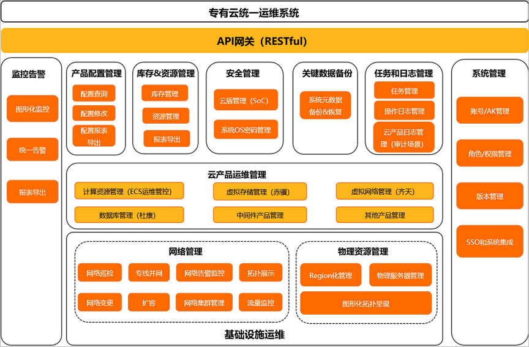

阿里云专有云运维服务管理框架以ITIL和ISO20000为基础，以适应各种管理模式为目标，以管理支撑工具为手段，以流程化、规范化、标准化管理为方法，实现对运维服务全过程的体系化管理。它包含了IT运维服务全生命周期管理方法、管理标准和规范、管理模式、管理支撑工具、管理对象以及基于流程的管理方法。

阿里云专有云运维服务管理体系规定了运维活动涉及的各类实体，以及这些实体间的相互关系。相关的实体按照运维服务管理体系进行有机组织并协调工作，按照服务协议要求提供不同级别的运维服务。

**Apsara Uni-manager运维控制台**

Apsara Uni-manager运维控制台是阿里云专有云统一的智能化运维平台。它根据ITIL和ITSM的标准，对运维的过程和要求进行抽象，将共性的高频操作通过智能化自动化的运维工具来完成；对于个性化的操作，利用接口和多级审核的方式，降低运维操作风险。

Apsara Uni-manager运维控制台根据阿里云专有云对云运维的理解，将云运维分为三个层次，即基础设施运维、云产品和云服务运维以及业务运维。

通过对三个层次体系运维经验的积累和数据的收集，阿里云专有云将运维平台收集到的数据汇聚到平台的CMDB中，由Apsara Uni-manager运维控制台对数据进行整合分析和综合处理。同时，阿里云专有云把丰富的实践经验和运维能力固化到平台运维工具中，以面向终态的设计理念，通过统一的运维工具完成平台的故障发现、故障追踪、链路展示、ITIL流程以及自愈的故障修复，最后达成AIOPS的终极目标。

Apsara Uni-manager运维控制台为用户提供统一的运维Portal，通过运维Portal，为用户提供一致化的运维体验及统一的运维入口。Apsara Uni-manager运维控制台支持与第三方平台的对接，提供统一的运维API能力，可以将运维系统中的数据通过API的形式提供给第三方系统。

Apsara Uni-manager运维控制台对云计算环境中的物理设备、操作系统、计算、网络、存储、数据库、中间件、业务应用等进行统一的自动化部署、升级变更、配置管理。同时，Apsara Uni-manager运维控制台还提供了故障、性能、配置等方面的监控报警、自动分析诊断处理功能，通过分析、处理和评估云平台运行的状态和质量，保障云计算业务应用的持续稳定运行，同时为运维服务流程提供服务与支撑，构建完善的运维服务管理平台。

**运维支撑服务**

除了运维工具以外，阿里云专有云还提供了驻场服务、专家护航服务、业务咨询服务、业务优化服务和重大问题的研发现场支持服务，通过一线、二线和三线的支持体系支持客户解决平台问题，并提供升级渠道支持客户解决紧急问题。阿里云专有云通过完全自主可控的平台，保证技术问题及时有效解决。

<a id="section-2"></a>

# 2.入门

<a id="section-2-1"></a>

## 2.1. 准备运维账号

在通过Apsara Uni-manager运维控制台开始运维操作前，您需要从角色管理员处获取相应权限的运维账号。

**操作步骤**

1. 角色管理员登录Apsara Uni-manager运维控制台。

2. 创建待分配给运维账号的角色，详情请参见角色管理。

3. 创建待分配给运维账号的部门，详情请参见部门管理。

4. 创建运维账号，同时将已创建的角色分配给该账号，详情请参见用户管理。

   > **说明**
   >
   > 如果需要对运维角色权限进行更细粒度的划分，角色管理员可参考**运维权限管理系统OAM**的内容创建基础角色，并给角色分配权限后，再将该角色分配给相应的运维账号。

<a id="section-2-2"></a>

## 2.2. 登录Apsara Uni-manager运维控制台

本文介绍运维工程师等相关用户如何登录到Apsara Uni-manager运维控制台。

**前提条件**

- 已从部署人员或管理员处获取Apsara Uni-manager运维控制台的访问地址、用户名和密码。

  Apsara Uni-manager运维控制台访问地址格式为*region-id*.ops.console.*intranet-domain-id*。

- 推荐使用Chrome浏览器。

**操作步骤**

1. 打开浏览器。

2. 在地址栏中，输入Apsara Uni-manager运维控制台的访问地址，按回车键。

   

   > **说明**
   >
   > 您可以单击右上角的当前语言切换其它语言。当前支持简体中文、English语言切换。

3. 输入正确的用户名及密码。

   > **说明**
   >
   > - 登录Apsara Uni-manager运维控制台的用户名和密码请从部署人员或管理员处获取。
   >
   > - 若连续输入密码错误三次，系统将启动图片验证码登录功能；若连续输入错误五次，账户将被锁定，请联系管理员进行激活。
   >
   > - 首次登录Apsara Uni-manager运维控制台时，需要修改登录用户名的密码，请按照提示完成密码修改。
   >
   >   为提高安全性，密码必须满足以下要求：
   >
   >   - 必须包含英文大小写字母。
   >
   >   - 必须包含阿拉伯数字（0~9）。
   >
   >   - 必须包含特殊符号，包括感叹号（!）、at（@）、井号（#）、美元符号（$）、百分号（%）等。
   >
   >   - 密码长度为10~20个字符。

4. 单击**同意协议并登录**。

<a id="section-2-3"></a>

## 2.3. 顶部导航栏

本文介绍Apsara Uni-manager运维控制台顶部导航栏的功能说明。

在控制台页面的顶部导航条，提供以下主要功能：


| 序号 | 区域 | 描述 |
| --- | --- | --- |
| ① | 多地域选择区 | 单击列表选项，可以对不同的地域进行切换，实现对各地域统一运维管理。 |
| ② | 顶部菜单栏区 | 悬停或单击可选择相应的运维操作。 |
| ③ | 多语言切换区 | 单击可切换语言，目前支持<strong>简体中文</strong>以及<strong>English</strong>。 |
| ④ | 颜色模式设置区 | 单击可设置颜色模式，目前支持<strong>浅色模式</strong>和<strong>深色模式</strong>。 |
| ⑤ | 帮助中心 | 单击可查看帮助中心在线文档。 |
| ⑥ | 消息中心 | 单击可查看系统当前未处理的消息。<br>• <strong>审批消息</strong>：单击<strong>查看更多消息</strong>，跳转至<strong>待我审批</strong>页面。<br>• <strong>告警消息</strong>：单击<strong>查看更多消息</strong>，跳转至<strong>告警列表</strong>页面；单击<strong>开始监听</strong>，系统每隔60秒自动刷新告警消息。<br>• <strong>任务提醒</strong>：单击<strong>查看更多消息</strong>，跳转至<strong>我的任务</strong>页面下<strong>与我相关</strong>页签；单击<strong>开始监</strong><strong>听</strong>，系统每隔60秒自动刷新任务消息。 |
| ⑦ | 个人中心 | 单击可选择菜单，修改<strong>个人信息</strong>、<strong>查看版本信息</strong>，也可以<strong>退出登录</strong>。 |

<a id="section-2-4"></a>

## 2.4. 个人信息

在个人信息页面，支持对个人基本信息、密码、AccessKey等信息的查看与管理。

**操作步骤**

1. 登录Apsara Uni-manager运维控制台。

2. 在页面右上角，单击当前登录用户的头像。

3. 单击**个人信息**，支持如下信息的查看与管理。

   <table>
     <tr>
       <th width="164">区域</th>
       <th>说明</th>
     </tr>
     <tr>
       <td>左侧区域</td>
       <td>• 获取当前登录用户的头像与用户名。<br>• 单击<strong>修改密码</strong>，输入旧密码、新密码、再次输入密码，单击<strong>确定</strong>支持修改当前登录用户的密码。<br>• 单击<strong>查看当前隐私协议</strong>，获取隐私协议内容。</td>
     </tr>
     <tr>
       <td>基本信息</td>
       <td>查看当前登录用户的基本信息。单击<strong>编辑，</strong>可修改显示名、手机、邮箱等。</td>
     </tr>
     <tr>
       <td>登录设置</td>
       <td>查看当前登录用户的登录设置信息。</td>
     </tr>
     <tr>
       <td>专有云API调用使用</td>
       <td>查看专有云API调用使用的Internet Domain、Intranet Domain等信息。</td>
     </tr>
     <tr>
       <td>Accesskey</td>
       <td>查看当前登录用户的AccessKey信息。并支持如下操作：<br>• 创建AccessKey：单击<strong>创建AccessKey</strong>，创建成功后，单击<strong>关闭</strong>。<br>说明每个账号最多创建两个Accesskey。<br>• 禁用AccessKey：单击目标AccessKey对应<strong>操作</strong>列的<strong>禁用</strong>，在弹出的对话框中勾选<strong>我已</strong><strong>阅读上述提示，并确认操作</strong>，然后单击<strong>确定</strong>。<br>说明<br>• 当AccessKey的<strong>状态</strong>为<strong>已启用</strong>时支持禁用AccessKey。<br>• 禁用操作可能导致使用该aksk调用OpenAPI的调用方不可用。<br>• 启用AccessKey：单击目标AccessKey对应<strong>操作</strong>列的<strong>启用</strong>，在弹出的对话框中单击<strong>确</strong><strong>定</strong>。<br>说明当AccessKey的<strong>状态</strong>为<strong>已禁用</strong>时支持启用AccessKey。<br>• 删除AccessKey：单击目标AccessKey对应<strong>操作</strong>列的<strong>删除</strong>，在弹出的对话框中勾选<strong>我已</strong><strong>阅读上述提示，并确认操作</strong>，然后单击<strong>确定</strong>。<br>说明删除操作可能导致使用该aksk调用OpenAPI的调用方不可用，此操作不可恢复，请谨慎操作。</td>
     </tr>
     <tr>
       <td>角色信息</td>
       <td>查看当前登录用户的角色信息。</td>
     </tr>
   </table>

<a id="section-2-5"></a>

## 2.5. 运维工作台

本文介绍Apsara Uni-manager运维控制台的运维工作台页面在不同Region场景及不同用户的情况下的功能展示说明。

**运维工作台**

在单Region场景下，普通用户的运维工作台默认展示的内容如下图所示。

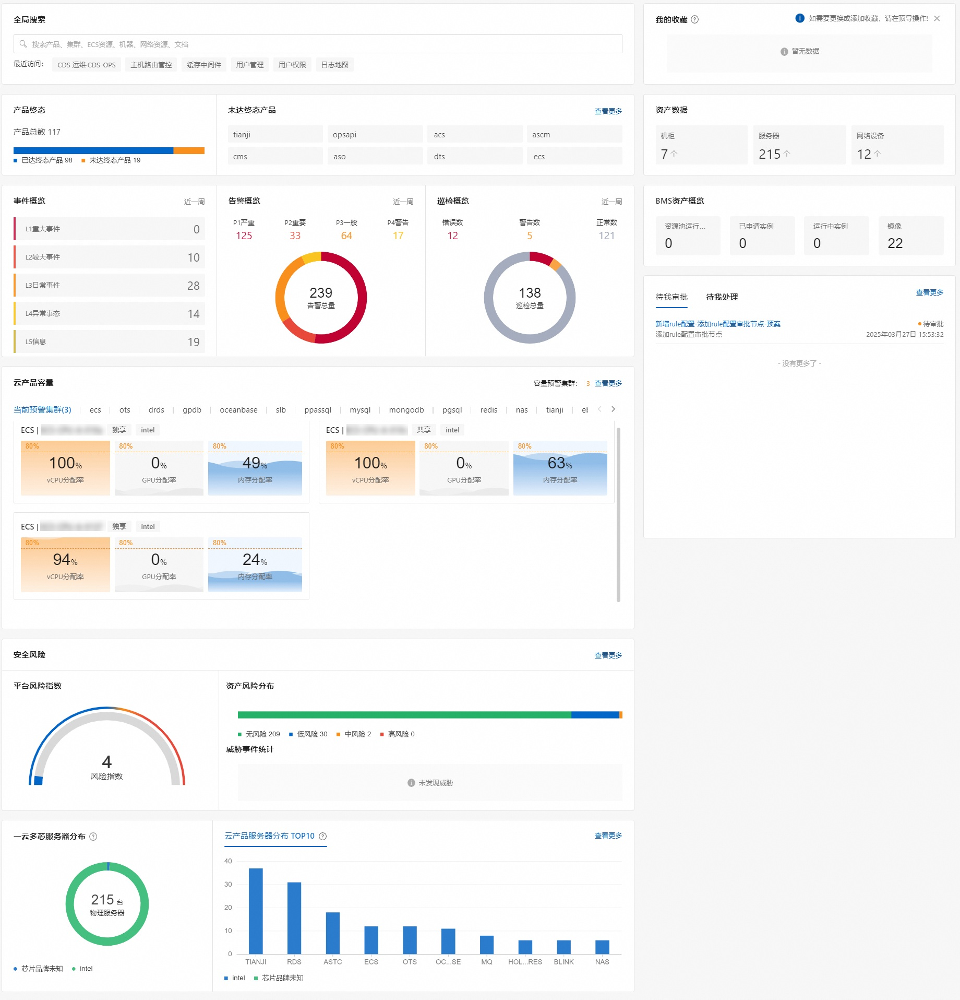

单击**编辑布局与卡片**，支持自定义运维工作台内容，包括新增、移除、移动、修改卡片尺寸等操作。支持展示的内容如下表所示。

> **说明**
>
> 单击**恢复默认布局**支持恢复展示默认的运维工作台界面。

**分类**

**名称**

**说明**

云产品容量概览

展示当前容量预警的集群情况，云产品资源的使用容量与趋势分析。

单产品容量统计

提供单产品维度的服务器容量分配数据的统计。

预置卡片-容量分析

服务器容量统计

提供单产品维度的服务器容量分配数据的统计。

单产品容量趋势

提供单产品维度的容量分配趋势的统计。

多服务器容量统计

提供onTianjian部署的工作集群的服务器的容量分配数据的统计。

展示BMS系统资产的总体情况概览。

- **资源池运行中实例**：成功被纳管进资源池并且状态为**运行中**的裸机实例。该数据与ASCM BMS控制台**概览**页面**资源池实例总数**数据一致。

- **已申请实例**：在租户侧被用户申请的所有实例，不根据状态过滤。该数据与ASCM BMS控制台**概览**页面**已申请实例总数**数据在选择**root**组织时一致，选择其他组织时不一致。

BMS资产概览

- **运行中实例**：在已申请实例的基础上汇总状态为运行中的实例数据。该数据与ASCM BMS控制台**概览**页面**运行中实例总数**数据在选择**root**组织时一致，选择其他组织时不一致。

- **镜像**：根据所选Region汇总自定义镜像与公共镜像的总数。在多Region场景中，选择相同Region时，该数据与ASCM BMS控制台**概览**页面**镜像**数据一致，选择不同Region时不一致。在单Region场景中，该数据与ASCM BMS控制台**概览**页面**镜像**数据一致。

预置卡片-资产分析

一云多芯服务器分布

展示物理服务器按照CPU维度的数量分布以及物理服务器总数。

资产数据

展示系统资产的总量与分类统计。

一云多芯服务器分布

展示租户侧云产品服务器按CPU维度的TOP10数量分布。单击**查看更多**，展示租户侧云产品服务器的详细内容。

TPO10

产品维度服务器统计

提供onTianjian部署的产品的物理服务器的数量统计。

资产汇总统计

提供云平台各可用区维度的网络设备以及服务服务器的数量统计。

展示系统中检测到的安全风险与漏洞。

> **说明**
>
> 当部署云盾产品时才会生效。

- **平台风险指数**：根据组织内威胁事件及风险资产的情况，统计全局风险指数。

预置卡片-安全风险

安全风险

- **资产风险分布**：展示高风险、中风险、低风险、无风险的四种级别资产分布占比和数字统计。

- **威胁事件统计**：展示紧急、严重、可疑、一般、信息五种类型的威胁事件等级分布占比和数字统计。

<table>
  <tr>
    <td rowspan="3">预置卡片-常用功能</td>
    <td>待我审批</td>
    <td>• 展示待审批的工作流内容以及提交时间，单击<strong>查看更多</strong>，页面将跳转到<strong>待我审批</strong>页面。<br>• 切换至<strong>待我处理</strong>页签，展示待处理的任务内容、优先级以及过期时间，单击<strong>查看更多</strong>，页面将跳转到<strong>我的任务</strong>页面下<strong>与我相关</strong>页签。</td>
  </tr>
  <tr>
    <td>我的收藏</td>
    <td>展示用户收藏的顶部菜单栏功能，如果需要更换或添加收藏，请在顶部菜单栏进行操作。并且只支持最新添加的六个导航菜单。</td>
  </tr>
  <tr>
    <td>全局搜索</td>
    <td>支持在全局范围内搜索产品、集群、ECS资源、机器、网络资源、文档等信息。并展示用户最近访问的菜单栏功能页面。</td>
  </tr>
  <tr>
    <td rowspan="2">预置卡片-终态分析</td>
    <td>未达终态产品</td>
    <td>展品未达终态的产品名称。单击<strong>查看更多</strong>，页面将跳转至<strong>产品集群运维</strong>页面查看详细内容。</td>
  </tr>
  <tr>
    <td>产品终态</td>
    <td>展示<strong>产品总数</strong>、<strong>已达终态产品</strong>和<strong>未达终态产品</strong>的数量概览。</td>
  </tr>
  <tr>
    <td rowspan="3">预置卡片-告警分析</td>
    <td>告警概览</td>
    <td>展示当前系统中的告警数量与级别分布。</td>
  </tr>
  <tr>
    <td>告警趋势</td>
    <td>提供云平台所有告警、按照云产品以及告警源的数量趋势分析。</td>
  </tr>
  <tr>
    <td>告警统计</td>
    <td>提供云平台所有告警、按照云产品以及告警源的数量统计分析。</td>
  </tr>
  <tr>
    <td rowspan="3">预置卡片-事件分析</td>
    <td>事件概览</td>
    <td>展示当前系统中事件的统计与分布情况。</td>
  </tr>
  <tr>
    <td>事件趋势</td>
    <td>提供云平台所有事件的数量趋势分析。</td>
  </tr>
  <tr>
    <td>事件统计</td>
    <td>提供云平台所有事件的数量统计分析。</td>
  </tr>
  <tr>
    <td>预置卡片-巡检分析</td>
    <td>巡检概览</td>
    <td>展示当前系统中巡检总量与巡检结果的分布情况。</td>
  </tr>
  <tr>
    <td rowspan="3">预置卡片-水位分析</td>
    <td>多产品水位统计</td>
    <td>提供产品集群维度的运行水位的统计。</td>
  </tr>
  <tr>
    <td>多服务器水位统计</td>
    <td>提供多服务器维度的运行水位的统计。</td>
  </tr>
  <tr>
    <td>单产品水位趋势</td>
    <td>提供单产品维度的运行水位的趋势。</td>
  </tr>
  <tr>
    <td colspan="2">自定义卡片</td>
    <td>展示自定义卡片的数据。</td>
  </tr>
</table>

**面向管理者-运维工作台**

拥有**平台运维管理员**角色权限的管理者用户的运维工作台展示的内容如下表所示。

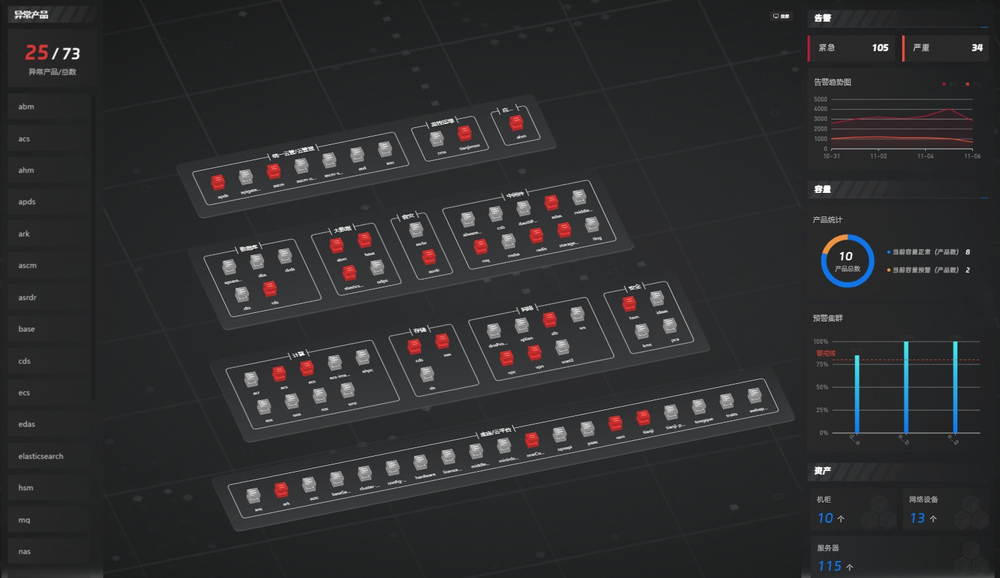

<table>
  <tr>
    <th width="89">区域</th>
    <th>说明</th>
  </tr>
  <tr>
    <td>异常产品</td>
    <td>• 展示<strong>异常产品</strong>数以及产品总数，并列出所有异常的产品名称。<br>• 在界面中间展示各云产品的状态以及分布情况，红色表示产品异常，灰色代表产品正常。<br>• 单击左侧产品名称或运维图中的产品名称，可以呈现产品状态、紧急告警数、严重告警数以及对其他产品的影响情况。</td>
  </tr>
  <tr>
    <td>告警</td>
    <td>展示当前<strong>紧急</strong>告警和<strong>严重</strong>告警的数量，以及近一周的告警趋势图。</td>
  </tr>
  <tr>
    <td>容量</td>
    <td>• <strong>产品统计</strong>：展示<strong>产品总数</strong>、<strong>当前容量正常（产品数）</strong>以及<strong>当前容量预警（产品数）</strong>的数量概览。<br>• <strong>预警集群</strong>：展示当前容量预警的集群情况。</td>
  </tr>
  <tr>
    <td>资产</td>
    <td>展示<strong>机柜</strong>、<strong>服务器</strong>和<strong>网络设备</strong>的数量概览。</td>
  </tr>
  <tr>
    <td>安全风险</td>
    <td>说明当部署云盾产品时才会生效。<br>• <strong>平台风险指数</strong>：根据组织内威胁事件及风险资产的情况，统计全局风险指数。<br>• <strong>资产风险指数</strong>：展示高风险、中风险、低风险、无风险的四种级别资产分布占比和数字统计。<br>• <strong>威胁事件统计</strong>：展示紧急、严重、可疑、一般、信息五种类型的威胁事件等级分布占比和数字统计。</td>
  </tr>
</table>

**多Region场景-运维工作台**

- 部署国际化

  运维工作台展示的内容如下表所示。

  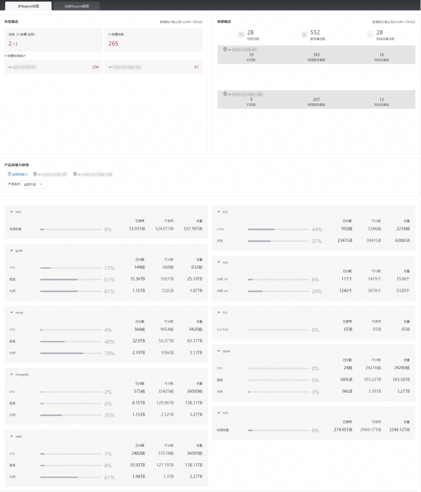

  **页签**

  **区域**

  **说明**

  展示存在P1告警的地域数、全部地域数、**P1告警总数**以及各地域的P1告

  **告警概览**

  警数量。

  展示**机柜总数**、**服务器总数**和**网络设备总数**的数量概览，以及各地域

  **资源概览**

  的**机柜数**、**物理服务器数**和**网络设备数**的数量概览。

  **多Region视图**

  展示全部地域或各地域的产品容量与使用情况，支持根据**产品名称**过滤

  **产品容量与使用**

  展示。

  展示当前Region的概览数据，内容可参考运维工作台。

  **当前Region视图**

- 未部署国际化

  运维工作台展示的内容如下表所示。

  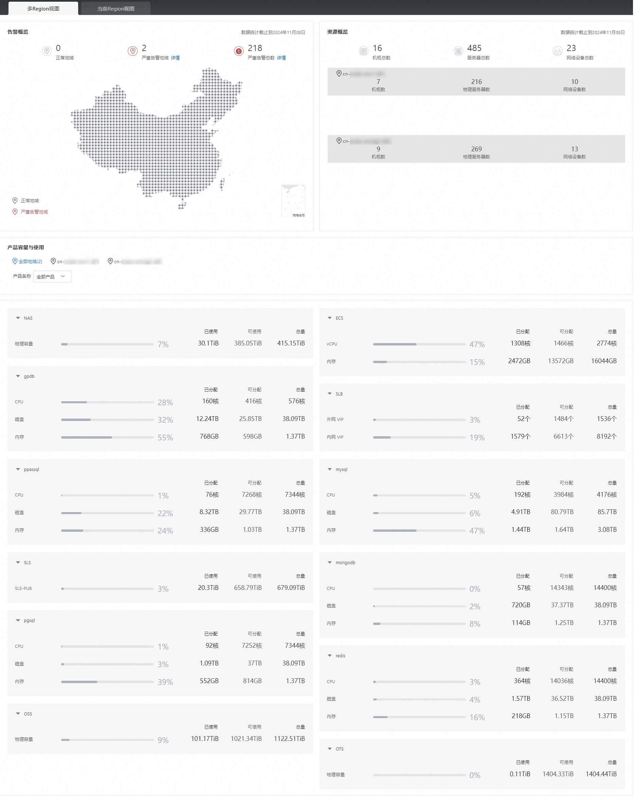

  <table>
    <tr>
      <th>页签</th>
      <th>区域</th>
      <th>说明</th>
    </tr>
    <tr>
      <td rowspan="3">多Region视图</td>
      <td>告警概览</td>
      <td>展示<strong>正常地域</strong>、<strong>严重告警地域</strong>以及<strong>严重告警总数</strong>的数量概览。单击对应数据后的<strong>详情</strong>可以查看详细的内容。</td>
    </tr>
    <tr>
      <td>资源概览</td>
      <td>展示<strong>机柜总数</strong>、<strong>服务器总数</strong>和<strong>网络设备总数</strong>的数量概览，以及各地域的<strong>机柜数</strong>、<strong>物理服务器数</strong>和<strong>网络设备数</strong>的数量概览。</td>
    </tr>
    <tr>
      <td>产品容量与使用</td>
      <td>展示全部地域或各地域的产品容量与使用情况，支持根据<strong>产品名称</strong>过滤展示。</td>
    </tr>
    <tr>
      <td colspan="2">当前Region视图</td>
      <td>展示当前Region的概览数据，内容可参考运维工作台。</td>
    </tr>
  </table>

<a id="section-3"></a>

# 3.快速入门

<a id="section-3-1"></a>

## 3.1. 概览

本文介绍Apsara Uni-manager运维控制台中的预置角色以及对应的常用操作。

**用户角色以及对应权限总览**

用户角色针对不同的用户提供不同的操作权限，系统在初始化的时候默认创建了系统管理员、安全管理员、安全审计员、角色管理员等。其权限如下所示：

| 角色 | 权限说明 |
| --- | --- |
| 系统管理员 | 负责平台的运维操作管理。包括监控告警、平台运维、产品运维等。 |
| 安全管理员 | 负责平台安全相关的运维管理。包括安全管理等。 |
| 安全审计员 | 负责平台安全相关运维操作进行审计、跟踪和分析。 |
| 角色管理员 | 负责平台用户权限操作管理。 |

**查看用户角色**

1. 登录Apsara Uni-manager运维控制台。

2. 在页面右上角单击头像，选择**个人信息**。

3. 在**角色信息**框中显示用户角色信息。

<a id="section-3-2"></a>

## 3.2. 我是系统管理员

本章节介绍系统管理员的常用运维操作内容，包括平台的告警管理、巡检管理等。

<a id="section-3-2-1"></a>

### 3.2.1. 告警管理

本文介绍Apsara Uni-manager运维控制台的告警管理操作。

**功能描述**

当云基础设施及云平台软件出现问题或故障时，或通过采集监控数据匹配告警规则后会触发告警。告警来源包括监控的云产品、监控系统自身及管理对象等。

**前提条件**

已经获得系统管理员权限。

**流程图**


**操作步骤**

1. 系统通过采集监控数据匹配告警规则后触发告警，按照告警规则配置产生对应的告警信息。

2. 登录Apsara Uni-manager运维控制台。

3. 在顶部菜单栏，选择**监控告警** > **告警管理** > **告警概览**。

   告警概览从以下5个不同的角度分析和统计告警信息，请根据各自需求获取告警概览信息。

   <table>
     <tr>
       <th width="206">分类</th>
       <th>获取概览信息</th>
     </tr>
     <tr>
       <td>地域告警</td>
       <td>按照地域进行划分，统计不同地域的告警数量和等级。不同告警级别对应不同的颜色显示在环状图上，同一级别的告警数量越多，在环状图上占比面积越大。</td>
     </tr>
     <tr>
       <td>告警来源</td>
       <td>按照告警源进行划分，统计不同告警源的状态。蓝色表示告警源正常，橙色表示告警源异常。</td>
     </tr>
     <tr>
       <td>告警趋势</td>
       <td>统计今天告警总数、昨日告警总数数据。按照时间进行划分，统计近7天产生的告警数量以及各告警等级的数量。</td>
     </tr>
     <tr>
       <td>告警分布</td>
       <td>按照产品进行划分，统计不同产品<strong>现存P1告警</strong>、<strong>现存全量告警</strong>、<strong>全量告警历史</strong>多个维度下的告警数量和等级。</td>
     </tr>
     <tr>
       <td>云平台未关闭P1告警统计</td>
       <td>统计云平台未关闭的P1告警数量。单击产品所属分类页签可查看不同类别下未关闭P1告警级别的产品。</td>
     </tr>
   </table>

4. 请根据各自需求获取告警列表信息。

   <table>
     <tr>
       <th width="206">分类</th>
       <th>获取详细信息</th>
     </tr>
     <tr>
       <td>地域告警</td>
       <td>i. 在左侧导航栏选择<strong>告警列表。</strong>ii. 单击高级筛选，在<strong>告警等级</strong>选择目标级别进行过滤筛选，即可得到对应的告警列表。</td>
     </tr>
     <tr>
       <td>告警来源</td>
       <td>i. 在左侧导航栏选择<strong>告警列表。</strong>ii. 单击高级筛选，在<strong>告警来源</strong>选择目标告警源进行过滤筛选，即可得到对应的告警列表。</td>
     </tr>
     <tr>
       <td>告警趋势</td>
       <td>i. 在左侧导航栏选择<strong>告警列表。</strong>ii. 单击高级筛选，在<strong>时间范围</strong>选择目标时间段进行过滤筛选，即可得到对应的告警列表。</td>
     </tr>
     <tr>
       <td>告警分布</td>
       <td>i. 在告警概览页面，选择<strong>现存P1告警</strong>、<strong>现存全量告警</strong>或<strong>全量告警历史</strong>目标维度页签。ii. 选择目标产品以及目标时间的告警数字色块并单击，系统跳转到对应的告警列表。</td>
     </tr>
     <tr>
       <td>云平台未关闭P1告警统计</td>
       <td>i. 在告警概览页面，单击目标产品所属分类页签。ii. 选择目标产品并单击，系统跳转到对应的告警列表。</td>
     </tr>
   </table>

   > **说明**
   >
   > 在**告警列表**页面下，不仅支持通过以上分类进行过滤筛选，也支持通过告警项ID、告警状态等内容进行过滤筛选；同时也支持多个过滤条件进行组合筛选。

5. 获取告警详细信息。

   - 在**告警列表**页面下，可以获取告警的基础信息，包含**告警等级**、**告警项ID/告警项中文名**、**资源归属**、**告警信息**、**告警状态**、**告警开始时间**、**最近告警时间/持续时间**、**告警次数**、**拓展属性**、**告警对象**、**对象类型**、**告警来源**。

   - 单击目标告警的**告警项ID**可以获取告警的详细信息。

     - 在**基本信息**区域查看告警基本信息。

     - 在**拓展信息**区域查看告警拓展信息。

       > **说明**
       >
       > 将鼠标悬停在**详细告警信息**的**详情**上，系统会显示详细的告警信息。

     - 在**状态时序图**区域查看告警指标的视图。

       - 查看近一天视图：单击**近一天视图**，查看发生告警前一天的告警指标的视图。

       - 查看近一周视图：单击**近一周视图**，查看发生告警前一周的告警指标的视图。

     - 在**告警影响**区域查看告警的影响范围。

       可以查看可能受到影响的服务角色以及对应的状态。同时，如果确定服务角色归属，还会显示出服务角色归属的服务、集群、产品和所在的物理机。

6. 根据《告警参考》获取告警的解决方案，进行告警清除操作。

7. 待告警清除完成，返回**告警列表**页面。

8. 按照步骤4的过滤方式查看告警的状态为**关闭**状态则表示告警处理完成。

<a id="section-3-2-2"></a>

### 3.2.2. 巡检管理

本文介绍Apsara Uni-manager运维控制台的巡检管理操作。

**功能描述**

Apsara Uni-manager运维控制台支持多种巡检场景进行快速检查，帮助维护系统及云产品状态。

**前提条件**

已经获得系统管理员权限。

**流程图**


**操作步骤**

1. 登录Apsara Uni-manager运维控制台。

2. （可选）新增自定义巡检场景。

   <ol type="i">

   <li>

   在顶部菜单栏，选择**监控告警** > **巡检管理** > **巡检配置**。

   </li>

   <li>

   在**巡检场景**页签下，单击**新建巡检场景**。

   </li>

   <li>

   配置如下参数后单击**确定**。

   <table>
     <tr>
       <th width="106">参数</th>
       <th>参数说明</th>
     </tr>
     <tr>
       <td>场景名称</td>
       <td>输入自定义巡检场景名称。</td>
     </tr>
     <tr>
       <td>场景描述</td>
       <td>输入自定义巡检场景描述。</td>
     </tr>
     <tr>
       <td>配置巡检项</td>
       <td>选择自定义巡检场景下的巡检项目，选择巡检项目后会在下方展示具体的巡检内容。</td>
     </tr>
   </table>

   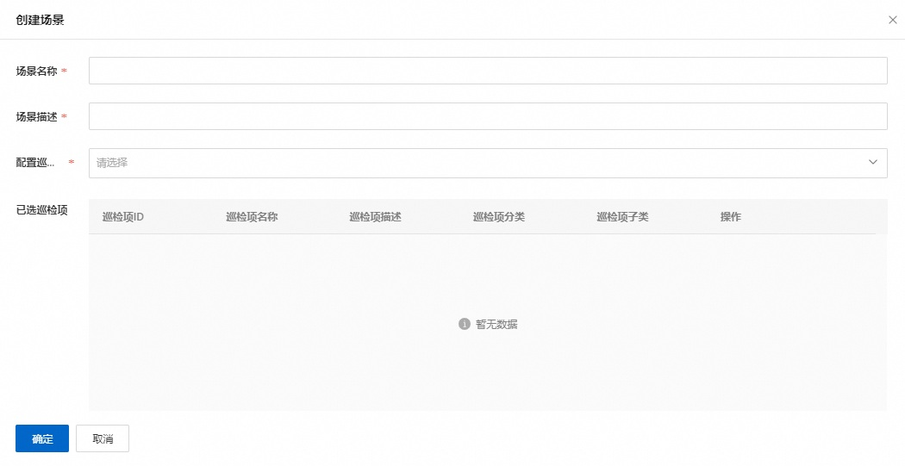

   </li>

   <li>

   返回**巡检场景配置**页面，在列表下方显示创建的巡检场景则表示创建成功。

   </li>

   </ol>

3. 在顶部菜单栏，选择**监控告警** > **巡检管理** > **一键巡检**。

4. 选择对应的巡检场景后，单击**立即巡检**，在需要用邮箱接收巡检通知时配置邮箱信息，然后单击**确定**触发巡检。

   > **说明**
   >
   > - 在设置邮箱时，支持配置多个邮箱号，多个邮箱用英文分号进行隔开。
   >
   > - 页面提示未配置巡检通知通道，导致无法发送巡检通知，可以在**巡检通知**页面进行配置。如果不需要配置接收邮箱，可以直接单击**执行**触发巡检。

5. 巡检启动后，系统将展示巡检的进度详情。巡检完成后，查看巡检结果。

   - 在页面上方，查看**巡检场景**、**开始执行**、**结束执行**、**发起人**、**执行策略**以及**结果建议**等基本信息。

   - 在**巡检概览**区域，可以查看巡检通过率、巡检项总数、巡检项失败数、巡检项错误数、巡检项警告数、巡检项正常数。单击巡检状态对应的数据可以查看对应巡检状态下的详细巡检结果。

   - 在**完成巡检项结果概览**区域，可以查看各巡检项类型下的巡检结果，包括巡检错误数、巡检告警数以及巡检正常数。单击巡检项类型可以查看对应类型下的详细巡检结果。

     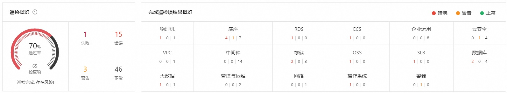

   - 在页面下方，单击**高级筛选**，可以根据**巡检项类型**、**巡检状态**、**巡检项名称**、**巡检项描述**组合筛选查看目标巡检结果明细。

     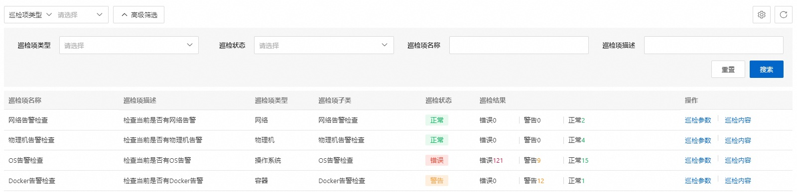

     - 将鼠标悬停于目标巡检项对应**操作**列的**巡检参数**，可以查看对应的巡检参数。

     - 将鼠标悬停于目标巡检项对应**操作**列的**巡检内容**，可以查看对应的巡检内容。

     - 单击目标巡检项对应**巡检结果**列的数字，可以在对话框中查看巡检结果详情。

       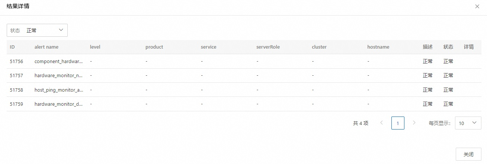

   - 单击页面右上角的**查看报告接收邮箱**，可以获取巡检报告接收的邮箱信息。

   - 单击页面右上角的**导出报告**，可以将巡检报告下载至本地进行查看。

     > **说明**
     >
     > 支持导出json和excel两种格式的巡检报告。

<a id="section-3-3"></a>

## 3.3. 我是安全管理员

本章节介绍了安全管理员负责的常用运维操作内容，包括登录管理等。

<a id="section-3-3-1"></a>

### 3.3.1. 登录管理

本文介绍Apsara Uni-manager运维控制台的登录管理操作。

**功能描述**

系统支持管理员根据需求配置用户登录方式，包括登录超时时间、多端登录设置、账号有效期、密码策略、登录时间以及登录地址，提高系统的安全性。

**前提条件**

已经获得ASO安全管理员权限。

**流程图**


**操作步骤**

1. 登录Apsara Uni-manager运维控制台。

2. 在顶部菜单栏，选择**安全管理** > **访问控制** > **安全策略**。

3. 在**账号策略**页签下，配置如下参数并单击**提交**。

   | 参数 | 参数说明 |
   | --- | --- |
   | 登录超时时间（分钟） | 设置当前账号登录超时的时间。登录时间超过指定的分钟数后，系统会提示登录超时，需要重新登录。取值范围：10~180 |
   | 多端登录设置 | 设置当前账号是否允许在多个终端同时登录。 |
   | ASO账号有效期（天） | 设置账号有效期，当超出指定的有效期后，系统会将此账号锁定，需要使用安全保密员账号解锁。取值范围：10~365 |
   | 账号有效期提醒（天） | 设置账号过期前提醒的时间，设置为5，表示账号过期前5天时，在用户登录时开启过期提醒。取值范围：1~7 |
   | 账号冻结策略（天） | 设置账号冻结时间，当超出指定的时间后，系统会将此账号冻结。取值范围：<br>• 0：表示不开启账号冻结策略<br>• 10~365 |
   | 安全策略是否对预置账号生效 | 设置安全策略是否对预置账号生效。<br>• 开启：安全策略到期（如账号到期、密码到期），预置账号将无法登录，建议保持较长的有效期。<br>• 关闭：预置账号不受有限期限制，即永不过期。默认值：关闭 |

4. 在**密码策略**页签下，配置如下参数并单击**提交**。

   <table>
     <tr>
       <th width="215">参数</th>
       <th>参数说明</th>
     </tr>
     <tr>
       <td>密码最小长度</td>
       <td>设置当前账号密码的最小长度。取值范围：10~20</td>
     </tr>
     <tr>
       <td>密码中须包含元素</td>
       <td>选择密码中必须包含的元素，可多选。<br>• 小写字母<br>• 大写字母<br>• 数字<br>• 特殊字符</td>
     </tr>
     <tr>
       <td>密码过期前提醒时间（天）</td>
       <td>设置密码过期前提醒的时间，设置为10，表示密码过期前10天时，在用户登录时开启过期提醒，输入为0表示不提醒。取值范围：0~30</td>
     </tr>
     <tr>
       <td>密码有效期（天）</td>
       <td>设置当前账号的密码有效期，当密码有效期超过指定数值后，系统会提示密码失效。输入为0表示永不过期。取值范围：0~1095</td>
     </tr>
     <tr>
       <td>历史密码检查策略</td>
       <td>历史密码检查策略表示不能与历史次数密码重复。设置为3，表示不能与最近3次使用的密码重复。输入为0表示不启用历史密码检查策略。取值范围：0~24</td>
     </tr>
   </table>

5. 配置登录策略。

   <ol type="i">

   <li>

   在左侧导航栏，单击**登录策略**。

   </li>

   <li>

   在页面上方单击**新增策略**。

   </li>

   <li>

   配置如下参数后单击**确定**。

   <table>
     <tr>
       <th width="152">参数</th>
       <th>参数说明</th>
     </tr>
     <tr>
       <td>策略名</td>
       <td>输入登录策略名称。</td>
     </tr>
     <tr>
       <td>策略生效时间段</td>
       <td>配置登录策略生效的起始时间段。</td>
     </tr>
     <tr>
       <td>描述</td>
       <td>输入登录策略的相关描述信息。</td>
     </tr>
     <tr>
       <td>共享范围</td>
       <td>目前仅支持<strong>全局共享</strong>。</td>
     </tr>
     <tr>
       <td>策略属性</td>
       <td>• 白名单<br>• 黑名单</td>
     </tr>
     <tr>
       <td>策略生效开始时间</td>
       <td>配置允许用户登录的起始时间，起始时间不得大于结束时间。</td>
     </tr>
     <tr>
       <td>策略生效结束时间</td>
       <td>配置允许用户登录的结束时间。</td>
     </tr>
     <tr>
       <td>登录地址</td>
       <td>配置登录地址。如果<strong>策略属性</strong>选择<strong>白名单</strong>，则配置的是允许登录地址；如果<strong>策略属性</strong>选择<strong>黑名单</strong>，则配置的是禁止登录地址。IP网段地址格式如192.168.1.0/24，当掩码为32位时表示仅允许该IP地址登录，网段地址不能为空且不可重复，如有多个，请用英文逗号分隔。</td>
     </tr>
   </table>

   </li>

   </ol>

<a id="section-3-4"></a>

## 3.4. 我是安全审计员

本章节介绍了安全审计员负责的常用运维操作内容，包括操作日志审计等。

<a id="section-3-4-1"></a>

### 3.4.1. 操作日志

本文介绍安全审计员对平台用户通过控制台执行的记录进行审计的操作。

**功能描述**

安全审计员负责对系统管理员和安全管理员等所有用户的操作行为进行审计、跟踪和分析。通过操作审计页面，可以看到对白屏和黑屏的操作记录，包括审计操作本身。

**前提条件**

已经获得安全审计员权限。

**操作步骤**

1. 登录Apsara Uni-manager运维控制台。

2. 在顶部菜单栏，选择**安全管理** > **安全审计** > **操作审计**。

3. 在左侧导航栏，选择**白屏审计**。

4. 在**白屏审计**页面，可以进行如下操作：

   - 查询白屏操作记录

     根据**用户名**和**时间范围**组合筛选获取目标白屏操作记录。

     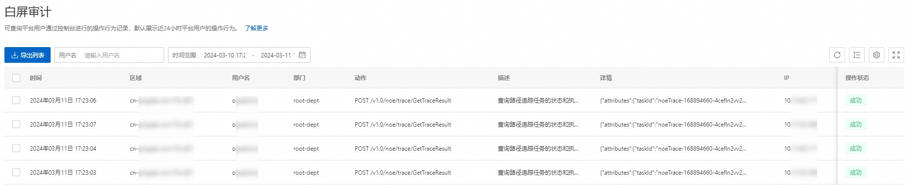

   - 导出白屏操作记录

     > **说明**
     >
     > 导出白屏操作记录时，如果当前展示的白屏操作记录数超过了最大导出阈值（默认为10000），则只能导出前10000条日志信息。

     - 批量导出：勾选目标白屏操作记录，单击列表下方的**批量导出**，导出选中的操作记录。

     - 全部导出：单击列表上方的**导出列表**，导出当前展示的所有操作信息。

<a id="section-3-5"></a>

## 3.5. 我是角色管理员

本章节介绍了角色管理员负责的常用运维操作内容，包括部门管理、用户管理、角色管理等。

<a id="section-3-5-1"></a>

### 3.5.1. 用户管理

本文介绍如何创建一个新用户并为用户赋予不同的权限。

**功能描述**

角色管理员可以创建一个用户，并为用户赋予不同的角色权限，以满足不同用户对系统的访问控制需求。

**前提条件**

- 已经获得角色管理员权限。

- 如果需要自定义角色，请先完成自定义角色的创建。

- 已配置登录策略。

**操作流程**


**操作步骤**

1. 登录Apsara Uni-manager运维控制台。

2. 在顶部菜单栏，单击**用户权限**。

3. 创建部门。

   <ol type="i">

   <li>

   在左侧导航栏，选择**部门管理**。

   </li>

   <li>

   在树状目录中，选中需要添加其子部门的部门，单击**添加部门**。

   </li>

   <li>

   在弹出的添加部门对话框中输入**部门名称**，单击**确定**。

   添加成功后，您可以在树状目录上看到新创建的部门。

   > **说明**
   >
   > 部门名称最长64位，可包含中文、大小写字母、数字、下划线、中划线。

   </li>

   </ol>

4. 创建用户。

   <ol type="i">

   <li>

   在左侧导航栏，选择**用户管理。**

   </li>

   <li>

   在**用户列表**页签下，单击页面上方的**添加**。

   </li>

   <li>

   配置如下参数并单击**确定**。

   添加成功后，您可以在用户列表中看到新创建的用户。

   <table>
     <tr>
       <th width="122">参数</th>
       <th>参数说明</th>
     </tr>
     <tr>
       <td>用户名</td>
       <td>输入用户名称。取值范围：最长48个字符，可包含数字、字母、下划线，支持邮箱格式。</td>
     </tr>
     <tr>
       <td>密码</td>
       <td>输入用户登录密码。取值范围：9 ~ 32 个字符，必须包含：小写字母、大写字母、数字。</td>
     </tr>
     <tr>
       <td>再次确认密码</td>
       <td>再次输入用户登录密码，请保证两次输入的密码一致。</td>
     </tr>
     <tr>
       <td>登录策略</td>
       <td>选择用户登录策略。</td>
     </tr>
     <tr>
       <td>角色</td>
       <td>选择用户角色权限。<br>说明可以给一个用户添加多个角色。</td>
     </tr>
     <tr>
       <td>部门</td>
       <td>选择步骤3创建的部门。</td>
     </tr>
   </table>

   </li>

   </ol>

5. 创建用户组。

   <ol type="i">

   <li>

   在左侧导航栏，选择**用户组管理**。

   </li>

   <li>

   在页面上方，单击**增加**。

   </li>

   <li>

   配置如下参数并单击**确定**。

   添加成功后，您可以在用户组列表中看到新创建的用户组。

   | 参数 | 参数说明 |
   | --- | --- |
   | 用户组名 | 输入用户组名称。 |
   | 部门 | 选择步骤3创建的部门。 |
   | 角色 | 选择用户组角色权限。<br>说明可以给一个用户组添加多个角色。 |

   </li>

   </ol>

6. 管理用户。

   <ol type="i">

   <li>

   在**用户组管理**页面下，单击步骤5创建的用户组对应**操作**列下的**管理用户**。

   </li>

   <li>

   单击**增加**，在弹出的**添加**对话框中选择步骤4创建的用户，单击**确定**。

   > **说明**
   >
   > 若用户组角色和用户角色不一致，则角色权限取其并集。

   </li>

   <li>

   在**管理用户**界面下再次单击**确定**。

   添加用户成功后，可以在用户组对应的**用户**列中看到新添加的用户。

   </li>

   </ol>

<a id="section-4"></a>

# 4.监控告警

<a id="section-4-1"></a>

## 4.1. 监控管理

本文列出了监控管理相关的控制台。

- 云平台监控

- 云产品性能基线大盘

- 云平台监控大盘

- 云平台监控大屏

<a id="section-4-1-1"></a>

### 4.1.1. 云平台监控

<a id="section-4-1-1-1"></a>

#### 4.1.1.1. 云产品业务监控

<a id="section-4-1-1-1-1"></a>

##### 4.1.1.1.1. 云产品监控

以云产品为视角，查看所有云产品接入的基础监控和业务指标信息。

**操作步骤**

1. 登录Apsara Uni-manager运维控制台。

2. 在顶部菜单栏，选择**监控告警** > **监控管理** > **云平台监控**。

3. 在左侧导航栏，选择**云产品业务监控** > **云产品监控**。

   进入云产品监控页面，在当前页面可以获取如下信息。

   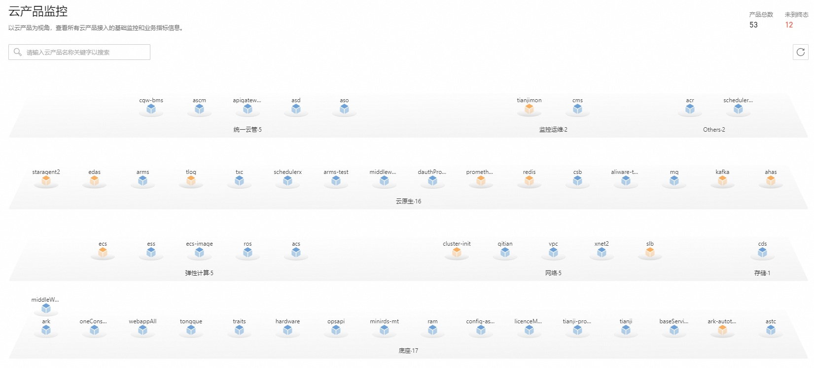

   - 查看云产品总数以及未到终态的产品数。

   - 查看各云产品的状态：蓝色图标表示产品已达终态，橘色图标表示产品未到终态。

   - 鼠标悬停在产品名称对应的图标，展示云产品名称，单击图标可进入产品详情页。

     - 在云产品详情页中，页面左侧展示云产品全部集群、服务以及组件信息，勾选**仅显示异常**，则只显示异常的集群、服务以及组件。

     - 在左侧目录选择集群后，页面右侧展示集群的**状态**、**Zone**、**基础监控**以及**机器列表**。此处仅以专有云平台运维系统ASO产品为例进行介绍。

       - 在**基础监控**页签下，可以根据时间以及监控项获取目标监控数据，右上角选择开启**自动刷新**开关，监控数据可以进行自动更新。

         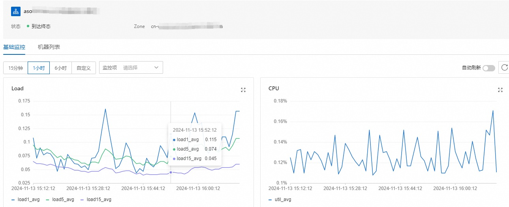

       - 在**机器列表**页签下，获取集群相关的主机列表信息，单击主机名称对应**操作**列的图标，可以进入对应的机器监控页面。

         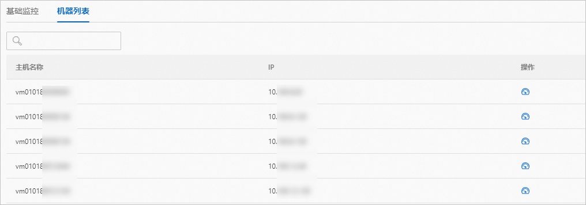

         在机器监控页面，您可以获取机器的基本信息和监控数据，右上角选择开启**自动刷新**开关，监控数据可以进行自动更新。

         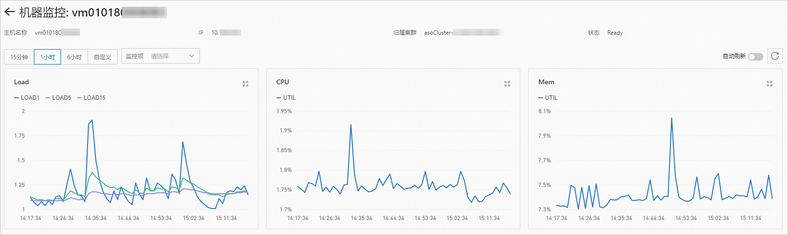

     - 在页面左侧目录选择服务后，页面右侧展示服务的**状态**、**归属集群**以及**业务监控**。

       在**业务监控**区域，您可以根据时间以及监控项获取目标监控数据，右上角选择开启**自动刷新**开关，监控数据可以进行自动更新。

       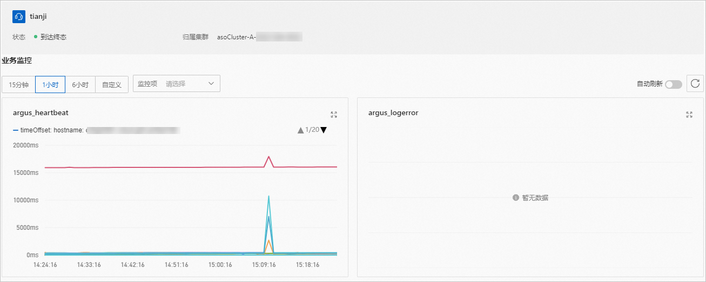

     - 在页面左侧目录选择组件后，页面右侧展示组件的**状态**、**归属集群**、**归属服务**、**基础监控**、**业务监控**以及**机器列表**。

       在**基础监控**页签，可分别查看组件的**容器监控**、**进程监控**以及**JVM监控**。

       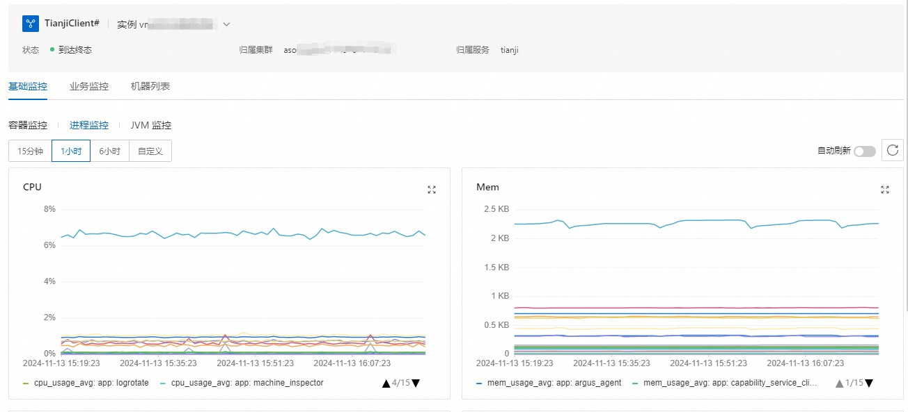

<a id="section-4-1-1-1-2"></a>

##### 4.1.1.1.2. 接入配置

针对云产品接入的业务指标进行配置。

**创建接入配置**

**操作步骤**

1. 登录Apsara Uni-manager运维控制台。

2. 在顶部菜单栏，选择**监控告警** > **监控管理** > **云平台监控**。

3. 在左侧导航栏，选择**云产品业务监控** > **接入配置**。

4. 单击**创建配置**，配置如下参数后单击**提交**。

   | 分类 | 参数 | 参数说明 |
   | --- | --- | --- |

   输入监控项的名称。

   **监控项名称**

   **基本信息**

   输入监控项的相关描述信息。

   **描述**

   选择接入配置的类型。

   - **Exporter**：对云产品已经接入的Exporter进行配置白名单指标，在监控图标中进行指标展示以及在告警规则中进行指标告警配置。

   - **Push Gateway**：对云产品已经通过Push GateWay方式接入的指

   **接入配置**

   标配置白名单指标，在监控图表中进行指标展示，以及在告警规则中进行指标告警配置。

   - **Log**：对云产品SR暴露的本地日志，转换成指标进行数据上报以进行有效的监控告警。

   选择接入配置所属的云产品。

   **云产品**

   选择接入配置所属的服务。

   **服务**

   选择接入配置所属的组件。

   **组件**

   当**接入配置**选择为**Exporter**时生效。

   **Metric Path**

   输入Prometheus Exporter暴露指标的HTTP API地址。

   当**接入配置**选择为**Exporter**时生效。

   **端口**

   输入Prometheus Exporter暴露指标的HTTP端口。

   当**接入配置**选择为**Exporter**时生效。

   **Auth**

   输入Prometheus设置的Basic Auth用户名。

   **采集地址**

   当**接入配置**选择为**Exporter**时生效。

   **Auth密码**

   输入Prometheus设置的Basic Auth用户名对应的密码。

   当**接入配置**选择为**Exporter**时生效。

   **pod标签选择器**

   单击**添加条目**，输入对应的**Key**和**Value**值增加Pod标签信息。

   当**接入配置**选择为**Exporter**或**Push Gateway**时生效。

   **采集测试**

   如果需要选择指标（创建、编辑），请先执行采集测试，从而获取可接入的指标。

   当**接入配置**选择为**Log**时生效。

   **数据源**

   目前仅支持**本地日志**。

   当**接入配置**选择为**Log**时生效。

   **日志路径**

   输入本地日志的路径。

   当**接入配置**选择为**Log**时生效。

   **日志编码**

   输入本地日志的编码。

   当**接入配置**选择为**Log**时生效。

   - **关键字**：从日志中通过关键字匹配指标。

   **指标分类**

   - **分钟多指标**：从日志中通过复杂算法匹配指标，例如正则表达式。

   - **事件指标**：从日志中通过复杂算法匹配指标，例如正则表达式。

   当**指标分类**选择为**分钟多指标**或**事件指标**时生效。

   **指标维度**

   选择指标维度。单击**配置维度**，可设置日志的选取维度。

   当**指标分类**选择为**分钟多指标**或**事件指标**时生效。

   **聚合维度（Group By）**

   选择聚合维度。

   - 当**接入配置**选择为**Exporter**时，单击**添加条目**，配置相关的监控指标。

   **指标接入**

   - **指标Code**：选择采集测试拉取的指标。

   - **指标名称**：输入指标名称。

   - **指标描述**：输入指标相关描述信息。

   - **操作**：可以进行删除、上移、下移操作。

   - 当**接入配置**选择为**Push Gateway**时，当采集测试成功后，可以添加指标进行配置。单击**添加条目**，配置相关的监控指标。

     - **指标Code**：选择采集测试拉取的指标。

     - **指标名称**：输入指标名称。

     - **指标描述**：输入指标相关描述信息。

     - **指标类型**：选择指标类型，支持Guage、Counter、Histogram、Summary。

     - **聚合方式**：选择指标聚合方式，支持Avg、Sum、Min、Max、Group、Std Dev、Std Var、Count、Count Values、Bottomk、Topk、Quantile。

     - **单位**：输入数据单位。

     - **指标聚合标签**：选择标签。

   **监控指标**

   - **操作**：可以进行删除、上移、下移操作。

   - 当**接入配置**选择为**Log**，**指标分类**选择为**关键字**时：单击**添加条目**，配置相关的监控指标。

     - **指标Code**：输入指标项。

     - **指标名称**：输入指标名称。

     - **关键字**：输入指标关键字。

     - **聚合方式**：选择指标聚合方式，目前仅支持Count。

     - **操作**：可以进行删除、上移、下移操作。

   - 当**接入配置**选择为**Log**，**指标分类**选择为**分钟多指标**或**事件指标**时：单击**添加指标**，配置相关的监控指标。

     - **聚合字段**：选择聚合字段。

     - **聚合方式**：选择聚合方式。

       - **指标分类**选择为**分钟多指标**时，可选择Avg、Sum、Min、Max、Std、Distinct、Count、Value。

       - **指标分类**选择为**事件指标**时，仅支持Value。

     - **指标名称**：输入指标名称。

     - **操作**：可以进行删除、上移、下移操作。

   当**指标分类**选择为**分钟多指标**或**事件指标**时生效。

   单击**添加过滤条件**，配置相关的筛选设置。

   - **筛选项**：选择筛选项。

   **数据过滤**

   - **筛选条件**：选择筛选条件。

   - **筛选值**：输入筛选值。

   - **操作**：可以进行删除、上移、下移操作。

   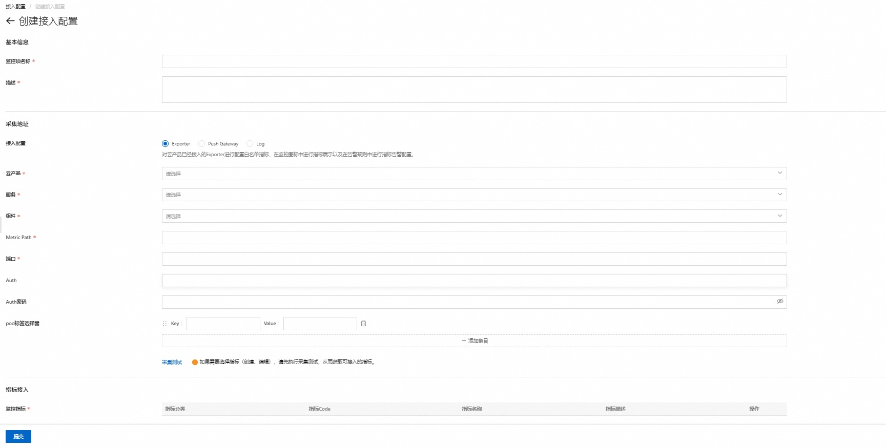

**查看配置**

**操作步骤**

1. 在左侧**服务目录**下选择目标云产品或服务名称后，页面右侧展示对应的配置列表。

2. 单击**高级筛选**，可以根据**监控项名称**和**接入类型**组合筛选获取目标配置列表。

3. 在配置列表中，可以获取配置的**监控项名称**、**接入类型**、**服务**以及**描述**信息。

   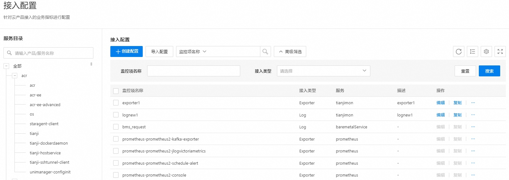

**导入配置**

**操作步骤**

1. 单击配置列表上方的**导入配置**。

2. 在弹出的对话框中单击**上传文件**。

   > **说明**
   >
   > 导入文件的格式请参考导出的配置文件。

3. 选择配置文件后，单击**打开**。

4. 单击**确认导入**。

**修改配置操作步骤**

> **说明**
>
> 系统通过云产品基线版本升级的（包含hotx）生成的默认配置不支持编辑。

1. 在目标配置的**操作**列，单击**编辑**。

2. 进入**编辑接入配置**页面，修改配置信息后单击**提交**。

**复制配置**

**操作步骤**

> **说明**
>
> 系统通过云产品基线版本升级的（包含hotx）生成的默认配置不支持复制。

1. 在目标配置的**操作**列，单击**复制**。

2. 进入**复制接入配置**页面，确认信息后单击**提交**。

**导出配置**

**操作步骤**

> **说明**
>
> 系统通过云产品基线版本升级的（包含hotx）生成的默认配置不支持导出。

导出单个配置

1. 在目标配置的**操作**列，单击  ，选择导出**导出**。

2. 在弹出的对话框中单击**下载**。

批量导出配置

1. 勾选多个目标配置，在列表下方单击**导出**。

2. 在弹出的对话框中单击**下载**。

**删除配置**

**操作步骤**

> **说明**
>
> 系统通过云产品基线版本升级的（包含hotx）生成的默认配置不支持删除。

删除单个配置

1. 在目标配置的**操作**列，单击  ，选择**删除**。

2. 在弹出的对话框中单击**删除**。

批量删除配置

1. 勾选多个目标配置，在列表下方单击**删除**。

2. 在弹出的对话框中单击**删除**。

<a id="section-4-1-1-1-3"></a>

##### 4.1.1.1.3. 告警规则

查看所有云产品监控的报警规则信息总览，并进行管理。支持原YAML和表单式配置能力。

**自定义规则**

**创建规则**

1. 登录Apsara Uni-manager运维控制台。

2. 在顶部菜单栏，选择**监控告警** > **监控管理** > **云平台监控**。

3. 在左侧导航栏，选择**云产品业务监控** > **告警规则**。

4. 选择**自定义规则**页签，单击**创建规则**，配置如下参数后单击**提交**。

   **分类**

   **参数**

   **参数说明**

   输入告警规则的名称。

   **规则名称**

   输入告警规则的相关描述信息。

   **规则描述**

   选择告警规则所属的云产品。

   > **说明**

   **基本信息**

   **云产品**

   > onTianji产品规则作用效果为所有产品的服务，非仅仅选中产品。onPaas产品规则作用效果仅为选中产品。

   选择告警规则所属的服务。

   **服务**

   输入告警的执行周期，单位为秒。

   **告警执行周期**

   选择告警规则的配置方式。

   - **表单**：通过监控项、监控指标、触发条件的配置实现单监控指标的规则配置。

   **配置方式**

   - **TianjiMon表达式**：通过TianjiMon表达式模式实现单个或多个监控指标的规则配置

   - **PromQL表达式**：通过PromQL表达式模式实现单个或多个监控指标的规则配置。

   选择告警规则的告警等级。

   - **P1 紧急**

   **告警等级**

   - **P2 警告**

   - **P3 提示**

   - **P4 通知**

   选择告警规则的监控项。

   **监控项**

   当**配置方式**为**表单**和**TianjiMon表达式**时生效。

   选择告警规则所属的生效集群。

   当**配置方式**为**TianjiMon表达式**时，在**筛选条件**区域，单击**添加条目**，选择**筛选项**，输入**筛选值**。

   **生效集群**

   **告警条件**

   > **说明**
   >
   > 筛选符合条件的监控指标，多个筛选条件间为且的关系。

   当**配置方式**为**TianjiMon表达式**时生效。

   **告警规则**

   单击**添加条目**，选择**告警等级**，输入**连续次数**和**表达式**。

   当**配置方式**为**表单**时生效。

   选择告警规则的监控指标。

   在**筛选条件**区域，单击**添加条目**，选择**筛选项**，输入**筛选值**。

   **监控指标**

   > **说明**
   >
   > 筛选符合条件的监控指标，多个筛选条件间为且的关系。

   输入告警规则的触发条件。

   **触发条件**

   > **说明**
   >
   > 当**配置方式**为**表单**和**PromQL表达式**时生效。

   选择告警规则的生效时间。生效时间以24小时内任意一段时

   **生效时间**

   间进行配置。

   **告警时段**

   选择告警通道沉默周期，即触发一次告警后，再次产生告警

   **通道沉默周期**

   的时间间隔。

   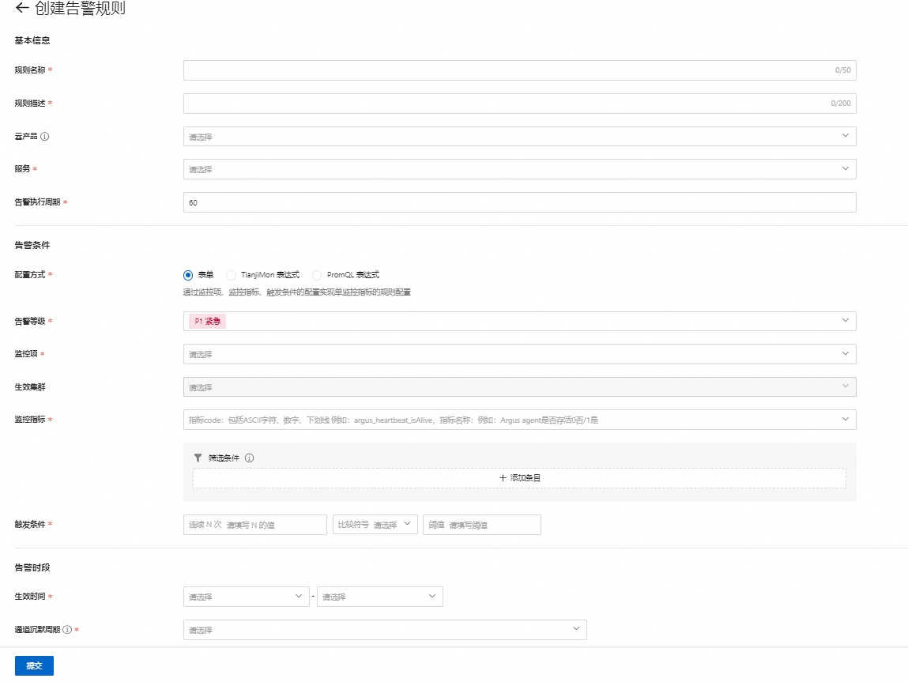

**查看告警规则**

1. 单击**高级筛选**，可以根据**规则名称**、**规则状态**、**告警等级**、**监控项**、**云产品**、**服务**以及**生效集群**组合筛选获取目标告警规则。

2. 在告警规则列表中，您可以获取告警规则的**规则名称**、**云产品**、**服务**、**是否启用**、**规则描述**、**监控项**、**告警规则**以及**生效集群**，将鼠标悬浮在**生效集群**列下的数字，页面会显示具体的生效集群名称。

   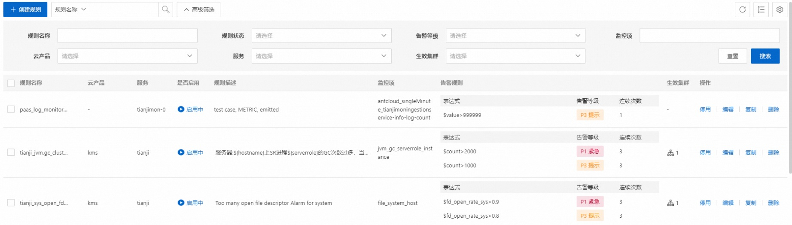

**停用告警规则**

> **说明**
>
> 当告警规则的**是否启用**状态为**启用中**时才支持停用告警规则。

单个告警规则的停用

1. 在目标告警规则的**操作**列，单击**停用**。

2. 在弹出的对话框中单击**确定**。

多个告警规则的停用

1. 勾选多个告警规则，在列表下方单击**停用**。

2. 在弹出的对话框中单击**确定**。

**启用告警规则**

> **说明**
>
> 当告警规则的**是否启用**状态为**已停用**时才支持启用告警规则。

单个告警规则的启用

1. 在目标告警规则的**操作**列，单击**启用**。

2. 在弹出的对话框中单击**确定**。

多个告警规则的启用

1. 勾选多个告警规则，在列表下方单击**启用**。

2. 在弹出的对话框中单击**确定**。

**复制告警规则**

1. 在目标告警规则的**操作**列，单击**复制**。

2. 在弹出的对话框中确认复制告警规则的信息无误后单击**创建**。

**变更告警规则**

1. 在目标告警规则的**操作**列，单击**变更**。

2. 在变更告警规则弹框，设置**告警执行周期**、**告警等级**、**触发条件**、**生效时间**、**通道沉默周期**，单击**变更**。

**删除告警规则**

单个告警规则的删除

1. 在目标告警规则的**操作**列，单击**删除。**

2. 在弹出的对话框中单击**确定**。

多个告警规则的删除

1. 勾选多个告警规则，在列表下方单击**删除**。

2. 在弹出的对话框中单击**确定**。

**系统规则**

**规则变更**

- 入口一

  <ol type="i">

  <li>

  在左侧导航栏，选择**云产品业务监控** > **告警规则**。

  </li>

  <li>

  选择**系统规则**页签，单击**规则变更**。

  </li>

  <li>

  在**变更告警规则**弹框，选择目标规则，单击**下一步**，可设置**告警执行周期**、**告警等级**、**触发条件**、**生效时间**、**通道沉默周期**，单击**变更**，即可完成规则变更。

  

  > **说明**
  >
  > 在自定义规则中可查看变更的规则。

  </li>

  </ol>

- 入口二

  <ol type="i">

  <li>

  在目标告警规则的**操作**列，单击**自定义变更**。

  </li>

  <li>

  在**变更告警规则**弹框，设置**告警执行周期**、**告警等级**、**触发条件**、**生效时间**、**通道沉默周期**，单击**变更**。

  </li>

  </ol>

**查看告警规则**

1. 单击**高级筛选**，可以根据**规则名称**、**规则状态**、**告警等级**、**监控项**、**云产品**、**服务**以及**生效集群**组合筛选获取目标告警规则。

2. 在告警规则列表中，您可以获取告警规则的**规则名称**、**云产品**、**服务**、**是否启用**、**规则描述**、**监控项**、**告警规则**以及**生效集群**，将鼠标悬浮在**生效集群**列下的数字，页面会显示具体的生效集群名称。

   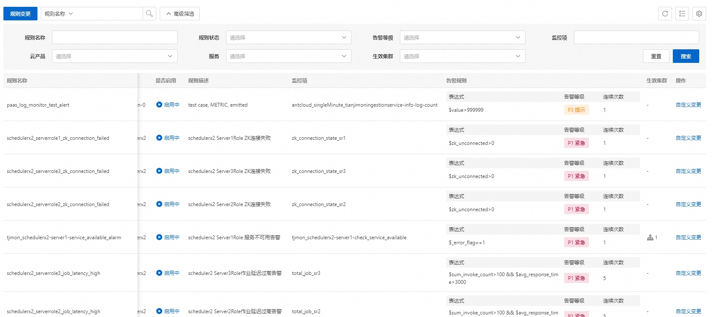

<a id="section-4-1-1-1-4"></a>

##### 4.1.1.1.4. 告警模板

告警模板提供云产品系统监控模板和自定义监控模板的管理能力。

**系统模板**

**配置导入**

1. 登录Apsara Uni-manager运维控制台。

2. 在顶部菜单栏，选择**监控告警** > **监控管理** > **云平台监控**。

3. 在左侧导航栏，选择**云产品业务监控** > **告警模板**。

4. 在**系统模板**页签，单击**配置导入**，在上传文件弹框上传模板文件，单击**确定**。

   

   > **说明**
   >
   > 当前只支持zip类型的文件。

   模板的主要参数含义如下表所示：

   <table>
     <tr>
       <th width="146">参数</th>
       <th>参数说明</th>
     </tr>
     <tr>
       <td>服务名称</td>
       <td>监控模板配置的服务，监控模板配置在指定的服务上生效。</td>
     </tr>
     <tr>
       <td>模板名称/模板ID</td>
       <td>监控模板名称和ID。<br>鼠标悬停在模板名称或ID右侧，单击可复制模板名称或ID。</td>
     </tr>
     <tr>
       <td>模板类型</td>
       <td>监控模板的类型。</td>
     </tr>
     <tr>
       <td>模板版本</td>
       <td>监控模板的版本。<br>• V1: tianjimon template<br>• V2: tianjimon 页面接入模板</td>
     </tr>
     <tr>
       <td>部署状态</td>
       <td>监控模板的部署状态。一共有四种状态：<strong>已生效</strong>、<strong>正在生效中</strong>、<strong>生效失败</strong>、<strong>未生效</strong>。<br>• 已生效：表示模板已经部署完成。<br>• 正在生效中：表示模板正在部署生效中，暂未生效。<br>• 生效失败：表示模板部署生效失败，具体失败原因可见生效失败原因。<br>• 未生效：表示模板尚未开始部署生效，处于等待状态。</td>
     </tr>
     <tr>
       <td>关联实例</td>
       <td>有关联实例时，鼠标悬停在上，可查看具体是哪些服务实例被当前模板绑定生效，鼠标<br>悬停在集群名称右侧，单击可复制集群名；无关联服务实例时，代表该模板未被服务关联<br>引用。</td>
     </tr>
     <tr>
       <td>模板生效时间</td>
       <td>模板的生效时间。</td>
     </tr>
     <tr>
       <td>模板修改时间</td>
       <td>模板的最后修改时间。</td>
     </tr>
     <tr>
       <td>修改人</td>
       <td>模板修改人。</td>
     </tr>
     <tr>
       <td>失效失败原因</td>
       <td>模板部署失败的原因。单击<strong>失效失败原因</strong>列的信息，可通过弹窗查看详细信息。</td>
     </tr>
   </table>

**查看模板**

在**系统模板**页签，选择目标模板，单击**操作**列的**查看**。

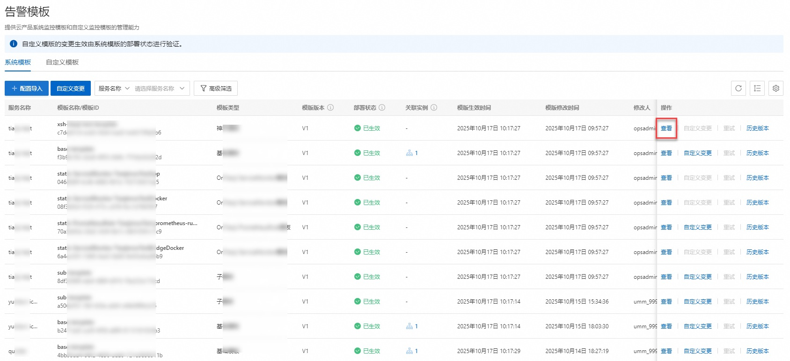

**查看模板**弹框展示模板的详细信息。

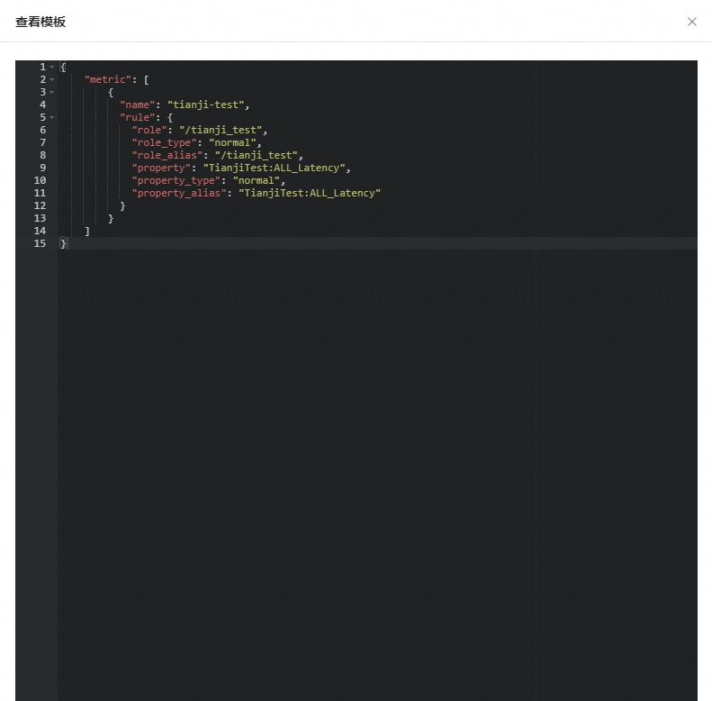

**自定义变更**

- 入口一

  <ol type="i">

  <li>

  在**系统模板**页签，单击**自定义变更**。

  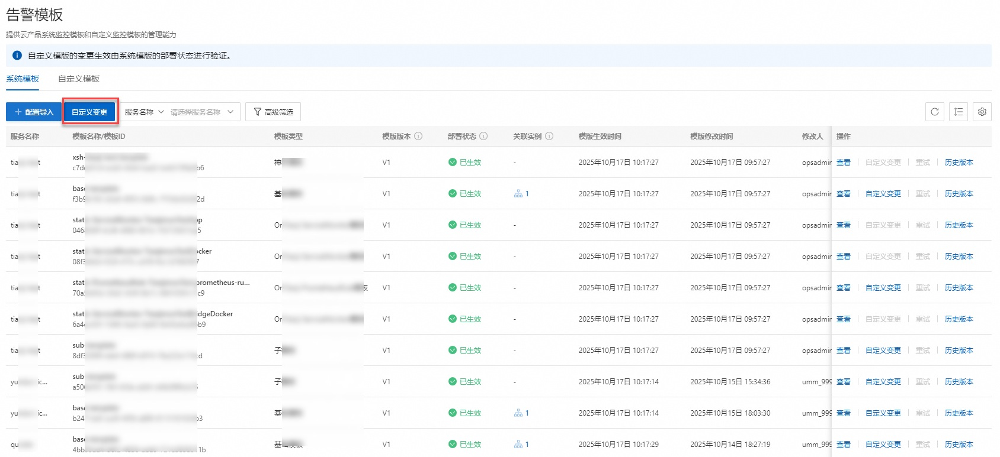

  </li>

  <li>

  在**变更告警模板**弹框，选择一个模板，单击**下一步**。

  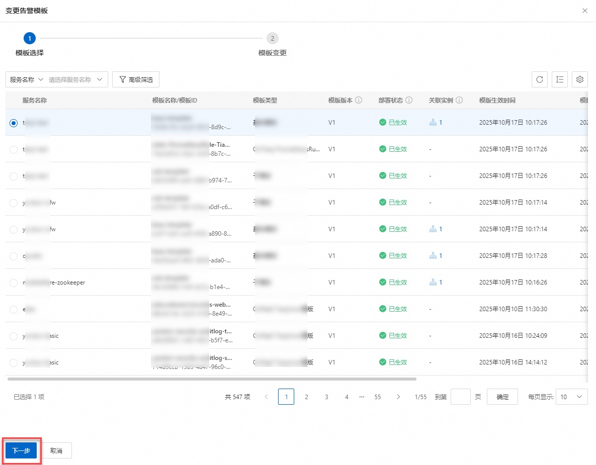

  </li>

  <li>

  在右侧的变更版本中编辑模板，单击**变更**，变更后可在**自定义模板**中查看。

  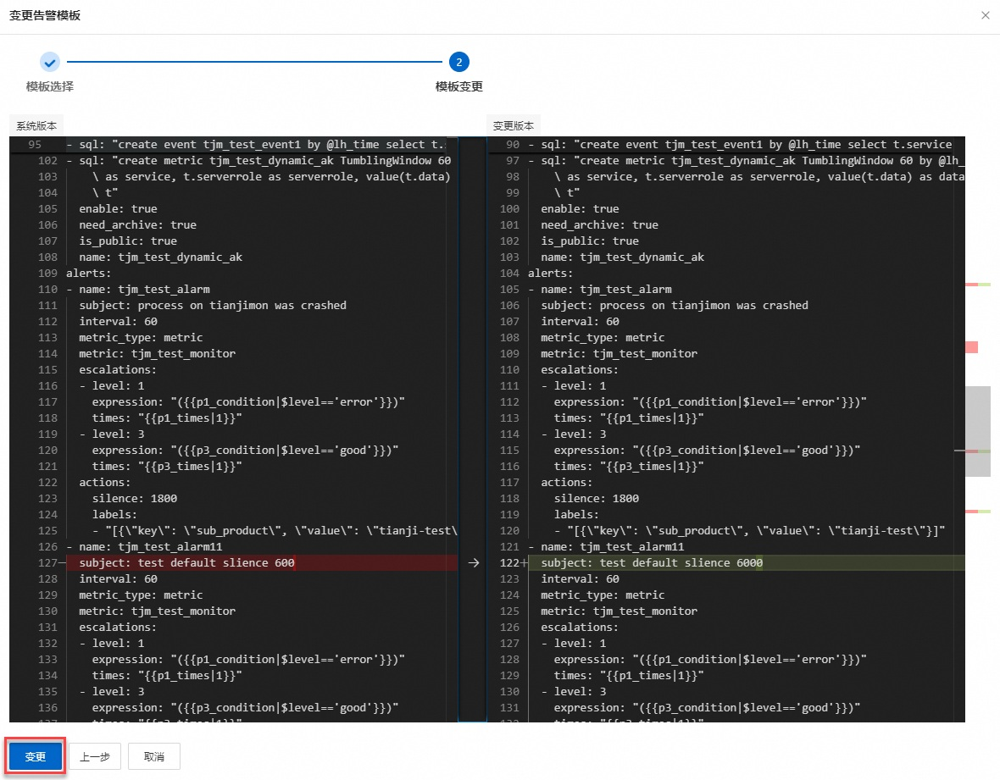

  </li>

  </ol>

- 入口二

  <ol type="i">

  <li>

  在**系统模板**页签，选择目标模板，单击**操作**列的**自定义变更**。

  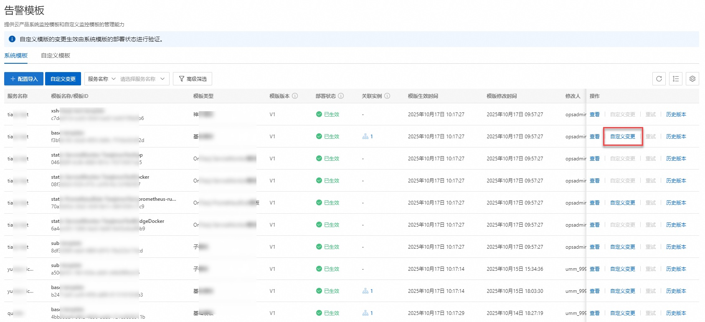

  </li>

  <li>

  在右侧的变更版本中编辑模板，单击**变更**，变更后可在**自定义模板**中查看。

  

  </li>

  </ol>

**重试**

部署状态为**生效失败**的模板，可单击操作列的**重试**，重新部署模板。

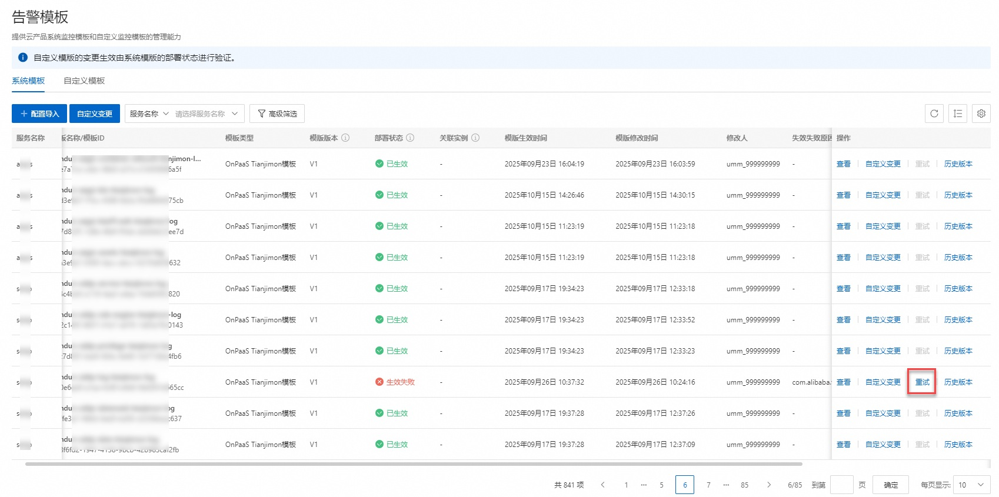

**历史版本**

> **说明**
>
> 历史版本的同步，因云产品服务升级、局点模板白屏化修改，会有10分钟的同步延迟。

1. 在**系统模板**页签，选择目标模板，单击**操作**列的**历史版本**，可查看模板**修改时间**、**修改人**、**失效失败原因**等信息。

2. 在**历史版本**弹框，单击**操作**列的与**当前版本对比**，可查看当前版本和历史版本的模板差异信息。

   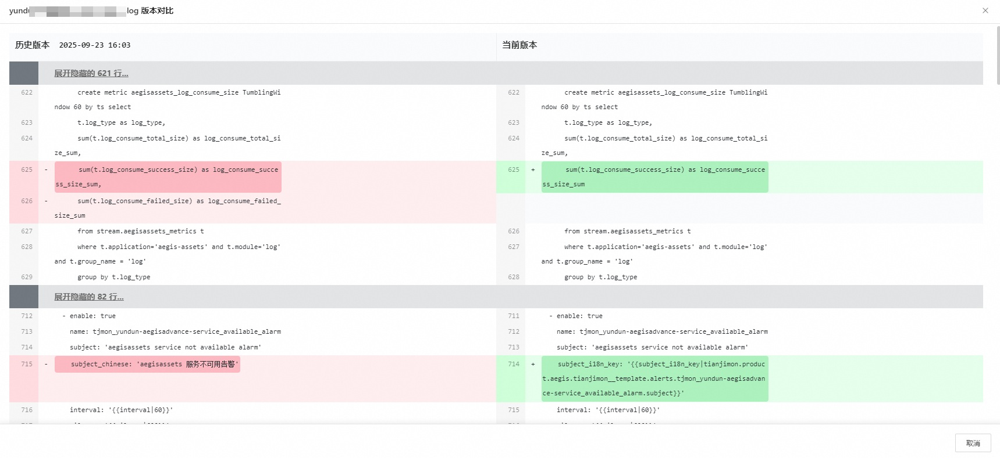

3. 单击**操作**列的**查看**，可通过JSON形式展示模板的信息。

**自定义模板**

**配置导入**

1. 登录Apsara Uni-manager运维控制台。

2. 在顶部菜单栏，选择**监控告警** > **监控管理** > **云平台监控**。

3. 在左侧导航栏，选择**云产品业务监控** > **告警模板**。

4. 选择**自定义模板**页签，单击**配置导入**，在上传插件弹框上传模板文件，单击**确定**。

   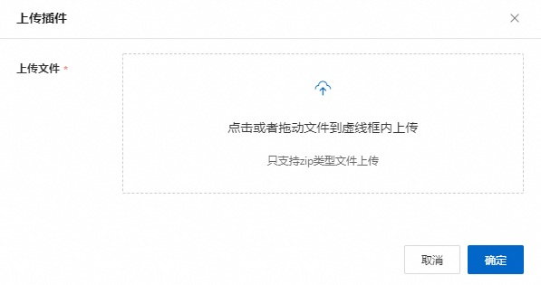

   > **说明**
   >
   > 当前只支持zip类型的文件。

**变更模板**

> **说明**
>
> 自定义模板的变更生效可通过系统模板的部署状态进行验证。

1. 在**自定义模板**页签，选择目标模板，单击**操作**列的**变更**。

   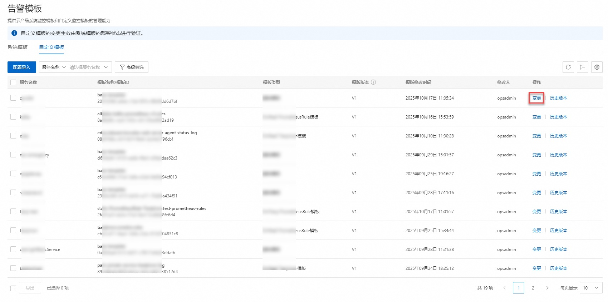

2. 在右侧的变更版本中编辑模板，单击**变更**，变更后可在**自定义模板**中查看。

   

**查看历史版本**

> **说明**
>
> 历史版本的同步，因云产品服务升级、局点模板白屏化修改，会有10分钟的同步延迟。

1. 在**自定义模板**页签，选择目标模板，单击**操作**列的**历史变更**，可查看模板**修改时间**、**修改人**、**失效失败原因**等信息。

   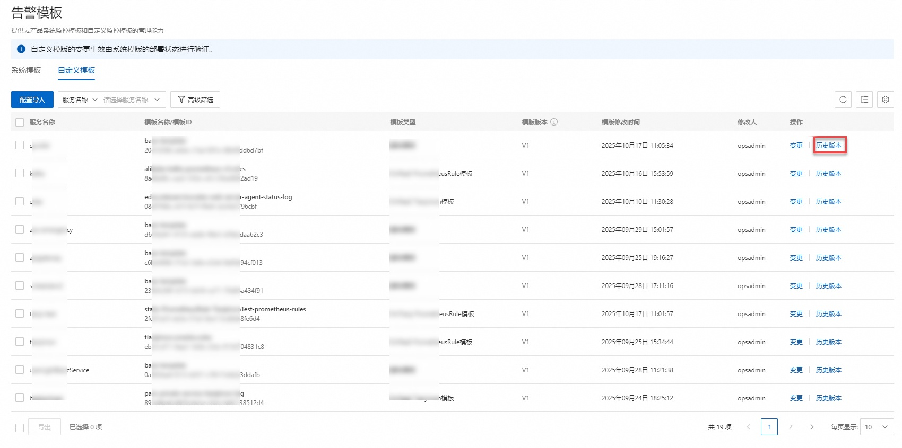

2. 在**历史版本**弹框，单击**操作**列的与**当前版本对比**，可查看当前版本和历史版本的模板差异信息。

   

3. 单击**操作**列的**查看**，可通过JSON形式展示模板的信息。

<a id="section-4-1-1-1-5"></a>

##### 4.1.1.1.5. 告警历史

展示云产品监控的所有告警信息，包含集群、服务。

**操作步骤**

1. 登录Apsara Uni-manager运维控制台。

2. 在顶部菜单栏，选择**监控告警** > **监控管理** > **云平台监控**。

3. 在左侧导航栏，选择**云产品业务监控** > **告警历史**。

   - 在左侧**服务目录**下选择目标云产品或服务名称后，页面右侧展示对应的告警趋势和告警列表。

   - 在页面右上角，选择告警时间段，页面下方展示对应时间段的告警信息。

     - 告警趋势：展示历史告警在目标时间段内的变化趋势。

     - 告警列表：展示历史告警在目标时间段内的告警列表。

   - 单击**高级筛选**，可以根据**告警等级**、**监控项**、**规则名称**以及**集群**组合筛选获取目标告警历史信息。

     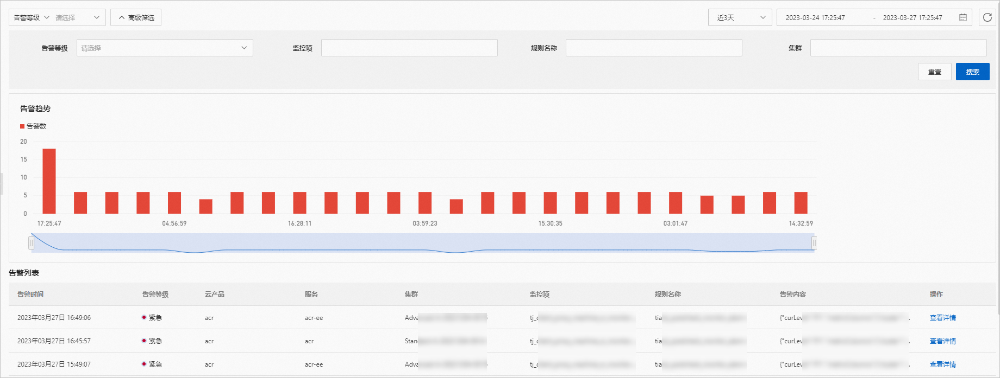

   - 在目标告警的**操作**列，单击**查看详情**，可以获取告警的详细信息，包括告警的**基本信息**和对应的**告警规则**。

     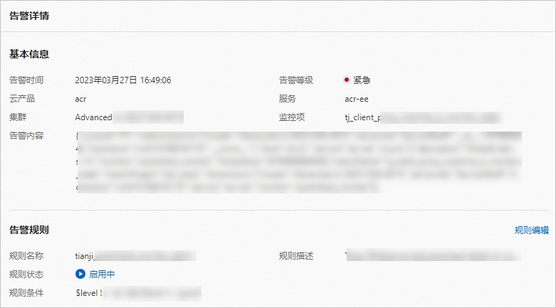

   - 在**告警规则**区域，单击右侧的**规则编辑**，页面跳转到编辑告警规则页面，修改告警规则的相关内容后单击**提交**。

<a id="section-4-1-1-2"></a>

#### 4.1.1.2. 云产品网关监控

<a id="section-4-1-1-2-1"></a>

##### 4.1.1.2.1. API监控大盘

API监控大盘实现对注册到网关（POP、OPS、AS）的API访问量、平均访问量、平均总耗时、可用率、成功率的指标的监控；可通过时间段（最长不超过31天的时间）的时间数据的查询；默认的实时视图为最近1小时的数据；开启自动刷新，定时1分钟刷新一次。

**操作步骤**

1. 登录Apsara Uni-manager运维控制台。

2. 在顶部菜单栏，选择**监控告警** > **监控管理** > **云平台监控**。

3. 在左侧导航栏，选择**云产品网关监控** > **API监控大盘**。

4. 在页面上方选择**云产品**、**API类型**、**API版本**、**API namespace**、**API 名称**快速筛选监控大盘。

5. 在监控大盘可查看**API 访问量**、**平均访问量**、**平均总耗时**、**可用率**、**成功率**监控图表。

   > **说明**
   >
   > - 单击页面右上角的**实时视图**，支持设置视图的时间范围，可选择**最近3小时**、**最近6小时**、**最近24小时**、**最近3天**、**最近7天**和**自定义视图**。
   >
   > - 单击页面右上角的
   >
   >   ，可设置自动刷新或手动刷新图表。
   >
   >   

<a id="section-4-1-1-2-2"></a>

##### 4.1.1.2.2. API报警

对云产品 API 监控的报警规则和报警历史进行查看和管理。

**创建报警规则**

**操作步骤**

1. 登录Apsara Uni-manager运维控制台。

2. 在顶部菜单栏，选择**监控告警** > **监控管理** > **云平台监控**。

3. 在左侧导航栏，选择**云产品网关监控**> **API 报警**。

4. 单击**创建报警规则**，在**创建报警规则**面板完成参数配置，配置项说明如下。

   **分类**

   **参数**

   **说明**

   选择需要上报报警的云产品。

   **云产品**

   选择云产品的API类型，仅支持选择**OPSAPI**。

   **API 类型**

   选择云产品的API范围，可选择**所有核心API**和**自定义选择**。

   **Api范围**

   > **说明**
   >
   > 当**Api范围**选择**自定义选择**时，配置此参数。

   **基础信息**

   **选择自定义Api**

   单击选择框，在**添加API**弹框中，勾选一个或多个API，单击**确定**。

   输入报警规则名称。

   **规则名称**

   请以英文命名并使用下划线连接，长度控制在64个字符以内。请勿使用中划线或其他特殊符号。

   输入报警规则的描述信息。

   **规则描述**

   从当前报警规则所选择的云产品的所有监控指标中，选择目标指标

   **报警指标**

   项。

   选报警等级。取值：**P1 紧急**、**P2 警告**、**P3 提示**、**P4通知**。

   **报警等级**

   当连续监测异常次数达到连续监测周期数时，上报告警。

   **连续监测周期数**

   **报警条件**

   - **同时满足以下所有条件**：当所有监控指标达到阈值时，触发报警。

   - **满足以下任一条件**：当任意一个监控指标达到阈值时，触发报

   **报警条件**

   警。

   单击**添加条目**，设置监控指标、比较符和阈值。

   报警规则的生效时间。报警规则只在生效时间内产生报警，非生效

   **生效时间**

   时间内不产生报警。

   **报警时段**

   当触发一次报警后，再次产生报警的时间间隔。取值：**5分钟**、**15分钟**、**30分钟**、**60分钟**、**3小时**、**6小时**、**12小时**和**24小时**。

   当某监控指标超出报警阈值时触发报警，如果监控指标在通道沉默周期内持续超过报警阈值，在通道沉默周期内不会重复产生报警；如果监控指标在通道沉默周期后仍未恢复正常，则系统将再次产生

   **通道沉默周期**

   报警。

   例如，当**通道沉默周期**设置为**12小时**时，如果超出报警阈值的监控指标在首次触发报警后12小时仍未恢复正常，系统将再次产生报警。

   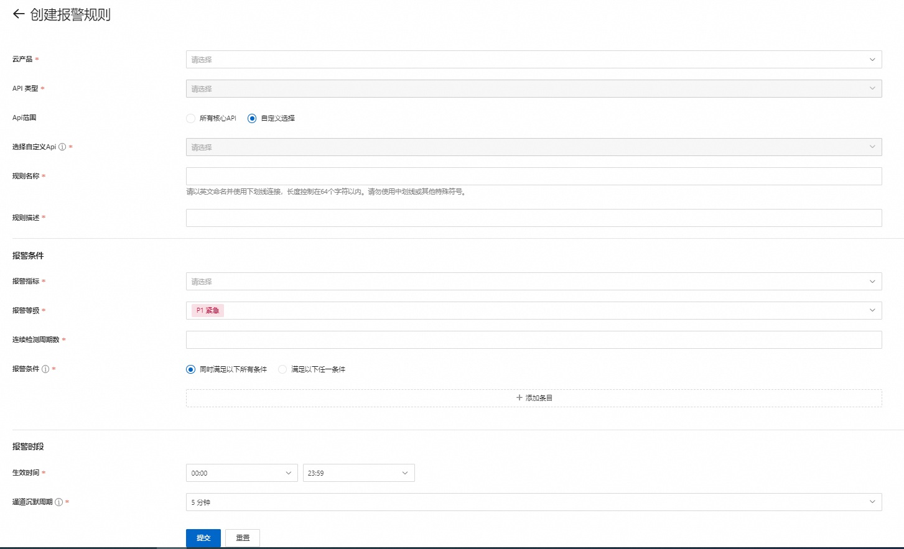

5. 单击**提交**。

**查看API报警规则**

**操作步骤**

在API 报警页面的列表，查看报警规则的**规则名称**、**规则状态**、**规则描述**、**云产品**、**报警等级**、**API 类型**、**API名称**、**报警条件**等。

> **说明**
>
> - 单击**API名 称**列的**核心API列表**，可查看核心API列表的**API名称**、**是否核心**、**Namespace**、**Version**等信息。
>
> - 鼠标悬停在**规则描述**列的信息上，可以通过弹窗查看规则描述信息的完整内容。

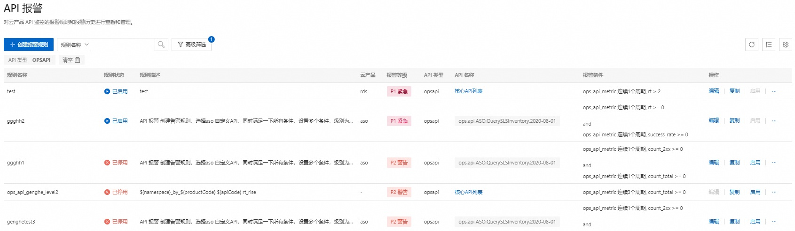

**修改报警规则**

**操作步骤**

当已有报警规则信息需要变更时，可以根据需要进行修改。

> **重要**
>
> 系统自带的报警规则不支持编辑。

1. 在**API 报警**页面的列表，单击目标报警规则操作列的**编辑**。

2. 在**编辑报警规则**面板，根据业务需要进行参数配置修改。具体参数配置说明可参见创建报警规则。

**复制报警规则**

**操作步骤**

复制报警规则即快速新增一个相同的报警规则，可以根据业务需求，对复制后的报警规则进行微调，以满足个性化的需求。

1. 在**API 报警**页面的列表，单击目标报警规则操作列的**复制**。

2. 在**复制报警规则**面板，根据需要依次完成内容的修改。配置项说明可参见创建报警规则。

**停用报警规则**

**操作步骤**

当暂时不需要监测指标时，可以停用对应的报警规则。

> **重要**
>
> 停用报警规则前，请确保**规则状态**为**已启用**。

1. 在**API 报警**页面的列表，单击目标报警规则操作列的  ，选择**停用**。

2. 单击**停用**。

**启用报警规则**

**操作步骤**

当需要继续监测指标时，可以重启报警规则。

> **重要**
>
> 启用报警规则前，请确保**规则状态**为**已停用**。

在**API 报警**页面的列表，单击目标报警规则操作列的**启用**。

**删除报警规则**

**操作步骤**

当不再需要报警规则时，可以将其删除。

> **重要**
>
> 该操作不可撤回，请谨慎操作。

1. 在**API 报警**页面的列表，单击目标报警规则操作列的  ，选择**删除**。

2. 单击**删除**。

<a id="section-4-1-1-3"></a>

#### 4.1.1.3. 基础设施监控

<a id="section-4-1-1-3-1"></a>

##### 4.1.1.3.1. WatchDog管理

本文为您介绍首次使用WatchDog时的配置方法，以及核心组件和运维监控等系统监控的监控指标。

**配置WatchDog**

1. 登录Apsara Uni-manager运维控制台。

2. 在顶部菜单栏，选择**监控告警** > **监控管理** > **云平台监控**。

3. 在左侧导航栏，选择**基础设施监控**> **WatchDog管理**。

4. 在**WatchDog管理**页面单击**编辑配置**，进入**编辑WatchDog配置**页面。

   详细参数说明如下：

   **参数**

   **是否必填**

   **详细说明**

   ASO账号

   是

   ASO密码

   是

   因Watchdog需要使用真实的ASO账号，模拟ASO系统的登录与报警查看等，为避免已有账号对其产生影响，请现场创建一个新的ASO账号，此处输入新创建ASO账号的用户名及密码。

   <table>
     <tr>
       <td>LVS集群 IP映射</td>
       <td>是</td>
       <td>此处需配置mgt带内IP，mgt带内IP查询方式如下：<br>说明LVS IP是探测LVS集群必备的参数，不填则导致LVS探测不生效。<br>i. 登录飞天基础运维平台，在<strong>产品集群运维</strong>页面搜索SLB集群，选择slbCluster-A-xxx，单击操作列的<strong>集群详情</strong>。ii. 在<strong>服务列表</strong>查找slb-lvs，单击<strong>操作</strong>列的<strong>详情</strong>，查看SlbLvs#对应的机器并单击<strong>操作</strong>列的<strong>Terminal</strong>登录机器。iii. 执行命令<code> ifconfig bond0 </code>即可获取带内IP，如下示例：<br>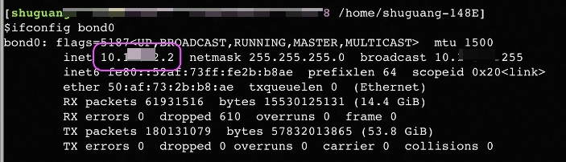<br>iv. 执行命令<code> ifconfig lo:mgt </code>获取带内IP，如下示例，因此获得一组带内ip-mgtIp的映射。<br>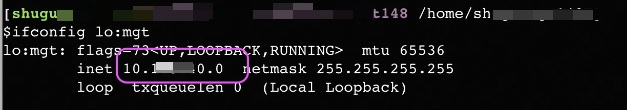<br>v. 登录另外一台机器，重复步骤c~d，即可获得另外一组带内ip-mgtIp的映射。</td>
     </tr>
     <tr>
       <td>ASW集群 IP映射</td>
       <td>否</td>
       <td rowspan="4">WatchDog的探测对象包括局点内的各种网络交换机（ASW、LSW、DSW、CSW），这些交换机的带外网络IP无法通过自动化接口的方式获取，因此需要现场交付手工获取各交换机的带内IP与带外IP的映射关系。<br>说明如果没有此项内容，所有交换机探测，只会探测其带内IP，不会探测带外网络的连通性。</td>
     </tr>
     <tr>
       <td>DSW集群 IP映射</td>
       <td>否</td>
     </tr>
     <tr>
       <td>CSW集群 IP映射</td>
       <td>否</td>
     </tr>
     <tr>
       <td>LSW集群 IP映射</td>
       <td>否</td>
     </tr>
     <tr>
       <td>JAR程序外发配置</td>
       <td>是</td>
       <td>i. JAR程序外发配置的IP为部署的带外网络的IP。ii. 单击<strong>下载JAR程序</strong>，将下载的jar包上传至带外网络。iii. 执行命令<code> java -jar projectA-0.0.1-SNAPSHOT.jar </code>运行jar包，正常输出日志表示服务启动正常。<br>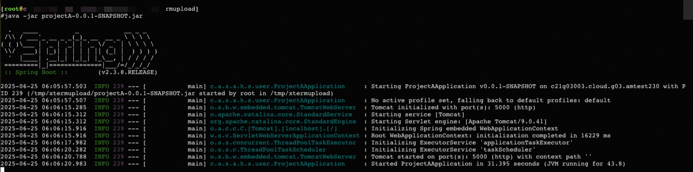<br>iv. 服务启动成功后，在编辑WatchDog配置界面单击JAR程序外发配置的<strong>测试。</strong></td>
     </tr>
     <tr>
       <td>告警外发配置</td>
       <td>否</td>
       <td>输入带外IP：端口+path路径，输入完成后单击<strong>测试</strong>。</td>
     </tr>
   </table>

**监控项说明**

1. 登录Apsara Uni-manager运维控制台。

2. 在顶部菜单栏，选择**监控告警** > **监控管理** > **云平台监控**。

3. 在左侧导航栏，选择**基础设施监控**> **WatchDog管理**。

4. 在**核心组件监控**页签，可查看如下列表中的监控项。

   **监控类别**

   **监控项**

   **说明**

   检测所有LSW的端口连通性，当所有LSW

   checkLSWConnection

   均无法连通时报警。

   检测所有DSW的端口连通性，当所有DSW

   checkDSWConnection

   均无法连通时报警。

   物理网络监控

   检测所有CSW的端口连通性，当所有CSW

   checkCSWConnection

   均无法连通时报警。

   检测所有ASW的端口连通性，当ASW出现机器不可用，且ASO网址也无法连接时报

   checkASWConnection

   警。

   检测DNS域名的创建，新域名在其他机器

   checkOpsDNSCreateConnectDeleteOn

   的连通性测试与域名删除功能,任一检测失

   RemoteNode

   败则报警。

   OPS_DNS监控

   检测DNS域名的创建，本机连通性测试与

   checkOpsDNSCreateConnectDeleteLoc

   域名删除功能，任一检测失败则报警。

   al

   检测minirds-maotai.DbMysql#的tianji巡检机器状态是不是Good，以及磁盘各分

   checkDbMySQLInstanceStatus

   区使用率是否有超过99%，存在异常则发出报警。

   MiniRDS监控

   检测Tianjimon的MiniRDS库是否可连通

   checkTianjimonMiniRDS

   并执行简单的SQL，存在异常则发出报警。

   检测ASO的MINIRDS库是否可连通并执行

   checkASOMiniRDS

   简单的SQL，存在异常则发出报警。

   检测Watchdog申请的VIP是否可连通，失

   checkWatchdogServerVip

   败时发出报警。

   检测所有LVS的22端口连通性，全部LVS机

   checkLvsSshPortConnection

   器连通失败时发出报警。

   LVS监控

   检测所有LVS的mgtIp 12000健康检查端口连通性，全部LVS机器连通失败时发出报

   checkLvsKeyPortConnection

   警。

5. 在**运维监控等系统监控**页签，可查看如下列表中的监控项。

   **监控类别**

   **监控项**

   **说明**

   检测ASO的登录接口，登录失败时发出报

   checkASOLogin

   警。

   检测ASO的告警概览中Tianjimon的状

   checkTianjimonStatus

   态，失败时发出报警。

   ASO监控

   检测ASO的告警概览接口，查询失败时发

   checkASOAlarmPage

   出报警。

   检测ASO的告警概览中TPCMon的状态，

   checkTpcMonStatus

   失败时发出报警。

   检测ASO的静态页面访问是否正常。

   checkStaticPage

   查询Tianjimon的Prometheus指标是否产出数据,检测metric为

   checkTianjiPrometheusMonitorMetric

   kube_daemonset_status_number_re ady。

   查询Tianjimon的容器指标是否产出数据,

   checkTianjiContainerMonitorMetric

   检测metric为docker_memory_util。

   查询Tianjimon的日志Metric是否产出数

   tianjimon监控

   checkTianjiLogMonitorMetric

   据,检测metric为cpu_host。

   查询Tianjimon的系统指标是否产出数据,

   checkTianjiHostMonitorMetric

   检测metric为cpu_host。

   查询Tianjimon的报警是否正常产出,检测报警项产出(如怀疑有问题再额外检测

   checkTianjiAlarmQuery

   mock告警规则mock_alert_name_for_watch_dog)。

   检测ASO的告警概览中Tianjimon的状

   checkTianjimonStatusOps

   态，失败时发出报警。

   检测ASO的告警概览中TPCMon的状态，

   checkTpcMonStatusOps

   ASO监控opsGateway

   失败时发出报警。

   监控

   检测ASO的告警概览接口，查询失败时发

   checkASOAlarmPageOps

   出报警。

   注册告警网关

   检测注册告警网关的域名。

   checkAlarmSubConnection

   查询注册的watchdogAgent是否正常工

   checkWatchdogAgent

   作。

   watchdog自身监控

   查询watchdogServer双备份是否正常工

   checkWatchdogServer

   作。

   检测ASO关于重点来源为CMS的告警延迟

   checkCmsAsoSourceStatus

   情况。

   ASO延迟监控

   检测ASO关于重点来源为Tianjimon的告

   checkTianjimonAsoSourceStatus

   警延迟情况。

<a id="section-4-1-1-3-2"></a>

##### 4.1.1.3.2. 服务器监控

服务器监控提供每个物理服务器的CPU、内存及服务器传感器（风扇、电源、CPU、内存、网卡、GPU、功耗等）的状态。

**操作步骤**

1. 登录Apsara Uni-manager运维控制台。

2. 在顶部菜单栏，选择**监控告警** > **监控管理** > **云平台监控**。

3. 在左侧导航栏，选择**基础设施监控**> **服务器监控**。

**一键导出**

在**服务器监控**页面，单击**一键导出**，以.json文件的形式导出全量服务器信息。

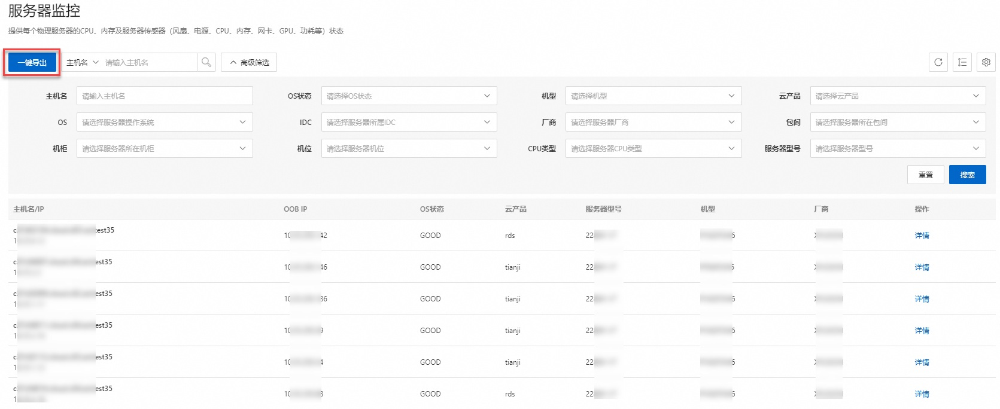

**筛选服务器**

在**服务器监控**页面，可通过**主机名**、**OS状态**、**机型**、**云产品**、**OS**、**IDC**、**厂商**、**包间**、**机柜**、**机位**、**CP类型**、**服务器型号**筛选目标服务器。

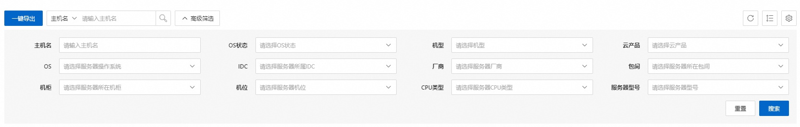

**查看服务器详情**

在**服务器监控**页面，选择目标服务器，单击**操作**列的**详情**，可查看服务器详情。

- 基本信息

  包含服务器的IP、可用区、集群、厂商、机房、机型、包间、服务器型号、机柜、机位、SN、CPU厂商、内核版本、MAC。

  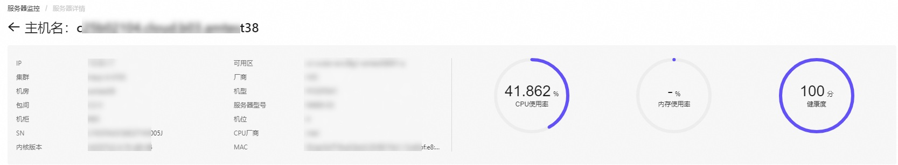

- 监控

  包含服务器状态及监控视图。

  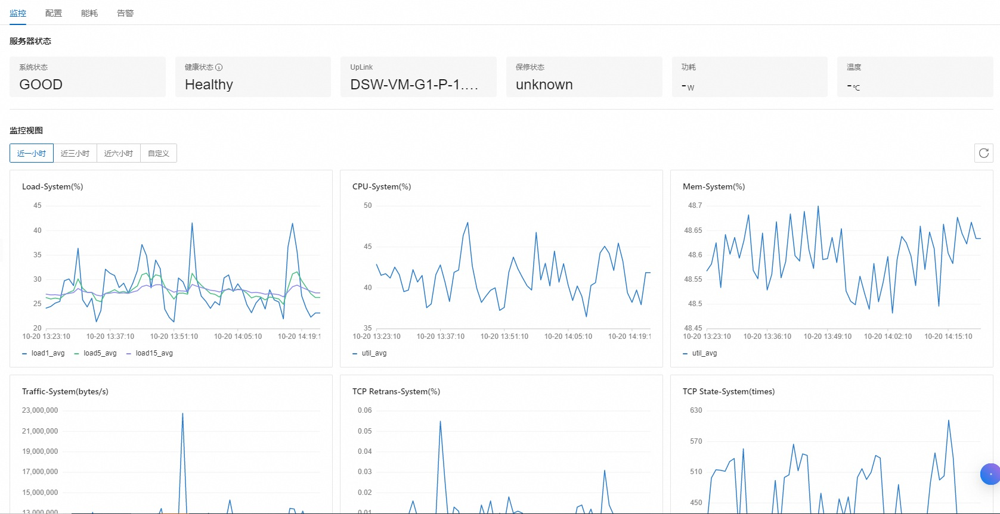

- 配置

  包含CPU、内存、存储、网卡、GPU、主板、BIOS、BMC、OS、电源、风扇的详细信息。

  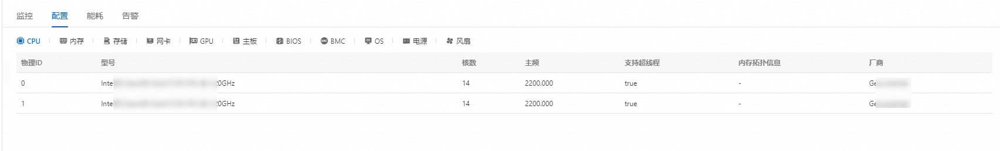

- 能耗

  包含当前功耗、今日用电量、月度用电量、系统温度及功耗和用电量走势图。

- 告警包含详细的告警信息。

<a id="section-4-1-1-3-3"></a>

##### 4.1.1.3.3. 网络监控

网络大盘概览展示网络产品的核心指标，帮助用户及时掌控产品及设备状态。

**操作步骤**

1. 登录Apsara Uni-manager运维控制台。

2. 在顶部菜单栏，选择**监控告警** > **监控管理** > **云平台监控**。

3. 在左侧导航栏，选择**基础设施监控**> **网络监控**。

4. 查看网络大盘信息。

   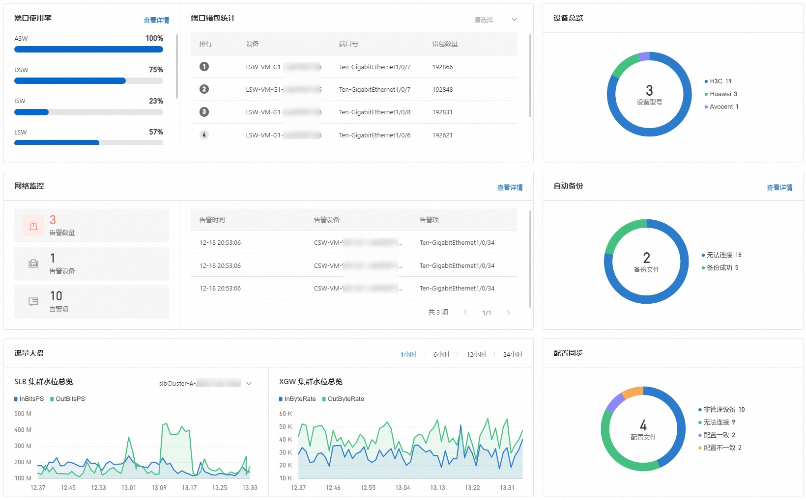

   <table>
     <tr>
       <th width="121">区域</th>
       <th>描述</th>
     </tr>
     <tr>
       <td>端口使用率</td>
       <td>展示各网络设备的端口使用率。单击<strong>查看详情</strong>，可以获取各网络设备的详细信息，包括<strong>设</strong><strong>备角色</strong>、<strong>设备名称</strong>、<strong>IP地址</strong>、<strong>使用率（%）</strong>、<strong>设备状态</strong>、<strong>端口总计</strong>和<strong>已使用</strong>。<br>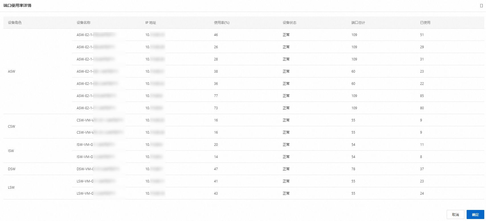</td>
     </tr>
     <tr>
       <td>端口错包统计</td>
       <td>选择目标时间段后，展示所有设备端口所产生的错包数量，按照数量排序仅展示前五名。</td>
     </tr>
     <tr>
       <td>设备总览</td>
       <td>展示网络设备的型号以及对应型号的数量。</td>
     </tr>
     <tr>
       <td>网络监控</td>
       <td>• <strong>告警数量</strong>：网络设备产生告警的总数量，并在右侧展示告警列表，包括<strong>告警时间</strong>、<strong>告警</strong><strong>设备</strong>和<strong>告警项</strong>。单击查看详情，页面跳转至<strong>网络监控告警</strong> &gt; <strong>网络告警大盘</strong>，查看详细的告警内容，具体可参考《专有云运维平台操作指南》中的“网络告警大盘”。<br>• <strong>告警设备</strong>：产生告警的网络设备数量。<br>• <strong>告警项</strong>：产生告警的告警项数量。</td>
     </tr>
     <tr>
       <td>自动备份</td>
       <td>• 展示自动备份任务的备份状态以及对应状态下的文件数量。<br>• 单击<strong>查看详情</strong>，可以获取自动备份的详情，包括<strong>文件名称</strong>和<strong>创建时间</strong>。<br>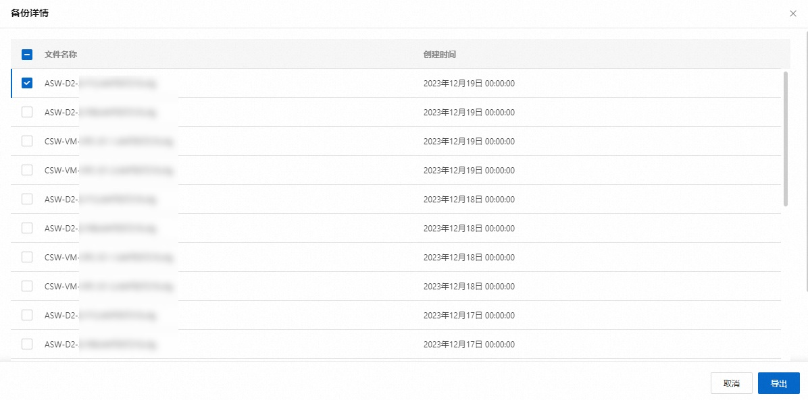<br>• 在备份详情页面下，勾选备份文件，单击<strong>导出</strong>可以将目标备份文件下载至本地进行查看。</td>
     </tr>
     <tr>
       <td>流量大盘</td>
       <td>选择目标时间段后，展示SLB集群和XGW集群的历史收发水位趋势图。</td>
     </tr>
     <tr>
       <td>配置同步</td>
       <td>展示配置文件的同步状态以及对应状态的数量。</td>
     </tr>
   </table>

<a id="section-4-1-1-4"></a>

#### 4.1.1.4. 通用监控

<a id="section-4-1-1-4-1"></a>

##### 4.1.1.4.1. 站点监控

站点监控提供系统预置的监控任务，这些任务主要通过TianjiMon的 black box容器节点对任意云产品、服务、组件、集群暴露的VIP、DNS、HOST发起远程探测，检测连通性和性能。同时也支持自定义站点监控任务以及管理站点监控任务。

**创建站点监控任务**

**操作步骤**

1. 登录Apsara Uni-manager运维控制台。

2. 在顶部菜单栏，选择**监控告警** > **监控管理** > **云平台监控**。

3. 在左侧导航栏，选择**通用监控** > **站点监控**。

4. 在**站点监控**页面，单击**创建任务**。

   <ol type="i">

   <li>

   在**基础配置**步骤中，完成下表中的配置项，单击**下一步**。

   | 配置项 | 说明 |
   | --- | --- |
   | 任务名称 | 当前站点监控任务的任务名称。支持英文字母、数字、下划线（_）、横杠（-）以及点（.），且必须以字母或数字开始和结束，长度为1~63个字符。 |
   | 任务类型 | 任务类型支持<strong>HTTP 拨测</strong>、<strong>TCP 拨测</strong>、<strong>ICMP 拨测</strong>、<strong>SSH 拨测</strong>、<strong>BATCH 拨测</strong>五种类型。<br>• <strong>HTTP 拨测</strong>：指通过发送HTTP请求来探测目标的健康状态。<br>• <strong>TCP 拨测</strong>：指通过发送TCP命令来探测目标的健康状态。<br>• <strong>ICMP 拨测</strong>：指通过发送ICMP命令来探测目标的健康状态。<br>• <strong>SSH 拨测</strong>：指通过发送SSH命令来探测目标的健康状态。<br>• <strong>BATCH 拨测</strong>：用来设置多种任务类型。 |
   | ICMP 探测次数 | 说明当任务类型选择<strong>ICMP 拨测</strong>时，需要设置此项参数配置。<br>请输入ICMP探测次数。 |
   | 子探针 | 说明当任务类型选择<strong>BATCH 拨测</strong>时，需要设置此项参数配置。<br>请选择多个任务类型。 |
   | 目标地址 | 输入目标地址。<br>• 当任务类型为<strong>HTTP 拨测</strong>时，请填写 HTTP 地址，例如：http://xxx.xxx.xxx 或http://10.1.10.1:8979/xxx。<br>• 当任务类型为<strong>TCP 拨测</strong>时，请填写 ip:port，例如 10.10.1.1:8080。<br>• 当任务类型为<strong>ICMP 拨测</strong>时，请填写 ip，例如：10.1.0.1。<br>• 当任务类型为<strong>SSH 拨测</strong>时：请输入 SSH 地址。<br>• 当任务类型为<strong>BATCH 拨测</strong>时：请输入组合探针目标地址。 |
   | 监控频率 | 选择探测周期。取值：<br>• 1分钟<br>• 自定义 |
   | HTTP高级设置 | 说明当任务类型选择<strong>HTTP 拨测</strong>时，需要设置此项参数配置。<br>• <strong>请求方法</strong>：探测类型的请求方法。默认为<strong>GET</strong>。<br>• <strong>HTTP状态码</strong>（可选）：期待HTTP拨测返回有效状态码，最多可选 20 个。<br>• <strong>Header</strong>（可选）：站点探测时HTTP的Headers。单击<strong>添加条目</strong>，输入<strong>Headers</strong>和<strong>Value</strong>值。 |

   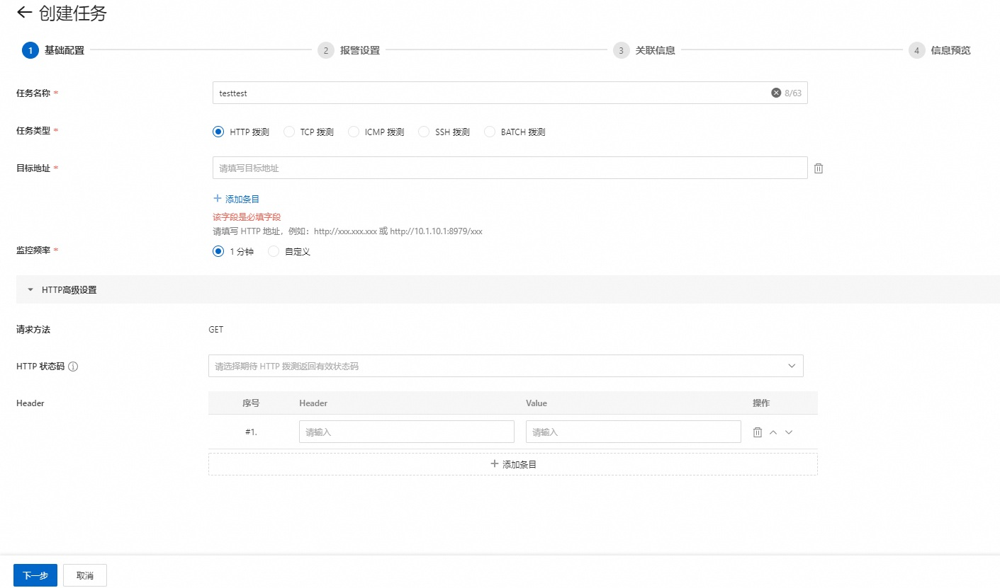

   </li>

   <li>

   在**报警设置**步骤中，完成下表中的配置项，单击**下一步**。

   > **说明**
   >
   > 单击页面下方的**添加条目**，可设置多个报警设置。

   <table>
     <tr>
       <th width="89">配置项</th>
       <th>说明</th>
     </tr>
     <tr>
       <td>报警名称</td>
       <td>当前站点监控任务的报警名称。支持英文字母、数字、下划线（_）、横杠（-）以及点（.），且必须以字母或数字开始和结束，长度为1~63个字符。</td>
     </tr>
     <tr>
       <td>报警级别</td>
       <td>选择报警的级别。取值：<br>• P1 紧急<br>• P2 警告<br>• P3 提示<br>• P4 通知</td>
     </tr>
     <tr>
       <td>报警周期</td>
       <td>输入报警执行周期。</td>
     </tr>
   </table>

   <table>
     <tr>
       <td>报警规则</td>
       <td>• <strong>条件执行</strong>：选择报警执行的条件。取值：<strong>全部满足</strong>和<strong>仅满足一项</strong>。<br>• <strong>状态码</strong>：取值：<strong>连通</strong>、<strong>不连通</strong>、<strong>全连通或任意连通</strong>以及<strong>全不连通或任意不连通</strong>。<br>说明仅当任务类型选择<strong>BATCH 拨测</strong>时，状态码展示<strong>全连通或任意连通</strong>和<strong>全不连通或任意不连</strong><strong>通</strong>选项。<br>• <strong>丢包率</strong>：选择比较方式，比较符支持 “<strong>&gt;</strong>”、“ <strong>&gt;=</strong>”、“<strong>&lt;</strong>”、“<strong>&lt;=</strong> ”、“<strong>==</strong>”、“<strong>!=</strong>”；输入阈值，单位为%。<br>说明当任务类型选择<strong>ICMP 拨测</strong>时，需要设置此项参数配置。<br>• <strong>响应时间</strong>：选择比较方式，比较符支持 “<strong>&gt;</strong>”、“ <strong>&gt;=</strong>”、“<strong>&lt;</strong>”、“<strong>&lt;=</strong> ”、“<strong>==</strong>”、“<strong>!=</strong>”；输入阈值，单位为秒。</td>
     </tr>
     <tr>
       <td>报警描述</td>
       <td>报警的描述信息。</td>
     </tr>
   </table>

   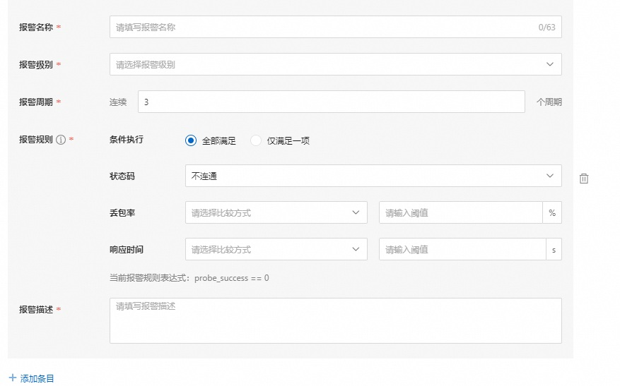

   </li>

   <li>

   在**关联信息**步骤中，选择**关联云产品**、**关联服务**、**关联组件**和**关联集群**（可选），单击**下一步**。

   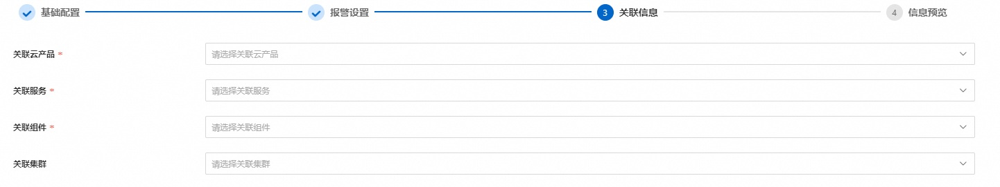

   </li>

   <li>

   在**信息预览**步骤中，确认任务配置信息无误后，单击**提交**。

   </li>

   </ol>

**查看站点监控详情**

**操作步骤**

站点监控任务创建成功后，可以查看监控任务的详细信息，包括监控任务的基础信息、监控指标和配置信息等。

1. 在**站点监控**页面的列表，查看监控任务的**任务名称**、**拨测目标**、**任务状态**、**任务类型**、**监控频率**、**关联云产品**、**关联服务**、**关联组件**和**关联集群**。

   > **说明**
   >
   > - 单击**高级筛选**，可通过**任务名称**、**任务状态**、**任务类型**、**关联云产品**、**关联服务**、**关联组件**和**关联集群**组合筛选目标监控任务。
   >
   > - 单击列表上方的
   >
   >   ，可手动刷新列表。
   >
   >   
   >
   > - 单击列表上方的
   >
   >   ，可设置列表疏密度为**默认**或**紧凑**。
   >
   >   
   >
   > - 单击列表上方的  ，可通过勾选或取消勾选字段，来展示或隐藏字段。

   

2. 在监控任务列表，单击目标任务名称。

3. 在**任务详情**页面，查看详细监控信息。

   - 在页面上方区域，查看监控任务基础信息，包括**任务类型**、**拨测目标**、**监控频率**、**关联云产品**、**关联服务**、**关联组件**和**关联集群**等。

     > **说明**
     >
     > - 单击页面右上角的**停用**，可停止当前站点监控任务。
     >
     > - 单击页面右上角的**编辑**，可修改监控任务信息，具体参数配置说明可参见创建站点监控任务。

     

   - 在**监控指标**页签，查看监控指标趋势图。支持按**实时视图**、**近一天视图**、**近一周视图**或**自定义视图**进行切换。

     

   - 在**配置信息**页签，查看**HTTP高级配置**和**报警设置**相关信息。

     

**编辑监控任务**

**操作步骤**

当已有监控任务信息需要变更时，可以根据需要进行修改。

> **重要**
>
> 系统或产品层面的监控任务无法修改。

1. 在**站点监控**页面的列表，单击目标监控任务操作列的**编辑**。

2. 在**修改任务**面板，根据业务需要进行参数配置修改。具体参数配置说明可参见创建站点监控任务。

   > **重要**
   >
   > **任务名称**不支持修改。

**复制监控任务**

**操作步骤**

复制监控任务即快速新增一个相同的监控任务，可根据业务需求，对复制后的监控任务进行微调，以满足个性化的需求。

1. 在**站点监控**页面，单击目标监控任务**操作**列的**复制**。

2. 在**复制任务**面板，按照步骤向导，根据需要依次完成内容的修改。配置项说明可参见创建站点监控任务。

**停用监控任务**

**操作步骤**

当暂时不需要监控站点时，可以停用对应的监控任务。

> **重要**
>
> 停用监控任务前，请确保**任务状态**为**启用中**。

- 单个停用

  <ol type="i">

  <li>

  在**站点监控**页面的列表，单击目标监控任务操作列的**停用**。

  </li>

  <li>

  单击**确定**。

  </li>

  </ol>

- 批量停用

  <ol type="i">

  <li>

  在站点监控页面的列表，勾选目标监控任务前的复选框。

  </li>

  <li>

  单击列表下方的**批量停用**。

  </li>

  <li>

  单击**确定**。

  </li>

  </ol>

**启用监控任务**

**操作步骤**

当需要继续监控站点时，可以重启监控任务。

> **重要**
>
> 启用监控任务前，请确保**任务状态**为**已停用**。

- 单个启用

  <ol type="i">

  <li>

  在**站点监控**页面的列表，单击目标监控任务操作列的**启用**。

  </li>

  <li>

  单击**确定**。

  </li>

  </ol>

- 批量启用

  <ol type="i">

  <li>

  在**站点监控**页面的列表，勾选目标监控任务前的复选框。

  </li>

  <li>

  单击列表下方的**批量启用**。

  </li>

  <li>

  单击**确定**。

  </li>

  </ol>

**删除监控任务**

**操作步骤**

当不再需要监控任务时，可以将其删除。

> **重要**
>
> 系统或产品层面的监控任务无法删除。

- 单个删除

  <ol type="i">

  <li>

  在**站点监控**页面的列表，单击目标监控任务操作列的**删除**。

  </li>

  <li>

  单击**确定**。

  </li>

  </ol>

- 批量删除

  <ol type="i">

  <li>

  在**站点监控**页面的列表，勾选目标监控任务前的复选框。

  </li>

  <li>

  单击列表下方的**批量删除**。

  </li>

  <li>

  单击**确定**

  </li>

  </ol>

**查看站点黑名单**

在站点运行过程中，自动发现云产品的DNS、VIP、HOST的资源在最近72小时长时间不连通而自动不再探测的资源，以降低资源消耗。

> **说明**
>
> 系统通过动态的感知DNS、VIP、HOST这些资源的任务是否符合告警，如果72小时持续符合告警，系统就会抑制并加入黑名单；如果已经抑制的规则符合规定的不产生告警的条件，系统会动态的从黑名单中释放。

**操作步骤**

1. 在**站点监控**页面，单击**站点黑名单**。

2. 在弹出的面板中，可通过**资源名称**、**资源类型**、**关联云产品**、**关联服务**、**关联组件**以及**关联集群**组合筛选站点黑名单。列表展示已加入黑名单的资源的**资源名称**、**资源**、**资源类型**、**加黑时间**、**关联云产品**、**关联服务**、**关联组件**、**关联集群**以及**加黑规则**等。

   

**移除站点黑名单**

**操作步骤**

单个移除

1. 在**站点监控**页面，单击**站点黑名单**。

2. 在资源列表中，单击目标资源操作列的**移除**。

3. 单击**确定**。

批量移除

1. 在**站点监控**页面，单击**站点黑名单**。

2. 在资源列表中，勾选目标资源前的复选框，单击**批量移除**。

3. 单击**确定**。

<a id="section-4-1-1-4-2"></a>

##### 4.1.1.4.2. 云实例监控

在云实例监控页面，查看各云产品实例的基本信息和监控图表，了解资源运行状况。

**功能定位**

在专有云场景下，提供对云平台接入的云产品（SLB）进行云服务实例运行状态的监控，包括可用性指标、性能指标、状态指标、容量指标、网络指标等。大幅提升TAM、SRE、云产品研发对现场局点监控问题发现效率和分析效率，轻松实现对云产品依赖服务实例的质量的数据可视化分析。

**查看实例列表**

**操作步骤**

1. 登录Apsara Uni-manager运维控制台。

2. 在顶部菜单栏，选择**监控告警** > **监控管理** > **云平台监控**。

3. 在左侧导航栏，选择**通用监控** > **云实例监控**。

4. 在**云实例监控**页面，单击目标云产品。

5. （可选）通过列表上方的下拉列表或高级筛选设置，可以快速查找用户。

6. 在实例列表查看实例以下信息。

   <table>
     <tr>
       <th width="154">展示项</th>
       <th>说明</th>
     </tr>
     <tr>
       <td>实例ID</td>
       <td>SLB 实例的唯一标识。</td>
     </tr>
     <tr>
       <td>平台实例</td>
       <td>用于标记示例归属的业务域是否是平台使用。<br>• <strong>True</strong> ：平台实例<br>• <strong>False</strong> 为租户侧业务实例</td>
     </tr>
     <tr>
       <td>IP地址</td>
       <td>SLB 实例关联的VIP地址。</td>
     </tr>
     <tr>
       <td>Product</td>
       <td>SLB 实例归属的产品信息。</td>
     </tr>
     <tr>
       <td>Service</td>
       <td>SLB 实例归属的服务信息。</td>
     </tr>
     <tr>
       <td>Component</td>
       <td>SLB 实例归属的服务组件信息。</td>
     </tr>
     <tr>
       <td>网络类型</td>
       <td>SLB 实例的网络类型。</td>
     </tr>
     <tr>
       <td>所属IP地址池类型</td>
       <td>SLB 实例VIP地址归属的地址池类型。</td>
     </tr>
     <tr>
       <td>IP地址池ID</td>
       <td>SLB 实例VIP地址归属地址池的唯一标识ID。</td>
     </tr>
     <tr>
       <td>IP地址池CIDR</td>
       <td>SLB 实例VIP地址归属的地址池信息。</td>
     </tr>
   </table>

   

**查看监控图表**

**操作步骤**

在实例列表中，单击目标实例操作列的**监控图表**。

- 在页面上方，查看实例的基本信息。

  

- 在**实例监控**页签，查看实例的监控图表。监控图表支持按**15分钟**、**1小时**、 **6小时**或自定义时间进行切换。单击监控项下拉框可快速查找目标指标的监控图表。

  

- 在**端口监控**页签，查看端口的监控图表。监控图表支持按**15分钟**、**1小时**、 **6小时**或自定义时间进行切换。单击**监控项**和**端口监控**下拉框可快速查找目标指标和端口的监控图表。

  

**监控指标说明**

SLB的监控指标，只关注4层协议即可，不包含7层

当调用云监控的API接口时，需要获取当前云产品的**Namespace**和**Period**，具体取值如下：

- **Namespace**为**acs_slb_dashboard**。

- **Period**默认为60秒，也可以为60的整数倍。

**实例**

| 监控项 | 单位 | MetricName | Dimensions | 描述 |
| --- | --- | --- | --- | --- |
| 实例新建连接使用率 | % | InstanceNewConnec tion.Util | instanceId | 实例新建连接使用率。 |
| 实例流入带宽使用率 | % | InstanceTrafficRXNe w_SUM.Util | instanceId | 实例流入带宽使用率。 |
| 实例流出带宽使用率 | % | InstanceTrafficTXNe w_SUM.Util | instanceId | 实例流出带宽使用率。 |
| 实例最大连接数使用率 | % | InstanceMaxConnec tionRate | instanceId | 实例最大连接数使用率。 |
| 实例后端异常ECS实例个数 | Count | InstanceUnhealthyS erverCount | instanceId | 后端异常ECS实例个数。 |
| 实例失败连接数 | Count | InstanceFailConnect ion | instanceId | 实例失败连接数<strong>。</strong> |

**端口**

| 监控项 | 单位 | MetricName | Dimensions | 描述 |
| --- | --- | --- | --- | --- |
| 端口活跃连接数 | Count | ActiveConnection | userId、instanceId、port、protocol | TCP活跃连接数。 |
| 端口非活跃连接数 | Count | InactiveConnectio n | userId、instanceId、port、protocol | TCP端口非活跃连接数。 |
| 端口监听每秒丢失连接数 | Count/s | DropConnection | userId、instanceId、port、protocol | 监听每秒丢失连接数。 |
| 端口监听每秒丢失入bit数 | bits/s | DropTrafficRX | userId、instanceId、port、protocol | 监听每秒丢失入bit数。 |
| 端口监听每秒丢失出bit数 | bits/s | DropTrafficTX | userId、instanceId、port、protocol | 监听每秒丢失出bit数。 |
| 端口每秒丢失入包数 | Count/s | DropPacketRX | userId、instanceId、port、protocol | 每秒丢失入包数。 |
| 端口每秒丢失出包数 | Count/s | DropPacketTX | userId、instanceId、port、protocol | 每秒丢失出包数。 |
| 端口并发连接数 | Count/s | MaxConnection | userId、instanceId、port、protocol | TCP端口每秒并发连接数。 |
| 端口新建连接数 | Count | NewConnection | userId、instanceId、port、protocol | TCP新建连接数。 |
| 端口流入数据包数 | Count/s | PacketRX | userId、instanceId、port、protocol | 每秒流入数据包数。 |
| 端口流出数据包数 | Count/s | PacketTX | userId、instanceId、port、protocol | 每秒流出数据包数。 |
| 端口流入带宽 | bits/s | TrafficRXNew | userId、instanceId、port、protocol | 流入带宽。 |
| 端口流出带宽 | bits/s | TrafficTXNew | userId、instanceId、port、protocol | 流出带宽。 |
| 端口后端异常ECS实例个数 | Count | UnhealthyServerC ount | userId、instanceId、port、vip | 后端异常ECS实例个数。 |
| 端口每秒建连失败数 | Count | FailConnection | userId、instanceId、port | 每秒建连失败数。 |

<a id="section-4-1-1-4-3"></a>

##### 4.1.1.4.3. 云实例告警

提供云服务实例配置告警规则能力，产生的报警通过ASO告警列表进行聚合展示。

**创建报警规则**

**操作步骤**

1. 登录Apsara Uni-manager运维控制台。

2. 在顶部菜单栏，选择**监控告警** > **监控管理** > **云平台监控**。

3. 在左侧导航栏，选择**通用监控** > **云实例告警**。

4. 单击**创建报警规则**，在**创建报警规则**面板完成参数配置，配置项说明如下。

   **分类**

   **参数**

   **说明**

   选择需要上报报警的云产品。

   **云产品**

   选择云产品的实例类型。

   **实例类型**

   选择云产品的实例范围，可选择**全部实例**和**自定义选择**。

   **实例范围**

   > **说明**
   >
   > 当**实例范围**选择**自定义选择**时，配置此参数。

   **自定义选择实例**

   **基础信息**

   单击选择框，在**自定义选择实例**弹框中，勾选一个或多个实例，单击**确定**。

   输入报警规则名称。

   **规则名称**

   请以英文命名并使用下划线连接，长度控制在64个字符以内。请勿使用中划线或其他特殊符号。

   输入报警规则的描述信息。

   **规则描述**

   <table>
     <tr>
       <td rowspan="4">报警条件</td>
       <td>监控指标</td>
       <td>从当前报警规则所选择的云产品的所有监控指标中，选择目标指标项。监控指标说明请参考监控指标说明。</td>
     </tr>
     <tr>
       <td>报警等级</td>
       <td>选报警等级。取值：<strong>P1 紧急</strong>、<strong>P2 警告</strong>、<strong>P3 提示</strong>、<strong>P4 通知</strong>。</td>
     </tr>
     <tr>
       <td>连续监测周期数</td>
       <td>当连续监测异常次数达到连续监测周期数时，上报告警。</td>
     </tr>
     <tr>
       <td>报警条件</td>
       <td>• <strong>同时满足以下所有条件</strong>：当所有监控指标达到阈值时，触发报警。<br>• <strong>满足以下任一条件</strong>：当任意一个监控指标达到阈值时，触发报警。单击<strong>添加条目</strong>，设置监控指标、比较符和阈值。</td>
     </tr>
     <tr>
       <td rowspan="2">报警时段</td>
       <td>生效时间</td>
       <td>报警规则的生效时间。报警规则只在生效时间内产生报警，非生效时间内不产生报警。</td>
     </tr>
     <tr>
       <td>通道沉默周期</td>
       <td>当触发一次报警后，再次产生报警的时间间隔。取值：<strong>5分钟</strong>、<strong>15</strong><strong>分钟</strong>、<strong>30分钟</strong>、<strong>60分钟</strong>、<strong>3小时</strong>、<strong>6小时</strong>、<strong>12小时</strong>和<strong>24小时</strong>。当某监控指标超出报警阈值时触发报警，如果监控指标在通道沉默周期内持续超过报警阈值，在通道沉默周期内不会重复产生报警；如果监控指标在通道沉默周期后仍未恢复正常，则系统将再次产生报警。例如，当<strong>通道沉默周期</strong>设置为<strong>12小时</strong>时，如果超出报警阈值的监控指标在首次触发报警后12小时仍未恢复正常，系统将再次产生报警。</td>
     </tr>
   </table>

   

5. 单击**提交**。

**查看报警规则**

**操作步骤**

在云实例告警页面的列表，查看报警规则的**规则名称**、**规则状态**、**规则描述**、**云产品**、**报警等级**、**实例类型**、**实例范围**、**报警条件**等。

> **说明**
>
> 单击**实例范围**列的数据，可查看报警规则关联资源的范围。


**修改报警规则**

**操作步骤**

当已有报警规则信息需要变更时，可以根据需要进行修改。

1. 在**云实例告警**页面的列表，单击目标报警规则操作列的**编辑**。

2. 在**编辑报警规则**面板，根据业务需要进行参数配置修改。具体参数配置说明可参见创建报警规则。

   > **重要**
   >
   > 规则名称不支持修改。

**复制报警规则**

**操作步骤**

复制报警规则即快速新增一个相同的报警规则，可以根据业务需求，对复制后的报警规则进行微调，以满足个性化的需求。

1. 在**云实例告警**页面的列表，单击目标报警规则操作列的**复制**。

2. 在**复制报警规则**面板，根据需要依次完成内容的修改。配置项说明可参见创建报警规则。

**停用报警规则**

**操作步骤**

当暂时不需要监测指标时，可以停用对应的报警规则。

> **重要**
>
> 停用报警规则前，请确保**规则状态**为**已启用**。

1. 在**云实例告警**页面的列表，单击目标报警规则操作列的  ，选择**停用**。

2. 单击**停用**。

**启用报警规则**

**操作步骤**

当需要继续监测指标时，可以重启报警规则。

> **重要**
>
> 启用报警规则前，请确保**规则状态**为**已停用**。

在**云实例告警**页面的列表，单击目标报警规则操作列的**启用**。

**删除报警规则**

**操作步骤**

当不再需要报警规则时，可以将其删除。

> **重要**
>
> 该操作不可撤回，请谨慎操作。

1. 在**云实例告警**页面的列表，单击目标报警规则操作列的  ，选择**删除**。

2. 单击**删除**。

<a id="section-4-1-1-5"></a>

#### 4.1.1.5. 数据大盘

<a id="section-4-1-1-5-1"></a>

##### 4.1.1.5.1. 监控读写量大盘

展示 CMS/TianjiMon 接入的云产品指标数据对OTS容量的影响和水位信息，提供指标控制策略。

**前提条件**

已获取云平台监控管理员的相关权限。

**操作步骤**

1. 登录Apsara Uni-manager运维控制台。

2. 在顶部菜单栏，选择**监控告警** > **监控管理** > **云平台监控**。

3. 在左侧导航栏，选择**数据大盘** > **监控读写量大盘**。

   在页面上方可以选择时间段来观察数据变化。

   

   - **OTS容量**：展示**当前OTS水位**、**总QPS**、**写入成功率**以及**写入时延**。

     > **说明**
     >
     > - **当前OTS水位**：当前 QPS / 理论上最大承载的 QPS。
     >
     > - **总QPS**：计算各监控系统 QPS 的总和。
     >
     > - **写入成功率**：显示写入成功率最低的监控系统。
     >
     > - **写入时延**：显示写入时延最高的监控系统。

   - **节点统计**：展示**物理节点数**、**PaaS节点数**以及**OTS节点数**。

   - **监控系统QPS**：CMS、TianjiMon针对OTS的每秒读次数。

   - **监控系统写入成功率**：CMS、TianjiMon针对OTS的写入成功率。

   - **监控系统写入时延**：CMS、TianjiMon针对OTS的写入时延，单位为ms。

   - <strong>TSDF islot读写量和使用率：</strong>展示TSDF islot读写量和当前水位使用率<strong>。</strong>

   - **云产品写入量**：单击**全部监控系统**，可选择展示CMS或TianjiMon系统数据。

   - **指标写入量Top10**：展示指标写入量Top10的指标名称、监控系统以及写入量。

**编辑节流控制**

1. 单击页面右上角**节流控制**。

2. 单击**编辑**，调整云产品控制或者**监控指标黑名单**。

   

   - 调整云产品控制

     勾选**允许添加监控指标**或**禁止添加监控指标**。

     > **说明**
     >
     > - 无法选中云产品进行新增接入配置，目前只针对所有产品进行控制，不针对单独产品控制。
     >
     > - 云产品控制：带来的影响是Tianjimon指标接入配置中。
     >
     > - 允许添加指标监控：默认是允许。
     >
     > - 禁止添加监控指标：可以变更成禁止，指代不再接收云产品新增的监控项指标入OTS，不对历史接入过的指标进行限制。

   - 添加黑名单指标

     > **说明**
     >
     > 开启节流控制的监控指标名单，不再写入OTS。

     <ol type="a">

     <li>

     单击**添加指标**，弹出**添加指标黑名单**对话框。

     </li>

     <li>

     在对话框中选择**监控平台**和**Project**，勾选指标。

     > **说明**
     >
     > - **监控平台**：可针对CMS或者TianjiMon两个监控平台接入的监控项进行控制。
     >
     > - **Project**：Project填写的是指标接入到监控平台中，定义的Project，例如：tjm_tianji；然后可以根据数据查询的结果进行对指标进行控制。

     

     </li>

     </ol>

     <ol type="i" start="100">

     <li>

     单击**确定**，可对选中的指标添加完成。

     </li>

     </ol>

   - 移除监控指标黑名单

     <ol type="a">

     <li>

     在监控指标黑名单列表中，单击目标指标操作列的**移除**。

     </li>

     <li>

     在弹出的对话框中单击**移除**。

     </li>

     </ol>

3. 单击**保存**。

**容量规划**

预计未来扩容后可支撑的容量大小。

1. 单击页面右上角**容量规划**。

2. 在**容量规划**面板，配置以下信息后，单击**计算**，页面展示**所需opsbuffer机器数**。

   | 参数 | 说明 |
   | --- | --- |
   | 物理机数量 | 输入物理机数量。 |
   | PaaS Node节点数量 | 输入PaaS Node节点数量。 |
   | 云产品写入量 | 选择云产品。<br>• EMR<br>• ES<br>• Kafka<br>输入目标倍数，预期该产品未来变为当前的多少倍。 |
   | 额外写入量 | 输入额外写入量。 |

   

<a id="section-4-1-1-5-2"></a>

##### 4.1.1.5.2. 自定义大盘

综合数据实时展示大盘，支持将业务监控、应用监控的指标在同一页面展示，支持拖拉式全可视化配置、多条件数据查询、多种图表类型。

**预置大盘**

系统提供的预置大盘如下：

- APFS监控大盘

- Flink存算分离版 监控大盘

- Flink企业版 监控大盘

- ElasticSearch 监控大盘

- EDAS 监控大盘

- AOP 监控大盘

- Yundun 监控大盘

- webappAll 监控大盘

- SLS 监控大盘

- MQ 监控大盘

- Kafka 监控大盘

- Tianji 监控大盘

- OPSDNS 监控大盘

- 网关监控大盘

- MiddlewareAll 监控大盘

- ARK 监控大盘

- 底座 Kubernetes 监控大盘

- 机器资源水位大盘

**创建目录**

1. 登录Apsara Uni-manager运维控制台。

2. 在顶部菜单栏，选择**监控告警** > **监控管理** > **云平台监控**。

3. 在左侧导航栏，选择**数据大盘** > **自定义大盘**。

4. 单击页面上方的**创建目录**。

5. 在输入框中，输入目录名称。

6. 单击Enter键。

**修改目录名称**

> **重要**
>
> 预置的目录不支持修改名称。

1. 在**自定义大盘**页面，单击目录右侧的  。

2. 在输入框，重新输入目录名称。

3. 单击Enter键。

**删除目录**

> **重要**
>
> - 预置的目录不支持删除。
>
> - 删除目录，该目录下的大盘也会被删除，请谨慎操作！

1. 在**自定义大盘**页面，单击目录右侧的  。

2. 在弹框中，单击**确定**。

**新建大盘**

1. 在**自定义大盘**页面，单击**创建大盘**或**导入大盘**。

   - 创建大盘：在**创建大盘**弹框中，输入**大盘名称**，选择**大盘目录**，单击**确定**。

     

   - 导入大盘：在**导入大盘**弹框中，配置如下参数后单击**确定**。

     <table>
       <tr>
         <th width="197">参数</th>
         <th>参数说明</th>
       </tr>
       <tr>
         <td>大盘名称</td>
         <td>输入大盘的名称。</td>
       </tr>
       <tr>
         <td>大盘目录</td>
         <td>选择大盘所属的目录。</td>
       </tr>
       <tr>
         <td>大盘JSON数据</td>
         <td>输入大盘的JSON数据。<br>说明JSON中的title会覆盖大盘名称。</td>
       </tr>
       <tr>
         <td>是否需要转换JSON数据</td>
         <td>可选择勾选<strong>Grafana的JSON数据请进行转换后使用</strong>。<br>说明有损转换：无法映射的数据源会转换为默认数据源，可能无法获取到数据；部分数据变换与图表配置不会保留，需要手动配置。</td>
       </tr>
     </table>

     

2. 在大盘页面，可以新建卡片和行容器。

   - **新建卡片**

     <ol type="a">

     <li>

     单击**新建卡片**，选择**新建卡片**。

     </li>

     <li>

     在新建卡片页面，设置图表的**数据配置**、**数据变换**和**图表配置**。

     - **数据配置**：选择**数据源**，配置相关信息。

       > **说明**
       >
       > 当前支持的数据源如下：
       >
       > - Cms MetricMaster[Api]
       >
       > - Tianjimon Metadata[SQL]
       >
       > - Tianjimon Diagnosis[Api]
       >
       > - onPaaS TianjimonData[TimeSeries]
       >
       > - Tianjimon MetricStore SelfMonitor[TimeSeries]
       >
       > - onTianji TianjimonData[TimeSeries]

       

     - **数据变换**：单击**新增数据变换 > 数据筛选**，勾选需要设置筛选功能的数据列；单击**新增数据变换 >数据列命名**，可对数据列重新命名；单击**新增数据变换 > 表合并**，可将多个表格合并为一个表格，仅对表格生效。

       > **重要**
       >
       > 配置数据变换前需要先配置数据配置。

       

     - **图表配置**：在左侧**图表配置**页签下，配置**基础信息**、**图表类型**、**图表元素**、**X轴**、**Y轴**、**图例**、**辅助线**、**辅助面积**、**数据映射**等。

       

     </li>

     </ol>

     <ol type="i" start="100">

     <li>

     设置完成后，单击图表上方的**应用于大盘**，即可保存该图表。

     > **说明**
     >
     > - 单击图表上方的**取消**，则取消保存该图表。
     >
     > - 单击图表上方**最近1小时**的下拉列表，选择或自定义图表监控的时间范围。

     </li>

     </ol>

   - **新建行容器**

     <ol type="a">

     <li>

     在大盘页面单击**新建卡片**，选择**新建行容器**。

     </li>

     <li>

     鼠标悬浮在行容器上，单击  ，编辑行名称，单击**确定**。

     > **说明**
     >
     > 鼠标悬浮在行容器上，单击
     >
     > ，可删除行容器。
     >
     > 

     </li>

     </ol>

3. 卡片和行容器添加完成后，您可以自定义大盘布局。

   - 在画布区域右上方的下拉列表，单击**布局模板**，可选择**每行展示1个**、**每行展示2个**、**每行展示3个**、**每行展示4个**。

   - 鼠标拖动卡片和行容器，可调整其位置。

   - 单击卡片右上角的  ，可选择对卡片进行**编辑**、**复制**、**删除**、**查看**等操作。

   - 单击大盘上方**最近1小时**下拉列表，选择或自定义大盘监控的时间范围。

     > **说明**
     >
     > 卡片编辑页设置的时间仅在编辑页对该卡片生效（相当于临时查看这个卡片在其他时间的数据），当从卡片编辑页返回大盘后，则统一以大盘设置的时间为准。

   - 单击  右侧的下拉列表，设置大盘的自动刷新时间。

     > **说明**
     >
     > 设置为off时，表示关闭自动刷新。

   - 单击大盘上方的  ，可查看或编辑大盘的**基础配置**、**变量**和**JSON模式**。

     

     - **基础配置**

       在基础配置中，您可以查看或修改大盘名称以及可编辑开关。

       > **说明**
       >
       > 可编辑开关打开，则可以添加或删除图表、行容器，以及自定义大盘布局，否则不能进行这些操作。

     - **变量**

       在变量模块，您可以查看、新增、编辑、复制、删除变量。设置变量后，可为卡片设置变量筛选。

       

     - **JSON模式**

       JSON模式中以JSON格式显示该大盘信息。您也可以通过JSON去进行编辑，单击**预览**，可预览是否符合

       预期，符合则单击  ，即可保存该JSON。

   - 在大盘上方，选择变量，可对所有卡片设置筛选项。

4. 单击  保存大盘，大盘创建完成。

**修改大盘内容和布局**

> **重要**
>
> 预置的大盘不支持修改内容和布局。

1. 在**自定义大盘**页面，单击目标目录，在右侧展示的大盘中，单击大盘名称。

2. 在大盘详情页面，根据需要修改大屏的卡片、行容器以及布局等。具体可参见新建大盘

**修改大盘名称**

> **重要**
>
> 预置的大盘不支持修改名称。

1. 在**自定义大盘**页面，单击目标目录，在右侧展示的大盘列表中，单击大盘操作列的**编辑**。

2. 在**编辑大盘**对话框，重新输入大盘名称。

3. 单击**确定**。

**移动大盘**

> **重要**
>
> 预置的大盘不支持移动。

- **移动单个大盘**

  <ol type="i">

  <li>

  在**自定义大盘**页面，单击目标目录，在右侧展示的大盘列表中，单击大盘操作列的**编辑**。

  </li>

  <li>

  在**编辑大盘**对话框，选择大盘所属文件夹。

  </li>

  <li>

  单击**确定**。

  </li>

  </ol>

- **批量移动大盘**

  <ol type="i">

  <li>

  在**自定义大盘**页面，单击目标目录，在右侧展示的大盘列表中，勾选需要移动的大盘。

  </li>

  <li>

  单击页面下方的**移动**。

  </li>

  <li>

  在**批量移动大盘**对话框，选择大盘所属目录。

  </li>

  <li>

  单击**确定**。

  </li>

  </ol>

**复制大盘**

复制大盘即快速新增一个相同的大盘。

1. 在**自定义大盘**页面，单击目标目录，在右侧展示的大盘列表中，单击大盘操作列的**复制**。

2. 在**复制大盘**对话框，重新输入大盘名称，选择大盘所属文件夹。

3. 单击**确定**。

**删除大盘**

> **重要**
>
> 预置的大盘不支持删除。

- **删除单个大盘**

  <ol type="i">

  <li>

  在**自定义大盘**页面，单击目标目录，在右侧展示的大盘列表中，单击大盘操作列的**删除**。

  </li>

  <li>

  单击**确定**。

  </li>

  </ol>

- **批量删除大盘**

  <ol type="i">

  <li>

  在**自定义大盘**页面，单击目标目录，在右侧展示的大盘列表中，勾选需要删除的大盘。

  </li>

  <li>

  单击页面下方的**删除**。

  </li>

  <li>

  单击**确定**。

  </li>

  </ol>

<a id="section-4-1-1-5-3"></a>

##### 4.1.1.5.3. 大盘数据源

管理API的数据服务，在数据可视化上进行数据的呈现使用。

**创建数据源**

**操作步骤**

1. 登录Apsara Uni-manager运维控制台。

2. 在顶部菜单栏，选择**监控告警** > **监控管理** > **云平台监控**。

3. 在左侧导航栏，选择**数据大盘** > **大盘数据源**。

4. 单击**新增数据源**，配置如下参数后单击**确定**。

   <table>
     <tr>
       <th width="101">参数</th>
       <th>参数说明</th>
     </tr>
     <tr>
       <td>名称</td>
       <td>输入新增数据源名称。</td>
     </tr>
     <tr>
       <td>描述</td>
       <td>输入新增数据源相关的描述信息。</td>
     </tr>
     <tr>
       <td>请求地址</td>
       <td>输入请求的域名或IP，若有端口信息请补充端口号。目前仅支持HTTP协议。</td>
     </tr>
     <tr>
       <td>Headers</td>
       <td>单击<strong>新增</strong>，输入对应的<strong>key</strong>和<strong>value</strong>值。</td>
     </tr>
   </table>

   

**查看数据源**

**操作步骤**

在页面上方搜索框中输入数据源名称可以获取目标数据源的相关信息。


**修改数据源配置信息**

**操作步骤**

1. 在目标数据源的**操作**列，单击**配置**。

2. 在弹出的对话框中修改相关参数后单击**确定**。

**删除数据源**

**操作步骤**

1. 在目标数据源的**操作**列，单击**删除**。

2. 在弹出的对话框中单击**确定**。

<a id="section-4-1-1-6"></a>

#### 4.1.1.6. 自定义监控

<a id="section-4-1-1-6-1"></a>

##### 4.1.1.6.1. 脚本管理

提供自定义监控能力扩展，可以是脚本、可执行命令等对监控巡检、故障覆盘后进行监控能力快速追加。

**上传插件**

**操作步骤**

1. 登录Apsara Uni-manager运维控制台。

2. 在顶部菜单栏，选择**监控告警** > **监控管理** > **云平台监控**。

3. 在左侧导航栏，选择**自定义监控** > **脚本管理**。

4. 单击**上传插件**，弹出**上传插件**对话框中，单击或拖动文件到**上传插件**虚线框中，单击**确定**。

   > **说明**
   >
   > 支持zip、tar、gz类型的文件。

   

**删除插件**

**操作步骤**

1. 登录Apsara Uni-manager运维控制台。

2. 在顶部菜单栏，选择**监控告警** > **监控管理** > **云平台监控**。

3. 在左侧导航栏，选择**自定义监控** > **脚本管理**。

4. 单击目标插件操作列的**删除**。

5. 单击**确定**。

   > **重要**
   >
   > 删除后，所有相关任务都将清除，请谨慎操作。

**查看插件详情**

**操作步骤**

1. 登录Apsara Uni-manager运维控制台。

2. 在顶部菜单栏，选择**监控告警** > **监控管理** > **云平台监控**。

3. 在左侧导航栏，选择**自定义监控** > **脚本管理**。

4. 在插件列表中可查看插件的**插件名称**、**插件描述**、**版本号**、**适用云产品**、**插件类型**、**创建人**、**更新时间**等信息。

   

5. 在插件任表，单击目标插件名称。

6. 在插件详情页面，查看插件的详细信息。

   - 在页面上方区域，查看插件的基本信息，包括**插件描述**、**版本号**、**适用云产品**、**插件类型**、**创建人**、**更新时间**。

     

   - 在**执行历史**页签，可查看插件的执行情况，包括**创建时间**、**任务状态**、**脚本参数**、**执行环境**、**执行实例**、**执行频率**以及**平均执行耗时**。

     

   - 单击**执行脚本**页签，可查看自定义脚本监控用于执行的脚本。

   - 单击**指标&规则**页签，可查看插件的指标和告警规则详情。

     - 指标：单击**指标**，可查看指标的**指标名称**、**指标聚合**、**指标描述**、**单位**、**云产品**、**所属服务**、**所属组件**、**扩展信息**以及**采集周期**。

       

     - 规则：单击**规则**，可查看规则的**规则名称**、**规则描述**、**关联指标**、**告警周期**、**静默周期**以及**规则表达式**。

       

**查看脚本执行结果**

**操作步骤**

1. 登录Apsara Uni-manager运维控制台。

2. 在顶部菜单栏，选择**监控告警** > **监控管理** > **云平台监控**。

3. 在左侧导航栏，选择**自定义监控** > **脚本管理**。

4. 在插件任表，单击目标插件名称。

5. 在**执行历史**页签，单击目标插件任务操作列的**结果**，页面展示结果视图。

   支持按**实时视图**、**近一天视图**、**近一周视图**或**自定义视图**进行切换。

   

**创建脚本执行任务**

**操作步骤**

1. 登录Apsara Uni-manager运维控制台。

2. 在顶部菜单栏，选择**监控告警** > **监控管理** > **云平台监控**。

3. 在左侧导航栏，选择**自定义监控** > **脚本管理**。

4. 在插件任表，单击目标插件名称。

5. 在**执行历史**页签，单击**创建任务**。

6. 在**新建任务**面板，配置以下参数后，单击**确定**。

   | 参数 | 说明 |
   | --- | --- |
   | 超时时长 | 当前脚本执行任务如果超过该时间则认定脚本执行超时。 |
   | 执行频率 | 当前脚本执行任务的执行周期。 |
   | 执行环境 | 默认选择<strong>中心执行</strong>。默认提供TianjiMon所在的容器节点执行。 |

   

**启用脚本执行任务**

**操作步骤**

> **重要**
>
> 启用插件任务前，请确保**任务状态**为**已停用**。

1. 登录Apsara Uni-manager运维控制台。

2. 在顶部菜单栏，选择**监控告警** > **监控管理** > **云平台监控**。

3. 在左侧导航栏，选择**自定义监控** > **脚本管理**。

4. 在插件任表，单击目标插件名称。

5. 在**执行历史**页签，单击目标插件任务操作列的**启用**。

6. 单击**确定**。

**停用脚本执行任务**

**操作步骤**

> **重要**
>
> 停用插件任务前，请确保**任务状态**为**启用中**。

1. 登录Apsara Uni-manager运维控制台。

2. 在顶部菜单栏，选择**监控告警** > **监控管理** > **云平台监控**。

3. 在左侧导航栏，选择**自定义监控** > **脚本管理**。

4. 在插件任表，单击目标插件名称。

5. 在**执行历史**页签，单击目标插件任务操作列的**停用**。

6. 单击**确定**。

**编辑脚本执行任务**

**操作步骤**

1. 登录Apsara Uni-manager运维控制台。

2. 在顶部菜单栏，选择**监控告警** > **监控管理** > **云平台监控**。

3. 在左侧导航栏，选择**自定义监控** > **脚本管理**。

4. 在插件任表，单击目标插件名称。

5. 在**执行历史**页签，单击目标插件任务操作列的**编辑**，根据业务需要进行参数配置修改。具体参数配置说明可参见创建脚本执行任务。

6. 单击**确定**。

**删除脚本执行任务**

**操作步骤**

1. 登录Apsara Uni-manager运维控制台。

2. 在顶部菜单栏，选择**监控告警** > **监控管理** > **云平台监控**。

3. 在左侧导航栏，选择**自定义监控** > **脚本管理**。

4. 在插件任表，单击目标插件名称。

5. 在**执行历史**页签，单击目标插件任务操作列的**删除**。

   > **说明**
   >
   > 默认脚本不支持删除。

6. 单击**确定**。

<a id="section-4-1-2"></a>

### 4.1.2. 云产品性能基线大盘

本文介绍查看云产品性能基线大盘的方法，以及相关数据项的说明信息。

**操作步骤**

1. 登录Apsara Uni-manager运维控制台。

2. 在顶部菜单栏，选择**监控告警** > **监控管理** > **云产品性能基线大盘**。

3. 在**云产品性能基线大盘**页面，单击**最近6小时**下拉框，可自定义查询时间范围，页面展示云产品性能基线的监控信息。

   > **说明**
   >
   > - 单击
   >
   >   右侧的下拉列表，设置大盘的自动刷新时间。设置为off时，表示关闭自动刷新。
   >
   >   
   >
   > - 单击
   >
   >   ，可查看大盘的**基础配置**、**变量**、**JSON模式**等信息。
   >
   >   
   >
   > - 单击卡片右上方的
   >
   >   ，单击**查看**，可以JSON模板查看卡片的信息。
   >
   >   

   

<a id="section-4-1-3"></a>

### 4.1.3. 云平台监控大盘

本文介绍了如何快速查看系统预置大盘。

**操作步骤**

1. 登录Apsara Uni-manager运维控制台。

2. 在顶部菜单栏，选择**监控告警** > **监控管理** > **平台监控大盘**，进入**云平台监控 > 数据大盘 > 自定义大盘**页面，具体可参考自定义大盘。

<a id="section-4-1-4"></a>

### 4.1.4. 云产品监控大屏

云产品监控大屏可以快速了解云平台稳定性情况，为云平台监控、告警、事件进行流量分发。本文介绍查看查看云产品监控大屏的方法以及相关数据项的说明信息。

**前提条件**

已获取云平台监控管理员的相关权限。

**操作步骤**

1. 登录Apsara Uni-manager运维控制台。

2. 在顶部菜单栏，选择**监控告警** > **监控管理** > **云平台监控大屏**。

3. 云平台监控大屏界面展示内容如下。

   单击页面右上角**投屏**，支持进入全屏模式。按**Esc**即可退出全屏模式。

   > **说明**
   >
   > 云平台监控大屏界面每隔一分钟自动刷新数据。

   

   - 在界面右上角展示**当前时间**。

   - 在左侧**周度总览**区域，可查看**待处理事件总数**和**事件平均处理时长**。

     - 待处理事件总数：产生时间在近7天内未完结的ASO事件总数。

     - 事件平均处理时长：产生时间在近7天内的已完结事件处理时长平均值，单位**小时**。

     - 单击此模块将跳转至**事件列表**页，展示**事件等级**为L1至L5的且处理状态未关闭的事件。

   - 在左侧**待处理事件数**区域，展示事件等级为L1~L5对应的待处理事件数。

     - 待处理事件数：产生时间在近7天内的未完结事件数。

     - 单击各等级事件数将跳转至**事件列表**页，展示对应事件等级且处理状态未关闭的事件。

   - 在左侧**近期事件列表**区域，按生成时间倒序展示事件信息。

     - 事件信息包括**事件等级**、**事件标题**、**处理状态**、**事件对象**、**对象类型**、**开始时间**以及**当前处理人**。

       > **说明**
       >
       > 若无当前处理人，则不展示。

     - 单击事件将跳转至对应事件详情页。

   - 在中间区域，分三层展示**云服务实例**、**云产品**、**基础设施**（网络&服务器）的监控与事件数据。

     - 云服务实例：展示**云产品**层选中的云产品对应的云服务实例数据。

       - 当云产品存在云服务实例时，将展示异常云服务实例数量/总云服务实例数量。

       - 当云产品无实例有服务时，将展示云服务数据。

       - 当云产品无服务时，将不展示。

     - 云产品：展示当前异常云产品数量/总云产品数量，并支持每十五秒轮播展示异常产品的相关数据，其中红色图标表示当前产品的数据展示。单击云产品图标支持切换展示。

     - 基础设施：展示**云产品**层选中的云产品对应的异常服务器数量/总服务器数量。

   - 在右侧**云服务实例**区域，展示目标云产品对应云服务实例的**事件平均处理时长**、**生效事件数/总事件数**、P1及P2等级的**告警趋势图**。

     > **说明**
     >
     > 当云产品无云服务实例时，将不展示。

     - 事件平均处理时长：目标云产品对应云服务实例已完结事件处理时长平均值，单位**小时**。

     - 生效事件数/总事件数：目标云产品对应云服务实例未完结事件数量/总事件数量。

       单击事件数将跳转至**事件列表**页，展示目标云产品对应云服务实例**事件等级**为L1至L5的且处理状态未关闭的事件。

     - 告警趋势图：目标云产品P1及P2等级告警近24小时内新增告警数的趋势图。

       单击告警趋势图将跳转至**告警列表**页，展示目标产品下**对象类型**为**云实例**且未关闭的告警。

   - 在右侧**云产品**区域，展示目标云产品的**事件平均处理时长**、**生效事件数/总事件数**、**云产品终态**。

     - 事件平均处理时长：目标云产品已完结事件处理时长平均值，单位**小时**。

     - 生效事件数/总事件数：目标云产品未完结事件数量/总事件数量。

       单击事件数将跳转至**事件列表**页，展示目标云产品**事件等级**为L1至L5的且处理状态未关闭的事件。

     - 云产品终态：

       - 集群已达终态占比：展示目标云产品已达终态集群数/总集群数的比例。

       - 组件已达终态占比：展示目标云产品已达终态SR数/总SR数的比例。

       - 单击云产品终态数据将跳转至**产品集群运维**页，展示目标云产品的集群详情，具体可参考产品集群运维。

   - 在右侧**基础设施**区域，展示目标云产品对应机器组的**事件平均处理时长**、**生效事件数/总事件数**、整体水位TOP集群的容量数据。

     > **说明**
     >
     > 当云产品无基础设施时，将不展示。

     - 事件平均处理时长：目标云产品对应机器组已完结事件处理时长平均值，单位**小时**。

     - 生效事件数/总事件数：目标云产品对应机器组未完结事件数量/总事件数量。

       单击事件数将跳转至**事件列表**页，展示目标云产品对应机器组**事件等级**为L1至L5的且处理状态未关闭的事件。

     - 整体水位TOP3集群：目标云产品关联集群整体CPU使用率、内存使用率、磁盘使用率前三位的集群名称以及容量数据。

<a id="section-4-2"></a>

## 4.2. 告警管理

本文介绍了告警管理相关的功能特性。

**功能定位**

当云基础设施及云平台软件出现问题或故障时，会触发产生告警。告警来源包括监控的云产品、监控系统自身及管理对象等。告警产生后，告警概览、告警列表及告警详情页面将从多个维度展示告警信息。例如，告警概览页面会以产品维度汇聚产品各模块告警总数，告警列表会对告警进行收敛，并持续递增告警次数，告警详情展示告警的具体模块信息，帮助客户更快定位问题。

**应用价值**

通过告警主动上报或采集监控数据匹配告警规则，统一汇聚云平台各模块的告警信息，实现云资源的集中告警管理，帮助用户高效地定位和处理故障，从而保障业务的正常运行。

**功能特性**

<table>
  <tr>
    <th width="90">特性</th>
    <th>特性描述</th>
  </tr>
  <tr>
    <td>告警概览</td>
    <td>按照地域、告警来源、告警趋势、告警分布以及云产品归属等多个维度进行查看统计的告警总览信息。</td>
  </tr>
  <tr>
    <td>告警列表</td>
    <td>查看所有上报的告警列表信息，包括已关闭的告警。您可以通过此页面查看告警的详细信息、变更告警状态、导出告警信息。</td>
  </tr>
  <tr>
    <td>告警规则</td>
    <td>查看所有服务的监控模板和云产品监控的报警规则信息总览，并进行管理。支持监控和表单式配置能力。</td>
  </tr>
  <tr>
    <td>告警设置</td>
    <td>提供告警配置相关的管理功能，包括策略管理、告警模板、通知管理、告警屏蔽等。</td>
  </tr>
</table>

<a id="section-4-2-1"></a>

### 4.2.1. 告警概览

本文介绍了按照地域、告警来源以及云产品维度统计的告警总览信息，并定时定位的查看告警详情。

**前提条件**

已获得系统管理员权限。

**操作步骤**

1. 登录Apsara Uni-manager运维控制台。

2. 在顶部菜单栏中，选择**监控告警** > **告警管理** > **告警概览**。

3. 当前页面包含以下五个部分，从不同角度分析和统计告警信息。

   

   - **地域告警**：按照每个地域进行划分，统计每个地域的告警数量和等级。

     P1~P4四级告警对应不同的颜色显示在环状图上，每一个级别的告警数量越多，在环状图上占比面积越大。

   - **告警来源**：统计各个告警源的状态。

     橙色表示告警源异常，蓝色表示告警源正常。

   - **告警趋势**：按照时间进行划分统计告警数量。

     - 每个柱面不同颜色的区域表示告警等级，对于每个色块，颜色越深代表告警等级越高。

     - 每个柱面的面积越大代表对应告警等级下的告警数量越多。

     - 将鼠标悬停在柱面上时，系统会显示当天每个告警等级对应的数量统计。

     - 折线图展示了不同告警级别数量在一段时间的趋势图。

   - **告警分布**：从**现存P1告警**、**现存全量告警**、**已关闭告警**等维度，统计不同产品的告警和等级。

     色块越大代表告警数量越多，鼠标悬停在色块上时，系统会显示当前色块的告警等级及数量。

   - **云平台未关闭P1告警统计**：统计未关闭P1级别告警的云平台及对应的告警数量。

     每个页签是每个产品所属的分类，单击不同页签即可查看不同类别下含有未关闭P1告警级别的产品及对应的告警数量。

**后续操作**

按照需求获取告警概览信息后，可通过告警列表进一步查看告警的信息。

<a id="section-4-2-2"></a>

### 4.2.2. 告警列表

您可以查看当前所有告警的详细信息，并支持修改告警状态。根据需求自定义查询所需查看的告警信息，同时可以将告警信息以表格形式导出。

**前提条件**

已获得系统管理员权限。

**实时告警**

1. 登录Apsara Uni-manager运维控制台。

2. 在顶部菜单栏中，选择**监控告警** > **告警管理** > **告警列表**。

3. 在页面右上方单击**立即前往**支持跳转至**事件列表**页面。事件中心对全量告警数据进行了高度聚合，并提供了响应级别以便组织应急处理，提升运维效率。

4. 在**实时告警**页签下，支持查看实时告警列表，系统默认展示未关闭的告警列表，包括**告警等级**、**告警项ID/告警项中文名**、**资源归属**、**告警信息**、**告警状态**、**告警开始时间**、**最近告警时间/持续时间**、**告警次数**、**拓展属性**、**告警对象名称/告警对象ID**、**对象类型**以及**告警来源**。

   > **说明**
   >
   > - 通过切换**已关闭**页签查看已关闭的告警列表。
   >
   > - 告警列表支持按照**告警等级**或**最近告警时间/持续时间**排序展示。

   

5. 在列表上方，可以根据**资源归属**或告警关键字进行搜索，关键字范围包括告警ID、告警信息以及拓展属性关键字；也可以单击**高级筛选**，根据**告警项ID**、、**告警开始时间**、**告警等级**、**告警状态**、**告警来源**、**对象类型**、**告警对象名称**以及**告警属性**组合筛选获取目标告警数据。

   > **说明**
   >
   > - 在**未关闭**页签下，系统默认不展示已关闭的告警信息，但在**高级筛选**中，支持过滤并展示已关闭的告警信息。同理，在**已关闭**页签下，系统默认不展示未关闭的告警信息，但在**高级筛选**中，支持过滤并展示未关闭的告警信息。
   >
   > - **告警等级**、**告警状态**、**告警来源**支持多选。

6. 单击目标告警的**告警项ID/告警项中文名**进入告警详情页面，获取告警的详细信息。

   

   - 在页面右上角可以执行如下操作。

     - 单击**事件详情**，页面跳转至相关的事件详情页，具体内容可参考事件列表。

     - 单击**关闭**，可以关闭当前的告警。

   - 在**基本信息**区域查看告警基本信息。

   - 在**拓展信息**区域查看告警拓展信息。

     > **说明**
     >
     > 将鼠标悬停在**详细告警信息**的**详情**上，系统会显示详细的告警信息。

   - 在**状态时序图**区域查看告警指标的视图。

     - 查看近一天视图：单击**近一天视图**，查看发生告警前一天的告警指标的视图。

     - 查看近一周视图：单击**近一周视图**，查看发生告警前一周的告警指标的视图。

   - 在**告警影响**页签查看告警的影响范围。

     您可以查看可能受到影响的服务角色以及对应的状态。同时，如果确定服务角色归属，还会显示出服务角色归属的服务、集群、产品和所在的物理机。

7. 当告警清除完成后，系统按照告警规则会定期同步告警状态。如果告警清除后，系统未及时更新告警状态，您可以手动变更告警状态，将告警状态置为**已关闭**状态。

   - 单个告警：在**告警列表**页面中，单击目标告警**操作**列的**关闭**，系统会将目标告警的**告警状态**修改为**已关闭**。修改完成后会在**已关闭**页签下的告警列表中显示关闭的告警。

   - 多个告警：选中目标告警，在页面左下方，单击**批量关闭** ，系统会将目标告警的**告警状态**修改为**已关闭**。修改完成后会在**已关闭**页签下的告警列表中显示关闭的告警。

8. 在页面的上方，单击**报表导出**，以表格的形式导出告警报表文件。

**已转存告警**

**前提条件**

已部署SLS产品并配置了数据转存，具体数据转存的配置方式可参考数据转存。

**操作步骤**

1. 在**已转存告警**页签下，支持查看已转存到租户侧SLS中的告警列表，包括**告警等级**、**告警项ID/告警项中文名**、**资源归属**、**告警信息**、**告警开始时间**、**最近告警时间/持续时间**、**告警次数**、**拓展属性**、**告警对象名称/告警对象ID**、**对象类型**以及**告警来源**。

   > **说明**
   >
   > 告警列表支持按照**告警等级**或**最近告警时间/持续时间**排序展示。

   

2. 在列表上方，可以根据**资源归属**进行搜索；也可以单击**高级筛选**，根据**告警项ID**、**告警开始时间**、**告警等级**、**告警来源**、**对象类型**、**告警对象名称**以及**告警属性**组合筛选获取目标告警数据。

   > **说明**
   >
   > **告警等级**、**告警来源**支持多选。

3. 单击目标告警的**告警项ID/告警项中文名**进入告警详情页面，获取告警的详细信息，包括**基础信息**和**拓展信息**。

   > **说明**
   >
   > 将鼠标悬停在**详细告警信息**的**详情**上，系统会显示详细的告警信息。

   

4. 在页面的上方，单击**报表导出**，以表格的形式导出告警报表文件。

<a id="section-4-2-3"></a>

### 4.2.3. 告警规则

查看所有服务的监控模板和云产品监控的报警规则信息总览，并进行管理。支持监控和表单式配置能力。

> **说明**
>
> 若环境中的Tianjimon为3.18.6及以下版本，请参考本章节操作告警规则；若环境中的Tianjimon为3.18.6以上版本，跳转至**云平台监控 > 云产品业务监控 > 告警规则**页面，具体请参考告警规则。

<a id="section-4-2-3-1"></a>

#### 4.2.3.1. 监控模板

支持查看和编辑监控模板的详细信息，同时也可查看监控模板的历史修改详情。

**查看监控模板**

查看当前云平台支持的服务基线中原有的监控模板的列表以及可对每个服务的模板进行编辑处理。

**操作步骤**

1. 登录Apsara Uni-manager运维控制台。

2. 在顶部菜单栏，选择**监控告警** > **告警管理** > **告警规则**。

3. 默认进入**监控模板**页签，单击**高级筛选**，可以通过**服务名称**、**模板ID**、**模板名称**、**模板类型**、**部署状态**以及**修改人**组合筛选目标监控模板，监控模板的主要参数含义如下表所示。

   <table>
     <tr>
       <th width="146">参数</th>
       <th>参数说明</th>
     </tr>
     <tr>
       <td>服务名称</td>
       <td>监控模板配置的服务，监控模板配置在指定的服务上生效。</td>
     </tr>
     <tr>
       <td>模板名称/模板ID</td>
       <td>监控模板名称和ID。<br>鼠标悬停在模板名称或ID右侧，单击可复制模板名称或ID。</td>
     </tr>
     <tr>
       <td>模板类型</td>
       <td>监控模板的类型。</td>
     </tr>
     <tr>
       <td>模板版本</td>
       <td>监控模板的版本。<br>• V1: tianjimon template<br>• V2: tianjimon 页面接入模板</td>
     </tr>
     <tr>
       <td>部署状态</td>
       <td>监控模板的部署状态。一共有四种状态：<strong>已生效</strong>、<strong>正在生效中</strong>、<strong>生效失败</strong>、<strong>未生效</strong>。<br>• 已生效：表示模板已经部署完成。<br>• 正在生效中：表示模板正在部署生效中，暂未生效。<br>• 生效失败：表示模板部署生效失败，具体失败原因可见生效失败原因。<br>• 未生效：表示模板尚未开始部署生效，处于等待状态。</td>
     </tr>
     <tr>
       <td>关联实例</td>
       <td>有关联实例时，鼠标悬停在上，可查看具体是哪些服务实例被当前模板绑定生效，鼠标<br>悬停在集群名称右侧，单击可复制集群名；无关联服务实例时，代表该模板未被服务关联<br>引用。</td>
     </tr>
     <tr>
       <td>模板生效时间</td>
       <td>模板的生效时间。</td>
     </tr>
     <tr>
       <td>模板修改时间</td>
       <td>模板的最后修改时间。</td>
     </tr>
     <tr>
       <td>修改人</td>
       <td>模板修改人。</td>
     </tr>
     <tr>
       <td>失效失败原因</td>
       <td>模板部署失败的原因。单击<strong>失效失败原因</strong>列的信息，可通过弹窗查看详细信息。</td>
     </tr>
   </table>

   

**导入模板配置**

**操作步骤**

1. 在**监控模板**页签，单击**配置导入**。

2. 拖动配置文件到**上传文件**虚线框中，单击**确定**。

   > **说明**
   >
   > 仅支持zip类型文件。

   

**重试监控模板**

**操作步骤**

若模板列表中模板状态为**生效失败**，可单击目标模板操作列的**重试**重新部署。

<a id="section-4-2-3-2"></a>

#### 4.2.3.2. 规则列表

支持查看、修改以及导出告警规则。

**查看告警规则**

介绍了对告警规则的配置修改，包括告警规则启用状态、触发次数、触发规则。相比于原来复杂的告警模板，降低了现场查看、修改告警规则配置的门槛，让用户可以一键修改告警规则配置，免去了原有繁琐的修改流程。

**背景信息**

- 告警规则配置仅支持云平台集群监控TianjiMon。

- 在修改告警触发规则时仅支持修改包含数字的规则。

- 修改告警规则经校验无误生效后，将会全局改变该告警的策略。若规则修改不当，可能存在告警数量激增或无告警的风险。

**操作步骤**

1. 登录Apsara Uni-manager运维控制台。

2. 在顶部菜单栏，选择**监控告警** > **告警管理** > **告警规则**。

3. 切换至**规则列表**页签，单击**高级筛选**，可以通过**监控名**、**产品**、**集群**、**服务**以及**规则生效状态**组合筛选目标告警规则，告警规则的主要参数含义如下表所示。

   <table>
     <tr>
       <th width="130">参数</th>
       <th>参数说明</th>
     </tr>
     <tr>
       <td>产品</td>
       <td>告警规则配置的产品，告警规则配置在指定的产品告警上生效。</td>
     </tr>
     <tr>
       <td>集群</td>
       <td>告警规则配置的集群，告警规则配置在指定的集群上生效。</td>
     </tr>
     <tr>
       <td>服务</td>
       <td>告警规则配置的服务，告警规则配置在指定的服务上生效。</td>
     </tr>
     <tr>
       <td>关联模板</td>
       <td>告警规则关联的模板。</td>
     </tr>
     <tr>
       <td>监控名</td>
       <td>告警规则对应的监控名，告警规则配置在指定的监控名告警上生效。</td>
     </tr>
     <tr>
       <td>告警名</td>
       <td>告警名称。</td>
     </tr>
     <tr>
       <td>告警触发规则</td>
       <td>触发告警的规则条件。</td>
     </tr>
     <tr>
       <td>检测周期（s）</td>
       <td>告警规则执行的间隔时间，单位为秒。</td>
     </tr>
     <tr>
       <td>最后修改时间</td>
       <td>最后修改告警规则的时间。</td>
     </tr>
     <tr>
       <td>规则生效状态</td>
       <td>告警规则的状态。一共有三种状态：<strong>已生效</strong>、<strong>未生效</strong>、<strong>验证中</strong>。<br>• <strong>已生效</strong>：告警创建正常，且来源指标数据查询正常。<br>• <strong>未生效</strong>：告警创建正常，但来源指标数据查询为空。<br>• <strong>验证中</strong>：告警创建正常，正在查询验证来源数据中。</td>
     </tr>
     <tr>
       <td>规则是否启用</td>
       <td>告警规则的启用状态。一共有两种状态：<strong>已启用</strong>、<strong>未启用</strong>。</td>
     </tr>
   </table>

   

**导出告警规则**

**操作步骤**

1. 在**规则列表**页签，单击列表上方的**导出**。

2. 在弹出的对话框中，单击**下载**。

**修改告警规则**

**操作步骤**

1. 在**规则列表**页签，单击目标规则操作列的**修改告警规则**。

2. 在**修改告警规则**对话框中，修改如下告警规则，完成后单击**保存并验证**。

   <table>
     <tr>
       <th width="89">参数</th>
       <th>参数说明</th>
     </tr>
     <tr>
       <td>是否启用</td>
       <td>选择是否启用告警规则。</td>
     </tr>
     <tr>
       <td>告警等级</td>
       <td>选择告警的等级。</td>
     </tr>
     <tr>
       <td>触发次数</td>
       <td>输入告警生效的触发次数。</td>
     </tr>
     <tr>
       <td>触发规则</td>
       <td>为防止规则修改错误导致告警失效，仅支持对阈值的修改，只能输入数字（包括整数和小数）。</td>
     </tr>
   </table>

   > **说明**
   >
   > 修改规则后，验证时间约3～5分钟，请刷新列表查看规则生效状态。

   

<a id="section-4-2-4"></a>

### 4.2.4. 告警设置

**功能特性**

<table>
  <tr>
    <th width="106">特性</th>
    <th>特性描述</th>
  </tr>
  <tr>
    <td>策略管理</td>
    <td>提供了告警通知联系人、联系人组以及静态参数配置的功能。</td>
  </tr>
  <tr>
    <td>告警模板</td>
    <td>云平台告警模板的管理。</td>
  </tr>
  <tr>
    <td>通知管理</td>
    <td>通过配置告警通知通道信息，将告警信息通过配置的方式推送给相关责任人。</td>
  </tr>
  <tr>
    <td>告警屏蔽</td>
    <td>支持对指定时间段、资源归属、集群、服务、服务角色、机器、告警等级、告警来源的告警进行屏蔽，同时也支持对单个告警ID进行精准屏蔽。</td>
  </tr>
  <tr>
    <td>已屏蔽告警</td>
    <td>展示命中告警屏蔽规则的告警列表，您可以通过此页面查看被屏蔽的告警详情以及关联的屏蔽规则。</td>
  </tr>
</table>

<a id="section-4-2-4-1"></a>

#### 4.2.4.1. 策略管理

策略管理提供了告警通知联系人、联系人组配置及告警数据TTL等功能。

**联系人**

您可以根据业务需要，查询、添加、修改以及删除告警联系人。

**操作步骤**

1. 登录Apsara Uni-manager运维控制台。

2. 在顶部菜单栏，选择**监控告警** > **告警管理** > **告警设置**。

3. 在左侧导航栏，选择**策略管理**。

4. 在**联系人**页签下，您可以进行如下操作：

   - 查询告警联系人

     在左上方的搜索栏中选择对应的产品名称，输入联系人姓名，就可以在列表中查看符合查询条件的告警联系人信息。

   - 添加告警联系人

     单击左上角**添加联系人**，配置如下参数后单击**确定**。

     <table>
       <tr>
         <th width="90">参数</th>
         <th>参数说明</th>
       </tr>
       <tr>
         <td>姓名</td>
         <td>输入新增告警联系人的姓名。</td>
       </tr>
       <tr>
         <td>角色</td>
         <td>选择新增告警联系人角色。<br>• Developer：开发人员<br>• TAM：运维人员</td>
       </tr>
       <tr>
         <td>产品</td>
         <td>选择产品，多可选。</td>
       </tr>
       <tr>
         <td>告警等级</td>
         <td>选择告警等级，可多选。<br>• P1：紧急告警<br>• P2：重要告警<br>• P3：次要告警<br>• P4：提醒告警</td>
       </tr>
       <tr>
         <td>聚合维度</td>
         <td>选择告警推送方式。<br>• 逐条推送<br>• 产品<br>• 监控指标<br>• 机器</td>
       </tr>
       <tr>
         <td>值班时间</td>
         <td>选择新增告警联系人值班的起始时间和结束时间。</td>
       </tr>
       <tr>
         <td>钉钉</td>
         <td>输入新增告警联系人的钉钉。</td>
       </tr>
       <tr>
         <td>邮箱</td>
         <td>输入新增告警联系人的邮箱。</td>
       </tr>
     </table>

     

   - 修改告警联系人

     单击目标告警联系人对应**操作**列的**编辑**，在弹出的对话框中修改相关信息，完成后单击**确定**。

   - 删除告警联系人

     单击目标告警联系人对应**操作**列的**删除**，在弹出的确认框中单击**确定**。

**联系人组**

您可以根据业务需要，查询、添加、修改以及删除告警联系人组。

**前提条件**

已创建告警联系人。

**操作步骤**

1. 登录Apsara Uni-manager运维控制台。

2. 在顶部菜单栏，选择**监控告警** > **告警管理** > **告警设置**。

3. 在左侧导航栏，单击**策略管理**。

4. 单击**联系人组**页签。

5. 您可以进行如下操作。

   - 查询告警联系人组

     在上方的搜索框中输入**组名**，可以查看符合查询条件的告警联系人组信息。

   - 添加告警联系人组

     单击左上角**添加联系人组**，配置如下参数后单击**确定**。

     | 参数 | 参数说明 |
     | --- | --- |
     | 组名 | 输入告警联系人组名称。 |
     | 描述 | 输入告警联系人组描述信息。 |
     | 选择联系人 | 选择待添加到联系人组中的联系人。 |

     

   - 修改告警联系人组

     单击目标告警联系人组对应**操作**列的**编辑**，在弹出的对话框中修改相关信息，完成后单击**确定**。

   - 删除告警联系人组

     - 单个联系人组：单击目标告警联系人组对应**操作**列的**删除**，在弹出的确认框中单击**确定**。

     - 多个联系人组：勾选多个目标告警联系人组，在页面下方单击**批量删除**，在弹出的确认框中单击**确定**。

**告警数据TTL**

由于底座数据库规格限制，告警数据默认保存7天。若重要产品需要保存更长时间，可以按照单产品维度调整，但是不能超过最大数据量限制。

**操作步骤**

1. 登录Apsara Uni-manager运维控制台。

2. 在顶部菜单栏，选择**监控告警** > **告警管理** > **告警设置**。

3. 在左侧导航栏，单击**策略管理**。

4. 单击**告警数据TTL**页签。

5. 在**产品配置**区域，单击**新增配置**。

6. 配置如下参数后单击**确定**。

   | 参数 | 参数说明 |
   | --- | --- |
   | 产品（告警归属） | 选择告警数据所属的产品。 |
   | 保存时长 | 输入产品告警数据保存的时长，默认7天。取值范围：7~30 |
   | 最大数据量 | 输入产品告警支持的最大数据量，且最大支持30万。若超过最大数据量，默认清理最早一天的数据。 |

   

**更多操作**

<table>
  <tr>
    <th width="122">操作</th>
    <th>操作步骤</th>
  </tr>
  <tr>
    <td>修改产品配置</td>
    <td>1. 单击目标产品告警数据配置对应<strong>操作</strong>列的<strong>修改</strong>。<br>2. 在弹出的对话框中修改配置参数信息，完成后单击<strong>确定</strong>。</td>
  </tr>
  <tr>
    <td>删除产品配置</td>
    <td>1. 单击目标产品告警数据配置对应<strong>操作</strong>列的<strong>删除</strong>。<br>2. 在弹出的对话框中单击<strong>确定</strong>。</td>
  </tr>
</table>

<table>
  <tr>
    <td>查看产品配置修改记录</td>
    <td>1. 单击目标产品告警数据配置对应<strong>操作</strong>列的<strong>修改记录</strong>。<br>2. 在弹出的对话框中查看产品告警数据配置的修改记录，包括<strong>产品名</strong>、<strong>保存时长</strong>、<strong>最大</strong><strong>数据量</strong>、<strong>动作类型</strong>、<strong>操作人</strong>以及<strong>修改时间</strong>。<br></td>
  </tr>
</table>

**数据转存**

**背景信息**

若对于保存时长或者最大数据量有更高要求，可以支持转存到租户侧的SLS中。

**限制条件**

当前环境若没有部署SLS产品，则无法支持告警数据转存。

**操作步骤**

1. 在基础配置区域，**数据转存**开关默认为关闭状态，开启**数据转存**开关。

2. 配置如下参数后单击**确定**。

   <table>
     <tr>
       <th width="90">参数</th>
       <th>参数说明</th>
     </tr>
     <tr>
       <td>保存时长</td>
       <td>输入告警转存时长，默认180天。取值范围：30~720</td>
     </tr>
     <tr>
       <td>产品</td>
       <td>选择需要进行数据转存的产品。</td>
     </tr>
     <tr>
       <td>ARN</td>
       <td>用于给告警数据转存任务授权的RAM角色的ARN，请联系所属一级组织的组织管理员配置RAM角色授权，而后填写RAM角色的ARN。</td>
     </tr>
     <tr>
       <td>地域</td>
       <td>选择告警服务的数据中心所在地域。</td>
     </tr>
     <tr>
       <td>组织</td>
       <td>选择告警数据转存的目的组织，所需的相关资源（如SLS侧的Project）将会在该组织下创建。如果同名资源已存在，请确保所选组织有相应资源的访问权限。</td>
     </tr>
     <tr>
       <td>资源集</td>
       <td>选择告警数据转存的目的资源集，所需的相关资源（如SLS侧的Project）将会在该资源集下创建。</td>
     </tr>
   </table>

   

**更多操作**

<table>
  <tr>
    <th width="154">操作</th>
    <th>操作步骤</th>
  </tr>
  <tr>
    <td>关闭数据转存</td>
    <td>1. 在<strong>基础配置</strong>区域，关闭<strong>数据转存</strong>开关。<br>2. 在弹出的对话框中单击<strong>确定</strong>。<br>说明关闭数据转存后，新的告警数据将不再同步到租户侧的SLS中，但是已经转存的数据不受影响。</td>
  </tr>
  <tr>
    <td>查看数据转存配置</td>
    <td>1. 在<strong>基础配置</strong>区域，单击<strong>数据转存</strong>开关右侧的<strong>查看配置</strong>。<br>2. 在弹出的对话框中查看数据转存的配置信息。</td>
  </tr>
  <tr>
    <td>可用性检查</td>
    <td>1. 在<strong>基础配置</strong>区域，单击<strong>数据转存</strong>开关右侧的<strong>可用性检查</strong>。<br>2. 等待检查结束后，在弹出的对话框中查看可用性验证结果。<br></td>
  </tr>
</table>

<a id="section-4-2-4-2"></a>

#### 4.2.4.2. 告警模板

对于部署在PaaS平台的蚂蚁金融服务产品，您可以通过上传告警模板，对触发告警的规则进行配置或调整。

**操作步骤**

1. 登录Apsara Uni-manager运维控制台。

2. 在顶部菜单栏，选择**监控告警** > **告警管理** > **告警设置**。

3. 在左侧导航栏，选择**告警模板**。

4. 在页面上方**服务**下拉列表中选择对应服务，页面下方会显示服务的详细信息，单击关联模板名称可以查看详细的模板内容。

   

5. 下载告警模板。

   > **说明**
   >
   > 部署在PaaS平台的蚂蚁金融服务产品请使用simple_template.json模板。

6. 单击服务信息对应**操作**列的**导入**，在**导入模板**对话框中单击**上传文件并解析**，选中模板，单击**打开**，上传完成后，单击**确定**，完成对应服务模板的导入。

   > **说明**
   >
   > 也可以导出模板。

<a id="section-4-2-4-3"></a>

#### 4.2.4.3. 告警通知

通过告警通知功能，可以配置告警通知通道，进而将告警信息通过一定的方式推送给运维工程师。

**创建订阅**

1. 登录Apsara Uni-manager运维控制台。

2. 在顶部菜单栏，选择**监控告警** > **告警管理** > **告警设置**。

3. 在左侧导航栏，选择**告警通知**。

4. 在列表上方单击**立即前往**支持跳转至**通知策略**页面，新版本告警通知已上线，支持自定义规则 + 多渠道通知能力。

5. 在**订阅**页签中，单击**创建订阅**，在弹出的对话框中填写相关配置项并单击**确定**。

   | 参数 | 参数说明 |
   | --- | --- |
   | 通道名称 | 新增的订阅通道的名称。 |
   | 订阅语言 | 可以选择<strong>中文</strong>或<strong>英文</strong>两种语言。 |
   | 是否使用ANS webhook推送 | 选择是否使用ANS webhook推送。<br>• 是<br>• 否 |
   | 订阅地域 | 默认显示当前订阅所在地域。 |
   | 推送告警等级 | 选择推送告警的等级，支持多选。 |
   | 推送告警ID | 选择推送告警的ID。 |
   | ANS自定义渠道Token | 当<strong>是否使用ANS webhook推送</strong>为<strong>是</strong>时生效。输入ANS自定义渠道Token。 |
   | 推送协议 | 当<strong>是否使用ANS webhook推送</strong>为<strong>否</strong>时生效。目前只支持<strong>HTTP</strong>的方式推送。 |
   | 推送接口地址 | 当<strong>是否使用ANS webhook推送</strong>为<strong>否</strong>时生效。推送接口的IP地址。 |
   | 推送接口端口 | 当<strong>是否使用ANS webhook推送</strong>为<strong>否</strong>时生效。推送接口的端口。 |
   | 推送接口URL | 当<strong>是否使用ANS webhook推送</strong>为<strong>否</strong>时生效。推送接口的URL。 |
   | 推送请求方法 | 当<strong>是否使用ANS webhook推送</strong>为<strong>否</strong>时生效。目前仅支持<strong>POST</strong>的方式推送。 |
   | 推送周期（分钟） | 推送周期，按分钟计算。 |
   | 一次推送的告警数量 | 每次推送告警的数量。 |
   | 推送模式 | 目前支持如下两种方式：<br>• <strong>ALL</strong>：每个推送周期推送所有的告警。<br>• <strong>TOP</strong>：每个推送周期推送高优先级的告警。 |
   | 通道自定义字段（格式JSON） | 推送的接收方可以通过该字段进行自定义设置标识符等，格式必须为JSON。 |
   | 推送开关 | 选择是否进行推送。如果这里未开启推送，也可以在订阅通道配置完成后，在通道对应的<strong>推送开关</strong>列开启推送功能。 |

   

6. 完成推送通道设置，并开启推送开关后，单击**推送**页签，在此页面查看推送记录。

**更多操作**

**修改告警通道信息**

1. 单击目标告警通道对应**操作**列的**编辑**。

2. 在弹出的对话框中修改配置参数信息，完成后单击**确定**。

   > **说明**
   >
   > 在目标告警通道列表的**推送开关**列，打开或关闭开关，可以将告警通道设置为生效或不生效。

**检测告警通道连通性**

1. 单击目标告警通道对应**操作**列的**测试**。

2. 输入**邮箱**或者**钉钉**后，单击**确定**可以检测推送通道的连通性。

   

   > **说明**
   >
   > 多个邮箱之间可以用英文逗号进行分隔。

**删除告警通道信息**

1. 单击目标告警通道对应**操作**列的**删除**。

2. 在弹出的对话框中单击**确定**。

<a id="section-4-2-4-4"></a>

#### 4.2.4.4. 告警屏蔽

告警屏蔽支持对指定屏蔽时间段、指定多个告警产品、集群、服务、服务角色、机器的告警进行屏蔽，同时支持针对单个告警ID进行精准屏蔽。

**前提条件**

您已经获取对告警屏蔽菜单操作的权限。

**自定义规则**

**创建屏蔽规则**

1. 登录Apsara Uni-manager运维控制台。

2. 在顶部菜单栏，选择**监控告警** > **告警管理** > **告警设置**。

3. 在左侧导航栏，单击**告警屏蔽**。

4. 在**自定义规则**页签下，单击**创建屏蔽规则**，在弹出的对话框中配置需要屏蔽的告警筛选项并单击**确定**。

   <table>
     <tr>
       <th width="122">参数</th>
       <th>参数说明</th>
     </tr>
     <tr>
       <td>规则创建方式</td>
       <td>选择创建屏蔽规则的创建方式。<br>• <strong>筛选方式创建</strong>：数据落入CMDB的部分，推荐通过筛选的方式创建屏蔽规则，确保创建的规则的有效性；<br>• <strong>手动创建</strong>：对于告警源（如：三方告警源直接推送过来三方硬件设备告警）推送过来的告警的资源归属、告警对象等数据没有落入CMDB的，支持通过手工输入的方式进行屏蔽。</td>
     </tr>
     <tr>
       <td>告警项ID</td>
       <td>可选，选择待屏蔽的告警所属的告警项ID。</td>
     </tr>
     <tr>
       <td>告警等级</td>
       <td>可选，告警分为以下几个等级：<br>• P1：表示紧急告警。<br>• P2：表示严重告警。<br>• P3：表示警告告警。<br>• P4：表示提示告警。</td>
     </tr>
     <tr>
       <td>告警来源</td>
       <td>可选，选择待屏蔽告警的告警来源。</td>
     </tr>
     <tr>
       <td>资源归属</td>
       <td>当<strong>规则创建方式</strong>选择<strong>筛选方式创建</strong>时生效。可选，选择待屏蔽的告警所属的产品名称。</td>
     </tr>
     <tr>
       <td>集群</td>
       <td>当<strong>规则创建方式</strong>选择<strong>筛选方式创建</strong>时生效。可选，选择待屏蔽的告警所属的集群名称。</td>
     </tr>
     <tr>
       <td>服务</td>
       <td>当<strong>规则创建方式</strong>选择<strong>筛选方式创建</strong>时生效。可选，选择待屏蔽的告警所属的服务名称。</td>
     </tr>
     <tr>
       <td>服务角色</td>
       <td>当<strong>规则创建方式</strong>选择<strong>筛选方式创建</strong>时生效。可选，选择待屏蔽的告警所属的服务角色名称。</td>
     </tr>
     <tr>
       <td>机器</td>
       <td>可选，选择待屏蔽的ECS实例的宿主机名称。</td>
     </tr>
     <tr>
       <td>屏蔽时间段</td>
       <td>可选，选择待屏蔽告警发生的时间范围。</td>
     </tr>
     <tr>
       <td>屏蔽原因</td>
       <td>必选，输入待屏蔽告警的原因。</td>
     </tr>
     <tr>
       <td>生效状态</td>
       <td>必选，选择屏蔽规则是否生效。</td>
     </tr>
   </table>

   

**更多操作**

<table>
  <tr>
    <th width="138">操作</th>
    <th>操作说明</th>
  </tr>
  <tr>
    <td>查看自定义规则</td>
    <td>1. 查看已创建的告警屏蔽规则列表，包括<strong>资源归属</strong>、<strong>服务/服务角色</strong>、<strong>集群/机器</strong>、<strong>告警项</strong><strong>ID</strong>、<strong>告警等级</strong>、<strong>告警来源</strong>、<strong>屏蔽时间段</strong>、<strong>生效状态</strong>、<strong>规则来源</strong>、<strong>屏蔽原因</strong>。<br>2. 单击<strong>高级筛选</strong>，根据<strong>资源归属</strong>、<strong>集群</strong>、<strong>服务</strong>、<strong>服务角色</strong>以及<strong>机器</strong>组合筛选精准定位屏蔽规则。<br></td>
  </tr>
  <tr>
    <td>修改自定义规则</td>
    <td>1. 单击目标自定义告警屏蔽规则对应<strong>操作</strong>列的<strong>编辑</strong>。<br>2. 在弹出的对话框中修改配置参数信息，完成后单击<strong>确定</strong>。</td>
  </tr>
  <tr>
    <td>删除自定义规则</td>
    <td>1. 单击目标自定义告警屏蔽规则对应<strong>操作</strong>列的<strong>删除</strong>。<br>2. 在弹出的对话框中单击<strong>确定</strong>。</td>
  </tr>
  <tr>
    <td>导入自定义规则</td>
    <td>1. 在告警屏蔽规则列表上方，单击<strong>导入屏蔽规则</strong>。<br>2. 单击<strong>下载屏蔽规则模板</strong>。<br>3. 在本地打开屏蔽规则模板表格，按照表格模板输入对应字段信息后保存。字段含义如下所示。<br>• 资源归属：对应CMDB中的产品，名称要一致。例如：ecs，edas；若对所有产品都生效则填写All。<br>• 服务：对应飞天基础运维平台中的service，名称要一致。例如：ecs-houyi；若所有服务都生效则填写All。<br>• 服务角色：对应飞天基础运维平台中的ServerRole，名称要一致。例如：Apiserver#；若所有服务角色都生效则填写All。<br>• 集群：对应飞天基础运维平台中的集群，名称要一致。例如：ECS-CLOUDOPS-A-010c，若所有集群都生效则填写All。<br>• 机器：对应需屏蔽告警的机器主机名（hostname）。例如：a36a06002.cloud.a06.amtest11，若所有机器都生效则填写All。<br>• 告警项ID：对应告警列表中的告警项ID。若告警项ID都生效则填写All。<br>• 告警等级：填写1或2或3或4，不要带P前缀。若同时屏蔽多个告警等级，中间用逗号分隔，例如：1，2<br>• 告警来源：对应告警列表中的告警来源字段，可针对某个告警源做告警屏蔽，例如tianjimon。<br>• 屏蔽时间段（默认东八区）：告警屏蔽的时间段，默认格式：2024-04-03 02:02:02-2024-04-03 02:02:02<br>• 生效状态：告警屏蔽的生效状态。Y：生效；N：不生效。<br>• 屏蔽原因：告警屏蔽的原因。<br>4. 返回控制台，单击<strong>上传文件</strong>。<br>5. 选择屏蔽规则模板表格，单击<strong>打开</strong>，然后单击<strong>确定</strong>。</td>
  </tr>
</table>

**内置规则**

**查看内置规则**

1. 登录Apsara Uni-manager运维控制台。

2. 在顶部菜单栏，选择**监控告警** > **告警管理** > **告警设置**。

3. 在左侧导航栏，单击**告警屏蔽**。

4. 在**内置规则**页签下，查看内置规则列表，包括**资源归属**、**服务/服务角色**、**集群/机器**、**告警项ID**、**告警等级**、**告警来源**、**屏蔽时间段**、**生效状态**、**规则来源**、**屏蔽原因**。

   

5. 单击**高级筛选**，根据**资源归属**、**集群**、**服务**、**服务角色**以及**机器**组合筛选精准定位屏蔽规则。

**更多操作**

<table>
  <tr>
    <th width="122">操作</th>
    <th>操作说明</th>
  </tr>
  <tr>
    <td>修改内置规则</td>
    <td>系统内置的告警屏蔽规则不支持修改。</td>
  </tr>
  <tr>
    <td>删除内置规则</td>
    <td>1. 单击目标自定义告警屏蔽规则对应<strong>操作</strong>列的<strong>删除</strong>。<br>2. 在弹出的对话框中单击<strong>确定</strong>。</td>
  </tr>
</table>

**动态规则**

**使用场景**

告警动态屏蔽功能，可动态屏蔽处于扩缩容、维修或运维状态下的天基服务器和服务角色的告警。若您有需要，可开启。

**操作步骤**

1. 登录Apsara Uni-manager运维控制台。

2. 在顶部菜单栏，选择**监控告警** > **告警管理** > **告警设置**。

3. 在左侧导航栏，单击**告警屏蔽**。

4. 在**动态规则**页签下，开启**动态屏蔽**的开关。

5. 在弹出的对话框中单击**确定**。

   > **说明**
   >
   > 开启动态屏蔽功能后将会动态屏蔽处于扩缩容、维修或运维状态下的天基服务器的告警，请谨慎操作，动态屏蔽规则最迟1分钟后生成。

   

**更多操作**

<table>
  <tr>
    <th width="154">操作</th>
    <th>操作说明</th>
  </tr>
  <tr>
    <td>查看动态屏蔽规则</td>
    <td>1. 单击目标动态屏蔽规则对应<strong>操作</strong>列的<strong>详情</strong>。<br>2. 在规则详情页查看<strong>规则详情</strong>与<strong>变更历史</strong>。<br>• <strong>规则详情</strong>包括<strong>基本信息</strong>、<strong>屏蔽告警ID</strong>、<strong>屏蔽机器范围</strong>。<br>• <strong>变更历史</strong>展示动态屏蔽规则的版本变更信息。<br></td>
  </tr>
  <tr>
    <td>开启动态屏蔽规则</td>
    <td>说明当动态屏蔽规则的<strong>生效状态</strong>为<strong>关闭</strong>时生效。<br>单击目标动态屏蔽规则对应<strong>操作</strong>列的<strong>开启</strong>将开启动态屏蔽规则。</td>
  </tr>
  <tr>
    <td>禁用动态屏蔽规则</td>
    <td>说明当动态屏蔽规则的<strong>生效状态</strong>为<strong>开启</strong>时生效。<br>单击目标动态屏蔽规则对应<strong>操作</strong>列的<strong>禁用</strong>将关闭动态屏蔽规则。</td>
  </tr>
  <tr>
    <td>关闭动态屏蔽功能</td>
    <td>1. 关闭<strong>动态屏蔽</strong>的开关。<br>2. 在弹出的对话框中单击<strong>确定</strong>。<br>说明关闭动态屏蔽功能后将会清除已生效的动态屏蔽规则，请谨慎操作。</td>
  </tr>
</table>

<a id="section-4-2-4-5"></a>

#### 4.2.4.5. 已屏蔽告警

可以查看用户创建并生效的告警屏蔽规则所屏蔽的告警详情。

**前提条件**

- 已经获取已屏蔽告警的查看权限。

- 已创建并生效至少一条告警屏蔽规则。

**操作步骤**

1. 登录Apsara Uni-manager运维控制台。

2. 在顶部菜单栏，选择**监控告警** > **告警管理** > **告警设置**。

3. 在左侧导航栏，选择**已屏蔽告警**。

   页面显示被屏蔽告警的**告警ID**、**告警资源**、**告警等级**、**告警信息**、**资源归属**、**告警时间**、**告警来源**以及**触发规则**（即告警被哪一条屏蔽规则命中而被屏蔽）。

   

4. 输入告警关键字查询目标告警，支持模糊查询。也可以单击**高级筛选**，根据**告警ID**、**告警等级**、**资源归属**、**告警时间**以及**告警来源**组合筛选获取目标告警。

5. 将鼠标悬停于目标告警对应**告警资源**列的**详情**，系统将显示告警资源的详细信息，包括告警归属的产品、集群、服务、服务角色、主机等。

6. 单击目标告警对应**触发规则**列的**屏蔽规则**，系统将弹出对话框展示屏蔽规则信息。

   - 如果屏蔽规则未被删除，对话框中将显示屏蔽规则的详细信息。

   - 如果屏蔽规则已被删除，对话框将显示**屏蔽规则已被删除**。

<a id="section-4-2-5"></a>

### 4.2.5. 告警清单

上传最新的告警清单数据包，默认仅对最新的一个数据包生效。

**操作步骤**

1. 登录Apsara Uni-manager运维控制台。

2. 在顶部菜单栏中，选择**监控告警** > **告警管理** > **告警清单**。

3. 单击**清单导入**。

4. 单击或者拖动文件到虚线框内进行上传，然后单击**确定**。

   

5. 等待告警清单上传成功后，单击页面右上角的  图标，查看变更历史，包括**清单版本**、**导入人员**、**导入时**

   **间**、**导入方式**以及**导入状态**。

   

   > **说明**
   >
   > - 在告警清单导入成功之前支持撤销导入清单。
   >
   > - 若导入清单数据少于12000条也表示导入异常。

6. 告警清单列表支持按告警ID、告警项名称模糊搜索；也可以单击**高级筛选**，根据**告警项ID**、**告警来源**、**云产品**、**服务**、**软件**、**对象类型**以及**稳定性指标**组合筛选获取目标告警项数据。

   告警清单包括**告警项ID/告警项中文名**、**产品**、**服务**、**软件**、**告警对象类型**、**稳定性指标**。

   

7. 单击目标告警项对应**操作**列的**编辑**，支持修改**稳定性指标**。

8. 单击目标告警项对应**操作**列的**变更详情**，支持查看告警项的变更详情。

<a id="section-4-3"></a>

## 4.3. 巡检管理

本文介绍了巡检管理相关的功能特性。

**功能特性**

Apsara Uni-manager运维控制台支持多种巡检场景进行快速检查，帮助维护系统及云产品状态。

| 特性 | 特性描述 |
| --- | --- |
| 一键巡检 | 支持多种巡检场景的快速检查，包括系统预置巡检场景以及自定义巡检场景。 |
| 巡检大盘 | 展示一段时间内巡检场景执行的数据统计。 |
| 巡检配置 | 提供自定义巡检场景的配置，让巡检摸底更高效。 |
| 巡检记录 | 展示所有巡检操作记录，并支持查看对应的巡检报告。 |
| 巡检通知 | 提供配置发送巡检报告通知的方式。 |

<a id="section-4-3-1"></a>

### 4.3.1. 一键巡检

本文介绍了系统支持的多种巡检场景检查，帮助维护系统及云产品状态，可以根据需要启动对应场景下的巡检任务。

**前提条件**

- 已获取ASO系统管理员权限。

- 若要启动自定义巡检，请先完成自定义巡检配置，具体可参考巡检配置。

**操作步骤**

1. 登录Apsara Uni-manager运维控制台。

2. 在顶部菜单栏，选择**监控告警** > **巡检管理** > **一键巡检**。

3. 系统支持多种巡检场景的快速检查，包括预置巡检场景以及自定义巡检场景。选择目标巡检场景后，可以获取巡检场景相关的巡检项列表。

   - 将鼠标悬停于目标巡检项对应**操作**列的**巡检参数**，可以查看对应的巡检参数。

   - 将鼠标悬停于目标巡检项对应**操作**列的**巡检内容**，可以查看对应的巡检内容。

4. 单击**立即巡检**。

   > **说明**
   >
   > 当环境部署ANS组件时，支持如下功能：
   >
   > - 在需要用邮箱接收巡检通知时支持配置邮箱信息，多个邮箱用英文分号进行隔开。
   >
   > - 页面提示未配置巡检通知通道，导致无法发送巡检通知，可以在**巡检通知**页面进行配置。如果不需要配置接收邮箱，可以直接单击**执行**触发巡检。

5. 巡检启动后，系统将展示巡检的进度详情。如果需要终止巡检，可单击**终止**，在弹出的对话框中单击**终止**。

   

6. 巡检完成后，查看巡检结果。

   - 在页面上方，查看**巡检场景**、**开始执行**、**结束执行**、**发起人**、**执行策略**以及**结果建议**等基本信息。

   - 在**巡检概览**区域，可以查看巡检通过率、巡检项总数、巡检项失败数、巡检项错误数、巡检项警告数、巡检项正常数。单击巡检状态对应的数据可以查看对应巡检状态下的详细巡检结果。

   - 在**完成巡检项结果概览**区域，可以查看各巡检项类型下的巡检结果，包括巡检错误数、巡检告警数以及巡检正常数。单击巡检项类型可以查看对应类型下的详细巡检结果。

     

   - 在页面下方，单击**高级筛选**，可以根据**巡检项类型**、**巡检状态**、**巡检项名称**、**巡检项描述**组合筛选查看目标巡检结果明细。

     

     - 将鼠标悬停于目标巡检项对应**操作**列的**巡检参数**，可以查看对应的巡检参数。

     - 将鼠标悬停于目标巡检项对应**操作**列的**巡检内容**，可以查看对应的巡检内容。

     - 单击目标巡检项对应**巡检结果**列的数字，可以在对话框中查看巡检结果详情。

       

   - 单击页面右上角的**查看报告接收邮箱**，可以获取巡检报告接收的邮箱信息。

   - 单击页面右上角的**导出报告**，可以将巡检报告下载至本地进行查看。

     > **说明**
     >
     > 支持导出json和excel两种格式的巡检报告。

**更多操作**

**定时巡检**

1. 选择目标巡检场景后，单击**定时巡检**。

2. 配置如下参数后单击**确定**。定时巡检设置后每周均会按设定规则执行。

   <table>
     <tr>
       <th width="121">参数</th>
       <th>参数说明</th>
     </tr>
     <tr>
       <td>邮箱设置</td>
       <td>输入接收巡检通知的邮箱号，多个邮箱用英文分号进行隔开。</td>
     </tr>
     <tr>
       <td>定时规则设置</td>
       <td>单击<strong>新增生效时间周期</strong>，配置<strong>生效时间</strong>和<strong>生效周期</strong>。<br>说明单击可以删除生效时间周期。<br></td>
     </tr>
   </table>

<a id="section-4-3-2"></a>

### 4.3.2. 巡检大盘

查看一段时间内巡检场景执行的数据统计。

**操作步骤**

1. 登录Apsara Uni-manager运维控制台。

2. 在顶部菜单栏，选择**监控告警** > **巡检管理** > **巡检大盘**。

3. 在页面右上角选择**时间范围**，支持**近七天**、**近一个月**、**近三个月**。

4. 在当前页面可以获取如下内容。

   

   - 在**巡检任务统计**区域查看巡检任务执行结果，包括**执行中**、**执行成功**以及**执行失败**的数量。

   - 在**巡检结果统计**区域查看巡检项执行结果，包括**错误数**、**告警数**以及**正常数**。

   - 在**异常Top-巡检类型维度**区域，以巡检类型为维度，展示巡检错误数和巡检告警数的前五项以及对应的数量。

   - 在**异常Top-巡检子类型维度**区域，以巡检子类型为维度，展示巡检错误数和巡检告警数的前五项以及对应的数量。

   - 在**巡检执行历史趋势**区域，在**巡检场景**下拉框中选择目标巡检场景，查看对应巡检场景下**巡检项执行错误**、**巡检项执行警告**、**巡检项执行正常**在目标时间段的趋势图。将鼠标悬停于节点上，查看对应时间节点的数据。

<a id="section-4-3-3"></a>

### 4.3.3. 巡检配置

本文介绍了用户自定义巡检场景的配置，让巡检摸底更高效。

**新建巡检场景**

1. 登录Apsara Uni-manager运维控制台。

2. 在顶部菜单栏，选择**监控告警** > **巡检管理** > **巡检配置**。

3. 在**巡检场景**页签下，单击**新建巡检场景**，配置如下参数后单击**确定**。

   <table>
     <tr>
       <th width="105">参数</th>
       <th>参数说明</th>
     </tr>
     <tr>
       <td>场景名称</td>
       <td>输入自定义巡检场景名称。</td>
     </tr>
     <tr>
       <td>场景描述</td>
       <td>输入自定义巡检场景的相关描述信息。</td>
     </tr>
     <tr>
       <td>配置巡检项</td>
       <td>选择自定义巡检场景下的巡检项目，选择巡检项目后会在下方展示具体的巡检内容。<br>• 将鼠标悬停于目标巡检项对应<strong>操作</strong>列的<strong>巡检参数</strong>，可以查看对应的巡检参数。<br>• 将鼠标悬停于目标巡检项对应<strong>操作</strong>列的<strong>巡检内容</strong>，可以查看对应的巡检内容。<br>• 单击目标巡检项对应<strong>操作</strong>列的<strong>删除</strong>，可以删除自定义巡检场景的巡检项。</td>
     </tr>
   </table>

   

**更多操作**

**查看巡检场景详情**

1. 单击**高级筛选**，根据**巡检场景名称**、**巡检场景描述**、**是否预置**、**创建时间**组合筛选获取目标巡检场景。

   

2. 在目标巡检场景**操作**列，单击**详情**。

3. 在**场景详情**页面，获取巡检**场景名称**、**场景描述**、**配置巡检项**以及巡检项详细列表。

**查看巡检项**

1. 切换至**巡检项**页签，获取全部巡检项的内容。

2. 单击**高级筛选**，根据**巡检项类型**、**巡检项子类型**、**巡检方式**、**巡检项名称**、**巡检项描述**、**是否预置**组合筛选获取目标巡检项。

   

   - 将鼠标悬停于目标巡检项对应**操作**列的**巡检参数**，可以查看对应的巡检参数。

   - 将鼠标悬停于目标巡检项对应**操作**列的**巡检内容**，可以查看对应的巡检内容。

**编辑巡检场景**

> **说明**
>
> 预置巡检场景不可修改。

1. 在目标巡检场景**操作**列，单击**编辑**。

2. 在弹出的对话框中修改相关参数，完成后单击**确定**。

**删除巡检场景**

> **说明**
>
> 预置巡检场景不可删除。

1. 在目标巡检场景**操作**列，单击**删除**。

2. 在弹出的对话中单击**确定**。

**导入巡检数据包**

1. 在页面右上角，单击**导入巡检数据包**。

2. 在弹出的对话框中单击**选择文件**，选择巡检数据包后单击**打开**。

3. 在**导入巡检数据包**对话框中单击**上传**即可完成巡检数据包的导入。

   巡检数据包导入后，将更新产品巡检项，提升平台巡检能力。

4. 单击**导入巡检数据包**下方的**查看**，可以获取数据包的版本信息。

<a id="section-4-3-4"></a>

### 4.3.4. 巡检记录

通过此页面查看所有的巡检操作记录，并支持查看对应的巡检报告。

**操作步骤**

1. 登录Apsara Uni-manager运维控制台。

2. 在顶部菜单栏，选择**监控告警** > **巡检管理** > **巡检记录**。

3. 在当前页面可以查看所有巡检的记录，也可以单击**高级筛选**，通过**巡检场景**、**是否预置**、**任务状态**、**开始执行时间**、**结束执行时间**组合筛选获取目标巡检记录。

   

4. 在目标巡检记录**操作**列，单击**巡检报告**，跳转至**巡检报告**页面下查看巡检详细报告。

   > **说明**
   >
   > **执行状态**为**取消**或**执行失败**时，无法查看巡检报告。

5. 在**巡检报告**页面下，可以查看近期的所有巡检报告，系统默认展示最近一次巡检的巡检报告，也可以在巡检场景后按照时间筛选历史巡检报告。

6. 在页面上方，查看**巡检场景**、**开始执行**、**结束执行**、**发起人**、**执行策略**以及**结果建议**等基本信息。

7. 在**巡检概览**区域，可以查看巡检通过率、巡检项总数、巡检项失败数、巡检项错误数、巡检项警告数、巡检项正常数。单击巡检状态对应的数据可以查看对应巡检状态下的详细巡检结果。

8. 在**完成巡检项结果概览**区域，可以查看各巡检项类型下的巡检结果，包括巡检错误数、巡检告警数以及巡检正常数。单击巡检项类型可以查看对应类型下的详细巡检结果。

   

9. 在页面下方，单击**高级筛选**，可以根据**巡检项类型**、**巡检状态**、**巡检项名称**、**巡检项描述**组合筛选查看目标巡检结果明细。

   

   - 将鼠标悬停于目标巡检项对应**操作**列的**巡检参数**，可以查看对应的巡检参数。

   - 将鼠标悬停于目标巡检项对应**操作**列的**巡检内容**，可以查看对应的巡检内容。

   - 单击目标巡检项对应**巡检结果**列的数字，可以在对话框中查看巡检结果详情。

     

0. 单击页面右上角的**查看报告接收邮箱**，可以获取巡检报告接收的邮箱信息。

1. 单击页面右上角的**导出报告**，可以将巡检报告下载至本地进行查看。

   > **说明**
   >
   > 支持导出json和excel两种格式的巡检报告。

<a id="section-4-3-5"></a>

### 4.3.5. 巡检通知

本文介绍了配置发送巡检报告通知的方式。

**前提条件**

已添加ANS组件，并配置通知通道。

**操作步骤**

1. 登录Apsara Uni-manager运维控制台。

2. 在顶部菜单栏，选择**监控告警** > **巡检管理** > **巡检通知**。

3. 在**邮件通知**区域，单击**配置**。

4. 在弹出的对话框中输入**Token**后单击**确定**。

   

**更多操作**

**更新邮件通知**

1. 在**邮件通知**区域，单击**更新**。

2. 更新**Token**后单击**确定**。

**关闭邮件通知**

1. 在**邮件通知**区域，单击**关闭**。

2. 在弹出的对话框中单击**确定**。

   > **说明**
   >
   > 关闭通道操作会清除Email配置信息，巡检结果不再使用当前通道发送通知。

<a id="section-4-4"></a>

## 4.4. 诊断中心

诊断中心分为产品诊断和硬件诊断，可以直观展现专有云平台运行状况。通过“看拓扑，查状态，找根因，排故障”，辅助运维人员快速发现并定界云平台问题。

**约束限制**

- 拥有系统查看员角色的用户，仅支持查看诊断中心相关信息。

- 拥有系统管理员角色的用户，支持查看和操作诊断中心相关信息。

**功能特性**

<table>
  <tr>
    <th width="90">特性</th>
    <th>特性描述</th>
  </tr>
  <tr>
    <td>产品诊断</td>
    <td>展示产品与产品之间，以及产品、服务、组件之间的依赖、归属等软件维度的拓扑关系以及诊断详情。</td>
  </tr>
  <tr>
    <td>硬件诊断</td>
    <td>展示网络设备、机柜，以及物理机器之间的拓扑关系以及诊断详情。</td>
  </tr>
</table>

<a id="section-4-4-1"></a>

### 4.4.1. 产品诊断

产品诊断以拓扑和列表模式展示产品状态和产品维度的统计数据。产品诊断包括专有云部署的全量云产品，您需重点关注异常的产品（蓝色代表正常，红色/橙色/黄色代表异常），这些产品可能未达到终态（就绪态），或者存在未处理的L1/L2/L3等级事件。

**操作步骤**

1. 登录Apsara Uni-manager运维控制台。

2. 在顶部菜单栏，选择**监控告警 > 诊断中心 > 产品诊断**。

3. 如果平台存在异常的云产品，系统会通过产品的重要程度以及产品之间的关联关系作为衡量标准，自动计算并选出需要优先处理的产品。

   在右侧可以查看当前环境上部署的**产品总数**、**正常**、**异常**状态产品数量。

4. 产品诊断支持**拓扑**或**列表**模式展示产品状态和产品维度的统计数据。

   | 模式 | 说明 |
   | --- | --- |
   | 列表 | <br>• <strong>产品</strong>选择框用来快速定位到目标产品。选择目标产品后，展示该产品列表；支持<strong>仅展示异常产</strong><strong>品</strong>。<br>• 产品诊断列表包括<strong>云产品</strong>、<strong>云产品Code</strong>、<strong>产品状态</strong>、<strong>L1事件</strong>、<strong>L2事件</strong>、<strong>L3事件</strong>、<strong>上游异常产</strong><strong>品</strong>、<strong>下游异常产品</strong>。<br>• 单击产品对应<strong>操作</strong>列的<strong>详情</strong>，跳转至产品详情页面，具体可参考步骤5。 |
   | 拓扑 | <br>• <strong>产品</strong>选择框用来快速定位到目标云产品。选择目标产品后，在产品区域会高亮显示该产品；支持<strong>仅展示异常产品</strong>。<br>• 单击<strong>图例说明</strong>，可查看产品区域中产品状态以及连接线的详细说明。<br><br>• 产品共分四层，从上至下依次如下所示。<br>• 第一层为各种云管平台、监控和应用管理产品。包括统一云管及云管理、监控运维、应用管理和其他产品。其他产品指的是一些未归类的产品。<br>• 第二层为PaaS产品。包括中间件、大数据、数据库、容灾类产品。<br>• 第三层为IaaS产品。包括计算、网络、存储和安全类产品。<br>• 第四层为底座产品，用于支撑其他云产品运行的公共组件。<br>• 鼠标悬停或单击在产品图标上时，支持如下操作：<br><br>• 展示产品名称、产品状态、事件等级及对应的数量、上游异常产品数量以及下游异常产品数量。<br>说明鼠标单击或悬停在产品上时，实线连接的产品是当前产品所依赖的产品；虚线连接的产品是依赖当前产品的产品。<br>• 单击<strong>详情</strong>，跳转至产品详情页面，具体可参考步骤5。<br>• 单击事件下的，跳转至<strong>事件列表</strong>对应产品的事件列表页面。 |

5. 在产品详情页面，获取如下内容。

   

   - 分析总结：获取产品的异常结论、诊断时间与对应的诊断结果。

     - 单击右上角的**生成报告**，获取产品的诊断报告。

     - 处理方案：方案码用于告警工单处理，复制后到云企提单；同时支持二维码方式进行扫描提单。

   - 组件全景：在**集群**区域下选择目标集群，支持按照集群名称筛选查询。查看对应的拓扑图。

     - 集群：鼠标悬停或者单击集群节点时，查看集群名称和集群状态。单击**查看更多**，获取集群的根因诊断和基本信息；单击右上角的**详情**，跳转至集群详情页面。

     - 服务：鼠标悬停或者单击服务节点时，查看服务名称和服务状态。单击**查看更多**，获取服务的根因诊断和基本信息；单击右上角的**详情**，跳转至服务详情页面。

     - 依赖资源：鼠标悬停或者单击依赖资源节点时，查看资源名称和资源状态。单击**查看更多**，获取依赖资源的基本信息；单击右上角的**详情**，跳转至资源详情页面。

     - 组件：鼠标悬停或者单击组件节点时，查看组件名称和组件状态。单击**查看更多**，获取组件的根因诊断、基本信息和诊断日志；单击右上角的**详情**，跳转至组件详情页面。

     - 组件实例：鼠标悬停或者单击组件实例节点时，查看实例名称、节点状态和实例状态。

       - 单击**查看更多**，获取组件实例的根因诊断、基本信息和诊断日志；

         - 单击右上角的**详情**，跳转至实例详情页面。

         - 单击右上角的**Terminal**，跳转至机器登录页面。

       - 单击实例状态下的  ，查看实例诊断结果。

       - 单击实例状态下的  ，跳转至实例详情页面。

     - 物理资源：鼠标悬停或者单击物理资源节点时，查看资源名称和设备状态。单击**查看更多**，获取物理资源的基本信息；单击右上角的**详情**，跳转至机器详情页面；单击右上角的**Terminal**，跳转至机器登录页面。

     - 服务依赖：鼠标悬停或者单击服务依赖节点时，查看服务名称和服务状态。单击**查看更多**，获取服务依赖的基本信息；单击右上角的**详情**，跳转至服务详情页面。

<a id="section-4-4-2"></a>

### 4.4.2. 硬件诊断

硬件诊断按照机房（IDC）维度展示包含的网络设备、机柜以及物理机器之间的拓扑关系，其中，网络设备包括ISW、LSW、CSW、DSW以及ASW等多种类型，物理机器是指物理设备HOST，单击物理机器的组件拓扑可查看运行在其上的DockerVM以及云产品组件。您需重点关注异常的节点（蓝色代表正常，红色/橙色/黄色代表异常），这些节点可能状态异常或者存在未处理的L1/L2/L3等级事件，或者运行在其上的DockerVM异常（仅针对物理机器节点）。

**操作步骤**

1. 登录Apsara Uni-manager运维控制台。

2. 在顶部菜单栏，选择**监控告警 > 诊断中心 > 硬件诊断**。

3. 硬件诊断支持**列表**或**拓扑**模式展示网络设备、机柜以及物理机器的内容。

   | 模式 | 说明 |
   | --- | --- |
   | 列表 | <br>• 支持根据<strong>设备名</strong>筛选获取目标设备列表。支持<strong>仅展示异常服务器及其关联的节点</strong>。<br>• 查看该机房内网络设备和物理设备的数量。每个设备名称后左边表示异常数量，右边表示总数。<br>• 设备列表包括<strong>设备类型</strong>、<strong>设备名</strong>、<strong>设备状态</strong>、<strong>L1事件</strong>、<strong>L2事件</strong>、<strong>L3事件</strong>、<strong>DockerVM</strong>。<br>• 单击目标网络设备对应<strong>操作</strong>列的<strong>详情</strong>，跳转至<strong>网元管理</strong>页面对应的设备详情页；单击目标物理设备对应<strong>操作</strong>列的<strong>详情</strong>，跳转至<strong>机器管理</strong>页面对应的机器详情页。<br>• 单击目标设备对应<strong>操作</strong>列<strong>Terminal</strong>，跳转至机器登录页面。 |
   | 拓扑 | <br>• 支持根据设备名快速定位到目标设备。选择目标设备后会高亮显示该设备；支持<strong>仅展示异常</strong><strong>服务器及其关联的节点</strong>。<br>• 查看该机房内网络设备和物理设备的数量。每个设备名称后左边表示异常数量，右边表示总数。<br>• 鼠标悬停或者单击网络设备节点时，查看设备名称、设备状态、各等级事件数量、IP、SN、厂商、型号。<br><br>• 单击<strong>查看更多</strong>，查看对应的设备端口列表；单击右上角的<strong>详情</strong>，跳转至<strong>网元管理</strong>页面查看对应的设备详情页。<br>• 单击事件下的图标，跳转至<strong>事件列表</strong>对应设备的事件列表页面。<br>• 物理设备节点默认收起状态，以卡片形式展示异常机器和全部机器的数量。单击图标展<br>开卡片；单击图标收起卡片。<br>鼠标悬停或者单击物理设备节点时，支持如下操作：<br><br>• 查看机器名称、机器状态、各等级事件数量、DockerVM、机器类型、IP、归属产品、归属集群、SN。<br>• 单击<strong>详情</strong>，跳转至<strong>机器管理</strong>页面对应的机器详情页。<br>• 单击<strong>Terminal</strong>，跳转至机器登录页面。 |

<a id="section-4-5"></a>

## 4.5. 事件中心

- 单击机器状态下的  图标，查看机器诊断结果。

事件中心是专有云统一的事件管理平台，对**云+应用**的告警进行统一管理和定级。通过对多类型告警的分层聚合

- 单击事件下的  图标，跳转至**事件列表**对应机器的事件列表页面。

及定级，可以有效收敛告警，聚合成为需要人工处置跟进的事件，有效提升专有云平台的运维效率。

- 单击DockerVM下的  图标，查看VM列表，包括hostName、IP、状态、事件、集群、

**功能特性**

产品。

<table>
  <tr>
    <th width="90">特性</th>
    <th>• 单击目标VM对应<strong>操作</strong>列的<strong>详情</strong>，跳转至<strong>机器管理</strong>页面对应的vm详情页。特性描述<br>• 单击目标VM对应<strong>操作</strong>列的<strong>查看事件详情</strong>，跳转至<strong>事件列表</strong>对应机器的事件列表页面。</th>
  </tr>
  <tr>
    <td>事件列表</td>
    <td>统一查询和处理各等级事件，包括查看事件详情、处理事件等。<br>• 单击<strong>组件拓扑</strong>后的<strong>查看拓扑</strong>，在<strong>组件部署拓扑</strong>面板查看机器直接影响的服务和组件。</td>
  </tr>
  <tr>
    <td>事件定级</td>
    <td>云平台事件定级策路是一组将云平台告警转换成事件的转换配置，按云产品分类，每个云产品都有各自的定级策略。</td>
  </tr>
  <tr>
    <td>我的事件</td>
    <td>提供事件快速处理入口，统一显示<strong>待我处理</strong>和<strong>我参与的</strong>的事件。</td>
  </tr>
  <tr>
    <td>配置管理</td>
    <td>统一配置管理属性与枚举信息，可以根据业务需要完成各类自定义配置。</td>
  </tr>
  <tr>
    <td>通知订阅</td>
    <td>通知订阅旨在提供告警和事件消息的通知渠道、服务组及通知策略管理能力，满足不同阶段和场景下的通知需求。</td>
  </tr>
</table>

<a id="section-4-5-1"></a>

### 4.5.1. 事件列表

平台提供的告警数据收敛工具，支持您通过自定义规则对告警数据进行分类管理并生成应急事件。通过此页面可以统一查询和处理各等级事件，包括查看事件详情、处理事件等。

**重要说明**

事件中心仅作为云产品告警信息的管理工具， 不能直接替代您基于业务实际需求对告警信息重要性的判断。 请您及时查看预置的定级规则，并前往事件定级功能中按照具体业务含义自定义规则，并对告警信息保持关注。

- 为支持您更好地进行风险监测和应急响应，阿里云提供了事件中心作为告警信息管理工具。

  该工具通过您自定义的规则，对告警管理功能中的全量告警信息进行收敛合并与综合定级生成应急事件。

- 事件定级规则支持按如下逻辑设置：

  - 支持自定义**云产品重要性等级**， 重点关注的云产品的告警会提升事件等级。

  - 支持按云产品告警等级直接映射、按告警实例比例映射、多个告警就高定级三类综合定级策略。 云产品的告警信息将按照服务实例、工作软件、管控软件、工作节点，以集群维度和实例维度进行综合定级。

- 事件等级含义如下：

  - L1：重大事件：云产品发生整体服务不可用，相关的硬件资源、软件资源，供应的云服务实例、依赖的服务实例的大范围异常。

  - L2：较大事件：云产品发生整体服务异常，工作集群软件SR集群整体服务异常，或依赖的服务实例的中范围异常。

  - L3：日常事件：单个云服务实例/工作软件实例/工作资源节点/管控软件实例的异常，需要及时处理的异常事态。

  - L4：异常事态：未造成故障，但是需要处理的异常事态。

  - L5：信息：需要关注的其他事态。

**操作步骤**

1. 登录Apsara Uni-manager运维控制台。

2. 在顶部菜单栏，选择**监控告警** > **事件中心** > **事件列表**。

3. 页面默认展示**事件等级**为L1至L5的且**处理状态**是**待响应**、**处理中**的事件。

   - 事件列表支持根据**事件等级**和**处理状态**获取目标事件数据，**事件等级**和**处理状态**都支持多选。

   - 单击**高级筛选**，支持根据**事件ID**、**事件标题**、**事件描述**、**开始时间**、**恢复时间**、**产品**、**告警项ID**、**事件对象**、**对象类型**、**事件类型**以及**集群**组合筛选获取目标事件数据。

     > **说明**
     >
     > **产品**、**对象类型**、**事件类型**支持多选。

   

4. 单击目标事件的**事件标题**，可以查看事件详细内容。

   - 在页面右上角，单击  图标可以复制事件详情链接。

   - 在页面右上角，单击**标记**，配置如下参数后单击**确认**即可对事件进行分类标记。

     > **说明**
     >
     > 可以反复标记，以最新标记内容为准。

     <table>
       <tr>
         <th width="90">参数</th>
         <th>参数说明</th>
       </tr>
       <tr>
         <td>是否有效</td>
         <td>标记事件是否有效。<br>• 有效<br>• 无效</td>
       </tr>
       <tr>
         <td>事件原因</td>
         <td>选择分类标记事件的原因。<br>说明如果事件原因的下拉菜单中没有目标选项，可在<strong>配置管理</strong>中的<strong>事件原因</strong>进行设置，具体操作请参考配置管理。</td>
       </tr>
       <tr>
         <td>详情原因</td>
         <td>填写事件详情原因。</td>
       </tr>
       <tr>
         <td>处理结果</td>
         <td>填写事件处理结果。</td>
       </tr>
     </table>

     

   - 在页面右上角，单击**响应**可以对该事件进行响应或直接结单操作。

     - 响应事件：单击**响应事件**，该事件**处理状态**会推进为**处理中**。

       > **说明**
       >
       > 响应后的事件支持**转交**和**结单**操作。

     - 直接结单：单击**直接结单**，配置如下参数后单击**确认**，该事件**处理状态**会推进至**已关闭**。结单后，事件相关的ASO告警也将同步关闭。

       <table>
         <tr>
           <th width="90">参数</th>
           <th>参数说明</th>
         </tr>
         <tr>
           <td>是否有效</td>
           <td>选择事件结单是否有效。<br>• 有效<br>• 无效</td>
         </tr>
         <tr>
           <td>事件原因</td>
           <td>选择事件原因。<br>说明如果事件原因的下拉菜单中没有目标选项，可在<strong>配置管理</strong>中的<strong>事件原因</strong>进行设置，具体操作请参考配置管理。</td>
         </tr>
         <tr>
           <td>详情原因</td>
           <td>输入事件详情原因。</td>
         </tr>
         <tr>
           <td>处理结果</td>
           <td>输入事件处理结果。</td>
         </tr>
       </table>

       

   - 在如下区域，查看事件对应的详细信息。

     <table>
       <tr>
         <th width="90">区域</th>
         <th>说明</th>
       </tr>
       <tr>
         <td>事件标题</td>
         <td>在事件标题下获取事件等级、处理状态、持续时间、<strong>事件ID</strong>、<strong>事件对象</strong>、<strong>事件类型</strong>以及<strong>事件描述</strong>。</td>
       </tr>
       <tr>
         <td>基本信息</td>
         <td>获取事件相关的基本信息，包括<strong>告警状态</strong>、<strong>当前处理人</strong>、<strong>开始时间</strong>、<strong>告警恢复时间</strong>以及<strong>关闭时间</strong>等。当<strong>事件类型</strong>为<strong>工作软件事件</strong>或<strong>管控软件事件</strong>时，可以获取<strong>软件功能</strong>和<strong>异常影响</strong>。</td>
       </tr>
       <tr>
         <td>对象属性</td>
         <td>获取事件相关的对象属性信息。</td>
       </tr>
       <tr>
         <td>关联告警</td>
         <td>获取事件关联的告警列表。<br>• 告警列表包括<strong>告警项ID/告警项名称</strong>、<strong>告警等级</strong>、<strong>事件等级</strong>、<strong>描述</strong>、<strong>告警状态</strong>、<strong>告</strong><strong>警对象</strong>、<strong>对象类型</strong>、<strong>开始时间</strong>以及<strong>恢复时间</strong>。<br>• 告警列表支持根据<strong>告警项ID</strong>进行过滤筛选。<br>• 右上角支持<strong>只显示“告警中”</strong>的告警列表。<br>• 单击<strong>告警项ID</strong>或者<strong>操作</strong>列的<strong>详情</strong>可以查看告警基本信息。<br>• 包括<strong>基本信息</strong>、<strong>告警信息</strong>、<strong>对象属性</strong>以及<strong>告警历史</strong>。<br>• 在<strong>告警历史</strong>区域，单击<strong>操作</strong>列的<strong>详情</strong>，页面跳转至对应的<strong>告警详情</strong>页。</td>
       </tr>
       <tr>
         <td>通知列表</td>
         <td>获取事件通知列表，包括<strong>通知时间</strong>、<strong>通知内容</strong>、<strong>通知结果</strong>、<strong>通知策略</strong>、<strong>通知服务</strong><strong>组</strong>、<strong>渠道实例</strong>、<strong>通知渠道</strong>以及<strong>通知原因</strong>。</td>
       </tr>
       <tr>
         <td>处理历史</td>
         <td>获取事件的处理历史。<br>• <strong>核心指标</strong>：事件当前的状态以及对应的时间。<br>• <strong>处理结果</strong>：包括<strong>是否有效</strong>、<strong>事件原因</strong>、<strong>详情原因</strong>以及<strong>处理结果</strong>。<br>• <strong>事件轨迹</strong>：事件从生成到结束的所有轨迹信息。</td>
       </tr>
       <tr>
         <td>事件诊断</td>
         <td>当事件关联的<strong>告警状态</strong>为<strong>告警中</strong>时生效。<br>a. 单击<strong>立即诊断</strong>支持诊断当前事件的根因，提升故障定位效率。<br>b. 等待诊断结束后，查看诊断总结，包括<strong>现象描述</strong>、<strong>关键报错</strong>以及<strong>处理方案</strong>。<br>说明<br>• <strong>处理方案</strong>的方案码是基于EOCC中的原方案码进行加密处理得到的，可以通过该方案码到云企平台换取处理方案解决该问题。<br>• 单击<strong>查看详情</strong>，跳转至<strong>产品诊断</strong>对应云产品详情页面。<br>• 单击<strong>重新诊断</strong>，支持对产品进行重新诊断。</td>
       </tr>
       <tr>
         <td>应急预案</td>
         <td>当事件关联的<strong>告警状态</strong>为<strong>告警中</strong>时并且包含一个对象时生效。提供事件的预案推荐。<br>• 单击目标预案下的<strong>立即执行</strong>，配置<strong>流程信息</strong>和<strong>参数表单</strong>后单击<strong>提交</strong>。<br>• 单击目标预案下的<strong>查看详情</strong>，获取<strong>参数表单</strong>、<strong>模板详情</strong>和<strong>执行记录</strong>等预案详情。<br>• 单击<strong>更多预案</strong>，展示全部预案，并支持根据<strong>预案名称</strong>进行过滤。<br>• 单击<strong>执行历史</strong>，展示事件执行的预案历史信息，单击<strong>操作</strong>列的<strong>详情</strong>，跳转至<strong>执行记</strong><strong>录</strong>页面获取详细信息。</td>
       </tr>
     </table>

     

**更多操作**

**报表导出**

1. 在事件列表上方，单击**报表导出**。

2. 选择如下信息后单击**确定**将事件数据导出到本地查看。

   | 参数 | 参数说明 |
   | --- | --- |
   | 导出关联告警 | 选择是否导出事件关联的告警信息。最多导出5000条数据。<br>• 是<br>• 否 |
   | 按条件导出 | 当<strong>导出关联告警</strong>为<strong>否</strong>时生效。选择是否按照条件导出。 |

   

**批量响应**

1. 勾选目标事件，单击事件列表下方的**批量响应**。

2. 在弹出的对话框中单击**确定**。

**批量结单**

1. 勾选目标事件，单击事件列表下方的**批量结单**。

2. 配置如下参数后单击**确认**。

   <table>
     <tr>
       <th width="90">参数</th>
       <th>参数说明</th>
     </tr>
     <tr>
       <td>是否有效</td>
       <td>选择事件接单是否有效。<br>• 有效<br>• 无效</td>
     </tr>
     <tr>
       <td>事件原因</td>
       <td>选择事件原因。<br>说明如果事件原因的下拉菜单中没有目标选项，可在<strong>配置管理</strong>中的<strong>事件原因</strong>进行设置，具体操作请参考配置管理。</td>
     </tr>
     <tr>
       <td>详情原因</td>
       <td>输入事件详情原因。</td>
     </tr>
     <tr>
       <td>处理结果</td>
       <td>输入事件处理结果。</td>
     </tr>
   </table>

   

<a id="section-4-5-2"></a>

### 4.5.2. 我的事件

提供事件快速处理入口，统一显示**待我处理**和**我参与的**的事件。

**操作步骤**

1. 登录Apsara Uni-manager运维控制台。

2. 在顶部菜单栏，选择**监控告警** > **事件中心** > **我的事件**。

3. 在**待我处理**页签下，显示所有当前需要我处理的事件，主要来自于自己主动响应和他人转交的事件。

   

   <ol type="i">

   <li>

   在列表上方可以根据**事件等级**获取目标事件数据。

   </li>

   <li>

   单击**事件标题**可以查看事件详情。

   </li>

   <li>

   可以对事件进行如下操作：

   | 操作 | 操作步骤 |
   | --- | --- |
   | 结单 | 事件处理完成后，可以单击<strong>结单</strong>结束事件，结单后，事件相关的ASO告警也将同步关闭。<br>• 单个事件：<br>a. 单击目标事件对应<strong>操作</strong>列的<strong>结单</strong>，或者在事件详情页右上角单击<strong>结单</strong>。<br>b. 配置如下参数后单击<strong>确认</strong>。<br>• 是否有效：选择事件结单是否有效。<br>• 事件原因：选择事件原因。<br>说明如果事件原因的下拉菜单中没有目标选项，可在<strong>配置管理</strong>中的<strong>事件原</strong><strong>因</strong>进行设置，具体操作请参考配置管理。<br>• 详情原因：输入事件详情原因。<br>• 处理结果：输入事件处理结果。<br>• 多个事件：<br>a. 勾选多个目标事件，单击列表下方的<strong>批量结单</strong>。<br>b. 配置如下参数后单击<strong>确认</strong>。<br>• 是否有效：选择事件结单是否有效。<br>• 事件原因：选择事件原因。<br>说明如果事件原因的下拉菜单中没有目标选项，可在<strong>配置管理</strong>中的<strong>事件原</strong><strong>因</strong>进行设置，具体操作请参考配置管理。<br>• 详情原因：输入事件详情原因。<br>• 处理结果：输入事件处理结果。 |
   | 转交 | • 单个事件：<br>a. 单击目标事件对应<strong>操作</strong>列的<strong>转交</strong>，或者在事件详情页右上角单击<strong>转交</strong>。<br>b. 选择<strong>被转交人</strong>后单击<strong>确认</strong>。<br>• 多个事件：<br>a. 勾选多个目标事件，单击列表下方的<strong>批量转交</strong>。<br>b. 选择<strong>被转交人</strong>后单击<strong>确认</strong>。 |

   </li>

   </ol>

4. 在**我参与的**页签下，显示当前用户所有**处理中**、**已关闭**的事件。

   

   - 支持根据**事件等级**和**处理状态**获取目标事件。

   - 事件列表支持按照**事件等级**进行排序展示，单击**事件标题**可以获取事件详情。

<a id="section-4-5-3"></a>

### 4.5.3. 定级管理

<a id="section-4-5-3-1"></a>

#### 4.5.3.1. 事件定级

云平台事件定级策略是一组将云平台告警转换成事件的转换配置，按云产品分类，每个云产品都有各自的定级策略。

**功能介绍**

事件定级分为三个阶段：

1. 告警映射：基于产品原始告警级别，综合云产品重要性等级与告警稳定性标签，建立动态分级模型，实现告警优先级的智能定级与映射。

2. 比例关联：以子事件的级别为基础，根据异常实例的占比判定事件级别。

3. 综合定级：将多个事件对象相同的事件合并生成新事件。

**操作步骤**

1. 登录Apsara Uni-manager运维控制台。

2. 在顶部菜单栏，选择**监控告警** > **事件中心** > **定级管理**。

3. 在左侧导航栏，选择**事件定级**。

4. 选择事件定级**对象**。

   > **说明**
   >
   > 当选择云产品定级规则时，同时展示云产品重要性等级。

5. 在**告警映射**列，单击目标策略。

   <ol type="i">

   <li>

   在策略详情页，查看告警转事件的详细信息，包括**基本信息**以及**定级规则**。

   

   > **说明**
   >
   > 将鼠标悬浮于**云产品重要性等级**后的注释，则展示对应等级下非售卖区产品名称，单击**查看详情**页面跳转到**配置管理**并打开云产品重要性等级对应抽屉。

   </li>

   <li>

   单击**修改**，编辑各**告警级别**对应**云产品重要性等级**的**稳定性指标**和**非稳定性指标**的等级，修改后单击**保存**。

   </li>

   </ol>

6. 在**比例关联**列，单击目标策略。

   <ol type="i">

   <li>

   在策略详情页，查看事件比例关联的详细信息，包括**基本信息**以及**定级规则**。

   > **说明**
   >
   > 如实例数量为1，则认为非高可用架构，跳过比例定级策略。

   

   </li>

   <li>

   单击**修改**，支持新增、删除、修改异常实例占比的分界点，也支持修改异常实例占比对应的事件等级，修改后单击**保存**。

   

   </li>

   </ol>

7. 在**综合定级**列，单击目标策略。

   <ol type="i">

   <li>

   在策略详情页，查看事件综合定级的详细信息，包括**基本信息**以及**定级规则**。

   

   > **说明**
   >
   > - 高可用定级以实例比例定级结果为基础，根据异常实例在此产品中的高可用角色与云产品重要性等级，调整事件级别。
   >
   > - 若当前产品采用单AZ（可用区）部署，暂不支持高可用定级设置。

   </li>

   <li>

   单击**修改**，修改高可用定级规则、软件重要性定级规则，然后单击**保存**。

   </li>

   </ol>

<a id="section-4-5-3-2"></a>

#### 4.5.3.2. 自定义定级

提供按照告警项ID、产品和产品重要性等级自定义定级策略管理。

**新增定级策略**

1. 登录Apsara Uni-manager运维控制台。

2. 在顶部菜单栏，选择**监控告警** > **事件中心** > **定级管理**。

3. 在左侧导航栏，选择**自定义定级**。

4. 单击**新增策略**。

5. 配置如下参数后单击**确定**。

   <table>
     <tr>
       <th width="138">参数</th>
       <th>参数说明</th>
     </tr>
     <tr>
       <td>策略名称</td>
       <td>输入自定义定级策略的名称。</td>
     </tr>
     <tr>
       <td>策略描述</td>
       <td>输入自定义定级策略的相关描述信息。</td>
     </tr>
     <tr>
       <td>是否跨产品聚合</td>
       <td>选择是否跨产品聚合。跨产品和非跨产品策略冲突，如需切换请删除重建。</td>
     </tr>
     <tr>
       <td>规则列表</td>
       <td>i. 单击<strong>新增规则</strong>。ii. 在<strong>定级策略</strong>对话框中配置<strong>告警项ID</strong>、<strong>产品</strong>、<strong>定级规则</strong>。iii. 配置完成后单击<strong>确定</strong>。</td>
     </tr>
   </table>

   

**更多操作**

**查看策略列表**

1. 单击**高级筛选**，支持根据**告警项ID**、**策略名称**、**策略状态**组合筛选获取目标自定义定级策略。

   

2. 定级策略列表包括**策略名称**、**策略描述**、**告警项ID**、**修改时间**、**修改人**以及**策略状态**。

**策略导入**

1. 单击**策略导入**。

2. 单击或者拖动文件到虚线框内上传，只支持json类型文件上传。

3. 单击**确定**。

**策略导出**

1. 勾选需要导出的自定义定级策略。

2. 单击**策略导出**即可将策略导出至本地进行查看。

**编辑策略**

1. 单击目标自定义定级策略对应**操作**列的**编辑**。

2. 修改**策略名称**、**策略描述**以及**规则列表**。

3. 完成后单击**确定**。

**删除策略**

1. 单击目标自定义定级策略对应**操作**列的**删除**。

2. 在弹出的对话框中单击**确定**。

   > **说明**
   >
   > 删除执行后将不可撤回，请谨慎操作！

**启用策略**

1. 单击目标自定义定级策略对应**操作**列的**启用**。

   > **说明**
   >
   > 当**策略状态**为**未启用**时支持启用策略。

2. 在弹出的对话框中单击**确定**。

**禁用策略**

1. 单击目标自定义定级策略对应**操作**列的**禁用**。

   > **说明**
   >
   > 当**策略状态**为**已启用**时支持禁用策略。

2. 在弹出的对话框中单击**确定**。

<a id="section-4-5-4"></a>

### 4.5.4. 配置管理

统一配置管理属性与枚举信息，可以根据业务需要完成各类自定义配置。

**操作步骤**

1. 登录Apsara Uni-manager运维控制台。

2. 在顶部菜单栏，选择**监控告警** > **事件中心** > **配置管理**。

3. 支持如下自定义配置。

   <table>
     <tr>
       <th>区域</th>
       <th>说明</th>
       <th>操作步骤</th>
     </tr>
     <tr>
       <td>TianjiMon报警归属产品映射</td>
       <td>云平台监控TianjiMon中容器化部署云产品的报警，通过映射补充报警中归属产品字段信息。</td>
       <td rowspan="3">i. 单击<strong>编辑</strong>。ii. 在<strong>内容列表</strong>下方单击<strong>添加</strong>，开启<strong>是否</strong><strong>启用</strong>列的开关。iii. 在<strong>参数项ID</strong>和<strong>参数项名称</strong>列输入对应的信息。<br>说明在<strong>操作</strong>列，支持删除、上移以及下移的操作。<br>iv. 添加完所有参数项后单击<strong>保存</strong>。</td>
     </tr>
     <tr>
       <td>CMS报警归属产品映射</td>
       <td>对云监控CMS所有报警，通过映射补充报警中归属产品字段信息。</td>
     </tr>
     <tr>
       <td>事件原因</td>
       <td>当事件解决并结单时，可选择的事件原因选项。</td>
     </tr>
     <tr>
       <td>产品重要性等级映射</td>
       <td>定义云产品的重要程度，影响事件最终定级。</td>
       <td>i. 单击<strong>编辑</strong>。ii. 在<strong>内容列表</strong>区域根据<strong>云产品</strong>配置对应的<strong>重要性等级</strong>。<br>说明云产品重要性等级可定义云产品的重要程度，新增的事件将按照重要等级进行定级，由A至C重要性依次下降。<br>iii. 单击<strong>保存</strong>。</td>
     </tr>
     <tr>
       <td>CMS报警对象提取规则</td>
       <td>从CMS原始报警中格式化解析指定字段作为报警对象信息。</td>
       <td>i. 单击<strong>编辑</strong>。ii. 在<strong>内容列表</strong>下方单击<strong>添加</strong>，开启<strong>是否</strong><strong>启用</strong>列的开关。iii. 在<strong>参数项ID</strong>和<strong>参数项名称</strong>列输入对应的信息。<br>说明在<strong>操作</strong>列，支持删除、上移以及下移的操作。<br>iv. 添加完所有参数项后单击<strong>保存</strong>。</td>
     </tr>
     <tr>
       <td>告警风暴场景事件定级降级策略</td>
       <td>当某些云平台对象出现大量重复告警时，事件中心通过降级以保障性能。</td>
       <td>i. 单击<strong>编辑</strong>。ii. 在<strong>内容列表</strong>下方单击<strong>添加</strong>，开启<strong>是否</strong><strong>启用</strong>列的开关。iii. 在<strong>告警唯一标识</strong>和<strong>隔离策略</strong>列输入对应的信息。<br>说明在<strong>操作</strong>列，支持删除、上移以及下移的操作。<br>iv. 添加完所有参数项后单击<strong>保存</strong>。</td>
     </tr>
     <tr>
       <td>天基服务器状态屏蔽设置</td>
       <td>针对天基服务器可按照状态自动屏蔽相关的告警。</td>
       <td>i. 单击<strong>编辑</strong>。ii. 在<strong>内容列表</strong>区域根据<strong>天基服务器状</strong><strong>态</strong>配置<strong>是否屏蔽</strong>。iii. 单击<strong>保存</strong>。</td>
     </tr>
     <tr>
       <td>拓展信息规则</td>
       <td>针对不同类型事件或告警，定义标准属性的展示规范。</td>
       <td>i. 单击<strong>编辑</strong>。ii. 在<strong>内容列表</strong>下方单击<strong>添加</strong>，开启<strong>是否</strong><strong>启用</strong>列的开关。iii. 在<strong>对象类型</strong>和<strong>具体规则</strong>列输入对应的信息。<br>说明在<strong>操作</strong>列，支持删除、上移以及下移的操作。<br>iv. 添加完所有参数项后单击<strong>保存</strong>。</td>
     </tr>
     <tr>
       <td>AOP运维模式<br>重要此配置项仅<strong>OAM超级管理</strong><strong>员角色</strong>可修改。</td>
       <td>面向企业云租户与平台一体化运维的模式开关。</td>
       <td>i. 单击<strong>编辑</strong>。ii. 选择运维模式。<br>• <strong>行业云运维模式</strong>：当云平台建设方或运维方与云租户非同一运营主体时，推荐使用行业云运营模式，即分别在ASO侧和ASCM租户侧的云+应用一体化运维平台(AOP)分别进行云平台和云租户的运维管理。<br>• <strong>企业云运维模式</strong>：当云平台建设方或运维方与云租户为同一主体时，推荐使用企业云运维模式，即可在ASCM租户侧的云+应用一体化运维平台(AOP)获取云平台运维数据，进行云平台和云租户的全局统一运维管理。iii. 单击<strong>保存</strong>。</td>
     </tr>
     <tr>
       <td>事件生命周期管理</td>
       <td>可按需配置事件保存时长，最长支持保存730天。</td>
       <td>i. 单击<strong>编辑</strong>。ii. 在<strong>事件单的存储周期</strong>区域配置<strong>保存时</strong><strong>长</strong>。<br>• 取值范围：1-730<br>• 单位：天iii. 单击<strong>保存</strong>。</td>
     </tr>
     <tr>
       <td>软件重要性等级映射</td>
       <td>云产品软件重要性等级的展示及动态维护管理。</td>
       <td>i. 单击<strong>编辑</strong>。ii. 在<strong>内容列表</strong>区域，单击<strong>操作</strong>列的<strong>编</strong><strong>辑</strong>。iii. 编辑软件<strong>重要性等级</strong>后单击<strong>确定</strong>。</td>
     </tr>
   </table>

<a id="section-4-5-5"></a>

### 4.5.5. 通知订阅

通知管理旨在提供告警和事件消息的通知渠道、服务组及通知策略管理能力，满足不同阶段和场景下的通知需求，支持按需订阅，避免信息过载导致重要信息遗漏。

**重要说明**

当事件单或告警单生成时，系统会基于配置的通知规则自动匹配相关信息，解析出需通知的人员、内容及发送方式，并完成消息推送，实现自动化通知功能。系统内置了多种场景的通知模板，用户可根据实际需求选择合适的模板。通过通知管理，用户可以创建包含事件通知和告警通知的通知规则。

- 通知渠道

  统一管理和维护ANS邮件网关、ANS钉钉、ANS Webhook以及自定义Webhook等通知渠道的相关信息，确保各渠道配置的集中化和标准化，用于后续在维护组中关联使用。

- 服务组

  服务组根据职责、团队或业务需求对人员进行分类管理，并将其设置为告警和事件通知的订阅对象，能够确保在不同场景下，通知能够精准触达目标人员，从而提升通知的针对性和响应效率。

- 通知策略

  集中管理报警和事件消息的订阅规则，能够根据消息的优先级、影响范围以及具体的业务需求，灵活定制个性化的通知策略。细化订阅条件以聚焦核心通知，减少干扰，从而提升通知效率、针对性和准确性。

<a id="section-4-5-5-1"></a>

#### 4.5.5.1. 通知策略

通知策略定义了告警或事件如何发送通知消息给指定的用户或用户组。

**前提条件**

已配置通知服务组。

**新增策略**

1. 登录Apsara Uni-manager运维控制台。

2. 在顶部菜单栏，选择**监控告警** > **事件中心** > **通知订阅**。

3. 在左侧导航栏，选择**通知策略**。

4. 在**通知策略**页签下，单击**新增策略**。

5. 配置如下参数后单击**确定**。

   <table>
     <tr>
       <th>分类</th>
       <th>参数</th>
       <th>参数说明</th>
     </tr>
     <tr>
       <td rowspan="2">基本信息</td>
       <td>策略名称</td>
       <td>输入策略的名称，策略名称一旦创建，将无法进行修改。</td>
     </tr>
     <tr>
       <td>策略描述</td>
       <td>输入策略相关的描述信息。</td>
     </tr>
     <tr>
       <td rowspan="3">订阅规则</td>
       <td>订阅类型</td>
       <td>选择订阅类型。<br>• 事件<br>• 告警</td>
     </tr>
     <tr>
       <td>订阅动作</td>
       <td>选择订阅的动作，可多选。<br>• 当<strong>订阅类型</strong>为<strong>事件</strong>时支持如下选项：<br>• 事件触发<br>• 事件响应<br>• 事件恢复<br>• 事件升级<br>• 事件结单<br>• 当<strong>订阅类型</strong>为<strong>告警</strong>时支持如下选项：<br>• 告警触发<br>• 告警恢复</td>
     </tr>
     <tr>
       <td>订阅范围</td>
       <td>配置订阅的范围。</td>
     </tr>
     <tr>
       <td rowspan="3">通知设置</td>
       <td>重复通知</td>
       <td>选择是否开启重复通知。<br>• 开启<br>• 禁用</td>
     </tr>
     <tr>
       <td>通知间隔</td>
       <td>当<strong>重复通知</strong>为<strong>启用</strong>时生效。配置重复通知的间隔时间。</td>
     </tr>
     <tr>
       <td>通知对象</td>
       <td>单击<strong>添加通知对象</strong>，选择服务组，可多选。</td>
     </tr>
   </table>

   

**更多操作**

**查看通知策略**

1. 单击**高级筛选**，支持根据**策略名称**、**策略ID**、**策略描述**、**策略状态**组合筛选获取目标策略。

2. 查看策略列表，包括**策略名称**、**策略描述**、**策略状态**、**关联服务组**、**订阅类型**、**订阅动作**、**创建时间**、**创建人**、**修改时间**、**修改人**。

   

**编辑通知策略**

1. 单击目标策略对应**操作**列的**编辑**。

2. 修改策略信息后单击**确定**。

**删除通知策略**

> **说明**
>
> - 删除通知策略后将不可撤回，请谨慎操作。
>
> - 当**策略状态**为**已开启**时，不支持删除通知策略。

1. 单击目标策略对应**操作**列的**删除**。

2. 在弹出的对话框中单击**确定**。

**开启通知策略**

> **说明**
>
> 当**策略状态**为**已关闭**时，支持开启通知策略。

1. 单击目标策略对应**操作**列的**开启**。

2. 在弹出的对话框中单击**确定**。

**关闭通知策略**

> **说明**
>
> 当**策略状态**为**已开启**时，支持关闭通知策略。

1. 单击目标策略对应**操作**列的**关闭**。

2. 在弹出的对话框中单击**确定**。

**查看通知历史**

1. 在**通知历史**页签下，单击高级筛选，支持根据**通知策略**、**通知服务组**、**订阅类型**、**通知结果**组合筛选获取目标通知历史。

   

2. 获取事件通知列表，包括**通知时间**、**通知内容**、**通知结果**、**通知策略**、**通知服务组**、**渠道实例**、**触发源**、**通知渠道**以及**通知原因**。

   > **说明**
   >
   > **通知策略**、**通知服务组**、**渠道实例**若为空，则表示配置已删除。

<a id="section-4-5-5-2"></a>

#### 4.5.5.2. 服务组管理

服务组是人员管理的集合，用户可被加入到各个服务组，事件只能通过服务组发送通知。

**前提条件**

已配置通知渠道。

**创建服务组**

1. 登录Apsara Uni-manager运维控制台。

2. 在顶部菜单栏，选择**监控告警** > **事件中心** > **通知订阅**。

3. 在左侧导航栏，选择**服务组管理**。

4. 单击**创建服务组**。

5. 配置如下参数后单击**确定**。

   | 参数 | 参数说明 |
   | --- | --- |
   | 服务组名称 | 输入服务组名称，服务组名称一旦创建，将无法进行修改。 |
   | 服务组成员 | 输入需要查询的人员名称，然后选择服务组成员，服务组成员最多20人。 |
   | 服务组描述 | 输入服务组相关的描述信息。 |
   | 通知渠道 | 选择服务组关联的通知渠道，开启通知渠道后选择目标渠道，可多选。 |

   

**更多操作**

**查看服务组**

1. 单击**高级筛选**，支持根据**服务组名称**、**服务组ID**、**服务组成员**组合筛选获取目标服务组。

2. 查看服务组列表，包括**服务组名称**、**服务组成员**、**关联渠道**、**创建时间**、**创建人**、**修改时间**、**修改人**。

   

**编辑服务组**

1. 单击目标服务组对应**操作**列的**编辑**。

2. 修改服务组信息后单击**确定**。

**删除服务组**

> **说明**
>
> 删除服务组后将不可撤回，请谨慎操作。

1. 单击目标服务组对应**操作**列的**删除**。

2. 在弹出的对话框中单击**确定**。

<a id="section-4-5-5-3"></a>

#### 4.5.5.3. 渠道管理

设置用户可以使用哪些渠道来发送事件通知，以及每个渠道的通知格式。

**新增渠道**

1. 登录Apsara Uni-manager运维控制台。

2. 在顶部菜单栏，选择**监控告警** > **事件中心** > **通知订阅**。

3. 在左侧导航栏，选择**渠道管理**。

4. 单击**新增渠道**。

5. 根据不同渠道类型配置如下参数后单击**确定**。

   **分类**

   **类型**

   **参数**

   **参数说明**

   输入通知渠道的名称，渠道名称一旦创建，将无法进

   渠道名称

   行修改。

   基本属性

   渠道说明

   输入通知渠道相关的描述信息。

   渠道状态

   选择是否开启渠道状态。

   输入URL。

   URL

   选择协议。

   协议

   - **HTTP**

   - **HTTPS**

   单击**添加自定义请求头**，输入**键**和**值**后支持配置自定

   自定义请求头

   义的请求头。

   选择请求方法。

   请求方法

   - **GET**

   - **POST**

   Webhook

   单击**添加请求参数**，输入**键**和**值**后支持配置自定义的

   自定义URL参数

   URL参数。

   参数设置

   当**请求方法**为**POST**时生效。

   Content-Type

   选择Content-Type。

   当**请求方法**为**POST**时生效。

   请求体

   支持通过模板内容完成请求体的配置。或者单击**添加请求体**，输入**键**和**值**后支持配置请求体。

   通道类型

   目前仅支持**具名通道**。

   ANS 钉钉

   ANS 邮件网关

   ANS

   前往ANS配置通道参数，再将ANS通道Token填至此

   Token

   Webhook

   处。

   选择通知的语言。

   - **中文**

   - **英文**

   通知语言

   > **说明**

   通知格式

   > 若 Webhook用于短信发送，请勿在内容中嵌入任何链接（含短链）或包含电话号码、邮箱等联系方式。

   模板内容

   配置事件动作对应的通知模板。

**更多操作**

**查看渠道列表**

1. 单击**高级筛选**，支持根据**渠道名称**、**渠道类型**、**渠道状态**组合筛选获取目标渠道。

2. 查看渠道列表，包括**渠道名称**、**描述信息**、**渠道状态**、**渠道类型**、**创建时间**、**创建人**、**修改时间**、**修改人**。

   

**编辑渠道**

1. 单击目标渠道对应**操作**列的**编辑**。

2. 修改渠道信息后单击**确定**。

**删除渠道**

> **说明**
>
> 删除渠道后将不可撤回，请谨慎操作。

1. 单击目标渠道对应**操作**列的**删除**。

2. 在弹出的对话框中单击**确定**。

**开启渠道**

> **说明**
>
> 当**渠道状态**为**已关闭**时支持开启渠道。

1. 单击目标渠道对应**操作**列的**开启**。

2. 在弹出的对话框中单击**确定**。

**关闭渠道**

> **说明**
>
> 当**渠道状态**为**已开启**时支持关闭渠道。

1. 单击目标渠道对应**操作**列的**关闭**。

2. 在弹出的对话框中单击**确定**。

<a id="section-5"></a>

# 5.平台运维

<a id="section-5-1"></a>

## 5.1. 飞天基础运维平台

<a id="section-5-1-1"></a>

### 5.1.1. 资源管理

本文介绍了资源管理相关的功能特性。

**功能特性**

<table>
  <tr>
    <th width="154">特性</th>
    <th>特性描述</th>
  </tr>
  <tr>
    <td>产品集群运维</td>
    <td>从云产品维度查看云平台全部资源，包括各产品及其集群、服务、组件等。</td>
  </tr>
  <tr>
    <td>机器管理</td>
    <td>可以看到机器列表以及机器的详细信息。</td>
  </tr>
  <tr>
    <td>资源标签</td>
    <td>用于将用户关注的资源进行统一展示和管理，您可以通过此页面进行绑定、查询、解绑、修改以及导出资源标签。</td>
  </tr>
  <tr>
    <td>底座机器资源大盘</td>
    <td>从机器和产品两个视角为用户展示静态资源总量和资源使用情况。</td>
  </tr>
</table>

<a id="section-5-1-1-1"></a>

#### 5.1.1.1. 产品集群运维

产品集群运维展示产品状态和产品维度的统计数据，包括下辖集群数量，产品归属和层级关系等。

**操作步骤**

1. 登录Apsara Uni-manager运维控制台。

2. 在顶部菜单栏，选择**平台运维 > 飞天基础运维平台 > 资源管理**，默认进入**产品集群运维**页面。

3. 在**产品集群运维**页面查看产品及产品部署集群状态信息。数据统计包含部署在Tianji或PaaS上的所有产品。

   

   <table>
     <tr>
       <td>序号</td>
       <td>区域</td>
       <td>描述</td>
     </tr>
     <tr>
       <td>①</td>
       <td>概括区域</td>
       <td>可以在此区域查看当前环境上部署的产品总数及各状态产品数量。产品状态包括<strong>已达终</strong><strong>态</strong>和<strong>未达终态</strong>。<br>说明产品是由集群、服务实例、组件组成的，产品状态是按照组件、服务实例、集群状态层层汇聚上来的。</td>
     </tr>
     <tr>
       <td>②</td>
       <td>产品列表区域</td>
       <td>• 在产品列表区域，查看产品名称、状态、实例状态、巡检报警等。<br>• 选择某个Zone过滤此Zone下的产品及集群。<br>• 可快速搜索产品或集群。<br>• 勾选<strong>有巡检报警</strong>快速过滤出产生巡检报警的产品。</td>
     </tr>
   </table>

   列表区域详细信息见下表。

   <table>
     <tr>
       <th width="89">参数</th>
       <th>描述</th>
     </tr>
     <tr>
       <td>产品</td>
       <td>展示产品的名称。<br>• 单击<strong>产品</strong>列左侧的图标或者<strong>操作</strong>列的<strong>展开集群列表</strong>，可快捷展开该产品下的集群列表。<br>• Tianji、PaaS产品均支持编辑/修改集群别名。</td>
     </tr>
     <tr>
       <td>状态</td>
       <td>展示产品和集群的状态。单击列表上方的，选择<strong>已达终态</strong>或<strong>未达终态</strong>，按状态快速过滤产品。</td>
     </tr>
     <tr>
       <td>实例状态</td>
       <td>• 产品由集群、服务实例、组件组成的，产品状态是按照组件、服务实例、集群状态层层汇聚上来的。<br>• 当前列展示一个产品下已达终态的集群、服务实例、组件的数量以及对应的总数。<br>• 单击数字会展示各级资源的名称和状态。表示未达终态。表示已达终态。<br>• 单击实例状态列<strong>集群</strong>、<strong>服务</strong>或者<strong>组件</strong>，即可查看该产品下集群构成图。单击集群名，跳转至集群详情页，单击服务名或者组件名，跳转至组件详情页。<br>说明此设计目的在于帮助用户盯屏时，可以快速看到<strong>未达终态</strong>的变化。比如一个产品状态为未达终态，用户已经进行了修复。那么在接下来的时间里，用户不需要进入详情页，即可看到当前未达终态的组件等是否发生了变化。</td>
     </tr>
     <tr>
       <td>巡检报警</td>
       <td>按照产品维度统计最近一次运行失败的巡检任务数量。<br>- 表示没有查询到巡检任务（可能是没有巡检任务，或者查询失败）。<br>• 0表示有巡检任务，但是没有失败的。<br>• 其他数字：表示有几个巡检任务失败。单击可查看具体哪个任务失败。</td>
     </tr>
     <tr>
       <td>操作</td>
       <td>• 产品级别提供了<strong>展开集群列表</strong>操作。<br>• 集群级别操作提供了<strong>集群详情</strong>（直接进入集群详情页）操作。</td>
     </tr>
   </table>

<a id="section-5-1-1-1-1"></a>

##### 5.1.1.1.1. 集群详情

可查看集群详细信息及集群服务列表、机器列表、终态配置、操作历史、资源详情等。

**操作步骤**

1. 登录Apsara Uni-manager运维控制台。

2. 在顶部菜单栏，选择**平台运维 > 飞天基础运维平台 > 资源管理**，默认进入**产品集群运维**页面。

3. 进入集群详情有两种方法：

   - 产品列表中，单击**展开集群列表**，可以查看到产品下所有集群信息，选择目标集群，单击**集群详情**，跳转至集群详情页。

   - 产品列表中实例状态列，在集群下拉列表中单击目标集群名称，跳转至集群详情页。

4. 查看集群详情。

   

   <table>
     <tr>
       <th width="122">区域</th>
       <th>描述</th>
     </tr>
     <tr>
       <td>基本信息</td>
       <td>• 展示集群基本信息，包括集群状态、归属产品、归属Zone、集群版本、集群克隆参数等信息。<br>• Tianji、PaaS均支持集群别名的编辑/修改。<br>说明长度为0～128个字符，不能以特殊字符及数字开头，只可包含特殊字符中的点号（.）、下划线（_）、连字符（-）和半角冒号（:），支持中文、英文。<br>• 单击修改集群克隆参数，克隆参数分为真克隆和假克隆。<br>说明<br>• 真克隆：机器在扩容业务集群时，会触发系统克隆装机。终态配置中Legacy为False。<br>• 假克隆：机器在扩容业务集群时，不会触发系统克隆装机。终态配置中Legacy为True。<br><br>• Tianji、PaaS部署的集群，均提供触发Rolling操作。警告此操作实际会触发集群上所有组件的Rolling操作。Rolling操作会按照灰度策略重启组件。比较常用的场景是，如果程序引用的服务注册变量发生变化，需要更新的时候，会使用Rolling功能。<br>触发Rolling操作方法：<br>• 通过Tianji部署的集群，单击右上角<strong>集群Rolling</strong>，弹出<strong>提示</strong>对话框，选择是否终止前序Rolling任务。可以在操作历史页签查看任务详情。<br>说明<br>• <strong>终止</strong>：若存在前序Rolling任务，则会停止之前的Rolling任务，并生成新的Rolling任务。<br>• <strong>不终止</strong>：若存在前序Rolling任务，则会排队执行新的Rolling任务。<br>警告终止前序Rolling任务有一定风险，请谨慎选择。<br>• 通过PaaS部署的集群，单击右上角<strong>集群Rolling</strong>，弹出<strong>操作确认</strong>对话框，单击<strong>确定</strong>。<br>• Tianji、PaaS部署的集群，均提供<strong>删除集群</strong>操作。<br>警告<br>• 集群删除是极高危操作，请谨慎操作。删除前请咨询GTS专家支持团队。<br>• 集群删除操作会经过两步，先设置成预删除状态，再正式删除。设置成预删除状态后，集群无法触发变更操作。<br>a. 单击右上角<strong>删除集群</strong>，弹出<strong>提示</strong>对话框。<br>b. 在对话框中单击<strong>前往预案详情</strong>。<br>c. 进入删除集群预案详情页，具体操作可参考工作流类型。<br>说明通过Tianji部署的集群，会跳转至<strong>下线 onTianji 产品集群</strong>预案详情页；通过PaaS部署的集群，会跳转至<strong>下线 onPaaS 产品集群</strong>预案详情页。<br>• 单击<strong>关注</strong>或<strong>取消关注</strong>可对集群进行关注或取消关注操作，关注完成后，在<strong>资源标签</strong>页面查看已关注的集群。</td>
     </tr>
     <tr>
       <td>集群详细信息</td>
       <td>通过Tianji和PaaS部署的集群详细信息有差别，具体见下表。</td>
     </tr>
   </table>

   集群详细信息表

   

   **底座**

   **参数**

   **描述**

   - 展示当前集群部署的服务以及服务状态。

   - 单击操作列**详情**，进入组件详情页面查看服务下的组件详情。

   - 单击操作列**升级**，可执行服务升级操作。服务升级支持通过修改服务模板版本的方式升级。

   **服务列表**

   - 单击操作列**下线**，可将服务从当前集群下线。

     > **警告**
     >
     > 服务下线为高危操作，请谨慎执行。

   - 展示可以被当前集群使用的机器列表及状态。

   - 单击机器监控列**查看**或**严重**，可以查看机器监控页详情。

     机器监控由组件详情、机器监控、系统服务监控组成。物理机提供维修、重启操作。

   - 单击操作列**Terminal**，登录机器。

   - 单击操作列**详情**，跳转至机器详情页。

   **机器列表**

   - 单击物理机操作列**机器操作**，可进行**带外重启**、**维修并克隆**、**关机维修**操作。

     - 带外重启：在**操作确认**框中输入**REBOOT**，单击**确定**，机器将会进入等待带外重启状态，机器上各组件Decider程序将会审批是否同意进行该操作，各组件Decider审批后机器会自动进行带外重启。

     - 维修并克隆、关机维修：单击**操作确认**框中的链接，跳转至**机器管理 > 机器详情**页面执行相关操作。

   - 展示机器和组件之间的规划信息。例如一个机器组，角色是什么，包含哪些机器，可以被哪些组件使用。

   **机器分组**

   - 单击**关联机器**列的机器名称，可查看机器管理。

   - 单击**关联组件**列的组件名称，可查看组件详情。

   展示集群的终态配置文件。

   > **说明**
   >
   > - 通过Tianji部署的集群支持终态配置文件修改操作。

   **终态配置**

   > - 对于模板文件，可在文件信息上方查看模板来源。鼠标悬停在  图标上，展
   >
   >   示模板详细信息，信息包括**版本**、**修改人**、**修改描述**和**修改时间**。单击名称右侧的**前往编辑**可跳转至**编辑模板**页面。

   - 展示集群的变更历史。

   - 单击操作列**任务详情**，进入任务详情页面查看任务详细信息，包含基本信息、相关集群、变更内容。

     - 任务基本信息可查看任务状态、提交时间、提交人等。

     - 相关集群可查看集群/产品、状态、进度、版本/提交时间、操作。在操作列可查看构建详情、资源任务详情。

     - 变更内容包含组件变更和机器变更。

       - 组件变更页签，可对任务进行终止、重试、暂停的操作。单击操作列**详情**，查看组件任务进度。

         - **概览信息**：包含组件的Commit Id、Rolling状态、审批策略、升级方案等。单击右上角**查看详情**，跳转至Rolling概要页面，查看组件升级详情。

           - 进入**Rolling概要**页面。

           - 概览信息模块中，可单击**重试**、**终止**和**暂停**按钮，对任务进行相关操作，仅支持未结束任务。

           - 系统支持SLA变更监控展示，可以查看组件的实时检测状态。

             - 单击**查看日志**，可查看SLA监测日志。

             - 单击**修改SLA配置**，可对SLA配置进行修改。

               > **说明**
               >
               > 只有打开SLA功能的服务才能看到SLA相关内容。

           - 单击**查看全部**，查看组件升级详情。

           - 单击**编辑参数**，可对相关配置进行修改，仅支持未结束任务。

           - **实例详情**模块中，支持对组件任务进行批量添加黑名单。

         - **实例详情**：查看组件实例的变更状态、组件Action、监控等。

           

       - 机器变更页签，查看机器名、变更类型、状态等。单击操作列**Terminal**，跳转terminal页面登录机器；单击操作列**详情**，进入机器概要页面查看机器概要详情。

         > **说明**
         >
         > 机器变更页签在机器扩容、机器缩容、组件扩容、组件下线四种变更状态下才会触发展示。

   <table>
     <tr>
       <td>Tianji</td>
       <td>操作历史</td>
       <td>• 进入<strong>机器概要</strong>页面，页面包含基本信息和详情两部分。<br><br>• <strong>基本信息</strong>：展示变更状态、机器状态、机器action、集群、机器监控等信息。</td>
     </tr>
   </table>

   - **详情**：包含**加入集群**、**克隆**、**部署组件实例**三部分。

     - **加入集群**：上图中以机器扩容为例，新节点加入集群。

       - **状态**：机器变更状态分为以下五种：

         - Failed：表示变更失败。

         - Cancel：表示变更任务被取消，如机器扩容变更还未完成，又提交了机器缩容变更。

         - Doing：表示正在变更。

         - Waiting：表示在等待变更。

         - Done：表示变更完成。

       - **当前集群**：机器目前所在集群。

       - **目标集群**：期望进行新增节点操作的集群。

     - **克隆**：机器扩容业务集群时，克隆系统的操作。

       - 克隆模式包含真克隆和假克隆。

         - **假克隆**：机器在扩容业务集群时，不会触发系统克隆装机。

         - **真克隆**：机器在扩容业务集群时，会触发系统克隆装机。

       - 单击**监控**按钮，弹出监控详情窗口，查看**组件监控**、**机器监控**、**系统服务监控**详细信息。

       - **状态**：见**加入集群**步骤中的状态项。

       - **系统服务**：跟克隆相关的serverRole。

       - 当前版本：服务角色在机器上的当前版本。

       - 目标版本：期望升级到所使用的特定版本。

     - **部署组件实例**：展示机器加入集群成功之后，新增机器上部署组件实例。

       - **组件**：组件的名称。

       - **服务**：组件隶属的服务。

       - **状态**：见**加入集群**步骤中的状态项。

       - 单击状态列**详情**，可查看组件部署的状态详情。

       - 单机监控列<strong>查看，</strong>弹出监控详情窗口，查看**组件监控**、**机器监控**、**系统服务监控**详细信息。

       - **升级版本**

         - 当前版本：服务角色在机器上的当前版本。

         - 目标版本：期望升级到所使用的特定版本。

   - 单击操作列**版本差异**，进入**版本差异**页面，查看配置文件不同版本间差异。

   - 单击操作列**版本配置**，进入**版本配置**页面，可查看完整的历史版本的终态配置。

     > **说明**
     >
     > 
     >
     > - 默认隐藏文件内容，可单击**显示内容**展示文件内容；单击
     >
     >   图标可隐
     >
     >   藏文件内容。
     >
     > - 在搜索框输入文件名称，可快速查找目标文件。

   - 展示集群中各组件申请的资源列表。

   **资源详情**

   - 单击操作列的**相关版本**，查看资源相关版本。

   - 展示集群下服务的测试报告列表。

   **测试报告**

   - 单击操作列的**详情**，查看服务失败用例、成功用例、已跳过用例的详细信息。

   - 展示当前集群部署的服务以及服务状态。

   **服务列表**

   - 单击操作列**详情**，进入组件详情页面查看服务下的组件详情。

   展示集群的终态配置文件。

   **终态配置**

   - 展示集群的变更历史。

   - 单击操作列**任务详情**，进入任务详情查看任务详细信息。

     - 任务基本信息可查看任务状态、任务ID、任务Message、开始时间等。

     - 子任务列表展示ID/描述、状态、描述、变更对象、执行方式等。

       - 单击操作列**查看参数**，查看任务参数。

       - 单击操作列**查看Yaml**，查看配置文件。

   PaaS

   

   **操作历史**

   > **说明**
   >
   > 集群变更主要指的是终态变更，不包含集群中机器维修等机器操作。

   展示集群中各组件申请的资源列表。

   **资源详情**

<a id="section-5-1-1-1-2"></a>

##### 5.1.1.1.2. 组件详情

查看组件的基本信息和详细信息。

**操作步骤**

1. 登录Apsara Uni-manager运维控制台。

2. 在顶部菜单栏，选择**平台运维 > 飞天基础运维平台 > 资源管理**，默认进入**产品集群运维**页面。

3. 进入组件详情分为两种情况：

   - 产品列表中实例状态列，在集群下拉列表中单击目标组件或者服务名称，跳转至**组件详情**页。

   - 在**集群详情**页面的**服务列表**页签，单击对应的服务名称，进入**组件详情**页面。

4. 查看服务组件详情，服务组件举例如下图所示。

   

   | 序号 | 区域 | 描述 |
   | --- | --- | --- |
   | ① | 组件列表 | • 展示服务下的组件列表信息。<br>• 单击对应组件，在右侧区域查看该组件的基本信息和详细信息。 |
   | ② | 组件基本信息 | • 单击<strong>关注</strong>或<strong>取消关注</strong>可对组件进行关注或取消关注操作，关注完成后，在<strong>资源标签</strong>页面查看已关注的组件。<br>• 展示当前组件名称、版本、状态详情和组件信息。<br>• 通过PaaS部署的组件，单击右上角<strong>组件Rolling</strong>，触发组件rolling。 |
   | ③ | 组件详细信息 | 通过Tianji和PaaS部署的组件，详细信息有差异，具体见下表。 |

   Tianji和PaaS部署的组件详细信息表。

   | 底座 | 参数 | 描述 |
   | --- | --- | --- |

   - 展示部署在机器上的组件的状态，包含组件在机器上的版本是否对齐、是否有正在做的action、机器状态等。

     > **说明**
     >
     > 版本不一致，表示当前运行的版本和终态设置的版本不一致。可能是正在升级、升级失败、或者即将升级（终态版本已经修改，但是还未轮到组件升级）。

   - 单击操作列**诊断**，Tianji会初步诊断版本不一致或状态不为Good的原因。

     > **说明**
     >
     > 仅当版本不一致或状态不是Good的时候显示**诊断**。

   - 单击操作列**组件信息** > **监控**，查看组件监控、机器监控、系统服务监控详细信息。

   - 单击操作列**组件信息** > **APP列表**，查看组件在这台机器上的APP及版本。

     > **说明**
     >
     > - _tianji_config是个特殊的APP，表示下发到机器上的配置文件。
     >
     > - _tianji_config版本可以作为配置文件内容的一个版本号，如果配置文件内容变化，则版本号发生变化，如果内容不变，则版本号也不变。

   **实例列表**

   > - 其他APP为用户程序。

   - 单击操作列**组件信息** > **状态详情**，查看组件在这台机器上的详细状态，比如描述状态等。

   - 单击操作列**Terminal**，跳转terminal页面登录机器。

   - 单击操作列**操作** > **重启**，重启机器上此组件下的APP进程。单击状态列的**审批**执行重启任务；单击状态列的**取消**清除重启任务。

     > **说明**
     >
     > 当产品、服务或服务角色设置了Disable审批操作，**审批**按钮置灰，不支持审批操作。

   

   - 通过Tianji部署的组件会展示与这个组件相关的变更任务。

   **变更历史**

   - 单击操作列**详情**，进入任务详情查看任务详细信息。

   Tianji

   查看组件的终态配置，包含固化文件，可以对组件的终态进行编辑。

   > **说明**
   >
   > 对于模板文件，可在文件信息上方查看模板来源。鼠标悬停在  图标上，展示模板详

   **终态配置**

   > 细信息，信息包括**版本**、**修改人**、**修改描述**和**修改时间**。单击名称右侧的**前往编辑**可跳转至**编辑模板**页面。

   展示组件注册的变量，可以被其他组件使用。比如程序的endpoint。

   **注册变量**

   - 展示组件申请的资源信息。

   **资源列表**

   - 单击操作列的**相关版本**，查看资源相关版本信息。

   展示组件的依赖状态，左右关系为左侧组件依赖于右侧组件。如下图所示。

   

   **依赖状态**

   - 显示模式支持**全部组件**和**NotReady相关**。

     - 全部组件：显示依赖树中的全部组件。

     - NotReady相关：显示依赖树中未到终态的节点和其叶子节点。如果都到达终态，只显示根节点的直接依赖关系。

   - 显示依赖关系支持**强依赖**和**弱依赖**。

     - 强依赖：指的是如果依赖不满足则当前组件启动状态会受到直接影响。

     - 弱依赖：指的是如果依赖不满足当前组件仍然会启动，但是某些功能会受到影响。

   - 展示组件的Workload基本信息。

   - 针对Deployment、Statefulset、DaemonSets三种Workload，页面会展示Workload申请的Pod信息，并提供登录部署在Pod上的容器的能力。

   - 单击**操作**列**查看YAML**，可以查看Workload的原始的配置信息和运行信息。

   - 单击  图标，展开pod列表，可查看集群中每个 pod 的状态、名称、容器、节点名称、

   **Workload**

   所在的命名空间等关键信息。

   - 单击操作列**Pod性能数据**，查看Pod性能数据。

   - 单击操作列**Describe**，查看当前Pod的配置、状态或属性信息。

   - 单击操作列**Terminal**，跳转terminal页面登录机器。

   - 单击操作列**查看日志**，查看pod上容器输出到stdout的日志。

   PaaS

   - 展示Workload申请的Pod及其所部属的K8s节点状态。

   **实例列表**

   - 单击操作列Terminal，可登录机器。

   展示组件的终态配置。

   **终态配置**

   展示组件注册的变量，可以被其他组件使用。比如程序的endpoint。

   **注册变量**

   展示组件申请的资源信息。

   **资源列表**

   展示组件对其他组件的依赖关系数据。同Tianji依赖状态。

   **依赖状态**

<a id="section-5-1-1-2"></a>

#### 5.1.1.2. 机器管理

通过机器管理，可以查看机器基本信息、机器上部署的组件列表等信息。

**操作步骤**

1. 登录Apsara Uni-manager运维控制台。

2. 在顶部菜单栏，选择**平台运维 > 飞天基础运维平台 > 资源管理**。

3. 在左侧导航栏，选择**机器管理**。

4. 机器管理页面列表包含所有被管理的物理机和虚拟机。

   单击**高级筛选**，填写Hostname/IP、状态、产品、集群，系统筛选出符合条件的机器列表。

   

   - （可选）单击**上线/下线**，进入机器上线/下线页面，对机器可以进行上线或下线的操作。

     - 机器上线

       <ol type="a">

       <li>

       单击**机器上线**页签。

       </li>

       <li>

       选择机器上线的**目标Product**和**目标Bucket**。

       </li>

       </ol>

       <ol type="i" start="100">

       <li>

       单击**下载Schema**，下载machine_list.xlsx文件，按照文件要求填写机器信息。

       > **说明**
       >
       > 其中nodename、Sn、Ip是必填字段。

       </li>

       <li value="500">

       单击**选取文件**，进入**上传Schema**对话框。

       </li>

       </ol>

       <ol type="a" start="5">

       <li>

       单击**上传文件并解析**，将填写的machine_list机器信息文件上传。

       </li>

       <li>

       文件解析成功后，单击**导入**。导入后在**机器上线**页面查看导入的机器信息（主机名、IP、SN和状态）。

       - 单击目标机器操作列的**清除**，可将机器从该页面的机器列表中删除。

       - 单击目标机器操作列的**详情**，可查看机器的详情信息，如机器所在的IDC、Rack、Room等。

       </li>

       <li>

       单击页面右下方的**批量上线**。

       </li>

       </ol>

     - 机器下线

       > **说明**
       >
       > 只有已经在default集群中的机器才可以下线。

       <ol type="a">

       <li>

       单击**机器下线**页签。

       </li>

       <li>

       在左侧**机器输入框**中输入目标下线机器的hostname或IP，右侧显示对应的机器信息。

       在右侧单击目标机器操作列的**清除**，将对应机器从列表中删除。

       </li>

       </ol>

       <ol type="i" start="100">

       <li>

       单击页面右下方的**批量下线**。

       </li>

       </ol>

   - 在**Hostname/IP**下拉列表选择**Hostname/IP**、**状态**、**产品**或**集群**，在文本框输入机器对应信息，或者通过高级筛选快速过滤出所需机器。

     <table>
       <tr>
         <th width="141">名称</th>
         <th>描述</th>
       </tr>
       <tr>
         <td>Hostname/IP</td>
         <td>主机名称和机器IP。</td>
       </tr>
       <tr>
         <td>状态</td>
         <td>展示当前机器状态，机器有以下八种状态。<br>• 状态异常：表示机器在tianji上状态为非Good状态，且已排除<strong>Ping不通</strong>和<strong>无心跳</strong>问题。<br>• Ping不通：表示tianji管控服务无法Ping通机器。<br>• 无心跳：表示机器当前无法向tianji管控服务汇报心跳。<br>• 缩容：表示机器正在从某个集群退出。<br>• 扩容：表示机器正在加入某个集群。<br>• 维修中：表示机器正在进行维修相关操作，如整机维修。<br>• 正常：表示机器状态正常，机器没有进行任何运维操作且机器在tianji中状态为Good。<br>• 运维中：表示机器正在进行运维相关操作，如重启、重装OS等操作。</td>
       </tr>
       <tr>
         <td>所属集群/产品</td>
         <td>机器所属集群和产品。</td>
       </tr>
       <tr>
         <td>机器监控</td>
         <td>单击机器状态，弹出<strong>监控详情</strong>窗口，查看组件监控、机器监控、系统服务监控详细信息。</td>
       </tr>
       <tr>
         <td>操作</td>
         <td>• 单击<strong>Terminal</strong>跳转terminal页面登录该机器，进行相关操作。也可以选中多台机器，单击页面左下角的<strong>批量Terminal</strong>进行批量操作。<br>• 单击<strong>机器状态面板</strong>可打开<strong>机器状态面板</strong>页面，查看机器信息、服务进程列表及App详情信息。<br>• 单击<strong>详情</strong>可跳转<strong>机器详情</strong>页面。</td>
       </tr>
     </table>

<a id="section-5-1-1-2-1"></a>

##### 5.1.1.2.1. 机器详情

通过机器详情，您可以查看机器基本信息、机器上部署的组件列表等信息。

**操作步骤**

1. 登录Apsara Uni-manager运维控制台。

2. 在顶部菜单栏，选择**平台运维 > 飞天基础运维平台 > 资源管理**。

3. 在左侧导航栏，选择**机器管理**。

4. 查看机器列表，选择机器，单击操作列**详情**。

5. 进入机器详情页，您可以查看机器状态概览、基本信息、机器上部署的组件列表等信息。

   

   - 在页面右上方区域，您可进行以下操作：

     - 单击**Terminal**，跳转terminal页面登录机器。

     - 单击**机器状态面板**，查看机器信息、服务进程列表、App详情等。

     - 单击**机器监控**，跳转至云监控平台，查看机器监控概览。虚拟机不展示此功能。

     - 单击**机器操作**下拉列表，包含**重启**、**维修并克隆**和**关机维修**，此操作仅支持物理机。具体操作步骤请见机器操作。

     - 单击**关注**或**取消关注**可对机器进行关注或取消关注操作，关注完成后，您可以在资源标签页面查看已关注的机器。

     - 单击  可将机器基本信息生成xls格式的文件并下载至本地。虚拟机不展示此功能。

     - 单击  ，刷新当前页面。

   - 在**状态概览**区域，展示当前机器状态、Kubernetes节点状态和紧急/严重告警等信息。单击**紧急/严重告警**下方的数字，跳转至告警列表页面。

     > **说明**
     >
     > - 当机器状态、Kubernetes节点状态全部为正常状态，且无紧急/严重告警时，背景为绿色渐变。
     >
     > - 当机器状态为扩容、缩容、运维中时，背景为蓝色渐变。
     >
     > - 当机器状态和Kubernetes节点状态有一个状态为异常或存在紧急/严重告警时，背景为橙色渐变。

   - 在机器详细信息区域分为**基本信息**、**组件部署拓扑**、**组件**、**虚拟机**、**污点管理**、**标签管理**页签。

     > **说明**
     >
     > - 仅当机器上有虚拟机时，展示**虚拟机**页签。
     >
     > - 仅当机器是Kubernetes节点时，展示**污点管理**、**标签管理**页签。

     - **基本信息**：展示机器的基本信息。

       <table>
         <tr>
           <th width="193">参数</th>
           <th>描述</th>
         </tr>
         <tr>
           <td>Hostname</td>
           <td>主机名称。<br>鼠标悬停在Hostname上，单击右侧图标，可复制<br>Hostname。</td>
         </tr>
         <tr>
           <td>IP</td>
           <td>机器IP。<br>鼠标悬停在IP上，单击右侧图标，可复制IP。</td>
         </tr>
         <tr>
           <td>别名</td>
           <td>机器别名。支持编辑/修改主机别名。<br>说明长度为0～128个字符，不能以特殊字符及数字开头，只可包含特殊字符中的点号（.）、下划线（_）、连字符（-）和半角冒号（:）。</td>
         </tr>
         <tr>
           <td>所属集群</td>
           <td>机器所属集群。单击所属集群右侧<strong>详情</strong>，跳转至集群详情页，查看集群详情。</td>
         </tr>
         <tr>
           <td>所属Product</td>
           <td>机器所属产品。</td>
         </tr>
         <tr>
           <td>IDC</td>
           <td>机器所在机房。</td>
         </tr>
         <tr>
           <td>SN</td>
           <td>机器SN号。支持修改主机SN号。<br>说明修改机器SN号时，系统会对SN进行Region内的排重校验，避免有2台机器使用相同的SN。</td>
         </tr>
         <tr>
           <td>机型</td>
           <td>机器机型。单击机型右侧<strong>详情</strong>，可查看机器的基本信息、位置信息和硬件信息。其中硬件信息中包含硬盘、内存、CPU、CPU构架和CPU厂商等。</td>
         </tr>
         <tr>
           <td>宿主机</td>
           <td>虚拟机所在的主机。仅机器是虚拟机时显示。鼠标悬停在宿主机名称上时，单击<strong>详情</strong>，可跳转至机器详情页；单击<strong>登录</strong>，跳转至机器登录页面。</td>
         </tr>
         <tr>
           <td>机器状态</td>
           <td>• 单击状态右侧<strong>状态监控</strong>，查看组件监控、机器监控、系统服务监控等信息。<br>• 单击状态右侧<strong>任务状态</strong>，跳转至任务详情页面。仅机器处于操作中时显示。</td>
         </tr>
         <tr>
           <td>机器Action</td>
           <td>展示机器正在进行的操作以及进度。</td>
         </tr>
         <tr>
           <td>CPU厂商</td>
           <td>机器CPU所属厂商。</td>
         </tr>
         <tr>
           <td>容量</td>
           <td>• 可查看机器的CPU和内存容量信息。<br>• 当机器类型为虚拟机时，支持修改CPU和内存容量值。</td>
         </tr>
         <tr>
           <td>Kubernetes节点状态</td>
           <td>仅机器是Kubernetes节点时展示。<br>• 单击状态右侧<strong>详情</strong>，可查看节点状态详情，包含基本信息、操作系统、Kubelet、用量。<br>• 单击状态右侧<strong>节点性能数据</strong>，查看性能分析图。</td>
         </tr>
       </table>

     - **组件部署拓扑**：按产品集群维度聚合展示VM或者机器直接影响的服务和组件。卡片展示VM、SR的状态数据，没有到达终态的集群、VM、机器、服务和组件名称左侧图标为橙色，到达终态时名称左侧图标为蓝色。

       

       - 卡片排列方式为当数量少于9个时三列N排，大于8个时开方排列，从左上角开始排列。

       - 默认展开第一个集群下的第一个机器，其余机器信息收起显示。

       - 去勾选**仅展示状态异常对象**，页面展示所有VM、SR的状态数据。

       - 页面右侧搜索框下拉列表展示了集群、机器、服务、组件的从属关系，选择节点后会高亮显示对应拓扑节点并定位到当前节点。

       - 单击  图标展开卡片；单击  图标折叠卡片。

       - 鼠标悬停机器名称上，展示机器节点状态和IP地址。单击节点状态右侧的  图标或机器名称右侧**详情**，

         跳转至机器详情页面查看机器详情；单击器名称右侧**Terminal**，跳转至机器登录页面。

       - 鼠标悬停组件名称上，展示组件节点状态和实例状态。单击节点状态、实例状态右侧的  图标或组件

         名称右侧**详情**，跳转至组件详情页面查看组件详情。

     - **组件**：展示机器上部署的组件列表，包括组件的状态、Action、组件监控等。

       

       > **说明**
       >
       > 当机器作为Kubernetes节点时，将展示机器通过PaaS部署的组件所运行的Pod。

       - 在列表上方可通过选择状态、Aciton、Action状态或输入实例关键字进行组件筛选。

       - 单击目标组件的组件监控列**查看**，可查组件监控、机器监控、系统服务监控等信息。

       - 单击目标组件的操作列**重启**，可重启组件。单击Action列的**审批**执行重启任务；单击Action列的**取消**清除重启任务。

         > **说明**
         >
         > - 仅Tianji组件支持重启。
         >
         > - 当产品、服务或服务角色设置了Disable审批操作，**审批**按钮置灰，不支持审批操作。

       - 单击目标组件的操作列**详情**，跳转至组件详情页查看组件信息。

     - **虚拟机**：展示宿主机上启动的虚拟机列表，包括虚拟机状态、所属产品等信息。仅机器是宿主机时展示。

       

       - 在列表上方可通过选择状态进行虚拟机快速筛选。

       - 单击目标虚拟机操作列**详情**，跳转至机器详情页查看虚拟机信息。

     - **污点管理**：展示Kubernetes节点的污点信息，并支持添加和删除污点的操作。仅机器是Kubernetes节点时展示。

       

       - 查询污点：在污点列表上方过滤框中输入污点键或污点值，页面展示过滤后的污点信息。

       - 添加污点：单击页签左上方的**添加**，在弹出的**添加污点**对话框中，输入自定义的污点键和值，并选择污点作用后单击**确定**。

         > **说明**
         >
         > - **尽量不调度(PreferNoSchedule)**：尽量不让Pod调度到该节点。
         >
         > - **禁止调度(NoSchedule)**：不允许Pod调度到该节点。
         >
         > - **禁止执行(NoExecute)**：不仅不允许Pod调度到该节点，还会驱逐已经在本节点运行的Pod。

       - 删除污点：单击目标污点**操作**列的**删除**，在弹出的**删除操作确认**对话框中单击**确定**。

     - **标签管理**：展示Kubernetes节点的标签信息，并支持添加和删除标签的操作。仅机器是Kubernetes节点时展示。

       

       - 查询标签：在标签列表上方过滤框中输入标签键或标签值，页面展示过滤后的标签信息。

       - 添加标签：单击页签左上方的**添加**，在弹出的**添加标签**对话框中，输入自定义的标签键值，单击**确认**。

       - 删除标签：单击目标标签**操作**列的**删除**，在弹出的**删除操作确认**对话框中单击**确定**。

**机器操作**

进入机器详情页，基本信息模块右上角单击**机器操作**，操作包含**重启**、**维修并克隆**、**关机维修**。

| 操作任务 | 操作步骤 |
| --- | --- |
| 重启服务器 | 在页面右上方单击<strong>机器操作</strong> &gt; <strong>重启</strong>，在弹出的对话框中单击<strong>确定</strong>。 |
| 维修并克隆/关机维修 | 说明根据业务需求选择维修并克隆或关机维修操作。有些维修例如：系统盘，必须要维修并克隆，需要克隆装系统。有些维修例如：内存，只需要关机维修，不需要克隆。<br>1. 在页面右上方单击<strong>机器操作</strong> &gt; <strong>维修并克隆</strong>/<strong>关机维修</strong>。<br>2. 在弹出的对话框中输入<strong>维修原因</strong>，单击<strong>确定</strong>，跳转至<strong>机器维修</strong>页面。<br>3. 在<strong>机器维修</strong>页面，页面上方展示机器维修的基本信息，页面下方展示维修流程。<br>说明在页面右上角可选择关闭<strong>自动刷新</strong>开关，可单击<strong>刷新</strong>手动刷新页面。<br>• 基本信息包含<strong>任务ID</strong>、<strong>维修类型</strong>、<strong>创建者</strong>、<strong>创建时间</strong>、<strong>机器名</strong>、<strong>IP</strong>、<strong>Project</strong>、<strong>所在集</strong><strong>群</strong>、<strong>Action Name</strong>、<strong>Action Status</strong>以及<strong>维修原因</strong>。<br>• 维修流程：<br>a. 预检查。<br><br>系统自动检查当前机器是否在黑名单中，检查成功后进入<strong>预处理</strong>步骤。<br>说明<br>• 不同产品的宿主机检查项不同，请以实际界面展示为准。<br>• 单击<strong>查看详情</strong>，跳转至<strong>运维变更 &gt; 运维资源 &gt; 执行历史</strong>下的<strong>执行历史结果报</strong><strong>告</strong>页面，可查看预检查脚本执行详情。若当前机器不在黑名单中，单击<strong>查看详</strong><strong>情</strong>，可根据界面弹出的错误提示信息进行处理。<br>• 若检查失败，可单击<strong>重试</strong>，重新检查，或单击<strong>跳过</strong>，输入<strong>跳过原因</strong>，忽略此检查项。<br>b. 预处理。<br><br>系统自动备份机器元数据和机器配置信息至oss，操作完成后进入<strong>天基审批</strong>步骤。<br>说明<br>• 不同产品的宿主机检查项不同，请以实际界面展示为准。<br>• 单击<strong>查看详情</strong>，跳转至<strong>运维变更 &gt; 运维资源 &gt; 执行历史</strong>下的<strong>执行历史结果报</strong><strong>告</strong>页面，可查看预处理脚本执行详情。<br>• 若执行失败，可单击<strong>重试</strong>，重新执行，或单击<strong>跳过</strong>，输入<strong>跳过原因</strong>，忽略此操作项。<br>c. 天基审批。<br><br>可查看各个组件上的Action以及审批状态，需要等待Decider审批完成，方可进入下一步。<br>警告操作列的审批为高危操作，此操作能代替Decider程序将Action设置为approved状态，进入approved状态后，Action对应的动作将会执行，有数据丢失风险，需要找服务相关技术人员进行操作确认。<br>d. IDC操作。<br><br>进入IDC操作阶段，机房驻场会维修机器。在此阶段，可查看机器信息，包括<strong>机器</strong><strong>名</strong>、<strong>IP</strong>、<strong>SN</strong>、<strong>Project</strong>、<strong>所在集群</strong>、<strong>IDC</strong>、<strong>Room</strong>、<strong>Rack</strong>、<strong>Rack Unit ID</strong>以及<strong>Uplink</strong> <strong>Info</strong>。若机房驻场完成维修，单击<strong>完成操作</strong>并<strong>确定</strong>，可进入下一步。若维修类型是维修并克隆，下一步会进入<strong>天基克隆</strong>步骤；若维修类型是关机维修，下一步会进入<strong>服务上线</strong>步骤。<br>e. 天基克隆。<br><br>在天基克隆步骤中，可查看<strong>机器信息</strong>和<strong>克隆信息</strong>。待克隆进度为100%，进入<strong>服务上线</strong>步骤。<br>说明<br>• 仅执行维修并克隆操作时展示此步骤。<br>• 单击<strong>查看详情</strong>，跳转至基石平台的<strong>工单列表</strong>页面。<br>f. 服务上线。<br><br>系统自动执行机器开机操作、检查机器状态是否正常，检查完成后操作结束。<br>说明<br>• 不同产品的宿主机检查项不同，请以实际界面展示为准。<br>• 单击<strong>查看详情</strong>，跳转至<strong>运维变更 &gt; 运维资源 &gt; 执行历史</strong>下的<strong>执行历史结果报</strong><strong>告</strong>页面，查看检查详情。<br>• 若检查失败，可单击<strong>重试</strong>，重新检查，也可单击<strong>跳过</strong>，输入<strong>跳过原因</strong>，忽略此检查项。 |

<a id="section-5-1-1-3"></a>

#### 5.1.1.3. 资源标签

资源标签用于将用户关注的资源进行统一展示和管理。

**操作步骤**

1. 登录Apsara Uni-manager运维控制台。

2. 在顶部菜单栏，选择**平台运维 > 飞天基础运维平台 > 资源管理**。

3. 在左侧导航栏，选择**资源标签**。

4. 我的关注模块。

   - 首先，可以通过**平台运维 > 飞天基础运维平台 > 资源管理 > 机器管理**页面，机器详情页，单击**关注**。

   - 关注完成后，可以在资源标签页面查看已关注的节点。单击目标节点，即可进入节点详情页面。

     

5. 资源列表模块。

   - 相关操作。

     <table>
       <tr>
         <th width="122">操作步骤</th>
         <th>操作说明</th>
       </tr>
       <tr>
         <td>查看资源标签</td>
         <td>可以查看已绑定标签的资源列表，也可以通过<strong>资源名称</strong>、<strong>资源类型</strong>、<strong>标签</strong>搜索需要查看的资源及标签信息。</td>
       </tr>
       <tr>
         <td>绑定资源标签</td>
         <td>可以绑定目标资源的所有资源标签。选中目标资源，单击<strong>绑定标签</strong>。<br>a. 选择标签，然后单击<strong>下一步</strong>。系统支持对标签进行添加、删除、批量删除的操作。<br>b. 可以从<strong>产品视图</strong>页签或<strong>机房视图</strong>页签选择目标资源，系统支持选择多个资源。选择完成后，单击<strong>绑定</strong>。<br>c. 确认完成后，单击<strong>关闭</strong>，完成标签绑定。</td>
       </tr>
       <tr>
         <td>解绑资源标签</td>
         <td>可以解绑目标资源的所有资源标签。选中目标资源，单击<strong>解绑标签</strong>，在弹出的对话框中单击<strong>确定</strong>。</td>
       </tr>
       <tr>
         <td>修改资源标签</td>
         <td>可以删除不需要的资源标签。在目标资源的<strong>操作</strong>列，单击<strong>修改标签</strong>，在弹出的对话框中单击需要删除的标签右侧的图标，单击<strong>确定</strong>。</td>
       </tr>
       <tr>
         <td>导出资源标签</td>
         <td>可以导出资源列表中的所有信息。单击<strong>导出</strong>，在弹出的对话框中选择下载地址后单击<strong>下载</strong>。<br>说明如果希望导出部分资源标签信息，可以先选中目标资源，再单击<strong>导出</strong>，然后在弹出的对话框中选择下载地址后单击<strong>下载</strong>。</td>
       </tr>
     </table>

     

<a id="section-5-1-1-4"></a>

#### 5.1.1.4. 底座机器资源大盘

底座机器资源大盘从机器和产品两个视角为用户展示资源分配情况。这里的资源包括：CPU、Memory、GPU、本地独占盘、本地共享盘等五个维度，支持查看指定机器或者指定产品的资源分配详情。

**操作步骤**

1. 登录Apsara Uni-manager运维控制台。

2. 在顶部菜单栏，选择**平台运维 > 飞天基础运维平台 > 资源管理**。

3. 在左侧导航栏，单击**底座机器资源大盘**。

   页面默认以机器维度展示资源使用情况，单击页面上方  图标可切换产品维度查看。

4. （可选）查找待查看的机器。

   在**机器列表**区域搜索框中或单击**高级筛选**，输入机器名称、机器的标签或污点信息，搜索待查看机器。

5. 在**机器列表**区域，展示机器资源信息，包括已分配CPU、已分配Memory、已分配GPU等信息。

   

   | 参数 | 说明 | 示例 |
   | --- | --- | --- |
   | 机器 | 表示机器名称及机器IP地址。 | e21j10005.cloud.j10.amtest9 8<br>10.98.2.9 |
   | 已分配CPU | CPU资源已分配的百分比（已分配资源/可用资源总量）、可用资源总量、已分配资源量、超卖比，其中超卖比是在规划阶段配置的参数，可用资源总量=机器可用资源\*超卖比。 | 29.54%<br>1343/396.7 Cores(超卖1400%) |
   | 已分配Memory | Memory资源已分配的百分比（已分配资源/可用资源总量）、可用资源总量、已分配资源量、超卖比，其中超卖比是在规划阶段配置的参数，可用资源总量=机器可用资源\*超卖比。 | 77.6%<br>828.1/642.6 GiB(超卖220%) |
   | 已分配GPU | <strong>GPU</strong>资源已分配的百分比（已分配资源/可用资源总量）、已分配量、资源总量。其中-表示机器没有GPU资源。 | 50%<br>1/2 |
   | 本地独占盘 | 独占磁盘资源已分配的百分比（已分配资源/可用资源总量）、可用资源总量和已分配资源量，这里资源总量为机器上全部独占盘的资源总量。 | 26.84%<br>43.7/11.7 TiB |
   | 本地共享盘 | 共享磁盘资源中已分配的百分比（已分配资源/可用资源总量）、可用资源总量和已分配资源量，这里的资源总量为机器上全部共享磁盘的资源总量。 | 11.7%<br>1.3/0.2 TiB |
   | 标签 | 机器上的标签列表，默认展示该机器已有标签数量。鼠标悬停标签数量会展示机器全部标签。 | 标签：34 |
   | 污点 | 机器上的污点列表，默认展示该机器已有污点数量。鼠标悬停污点数量会展示机器全部污点。 | 污点：1 |
   | pod总数 | 调度到该节点的pod集合，默认展示pod数量。选择机器，单击pod总数，即可展示pod列表，可查看Pod详细信息。列表中的pod会根据产品和app名称排序。 | 31 |
   | 操作 | • 单击<strong>资源详情</strong>，可跳转至资源信息页面，页面以图表的形式展示CPU、Memory、GPU、本地共享盘的资源分布和本地独占盘资源规划情况。<br>• 单击<strong>机器详情</strong>，可跳转机器详情页查看机器详细信息。 | - |

<a id="section-5-1-2"></a>

### 5.1.2. Kubernetes管理

本文提供了Kubernetes相关的集群和节点的基础信息、资源用量等信息。

**功能特性**

<table>
  <tr>
    <th width="90">特性</th>
    <th>特性描述</th>
  </tr>
  <tr>
    <td>集群概况</td>
    <td>运维侧Kubernetes集群表示由Tianji底座创建并管理的Kubernetes集群，可查看集群资源用量。</td>
  </tr>
  <tr>
    <td>节点管理</td>
    <td>可查看底座管理的所有Kubernetes节点基本信息。</td>
  </tr>
</table>

<a id="section-5-1-2-1"></a>

#### 5.1.2.1. 集群概况

可以在集群概况页面查看运维侧Kubernetes集群维度的集群资源用量，包括CPU、内存、容器组、逻辑卷存储的水位信息。运维侧Kubernetes集群表示由Tianji底座创建并管理的Kubernetes集群。

**操作步骤**

1. 登录Apsara Uni-manager运维控制台。

2. 在顶部菜单栏，选择**平台运维 > 飞天基础运维平台 > Kubernetes管理**，默认进入**运维侧Kubernetes集群概况**页面。

3. 在**运维侧Kubernetes集群概况**页面，查看集群的基本信息、资源用量和节点列表信息。

   

   | 名称 | 描述 |
   | --- | --- |
   | 运维侧Kubernetes集群概况 | 在此区域查看集群的Kubenetes版本、注册时间、CPU物理规格和内存物理规格等基本信息。页面右上角单击下拉选择框可以切换集群。 |
   | 集群资源用量 | 在此区域查看集群的CPU、内存、容器组和逻辑卷存储的用量信息，包括已用量、总可用量、用量单位和用量百分比等数据。 |
   | 节点列表 | 可以在此区域查看集群的节点详细信息。<br>• 单击<strong>高级筛选</strong>，填写名称、标签、污点、角色、状态任一内容进行表格的筛选。<br>• 单击目标节点操作列<strong>Terminal</strong>，登录机器。<br>• 单击目标节点操作列<strong>机器状态面板</strong>，查看机器信息、服务进程列表、App详情等。<br>• 单击目标节点操作列<strong>节点性能数据</strong>，查看节点性能的数据详情。<br>• 单击目标节点操作列<strong>详情</strong>，跳转至机器详情页面查看详情。 |

<a id="section-5-1-2-2"></a>

#### 5.1.2.2. 节点管理

查看部署在平台上的各节点基本信息，包括节点名称、状态、IP、角色、资源用量、标签和污点等信息，并提供查看节点性能数据、Terminal登录、 机器状态面板跳转和查看机器详情操作。

**操作步骤**

1. 登录Apsara Uni-manager运维控制台。

2. 在顶部菜单栏，选择**平台运维 > 飞天基础运维平台 > Kubernetes管理**。

3. 在左侧导航栏，选择**节点管理**。

4. 在**运维侧Kubernetes节点管理**页面，查看运维侧Kubernetes各类型节点数量、各节点的名称、IP、状态、角色、标签数、污点数和资源用量等信息。

5. （可选）在节点列表上方的搜索框中，搜索待查看的节点。

   

6. 查看节点信息，具体参数如下表所示。

   <table>
     <tr>
       <th width="121">参数</th>
       <th>说明</th>
     </tr>
     <tr>
       <td>名称/IP</td>
       <td>节点名称及节点IP地址。</td>
     </tr>
     <tr>
       <td>状态</td>
       <td>节点当前状态，包括已达终态、未达终态、Unknown。</td>
     </tr>
     <tr>
       <td>角色</td>
       <td>表示节点的业务角色。例如，master表示主节点、redis1表示部署Redis服务的节点1。</td>
     </tr>
     <tr>
       <td>标签/污点</td>
       <td>该节点已有标签数量和污点数量。标签和污点是决定程序是否可以在该节点上部署的条件。</td>
     </tr>
     <tr>
       <td>已分配CPU</td>
       <td>当前CPU使用量占可分配CPU总量的百分比。</td>
     </tr>
     <tr>
       <td>已分配内存</td>
       <td>当前内存使用量占可分配内存总量的百分比。</td>
     </tr>
     <tr>
       <td>本地共享存储</td>
       <td>共享磁盘资源中已使用资源占可分配资源的百分比。</td>
     </tr>
     <tr>
       <td>操作</td>
       <td>• 单击<strong>Terminal</strong>可以登录该机器，进行相关操作。也可以选中多台机器，单击页面左下角的<strong>批量</strong><strong>Terminal</strong>进行批量操作。<br>• 单击<strong>机器状态面板</strong>可打开<strong>机器状态面板</strong>页面，查看机器基本信息、磁盘用量、机器上部署的服务进程列表及APP详情信息。<br>• 单击<strong>节点性能数据</strong>可跳转Grafana大盘查看节点水位信息，如CPU使用率等信息。<br>• 单击<strong>详情</strong>可跳转<strong>机器详情</strong>页面。</td>
     </tr>
   </table>

<a id="section-5-1-3"></a>

### 5.1.3. 硬件维修

本文提供了硬盘维修的操作步骤和整机维修的记录查询。

**功能特性**

<table>
  <tr>
    <th width="90">特性</th>
    <th>特性描述</th>
  </tr>
  <tr>
    <td>硬盘维修</td>
    <td>支持数据盘更换全流程，帮助用户高效、安全的完成硬盘维修。<br>• 准备：发起换盘流程后，需要先进行准备工作，包括预检查、天基审批、预处理。<br>• 维修：换盘的准备工作完成后，开始进行维修工作，包括IDC操作、服务上线、巡检。<br>• 历史：展示所有硬盘维修记录列表，包括维修的机器、硬盘以及维修结果。</td>
  </tr>
  <tr>
    <td>整机维修</td>
    <td>提供整机维修的记录查询。</td>
  </tr>
</table>

<a id="section-5-1-3-1"></a>

#### 5.1.3.1. 硬盘维修

本功能支持数据盘更换全流程。当发现数据盘故障时，自动确认硬盘使用状态，卸载硬盘并静默，确保在线更换硬盘不会影响云产品业务。在更换硬盘后，自动进行格式化和挂载，恢复硬盘状态，重新提供存储能力。

**前提条件**

使用本功能在线更换硬盘需要满足以下条件：

- 硬盘为pangu1.0数据盘。

- 硬盘上没有存储pangu1.0系统外其他文件或目录。

- 硬盘在盘古中已经标记为异常状态。

上述条件在维修过程中会自动进行检查确认，不符合条件的硬盘不会触发换盘流程，或者在前置检查中报错。

**背景信息**

- 无视流程中的报错信息，强行操作可能导致数据丢失。

- 本功能当前仅能处理盘古自动上报的坏盘，不支持人工上报坏盘。

- 本功能仅支持更换损坏数据盘的场景，如果没有更换新盘会导致流程无法继续。

- 目前仅支持pangu1.0盘古换盘，pangu2.0请通过cdsOps进行换盘。

**准备**

1. 登录Apsara Uni-manager运维控制台。

2. 在顶部菜单栏，选择**平台运维 > 飞天基础运维平台 > 硬件维修**，默认进入**硬盘维修**页面。

   系统默认进入**准备**页签，通过**IP**和**集群**筛选需要查看的换盘任务。

3. 根据不同的阶段的状态，进行相应的操作。

   准备流程分3个阶段，包括**预检查**、**天基审批**、**预处理**，这3个阶段又分别有未开始、处理中、成功、失败4个状态，对应可执行的操作如下表所示。

   | 预检查 | 天基审批 | 预处理 | 可执行操作 |
   | --- | --- | --- | --- |
   | 处理中 | 未开始 | 未开始 | 取消、维修详情 |
   | 成功 | 未开始 | 未开始 | 维修详情 |
   | 失败 | 未开始 | 未开始 | 取消、维修详情 |
   | 成功 | 处理中 | 未开始 | 取消、审批、审批详情、维修详情 |
   | 成功 | 成功 | 处理中 | 维修详情 |
   | 成功 | 成功 | 失败 | 维修详情 |
   | 成功 | 成功 | 成功 | 无<br>说明预处理完成后，会进入维修阶段，展示在<strong>维修</strong>页签。 |

   

   相关操作说明：

   - 取消：单击**取消**后，在弹出的对话框中单击**确定**，换盘任务会被取消，可在**历史**页签查看取消的任务。

     > **重要**
     >
     > 该操作不可恢复，请谨慎操作。

   - 审批：单击**审批**，在弹出的对话框中，单击**确定**。

   - 审批详情：审批操作完成后，单击**审批详情**，在弹出的面板中可查看审批的详细情况。

   - 维修详情：单击**维修详情**，跳转到维修详情，查看当前正在进行的维修步骤。

**维修**

> **说明**
>
> 换盘的准备工作完成后，才会进入维修阶段。

1. 登录Apsara Uni-manager运维控制台。

2. 在顶部菜单栏，选择**平台运维 > 飞天基础运维平台 > 硬件维修**，默认进入**硬盘维修**页面。

3. 单击**维修**页签。

   通过**IP**筛选需要查看的换盘任务。

4. 根据不同的阶段的状态，进行相应的操作。

   维修流程分3个阶段，包括**IDC操作**、**服务上线**、**巡检**，这3个阶段又分别有未开始、处理中、成功、失败4个状态，对应可执行的操作如下表所示。

   | IDC操作 | 服务上线 | 巡检 | 可执行操作 |
   | --- | --- | --- | --- |
   | 处理中 | 未开始 | 未开始 | 开始换盘、完成换盘、维修详情 |
   | 失败 | 未开始 | 未开始 | 维修详情 |
   | 成功 | 处理中 | 未开始 | 重新换盘、维修详情 |
   | 成功 | 失败 | 未开始 | 重新换盘 |
   | 成功 | 成功 | 处理中 | 维修详情 |
   | 成功 | 成功 | 成功 | 维修详情 |
   | 成功 | 成功 | 失败 | 维修详情 |

   

   相关操作说明：

   - 开始换盘：单击**开始换盘**，在弹框中单击**确定**。

   - 完成换盘：单击**完成换盘**，在弹框中单击**确定**。

   - 重新换盘：单击**重新换盘**，在弹框中单击**确定**。

   - 维修详情：单击**维修详情**，跳转到维修详情，查看当前正在进行的维修步骤。

**历史**

1. 登录Apsara Uni-manager运维控制台。

2. 在顶部菜单栏，选择**平台运维 > 飞天基础运维平台 > 硬件维修**，默认进入**硬盘维修**页面。

3. 单击**历史**页签。

4. 在目标换盘任务的**操作**列，单击**维修详情**，跳转到维修详情，查看详细的操作流程。

   

**维修详情**

维修详情上方展示机器的基本信息，包括**任务ID**、**维修类型**、**创建者**、**创建**、**机器名**、**IP**、**Project**、**所在集群**、**Action Name**、**维修原因**、**Mount Point**、**Disk SN**等信息；下方展示维修步骤，包括**预检查**、**天基审批**、**预处理**、**IDC操作**、**服务上线**、**巡检**六个步骤。


1. 预检查。

   待完成以下检查项后进入**天基审批**步骤。

   <table>
     <tr>
       <th>检查项</th>
       <th>检查方式</th>
       <th>检查步骤</th>
     </tr>
     <tr>
       <td>检查磁盘信息是否完整</td>
       <td rowspan="2">自动</td>
       <td rowspan="2">\</td>
     </tr>
     <tr>
       <td>检查当前磁盘是否允许维修</td>
     </tr>
   </table>

   > **说明**
   >
   > 预检查失败有两种情况：
   >
   > - 获取换盘信息失败。例如这台机器掉盘，系统里执行 `df -h` 命令，但看不到数据盘，系统初始化磁盘信息失败，因此只能取消流程。
   >
   > - pangu换盘的一些限制条件不满足，具体失败原因可单击**查看详情**查看执行日志。
   >
   >   - 非数据盘
   >
   >   - 包含非盘古数据
   >
   >   - 系统内核是U5
   >
   >   - 磁盘挂载了多个分区

   

2. 天基审批。

   可查看各个组件上的Action以及审批状态，需要等待Decider审批完成，方可进入**预处理**步骤。

   > **警告**
   >
   > 操作列的审批为高危操作，此操作能代替Decider程序将Action设置为approved状态，进入approved状态后，Action对应的动作将会执行，有数据丢失风险，需要找服务相关技术人员进行操作确认。

   

3. 预处理。

   待完成以下操作项后进入**IDC操作**步骤。

   <table>
     <tr>
       <th>操作项</th>
       <th>执行方式</th>
       <th>操作步骤</th>
     </tr>
     <tr>
       <td>静默7天</td>
       <td rowspan="3">自动</td>
       <td rowspan="3">\</td>
     </tr>
     <tr>
       <td>检验天基磁盘状态</td>
     </tr>
     <tr>
       <td>下线故障盘</td>
     </tr>
   </table>

   > **说明**
   >
   > 单击**查看详情**，跳转至**运维变更 > 运维资源 > 执行历史**下的**执行历史结果报告**页面，可查看执行详情。

   

4. IDC操作。

   待完成以下操作项后进入**服务上线**步骤。

   | 操作项 | 执行方式 | 操作步骤 |
   | --- | --- | --- |
   | 人工确认开始换盘 | 人工 | 单击<strong>人工确认</strong>，输入<strong>确认原因</strong>，单击<strong>确定</strong>。<br><br> |
   | 磁盘点灯 | 人工 | 手动完成磁盘点灯。<br>说明若点灯失败，可单击<strong>跳过</strong>，输入<strong>跳过原因</strong>，执行下一个检查项。<br> |
   | 人工确认完成换盘 | 人工 | 完成磁盘换盘后，单击<strong>人工确认</strong>，输入<strong>确认原因</strong>，单击<strong>确定</strong>。<br> |
   | 系统确认完成换盘 | 自动 | \\ |

   

5. 服务上线。

   待完成以下操作项后进入**巡检**步骤。

   <table>
     <tr>
       <th>操作项</th>
       <th>执行方式</th>
       <th>操作步骤</th>
     </tr>
     <tr>
       <td>检查槽位是否正确，检查sn是否为新，检查是否空盘</td>
       <td>自动</td>
       <td rowspan="3">\</td>
     </tr>
     <tr>
       <td>挂载磁盘</td>
       <td>自动</td>
     </tr>
     <tr>
       <td>磁盘读写测试</td>
       <td>自动</td>
     </tr>
   </table>

   

6. 巡检。

   待完成以下操作项后硬盘维修流程完成。

   | 操作项 | 执行方式 | 操作步骤 |
   | --- | --- | --- |
   | 检查监控系统状态是否归为 | 自动 | 若检查失败，可单击<strong>跳过</strong>，输入<strong>跳过原因</strong>，执行下一个操作项。 |
   | 天基状态归位 | 自动 | \\ |
   | 通知panshi上线磁盘 | 自动 | \\ |

   > **说明**
   >
   > 单击**查看详情**，跳转至**运维变更 > 运维资源 > 执行历史**下的**执行历史结果报告**页面，可查看执行详情。

   

<a id="section-5-1-3-2"></a>

#### 5.1.3.2. 整机维修

提供整机维修的记录查询、维修历史信息以及模板配置相关操作。

**任务列表**

1. 登录Apsara Uni-manager运维控制台。

2. 在顶部菜单栏，选择**平台运维 > 飞天基础运维平台 > 硬件维修**。

3. 在左侧导航栏，选择**整机维修**，进入**整机维修**页面。

4. 默认进入**任务列表**页签，可以通过下拉搜索框，选择筛选条件，查找需要进行的机器维修任务。也可以单击**高级筛选**，进行筛选查询。

5. 列表展示整机维修记录详情，具体内容如下：

   <table>
     <tr>
       <th width="89">名称</th>
       <th>描述</th>
     </tr>
     <tr>
       <td>机器名称</td>
       <td>主机名称。</td>
     </tr>
     <tr>
       <td>IP</td>
       <td>机器IP。</td>
     </tr>
     <tr>
       <td>产品</td>
       <td>机器所属产品。</td>
     </tr>
     <tr>
       <td>集群</td>
       <td>机器所属集群。</td>
     </tr>
     <tr>
       <td>机器组</td>
       <td>机器所属机器组。</td>
     </tr>
     <tr>
       <td>维修方式</td>
       <td>机器维修的方式。<br>• <strong>hard_rma</strong>：维修并克隆<br>• <strong>power_off</strong>：关机维修</td>
     </tr>
     <tr>
       <td>维修进度</td>
       <td>机器的维修流程以及当前进度。<br>• 维修并克隆流程包括预检查、预处理、天基审批、IDC操作、天基克隆、服务上线。<br>• 关机维修流程包括预检查、预处理、天基审批、IDC操作、服务上线。</td>
     </tr>
     <tr>
       <td>创建者</td>
       <td>机器维修的创建者。</td>
     </tr>
     <tr>
       <td>开始时间</td>
       <td>触发整机维修开始的时间。</td>
     </tr>
     <tr>
       <td>结束时间</td>
       <td>整机维修结束的时间。</td>
     </tr>
     <tr>
       <td>操作</td>
       <td>单击<strong>详情</strong>，跳转至机器维修的当前进度页面。</td>
     </tr>
   </table>

   

**模板配置**

1. 登录Apsara Uni-manager运维控制台。

2. 在顶部菜单栏，选择**平台运维 > 飞天基础运维平台 > 硬件维修**。

3. 在左侧导航栏，选择**整机维修**，进入**整机维修**页面。

4. 单击**模板配置**，切换至**模板配置**页签。

   

   - 在**模板配置**页签，可查看**当前模板版本**和**重新初始化状态**。

     > **说明**
     >
     > - **doing**：导入中。
     >
     > - **success**：导入成功。
     >
     > - **failed**：导入失败。
     >
     > - **blank**：尚未导入过模板，使用的出厂自带的模板。

   - 模板配置页签同时支持以下操作。

     | 操作 | 步骤 |
     | --- | --- |
     | 模板导入<br>说明当需要扩展整机维修流程、修改流程时，联系阿里云技术支持提供新的模板进行导入。 | 单击<strong>模板导入</strong>，选择模板，单击<strong>打开</strong>。 |
     | 模板导出<br>说明当需要查看当前整机维修流程模板详情时，可以导出模板. | 单击<strong>模板导出</strong>，单击<strong>下载</strong>，可在本地查看导出的模板。 |
     | 模板重置<br>说明当需要恢复到出厂设置的模板时，可进行模板重置。 | 单击<strong>模板重置</strong>，在对话框中，单击<strong>确定</strong>。 |

<a id="section-5-1-4"></a>

### 5.1.4. 运维工具

本文介绍了运维工具相关的功能特性。

**功能特性**

| 特性 | 特性描述 |
| --- | --- |
| 任务管理 | 通过任务管理可查看Tianji和PaaS任务详情。 |
| 服务管理 | 管理部署在Tianji底座上的服务，以及服务模板。 |
| 虚拟机大盘 | 虚拟机大盘展示环境中由Tianji底座拉起并管理的DockerVM列表。 |
| 服务注册变量大盘 | 服务注册变量大盘展示产品注册的服务变量和内容。 |
| 资源大盘 | 资源大盘展示产品通过Tianji底座服务申请的诸如DNS、VIP的资源实例。 |
| 基础服务监控 | 展示底座基础服务监控信息，快速发现底座基础服务异常状况。 |

<a id="section-5-1-4-1"></a>

#### 5.1.4.1. 任务管理

通过任务管理可查看Tianji和PaaS任务详情。

**操作步骤**

1. 登录Apsara Uni-manager运维控制台。

2. 在顶部菜单栏，选择**平台运维 > 飞天基础运维平台 > 运维工具**，默认进入**任务大盘**页面。

3. 默认进入Tianji页签，选择时间范围查看Tianji任务详情列表。可以单击**1小时**、**1天**、**1周**，进行时间范围的快捷选择。

   选择**Tianji任务**，单击操作列**详情**，页面跳转至任务详情页。

   

   - Tianji变更任务详情

     

     | 序号 | 区域 | 描述 |
     | --- | --- | --- |
     | ① | 基本信息区域 | 展示任务<strong>基本信息</strong>包括<strong>任务名称</strong>、<strong>任务状态</strong>、<strong>提交人</strong>、<strong>提交时间</strong>、<strong>运行时长</strong>等信息。 |

     <table>
       <tr>
         <td>②</td>
         <td>相关集群区域</td>
         <td>展示当前任务变更的集群列表。一个任务可以包含多个集群的变更。当前专有云任务基本上都只有一个集群。<br>• <strong>集群/产品</strong>：任务变更的集群及集群所属产品。<br>• <strong>状态</strong>：集群状态主要包含以下几个状态。<br>• Failed：任务失败<br>• Terminated：任务终止<br>• Running：任务进行中<br>• Paused：任务暂停<br>• Succeeded： 任务成功结束<br>• Waiting：等待任务开始<br>• <strong>进度</strong>：主要是对正在进行任务状态的一个细分状态。任务变更前一般会先进行构建。<br>• 构建相关状态有：等待构建、构建中、构建完成、构建失败。<br>说明构建指的是Tianji正在根据终态，计算要变更什么内容，比如版本是否需要升级、升级到什么版本等。<br>• 任务变更相关状态有：等待变更、变更中、变更完成、变更失败。<br>• <strong>版本/提交时间</strong>：版本信息及任务变更提交时间。<br>• <strong>操作</strong>：<br>• 单击<strong>构建详情</strong>，可查看集群组件及状态、进度情况。<br>• 单击<strong>资源任务详情</strong>，可查看资源申请任务的状态、归属、及错误信息。</td>
       </tr>
       <tr>
         <td>③</td>
         <td>变更内容区域</td>
         <td>展示某个集群的变更内容。集群变更内容包含两个维度，组件变更和机器变更。<br>• <strong>组件变更</strong>：组件变更指的是组件的版本变更。按照服务进行分类，展示所有组件的版本变更状态。界面会展示每个服务下组件状态统计个数。<br>说明每种任务状态对应展示的<strong>终止</strong>、<strong>重试</strong>、<strong>暂停</strong>、<strong>继续</strong>的操作按钮不同。<br>• <strong>running</strong> =&gt; <strong>终止</strong>和<strong>暂停</strong><br>• <strong>Paused</strong> =&gt; <strong>继续</strong><br>• <strong>Failed</strong>、<strong>Terminate</strong> =&gt; <strong>重试</strong>。但是要求当前集群或者sr，在当前没有新的任务提交。<br>• 单击列表右上角<strong>终止</strong>，可对任务进行终止操作。<br>• 单击列表右上角<strong>重试</strong>，可对任务进行重试升级、强制重试及重试回滚的操作。<br>• 单击列表右上角<strong>暂停</strong>，可对任务进行暂停操作。<br>• 单击列表右上角<strong>继续</strong>，可对任务进行继续操作。<br>• 单击服务左侧的图标，可查看服务下各组件详细变更信息。详细信息见组件变<br>更表。<br>• 单击组件操作列<strong>详情</strong>，可查看组件进度。<br>• <strong>概览信息</strong>：包含组件的Commit Id、Rolling状态、审批策略、升级方案等。单击右上角<strong>查看详情</strong>，跳转至Rolling概要页面，查看组件升级详情。<br>• 进入<strong>Rolling概要</strong>页面。<br>• 概览信息模块中，单击<strong>重试</strong>、<strong>终止</strong>和<strong>暂停</strong>按钮，对任务进行相关操作，仅支持未结束任务。<br>• 系统支持SLA变更监控展示，可以查看组件的实时检测状态。<br>• 单击<strong>查看日志</strong>，可查看SLA监测日志。<br>• 单击<strong>修改SLA配置</strong>，可对SLA配置进行修改。<br>说明只有打开SLA功能的服务才能看到SLA相关内容。<br>• 单击<strong>查看全部</strong>，查看组件升级详情。<br>• 单击<strong>编辑参数</strong>，可对相关配置进行修改，仅支持未结束任务。<br>• <strong>实例详情</strong>模块中，支持对组件任务进行批量添加黑名单。<br>• <strong>实例详情</strong>：查看组件实例的变更状态、组件Action、监控等。组件重启后，可单击组件Action列的<strong>审批</strong>执行重启任务；单击组件Action列的<strong>取消</strong>清除重启任务。<br>说明当产品、服务或服务角色设置了Disable审批操作，<strong>审批</strong>按钮置灰，不支持审批操作。<br><br>说明机器变更页签在机器扩容、机器缩容、组件扩容、组件下线四种变更类型下才会触发展示。<br>• <strong>机器变更</strong>：机器变更指的是机器扩缩容操作，不包括维修等其他操作。<br>• 机器变更通过<strong>机器</strong>、<strong>变更类型</strong>、<strong>状态</strong>、<strong>操作</strong>四部分内容展示。<br>• <strong>机器</strong>：机器名称。<br>• <strong>变更类型</strong>：机器扩容、机器缩容、组件扩容、组件下线。<br>• <strong>状态</strong>：见机器概要中加入集群步骤中的状态项。<br>• <strong>操作</strong>：登录机器和查看机器概要。<br>• 单击操作列<strong>Terminal</strong>按钮，登录机器。<br>• 单击操作列<strong>详情</strong>按钮，进入机器概要页面查看机器概要详情。<br><br>• <strong>基本信息</strong>：展示<strong>变更状态</strong>、<strong>机器状态</strong>、<strong>机器action</strong>、<strong>集群</strong>、<strong>机器监控</strong>、<strong>提交时</strong><strong>间</strong>信息。<br>• <strong>详情</strong>：包含<strong>加入集群</strong>、<strong>克隆</strong>、<strong>部署组件实例</strong>三部分。<br>• <strong>加入集群</strong>：上图中以机器扩容为例，新节点加入集群。<br>• <strong>状态</strong>：机器变更状态分为以下五种：<br>• Failed：表示变更失败。<br>• Cancel：表示变更任务被取消，如机器扩容变更还未完成，又提交了机器缩容变更。<br>• Doing：表示正在变更。<br>• Waiting：表示在等待变更。<br>• Done：表示变更完成。<br>• <strong>当前集群</strong>：当前正在使用或操作集群。<br>• <strong>目标集群</strong>：期望进行新增节点操作的集群。<br>• <strong>克隆</strong>：机器扩容业务集群时，克隆系统的操作。<br>• 克隆模式<br>• <strong>假克隆</strong>：机器在扩容业务集群时，会触发系统克隆装机。<br>• <strong>真克隆</strong>：机器在扩容业务集群时，不会触发系统克隆装机。<br>• 单击<strong>监控</strong>按钮，弹出监控详情窗口，查看<strong>组件监控</strong>、<strong>机器监控</strong>、<strong>系统服务</strong><strong>监控</strong>详细信息。<br>• <strong>状态</strong>：见<strong>加入集群</strong>步骤中的状态项。<br>• <strong>系统服务</strong>：克隆的系统。<br>• <strong>当前版本</strong>：服务角色在机器上的当前版本。<br>• <strong>目标版本</strong>：期望升级到所使用的特定版本。<br>• <strong>部署组件实例</strong>：展示机器加入集群成功之后，新增机器上部署组件实例。<br>• <strong>组件</strong>：组件的名称。<br>• <strong>服务</strong>：组件隶属的服务。<br>• <strong>状态</strong>：见<strong>加入集群</strong>步骤中的状态项。<br>• 单击状态列<strong>详情</strong>，可查看组件部署的状态详情。<br>• 单机监控列<strong>查看，</strong>弹出监控详情窗口，查看<strong>组件监控</strong>、<strong>机器监控</strong>、<strong>系统服</strong><strong>务监控</strong>详细信息。<br>• 升级版本<br>• <strong>当前版本</strong>：服务角色在机器上的当前版本。<br>• <strong>目标版本</strong>：期望升级到所使用的特定版本</td>
       </tr>
     </table>

     **组件变更表**

     <table>
       <tr>
         <th width="89">参数</th>
         <th>描述</th>
       </tr>
       <tr>
         <td>组件</td>
         <td>服务下组件列表。</td>
       </tr>
       <tr>
         <td>状态</td>
         <td>组件状态包含如下状态：<br>• Building：构建中<br>• Build Failed：构建失败<br>• Waiting：等待变更<br>• Running：变更中<br>• Paused：已暂停<br>• Rolling Back：正在回滚<br>• Rolling Back Prepared：回滚准备中<br>• Downloading：机器正在下载对应程序和配置。<br>• Ready：正在等待依赖组件升级完毕。<br>• Download Timeout：下载超时<br>• Succeeded：变更成功<br>• Failed：变更失败<br>• Blocked：由于依赖组件变更失败，导致当前组件未开始升级。<br>• Obstructed：有前序任务阻挡当前变更。<br>• Terminated：任务终止<br>• Rolling Back Failed：回滚失败<br>• Rolled Back：回滚成功<br>• Resource Checking：资源检查中<br>• Resource Apply Failed：资源申请失败<br>• Su Paused：灰度批次暂停，用户指定灰度规则的时候，指定每几次暂停观察一下。<br>• Su Binary Paused：非灰度变更时，触发了批次暂停。<br>• Su Failed Paused：灰度批次失败暂停，当一个灰度批次失败了，需要停下来让用户观察下是否可以继续。<br>• Precheck： 变更任务在Download阶段开始前，组件会检查是否可以开始升级。<br>• Precheck Failed：Precheck检查失败。<br>• Postcheck：变更任务成功后，组件进行检查。<br>• Postcheck Failed：Postcheck检查失败。</td>
       </tr>
       <tr>
         <td>依赖关系</td>
         <td>展示组件的升级依赖。组件升级必须得等它依赖的组件升级成功才能开始升级。查看依赖关系有助与找到任务阻塞在哪个组件上。</td>
       </tr>
       <tr>
         <td>操作</td>
         <td>单击<strong>操作</strong>列<strong>详情</strong>，可查看组件变更详情。</td>
       </tr>
     </table>

4. 切换到PaaS页签，选择时间范围查看PaaS任务详情列表。可以单击**1小时**、**1天**、**1周**，进行时间范围的快捷选择。

   选择**PaaS任务**，单击操作列**详情**，页面跳转至任务详情页。

   - PaaS变更任务详情。

     

     <table>
       <tr>
         <th width="105">区域</th>
         <th>描述</th>
       </tr>
       <tr>
         <td>基本信息</td>
         <td>展示任务基本信息，包括<strong>任务ID</strong>、<strong>状态</strong>、<strong>创建人</strong>、<strong>创建时间</strong>、<strong>开始时间</strong>、<strong>结束时间</strong>、<strong>任务</strong><strong>Message</strong>等信息。</td>
       </tr>
       <tr>
         <td>子任务列表</td>
         <td>展示子任务列表的信息，包括<strong>ID/描述</strong>、<strong>状态</strong>、<strong>描述</strong>、<strong>变更对象</strong>、<strong>创建时间/结束时间</strong>、<strong>执行方</strong><strong>式</strong>、 <strong>操作</strong>等信息。<strong>状态</strong>包括：<br>• Created（已创建）<br>• Processing（处理中）<br>• Suspended（已暂停）<br>• Completed（处理完成）<br>• Failed（已失败）<br>• Terminated（已终止）单击变更对象列的<strong>集群</strong>，跳转至<strong>资源管理 &gt; 产品集群运维</strong>查看集群详情。单击操作列的<strong>查看参数</strong>，查看详细的参数名和参数值信息。单击操作列的<strong>查看Yaml</strong>，查看详细的存储配置信息。<br>单击操作列的，选择<strong>修改执行配置</strong>，可修改任务的配置。<br>说明仅未完成的任务支持修改配置。<br>单击操作列的，选择<strong>审批</strong>，可对任务进行审批。<br>说明仅未完成的任务支持审批。</td>
       </tr>
     </table>

<a id="section-5-1-4-2"></a>

#### 5.1.4.2. 服务管理

管理部署在Tianji底座上的服务，以及服务模板。

**操作步骤**

1. 登录Apsara Uni-manager运维控制台。

2. 在顶部菜单栏，选择**平台运维 > 飞天基础运维平台 > 运维工具**。

3. 在左侧导航栏，选择**服务管理**。

4. 进入**服务管理**页面，选择**服务**，页面展示该服务的**服务实例**和**服务模板**。

   > **说明**
   >
   > 所有集群下线当前服务后，可单击**删除服务**执行删除服务操作。

5. 在**服务实例**区域，**服务实例**从**实例所在集群**、**状态**、**组件统计（Ready/总数）**、**操作**四部分进行展示，详细信息见下表。

   

   | 名称 | 描述 |
   | --- | --- |
   | 实例所在集群 | • 服务部署的集群和集群所属产品。<br>• 单击集群名，跳转至组件详情页，可查看服务下的组件在集群中的运行详情信息。 |
   | 状态 | 展示当前集群下的服务实例的状态。 |
   | 组件统计（Ready/总数） | 当前服务下的组件的状态统计。 |
   | 操作 | 单击<strong>实例详情</strong>，跳转至组件详情页，可查看服务下的组件在集群中的运行详情信息。 |

6. 在**服务模板**区域。

   - 单击**添加模板**，创建新模板，模板详细信息见下表。

     

     <table>
       <tr>
         <th width="89">名称</th>
         <th>描述</th>
       </tr>
       <tr>
         <td>基本信息</td>
         <td>• <strong>名称</strong>：模板的名称（必填）。<br>• <strong>分组</strong>：将创建的模板进行分类，可以选择已有的分组，也可以单击分组项下面的<strong>+新</strong><strong>增分组</strong>按钮新建分组。<br>• <strong>描述</strong>：模板内容的描述（必填）。</td>
       </tr>
       <tr>
         <td>模板内容</td>
         <td>• 搜索框填写文件名或文件夹名，对模板文件进行筛选。<br>• 单击按钮，<strong>新增文件</strong>或<strong>新增文件夹</strong>。<br>• 选中新增的文件，单击<strong>显示内容</strong>在右侧文本框中输入文件的内容，输入完成后单击<strong>预览并提交</strong>按钮。<br>• <strong>预览并提交</strong>后需要再次确认提交。<br>• <strong>提交描述</strong>：模板内容的描述。<br>• <strong>差异文件</strong>：和前一次文件的差异。</td>
       </tr>
     </table>

   - 搜索框填写模板名称，对**服务模板**进行筛选，支持模糊查询。

   - **服务模板**列表信息：

     

     <table>
       <tr>
         <th width="121">名称</th>
         <th>描述</th>
       </tr>
       <tr>
         <td>模板</td>
         <td>服务模板名称。</td>
       </tr>
       <tr>
         <td>描述</td>
         <td>模板内容的描述。</td>
       </tr>
       <tr>
         <td>分组</td>
         <td>将模板进行分类。</td>
       </tr>
       <tr>
         <td>最近修改时间</td>
         <td>服务模板最近修改的时间。</td>
       </tr>
       <tr>
         <td>被引用数</td>
         <td>服务模板被引用数量。单击目标模板被引用数量，进入引用详情页，查看模板的各种版本在集群中被引用的情况。</td>
       </tr>
       <tr>
         <td>操作</td>
         <td>• 单击<strong>编辑</strong>，进入模板详情，可对模板进行编辑。<br>• 单击<strong>删除</strong>，可对模板进行删除操作。<br>• 单击<strong>操作历史</strong>，可查看模板操作历史详情，包含描述、版本、操作人、操作时间等。<br>• 单击操作列<strong>版本差异</strong>，可查看当前版本和其他版本的差异对比。<br>• 单击<strong>部署模板</strong>，弹出<strong>部署模板</strong>面板，可对模板进行部署操作，详细步骤如下：<br>a. 选择<strong>模板版本</strong>，填写<strong>变更描述</strong>，在可选集群列表中勾选待应用的集群，单击图标，加入到已选集群列表。<br>说明可在已选集群列表的操作列单击<strong>预览</strong>，查看文件变更。<br>b. 单击<strong>提交</strong>，在<strong>操作确认</strong>弹框中进行部署确认。</td>
       </tr>
     </table>

<a id="section-5-1-4-3"></a>

#### 5.1.4.3. 虚拟机大盘

虚拟机大盘展示环境中由Tianji底座拉起并管理的DockerVM列表。

**操作步骤**

1. 登录Apsara Uni-manager运维控制台。

2. 在顶部菜单栏，选择**平台运维 > 飞天基础运维平台 > 运维工具**。

3. 在左侧导航栏选择**虚拟机大盘**。

4. 在搜索框选择输入或单击**高级筛选**通过**虚拟机**、**产品**、**集群**、**当前部署物理机**、**期望部署物理机**筛选获取目标资源数据。

5. **虚拟机大盘**列表信息。

   <table>
     <tr>
       <th width="152">名称</th>
       <th>描述</th>
     </tr>
     <tr>
       <td>产品</td>
       <td>云产品名称。</td>
     </tr>
     <tr>
       <td>集群</td>
       <td>虚拟机归属的集群。</td>
     </tr>
     <tr>
       <td>虚拟机</td>
       <td>• 虚拟机名称。<br>• 单击虚拟机名，跳转至机器详情页，可查看机器详情。<br>• 单击虚拟机列<strong>Terminal</strong>，登录机器。</td>
     </tr>
     <tr>
       <td>当前部署物理机</td>
       <td>• 当前的虚拟机所在的物理机。<br>• 单击当前部署物理机名，跳转至机器详情页，可查看机器详情。<br>• 单击当前部署物理机列<strong>Terminal</strong>，登录机器。</td>
     </tr>
     <tr>
       <td>期望部署的物理机</td>
       <td>• 虚拟机期望迁移到预设的新目标物理机。<br>• 单击期望部署物理机名，跳转至机器详情页，可查看机器详情。<br>• 单击期望部署物理机列<strong>Terminal</strong>，登录机器。</td>
     </tr>
   </table>

<a id="section-5-1-4-4"></a>

#### 5.1.4.4. 服务注册变量大盘

服务注册变量大盘展示产品注册的服务变量和内容。

**操作步骤**

1. 登录Apsara Uni-manager运维控制台。

2. 在顶部菜单栏，选择**平台运维 > 飞天基础运维平台 > 运维工具**。

3. 在左侧导航栏，选择**服务注册变量大盘**。

4. 在页面右上角单击  ，列表配置具备导出功能，生成<strong>.xlsx</strong>格式的文件，可通过浏览器下载至本地。

5. 在页面上方可以在搜索框选择输入或者单击**高级筛选**通过**Service Registration**、**服务**、**集群**筛选获取目标注册变量。

   

6. 在页面下方可以查看变量的**服务**、**Service Registration**、**集群**及**更新时间**等信息。

   

   - 单击目标服务**Service Registration**列的**显示/隐藏**开关，可以查看和隐藏服务注册信息。

   - 单击目标服务**Service Registration**列的信息，可以通过弹窗查看服务注册信息的完整内容。

<a id="section-5-1-4-5"></a>

#### 5.1.4.5. 资源大盘

资源大盘展示产品通过Tianji底座服务申请的诸如DNS、VIP的资源实例。

**操作步骤**

1. 登录Apsara Uni-manager运维控制台。

2. 在顶部菜单栏，选择**平台运维 > 飞天基础运维平台 > 运维工具**。

3. 在左侧导航栏，单击**资源大盘**。

4. 在页面右上角单击  ，列表配置具备导出功能，生成<strong>.json</strong>格式的文件，可通过浏览器下载至本地。

5. 在页面上方可以在搜索框选择输入或单击**高级筛选**通过**名称**、**产品**、**集群**、**服务**、**组件**、**App**、**类型**、**状态**、**Parameters**、**Result**获取目标资源数据。

   

6. 在页面下方可以查看资源的**名称**、**产品/集群**、**组件/APP**、**状态**、**Parameters**、**Result**、**Resource ID**、**Reprocess Status**、**Reprocess Message**、**Reprocess Result**、**业务附加配置**、**Refer Version List**及**Error Message**等信息。

   

   - 单击目标资源的**Parameters**列、**Result**列和**Reprocess Result**列的**显示/隐藏**开关，可以查看和隐藏资源参数、资源申请结果和二次申请状态信息。

   - 单击目标资源**Parameters**列、**Result**列和**Reprocess Result**列的信息，可以通过弹窗查看隐藏资源参数、资源申请结果和二次申请状态的完整内容。

     **资源状态表**

     | 项目 | 说明 |
     | --- | --- |
     | 名称 | 资源名称。 |
     | 产品/集群 | 服务的产品信息、集群信息。 |
     | 组件/APP | 服务角色的组件、APP信息。 |
     | 状态 | 资源申请状态。 |
     | Parameters | 资源申请的参数，例如VIP配置等。 |
     | Result | 资源申请结果，例如rds分配的endpoint、vip ip等。 |
     | Resource ID | 资源标识符。 |
     | Reprocess Status | 二次申请状态（第一次失败后自动重试）。 |
     | Reprocess Message | 二次申请（第一次失败后自动重试），申请信息。 |
     | Reprocess Result | 二次申请结果。 |
     | 业务附加配置 | 业务服务给资源附加的一些自定义配置，非通过天基设置的配置信息。 |
     | Refer Version List | 资源被使用过的版本。 |
     | Error Message | 异常信息。 |

<a id="section-5-1-4-6"></a>

#### 5.1.4.6. 基础服务监控

展示底座基础服务监控信息，快速发现底座基础服务异常状况。

**操作步骤**

1. 登录Apsara Uni-manager运维控制台。

2. 在顶部菜单栏，选择**平台运维 > 飞天基础运维平台 > 运维工具**。

3. 在左侧导航栏，选择**基础服务监控**。

4. 进入基础服务监控页面，可以查看控制台API状态和Tianji数据状态。

   - **控制台API状态**：展示控制台API接口状态、天基API连通状态、k8s状态接口状态、网关API连通状态。

   - **Tianji数据状态**：展示Tianji DB数据同步时间和Tianji终态计算时间。

     

<a id="section-5-1-5"></a>

### 5.1.5. Web终端

本文提供机器黑屏登录及远程运维功能，支持高危操作可拦截、可审批，所有操作可审计。

**功能特性**

<table>
  <tr>
    <th width="126">特性</th>
    <th>特性描述</th>
  </tr>
  <tr>
    <td>Web终端登录</td>
    <td>Web终端登录模块支持以下功能：<br>• 服务器登录：查询服务器、vm、容器信息，可登录服务器、vm、容器。<br>• 数据库登录：查询服务申请的元数据库，可登录元数据库。<br>• 交换机登录：查询交换机信息，可登录交换机。</td>
  </tr>
  <tr>
    <td>账号授权</td>
    <td>管理临时账号授权。</td>
  </tr>
  <tr>
    <td>命令管控</td>
    <td>管控经过Web终端进行的黑屏操作命令。</td>
  </tr>
  <tr>
    <td>操作记录</td>
    <td>查看通过Web终端进行的运维操作。</td>
  </tr>
</table>

<a id="section-5-1-5-1"></a>

#### 5.1.5.1. Web终端登录

Web终端登录包含服务器登录、数据库登录、交换机登录。

<a id="section-5-1-5-1-1"></a>

##### 5.1.5.1.1. 服务器登录

可以按不同维度搜索并登录到容器、vm、物理机上进行相关运维操作，可快速登录ops1-ops4管控节点进行相关运维操作。

**操作步骤**

1. 登录Apsara Uni-manager运维控制台。

2. 在顶部菜单栏，选择**平台运维 > 飞天基础运维平台 > Web终端 > Web终端登录**，默认进入**服务器登录**页面。

3. 服务器登录包含ServerRole 登录、MachineGroup登录。

4. 进入Server Role登录页签。

   - 在**Server Role**下拉列表中选择Server Role名称，支持模糊搜索。

   - 在**宿主机**列表上方，显示集群名、状态、所属项目。可以单击相关登录项，登录到Server Role相关的虚拟机或宿主机。

     - **登录**表示登录Server Role所在虚拟机。

     - **登录vm宿主机**表示登录Server Role所在虚拟机的宿主机。

     - **登录docker**：

       <ol type="a">

       <li>

       单击Docker列  图标刷新，，尝试获取dockerID。若获取成功，界面出现**登录docker**按钮。

       > **说明**
       >
       > 如果在刷新后没有出现 DockerID，则说明未获取到 DockerID，可能有两种原因：
       >
       > - 当前容器状态异常。
       >
       > - 该sr是进程形态，没有docker容器。

       </li>

       <li>

       单击**登录docker**按钮进行登录。

       > **说明**
       >
       > 在**Docker**列，也可以单击**docker日志**、**docker巡检报告**，查看容器的日志和巡检报告。

       </li>

       </ol>

     

   - 登录到web terminal页面，单击可登录节点或者  图标，弹窗选择账号，默认选中ops账号。

     > **说明**
     >
     > 若页面弹出没有安装证书提示框，请先根据提示中的安装指南安装对应region的证书。
     >
     > 

     - 如果没有符合权限要求的登录账号，可申请临时账号。

       

       <ol type="a">

       <li>

       选择账号类型并申请。

       

       </li>

       <li>

       提交账号申请成功后，请等待审批，通过后重新登录服务器事生效。

       > **说明**
       >
       > 单击**查看审批进度**，跳转至**运维变更 > 流程审批 > 我的提交 > 工作流详情**页面查看审批进度。

       

       </li>

       </ol>

     - 在黑屏上输入Linux命令，进行相关操作。

       

       > **说明**
       >
       > terminal页面暂不支持跨region连接，需要在对应region的页面登录属于相同region的服务器。切换region后，terminal页面会有报错提示，请按页面提示进行排查。
       >
       > 

     - 单击**文件操作**，可以上传和下载文件。

       - 单击**上传文件**，可以采用以下两种方式：

         - 单击虚线框，在弹出的对话框中选中待上传的文件，单击**打开**，然后在**文件上传**对话框中单击**上传**。

         - 将文件拖动到虚线框内，单击**上传**。

       - 单击**文件下载**，系统将弹出**文件下载**对话框，在**文件目录**和**文件名**文本框中输入对应参数，单击**下载**，可以将文件下载到本地浏览器默认的download文件夹中。

       > **说明**
       >
       > 上传和下载的文件均不能超过200M。

5. 切换至MachineGroup登录页签。

   - 在**集群**下拉列表中选择集群名称，支持模糊搜索。

   - 在下方列表中选择一个机器名称，在其右侧单击**登录**，登录到机器。

     

   - 登录到web terminal页面，单击可登录节点或者  图标，弹窗选择账号，默认选中ops账号。

     > **说明**
     >
     > 若页面弹出没有安装证书提示框，请先根据提示中的安装指南安装对应region的证书。
     >
     > 

     - 如果没有符合权限要求的登录账号，可申请临时账号。

       

       <ol type="a">

       <li>

       选择账号类型并申请。

       

       </li>

       <li>

       提交账号申请成功后，请等待审批，通过后重新登录服务器时生效。

       > **说明**
       >
       > 单击**查看审批进度**，跳转至**运维变更 > 流程审批 > 我的提交 > 工作流详情**页面查看审批进度。

       

       </li>

       </ol>

     - 在黑屏上输入Linux命令，执行相关操作。

       

       > **说明**
       >
       > terminal页面暂不支持跨region连接，需要在对应region的页面登录属于相同region的服务器。切换region后，terminal页面会有报错提示，请按页面提示进行排查。
       >
       > 

     - 单击**文件操作**，可以上传和下载文件。

       - 单击**上传文件**，可以采用以下两种方式：

         - 单击虚线框，在弹出的对话框中选中待上传的文件，单击**打开**，然后在**文件上传**对话框中单击**上传**。

         - 将文件拖动到虚线框内，单击**上传**。

       - 单击**文件下载**，系统将弹出**文件下载**对话框，在对话框中输入文件目录和文件名，单击**下载**，可以将文件下载到本地浏览器默认的download文件夹中。

       > **说明**
       >
       > 上传和下载的文件均不能超过200M。

<a id="section-5-1-5-1-2"></a>

##### 5.1.5.1.2. 数据库登录

您可以登录Service包含的Server Role所使用的数据库，进行相关操作。

**操作步骤**

1. 登录Apsara Uni-manager运维控制台。

2. 在顶部菜单栏，选择**平台运维 > 飞天基础运维平台 > Web终端 > Web终端登录**。

3. 在左侧导航栏，选择**数据库登录**。

4. 在**Service**下拉列表中选择Service名称，支持模糊搜索。

5. 页面下方展示了Service包含的所有Server Role所使用的数据库，选择其中一个数据库，在对应的**操作**列，单击**登录**。

   

6. 登录到web terminal页面，单击可登录节点或者  图标。

   > **说明**
   >
   > 若页面弹出没有安装证书提示框，请先根据提示中的安装指南安装对应region的证书。
   >
   > 

   在黑屏上输入SQL语句，进行相关操作。

   

   > **说明**
   >
   > terminal页面暂不支持跨region连接，需要在对应region的页面登录属于相同region的数据库。切换region后，terminal页面会有报错提示，请按页面提示进行排查。
   >
   > 

<a id="section-5-1-5-1-3"></a>

##### 5.1.5.1.3. 交换机登录

登录交换机，进行相关操作。

**操作步骤**

1. 登录Apsara Uni-manager运维控制台。

2. 在顶部菜单栏，选择**平台运维 > 飞天基础运维平台 > Web终端 > Web终端登录**。

3. 在左侧导航栏，选择**交换机登录**。

4. 在目标交换机对应的**操作**列，单击**登录**登录到对应的交换机。

   > **说明**
   >
   > 当目标交换机未分配IP地址时，不支持登录操作，按钮置灰。鼠标悬浮至登录按钮可以查看具体原因。

   

5. 登录到web terminal页面，单击可登录节点或者  图标，弹窗提示输入用户名之后确认登录。

   > **说明**
   >
   > 若页面弹出没有安装证书提示框，请先根据提示中的安装指南安装对应region的证书。
   >
   > 

   - 根据提示手动输入密码，只有输入正确的密码才能进入交换机。如果密码输入错误，将以ops用户的身份退回到跳板机中。

   - 进入交换机后，在黑屏上输入Linux命令，执行相关操作。

     

     > **说明**
     >
     > terminal页面暂不支持跨region连接，需要在对应region的页面登录属于相同region的交换机。切换region后，terminal页面会有报错提示，请按页面提示进行排查。
     >
     > 

<a id="section-5-1-5-2"></a>

#### 5.1.5.2. 账号授权

查看临时账号授权的相关信息。

**操作步骤**

1. 登录Apsara Uni-manager运维控制台。

2. 在顶部菜单栏，选择**平台运维 > 飞天基础运维平台 > Web终端**。

3. 在左侧导航栏，选择**账号授权**。

4. 进入账号授权页面，查看并管理临时账号授权。

5. 可以通过**用户**和**状态**的筛选条件，查找临时账号授权信息。

   <table>
     <tr>
       <th width="89">内容</th>
       <th>描述</th>
     </tr>
     <tr>
       <td>用户</td>
       <td>ASO用户名称。</td>
     </tr>
     <tr>
       <td>类型</td>
       <td>账号类型。账当前只有服务器账号（SERVER）一种类型。</td>
     </tr>
     <tr>
       <td>登录账号</td>
       <td>• ops：ops是linux普通账号，属于ops用户组，对文件的读、写、执行操作遵循文件权限的控制。建议日常运维使用。OAM超级管理员、天基web终端管理员、天基web终端审计监察员、天基web终端安全管理员、天基web终端基础运维员，均可具备该账号的使用权。<br>• audit：audit是linux普通账号，属于audit用户组，可免密sudo aureport、auditctl、ausearch、last、lastlog、cat、less、more、head、tail操作，可免密stop auditd、rsyslog，是/var/log目录的所有者。天基web终端审计监察员，可默认具备该账号使用权，且具备该账号临时授权的审批/回收权。<br>• security：security是linux普通账号，属于security用户组，可免密sudo passwd、chown、chmod、chgrp、usermod、chage、visudo操作。天基web终端安全管理员，可默认具备该账号使用权，且具备该账号临时授权的审批/回收权。<br>• admin：admin是linux普通账号，属于admin用户组，可以免密进行sudo操作，具有较高权限。天基web终端管理员，可默认具备该账号使用权，且具备该账号临时授权的审批/回收权。<br>• root：root是linux超级账号，对设备有超管权限。OAM超级管理员，可默认具备该账号使用权，且具备该账号临时授权的审批/回收权。</td>
     </tr>
     <tr>
       <td>状态</td>
       <td>• 已授权：授权有效期内。<br>• 已回收：在授权有效期内，被账号管理员主动回收。<br>• 已失效：已经超出授权有效期，授权失效。</td>
     </tr>
     <tr>
       <td>授权时间</td>
       <td>临时授权申请通过的时刻。</td>
     </tr>
     <tr>
       <td>过期时间</td>
       <td>授权过期时间。</td>
     </tr>
     <tr>
       <td>操作</td>
       <td>回收权限。<br>说明同时满足以下两种情况才可进行授权回收操作：<br>• 未失效的授权。<br>• 用户具有授权账号的回收权限。比如：仅OAM超级管理员可回收root账号的授权。</td>
     </tr>
   </table>

   

<a id="section-5-1-5-3"></a>

#### 5.1.5.3. 命令管控

管控经过Web终端进行的黑屏操作命令。

**创建管控策略**

1. 登录Apsara Uni-manager运维控制台。

2. 在顶部菜单栏，选择**平台运维 > 飞天基础运维平台 > Web终端**。

3. 在左侧导航栏，选择**命令管控**。

4. 进入命令管控页面，单击**创建策略**。

5. 在**创建策略**面板，填写以下参数后单击**确定**。

   <table>
     <tr>
       <th width="105">参数</th>
       <th>说明</th>
     </tr>
     <tr>
       <td>策略名称</td>
       <td>输入策略名称。支持中文、英文、数字、中划线，长度2~32个英文字符。</td>
     </tr>
     <tr>
       <td>管控用户</td>
       <td>受到该策略管控的ASO用户名称。输入用户名称关键字，下拉框展示用户列表，选择需要管控的用户；也可选择全部用户并排除某些特定用户。</td>
     </tr>
     <tr>
       <td>排除用户</td>
       <td>仅管控用户选择<strong>全部用户</strong>时展示。输入用户名称关键字，下拉框展示用户列表，选择需要排除的用户。</td>
     </tr>
     <tr>
       <td>管控维度</td>
       <td>选择组件容器维度或机器维度。</td>
     </tr>
     <tr>
       <td>组件</td>
       <td>仅管控维度选择<strong>组件容器维度</strong>时展示。选择受管控的组件。<br>说明支持选择所有组件，并排除某些特定组件。</td>
     </tr>
     <tr>
       <td>排除组件</td>
       <td>仅组件选择<strong>全部组件</strong>时展示。选择需要排除管控的组件。</td>
     </tr>
     <tr>
       <td>机器</td>
       <td>仅管控维度选择<strong>机器维度</strong>时展示。选择受管控的机器。<br>说明支持选择所有机器，并排除某些特定机器。</td>
     </tr>
     <tr>
       <td>排除机器</td>
       <td>仅机器选择<strong>全部机器</strong>时展示。选择需要排除管控的机器。</td>
     </tr>
     <tr>
       <td>命令集类型</td>
       <td>选择黑名单或白名单。<br>说明同时命中黑名单和白名单时，黑名单优先。</td>
     </tr>
     <tr>
       <td>命令集</td>
       <td>需要进行管控所使用的命令的集合。</td>
     </tr>
     <tr>
       <td>状态</td>
       <td>选择是否关闭策略项。</td>
     </tr>
   </table>

   

   **更多操作**

   <table>
     <tr>
       <th width="90">操作</th>
       <th>操作说明</th>
     </tr>
     <tr>
       <td>查看策略</td>
       <td>在<strong>命令管控</strong>页面，输入策略名称关键字，可查看<strong>策略名称</strong>、<strong>命令集</strong>、<strong>命令集类型</strong>、<strong>管</strong><strong>控用户</strong>、<strong>管控维度</strong>、<strong>管控组件/机器</strong>、<strong>状态</strong>、<strong>创建时间</strong>等信息。</td>
     </tr>
     <tr>
       <td>编辑策略</td>
       <td>i. 单击目标策略对应<strong>操作</strong>列的<strong>编辑</strong>。ii. 修改策略信息后，单击<strong>确定</strong>。</td>
     </tr>
     <tr>
       <td>删除策略</td>
       <td>i. 单击目标策略对应<strong>操作</strong>列的<strong>删除</strong>。ii. 在弹出的对话框中，单击<strong>确定</strong>。</td>
     </tr>
     <tr>
       <td>导入策略</td>
       <td>i. 在策略列表上方，单击<strong>导入</strong>。ii. 在<strong>导入</strong>对话框中，单击<strong>上传文件</strong>。iii. 在弹出的对话框中选中待上传的文件，单击<strong>打开</strong>，然后在<strong>导入</strong>对话框中单击<strong>确定</strong>。<br>说明支持导入文件格式.xls .xlsx。</td>
     </tr>
     <tr>
       <td>导出策略</td>
       <td>勾选目标策略项，单击<strong>导出</strong>，可下载并查看该策略项。</td>
     </tr>
   </table>

<a id="section-5-1-5-4"></a>

#### 5.1.5.4. 操作记录

查看通过Web终端进行的运维操作。

**操作步骤**

1. 登录Apsara Uni-manager运维控制台。

2. 在顶部菜单栏，选择**平台运维 > 飞天基础运维平台 > Web终端**。

3. 在左侧导航栏，选择**操作记录**。

4. 操作记录页面分为命令记录、上传下载审计、回放三个页签，默认进入**命令记录**页签。

**命令记录**

查看在webterminal功能上执行的命令操作记录。

1. 在搜索框选择名称并输入内容，进行搜索，搜索名称包含命令、操作时间、机器以及操作人。

2. 单击**高级筛选**，可以根据**命令**、**操作时间**、**机器**以及**操作人**组合筛选获取目标命令记录。

3. 在命令记录列表中，可以获取操作**命令**、**操作人**、**操作时间**、**机器/容器**、**目标类型**、**SessionId**、**审核结果**。

   

**上传下载审计**

查看在功能上执行的文件上传和下载的相关信息。

1. 单击**上传下载审计**页签。

2. 切换至**上传下载审计**页签，查看**上传次数**、**下载次数**以及上传下载列表。

3. 列表包含了**操作类型**、**文件路径**、**操作人**、**操作时间**、**机器/容器**。

   

**回放**

查看在机器上执行的所有命令的操作视频。

1. 单击**回放**页签。

2. 单击**高级筛选**，可以根据**操作时间**、**操作人**、**机器**组合筛选获取目标视频记录。

   

3. 选择一个操作记录，在对应的**操作**列单击**观看**。

4. 在视频播放界面，单击  图标，观看命令操作视频。

<a id="section-5-2"></a>

## 5.2. 管控服务运维

本文列出了支持的管控服务运维相关的控制台。

- SRE技术保障平台•铜雀

- 基础服务管控

- 配置管理平台•CMDB

- 元数据运维•Mini杜康

- 专有云诊断系统•ASD

- UniConsole管控研发平台

- 服务器硬件运维•Server Insight

- 底座容器运维平台

- API运维平台

- 开发者门户

- 操作系统运维平台

- 运维知识库

<a id="section-5-3"></a>

## 5.3. 运维服务

<a id="section-5-3-1"></a>

### 5.3.1. 服务目录

服务目录是服务执行变更的统一入口。

**前提条件**

已拥有服务目录管理员相关权限。

**操作步骤**

1. 登录Apsara Uni-manager运维控制台。

2. 在顶部菜单栏，选择**平台运维 > 运维服务 > 服务目录**。

3. 在**服务推荐**区域，默认展示**MiniRDS规格变更**、**RDS规格变更**、**RDS主备切换**。

4. 在页面下方展示全部服务目录。

   执行服务和查看服务操作可参考服务管理。

   <table>
     <tr>
       <th>一级分类</th>
       <th>二级分类</th>
       <th>服务目录</th>
       <th>服务类型</th>
       <th>风险级别</th>
       <th>说明</th>
     </tr>
     <tr>
       <td rowspan="4">数据库</td>
       <td rowspan="2">miniRDS</td>
       <td>MiniRDS规格变更</td>
       <td rowspan="4">编排</td>
       <td>中风险</td>
       <td>提供批量的miniRDS的规格变更的能力。</td>
     </tr>
     <tr>
       <td>MiniRDS主备切换</td>
       <td>高风险</td>
       <td>提供批量的miniRDS的主备切换的能力。</td>
     </tr>
     <tr>
       <td rowspan="2">云数据库RDS版</td>
       <td>RDS规格变更</td>
       <td>中风险</td>
       <td>提供批量的RDS的规格变更的能力。</td>
     </tr>
     <tr>
       <td>RDS主备切换</td>
       <td>中风险</td>
       <td>提供批量的RDS的主备切换的能力。</td>
     </tr>
     <tr>
       <td rowspan="5">通用服务</td>
       <td rowspan="5">日常运维</td>
       <td>镜像瘦身</td>
       <td rowspan="3">编排</td>
       <td>高风险</td>
       <td>镜像瘦身。</td>
     </tr>
     <tr>
       <td>Tianji SR重新拉起</td>
       <td>中风险</td>
       <td>天基SR无法通过重启恢复时，删除docker重新拉起。</td>
     </tr>
     <tr>
       <td>镜像仓库启动</td>
       <td>低风险</td>
       <td>镜像仓库启动。</td>
     </tr>
     <tr>
       <td>事件中心</td>
       <td rowspan="2">跳转</td>
       <td rowspan="2">低风险</td>
       <td>平台提供的告警数据收敛工具，支持您通过自定义规则对告警数据进行分类管理并生成应急事件。</td>
     </tr>
     <tr>
       <td>日常巡检</td>
       <td>支持多种巡检场景快速检查，帮助维护系统及云产品状态。</td>
     </tr>
     <tr>
       <td rowspan="5">网络</td>
       <td rowspan="3">产品运维</td>
       <td>Proxy运维</td>
       <td rowspan="3">跳转</td>
       <td rowspan="3">低风险</td>
       <td>提供SLB七层的服务资源管理与监控运维信息。</td>
     </tr>
     <tr>
       <td>CGW运维</td>
       <td>提供CGW服务资源管理与监控运维信息。</td>
     </tr>
     <tr>
       <td>SLB运维</td>
       <td>提供SLB四层的服务资源管理与监控运维信息。</td>
     </tr>
     <tr>
       <td>基础网络</td>
       <td>网元管理</td>
       <td>跳转</td>
       <td>低风险</td>
       <td>主要提供网元设备的监控、密码和采集配置能力。</td>
     </tr>
     <tr>
       <td>资源查询</td>
       <td>IP地址查询</td>
       <td>跳转</td>
       <td>低风险</td>
       <td>提供网络资产数据查询服务，服务覆盖了各种网络资产，包括但不限于VPC、IP地址、SLB等。</td>
     </tr>
     <tr>
       <td>存储</td>
       <td>集群</td>
       <td>巡检</td>
       <td>跳转</td>
       <td>低风险</td>
       <td>存储产品巡检入口，可以查询巡检执行详情。</td>
     </tr>
     <tr>
       <td rowspan="4">计算</td>
       <td rowspan="3">ECS</td>
       <td>ECS异常诊断</td>
       <td rowspan="3">跳转</td>
       <td rowspan="3">低风险</td>
       <td>主要提供ECS的全链路的诊断能力。</td>
     </tr>
     <tr>
       <td>云盘运维</td>
       <td>主要提供云盘的运维操作，如卸载、打快照，查看快照等。</td>
     </tr>
     <tr>
       <td>实例运维</td>
       <td>主要提供ECS实例运维，如迁移、停止、重启等。</td>
     </tr>
     <tr>
       <td>物理机</td>
       <td>整机迁移</td>
       <td>跳转</td>
       <td>低风险</td>
       <td>整机迁移是将一台物理机上的所有ECS迁移到其它物理宿主机，从而将该物理机腾空。</td>
     </tr>
   </table>

<a id="section-5-3-2"></a>

### 5.3.2. 服务管理

服务的生命周期管理。

**前提条件**

已拥有服务目录管理员相关权限。

**操作步骤**

1. 登录Apsara Uni-manager运维控制台。

2. 在顶部菜单栏，选择**平台运维 > 运维服务 > 服务管理**。

3. 页面展示全部服务列表。单击**高级筛选**，支持根据**服务名称**、**服务类型**、**分类**以及**服务状态**组合筛选获取目标服务。

   

4. 单击目标服务对应**操作**列的**查看**，可以查看服务详情或跳转至对应的服务入口。

   **服务目录**

   **操作**

   MiniRDS规格变更

   MiniRDS主备切换

   RDS规格变更

   单击**查看**，获取服务详情。

   - **参数表单**：获取需要变更的实例参数信息。

   - **模板详情**：获取模板流程图，单击流程图中的步骤，可以获取对应节点的详细内

   RDS主备切换

   容。

   - **执行记录**：获取服务的执行记录列表。单击目标执行记录对应**操作**列的**详情**，查看执行记录的详细信息，具体可参考执行记录。

   镜像仓库启动

   Tianji SR重新拉起

   镜像瘦身

   事件中心

   单击**查看**，页面跳转至**事件列表**页面，支持对事件的管理。

   日常巡检

   单击**查看**，页面跳转至**一键巡检**页面，支持多种巡检场景快速检查。

   单击**查看**，页面跳转至**Proxy管理**页面，支持查看SLB七层的服务资源管理与监控运

   Proxy运维

   维信息。

   单击**查看**，页面跳转至**CGW管理**页面，支持查看CGW服务资源管理与监控运维信

   CGW运维

   息。

   单击**查看**，页面跳转至**SLB管理**页面，支持查看SLB四层的服务资源管理与监控运维

   SLB运维

   信息。

   网元管理

   单击**查看**，页面跳转至**网元管理**页面，支持网元设备的监控、密码和采集配置能力。

   IP地址查询

   单击**查看**，页面跳转至**网络资产管理**页面，支持网络资产数据的管理操作。

   巡检

   单击**查看**，页面跳转至**CDS-概览**页面，支持查询CDS巡检执行详情。

   ECS异常诊断

   单击**查看**，页面跳转至**ECS诊断**页面，支持对物理机和实例的全链路异常诊断能力。

   云盘运维

   单击**查看**，页面跳转至**云盘**页面，支持云盘的运维操作。

   实例运维

   单击**查看**，页面跳转至**ECS实例**页面，支持ECS实例的运维操作。

   整机迁移

   单击**查看**，页面跳转至**计算服务器运维**页面，在**机器列表**页签下支持整机迁移操作。

5. 单击目标服务对应**操作**列的**执行**，配置如下参数后可以执行服务。

   > **说明**
   >
   > 若**服务类型**为**跳转**，则不支持执行服务。

   **分类**

   **参数**

   **参数说明**

   流程名称

   输入执行服务的流程名称。

   流程信息

   发起原因

   输入执行服务的发起原因。

   支持如下两种方式配置全局参数。

   - 单击**下载模板**，根据模板内容填写相关信息后保存，单击**导入Excel**，将参数数据导入即可。

     > **重要**

   参数表单

   全局参数

   > 导入操作会覆盖已添加的条目数据，请谨慎操作！

   - 单击**添加条目**，输入**实例名**和**规格名**。并支持上移、下移、删除操作。

   

6. 配置完成后单击**提交**。

<a id="section-5-3-3"></a>

### 5.3.3. 模板管理

将不同类型的组件通过可视化编排形成模板来满足不同的运维场景诉求。

**前提条件**

已拥有服务目录管理员相关权限。

**查看模板**

1. 登录Apsara Uni-manager运维控制台。

2. 在顶部菜单栏，选择**平台运维 > 运维服务 > 模板管理**。

3. 页面展示全部模板列表。支持根据**模板名称**、**模板状态**以及**模板类型**组合筛选获取目标模板。

   

4. 单击目标模板对应**操作**列的**查看**，获取模板详情。

   - 在**参数表单**页签下，获取需要变更的实例参数信息。

   - 在**模板编排**页签下，获取模板编排流程图，单击流程图中的步骤，可以获取对应节点的详细内容。

     

**导入模板**

1. 单击列表上方的**批量导入**。

2. 选择目标文件后将模板导入到列表中。

<a id="section-5-3-4"></a>

### 5.3.4. 类目管理

服务目录中的分类以及权限的管理。

**前提条件**

已拥有服务目录管理员相关权限。

**操作步骤**

1. 登录Apsara Uni-manager运维控制台。

2. 在顶部菜单栏，选择**平台运维 > 运维服务 > 类目管理**。

3. 页面展示服务的类目。支持根据**分类**获取目标类目。

   

4. 单击目标类目对应**操作**列的**编辑**，支持对类目的**授权用户**、**授权用户组**和**授权用户角色**进行修改，修改后单击**确定**。

   

<a id="section-5-3-5"></a>

### 5.3.5. 运维编排

<a id="section-5-3-5-1"></a>

#### 5.3.5.1. 主机资源

通过此页面查看运维编排纳管的主机资源，即物理机和Docker虚拟机的信息。

**背景信息**

对目标主机执行脚本或运维作业前，查看目标主机的具体信息可以确保脚本或作业执行的有效性。

**操作步骤**

1. 登录Apsara Uni-manager运维控制台。

2. 在顶部菜单栏，选择**平台运维** > **运维服务** > **运维编排**。

3. 在左侧导航栏，选择**主机资源**。

4. 在文本框中输入关键字，支持模糊查询。

   查看符合查询条件的主机信息，包括**主机名称**、**IP地址**、**产品**、**集群**、**操作系统**和**机房**。

   

<a id="section-5-3-5-2"></a>

#### 5.3.5.2. Docker资源

通过此页面查看运维编排纳管的Docker容器的信息。

**背景信息**

对目标Docker执行脚本或运维作业前，查看目标Docker的具体信息可以确保脚本或作业执行的有效性。

**操作步骤**

1. 登录Apsara Uni-manager运维控制台。

2. 在顶部菜单栏，选择**平台运维** > **运维服务** > **运维编排**。

3. 在左侧导航栏，选择**Docker资源**。

4. 在文本框中输入关键字，支持模糊查询。

   查看符合查询条件的Docker信息，包括**服务角色名称**、**类型**、**宿主机名称**、**宿主机IP**、**产品**、**集群**和**服务**。

   

<a id="section-5-3-5-3"></a>

#### 5.3.5.3. 脚本库

脚本库用于存放实现各个功能的脚本，是自动化运维的基础，所有运维命令都是通过脚本执行的。系统内置了一些常用默认脚本，同时支持自定义编写各类脚本。

**创建脚本**

1. 登录Apsara Uni-manager运维控制台。

2. 在顶部菜单栏，选择**平台运维** > **运维服务** > **运维编排**。

3. 在左侧导航栏，选择**脚本库**。

4. 单击**创建脚本**，配置如下参数。

   <table>
     <tr>
       <th width="137">参数</th>
       <th>参数说明</th>
     </tr>
     <tr>
       <td>脚本名称</td>
       <td>脚本的名称。</td>
     </tr>
     <tr>
       <td>场景</td>
       <td>脚本的使用场景。<br>• Linux系统检查<br>• 执行命令<br>• 软件安装</td>
     </tr>
     <tr>
       <td>脚本类型</td>
       <td>脚本的类型。<br>• Shell<br>• Python</td>
     </tr>
     <tr>
       <td>脚本参数</td>
       <td>脚本执行时传入的参数。多个参数之间用空格分隔。</td>
     </tr>
     <tr>
       <td>超时时间（秒）</td>
       <td>脚本执行的超时时间。超过指定的秒数后，脚本停止执行并直接返回执行超时的结果。</td>
     </tr>
     <tr>
       <td>描述信息</td>
       <td>对该脚本的描述信息。</td>
     </tr>
     <tr>
       <td>脚本内容</td>
       <td>脚本的内容。<br>说明在编写脚本内容时，需添加脚本解释器。例如，Shell脚本填写<strong>#!/bin/bash</strong>，Python脚本填写<strong>#!/usr/bin/python</strong>。因不同执行资源环境不同，解释器路径可能存在差别，请以实际情况为准。</td>
     </tr>
   </table>

   

5. 单击**测试**，系统会对脚本内容进行检测，如果弹出<strong>该脚本存在高危命令，是否继续执行？</strong>对话框，请确认脚本内容是否正确。

   - 是：单击**确定**通过检测，执行下一步。

   - 否：修改脚本并重新进行测试。

6. 在**脚本执行测试**对话框中选择**主机资源**或**Docker资源**，选择一个或多个主机资源或Docker资源，单击**执行**。

   > **说明**
   >
   > 由于使用了ssh协议拷贝文件到目标主机或Docker，因此测试执行相对较慢，请耐心等待。

   

7. 在脚本测试结果对话框中，查看脚本的测试结果。

   - 单击**确定**退出该对话框。

   - 单击**重选资源**重新选择主机或Docker进行脚本测试。

8. 单击**保存**保存脚本。

**更多操作**

**查看脚本**

1. 在**脚本名称**文本框中输入要查看的脚本名称，支持模糊查询。

2. 查看符合查询条件的脚本信息，包括**脚本名称**、**脚本类型**、**场景**、**脚本参数**、**修改时间**、**描述信息**、**更新用户**以及是否为**默认脚本**。

**导入脚本**

1. 单击**导入脚本**。

2. 在**上传脚本文件**对话框中，单击**点击此处上传文件**上传本地已有的脚本。

   > **说明**
   >
   > 上传的脚本只能是JSON文件且不能超过500KB。

**导出脚本**

1. 勾选要导出的脚本。

2. 单击页面下方的**导出脚本**导出脚本到本地。

   > **说明**
   >
   > 如果选择一次导出多个脚本，多个脚本内容会存放在一个JSON文件中。

**修改脚本**

> **说明**
>
> 内置脚本无法编辑保存。

1. 在目标脚本对应的**操作**列中，单击**编辑**。

2. 修改脚本信息后单击**测试**，系统会对脚本内容进行检测，如果弹出<strong>该脚本存在高危命令，是否继续执行？</strong>对话框，请确认脚本内容是否正确。

   - 是：单击**确定**通过检测，执行下一步。

   - 否：修改脚本并重新进行测试。

3. 在**脚本执行测试**对话框中选择**主机资源**或**Docker资源**，选择一个或多个主机资源或Docker资源，单击**执行**。

   > **说明**
   >
   > 由于使用了ssh协议拷贝文件到目标主机或Docker，因此测试执行相对较慢，请耐心等待。

4. 在脚本测试结果对话框中，查看脚本的测试结果。

   - 单击**确定**退出该对话框。

   - 单击**重选资源**重新选择主机或Docker进行脚本测试。

5. 单击**保存**保存脚本。

**删除脚本**

> **说明**
>
> 默认脚本不支持删除。

- 删除单个脚本

  <ol type="i">

  <li>

  在目标脚本对应的**操作**列中，单击**删除**。

  </li>

  <li>

  在弹出的对话框中，单击**确定**。

  </li>

  </ol>

- 删除多个脚本

  <ol type="i">

  <li>

  勾选多个目标脚本，单击页面下方的**删除脚本**。

  </li>

  <li>

  在弹出的对话框中，单击**确定**。

  </li>

  </ol>

<a id="section-5-3-5-4"></a>

#### 5.3.5.4. 软件仓库

软件仓库用于管理软件，这里的软件包含压缩包、JAR包、图片、文件等，只有上传到软件仓库的软件才能在后续作业中使用。

**背景信息**

现场环境执行运维作业时，会从软件仓库下载软件并部署到目标主机或Docker上。因此需要先上传软件到软件仓库，才能在后续作业中使用。

**上传软件**

1. 登录Apsara Uni-manager运维控制台。

2. 在顶部菜单栏，选择**平台运维** > **运维服务** > **运维编排**。

3. 在左侧导航栏，选择**软件仓库**。

4. 单击**上传软件**，执行如下操作。

   | 参数 | 参数描述 |
   | --- | --- |
   | 软件名称 | 输入软件名称。若不输入软件名称，则软件名称和文件名称保持一致。 |
   | 描述 | 输入软件相关描述信息。 |
   | 上传文件 | 单击<strong>点击此处上传文件</strong>上传本地文件。上传文件不能超过500MB。 |

   

   > **说明**
   >
   > 由于存储空间有限，请在运维作业执行过后，删除无用的软件。

**更多操作**

**查看软件**

1. 在**软件名称**文本框中输入要查看的软件名称，支持模糊查询。

2. 查看符合查询条件的软件信息，包括**软件名称**、**文件名称**、**文件大小**、**上传时间**、**上传用户**和**描述**。

**下载软件**

在目标软件对应的**操作**列中，单击**下载**下载软件到本地。

**删除软件**

> **说明**
>
> 默认软件不支持删除。

删除单个软件

1. 在目标软件对应的**操作**列中，单击**删除**。

2. 在弹出的对话框中，单击**确定**。

删除多个软件

1. 勾选多个目标软件，单击页面下方的**删除软件**。

2. 在弹出的对话框中，单击**确定**。

<a id="section-5-3-5-5"></a>

#### 5.3.5.5. 运维作业

运维作业可以独立完成一项运维任务，例如软件分发、补丁升级、程序更新等。每个运维作业都是针对运维资源、软件、脚本的功能集合，将不同功能脚本按照定义的顺序在不同目标主机或Docker上执行，从而实现自动化运维。

**前提条件**

- 在全新部署版本下，需拥有系统管理员权限。

- 从历史版本升级至V3.18.2及以上版本的情况下，需拥有系统管理员或变更管理员权限。

**创建运维作业**

1. 登录Apsara Uni-manager运维控制台。

2. 在顶部菜单栏，选择**平台运维** > **运维服务** > **运维编排**。

3. 在左侧导航栏，选择**运维作业**。

4. 单击**创建运维作业**，配置如下内容后单击**创建**。

   | 参数 | 参数说明 |
   | --- | --- |
   | 作业名称 | 输入运维作业的名称。 |
   | 运维场景 | 选择作业的运维场景。<br>• Linux系统检查<br>• 执行命令<br>• 软件安装 |
   | 执行方式 | 选择运维作业的执行方式。<br>• 手动执行<br>• 定时执行 |

   <table>
     <tr>
       <th width="121">定时规则</th>
       <th>当<strong>执行方式</strong>选择<strong>定时执行</strong>时生效，选择运维作业执行的定时规则。<br>• <strong>一次</strong>：运维作业仅在指定时间执行一次。<br>• <strong>每天</strong>：运维作业每天在指定时间执行一次。<br>• <strong>每月</strong>：运维作业每月在指定时间执行一次。</th>
     </tr>
     <tr>
       <td>日期</td>
       <td>当<strong>定时规则</strong>选择<strong>一次</strong>时生效，选择运维作业执行的日期和时间。</td>
     </tr>
     <tr>
       <td>时间</td>
       <td>当<strong>定时规则</strong>选择<strong>每天</strong>或<strong>每月</strong>时生效，选择运维作业执行的时间。</td>
     </tr>
     <tr>
       <td>天数</td>
       <td>当<strong>定时规则</strong>选择<strong>每月</strong>时生效，选择运维作业执行的天数。例如，天数选择10，则运维作业会在每个月10日触发。</td>
     </tr>
     <tr>
       <td>描述信息</td>
       <td>输入运维作业的描述信息。</td>
     </tr>
     <tr>
       <td>传输文件列表</td>
       <td>i. 单击<strong>添加文件</strong>。ii. 在<strong>添加文件</strong>对话框中，输入传输文件的绝对路径，选择要传输到目标主机或Docker的文件。iii. 单击<strong>确定</strong>。<br>说明<br>• 可供选择的文件均来自于软件仓库。<br>• 在传输文件列表下，单击文件对应<strong>操作</strong>列的<strong>删除</strong>，可以删除不需要的文件。</td>
     </tr>
     <tr>
       <td>执行脚本列表</td>
       <td>添加一个或多个要对目标主机或Docker执行的脚本，系统会按照顺序执行。<br>i. 单击<strong>添加执行脚本</strong>。ii. 在<strong>添加执行脚本</strong>对话框中，选择脚本库中定义好的脚本。<br>说明也可以单击<strong>添加新脚本</strong>新建一个脚本。<br>iii. 单击<strong>确定</strong>。iv. 在执行脚本列表下，可以执行如下操作：<br>• 单击目标脚本对应的<strong>操作</strong>列的<strong>下移</strong>或<strong>上移</strong>，可以调整脚本的执行顺序。<br>• 单击目标脚本对应的<strong>操作</strong>列的<strong>编辑</strong>，可以修改执行脚本信息，但修改内容不会改变脚本库中原脚本的内容。<br>• 单击目标脚本对应的<strong>操作</strong>列的<strong>删除</strong>，可以删除执行脚本。</td>
     </tr>
     <tr>
       <td>执行主机列表</td>
       <td>i. 选择<strong>资源类型</strong>。<br>• 主机<br>• docker<br>ii. 单击<strong>添加主机资源</strong>或<strong>添加docker资源</strong>。iii. 勾选一个或多个主机或Docker，这些添加的主机或Docker是所有文件传入和脚本执行的目标。iv. 单击<strong>确定</strong>。<br>说明<br>• 只支持添加一种资源类型，即不能同时添加主机和Docker资源。<br>• 在执行主机列表下，单击目标主机资源或docker资源对应<strong>操作</strong>列的<strong>删除</strong>，可以删除不需要的主机资源。</td>
     </tr>
     <tr>
       <td>灰度机制设置</td>
       <td>选择脚本执行的灰度规则。<br>• <strong>不使用 (不分批次，直接执行所有目标主机)</strong>：所有选择的主机或Docker在同一批次执行脚本。如果您选择的主机或Docker数量较少，或您确认脚本执行没有问题，可以选择该选项。<br>• 默认自动执行 (无需设置，系统自动均分两个批次执行，第一批次执行完成后，自动执<strong>行第二批次)</strong>：自动将所选择的主机或Docker平均分成两个批次。先执行第一批次，如果执行成功，再执行第二批次。如果第一批次执行失败，则第二批次会停止执行。<br>说明如果选择的是Docker资源，会根据服务角色名称自动分批次，确保相同的服务角色在不同批次中。<br>• 默认停止等待 (无需设置，系统自动均分两个批次执行，第一批次执行完成后，暂停执<strong>行，等待确认后执行第二批次)</strong>：自动将所选择的主机或Docker平均分成两个批次。先执行第一批次，如果执行成功，会发送一个作业审批，待作业审批通过后执行第二批次。如果第一批次执行失败，则直接停止执行，不发送作业审批。<br>说明如果选择的是Docker资源，会根据服务角色名称自动分批次，确保相同的服务角色在不同批次中。<br>• 物理机默认灰度规则，不适用于vm和docker（以cluster为基本单位，下面主机自动<strong>灰度，多个cluster并行）</strong>：仅针对物理机有效，不适用于虚拟机和Docker。按照飞天基础运维平台给出的灰度规则分批次执行。一个批次执行成功后，会发送一个作业审批，待作业审批通过后执行下一批次。如果一个批次执行失败，则直接停止执行，不发送作业审批。以集群为单位，对每个集群的内部机器实行以下分批规则：<br>• 如果是以下产品的集群，则每个机器为一个灰度单位，即一台一台执行：SLB、VPC、tianji（飞天基础运维平台）、RDS、minirds、OSS、blink。<br>• 如果集群不属于以上产品，且内部机器数量少于等于10台，按照1台、1台、2台、3台、剩余数量的规则分批。<br>• 如果集群不属于以上产品，且内部机器数量大于10台，按照1台、3台、5台、N/3-1、N/3-1（N为集群服务器数量，向下取整）规律排列组成，直到全部机器分配完毕。<br>说明如果既有物理机，又有虚拟机，则所有虚拟机最后一批次执行。<br>• <strong>自定义</strong>：可以自定义设置执行批次。<br>a. 在<strong>批次设置</strong>下拉列表中，选择对应批次的主机或Docker。<br>b. 单击图标添加批次，选择对应批次的主机或Docker。<br>说明<br>• 最多可以添加3个批次。<br>• 单击图标可以删除批次。<br><br>c. 选择<strong>灰度条件</strong>。<br>• <strong>每批自动执行</strong>：先执行一个批次，如果执行成功，再执行下一个批次。如果一个批次执行失败，则下一个批次会停止执行。<br>• <strong>等待审核确认</strong>：先执行一个批次，如果执行成功，会发送一个作业审批，待作业审批通过后执行下一个批次。如果一个批次执行失败，则直接停止执行，不发送作业审批。</td>
     </tr>
   </table>

   

**更多操作**

**查看运维作业**

1. 在**运维作业名称**文本框中输入要运维作业名称，支持模糊查询。

2. 您可以查看符合查询条件的运维作业信息，包括**作业名称**、**运维场景**、**描述**、**执行方式**、**修改时间**、**执行历史**、**最新执行时间**、**最新执行状态**、**更新用户**以及是否为**默认作业**。

**导入运维作业**

1. 单击页面上方的**导入运维作业**。

2. 在**上传运维作业**对话框中，单击**点击此处上传文件**上传本地已有的运维作业。

   > **说明**
   >
   > - 上传的运维作业只能是JSON文件且不能超过500KB。
   >
   > - 导入的运维作业不能直接执行，需要选择主机后才能运行作业。

**导出运维作业**

1. 勾选需要导出的运维作业。

2. 单击列表下方的**导出运维作业**，将运维作业导出到本地。

   > **说明**
   >
   > 如果一次选择导出多个运维作业，多个运维作业内容会存放在一个JSON文件中。

**修改运维作业**

1. 在目标运维作业对应的**操作**列中，单击**编辑**。

2. 修改运维作业信息后，单击**保存**。

   > **说明**
   >
   > 内置作业不支持编辑保存。

**执行运维作业**

1. 在目标运维作业对应的**操作**列中，单击**执行**。

2. 在弹出的对话框中，勾选**我已阅读上述提示，并确认操作**，单击**确定**。系统进入执行结果报告页面。

3. 在执行结果报告页面，查看本次运维作业的详细信息。

   

   系统将显示本次运维操作的**运维作业名称**、**开始时间**、**结束时间**和**执行结果**。

   - 当**执行结果**为**运行中**时可以单击**刷新**更新执行结果执行结果。

   - 当**执行结果**为**成功**时可以在该页面下方查看执行的详细信息。

   - 当**执行结果**为**失败**时可以在**执行历史**页面查看执行失败的具体原因。

**删除运维作业**

> **说明**
>
> 内置作业不支持删除。

- 删除单个运维作业

  <ol type="i">

  <li>

  在目标运维作业对应的**操作**列中，单击**删除**。

  </li>

  <li>

  在弹出的对话框中，单击**确定**。

  </li>

  </ol>

- 删除多个运维作业

  <ol type="i">

  <li>

  勾选多个目标运维作业，单击页面下方的**删除作业**。

  </li>

  <li>

  在弹出的对话框中，单击**确定**。

  </li>

  </ol>

<a id="section-5-3-5-6"></a>

#### 5.3.5.6. 执行历史

您可以通过执行历史页面，查看运维作业的执行历史。通过快照记录功能查看历史运维作业的传输文件列表、执行脚本列表、执行主机列表。

**操作步骤**

1. 登录Apsara Uni-manager运维控制台。

2. 在顶部菜单栏，选择**平台运维** > **运维服务** > **运维编排**。

3. 在左侧导航栏，选择**执行历史**。

4. 可以通过**运维作业名称**和**时间范围**组合筛选获取目标作业的执行历史信息。包括**作业名称**、**开始时间**、**结束时间**、**执行方式**、**执行结果**和**作业信息**。

   

5. 在目标运维作业的**详情**列，单击**查看**，系统进入**执行历史结果报告**页面，可以查看该运维作业的详细执行历史信息。

   

   <ol type="i">

   <li>

   在对应执行步骤所在的**结果记录**列，单击**查看**。

   </li>

   <li>

   在弹出的**结果记录**对话框中，查看本次运维作业记录的结果。

   </li>

   </ol>

**更多操作**

**快照纪录**

1. 在目标运维作业对应的**详情**列中，单击**快照记录**。

2. 在**作业历史快照**面板中，查看执行历史的**传输文件列表**、**执行脚本列表**和**执行主机列表**的详细信息。

   

**继续执行**

在执行模式为分批次执行的运维作业中，实现继续执行的操作。

**前提条件**

- 运维作业的**执行结果**显示为**失败**。

- 在创建运维作业时，**灰度规则**选择了实现分批次执行的规则。

**操作步骤**

1. 在目标运维作业对应的**详情**列中，单击**继续执行**。

2. 在弹出的对话框中，单击**确定**将继续执行后续批次。

   > **说明**
   >
   > 若无后续批次执行，系统会进行提示。

**删除执行历史**

删除单个执行历史

1. 在目标执行历史对应的**详情**列中，单击**删除**。

2. 在弹出的对话框中，单击**确定**。

删除多个执行历史

1. 勾选多个目标运维作业的执行历史，单击页面下方的**删除执行历史**。

2. 在弹出的对话框中，单击**确定**。

<a id="section-5-3-6"></a>

### 5.3.6. 服务通知

本文介绍了配置服务通知的方式。

**前提条件**

已添加ANS组件，并配置通知通道。

**操作步骤**

1. 登录Apsara Uni-manager运维控制台。

2. 在顶部菜单栏，选择**平台运维** > **运维服务** > **服务通知**。

3. 在**邮件通知**区域，单击**配置**。

4. 在弹出的对话框中输入**Token**后单击**确定**。

   

**更多操作**

**更新邮件通知**

1. 在**邮件通知**区域，单击**更新**。

2. 更新**Token**后单击**确定**。

**关闭邮件通知**

1. 在**邮件通知**区域，单击**关闭**。

2. 在弹出的对话框中单击**确定**。

   > **说明**
   >
   > 关闭通道操作会清除Email配置信息，不再使用当前通道发送通知。

<a id="section-5-3-7"></a>

### 5.3.7. 执行记录

平台任务管理中心，可查看各种类型的执行流程详情。

**前提条件**

已拥有服务目录管理员相关权限。

**操作步骤**

1. 登录Apsara Uni-manager运维控制台。

2. 在顶部菜单栏，选择**平台运维 > 运维服务 > 执行记录**。

3. 展示全部服务执行记录列表。支持根据**服务名称**、**流程状态**组合筛选获取目标执行记录。

   

   > **说明**
   >
   > 单击服务名称将跳转至服务详情页面。

4. 单击目标执行记录对应**操作**列的**详情**，查看执行记录的详细信息。

   

   - 在**参数表单**页签下，获取需要变更的实例参数信息。

   - 在**实例执行记录**页签下，获取实例执行记录，包括**实例流程名称**、**实例流程状态**。支持根据**实例流程状态**获取目标实例执行记录。

     - 单击目标实例执行记录对应**操作**列的**查看**，页面跳转至**实例记录详情**页。

       - 在**参数表单**页签下，获取需要变更的实例参数信息。

       - 在**执行详情**页签下，获取实例执行详情流程图，单击流程图中的步骤，可以获取对应节点的日志内容。

     - 若**实例流程状态**为**失败**或**异常**时，单击**重试**支持对实例流程进行重试操作；单击**关闭**支持关闭实例流程。

<a id="section-5-4"></a>

## 5.4. 容量管理

本文介绍了容量管理相关的功能特性。

**功能特性**

可以根据各产品容量使用情况和使用习惯，预测产品的容量趋势，以便进行扩容等操作。

<table>
  <tr>
    <th width="106">特性</th>
    <th>特性描述</th>
  </tr>
  <tr>
    <td>容量概览</td>
    <td>展示各个云产品整体容量水位及异常情况，快速发现问题。</td>
  </tr>
  <tr>
    <td>计算容量</td>
    <td>获取计算相关产品的容量使用情况以及使用趋势，以便根据实际需求进行相关运维操作。</td>
  </tr>
  <tr>
    <td>网络容量</td>
    <td>获取网络相关产品的容量使用情况以及使用趋势，以便根据实际需求进行相关运维操作。</td>
  </tr>
  <tr>
    <td>存储容量</td>
    <td>获取存储相关产品的容量使用情况以及使用趋势，以便根据实际需求进行相关运维操作。</td>
  </tr>
  <tr>
    <td>底座容量</td>
    <td>获取底座相关产品的容量使用情况以及使用趋势，以便根据实际需求进行相关运维操作。</td>
  </tr>
  <tr>
    <td>数据库容量</td>
    <td>获取数据库相关产品的容量使用情况以及使用趋势，以便根据实际需求进行相关运维操作。</td>
  </tr>
  <tr>
    <td>中间件容量</td>
    <td>获取中间件相关产品的容量使用情况以及使用趋势，以便根据实际需求进行相关运维操作。</td>
  </tr>
</table>

<a id="section-5-4-1"></a>

### 5.4.1. 容量概览

本文展示了各云产品的整体容量水位及异常情况，可以快速发现问题。

**操作步骤**

1. 登录Apsara Uni-manager运维控制台。

2. 在顶部菜单栏，选择**平台运维** > **容量管理** > **容量概览**。

3. 在页面右上角选择可用区范围。

4. 在当前页面查看目标可用区的如下内容。

   

   - **产品统计**：展示当前环境已对接容量的**产品总数**、<strong>当前容量正常（产品数）</strong>以及**当前容量预警（产品数）**。

   - **云产品容量概览**：展示自定义云产品当前容量预警和预测容量预警的集群数。单击右上角的**自定义云产品**，可以对展示的产品进行自定义。

     > **说明**
     >
     > 最少选择一个产品，最多选择五个产品。

   - **云产品容量概览**：展示全部云产品的容量概览，包括集群以及容量项的展示。

     - 若存在<strong>当前容量预警（集群数）</strong>或**预测容量预警（集群数）**，则产品右上角展示**集群容量预警**。

     - 单击**全部集群**、<strong>当前容量预警（集群数）</strong>或<strong>预测容量预警（集群数）</strong>对应的数据，可以查看对应的集群详情。

       

5. 单击页面右上角的**刷新**，可以对容量概览数据进行更新。

6. 单击页面右上角的**导出容量报表**，选择所需产品后单击**导出**可以将产品容量数据导出到本地进行查看。

<a id="section-5-4-2"></a>

### 5.4.2. 计算容量

<a id="section-5-4-2-1"></a>

#### 5.4.2.1. 云服务器ECS

通过查看ECS容量，可以了解当前产品相关资源的容量使用情况以及使用趋势，以便根据实际需求进行相关运维操作。

**操作步骤**

1. 登录Apsara Uni-manager运维控制台。

2. 在顶部菜单栏，选择**平台运维** > **容量管理** > **计算容量**。

3. 在左侧导航栏，选择**云服务器ECS**。

4. 在页面上方查看ECS的**容量概览**和**容量分配率趋势**。

   - **容量概览**主要展示目标可用区全部集群的**vCPU容量**、**GPU容量**和**内存容量**情况，包括**总量**、**已分配**容量以及**容量分配率**。

   - **容量分配率趋势**主要展示全部集群或单集群在不同时间段下**vCPU**、**内存**和**GPU**的分配率趋势图。将鼠标悬停于节点上，查看对应时间节点的数据。

   

5. 在页面下方**集群容量**页签下，单击**高级筛选**，可以根据**集群**、**集群类型**、**可用区**以及**CPU处理器**组合筛选查询目标集群容量详情。

   

   - 单击**vCPU分配率**、**内存分配率**、**GPU分配率**列，集群容量详情列表可以按照升序或降序进行排序。

   - 当分配率超过水位警戒线阈值（80%）会触发数值高亮展示，水位警戒线阈值暂不支持用户自定义。

   - 单击目标集群对应**容量规划公式**列的**详情**，可以获取详细的容量规划公式。

   - 单击**导出**可以将集群容量数据导出到本地查看。

6. 在**专属资源池容量**页签下，单击**高级筛选**，可以根据**资源类型**、**集群**以及**CPU处理器**组合筛选查询目标专属资源池容量详情。

   

   - 单击**vCPU分配率**、**内存分配率**、**GPU分配率**列，专属资源池容量详情列表可以按照升序或降序进行排序。

   - 当分配率超过水位警戒线阈值（80%）会触发数值高亮展示，水位警戒线阈值暂不支持用户自定义。

   - 单击目标专属资源池对应**容量规划公式**列的**详情**，可以获取详细的容量规划公式。

   - 单击**导出**可以将专属资源池容量数据导出到本地查看。

7. 在**规格库存**页签下，可以根据**规格**以及**资源类型**查询目标实例规格详情，支持模糊搜索。

   

   - 单击**可创建**或**已创建**列，实例规格列表可以按照升序或降序进行排序。

   - 单击**实例规格**名称，获取实例规格内集群详情。

   - 单击**导出**可以将规格库存数据导出到本地查看。

8. 在**告警配置**页签下，支持配置容量告警规则，当产品容量满足触发条件时将产生容量告警。

   - 创建报警规则

     <ol type="a">

     <li>

     单击**创建**。

     </li>

     <li>

     配置如下参数后单击**确定**。

     - 规则名称：输入报警规则的规则名称。

     - 规则描述：输入报警规则相关的描述信息。

     - 告警等级：选择产生告警的告警等级。

     - 触发条件：配置产生告警的触发条件。

     

     </li>

     </ol>

   - 编辑报警规则：单击目标规则对应**操作**列的**编辑**，修改报警规则后单击**确定**。

   - 删除报警规则：单击目标规则对应**操作**列的**删除**，在弹出的对话框中单击**确定**。

<a id="section-5-4-3"></a>

### 5.4.3. 网络容量

<a id="section-5-4-3-1"></a>

#### 5.4.3.1. 负载均衡SLB IP

通过查看SLB的IP容量，可以了解当前产品相关资源的容量使用情况以及使用趋势，以便根据实际需求进行相关运维操作。

**操作步骤**

1. 登录Apsara Uni-manager运维控制台。

2. 在顶部菜单栏，选择**平台运维** > **容量管理** > **网络容量**。

3. 在左侧导航栏，选择**负载均衡SLB IP**。

4. 在页面上方查看SLB的**容量概览**和**集群分配率趋势**。

   - **容量概览**主要展示目标可用区的**管控域VIP**、**运维域VIP**、**公网VIP**和**业务域VIP**情况，包括**总量**、**已分配**容量以及**容量分配率**。

   - **集群分配率趋势**主要展示目标集群在不同时间段下**管控域VIP**、**运维域VIP**、**公网VIP**和**业务域VIP**的分配率趋势图。将鼠标悬停于节点上，查看对应时间节点的数据。

     > **说明**
     >
     > - 集群名称中带有**slbCluster**关键字的集群，表示SLB的默认集群。
     >
     > - 集群名称中带有**slbExtraCluster**关键字的集群，表示SLB的扩容集群。

   

5. 在页面下方**容量详情**页签下，可以根据**集群**和**可用区**组合筛选查询目标容量详情。

   - 当分配率超过水位警戒线阈值（80%）会触发数值高亮展示，水位警戒线阈值暂不支持用户自定义。

   - 单击**导出**可以将容量数据导出到本地查看。

6. 在**告警配置**页签下，支持配置容量告警规则，当产品容量满足触发条件时将产生容量告警。

   - 创建报警规则

     <ol type="a">

     <li>

     单击**创建**。

     </li>

     <li>

     配置如下参数后单击**确定**。

     - 规则名称：输入报警规则的规则名称。

     - 规则描述：输入报警规则相关的描述信息。

     - 告警等级：选择产生告警的告警等级。

     - 触发条件：配置产生告警的触发条件。

     

     </li>

     </ol>

   - 编辑报警规则：单击目标规则对应**操作**列的**编辑**，修改报警规则后单击**确定**。

   - 删除报警规则：单击目标规则对应**操作**列的**删除**，在弹出的对话框中单击**确定**。

<a id="section-5-4-3-2"></a>

#### 5.4.3.2. 负载均衡SLB性能

通过查看SLB的性能容量，可以了解当前产品相关资源的容量使用情况以及使用趋势，以便根据实际需求进行相关运维操作。

**操作步骤**

1. 登录Apsara Uni-manager运维控制台。

2. 在顶部菜单栏，选择**平台运维** > **容量管理** > **网络容量**。

3. 在左侧导航栏，选择**负载均衡SLB性能**。

4. 在页面上方查看SLB性能的**容量概览**和**集群分配率趋势**。

   - **容量概览**主要展示目标可用区的**ACL**、**健康检查任务**、**监听器**、**RealServer**和**Session**情况，包括**总量**、**已分配**容量以及**容量分配率**。

   - **集群分配率趋势**主要展示目标集群在不同时间段下**ACL**、**健康检查任务**、**监听器**、**RealServer**和**Session**的分配率趋势图。将鼠标悬停于节点上，查看对应时间节点的数据。

     > **说明**
     >
     > - 集群名称中带有**slbCluster**关键字的集群，表示SLB的默认集群。
     >
     > - 集群名称中带有**slbExtraCluster**关键字的集群，表示SLB的扩容集群。

   

5. 在页面下方**容量详情**页签下，单击**高级筛选**，可以根据**集群**和**可用区**组合筛选查询目标容量详情。

   - 当分配率超过水位警戒线阈值（80%）会触发数值高亮展示，水位警戒线阈值暂不支持用户自定义。

   - 单击**导出**可以将容量数据导出到本地查看。

6. 在**告警配置**页签下，支持配置容量告警规则，当产品容量满足触发条件时将产生容量告警。

   - 创建报警规则

     <ol type="a">

     <li>

     单击**创建**。

     </li>

     <li>

     配置如下参数后单击**确定**。

     - 规则名称：输入报警规则的规则名称。

     - 规则描述：输入报警规则相关的描述信息。

     - 告警等级：选择产生告警的告警等级。

     - 触发条件：配置产生告警的触发条件。

     

     </li>

     </ol>

   - 编辑报警规则：单击目标规则对应**操作**列的**编辑**，修改报警规则后单击**确定**。

   - 删除报警规则：单击目标规则对应**操作**列的**删除**，在弹出的对话框中单击**确定**。

<a id="section-5-4-3-3"></a>

#### 5.4.3.3. 弹性公网IP

通过查看弹性公网IP容量，可以了解当前产品相关资源的容量使用情况以及使用趋势，以便根据实际需求进行相关运维操作。

**操作步骤**

1. 登录Apsara Uni-manager运维控制台。

2. 在顶部菜单栏，选择**平台运维** > **容量管理** > **网络容量**。

3. 在左侧导航栏，选择**弹性公网IP**。

4. 在页面上方查看弹性公网IP的**容量概览**和**容量分配率趋势**。

   - **容量概览**主要展示**公网**和**混合云**情况，包括**总量**、**已分配**容量以及**容量分配率**。

   - **容量分配率趋势**主要展示在不同时间段下**公网**和**混合云**的分配率趋势图。将鼠标悬停于节点上，查看对应时间节点的数据。

   

5. 在页面下方**容量详情**页签下，可以查看容量详情。

   - 当分配率超过水位警戒线阈值（80%）会触发数值高亮展示，水位警戒线阈值暂不支持用户自定义。

   - 单击**导出**可以将容量数据导出到本地查看。

6. 在**告警配置**页签下，支持配置容量告警规则，当产品容量满足触发条件时将产生容量告警。

   - 创建报警规则

     <ol type="a">

     <li>

     单击**创建**。

     </li>

     <li>

     配置如下参数后单击**确定**。

     - 规则名称：输入报警规则的规则名称。

     - 规则描述：输入报警规则相关的描述信息。

     - 告警等级：选择产生告警的告警等级。

     - 触发条件：配置产生告警的触发条件。

     

     </li>

     </ol>

   - 编辑报警规则：单击目标规则对应**操作**列的**编辑**，修改报警规则后单击**确定**。

   - 删除报警规则：单击目标规则对应**操作**列的**删除**，在弹出的对话框中单击**确定**。

<a id="section-5-4-3-4"></a>

#### 5.4.3.4. 专有网络VPC IP

通过查看VPC的IP容量，可以了解当前产品相关资源的容量使用情况以及使用趋势，以便根据实际需求进行相关运维操作。

**操作步骤**

1. 登录Apsara Uni-manager运维控制台。

2. 在顶部菜单栏，选择**平台运维** > **容量管理** > **网络容量**。

3. 在左侧导航栏，选择**专有网络VPC IP**。

4. 在页面上方查看VPC的**容量概览**和**集群分配率趋势**。

   - **容量概览**主要展示**anytunnel ip**和**反向访问IP**情况，包括**总量**、**已使用**容量以及**容量使用率**。

   - **集群分配率趋势**主要展示在不同时间段下**anytunnel ip**和**反向访问IP**的分配率趋势图。将鼠标悬停于节点上，查看对应时间节点的数据。

   

5. 在页面下方**容量详情**页签获取容量详情。

   - 当分配率超过水位警戒线阈值（80%）会触发数值高亮展示，水位警戒线阈值暂不支持用户自定义。

   - 单击**导出**可以将容量数据导出到本地查看。

6. 在**告警配置**页签下，支持配置容量告警规则，当产品容量满足触发条件时将产生容量告警。

   - 创建报警规则

     <ol type="a">

     <li>

     单击**创建**。

     </li>

     <li>

     配置如下参数后单击**确定**。

     - 规则名称：输入报警规则的规则名称。

     - 规则描述：输入报警规则相关的描述信息。

     - 告警等级：选择产生告警的告警等级。

     - 触发条件：配置产生告警的触发条件。

     

     </li>

     </ol>

   - 编辑报警规则：单击目标规则对应**操作**列的**编辑**，修改报警规则后单击**确定**。

   - 删除报警规则：单击目标规则对应**操作**列的**删除**，在弹出的对话框中单击**确定**。

<a id="section-5-4-3-5"></a>

#### 5.4.3.5. 专有网络VPC性能

通过查看VPC的性能容量，可以了解当前产品相关资源的容量使用情况以及使用趋势，以便根据实际需求进行相关运维操作。

**操作步骤**

1. 登录Apsara Uni-manager运维控制台。

2. 在顶部菜单栏，选择**平台运维** > **容量管理** > **网络容量**。

3. 在左侧导航栏，选择**专有网络VPC性能**。

4. 在页面上方查看VPC性能的**容量概览**和**集群分配率趋势**。

   - **容量概览**主要展示目标可用区的**带宽包条目数**、**非any端口dnat规则数**、**弹性公网ip条目数**、**eip属性条目数**、**反向访问条目数**、**反向访问属性（带宽等）条目数**、**snat规则数**、**snat会话条目数**、**vlink条目数**、**vm-nc条目数**、**ipv4路由条目数**、**ipv6路由leaf条目数**和**ipv6路由tree条目数**情况，包括**总量**、**已使用**容量以及**容量使用率**。

   - **集群分配率趋势**主要展示目标集群在不同时间段下**带宽包条目数**、**非any端口dnat规则数**、**弹性公网ip条目数**、**eip属性条目数**、**反向访问条目数**、**反向访问属性（带宽等）条目数**、**snat规则数**、**snat会话条目数**、**vlink条目数**、**vm-nc条目数**、**ipv4路由条目数**、**ipv6路由leaf条目数**和**ipv6路由tree条目数**的分配率趋势图。将鼠标悬停于节点上，查看对应时间节点的数据。

   

5. 在页面下方**容量详情**页签下，单击**高级筛选**，可以根据**集群**和**可用区**组合筛选查询目标容量详情。

   - 当分配率超过水位警戒线阈值（80%）会触发数值高亮展示，水位警戒线阈值暂不支持用户自定义。

   - 单击**导出**可以将容量数据导出到本地查看。

6. 在**告警配置**页签下，支持配置容量告警规则，当产品容量满足触发条件时将产生容量告警。

   - 创建报警规则

     <ol type="a">

     <li>

     单击**创建**。

     </li>

     <li>

     配置如下参数后单击**确定**。

     - 规则名称：输入报警规则的规则名称。

     - 规则描述：输入报警规则相关的描述信息。

     - 告警等级：选择产生告警的告警等级。

     - 触发条件：配置产生告警的触发条件。

     

     </li>

     </ol>

   - 编辑报警规则：单击目标规则对应**操作**列的**编辑**，修改报警规则后单击**确定**。

   - 删除报警规则：单击目标规则对应**操作**列的**删除**，在弹出的对话框中单击**确定**。

<a id="section-5-4-3-6"></a>

#### 5.4.3.6. 高速通道性能

通过查看高速通道的性能容量，可以了解当前产品相关资源的容量使用情况以及使用趋势，以便根据实际需求进行相关运维操作。

**操作步骤**

1. 登录Apsara Uni-manager运维控制台。

2. 在顶部菜单栏，选择**平台运维** > **容量管理** > **网络容量**。

3. 在左侧导航栏，选择**高速通道性能**。

4. 在页面上方查看高速通道性能的**容量概览**和**集群分配率趋势**。

   - **容量概览**主要展示目标可用区的**vlink条目数**、**vlink健康检查条目数**、**vlink ipv6健康检查条目数**、**vm-nc条目数**、**vm-nc ipv6条目数**、**IPv4路由条目数**和**IPv6路由条目数**情况，包括**总量**、**已使用**容量以及**容量使用率**。

   - **集群分配率趋势**主要展示目标集群在不同时间段下**vlink条目数**、**vlink健康检查条目数**、**vlink ipv6健康检查条目数**、**vm-nc条目数**、**vm-nc ipv6条目数**、**IPv4路由条目数**和**IPv6路由条目数**的分配率趋势图。将鼠标悬停于节点上，查看对应时间节点的数据。

   

5. 在页面下方**容量详情**页签下，单击**高级筛选**，可以根据**集群**和**可用区**组合筛选查询目标容量详情。

   - 当分配率超过水位警戒线阈值（80%）会触发数值高亮展示，水位警戒线阈值暂不支持用户自定义。

   - 单击**导出**可以将容量数据导出到本地查看。

6. 在**告警配置**页签下，支持配置容量告警规则，当产品容量满足触发条件时将产生容量告警。

   - 创建报警规则

     <ol type="a">

     <li>

     单击**创建**。

     </li>

     <li>

     配置如下参数后单击**确定**。

     - 规则名称：输入报警规则的规则名称。

     - 规则描述：输入报警规则相关的描述信息。

     - 告警等级：选择产生告警的告警等级。

     - 触发条件：配置产生告警的触发条件。

     

     </li>

     </ol>

   - 编辑报警规则：单击目标规则对应**操作**列的**编辑**，修改报警规则后单击**确定**。

   - 删除报警规则：单击目标规则对应**操作**列的**删除**，在弹出的对话框中单击**确定**。

<a id="section-5-4-3-7"></a>

#### 5.4.3.7. TR转发路由器性能

通过查看TR转发路由器的性能容量，可以了解当前产品相关资源的容量使用情况以及使用趋势，以便根据实际需求进行相关运维操作。

**操作步骤**

1. 登录Apsara Uni-manager运维控制台。

2. 在顶部菜单栏，选择**平台运维** > **容量管理** > **网络容量**。

3. 在左侧导航栏，选择**TR转发路由器性能**。

4. 在页面上方查看TR转发路由器性能的**容量概览**和**集群分配率趋势**。

   - **容量概览**主要展示目标可用区**vlink带宽包条目数**、**cen实例数-instance表条目数**、**组播域条目数-multicast-domain**、**组播成员数-multicast-eni-info**、**multicast-prefer-router组播导流表条目数**、**multicast-route组播路由条目**、**具体路由条目数-ntr-rt**、**路由表数policy-table**、**网络连接数-service表条目数**、**tunnel条目数**、**vlink条目数**的情况，包括**总量**、**已使用**容量以及**容量使用率**。

   - **集群分配率趋势**主要展示目标集群在不同时间段下**vlink带宽包条目数**、**cen实例数-instance表条目数**、**组播域条目数-multicast-domain**、**组播成员数-multicast-eni-info**、**multicast-prefer-router组播导流表条目数**、**multicast-route组播路由条目**、**具体路由条目数-ntr-rt**、**路由表数policy-table**、**网络连接数-service表条目数**、**tunnel条目数**、**vlink条目数**的分配率趋势图。将鼠标悬停于节点上，查看对应时间节点的数据。

   

5. 在页面下方**容量详情**页签下，单击**高级筛选**，可以根据**集群**和**可用区**组合筛选查询目标容量详情。

   - 当分配率超过水位警戒线阈值（80%）会触发数值高亮展示，水位警戒线阈值暂不支持用户自定义。

   - 单击**导出**可以将容量数据导出到本地查看。

6. 在**告警配置**页签下，支持配置容量告警规则，当产品容量满足触发条件时将产生容量告警。

   - 创建报警规则

     <ol type="a">

     <li>

     单击**创建**。

     </li>

     <li>

     配置如下参数后单击**确定**。

     - 规则名称：输入报警规则的规则名称。

     - 规则描述：输入报警规则相关的描述信息。

     - 告警等级：选择产生告警的告警等级。

     - 触发条件：配置产生告警的触发条件。

     

     </li>

     </ol>

   - 编辑报警规则：单击目标规则对应**操作**列的**编辑**，修改报警规则后单击**确定**。

   - 删除报警规则：单击目标规则对应**操作**列的**删除**，在弹出的对话框中单击**确定**。

<a id="section-5-4-3-8"></a>

#### 5.4.3.8. 云解析DNS

展示云解析DNS的性能容量使用趋势及当前容量使用情况。

**操作步骤**

1. 登录Apsara Uni-manager运维控制台。

2. 在顶部菜单栏，选择**平台运维** > **容量管理** > **网络容量**。

3. 在左侧导航栏，选择**云解析DNS**。

4. 在页面上方展示目标集群在目标时间段内的集群分配率趋势。将鼠标悬停于节点上，查看对应时间节点的数据。

   

5. 在页面下方展示全部集群容量详情。

   - 单击**高级筛选**，支持根据**集群**和**可用区**组合筛选获取目标集群的数据。

   - 单击**导出**可以将容量数据导出到本地查看。

<a id="section-5-4-4"></a>

### 5.4.4. 存储容量

<a id="section-5-4-4-1"></a>

#### 5.4.4.1. 块存储EBS

通过查看EBS块存储容量，可以了解当前产品相关资源的容量使用情况以及使用趋势，以便根据实际需求进行相关运维操作。

**操作步骤**

1. 登录Apsara Uni-manager运维控制台。

2. 在顶部菜单栏，选择**平台运维** > **容量管理** > **存储容量**。

3. 在左侧导航栏，选择**块存储EBS**。

4. 在页面上方查看EBS的**物理容量概览**和**物理容量使用率趋势**。

   - **物理容量概览**主要展示目标可用区**混闪集群**和**全闪集群**的容量情况，包括**总量**、**已使用**容量以及**容量使用率**。

   - **物理容量使用率趋势**主要展示**全部全闪集群**、**全部混闪集群**或单集群在不同时间段下物理容量使用率的趋势图。将鼠标悬停于节点上，查看对应时间节点的数据。

   

5. 在页面下方**容量详情**页签下，可以根据**集群**、**可用区**、**存储类型**、**规格**以及**CPU处理器**组合筛选获取目标容量详情。

   - 单击**物理容量使用率**、**逻辑容量使用率**、**库存容量分配率**列，列表可以按照升序或降序进行排序。

     > **说明**
     >
     > - 物理容量：盘古上报的物理容量总和。
     >
     > - 逻辑容量：用户实际可以写入的最大数据容量。
     >
     > - 库存容量：用户可以创建的云盘容量总和。

   - 当使用率超过水位警戒线阈值（80%）会触发数值高亮展示，水位警戒线阈值暂不支持用户自定义。

   - 单击**导出**可以将容量详情数据导出到本地查看。

6. 在**告警配置**页签下，支持配置容量告警规则，当产品容量满足触发条件时将产生容量告警。

   - 创建报警规则

     <ol type="a">

     <li>

     单击**创建**。

     </li>

     <li>

     配置如下参数后单击**确定**。

     - 规则名称：输入报警规则的规则名称。

     - 规则描述：输入报警规则相关的描述信息。

     - 告警等级：选择产生告警的告警等级。

     - 触发条件：配置产生告警的触发条件。

     

     </li>

     </ol>

   - 编辑报警规则：单击目标规则对应**操作**列的**编辑**，修改报警规则后单击**确定**。

   - 删除报警规则：单击目标规则对应**操作**列的**删除**，在弹出的对话框中单击**确定**。

<a id="section-5-4-4-2"></a>

#### 5.4.4.2. 对象存储OSS

通过查看OSS对象存储容量，可以了解当前产品相关资源的使用及剩余情况，以便根据实际需求进行相关运维操作。

**操作步骤**

1. 登录Apsara Uni-manager运维控制台。

2. 在顶部菜单栏，选择**平台运维** > **容量管理** > **存储容量**。

3. 在左侧导航栏，选择**对象存储OSS**。

4. 在页面上方查看**物理容量概览**和**物理容量使用率趋势**。

   - **物理容量概览**主要展示了目标可用区**混闪集群**的**总量**、**已使用**容量以及**容量使用率**数据。

   - **物理容量使用率趋势**主要展示了全部混闪集群或单集群在不同时间段下的物理容量使用率趋势，将鼠标悬停于节点上，查看对应时间节点的容量数据。

   

5. 在页面下方**容量详情**页签，单击**高级筛选**，可以根据**集群**、**可用区**、**存储类型**以及**CPU处理器**组合筛选查询目标容量详情。

   - 单击**物理容量使用率**、**逻辑容量使用率**列，列表可以按照升序或降序进行排序。

     > **说明**
     >
     > 物理容量：盘古上报的物理容量总和。
     >
     > 逻辑容量：用户实际可以写入的最大数据容量。

   - 当使用率超过水位警戒线阈值（80%）会触发数值高亮展示，水位警戒线阈值暂不支持用户自定义。

   - 单击**导出**可以将容量详情数据导出到本地查看。

6. 在**告警配置**页签下，支持配置容量告警规则，当产品容量满足触发条件时将产生容量告警。

   - 创建报警规则

     <ol type="a">

     <li>

     单击**创建**。

     </li>

     <li>

     配置如下参数后单击**确定**。

     - 规则名称：输入报警规则的规则名称。

     - 规则描述：输入报警规则相关的描述信息。

     - 告警等级：选择产生告警的告警等级。

     - 触发条件：配置产生告警的触发条件。

     

     </li>

     </ol>

   - 编辑报警规则：单击目标规则对应**操作**列的**编辑**，修改报警规则后单击**确定**。

   - 删除报警规则：单击目标规则对应**操作**列的**删除**，在弹出的对话框中单击**确定**。

<a id="section-5-4-4-3"></a>

#### 5.4.4.3. 表格存储OTS

通过查看OTS表格存储容量，可以了解当前产品相关资源的使用及剩余情况，以便根据实际需求进行相关运维操作。

**操作步骤**

1. 登录Apsara Uni-manager运维控制台。

2. 在顶部菜单栏，选择**平台运维** > **容量管理** > **存储容量**。

3. 在左侧导航栏，选择**表格存储OTS**。

4. 在页面上方查看**物理容量概览**和**物理容量分配率趋势**。

   - **物理容量概览**主要展示了目标可用区**混闪集群**的**总量**、**已使用**容量以及**容量使用率**数据。

   - **物理容量使用率趋势**主要展示了全部混闪集群或单集群在不同时间段下的物理容量使用率趋势，将鼠标悬停于节点上，查看对应时间节点的容量数据。

   

5. 在页面下方**容量详情**页签，单击**高级筛选**，可以根据**集群**、**可用区**、**存储类型**以及**CPU处理器**组合筛选查询目标容量详情。

   - 单击**物理容量使用率**、**逻辑容量使用率**列，列表可以按照升序或降序进行排序。

     > **说明**
     >
     > 物理容量：盘古上报的物理容量总和。
     >
     > 逻辑容量：用户实际可以写入的最大数据容量。

   - 当使用率超过水位警戒线阈值（80%）会触发数值高亮展示，水位警戒线阈值暂不支持用户自定义。

   - 单击**导出**可以将容量详情数据导出到本地查看。

6. 在**告警配置**页签下，支持配置容量告警规则，当产品容量满足触发条件时将产生容量告警。

   - 创建报警规则

     <ol type="a">

     <li>

     单击**创建**。

     </li>

     <li>

     配置如下参数后单击**确定**。

     - 规则名称：输入报警规则的规则名称。

     - 规则描述：输入报警规则相关的描述信息。

     - 告警等级：选择产生告警的告警等级。

     - 触发条件：配置产生告警的触发条件。

     

     </li>

     </ol>

   - 编辑报警规则：单击目标规则对应**操作**列的**编辑**，修改报警规则后单击**确定**。

   - 删除报警规则：单击目标规则对应**操作**列的**删除**，在弹出的对话框中单击**确定**。

<a id="section-5-4-4-4"></a>

#### 5.4.4.4. 日志服务SLS

通过查看SLS日志存储容量，可以了解当前产品相关资源的使用及剩余情况，以便根据实际需求进行相关运维操作。

**操作步骤**

1. 登录Apsara Uni-manager运维控制台。

2. 在顶部菜单栏，选择**平台运维** > **容量管理** > **存储容量**。

3. 在左侧导航栏，选择**日志服务SLS**。

4. 在页面上方查看**物理容量概览**和**物理容量分配率趋势**。

   - **物理容量概览**主要展示了目标可用区**混闪集群**的**总量**、**已使用**容量以及**容量使用率**数据。

   - **物理容量使用率趋势**主要展示了全部混闪集群或单集群在不同时间段下的物理容量使用率趋势，将鼠标悬停于节点上，查看对应时间节点的容量数据。

   

5. 在页面下方**容量详情**页签，单击**高级筛选**，可以根据**集群**、**可用区**、**存储类型**以及**CPU处理器**组合筛选查询目标容量详情。

   - 单击**物理容量使用率**、**逻辑容量使用率**列，列表可以按照升序或降序进行排序。

     > **说明**
     >
     > 物理容量：盘古上报的物理容量总和。
     >
     > 逻辑容量：用户实际可以写入的最大数据容量。

   - 当使用率超过水位警戒线阈值（80%）会触发数值高亮展示，水位警戒线阈值暂不支持用户自定义。

   - 单击**导出**可以将容量详情数据导出到本地查看。

6. 在**告警配置**页签下，支持配置容量告警规则，当产品容量满足触发条件时将产生容量告警。

   - 创建报警规则

     <ol type="a">

     <li>

     单击**创建**。

     </li>

     <li>

     配置如下参数后单击**确定**。

     - 规则名称：输入报警规则的规则名称。

     - 规则描述：输入报警规则相关的描述信息。

     - 告警等级：选择产生告警的告警等级。

     - 触发条件：配置产生告警的触发条件。

     

     </li>

     </ol>

   - 编辑报警规则：单击目标规则对应**操作**列的**编辑**，修改报警规则后单击**确定**。

   - 删除报警规则：单击目标规则对应**操作**列的**删除**，在弹出的对话框中单击**确定**。

<a id="section-5-4-4-5"></a>

#### 5.4.4.5. 文件存储NAS

通过查看NAS文件存储容量，可以了解当前产品相关资源的使用及剩余情况，以便根据实际需求进行相关运维操作。

**操作步骤**

1. 登录Apsara Uni-manager运维控制台。

2. 在顶部菜单栏，选择**平台运维** > **容量管理** > **存储容量**。

3. 在左侧导航栏，选择**文件存储NAS**。

4. 在页面上方查看**盘古水位概览**和**盘古水位使用率趋势**。

   - **盘古水位概览**主要展示了目标可用区**混闪集群**的**总量**、**已使用**容量以及**容量使用率**数据。

   - **盘古水位使用率趋势**主要展示了全部混闪集群或单集群在不同时间段下的盘古水位使用率趋势，将鼠标悬停于节点上，查看对应时间节点的数据。

   

5. 在页面下方**容量详情**页签，单击**高级筛选**，可以根据**集群**、**可用区**、**存储类型**以及**CPU处理器**组合筛选查询目标容量详情。

   - 单击**盘古水位使用率**列，列表可以按照升序或降序进行排序。

   - 当使用率超过水位警戒线阈值（80%）会触发数值高亮展示，水位警戒线阈值暂不支持用户自定义。

   - 单击**导出**可以将容量详情数据导出到本地查看。

6. 在**告警配置**页签下，支持配置容量告警规则，当产品容量满足触发条件时将产生容量告警。

   - 创建报警规则

     <ol type="a">

     <li>

     单击**创建**。

     </li>

     <li>

     配置如下参数后单击**确定**。

     - 规则名称：输入报警规则的规则名称。

     - 规则描述：输入报警规则相关的描述信息。

     - 告警等级：选择产生告警的告警等级。

     - 触发条件：配置产生告警的触发条件。

     

     </li>

     </ol>

   - 编辑报警规则：单击目标规则对应**操作**列的**编辑**，修改报警规则后单击**确定**。

   - 删除报警规则：单击目标规则对应**操作**列的**删除**，在弹出的对话框中单击**确定**。

<a id="section-5-4-4-6"></a>

#### 5.4.4.6. 文件系统CPFS

通过查看文件系统CPFS容量，可以了解当前产品相关资源的使用及剩余情况，以便根据实际需求进行相关运维操作。

**操作步骤**

1. 登录Apsara Uni-manager运维控制台。

2. 在顶部菜单栏，选择**平台运维** > **容量管理** > **存储容量**。

3. 在左侧导航栏，选择**文件系统CPFS**。

4. 在页面上方查看**物理容量概览**和**物理容量使用趋势**。

   - **物理容量概览**主要展示了目标可用区**全闪集群**和**混闪集群**的容量情况，包括**总量**、**已使用**容量以及**容量使用率**。

   - **物理容量使用趋势**主要展示**全部全闪集群**、**全部混闪集群**或单集群在不同时间段下的物理容量使用率趋势，将鼠标悬停于节点上，查看对应时间节点的容量数据。

   

5. 在页面下方**容量详情**页签，单击**高级筛选**，可以根据**集群**、**可用区**、**存储类型**以及**CPU处理器**组合筛选查询目标容量详情。

   - 单击**物理容量使用率**、**逻辑容量使用率**、**库存容量分配率**列，列表可以按照升序或降序进行排序。

     > **说明**
     >
     > - 物理容量：可用硬件容量总和。
     >
     > - 逻辑容量：用户实际可以写入的最大数据容量。
     >
     > - 库存容量：用户可以创建的云盘容量总和。

   - 当使用率超过水位警戒线阈值（80%）会触发数值高亮展示，水位警戒线阈值暂不支持用户自定义。

   - 单击**导出**可以将容量详情数据导出到本地查看。

6. 在**告警配置**页签下，支持配置容量告警规则，当产品容量满足触发条件时将产生容量告警。

   - 创建报警规则

     <ol type="a">

     <li>

     单击**创建**。

     </li>

     <li>

     配置如下参数后单击**确定**。

     - 规则名称：输入报警规则的规则名称。

     - 规则描述：输入报警规则相关的描述信息。

     - 告警等级：选择产生告警的告警等级。

     - 触发条件：配置产生告警的触发条件。

     

     </li>

     </ol>

   - 编辑报警规则：单击目标规则对应**操作**列的**编辑**，修改报警规则后单击**确定**。

   - 删除报警规则：单击目标规则对应**操作**列的**删除**，在弹出的对话框中单击**确定**。

<a id="section-5-4-4-7"></a>

#### 5.4.4.7. 文件系统APFS

通过查看文件系统APFS容量，可以了解当前产品相关资源的使用及剩余情况，以便根据实际需求进行相关运维操作。

**操作步骤**

1. 登录Apsara Uni-manager运维控制台。

2. 在顶部菜单栏，选择**平台运维** > **容量管理** > **存储容量**。

3. 在左侧导航栏，选择**文件系统APFS**。

4. 在页面上方查看**物理容量概览**和**物理容量使用趋势**。

   - **物理容量概览**主要展示了目标可用区**全闪集群**和**混闪集群**的容量情况，包括**总量**、**已使用**容量以及**容量使用率**。

   - **物理容量使用趋势**主要展示**全部全闪集群**、**全部混闪集群**或单集群在不同时间段下的物理容量使用率趋势，将鼠标悬停于节点上，查看对应时间节点的容量数据。

   

5. 在页面下方**容量详情**页签，单击**高级筛选**，可以根据**集群**、**可用区**、**存储类型**以及**CPU处理器**组合筛选查询目标容量详情。

   - 单击**物理容量使用率**、**逻辑容量使用率**、**库存容量分配率**列，列表可以按照升序或降序进行排序。

     > **说明**
     >
     > - 物理容量：可用硬件容量总和。
     >
     > - 逻辑容量：用户实际可以写入的最大数据容量。
     >
     > - 库存容量：用户可以创建的云盘容量总和。

   - 当使用率超过水位警戒线阈值（80%）会触发数值高亮展示，水位警戒线阈值暂不支持用户自定义。

   - 单击**导出**可以将容量详情数据导出到本地查看。

6. 在**告警配置**页签下，支持配置容量告警规则，当产品容量满足触发条件时将产生容量告警。

   - 创建报警规则

     <ol type="a">

     <li>

     单击**创建**。

     </li>

     <li>

     配置如下参数后单击**确定**。

     - 规则名称：输入报警规则的规则名称。

     - 规则描述：输入报警规则相关的描述信息。

     - 告警等级：选择产生告警的告警等级。

     - 触发条件：配置产生告警的触发条件。

     

     </li>

     </ol>

   - 编辑报警规则：单击目标规则对应**操作**列的**编辑**，修改报警规则后单击**确定**。

   - 删除报警规则：单击目标规则对应**操作**列的**删除**，在弹出的对话框中单击**确定**。

<a id="section-5-4-5"></a>

### 5.4.5. 底座容量

<a id="section-5-4-5-1"></a>

#### 5.4.5.1. 天基存储容量

通过查看天基存储容量，可以了解当前产品相关资源的使用及剩余情况，以便根据实际需求进行相关运维操作。

**操作步骤**

1. 登录Apsara Uni-manager运维控制台。

2. 在顶部菜单栏，选择**平台运维** > **容量管理** > **底座容量**。

3. 在左侧导航栏，选择**天基存储容量**。

4. 在页面上方查看**盘古水位概览**和**盘古水位使用率趋势**。

   - **盘古水位概览**主要展示了**全部集群**的**总量**、**已使用**容量以及**容量使用率**数据。

   - **盘古水位使用率趋势**主要展示了全部集群或单集群在不同时间段下的盘古水位使用率趋势，将鼠标悬停于节点上，查看对应时间节点的容量数据。

   

5. 在页面下方**容量详情**页签，单击**高级筛选**，可以根据**集群**、**可用区**以及**CPU处理器**组合筛选查询目标容量详情。

   - 单击**盘古水位使用率**列，列表可以按照升序或降序进行排序。

   - 当使用率超过水位警戒线阈值（80%）会触发数值高亮展示，水位警戒线阈值暂不支持用户自定义。

   - 单击**导出**可以将容量详情数据导出到本地查看。

6. 在**告警配置**页签下，支持配置容量告警规则，当产品容量满足触发条件时将产生容量告警。

   - 创建报警规则

     <ol type="a">

     <li>

     单击**创建**。

     </li>

     <li>

     配置如下参数后单击**确定**。

     - 规则名称：输入报警规则的规则名称。

     - 规则描述：输入报警规则相关的描述信息。

     - 告警等级：选择产生告警的告警等级。

     - 触发条件：配置产生告警的触发条件。

     

     </li>

     </ol>

   - 编辑报警规则：单击目标规则对应**操作**列的**编辑**，修改报警规则后单击**确定**。

   - 删除报警规则：单击目标规则对应**操作**列的**删除**，在弹出的对话框中单击**确定**。

<a id="section-5-4-5-2"></a>

#### 5.4.5.2. 天基管控宿主机容量

展示所有宿主机的容量、水位均衡性信息等统计信息，以及每个调度域的容量水位列表，调度域按asw划分。

**操作步骤**

1. 登录Apsara Uni-manager运维控制台。

2. 在顶部菜单栏，选择**平台运维** > **容量管理** > **底座容量**。

3. 在左侧导航栏，选择**天基管控宿主机容量**。

4. 在页面上方查看**机器**、**CPU分配率**、**CPU使用率**、**Memory分配率**、**Memory使用率**等信息。

   - **机器**：展示机器不同状态下的数量以及正常状态机器数量占比。

   - **CPU分配率**：展示CPU的分配数据以及分配率。

   - **CPU使用率**：展示所有宿主机最近1小时的平均CPU使用率。

   - **Memory分配率**：展示Memory的分配数据以及分配率。

   - **Memory使用率**：展示所有宿主机最近1小时的平均Memory使用率。

   

5. 在**平均CPU使用变化趋势**区域，展示了**CPU分配率**和**CPU使用率**在目标时间段内的变化趋势图，将鼠标悬停于节点上，查看对应时间节点的数据。

   

6. 在**平均Memory使用变化趋势**区域，展示了**Memory分配率**和**Memory使用率**在目标时间段内的变化趋势图，将鼠标悬停于节点上，查看对应时间节点的数据。

   

7. 在**调度域CPU使用率分布**区域，展示了不同CPU使用率分布的调度域个数，调度域按ASW划分，将鼠标悬停于节点上，查看对应CPU使用率的具体调度域。

   

8. 在**调度域Memory使用率分布**区域，展示了不同Memory使用率分布的调度域个数，调度域按ASW划分，将鼠标悬停于节点上，查看对应Memory使用率的具体调度域。

   

9. 在**调度域容量详情**区域，支持根据**调度域**查询目标调度域容量详情。

   - 单击**CPU分配率**、**Memory分配率**、**CPU AVG使用率**、**Memory AVG使用率**、**CPU MAX使用率**、**Memory MAX使用率**列，列表可以按照升序或降序进行排序。

   - 当分配率、AVG使用率超过80%会触发数值高亮展示；当MAX使用率超过90%会触发数值高亮展示；当CPU或者Memory资源平均使用率超80%的机器，会触发数值高亮展示。

   - 将鼠标悬浮在**机器**列的数据上，可以展示具体的宿主机名称。

   

0. 单击目标调度域对应**操作**列的**容量详情**，页面进入到单个调度域的容量详情页面。

   - 在页面上方查看当前调度域下容量水位统计信息，相关数据可参考步骤4。

   - 在页面中间查看当前调度域下每一台宿主机的容量信息，相关数据可参考步骤5-步骤8。

   - 在页面下方**宿主机容量详情**区域，支持根据**Hostname/IP**、**状态**组合筛选查询目标宿主机容量详情。

     - 单击**CPU分配率**、**Memory分配率**、**CPU AVG使用率**、**Memory AVG使用率**、**CPU MAX使用率**、**Memory MAX使用率**列，列表可以按照升序或降序进行排序。

     - 当分配率、AVG使用率超过80%会触发数值高亮展示；当MAX使用率超过90%会触发数值高亮展示。

     - 单击目标宿主机对应**VM**列的数据或**操作**列的**VM迁移**，展示目标宿主机上的VM列表。

       - 单击目标VM对应**操作**列的**发起迁移**，在弹出的对话框中单击**确定**即可完成迁移任务的提交。具体迁移操作可参考迁移DockerVM。支持批量迁移任务的提交。

       - 单击目标VM对应**操作**列的**VM详情**，页面跳转至**机器管理**的机器详情页，具体可参考机器详情。

     - 单击目标宿主机对应**操作**列的**容量变化趋势**，页面跳转至云监控的**云产品监控**的**机器监控**页面，详细内容可参考云监控文档。

<a id="section-5-4-6"></a>

### 5.4.6. 数据库容量

<a id="section-5-4-6-1"></a>

#### 5.4.6.1. 云数据库RDS版

通过查看云数据库RDS版的容量，可以了解当前产品相关资源的使用及剩余情况，以便根据实际需求进行相关运维操作。

**操作步骤**

1. 登录Apsara Uni-manager运维控制台。

2. 在顶部菜单栏，选择**平台运维** > **容量管理** > **数据库容量**。

3. 在左侧导航栏，选择**云数据库RDS版**。

4. 在页面上方可以根据不同维度查看对应的容量数据。

   **维度**

   **区域**

   **说明**

   在右上角选择全部集群或目标集群，查看对应的**容量概览**和**集群库存容量分配率趋势**。

   

   **容量概览及趋势**

   - **容量概览**主要展示全部集群或单集群的**CPU库存容量**、**内存库存容量**、**存储库存容量**、**CPU物理容量**、**内存物理容量**和**存储物理容量**情况，包括**库存容量**、**已分配**以及**容量分配率**。

   - **集群库存容量分配率趋势**主要展示全部集群或单集群在不同时间段下**内存**、**CPU**和**存储**的容量分配率趋势图。将鼠标悬停于节点上，查看对应时间节点的数据。

   根据**逻辑集群**和**容量类型**组合筛选获取目标库存容量信息。

   - 当分配率超过水位警戒线阈值（80%）会触发数值高亮展示，水位警

   **库存容量详情**

   戒线阈值暂不支持用户自定义。

   - 单击**导出**可以将库存容量详情数据导出到本地查看。

   根据**逻辑集群**和**容量类型**组合筛选获取目标物理容量信息。

   - 当分配率超过水位警戒线阈值（80%）会触发数值高亮展示，水位警

   **物理容量详情**

   戒线阈值暂不支持用户自定义。

   **集群维度**

   - 单击**导出**可以将物理容量详情数据导出到本地查看。

   根据**规格名**和**规格类型**组合筛选获取目标实例规格详情。

   **规格库存**

   单击**导出**可以将规格库存数据导出到本地查看。

   支持配置容量告警规则，当产品容量满足触发条件时将产生容量告警。

   - 创建报警规则

     <ol type="a">

     <li>

     单击**创建**。

     </li>

     <li>

     配置如下参数后单击**确定**。

     - 规则名称：输入报警规则的规则名称。

     - 规则描述：输入报警规则相关的描述信息。

     - 告警等级：选择产生告警的告警等级。

     - 触发条件：配置产生告警的触发条件。

     

     </li>

     </ol>

   **告警配置**

   - 编辑报警规则：单击目标规则对应**操作**列的**编辑**，修改报警规则后单击**确定**。

   - 删除报警规则：单击目标规则对应**操作**列的**删除**，在弹出的对话框中单击**确定**。

   在右上角选择全部集群或目标集群，查看对应的**容量概览**和**集群库存容量分配率趋势**。

   

   **容量概览及趋势**

   - **容量概览**主要展示全部集群或单集群的**CPU库存容量**、**内存库存容量**、**存储库存容量**、**CPU物理容量**、**内存物理容量**和**存储物理容量**情况，包括**库存容量**、**已分配**以及**容量分配率**。

   - **集群库存容量分配率趋势**主要展示全部集群或单集群在不同时间段下**内存**、**CPU**和**存储**的容量分配率趋势图。将鼠标悬停于节点上，查看对应时间节点的数据。

   **物理机维度**

   根据**所属天基集群**、**物理机**、**物理机IP**、**容量类型**、**可用区**以及**CPU处理器**组合筛选获取目标库存容量信息。

   - 当分配率超过水位警戒线阈值（80%）会触发数值高亮展示，水位警戒线阈值暂不支持用户自定义。

   **库存容量详情**

   - 单击**CPU分配率**、**内存分配率**、**存储分配率**列，库存容量详情列表可以按照升序或降序进行排序。

   - 单击**导出**可以将库存容量详情数据导出到本地查看。

   根据**所属天基集群**、**物理机**、**物理机IP**、**容量类型**、**可用区**以及**CPU处理器**组合筛选获取目标物理容量信息。

   - 当分配率超过水位警戒线阈值（80%）会触发数值高亮展示，水位警戒线阈值暂不支持用户自定义。

   **物理容量详情**

   - 单击**CPU分配率**、**内存分配率**、**存储分配率**列，物理容量详情列表可以按照升序或降序进行排序。

   - 单击**导出**可以将物理容量详情数据导出到本地查看。

   在右上角选择全部集群或目标集群，查看对应的**容量概览**和**集群库存容量分配率趋势**。

   

   **容量概览及趋势**

   - **容量概览**主要展示全部集群或单集群的**CPU容量**、**内存容量**和**存储容量**情况，包括**总数**、**已分配**以及**容量分配率**。

   **天基集群维度**

   - **集群库存容量分配率趋势**主要展示全部集群或单集群在不同时间段下**内存**、**CPU**和**存储**的容量分配率趋势图。将鼠标悬停于节点上，查看对应时间节点的数据。

   根据**集群**、**可用区**以及**CPU处理器**组合筛选获取目标容量信息。

   - 当分配率超过水位警戒线阈值（80%）会触发数值高亮展示，水位警戒线阈值暂不支持用户自定义。

   **容量详情**

   - 单击**CPU分配率**、**内存分配率**、**磁盘分配率**列，集群容量详情列表可以按照升序或降序进行排序。

   - 单击**导出**可以将容量详情数据导出到本地查看。

<a id="section-5-4-6-2"></a>

#### 5.4.6.2. 云原生数据库PolarDB-M（本地盘）

通过查看云原生数据库PolarDB-M（本地盘）的容量，可以了解当前产品相关资源的使用及剩余情况，以便根据实际需求进行相关运维操作。

**操作步骤**

1. 登录Apsara Uni-manager运维控制台。

2. 在顶部菜单栏，选择**平台运维** > **容量管理** > **数据库容量**。

3. 在左侧导航栏，选择**云原生数据库PolarDB-M（本地盘）**。

4. 在页面上方可以根据不同维度查看对应的容量数据。

   **维度**

   **区域**

   **说明**

   主要展示**CPU库存容量**、**内存库存容量**、**存储库存容量**、**CPU物理容量**、**内存物理容量**和**存储物理容量**情况，包括**库存容量**、**已分配**以及**容**

   **容量概览**

   **量分配率**。

   主要展示全部集群或单集群在不同时间段下**内存**、**CPU**和**存储**的库存容

   **集群库存容量分配率**

   量分配率趋势图。将鼠标悬停于节点上，查看对应时间节点的数据。

   **趋势**

   根据**逻辑集群**和**容量类型**组合筛选获取目标库存容量信息。

   - 当分配率超过水位警戒线阈值（80%）会触发数值高亮展示，水位警

   **库存容量详情**

   戒线阈值暂不支持用户自定义。

   - 单击**导出**可以将库存容量详情数据导出到本地查看。

   根据**逻辑集群**和**容量类型**组合筛选获取目标物理容量信息。

   - 当分配率超过水位警戒线阈值（80%）会触发数值高亮展示，水位警

   **物理容量详情**

   戒线阈值暂不支持用户自定义。

   - 单击**导出**可以将物理容量详情数据导出到本地查看。

   - 根据**规格名**和**规格类型**组合筛选获取目标实例规格详情。

   **规格库存**

   - 单击**导出**可以将规格库存数据导出到本地查看。

   支持配置容量告警规则，当产品容量满足触发条件时将产生容量告警。

   **集群维度**

   - 创建报警规则

     <ol type="a">

     <li>

     单击**创建**。

     </li>

     <li>

     配置如下参数后单击**确定**。

     - 规则名称：输入报警规则的规则名称。

     - 规则描述：输入报警规则相关的描述信息。

     - 告警等级：选择产生告警的告警等级。

     - 触发条件：配置产生告警的触发条件。

     

     </li>

     </ol>

   **告警配置**

   - 编辑报警规则：单击目标规则对应**操作**列的**编辑**，修改报警规则后单击**确定**。

   - 删除报警规则：单击目标规则对应**操作**列的**删除**，在弹出的对话框中单击**确定**。

   <table>
     <tr>
       <th rowspan="4">物理机维度</th>
       <th>容量概览</th>
       <th>主要展示<strong>CPU库存容量</strong>、<strong>内存库存容量</strong>、<strong>存储库存容量</strong>、<strong>CPU物理容</strong><strong>量</strong>、<strong>内存物理容量</strong>和<strong>存储物理容量</strong>情况，包括<strong>库存容量</strong>、<strong>已分配</strong>以及<strong>容</strong><strong>量分配率</strong>。</th>
     </tr>
     <tr>
       <td>集群库存容量分配率趋势</td>
       <td>主要展示目标物理机在不同时间段下<strong>内存</strong>、<strong>CPU</strong>和<strong>存储</strong>的库存容量分配率趋势图。将鼠标悬停于节点上，查看对应时间节点的数据。</td>
     </tr>
     <tr>
       <td>库存容量详情</td>
       <td>根据<strong>所属天基集群</strong>、<strong>物理机</strong>、<strong>物理机IP</strong>、<strong>容量类型</strong>、<strong>可用区</strong>以及<strong>CPU处</strong><strong>理器</strong>组合筛选获取目标库存容量信息。<br>• 当分配率超过水位警戒线阈值（80%）会触发数值高亮展示，水位警戒线阈值暂不支持用户自定义。<br>• 单击<strong>CPU分配率</strong>、<strong>内存分配率</strong>、<strong>存储分配率</strong>列，库存容量详情列表可以按照升序或降序进行排序。<br>• 单击<strong>导出</strong>可以将库存容量详情数据导出到本地查看。</td>
     </tr>
     <tr>
       <td>物理容量详情</td>
       <td>根据<strong>所属天基集群</strong>、<strong>物理机</strong>、<strong>物理机IP</strong>、<strong>容量类型</strong>、<strong>可用区</strong>以及<strong>CPU处</strong><strong>理器</strong>组合筛选获取目标物理容量信息。<br>• 当分配率超过水位警戒线阈值（80%）会触发数值高亮展示，水位警戒线阈值暂不支持用户自定义。<br>• 单击<strong>CPU分配率</strong>、<strong>内存分配率</strong>、<strong>存储分配率</strong>列，物理容量详情列表可以按照升序或降序进行排序。<br>• 单击<strong>导出</strong>可以将物理容量详情数据导出到本地查看。</td>
     </tr>
     <tr>
       <td rowspan="3">天基集群维度</td>
       <td>容量概览</td>
       <td>主要展示<strong>CPU容量</strong>、<strong>内存容量</strong>和<strong>存储容量</strong>情况，包括<strong>总数</strong>、<strong>已分配</strong>以及<strong>容量分配率</strong>。</td>
     </tr>
     <tr>
       <td>集群库存容量分配率趋势</td>
       <td>主要展示全部集群或单集群在不同时间段下<strong>内存</strong>、<strong>CPU</strong>和<strong>存储</strong>的库存容量分配率趋势图。将鼠标悬停于节点上，查看对应时间节点的数据。</td>
     </tr>
     <tr>
       <td>容量详情</td>
       <td>根据<strong>集群</strong>、<strong>可用区</strong>以及<strong>CPU处理器</strong>组合筛选获取目标容量信息。<br>• 当分配率超过水位警戒线阈值（80%）会触发数值高亮展示，水位警戒线阈值暂不支持用户自定义。<br>• 单击<strong>CPU分配率</strong>、<strong>内存分配率</strong>、<strong>存储分配率</strong>列，集群容量详情列表可以按照升序或降序进行排序。<br>• 单击<strong>导出</strong>可以将容量详情数据导出到本地查看。</td>
     </tr>
   </table>

<a id="section-5-4-6-3"></a>

#### 5.4.6.3. 云数据库PostgreSQL版

通过查看PostgreSQL容量，可以了解当前产品相关资源的使用及剩余情况，以便根据实际需求进行相关运维操作。

**操作步骤**

1. 登录Apsara Uni-manager运维控制台。

2. 在顶部菜单栏，选择**平台运维** > **容量管理** > **数据库容量**。

3. 在左侧导航栏，选择**云数据库PostgreSQL版**。

4. 在页面上方可以根据不同维度查看对应的容量数据。

   **维度**

   **区域**

   **说明**

   主要展示**CPU库存容量**、**内存库存容量**、**存储库存容量**、**CPU物理容量**、**内存物理容量**和**存储物理容量**情况，包括**库存容量**、**已分配**以及**容**

   **容量概览**

   **量分配率**。

   主要展示全部集群或单集群在不同时间段下**内存**、**CPU**和**存储**的库存容

   **集群库存容量分配率**

   量分配率趋势图。将鼠标悬停于节点上，查看对应时间节点的数据。

   **趋势**

   根据**逻辑集群**和**容量类型**组合筛选获取目标库存容量信息。

   - 当分配率超过水位警戒线阈值（80%）会触发数值高亮展示，水位警

   **库存容量详情**

   戒线阈值暂不支持用户自定义。

   - 单击**导出**可以将库存容量详情数据导出到本地查看。

   根据**逻辑集群**和**容量类型**组合筛选获取目标物理容量信息。

   - 当分配率超过水位警戒线阈值（80%）会触发数值高亮展示，水位警

   **物理容量详情**

   戒线阈值暂不支持用户自定义。

   - 单击**导出**可以将物理容量详情数据导出到本地查看。

   - 根据**规格名**和**规格类型**组合筛选获取目标实例规格详情。

   **规格库存**

   - 单击**导出**可以将规格库存数据导出到本地查看。

   支持配置容量告警规则，当产品容量满足触发条件时将产生容量告警。

   **集群维度**

   - 创建报警规则

     <ol type="a">

     <li>

     单击**创建**。

     </li>

     <li>

     配置如下参数后单击**确定**。

     - 规则名称：输入报警规则的规则名称。

     - 规则描述：输入报警规则相关的描述信息。

     - 告警等级：选择产生告警的告警等级。

     - 触发条件：配置产生告警的触发条件。

     

     </li>

     </ol>

   **告警配置**

   - 编辑报警规则：单击目标规则对应**操作**列的**编辑**，修改报警规则后单击**确定**。

   - 删除报警规则：单击目标规则对应**操作**列的**删除**，在弹出的对话框中单击**确定**。

   <table>
     <tr>
       <th rowspan="4">物理机维度</th>
       <th>容量概览</th>
       <th>主要展示<strong>CPU库存容量</strong>、<strong>内存库存容量</strong>、<strong>存储库存容量</strong>、<strong>CPU物理容</strong><strong>量</strong>、<strong>内存物理容量</strong>和<strong>存储物理容量</strong>情况，包括<strong>库存容量</strong>、<strong>已分配</strong>以及<strong>容</strong><strong>量分配率</strong>。</th>
     </tr>
     <tr>
       <td>集群库存容量分配率趋势</td>
       <td>主要展示目标物理机在不同时间段下<strong>内存</strong>、<strong>CPU</strong>和<strong>存储</strong>的库存容量分配率趋势图。将鼠标悬停于节点上，查看对应时间节点的数据。</td>
     </tr>
     <tr>
       <td>库存容量详情</td>
       <td>根据<strong>所属天基集群</strong>、<strong>物理机</strong>、<strong>物理机IP</strong>、<strong>容量类型</strong>、<strong>可用区</strong>以及<strong>CPU处</strong><strong>理器</strong>组合筛选获取目标库存容量信息。<br>• 当分配率超过水位警戒线阈值（80%）会触发数值高亮展示，水位警戒线阈值暂不支持用户自定义。<br>• 单击<strong>CPU分配率</strong>、<strong>内存分配率</strong>、<strong>存储分配率</strong>列，库存容量详情列表可以按照升序或降序进行排序。<br>• 单击<strong>导出</strong>可以将库存容量详情数据导出到本地查看。</td>
     </tr>
     <tr>
       <td>物理容量详情</td>
       <td>根据<strong>所属天基集群</strong>、<strong>物理机</strong>、<strong>物理机IP</strong>、<strong>容量类型</strong>、<strong>可用区</strong>以及<strong>CPU处</strong><strong>理器</strong>组合筛选获取目标物理容量信息。<br>• 当分配率超过水位警戒线阈值（80%）会触发数值高亮展示，水位警戒线阈值暂不支持用户自定义。<br>• 单击<strong>CPU分配率</strong>、<strong>内存分配率</strong>、<strong>存储分配率</strong>列，物理容量详情列表可以按照升序或降序进行排序。<br>• 单击<strong>导出</strong>可以将物理容量详情数据导出到本地查看。</td>
     </tr>
     <tr>
       <td rowspan="3">天基集群维度</td>
       <td>容量概览</td>
       <td>主要展示<strong>CPU容量</strong>、<strong>内存容量</strong>和<strong>存储容量</strong>情况，包括<strong>总数</strong>、<strong>已分配</strong>以及<strong>容量分配率</strong>。</td>
     </tr>
     <tr>
       <td>集群库存容量分配率趋势</td>
       <td>主要展示全部集群或单集群在不同时间段下<strong>内存</strong>、<strong>CPU</strong>和<strong>存储</strong>的库存容量分配率趋势图。将鼠标悬停于节点上，查看对应时间节点的数据。</td>
     </tr>
     <tr>
       <td>容量详情</td>
       <td>根据<strong>集群</strong>、<strong>可用区</strong>以及<strong>CPU处理器</strong>组合筛选获取目标容量信息。<br>• 当分配率超过水位警戒线阈值（80%）会触发数值高亮展示，水位警戒线阈值暂不支持用户自定义。<br>• 单击<strong>CPU分配率</strong>、<strong>内存分配率</strong>、<strong>存储分配率</strong>列，集群容量详情列表可以按照升序或降序进行排序。<br>• 单击<strong>导出</strong>可以将容量详情数据导出到本地查看。</td>
     </tr>
   </table>

<a id="section-5-4-6-4"></a>

#### 5.4.6.4. 云数据库Redis版

通过查看Redis容量，可以了解当前产品相关资源的使用及剩余情况，以便根据实际需求进行相关运维操作。

**操作步骤**

1. 登录Apsara Uni-manager运维控制台。

2. 在顶部菜单栏，选择**平台运维** > **容量管理** > **数据库容量**。

3. 在左侧导航栏，选择**云数据库Redis版**。

4. 在页面上方可以根据不同维度查看对应的容量数据。

   **维度**

   **区域**

   **说明**

   主要展示**CPU库存容量**、**内存库存容量**、**存储库存容量**、**CPU物理容量**、**内存物理容量**和**存储物理容量**情况，包括**库存容量**、**已分配**以及**容**

   **容量概览**

   **量分配率**。

   主要展示全部集群或单集群在不同时间段下**内存**、**CPU**和**存储**的库存容

   **集群库存容量分配率**

   量分配率趋势图。将鼠标悬停于节点上，查看对应时间节点的数据。

   **趋势**

   根据**逻辑集群**和**容量类型**组合筛选获取目标库存容量信息。

   - 当分配率超过水位警戒线阈值（80%）会触发数值高亮展示，水位警

   **库存容量详情**

   戒线阈值暂不支持用户自定义。

   - 单击**导出**可以将库存容量详情数据导出到本地查看。

   根据**逻辑集群**和**容量类型**组合筛选获取目标物理容量信息。

   - 当分配率超过水位警戒线阈值（80%）会触发数值高亮展示，水位警

   **物理容量详情**

   戒线阈值暂不支持用户自定义。

   - 单击**导出**可以将物理容量详情数据导出到本地查看。

   - 根据**规格名**和**规格类型**组合筛选获取目标实例规格详情。

   **规格库存**

   - 单击**导出**可以将规格库存数据导出到本地查看。

   支持配置容量告警规则，当产品容量满足触发条件时将产生容量告警。

   **集群维度**

   - 创建报警规则

     <ol type="a">

     <li>

     单击**创建**。

     </li>

     <li>

     配置如下参数后单击**确定**。

     - 规则名称：输入报警规则的规则名称。

     - 规则描述：输入报警规则相关的描述信息。

     - 告警等级：选择产生告警的告警等级。

     - 触发条件：配置产生告警的触发条件。

     

     </li>

     </ol>

   **告警配置**

   - 编辑报警规则：单击目标规则对应**操作**列的**编辑**，修改报警规则后单击**确定**。

   - 删除报警规则：单击目标规则对应**操作**列的**删除**，在弹出的对话框中单击**确定**。

   <table>
     <tr>
       <th rowspan="4">物理机维度</th>
       <th>容量概览</th>
       <th>主要展示<strong>CPU库存容量</strong>、<strong>内存库存容量</strong>、<strong>存储库存容量</strong>、<strong>CPU物理容</strong><strong>量</strong>、<strong>内存物理容量</strong>和<strong>存储物理容量</strong>情况，包括<strong>库存容量</strong>、<strong>已分配</strong>以及<strong>容</strong><strong>量分配率</strong>。</th>
     </tr>
     <tr>
       <td>集群库存容量分配率趋势</td>
       <td>主要展示目标物理机在不同时间段下<strong>内存</strong>、<strong>CPU</strong>和<strong>存储</strong>的库存容量分配率趋势图。将鼠标悬停于节点上，查看对应时间节点的数据。</td>
     </tr>
     <tr>
       <td>库存容量详情</td>
       <td>根据<strong>所属天基集群</strong>、<strong>物理机</strong>、<strong>物理机IP</strong>、<strong>容量类型</strong>、<strong>可用区</strong>以及<strong>CPU处</strong><strong>理器</strong>组合筛选获取目标库存容量信息。<br>• 当分配率超过水位警戒线阈值（80%）会触发数值高亮展示，水位警戒线阈值暂不支持用户自定义。<br>• 单击<strong>CPU分配率</strong>、<strong>内存分配率</strong>、<strong>存储分配率</strong>列，库存容量详情列表可以按照升序或降序进行排序。<br>• 单击<strong>导出</strong>可以将库存容量详情数据导出到本地查看。</td>
     </tr>
     <tr>
       <td>物理容量详情</td>
       <td>根据<strong>所属天基集群</strong>、<strong>物理机</strong>、<strong>物理机IP</strong>、<strong>容量类型</strong>、<strong>可用区</strong>以及<strong>CPU处</strong><strong>理器</strong>组合筛选获取目标物理容量信息。<br>• 当分配率超过水位警戒线阈值（80%）会触发数值高亮展示，水位警戒线阈值暂不支持用户自定义。<br>• 单击<strong>CPU分配率</strong>、<strong>内存分配率</strong>、<strong>存储分配率</strong>列，物理容量详情列表可以按照升序或降序进行排序。<br>• 单击<strong>导出</strong>可以将物理容量详情数据导出到本地查看。</td>
     </tr>
     <tr>
       <td rowspan="3">天基集群维度</td>
       <td>容量概览</td>
       <td>主要展示<strong>CPU容量</strong>、<strong>内存容量</strong>和<strong>存储容量</strong>情况，包括<strong>总数</strong>、<strong>已分配</strong>以及<strong>容量分配率</strong>。</td>
     </tr>
     <tr>
       <td>集群库存容量分配率趋势</td>
       <td>主要展示全部集群或单集群在不同时间段下<strong>内存</strong>、<strong>CPU</strong>和<strong>存储</strong>的库存容量分配率趋势图。将鼠标悬停于节点上，查看对应时间节点的数据。</td>
     </tr>
     <tr>
       <td>容量详情</td>
       <td>根据<strong>集群</strong>、<strong>可用区</strong>以及<strong>CPU处理器</strong>组合筛选获取目标容量信息。<br>• 当分配率超过水位警戒线阈值（80%）会触发数值高亮展示，水位警戒线阈值暂不支持用户自定义。<br>• 单击<strong>CPU分配率</strong>、<strong>内存分配率</strong>、<strong>存储分配率</strong>列，集群容量详情列表可以按照升序或降序进行排序。<br>• 单击<strong>导出</strong>可以将容量详情数据导出到本地查看。</td>
     </tr>
   </table>

<a id="section-5-4-6-5"></a>

#### 5.4.6.5. 云数据库MongoDB版

通过查看MongoDB容量，可以了解当前产品相关资源的使用及剩余情况，以便根据实际需求进行相关运维操作。

**操作步骤**

1. 登录Apsara Uni-manager运维控制台。

2. 在顶部菜单栏，选择**平台运维** > **容量管理** > **数据库容量**。

3. 在左侧导航栏，选择**云数据库MongoDB版**。

4. 在页面上方可以根据不同维度查看对应的容量数据。

   **维度**

   **区域**

   **说明**

   主要展示**CPU库存容量**、**内存库存容量**、**存储库存容量**、**CPU物理容量**、**内存物理容量**和**存储物理容量**情况，包括**库存容量**、**已分配**以及**容**

   **容量概览**

   **量分配率**。

   主要展示全部集群或单集群在不同时间段下**内存**、**CPU**和**存储**的库存容

   **集群库存容量分配率**

   量分配率趋势图。将鼠标悬停于节点上，查看对应时间节点的数据。

   **趋势**

   根据**逻辑集群**和**容量类型**组合筛选获取目标库存容量信息。

   - 当分配率超过水位警戒线阈值（80%）会触发数值高亮展示，水位警

   **库存容量详情**

   戒线阈值暂不支持用户自定义。

   - 单击**导出**可以将库存容量详情数据导出到本地查看。

   根据**逻辑集群**和**容量类型**组合筛选获取目标物理容量信息。

   - 当分配率超过水位警戒线阈值（80%）会触发数值高亮展示，水位警

   **物理容量详情**

   戒线阈值暂不支持用户自定义。

   - 单击**导出**可以将物理容量详情数据导出到本地查看。

   - 根据**规格名**和**规格类型**组合筛选获取目标实例规格详情。

   **规格库存**

   - 单击**导出**可以将规格库存数据导出到本地查看。

   支持配置容量告警规则，当产品容量满足触发条件时将产生容量告警。

   **集群维度**

   - 创建报警规则

     <ol type="a">

     <li>

     单击**创建**。

     </li>

     <li>

     配置如下参数后单击**确定**。

     - 规则名称：输入报警规则的规则名称。

     - 规则描述：输入报警规则相关的描述信息。

     - 告警等级：选择产生告警的告警等级。

     - 触发条件：配置产生告警的触发条件。

     

     </li>

     </ol>

   **告警配置**

   - 编辑报警规则：单击目标规则对应**操作**列的**编辑**，修改报警规则后单击**确定**。

   - 删除报警规则：单击目标规则对应**操作**列的**删除**，在弹出的对话框中单击**确定**。

   <table>
     <tr>
       <th rowspan="4">物理机维度</th>
       <th>容量概览</th>
       <th>主要展示<strong>CPU库存容量</strong>、<strong>内存库存容量</strong>、<strong>存储库存容量</strong>、<strong>CPU物理容</strong><strong>量</strong>、<strong>内存物理容量</strong>和<strong>存储物理容量</strong>情况，包括<strong>库存容量</strong>、<strong>已分配</strong>以及<strong>容</strong><strong>量分配率</strong>。</th>
     </tr>
     <tr>
       <td>集群库存容量分配率趋势</td>
       <td>主要展示目标物理机在不同时间段下<strong>内存</strong>、<strong>CPU</strong>和<strong>存储</strong>的库存容量分配率趋势图。将鼠标悬停于节点上，查看对应时间节点的数据。</td>
     </tr>
     <tr>
       <td>库存容量详情</td>
       <td>根据<strong>所属天基集群</strong>、<strong>物理机</strong>、<strong>物理机IP</strong>、<strong>容量类型</strong>、<strong>可用区</strong>以及<strong>CPU处</strong><strong>理器</strong>组合筛选获取目标库存容量信息。<br>• 当分配率超过水位警戒线阈值（80%）会触发数值高亮展示，水位警戒线阈值暂不支持用户自定义。<br>• 单击<strong>CPU分配率</strong>、<strong>内存分配率</strong>、<strong>存储分配率</strong>列，库存容量详情列表可以按照升序或降序进行排序。<br>• 单击<strong>导出</strong>可以将库存容量详情数据导出到本地查看。</td>
     </tr>
     <tr>
       <td>物理容量详情</td>
       <td>根据<strong>所属天基集群</strong>、<strong>物理机</strong>、<strong>物理机IP</strong>、<strong>容量类型</strong>、<strong>可用区</strong>以及<strong>CPU处</strong><strong>理器</strong>组合筛选获取目标物理容量信息。<br>• 当分配率超过水位警戒线阈值（80%）会触发数值高亮展示，水位警戒线阈值暂不支持用户自定义。<br>• 单击<strong>CPU分配率</strong>、<strong>内存分配率</strong>、<strong>存储分配率</strong>列，物理容量详情列表可以按照升序或降序进行排序。<br>• 单击<strong>导出</strong>可以将物理容量详情数据导出到本地查看。</td>
     </tr>
     <tr>
       <td rowspan="3">天基集群维度</td>
       <td>容量概览</td>
       <td>主要展示<strong>CPU容量</strong>、<strong>内存容量</strong>和<strong>存储容量</strong>情况，包括<strong>总数</strong>、<strong>已分配</strong>以及<strong>容量分配率</strong>。</td>
     </tr>
     <tr>
       <td>集群库存容量分配率趋势</td>
       <td>主要展示全部集群或单集群在不同时间段下<strong>内存</strong>、<strong>CPU</strong>和<strong>存储</strong>的库存容量分配率趋势图。将鼠标悬停于节点上，查看对应时间节点的数据。</td>
     </tr>
     <tr>
       <td>容量详情</td>
       <td>根据<strong>集群</strong>、<strong>可用区</strong>以及<strong>CPU处理器</strong>组合筛选获取目标容量信息。<br>• 当分配率超过水位警戒线阈值（80%）会触发数值高亮展示，水位警戒线阈值暂不支持用户自定义。<br>• 单击<strong>CPU分配率</strong>、<strong>内存分配率</strong>、<strong>存储分配率</strong>列，集群容量详情列表可以按照升序或降序进行排序。<br>• 单击<strong>导出</strong>可以将容量详情数据导出到本地查看。</td>
     </tr>
   </table>

<a id="section-5-4-6-6"></a>

#### 5.4.6.6. 云原生数据仓库AnalyticDB PostgreSQL版

通过查看AnalyticDB PostgreSQL版（gpdb）容量，可以了解当前产品相关资源的使用及剩余情况，以便根据实际需求进行相关运维操作。

**操作步骤**

1. 登录Apsara Uni-manager运维控制台。

2. 在顶部菜单栏，选择**平台运维** > **容量管理** > **数据库容量**。

3. 在左侧导航栏，选择**云原生数据仓库AnalyticDB PostgreSQL版**。

4. 在页面上方可以根据不同维度查看对应的容量数据。

   **维度**

   **区域**

   **说明**

   主要展示**CPU库存容量**、**内存库存容量**、**存储库存容量**、**CPU物理容量**、**内存物理容量**和**存储物理容量**情况，包括**库存容量**、**已分配**以及**容**

   **容量概览**

   **量分配率**。

   主要展示全部集群或单集群在不同时间段下**内存**、**CPU**和**存储**的库存容

   **集群库存容量分配率**

   量分配率趋势图。将鼠标悬停于节点上，查看对应时间节点的数据。

   **趋势**

   根据**逻辑集群**和**容量类型**组合筛选获取目标库存容量信息。

   - 当分配率超过水位警戒线阈值（80%）会触发数值高亮展示，水位警

   **库存容量详情**

   戒线阈值暂不支持用户自定义。

   - 单击**导出**可以将库存容量详情数据导出到本地查看。

   根据**逻辑集群**和**容量类型**组合筛选获取目标物理容量信息。

   - 当分配率超过水位警戒线阈值（80%）会触发数值高亮展示，水位警

   **物理容量详情**

   戒线阈值暂不支持用户自定义。

   - 单击**导出**可以将物理容量详情数据导出到本地查看。

   支持配置容量告警规则，当产品容量满足触发条件时将产生容量告警。

   **集群维度**

   - 创建报警规则

     <ol type="a">

     <li>

     单击**创建**。

     </li>

     <li>

     配置如下参数后单击**确定**。

     - 规则名称：输入报警规则的规则名称。

     - 规则描述：输入报警规则相关的描述信息。

     - 告警等级：选择产生告警的告警等级。

     - 触发条件：配置产生告警的触发条件。

     

     </li>

     </ol>

   **告警配置**

   - 编辑报警规则：单击目标规则对应**操作**列的**编辑**，修改报警规则后单击**确定**。

   - 删除报警规则：单击目标规则对应**操作**列的**删除**，在弹出的对话框中单击**确定**。

   主要展示**CPU库存容量**、**内存库存容量**、**存储库存容量**、**CPU物理容量**、**内存物理容量**和**存储物理容量**情况，包括**库存容量**、**已分配**以及**容**

   **容量概览**

   **量分配率**。

   主要展示目标物理机在不同时间段下**内存**、**CPU**和**存储**的库存容量分配

   **集群库存容量分配率**

   率趋势图。将鼠标悬停于节点上，查看对应时间节点的数据。

   **趋势**

   根据**所属天基集群**、**物理机**、**物理机IP**、**容量类型**、**可用区**以及**CPU处理器**组合筛选获取目标库存容量信息。

   - 当分配率超过水位警戒线阈值（80%）会触发数值高亮展示，水位警

   **物理机维度**

   戒线阈值暂不支持用户自定义。

   **库存容量详情**

   - 单击**CPU分配率**、**内存分配率**、**存储分配率**列，库存容量详情列表可以按照升序或降序进行排序。

   - 单击**导出**可以将库存容量详情数据导出到本地查看。

   根据**所属天基集群**、**物理机**、**物理机IP**、**容量类型**、**可用区**以及**CPU处理器**组合筛选获取目标物理容量信息。

   - 当分配率超过水位警戒线阈值（80%）会触发数值高亮展示，水位警戒线阈值暂不支持用户自定义。

   **物理容量详情**

   - 单击**CPU分配率**、**内存分配率**、**存储分配率**列，物理容量详情列表可以按照升序或降序进行排序。

   - 单击**导出**可以将物理容量详情数据导出到本地查看。

   主要展示全部集群或单集群的**CPU容量**、**内存容量**和**存储容量**情况，包

   **容量概览**

   括**总数**、**已分配**以及**容量分配率**。

   主要展示全部集群或单集群在不同时间段下**内存**、**CPU**和**存储**的库存容

   **集群库存容量分配率**

   量分配率趋势图。将鼠标悬停于节点上，查看对应时间节点的数据。

   **趋势**

   **天基集群维度**

   根据**集群**、**可用区**以及**CPU处理器**组合筛选获取目标容量信息。

   - 当分配率超过水位警戒线阈值（80%）会触发数值高亮展示，水位警戒线阈值暂不支持用户自定义。

   **容量详情**

   - 单击**CPU分配率**、**内存分配率**、**存储分配率**列，集群容量详情列表可以按照升序或降序进行排序。

   - 单击**导出**可以将容量详情数据导出到本地查看。

<a id="section-5-4-6-7"></a>

#### 5.4.6.7. 云原生数据库PolarDB PostgreSQL版

通过查看PolarDB PostgreSQL（ppassql）容量，可以了解当前产品相关资源的使用及剩余情况，以便根据实际需求进行相关运维操作。

**操作步骤**

1. 登录Apsara Uni-manager运维控制台。

2. 在顶部菜单栏，选择**平台运维** > **容量管理** > **数据库容量**。

3. 在左侧导航栏，选择**云原生数据库PolarDB PostgreSQL版**。

4. 在页面上方可以根据不同维度查看对应的容量数据。

   | 维度 | 区域 | 说明 |
   | --- | --- | --- |

   主要展示**CPU库存容量**、**内存库存容量**、**存储库存容量**、**CPU物理容量**、**内存物理容量**和**存储物理容量**情况，包括**库存容量**、**已分配**以及**容**

   **容量概览**

   **量分配率**。

   主要展示全部集群或单集群在不同时间段下**内存**、**CPU**和**存储**的库存容

   **集群库存容量分配率**

   量分配率趋势图。将鼠标悬停于节点上，查看对应时间节点的数据。

   **趋势**

   根据**逻辑集群**和**容量类型**组合筛选获取目标库存容量信息。

   - 当分配率超过水位警戒线阈值（80%）会触发数值高亮展示，水位警

   **库存容量详情**

   戒线阈值暂不支持用户自定义。

   - 单击**导出**可以将库存容量详情数据导出到本地查看。

   根据**逻辑集群**和**容量类型**组合筛选获取目标物理容量信息。

   - 当分配率超过水位警戒线阈值（80%）会触发数值高亮展示，水位警

   **物理容量详情**

   戒线阈值暂不支持用户自定义。

   - 单击**导出**可以将物理容量详情数据导出到本地查看。

   - 根据**规格名**和**规格类型**组合筛选获取目标实例规格详情。

   **规格库存**

   - 单击**导出**可以将规格库存数据导出到本地查看。

   支持配置容量告警规则，当产品容量满足触发条件时将产生容量告警。

   **集群维度**

   - 创建报警规则

     <ol type="a">

     <li>

     单击**创建**。

     </li>

     <li>

     配置如下参数后单击**确定**。

     - 规则名称：输入报警规则的规则名称。

     - 规则描述：输入报警规则相关的描述信息。

     - 告警等级：选择产生告警的告警等级。

     - 触发条件：配置产生告警的触发条件。

     

     </li>

     </ol>

   **告警配置**

   - 编辑报警规则：单击目标规则对应**操作**列的**编辑**，修改报警规则后单击**确定**。

   - 删除报警规则：单击目标规则对应**操作**列的**删除**，在弹出的对话框中单击**确定**。

   <table>
     <tr>
       <th rowspan="4">物理机维度</th>
       <th>容量概览</th>
       <th>主要展示<strong>CPU库存容量</strong>、<strong>内存库存容量</strong>、<strong>存储库存容量</strong>、<strong>CPU物理容</strong><strong>量</strong>、<strong>内存物理容量</strong>和<strong>存储物理容量</strong>情况，包括<strong>库存容量</strong>、<strong>已分配</strong>以及<strong>容</strong><strong>量分配率</strong>。</th>
     </tr>
     <tr>
       <td>集群库存容量分配率趋势</td>
       <td>主要展示目标物理机在不同时间段下<strong>内存</strong>、<strong>CPU</strong>和<strong>存储</strong>的库存容量分配率趋势图。将鼠标悬停于节点上，查看对应时间节点的数据。</td>
     </tr>
     <tr>
       <td>库存容量详情</td>
       <td>根据<strong>所属天基集群</strong>、<strong>物理机</strong>、<strong>物理机IP</strong>、<strong>容量类型</strong>、<strong>可用区</strong>以及<strong>CPU处</strong><strong>理器</strong>组合筛选获取目标库存容量信息。<br>• 当分配率超过水位警戒线阈值（80%）会触发数值高亮展示，水位警戒线阈值暂不支持用户自定义。<br>• 单击<strong>CPU分配率</strong>、<strong>内存分配率</strong>、<strong>存储分配率</strong>列，库存容量详情列表可以按照升序或降序进行排序。<br>• 单击<strong>导出</strong>可以将库存容量详情数据导出到本地查看。</td>
     </tr>
     <tr>
       <td>物理容量详情</td>
       <td>根据<strong>所属天基集群</strong>、<strong>物理机</strong>、<strong>物理机IP</strong>、<strong>容量类型</strong>、<strong>可用区</strong>以及<strong>CPU处</strong><strong>理器</strong>组合筛选获取目标物理容量信息。<br>• 当分配率超过水位警戒线阈值（80%）会触发数值高亮展示，水位警戒线阈值暂不支持用户自定义。<br>• 单击<strong>CPU分配率</strong>、<strong>内存分配率</strong>、<strong>存储分配率</strong>列，物理容量详情列表可以按照升序或降序进行排序。<br>• 单击<strong>导出</strong>可以将物理容量详情数据导出到本地查看。</td>
     </tr>
     <tr>
       <td rowspan="3">天基集群维度</td>
       <td>容量概览</td>
       <td>主要展示<strong>CPU容量</strong>、<strong>内存容量</strong>和<strong>存储容量</strong>情况，包括<strong>总数</strong>、<strong>已分配</strong>以及<strong>容量分配率</strong>。</td>
     </tr>
     <tr>
       <td>集群库存容量分配率趋势</td>
       <td>主要展示全部集群或单集群在不同时间段下<strong>内存</strong>、<strong>CPU</strong>和<strong>存储</strong>的库存容量分配率趋势图。将鼠标悬停于节点上，查看对应时间节点的数据。</td>
     </tr>
     <tr>
       <td>容量详情</td>
       <td>根据<strong>集群</strong>、<strong>可用区</strong>以及<strong>CPU处理器</strong>组合筛选获取目标容量信息。<br>• 当分配率超过水位警戒线阈值（80%）会触发数值高亮展示，水位警戒线阈值暂不支持用户自定义。<br>• 单击<strong>CPU分配率</strong>、<strong>内存分配率</strong>、<strong>存储分配率</strong>列，集群容量详情列表可以按照升序或降序进行排序。<br>• 单击<strong>导出</strong>可以将容量详情数据导出到本地查看。</td>
     </tr>
   </table>

<a id="section-5-4-6-8"></a>

#### 5.4.6.8. 云原生数据仓库AnalyticDB MySQL版3.0

通过查看AnalyticDB MySQL版3.0容量，可以了解当前产品相关资源的使用及剩余情况，以便根据实际需求进行相关运维操作。

**操作步骤**

1. 登录Apsara Uni-manager运维控制台。

2. 在顶部菜单栏，选择**平台运维** > **容量管理** > **数据库容量**。

3. 在左侧导航栏，选择**云原生数据仓库AnalyticDB MySQL版3.0**。

4. 在页面上方可以根据不同维度查看对应的容量数据。

   **维度**

   **区域**

   **说明**

   在右上角选择全部集群或目标集群，查看对应的**容量概览**和**集群库存容量分配率趋势**。

   

   **容量概览及趋势**

   - **容量概览**主要展示全部集群或单集群的**CPU库存容量**、**内存库存容量**、**存储库存容量**、**CPU物理容量**、**内存物理容量**和**存储物理容量**情况，包括**库存容量**、**已分配**以及**容量分配率**。

   - **集群库存容量分配率趋势**主要展示全部集群或单集群在不同时间段下**内存**、**CPU**和**存储**的容量分配率趋势图。将鼠标悬停于节点上，查看对应时间节点的数据。

   根据**逻辑集群**和**容量类型**组合筛选获取目标库存容量信息。

   - 当分配率超过水位警戒线阈值（80%）会触发数值高亮展示，水位警

   **库存容量详情**

   戒线阈值暂不支持用户自定义。

   - 单击**导出**可以将库存容量详情数据导出到本地查看。

   根据**逻辑集群**和**容量类型**组合筛选获取目标物理容量信息。

   - 当分配率超过水位警戒线阈值（80%）会触发数值高亮展示，水位警

   **物理容量详情**

   戒线阈值暂不支持用户自定义。

   - 单击**导出**可以将物理容量详情数据导出到本地查看。

   **集群维度**

   支持配置容量告警规则，当产品容量满足触发条件时将产生容量告警。

   - 创建报警规则

     <ol type="a">

     <li>

     单击**创建**。

     </li>

     <li>

     配置如下参数后单击**确定**。

     - 规则名称：输入报警规则的规则名称。

     - 规则描述：输入报警规则相关的描述信息。

     - 告警等级：选择产生告警的告警等级。

     - 触发条件：配置产生告警的触发条件。

     

     </li>

     </ol>

   **告警配置**

   - 编辑报警规则：单击目标规则对应**操作**列的**编辑**，修改报警规则后单击**确定**。

   - 删除报警规则：单击目标规则对应**操作**列的**删除**，在弹出的对话框中单击**确定**。

   在右上角选择全部集群或目标集群，查看对应的**容量概览**和**集群库存容量分配率趋势**。

   

   **容量概览及趋势**

   - **容量概览**主要展示全部集群或单集群的**CPU库存容量**、**内存库存容量**、**存储库存容量**、**CPU物理容量**、**内存物理容量**和**存储物理容量**情况，包括**库存容量**、**已分配**以及**容量分配率**。

   - **集群库存容量分配率趋势**主要展示全部集群或单集群在不同时间段下**内存**、**CPU**和**存储**的容量分配率趋势图。将鼠标悬停于节点上，查看对应时间节点的数据。

   根据**所属天基集群**、**物理机**、**物理机IP**、**容量类型**、**可用区**以及**CPU处理器**组合筛选获取目标库存容量信息。

   **物理机维度**

   - 当分配率超过水位警戒线阈值（80%）会触发数值高亮展示，水位警戒线阈值暂不支持用户自定义。

   **库存容量详情**

   - 单击**CPU分配率**、**内存分配率**、**存储分配率**列，库存容量详情列表可以按照升序或降序进行排序。

   - 单击**导出**可以将库存容量详情数据导出到本地查看。

   根据**所属天基集群**、**物理机**、**物理机IP**、**容量类型**、**可用区**以及**CPU处理器**组合筛选获取目标物理容量信息。

   - 当分配率超过水位警戒线阈值（80%）会触发数值高亮展示，水位警戒线阈值暂不支持用户自定义。

   **物理容量详情**

   - 单击**CPU分配率**、**内存分配率**、**存储分配率**列，物理容量详情列表可以按照升序或降序进行排序。

   - 单击**导出**可以将物理容量详情数据导出到本地查看。

   在右上角选择全部集群或目标集群，查看对应的**容量概览**和**集群库存容量分配率趋势**。

   

   **容量概览及趋势**

   - **容量概览**主要展示全部集群或单集群的**CPU容量**、**内存容量**和**存储容量**情况，包括**总数**、**已分配**以及**容量分配率**。

   **天基集群维度**

   - **集群库存容量分配率趋势**主要展示全部集群或单集群在不同时间段下**内存**、**CPU**和**存储**的容量分配率趋势图。将鼠标悬停于节点上，查看对应时间节点的数据。

   根据**集群**、**可用区**以及**CPU处理器**组合筛选获取目标容量信息。

   - 当分配率超过水位警戒线阈值（80%）会触发数值高亮展示，水位警戒线阈值暂不支持用户自定义。

   **容量详情**

   - 单击**CPU分配率**、**内存分配率**、**磁盘分配率**列，集群容量详情列表可以按照升序或降序进行排序。

   - 单击**导出**可以将容量详情数据导出到本地查看。

<a id="section-5-4-6-9"></a>

#### 5.4.6.9. 云原生分布式数据库PolarDB-X 2.0

通过查看PolarDB-X2.0（DRDS on PaaS版）容量，可以了解当前产品相关资源的使用及剩余情况，以便根据实际需求进行相关运维操作。

**操作步骤**

1. 登录Apsara Uni-manager运维控制台。

2. 在顶部菜单栏，选择**平台运维** > **容量管理** > **数据库容量**。

3. 在左侧导航栏，选择**云原生分布式数据库PolarDB-X 2.0**。

4. 在页面上方可以根据不同维度查看对应的容量数据。

   **维度**

   **区域**

   **说明**

   在右上角选择目标资源池。

   - **容量概览**主要展示**CPU容量**、**内存容量**和**存储容量**情况，包括**总数**、**已分配**以及**容量分配率**。

   **容量概览及趋势**

   - **集群容量分配率趋势**主要展示在不同时间段下**内存**、**CPU**和**存储**的分配率趋势图。将鼠标悬停于节点上，查看对应时间节点的数据。

   主要展示产品维度下的容量详情。

   - 当分配率超过水位警戒线阈值（80%）会触发数值高亮展示，水位警

   **产品容量**

   戒线阈值暂不支持用户自定义。

   - 单击**导出**可以将容量详情数据导出到本地查看。

   支持配置容量告警规则，当产品容量满足触发条件时将产生容量告警。

   - 创建报警规则

     <ol type="a">

     <li>

     单击**创建**。

     </li>

     <li>

     配置如下参数后单击**确定**。

     </li>

     </ol>

   **产品维度**

   - 规则名称：输入报警规则的规则名称。

   - 规则描述：输入报警规则相关的描述信息。

   - 告警等级：选择产生告警的告警等级。

   - 触发条件：配置产生告警的触发条件。

   

   **告警配置**

   - 编辑报警规则：单击目标规则对应**操作**列的**编辑**，修改报警规则后单击**确定**。

   - 删除报警规则：单击目标规则对应**操作**列的**删除**，在弹出的对话框中单击**确定**。

   在右上角选择全部集群或目标集群。

   - **容量概览**主要展示全部集群或目标集群的**CPU容量**、**内存容量**和**存储容量**情况，包括**总数**、**已分配**以及**容量分配率**。

   **容量概览及趋势**

   - **集群容量分配率趋势**主要展示全部集群或目标集群在不同时间段下**内存**、**CPU**和**存储**的分配率趋势图。将鼠标悬停于节点上，查看对应时间节点的数据。

   **物理机维度**

   主要展示物理机维度下的容量详情。

   - 单击**高级筛选**，根据**所属天基集群**、**物理机**、**物理机IP**、**可用区**、**CPU处理器**以及**资源池**组合筛选获取目标容量信息。

   - 当分配率超过水位警戒线阈值（80%）会触发数值高亮展示，水位警

   **资源池容量**

   戒线阈值暂不支持用户自定义。

   - 单击**CPU分配率**、**内存分配率**、**存储分配率**列，集群容量详情列表可以按照升序或降序进行排序。

   - 单击**导出**可以将容量详情数据导出到本地查看。

<a id="section-5-4-6-10"></a>

#### 5.4.6.10. 云原生分布式数据库PolarDB-X版

通过查看DRDS容量，可以了解当前产品相关资源的使用及剩余情况，以便根据实际需求进行相关运维操作。

**操作步骤**

1. 登录Apsara Uni-manager运维控制台。

2. 在顶部菜单栏，选择**平台运维** > **容量管理** > **数据库容量**。

3. 在左侧导航栏，选择**云原生分布式数据库PolarDB-X版**。

4. 在页面上方查看如下内容。

   - **云原生分布式数据库 PolarDB-X（DRDS）容量概览**主要展示全部集群的**CPU容量**和**内存容量**情况，包括**总量**、**已分配**以及**容量分配率**。

   - **云原生分布式数据库 PolarDB-X（DRDS）容量分配率趋势**主要展示全部集群或单集群在不同时间段下**CPU**和**内存**的分配率趋势图。将鼠标悬停于节点上，查看对应时间节点的数据。

     

5. 在页面下方**容量详情**页签，可以根据**集群**以及**CPU处理器**组合筛选查询目标集群的容量详情。

   - 当分配率超过水位警戒线阈值（80%）会触发数值高亮展示，水位警戒线阈值暂不支持用户自定义。

   - 单击**CPU分配率**、**内存分配率**列，集群容量详情列表可以按照升序或降序进行排序。

   - 单击目标**集群**名称，可以查看集群内物理机详情。

     

   - 单击**导出**可以将容量数据导出到本地查看。

6. 在**告警配置**页签下，支持配置容量告警规则，当产品容量满足触发条件时将产生容量告警。

   - 创建报警规则

     <ol type="a">

     <li>

     单击**创建**。

     </li>

     <li>

     配置如下参数后单击**确定**。

     - 规则名称：输入报警规则的规则名称。

     - 规则描述：输入报警规则相关的描述信息。

     - 告警等级：选择产生告警的告警等级。

     - 触发条件：配置产生告警的触发条件。

     

     </li>

     </ol>

   - 编辑报警规则：单击目标规则对应**操作**列的**编辑**，修改报警规则后单击**确定**。

   - 删除报警规则：单击目标规则对应**操作**列的**删除**，在弹出的对话框中单击**确定**。

<a id="section-5-4-6-11"></a>

#### 5.4.6.11. 云数据库OceanBase

通过查看OceanBase容量，可以了解当前产品相关资源的使用及剩余情况，以便根据实际需求进行相关运维操作。

**操作步骤**

1. 登录Apsara Uni-manager运维控制台。

2. 在顶部菜单栏，选择**平台运维** > **容量管理** > **数据库容量**。

3. 在左侧导航栏，选择**云数据库OceanBase**。

4. 在页面上方展示**集群资源分配率TOP5**以及**容量分配率趋势**。

   - **集群资源分配率TOP5**主要展示**CPU**、**内存**以及**磁盘**按照分配率进行排序的集群资源信息。

   - **容量分配率趋势**主要展示各集群在不同时间段下**内存**、**CPU**和**磁盘**的分配率趋势图。将鼠标悬停于节点上，查看对应时间节点的数据。

   

5. 在页面下方**容量详情**页签，查看云数据库OceanBase的容量详情。

   - 单击目标集群名称，可以查看集群内物理机详情。

     

   - 当分配率/使用率超过水位警戒线阈值（80%）会触发数值高亮展示，水位警戒线阈值暂不支持用户自定义。

   - 单击**CPU分配率**、**内存分配率**、**磁盘使用率**列，集群容量详情列表可以按照升序或降序进行排序。

   - 单击**导出**可以将容量详情数据导出到本地查看。

6. 在**告警配置**页签下，支持配置容量告警规则，当产品容量满足触发条件时将产生容量告警。

   - 创建报警规则

     <ol type="a">

     <li>

     单击**创建**。

     </li>

     <li>

     配置如下参数后单击**确定**。

     - 规则名称：输入报警规则的规则名称。

     - 规则描述：输入报警规则相关的描述信息。

     - 告警等级：选择产生告警的告警等级。

     - 触发条件：配置产生告警的触发条件。

     

     </li>

     </ol>

   - 编辑报警规则：单击目标规则对应**操作**列的**编辑**，修改报警规则后单击**确定**。

   - 删除报警规则：单击目标规则对应**操作**列的**删除**，在弹出的对话框中单击**确定**。

<a id="section-5-4-7"></a>

### 5.4.7. 中间件容量

<a id="section-5-4-7-1"></a>

#### 5.4.7.1. 消息队列kafka版

展示MySQL容量使用趋势及当前容量使用情况。

**操作步骤**

1. 登录Apsara Uni-manager运维控制台。

2. 在顶部菜单栏，选择**平台运维** > **容量管理** > **中间件容量**。

3. 在左侧导航栏，选择**消息队列kafka版**。

4. 在页面上方展示目标集群在目标时间段内的吞吐流量趋势，包括**BYTES_IN**和**BYTES_OUT**。

   

5. 在页面下方展示全部集群容量详情。

   

   - 在**集群**下拉框选择集群，获取目标集群的数据。

   - 单击**导出**可以将容量数据导出到本地查看。

<a id="section-5-4-7-2"></a>

#### 5.4.7.2. 应用实时监控服务ARMS

通过查看应用实时监控服务ARMS的Lisence容量，可以了解当前产品相关资源的使用及剩余情况，以便根据实际需求进行相关运维操作。

**操作步骤**

1. 登录Apsara Uni-manager运维控制台。

2. 在顶部菜单栏，选择**平台运维** > **容量管理** > **中间件容量**。

3. 在左侧导航栏，选择**应用实时监控服务ARMS**。

4. 在页面上方查看**容量概览**以及**容量分配率趋势**。

   - **容量概览**主要展示目标可用区的**节点**情况，包括**总量**、**已使用**以及**容量使用率**。

   - **容量分配率趋势**主要展示在不同时间段下**节点**的分配率趋势图。将鼠标悬停于节点上，查看对应时间节点的数据。

   

5. 在页面下方**容量详情**页签，单击**高级筛选**，可以根据**可用区**筛选查询目标容量详情。

   - 单击**节点使用率**列，列表可以按照升序或降序进行排序。

   - 当分配率超过水位警戒线阈值（80%）会触发数值高亮展示，水位警戒线阈值暂不支持用户自定义。

   - 单击**导出**可以将容量详情数据导出到本地查看。

6. 在**告警配置**页签下，支持配置容量告警规则，当产品容量满足触发条件时将产生容量告警。

   - 创建报警规则

     <ol type="a">

     <li>

     单击**创建**。

     </li>

     <li>

     配置如下参数后单击**确定**。

     - 规则名称：输入报警规则的规则名称。

     - 规则描述：输入报警规则相关的描述信息。

     - 告警等级：选择产生告警的告警等级。

     - 触发条件：配置产生告警的触发条件。

     

     </li>

     </ol>

   - 编辑报警规则：单击目标规则对应**操作**列的**编辑**，修改报警规则后单击**确定**。

   - 删除报警规则：单击目标规则对应**操作**列的**删除**，在弹出的对话框中单击**确定**。

<a id="section-5-4-7-3"></a>

#### 5.4.7.3. 企业级分布式应用服务EDAS

通过查看企业级分布式应用服务EDAS的Lisence容量，可以了解当前产品相关资源的使用及剩余情况，以便根据实际需求进行相关运维操作。

**操作步骤**

1. 登录Apsara Uni-manager运维控制台。

2. 在顶部菜单栏，选择**平台运维** > **容量管理** > **中间件容量**。

3. 在左侧导航栏，选择**企业级分布式应用服务EDAS**。

4. 在页面上方查看**容量概览**以及**容量分配率趋势**。

   - **容量概览**主要展示**虚拟CPU**的情况，包括**总量**、**已使用**以及**容量使用率**。

   - **容量分配率趋势**主要展示在不同时间段下**虚拟CPU**的分配率趋势图。将鼠标悬停于节点上，查看对应时间节点的数据。

   

5. 在页面下方**容量详情**页签获取容量详情。

   - 单击**虚拟CPU使用率**列，列表可以按照升序或降序进行排序。

   - 当分配率超过水位警戒线阈值（80%）会触发数值高亮展示，水位警戒线阈值暂不支持用户自定义。

   - 单击**导出**可以将容量详情数据导出到本地查看。

6. 在**告警配置**页签下，支持配置容量告警规则，当产品容量满足触发条件时将产生容量告警。

   - 创建报警规则

     <ol type="a">

     <li>

     单击**创建**。

     </li>

     <li>

     配置如下参数后单击**确定**。

     - 规则名称：输入报警规则的规则名称。

     - 规则描述：输入报警规则相关的描述信息。

     - 告警等级：选择产生告警的告警等级。

     - 触发条件：配置产生告警的触发条件。

     

     </li>

     </ol>

   - 编辑报警规则：单击目标规则对应**操作**列的**编辑**，修改报警规则后单击**确定**。

   - 删除报警规则：单击目标规则对应**操作**列的**删除**，在弹出的对话框中单击**确定**。

<a id="section-5-4-8"></a>

### 5.4.8. 大数据容量

<a id="section-5-4-8-1"></a>

#### 5.4.8.1. 大数据计算服务（MaxCompute）

通过查看ODPS容量，可以了解当前产品相关资源的使用及剩余情况，以便根据实际需求进行相关运维操作。

**操作步骤**

1. 登录Apsara Uni-manager运维控制台。

2. 在顶部菜单栏，选择**平台运维** > **容量管理** > **大数据容量**。

3. 在左侧导航栏，选择**大数据计算服务（MaxCompute）**。

4. 在页面上方查看**容量概览**以及**集群容量分配率趋势**。

   - **容量概览**主要展示目标可用区集群的**CU容量**和**存储容量**情况，包括**总量**、**已分配**以及**容量分配率**。

   - **集群容量分配率趋势**主要展示全部集群或单集群在不同时间段下**CU容量**和**存储容量**的分配率趋势图。将鼠标悬停于节点上，查看对应时间节点的数据。

   

5. 在页面下方**容量详情**页签，单击**高级筛选**，可以根据**集群**、**可用区**组合筛选查询目标容量详情。

   - 单击**CU分配率**、**存储分配率**列，列表可以按照升序或降序进行排序。

   - 当分配率超过水位警戒线阈值（80%）会触发数值高亮展示，水位警戒线阈值暂不支持用户自定义。

   - 单击**导出**可以将容量详情数据导出到本地查看。

6. 在**告警配置**页签下，支持配置容量告警规则，当产品容量满足触发条件时将产生容量告警。

   - 创建报警规则

     <ol type="a">

     <li>

     单击**创建**。

     </li>

     <li>

     配置如下参数后单击**确定**。

     - 规则名称：输入报警规则的规则名称。

     - 规则描述：输入报警规则相关的描述信息。

     - 告警等级：选择产生告警的告警等级。

     - 触发条件：配置产生告警的触发条件。

     

     </li>

     </ol>

   - 编辑报警规则：单击目标规则对应**操作**列的**编辑**，修改报警规则后单击**确定**。

   - 删除报警规则：单击目标规则对应**操作**列的**删除**，在弹出的对话框中单击**确定**。

<a id="section-5-4-8-2"></a>

#### 5.4.8.2. 实时计算Realtime Compute Flink

通过查看Flink容量，可以了解当前产品相关资源的使用及剩余情况，以便根据实际需求进行相关运维操作。

**操作步骤**

1. 登录Apsara Uni-manager运维控制台。

2. 在顶部菜单栏，选择**平台运维** > **容量管理** > **大数据容量**。

3. 在左侧导航栏，选择**实时计算Realtime Compute Flink**。

4. 在页面上方查看**容量概览**以及**集群容量分配率趋势**。

   > **说明**
   >
   > 此处容量数据为物理容量，非库存容量。

   - **容量概览**主要展示目标可用区集群的**CU容量**情况，包括**总量**、**已分配**以及**容量分配率**。

   - **集群容量分配率趋势**主要展示全部集群或单集群在不同时间段下**CU**的分配率趋势图。将鼠标悬停于节点上，查看对应时间节点的数据。

   

5. 在页面下方**容量详情**页签，单击**高级筛选**，可以根据**集群**、**可用区**组合筛选查询目标容量详情。

   - 单击**CU分配率**列，列表可以按照升序或降序进行排序。

   - 当分配率超过水位警戒线阈值（80%）会触发数值高亮展示，水位警戒线阈值暂不支持用户自定义。

   - 单击**导出**可以将容量详情数据导出到本地查看。

6. 在**告警配置**页签下，支持配置容量告警规则，当产品容量满足触发条件时将产生容量告警。

   - 创建报警规则

     <ol type="a">

     <li>

     单击**创建**。

     </li>

     <li>

     配置如下参数后单击**确定**。

     - 规则名称：输入报警规则的规则名称。

     - 规则描述：输入报警规则相关的描述信息。

     - 告警等级：选择产生告警的告警等级。

     - 触发条件：配置产生告警的触发条件。

     

     </li>

     </ol>

   - 编辑报警规则：单击目标规则对应**操作**列的**编辑**，修改报警规则后单击**确定**。

   - 删除报警规则：单击目标规则对应**操作**列的**删除**，在弹出的对话框中单击**确定**。

<a id="section-5-4-8-3"></a>

#### 5.4.8.3. 实时计算 Flink（存算分离）

通过查看Flink（存算分离）容量，可以了解当前产品相关资源的使用及剩余情况，以便根据实际需求进行相关运维操作。

**操作步骤**

1. 登录Apsara Uni-manager运维控制台。

2. 在顶部菜单栏，选择**平台运维** > **容量管理** > **大数据容量**。

3. 在左侧导航栏，选择**实时计算Flink（存算分离）**。

4. 在页面上方查看**容量概览**以及**集群容量分配率趋势**。

   > **说明**
   >
   > 此处容量数据为物理容量，非库存容量。

   - **容量概览**主要展示目标可用区集群的**CU容量**情况，包括**总量**、**已使用**以及**容量分配率**。

   - **集群容量分配率趋势**主要展示全部集群或单集群在不同时间段下**CU**的分配率趋势图。将鼠标悬停于节点上，查看对应时间节点的数据。

   

5. 在页面下方**容量详情**页签，单击**高级筛选**，可以根据**集群**、**可用区**组合筛选查询目标容量详情。

   - 单击**CU分配率**列，列表可以按照升序或降序进行排序。

   - 当分配率超过水位警戒线阈值（80%）会触发数值高亮展示，水位警戒线阈值暂不支持用户自定义。

   - 单击**导出**可以将容量详情数据导出到本地查看。

6. 在**告警配置**页签下，支持配置容量告警规则，当产品容量满足触发条件时将产生容量告警。

   - 创建报警规则

     <ol type="a">

     <li>

     单击**创建**。

     </li>

     <li>

     配置如下参数后单击**确定**。

     - 规则名称：输入报警规则的规则名称。

     - 规则描述：输入报警规则相关的描述信息。

     - 告警等级：选择产生告警的告警等级。

     - 触发条件：配置产生告警的触发条件。

     

     </li>

     </ol>

   - 编辑报警规则：单击目标规则对应**操作**列的**编辑**，修改报警规则后单击**确定**。

   - 删除报警规则：单击目标规则对应**操作**列的**删除**，在弹出的对话框中单击**确定**。

<a id="section-5-4-8-4"></a>

#### 5.4.8.4. 搜索引擎Elasticsearch

通过查看Elasticsearch容量，可以了解当前产品相关资源的使用及剩余情况，以便根据实际需求进行相关运维操作。

**操作步骤**

1. 登录Apsara Uni-manager运维控制台。

2. 在顶部菜单栏，选择**平台运维** > **容量管理** > **大数据容量**。

3. 在左侧导航栏，选择**搜索引擎Elasticsearch**。

4. 在页面上方查看**容量概览**以及**集群容量分配率趋势**。

   - **容量概览**主要展示目标可用区集群的**CPU容量**和**内存容量**情况，包括**总量**、**已使用**以及**容量使用率**。

   - **集群容量分配率趋势**主要展示全部集群或单集群在不同时间段下**CPU容量**和**内存容量**的分配率趋势图。将鼠标悬停于节点上，查看对应时间节点的数据。

   

5. 在页面下方**容量详情**页签获取容量详情。

   - 单击**CPU使用率**、**内存分配率**列，列表可以按照升序或降序进行排序。

   - 当分配率超过水位警戒线阈值（80%）会触发数值高亮展示，水位警戒线阈值暂不支持用户自定义。

   - 单击**导出**可以将容量详情数据导出到本地查看。

6. 在**告警配置**页签下，支持配置容量告警规则，当产品容量满足触发条件时将产生容量告警。

   - 创建报警规则

     <ol type="a">

     <li>

     单击**创建**。

     </li>

     <li>

     配置如下参数后单击**确定**。

     - 规则名称：输入报警规则的规则名称。

     - 规则描述：输入报警规则相关的描述信息。

     - 告警等级：选择产生告警的告警等级。

     - 触发条件：配置产生告警的触发条件。

     

     </li>

     </ol>

   - 编辑报警规则：单击目标规则对应**操作**列的**编辑**，修改报警规则后单击**确定**。

   - 删除报警规则：单击目标规则对应**操作**列的**删除**，在弹出的对话框中单击**确定**。

<a id="section-5-5"></a>

## 5.5. 容灾管理

本文列出了支持的容灾管理相关的产品控制台。

- 同城容灾管理平台ASR

- 异地容灾管理平台ASR-DR

<a id="section-5-6"></a>

## 5.6. 运维变更

本文介绍了变更管理相关的功能特性。

**功能特性**

| 特性 | 特性描述 |
| --- | --- |
| 日志清理 | 提供对系统指定容器或物理机中指定日志文件的日志清除功能。 |
| 流程审批 | 提供运维工作流的审批管理功能。 |
| 版本管理 | 提供版本变更的管理功能。 |

<a id="section-5-6-1"></a>

### 5.6.1. 日志清理

本文介绍了日志清理相关的功能特性，日志清理模块提供了对系统中指定容器（Docker）或物理机（虚拟机或裸机）中指定日志文件的日志清除功能。

**功能特性**

<table>
  <tr>
    <th width="90">特性</th>
    <th>特性描述</th>
  </tr>
  <tr>
    <td>规则管理</td>
    <td>提供日志清理的规则管理功能，支持导入、查询、修改、导出、删除日志清理规则。</td>
  </tr>
  <tr>
    <td>执行计划</td>
    <td>提供日志清理规则的执行计划功能，包括获取容器或物理机水位情况、清除日志信息等。</td>
  </tr>
  <tr>
    <td>清理记录</td>
    <td>提供日志清理的详细记录。</td>
  </tr>
</table>

<a id="section-5-6-1-1"></a>

#### 5.6.1.1. 规则管理

本文介绍了如何导入日志清理规则及相关操作，如果本地有已配置好的日志清理规则，也可以批量导入多条容器或物理机的清理规则。

**背景信息**

- 导入规则增量增加。

- 根据Product、Service、ServerRole、SrcPath、MatchFile、Threshold、Method判断导入规则是否已经存在，如果各属性值完全一致，表示规则已经存在。规则存在则做去重处理，不重新导入。

- 规则导入前，需要联系技术支持人员提供加密序列。

- 导入后自动去除规则中的空格、回车、换行符、制表符等特殊符号。

- 规则的磁盘最大使用率区间为[0%,100%]，且单位%前必须为整数。否则，导入时会自动过滤掉该规则。推荐设置磁盘最大使用率为75%。

- 确保规则的清理方法经测试可正常执行，否则可能导致日志清理异常。

**导入规则**

1. 登录Apsara Uni-manager运维控制台。

2. 在顶部菜单栏，选择**平台运维** > **运维变更** > **日志清理**。

3. 在左侧导航栏，选择**规则管理**。

4. 单击**容器**或**物理机**页签。

5. 单击**导入**，单击**请选择要上传的文件**，选择待导入的XLS或XLSX文件，单击**打开**，导入日志清理规则。

   规则导入后，会异步生成相应的执行计划。

**更多操作**

**导出日志清理规则**

根据业务需要，批量导出多条容器或物理机的日志清理规则。

1. 单击**容器**或**物理机**页签。

2. 进行如下操作导出容器或物理机的日志清理规则。

   - 全部导出：单击**导出**，导出全部日志清理规则。

   - 部分导出：单击**高级筛选**，根据**产品**、**服务**及**服务角色**组合筛选获取目标日志清理规则，选中目标日志清理规则并单击**导出**，导出日志清理规则。

     > **说明**
     >
     > 进入页面后，产品、服务及服务角色列表中默认没有可选数据。首次选择产品、服务及服务角色时，您需要在列表的文本框中输入想查询的产品、服务及服务角色并选择相应的搜索结果。在后续的查询操作中，系统即可加载出列表中的所有可选数据。

**修改日志清理规则**

根据业务需要，及时调整日志清理规则。

1. 单击**容器**或**物理机**页签。

2. 在目标清理规则的**操作**列，单击**修改**。

3. 在弹出的面板中，修改**磁盘最大使用率**及**是否自动清理**符合清理规则的日志。

   > **说明**
   >
   > - 磁盘最大使用率区间为[0%,100%]，且单位%前必须为整数。推荐设置磁盘最大使用率为75%。
   >
   > - 在目标清理规则的**自动删除**列，打开或关闭开关，也可以将自动清理日志规则设置为生效或不生效。

4. 单击**确定**。

> **说明**
>
> - 勾选目标清理规则，单击页面下方**开启自动清理**或**关闭自动清理**，可以批量将自动清理日志规则设置为生效或不生效。
>
> - 修改清理规则后，其对应的执行计划并不会同步更新。每天02:00:00系统会清除原有执行计划，并根据当前清理规则重新生成对应的执行计划。

**删除日志清理规则**

根据业务需要，删除不需要的日志清理规则。

1. 单击**容器**或**物理机**页签。

2. 在目标清理规则的**操作**列，单击**删除**。

3. 在弹出的对话框中，单击**确定**。

> **说明**
>
> 删除清理规则后，其对应的执行计划并不会同步删除。每天02:00:00系统会清除原有执行计划，并根据当前清理规则重新生成对应的执行计划。

**获取执行计划**

1. 单击**容器**或**物理机**页签。

2. 在目标清理规则的**操作**列，单击**执行计划**，跳转到**执行计划**页面查看对应清理规则的执行计划列表信息。

<a id="section-5-6-1-2"></a>

#### 5.6.1.2. 执行计划

本文介绍了日志清理规则的执行计划，包括获取容器或物理机水位情况以及如何清除日志信息等。

**操作步骤**

1. 登录Apsara Uni-manager运维控制台。

2. 在顶部菜单栏，选择**平台运维** > **运维变更** > **日志清理**。

3. 在左侧导航栏，单击**执行计划**。

4. 单击**容器**或**物理机**页签。

5. 在页面上方，根据**产品**、**服务**及**服务角色**组合筛选获取目标执行计划。

   > **说明**
   >
   > 进入页面后，产品、服务及服务角色列表中默认没有可选数据。首次选择产品、服务及服务角色时，您需要在列表的文本框中输入想查询的产品、服务及服务角色并选择相应的搜索结果。在后续的查询操作中，系统即可加载出列表中的所有可选数据。

6. 执行如下操作获取容器或物理机水位信息来了解磁盘的使用情况。

   - 在目标执行计划的**操作**列，单击**获取水位**，在弹出的对话框中单击**确定**，刷新页面后查看**磁盘当前使用率**来获取单个容器或物理机的水位信息。

   - 勾选多个执行计划，单击**批量获取水位**，在弹出的对话框中单击**确定**，刷新页面后查看**磁盘当前使用率**来获取多个容器或物理机的水位信息。

7. 执行如下操作清除执行计划中的日志信息。

   - 在目标执行计划的**操作**列，单击**执行清除**，在弹出的对话框中单击**确定**，清除单个执行计划的日志信息。

   - 勾选多个执行计划，单击**批量执行清除**，在弹出的对话框中单击**确定**，清除多个执行计划的日志信息。

   > **说明**
   >
   > 由于**执行清除**为异步操作，您需要通过**清理记录**页面查看日志清除结果。

8. 在目标执行计划的**操作**列，单击**清除记录**，跳转到执行计划对应的日志**清理记录**页面。

<a id="section-5-6-1-3"></a>

#### 5.6.1.3. 清理记录

本文介绍了如何查看清除日志的详细记录。

**操作步骤**

1. 登录Apsara Uni-manager运维控制台。

2. 在顶部菜单栏，选择**平台运维** > **运维变更** > **日志清理**。

3. 在左侧导航栏，单击**清理记录**。

4. 在页面上方获取如下信息。

   - 每执行一次日志清除操作，**执行清理次数**、**SR数**和**机器数**数值同步加一。

   - **清理日志文件数**为当前所有日志清理规则匹配到的日志文件数，即可以清理的日志文件数，而非实际清理后的日志文件数。

   - **清理空间**为累加的日志清理总空间大小。

5. 根据**产品**、**服务**及**服务角色**组合筛选获取目标清理记录。

   > **说明**
   >
   > 进入页面后，产品、服务及服务角色列表中默认没有可选数据。首次选择产品、服务及服务角色时，您需要在列表的文本框中输入想查询的产品、服务及服务角色并选择相应的搜索结果。在后续的查询操作中，系统即可加载出列表中的所有可选数据。

6. 在目标清理记录的**查看详情**列，单击**查看详情**，查看详细的清除信息。

<a id="section-5-6-2"></a>

### 5.6.2. 预案管理

本文介绍了预案管理相关的功能特性。

**功能特性**

| 特性 | 特性描述 |
| --- | --- |
|  |  |
| 工作流类型 | 展示了可发起执行的云底座相关的预置运维动作。 |

<a id="section-5-6-2-1"></a>

#### 5.6.2.1. 底座预案

底座预案是可发起执行的云底座相关的预置运维动作。

底座预案有以下两种类型：

- 工作流：详情请参考工作流类型。

- 链接：详情请参考链接类型。

<a id="section-5-6-2-1-1"></a>

##### 5.6.2.1.1. 工作流类型

工作流类型的预案，是通过流程引擎编排的预置运维动作。本文介绍了工作流类型的预案执行方式、查看历史操作以及预案详情步骤。

**操作步骤**

1. 登录Apsara Uni-manager运维控制台。

2. 在顶部菜单栏，选择**平台运维** > **运维变更** > **预案管理**。

3. 在左侧导航栏，选择**底座预案**。

4. 单击**高级筛选**选项，选择**预案类型**为工作流，单击**搜索**，筛选获取工作流预案。

5. 获取预案详情。

   <ol type="i">

   <li>

   单击目标预案对应**操作**列的**详情**。

   </li>

   <li>

   在**预案详情**页面，可以查看预案的**基本信息**、**预案说明**、**工作流**、**输入参数**、**输出参数**以及**工作流YAML**。

   

   </li>

   <li>

   在**工作流**页签下，选择并单击**容器任务**对应下的**任务YAML**，可以获取对应任务的YAML信息。

   </li>

   </ol>

6. 禁用预案。

   > **说明**
   >
   > 请确保预案状态为**已启用**。

   <ol type="i">

   <li>

   在预案详情下，单击右上角**禁用**。

   </li>

   <li>

   在操作确认框中，单击**确定**。

   </li>

   </ol>

7. 启用预案。

   > **说明**
   >
   > 请确保预案状态为**已禁用**。

   <ol type="i">

   <li>

   在预案详情下，单击右上角**启用**。

   </li>

   <li>

   在操作确认框中，单击**确定**。

   </li>

   </ol>

8. 执行预案。

   - 方式一

     <ol type="a">

     <li>

     在预案列表下，单击目标预案对应**操作**列的**执行**。

     </li>

     <li>

     根据具体预案情况输入对应的参数信息后单击**执行**。

     </li>

     </ol>

   - 方式二

     <ol type="a">

     <li>

     在预案详情下，单击右上角**执行预案**。

     </li>

     <li>

     根据具体预案情况输入对应的参数信息后单击**执行**。

     </li>

     </ol>

9. 查看目标预案执行历史。

   <ol type="i">

   <li>

   在预案列表下，单击目标预案对应**操作**列的**历史**，或者在预案详情页面下，单击右上角的**执行历史**。

   </li>

   <li>

   查看预案执行历史信息。

   

   </li>

   <li>

   单击目标执行历史对应**操作**列的**详情**。

   </li>

   <li>

   页面跳转至**预案执行历史**详情页，查看**基本信息**、**进展**、**输入参数**、**输出参数**以及**工作流实例YAML**。

   

   </li>

   <li>

   在**进展**页签下。

   - 单击任务下的**详情**，可以查看对应**任务实例详情**。

     

   - 若任务状态为失败时，则可以单击**操作** > **重试**对任务进行重新提交。

   </li>

   </ol>

**更多操作**

**获取所有预案的执行历史**

1. 在**执行历史**页签下，单击**高级筛选**，根据**预案ID**、**预案名称**、**执行时间**、**执行结果**以及**备注**组合筛选获取目标预案执行历史。

   

2. 单击目标预案执行历史对应**操作**列的**详情**。

3. 页面跳转至**预案执行历史**详情页，查看**基本信息**、**进展**、**输入参数**、**输出参数**以及**工作流实例YAML**。

   

4. 在**进展**页签下。

   - 单击任务下的**详情**，可以查看对应**任务实例详情**。

     

   - 若任务状态为失败时，则可以单击**操作** > **重试**对任务进行重新提交。

<a id="section-5-6-2-1-2"></a>

##### 5.6.2.1.2. 链接类型

链接类型的预案，是解决特定运维场景问题的页面功能。本文介绍了链接类型的预案执行步骤。

| 场景 | 操作步骤 |
| --- | --- |
| 迁移DockerVM | 迁移DockerVM |
| 管控主备切换 | 管控主备切换 |
| NC缩容 | NC缩容 |
| NC扩容 | NC扩容 |
| 管控宿主机缩容 | 管控宿主机缩容 |
| 管控宿主机扩容 | 管控宿主机扩容 |
| 集群关/开机 | 集群关/开机 |

<a id="section-5-6-2-1-2-1"></a>

###### 5.6.2.1.2.1. 迁移DockerVM

迁移DockerVM介绍了如何迁移虚拟机到不同的管控宿主机。

**操作步骤**

1. 登录Apsara Uni-manager运维控制台。

2. 在顶部菜单栏，选择**平台运维** > **运维变更** > **预案管理**。

3. 在左侧导航栏，选择**底座预案**。

4. 在**预案列表**页签下，展开**高级筛选**选项，选择**预案类型**为链接，单击**搜索**，筛选获取链接预案。

5. 在预案链接中，选择**迁移DockerVM**预案，单击操作列**详情**，进入预案详情页。

6. 在**预案详情**页面，可以查看基本信息和操作运维。

   - 单击页面右上角**执行历史**，在预案执行历史面板可查看预案的**基本信息**和**执行历史**；单击执行历史列表操作列的**详情**，跳转至预案执行历史的当前步骤。

   - 基本信息展示了**预案ID**、**预案名称**、**预案类型**、**风险等级**、**版本**、**场景描述**等信息。

   - 操作运维：

     <ol type="a">

     <li>

     单击右上角**执行预案**，弹出**执行**对话框，选择**源宿主机**和**待迁移VM**，单击**确认**。

     

     </li>

     <li>

     前置检查。

     

     > **说明**
     >
     > 可单击页面下方的**终止**，结束迁移操作。

     <ol type="a">

     <li>

     在**前置检查**步骤，单击**执行前置检查**，弹出提示框，单击**确定**。

     > **说明**
     >
     > - 若检查状态显示**未通过**，鼠标悬停在
     >
     >   上，可查看失败原因。
     >
     >   
     >
     > - 单击操作列**重试**重新检查。
     >
     > - 在**是否支持跨ASW迁移**列，鼠标悬停在
     >
     >   上，可查看VM内运行暂不支持跨ASW迁移的
     >
     >   
     >
     >   组件。

     </li>

     <li>

     待完成检查后，单击**下一步**。

     > **说明**
     >
     > 若有未通过前置检查的VM，界面会弹出**操作确认**对话框，可勾选需忽略的VM，单击**确定**。

     </li>

     </ol>

     </li>

     </ol>

     <ol type="i" start="100">

     <li>

     确定迁移目标。

     

     > **说明**
     >
     > 可单击页面下方的**终止**，结束迁移操作。

     <ol type="a">

     <li>

     单击**调度试算**，弹出**提示**对话框，设置**是否允许推荐的目标宿主机等于源宿主机**、**是否跨ASW推荐目标宿主机**和**需要推荐跨ASW目标宿主机的VM**，单击**确定**。

     

     > **说明**
     >
     > - 若试算状态结果为**未通过**，鼠标悬停在
     >
     >   上，可查看失败原因。
     >
     >   
     >
     > - 若需自行选择目标宿主机，可单击操作列**更换目标主机**，选择**目标宿主机**，然后单击**确认**。

     </li>

     <li>

     单击**下一步**。

     </li>

     </ol>

     </li>

     <li value="500">

     执行迁移。

     

     > **说明**
     >
     > 在执行迁移之前可单击页面下方的**终止**，结束迁移操作；执行迁移之后，不支持终止，需要等待迁移流程结束。

     <ol type="a">

     <li>

     在**执行迁移**步骤，单击**执行迁移**，弹出提示框，单击**确定**，开始执行迁移任务。

     > **说明**
     >
     > 若迁移状态显示**未通过**，鼠标悬停在
     >
     > 上，可查看迁移失败原因；单击操作列**重试**重新执行迁
     >
     > 
     >
     > 移。

     </li>

     <li>

     待迁移状态为**已通过**时，单击**完成**，操作结束。

     </li>

     </ol>

     </li>

     </ol>

<a id="section-5-6-2-1-2-2"></a>

###### 5.6.2.1.2.2. 管控主备切换

管控主备切换介绍了如何对管控宿主机主备切换。

**操作步骤**

1. 登录Apsara Uni-manager运维控制台。

2. 在顶部菜单栏，选择**平台运维** > **运维变更** > **预案管理**。

3. 在左侧导航栏，选择**底座预案**。

4. 在**预案列表**页签下，展开**高级筛选**选项，选择**预案类型**为链接，单击**搜索**，筛选获取链接预案。

5. 在预案链接中，选择**管控主备切换**预案，单击操作列**详情**，进入预案详情页。

6. 在预案详情页面，可以查看基本信息和操作运维。

   - 基本信息展示了**预案ID**、**预案名称**、**预案类型**、**风险等级**、**版本**、**场景描述**等信息。

   - 操作运维：

     <ol type="a">

     <li>

     选择源宿主机和目标宿主机。

     

     </li>

     <li>

     单击**提交**，进行管控主备机切换操作确认。

     

     </li>

     </ol>

<a id="section-5-6-2-1-2-3"></a>

###### 5.6.2.1.2.3. NC缩容

NC缩容介绍了如何缩容Worker类型的SRG。

**操作步骤**

1. 登录Apsara Uni-manager运维控制台。

2. 在顶部菜单栏，选择**平台运维** > **运维变更** > **预案管理**。

3. 在左侧导航栏，选择**底座预案**。

4. 在**预案列表**页签下，展开**高级筛选**选项，选择**预案类型**为链接，单击**搜索**，筛选获取链接预案。

5. 在预案链接中，选择**NC缩容**预案，单击操作列**详情**，进入预案详情页。

6. 在预案详情页面，可以查看基本信息和操作运维。

   - 基本信息展示了**预案ID**、**预案名称**、**预案类型**、**风险等级**、**版本**、**场景描述**等信息。

   - 操作运维：

     <ol type="a">

     <li>

     选择目标集群和目标SRG，在可选机器列表中勾选要进行缩容的机器，单击  图标，加入到已选择机器

     列表。

     > **说明**
     >
     > 可选的SRG必须满足如下条件：
     >
     > - 在集群终态machine_group.conf中定义。
     >
     > - scalable == true
     >
     > - 下面有非管控宿主机的物理机。

     

     </li>

     <li>

     单击**提交**，并进行操作内容的确认。

     

     </li>

     </ol>

     <ol type="i" start="100">

     <li>

     缩容任务提交成功。

     > **说明**
     >
     > 您可以在**平台运维 > 飞天基础运维平台 > 资源管理 > 机器管理**页面，**高级筛选**选项中，**状态**选择**缩容**，查看机器缩容情况。

     </li>

     </ol>

<a id="section-5-6-2-1-2-4"></a>

###### 5.6.2.1.2.4. NC扩容

NC扩容介绍了如何扩容Worker类型的SRG。

**操作步骤**

1. 登录Apsara Uni-manager运维控制台。

2. 在顶部菜单栏，选择**平台运维** > **运维变更** > **预案管理**。

3. 在左侧导航栏，选择**底座预案**。

4. 在**预案列表**页签下，展开**高级筛选**选项，选择**预案类型**为链接，单击**搜索**，筛选获取链接预案。

5. 在预案链接中，选择**NC扩容**预案，单击操作列**详情**，进入预案详情页。

6. 在预案详情页面，可以查看基本信息和操作运维。

   - 基本信息展示了**预案ID**、**预案名称**、**预案类型**、**风险等级**、**版本**、**场景描述**等信息。

   - 操作运维：

     <ol type="a">

     <li>

     选择目标集群和目标SRG。

     > **说明**
     >
     > 可选的SRG必须满足如下条件：
     >
     > - 在集群终态machine_group.conf中定义。
     >
     > - scalable == true
     >
     > - 机器组必须有机器，系统自动随机选择其中一台作为扩容的标杆机。

     </li>

     <li>

     勾选可选择机器列表中的机器，单击  图标，加入到已选择机器列表。

     > **说明**
     >
     > 机器必须满足如下条件：
     >
     > - 机器属于default集群。
     >
     > - 机器状态为Good且没有action。

     

     </li>

     </ol>

     <ol type="i" start="100">

     <li>

     单击**提交**，并进行操作内容的确认。

     

     

     </li>

     <li value="500">

     物理机扩容任务提交成功。

     > **说明**
     >
     > 您可以在**平台运维 > 飞天基础运维平台 > 资源管理 > 机器管理**页面，**高级筛选**选项中，**状态**选择**扩容**，查看机器扩容情况。

     </li>

     </ol>

<a id="section-5-6-2-1-2-5"></a>

###### 5.6.2.1.2.5. 管控宿主机缩容

管控宿主机缩容是对环境中的管控宿主机buffer机器组进行缩容。

**操作步骤**

1. 登录Apsara Uni-manager运维控制台。

2. 在顶部菜单栏，选择**平台运维** > **运维变更** > **预案管理**。

3. 在左侧导航栏，选择**底座预案**。

4. 在**预案列表**页签下，展开**高级筛选**选项，选择**预案类型**为链接，单击**搜索**，筛选获取链接预案。

5. 在预案链接中，选择**管控宿主机缩容**预案，单击操作列**详情**，进入预案详情页。

6. 在预案详情页面，可以查看基本信息和操作运维。

   - 基本信息展示了**预案ID**、**预案名称**、**预案类型**、**风险等级**、**版本**、**场景描述**等信息。

   - 操作运维：

     <ol type="a">

     <li>

     选择目标集群和目标SRG，在可选择机器列表中勾选要进行缩容的机器，单击  图标，加入到已选择机

     器列表。

     

     > **说明**
     >
     > - 缩容集群必须是天基集群。
     >
     > - 机器组需要满足如下条件：
     >
     >   - 在集群终态machine_group.conf中定义。
     >
     >   - scalable == true
     >
     >   - 名字以DockerHost#开始（不区分大小写）

     </li>

     <li>

     单击**提交**，并进行操作内容的确认。

     

     </li>

     </ol>

     <ol type="i" start="100">

     <li>

     管控宿主机缩容任务提交成功。

     > **说明**
     >
     > - 缩容的机器上不能有正在运行的VM。
     >
     > - 您可以在**平台运维 > 飞天基础运维平台 > 资源管理 > 机器管理**页面，**高级筛选**选项中，**状态**选择**缩容**，查看机器缩容情况。

     </li>

     </ol>

<a id="section-5-6-2-1-2-6"></a>

###### 5.6.2.1.2.6. 管控宿主机扩容

管控宿主机扩容介绍了如何扩容tianji集群的DockerHost#Buffer。

**操作步骤**

1. 登录Apsara Uni-manager运维控制台。

2. 在顶部菜单栏，选择**平台运维** > **运维变更** > **预案管理**。

3. 在左侧导航栏，选择**底座预案**。

4. 在**预案列表**页签下，展开**高级筛选**选项，选择**预案类型**为链接，单击**搜索**，筛选获取链接预案。

5. 在预案链接中，选择**管控宿主机扩容**预案，单击操作列**详情**，进入预案详情页。

6. 在预案详情页面，可以查看基本信息和操作运维。

   - 基本信息展示了**预案ID**、**预案名称**、**预案类型**、**风险等级**、**版本**、**场景描述**等信息。

     <ol type="a">

     <li>

     选择目标集群和目标SRG，在可选择机器列表中勾选要进行扩容的机器，单击  图标，加入到已选择机

     器列表。

     

     </li>

     <li>

     单击**提交**，并进行操作内容的确认。

     

     </li>

     </ol>

     <ol type="i" start="100">

     <li>

     管控宿主机扩容任务提交成功。

     > **说明**
     >
     > 您可以在**平台运维 > 飞天基础运维平台 > 资源管理 > 机器管理**页面，**高级筛选**选项中，**状态**选择**扩容**，查看机器扩容情况。

     </li>

     </ol>

<a id="section-5-6-2-1-2-7"></a>

###### 5.6.2.1.2.7. 集群关/开机

集群关/开机介绍了关闭/开启集群中所有软件和物理机。

**操作步骤**

> **警告**
>
> 此操作为高危操作，会关闭服务，一般关机流程有相应的顺序，请联系驻场工程师或GTS协助处理。

1. 登录Apsara Uni-manager运维控制台。

2. 在顶部菜单栏，选择**平台运维** > **运维变更** > **预案管理**。

3. 在左侧导航栏，选择**底座预案**。

4. 在**预案列表**页签下，展开**高级筛选**选项，选择**预案类型**为链接，单击**搜索**，筛选获取链接预案。

5. 在预案链接中，选择**集群关/开机**预案，单击操作列**详情**，进入预案详情页。

6. 在预案详情页面，可以查看基本信息和操作运维。

   - 基本信息展示了**预案ID**、**预案名称**、**预案类型**、**风险等级**、**版本**、**场景描述**等信息。

   - 操作运维：

     - 选择doing、pending、approved、done四种状态，列表筛获取目标集群。

       <ol type="a">

       <li>

       单击**添加关机集群**，在添加关机集群弹窗中选择集群，单击**确定**。

       

       </li>

       <li>

       进行操作确认。

       

       </li>

       </ol>

       <ol type="i" start="100">

       <li>

       关机操作任务提交成功。

       

       > **说明**
       >
       > 关机tianji集群，会导致环境连接不上，需要联系阿里云技术支持开机。

       </li>

       <li value="500">

       集群列表中勾选需要开机的集群，单击**批量开机**，进行集群开机操作。

       

       </li>

       </ol>

       <ol type="a" start="5">

       <li>

       进行集群开机操作确认。

       

       </li>

       <li>

       集群开机任务提交成功。

       

       </li>

       </ol>

<a id="section-5-6-3"></a>

### 5.6.3. 流程审批

本文介绍了流程审批相关的功能特性。

**功能特性**

<table>
  <tr>
    <th width="90">特性</th>
    <th>特性描述</th>
  </tr>
  <tr>
    <td>我的提交</td>
    <td>展示当前用户提交的运维工作流及详情，并支持对提交的运维工作流进行撤销操作。</td>
  </tr>
  <tr>
    <td>待我审批</td>
    <td>展示待当前用户审批的运维工作流，并支持对运维工作流的审批、驳回以及转交等操作。</td>
  </tr>
</table>

<a id="section-5-6-3-1"></a>

#### 5.6.3.1. 我的提交

您可以通过此页面获取当前用户提交的运维工作流及详情，并支持对提交的运维工作流进行撤销操作。

**操作步骤**

1. 登录Apsara Uni-manager运维控制台。

2. 在顶部菜单栏，选择**平台运维** > **运维变更** > **流程审批**。

3. 在左侧导航栏，选择**我的提交**。

4. 在此页面可以查看当前用户提交的所有运维工作流列表。

   单击**高级筛选**，支持根据**工作流单号**、**执行状态**、**工作流标题**、**创建时间**以及**归属产品**组合筛选获取目标运维工作流。

   

5. 单击目标运维**工作流单号**或对应**操作**列的**查看详情**。

6. 在**工作流详情**页面，查看运维工作流的**基本信息**和**审批进度**。

   

**相关操作**

**撤销运维工作流**

> **说明**
>
> 当运维工作流状态为**待审批**时才可以执行撤销操作。

1. 单击目标运维工作流对应**操作**列的**撤销**。

2. 在弹出的对话框中单击**确定**。

<a id="section-5-6-3-2"></a>

#### 5.6.3.2. 待我审批

通过此页面获取待当前用户审批的运维工作流，并支持对运维工作流的审批、驳回以及转交等操作。

**操作步骤**

1. 登录Apsara Uni-manager运维控制台。

2. 在顶部菜单栏，选择**平台运维** > **运维变更** > **流程审批**。

3. 在左侧导航栏，选择**待我审批**。

4. 在此页面可以查看待当前用户审批的所有运维工作流列表。

   单击**高级筛选**，可以根据**工作流单号**、**执行状态**、**工作流标题**、**创建时间**以及**归属产品**组合筛选获取目标运维工作流。

   

5. 单击目标运维**工作流单号**或对应**操作**列的**查看详情**，可以查看运维工作流的**基本信息**和**审批进度**。

   

6. 在**审批进度**区域，可以对运维工作流进行审批。

   > **重要**
   >
   > 当运维工作流单号或**状态**为**待审批**时才支持执行审批操作。

   - 通过：单击**同意**，在弹出的对话框中单击**确定**。

   - 驳回：输入审批意见，单击**驳回**，在弹出的对话框中单击**确定**。

   - 转交：输入审批意见，单击**转交**，在弹出的对话框中选择转交人后单击**确定**。

<a id="section-5-6-4"></a>

### 5.6.4. 版本管理

<a id="section-5-6-4-1"></a>

#### 5.6.4.1. 包管理

通过此页面可以查看产品包和Patch包的详细信息。

**操作步骤**

1. 登录Apsara Uni-manager运维控制台。

2. 在顶部菜单栏，选择**平台运维** > **运维变更** > **版本管理**。

3. 在左侧导航栏，选择**包管理**。

4. 在**产品包列表**页签下，支持如下操作。

   

   - 查看产品包信息，包括**精确版本**、**中位版本**、**云产品**、**支持架构**、**部署形态**以及**导入时间**。

   - 在列表上方支持根据**云产品**、**中位版本**组合筛选获取目标产品包信息。

   - 单击目标产品包对应**操作**列的**详情**，可以获取产品包的详细信息，包括**基础信息**、**依赖信息**以及**组件详情**。

     > **说明**
     >
     > 在**依赖信息**区域，在列表右上角开启**强依赖**开关，支持只展示强依赖的信息。

     

5. 在**组件Patch包列表**页签下，支持如下操作。

   - 查看Patch包信息，包括**Patch版本**、**云产品**、**产品版本**、**目标服务**、**目标组件**、**收编版本**、**支持架构**以及**BuildID**。

   - 单击**高级筛选**，支持根据**云产品**、**服务**、**组件**以及**产品版本**组合筛选获取目标Patch包信息。

   - 单击目标Patch包对应**操作**列的**详情**，可以获取Patch包的详细信息。

   

<a id="section-5-6-4-2"></a>

#### 5.6.4.2. 产品版本管理

通过此页面可以查看产品版本和组件版本的详细信息。

**操作步骤**

1. 登录Apsara Uni-manager运维控制台。

2. 在顶部菜单栏，选择**平台运维** > **运维变更** > **版本管理**。

3. 在左侧导航栏，选择**产品版本管理**。

4. 在**产品版本列表**页签下，支持如下操作。

   

   - 查看产品版本信息，包括**云产品**、**使用版本**、**依赖现状**、**组件版本现状**、**是否有Patch**以及**更新结果**。

   - 单击**高级筛选**，支持根据**云产品**、**组件版本现状**、**依赖现状**以及**是否有Patch**组合筛选获取目标产品版本信息。

   - 单击目标产品版本对应**操作**列的**详情**，可以获取产品版本的详细信息，包括**基础信息**、**集群版本详情**、**版本依赖详情**以及**组件版本详情**。

     

     - 在**集群版本详情**页签下，单击集群对应**操作**列的**查看集群**，页面跳转至**集群详情**页，具体可参考集群详情；单击集群对应**操作**列的**查看产品包**，页面跳转至**产品包详情**页。

     - 在**版本依赖详情**页签下，在列表右上角开启**强依赖**开关，支持只展示强依赖的信息；单击**依赖说明**列的**点击查看**，可以获取依赖说明内容；单击**操作**列的**产品版本详情**，页面跳转至依赖的云产品版本详情页。

     - 在**组件版本详情**页签下，在列表右上角勾选**仅显示有Patch的组件**，将展示**是否有Patch**列为**是**的组件版本列表。

   - 单击目标产品版本对应**操作**列的**更新**，可以更新产品版本信息。

   - 在产品版本列表右上角，单击**一键更新**，将更新全部产品版本信息。

   - 在产品版本列表右上角，单击  将产品版本列表下载至本地进行查看。

5. 在**组件版本列表**页签下，支持如下操作。

   - 查看组件版本信息，包括**云产品**、**集群**、**使用版本**、**服务**、**组件**、**基准BuiIdID**、**当前BuiIdID**、**是否有Patch**、**组件版本现状**以及**Patch版本**。

   - 单击**高级筛选**，支持根据**云产品**、**集群**、**服务**、**组件**、**是否有Patch**以及**组件版本现状**组合筛选获取目标组件版本信息。

   - 在组件版本列表右上角勾选**仅显示有Patch的组件**，将展示**是否有Patch**列为**是**的组件版本列表。

   

<a id="section-5-6-4-3"></a>

#### 5.6.4.3. 版本变更管理

展示当前用户可查看的全部版本变更任务，支持查看具体变更任务的信息和阶段，以及对变更任务进行操作。

**前提条件**

此页面默认不展示，若有需要可在**菜单管理**下编辑进行展示操作。

**操作步骤**

1. 登录Apsara Uni-manager运维控制台。

2. 在顶部菜单栏，选择**平台运维** > **运维变更** > **版本管理**。

3. 在左侧导航栏，选择**版本变更管理**。

4. 单击**创建变更任务**。

5. 在**镜像仓库水位评估**步骤下，获取当前镜像仓库状态，无误后单击**下一步**。

   > **说明**
   >
   > 减少存储占用，释放磁盘空间、提升镜像拉取速度，加快部署效率、减少安全漏洞，提高系统安全性。

6. 在**导入任务包**步骤下，配置如下参数后单击**下一步**。

   **变更类型**

   **参数**

   **参数说明**

   选择是否需要导入包。

   是否需要导入包

   - 已导入

   - 未导入

   当**是否需要导入包**为**未导入**时生效。

   产品包路径

   请输入ops1上产品包路径，请填写产品包解压后的目录路径。例如：/apsarapangu/disk9/product1

   **Patch**

   当**是否需要导入包**为**未导入**时生效。

   协议签署

   查看协议并单击**添加签名**，输入**名字**后单击**确定**。

   <table>
     <tr>
       <td rowspan="3">通用升级</td>
       <td>产品包路径</td>
       <td>请输入ops1上产品包路径，多个路径请用回车分隔，请填写产品包解压后的目录路径。例如：\n/apsarapangu/disk9/product1&amp;#10;/apsarapangu/disk9/product 2</td>
     </tr>
     <tr>
       <td>asu部署包路径</td>
       <td>请输入ops1上asu部署包路径（无需解压），例如：/apsarapangu/disk9/asu-deploy.tar.gz</td>
     </tr>
     <tr>
       <td>协议签署</td>
       <td>查看协议并单击<strong>添加签名</strong>，输入<strong>名字</strong>后单击<strong>确定</strong>。</td>
     </tr>
   </table>

   > **说明**
   >
   > 进入到**配置信息**页，当前页将不可编辑。

   

7. 在弹出的**任务包导入中**的对话框中单击**确定**将自动跳转至**配置信息**步骤等待导入成功。

   > **说明**
   >
   > 在**配置信息**步骤下，单击**查看详情**将跳转至执行历史页面，具体可参考执行历史。

8. 在**配置信息**步骤下，配置如下参数后单击**完成创建**。

   <table>
     <tr>
       <th>分类</th>
       <th>参数</th>
       <th>参数说明</th>
     </tr>
     <tr>
       <td rowspan="2">产品选择</td>
       <td>变更类型</td>
       <td>选择变更任务类型。<br>• 组件Patch<br>• 产品Patch</td>
     </tr>
     <tr>
       <td>变更对象</td>
       <td>选择变更任务的<strong>产品</strong>和<strong>组件</strong>。<br>说明请确保在包管理下已有变更任务需求的包。</td>
     </tr>
     <tr>
       <td rowspan="2">变更目标</td>
       <td>当前版本</td>
       <td>展示当前产品或组件版本，当选择<strong>变更对象</strong>后生效。</td>
     </tr>
     <tr>
       <td>目标版本</td>
       <td>选择变更任务的目标版本。</td>
     </tr>
     <tr>
       <td rowspan="2">变更信息</td>
       <td>变更任务名称</td>
       <td>输入变更任务名称。</td>
     </tr>
     <tr>
       <td>变更描述</td>
       <td>输入变更任务相关的描述信息。</td>
     </tr>
   </table>

   > **说明**
   >
   > 同产品只能存在一个变更任务。

   

9. 返回至版本变更任务列表，单击目标变更任务对应**操作**列的**详情**，页面跳转至变更任务执行页。

0. 根据变更类型获取对应的执行内容。

   | 变更类型 | 说明 |
   | --- | --- |

   <table>
     <tr>
       <th width="89">Patch</th>
       <th>i. 在<strong>变更执行</strong>下，单击<strong>开始</strong>，系统将执行变更任务，等待变更完成后，单击<strong>完成变更</strong>。<br>说明<br>• 单击<strong>执行结果</strong>，可以查看详细的执行信息。<br>• 单击<strong>任务详情</strong>可以获取变更任务详细信息，具体可参考任务管理。<br>• 若执行失败，单击<strong>重试</strong>支持对变更任务进行重试操作。<br><br>ii. 等待变更完成后，单击<strong>完成变更</strong>。</th>
     </tr>
     <tr>
       <td>通用升级</td>
       <td>i. 在<strong>自动执行</strong>区域单击<strong>一键执行</strong>，系统将执行变更任务。<br>说明一键执行时间较长，请耐心等待。<br>ii. 在页面下方可以查看变更任务的详情，包括<strong>产品</strong>、<strong>形态</strong>、<strong>升级进度</strong>、<strong>当前阶段</strong>、<strong>状态</strong>以及<strong>进</strong><strong>度详情</strong>。<br>• 单击<strong>进度详情</strong>下的<strong>更多</strong>，查看详细的进度内容。<br>• 单击<strong>操作</strong>列的<strong>查看详情</strong>，页面跳转至升级流程页面，支持查看变更任务各阶段的详情。<br>说明<br>• 仅支持查看当前阶段之前的步骤详情。<br>• 切换至<strong>升级前检查</strong>步骤，查看升级前检查执行列表，单击<strong>查看日志</strong>支持查看日志。<br>• 切换至<strong>升级预处理</strong>步骤，查看升级预处理执行列表。<br>• 切换至<strong>升级执行</strong>步骤，查看升级执行列表。支持开始、跳过、重试升级执行项；单击<strong>跳转详情</strong>，跳转至执行历史结果报告页面查看详情。<br>• 切换至<strong>升级后处理</strong>步骤，查看升级后处理执行列表。</td>
     </tr>
   </table>

**更多操作**

**终止变更任务**

1. 在变更任务执行详情页，单击右上角的**终止**。

   也可以在变更任务列表下，单击目标变更任务对应**操作**列的**终止**。

2. 在弹出的对话框中单击**终止**。

   > **说明**
   >
   > 若变更任务已进入到变更执行阶段，请确保人工回滚对后续操作的影响。

**上传工具包**

1. 在变更任务列表上方单击**上传解包工具**。

2. 在弹出的对话框中单击**点击此处上传文件**，选择目标工具包。

   > **说明**
   >
   > 只能上传.tar.gz文件。

<a id="section-5-6-5"></a>

### 5.6.5. 任务中心

<a id="section-5-6-5-1"></a>

#### 5.6.5.1. 任务列表

支持创建平台任务，并提供平台任务（需要指派给人工解决的待办任务，包括但不限于异常处理，审批、人工确认等）统一管理。

**操作步骤**

1. 登录Apsara Uni-manager运维控制台。

2. 在顶部菜单栏，选择**平台运维** > **运维变更** > **任务中心**。

3. 在左侧导航栏，选择**任务列表**。

4. 在**任务概览**区域，获取**即将过期**、**进行中**以及**已结束**的任务数量。

   > **说明**
   >
   > - **即将过期**的任务是指截止日期前7天的任务。
   >
   > - **已结束**的任务包含已完成、已过期、已终止的任务。

   

5. 在**任务列表**区域，单击**新建任务**。

6. 配置如下参数后单击**确定**。

   | 参数 | 参数说明 |
   | --- | --- |
   | 任务名称 | 输入新建任务的名称。 |
   | 任务来源 | 输入新建任务的来源。 |
   | 优先级 | 选择任务的优先级。<br>• 低<br>• 中<br>• 高<br>• 紧急 |
   | 指派人 | 输入任务的指派人，支持多选。指派人、指派角色不能同时为空。 |
   | 指派角色 | 输入任务的指派角色，支持多选。指派人、指派角色不能同时为空。 |
   | 过期时间 | 选择任务过期的时间。 |
   | 任务描述 | 输入任务相关的描述信息。 |
   | 跳转链接 | 输入任务相关的跳转链接。 |

   

**相关操作**

**查看任务详情**

1. 单击**高级筛选**，支持根据**任务ID**、**任务名称**、**任务来源**、**任务状态**、**优先级**、**创建者**、**指派者**、**创建时间**以及**过期时间**组合筛选获取目标任务。

   > **说明**
   >
   > **指派者**支持搜索指派人和指派角色，当搜索指派人时，会自动关联对应角色。

   

2. 单击目标任务对应**操作**列的**详情**，查看任务详细信息。

   - 若任务有**跳转链接**，单击**跳转**支持跳转至对应的链接页面。

   - 单击**添加备注**，支持对任务增加备注信息。

   

**管理任务**

支持对任务进行完成、终止、延期等管理操作。

1. 单击目标任务对应**操作**列的**详情**。

2. 在任务详情页支持如下管理操作。

   > **说明**
   >
   > 当**任务状态**为**进行中**且拥有相关权限时支持如下操作。

   - 完成：单击**完成**，将完成任务。此时**任务状态**为**已完成**。

   - 终止：单击**终止**，将结束任务。此时**任务状态**为**已终止**。

   - 延期：单击**延期**，选择**延期时间**后单击**确定**，将延期任务的过期时间。

<a id="section-5-6-5-2"></a>

#### 5.6.5.2. 我的任务

展示与当前登录用户相关的任务列表。

**操作步骤**

1. 登录Apsara Uni-manager运维控制台。

2. 在顶部菜单栏，选择**平台运维** > **运维变更** > **任务中心**。

3. 在左侧导航栏，选择**我的任务**。

4. 在当前页面获取如下任务列表。

   <table>
     <tr>
       <th width="89">页签</th>
       <th>说明</th>
     </tr>
     <tr>
       <td>我提交的</td>
       <td>展示当前登录用户提交的任务列表。单击<strong>高级筛选</strong>，支持根据<strong>任务ID</strong>、<strong>任务名称</strong>、<strong>任务来源</strong>、<strong>任务状态</strong>、<strong>优先级</strong>、<strong>指派者</strong>、<strong>创</strong><strong>建时间</strong>以及<strong>过期时间</strong>组合筛选获取目标任务。<br>说明<strong>指派者</strong>支持搜索指派人和指派角色，当搜索指派人时，会自动关联对应角色。</td>
     </tr>
     <tr>
       <td>与我相关</td>
       <td>展示与当前登录用户相关的任务列表。单击<strong>高级筛选</strong>，支持根据<strong>任务ID</strong>、<strong>任务名称</strong>、<strong>任务来源</strong>、<strong>任务状态</strong>、<strong>优先级</strong>、<strong>创建者</strong>、<strong>创</strong><strong>建时间</strong>以及<strong>过期时间</strong>组合筛选获取目标任务。</td>
     </tr>
   </table>

5. 单击目标任务对应**操作**列的**详情**，查看任务详细信息。

   - 若任务有**跳转链接**，单击**跳转**支持跳转至对应的链接页面。

   - 单击**添加备注**，支持对任务增加备注信息。

   

6. 在任务详情页支持如下管理操作。

   > **说明**
   >
   > 当**任务状态**为**进行中**且拥有相关权限时支持如下操作。

   - 完成：单击**完成**，将完成任务。此时**任务状态**为**已完成**。

   - 终止：单击**终止**，将结束任务。此时**任务状态**为**已终止**。

   - 延期：单击**延期**，选择**延期时间**后单击**确定**，将延期任务的过期时间。

<a id="section-5-7"></a>

## 5.7. 日志中心

本文介绍了日志中心相关的功能特性。

**功能定位**

全面收集平台内各系统和应用产生的日志信息，实现日志数据的集中存储与管理。提供实时日志浏览、搜索及追踪、记录和分析系统的运行情况、错误信息、警告和其他重要事件，帮助用户进行故障排查、性能优化和安全分析。

**应用价值**

实现日志数据的一站式收集、存储和分析，将分散在各系统的日志信息整合，帮助用户快速识别并解决运维问题，提升运维响应速度与业务稳定性。

**功能特性**

<table>
  <tr>
    <th width="90">特性</th>
    <th>特性描述</th>
  </tr>
  <tr>
    <td>日志地图</td>
    <td>提供平台日志信息概览，展示已接入统一日志的产品、日志数据。</td>
  </tr>
  <tr>
    <td>日志查询</td>
    <td>提供日志的快速查询能力，可快速并发查询多产品、服务角色下的各类型日志，帮助快速排查解决问题。</td>
  </tr>
  <tr>
    <td>日志转存</td>
    <td>提供底座日志转存到租户侧SLS/OSS的能力，全面满足安全合规要求。</td>
  </tr>
  <tr>
    <td>水位监控</td>
    <td>提供底座日志存储容量及流量数据的水位监控能力，为平台日志管理提供依据。</td>
  </tr>
</table>

<a id="section-5-7-1"></a>

### 5.7.1. 日志地图

本文介绍了平台日志信息概览，展示已接入统一日志的产品以及相关的日志数据。

**前提条件**

已获得日志中心读写权限。

**操作步骤**

1. 登录Apsara Uni-manager运维控制台。

2. 在顶部菜单栏中，选择**平台运维** > **日志中心** > **日志地图**。

3. 在页面右上角可以查看日志**覆盖产品数**、**运行日志产品数**以及**操作日志产品数**。

4. 在页面上方可以查看：

   

   - **日志统计**：展示覆盖产品的日志总数以及各日志类型的数量。

   - **采集类型**：展示不同采集类型的日志数量。

5. 在页面下方可以根据**产品**、**服务**、**日志类型**、**日志名称**、**状态**、**采集类型**、**转存状态**组合筛选获取目标日志数据。

   

6. 在页面下方可以查看日志的**产品名称**、**服务**、**日志类型**、**日志名称**、**存储类型**、**日志存储时长**、**存储状态**、**采集类型**、**归属账号**及**转存状态**。

7. 单击目标日志对应的**详情**进入产品日志详情页面。

   - **日志信息**：查看目标日志的**日志名称**、**日志类型**、**创建时间**、**Project**、**LogStore**、**标签**及**日志状态**。

     - **文件采集**：对于**托管采集**类型的日志，可以在这里查看日志接入时的文件采集相关配置，配置信息仅供参考，调整接入请修改产品基线或者到天基控制台修改集群终态配置。

     - **存储配置**：查看日志接入时的存储相关配置，如LogStore的索引配置，配置信息仅供参考，调整接入请修改产品基线或者到天基控制台修改集群终态配置。

   - **日志归属**：查看到目标日志的**归属产品**、**服务名称**、**服务角色**及**归属主账号**。

   - **脱敏配置**：支持查看字段级别的日志脱敏配置，在日志采集到SLS时，对指定字段进行脱敏处理，确保敏感信息不被存储、泄露。

   - **机器状态**：查看当前日志对应的机器列表，包括**机器名称**、**IP地址**、**账号信息**是否下发到机器。

     单击**操作**列**重试**可以主动触发将**日志归属**中的主账号信息下发到对应机器，保证日志采集的权限放通。

   

**更多操作**

**操作记录**

1. 单击目标日志对应**操作**列的**操作记录**。

2. 查看**操作名称**、**操作内容**、**状态**、**操作人**及**操作时间**。

**开启采集**

- 单个：在日志记录为关闭采集时，单击日志记录对应**操作**列的**开启采集**，在弹出的对话框中单击**确定**后开启对应日志的采集，日志将被采集到平台侧SLS。

- 批量：勾选多目标单击**开启采集**，在弹出的对话框中单击**确定**后开启对应日志的采集，日志将被采集到平台侧SLS。

**关闭采集**

- 单个：在日志记录为开启采集时，单击日志记录对应**操作**列的**关闭采集**，在弹出的对话框中单击**确定**后对应日志将不被采集到平台侧SLS。

- 批量：勾选多目标单击**关闭采集**，在弹出的对话框中单击**确定**后对应日志将不被采集到平台侧SLS。

<a id="section-5-7-2"></a>

### 5.7.2. 日志查询

本文介绍了日志的快速查询能力，根据鹰眼ID可快速并发查询多产品、服务角色下的各类型日志，帮助快速排查解决问题。

**前提条件**

已获得日志中心读写权限。

**操作步骤**

1. 登录Apsara Uni-manager运维控制台。

2. 在顶部菜单栏中，选择**平台运维** > **日志中心** > **日志查询**。

3. 在**平台日志**页签下，支持根据**产品**、**日志类型**、**日志名称**、**时间范围**、**查询条件**组合筛选获取目标日志。

   > **说明**
   >
   > - **产品**、**日志类型**、**日志名称**均支持多选。
   >
   > - **查询条件**支持输入关键字查询，可以使用and、or、not 等语法，如：（44 or http） and error not fatal

4. 在页面下方查看日志信息。

   <table>
     <tr>
       <th width="90">区域</th>
       <th>说明</th>
     </tr>
     <tr>
       <td>日志目录</td>
       <td>支持输入日志名称或服务角色进行搜索。选择目标日志后可在右侧查看详细内容。</td>
     </tr>
     <tr>
       <td>基本信息</td>
       <td>查看日志的<strong>产品名称</strong>、<strong>服务名称</strong>、<strong>服务角色</strong>、<strong>日志名称</strong>、<strong>日志条数</strong>及<strong>错误日志条数</strong>。</td>
     </tr>
     <tr>
       <td>日志列表</td>
       <td>• 单击<strong>导出列表</strong>可以将日志内容导出到本地进行查看。<br>• 支持通过关键字进行精确搜索。<br>• 勾选<strong>仅显示异常日志</strong>将展示异常日志列表。<br>• 支持<strong>列表</strong>和<strong>聚合</strong>两种方式展示日志信息。<br>说明在<strong>列表</strong>模式下，单击目标日志对应<strong>操作</strong>列的<strong>详情</strong>，可以查看日志内容。</td>
     </tr>
   </table>

   

5. 在**本地日志**页签下，支持根据**产品**、**服务**、**组件**、**日志路径**组合筛选获取目标日志。

6. 在页面下方选择目标机器后，在右侧查看日志内容。

   > **说明**
   >
   > - 支持根据**时间范围**与**关键字**组合过滤目标日志内容。
   >
   > - 单击**导出日志**可以将日志内容导出到本地进行查看。

   

<a id="section-5-7-3"></a>

### 5.7.3. 日志转存

本文介绍的日志转存功能，支持将平台侧日志由SLS-Inner转存到SLS-Pub或OSS中，从而实现平台侧日志的长期存储，提升云平台安全合规能力。

**前提条件**

已获得日志中心读写权限。

**新建日志转存任务**

1. 登录Apsara Uni-manager运维控制台。

2. 在顶部菜单栏中，选择**平台运维** > **日志中心** > **日志转存**。

3. 选择管理的转存类型。

   - **离线转存**：采用离线的方式将产品日志从SLS-Inner转存到SLS-Pub，特点是转存效率高，适合日志长期保存场景。已经配置的离线转存会按照LogStore生成转存任务，可以在任务管理页签下查看和管理。

   - **实时同步**：将产品日志从SLS-Inner实时同步到SLS-Pub，如目标日志无实时性需求，推荐使用离线转存方式。已经配置的实时同步会按照LogStore生成同步任务，可以在任务管理页签下查看和管理。

   - **OSS存档**：采用离线的方式将产品日志从SLS-Inner转存到OSS。已经配置的OSS存档会按照LogStore生成存档任务，可以在任务管理页签下查看和管理。

   > **说明**
   >
   > - **离线转存**和**OSS存档**是每天根据各项转存配置生成前一天24小时的日志转存任务。
   >
   > - **实时同步**是在配置提交时生成两份转存任务，分别在两个转存节点对日志做实时转存。

4. 单击**新建日志转存任务**。

   > **说明**
   >
   > 同一个LogStore仅支持同时配置一种转存。**离线转存**、**实时同步**、**OSS存档**配置方式相同。

5. 在**选择日志**步骤下，可以根据**产品**、**日志类型**、**转存状态**组合筛选获取目标日志，勾选目标日志后单击**下一步**。

   

6. 在**授权配置**步骤下，配置如下参数后单击**下一步**。

   

   <table>
     <tr>
       <th width="168">参数</th>
       <th>参数说明</th>
     </tr>
     <tr>
       <td>日志保存时长（天）</td>
       <td>配置日志转存后的存储时长，默认为180天。取值范围：30~1800</td>
     </tr>
     <tr>
       <td>ARN</td>
       <td>用于给日志转存任务授权的RAM角色的ARN，请联系所属一级组织的组织管理员配置RAM角色授权，而后填写RAM角色的ARN。授权过程中需要提供的<strong>权限策略</strong>和<strong>授信策略</strong>可通过单击右侧的<strong>获取RAM授权信息</strong>获得。</td>
     </tr>
     <tr>
       <td>地域</td>
       <td>选择日志服务的数据中心所在地域。</td>
     </tr>
     <tr>
       <td>组织</td>
       <td>选择日志转存的目的组织，所需的相关资源（如SLS侧的Project、OSS侧的Bucket）将会在该组织下创建。如果同名资源已存在，请确保所选组织有相应资源的访问权限。</td>
     </tr>
     <tr>
       <td>资源集</td>
       <td>选择日志转存的目的资源集，所需的相关资源（如SLS侧的Project或者OSS侧的Bucket）将会在该资源集下创建。</td>
     </tr>
     <tr>
       <td>Bucket</td>
       <td>输入日志转存的目的Bucket。</td>
     </tr>
     <tr>
       <td>日志加密存储</td>
       <td>选择日志转存后是否支持在SLS/OSS服务端做加密存储，开启后不会影响控制台访问，但加解密运算会一定程度增加服务端负载，请根据需要选择是否开启。</td>
     </tr>
   </table>

7. 在**日志库配置**步骤下，可以查看**Project**、**LogStore**、**日志详情**、**目标Project**、**目标LogStore**及**转存目标资源状态**，其中**目标Project**、**目标LogStore**默认与转存前保持一致，当使用同名Project无法转存或者有其他特定需要时，可以修改这两个配置。

   

8. 单击**完成创建**，日志转存任务创建完成。

**更多操作**

**查看日志转存任务**

1. 在**任务管理**页签下，可以根据**产品**、**日志类型**筛选获取任务数据。

2. 任务列表包括**源Project**、**源LogStore**、**日志归属信息**、**目标组织**、**目标Project**、**目标LogStore**、**日志保存时长**、**服务端加密存储**及**转存状态**。

   

3. 单击**日志归属信息**列的**相关日志列表**，查看日志所属的**产品名称**、**服务名称**、**服务角色**、**日志名称**及**日志类型**。

**删除日志转存任务**

1. 在**任务管理**页签下，单击目标任务**操作**列的**删除**，或者勾选多个任务后单击列表下方的**批量删除**。

2. 在弹出的对话框中单击**删除**后即可对所选转存任务进行删除。

**查看日志转存任务清单**

1. 在**任务清单**页签下，查看根据日志转存配置所创建的具体的转存任务，支持根据**产品**、**日志类型**、**时间**以及**状态**进行筛选。

2. 转存任务列表包括**任务ID**、**源Project**、**源LogStore**、**目标组织**、**目标Project**、**目标LogStore**、**开始时间**、**状态**、**进度**及**耗时**。

   

**附录：RAM角色授权**

1. 使用对应组织的管理员账号登录Apsara Uni-manager运营控制台。

   > **说明**
   >
   > 如无权操作，请联系目标组织（一级组织）管理员协助。

2. 在顶部导航栏选择**企业**。

3. 在左侧导航栏选择**权限管理** > **角色授权**。

4. 单击左上方的**创建自定义角色**，展开下方的**高级创建**，选择**创建RAM角色授权**。

5. 在**基础配置**步骤下，填写**角色名称**（log-dump-role）和**描述**（用于平台侧日志转存业务RAM授权），然后单击**下一步**。

   

6. 在**自定义权限策略配置**步骤下。

   <ol type="i">

   <li>

   单击**创建权限策略**。

   </li>

   <li>

   填写**策略名称**（log-dump-policy），复制日志转存配置界面给出的**RAM授权信息**中的**权限策略**内容，输入到**策略内容**。

   

   </li>

   <li>

   单击**确定**。

   </li>

   <li>

   勾选刚创建的权限策略后，单击**下一步**。

   

   </li>

   </ol>

7. 在**信任策略配置**步骤下，复制日志转存配置界面给出的**RAM授权信息**中的**授信策略**，输入到**信任策略**输入框，然后单击**下一步**。

   

8. 在**策略预览**步骤下，预览配置的**权限策略**和**信任策略**，确认无误后单击**创建**。

9. 在角色授权列表页，搜索刚创建的**RAM角色授权**（log-dump-role），单击角色名称进入角色详情页。

0. 切换至**RAM角色**页签下，单击**新建**按钮，选择日志需要转存的目标一级组织，单击**确定**按钮。

   

1. 在创建的**RAM角色**中，复制对应的**ARN**，将其填充到日志转存配置界面，完成授权。

   

<a id="section-5-7-4"></a>

### 5.7.4. 水位监控

介绍了底座日志存储容量及流量数据的水位监控能力，为平台日志管理提供依据。

**前提条件**

已获得日志中心读写权限。

**操作步骤**

1. 登录Apsara Uni-manager运维控制台 。

2. 在顶部菜单栏中，选择**平台运维** > **日志中心** > **水位监控**。

3. 在**日志容量**页签下获取如下内容。

   - **容量使用趋势**：展示**总存储容量**和**使用存储容量**在目标时间段的趋势图。

     

   - **容量详情**：根据**产品**、**日期**筛选获取目标日志占用存储大小。日志容量数据包括**日期**、**地域**、**产品**、**已使用**、**产品可用**及**使用率**。

     

4. 在**日志流量**页签下获取如下内容。

   - **总流量趋势**：展示总流量在目标时间段的趋势图。

     

     > **说明**
     >
     > 仅支持查询七天内的数据。

   - **流量详情**：单击**高级筛选**，支持根据**产品**、**日志类型**、**时间**组合筛选获取目标日志流量详情。

     日志流量详情包括目标日志的**SlsProject**、**LogStore**、**相关产品**、**日志类型**及**日志流量**。

     

     > **说明**
     >
     > 同一时间点底座日志只会存储到sls-inner/sls-pub中的一种，在切换到sls-pub部署形态之前仅展示sls-inner。

<a id="section-5-8"></a>

## 5.8. 报表中心

<a id="section-5-8-1"></a>

### 5.8.1. 报表列表

提供我的报表和公开报表的管理能力，包括场景管理以及报表的生命周期管理。

**我的报表**

**创建报表**

1. 登录Apsara Uni-manager运维控制台。

2. 在顶部菜单栏中，选择**平台运维** > **报表中心** > **报表列表**。

3. 在**我的报表**页签下，查看当前用户创建的报表。

4. 在**报表目录**区域，创建目录或选择目标报表目录。

   - 创建目录：单击**创建目录**，输入报表目录名称后按下回车完成创建。

   - 搜索目录或报表：在搜索框中输入关键字，支持搜索报表目录或报表。

5. 单击**创建报表**。

6. 配置如下信息后单击**确定**。

   <table>
     <tr>
       <th width="90">参数</th>
       <th>参数说明</th>
     </tr>
     <tr>
       <td>报表名称</td>
       <td>输入报表名称。最长64个字符，可以以数字、字母、下划线、中划线、汉字组成。</td>
     </tr>
     <tr>
       <td>报表描述</td>
       <td>输入报表相关的描述信息。</td>
     </tr>
     <tr>
       <td>目录</td>
       <td>选择报表所属的目录。</td>
     </tr>
   </table>

7. 页面跳转至报表详情页，在报表详情页下新建卡片，支持如下两种卡片配置：

   - 新建卡片：单击**新建卡片** > **新建卡片**，配置卡片信息，具体配置信息可参考新建卡片。

   - 选择卡片：单击**新建卡片** > **选择卡片**，勾选已有的目标卡片，然后单击**确定**。

     > **说明**
     >
     > - 选择卡片时，支持根据卡片名称、统计维度过滤获取目标卡片。
     >
     > - 若要新增卡片选项，可以在**系统配置** > **卡片管理**下进行新增。

8. 单击  图标保存报表。

**更多操作**

**编辑报表**

1. 选择目标报表目录，单击目标报表对应**操作**列的**编辑**。

2. 修改报表信息后单击  图标保存报表。

**下载报表**

1. 选择目标报表目录，单击目标报表对应**操作**列的**下载**。

2. 配置如下参数后单击确定。

   - **任务名称**：输入报表下载的任务名称。

   - **文件类型**：选择下载报表的文件类型，支持**excel**和**html**格式。

3. 在弹出的对话框种单击**前往下载列表**，跳转至**报表下载**页面，具体可参考报表下载。

**分享报表**

1. 选择目标报表目录，单击目标报表对应**操作**列的**分享**。

2. 在弹出的对话框种单击**复制链接**，既可分享报表链接。

   > **说明**
   >
   > 分享链接仅有查看权限，无法修改报表内容。

**公开报表**

> **说明**
>
> - 当**报表状态**为**未公开**时支持公开报表。
>
> - 公开目录一旦选择不可更改，若需更改请联系报表管理员。

1. 选择目标报表目录，单击目标报表对应**操作**列的  > **公开**。

2. 在弹出的对话框中选择**公开目录**，然后单击**确定**。

**取消公开报表**

> **说明**
>
> 当**报表状态**为**已公开**时支持取消公开报表。

1. 选择目标报表目录，单击目标报表对应**操作**列的  > **取消公开**。

2. 在弹出的对话框中单击**确定**。

**复制报表**

1. 选择目标报表目录，单击目标报表对应**操作**列的  > **复制**。

2. 在弹出的对话框中配置如下参数后单击**确定**。

   | 参数 | 参数说明 |
   | --- | --- |
   | 名称 | 输入复制报表的名称。 |
   | 位置 | 选择复制报表的目录。 |

**移动报表**

单个报表的移动：

1. 选择目标报表目录，单击目标报表对应**操作**列的  > **移动**。

2. 在弹出的对话框中选择需要移动的**位置**，然后单击**确定**。

多个报表的移动：

1. 选择目标报表目录，勾选多个目标报表，单击列表下方的**移动**。

2. 在弹出的对话框中选择需要移动的**位置**，然后单击**确定**。

**删除报表**

单个报表的删除：

1. 选择目标报表目录，单击目标报表对应**操作**列的  > **删除**。

2. 在弹出的对话框中单击**确定**。

多个报表的删除：

1. 选择目标报表目录，勾选多个目标报表，单击列表下方的**删除**。

2. 在弹出的对话框中单击**确定**。

**公开报表**

1. 登录Apsara Uni-manager运维控制台。

2. 在顶部菜单栏中，选择**平台运维** > **报表中心** > **报表列表**。

3. 在**公开报表**页签下，查看所有公开的报表。

4. 在**报表目录**区域，创建目录或选择目标报表目录。

   - 创建目录：单击**创建目录**，输入报表目录名称后按下回车完成创建。

   - 搜索目录或报表：在搜索框中输入关键字，支持搜索报表目录或报表。

5. 在报表列表下支持如下操作：

   <table>
     <tr>
       <th width="90">操作</th>
       <th>操作说明</th>
     </tr>
     <tr>
       <td>下载报表</td>
       <td>i. 单击目标报表对应<strong>操作</strong>列的<strong>下载</strong>。ii. 配置如下参数后单击确定。<br>• <strong>任务名称</strong>：输入报表下载的任务名称。<br>• <strong>文件类型</strong>：选择下载报表的文件类型，支持<strong>excel</strong>和<strong>html</strong>格式。iii. 在弹出的对话框种单击<strong>前往下载列表</strong>，跳转至<strong>报表下载</strong>页面，具体可参考报表下载。</td>
     </tr>
     <tr>
       <td>分享报表</td>
       <td>i. 单击目标报表对应<strong>操作</strong>列的<strong>分享</strong>。ii. 在弹出的对话框种单击<strong>复制链接</strong>，既可分享报表链接。<br>说明分享链接仅有查看权限，无法修改报表内容。</td>
     </tr>
     <tr>
       <td>移动报表</td>
       <td>i. 单击目标报表对应<strong>操作</strong>列的<strong>移动</strong>。ii. 在弹出的对话框中选择需要移动的<strong>位置</strong>，然后单击<strong>确定</strong>。</td>
     </tr>
   </table>

<a id="section-5-8-2"></a>

### 5.8.2. 报表下载

提供创建报表下载任务的功能，报表的形式支持Excel以及Html等格式。

**报表下载**

1. 登录Apsara Uni-manager运维控制台。

2. 在顶部菜单栏中，选择**平台运维** > **报表中心** > **报表下载**。

3. 单击**创建下载任务**。

4. 配置如下参数后单击**确定**。

   | 参数 | 参数说明 |
   | --- | --- |
   | 任务名称 | 输入报表下载的任务名称。 |
   | 报表名称 | 选择需要下载的报表名称。 |
   | 文件类型 | 选择下载报表的文件类型。<br>• excel<br>• html |

   

5. 等待报表下载任务执行完成后，单击目标下载任务对应**操作**列的**下载报表**将报表下载至本地进行查看。

   > **说明**
   >
   > 当下载任务的**下载状态**为**下载失败**时，不支持下载报表。

**更多操作**

**查看报表下载任务**

1. 单击**高级筛选**，支持根据**报表名称**、**下载状态**组合筛选获取目标报表下载任务。

2. 查看报表下载任务列表，包括**报表名称**、**任务名称**、**下载状态**、**创建者**、**创建时间**、**完成时间**、**开始时间**、**结束时间**、**执行时间**。

   

**删除报表下载任务**

1. 单击目标下载任务对应**操作**列的**删除**。

2. 在弹出的对话框中单击**确定**。

<a id="section-5-8-3"></a>

### 5.8.3. 报表发送

查看并设置推送规则，包含报表包含内容以及推送时间等，设置后将根据该规则自动推送报表，每人最多允许创建10条规则。

**创建规则**

1. 登录Apsara Uni-manager运维控制台。

2. 在顶部菜单栏中，选择**平台运维** > **报表中心** > **报表发送**。

3. 单击**创建规则**。

4. 配置如下参数后单击**确定**。

   <table>
     <tr>
       <th width="90">参数</th>
       <th>参数说明</th>
     </tr>
     <tr>
       <td>规则名称</td>
       <td>请输入报表推送规则的名称。</td>
     </tr>
     <tr>
       <td>规则描述</td>
       <td>请输入报表推送规则相关的描述信息。</td>
     </tr>
     <tr>
       <td>报表名称</td>
       <td>请选择推送的报表。</td>
     </tr>
     <tr>
       <td>时间配置</td>
       <td>配置报表推送的时间。</td>
     </tr>
     <tr>
       <td>文件类型</td>
       <td>选择报表推送的文件类型。<br>• excel<br>• html</td>
     </tr>
     <tr>
       <td>语言</td>
       <td>选择报表推送的语言。<br>• 中文<br>• 英文</td>
     </tr>
     <tr>
       <td>收件人</td>
       <td>请输入接收报表的收件人的邮件地址，多个地址用逗号分隔。<br>说明单个规则最多可支持20个收件人。</td>
     </tr>
   </table>

   

**更多操作**

**查看规则**

1. 单击**高级筛选**，支持根据**规则名称**和**状态**组合筛选获取目标规则。

   

2. 规则列表包括**规则名称**、**状态**、**推送周期**、**报表名称**、**创建时间**、**更新时间**、**最新一次推送时间**、**最新一次推送状态**、**规则描述**。

**编辑规则**

1. 单击目标规则对应**操作**列的**编辑**。

2. 修改参数信息后单击**确定**。

**删除规则**

1. 单击目标规则对应**操作**列的**删除**。

2. 在弹出的对话框中单击**确定**。

**禁用规则**

1. 单击目标规则对应**操作**列的**禁用**。

   > **说明**
   >
   > 规则**状态**为**启用**时支持禁用。

2. 在弹出的对话框中单击**确定**。

**启用规则**

1. 单击目标规则对应**操作**列的**启用**。

   > **说明**
   >
   > 规则**状态**为**禁用**时支持启用。

2. 在弹出的对话框中单击**确定**。

<a id="section-5-8-4"></a>

### 5.8.4. 发送配置

本文介绍了配置报表发送通道的方式。

**前提条件**

已添加ANS组件，并配置通知通道。

**操作步骤**

1. 登录Apsara Uni-manager运维控制台。

2. 在顶部菜单栏中，选择**平台运维** > **报表中心** > **发送配置**。

3. 在**邮件通知**区域，单击**配置**。

4. 在弹出的对话框中输入**Token**后单击**确定**。

   > **说明**
   >
   > - 目前仅支持邮件类型的通知。
   >
   > - **Token**可在**系统配置** > **通知管理** > **通道管理**下获取。

   

**更多操作**

**更新邮件通知**

1. 在**邮件通知**区域，单击**更新**。

2. 更新**Token**后单击**确定**。

**关闭邮件通知**

1. 在**邮件通知**区域，单击**关闭**。

2. 在弹出的对话框中单击**确定**。

   > **说明**
   >
   > 关闭通道操作会清除Email配置信息，报表发送不再使用当前通道发送通知。

<a id="section-6"></a>

# 6.产品运维

本文列出了Apsara Uni-manager运维控制台所支持运维操作的产品控制台。

**分类**

**产品**

计算运维控制台

ECS诊断

计算运维

裸机管理运维控制台-BMS

容器运维控制台

网络运维控制台

网络运维

虚拟网络管理2.0·齐天

CDS运维·CDS-OPS

分布式存储运维·盘古

块存储运维·EBS

存储运维

OSS运维·OSS赤骥

NAS运维·NAS赤骥

OTS运维·OTS赤骥

RDS运维·杜康

DTS运维·DTS

DRDS运维·DRDS管家

DRDS同步工具·精卫数据同步服务

数据库运维

OceanBase运维管理·OB云平台数据库备份服务·DBS

云数据库统一运维平台·杜康

中间件日志服务·Tlog

中间件运维

全局事务服务·GTS

云服务总线运维·CSB

大数据通用运维·大数据管家

大数据运维

elasticsearch搜索服务管控

智能数据构建与管理

安全运维

安全运营中心·云盾运维

<a id="section-7"></a>

# 7.安全管理

<a id="section-7-1"></a>

## 7.1. 安全审计

本文列出了支持的安全审计相关的控制台。

- 操作审计

- 云盾安全审计

<a id="section-7-1-1"></a>

### 7.1.1. 操作审计

<a id="section-7-1-1-1"></a>

#### 7.1.1.1. 白屏审计

可查询平台用户通过控制台进行的操作行为记录，默认展示近24小时平台用户的操作行为。

**操作步骤**

1. 登录Apsara Uni-manager运维控制台。

2. 在顶部菜单栏，选择**安全管理** > **安全审计** > **操作审计**。

3. 在左侧导航栏，选择**白屏审计**。

4. 在**白屏审计**页面，可以进行如下操作：

   - 查询白屏操作记录

     根据**用户名**和**时间范围**组合筛选获取目标白屏操作记录。

     

   - 导出白屏操作记录

     > **说明**
     >
     > 导出白屏操作记录时，如果当前展示的白屏操作记录数超过了最大导出阈值（默认为10000），则只能导出前10000条日志信息。

     - 批量导出：勾选目标白屏操作记录，单击列表下方的**批量导出**，导出选中的操作记录。

     - 全部导出：单击列表上方的**导出列表**，导出当前展示的所有操作信息。

<a id="section-7-1-1-2"></a>

#### 7.1.1.2. 黑屏审计

可审计在机器或容器上的黑屏运维操作，默认展示最近24小时的操作日志，最多可查询一周的日志。

**操作步骤**

1. 登录Apsara Uni-manager运维控制台。

2. 在顶部菜单栏，选择**安全管理** > **安全审计** > **操作审计**。

3. 在左侧导航栏，选择**黑屏审计**。

4. 在**黑屏审计**页面，可以进行如下操作：

   - 查询黑屏操作记录

     根据**日志来源**、**Linux账号**、**机器/容器**以及**操作时间**组合筛选获取目标黑屏操作记录。

     

   - 导出黑屏操作记录

     勾选要导出的黑屏操作记录，单击**导出列表**可以导出选中的黑屏操作记录。如果不勾选指定黑屏操作记录，则导出当前展示的所有黑屏操作记录。

     > **说明**
     >
     > 导出黑屏操作记录时，如果当前展示的黑屏操作记录数超过了最大导出阈值（默认为10000），则只能导出前10000条黑屏操作记录。

<a id="section-7-2"></a>

## 7.2. 安全运营

本文列出了支持的安全运营相关的控制台。

- 安全策略管理

- 云安全管理中心SOC

<a id="section-7-3"></a>

## 7.3. 主机安全

本文列出了支持的主机安全相关的控制台。

- 容器镜像管理

- 平台安骑士

<a id="section-7-3-1"></a>

### 7.3.1. 容器镜像管理

容器镜像管理，以内置策略以及用户自定义策略为基准，对容器镜像进行周期性扫描，展示最新校验状态。

**操作步骤**

1. 登录Apsara Uni-manager运维控制台。

2. 在顶部菜单栏，选择**安全管理** > **主机安全** > **容器镜像管理**。

3. 在列表上方支持开启如下两种模式。

   - **拦截模式**：在启动容器实例时，如果容器镜像验证未通过，则启动会失败，**镜像校验结果**显示**未通过校验被拦截**。

   - **观察模式**：在启动容器实例时，如果容器镜像验证未通过，则启动会成功，**镜像校验结果**显示**未通过校验未拦截**。

4. 在**容器镜像管控**页签下，可以获取容器镜像列表，同时支持根据**机器名称**、**镜像ID/摘要**、**镜像签名校验结果**、**策略类型**以及**策略来源**组合筛选目标容器镜像。

   

5. 单击目标容器镜像对应**操作**列的**关联容器**，可以获取镜像关联的容器信息，包括**容器ID**、**容器名称**、**状态**以及**运行时**。

   

**相关操作**

**添加自定义策略**

1. 切换至**自定义策略**页签。

2. 单击**添加策略**，配置如下参数后单击**确定**。

   <table>
     <tr>
       <th width="89">参数</th>
       <th>参数说明</th>
     </tr>
     <tr>
       <td>策略名称</td>
       <td>输入新建自定义策略的名称。</td>
     </tr>
     <tr>
       <td>策略描述</td>
       <td>输入新建自定义策略的相关描述信息。</td>
     </tr>
     <tr>
       <td>策略类型</td>
       <td>选择新建自定义策略的类型。<br>• 镜像摘要匹配<br>• 镜像名称规则匹配<br>• 镜像签名</td>
     </tr>
     <tr>
       <td>镜像摘要</td>
       <td>当<strong>策略类型</strong>选择<strong>镜像摘要匹配</strong>时生效。输入镜像摘要。</td>
     </tr>
     <tr>
       <td>前缀</td>
       <td>当<strong>策略类型</strong>选择<strong>镜像名称规则匹配</strong>时生效。输入镜像名称规则前缀。</td>
     </tr>
     <tr>
       <td>后缀</td>
       <td>当<strong>策略类型</strong>选择<strong>镜像名称规则匹配</strong>时生效。输入镜像名称规则后缀。</td>
     </tr>
   </table>

   

**删除自定义策略**

- 删除单个自定义策略

  <ol type="i">

  <li>

  单击目标自定义策略对应**操作**列的**删除**。

  </li>

  <li>

  在弹出的对话框中单击**确定**。

  </li>

  </ol>

- 删除多个自定义策略

  <ol type="i">

  <li>

  勾选多个目标自定义策略，单击列表下方的**删除**。

  </li>

  <li>

  在弹出的对话框中单击**确定**。

  </li>

  </ol>

**镜像签名工具**

1. 切换至**自定义策略**页签。

2. 单击**镜像签名工具下载**，获取sign_tool工具压缩包。

3. 工具加签。

   <ol type="i">

   <li>

   登录OPS1节点。

   </li>

   <li>

   创建docker_info.json文件并配置如下参数。

   ```json
   {
       "KeyPath":"", //签名使⽤的私钥路径(必选)
       "Password":"", //签名私钥创建时的密码(可选)
       "PrivateKeyType": "local", //固定为local即可
       "SignType": "local", //固定为local即可
       "WorkerNum":"",  //处理签名的并发数量
       "SignatureOutPath":"", //签名⽂件结果的⽗⽬录
   }
   ```

   </li>

   <li>

   创建docker_sign.json文件并配置如下参数。

   ```json
   {
     "nginx.tar":"", //签名tar包⽂件路径
     {
       //必须指定signatureOutputPath,否则报错,指定签名⽂件名
       "signatureOutputPath": "busybox.sig"
       //以下字段均为签名⽂件的附加信息
       "product": "yundun-cfw",
       "service": "yundun-icfw",
       "serverrole": "yundun-icfw/ServiceTest",
       "product_commit": "1264f603-bf00-4a76-bf22-190672af7f54",
       "cpu_type": "x86",
       "cicd_task_uuid": "http://cicd.alibaba-inc.com/system/systemTask?
   task_uuid=2d88f05c-2d07-4d16-b26b-48b396a60de3"
     },
     "centos.tar":"", //签名tar包⽂件路径
     {
       //必须指定signatureOutputPath,否则报错,指定签名⽂件名
       "signatureOutputPath": "centos.sig"
       "product": "yundun-cfw",
       "service": "yundun-icfw",
       "serverrole": "yundun-icfw/ServiceTest",
       "product_commit": "1264f603-bf00-4a76-bf22-190672af7f54",
       "cpu_type": "x86",
       "cicd_task_uuid": "http://cicd.alibaba-inc.com/system/systemTask?
   task_uuid=2d88f05c-2d07-4d16-b26b-48b396a60de3"
     }
     .... //⽀持批量签名
   }
   ```

   </li>

   <li>

   执行如下命令进行工具加签。

   ```text
   ./docker_sign -dockerSignConfPath=docker_sign.json -
   dockerInfoConfPath=docker_info.json
   ```

   > **说明**
   >
   > - docker_sign为步骤2获取的文件。
   >
   > - docker_info.json为步骤3.b的文件。
   >
   > - docker_sign.json为步骤3.c的文件。

   </li>

   <li>

   获取工具签名文件sig.txt。

   ```json
   {"Sig":"Bye68ji6t********3hJW0ZRRAy1PAvz9wTlD5iSznbyNC5BC+X3GN4Fk7nm/mUosdVuxZo89Nzj6aw5e
   t3pn2sGYvS/0xOJhSyJHI4EIkBTrebqjGT/874zt/POsOAAucwvjbBVOo9eQqiwiTEvOnfeA1R1Yz+eZHQdL+BUQS
   Wn4ZSgxiGUDefXQqPq6eDqDgB6jtj8yJUQkF8wqdck2jWbvlLViL4gZo09Kod5wzqED+1ozvHltlHyTHycE66ICYE
   h9SjpqwLKPEEsqZTFRMVpwWyJUk3kgs8o8/bqn5nFx9/qCyOrIS3bqtUvhNWLuTGbpDMw==","Version":"1","A
   ```

   ```text
   otations":{"cicd_task_uuid":"http://cicd.alibaba-inc.com/system/systemTask?task_uuid=2d88f05c-2d07-4d16-b26b-48b396a60de3","cpu_type":"x86","product":"yundun-cfw","product_commit":"1264f603-bf00-4a76-bf22-190672af7f54","serverrole":"yundun-
   icfw/ServiceTest","service":"yundun-icfw"}}
   ```

   </li>

   </ol>

4. 工具验签。

   - 方式一：docker容器启动

     <ol type="a">

     <li>

     用环境变量代替字符串。

     ```text
     sig=`cat sig.txt`
     ```

     </li>

     <li>

     检查环境变量设置是否成功。

     ```bash
     echo $sig
     ```

     </li>

     </ol>

     <ol type="i" start="100">

     <li>

     启动容器，设置env。

     ```bash
     docker run -d -e apsaraImageSignature=$sig 65ad0d468eb1 ls
     ```

     

     </li>

     </ol>

   - 方式二：k8s启动pod

     <ol type="a">

     <li>

     在对应的容器的spec中设置env。

     ```yaml
     kind: Deployment
     apiVersion: apps/v1
     metadata:
       name: local-sign-dp
       namespace: default
       annotations:
         kubernetes.io/description: "test local-sign"
     spec:
       replicas: 1
       selector:
         matchLabels:
           app: local-sign-pod
       template:
         metadata:
           labels:
             app: local-sign-pod
         spec:
           containers:
             - name: local-sign-containerd
               image: reg.docker.alibaba-inc.com/apsara_stack_system/aliyun-alios7u2-union
     :1.3
               imagePullPolicy: IfNotPresent
               command:
                 - /sbin/init
               env:  #指定镜像签名的
                 - name: apsaraImageSignature #固定值
                   value: 
     ```

     ```text
     '{"Sig":"Bye68ji6t********3hJW0ZRRAy1PAvz9wTlD5iSznbyNC5BC+X3GN4Fk7nm/mUosdVuxZo89Nzj6a
     e5Yt3pn2sGYvS/0xOJhSyJHI4EIkBTrebqjGT/874zt/POsOAAucwvjbBVOo9eQqiwiTEvOnfeA1R1Yz+eZHQdL
     UQSBqWn4ZSgxiGUDefXQqPq6eDqDgB6jtj8yJUQkF8wqdck2jWbvlLViL4gZo09Kod5wzqED+1ozvHltlHyTHyc
     6ICYEHgh9SjpqwLKPEEsqZTFRMVpwWyJUk3kgs8o8/bqn5nFx9/qCyOrIS3bqtUvhNWLuTGbpDMw==","Versio
     ```

     ```text
     :"1","Annotations":{"cicd_task_uuid":"http://cicd.alibaba-inc.com/system/systemTask?t
     ask_uuid=2d88f05c-2d07-4d16-b26b-48b396a60de3","cpu_type":"x86","product":"yundun-cfw
     ","product_commit":"1264f603-bf00-4a76-bf22-190672af7f54","serverrole":"yundun-icfw/S
     erviceTest","service":"yundun-icfw"}}' #步骤3获取
     ```

     </li>

     <li>

     提交工作负载的yaml文件到k8s。

     ```bash
     kubectl apply -f cosign_deployment.yaml
     ```

     

     </li>

     </ol>

<a id="section-7-4"></a>

## 7.4. 网络安全

本文列出了支持的网络安全相关的控制台。

- Web应用防火墙

- 网络安全管理中心

- 漏洞扫描

- 网络流量检测与响应

<a id="section-7-4-1"></a>

### 7.4.1. RASP

<a id="section-7-4-1-1"></a>

#### 7.4.1.1. Agent管理

**操作步骤**

1. 登录Apsara Uni-manager运维控制台。

2. 在顶部菜单栏，选择**安全管理** > **网络安全** > **RASP**。

3. 在左侧导航栏，选择**Agent管理**。

4. 在页面上方获取**总览**信息，包括**部署Agent总数**、**已安装补丁数**以及**防护攻击数**。

   

5. 在页面下方获取**Agent列表**信息，包括**Product**、**Service**、**Server Role**以及**存活Agent数量**。

6. 单击目标服务前的  图标，可以展示Agent的子列表，包括**IP**、**进程语言**、**进程路径**、**进程命令**、**状态**以及**规**

   **则状态**。

   > **说明**
   >
   > 单击  图标可以收起子列表。

   

7. 单击子列表对应**操作**列的**规则列表**，查看规则信息。并支持如下操作：

   | 操作 | 操作说明 |
   | --- | --- |

   <table>
     <tr>
       <td>启用规则</td>
       <td>说明规则<strong>防护状态</strong>为<strong>禁用</strong>时支持启用规则。<br>i. 单击目标规则对应<strong>操作</strong>列的<strong>启用</strong>。ii. 在弹出的对话框中单击<strong>确定</strong>。</td>
     </tr>
     <tr>
       <td>禁用规则</td>
       <td>说明规则<strong>防护状态</strong>为<strong>启用</strong>时支持禁用规则。<br>i. 单击目标规则对应<strong>操作</strong>列的<strong>禁用</strong>。ii. 在弹出的对话框中单击<strong>确定</strong>。</td>
     </tr>
     <tr>
       <td>开启拦截模式</td>
       <td>说明<strong>规则模式</strong>为<strong>观察模式</strong>时支持开启拦截模式。<br>i. 单击目标规则对应<strong>操作</strong>列的<strong>开启拦截模式</strong>。ii. 在弹出的对话框中单击<strong>确定</strong>。</td>
     </tr>
     <tr>
       <td>开启观察模式</td>
       <td>说明<strong>规则模式</strong>为<strong>拦截模式</strong>时支持开启观察模式。<br>i. 单击目标规则对应<strong>操作</strong>列的<strong>开启观察模式</strong>。ii. 在弹出的对话框中单击<strong>确定</strong>。</td>
     </tr>
   </table>

   > **说明**
   >
   > 以上操作都属于规则变更动作，请按照《变更策略》执行；规则变更为后台异步执行，完成一次变更需要10分钟以上，请10分钟后再来查看结果或手动单击刷新按钮刷新变更后的规则信息。

   

8. 单击子列表对应**操作**列的**下发规则**，选择**规则清单**后单击**下发**，支持下发规则。

   > **说明**
   >
   > - 下发规则功能仅支持1条规则，新下发规则将覆盖Agent内原有的规则。
   >
   > - 规则下发需要5-10分钟。
   >
   > - 规则下发后服务异常，则需要禁用已下发的规则。

<a id="section-7-4-1-2"></a>

#### 7.4.1.2. 规则管理

管理员可以通过导入规则、启用/禁用规则、切换观察模式/拦截模式等操作全局控制规则的防护策略；但是，规则防护策略的变更要严格遵守规则变更灰度策略来执行。

**操作步骤**

1. 登录Apsara Uni-manager运维控制台。

2. 在顶部菜单栏，选择**安全管理** > **网络安全** > **RASP**。

3. 在左侧导航栏，选择**规则管理**。

4. 在当前页面查看全局规则列表，并支持根据**规则编号**进行过滤目标规则。

   

5. 对目标规则支持如下运维操作。

   <table>
     <tr>
       <th width="122">操作</th>
       <th>操作说明</th>
     </tr>
     <tr>
       <td>启用规则</td>
       <td>说明<br>• 当规则的<strong>防护状态</strong>为<strong>禁用</strong>时支持启用规则。<br>• 全局启用操作会导致所有已部署且禁用该防护规则的产品防护生效，存在稳定性风险，请谨慎操作，尽量避免运行时变更。如果只需要对个别产品及组件进行启用，请前往<strong>Agent管理</strong>中按照Agent变更灰度策略执行。<br>i. 单击目标规则对应<strong>操作</strong>列的<strong>启用</strong>。ii. 在弹出的对话框中单击<strong>确定</strong>。</td>
     </tr>
     <tr>
       <td>禁用规则</td>
       <td>说明<br>• 当规则的<strong>防护状态</strong>为<strong>启用</strong>时支持禁用规则。<br>• 全局禁用操作会导致所有已部署该防护规则的产品防护失效，存在安全风险且具有稳定性风险，请谨慎操作，尽量避免运行时变更。如果只需要对个别产品及组件进行禁用，请前往<strong>Agent管理</strong>中按照Agent变更灰度策略执行。<br>i. 单击目标规则对应<strong>操作</strong>列的<strong>禁用</strong>。ii. 在弹出的对话框中单击<strong>确定</strong>。</td>
     </tr>
     <tr>
       <td>开启拦截模式</td>
       <td>说明<br>• 当规则的<strong>规则模式</strong>为<strong>观察模式</strong>时支持开启拦截模式。<br>• 全局开启拦截模式操作会导致所有已部署且启用该防护规则的产品中的该规则具备拦截能力，存在稳定性风险，请谨慎操作，尽量避免运行时变更。如果只需要对个别产品及组件开启观察模式，请前往<strong>Agent管理</strong>中按照Agent变更灰度策略执行。<br>i. 单击目标规则对应<strong>操作</strong>列的<strong>开启拦截模式</strong>。ii. 在弹出的对话框中单击<strong>确定</strong>。</td>
     </tr>
     <tr>
       <td>开启观察模式</td>
       <td>说明<br>• 当规则的<strong>规则模式</strong>为<strong>拦截模式</strong>时支持开启观察模式。<br>• 全局开启观察模式操作会导致所有已部署且启用该防护规则的产品中失去拦截能力，存在安全风险，请谨慎操作，尽量避免运行时变更。如果只需要对个别产品及组件开启观察模式，请前往<strong>Agent管理</strong>中按照Agent变更灰度策略执行。<br>i. 单击目标规则对应<strong>操作</strong>列的<strong>开启观察模式</strong>。ii. 在弹出的对话框中单击<strong>确定</strong>。</td>
     </tr>
   </table>

**相关操作**

**导入规则**

1. 单击规则列表上方的**导入规则**。

2. 在弹出的对话框中单击**导入规则**，上传规则文件后单击**确定**。

   > **说明**
   >
   > 导入规则编号须唯一，否则会上传失败。

   

<a id="section-7-4-1-3"></a>

#### 7.4.1.3. 攻击告警

**操作步骤**

1. 登录Apsara Uni-manager运维控制台。

2. 在顶部菜单栏，选择**安全管理** > **网络安全** > **RASP**。

3. 在左侧导航栏，选择**攻击告警**。

4. 在页面上方获取**防护攻击数**以及**告警次数**。

   

5. 在页面下方获取攻击告警列表，包括**产品**、**上报主机**、**告警类型**、**告警规则**、**最新触发信息**、**最近告警时间**、**首次告警时间**、**状态**以及**告警ID**。

   并支持根据**告警类型**、**产品**、**规则**、**机器IP**以及**主机名**组合筛选或者目标攻击告警信息。

   

<a id="section-7-4-2"></a>

### 7.4.2. 网络安全管理中心

<a id="section-7-4-2-1"></a>

#### 7.4.2.1. 南北向安全管理

<a id="section-7-4-2-1-1"></a>

##### 7.4.2.1.1. 单Region访问矩阵

本页面给出了单Region场景云平台产品跨网络边界的访问需求。建议云平台运维方基于该访问矩阵精细配置边界安全设备安全策略，默认拒绝其他流量。 若需放行其他网络访问需求，应进行严格的安全审核，避免放大云平台经典网络暴露面。

**入向（外部访问云产品）**

**查看入向访问矩阵**

1. 登录Apsara Uni-manager运维控制台。

2. 在顶部菜单栏，选择**安全管理** > **网络安全** > **网络安全管理中心**。

3. 在左侧导航栏，选择**南北向安全管理** > **单Region访问矩阵**。

4. 在<strong>入向（外部访问云产品）</strong>页签下，查看入向访问矩阵。

   单击**高级筛选**，支持根据**网络链路类型**、**目的产品**、**目的服务**以及**目的资源名称**组合筛选获取目标入向访问矩阵。

5. 入向访问矩阵列表包括**唯一标识**、**网络链路类型**、**源网络区域**、**源IP**、**源IP段**、**目的网络区域**、**目的产品**、**目的服务**、**目的组件**、**目的资源类型**、**目的资源名称**、**目的IP**、**目的IP段**、**目的端口**、**目的域名**、**访问协议**、**访问场景说明**、**安全策略配置建议**、**创建时间**、**更新时间**。

   

6. 单击目标入向访问矩阵对应**操作**列的**详情**，查看详细内容，包括**基础信息**、**源端信息**和**目的端信息**。

   

**更多操作**

<table>
  <tr>
    <th width="154">操作</th>
    <th>操作说明</th>
  </tr>
  <tr>
    <td>编辑入向访问矩阵</td>
    <td>1. 单击目标入向访问矩阵对应<strong>操作</strong>列的<strong>编辑</strong>。<br>2. 入向访问矩阵的访问源属于云平台外部网络，允许基于云实例现场需求修改<strong>源IP</strong>或<strong>源</strong><strong>IP段</strong>。<br><br>3. 单击<strong>确定</strong>。</td>
  </tr>
  <tr>
    <td>导出入向访问矩阵</td>
    <td>单击列表上方的<strong>导出数据</strong>，将入向访问矩阵导出到本地进行查看。</td>
  </tr>
  <tr>
    <td>更新入向访问矩阵</td>
    <td>单击列表上方的<strong>更新数据</strong>，将采集最新的产品部署信息，更新入向访问矩阵数据。</td>
  </tr>
</table>

**出向（云产品访问外部）**

**查看出向访问矩阵**

1. 登录Apsara Uni-manager运维控制台。

2. 在顶部菜单栏，选择**安全管理** > **网络安全** > **网络安全管理中心**。

3. 在左侧导航栏，选择**南北向安全管理** > **单Region访问矩阵**。

4. 在<strong>出向（云产品访问外部）</strong>页签下，查看出向访问矩阵。

   单击**高级筛选**，支持根据**网络链路类型**、**源产品**以及**源服务**组合筛选获取目标出向访问矩阵。

5. 出向访问矩阵列表包括**唯一标识**、**网络链路类型**、**源网络区域**、**源产品**、**源服务**、**源组件**、**源IP**、**源IP段**、**目的网络区域**、**目的IP**、**目的IP段**、**目的端口**、**目的域名**、**访问协议**、**访问场景说明**、**安全策略配置建议**、**创建时间**、**更新时间**。

   

6. 单击目标出向访问矩阵对应**操作**列的**详情**，查看详细内容，包括**基础信息**、**源端信息**和**目的端信息**。

   

**更多操作**

| 操作 | 操作说明 |
| --- | --- |

<table>
  <tr>
    <td>编辑出向访问矩阵</td>
    <td>1. 单击目标出向访问矩阵对应<strong>操作</strong>列的<strong>编辑</strong>。<br>2. 出向访问矩阵的访问目标属于云平台外部网络，允许基于云实例现场需求修改<strong>目的</strong><strong>IP</strong>、<strong>目的IP段</strong>、<strong>目的端口</strong>和<strong>目的域名</strong>。<br><br>3. 单击<strong>确定</strong>。</td>
  </tr>
  <tr>
    <td>导出出向访问矩阵</td>
    <td>单击列表上方的<strong>导出数据</strong>，将出向访问矩阵导出到本地进行查看。</td>
  </tr>
  <tr>
    <td>更新出向访问矩阵</td>
    <td>单击列表上方的<strong>更新数据</strong>，将采集最新的产品部署信息，更新出向访问矩阵数据。</td>
  </tr>
</table>

<a id="section-7-4-2-1-2"></a>

##### 7.4.2.1.2. 跨Region访问矩阵

本页面给出了多Region场景云平台产品跨Region间的访问需求。建议云平台运维方基于该访问矩阵精细配置边界安全设备安全策略，默认拒绝其他流量。 若需放行其他网络访问需求，应进行严格的安全审核，避免放大云平台经典网络暴露面。

**操作步骤**

1. 登录Apsara Uni-manager运维控制台。

2. 在顶部菜单栏，选择**安全管理** > **网络安全** > **网络安全管理中心**。

3. 在左侧导航栏，选择**南北向安全管理** > **跨Region访问矩阵**。

4. 单击**高级筛选**，支持根据**网络链路类型**、**源产品**以及**源服务**组合筛选获取目标跨Region访问矩阵。

5. 跨Region访问矩阵列表包括**唯一标识**、**网络链路类型**、**源网络区域**、**源产品**、**源服务**、**源组件**、**源IP**、**源IP段**、**目的网络区域**、**目的IP**、**目的端口**、**目的IP段**、**访问协议**、**访问场景说明**、**安全策略配置建议**、**创建时间**、**更新时间**。

   

6. 单击目标跨Region访问矩阵对应**操作**列的**详情**，查看详细内容，包括**基础信息**、**源端信息**和**目的端信息**。

   

**更多操作**

| 操作 | 操作说明 |
| --- | --- |
| 导出跨Region访问矩阵 | 单击列表上方的<strong>导出数据</strong>，将跨Region访问矩阵导出到本地进行查看。 |
| 更新跨Region访问矩阵 | 单击列表上方的<strong>更新数据</strong>，将采集最新的产品部署信息，更新跨Region访问矩阵数据。 |

<a id="section-7-4-2-2"></a>

#### 7.4.2.2. 东西向安全管理

<a id="section-7-4-2-2-1"></a>

##### 7.4.2.2.1. 天基服务入向防护-SRS

SRS（ Security Reinforce Service）是混合云底座平台侧为飞天基础运维平台部署的云产品内部服务互访提供安全加固服务的组件，Apsara Uni-manager运维控制台提供了SRS运维操作的入口。

**功能特性**

<table>
  <tr>
    <th width="122">特性</th>
    <th>特性描述</th>
  </tr>
  <tr>
    <td>SRS管理</td>
    <td>SRS管理提供安全隔离功能，包括配置管理、数据管理以及审计日志。</td>
  </tr>
  <tr>
    <td>隔离配置管理</td>
    <td>提供SRS对不需要隔离的产品进行的放通规则管理，包括动态放通配置和基线放通配置。</td>
  </tr>
  <tr>
    <td>Client状态</td>
    <td>提供SRS的Client状态管理。</td>
  </tr>
</table>

<a id="section-7-4-2-2-1-1"></a>

###### 7.4.2.2.1.1. SRS管理

**配置管理**

提供安全隔离功能，包括SRS安全隔离状态配置、SRS是否开启断网保持、SRS IP白名单列表配置、SRS IP黑名单列表配置、SRS 不隔离产品配置、SRS旁路基线配置。

> **说明**
>
> SRS提供混合云平台侧安全隔离能力，并非租户侧能力。因此请联系阿里云工程师进行SRS的操作（特别是开启SRS隔离的操作），否则有导致业务流量受损的可能。

**SRS安全隔离状态配置**

**注意事项**

- 在全新部署的环境下，SRS安全隔离默认为**开启**状态；在升级场景下，SRS安全隔离默认为**关闭**状态。

- 在**自动模式**状态下，若Client节点不再产生非预期丢包时，将会自动切换至**开启**状态；在**开启**状态下，若检测到云平台地址资源发生变化时，将会自动切换到**自动模式**状态。除此之外，其余状态的切换均为手动操作。

- 不建议短时间内连续进行状态切换操作，两次切换操作之间至少间隔10分钟以上。

**操作步骤**

1. 登录Apsara Uni-manager运维控制台。

2. 在顶部菜单栏，选择**安全管理** > **网络安全** > **网络安全管理中心**。

3. 在左侧导航栏，选择**东西向安全管理** > **天基服务入向防护-SRS** > **SRS管理**。

   系统默认进入**配置管理**页签。

4. 在**SRS安全隔离状态配置**区域，可以查看当前SRS安全隔离状态。单击**所有region状态**，在弹出的对话框中查看所有节点的SRS安全隔离状态。

   

5. 可以修改当前SRS安全隔离状态配置信息，具体背景信息以及前提条件如下所示。

   - 将状态修改为**关闭**

     **背景信息**

     - 在进行所有涉及到云内IP变更、服务部署形态变更（包括但不限于升级、扩容、迁移）的运维操作之前，都必须关闭SRS隔离。

     - 云平台上服务端口或管理域VIP访问不通，但能ping通时， 请及时关闭SRS隔离排查。

     - SRS的丢包大盘页面上显示大量云内合法地址的丢包时， 请及时关闭SRS隔离排查。

     **前提条件**

     - SRS已到达终态。

     - 所有产品已到达终态。

     **注意事项**

     - 关闭SRS隔离后，被SRS保护的云服务端口可能被云外探测、扫描。

     - SRS是单元化部署的，关闭整个云实例的SRS需要将每个Region的SRS都关闭。

     - 运维操作时，SRS的关闭范围如下：

       - 非多Region场景：仅关闭当前Region的SRS即可。

       - 多Region场景：首先关闭进行运维操作的单元Region的SRS，然后关闭中心Region的SRS，最后关闭涉及跨域场景的关联Region的SRS，之后等待最长10分钟后关闭生效，生效后再进行运维操作。

   - 将状态修改为**观察模式**

     **背景信息**

     观察模式相当于半开启状态，会记录被隔离的流量，但不会真正隔离。如果需要测试隔离的流量，可以开启观察模式。

     **前提条件**

     - SRS已到达终态。

     - 所有产品已到达终态。

     **注意事项**

     观察模式可以直接切换到关闭状态，但是切换到开启状态时，需要观察丢包情况，如果无丢包或者丢包在预期范围内，则可以切换至开启状态。

   - 将状态修改为**开启**

     **背景信息**

     在观察模式状态下，Client节点不再产生非预期丢包时，可以开启SRS安全隔离。

     **前提条件**

     > **重要**
     >
     > 开启SRS隔离前，请务必按照下列前提条件检查。如果在不满足前提条件下开启，会导致业务受损。不建议直接开启SRS隔离，建议先开启观察模式。

     - SRS已到达终态。

     - 所有产品已到达终态。

     - 上游产品部署完毕且已到达终态：

       - Skyline（baseServiceAll产品）：多Region场景中心化部署

       - Networkbase（baseServiceAll产品）：多Region场景单元化部署

       - Metadatasync（baseServiceAll产品）：多Region场景中心化部署

     - SRS稳定运行依赖：

       - 所有产品的专有云企业版版本必须与飞天基础运维平台版本一致。

       - 多Region场景下，所有Region都必须与飞天基础运维平台版本一致。

       - 同城容灾场景下，多机房的主备机房的专有云企业版版本和SRS版本相同。

       - 确认Networkbase可以采集到网络设备（ISW或DSW或LSW）的地址。

     - SRS正常运行依赖：

       - 上游的产品及服务（Apsara Uni-manager运维控制台、飞天基础运维平台、Networkbase、Metadatasync、Skyline、Hostservice）正常运行。

       - Master和Client所在的操作系统正常运行。

       - 已安装操作系统Alibaba Cloud Linux 7U版本为4.19， Linux内核版本为3.10。

       - 已安装内核模块slb-kernel-modules或kernel-modules-ctk。

     - 针对存量局点升级到当前版本的场景，由于存量局点的网络可能存在各种非标场景，因此，请联系阿里云工程师执行SRS安全隔离开启的前置检查脚本，检查通过后才能开启。

     **注意事项**

     SRS会对云平台上服务端口设置安全规则，同时对内部使用的VIP进行纳管。SRS隔离开启后，如发现流量异常，需要快速关闭SRS隔离。流量异常包括但不限于以下几种情况：

     - 云平台上服务端口或管理域VIP访问不通，但能ping通， 请及时关闭SRS隔离排查。

     - SRS的丢包大盘页面上显示大量云内合法地址的丢包， 请及时关闭SRS隔离排查。

     > **说明**
     >
     > 租户侧访问云产品服务的问题，如通过公网VIP 、业务域VIP、运维域VIP方式的访问问题与SRS无关。

   - 将状态修改为**自动模式**

     **背景信息**

     自动模式是在观察模式的基础上，增加了自动切换状态的管理机制。在**自动模式**状态下，Client节点不再产生非预期丢包时，将会自动切换至**开启**状态；在**开启**状态下，若检测到云平台地址资源发生变化时，将会自动切换到**自动模式**状态。

     **前提条件**

     > **重要**
     >
     > 请务必按照下列前提条件检查。如果在不满足前提条件下开启，会导致业务受损。

     - SRS安全隔离状态为**观察模式**或**开启**时，才可以将状态修改为**自动模式**。

     - SRS已到达终态。

     - 所有产品已到达终态。

     - 上游产品部署完毕且已到达终态：

       - Skyline（baseServiceAll产品）：多Region场景中心化部署

       - Networkbase（baseServiceAll产品）：多Region场景单元化部署

       - Metadatasync（baseServiceAll产品）：多Region场景中心化部署

     - SRS稳定运行依赖：

       - 所有产品的专有云企业版版本必须与飞天基础运维平台版本一致。

       - 多Region场景下，所有Region都必须与飞天基础运维平台版本一致。

       - 同城容灾场景下，多机房的主备机房的专有云企业版版本和SRS版本相同。

       - 确认Networkbase可以采集到网络设备（ISW或DSW或LSW）的地址。

     - SRS正常运行依赖：

       - 上游的产品及服务（Apsara Uni-manager运维控制台、飞天基础运维平台、Networkbase、Metadatasync、Skyline、Hostservice）正常运行。

       - Master和Client所在的操作系统正常运行。

       - 已安装操作系统Alibaba Cloud Linux 7U版本为4.19， Linux内核版本为3.10。

       - 已安装内核模块slb-kernel-modules或kernel-modules-ctk。

     - 针对存量局点升级到当前版本的场景，由于存量局点的网络可能存在各种非标场景，因此，请联系阿里云工程师执行SRS安全隔离开启的前置检查脚本，检查通过后才能开启。

     **注意事项**

     SRS会对云平台上服务端口设置安全规则，同时对内部使用的VIP进行纳管。SRS隔离开启后，如发现流量异常，需要快速关闭SRS隔离。流量异常包括但不限于以下几种情况：

     - 云平台上服务端口或管理域VIP访问不通，但能ping通， 请及时关闭SRS隔离排查。

     - SRS的丢包大盘页面上显示大量云内合法地址的丢包， 请及时关闭SRS隔离排查。

     > **说明**
     >
     > 租户侧访问云产品服务的问题，如通过公网VIP 、业务域VIP、运维域VIP方式的访问问题与SRS无关。

6. 更改状态后单击**提交**，在弹出的对话框中单击**确定**。

7. 在切换**开启**或**观察模式**状态时，系统会触发**开启检查中**或**观察模式检查中**流程。

   待检查流程结束后，单击**所有Region状态**，在**所有region SRS开启状态列表**页面中，单击右上角刷新按钮获取最新状态，当**状态**列显示<strong>SRS is running.</strong>或<strong>SRS is running in DEBUG mode.</strong>则表示切换**开启**或**观察模式**状态成功，否则可联系阿里工程师进行技术支持。

**SRS是否开启断网保持**

**背景信息**

在单元Region和中心Region网络断开的场景下，SRS无法从中心Region获取最新的规则数据，会导致SRS删除安全规则。如果希望SRS继续提供安全防护，可以通过开启断网保持功能，使每个Region内的规则能被正常下发到SRS。

**前提条件**

- SRS已到达终态。

- 所有产品已到达终态。

**注意事项**

开启断网保持功能后，单元Region的规则数据是旧的，如果其他单元Region或中心region进行了地址扩容会导致新扩容的地址无法访问该单元Region，因此开启断网保持一定要充分评估可能的影响，否则影响正常业务流量。

**操作步骤**

1. 登录Apsara Uni-manager运维控制台。

2. 在顶部菜单栏，选择**安全管理** > **网络安全** > **网络安全管理中心**。

3. 在左侧导航栏，选择**东西向安全管理** > **天基服务入向防护-SRS** > **SRS管理**。

   系统默认进入**配置管理**页签。

4. 在**SRS是否开启断网保持**区域，打开或关闭**状态**开关，可以控制断网保持功能的开启或关闭。

   > **重要**
   >
   > 断网保持功能默认关闭，此时如果单元Region和中心Region的网络断开，规则数据就无法同步到SRS，会导致时间戳过期，所有规则会被清除。

**SRS IP白名单列表配置**

**背景信息**

SRS只信任专有云平台内部IP地址，SRS功能开启后，外部IP地址不能访问云实例内、底座经典网络下接入SRS进行安全隔离的服务，可以通过配置SRS IP白名单添加允许访问的外部IP地址。

**前提条件**

- SRS已到达终态。

- 所有产品已到达终态。

**操作步骤**

1. 登录Apsara Uni-manager运维控制台。

2. 在顶部菜单栏，选择**安全管理** > **网络安全** > **网络安全管理中心**。

3. 在左侧导航栏，选择**东西向安全管理** > **天基服务入向防护-SRS** > **SRS管理**。

   系统默认进入**配置管理**页签。

4. 在**SRS IP白名单列表配置**区域，可以新增或删除SRS IP白名单。

   - 新增：单击**新增**，在弹出的对话框中输入**IP**地址，多个IP地址用半角逗号（,）分隔，单击**确定**。

   - 删除：在目标IP的**操作**列，单击**删除**，在弹出的对话框中单击**确定**。

   

**SRS IP黑名单列表配置**

**背景信息**

可以将已经被识别为非法访问的IP地址加入IP黑名单，这些IP地址将不可以访问云内任何产品或服务。

**前提条件**

- SRS已到达终态。

- 所有产品已到达终态。

**注意事项**

- SRS不对黑名单中的IP地址做进一步检测，避免对平台资源的占用。

- 丢包日志和告警大盘中不展示黑名单中的IP地址相关信息。

  > **说明**
  >
  > 当IP黑名单和IP白名单中配置了相同的IP地址时，将会按照黑名单的规则执行，而忽视白名单中的规则。

**操作步骤**

1. 登录Apsara Uni-manager运维控制台。

2. 在顶部菜单栏，选择**安全管理** > **网络安全** > **网络安全管理中心**。

3. 在左侧导航栏，选择**东西向安全管理** > **天基服务入向防护-SRS** > **SRS管理**。

   系统默认进入**配置管理**页签。

4. 在**SRS IP黑名单列表**配置区域，可以新增或删除SRS IP黑名单。

   - 新增：单击**新增**，在弹出的对话框中输入**IP**地址，多个IP地址用半角逗号（,）分隔，单击**确定**。

   - 删除：在目标IP的**操作**列，单击**删除**，在弹出的对话框中单击**确定**。

   

**SRS 不隔离产品配置**

如果希望某个已经接入SRS的产品不被SRS保护，可以通过添加不隔离产品来实现。

**前提条件**

- SRS已到达终态。

- 所有产品已到达终态。

**操作步骤**

1. 登录Apsara Uni-manager运维控制台。

2. 在顶部菜单栏，选择**安全管理** > **网络安全** > **网络安全管理中心**。

3. 在左侧导航栏，选择**东西向安全管理** > **天基服务入向防护-SRS** > **SRS管理**。

   系统默认进入**配置管理**页签。

4. 在**SRS不隔离产品配置**区域，可以新增或删除SRS不隔离产品。

   - 新增：单击**新增**，在弹出的对话框中输入**产品名称**，多个产品名称用半角逗号（,）分隔，单击**确定**。

   - 删除：在目标产品的**操作**列，单击**删除**，在弹出的对话框中单击**确定**。

   

**SRS旁路基线配置**

基线放通列表中的产品是不被隔离的，如果希望恢复隔离其中的某些产品，可以通过配置SRS旁路基线数据来实现。

**前提条件**

- SRS已到达终态。

- 所有产品已到达终态。

**操作步骤**

1. 登录Apsara Uni-manager运维控制台。

2. 在顶部菜单栏，选择**安全管理** > **网络安全** > **网络安全管理中心**。

3. 在左侧导航栏，选择**东西向安全管理** > **天基服务入向防护-SRS** > **SRS管理**。

   系统默认进入**配置管理**页签。

4. 在**SRS旁路基线配置**区域，可以新增或删除恢复隔离的产品。

   - 新增：单击**新增**，在弹出的对话框中输入**产品名称**，多个产品名称用半角逗号（,）分隔，单击**确定**。

   - 删除：在目标产品的**操作**列，单击**删除**，在弹出的对话框中单击**确定**。

   

**数据管理**

提供云内IP地址白名单以及SRS VIPS信息。

**前提条件**

- SRS已到达终态。

- 所有产品已到达终态。

**云内IP地址白名单**

SRS隔离开启后，外部IP地址不能访问云实例内、底座经典网络下接入SRS进行安全隔离的服务，只有在云内IP地址白名单内的IP地址才能访问该服务。可以查看产品向飞天基础运维平台申请的SRS初始配置的云内IP地址白名单。

**背景信息**

产品向飞天基础运维平台申请的SRS初始配置的云内IP地址白名单中的数据只能在飞天基础运维平台修改，不能在SRS修改。

**操作步骤**

1. 登录Apsara Uni-manager运维控制台。

2. 在顶部菜单栏，选择**安全管理** > **网络安全** > **网络安全管理中心**。

3. 在左侧导航栏，选择**东西向安全管理** > **天基服务入向防护-SRS** > **SRS管理**。

4. 系统默认进入**配置管理**页签，切换至**数据管理**页签。

5. 在**云内IP地址白名单**区域，选择目标域名，可以查看相关IP地址白名单信息。

   

**审计日志**

提供SRS历史操作的记录，以便在误操作后进行审计。

**前提条件**

- SRS已到达终态。

- 所有产品已到达终态。

**操作步骤**

1. 登录Apsara Uni-manager运维控制台。

2. 在顶部菜单栏，选择**安全管理** > **网络安全** > **网络安全管理中心**。

3. 在左侧导航栏，选择**东西向安全管理** > **天基服务入向防护-SRS** > **SRS管理**。

   系统默认进入**配置管理**页签。

4. 切换至**审计日志**页签，可以根据**API**和**操作用户**组合筛选获取目标审计日志，在日志列表中查看SRS历史操作信息，包括**API**、**操作用户**、**请求方式**、**数据**以及**操作时间**。

   

<a id="section-7-4-2-2-1-2"></a>

###### 7.4.2.2.1.2. 隔离配置管理

SRS对不需要隔离的产品进行了放通，放通规则有动态放通规则和基线放通规则。可以查看和配置动态放通规则，基线放通规则仅支持查看。

**背景信息**

基线放通规则和动态放通规则的含义如下：

- 动态放通规则：可以在SRS上配置的各产品的放通规则。

- 基线放通规则：SRS从飞天基础运维平台获取的各产品初始定义的放通规则，此规则不可以在SRS上配置。

**前提条件**

- SRS已到达终态。

- 所有产品已到达终态。

**动态放通配置**

可以在SRS中配置各产品的动态放通规则。

**操作步骤**

1. 登录Apsara Uni-manager运维控制台。

2. 在顶部菜单栏，选择**安全管理** > **网络安全** > **网络安全管理中心**。

3. 在左侧导航栏，选择**东西向安全管理** > **天基服务入向防护-SRS** > **隔离配置管理**。

   系统默认进入**动态放通配置**页签。

4. 单击**创建动态放通配置**，在弹出的对话框中选择**产品名称**。

   > **重要**
   >
   > 创建产品的动态放通规则属于高危操作，需要谨慎评估影响，非必要请不要进行操作。

5. 单击**添加条目**，配置如下参数后单击**确定**。

   

   各配置参数含义如下表所示。

   <table>
     <tr>
       <th width="138">参数</th>
       <th>参数说明</th>
     </tr>
     <tr>
       <td>SR信息</td>
       <td>动态放通规则所属的服务角色，仅包含当前选择产品的SR。</td>
     </tr>
     <tr>
       <td>是否放通全部IP</td>
       <td>参数各取值含义如下：<br>• <strong>是</strong>：放通该SR下所有IP地址所属的物理机。<br>• <strong>否</strong>：不放通该SR下所有IP地址所属的物理机。</td>
     </tr>
     <tr>
       <td>源地址白名单</td>
       <td>动态放通规则允许放通的源地址，支持多个IP，中间用半角逗号（,）分隔。不填写默认放通所有源地址。</td>
     </tr>
     <tr>
       <td>端口信息</td>
       <td>端口信息由协议和端口两部分组成，两部分之间用半角冒号（:）分隔。两部分写作要求如下：<br>• 协议部分：<br>• TCP或UDP或两者皆有，必须大写。<br>• 如果两种协议同时存在，则用半角分号（;）分隔，前后顺序无差别。<br>• 端口部分：<br>• 端口不能为空。<br>• 单个数字：表示开放一个端口。例如：80表示开放一个80端口。<br>• 数字-数字（端口段）：表示开放一个闭区间的端口。例如： 10-8000表示开放10～8000端口。前面的数字必须小于等于后面的数字（如果前后两个数字相等，则认为是一个端口。）<br>• 每个端口段之间使用半角逗号（,）分隔。<br>• 端口段的取值范围：[0, 65535]<br>• 端口段可以重复、重叠，不影响使用。<br>重要除了上述提到的符号和数字，其他字符均为非法字符。<br>合法的端口信息样例如下所示：<br>• TCP:10<br>• UDP:40-90<br>• TCP:10,20-30<br>• UDP:20,20,20-20;TCP:0-65535<br>• TCP:10-10,20-40,30-50;UDP:30-50,20-40,30-30,10-60</td>
     </tr>
     <tr>
       <td>CPU架构</td>
       <td>CPU架构：<br>• x86_64<br>• aarch64</td>
     </tr>
     <tr>
       <td>备注</td>
       <td>可填写的备注信息。</td>
     </tr>
   </table>

   > **说明**
   >
   > - 如果需要添加多个SR的配置信息，可以继续单击**添加条目**。
   >
   > - 单击
   >
   >   图标，删除已配置的该产品下的SR配置信息。
   >
   >   
   >
   > - 如果选择的产品名称和SR组合与原有配置重复，则会自动覆盖原有配置信息。
   >
   > - 如果选择的产品名称和SR组合与备注为"ASRDR Rule, DO NOT delete!"的规则（该规则用于异地容灾管理平台ASR DR所需使用的产品）相同，则不会覆盖该规则。

**更多操作**

<table>
  <tr>
    <th width="154">操作</th>
    <th>操作说明</th>
  </tr>
  <tr>
    <td>查看动态放通配置</td>
    <td>可以在列表中查看已配置各产品动态放通规则信息，也可以输入SR信息，查看目标SR的动态放通规则。</td>
  </tr>
  <tr>
    <td>删除动态放通配置</td>
    <td>在目标动态放通配置信息的<strong>操作</strong>列，单击<strong>删除</strong>，在弹出的对话框中单击<strong>确定</strong>，可删除该条配置信息。<br>重要<br>• 删除产品的动态放通规则属于高危操作，需要谨慎评估影响，非必要请不要进行操作。<br>• 若云产品通过调用SRS API创建动态放通规则，且开启了删除保护属性，则不支持删除。<br>• 请不要删除备注为"ASRDR Rule, DO NOT delete!"的规则，带有该备注的规则用于异地容灾所需产品的端口放通，删除后将导致ASR DR部分功能不可用。</td>
  </tr>
</table>

**基线放通配置**

可以在SRS中查看各产品的基线放通规则，即SRS从飞天基础运维平台获取的各产品初始定义的放通规则。

**操作步骤**

1. 登录Apsara Uni-manager运维控制台。

2. 在顶部菜单栏，选择**安全管理** > **网络安全** > **网络安全管理中心**。

3. 在左侧导航栏，选择**东西向安全管理** > **天基服务入向防护-SRS** > **隔离配置管理**。

4. 系统默认进入**动态放通配置**页签，切换至**基线放通配置**页签，可以在列表中查看产品的基线放通配置信息，包括**产品名称**、**Service**、**SR**、**端口信息**、**CPU架构信息**以及**操作时间**。

   

<a id="section-7-4-2-2-1-3"></a>

###### 7.4.2.2.1.3. Client状态

本文介绍了SRS的Client状态管理。

**前提条件**

- SRS已到达终态。

- 所有产品已到达终态。

**Client列表**

通过此页面查看SRS Client节点的节点状态信息。

**操作步骤**

1. 登录Apsara Uni-manager运维控制台。

2. 在顶部菜单栏，选择**安全管理** > **网络安全** > **网络安全管理中心**。

3. 在左侧导航栏，选择**东西向安全管理** > **天基服务入向防护-SRS** > **Client状态**。

   系统默认进入**Client列表**页签。

4. 查看SRS Client节点状态信息。

   也可以根据**主机名**、是否**仅显示有丢包的主机**来组合筛选查看目标Client节点状态信息。

   

   各列表项的含义如下表所示。

   | 列表项 | 描述 |
   | --- | --- |
   | 主机名 | 部署了SRS Client的云主机名。 |
   | cpu_arch | Client节点所在物理机的CPU架构。 |
   | version | 运行的Client节点版本。 |
   | RPM包版本 | Client节点安装的RPM包版本。 |
   | ctk加载状态 | Client节点的ctk模块加载状态。 |
   | 日志 | Client节点最近一次上报的日志。 |
   | 丢包日志 | Client节点的丢包日志，含SRS拦截的报文信息。 |
   | 操作时间 | Client节点最近一次上报日志的时间。 |

**丢包大盘**

当SRS配置了隔离规则后，非预期的连接会产生丢包。可以通过此页面查看丢包的相关信息。

**操作步骤**

1. 登录Apsara Uni-manager运维控制台。

2. 在顶部菜单栏，选择**安全管理** > **网络安全** > **网络安全管理中心**。

3. 在左侧导航栏，选择**东西向安全管理** > **天基服务入向防护-SRS** > **Client状态**。

4. 系统默认进入**Client列表**页签，切换至**丢包大盘**页签，查看丢包的云主机、project/service/SR相关信息。

   也可以输入**SR**信息，查看目标SR的丢包信息。

   > **说明**
   >
   > 输入SR信息时，请不要携带SR信息中的井号（#）。

<a id="section-7-4-2-2-2"></a>

##### 7.4.2.2.2. PaaS服务入向防护-东皇钟

东皇钟是以PaaS为底座的云产品安全加固工具，用来隔离云产品与云平台外部的网络，同飞天基础运维平台侧的SRS一起来保护云平台的安全。

**功能特性**

<table>
  <tr>
    <th width="141">特性</th>
    <th>特性描述</th>
  </tr>
  <tr>
    <td>东皇钟配置</td>
    <td>提供PaaS平台管理的K8s集群宿主机网络隔离配置、白名单网段配置以及宿主机放行端口配置。</td>
  </tr>
  <tr>
    <td>节点debug日志</td>
    <td>通过节点DeBug日志功能查看云平台外主机访问云平台内主机网络的请求数据，用来辅助判断宿主机网络隔离是否需要开启。</td>
  </tr>
  <tr>
    <td>VIP列表</td>
    <td>管理域的VIP用于云产品内部的互访，并不需要云平台外访问。东皇钟对管理域的VIP地址做了防护，只有当管理域VIP模式是dnat时，防护才会生效。您可以通过VIP列表查看PaaS平台申请的所有管理域VIP信息。</td>
  </tr>
  <tr>
    <td>网段白名单</td>
    <td>提供云平台放行白名单查询与管理。</td>
  </tr>
</table>

<a id="section-7-4-2-2-2-1"></a>

###### 7.4.2.2.2.1. 东皇钟配置

**宿主机网络隔离**

您可以通过开启和关闭宿主机网络隔离功能，控制云平台外部是否可以访问云平台内部的PaaS平台管理的K8s集群宿主机网络。

**背景信息**

- 宿主机网络隔离功能默认开启，即PaaS底座管理的K8s节点的宿主机网络会对云平台外部隔离，仅对云平台外部放行22端口，可能会导致部分宿主机开启的端口号不能被云平台外访问。

- 宿主机网络隔离仅对PaaS底座管理的K8s节点生效，云平台的飞天基础运维平台底座管理的非K8s节点网络由SRS防护。

**操作步骤**

1. 登录Apsara Uni-manager运维控制台。

2. 在顶部菜单栏，选择**安全管理** > **网络安全** > **网络安全管理中心**。

3. 在左侧导航栏，选择**东西向安全管理** > **PaaS服务入向防护-东皇钟** > **东皇钟配置**。

4. 在上方打开或关闭**宿主机网络隔离**开关，在弹出的对话框中单击**确定**，就可以实现宿主机网络隔离功能的开启或关闭。

   > **重要**
   >
   > 关闭宿主机网络隔离会导致集群网络边界隔离能力缺失，存在安全风险，为保证平台的网络安全，不推荐此配置；如因变更等场景需要关闭，请完成变更后再次开启，并将开启东皇钟宿主机网络隔离作为变更的最后步骤。

**黑名单网段配置**

在识别到云平台恶意攻击源的情况下，东皇钟提供对恶意攻击源IP进行黑名单隔离的能力。

**操作步骤**

1. 登录Apsara Uni-manager运维控制台。

2. 在顶部菜单栏，选择**安全管理** > **网络安全** > **网络安全管理中心**。

3. 在左侧导航栏，选择**东西向安全管理** > **PaaS服务入向防护-东皇钟** > **东皇钟配置**。

4. 在**黑名单网段配置**区域，可以查看、添加、删除黑名单网段。

   - 查看：查看已配置的黑名单网段以及添加时间等信息。

   - 添加：单击**添加**，输入**黑名单CIDR**信息，单击**确定**。在弹出的对话框中确认提示信息后单击**确定**。

   - 删除：在目标黑名单网段的**操作**列，单击**删除**，在弹出的对话框中单击**确定**。

   

**白名单网段配置**

在默认情况下，云平台内网络对云平台外隔离。如果需要放行云平台外的网段，可以在此添加白名单。

**操作步骤**

1. 登录Apsara Uni-manager运维控制台。

2. 在顶部菜单栏，选择**安全管理** > **网络安全** > **网络安全管理中心**。

3. 在左侧导航栏，选择**东西向安全管理** > **PaaS服务入向防护-东皇钟** > **东皇钟配置**。

4. 在**白名单网段配置**区域，可以查看、添加、删除白名单网段。

   - 查看：查看已配置的白名单网段以及添加时间等信息。

   - 添加：单击**添加**，在弹出的对话框中输入**白名单CIDR**信息，单击**确定**。

   - 删除：在目标白名单网段的**操作**列，单击**删除**，在弹出的对话框中单击**确定**。

   

**宿主机放行端口配置**

在默认情况下，宿主机网络仅对云平台外部网络放行22端口。您可以通过配置放行宿主机网络的其他端口。

**操作步骤**

1. 登录Apsara Uni-manager运维控制台。

2. 在顶部菜单栏，选择**安全管理** > **网络安全** > **网络安全管理中心**。

3. 在左侧导航栏，选择**东西向安全管理** > **PaaS服务入向防护-东皇钟** > **东皇钟配置**。

4. 在**宿主机放行端口配置**区域，可以查看、添加、修改、删除宿主机放行端口。

   - 查看：查看已配置的宿主机放行端口信息。

     

   - 添加：单击**添加**，在弹出的对话框中配置**启动端口号**、**结束端口号**、**协议**、**节点选择**参数后单击**确定**。

     

   - 修改：在目标宿主机放行端口的**操作**列，单击**修改**，在弹出的对话框中修改参数信息后单击**确定**。

   - 删除：在目标宿主机放行端口的**操作**列，单击**删除**，在弹出的对话框中单击**确定**。

<a id="section-7-4-2-2-2-2"></a>

###### 7.4.2.2.2.2. 节点debug日志

**背景信息**

可以通过节点DeBug日志功能查看云平台外主机访问云平台内主机网络的请求数据，用来辅助判断宿主机网络隔离是否需要开启。在宿主机网络隔离开启的情况下，查看到的网络流量均会被拒绝。

**操作步骤**

1. 登录Apsara Uni-manager运维控制台。

2. 在顶部菜单栏，选择**安全管理** > **网络安全** > **网络安全管理中心**。

3. 在左侧导航栏，选择**东西向安全管理** > **PaaS服务入向防护-东皇钟** > **节点dubug日志**。

4. 选择**启止时间**查看云平台外主机访问云平台内主机网络的请求数据。

   也可以单击**高级筛选**，根据**启止时间**、**节点**、**源IP**、**目的IP**、**目的端口**和**协议**组合筛选查看云平台外主机访问云平台内主机网络的请求数据。

   

   > **说明**
   >
   > - 列表中展示的是聚合的云平台外主机访问云平台内主机网络的请求数据。
   >
   > - 如果您需要查看未聚合的数据，请单击目标请求数据对应**操作**列的**未聚合详情**，在弹出的对话框中查看未聚合的云平台外主机访问云平台内主机网络的请求数据。

<a id="section-7-4-2-2-2-3"></a>

###### 7.4.2.2.2.3. VIP列表

管理域的VIP用于云产品内部的互访，并不需要云平台外访问。东皇钟对管理域的VIP地址做了防护，只有当管理域VIP模式是dnat时，防护才会生效。您可以通过VIP列表查看PaaS平台申请的所有管理域VIP信息。

**背景信息**

管理域的VIP模式默认为auto，一般情况下不需要额外设置。在VIP模式为auto的情况下：

- 如果云平台宿主机上的ctk模块全部加载成功，系统会将管理域的VIP强制设置为dnat模式。

- 如果云平台宿主机上的ctk模块有加载失败的情况，系统会将管理域的VIP强制设置为fullnat模式。

**操作步骤**

1. 登录Apsara Uni-manager运维控制台。

2. 在顶部菜单栏，选择**安全管理** > **网络安全** > **网络安全管理中心**。

3. 在左侧导航栏，选择**东西向安全管理** > **PaaS服务入向防护-东皇钟** > **VIP列表**。

4. 查看所有的管理域VIP信息，也可以选择产品名称查看目标产品的VIP信息。

   

   列表项的含义如下表所示。

   <table>
     <tr>
       <th width="151">列表项</th>
       <th>描述</th>
     </tr>
     <tr>
       <td>产品</td>
       <td>云产品名称。</td>
     </tr>
     <tr>
       <td>ClusterInstance</td>
       <td>PaaS底座的应用模型概念，对应飞天基础运维平台的集群粒度。</td>
     </tr>
     <tr>
       <td>AppInstance</td>
       <td>PaaS底座的应用模型概念，对应chart的实例。</td>
     </tr>
     <tr>
       <td>namespace</td>
       <td>K8s命名空间。</td>
     </tr>
     <tr>
       <td>service name</td>
       <td>K8s的service名称。</td>
     </tr>
     <tr>
       <td>vip地址</td>
       <td>部署在PaaS上的云产品申请的管理域vip地址</td>
     </tr>
     <tr>
       <td>bid</td>
       <td>vip的三网隔离属性，支持cloudbiz（业务域）、cloudops（运维域）、cloudmgmt（管理域）。</td>
     </tr>
     <tr>
       <td>转发模式</td>
       <td>vip的转发模型，管理域的vip可以设置为以下三种模式：<br>• fullnat：对应vip的fullnat模式。<br>• dnat：对应vip的dnat模式。<br>• auto：根据当前环境自动设置vip的模式。正常情况下为dnat，异常情况下为fullnat。</td>
     </tr>
   </table>

<a id="section-7-4-2-2-2-4"></a>

###### 7.4.2.2.2.4. 网段白名单

查看云平台内所有网段白名单，检查某个IP地址是否在白名单内。

**操作步骤**

1. 登录Apsara Uni-manager运维控制台。

2. 在顶部菜单栏，选择**安全管理** > **网络安全** > **网络安全管理中心**。

3. 在左侧导航栏，选择**东西向安全管理** > **PaaS服务入向防护-东皇钟** > **网段白名单**。

   查看云平台内的所有网段白名单。

   

4. 在左上方的文本框中输入IP地址，单击**查询**：

   - 如果弹出的对话框中显示**该IP不在云平台白名单内**，则说明该IP地址不在云平台网段白名单内。

   - 如果弹出的对话框中显示**来源**，则说明该IP地址在云平台网段白名单内。

<a id="section-7-4-2-2-3"></a>

##### 7.4.2.2.3. 平台VIP安全防护

平台VIP安全防护包括经典网络VIP和AnyTunnel VIP两类VIP的安全防护策略，该功能用于限制经典网络VIP和AnyTunnel VIP的访问范围，避免过大开放访问范围所存在的安全隐患。

**背景信息**

- 经典网络VIP安全防护：借助SLB ACL能力，限制经典网络VIP仅底座经典网络可访问。

- 平台AnyTunnel VIP安全防护：对平台侧提供的AnyTunnel类型的VIP，借助SLB ACL能力，设置VPC白名单，仅允许可信VPC访问。

**操作步骤**

1. 登录Apsara Uni-manager运维控制台。

2. 在顶部菜单栏，选择**安全管理** > **网络安全** > **网络安全管理中心**。

3. 在左侧导航栏，选择**东西向安全管理** > **平台VIP安全防护**。

4. 在**经典网络VIP**页签下，可以执行如下操作。

   

   | 操作 | 操作说明 |
   | --- | --- |
   | 修改经典网络VIP控制策略状态 | 单击<strong>编辑</strong>修改<strong>经典网络VIP控制策略状态</strong>，然后单击<strong>保存</strong>。<br>• <strong>开启</strong>：新增经典网络VIP会默认下发经典网络IP段的访问控制策略，仅允许其在网段白名单范围内使用。<br>• <strong>关闭</strong>：新增经典网络VIP会不再下发经典网络IP段的访问控制策略，可能存在安全风险。<br>• <strong>观察模式</strong>：所有VIP都会进行来源判断，并正常进行异常来源请求的拦截。但若判断出某一个VIP存在误拦截了云平台网络的情况，则会自动关闭该VIP的观察模式，并将VIP状态设置为已禁用。 |
   | 查看经典网络VIP的白名单策略内容 | i. 单击<strong>高级筛选</strong>，可以根据<strong>LB ID</strong>、<strong>VIP IP</strong>、<strong>VIP归属</strong>以及<strong>状态</strong>组合筛选获取目标经典网络VIP的白名单策略信息。<br>说明<br>• 状态列已启用表示已经给VIP下发网段白名单策略，仅白名单内的网络可以访问经典网络VIP; 已禁用表示未给VIP下发网段白名单策略，不能限制VIP的请求来源。<br>• VIP归属为VPC归属的产品、服务、服务角色，或者VPC归属的主账号。<br>ii. 单击目标经典网络VIP对应<strong>策略内容</strong>列的<strong>网段白名单</strong>，页面跳转至<strong>策略内容管理</strong>页面的<strong>网段白名单</strong>页签，获取相关的网段白名单信息。 |
   | 启用经典网络VIP的白名单策略 | 说明当经典网络VIP的白名单策略的<strong>状态</strong>为<strong>已禁用</strong>时，且<strong>描述</strong>列内容不是<strong>当前VIP已绑定</strong><strong>过其他ACL策略，无法下发白名单策略</strong>则支持启用经典网络VIP的白名单策略。<br>• 单个启用：单击目标经典网络VIP对应<strong>操作</strong>列的<strong>启用</strong>，在弹出的对话框中确认信息无误后单击<strong>确定</strong>。<br>• 批量启用：勾选多个经典网络VIP，单击列表下方的<strong>启用</strong>。 |
   | 禁用经典网络VIP的白名单策略 | 说明<br>• 当经典网络VIP的白名单策略的<strong>状态</strong>为<strong>已启用</strong>时，支持禁用经典网络VIP的白名单策略。<br>• 禁用操作会导致经典网络VIP无安全防控策略，存在安全隐患。<br>• 单个禁用：单击目标经典网络VIP对应<strong>操作</strong>列的<strong>禁用</strong>，在弹出的对话框中确认信息无误后单击<strong>确定</strong>。<br>• 批量禁用：勾选多个经典网络VIP，单击列表下方的<strong>禁用</strong>。 |
   | 查看经典网络VIP控制策略的日志 | i. 单击目标经典网络VIP控制策略对应<strong>操作</strong>列的<strong>查看日志</strong>。ii. 获取日志相关内容，包括<strong>实例ID</strong>、<strong>lvs机器IP</strong>、<strong>丢包数</strong>、<strong>关联VIP</strong>、<strong>VIP端口</strong>、<strong>关联</strong><strong>VPC</strong>以及<strong>请求时间</strong>。 |
   | 存量VIP策略全部禁用 | 重要存量VIP策略全部禁用会对已经下发到所有VIP的访问控制策略全部禁用，将不具备来源IP的安全防控能力，面临一定程度的安全风险。执行过存量VIP策略全部禁用后，想要重新开启平台VIP安全防护需要逐个LB手动启用，因此请最终确认后再执行。<br>i. 在页面上方单击<strong>存量VIP策略全部禁用</strong>。ii. 在弹出的对话框中单击<strong>确定</strong>。 |

5. 在**AnyTunnel VIP**页签下，可以执行如下操作。

   

   | 操作 | 操作说明 |
   | --- | --- |
   | 修改AnyTunnel VIP控制策略状态 | 单击<strong>编辑</strong>修改<strong>AnyTunnel控制策略状态</strong>，然后单击<strong>保存</strong>。<br>• <strong>开启</strong>：新增AnyTunnel VIP默认下发访问控制策略，仅允许其在网段白名单范围内使用。<br>• <strong>关闭</strong>：新增AnyTunnel VIP不再下发访问控制策略，可能存在安全风险。<br>• <strong>观察模式</strong>：所有VIP都会进行来源判断，并正常进行异常来源请求的拦截。但若判断出某一个VIP存在误拦截了云平台网络的情况，则会自动关闭该VIP的观察模式，并将VIP状态设置为已禁用。 |
   | 查看AnyTunnel VIP的白名单策略信息 | 说明<br>• AnyTunnel类型的VIP已启用表示支持白名单内的VPC和天宫访问，已禁用表示仅支持天宫访问。<br>• classToAnyTunnel类型的VIP已启用表示支持白名单内的VPC和天宫访问，已禁用表示不配置白名单策略，任意VPC均可访问。<br>i. 单击目标AnyTunnel VIP对应<strong>策略内容</strong>列的<strong>VPC白名单</strong>。ii. 页面跳转至<strong>策略内容管理</strong>页面的<strong>VPC白名单</strong>页签，获取相关的VPC白名单信息。 |

   <table>
     <tr>
       <td>启用AnyTunnel VIP的白名单策略</td>
       <td>说明<br>• 当AnyTunnel VIP的白名单策略的<strong>状态</strong>为<strong>已禁用</strong>时，支持启用AnyTunnel VIP的白名单策略。<br>• 启用操作会允许VPC白名单中的VPC网络可以访问此AnyTunnel VIP。<br>• 单个启用：单击目标AnyTunnel VIP对应<strong>操作</strong>列的<strong>启用</strong>，在弹出的对话框中确认信息无误后单击<strong>确定</strong>。<br>• 批量启用：勾选多个AnyTunnel VIP，单击列表下方的<strong>启用</strong>。</td>
     </tr>
     <tr>
       <td>禁用AnyTunnel VIP的白名单策略</td>
       <td>说明<br>• 当AnyTunnel VIP的白名单策略的<strong>状态</strong>为<strong>已启用</strong>时，支持禁用AnyTunnel VIP的白名单策略。<br>• asapi和pop的anyTunnelVIP不支持手动禁用。<br>• 禁用操作会导致AnyTunnel VIP无安全防控策略，存在安全隐患。<br>• 单个禁用：单击目标AnyTunnel VIP对应<strong>操作</strong>列的<strong>禁用</strong>，在弹出的对话框中确认信息无误后单击<strong>确定</strong>。<br>• 批量禁用：勾选多个AnyTunnel VIP，单击列表下方的<strong>禁用</strong>。</td>
     </tr>
     <tr>
       <td>查看AnyTunnel VIP访问控制策略的日志</td>
       <td>i. 单击目标AnyTunnel VIP控制策略对应<strong>操作</strong>列的<strong>查看日志</strong>。ii. 获取日志相关内容，包括<strong>实例ID</strong>、<strong>lvs机器IP</strong>、<strong>丢包数</strong>、<strong>关联VIP</strong>、<strong>VIP端口</strong>、<strong>关联</strong><strong>VPC</strong>以及<strong>请求时间</strong>。</td>
     </tr>
   </table>

<a id="section-7-4-2-2-4"></a>

##### 7.4.2.2.4. DNS转发规则

用于云平台对外的通用DNS服务的转发范围管理，用以保护和限制合理的来源可解析的云平台地址范围。 例如针对云上租户ECS、平台运维区等来源配置默认安全的DNS转发规则，避免过大开放范围所存在的安全隐患。

**新增规则**

1. 登录Apsara Uni-manager运维控制台。

2. 在顶部菜单栏，选择**安全管理** > **网络安全** > **网络安全管理中心**。

3. 在左侧导航栏，选择**东西向安全管理** > **DNS转发规则**。

4. 在页面上方单击**编辑**，修改DNS转发规则的状态后单击**保存**。

   - **开启**：开启DNS转发规则。

   - **关闭**：关闭DNS转发规则，则不支持以下操作。

   - **观察模式**：开启观察模式后，DNS规则将不再生效，只会记录当前规则下的DNS转发失败日志。

5. 单击**新增规则**，配置如下参数后单击**确定**。

   <table>
     <tr>
       <th width="94">参数</th>
       <th>参数说明</th>
     </tr>
     <tr>
       <td>来源类型</td>
       <td>选择DNS转发规则来源类型。<br>• 经典网络<br>• VPC</td>
     </tr>
     <tr>
       <td>网段</td>
       <td>输入DNS转发规则的网段。</td>
     </tr>
     <tr>
       <td>域名范围</td>
       <td>选择DNS转发规则的域名范围。<br>• 全局ALL<br>• 运维标准范围<br>• 租户标准范围<br>• NTP服务器</td>
     </tr>
     <tr>
       <td>VPC名称</td>
       <td>当<strong>来源类型</strong>选择<strong>VPC</strong>时生效。输入VPC名称。</td>
     </tr>
     <tr>
       <td>VPC ID</td>
       <td>当<strong>来源类型</strong>选择<strong>VPC</strong>时生效。输入VPC ID。</td>
     </tr>
     <tr>
       <td>产品</td>
       <td>当<strong>来源类型</strong>选择<strong>VPC</strong>时生效。输入产品名称。</td>
     </tr>
     <tr>
       <td>账号名</td>
       <td>当<strong>来源类型</strong>选择<strong>VPC</strong>时生效。输入用户的aliUid。</td>
     </tr>
   </table>

   

6. 单击**高级筛选**，根据**域名范围**、**网段**、**IP地址**、**VPC名称**以及**VPC ID**组合筛选获取目标转发规则信息。

   

**更多操作**

**删除规则**

> **说明**
>
> 默认规则不支持删除。

- 单个删除：单击目标规则对应**操作**列**删除**，在弹出的对话框中单击**确定**。

- 批量删除：勾选多个规则，单击列表下方的**删除**。

**查看日志**

1. 单击目标规则对应**操作**列**查看日志**。

2. 获取转发规则日志内容，包括**是否命中ACL策略**、**解析结果**、**客户端IP**、**访问时间**以及**访问域名**。

<a id="section-7-4-2-2-5"></a>

##### 7.4.2.2.5. 主机路由管控

对于无外联需求的主机，仅配置到可信IP地址段的明细路由，不再配置缺省路由。规避异常外联风险。

**操作步骤**

1. 登录Apsara Uni-manager运维控制台。

2. 在顶部菜单栏，选择**安全管理** > **网络安全** > **网络安全管理中心**。

3. 在左侧导航栏，选择**东西向安全管理** > **主机路由管控**。

4. 在页面上方支持一键开启或关闭**服务端全局状态**。

   > **说明**
   >
   > - **服务端全局状态**开启的状态下，所有主机路由均可进行开启或者关闭操作，并支持批量开关；否则不支持对主机路由的开启或者关闭。
   >
   > - **服务端全局状态**默认处于关闭状态。若现场发现主机存在异常外联行为，且云产品软件无法迅速修复，可在研发部门确认后开启**服务端全局状态**以及指定产品组件的主机端状态。

5. 在**路由配置状态**页签下，获取路由列表。部分参数含义如下：

   <table>
     <tr>
       <th width="138">参数</th>
       <th>参数说明</th>
     </tr>
     <tr>
       <td>网络类型</td>
       <td>主机所处网络域的类型。</td>
     </tr>
     <tr>
       <td>主机类型</td>
       <td>云产品组件部署的主机类型。仅支持on天基部署的组件。路由管控实际修改的是物理机操作系统路由，因此当组件部署在容器内时，路由策略影响的是容器管控VM所在的物理机的路由配置。</td>
     </tr>
     <tr>
       <td>组件列表</td>
       <td>所选组件名称。</td>
     </tr>
     <tr>
       <td>主机名/IP</td>
       <td>组件所在的主机名和IP地址，当主机类型为docker时显示管控vm的主机名和IP，以及管控vm所在物理机的主机名和IP。</td>
     </tr>
     <tr>
       <td>主机端状态</td>
       <td>表示当前组件的路由管控开关状态，列表每一条数据对应天基上某产品集群的一个组件（serverrole），某台物理机上可能部署了多个组件，当其中任何一个组件的主机端状态为关闭时，该物理机将不会被管控（即保留默认路由配置）。</td>
     </tr>
     <tr>
       <td>路由配置状态</td>
       <td>表示当前组件部署主机的实际路由状态。<br>• 默认路由：该组件所在的多台物理机均配置了默认路由。<br>• 部分明细路由：该组件所在多台物理机中部分切换为明细路由。<br>• 明细路由：该组件所在物理机都由默认路由切换为明细路由。</td>
     </tr>
     <tr>
       <td>可信地址ID</td>
       <td>表示组件路由管控策略中设置的可信地址ID。</td>
     </tr>
     <tr>
       <td>可信目的地址段</td>
       <td>表示组件路由管控策略中可信地址ID对应的目的地址列表。<br>重要在开启主机端状态之前，必须确保可信目的地址段包含了该主机需要访问的目的地址段。特别是已经通过经典网络并网打通的客户外部地址段。否则可能导致网络中断，云产品部分功能不可用。</td>
     </tr>
     <tr>
       <td>策略配置</td>
       <td>• 自定义白名单：经用户确认云平台内需要出向访问的系统组件，部署所在的物理机将维持主机初始路由配置不变。<br>• 自定义黑名单：云平台内没有明确需要出向访问的系统组件，允许用户修改。组件部署所在的物理机将去除默认路由，下发以可信地址为目的IP的明细路由。<br>• 系统静态白名单：云平台内明确需要出向访问的系统组件，组件部署所在的物理机将维持主机初始路由配置不变，用户无法进行修改，否则将影响云产品基本功能。<br>• 系统静态黑名单：云平台内明确禁止出向访问的系统组件，将去除主机上的默认路由，仅下发以可信地址为目的IP的明细路由，且用户无法进行修改，否则将影响云产品基本功能。<br>重要物理机中所有组件都为黑名单时，才会去除默认路由，下发以可信地址为目的IP的明细路由。</td>
     </tr>
     <tr>
       <td>路由更新时间</td>
       <td>表示当前主机路由策略执行时间。</td>
     </tr>
   </table>

6. 单击**高级筛选**，并支持根据**主机类型**、**主机名/IP**、**云产品**、**集群**、**服务**、**组件**、**主机端路由管控状态**、**路由配置状态**以及**配置策略**组合筛选获取目标路由列表。

   

7. 支持如下操作：

   | 操作 | 操作说明 |
   | --- | --- |
   | 关闭路由管控 | 说明<br>• 当<strong>主机端状态</strong>为<strong>打开</strong>时，支持关闭路由管控。<br>• 关闭后，该主机路由将恢复初始状态。<br>i. 支持单个或批量关闭路由管控：<br>• 单个关闭：单击目标主机对应<strong>操作</strong>列的<strong>关闭</strong>。<br>• 批量关闭：勾选多个主机，单击列表下方的<strong>批量关闭</strong>。ii. 在弹出的对话框中单击<strong>确定</strong>。 |
   | 开启路由管控 | 说明当<strong>主机端状态</strong>为<strong>关闭</strong>时，支持开启路由管控。<br>警告开启路由管控为高危操作！请务必在完成充分的安全和网络影响评估后执行。当某台服务器上的所有组件均开启后，且所有组件为黑名单时，后端将修改该服务器上的路由配置，添加到可信目的地址段的明细路由，并删除默认路由。<br>i. 支持单个或批量开启路由管控：<br>• 单个开启：单击目标主机对应<strong>操作</strong>列的<strong>开启</strong>。<br>• 批量开启：勾选多个主机，单击列表下方的<strong>批量开启</strong>。ii. 在弹出的对话框中单击<strong>确定</strong>。 |
   | 编辑路由管控策略 | 说明当主机的<strong>策略配置</strong>为<strong>系统静态白名单</strong>时，不支持编辑路由管控策略。<br>i. 单击目标主机对应<strong>操作</strong>列的<strong>编辑</strong>。ii. 在弹出的对话框中编辑<strong>类型</strong>和<strong>可信地址ID</strong>后单击<strong>确定</strong>。 |
   | 查看所属主机的路由更新日志 | i. 单击目标主机对应<strong>操作</strong>列的<strong>更新日志</strong>。ii. 获取日志详情。 |

8. 在**可信IP地址段管理**页签下，获取可信地址段列表。可信地址段管理实现地址ID和地址段的映射关系，便于路由策略的配置于应用。

   单击**高级筛选**，并支持根据**地址段类型**、**地址段名称**、**地址段ID**、**地址段**组合筛选获取目标可信地址段。

   

9. 支持如下操作：

   <table>
     <tr>
       <th width="202">操作</th>
       <th>操作说明</th>
     </tr>
     <tr>
       <td>添加可信地址段</td>
       <td>i. 单击<strong>添加</strong>。ii. 配置如下参数后单击<strong>确定</strong>。<br>• <strong>地址段类型</strong>：选择可信地址段类型。<br>• <strong>全局可信地址段</strong>：会下发到该地址段明细路由到所有受控制的主机。<br>• <strong>受限可信地址段</strong>：仅会下发到该地址段的明细路由到关联该地址段的SR。<br>• <strong>地址段名称</strong>：输入可信地址段名称，最大长度255个字符。<br>• <strong>地址段ID</strong>：输入可信地址段ID，最大长度255个字符。<br>• <strong>地址段</strong>：输入一个或多个cidr格式的IP地址段，多个IP地址段用英文逗号分隔。<br></td>
     </tr>
     <tr>
       <td>编辑可信地址段</td>
       <td>说明默认可信地址段不支持编辑。<br>i. 单击目标可信地址段对应<strong>操作</strong>列的<strong>编辑</strong>。ii. 在弹出的对话框中编辑<strong>地址段名称</strong>和<strong>地址段</strong>。iii. 单击<strong>确定</strong>。</td>
     </tr>
     <tr>
       <td>删除可信地址段</td>
       <td>说明<br>• 默认可信地址段不支持删除。<br>• 删除影响：删除可信地址段时，关联该地址ID的物理机将无法访问可信地址段内IP。请务必知悉相关风险后再执行下一步操作。由于涉及物理机网络变更，请在变更窗口内执行该操作。<br>• 恢复方案：重新添加该可信地址段，并重新关联该地址ID，可恢复访问可信地址段内IP。<br>i. 单击目标可信地址段对应<strong>操作</strong>列的<strong>删除</strong>。ii. 在弹出的对话框中勾选<strong>我已阅读上述提示，并确认操作</strong>。iii. 单击<strong>确定</strong>。</td>
     </tr>
     <tr>
       <td>查看可信地址段更新日志</td>
       <td>i. 单击目标可信地址段对应<strong>操作</strong>列的<strong>更新日志</strong>。ii. 获取日志详情。</td>
     </tr>
   </table>

<a id="section-7-4-2-2-6"></a>

##### 7.4.2.2.6. 主机DNS管控

主机DNS管控主要应用于如下两个场景。 场景一：拒绝解析非平台可信DNS区的域名，可信DNS区为intranet-domain，internet-domain，yunwei-domain，console-private-domain（由于兼容性考虑，console-private-domain可能和internet-domain相同）。 场景二：针对产品服务组件粒度开放域名解析转发到租户DNS，代替原来的平台侧DNS跨云转发方式。

**操作步骤**

1. 登录Apsara Uni-manager运维控制台。

2. 在顶部菜单栏，选择**安全管理** > **网络安全** > **网络安全管理中心**。

3. 在左侧导航栏，选择**东西向安全管理** > **主机DNS管控**。

4. 在**策略管理**页签下，获取策略列表。并支持根据**策略类型**、**策略名称**组合筛选获取目标策略。

   

5. 支持如下操作：

   | 操作 | 操作说明 |
   | --- | --- |

   <table>
     <tr>
       <td>添加策略</td>
       <td>说明新添加的策略必须包含<strong>标准过滤策略</strong>中的zone配置，否则策略应用后可能导致无法解析平台内部域名。为避免遗漏配置，建议克隆<strong>标准过滤策略</strong>后再添加自定义的zone转发配置。<br>i. 单击<strong>添加策略</strong>。ii. 在弹出的对话框中配置如下参数。<br>• <strong>策略名称</strong>：输入策略名称。<br>• <strong>策略说明</strong>：输入策略相关的说明内容。<br>• <strong>zone配置</strong>：<br>• <strong>zone名称</strong>：即DNS根域。<br>• <strong>转发目标</strong>：负责解析该根域的DNS地址。<br>• <strong>allowQuery</strong>：一般选择<strong>主机内IP</strong>，也可以特别指定允许访问的网段。<br>• <strong>allowForward</strong>：一般选择<strong>主机内IP</strong>，也可以特别指定允许访问的网段。<br>• 操作：支持删除、上移、下移等操作。<br>• 添加条目：支持多个zone配置。<br>iii. 单击<strong>提交</strong>。<br></td>
     </tr>
     <tr>
       <td>编辑策略</td>
       <td>说明<br>i. <strong>预置系统白名单策略</strong>和<strong>标准过滤策略</strong>不支持编辑。ii. 编辑策略中的zone配置可能影响应用该策略的主机的域名解析，请务必谨慎操作。建议通过工单确认方案。<br>i. 单击目标策略对应<strong>操作</strong>列的<strong>编辑</strong>。ii. 在弹出的对话框中编辑策略参数后单击<strong>提交</strong>。</td>
     </tr>
   </table>

   <table>
     <tr>
       <td>删除策略</td>
       <td>说明<br>• 预置策略不支持删除。<br>• 已使用的策略不支持删除。<br>i. 单击目标策略对应<strong>操作</strong>列的<strong>删除</strong>。ii. 在弹出的对话框中单击<strong>确定</strong>。</td>
     </tr>
     <tr>
       <td>克隆策略</td>
       <td>i. 单击目标策略对应<strong>操作</strong>列的<strong>克隆</strong>。ii. 在弹出的对话框中编辑策略配置参数后单击<strong>提交</strong>，生成一个新的策略。</td>
     </tr>
   </table>

6. 在**应用策略**页签下，获取应用策略列表。

   支持根据**主机名**、**IP**以及**已使用的策略**组合筛选获取目标应用策略。

   > **重要**
   >
   > - **dns过滤器运行状态**表示该主机是否有能力开启DNS主机管控。如果是**未运行**，则通常是主机上存在冲突的软件导致无法开启DNS主机管控。在此情况下，对该类主机不下发管控策略，或者仅下发**预置系统白名单策略**。
   >
   > - 将策略绑定到主机并开启DNS过滤功能后会影响主机的DNS解析链路，请务必确认知悉操作风险后在变更窗口内执行。对于某产品集群的同一个serverrole的多台主机，需应用相同的DNS策略，否则可能导致云产品集群内不同节点的DNS解析行为不一致，导致产品部分功能间歇性不可用。

   

7. 单击目标应用策略对应**操作**列的**绑定策略**，选择**需要绑定的策略**后单击**确定**。

   > **说明**
   >
   > 若不选择**需要绑定的策略**，则会取消已经绑定的策略。

   

8. 在DNS配置状态页签下，查看DNS列表。

   单击**高级筛选**，并支持根据**底座类型**、**网络类型**、**主机类型**、**云产品**、**主机名称**、**主机IP**、**服务IP**以及**DNS过滤能力**组合筛选获取目标DNS列表。

   

9. 支持如下操作：

   <table>
     <tr>
       <th width="157">操作</th>
       <th>操作说明</th>
     </tr>
     <tr>
       <td>开启DNS过滤功能</td>
       <td>说明当<strong>DNS过滤能力</strong>为<strong>未开启</strong>时，支持开启DNS过滤功能。<br>i. 单击目标DNS对应<strong>操作</strong>列的<strong>开启</strong>。ii. 在弹出的对话框中单击<strong>开启</strong>。</td>
     </tr>
     <tr>
       <td>关闭DNS过滤功能</td>
       <td>说明当<strong>DNS过滤能力</strong>为<strong>已开启</strong>时，支持关闭DNS过滤功能。<br>i. 单击目标DNS对应<strong>操作</strong>列的<strong>关闭</strong>。ii. 在弹出的对话框中单击<strong>关闭</strong>。</td>
     </tr>
   </table>

<a id="section-7-4-2-2-7"></a>

##### 7.4.2.2.7. 策略中心

<a id="section-7-4-2-2-7-1"></a>

###### 7.4.2.2.7.1. 网络白名单管理

通过此页面查看并管理网段白名单、VPC白名单和SLB白名单。

**使用背景**

- 网段白名单作为经典网络VIP和平台主账号AK的访问控制策略内容，限制仅白名单内调用来源（即云平台侧）的请求才能访问经典网络VIP和使用平台主账号调用API。

- VPC白名单作为AnyTunnel VIP的策略内容，限制仅白名单内的VPC才能访问指定的AnyTunnel VIP。

**操作步骤**

1. 登录Apsara Uni-manager运维控制台。

2. 在顶部菜单栏，选择**安全管理** > **网络安全** > **网络安全管理中心**。

3. 在左侧导航栏，选择**东西向安全管理** > **策略中心** > **网络白名单管理**。

4. 在**网段白名单**页签下，可以执行如下操作：

   - 新增网段白名单：单击**新增网段白名单**，配置如下参数后单击**确定**。

     | 参数 | 参数说明 |
     | --- | --- |
     | 网段 | 输入新增白名单网段。 |
     | 网段类型 | 选择白名单网段类型，目前仅支持<strong>ipv4</strong>。 |

     

   - 查看网段白名单：单击**高级筛选**，可以根据**网段**、**IP地址**组合筛选获取目标网段白名单信息。

     

   - 删除网段白名单：单机目标网段白名单对应**操作**列的**删除**，在弹出的对话框中单击**确定**。

     > **说明**
     >
     > 仅支持删除自定义网段白名单。

5. 在**VPC白名单**页签下，可以执行如下操作：

   - 新增VPC白名单：单击**新增VPC白名单**，配置如下参数后单击**确定**。

     <table>
       <tr>
         <th width="94">参数</th>
         <th>参数说明</th>
       </tr>
       <tr>
         <td>VPC ID</td>
         <td>输入新增VPC白名单的VPC ID。</td>
       </tr>
       <tr>
         <td>VPC名称</td>
         <td>输入新增VPC白名单的VPC名称。</td>
       </tr>
       <tr>
         <td>网段</td>
         <td>输入新增VPC白名单网段，多个网段按照英文逗号（,）分割。</td>
       </tr>
       <tr>
         <td>产品</td>
         <td>输入新增VPC归属产品。</td>
       </tr>
       <tr>
         <td>账号名</td>
         <td>输入新增VPC归属账号ID。</td>
       </tr>
       <tr>
         <td>访问组件</td>
         <td>选择新增VPC白名单的访问组件，可多选。<br>• pop-inner<br>• asapi-inner<br>• sls-inner<br>• docker-registry</td>
       </tr>
       <tr>
         <td>Region</td>
         <td>选择新增VPC白名单生效的Region。</td>
       </tr>
     </table>

     

   - 查看VPC白名单：单击**高级筛选**，可以根据**VPC名称**、**VPC ID**、**Tunnel ID**、**网段cidr**、**VPC归属账号**、**VPC归属产品**以及**访问组件**组合筛选获取目标VPC白名单信息。

     

6. 在**SLB后端挂载范围白名单**页签下，可以执行如下操作。

   - 查看租户侧SLB可挂载后端realserver范围。

     

   - 管理租户侧SLB可挂载后端realserver范围：单击目标策略对应**操作**列的**编辑**，修改策略属性后单击**确定**。

     

     > **重要**
     >
     > 该配置存在风险，请与现场安全负责人确认后增改该策略。

     > **说明**
     >
     > - 策略属性格式为{"$AliUid":["cidr1"，“cidr2”]}。
     >
     > - 默认该范围只允许挂载租户自身ECS等资源，增加后可扩展挂载客户线下机房服务器NC等。
     >
     > - 禁止在白名单中增加云平台本身的内部地址；禁止配置0.0.0.0或X.0.0.0/8大范围地址段。

<a id="section-7-4-2-3"></a>

#### 7.4.2.3. 设备网络准入管理

本文介绍了设备网络接入专有云的管控（平台仅支持华三、华为、锐捷设备）。

**操作步骤**

1. 登录Apsara Uni-manager运维控制台。

2. 在顶部菜单栏，选择**安全管理** > **网络安全** > **网络安全管理中心**。

3. 在左侧导航栏，选择**设备网络准入管理**。

4. 在页面上方可以开启或关闭**非法设备检查**开关。

   > **说明**
   >
   > **非法设备检查**开关默认开启，若特殊原因需要关闭，请联系安全管理团队进行确认，后续变更完成后，请再次开启此开关。关闭后不支持以下操作。

5. 在**交换机端口映射设备信息**页签下，查看交换机端口映射设备列表。

   单击**高级筛选**，可以根据**交换机名称**、**端口名称**、**Vlan状态**、**端口状态**以及**巡检结果**获取目标交换机端口映射设备信息。

   

6. 当交换机端口映射设备**巡检结果**为**警告**时，如果信任该设备，则单击对应**操作**列的**添加信任**，配置如下参数后单击**确定**。

   | 参数 | 参数说明 |
   | --- | --- |
   | 选择MAC地址 | 选择信任的MAC地址。 |
   | 信任时长 | 输入信任MAC地址的时长，最小可设置为1天。勾选<strong>永久</strong>则为永久信任。 |
   | 加白原因 | 输入信任该设备的原因。 |

   

7. 在**用户添加信任MAC地址**页签下，单击**添加白名单**，参考步骤6配置参数后单击**确定**可以提前给信任的设备加入白名单。

**相关操作**

| 操作 | 操作说明 |
| --- | --- |
| 隔离 | 说明当交换机端口映射设备<strong>巡检结果</strong>为<strong>警告</strong>且<strong>Vlan状态</strong>为<strong>正常</strong>或<strong>异常</strong>时，支持对不可信的设备进行隔离操作。<br>1. 单击目标设备对应<strong>操作</strong>列的<strong>隔离</strong>。<br>2. 在弹出的对话框中单击<strong>确定</strong>。待<strong>Vlan状态</strong>为<strong>已隔离</strong>，则表示隔离成功。<br>说明谨慎操作，请提前确认是不是异常设备；该操作会把此端口连接的设备网络实施变更。 |
| 恢复 | 说明当交换机端口映射设备<strong>巡检结果</strong>为<strong>警告</strong>且<strong>Vlan状态</strong>为<strong>已隔离</strong>或<strong>异常</strong>时，支持对设备进行恢复操作。<br>1. 单击目标设备对应<strong>操作</strong>列的<strong>恢复</strong>。<br>2. 在弹出的对话框中选择恢复配置后单击<strong>确定</strong>。<br>• 恢复到隔离前VLAN配置<br>• 恢复到自定义VLAN配置<br> |

<a id="section-7-5"></a>

## 7.5. 账号安全

<a id="section-7-5-1"></a>

### 7.5.1. 平台凭据管理PCM

<a id="section-7-5-1-1"></a>

#### 7.5.1.1. AK托管

提供平台云产品间互访使用的AK凭据管理能力。支持AK轻量平滑轮转，满足安全性要求。

**initAK管理**

**操作步骤**

1. 登录Apsara Uni-manager运维控制台。

2. 在顶部菜单栏，选择**安全管理** > **账号安全** > **平台凭据管理PCM**。

3. 在左侧导航栏，选择**AK托管**。

4. 在**initAK管理**页签下，单击**高级筛选**，支持根据**initAKID**、**主账号名称**及**状态**组合筛选获取目标initAK列表。

   

5. initAK列表包括**initAKID**、**主账号名称**、**AK类型**、**主账号ID**、**当前托管模式**、**期望托管模式**、**BlockProducts**、**派生AK队列数量**、**纳管时间**、**状态**、**允许禁用**以及**UMMAK侧最新调用时间**。

   部分参数的含义如下：

   <table>
     <tr>
       <th width="206">参数</th>
       <th>参数说明</th>
     </tr>
     <tr>
       <td>initAKID</td>
       <td>云平台、云产品部署时创建原始Access-Key ID，云产品可通过环境变量获取。</td>
     </tr>
     <tr>
       <td>当前托管模式</td>
       <td>PCM服务端当前生效的凭据托管模式。<br>• initStrictMode：凭证的所有使用方均已支持凭据轮转，热升级或新建云实例均会禁用原始凭据并开启自动轮转。适用于平台具备凭据管理能力后新增的凭据。<br>• StrictMode：凭证的所有使用方均已支持凭据轮转，全新部署具备凭据管理能力的版本时，将禁用原始凭据并开启自动轮转；对于低版本热升级场景，考虑稳定性，将降级为兼容模式，即不禁用原始凭据但支持申请派生凭据。<br>• CompatibilityMode：凭证使用方仍有部分不支持凭据轮转，热升级或新建云实例场景均不会禁用原始凭据，但但支持申请派生凭据。<br>• None（默认）：凭据未被托管，原始凭据不会被禁用，不支持申请派生凭据。</td>
     </tr>
     <tr>
       <td>期望托管模式</td>
       <td>升级场景，凭据在起始版本和目标版本的托管模式不一致，该字段表示目标版本的模式。升级场景PCM考虑稳定性，期望托管模式可能不会立即生效。</td>
     </tr>
     <tr>
       <td>BlockProducts</td>
       <td>使用该凭据但未完成凭据自动轮转改造，导致该原始凭据无法被禁用的产品列表。</td>
     </tr>
     <tr>
       <td>派生AK队列数量</td>
       <td>基于该InitAK创建的派生AK队列总数。</td>
     </tr>
     <tr>
       <td>允许禁用</td>
       <td>严格模式的AK，当至少7天内UMMAK侧无调用日志时，允许禁用；对于兼容模式的AK，仅当未部署blockProducts且至少7天内UMMAK侧无调用记录时，允许禁用。</td>
     </tr>
     <tr>
       <td>UMMAK侧最新调用时间</td>
       <td>ummak日志中各网关请求AK信息做鉴权的时间。</td>
     </tr>
   </table>

6. 并支持如下相关操作。

   - 启用initAK：单击目标initAK对应**操作**列的**启用**，在弹出的对话框中单击**确定**。

   - 禁用initAK：单击目标initAK对应**操作**列的**禁用**，在弹出的对话框中单击**确定**。

   - 查看变配日志：单击目标initAK对应**操作**列的**变配日志**，获取变配日志信息。

**派生AK管理**

**操作步骤**

1. 在**派生AK管理**页签下，单击**创建临时AK**，配置如下参数后单击**确定**完成临时AK的创建。

   <table>
     <tr>
       <th width="144">参数</th>
       <th>参数说明</th>
     </tr>
     <tr>
       <td>initAKID</td>
       <td>输入需要派生新AK的原始AccessKey ID。<br>说明应确保该AccessKey ID已经托管到PCM，即可在<strong>initAK管理</strong>页面查询到该initAKID。</td>
     </tr>
     <tr>
       <td>ak类型</td>
       <td>目前仅支持<strong>临时</strong>。</td>
     </tr>
     <tr>
       <td>有效天数</td>
       <td>输入临时AK的有效天数。取值范围：1-365</td>
     </tr>
     <tr>
       <td>申请者类型</td>
       <td>选择使用该临时AK的应用身份类型。例如：当该临时AK用于容灾架构下另一朵阿里专有云产品使用时选择ApsaraStackProduct。其他场景选择Other。</td>
     </tr>
     <tr>
       <td>申请者ID</td>
       <td>输入申请者ID，应可标识申请者身份，不能与已有ID重复。</td>
     </tr>
     <tr>
       <td>申请派生AK原因</td>
       <td>输入申请派生AK的详细原因，应明确使用场景，便于审计和跟踪该派生AK的生命周期。</td>
     </tr>
   </table>

   

2. 单击**高级筛选**，支持根据**派生AKID**、**initAKID**、**accountID**及**状态**组合筛选获取目标派生AK列表。

   

3. 并支持如下相关操作。

   - 启用派生AK：单击目标派生AK对应**操作**列的**启用**，在弹出的对话框中单击**确定**。

   - 禁用派生AK：单击目标派生AK对应**操作**列的**禁用**，在弹出的对话框中单击**确定**。

   - 查看变配日志：单击目标派生AK对应**操作**列的**变配日志**，获取变配日志信息。

**AK申请详情**

**功能说明**

可查询云产品调用PCM服务申请派生AK的详细记录。

**操作步骤**

1. 在**AK申请详情**页签下，单击**高级筛选**，支持根据**IAMID**、**initAKID**、**当前轮转状态**、**认证状态**、**ProductName**、**ClusterName**、**ServiceName**及**派生AK队列ID**组合筛选获取目标AK申请详情列表。

   

2. AK申请详情列表包括**IAMID**、**InitAKID**、**CloudID**、**RegionID**、**productName**、**ClusterName**、**ServiceName**、**认证状态**、**申请者类型**、**当前轮转状态**、**最新AKID**、**最新AK有效期**、**首次申请时间**、**最新申请时间**以及**派生AK队列ID**。

   部分参数的含义如下：

   <table>
     <tr>
       <th width="122">参数</th>
       <th>参数说明</th>
     </tr>
     <tr>
       <td>IAMID</td>
       <td>使用AK等凭据访问内部服务的访问源的身份标识。</td>
     </tr>
     <tr>
       <td>InitAKID</td>
       <td>申请者托管的初始AKID。</td>
     </tr>
     <tr>
       <td>CloudID</td>
       <td>云实例标识。</td>
     </tr>
     <tr>
       <td>申请者类型</td>
       <td>当访问源使用的InitAK是通过自身的服务基线声明的AK资源时，类型为<strong>申请方</strong>；当访问源使用的InitAK是通过变量引用获取的其他服务的AK资源时，类型为<strong>次级用户</strong>。</td>
     </tr>
     <tr>
       <td>最新AKID</td>
       <td>派生AK队里中首个有效AKID。</td>
     </tr>
     <tr>
       <td>首次申请时间</td>
       <td>该访问源第一次向PCM申请使用该InitAK的时间。</td>
     </tr>
     <tr>
       <td>最新申请时间</td>
       <td>该访问源最近一次向PCM申请使用该InitAK的时间。</td>
     </tr>
   </table>

3. 当某个应用首次调用PCM申请某个InitAK的派生AK后，若因应用下线、版本降级等原因不再需要使用InitAK时。应在该页面将对应的条目删除。避免因为该申请链路长期无请求导致PCMi为链路异常，而将整个派生AK队列轮转停止。

   > **重要**
   >
   > 该操作风险较高，应充分评估后再执行。

   <ol type="i">

   <li>

   单击目标AK对应**操作**列的**删除**。

   </li>

   <li>

   在弹出的对话框中单击**确定**。

   </li>

   </ol>

4. 单击目标AK对应**操作**列的**申请日志**可查看IAMID申请使用InitAK的详细记录。

**派生AK队列管理**

**功能说明**

PCM会按一定规则为申请方创建派生AK队列，队列内有多把可用的派生AK，当开启自动轮转时，PCM会定期在队列中添加新的派生AK并禁用过期的派生AK。

**操作步骤**

1. 在**派生AK队列管理**页签下，单击**高级筛选**，支持根据**队列ID**、**队列名称**、**轮转配置**以及**创建时间**组合筛选获取目标派生AK队列。

   

2. 派生AK队列列表包括队列ID/名称、initAKID、轮转配置、当前轮转状态、创建时间、队列内凭据更新时间、队列配置修改时间以及申请者数量

   的部分参数含义如下：

   | 参数 | 参数说明 |
   | --- | --- |
   | 队列内凭据更新时间 | 队列内凭据插入、修改、删除凭据的时间。 |
   | 队列配置修改时间 | 队列自动轮转等配置修改的时间。 |
   | 申请者数量 | IAMID去重后数量，paas产品无法精细到POD，后续IAMID中扩展支持serviceCount。 |

3. 并支持如下相关操作。

   - 开启AK队列轮转：单击目标AK队列**操作**列的**开启轮转**，在弹出的对话框中单击**确定**。

   - 关闭AK队列轮转：单击目标AK队列**操作**列的**关闭轮转**，在弹出的对话框中单击**确定**。

   - 查看队列详情：单击目标AK队列**操作**列的**队列详情**，获取队列详情信息。

   - 查看变配日志：单击目标AK队列**操作**列的**变配日志**，获取变配日志信息。

**平台AK访问日志**

**功能说明**

支持查询使用特定AK访问各个认证网关的日志。

**操作步骤**

1. 在**平台AK访问日志**页签下，单击**高级筛选**，支持根据**AKID**及**时间范围**组合筛选获取目标AK访问日志列表。

   

2. 平台AK访问日志列表包括**AKID**、**网关产品名称**、**网关服务名称**、**action**、**slsAccountID**、**slsProject**、**slsLogstore**、**访问源IP**、**访问源组件**及**最近访问时间**。

3. 单击**导出**支持将平台AK访问日志下载至本地进行查看。

**认证网关管理**

**功能说明**

用于管理使用AK进行认证的云服务网关。正常项目现场仅需查询，无需修改。

**操作步骤**

1. 在**认证网关管理**页签下，单击**添加**，配置如下参数后单击**确定**支持添加认证网关。

   - 网关code

   - 网关名称

   - 认证类型

   - serviceName

   - serverRoleName

   - 注册变量名称

   - 注册变量值

   

2. 单击**高级筛选**，支持根据**网关code**、**网关名称**、**服务名称**、**服务角色名称**、**认证类型**、**注册变量名称**及**注册变量值**组合筛选获取目标认证网关。

   

3. 单击目标认证网关对应**操作**列的**删除**，在弹出的对话框中单击**确定**支持删除认证网关信息。

<a id="section-7-5-1-2"></a>

#### 7.5.1.2. PCM运维

提供平台凭据管理PCM服务配置、监控、应急处置入口。

**操作步骤**

1. 登录Apsara Uni-manager运维控制台。

2. 在顶部菜单栏，选择**安全管理** > **账号安全** > **平台凭据管理PCM**。

3. 在左侧导航栏，选择**PCM运维**。

4. 在**托管凭据统计**区域获取**云实例信息**、**预置底表AK**及**基线申请AK**等信息。

   

5. 在**服务配置**页签下获取**AK托管默认配置**信息，单击**编辑**并支持进行修改。

   <table>
     <tr>
       <th width="199">参数</th>
       <th>参数说明</th>
     </tr>
     <tr>
       <td>AK自动轮转全局配置</td>
       <td>AK自动轮转全局开关。当开启时，PCM会定期在派生队列头部添加新的有效派生AK，并禁用队尾过期派生AK。同时支持IAMID维度、initAK维度组合开关。优先级IAMID+initAK组合开关高于全局开关。</td>
     </tr>
     <tr>
       <td>AK派生队列深度</td>
       <td>派生队列内有效的AK数量。默认值为7，即每个派生队列内有7把有效的派生AK。</td>
     </tr>
     <tr>
       <td>派生AK有效期(小时)</td>
       <td>派生AK到达有效期后，PCM会为申请者派生新的AK置于队列头部，并将到期AK移动到队列尾部。但队列内的新老AK仍可用。默认值为24小时。</td>
     </tr>
     <tr>
       <td>AK派生全局粒度</td>
       <td>不同的应用申请同一把AK的派生AK时，PCM将基于一定的规则创建出不同的派生AK队列，返回不同的派生AK，改规则成为派生全局粒度。支持以下几个值：initAK、ClusterName。默认派生粒度为ClusterName，即不同的集群指定同一把InitAK的派生AK时，会返回不同的AccessKeyID。因UMMAK容量问题，当同一个账号下派生AK数量水位超过80%时，后续申请将复用同一个派生AK。</td>
     </tr>
     <tr>
       <td>非标IAMID派生AK开关</td>
       <td>PCM会基于Skyline中的数据校验AK申请方的身份（用IAMID标识，包含集群和serverrole信息），若校验不通过，将标记为认证失败，该IAMID属于非标IAMID。当该开关开启时，PCM会为非标IAMID正常派生AK；当该开关关闭时，PCM会拒绝非标IAMID应用方的AK申请请求。</td>
     </tr>
   </table>

   

<a id="section-7-5-2"></a>

### 7.5.2. Linux系统账号管理

<a id="section-7-5-2-1"></a>

#### 7.5.2.1. root密码管理

可以通过此页面获取专有云环境中所有物理机及KVM的root用户密码管理，包括密码更新与轮转能力。

**操作步骤**

1. 登录Apsara Uni-manager运维控制台。

2. 在顶部菜单栏，选择**安全管理** > **账号安全** > **Linux系统账号管理**。

3. 在左侧导航栏，选择**root密码管理**。

4. 在**密码管理**页签下，展示了专有云环境中所有物理机及KVM的信息，可以进行如下操作：

   - 获取物理机及KVM信息

     <ol type="a">

     <li>

     根据**产品**、**机器名**、**IP**以及**密码状态**组合筛选获取目标机器。在列表中获取如下图的相关信息。

     

     > **说明**
     >
     > 当机器的**密码状态**为**脱离纳管**或**不匹配**时，**轮转周期**和**下次轮转时间**都不生效。

     </li>

     <li>

     单击**密码**列中  图标，系统将以明文的形式显示该机器的密码，间隔十秒后自动恢复密文。

     </li>

     </ol>

   - 更新密码

     - 更新单个机器密码：单击目标机器对应**操作**列中的**更新密码**，在弹出的对话框中输入**密码**和**确认密码**，然后单击**确定**。

     - 更新多个机器密码：勾选多个目标机器，单击页面下方的**批量更新**，在弹出的对话框中输入**密码**和**确认密码**，然后单击**确定**。

       > **说明**
       >
       > - 当机器的**密码状态**为**匹配**时支持**更新密码**。
       >
       > - 密码的长度为8~30位，必须包含数字、小写字母、大写字母、特殊字符四种类型，且密码中不允许出现单引号、双引号与反引号。
       >
       > - 请保证两次输入的密码一致。

   - 配置密码更新周期

     - 配置单个机器的密码更新周期：单击目标机器对应**操作**列中的**配置**，在弹出的对话框中输入**密码更新周期**，然后单击**确定**。

     - 配置多个机器的密码更新周期：勾选多个目标机器，单击页面下方的**批量配置**，在弹出的对话框中输入**密码更新周期**，然后单击**确定**。

       > **说明**
       >
       > - 当机器的类型**NORMAL**且**密码状态**为**匹配**时支持配置密码更新周期。
       >
       > - 密码更新周期取值范围为1~180天。

   - 订正密码

     - 订正单个机器密码：单击目标机器对应**操作**列中的**订正密码**，在弹出的对话框中输入**真实密码**，然后单击**确定**。

     - 订正多个机器密码：勾选多个目标机器，单击页面下方的**批量订正**，在弹出的对话框中输入**真实密码**，然后单击**确定**。

       > **说明**
       >
       > 当机器的**密码状态**为**脱离纳管**时不支持订正密码。

5. 在**变更历史**页签下，展示了专有云环境中所有物理机及KVM密码变更的历史纪录，也可以根据**产品**、**机器名**、**IP**以及**变更状态**组合筛选获取指定机器的密码历史纪录。

   

6. 在**配置**页签下，可以查看并修改物理机及KVM的密码配置策略，单击**提交**更新配置策略。

   具体参数含义如下表所示。

   <table>
     <tr>
       <th width="121">参数</th>
       <th>参数说明</th>
     </tr>
     <tr>
       <td>密码纳管开关</td>
       <td>开启或关闭密码纳管开关。<br>• 开启时表示支持配置物理机及KVM密码配置策略，包括更新密码以及自动轮转等功能。<br>• 关闭时表示不支持配置物理机及KVM密码配置策略，包括更新密码以及自动轮转等功能。</td>
     </tr>
     <tr>
       <td>初始密码</td>
       <td>当<strong>密码纳管开关</strong>为开启时生效。物理机及KVM密码管理部署在专有云环境时的初始密码。</td>
     </tr>
     <tr>
       <td>失败重试次数</td>
       <td>当<strong>密码纳管开关</strong>为开启时生效。密码更新失败后进行重试的次数。</td>
     </tr>
     <tr>
       <td>密码轮转开关</td>
       <td>当<strong>密码纳管开关</strong>为开启时生效。开启或关闭物理机及KVM密码的自动轮转开关。<br>• 开启时表示支持物理机及KVM密码自动轮转。<br>• 关闭时表示不支持物理机及KVM密码的自动轮转。</td>
     </tr>
     <tr>
       <td>默认轮转周期</td>
       <td>当<strong>密码纳管开关</strong>与<strong>密码轮转开关</strong>为开启时生效。配置密码自动轮转的周期以及<strong>下次密码轮转时间</strong>。</td>
     </tr>
     <tr>
       <td>轮转密码长度</td>
       <td>当<strong>密码纳管开关</strong>与<strong>密码轮转开关</strong>为开启时生效。配置自动轮转的密码长度，密码长度为8~30位。</td>
     </tr>
   </table>

   

<a id="section-7-5-2-2"></a>

#### 7.5.2.2. SSH密钥管理

支持查看与管理专有云平台物理机、KVM及容器层面的SSH密钥管理，包括全量密钥的查看、密钥生效记录及使用记录的查询及临时密钥管理。

**前提条件**

- 已经获得宿主机SSH密钥管理的权限。

- Tianji-sshtunnel服务已达到终态。

**操作步骤**

1. 登录Apsara Uni-manager运维控制台。

2. 在顶部菜单栏，选择**安全管理** > **账号安全** > **Linux系统账号管理**。

3. 在左侧导航栏，选择**SSH密钥管理**。

4. 在**全量密钥**页签下，可以通过**公钥状态**、**私钥状态**以及**密钥指纹**组合筛选获取目标密钥指纹的相关信息，**密钥指纹**字段支持模糊查询。

   

   - 在目标密钥指纹的**生效机器**列，单击任意蓝色字样，可以在弹出的面板中查看**公钥**信息（**公钥**、**创建时间**）和**私钥**信息（**机器名**、**所属用户**、**密钥路径**、**容器ID**、**状态**、**创建时间**）。

   - 单击目标密钥指纹**操作**列的**使用记录**，在弹出的面板中查看密钥的**源端**、**目的端**以及**使用时间**。

5. 在**临时密钥**页签下，可以创建临时通道用来获取临时密钥。

   - 单击**创建临时通道**，配置如下参数后单击**创建**完成临时通道的创建。

     <table>
       <tr>
         <th width="121">参数</th>
         <th>参数说明</th>
       </tr>
       <tr>
         <td>通道名称</td>
         <td>输入临时通道的名称。</td>
       </tr>
       <tr>
         <td>有效期</td>
         <td>选择临时通道的<strong>起始日期</strong>和<strong>结束日期</strong>。</td>
       </tr>
       <tr>
         <td>机器圈定方式</td>
         <td>选择目标机器的圈定方式。<br>• 产品维度<br>• 物理机维度<br>• 全量机器（包括天基管理的物理机、dockerVM及KVM）</td>
       </tr>
       <tr>
         <td>产品</td>
         <td>当<strong>机器圈定方式</strong>选择<strong>产品维度</strong>时生效。选择产品，支持模糊匹配。</td>
       </tr>
       <tr>
         <td>SR</td>
         <td>当<strong>机器圈定方式</strong>选择<strong>产品维度</strong>时生效。选择SR，可多选。</td>
       </tr>
       <tr>
         <td>机器名称</td>
         <td>当<strong>机器圈定方式</strong>选择<strong>物理机维度</strong>时生效。选择机器名称，支持模糊匹配。</td>
       </tr>
     </table>

     

   - 还以执行如下相关操作：

     <table>
       <tr>
         <th width="122">操作</th>
         <th>操作说明</th>
       </tr>
       <tr>
         <td>查看临时通道</td>
         <td>a. 单击<strong>高级筛选</strong>，根据<strong>通道名称</strong>、<strong>密钥指纹</strong>、<strong>公钥状态</strong>以及<strong>私钥状态</strong>组合筛选获取目标通道信息。<br><br>b. 单击目标临时通道对应<strong>公钥生效机器/预期机器</strong>列的数字，在弹出的面板中查看公钥生效机器列表，包括<strong>机器名</strong>、<strong>容器ID</strong>、<strong>所属用户</strong>、<strong>密钥路径</strong>以及<strong>状态</strong>。</td>
       </tr>
       <tr>
         <td>克隆临时通道</td>
         <td>a. 单击目标临时通道对应<strong>操作</strong>列的<strong>克隆</strong>，在弹出的对话框中可以看到一个拥有相同配置的临时通道。<br>b. 根据使用需求修改参数信息后单击<strong>创建</strong>完成克隆。</td>
       </tr>
       <tr>
         <td>查看执行记录</td>
         <td>a. 单击目标临时通道对应<strong>操作</strong>列的<strong>执行记录</strong>。<br>b. 页面跳转到<strong>Linux账号管理任务</strong> &gt; <strong>任务执行记录</strong>页面，获取执行记录详情。</td>
       </tr>
       <tr>
         <td>修改有效期</td>
         <td>a. 单击目标临时通道对应<strong>操作</strong>列的<strong>修改有效期</strong>。<br>b. 在弹出的对话框中修改临时通道的有效期，且有效期最多允许时长为90天，修改完成后单击<strong>确定</strong>。<br>说明当临时通道的有效期失效时，不支持修改有效期。</td>
       </tr>
     </table>

<a id="section-7-5-2-3"></a>

#### 7.5.2.3. 系统用户管理

针对云平台物理机及容器层面的Linux系统用户、密码、SSH密钥进行统一管理，包括授信/取消授信、禁用/启用以及临时系统用户的创建。

**操作步骤**

1. 登录Apsara Uni-manager运维控制台。

2. 在顶部菜单栏，选择**安全管理** > **账号安全** > **Linux系统账号管理**。

3. 在左侧导航栏，选择**系统用户管理**。

4. 在列表上方支持开启如下两种模式。

   - **拦截模式**：自动将非信任用户、密码、密钥禁用，为高风险操作。

   - **观察模式**：不再对非信任用户、密码、密钥进行自动禁用，会增加平台安全风险。

   > **重要**
   >
   > 若**观察模式**切换**拦截模式**失败，则表示平台中仍存在非信任用户、密码、密钥，需要先将其手动灰度禁用完成后再进行切换操作。

5. 在**全量用户**页签下，单击**高级筛选**，可以根据**机器**、**产品**、**service**、**sr**、**系统用户**、**密钥指纹**、**密钥状态**、**用户信任来源**、**密码信任来源**、**密钥信任来源**组合筛选获取目标系统用户的相关信息。

   > **说明**
   >
   > 在**用户状态**和**密码状态**列，可以筛选**禁用**、**非信任**或**启用**的用户。

   

6. 还可以执行如下操作：

   <table>
     <tr>
       <th width="160">操作</th>
       <th>操作说明</th>
     </tr>
     <tr>
       <td>获取免密公钥信息</td>
       <td>i. 在目标系统用户的<strong>免密公钥</strong>列，单击公钥数。ii. 在弹出的面板中查看免密公钥信息，包括<strong>公钥</strong>、<strong>密钥指纹</strong>、<strong>密钥信任状态</strong>、<strong>密钥状态</strong>以及<strong>获取时间</strong>。<br><br>iii. 在对应<strong>操作</strong>列，若<strong>密钥状态</strong>为<strong>启用</strong>，单击<strong>禁用密钥</strong>，在弹出的对话框中单击<strong>确定</strong>则可以禁用密钥；若<strong>密钥状态</strong>为<strong>禁用</strong>，单击<strong>启用密钥</strong>，在弹出的对话框中单击<strong>确定</strong>则可以启用密钥。<br>说明非信任的密钥将会被定期自动移除。<br>iv. 在对应<strong>操作</strong>列，单击<strong>管理密钥信任关系</strong>，在弹出的对话框中设置允许哪些sr信任该密钥的存在，或者取消不再信任该密钥的sr，然后单击<strong>确定</strong>。<br>说明当<strong>密钥信任状态</strong>为<strong>平台信任</strong>时，不支持管理密钥信任关系。</td>
     </tr>
     <tr>
       <td>获取部署SR信息</td>
       <td>i. 在目标系统用户的<strong>操作</strong>列，单击<strong>查看部署SR</strong>。ii. 在弹出的面板中查看部署SR列表，包括<strong>产品</strong>、<strong>service</strong>、<strong>sr</strong>、<strong>用户信任状态</strong>以及<strong>密码信任</strong><strong>状态</strong>。<br><br>iii. 在对应操作列，单击<strong>信任用户</strong>或<strong>信任密码</strong>加入用户信任状态，单击<strong>取消信任用户</strong>或<strong>取消信</strong><strong>任密码</strong>可以取消用户信任。<br>说明<br>• 当<strong>用户信任状态</strong>或<strong>密码信任状态</strong>为<strong>平台信任</strong>时，不支持取消信任。<br>• 在执行信任密码操作时，我们会对机器上存在的系统用户进行扫描并验证密码是否满足您的预期，以防被其他各种原因导致的密码篡改等潜在风险。</td>
     </tr>
     <tr>
       <td>禁用/启用系统用户</td>
       <td>i. 在目标系统用户的<strong>操作</strong>列，单击<strong>禁用用户</strong>或<strong>启用用户</strong>。<br>说明当<strong>用户状态</strong>为<strong>启用</strong>时支持<strong>禁用用户</strong>操作，当<strong>用户状态</strong>为<strong>禁用</strong>时支持<strong>启用用户</strong>操作。<br>ii. 在弹出的对话框中确认<strong>系统用户</strong>、<strong>物理机</strong>以及<strong>容器</strong>信息，确认无误后单击<strong>确定</strong>。</td>
     </tr>
     <tr>
       <td>禁用/启用用户密码</td>
       <td>i. 在目标系统用户的<strong>操作</strong>列，单击<strong>禁用密码</strong>或<strong>启用密码</strong>。<br>说明当<strong>密码状态</strong>为<strong>启用</strong>时支持<strong>禁用密码</strong>操作，当<strong>密码状态</strong>为<strong>禁用</strong>时支持<strong>启用密码</strong>操作。<br>ii. 在弹出的对话框中确认<strong>系统用户</strong>信息，确认无误后单击<strong>确定</strong>。</td>
     </tr>
   </table>

7. 在**临时用户**页签下，可以创建临时用户。

   - 单击**创建临时用户**，配置如下参数后单击**确定**完成临时用户的创建。

     <table>
       <tr>
         <th width="157">参数</th>
         <th>参数说明</th>
       </tr>
       <tr>
         <td>用户名</td>
         <td>输入临时用户的名称。</td>
       </tr>
       <tr>
         <td>用户类型</td>
         <td>选择用户类型。<br>• 普通用户<br>• sudo用户</td>
       </tr>
       <tr>
         <td>是否启用密码</td>
         <td>选择是否启用密码。<br>• 是<br>• 否</td>
       </tr>
       <tr>
         <td>输入密码</td>
         <td>当<strong>是否启用密码</strong>选择<strong>是</strong>时生效。输入临时用户的密码，密码长度为12~30位，至少包含数字、小写字母、大写字母、特殊字符中的三种类型。</td>
       </tr>
       <tr>
         <td>确认密码</td>
         <td>当<strong>是否启用密码</strong>选择<strong>是</strong>时生效。再次输入临时用户的密码，请保证两次输入的密码一致。</td>
       </tr>
       <tr>
         <td>是否启用SSH密钥</td>
         <td>选择是否启用SSH密钥。<br>• 是<br>• 否</td>
       </tr>
       <tr>
         <td>描述</td>
         <td>输入临时用户相关描述信息。</td>
       </tr>
     </table>

     <table>
       <tr>
         <th width="121">有效期-开始</th>
         <th>选择临时用户有效期的<strong>起始日期</strong>。</th>
       </tr>
       <tr>
         <td>有效期-结束</td>
         <td>选择临时用户有效期的<strong>结束日期</strong>。</td>
       </tr>
       <tr>
         <td>机器圈定方式</td>
         <td>选择目标机器的圈定方式。<br>• 产品维度<br>• 物理机维度<br>• 全量机器（包括天基管理的物理机、dockerVM及KVM）</td>
       </tr>
       <tr>
         <td>产品</td>
         <td>当<strong>机器圈定方式</strong>选择<strong>产品维度</strong>时生效。选择产品，支持模糊匹配。</td>
       </tr>
       <tr>
         <td>SR</td>
         <td>当<strong>机器圈定方式</strong>选择<strong>产品维度</strong>时生效。选择SR，可多选。</td>
       </tr>
       <tr>
         <td>机器名称</td>
         <td>当<strong>机器圈定方式</strong>选择<strong>物理机维度</strong>时生效。选择机器名称，支持模糊匹配。</td>
       </tr>
     </table>

     

   - 还以执行如下相关操作：

     <table>
       <tr>
         <th width="154">操作</th>
         <th>操作说明</th>
       </tr>
       <tr>
         <td>查看临时用户信息</td>
         <td>a. 在<strong>用户名</strong>文本框中输入关键字获取目标用户信息。<br><br>b. 单击目标临时用户对应<strong>生效机器/预期机器</strong>列的数字，在弹出的面板中查看生效机器列表，包括<strong>机器名</strong>、<strong>容器ID</strong>、<strong>用户家目录</strong>以及<strong>创建时间</strong>。</td>
       </tr>
       <tr>
         <td>克隆临时用户</td>
         <td>a. 单击目标临时用户对应<strong>操作</strong>列的<strong>克隆</strong>，在弹出的对话框中可以看到一个拥有相同配置的临时用户。<br>b. 根据使用需求修改参数信息后单击<strong>确定</strong>完成克隆。</td>
       </tr>
       <tr>
         <td>查看执行详情</td>
         <td>a. 单击目标临时用户对应<strong>操作</strong>列的<strong>执行详情</strong>。<br>b. 页面跳转到<strong>Linux账号管理任务</strong> &gt; <strong>任务执行记录</strong>页面，获取执行记录详情。</td>
       </tr>
       <tr>
         <td>设置有效期</td>
         <td>a. 单击目标临时用户对应<strong>操作</strong>列的<strong>设置有效期</strong>。<br>b. 在弹出的对话框中修改临时用户的有效期，且有效期最多允许时长为90天，修改完成后单击<strong>确定</strong>。<br>说明当临时用户的有效期失效时，不支持修改有效期。</td>
       </tr>
     </table>

<a id="section-7-5-2-4"></a>

#### 7.5.2.4. Linux账号管理任务

<a id="section-7-5-2-4-1"></a>

##### 7.5.2.4.1. 任务模板管理

宿主机任务模板为指定密钥设定自动轮转周期，它将定期自动完成密钥的轮转操作，提升密钥等敏感信息的安全性。也可以预先创建一个人工轮转任务模板，在需要轮换时进行触发操作。支持全局免密通道移除、OPS应急运维通道创建、SSH密钥轮转、临时通道创建、临时用户创建等任务类型。

**前提条件**

- 已经获得操作宿主机任务模板管理的权限。

- Tianji-sshtunnel服务已到达终态。

**创建任务模板**

1. 登录Apsara Uni-manager运维控制台。

2. 在顶部菜单栏，选择**安全管理** > **账号安全** > **Linux系统账号管理**。

3. 在左侧导航栏，选择**Linux账号管理任务** > **任务模板管理**。

4. 单击**创建任务模板**，配置如下参数后单击**下一步**。

   <table>
     <tr>
       <th width="132">参数</th>
       <th>参数说明</th>
     </tr>
     <tr>
       <td>任务模板名称</td>
       <td>输入自定义任务模板的名称。</td>
     </tr>
     <tr>
       <td>任务类型</td>
       <td>选择轮转任务类型，目前仅支持<strong>SSH密钥轮转</strong>。</td>
     </tr>
     <tr>
       <td>触发方式</td>
       <td>选择轮转任务触发的方式，支持<strong>人工触发</strong>和<strong>自动触发</strong>两种模式。</td>
     </tr>
     <tr>
       <td>触发周期</td>
       <td>仅在<strong>触发方式</strong>选择<strong>自动触发</strong>时生效。选择自动轮转任务的周期和下次执行时间。<br>说明周期取值范围为7~365天。</td>
     </tr>
     <tr>
       <td>跨Region</td>
       <td>选择是否支持跨Region。</td>
     </tr>
     <tr>
       <td>选择SSH key</td>
       <td>输入SSH密钥。</td>
     </tr>
   </table>

   

5. 在**配置任务阶段**区域中选择需要的任务阶段。

   > **说明**
   >
   > 当**触发方式**选择**人工触发**时，可选择是否增加**灰度移除原私钥**的任务阶段。
   >
   > 

6. 在**任务模板预览**区域中确认轮转任务模板信息，无误后单击**创建**。

**更多操作**

**查看轮转任务模板**

1. 在**任务模板名称**文本框中输入关键字获取目标任务信息，包括**任务模板名称**、**任务类型**、**任务阶段**、**创建时间**、**触发方式**以及**下次执行时间**。

   

2. 在目标轮转任务模板对应的**操作**列，单击**详情**获取任务模板详情。

**编辑轮转任务模板**

1. 在目标轮转任务模板对应的**操作**列，单击**编辑**。

2. 修改**基本配置**下的参数后，单击**下一步**。

3. 修改**配置任务阶段**中的参数，在**任务模板预览**中确认轮转任务模板信息，无误后单击**更新**。

   > **说明**
   >
   > 预置轮转任务模板不支持修改。

**执行轮转任务**

1. 在目标轮转任务模板对应的**操作**列，单击**执行**。

2. 在弹出的对话框中单击**确定**。

**查看轮转任务执行纪录**

1. 在目标轮转任务模板对应的**操作**列，单击**执行记录**。

2. 页面跳转至**任务执行记录**页面<strong>，</strong>可以在此页面查看该轮转任务模板执行的所有记录。

<a id="section-7-5-2-4-2"></a>

##### 7.5.2.4.2. 任务执行记录

支持查看包含全局免密通道移除、OPS应急运维通道创建、SSH密钥轮转、临时通道创建、临时用户创建等任务类型的执行记录，包括当前Region下的每次密钥轮转操作。可以看到当前密钥是如何从多个历史密钥逐个替换更新的，也可以查看每次轮转时执行的操作及操作时间。

**前提条件**

- 已经获得操作宿主机任务执行记录的权限。

- Tianji-sshtunnel服务已到达终态。

**背景信息**

- 为了兼容多Region的局点现场，任务还存在子任务的概念。所有的子任务均以当前Region作为子任务的后缀，可以通过任务名称来判断，也可以基于这个名称确定它的父任务。

- 子任务的状态与其父任务保持同步且不可人工介入更新。父任务的阶段在任务创建出来之后即完全确定，子任务的任务阶段信息只有在该父任务完全执行完之后才会全量展示，在执行过程中只能看到已执行的任务阶段和当前任务阶段。

**操作步骤**

1. 登录Apsara Uni-manager运维控制台。

2. 在顶部菜单栏，选择**安全管理** > **账号安全** > **Linux系统账号管理**。

3. 在左侧导航栏，选择**Linux账号管理任务** > **任务执行纪录**。

4. 单击**高级筛选**，根据**任务ID**、**任务模板ID**、**任务模板名称**以及**当前执行状态**组合筛选获取目标执行记录信息。

   

5. 单击目标任务执行记录对应**操作**列的**详情**，在弹出的面板中获取任务执行记录详情。

**更多操作暂停轮转任务**

> **说明**
>
> 当**任务执行状态**为**运行中**时支持暂停轮转任务。

1. 在目标轮转任务对应的**操作**列，单击**暂停**。

2. 在弹出的对话框中单击**确定**，将暂停轮转任务。

**继续轮转任务**

> **说明**
>
> 当**任务执行状态**为**暂停**时支持继续轮转任务。

1. 在目标轮转任务对应的**操作**列，单击**继续**。

2. 在弹出的对话框中单击**确定**，将继续执行轮转任务。

**回退轮转任务**

> **说明**
>
> 当任务类型为**SSH密钥轮转**（含跨region任务）或**全局免密通道移除任务**（含跨region任务）时支持回退轮转任务。

1. 在目标轮转任务对应的**操作**列，单击**回退**。

2. 在弹出的对话框中选择**回退类型**，单击**确定**，将生成一个新的任务，用来将密钥回退到目标密钥对。

   > **说明**
   >
   > - **回退类型**支持**本次回退**和**初始化回退**。
   >
   > - 回退后本云会增加全局打通root账户密钥，潜在造成云平台处于非安全状态，请注意及时回收。

**灰度配置**

> **说明**
>
> 当任务类型为**SSH密钥轮转**且配置了**灰度移除原私钥**任务时支持灰度配置，具体可参考任务模板管理。

1. 在目标轮转任务对应的**操作**列，单击**灰度配置**。

2. 在弹出的对话框中配置如下参数后单击**确定**。

   > **重要**
   >
   > - 参数配置由上至下，依次生效。
   >
   > - 当配置已灰度的机器数量和总数一致时，当前参数才配置完成。

   

**获取执行实例**

1. 在目标轮转任务对应的**操作**列，单击**执行实例**。或者单击目标轮转任务对应**任务ID**列的ID。

2. 进入**任务执行实例**页面，根据**目标机器**、**任务阶段**以及**当前执行状态**获取目标实例信息。

   

3. 单击目标实例对应**操作**列的**详情**，在弹出的面板中获取任务执行实例详情。

4. 根据**实例执行状态**的不同，执行如下操作：

   <table>
     <tr>
       <th width="121">实例执行状态</th>
       <th>操作</th>
     </tr>
     <tr>
       <td>已完成</td>
       <td>单击实例对应<strong>操作</strong>列的<strong>回滚</strong>进行回退操作。<br>说明当任务类型为<strong>全局免密通道灰度移除</strong>（含跨region任务）时支持回滚执行实例。</td>
     </tr>
   </table>

   <table>
     <tr>
       <th>失败</th>
       <th rowspan="2">• 单击实例对应<strong>操作</strong>列的<strong>重试</strong>，或者勾选多个实例，单击<strong>批量重试</strong>，在弹出的对话框中单击<strong>确定</strong>对所选任务实例进行重试。<br>• 单击实例对应<strong>操作</strong>列的<strong>跳过</strong>，或者勾选多个实例，单击<strong>批量跳过</strong>，在弹出的对话框中单击<strong>确定</strong>跳过当前任务执行实例。<br>• 单击实例对应<strong>操作</strong>列的<strong>回滚</strong>进行回退操作。<br>说明当任务类型为<strong>全局免密通道灰度移除</strong>（含跨region任务）时支持回滚执行实例。</th>
     </tr>
     <tr>
       <td>超时失败</td>
     </tr>
     <tr>
       <td>暂停</td>
       <td>单击实例对应<strong>操作</strong>列的<strong>执行</strong>，或者勾选多个实例，单击<strong>批量执行</strong>，在弹出的对话框中单击<strong>确</strong><strong>定</strong>继续执行所选任务实例。</td>
     </tr>
   </table>

<a id="section-7-5-3"></a>

### 7.5.3. 云产品账号管理

<a id="section-7-5-3-1"></a>

#### 7.5.3.1. 概览

通过此页面获取云产品账号相关的概览信息。

**操作步骤**

1. 登录Apsara Uni-manager运维控制台。

2. 在顶部菜单栏，选择**安全管理** > **账号安全** > **云产品账号管理**。

3. 在左侧导航栏，选择**概览**。

4. 在当前页面获取云产品账号相关的概览信息。

   - **账号概览**：包括**云产品账号数**、**内部AK数**、**内部资产数**、**风险事件**。

     - 单击**云产品账号数**，页面跳转至**云产品账号**，具体可参考云产品账号。

     - 单击**内部AK数**，页面跳转至**账号ACL控制**，具体可参考账号ACL控制。

     - 单击**内部资产数**，页面跳转至**平台资产**，具体可参考平台资产。

   - **AK访问控制统计**：展示近一周内AK访问控制的请求数和拦截数的趋势图。将鼠标悬停于节点上，查看对应时间节点的数据。

   - **服务边界统计**：展示近一周内服务边界的请求数和拦截数的趋势图。将鼠标悬停于节点上，查看对应时间节点的数据。

   - **平台资产统计**：展示平台资产的分布柱状图以及资产趋势图。将鼠标悬停于节点上，查看对应节点的数据。

     > **说明**
     >
     > 趋势图根据上方柱状图所选资产动态展示，默认选中第一个。

   

<a id="section-7-5-3-2"></a>

#### 7.5.3.2. 云产品账号

**操作步骤**

1. 登录Apsara Uni-manager运维控制台。

2. 在顶部菜单栏，选择**安全管理** > **账号安全** > **云产品账号管理**。

3. 在左侧导航栏，选择**云产品账号**。

4. 在当前页面获取云产品账号列表，包括**账号ID/名称**、**使用产品数**、**账号AK数**以及**资产数**。

   单击高级筛选，支持根据**账号名**、**账号ID**、**产品**组合筛选获取目标云产品账号。

   > **说明**
   >
   > - **使用产品数**：使用此平台账号的产品数。
   >
   > - **资产数**：使用此账号创建的资产数。

   

5. 单击目标云产品账号对应**操作**列的**详情**，获取更多信息。

   | 页签 | 说明 |
   | --- | --- |

   <table>
     <tr>
       <th width="114">产品列表</th>
       <th>• 展示使用此账号的产品列表，包括<strong>产品</strong>、<strong>集群</strong>、<strong>服务</strong>。<br>• 支持根据<strong>产品名称</strong>过滤目标产品信息。<br></th>
     </tr>
     <tr>
       <td>账号AK列表</td>
       <td>• 展示此账号的AK列表，包括<strong>AK</strong>、<strong>访问控制状态</strong>、<strong>是否有拦截记录</strong>、<strong>创建时间</strong>、<strong>修改时间</strong>。<br>• 支持根据<strong>AK</strong>过滤目标AK信息。<br>• 单击目标AK对应操作列的详情，页面跳转至<strong>账号ACL控制</strong>，具体可参考账号ACL控制。<br></td>
     </tr>
     <tr>
       <td>资产列表</td>
       <td>• 展示此账号创建的资产列表，包括<strong>实例ID/名称</strong>、<strong>产品</strong>、<strong>归属服务</strong>。<br>• 支持根据<strong>服务名称</strong>过滤目标资产信息。<br></td>
     </tr>
   </table>

<a id="section-7-5-3-3"></a>

#### 7.5.3.3. 账号ACL控制

由于平台账号的权限较大，该功能用于限制平台账号的使用范围，仅允许平台侧网络范围内使用，避免过大开放使用范围所存在的安全隐患。

**操作步骤**

1. 登录Apsara Uni-manager运维控制台。

2. 在顶部菜单栏，选择**安全管理** > **账号安全** > **云产品账号管理**。

3. 在左侧导航栏，选择**账号ACL控制**。

4. 在页面上方，单击**编辑**修改账号ACL控制状态。

   - **开启**：新增平台账号AK下发经典网络IP段的访问控制策略，仅允许其在网络白名单范围内使用，存量AK不做处理。

   - **关闭**：新增平台账号AK不下发经典网络IP段的访问控制策略，可能存在安全隐患。

   - **观察模式**：所有平台账号的AK进行任何请求都会进行来源判断，并记录异常来源的日志，但是请求依旧放行。

5. 单击**高级筛选**，根据**账号ID**、**账号名**以及**Ak**组合筛选获取目标账号的策略信息。

   

6. 单击目标账号对应**操作**列的**策略内容**，获取相关的**网段白名单**以及**VPC白名单**信息。

   - 在**网络白名单**页签下，支持对**网段**以及**IP地址**进行搜索。

     

   - 在**VPC白名单**页签下，单击**高级筛选**，可以根据**VPC名称**、**VPC ID**、**Tunnel ID**、**VPC归属产品**以及**访问组件**组合筛选获取目标VPC信息。

     

**更多操作**

**禁用平台账号AK的访问控制策略**

> **说明**
>
> - 当平台账号AK的访问控制策略**状态**为**已启用**时，支持禁用平台账号AK的访问控制策略。
>
> - 禁用操作会导致平台账号AK无安全防控策略，不能根据请求来源对账号AK的使用进行限制，存在安全隐患。

- 目标账号禁用

  <ol type="i">

  <li>

  单击目标账号对应**操作**列的**禁用**。

  </li>

  <li>

  在弹出的对话框中确认**账号名**和**AK**，无误后单击**确定**。

  </li>

  </ol>

- 批量账号禁用：勾选多个目标账号，单击列表下方的**禁用**。

**启用平台账号AK的访问控制策略**

> **说明**
>
> - 当平台账号AK的访问控制策略**状态**为**已禁用**时，支持启用平台账号AK的访问控制策略。
>
> - 启用操作会给平台账号下发访问控制策略，仅允许其在网络白名单范围内使用。

- 目标账号启用

  <ol type="i">

  <li>

  单击目标账号对应**操作**列的**启用**。

  </li>

  <li>

  在弹出的对话框中确认**账号名**和**AK**，无误后单击**确定**。

  </li>

  </ol>

- 批量账号启用：勾选多个目标账号，单击列表下方的**启用**。

**获取拦截日志**

1. 单击目标账号对应**操作**列的**拦截日志**。

2. 查看AK策略拦截的日志信息，包括**调用来源**、**客户端观察模式**、**鉴权方式**、**鉴权AK**、**请求IP**、**VPC ID**、**鉴权结果**、**策略状态**以及**拦截时间**。

**存量AK策略全部禁用**

> **重要**
>
> 存量AK策略全部禁用会将存量已经下发的平台账号AK的访问控制策略全部禁用，将不具备对平台账号的请求来源安全防控能力，将面临一定程度的安全风险。执行过存量AK策略全部禁用后，想要重新开启账号ACL控制需要逐个AK手动启用，因此请最终确认后再执行。

1. 单击**存量AK策略全部禁用**。

2. 在弹出的对话框中单击**确定**。

<a id="section-7-5-3-4"></a>

#### 7.5.3.4. 平台资产

**操作步骤**

1. 登录Apsara Uni-manager运维控制台。

2. 在顶部菜单栏，选择**安全管理** > **账号安全** > **云产品账号管理**。

3. 在左侧导航栏，选择**平台资产**。

4. 在页面上方获取**资产总览**信息，包括**资产总数**以及平台资产归属云底座的分布数量。

   将鼠标悬停于节点上，查看对应节点的数据。

   

5. 在页面下方获取所属云底座创建的云资源列表。

   单击**高级筛选**，支持根据**资源实例ID**、**资源实例名称**、**归属Region**、**是否精确归属**、**所属产品**、**所属集群**、**所属Service**组合筛选获取目标资源列表。

   

   > **说明**
   >
   > 在**对象存储服务OSS**页签下，支持开启/关闭云平台账号内OSS的日志记录功能，也支持批量开启/关闭日志操作。

<a id="section-7-5-3-5"></a>

#### 7.5.3.5. 服务边界

<a id="section-7-5-3-5-1"></a>

##### 7.5.3.5.1. 控制策略

主要支持平台类账号的白屏策略展示，单击API控制策略ID可以查看策略详情。

**操作步骤**

1. 登录Apsara Uni-manager运维控制台。

2. 在顶部菜单栏，选择**安全管理** > **账号安全** > **云产品账号管理**。

3. 在左侧导航栏，选择**服务边界** > **控制策略**。

4. 单击**高级筛选**，根据**API控制策略ID**、**策略类型**、**归属账号**以及**创建时间**组合筛选获取目标API控制策略。

   

5. 单击目标**API控制策略ID**，页面进入API控制策略详情页，获取详细的实例信息和权限控制内容。在控制内容下可按照归属产品或API名称方便快速定位策略是否正确以及是否刷新。

   

<a id="section-7-5-3-5-2"></a>

##### 7.5.3.5.2. 运维开关

通过此页面可以对服务边界的运维开关进行管理。

**操作步骤**

1. 登录Apsara Uni-manager运维控制台。

2. 在顶部菜单栏，选择**安全管理** > **账号安全** > **云产品账号管理**。

3. 在左侧导航栏，选择**服务边界** > **运维开关**。

4. 单击**编辑**，选择**服务边界运维开关**的状态后单击**保存**。

   

   - **开启**：平台账号将全量开启服务边界管控，新增平台账号也会默认开启服务边界管控。

   - **关闭**：所有存量/新增平台账号默认关闭服务边界管控。

   - **观察模式**：对于新增/存量的平台账号，服务边界会对请求进行权限校验，并记录鉴权失败日志，放通该请求。

<a id="section-7-6"></a>

## 7.6. 访问控制

<a id="section-7-6-1"></a>

### 7.6.1. 安全策略

您可以通过修改安全策略，变更当前账号的账号策略以及密码策略。

**操作步骤**

1. 登录Apsara Uni-manager运维控制台。

2. 在顶部菜单栏，选择**安全管理** > **访问控制** > **安全策略**。

3. 在**账号策略**页签下，配置如下参数后单击**提交**。

   | 参数 | 参数说明 |
   | --- | --- |
   | 登录超时时间（分钟） | 设置当前账号登录超时的时间。登录时间超过指定的分钟数后，系统会提示登录超时，需要重新登录。取值范围：10~180 |
   | 多端登录设置 | 设置当前账号是否允许在多个终端同时登录。 |
   | ASO账号有效期（天） | 设置账号有效期，当超出指定的有效期后，系统会将此账号锁定，需要使用安全保密员账号解锁。取值范围：10~365 |
   | 账号有效期提醒（天） | 设置账号过期前提醒的时间，设置为5，表示账号过期前5天时，在用户登录时开启过期提醒。取值范围：1~7 |
   | 账号冻结策略（天） | 设置账号冻结时间，当超出指定的时间后，系统会将此账号冻结。取值范围：<br>• 0：表示不开启账号冻结策略<br>• 10~365 |
   | 安全策略是否对预置账号生效 | 设置安全策略是否对预置账号生效。<br>• 开启：安全策略到期（如账号到期、密码到期），预置账号将无法登录，建议保持较长的有效期。<br>• 关闭：预置账号不受有限期限制，即永不过期。默认值：关闭 |

   

4. 切换至**密码策略**页签下，配置如下参数后单击**提交**。

   <table>
     <tr>
       <th width="215">参数</th>
       <th>参数说明</th>
     </tr>
     <tr>
       <td>密码最小长度</td>
       <td>设置当前账号密码的最小长度。取值范围：10~20</td>
     </tr>
     <tr>
       <td>密码中须包含元素</td>
       <td>选择密码中必须包含的元素，可多选。<br>• 小写字母<br>• 大写字母<br>• 数字<br>• 特殊字符</td>
     </tr>
     <tr>
       <td>密码过期前提醒时间（天）</td>
       <td>设置密码过期前提醒的时间，默认为10，表示密码过期前10天时，在用户登录时开启过期提醒，输入为0表示不提醒。取值范围：0~30</td>
     </tr>
     <tr>
       <td>密码有效期（天）</td>
       <td>设置当前账号的密码有效期，当密码有效期超过指定数值后，系统会提示密码失效。输入为0表示永不过期。取值范围：0~1095</td>
     </tr>
     <tr>
       <td>历史密码检查策略</td>
       <td>历史密码检查策略表示不能与历史次数密码重复。设置为3，表示不能与最近3次使用的密码重复。输入为0表示不启用历史密码检查策略。取值范围：0~24</td>
     </tr>
   </table>

   

<a id="section-7-6-2"></a>

### 7.6.2. 登录策略

管理员可以通过登录策略控制用户的登录时间和登录地址。

**背景信息**

系统初始有一个默认策略，可以根据自身需求设置登录策略，以便更好地控制用户的读写权限，提高系统的安全性。

**新增策略**

1. 登录Apsara Uni-manager运维控制台。

2. 在顶部菜单栏，选择**安全管理** > **访问控制** > **登录策略**。

3. 单击**新增策略**，在弹出的对话框中配置如下参数后，单击**确定**。

   <table>
     <tr>
       <th width="152">参数</th>
       <th>参数说明</th>
     </tr>
     <tr>
       <td>策略名</td>
       <td>输入登录策略名称。</td>
     </tr>
     <tr>
       <td>策略生效时间段</td>
       <td>配置登录策略生效的起始时间段。</td>
     </tr>
     <tr>
       <td>描述</td>
       <td>输入登录策略的相关描述信息。</td>
     </tr>
     <tr>
       <td>共享范围</td>
       <td>目前仅支持<strong>全局共享</strong>。</td>
     </tr>
     <tr>
       <td>策略属性</td>
       <td>• 白名单<br>• 黑名单</td>
     </tr>
     <tr>
       <td>策略生效开始时间</td>
       <td>配置允许用户登录的起始时间，起始时间不得大于结束时间。</td>
     </tr>
     <tr>
       <td>策略生效结束时间</td>
       <td>配置允许用户登录的结束时间。</td>
     </tr>
     <tr>
       <td>登录地址</td>
       <td>配置登录地址。如果<strong>策略属性</strong>选择<strong>白名单</strong>，则配置的是允许登录地址；如果<strong>策略属性</strong>选择<strong>黑名单</strong>，则配置的是禁止登录地址。IP网段地址格式如192.168.1.0/24，当掩码为32位时表示仅允许该IP地址登录，网段地址不能为空且不可重复，如有多个，请用英文逗号分隔。</td>
     </tr>
   </table>

   

**更多操作**

**查询策略**

根据**策略名**筛选获取目标登录策略的相关信息。


**修改策略**

1. 在目标登录策略的**操作**列，单击**修改**。

2. 在弹出的对话框中修改登录策略相关信息，完成后单击**确定**。

**删除策略**

1. 在目标登录策略的**操作**列，单击**删除**。

2. 在弹出的对话框中单击**确定**。

   > **说明**
   >
   > 当登录策略已绑定用户时不允许删除，需要解除绑定后再删除。

**禁用策略**

1. 在目标登录策略的**操作**列，单击**禁用**。

2. 在弹出的对话框中单击**确定**。

   > **说明**
   >
   > - 禁用策略后，绑定该策略的用户将无法登录。
   >
   > - 当**启用状态**为**启用**时，支持禁用策略。

**启用策略**

1. 在目标登录策略的**操作**列，单击**启用**。

2. 在弹出的对话框中单击**确定**。

   > **说明**
   >
   > 当**启用状态**为**禁用**时，支持启用策略。

<a id="section-7-6-3"></a>

### 7.6.3. 双因素认证

为了提升用户登录的安全性，可以对用户进行双因素认证的配置。

**背景信息**

Apsara Uni-manager运维控制台当前仅支持**MFA认证**。增加密钥完成后，就可以在登录中使用随机码验证，保证账户安全。

**操作步骤**

1. 登录Apsara Uni-manager运维控制台。

2. 在顶部菜单栏，选择**安全管理** > **访问控制** > **双因素认证**。

3. 在页面上方选择**当前认证方式**：

   - **MFA认证**

     - 添加密钥

       <ol type="a">

       <li>

       单击**添加密钥**。

       </li>

       <li>

       在对话框中输入**用户名**后并单击**确定**。

       添加成功后的用户将会在用户列表中显示。

       </li>

       </ol>

     - 开启MFA认证

       <ol type="a">

       <li>

       在用户列表上方支持根据**用户名**、**状态**组合筛选获取目标用户。

       </li>

       <li>

       单击目标用户对应**操作**列的**开启MFA认证**。

       页面提示**操作成功**则表示已开启MFA认证。

       </li>

       </ol>

     - 批量开启MFA认证

       <ol type="a">

       <li>

       勾选多个目标用户。

       </li>

       <li>

       在列表下方单击**批量开启MFA认证**。

       </li>

       </ol>

       <ol type="i" start="100">

       <li>

       在弹出的对话框中单击**确定**。

       页面提示**操作成功**则表示已批量开启MFA认证。

       </li>

       </ol>

     - 显示/隐藏密钥

       <ol type="a">

       <li>

       当用户开启MFA认证成功后，**操作**列中会出现**显示密钥**的按钮。

       </li>

       <li>

       单击**显示密钥**后，密钥将会以明文的形式进行显示。

       </li>

       </ol>

       <ol type="i" start="100">

       <li>

       单击**隐藏密钥**后，密钥将会以密文的形式进行显示。

       </li>

       </ol>

     - 关闭MFA认证

       <ol type="a">

       <li>

       单击目标用户对应**操作**列的**关闭MFA认证**。

       </li>

       <li>

       在弹出的对话框中单击**确定**。

       页面提示**操作成功**则表示已关闭MFA认证。

       </li>

       </ol>

     - 批量关闭MFA认证

       <ol type="a">

       <li>

       勾选多个目标用户。

       </li>

       <li>

       在列表下方单击**批量关闭MFA认证**。

       </li>

       </ol>

       <ol type="i" start="100">

       <li>

       在弹出的对话框中单击**确定**。

       页面提示**操作成功**则表示已批量关闭MFA认证。

       </li>

       </ol>

     

   - **无认证**

     选择**无认证**后，将关闭双因素认证，所有双因素认证方式将失效。

<a id="section-7-6-4"></a>

### 7.6.4. 隐私协议配置

支持配置隐私协议。

**限制条件**

拥有ASO安全管理员角色权限的用户支持配置隐私协议。

**操作步骤**

1. 登录Apsara Uni-manager运维控制台。

2. 在顶部菜单栏，选择**安全管理** > **访问控制** > **隐私协议配置**。

3. 单击**下载模板**，在本地修改配置隐私协议内容。

4. 单击**上传协议**，上传修改后的协议文件，在**协议预览**下查看协议内容。

   

5. 确认无误后单击**保存协议并生效**。

<a id="section-7-7"></a>

## 7.7. 合规支持中心

<a id="section-7-7-1"></a>

### 7.7.1. 平台密码应用管理

<a id="section-7-7-1-1"></a>

#### 7.7.1.1. 配置管理

当前页面支持配置存储加密、完整性保护可使用的加密算法。

**操作步骤**

1. 登录Apsara Uni-manager运维控制台。

2. 在顶部菜单栏，选择**安全管理** > **合规支持中心** > **平台密码应用管理**。

3. 在左侧导航栏，选择**配置管理**。

4. 开启或关闭存储加密、完整性保护所支持的加密算法。

   > **说明**
   >
   > 国内场景下，默认支持SM系列算法和AES/RSA算法； 国际化场景下，默认支持AES/RSA算法。

   

5. 弹出**修改成功**表示修改完成。

<a id="section-7-7-1-2"></a>

#### 7.7.1.2. 存储加密

<a id="section-7-7-1-2-1"></a>

##### 7.7.1.2.1. 元数据库落盘加密

本文介绍如何元数据库落盘加密及其相关操作。

**背景信息**

- 云平台账号、角色、权限、AK/SK、重要业务数据等存储在元数据库MiniRDS，使用加密的方式实现存储机密性。

- 每个数据库中所有表使用同一个主密钥派生的数据密钥进行加密。当数据库中最后一张加密表关闭加密后，平台将禁用老版本加密主密钥。再次开启数据库任意表加密时，平台将创建新的主密钥并派生数据密钥进行数据加密，实现密钥轮转。

**前提条件**

- kms产品KmsIdcVirtualCluster已达终态。

- minirds-mt产品已达终态。

- baseServiceAll产品NetworkBaseServiceCluster已达终态。

**注意事项**

- 开启或关闭加密时，会导致相关产品服务管控业务短暂不可用，请谨慎操作。

- 关闭加密时，数据需重新解密为明文存储，耗时较长，请耐心等待。禁止高频重复执行开启、关闭操作。

- 开启加密后，请务必确保KmsIdcCluster或者KmsIdcVirtualCluster始终在线，且在可服务状态。

**开启元数据库落盘加密**

1. 登录Apsara Uni-manager运维控制台。

2. 在顶部菜单栏，选择**安全管理** > **合规支持中心** > **平台密码应用管理**。

3. 在左侧导航栏，选择**存储加密** > **元数据库落盘加密**。

4. 在列表上方可以根据**产品**、**数据库**以及**加密状态**获取目标数据库表信息。

   

5. 在目标数据库表对应**操作**列，单击**开启加密**。

6. 在弹出的对话框中确认注意事项，选择加密算法及保护级别，勾选**我已阅读上述提示，并确认操作**，然后单击**确定开启**。

   > **说明**
   >
   > 所支持的密钥类型可以在**配置管理**页面下进行配置。

   

7. 在目标数据库表对应**密钥信息**列，单击**查看**可以获取详细的密钥信息。

   

**相关操作**

**关闭元数据库落盘加密**

1. 在目标数据库表对应**操作**列，单击**关闭加密**。

2. 在弹出的对话框中单击**确定**。

**查看执行历史**

1. 在目标数据库表对应**操作**列，单击**执行历史**。

2. 在弹出的面板中，查看执行历史记录。

   

   > **说明**
   >
   > - 单击执行记录对应**操作**列的**详情**，获取加密执行进度。
   >
   > - 当**执行结果**异常时，单击执行记录对应**操作**列的**重试**对元数据库进行加密重试操作。

<a id="section-7-7-1-2-2"></a>

##### 7.7.1.2.2. 日志落盘加密

平台日志落盘加密管理，提供平台日志加密能力。

**前提条件**

- kms产品KmsIdcVirtualCluster已达终态。

- tianji产品sls-common服务已达终态。

- Apsara Uni-manager运维控制台已到达终态。

- 登录Apsara Uni-manager运维控制台的用户拥有安全管理员、OAM超级管理员角色读写操作权限。

**注意事项**

- 此功能依赖KmsIdcVirtualCluster或者KmsIdcCluster，开启日志落盘加密后 ，KmsIdcVirtualCluster或者KmsIdcCluster务必一直在可服务状态。

- 开启日志落盘加密后，如要关闭，请确认在logstore内的日志是否还需要，如需要，请导出并备份（关闭后这部分日志将是密文状态，无法读取）。

**操作步骤**

1. 登录Apsara Uni-manager运维控制台。

2. 在顶部菜单栏，选择**安全管理** > **合规支持中心** > **平台密码应用管理**。

3. 在左侧导航栏，选择**存储加密** > **日志落盘加密**。

4. 支持根据**project**精细化开启或关闭日志加密。

   

5. 开启日志加密。

   <ol type="i">

   <li>

   单击目标日志对应**操作**列的**开启加密**；或勾选多个目标日志，在列表下方单击**批量开启**。

   </li>

   <li>

   在弹出的对话框中确认注意事项，选择加密算法及保护级别，勾选**我已阅读上述提示，并确认操作**，然后单击**确定开启**。

   

   > **说明**
   >
   > 所支持的密钥类型可以在**配置管理**页面下进行配置。

   </li>

   </ol>

6. 在目标日志对应**密钥信息**列，单击**查看**可以获取详细的密钥信息。

   

**相关操作**

**关闭日志落盘加密**

1. 在目标日志对应**操作**列，单击**关闭加密**；或者勾选多个日志，在列表下方单击**批量关闭**。

2. 在弹出的对话框中确认注意事项，勾选**我已阅读上述提示，并确认操作**，然后单击**确定关闭**。

**查看执行历史**

1. 在目标project对应**操作**列，单击**执行历史**。

2. 在弹出的面板中查看目标project的执行历史信息，包括**操作类型**、**执行时间**、**执行结果**。

   

3. 单击执行历史对应**操作**列的**详情**，可以获取日志落盘加密执行进度。

<a id="section-7-7-1-2-3"></a>

##### 7.7.1.2.3. ECS快照OSS服务端加密

ECS快照数据存储在OSS bucket中，通过在OSS服务端开启ECS快照对应bucket加密实现ECS快照数据存储机密性和完整性保护。

**前提条件**

OSS对应的ebs账号下有对应的bucket名称。

**操作步骤**

1. 登录Apsara Uni-manager运维控制台。

2. 在顶部菜单栏，选择**安全管理** > **合规支持中心** > **平台密码应用管理**。

3. 在左侧导航栏，选择**存储加密** > **ECS快照OSS服务端加密**。

4. 单击**添加快照**，配置如下参数后单击**确定**。

   <table>
     <tr>
       <th width="109">参数</th>
       <th>参数说明</th>
     </tr>
     <tr>
       <td>后羿快照ID</td>
       <td>输入需要加密的后羿快照ID，可通过<strong>计算运维控制台 &gt; ECS运维 &gt; 快照</strong>页面进行获取。</td>
     </tr>
     <tr>
       <td>快照ID</td>
       <td>输入后羿快照ID对应的快照ID。</td>
     </tr>
     <tr>
       <td>主账号ID</td>
       <td>输入后羿快照ID对应的主账号ID。</td>
     </tr>
   </table>

   

5. 返回ECS快照列表页，单击目标快照对应**操作**列的**开启加密**。

6. 选择加密算法及保护级别后单击**确定**，将开启ECS快照数据的加密。

   

   > **说明**
   >
   > 所支持的密钥类型可以在**配置管理**页面下进行配置。

7. 单击目标快照对应密钥信息列的查看，获取快照相关的密钥信息。

   

**相关操作**

**关闭加密**

> **说明**
>
> - 当快照的**加密状态**为**已加密**时支持关闭加密。
>
> - 关闭加密对新写入的数据有效，即不再对新增数据加密，但已经加密的数据，也不再解密。
>
>   关闭加密前，请确认数据是否还要解密使用。

1. 单击目标快照对应**操作**列的**关闭加密**。

2. 界面弹出**关闭加密成功**，则已关闭ECS快照数据的加密。

**删除快照**

1. 单击目标快照对应**操作**列的**删除快照**。

2. 在弹出的对话框中单击**确定**。

<a id="section-7-7-1-3"></a>

#### 7.7.1.3. 完整性保护

<a id="section-7-7-1-3-1"></a>

##### 7.7.1.3.1. ECS公共镜像完整性保护

通过验证ECS公共镜像国密签名实现完整性检测。

**方案概述**

使用非对称算法+hash算法实现ECS公共镜像完整性保护。

1. 镜像出包后，使用非对称私钥对原始镜像的hash值摘要进行签名，并将非对称公钥及签名打包进软件包中。

2. 在此平台创建ECS公共镜像检测任务模板，选择需要检测的公共镜像，按需执行检测任务，任务中使用非对称公钥验签。

3. 如果检测不通过，表示该镜像已经被篡改，存在安全风险。请避免使用该镜像创建ECS实例，并联系阿里云技术支持更新公共镜像。

**注意事项**

- ECS公共镜像完整性检测场景，检测项与ECS公共镜像一一对应。默认选中5个常用公共镜像，若现场有检测其他镜像的需求，可按需增删。

- ECS公共镜像均为大文件，检测期间会对OSS或盘古造成读压力，建议每个检测任务中的镜像数量不超过10个。

- 每个镜像检测耗时约1分钟。

**创建检测任务模板**

1. 登录Apsara Uni-manager运维控制台。

2. 在顶部菜单栏，选择**安全管理** > **合规支持中心** > **平台密码应用管理**。

3. 在左侧导航栏，选择**完整性保护** > **ECS公共镜像完整性保护**。

4. 单击**创建检测任务模板**，配置如下参数后单击**确定**。

   | 参数 | 参数说明 |
   | --- | --- |
   | 任务模板名称 | 输入检测任务模板的名称。 |
   | 任务模板描述 | 输入检测任务模板相关的描述信息。 |
   | 检测场景 | 仅支持<strong>ECS公共镜像完整性</strong>检测。 |
   | 检测项 | 选择检测任务模板的检测项。 |
   | 容灾状态 | 仅支持<strong>正常状态</strong>。 |

   

5. 执行检测任务。

   <ol type="i">

   <li>

   在目标检测任务模板对应**操作**列，单击**执行**，页面进入**任务模板详情**页。

   </li>

   <li>

   单击右上角的**开始检测**。

   </li>

   <li>

   选择加密算法后单击**确定**，待结束后查看镜像检测详情。

   

   </li>

   </ol>

**更多操作**

**查看检测任务模板**

1. 在目标检测任务模板对应**操作**列，单击**详情**，页面进入**任务模板详情**页。

   > **说明**
   >
   > 若检测任务模板从未执行，请单击**执行**后查看。

2. 在任务模板详情页下查看**实例信息**、**最近一次检测情况概览**以及**镜像检测详情**。

   

3. 在**镜像检测详情**区域，单击目标镜像对应**检测日志**列的**查看**，获取对应的日志信息。

   > **说明**
   >
   > 如果镜像完整性检测未通过，可能镜像已经被篡改，存在安全风险，请避免使用该镜像创建ECS实例，并联系阿里云技术支持更新公共镜像。

4. 在页面右上角，单击**检测历史**，获取检测任务模板的检测历史记录。

   

**编辑检测任务模板**

1. 在目标检测任务模板对应**操作**列，单击**编辑**。

2. 在弹出的对话框中修改**任务模板描述**，然后单击**确定**。

   > **说明**
   >
   > 检测中的任务模板不支持编辑。

**删除检测任务模板**

1. 在目标检测任务模板对应**操作**列，单击**删除**。

2. 在弹出的对话框中单击**确定**。

   > **说明**
   >
   > 检测中的任务模板不支持删除。

<a id="section-7-7-1-4"></a>

#### 7.7.1.4. 全密态数据保护

全密态数据保护用于控制平台运维用户对敏感数据的查看权限。

全密态本身基于账号对数据做明密文控制，对数据设置加密后，可以通过对账号设置查看结果为明文或者密文，实现数据可用不可见的效果。建议对每个运维人员创建单独的账号进行权限管理，一般人员授予不可见数据权限。

<a id="section-7-7-1-4-1"></a>

##### 7.7.1.4.1. 列加密参数配置

使用列加密即敏感数据字段加密时，需要您先将实例加密参数置为开启，您可以在本页面进行加密参数开启的操作。

**操作步骤**

1. 登录Apsara Uni-manager运维控制台。

2. 在顶部菜单栏，选择**安全管理** > **合规支持中心** > **平台密码应用管理**。

3. 在左侧导航栏，选择**全密态数据保护** > **列加密参数配置**。

4. 单击目标实例名称对应**操作**列的**开启加密**，在弹出的对话框中单击**确定**。

   

   此时页面提示**开启加密中**。

5. 单击目标实例名称对应**操作**列的**执行历史**。

   获取执行历史列表，包括**任务名称**、**状态**、**发起时间**以及**任务进度**。

   - 当开启加密的任务**状态**为**执行中**，则表示开启加密中。

   - 当开启加密的任务**状态**为**成功**，则表示开启加密成功。

     单击**详情**获取实例参数加密的详细内容，包括编码、描述、状态、备注、创建时间。

   - 当开启加密的任务**状态**为**失败**，则表示开启加密失败，根据日志定位原因后重试，此过程不影响业务。

     - 单击**重试**可以进行再次启动开启加密的任务。

     - 单击**详情**获取实例参数加密的详细内容，包括编码、描述、状态、备注、创建时间。

   

**相关操作**

**关闭加密**

1. 单击目标实例名称对应**操作**列的**关闭加密**。

2. 在弹出的对话框中单击**确定**。

   > **说明**
   >
   > 关闭实例列加密参数后，该实例内的列加密同步关闭。

<a id="section-7-7-1-4-2"></a>

##### 7.7.1.4.2. 列加密

支持重要数据全密态保护开启与关闭。

**前提条件**

已开启实例加密配置。

**操作步骤**

1. 登录Apsara Uni-manager运维控制台。

2. 在顶部菜单栏，选择**安全管理** > **合规支持中心** > **平台密码应用管理**。

3. 在左侧导航栏，选择**全密态数据保护** > **列加密**。

4. 支持根据**产品**、**数据库**、**加密状态**组合筛选获取目标列表。

   

5. 单击**操作**列的**开启加密**，在弹出的对话框中单击**确定**。

   当**加密状态**为**已加密**，则表示已开启加密。

6. 单击**操作**列的**执行历史**，获取列加密的执行历史信息。

   

**相关操作**

<table>
  <tr>
    <th width="122">操作</th>
    <th>操作说明</th>
  </tr>
  <tr>
    <td>关闭加密</td>
    <td>1. 单击<strong>操作</strong>列的<strong>关闭加密</strong>。<br>2. 在弹出的对话框中单击<strong>确定</strong>。当<strong>加密状态</strong>为<strong>未加密</strong>，则表示已关闭加密。</td>
  </tr>
  <tr>
    <td>批量开启加密</td>
    <td>1. 勾选多个列，在列表下方单击<strong>开启加密</strong>。<br>2. 在弹出的对话框中单击<strong>确定</strong>。当<strong>加密状态</strong>为<strong>已加密</strong>，则表示已开启加密。</td>
  </tr>
  <tr>
    <td>批量关闭加密</td>
    <td>1. 勾选多个列，在列表下方单击<strong>关闭加密</strong>。<br>2. 在弹出的对话框中单击<strong>确定</strong>。当<strong>加密状态</strong>为<strong>未加密</strong>，则表示已关闭加密。</td>
  </tr>
</table>

<a id="section-7-8"></a>

## 7.8. 数据安全

<a id="section-7-8-1"></a>

### 7.8.1. 平台证书管理

<a id="section-7-8-1-1"></a>

#### 7.8.1.1. 平台证书资产

展示平台证书资产并支持管理，Tianji页签展示通过Tianji托管的证书资产，网络扫描页签展示通过网络资产信息扫描到的证书资产。

**操作步骤**

1. 登录Apsara Uni-manager运维控制台。

2. 在顶部菜单栏，选择**安全管理** > **数据安全** > **平台证书管理**。

3. 在左侧导航栏，选择**平台证书资产**。

4. 在当前页面获取如下两种类型的平台证书资产列表。

   - **Tianji**：展示通过Tianji托管的证书资产。

   - **网络扫描**：展示通过网络资产信息扫描到的证书资产。

     > **说明**
     >
     > 扫描范围仅覆盖已识别到的、支持TLS的网络资产。可能存在无法通过网络扫描发现的证书。证书资产识别、纳管仍在持续治理中。

5. 选择**Tianji**页签或**网络扫描**页签，单击**高级筛选**，支持根据**产品**、**服务**、**证书类型**、**证书签发类型**以及**有效期**组合筛选获取目标证书信息。

   单击<strong>有效期（天）</strong>列，证书列表可以按照升序或降序进行排序。

   

6. 单击目标证书对应**操作**列的**详情**，获取证书详细信息，包括证书链信息。

   > **说明**
   >
   > - Tianji页签证书资产和网络扫描页签证书资产分别是对证书资产不同维度的展示。两个维度的证书资产会有部分的重叠。
   >
   > - 资产信息是通过周期性扫描获取，并非实时更新。

   

**更多操作**

**更新证书**

**前提条件**

通过**Tianji**托管的证书资产支持更新证书。

1. 国际算法证书支持平台统一签发和三方签发两种更新方式；

2. 国密算法证书支持平台统一签发和三方签发两种更新方式；

3. 国密证书三方签发加密证书密钥格式需遵循《GB/T 35276-2017 SM2密码算法使用规范》中7.4所定义的密钥对保护数据格式。

**操作步骤**

1. 单击目标证书对应**操作**列的**更新**。

   此时证书**状态**为**待申请**。

2. 在**确认申请信息**步骤中，配置如下参数后单击**下一步**。

   - 主题：DN必须要包含CN字段，可以包含“OU”、“O”、“L”，“ST”、“C”字段。

     每个字段间使用“，”隔开，例如：CN=example.com,OU=aliyun,O=alibaba,L=HangZhou,ST=zhejiang,C=CN

   - 主题备用名：支持输入多个泛域名，换行进行分隔。

   - 选择签发方式：若使用三方签发证书，则选择**三方签发**方式，并单击**生成并下载CSR**。

   若签发方式选择平台签发，此时证书**状态**为**待绑定**；若选择三方签发证书，此时证书**状态**为**待签发**。

   

3. 在**签发/上传证书**步骤中，单击**上传证书**，选择三方签发的证书文件并上传，然后单击**下一步**。

   > **说明**
   >
   > 当**证书签发类型**为**三方签发**的证书支持此步骤。

   此时证书**状态**为**待绑定**。

   

4. 在**绑定关联服务**步骤中，选择证书绑定的服务，然后单击**确定**。

   此时证书**状态**为**待下发**。

   

   > **说明**
   >
   > - 证书默认绑定到更新时所在服务，不需要显示绑定。
   >
   > - 证书可以绑定到多个服务，确认后会根据绑定关系创建下发任务。每个服务单独创建一个下发任务，下发任务需要主动执行，执行过程会进行rolling操作替换原有证书，请谨慎执行。

5. 在左侧导航栏选择**证书更新任务**，进行证书下发操作，具体可以参考证书更新任务。

**批量更新证书**

**前提条件**

通过**Tianji**托管且**证书签发类型**为**平台统一签发**的证书支持批量更新证书。

**操作步骤**

1. 勾选多个证书，单击列表下方的**更新**。

2. 在弹出的对话框中单击**确定**。

   此时证书**状态**为**待下发**。具体证书下发操作可参考证书更新任务。

**下载证书**

单击目标证书对应**操作**列的**下载**，支持将证书下载至本地。

**按照当前过滤条件扫描**

**使用背景**

非基线声明的证书更新后，需要在一个扫描周期后才能在证书资产中查看到更新后的证书。由于全量扫描耗时较长，可以根据过滤条件手动触发创建扫描任务，扫描任务完成后在资产中看到更新后的证书。

**操作步骤**

1. 单击**高级筛选**，选择过滤条件。

   > **说明**
   >
   > **产品**和**服务**为必选项；**证书类型**、**证书签发类型**以及**有效期**为可选项。

2. 单击**按照当前过滤条件扫描**。

3. 等待扫描任务完成后，获取更新后的证书列表。

<a id="section-7-8-1-2"></a>

#### 7.8.1.2. 证书更新任务

证书更新任务管理，用于完成证书签发、证书绑定、证书下发等证书更新过程中涉及的操作。

**证书状态转换说明**

| 操作 | 操作前证书状态 | 操作后证书状态 |
| --- | --- | --- |
| 更新证书 | 使用中 | 待申请 |
| 生成CSR | 待申请 | 待签发 |
| 上传证书 | 待签发 | 待绑定 |
| 签发证书 | 待申请 | 待绑定 |
| 绑定服务 | 待绑定 | 待下发 |
| 下发证书 | 待下发 | 使用中 |
| 删除更新任务 | 待下发 | 使用中 |

**操作步骤**

1. 登录Apsara Uni-manager运维控制台。

2. 在顶部菜单栏，选择**安全管理** > **数据安全** > **平台证书管理**。

3. 在左侧导航栏，选择**证书更新任务**。

4. 在当前页面获取所有证书更新的任务，单击**高级筛选**，支持根据**产品**、**服务**、**证书状态**、**证书算法**以及**证书签发类型**组合筛选获取目标证书更新任务。

   

5. 单击目标证书更新任务对应**操作**列的**详情**，进入**更新详情**页。

   根据证书的状态，更新操作不相同。具体可参考更新证书。

6. 待证书**状态**为**待下发**时，支持下发证书。

   - 单个证书下发：单击目标证书更新任务对应**操作**列的**下发**。

   - 批量证书下发：勾选多个证书更新任务，单击列表下方的**下发**。

   > **说明**
   >
   > 下发会执行rolling操作，请谨慎执行。

7. 在弹出的对话框中单击**确定**。

   此时证书**状态**为**已下发**。

**相关操作**

**删除更新任务**

> **说明**
>
> 删除更新任务并不会影响服务中配置的证书，不会进行rolling操作。

- 删除单个证书更新任务：单击目标证书更新任务对应**操作**列的**删除**，在弹出的对话框中单击**确定**。

- 批量删除证书更新任务：勾选多个证书更新任务，单击列表下方的**删除**，在弹出的对话框中单击**确定**。

<a id="section-7-8-1-3"></a>

#### 7.8.1.3. 平台根证书

用于展示和下载平台中的证书链。平台根证书会展示所有能获取到的证书链信息，不仅包括平台统一签发证书使用的证书链，还包括三方上传证书的证书链，云产品自维护证书的证书链等等。

**操作步骤**

1. 登录Apsara Uni-manager运维控制台。

2. 在顶部菜单栏，选择**安全管理** > **数据安全** > **平台证书管理**。

3. 在左侧导航栏，选择**平台根证书**。

4. 在当前页面查看平台中的证书链信息，在列表上方支持名称模糊搜索目标证书。

   单击**生效时间**或**过期时间**列，证书列表可以按照升序或降序进行排序。

   

5. 单击目标名称对应**操作**列的**详情**，获取证书详细内容。

6. 单击目标名称对应**操作**列的**下载**，支持将证书下载至本地。

<a id="section-8"></a>

# 8.系统配置

<a id="section-8-1"></a>

## 8.1. 个性化配置

对登录页面、平台Logo等进行个性化设置。

**操作步骤**

1. 登录Apsara Uni-manager运维控制台。

2. 在顶部菜单栏，选择**系统配置**。

3. 在左侧导航栏，选择**个性化配置**。

4. 对下列选项进行个性化配置。

   - **平台语言**：选择平台支持的语言和默认语言，包括简体中文、English。

     

   - **外观和主题**：选择**外观**的色系模式（**浅色模式**、**深色模式**）和**主题色**，**主题色**支持自定义色板。

     

   - **页面水印**：选择页面是否需要加上水印。

   - **品牌设置**：可以设置两种语言的**浏览器ico图标**、**平台logo**、**平台名称**、**登录页**、**版本信息**和**版权声明**。

     

5. 设置完成后，单击**确定**。

6. 在页面右上角，单击**恢复出厂设置**，在弹出的对话框中单击**恢复出厂设置**，会将个性化配置恢复至出厂配置，重新登录后生效。

   > **重要**
   >
   > 该操作不可逆，请谨慎操作！

<a id="section-8-2"></a>

## 8.2. 卡片管理

提供平台内置的卡片以及用户卡片的管理。

**预置卡片**

**统计维度**

**卡片名称**

**描述**

**卡片用途**

BMS资产概览

BMS系统资产的总体情况概览。

一云多芯服务器分

一云多芯架构下服务器的分布情况。

布

工作台

资产数据

展示系统资产的总量与分类统计。

一云多芯服务器分

资产分析

服务器分布：物理服务器按CPU维度的数量分布。

布top10

产品维度服务器统

提供onTianjian部署的产品的物理服务器的数量统计。

计

通用

提供云平台各可用区维度的网络设备以及服务服务器的数

资产汇总统计

量统计。

<table>
  <tr>
    <td rowspan="6">容量分析</td>
    <td>云产品容量概览</td>
    <td>云产品资源的使用容量与趋势分析。</td>
    <td>工作台</td>
  </tr>
  <tr>
    <td>单产品容量统计</td>
    <td>提供单产品维度的服务器容量分配数据的统计。</td>
    <td rowspan="5">通用</td>
  </tr>
  <tr>
    <td>单产品容量趋势</td>
    <td>提供单产品维度的容量分配趋势的统计。</td>
  </tr>
  <tr>
    <td>多产品容量统计</td>
    <td>提供产品集群维度的容量分配数据的统计。</td>
  </tr>
  <tr>
    <td>服务器容量统计</td>
    <td>提供单产品维度的服务器容量分配数据的统计。</td>
  </tr>
  <tr>
    <td>多服务器容量统计</td>
    <td>提供onTianji部署的工作集群的服务器的容量分配数据的统计。</td>
  </tr>
  <tr>
    <td rowspan="3">水位分析</td>
    <td>多产品水位统计</td>
    <td>提供产品集群维度的运行水位的统计。</td>
    <td rowspan="3">通用</td>
  </tr>
  <tr>
    <td>单产品水位趋势</td>
    <td>提供单产品维度的运行水位的趋势。</td>
  </tr>
  <tr>
    <td>多服务器水位统计</td>
    <td>提供多服务器维度的运行水位的统计。</td>
  </tr>
  <tr>
    <td rowspan="3">告警分析</td>
    <td>告警概览</td>
    <td>展示当前系统中的告警数量与级别分布。</td>
    <td>工作台</td>
  </tr>
  <tr>
    <td>告警趋势</td>
    <td>提供云平台所有告警、按照云产品以及告警源的数量趋势分析。</td>
    <td rowspan="2">通用</td>
  </tr>
  <tr>
    <td>告警统计</td>
    <td>提供云平台所有告警、按照云产品以及告警源的数量统计分析。</td>
  </tr>
  <tr>
    <td rowspan="3">事件分析</td>
    <td>事件概览</td>
    <td>展示系统事件的统计与分布情况。</td>
    <td>工作台</td>
  </tr>
  <tr>
    <td>事件趋势</td>
    <td>提供云平台所有事件的数量趋势分析。</td>
    <td rowspan="2">通用</td>
  </tr>
  <tr>
    <td>事件统计</td>
    <td>提供云平台所有事件的数量统计分析。</td>
  </tr>
</table>

**新建卡片**

1. 登录Apsara Uni-manager运维控制台。

2. 在顶部菜单栏，选择**系统配置**。

3. 在左侧导航栏，选择**卡片管理**。

4. 单击**新建卡片**。

5. 配置如下参数后单击**确定**。

   <table>
     <tr>
       <th width="90">参数</th>
       <th>参数说明</th>
     </tr>
     <tr>
       <td>卡片名称</td>
       <td>输入卡片名称。最长64个字符，可以以数字、字母、下划线、中划线、汉字组成。</td>
     </tr>
     <tr>
       <td>卡片描述</td>
       <td>输入卡片相关的描述信息。</td>
     </tr>
   </table>

   

6. 页面跳转至**编辑卡片**界面，在**数据配置**页签下配置如下参数：

   **统计维度**

   **数据选择**

   **参数**

   **参数说明**

   资产汇总统计

   /

   /

   资产分析

   产品维度服务器统计

   云产品选择

   选择目标云产品，可多选。

   云产品选择

   选择目标云产品，可多选。

   多产品容量统计

   表头字段

   选择表头字段，可多选。

   云产品选择

   选择目标云产品。

   单产品容量趋势

   时间范围

   选择统计的时间范围。

   指标选择

   选择容量指标，可多选。

   选择服务器范围。

   - 全部服务器

   服务器

   - 部分服务器：单击**选择**，选中目标服务器后单击**确定**，可多选。

   多服务器容量统计

   表头字段

   选择表头字段，可多选。

   容量分析

   服务器

   单击**选择**，选中目标服务器后单击**确定**。

   单服务器容量趋势

   时间范围

   选择统计的时间范围。

   指标选择

   选择容量指标，可多选。

   选择产品统计维度。

   细分维度

   - 集群维度

   - 服务器维度

   单产品容量统计

   云产品选择

   选择目标云产品。

   表头字段

   选择表头字段，可多选。

   云产品选择

   选择目标云产品，可多选。

   多产品水位统计

   表头字段

   选择表头字段，可多选。

   云产品选择

   选择目标云产品。

   单产品水位趋势

   时间范围

   选择统计的时间范围。

   指标选择

   选择水位指标，可多选。

   选择服务器范围。

   水位分析

   - 全部服务器

   服务器

   - 部分服务器：单击**选择**，选中目标服务器后单击**确**

   多服务器水位统计

   **定**，可多选。

   表头字段

   选择表头字段，可多选。

   服务器

   单击**选择**，选中目标服务器后单击**确定**。

   单服务器水位趋势

   时间范围

   选择统计的时间范围。

   指标选择

   选择水位指标，可多选。

   - 全量统计

   - 按产品统计

   数据维度

   - 按告警源统计

   告警统计

   当**数据维度**选择**按产品统计**时生效。

   云产品选择

   选择目标云产品，可多选。

   当**数据维度**选择**按告警源统计**时生效。

   告警源

   选择目标告警源，可多选。

   告警分析

   - 全量统计

   数据维度

   - 按产品统计

   - 按告警源统计

   当**数据维度**选择**按产品统计**时生效。

   云产品选择

   选择目标云产品，可多选。

   告警趋势

   当**数据维度**选择**按告警源统计**时生效。

   告警源

   选择目标告警源，可多选。

   时间范围

   选择统计的时间范围。

   - 全量统计

   数据维度

   - 按产品统计

   - 按告警源统计

   事件统计

   当**数据维度**选择**按产品统计**时生效。

   云产品选择

   选择目标云产品，可多选。

   事件分析

   当**数据维度**选择**按告警源统计**时生效。

   告警源

   选择目标告警源，可多选。

   事件趋势

   时间范围

   选择统计的时间范围。

7. 在**图表配置**页签下配置基础信息、图表类型、图表元素、坐标轴、图例、辅助线、辅助面积等信息，然后单击**保存卡片**。

8. 在弹出的对话框中单击**是**。

**更多操作**

**预览卡片**

1. 单击目标卡片对应的**预览**。

2. 查看卡片报表信息。

**编辑卡片**

> **说明**
>
> 预置卡片不支持编辑。

1. 单击目标卡片对应的**编辑**。

2. 修改卡片信息后单击**保存卡片**。

3. 在弹出的对话框中单击**是**。

**删除卡片**

> **说明**
>
> 预置卡片不支持删除。

1. 单击目标卡片对应的**删除**。

2. 在弹出的对话框中单击**确定**。

<a id="section-8-3"></a>

## 8.3. 授权信息

展示专有云产品授权规格信息。

**前提条件**

- 已具有管理员级别的权限。

- 如果是正式授权，需要输入授权码才可以查看授权信息。授权码相关信息请在当前项目合同附带的授权函中获取，或者也可以联系当前项目的商务经理（CBM）获取。

**操作步骤**

1. 登录Apsara Uni-manager运维控制台。

2. 在顶部菜单栏，选择**系统配置**。

3. 在左侧导航栏，选择**授权信息**。

4. 在**授权详情**页签中，查看授权信息。

   - 在**基本信息**区域，查看当前专有云环境中的授权基本信息，各项授权信息说明如下表所示。

     

     <table>
       <tr>
         <th width="121">授权信息</th>
         <th>描述</th>
       </tr>
       <tr>
         <td>授权版本</td>
         <td>可以通过版本中的BP编号迅速关联项目或合同。其中：<br>• <strong>TRIAL</strong>表示当前是试用授权，试用授权的有效期为从部署起的90天内。<br>• <strong>FORMAL</strong>表示当前是正式授权，其产品授权信息来源于合同签署的内容。</td>
       </tr>
       <tr>
         <td>授权类型</td>
         <td>表示当前的授权类型和授权状态。<br>• 授权类型包括以下两种：<br>• 试用授权<br>• 正式授权<br>• 授权状态包括以下五种：<br>• 未激活<br>• 即将过期<br>• 生效中<br>• 已过期<br>• 过期/超量</td>
       </tr>
       <tr>
         <td>客户ID</td>
         <td>一般客户的唯一标识。</td>
       </tr>
       <tr>
         <td>云实例ID</td>
         <td>现场环境对应规划系统上的云实例ID。</td>
       </tr>
       <tr>
         <td>客户UID</td>
         <td>会员客户的唯一标识。</td>
       </tr>
       <tr>
         <td>云平台版本</td>
         <td>表示当前云平台的专有云版本号。</td>
       </tr>
       <tr>
         <td>客户名称</td>
         <td>购买专有云产品的客户名称。</td>
       </tr>
       <tr>
         <td>授权创建时间</td>
         <td>表示授权开始的时间。</td>
       </tr>
     </table>

   - 在列表下方查看查看Region中各云产品授权信息，具体的授权规格信息说明如下表所示。

     

     | 列表项 | 描述 |
     | --- | --- |
     | 商品名称 | 云产品名称。 |
     | 商品规格名称 | 云产品规格名称。 |
     | 授权模式 | 云产品授权模式。<br>• 授权模式<br>• 订阅模式<br>• 临时附加模式 |
     | 授权数量 | 云产品的合同购买授权数量。 |
     | 授权有效时间 | 云产品授权有效期。 |
     | 实际授权数量 | 云产品实际交付授权数量。 |
     | 软件许可更新和技术支持有效时间 | 项目RENEW有效期。试用授权Renew未起算，按生成日起默认90天；正式授权展示项目实际Renew期限。 |
     | 授权状态 | 云产品授权规格当前的授权状态。<br>• 生效中<br>• RENEW服务已过期<br>• 产品规格已超量<br>重要如果某个产品的<strong>授权状态</strong>栏中出现如下提示信息时，请注意 ：<br>• <strong>RENEW服务已过期</strong>：表示需要客户尽快进行产品的维保续保，否则现场的运维服务包括工单处理等将终止。<br>• <strong>产品规格已超量</strong>：表示当前产品在现场部署的规格数量已经超过了合同中签订的数量上限，需要客户尽快进行产品扩容。 |

5. 在**授权规格详情**页签中，分别查看机房级别和地域级别已有产品的授权规格信息。

   

   具体的授权规格信息说明如下表所示。

   | 列表项 | 描述 |
   | --- | --- |
   | 商品名称 | 已授权的云产品名称。 |
   | 授权规格名称 | 已授权的云产品的规格名称。 |
   | 授权规格用量 | 云产品授权规格当前已使用的数量。 |
   | 授权规格上限 | 云产品授权规格可使用的上限。<br>说明将鼠标悬浮至数据后的图标可以查看详细的可用授权额度。<br> |
   | 授权规格用量更新时间 | 云产品授权规格用量的更新时间。 |
   | 授权规格状态 | 云产品授权规格当前的授权状态。 |

6. 在**授权规格信息统计**页签中，查看已有产品授权规格的统计信息及授权规格超量的产品统计信息。

   <ol type="i">

   <li>

   根据**授权规格级别**、**区域ID/机房ID**、**商品名称**以及**时间范围**组合筛选获取目标产品当前的授权规格统计信息。

   </li>

   <li>

   在**授权规格信息统计**区域，查看授权规格信息统计列表，包括**本时段内规格数量的最大值**、**最大值发生时间**、**本时段内规格数量的最小值**、**最小值发生时间**以及**本时段内规格数量的平均值**。

   </li>

   <li>

   单击目标产品前的  折叠按钮，查看该产品该规格在所选时间内最近一天的**授权规格名称**、**授权规格用**

   **量**、**授权规格上限**以及**授权规格记录时间**。

   

   </li>

   <li>

   单击**查看更多数据**，在弹出的对话框中可以按日期查看该产品在所选时间内的授权规格统计信息。

   

   </li>

   <li>

   在**授权规格超量信息统计**区域，可以查看授权规格超量的产品信息。

   </li>

   <li>

   单击目标产品前的  折叠按钮，查看该产品该规格在所选时间内最近一天的**授权规格名称**、**授权规格用**

   **量**、**授权规格上限**以及**授权规格记录时间**。

   

   </li>

   <li>

   单击**查看更多数据**，在弹出的对话框中可以按日期查看该产品在所选时间内的授权规格超量统计信息。

   </li>

   </ol>

<a id="section-8-4"></a>

## 8.4. 通知管理

<a id="section-8-4-1"></a>

### 8.4.1. 通道管理

云平台消息通知管理，支持消息外发及通道配置。

**创建通道**

1. 登录Apsara Uni-manager运维控制台。

2. 在顶部菜单栏，选择**系统配置**。

3. 在左侧导航栏，选择**通知管理** > **通道管理**。

4. 单击**创建通道**，配置如下参数。

   | 参数 | 参数说明 |
   | --- | --- |
   | 通道组 | 输入通道组名称。 |
   | 通道名称 | 输入通道的名称。 |
   | 通道类型 | 目前支持如下通道类型：<br>• 钉钉<br>• 电子邮件<br>• Webhook<br>• 阿里云短信服务 |
   | 钉钉消息推送URL | 当<strong>通道类型</strong>选择为<strong>钉钉</strong>时生效。输入钉钉机器人推送URL，默认为https://oapi.dingtalk.com/robot/send。 |
   | 机器人AccessToken | 当<strong>通道类型</strong>选择为<strong>钉钉</strong>时生效。输入钉钉机器人AccessToken。 |
   | 机器人SecretKey | 当<strong>通道类型</strong>选择为<strong>钉钉</strong>时生效。输入钉钉机器人SecretKey。 |
   | smtp服务器地址 | 当<strong>通道类型</strong>选择为<strong>电子邮件</strong>时生效。输入smtp服务器的地址。 |
   | smtp服务器端口 | 当<strong>通道类型</strong>选择为<strong>电子邮件</strong>时生效。输入smtp服务器的端口。 |
   | 用户名 | 当<strong>通道类型</strong>选择为<strong>电子邮件</strong>时生效。输入登录smtp服务器后用于发送消息的用户名。 |
   | 是否启用SMTP AUTH | 当<strong>通道类型</strong>选择为<strong>电子邮件</strong>时生效。选择是否启用SMTP AUTH用于支持无密码身份验证模式进行外发（需要邮箱服务器本身支持并开启无密码访问功能）。 |
   | 密码 | 当<strong>通道类型</strong>选择为<strong>电子邮件</strong>时生效。用户名对应的登录密码。 |
   | 是否启用StartTLS | 当<strong>通道类型</strong>选择为<strong>电子邮件</strong>时生效。选择是否启用StartTLS扩展协议用于协商加密通信协议。 |
   | 是否启用SSL | 当<strong>通道类型</strong>选择为<strong>电子邮件</strong>时生效。选择是否启用SSL作为加密通信协议。 |
   | 推送URL | 当<strong>通道类型</strong>选择为<strong>Webhook</strong>时生效。输入推送URL。 |
   | 自定义URL参数 | 当<strong>通道类型</strong>选择为<strong>Webhook</strong>时生效。POST请求中URL请求参数。支持预置参数映射：<br>• ${contact_list}：联系人列表<br>• ${contact_first}：首位联系人<br>• ${content_title}：内容标题<br>• ${content_body}：内容正文 |
   | 自定义header | 当<strong>通道类型</strong>选择为<strong>Webhook</strong>时生效。POST请求中header参数。支持预置参数映射。 |
   | 请求体模板（JSON字符串） | 当<strong>通道类型</strong>选择为<strong>Webhook</strong>时生效。POST请求中请求体。支持预置参数映射。 |
   | AccessKey ID | 当<strong>通道类型</strong>选择为<strong>阿里云短信服务</strong>时生效。输入短信用户的AccessKey ID。 |
   | AccessKey Secret | 当<strong>通道类型</strong>选择为<strong>阿里云短信服务</strong>时生效。输入短信用户的AccessKey Secret。 |
   | 短信模板 | 当<strong>通道类型</strong>选择为<strong>阿里云短信服务</strong>时生效。输入短信模板。 |
   | 短信签名 | 当<strong>通道类型</strong>选择为<strong>阿里云短信服务</strong>时生效。输入短信签名。 |
   | 短信模板参数映射 | 当<strong>通道类型</strong>选择为<strong>阿里云短信服务</strong>时生效。单击<strong>添加参数</strong>，配置短信模板参数映射。支持预置参数映射：${contact_list}：联系人列表${contact_first}：首位联系人${content_title}：内容标题${content_body}：内容正文 |
   | endpoint | 当<strong>通道类型</strong>选择为<strong>阿里云短信服务</strong>时生效。输入接收消息的终端地址，默认为中国区接入地址dysmsapi.aliyuncs.com。 |
   | 消息内容大小（byte） | 输入允许发送消息的最大字节数，最大不超过8192。 |

   

5. 单击**测试**可以检测通道的连通性。

6. 单击**确定**完成通道的创建。

**更多操作**

**查看通道信息**

1. 单击**高级筛选**，可以根据**通道组**、**通道名称**、**Token**、**通道类型**以及**通道状态**组合筛选目标通道信息。

2. 在目标通道信息对应的**操作**列，单击**详情**，可以获取通道的详细信息。

3. 在通道详情页面，单击**测试**可以检测通道的连通性。

**编辑通道信息**

1. 在目标通道信息对应的**操作**列，单击**编辑**。

2. 在弹出的对话框中修改参数信息后单击**测试**检测通道的连通性。

3. 单击**确定**完成通道信息的修改。

**删除通道**

1. 在目标通道信息对应的**操作**列，单击**删除**。

2. 在弹出的对话框中单击**确定**。

<a id="section-8-4-2"></a>

### 8.4.2. 推送记录

您可以获取云平台消息推送记录。

**操作记录**

1. 登录Apsara Uni-manager运维控制台。

2. 在顶部菜单栏，选择**系统配置**。

3. 在左侧导航栏，选择**通知管理** > **推送记录**。

4. 在页面上方的下拉列表中，可以选择**通道组**、**通道名称**、**通知来源**、**通知标题**或**发送状态**并输入对应的信息后获取目标推送记录。

5. 也可以单击**高级筛选**，通过**通道组**、**通道名称**、**通知来源**、**通知标题**以及**发送状态**组合筛选获取目标推送记录。

   

<a id="section-8-5"></a>

## 8.5. Region坐标管理

如果当前环境是多Region环境，多Region配置管理员和超级管理员可以进行多Region配置。配置后，可以在同一个运维平台上切换到不同的云数据中心，查看或进行相关运维操作。

**前提条件**

进行Region配置前，请确认以下信息：

- 各Region之间的网络已完成互通，且各Region上有账号和密码相同的账号。

- 具备多Region配置管理员或超级管理员权限。

**操作步骤**

1. 登录Apsara Uni-manager运维控制台。

2. 在顶部菜单栏，选择**系统配置**。

3. 在左侧导航栏，选择**Region坐标管理**。

4. 在目标Region配置对应的**操作**列，单击**编辑**。

5. 在弹出的对话框中修改如下配置信息后单击**确定**。

   | 参数 | 参数说明 |
   | --- | --- |
   | Region Console链接 | Region的Console链接。此处只做展示，不支持修改。 |
   | 经度 | Region的地理经度值。取值范围：-180~180 |
   | 纬度 | Region的地理纬度值。取值范围：-90~90 |

   

<a id="section-8-6"></a>

## 8.6. 第三方认证

通过第三方认证设置，实现云管理平台作为Service Provider（SP）时的登录授权配置，支持SAML 2.0协议。

**操作步骤**

1. 登录Apsara Uni-manager运维控制台。

2. 在顶部菜单栏，选择**系统配置**。

3. 在左侧导航栏，选择**第三方认证**。

4. 在**SAML2.0**页签下， 配置如下参数后单击**提交**。

   <table>
     <tr>
       <th width="140">参数</th>
       <th>参数说明</th>
     </tr>
     <tr>
       <td>Idp服务名称</td>
       <td>输入IdP服务的名称。</td>
     </tr>
     <tr>
       <td>Idp认证地址</td>
       <td>输入IdP认证地址，格式为<code> http://URL </code>或<code> https://URL </code>。</td>
     </tr>
     <tr>
       <td>证书</td>
       <td>输入SAML 2.0协议的第三方服务证书内容，base64编码。</td>
     </tr>
     <tr>
       <td>启动登录后跳转</td>
       <td>选择是否启动系统登录或退出时跳转至配置地址。</td>
     </tr>
     <tr>
       <td>覆盖ASO登录页</td>
       <td>当<strong>启动登录后跳转</strong>开启时生效。选择是否覆盖ASO登录页。</td>
     </tr>
     <tr>
       <td>登录页URL地址</td>
       <td>当<strong>启动登录后跳转</strong>且<strong>覆盖ASO登录页</strong>都开启时生效。输入登录页的URL地址，配置成功后系统登录时则跳转至当前配置的URL地址。</td>
     </tr>
     <tr>
       <td>覆盖ASO退出页</td>
       <td>当<strong>启动登录后跳转</strong>开启时生效。选择是否覆盖ASO页。</td>
     </tr>
     <tr>
       <td>退出URL地址</td>
       <td>当<strong>启动登录后跳转</strong>且<strong>覆盖ASO退出页</strong>都开启时生效。输入退出URL地址，配置成功后系统登出时则跳转至当前配置的URL地址。</td>
     </tr>
   </table>

   

   > **说明**
   >
   > 单击**恢复出厂设置**，恢复出厂设置之后所有数据将被清空，请谨慎操作。

<a id="section-8-7"></a>

## 8.7. 平台备份管理

<a id="section-8-7-1"></a>

### 8.7.1. 登录平台备份

本章节介绍如何在Apsara Uni-manager运维控制台登录平台备份页面。

**前提条件**

- 已从部署人员或管理员处获取Apsara Uni-manager运维控制台的访问地址、用户名和密码。

  Apsara Uni-manager运维控制台访问地址格式为*region-id*.ops.console.*intranet-domain-id*。

- 推荐使用Chrome浏览器。

**操作步骤**

1. 打开浏览器。

2. 在地址栏中，输入Apsara Uni-manager运维控制台的访问地址，按回车键。

   

   > **说明**
   >
   > 您可以单击右上角的当前语言切换其它语言。当前支持简体中文、English语言切换。

3. 输入正确的用户名及密码。

   > **说明**
   >
   > - 登录Apsara Uni-manager运维控制台的用户名和密码请从部署人员或管理员处获取。
   >
   > - 若连续输入密码错误三次，系统将启动图片验证码登录功能；若连续输入错误五次，账户将被锁定，请联系管理员进行激活。
   >
   > - 首次登录Apsara Uni-manager运维控制台时，需要修改登录用户名的密码，请按照提示完成密码修改。
   >
   >   为提高安全性，密码必须满足以下要求：
   >
   >   - 必须包含英文大小写字母。
   >
   >   - 必须包含阿拉伯数字（0~9）。
   >
   >   - 必须包含特殊符号，包括感叹号（!）、at（@）、井号（#）、美元符号（$）、百分号（%）等。
   >
   >   - 密码长度为10~20个字符。

4. 单击**同意协议并登录**。

5. 在顶部菜单栏中选择**系统配置**。

6. 在左侧导航栏中选择**平台备份管理**。

<a id="section-8-7-2"></a>

### 8.7.2. 平台备份归档存储

<a id="section-8-7-2-1"></a>

#### 8.7.2.1. 新建平台备份归档存储

本章节介绍如何创建对应的云平台备份的目的端存储。

**操作步骤**

1. 登录平台备份，请参见。

2. 在左侧导航栏中选择**平台备份管理 > 平台备份归档存储**。

3. 单击**新建存储**。

4. 参考下表填写参数值。

   <table>
     <tr>
       <th width="174">参数名称</th>
       <th>参数说明</th>
     </tr>
     <tr>
       <td>存储名称</td>
       <td>请自定义存储名称，例如：存储一。</td>
     </tr>
     <tr>
       <td>协议类型</td>
       <td>请根据实际情况进行选择。<br>• <strong>OSS类型</strong>：阿里云提供的云对象存储服务。<br>• <strong>S3类型</strong>：Amazon Web Services（AWS）提供的对象存储服务。</td>
     </tr>
     <tr>
       <td>地址</td>
       <td>• 如果<strong>协议类型</strong>是<strong>OSS类型</strong>时，请输入OSS的Endpoint。<br>• 如果<strong>协议类型</strong>是<strong>S3类型</strong>时，请输入S3的Endpoint。</td>
     </tr>
     <tr>
       <td>AccessKey/用户名</td>
       <td>• 如果<strong>协议类型</strong>是<strong>OSS类型</strong>时，请输入OSS的AccessKey/用户名。<br>• 如果<strong>协议类型</strong>是<strong>S3类型</strong>时，请输入S3的AccessKey/用户名。</td>
     </tr>
     <tr>
       <td>AccessKey/密码</td>
       <td>• 如果<strong>协议类型</strong>是<strong>OSS类型</strong>时，请输入OSS的AccessKey/密码。<br>• 如果<strong>协议类型</strong>是<strong>S3类型</strong>时，请输入S3的AccessKey/密码。</td>
     </tr>
     <tr>
       <td>Bucket/存储路径</td>
       <td>• 如果<strong>协议类型</strong>是<strong>OSS类型</strong>时，请输入OSS的存储路径。<br>• 如果<strong>协议类型</strong>是<strong>S3类型</strong>时，请输入S3的存储路径。</td>
     </tr>
     <tr>
       <td>存储空间</td>
       <td>请设置该存储的空间值，单位：GB。</td>
     </tr>
     <tr>
       <td>告警阈值</td>
       <td>请设置上报告警的百分比，当实际存储空间 / 存储空间 * 100%大于所设置的告警阈值时，会上报告警。</td>
     </tr>
   </table>

5. 单击**确定**。

<a id="section-8-7-2-2"></a>

#### 8.7.2.2. 管理平台备份归档存储

本章节介绍如何查看详情、编辑、删除存储。

**前提条件**

已成功创建平台备份归档存储。

**操作步骤**

1. 登录平台备份，请参见。

2. 在左侧导航栏中选择**平台备份管理 > 平台备份归档存储**。

3. 在归档存储页面支持查看详情，编辑存储、删除存储等操作。

   - 查看详情：单击操作列详情，即可查看归档存储的详细信息。

   - 编辑存储：

     - 单击**操作**列**编辑**，可修改除**协议类型**外的其他参数值。

     - 单击**确定**。

   - 删除存储：

     - 单击**操作**列**删除**。

     - 在弹出的提示框上单击**确定**。

<a id="section-8-7-3"></a>

### 8.7.3. 配置平台备份归档

<a id="section-8-7-3-1"></a>

#### 8.7.3.1. 配置minirds备份

本章节介绍如何配置minirds备份策略。

**前提条件**

- 已成功创建存储，请参见。

- 已成功创建对应数据库实例。

  > **说明**
  >
  > 默认对dbaas_db、perf_db、dukang_db、bak_db、robot_db、kmsdata/kmsdata_tiangong、idccrypto_data、os_meta、oss_chiji、ummak、account、location、diamond、schedulerx、ram_slave_proxy、subaccount、ram_master、hsmidc数据库实例进行备份。

**操作步骤**

1. 登录平台备份，请参见。

2. 在左侧导航栏中选择**平台备份管理 > 平台备份归档配置**。

3. 选择**minirds备份**页签。

4. 参考下表配置备份策略。

   > **说明**
   >
   > 备份策略系统已预置，请设置存储策略即可。

   | 参数名称 | 参数说明 |
   | --- | --- |
   | 归档存储 | 下拉选择提前创建的备份归档存储名称。 |
   | 保存天数（天） | 表示备份归档后保留数据的天数，请输入正整数。 |

5. 单击**保存**。

6. 单击**添加备份实例**。

7. 勾选需要备份的数据库实例，单击**确定**。

<a id="section-8-7-3-2"></a>

#### 8.7.3.2. 配置pangumaster备份

本章节介绍如何配置pangumaster备份策略。

**前提条件**

- 已成功创建存储，请参见。

- 已成功部署盘古集群。

**操作步骤**

1. 登录平台备份，请参见。

2. 在左侧导航栏中选择**平台备份管理 > 平台备份归档配置**。

3. 选择**pangumaster备份**页签。

4. 参考下表配置备份策略。

   > **说明**
   >
   > 备份策略系统已预置，请设置存储策略即可。

   | 参数名称 | 参数说明 |
   | --- | --- |
   | 归档存储 | 下拉选择提前创建的备份归档存储名称。 |
   | 保存天数（天） | 表示备份归档后保留数据的天数，请输入正整数。 |

5. 单击**保存**。

<a id="section-8-7-3-3"></a>

#### 8.7.3.3. 配置opsDns备份

本章节介绍如何配置opsDns备份策略。

**前提条件**

已成功创建存储，请参见。

**操作步骤**

1. 登录平台备份，请参见。

2. 在左侧导航栏中选择**平台备份管理 > 平台备份归档配置**。

3. 选择**opsDns**页签。

4. 参考下表配置备份策略。

   <table>
     <tr>
       <th>区域</th>
       <th>参数名称</th>
       <th>参数说明</th>
     </tr>
     <tr>
       <td rowspan="3">存储配置</td>
       <td>归档存储</td>
       <td>下拉选择提前创建的备份归档存储名称。</td>
     </tr>
     <tr>
       <td>保存天数（天）</td>
       <td>表示备份归档后保留数据的天数，请输入正整数。</td>
     </tr>
     <tr>
       <td>开始备份时间</td>
       <td>请选择备份开始执行的时间。</td>
     </tr>
     <tr>
       <td rowspan="2">备份策略</td>
       <td>周期类型</td>
       <td>• <strong>按天备份</strong>：表示隔几天执行一次备份。<br>• <strong>按小时备份</strong>：表示每隔几个小时执行一次备份，例如每一个小时、每四个小时等。</td>
     </tr>
     <tr>
       <td>时间间隔</td>
       <td>表示本次备份距上一次备份的时间间隔，请输入正整数。</td>
     </tr>
   </table>

5. 单击**保存**。

<a id="section-8-7-3-4"></a>

#### 8.7.3.4. 配置dnsProduct备份

本章节介绍如何配置dnsProduct备份策略。

**前提条件**

已成功创建存储，请参见。

**操作步骤**

1. 登录平台备份，请参见。

2. 在左侧导航栏中选择**平台备份管理 > 平台备份归档配置**。

3. 选择**dnsProduct备份**页签。

4. 参考下表配置备份策略。

   **区域**

   **参数名称**

   **参数说明**

   下拉选择提前创建的备份归档存储名称。

   **归档存储**

   表示备份归档后保留数据的天数，请输入正整数。

   **保存天数（天）**

   **存储配置**

   请选择备份开始执行的时间。

   **开始备份时间**

   <table>
     <tr>
       <td rowspan="2">备份策略</td>
       <td>周期类型</td>
       <td>• <strong>按天备份</strong>：表示隔几天执行一次备份。<br>• <strong>按小时备份</strong>：表示每隔几个小时执行一次备份，例如每一个小时、每四个小时等。</td>
     </tr>
     <tr>
       <td>时间间隔</td>
       <td>表示本次备份距上一次备份的时间间隔，请输入正整数。</td>
     </tr>
   </table>

5. 单击**保存**。

<a id="section-8-7-3-5"></a>

#### 8.7.3.5. 配置云内oss Bucket备份

本章节介绍如何配置云内oss Bucket备份策略。

**前提条件**

已成功创建存储，请参见。

**操作步骤**

1. 登录平台备份，请参见。

2. 在左侧导航栏中选择**平台备份管理 > 平台备份归档配置**。

3. 选择**云内oss Bucket备份**页签。

4. 参考下表配置备份策略。

   > **说明**
   >
   > 备份策略系统已预置，请设置存储策略即可。

   | 参数名称 | 参数说明 |
   | --- | --- |
   | 归档存储 | 下拉选择提前创建的备份归档存储名称。 |
   | 保存天数（天） | 表示备份归档后保留数据的天数，请输入正整数。 |

5. 单击**保存**。

<a id="section-8-7-4"></a>

### 8.7.4. 查看平台备份归档记录

本章节介绍在备份归档后如何查看归档详情。

**前提条件**

已成功执行平台备份归档。

**操作步骤**

1. 登录平台备份，请参见。

2. 在左侧导航栏中选择**平台备份管理 > 平台备份归档记录**。

3. 在归档详情页面支持查看备份归档详情。

   > **说明**
   >
   > 数据在删除一周后将不再展示其归档详情。

<a id="section-9"></a>

# 9.用户权限

<a id="section-9-1"></a>

## 9.1. 用户管理

管理员可以创建用户，并为用户赋予不同的角色，以满足不同用户对系统的访问控制需求。

**前提条件**

- 已拥有角色管理员的权限。

- 已完成部门的创建。

- 已完成登录策略的创建。

- 若需要为新增用户配置自定义角色，请先完成自定义角色的创建。

**注意事项**

opsadmin用户为ASO的超级管理员，具备ASO的全部管理权限，并且OAM超级管理员的权限仅赋予opsadmin用户。

**新增用户**

1. 登录Apsara Uni-manager运维控制台。

2. 在顶部菜单栏，选择**用户权限**。

3. 在左侧导航栏，选择**用户管理**。

4. 在**用户列表**页签下，单击**添加**，在弹出的对话框中配置如下参数后，单击**确定**。

   <table>
     <tr>
       <th width="122">参数</th>
       <th>参数说明</th>
     </tr>
     <tr>
       <td>用户名</td>
       <td>输入用户名称。取值范围：最长48个字符，可包含数字、字母、下划线（不允许连续输入下划线）、短横线、点，支持邮箱格式。用户名不区分大小写。</td>
     </tr>
     <tr>
       <td>密码</td>
       <td>输入用户登录密码。取值范围：10~20个字符，必须包含：小写字母、大写字母、数字、特殊字符，不能使用中文字符。</td>
     </tr>
     <tr>
       <td>再次确认密码</td>
       <td>再次输入用户登录密码，请保证两次输入的密码一致。</td>
     </tr>
     <tr>
       <td>显示名</td>
       <td>输入用户对应的显示名称。</td>
     </tr>
     <tr>
       <td>登录策略</td>
       <td>选择用户登录策略。也可以在<strong>安全管理</strong> &gt; <strong>访问控制</strong> &gt; <strong>登录策略</strong>下创建新的登录策略。</td>
     </tr>
     <tr>
       <td>角色</td>
       <td>选择用户角色权限。也可以在<strong>用户权限</strong> &gt; <strong>角色管理</strong>下创建新的角色。<br>说明可以给用户添加多个角色。</td>
     </tr>
     <tr>
       <td>部门</td>
       <td>选择用户所属部门。也可以在<strong>用户权限</strong> &gt; <strong>部门管理</strong>下创建新的部门。</td>
     </tr>
     <tr>
       <td>手机</td>
       <td>输入用户手机信息。</td>
     </tr>
     <tr>
       <td>邮箱</td>
       <td>输入用户邮箱信息。</td>
     </tr>
     <tr>
       <td>允许创建AK</td>
       <td>选择是否允许创建AK。</td>
     </tr>
     <tr>
       <td>双因素认证</td>
       <td>开启<strong>MFA认证</strong>时生效。选择是否开启双因素认证。<br>• 开启：可绑定阿里云APP使用。<br>• 关闭：可到<strong>安全管理</strong> &gt; <strong>双因素认证</strong>中开启。</td>
     </tr>
   </table>

   

5. 用户添加成功后，可以在**用户列表**中看到新增的用户信息。

**更多操作**

**查询用户**

1. 在**用户列表**页签下，单击**高级筛选**。

2. 根据**用户名**、**角色**以及**部门**组合筛选获取目标用户的相关信息。

   

**导出用户列表**

- 全部导出：单击右上角**导出列表**将全部用户信息导出到本地查看。

- 部分导出：勾选需要导出的用户，单击列表下方的**批量导出**，将部分用户信息导出到本地查看。

**导入用户列表**

1. 单击右上角**导入列表**。

2. 单击**点击此处上传文件**，选择用户信息文件并导入。

   > **说明**
   >
   > 导入的用户会被导入到一级部门下。

**修改用户**

1. 在目标用户的**操作**列，单击**修改**。

2. 在弹出的**修改用户**对话框中修改参数信息，然后单击**确定**。

   > **说明**
   >
   > 当修改部门时，会退出修改前部门下所有加入的用户组，并且移除用户组赋予给用户的角色。

**删除用户**

1. 在目标用户的**操作**列，单击**删除**。

2. 在弹出的对话框中勾选**我已阅读上述提示，并确认操作**，然后单击**确定**，该用户将会被删除。

   > **说明**
   >
   > - 删除用户会将用户移入回收站，同时禁用该用户的子账号AK，可能导致使用这些AK的产品或程序无法正常运行。
   >
   > - 删除用户会同时移除用户的所有角色，并且退出所有的用户组。

3. 在**回收站**页签下，可以查看被删除的用户信息。

   > **说明**
   >
   > 如果需要恢复用户，选择要恢复的用户并单击**操作**列中的**恢复**，在弹出的对话框中单击**确定**，即可恢复该用户。恢复后用户的子账号AK默认为禁用状态，可重新启用。

**延长账号有效期**

1. 在目标用户的**操作**列，单击**延长账号有效期**。

2. 在弹出的对话框中输入**延长账号有效期**，然后单击**确定**。

   > **说明**
   >
   > 单次延长账号有效期不能超过当前有效期设置。

**激活用户**

若用户超过账号冻结策略的时间未登录导致冻结，可以联系管理员进行激活。

1. 在目标用户的**操作**列，单击**激活**。

2. 在弹出的对话框中单击**确定**，该用户将会被激活。

**解锁用户**

若用户连续输入五次错误登录密码而导致账号锁定，可以联系管理员进行解锁。

- 单个用户解锁：

  <ol type="i">

  <li>

  在目标用户的**操作**列，单击**解锁**。

  </li>

  <li>

  在弹出的对话框中输入**密码**以及**再次确认密码**，然后单击**确定**，该用户将会被解锁。

  </li>

  </ol>

- 批量用户解锁：

  <ol type="i">

  <li>

  勾选多个目标用户，单击列表下方的**批量解锁**。

  </li>

  <li>

  在弹出的对话框中输入**密码**以及**再次确认密码**，然后单击**确定**，多个用户将会被解锁。

  </li>

  </ol>

**批量修改用户的登录策略**

1. 勾选目标用户，单击列表下方的**修改登录策略**。

2. 在弹出的对话框中，选择**登录策略**，单击**确定**。

   > **说明**
   >
   > opsadmin用户禁止修改登录策略。

<a id="section-9-2"></a>

## 9.2. 用户组管理

管理员可以将多个用户加入到一个用户组中，并为其添加相同的角色，便于统一管理。

**前提条件**

- 已拥有角色管理员的权限。

- 已完成部门的创建。

**增加用户组**

1. 登录Apsara Uni-manager运维控制台。

2. 在顶部菜单栏，选择**用户权限**。

3. 在左侧导航栏，选择**用户组管理**。

4. 单击**增加**，在弹出的对话框中配置如下参数后单击**确定**。

   <table>
     <tr>
       <th width="89">参数</th>
       <th>参数说明</th>
     </tr>
     <tr>
       <td>用户组名</td>
       <td>输入用户组名称。</td>
     </tr>
     <tr>
       <td>部门</td>
       <td>选择用户组所属部门。也可以在<strong>用户权限</strong> &gt; <strong>部门管理</strong>下创建新的部门。</td>
     </tr>
     <tr>
       <td>角色</td>
       <td>选择用户组角色权限。也可以在<strong>用户权限</strong> &gt; <strong>角色管理</strong>下创建新的角色。<br>说明可以给用户组添加多个角色。</td>
     </tr>
   </table>

   

**更多操作**

**查看用户组**

1. 单击**高级筛选**。

2. 根据**部门名称**、**角色**、**用户组名称**以及**用户名称**组合筛选获取目标用户组的相关信息。

   

**编辑用户组**

1. 在目标用户组的**操作**列，单击**编辑用户组**。

2. 在弹出的对话框中修改**用户组名**，然后单击**确定**。

**删除用户组**

1. 在目标用户组的**操作**列，单击**删除用户组**。

2. 在弹出的对话框中单击**确定**。

**管理用户**

1. 在目标用户组的**操作**列，单击**管理用户**。

2. 在弹出的对话框中，可以添加用户或删除用户。

   - 新增：单击**添加**，在弹出的对话框中勾选一个或多个待添加的用户名，单击**确定**。

     > **说明**
     >
     > 只能添加用户组所属部门下的用户。

   - 删除：在目标用户名的**操作**列，单击**删除**，即可删除用户。

3. 单击**确定**。

**添加角色**

用户组角色信息为空时，可以为用户组添加角色。

1. 在目标用户组的**操作**列，单击**添加角色**。

2. 在弹出的对话框中选择**角色**信息，然后单击**确定**。

   > **说明**
   >
   > 可以给用户组添加多个角色。

**修改用户组角色**

用户组角色信息不为空时，可以为用户组修改角色。

1. 在目标用户组的**操作**列，单击**修改用户组角色**。

2. 在弹出的对话框中修改**角色**信息，然后单击**确定**。

<a id="section-9-3"></a>

## 9.3. 角色管理

角色是一组访问权限的集合，在创建用户时，需要为该用户赋予不同的角色，以满足不同用户对系统的访问控制需求。因此可以在Apsara Uni-manager运维控制台中添加自定义角色，以便更好地为用户分配权限。

**前提条件**

- 已拥有角色管理员的权限。

- 基础角色的创建最多支持100个。

**背景信息**

角色分为预置角色和用户自定义角色两大类。其中预置角色由系统预置，用户无权修改和删除。

如下表为系统预置角色以及对应的权限说明。

<table>
  <tr>
    <th width="138">角色名称</th>
    <th>角色描述</th>
  </tr>
  <tr>
    <td>系统管理员</td>
    <td>负责平台的运维操作管理。拥有监控告警、平台运维、产品运维、系统配置、开放平台菜单下的读写权限。</td>
  </tr>
  <tr>
    <td>系统查看员</td>
    <td>负责平台的运维查看管理。拥有监控告警、平台运维、产品运维、系统配置、开放平台菜单下的只读权限。</td>
  </tr>
  <tr>
    <td>安全管理员</td>
    <td>负责平台安全相关的运维管理。拥有如下权限：<br>1. 安全管理菜单下（安全审计除外）的读写权限。<br>2. 平台运维-飞天基础运维平台-web终端下服务器登录（security）、账号授权的读写权限。</td>
  </tr>
  <tr>
    <td>安全审计员</td>
    <td>负责平台安全相关运维操作进行审计、跟踪和分析。拥有如下权限：<br>1. 安全管理-安全审计下的读写权限。<br>2. 平台运维-飞天基础运维平台-web终端下服务器登录（audit）、账号授权、操作审计的读写权限。</td>
  </tr>
  <tr>
    <td>角色管理员</td>
    <td>负责平台用户权限操作管理。拥有用户权限菜单下的只读权限。</td>
  </tr>
  <tr>
    <td>角色查看员</td>
    <td>负责平台用户权限查看管理。拥有用户权限菜单下的读写权限。</td>
  </tr>
  <tr>
    <td>平台安全管理员</td>
    <td>继承安全管理员，具有更高的安全管理权限，如容器镜像的管理权限。</td>
  </tr>
  <tr>
    <td>平台运维管理员</td>
    <td>继承于系统运维管理员，并且具有管理者视角的个人工作台权限。</td>
  </tr>
  <tr>
    <td>CRE/TAM</td>
    <td>用于驻场运维，包含除了安全管理外的只读角色以及SRE技术保障平台读写角色。</td>
  </tr>
  <tr>
    <td>授权管理员</td>
    <td>负责审批或驳回系统管理员的创建行为，审计审计员的行为。</td>
  </tr>
</table>

**创建角色**

1. 登录Apsara Uni-manager运维控制台。

2. 在顶部菜单栏，选择**用户权限**。

3. 在左侧导航栏，选择**角色管理**。

4. 在页面上方，单击**创建角色**。

5. 在**基础配置**下，配置如下参数后单击**下一步：ASO控制台权限**。

   | 参数 | 参数说明 |
   | --- | --- |
   | 角色名称 | 输入角色名称。 |
   | 角色描述 | 输入角色的相关描述信息。 |

   

6. 在**ASO控制台权限**下，选择新建角色的ASO控制台权限，然后单击**下一步：产品控制台权限**。

   > **说明**
   >
   > - 在控制台权限列表上方支持关键字搜索，也支持仅查看已授权的菜单。
   >
   > - 在控制台权限列表右上角支持**全选读写**、**全选只读**等操作。

   

7. 在**产品控制台权限**下，选择新建角色的产品控制台权限，然后单击**下一步：菜单权限**。

   > **说明**
   >
   > - 在控制台权限列表上方支持关键字搜索，也支持仅查看已授权的菜单。
   >
   > - 在控制台权限列表右上角支持**全选读写**、**全选只读**等操作。

   

8. 在**菜单权限**下，选择新建角色的菜单权限，然后单击**创建**。

   

**更多操作**

**查看角色详情**

1. 在角色列表上方可以输入**角色名**获取目标角色信息。

2. 单击目标角色名称，进入**角色详情**页，查看角色的基础信息、**ASO控制台权限**、**产品控制台权限**、**菜单权限**以及**授权人员**。

   > **说明**
   >
   > 在页面右上角，单击**编辑**支持修改自定义角色信息。

   

3. 在**授权人员**页签下，可以获取角色相关的用户列表。

   

   - 单击**新增授权人员**，输入**用户名称**后，勾选目标用户，然后单击**确定**可以为目标用户授权角色。

   - 单击目标用户对应**操作**列的**移除**，在弹出的对话框中单击**移除**可以为目标用户删除角色权限。

**修改角色**

> **说明**
>
> 系统预置角色不支持修改。

1. 在目标角色的**操作**列，单击**修改**。

2. 参考创建角色步骤修改角色权限，然后单击**更新**。

**删除角色**

> **说明**
>
> - 系统预置角色不支持删除。
>
> - 在删除角色前，请确认该角色未被任何用户绑定，否则将无法执行删除操作。

1. 在目标角色的**操作**列，单击**删除**。

2. 在弹出的对话框单击**确定**即可删除角色。

<a id="section-9-4"></a>

## 9.4. 部门管理

Apsara Uni-manager运维控制台部署后，默认会产生一个root部门，即根部门。此页面支持在根部门下对其他部门的增删改查，同时支持为部门创建用户和用户组。

**前提条件**

- 已拥有角色管理员的权限。

- 最多支持创建5级部门级别。

- 非opsadmin用户只能看到本部门以及本部门的直属部门线（直到一级部门）。

**添加部门**

1. 登录Apsara Uni-manager运维控制台。

2. 在顶部菜单栏，选择**用户权限**。

3. 在左侧导航栏，选择**部门管理**。

4. 在当前页面左侧，可以看到所有部门的树状结构。

   单击部门名称，可以获取对应部门下的用户和用户组信息。

5. 选择目标部门，在右侧单击**添加部门**，输入**部门名称**后单击**确定**。

   添加成功后，新增部门为目标部门的子部门，可以在左侧树状目录上看到新创建的部门。

   > **说明**
   >
   > - **部门名称**最长64位，可包含中文、大小写字母、数字、下划线、中划线。
   >
   > - 在root下创建一级部门时，还需要配置**region**信息。

   

**更多操作修改部门**

1. 在左侧树状目录中选择目标部门，单击**修改部门**。

2. 在弹出的对话框中重新输入**部门名称**，单击**确定**。

**删除部门**

> **说明**
>
> 删除部门前，请确保该部门下已无子部门、用户和用户组，否则将无法执行删除操作。

1. 在左侧树状目录中选择目标部门，单击**删除部门**。

2. 在弹出的对话框中单击**确定**，该部门被删除。

**为部门添加用户**

1. 在左侧树状目录中选择目标部门，单击**新增用户**。

2. 在弹出的对话框中，配置新增用户信息，具体参数介绍可以参见用户管理，然后单击**确定**。

   添加成功后，可以在**用户管理**页面下看到新添加的用户信息。

**为部门添加用户组**

1. 在左侧树状目录中选择目标部门，单击**新增用户组**。

2. 在弹出的对话框中，输入**用户组名称**，选择**角色**权限，然后单击**确定**。

   添加成功后，可以在**用户组管理**页面下看到新添加的用户组信息。

<a id="section-9-5"></a>

## 9.5. 部门Region关联

多Region（地域）场景下，运维人员可以将部门和Region绑定。绑定后，该部门内的用户可以对该Region内的资源进行运维管理和查看。

**背景信息**

多Region场景下，每个Region均由各自的管理员进行管理。Region和部门绑定以后，该部门下的用户无法切换到其他Region，默认无法通过ASO白屏管理其他Region。

部门与Region的关系如下：

- 一个部门可以绑定多个Region。

- 一个Region可以被多个部门同时绑定。

**限制条件**

部门与Region的关联仅支持一级部门的Region关联。

**操作步骤**

1. 登录Apsara Uni-manager运维控制台。

2. 在顶部菜单栏，选择**用户权限**。

3. 在左侧导航栏，选择**部门Region关联**。

4. 在左侧树状目录中选择目标部门，在右侧的**关联列表**中，勾选一个或多个待绑定的Region。

   

5. 单击**更新关联关系**。

<a id="section-9-6"></a>

## 9.6. 菜单管理

您可以根据业务需要，新增菜单数据。

**注意事项**

新建菜单最多支持五级层级。

**新增菜单数据**

1. 登录Apsara Uni-manager运维控制台。

2. 在顶部菜单栏，选择**用户权限**。

3. 在左侧导航栏，选择**菜单管理**。

4. 在页面上方单击**新增菜单数据**，或者单击目标菜单路径对应**操作**列的**添加子菜单**，配置如下参数后单击**确定**。

   <table>
     <tr>
       <th width="137">参数</th>
       <th>参数说明</th>
     </tr>
     <tr>
       <td>父节点标识</td>
       <td>选择父级菜单。新增一级菜单时无需配置。</td>
     </tr>
     <tr>
       <td>唯一标识</td>
       <td>输入英文字符，作为函数调用时的唯一标识。长度建议为5~20个字符。</td>
     </tr>
     <tr>
       <td>默认展示名称</td>
       <td>输入该菜单的默认展示名称。</td>
     </tr>
     <tr>
       <td>中文名称</td>
       <td>输入该菜单的中文名称。在中文环境下，如果设置了菜单的中文名称，则菜单的默认展示名称为设置的中文名称。</td>
     </tr>
     <tr>
       <td>英文名称</td>
       <td>输入该菜单的英文名称。在英文环境下，如果设置了菜单的英文名称，则菜单的默认展示名称为设置的英文名称。</td>
     </tr>
     <tr>
       <td>描述</td>
       <td>输入对该菜单的描述信息。</td>
     </tr>
     <tr>
       <td>是否展示</td>
       <td>设置新增后是否展示该菜单，默认为开启状态。</td>
     </tr>
     <tr>
       <td>是否是链接</td>
       <td>设置单击该菜单是否会跳转到其他页面，默认为关闭状态。</td>
     </tr>
     <tr>
       <td>链接地址</td>
       <td>当<strong>是否是链接</strong>开关为打开状态时生效。输入单击该菜单后跳转到的链接地址：<br>• 如果是本系统的链接地址，请填写页面的绝对路径或相对路径。<br>• 如果是第三方系统的链接地址，请填写页面的绝对路径。</td>
     </tr>
     <tr>
       <td>链接新页面打开</td>
       <td>当<strong>是否是链接</strong>开关为打开状态时生效。设置单击该菜单后跳转的链接地址是否在新页面打开，默认为关闭状态。</td>
     </tr>
     <tr>
       <td>当前顺序</td>
       <td>该菜单在父级菜单中的排列顺序。当前页面不可设置，可以待菜单创建完毕后，在菜单管理页面进行调整。</td>
     </tr>
   </table>

   

5. 添加成功后，在菜单列表可以看到新增的菜单。

**更多操作修改菜单**

1. 在目标菜单的**操作**列，单击**修改**。

2. 在弹出的对话框中修改参数信息后单击**确定**。

   > **说明**
   >
   > - 当**是否展示**列的开关无法开启时，页面将显示**菜单不能展示原因**。
   >
   > - 预置菜单的**链接地址**不支持修改。

3. 在目标菜单的**操作**列，单击**上移**或**下移**调整菜单的排序。

**删除菜单**

1. 在目标菜单的**操作**列，单击**删除**。

2. 在弹出的对话框中单击**确定**。

   > **说明**
   >
   > 系统内置菜单不支持删除。

<a id="section-10"></a>

# 10.故障应急

本文介绍了故障应急触发的使用场景，当ASO平台触发降级，进入应急模式，ASO的应急模式登录成功后会自动跳转到故障应急页。

**使用场景**

1. 登录Apsara Uni-manager运维控制台。

2. 当ASO平台发生故障触发降级，如下图所示。

   

3. 单击**开启应急模式**，自动跳转到ASO的应急模式登录界面。

4. 输入正确的用户名及密码，单击**账号登录**。

   > **说明**
   >
   > 登录Apsara Uni-manager运维控制台和ASO应急模式的账号密码相同。

   

5. ASO的应急模式登录成功，自动跳转到故障应急页。

<a id="section-10-1"></a>

## 10.1. Watchdog监控告警

专有云的一些全局性故障（如minirds故障、物理网络故障、opsDNS故障）会导致专有云管控异常。本文介绍**Watchdog监控告警**作为全局可用性监控告警，覆盖可能引起全局性故障和原有告警列表失效的故障场景，通过**重点产品终态概览（异常/全部SR）**、**监控状态**、**告警状态**三部分内容来展示。

> **说明**
>
> 此页面仅展现Watchdog监控及告警项，其他监控告警请到ASO告警菜单（**监控告警** > **告警管理** > **告警列表**）下查看。

**主要功能**

<table>
  <tr>
    <th width="218">功能</th>
    <th>详情</th>
  </tr>
  <tr>
    <td>支持专有云全局故障的检测</td>
    <td>• 专有云内的网络全局故障检测，探活检测SLB、DNS、网关、物理链路等网络组件是否正常。<br>• 专有云内的minirds数据库整体故障或部分重点实例故障的检测。</td>
  </tr>
  <tr>
    <td>支持告警链路故障检测</td>
    <td>• ASO的功能检测，覆盖首页登录，用户鉴权，报警源报警是否异常等功能检测。<br>• 支持Tianjimon功能检测，在数据产出/报警产出异常时发出报警。</td>
  </tr>
  <tr>
    <td>支持告警查看和外发</td>
    <td>• 支持现场注册报警回调网关，在检测异常时，从带外网络发送报警。<br>• 提供简单的数据查看页面。</td>
  </tr>
</table>

**操作步骤**

1. 登录应急模式Apsara Uni-manager运维控制台。

2. 在顶部菜单栏中，选择**故障应急**。

3. 在左侧导航栏中，选择**Watchdog监控告警**。

4. 在<strong>重点产品终态概览（异常/全部SR）</strong>区域，查看各重点产品的全部SR以及异常SR数据。

   

5. 单击存在异常SR数据的产品名称，可以查看详细的异常SR信息。

   

6. 在**监控状态**区域，展示检查项信息，包括**检查项**、**描述**、**检查时间**、**状态**、**错误描述信息**等，并在列表上方支持搜索检查项来获取目标信息，支持模糊查询。

   

7. 在**告警状态**区域，展示告警信息，包括**告警ID**、**告警信息**、**资源归属**、**最近告警时间**、**告警次数**等，并在列表上方支持搜索告警ID/告警信息来获取目标信息，支持模糊查询。

   

<a id="section-10-2"></a>

## 10.2. 场景诊断

本文介绍了服务预置的故障场景，通过选择对应的场景触发执行诊断分析。

**操作步骤**

1. 登录应急模式Apsara Uni-manager运维控制台。

2. 在顶部菜单栏中，选择**故障应急**。

3. 在左侧导航栏中，选择**场景诊断。**

4. 在**诊断预案**页签下，展示了系统内置的常见故障场景。

   - 在诊断预案列表上方支持通过搜索预案名称来获取目标预案，支持模糊查询。

   - 单击目标诊断预案对应**操作**列的**执行**，进入具体的执行过程，可以查看执行过程和结果。

   - 内置的常见诊断预案如下表所示。

     | 预案名称 | 场景描述 |
     | --- | --- |
     | ASO/ASCM管控平台无法登录场景诊断 | 管控平台首页可以访问但登录异常时，使用此预案进行诊断分析。预案将针对ops主机、aas、ummAK、tair、minirds进行巡检诊断。 |
     | 管控portal页面无法访问 | 管控portal完全无法打开、访问的场景下，使用此预案进行诊断。预案将针对ops机器、opsDNS、slb、网络组件、minirds进行巡检诊断。 |
     | 天基大面积不终态诊断 | 天基大面积不终态场景诊断预案。此预案将针对ops机器、dockerhost、minirds、天基基础服务、opsdns进行诊断分析。 |
     | ops机器状态检查 | 故障时如怀疑ops机器存在故障，可执行此预案进行检查。 |
     | dockerHost机器检查 | 故障时如怀疑dockerhost机器存在故障，可执行此预案进行检查。 |
     | MiniRDS宿主机诊断检查 | 如果MiniRDS状态异常，可执行此预案对minirds物理机进行检查。 |

5. 在**执行历史**页签下，若执行了诊断预案操作，则会在执行历史页签中展示。

   - 在诊断预案执行历史列表上方支持通过搜索预案名称来获取目标预案，支持模糊查询。

   - 执行历史列表展示了**预案名称**、**场景描述**、**执行时间**、**执行结果**等内容。

   - 单击目标诊断预案执行历史对应**操作**列的**详情**，进入执行预案详情页，展示了执行过程和结果。

     

<a id="section-10-3"></a>

## 10.3. 应急预案

本文介绍了内置的常见故障预案，用户可通过选择对应的场景触发执行操作。

**操作步骤**

1. 登录应急模式Apsara Uni-manager运维控制台。

2. 在顶部菜单栏中，选择**故障应急**。

3. 在左侧导航栏中，选择**应急预案。**

4. 在**实例信息**区域展示已经对接的运维平台的实例信息，单击对应平台后面的**链接**可以进入到对应的运维平台进行操作。

   

5. 在**应急预案**页签下，展示了系统内置的常见故障预案。

   - 在应急预案列表上方支持通过搜索预案名称来获取目标预案，支持模糊查询。

   - 单击目标应急预案对应**操作**列的**执行**，进入具体的执行过程，可以查看执行过程和结果。

   - 内置的常见应急预案如下表所示。

     | 预案名称 | 场景描述 |
     | --- | --- |
     | Stop Ops2机器ops.OpsDnsSlave__.dnsslave服务 | 在ops2 dns解析异常的场景下，可以使用此方案停止dns slave服务。 |
     | 关闭天基鉴权 | 采用此方案临时关闭天基鉴权，登录天基控制台进行运维操作。 |
     | 开启天基鉴权 | 采用此方案可以开启天基鉴权。 |
     | 关闭杜康鉴权 | 采用此方案可以关闭mini杜康鉴权，采用本地账号登录。 |
     | 开启杜康鉴权 | 故障恢复后，使用此方案恢复杜康鉴权。 |
     | 重启aas&amp;ummAK | 当鉴权链路存在异常时，可使用此预案进行重启鉴权组件。 |
     | 重启POP | 当pop存在异常时，使用此预案进行重启。 |
     | 重启ops1机器ops.OpsDnsSlave__.dnsslave | 在ops1 dns解析异常的场景下，可以使用此方案重启dns slave。 |
     | 重启ops2机器ops.OpsDnsSlave__.dnsslave | 在ops2 dns解析异常的场景下，可以使用此方案重启dns slave。 |
     | 重启ops1机器ops.OpsDnsSlave__.dnsslave named服务 | 在ops1 dns解析异常的场景下，可以使用此方案重启dns slave named服务。 |
     | 重启ops2机器ops.OpsDnsSlave__.dnsslave named服务 | 在ops2 dns解析异常的场景下，可以使用此方案重启dns slave named服务。 |
     | Stop Ops1机器ops.OpsDnsSlave__.dnsslave服务 | 在ops1 dns解析异常的场景下，可以使用此方案停止dns slave服务。 |

6. 在**执行历史**页签下，若执行了应急预案操作，则会在执行历史页签中展示。

   - 在应急预案执行历史列表上方支持通过搜索预案名称来获取目标预案，支持模糊查询。

   - 执行历史列表展示了**预案名称**、**场景描述**、**执行时间**、**执行结果**等内容。

   - 单击目标应急预案执行历史对应**操作**列的**详情**，进入执行预案详情页，展示了执行过程和结果。

     

<a id="section-10-4"></a>

## 10.4. 应急Web终端

<a id="section-10-4-1"></a>

### 10.4.1. 服务器登录

可通过此页面查询并登录服务器。

**操作步骤**

1. 登录应急模式Apsara Uni-manager运维控制台。

2. 在顶部菜单栏中，选择**故障应急**。

3. 在左侧导航栏中，选择**应急Web终端** > **服务器登录。**

4. 在服务器列表上方可快速登录OPS#1、OPS#2、OPS#3以及OPS#4管控节点。

5. 服务器列表可以根据**主机名**、**IP地址**、**产品**以及**集群**组合筛选获取目标服务器。

   

6. 单击目标服务器对应**操作**列的**登录**。

7. 登录到web terminal页面，单击可登录节点或者  图标，在黑屏上输入Linux命令，执行相关操作。

   

<a id="section-10-4-2"></a>

### 10.4.2. 数据库登录

可通过此页面查询并登录服务申请的元数据库。

**操作步骤**

1. 登录应急模式Apsara Uni-manager运维控制台。

2. 在顶部菜单栏中，选择**故障应急**。

3. 在左侧导航栏中，选择**应急Web终端** > **数据库登录。**

4. 元数据库列表可以根据**Service**、**名称**组合筛选获取目标元数据库。

   

5. 单击目标元数据库对应**操作**列的**登录**。

6. 登录到web terminal页面，单击可登录节点或者  图标，在黑屏上输入SQL语句，执行相关操作。

   
