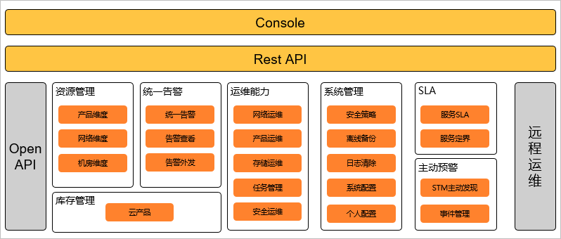
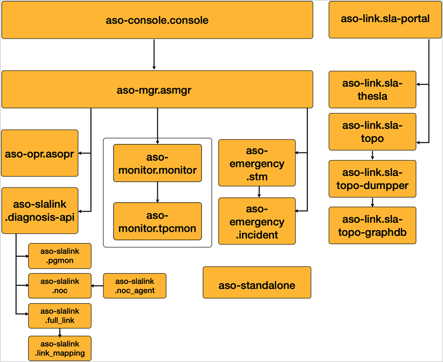
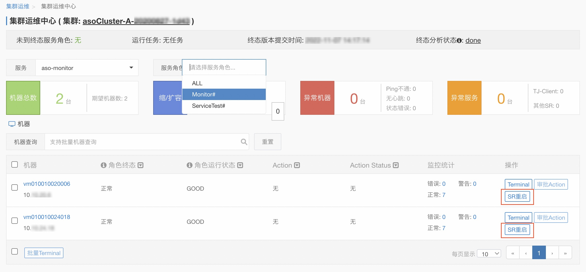

阿里云  
专有云  
专有云运维平台  
运维指南  
产品版本：V3.18.6  
文档版本：20250523

**目录**

- [1.概述](#section-1)
- [2.产品架构](#section-2)
    - [2.1. 系统架构](#section-2-1)
    - [2.2. 部署架构](#section-2-2)
    - [2.3. 组件架构](#section-2-3)
    - [2.4. 服务角色列表](#section-2-4)
- [3.告警处理](#section-3)
- [4.安全维护](#section-4)
    - [4.1. 账号密码维护](#section-4-1)
    - [4.2. 日志审计](#section-4-2)
- [5.故障处理](#section-5)
    - [5.1. 建立故障响应机制](#section-5-1)
    - [5.2. 明确各类型故障责任人](#section-5-2)
    - [5.3. 故障处理方法](#section-5-3)
    - [5.4. 常见故障处理](#section-5-4)
        - [5.4.1. Apsara Uni-manager运维控制台部署后域名不能访问](#section-5-4-1)
        - [5.4.2. Apsara Uni-manager运维控制台无告警数据](#section-5-4-2)
        - [5.4.3. 登录Apsara Uni-manager运维控制台提示：用户已经被收回](#section-5-4-3)
        - [5.4.4. 登录SRE技术保障平台，返回403错误](#section-5-4-4)
- [6.高危操作](#section-6)
- [7.附录](#section-7)
    - [7.1. 常用维护命令](#section-7-1)
    - [7.2. 常用错误码](#section-7-2)
    - [7.3. 清除历史告警数据](#section-7-3)

<a id="section-1"></a>

# 1.概述

本文介绍Apsara Uni-manager运维控制台运维的目的、要求、注意事项、以及寻求帮助的方式。

**目的**

本手册指导维护人员对Apsara Uni-manager运维控制台进行预防性地维护，确保系统长期稳定运行。维护人员可以根据本手册的指导，处理维护过程中发现的系统问题。如果根据本手册无法解决系统问题，请寻求阿里云工程师的技术支持。

**要求**

- 维护人员必须拥有IT行业技能，包括计算机网络知识、计算机操作知识、问题分析排查能力。

- 维护人员必须经过阿里云系统岗前培训，学习必要的阿里云系统知识，包括但不限于系统原理、组网、特性使用和维护工具的使用。

> 在维护操作过程中，维护人员务必遵守操作规章，确保人身安全和系统安全。对用户数据
>
> **重要**
>
> 严格保密，未经用户书面许可，禁止复制、传播用户数据。

**注意事项**

为了系统的稳定运行，避免意外事故的发生，维护人员需遵循以下事项：

- 分层分权管理：

  对网络、设备、系统、数据实行分层分权管理，相应业务的维护人员仅拥有完成自身角色任务相对应的权限，防止越权操作而引起系统故障。

- 系统安全：

  - 在对系统进行任何操作前，需清楚地了解操作的结果，避免危险操作影响系统运行。

  - 在操作过程中遇到的问题，需清楚记录以便问题排查和故障处理。

- 人身和数据安全：

  - 操作电气设备时，必须根据设备要求做好安全措施。

  - 需使用安全的设备接入业务网络。

  - 未经授权，严禁对数据进行复制和传播。

**寻求帮助**

维护人员在系统维护过程中，需要相关帮助，可以联系阿里云技术支持获取帮助。

<a id="section-2"></a>

# 2.产品架构

<a id="section-2-1"></a>

## 2.1. 系统架构

Apsara Uni-manager运维控制台作为专有云的统一运维系统，提供专有云的运维能力。

Apsara Uni-manager运维控制台主要由以下三个模块组成：

- Console：用户界面层，提供用户可操作的功能界面。

- Rest API：Console和系统能力通过Rest API的方式进行交互。

- 系统能力：

  - 资源管理：从产品、网络和机房三个维度查看和管理专有云的资源。

  - 统一告警：为专有云平台提供统一的告警出口和告警外发配置能力。

  - 运维能力：提供网络、云产品、存储、任务等纵向运维能力，以及横向的安全运维能力。

  - 系统管理：提供安全策略、离线备份、日志清除、系统配置和个人配置等系统管理能力。

  - 库存管理：提供云产品的库存查看和水位告警能力。

除了以上主要功能模块外，Apsara Uni-manager运维控制台还提供了OpenAPI供第三方做二次开发。同时提供了可选的远程运维能力。

Apsara Uni-manager运维控制台系统架构如下图所示。

图 2. Apsara Uni-manager运维控制台系统架构



<a id="section-2-2"></a>

## 2.2. 部署架构

本文介绍Apsara Uni-manager运维控制台各组件的部署说明。

Apsara Uni-manager运维控制台各组件的部署说明如下表所示。

| 组件 | 部署说明 |
| --- | --- |
| aso-console.console | 集群部署，console为双节点部署。 |
| aso-mgr.asmgr | 集群部署，asmgr为双节点部署。 |
| aso-opr.asopr | 集群部署，asopr为双节点部署。 |
| aso-monitor.monitor | 集群部署，monitor为双节点部署，可以根据业务需要改为单节点或多节点部署。 |
| aso-monitor.tpcmon | 集群部署， tpcmon为单节点部署。 |
| aso-slalink.diagnosis-api | 集群部署，diagnosis-api为单节点部署。 |
| aso-slalink.full_link | 集群部署，full_link为双节点部署。 |
| aso-slalink.link_mapping | 集群部署，link_mapping为单节点部署。 |
| aso-slalink.noc | 集群部署，noc为双节点部署。 |
| aso-slalink.noc_agent | 集群部署，noc_agent为双节点部署。 |
| aso-slalink.sla-portal | 集群部署，sla-portal为双节点部署。 |
| aso-slalink.sla-thesla | 集群部署，sla-thesla为三节点部署。 |
| aso-slalink.sla-topo | 集群部署，sla-topo为双节点部署。 |
| aso-slalink.sla-topo-dumpper | 集群部署，sla-topo-dumpper为双节点部署。 |
| aso-slalink.sla-topo-graphdb | 集群部署，sla-topo-graphdb为单节点部署。 |
| aso-slalink.pgmon | 集群部署，pgmon为单节点部署。 |
| aso-standalone.standalone | 集群部署，standalone为双节点部署。 |
| aso-emergency.stm | 集群部署，stm为双节点部署。 |
| aso-stm.incident | 集群部署，incident为双节点部署。 |

<a id="section-2-3"></a>

## 2.3. 组件架构

本文介绍Apsara Uni-manager运维控制台的组件架构和功能说明。

Apsara Uni-manager运维控制台组件架构如下图所示。

图 1. Apsara Uni-manager运维控制台组件架构



Apsara Uni-manager运维控制台各组件的功能说明如下表所示。

| 组件 | 功能说明 |
| --- | --- |
| aso-console.console | Apsara Uni-manager运维控制台前端页面，负责数据的展示和分析等。 |
| aso-mgr.asmgr | 负责用户、组织、菜单、权限、库存、物理平台、产品运维管理。 |
| aso-opr.asopr | 负责物理机密码管理、物理机通道、任务管理。 |
| aso-monitor.monitor | 负责告警监控、告警模板的查看、导入、导出功能。 |
| aso-monitor.tpcmon | 负责运行tpcmon的监控脚本。 |
| aso-slalink.diagnosis-api | aso-slalink模块功能的小网关，负责分发请求到slalink下的各模块。 |
| aso-slalink.pgmon | 负责存储运维中心。 |
| aso-slalink.full_link | 负责全链路监控的API接口程序。 |
| aso-slalink.link_mapping | 负责全链路监控的ECS、RDS、SLB、VPC产品的元数据程序。 |
| aso-slalink.noc | 负责网络运维中心自动化任务编排。 |
| aso-slalink.noc_agent | 负责网络运维中心网络数据采集。 |
| aso-slalink.sla-portal | 负责SLA和全链路诊断的Portal控制台，用于SLA和全链路诊断的交互。 |
| aso-slalink.sla-thesla | 负责SLA的数据处理、API数据查询、时序分析、客户端高可用选举等功能。 |
| aso-slalink.sla-topo | 负责全链路诊断数据的处理、API数据查询等功能。 |
| aso-slalink.sla-topo-dumpper | 负责全链路诊断和SLA数据的采集功能。 |
| aso-slalink.sla-topo-graphdb | 负责全链路诊断服务端的图类型数据库的数据存储。 |
| aso-standalone.standalone | 负责Apsara Uni-manager运维控制台独立输出安装包。 |
| aso-emergency.stm | 主动运维事件发现。 |
| aso-emergency.incident | 主动运维事件管理。 |

<a id="section-2-4"></a>

## 2.4. 服务角色列表

本文介绍Apsara Uni-manager运维控制台的Project、集群、服务、服务角色的信息，方便运维人员识别和定位故障。

Apsara Uni-manager运维控制台的Project、集群、服务、服务角色的信息如下表所示。

**集群**

**服务**

**服务角色**

**描述**

**project**

Apsara Uni-manager运维控制

aso-

台前端页面，负责

aso-console

console.console

数据的展示和分析等。

负责告警监控、告

aso-

警模板的查看、导

monitor.monitor

入、导出功能。

aso-monitor

负责运行tpcmon的

aso-

监控脚本。

monitor.tpcmon

aso-

slalink模块网关。

slalink.diagnosis-api

负责网络运维中

aso-slalink.noc

心。

网络运维中心数据

aso-

采集agent。

slalink.noc_agent

slalink模块API接口

aso-

模块。

slalink.full_link

slalink模块列

aso-

ECS、 RDS、SLB

slalink.link_mappi

和VPC的实例列表

ng

功能。

aso-slalink

aso-slalink.sla-

SLA前端展示模块。

portal

aso

asoCluster

aso-slalink.sla-

SLA后端处理模块。

thesla

topo后端处理模

aso-slalink.sla-

块。

topo

aso-slalink.sla-

topo采集agent。

topo-dumpper

aso-slalink.sla-

topo存储数据库。

topo-graphdb

负责存储运维中

aso-

心。

slalink.pgmon

负责用户、组织、菜单、权限、库

aso-mgr

aso-mgr.asmgr

存、物理平台、产品运维管理。

负责物理机密码管理、物理机通道、

aso-opr

aso-opr.asopr

任务管理。

负责Apsara Uni-

aso-

manager运维控制

aso-stanalone

standalone.stand

台独立输出安装

alone

包。

主动运维事件发

aso-

现。

emergency.stm

aso-emergency

aso-

主动运维事件管

emergency.incid

理。

ent

各服务角色之间的调用关系如下图所示，箭头指向的一方为被调用方。


<a id="section-3"></a>

# 3.告警处理

您可以在Apsara Uni-manager运维控制台的**监控告警 > 告警管理**，查看和处理Apsara Uni-manager运维控制台的告警信息。

<a id="section-4"></a>

# 4.安全维护

<a id="section-4-1"></a>

## 4.1. 账号密码维护

本文介绍Apsara Uni-manager运维控制台的账号密码维护方法。

用户账号有有效期，您需要在规定时间内修改密码，否则将会导致用户被锁定，不能正常登录。

- 在页面右上角单击头像，选择**个人信息**，在页面左侧单击**修改密码**修改当前用户的账号密码。

- 在**安全管理** > **访问控制** > **安全策略**页面的**账号策略**页签下设置**ASO账号有效期**。

<a id="section-4-2"></a>

## 4.2. 日志审计

本文介绍组件日志的审计方法、日志文件路径、以及日志查询方式。

进入容器后，找到下表中的日志文件，查看日志详情。

<table>
  <tr>
    <th>组件</th>
    <th>文件</th>
    <th>说明</th>
  </tr>
  <tr>
    <td rowspan="3">aso-mgr.asmgr</td>
    <td>/logs/asomanage-logger/main_trace.log</td>
    <td>asmgr容器业务相关日志和异常日志</td>
  </tr>
  <tr>
    <td>/logs/asomanage-logger/access_trace.log</td>
    <td>asmgr容器access日志</td>
  </tr>
  <tr>
    <td>/logs/asomanage-logger/call_trace.log</td>
    <td>asmgr容器业务相关的调用其他服务的日志</td>
  </tr>
  <tr>
    <td rowspan="3">aso-monitor.monitor</td>
    <td>/logs/asomonitor-logger/main_trace.log</td>
    <td>monitor容器业务相关日志和异常日志</td>
  </tr>
  <tr>
    <td>/logs/asomonitor-logger/access_trace.log</td>
    <td>monitor容器access日志</td>
  </tr>
  <tr>
    <td>/logs/asomonitor-logger/call_trace.log</td>
    <td>monitor容器业务相关的调用其他服务的日志</td>
  </tr>
  <tr>
    <td rowspan="3">aso-opr.asopr</td>
    <td>/logs/asooperator-logger/main_trace.log</td>
    <td>asopr容器业务相关日志和异常日志</td>
  </tr>
  <tr>
    <td>/logs/asooperator-logger/access_trace.log</td>
    <td>asopr容器access日志</td>
  </tr>
  <tr>
    <td>/logs/asooperator-logger/call_trace.log</td>
    <td>asopr容器业务相关的调用其他服务的日志</td>
  </tr>
</table>

<a id="section-5"></a>

# 5.故障处理

<a id="section-5-1"></a>

## 5.1. 建立故障响应机制

维护团队应该建立故障应急响应机制，以保证出现故障或者安全事故后，尽快排除故障，恢复生产。

<a id="section-5-2"></a>

## 5.2. 明确各类型故障责任人

当Apsara Uni-manager运维控制台出现监控告警时，应首先由驻场运维人员根据告警对问题进行排查。当驻场运维人员无法解决时，请联系阿里云专有云技术支持工程师处理。

<a id="section-5-3"></a>

## 5.3. 故障处理方法

本文介绍Apsara Uni-manager运维控制台故障处理方法。

维护人员在日常维护中发现系统故障后，可以通过Apsara Uni-manager运维控制台提供的运维功能以及系统日志了解故障详细信息，分析故障原因及解决故障。如遇不能解决的故障，请收集故障信息，包括系统信息、故障现象等，联系阿里云专有云技术支持工程师，并在技术支持工程师的指导下解决问题。

故障解决后，维护人员应及时对问题进行审核复盘、总结改进。

<a id="section-5-4"></a>

## 5.4. 常见故障处理

<a id="section-5-4-1"></a>

### 5.4.1. Apsara Uni-manager运维控制台部署后域名不能访问

本文介绍Apsara Uni-manager运维控制台部署后域名不能访问故障的处理方法。

**操作步骤**

1. 在域名对应的环境中查看Apsara Uni-manager运维控制台对应的Pod是否正常运行，即执行命令 `kubectl get po -n aso` 的结果是否均为 `Running` 或 `Completed` ：

   - 是：执行**步骤2**。

   - 否：联系Apsara Uni-manager运维控制台后端技术支持工程师处理。

2. 登录asoconsoleconsole-0 Pod，执行命令 `curl '127.0.XX.XX'` （命令中的IP地址为Pod所在容器的IP地址），查看是否有超时或拒绝访问的情况：

   - 是：联系Apsara Uni-manager运维控制台后端技术支持工程师处理。

   - 否：联系底座技术支持工程师处理。

<a id="section-5-4-2"></a>

### 5.4.2. Apsara Uni-manager运维控制台无告警数据

Apsara Uni-manager运维控制台和飞天基础运维平台portal均从TianjiMon获取告警数据，可从飞天基础运维平台portal上验证TianjiMon是否产生告警数据，再进行后续处理。

**操作步骤**

查看飞天基础运维平台portal上是否有告警数据：

- 是：联系Apsara Uni-manager运维控制台技术支持工程师处理。

- 否：联系TianjiMon技术支持工程师处理。

<a id="section-5-4-3"></a>

### 5.4.3. 登录Apsara Uni-manager运维控制台提示：用户已经被收回

本文介绍登录Apsara Uni-manager运维控制台时，提示用户已经被收回的故障处理方法。

**操作步骤**

1. 登录aso_auth数据库。

2. 执行如下命令，查看用户状态和有效时间：

   ```sql
   select * from user where name="test";
   ```

3. 查看用户状态（statue）是否为1。

   - 是：执行**步骤4**。

   - 否：执行命令 `update user set statue=1 where name="test";` ，将用户状态修改为1。

4. 执行如下命令，将有效时间修改为大于当天的日期：

   ```sql
   Update user set validity_date="2019-11-04 15:23:23" where name="test";
   ```

<a id="section-5-4-4"></a>

### 5.4.4. 登录SRE技术保障平台，返回403错误

本文介绍登录SRE技术保障平台时，返回403错误的故障处理方法。

**操作步骤**

1. 使用安全保密员账号登录Apsara Uni-manager运维控制台。

2. 在顶部菜单栏，选择**用户权限**。

3. 在左侧导航栏，选择**角色管理**。

4. 找到需要登录SRE技术保障平台的用户所属的角色，在对应的**操作**列，单击**修改**。

5. 在弹出的**编辑角色**对话框中修改相关信息，为角色添加tongque_administrator角色权限后，单击**确认**。

<a id="section-6"></a>

# 6.高危操作

本文介绍Apsara Uni-manager运维控制台的高危操作，帮助用户更好地预估和避免相关的操作风险。

在使用Apsara Uni-manager运维控制台过程中相关功能模块存在高危操作，可能会对业务稳定性造成较大影响，建议在运维窗口期进行操作。同时在使用前请认真了解以下高危操作及其影响。

**高危操作一览表**

**菜单路径**

**高危操作**

**影响**

**恢复方案**

在**资源管理 > 产品集群运维 >组件详情**页面中，在实例列表页签

服务进程重启。

不可恢复。

操作列对组件进行**重启**操作。

在**资源管理 > 机器管理 > 机器**

造成机器关机重启，机器上服

**详情**页面中，在**机器操作**对机器进

不可恢复。

务中断。

行**重启**操作。

维修完成后，会触发克隆流程

在**资源管理 > 机器管理 > 机器**

关闭机器，克隆过程及重装系

**详情**页面中，在**机器操作**对机器进

不可恢复。

统，可能会导致机器上的数据

行**维修并克隆**操作。

全部丢失。

平台运维-飞天基础运维平台-

在维修过程中，机器会经历关

在**资源管理 > 机器管理 > 机器**

机状态，若机器上服务运行的

**详情**页面中，在**机器操作**对机器进

不可恢复。

业务未迁移完成，可能影响服

行**关机维修**操作。

务稳定性。

在**资源管理 > 机器管理 > 机器详情**页面中，在组件页签对组件进

服务进程重启。

不可恢复。

行**重启**操作。

换盘需要盘古等存储相关模块

在**硬件维修 > 硬盘维修**页面中，

进行数据备份，强行操作或者

不可恢复。

进行硬盘维修流程。

误操作可能会造成数据丢失。

在**运维编排** > **运维资源** > **运维作**

平台运维-

脚本将在选定的物理机中执

**业**页面中，创建运维作业并触发执

不可恢复。

运维变更

行，影响面取决于脚本内容。

行。

在**归档服务器配置**页面中，**归档服**

可能导致对应机器的云产品文

系统配置-

**务器地址**、**归档服务监听路径**与其

件被覆盖，影响云产品功能运

不可恢复。

归档管理

他服务器地址、服务监听路径冲

行。

突。

在**计算集群运维**页面中，登录集群

影响面取决于黑屏命令的内

不可恢复。

AG后进行黑屏命令操作。

容。

操作过程中物理机会先下线维修，维修完成后上线。下线时

在**计算服务器运维**页面中，创建物

物理机上的ECS实例会被迁

不可恢复。

理机**下线维修**任务。

移，ECS实例迁移可能会存在业务影响。

产品运维-计算运维控制台

操作成功后相应的本地盘会被

在**ECS智能运维** > **ECS运维事**

下线维修，拔错盘可能会导致

不可恢复。

**件**页面中，上报本地盘维修单。

本地盘数据丢失。

操作过程中物理机会先下线维修，维修完成后上线，下线时

在**ECS智能运维** > **ECS物理机运**

物理机上的ECS实例会被迁

不可恢复。

**维**页面中，新建物理机维修。

移，ECS实例迁移可能会存在业务影响。

在**EBS集群管理 > 集群详情**页面中，在服务详情页签对

根据修改配置项不同，可能造

BlockServer、BlockMaster、

修改为标准配置。

成服务不可用。

RiverServer、RiverCluster服务节点进行**修改服务flag**操作。

短时可能影响部分云盘IO，可能会出现slow IO或IO hang。

在**EBS集群管理 > 集群详情**页面中，在服务详情页签对

> **说明**

不可恢复。

BlockMaster、RiverCluster服

> 只能重启/切主状态不正常

务节点进行**重启**/**切主**操作。

> 的机器，状态正常的机器不建议重启/切主。

产品运维-块存储运维·EBS

在**EBS常用运维** > **EBS主动运维**页面中，对集群进行**设置集群超**

可能造成集群无法创盘。

修改为标准超卖倍数。

**卖倍数**运维操作。

在**EBS常用运维** > **EBS主动运**

在集群严重超卖后再打开会造

**维**页面中，对集群进行**打开集群售**

按需求关闭集群售卖。

成集群禁写，影响数据写入。

**卖**运维操作。

在**EBS常用运维** > **EBS主动运维**页面中，对集群进行**关闭集群售**

可能造成集群无法创盘。

按需求打开集群售卖。

**卖**运维操作。

在**存储加密** > **元数据库落盘加**

数据加密过程中不能进行读写

**密**页面中，开启数据库的加密功

操作，会造成业务中断，影响

不可恢复。

能。

时间取决于数据库的数据量。

安全管理-

在**网络传输加密** > **元数据库访问**

数据安全-

页面上呈现的应用会Rolling，

**传输加密**页面中，开启传输加密功

关闭传输加密功能。

平台密码应

正常情况下不影响业务。

能。

用管理

在**网络传输加密** > **平台访问传输**

页面上呈现的应用会Rolling，

关闭传输加密功能。

**加密**页面中，开启传输加密功能。

正常情况下不影响业务。

修改SRS安全隔离状态会导致网络安全防护策略的变更。

在**东西向安全管理** > **SRS管理** >

- SRS安全隔离状态置为开启

  恢复到修改之前的SRS安全

**SRS管理**页面中， 在**配置管理**页

或自动模式可能会影响云平

隔离状态，但在恢复期间仍

签下修改SRS安全隔离状态。

台网络访问联通性。

可能造成影响。

- SRS安全隔离状态置为关闭会引入网络安全风险。

- 新增白名单可能会引入网络

  恢复到修改之前的配置，但

在**东西向安全管理** > **SRS管理** >

安全风险。

新配置的生效预计需要10

**SRS管理**页面中， 在**配置管理**页

分钟，在恢复期间仍可能造

- 删除白名单可能导致原白名

签下新增或删除SRS IP白名单。

成影响。

单的IP无法访问云内服务。

- 新增黑名单可能导致黑名单

  恢复到修改之前的配置，但

在**东西向安全管理** > **SRS管理** >

内的IP无法访问云内服务。

新配置的生效预计需要10

**SRS管理**页面中， 在**配置管理**页

分钟，在恢复期间仍可能造

- 删除黑名单可能会引入网络

签下新增或删除SRS IP黑名单。

成影响。

安全风险。

- 新增不隔离产品可能会引入

  恢复到修改之前的配置，但

在**东西向安全管理** > **SRS管理** >

网络安全风险。

新配置的生效预计需要10

**SRS管理**页面中， 在**配置管理**页

分钟，在恢复期间仍可能造

- 删除不隔离产品可能导致相

签下新增或删除SRS不隔离产品。

成影响。

关产品服务对外不可用。

- 新增旁路产品可能导致相关

  恢复到修改之前的配置，但

在**东西向安全管理** > **SRS管理** >

产品服务对外不可用。

新配置的生效预计需要10

**SRS管理**页面中， 在**配置管理**页

分钟，在恢复期间仍可能造

- 删除旁路产品可能会引入网

签下新增或删除SRS旁路基线。

成影响。

络安全风险。

安全管理-网络安全-

- 新增动态放通配置可能会引

  恢复到修改之前的配置，但

网络安全管

入网络安全风险。

在**东西向安全管理** > **SRS管理** >

新配置的生效预计需要10

理中心

**隔离配置管理**页面中，新增或删除

- 删除动态放通配置可能会导

  分钟，在恢复期间仍可能造

动态放通配置。

致相关产品服务对外不可

成影响。

用。

在**东西向安全管理** > **东皇钟** > **东**

PaaS底座集群内所有宿主机的

**皇钟配置**页面中，关闭宿主机网络

端口都将对云外地址开放，可

开启宿主机网络隔离。

隔离。

能会引入网络安全风险。

若已开启宿主机网络隔离，新增白名单网段后，PaaS底座集

在**东西向安全管理** > **东皇钟** > **东**

群内所有宿主机的端口都将放

**皇钟配置**页面中，新增白名单网

删除不信任的白名单网段。

行这个白名单网段，如果是不

段。

可信的白名单网段，可能会引入网络安全风险。

若已经开启宿主机网络隔离，删除白名单网段后，将导致云

在**东西向安全管理** > **东皇钟** > **东**

外此网段地址无法正常访问

**皇钟配置**页面中，删除白名单网

重新添加网段白名单。

PaaS底座集群内所有宿主机的

段。

端口，造成正常的业务连接中断。

若已经开启宿主机网络隔离，

需要先确认需要被正常访问

新增宿主机放行端口则只允许

的网段在白名单范围内，然

云外白名单网段访问PaaS底座

在**东西向安全管理** > **东皇钟** > **东**

后修改宿主机放行端口范围

集群内所有宿主机的放行端

**皇钟配置**页面中，新增宿主机放行

或新增宿主机放行端口。

口，若云外白名单网段需要访

端口。

问的端口不在这些放行端口范围内，则会造成正常的业务连接中断。

在**root密码管理**页面中，在**密码**

从密码历史记录中查找到历

物理机和KVM的密码被修改。

**管理**页签下进行更新密码操作。

史密码并进行恢复。

- ASO不再对机器密码进行管理，无法通过ASO界面对机器密码进行更新、轮转操

在**root密码管理**页面中，在**配**

作。

**置**页签下关闭密码纳管开关。

开启密码纳管开关。

- 关闭aso-opr容器的jsch命令执行能力，会造成ASO归档管理、日志清理的能力失效。

安全管理-账号安全-

会按照每台机器的轮转配置时

Linux系统

在**root密码管理**页面中，在**配**

从密码历史记录中查找到历

间（默认每15天一次）进行密

账号管理

**置**页签下开启密码轮转开关。

史密码并进行恢复。

码轮转操作。

在**Linux账号管理任务** > **任务模板管理**页面中，执行

会将OPS机器到其他所有机器

重新打通从OPS机器到所有

GlobalTunnelRemoveTask任

中的初始全局免密通道回收。

物理机的免密通道。

务。

在**Linux账号管理任务** > **任务模**

会针对系统默认的免密通道进

**板管理**页面中，执行

行轮换操作，轮换过程中可能

将原始密钥重新下发到已经

GlobalTunnelRotateTask任

会导致非标依赖该初始密钥的

完成变更的机器。

务。

机器无法进行ssh免密互通。

删除用户会将用户移入回收

在回收站恢复用户，恢复后

在**用户管理**页面中，进行删除用户

站，同时禁用该用户的子账号

用户权限

用户的子账号AK默认为禁

操作。

AK，可能导致使用这些AK的产

用状态，可重新启用。

品或程序无法正常运行。

- 禁用：可重新启用。

在**Accesskey**区域中，对AK/SK

可能导致使用该AK/SK调用

- 删除：不可恢复。修改

个人信息

进行**禁用**或**删除**操作。

OpenAPI的调用方不可用。

OpenAPI调用方代码，替换为新的AK/SK。

<a id="section-7"></a>

# 7.附录

<a id="section-7-1"></a>

## 7.1. 常用维护命令

本文介绍Apsara Uni-manager运维控制台常用维护命令，包括登录环境和容器的命令、以及敏捷PaaS K8s常用命令。

**登录环境和容器的命令**

- 登录环境

  ```bash
  kubectl get ingress -n aso
  ```

- 登录容器

  ```bash
  kubectl get pod -n aso
  ```

- 进入单容器的Pod

  ```bash
  kubectl exec -it asoconsoleconsole-0 -n aso /bin/bash 
  ```

**敏捷PaaS K8s常用命令**

- 宿主机进入K8s控制台。

  ```bash
  sudo arkshoot
  ```

- 查看服务状态

  ```bash
  kubectl get po -n ark-system
  ```

- 查看部署的产品

  ```bash
  kubectl get appset -n ark-system
  ```

- 查看产品的配置信息

  ```bash
  kubectl get appset -n ark-system aso-0 -oyaml
  ```

- 查看服务角色部署的阶段、状态、配置信息

  ```bash
  kubectl get appinstance -n ark-system aso-mgr.asmgr -oyaml
  ```

- 查看Chart部署工作流状态

  ```text
  argo get -n ark-system inst-aso-mgr-asmgr-zkgqr ${Revision}
  ```

- 查看容器运行日志

  ```text
  argo get -n ark-system aso-mgr.asmgr
  ```

- 查看Apsara Uni-manager运维控制台运行的容器

  ```bash
  kubectl get po -n aso
  ```

- 查看asomgrasmgr-0的启动信息

  ```bash
  kubectl logs asomgrasmgr-0 -n aso -c dep-init
  ```

- 描述某个节点信息

  ```bash
  kubectl describe pods asdconsoletaskmanager-0 -n asd
  ```

- 查看具体产品的描述

  ```bash
  kubectl describe po podName -n aso
  ```

- 获取IP

  ```bash
  kubectl get pods -n asd -o wide
  ```

- 查看环境中所有的DNS配置

  ```bash
  kubectl get ingress -A
  ```

- 查看配置项的数据

  ```bash
  kubectl get ingress -n asd asdportal-nginx-ingress -o yaml
  ```

- 查看环境变量

  ```bash
  kubectl get cm ark.cmdb.app.asd-console.taskmanager.expose -n ark-system -oyaml
  ```

- 查看Ingress地址

  ```bash
  kubectl get ingress -n aso
  ```

- 删除Pod

  ```bash
  kubectl delete po pod_name -n aso
  ```

- 查看内存信息

  ```bash
  cat /proc/meminfo
  ```

<a id="section-7-2"></a>

## 7.2. 常用错误码

本文介绍Apsara Uni-manager运维控制台错误码的类型及常用错误码。

**错误码的类型**

通过第一位数字可以把错误码分为五种类型：

- 1xx：信息、请求收到，继续处理。

- 2xx：成功，行为被成功地接受、理解和采纳。

- 3xx：重定向，为了完成请求，必须进一步执行的动作。

- 4xx：客户端错误，请求包含语法错误或者请求无法实现。

- 5xx：服务器错误，服务器不能实现一种明显无效的请求。

**常用错误码**

| 错误码 | 描述 |
| --- | --- |
| 200 | 响应成功 |
| 404 | 资源找不到 |
| 400 | 错误请求，例如语法错误 |
| 401 | 请求授权失败 |
| 402 | Cookie验证失败 |
| 403 | 请求不允许 |
| 404 | 没有发现文件、查询或URL |
| 406 | 账户没有被激活 |
| 409 | 资源已存在 |
| 418 | 验证码无效 |
| 419 | 服务授权失败 |
| 420 | 检查签名数据失败 |
| 421 | 检查证书失败 |
| 422 | 没有这种Random |
| 423 | SN和用户不匹配 |
| 424 | 用户名字或ID不匹配 |
| 425 | 服务不存在 |
| 426 | 认证不存在 |
| 427 | 身份验证失败 |
| 428 | 从飞天基础运维平台请求失败 |
| 500 | 服务器产生内部错误 |
| 501 | 服务器不支持请求的函数 |
| 510 | 数据库操作错误 |

<a id="section-7-3"></a>

## 7.3. 清除历史告警数据

本文介绍清除Apsara Uni-manager运维控制台的历史告警数据操作。

**问题描述**

飞天基础运维平台产生的P1级别告警会自动同步到Apsara Uni-manager运维控制台的告警管理中，当飞天基础运维平台系统恢复终态并解除告警后，Apsara Uni-manager运维控制台的告警没有在预期时间内消除告警。

**问题原因**

Apsara Uni-manager运维控制台每30秒就会同步飞天基础运维平台的告警数据，但按照告警清理策略会优先清理三天前的告警数据。所以当飞天基础运维平台产生告警后又在短时间内恢复终态并告警解除后，Apsara Uni-manager运维控制台并不能在及时同步告警清除信息，所以才会出现告警未清除的情况。

**适用版本**

适用于专有云企业版V3.14.0及之前版本。

**解决方案**

1. 登录任意一个虚拟机，执行如下命令获取aso_platmonitor数据库的登录信息。

   ```text
   db=aso_platmonitor;clear;curl -s 
   http://127.0.0.1:7070/api/v3/column/service.res.result|awk -F '": "' '{print $2}'|awk-F '"' '/db_password/&&/"'$db'/{v=$44;V=$40;if(length($44)>20){V=$44;v=$16};s="mysql 
   -h"V" -u"$36" -p"$4" -D"v" -P"$12;gsub("\\\\","",s);print s}'
   ```

2. 登录aso_platmonitor数据库，执行如下命令清空aso上指定告警项的告警数据。

   ```text
   delete from event where metric_name="指定告警项名称";
   ```

3. 执行如下命令清空aso上所有告警数据。

   ```text
   truncate table event;
   ```

   ```text
   truncate table history_alert;
   ```

4. 登录飞天基础运维平台。

5. 在顶部菜单栏中，选择**运维** > **集群运维**，进入**集群运维**页面，在目标集群后的**操作**列中，单击**监控** > **集群运维中心**。

6. 在**服务角色**框中选择**Monitor#**，在下方机器列表的**操作**列中，单击**SR重启**。

   
