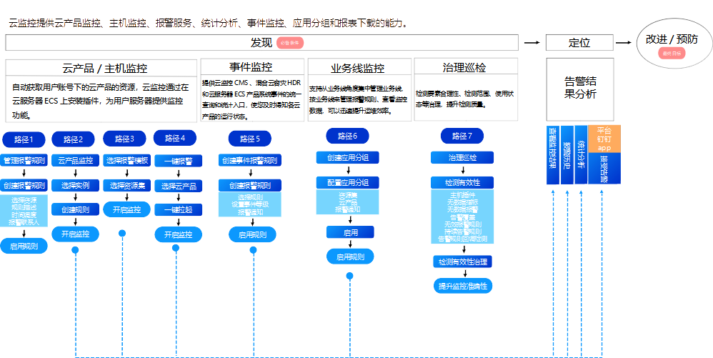
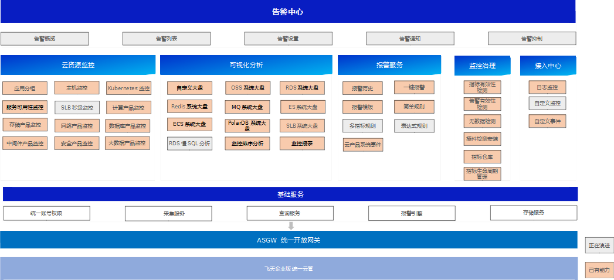

阿里云  
专有云  
云监控  
产品简介  
产品版本：V3.18.6  
文档版本：20251121

**目录**

- [1.云监控CMS](#section-1)
    - [1.1. 功能特性](#section-1-1)
    - [1.2. 产品架构](#section-1-2)
    - [1.3. 产品优势](#section-1-3)
    - [1.4. 应用场景](#section-1-4)

# 1.云监控CMS

本文介绍云监控CMS产品以及产品使用。

**什么是云监控CMS**

云监控（CloudMonitor）是一项针对阿里专有云飞天企业版资源进行监控的服务，为云上用户提供开箱即用的企业级开放型一站式监控解决方案。

云监控提供告警中心、云产品监控、主机监控、报警服务、统计分析、事件监控、应用分组、报表导出、指标仓库、服务可用性监控、自定义大盘、事件中心、日志监控等能力。涵盖各个云产品实例，例如ECS、SLB、OSS、SLS等基于事件和自定义指标（云服务实例指标）监控。

云监控提供全方位更高效、全面的监控服务。使用云监控，不但可以提升系统服务可用时长，还可以降低企业IT运维监控成本。

**产品使用**

## 1.1. 功能特性

本文介绍专有云监控CMS的功能特性内容。

| 功能 | 说明 |
| --- | --- |
| 概览 | • 监控概览：提供正在报警的云产品报警资源，统计报警状态为“正在报警”的规则数量；统计数量不包括已禁用规则；统计云产品主动上报，正在发生的非时序数据系统事件数；统计基于时序指标数据产生的报警历史数据；统计正在报警的云产品报警资源。 • 治理检测：治理检测通过分析当前组织资源集的资源实例指标和报警规则，对指标及告警的有效性进行评估诊断，并提供一键修复和建议。治理检测提供主动触发和重新检测两种能力；状态统计包含正常、存在问题、建议治理、检测异常、检测中、检测失败等。 |

提供标准的可视化视图，可快速识别有异常的云产品，单击云产品可跳转到对应的产品监控列表和详情页进行问题排查。

- 正在告警：提供当前组织资源集下正在告警且未被关闭的告警分布，根据告警等级分为严重、警告、提示、通知。

- 告警总量趋势：提供当前组织资源集下过去7天的告警总量趋势。

- 正在告警滚屏：提供当前组织资源集下正在告警的具体内容

告警概览

进行实时滚屏。

- 告警通知成功率：提供当前组织资源集下，配置了通知策略的通知成功率统计。

- 云产品告警分布排行：提供当前组织资源集下所有云产品的告警排行TOP。

- 云产品告警统计：提供当前组织资源集下不同的告警源的告警数量分布。

- 告警展示：提供正在告警和已关闭的历史告警的搜索以及报警趋势的统计。

告警列表

- 告警处理：提供对未关闭的告警处理或关闭的操作。

- 告警详情：提供对告警的详细信息进行展示。

告警规则集成了 ARMS、SLS以及 Prometheus 告警规则能

告警规则

力，如果未部署相关产品，则无法使用对应告警规则。

告警中心

- 提供创建通知策略和管理策略的入口，并实现对云管账号下对接的webhook、邮件、钉钉进行通知。

- 针对已发生的告警进行过滤、合并、降噪，目的是减少低优

通知策略

先级/不必要的告警通知干扰用户，有效解决告警泛滥、信息散乱的问题，帮助用户甄选高优先级和关注的告警。

- 策略列表展示当前所有的通知策略，并支持修改、禁用、启用、删除通知策略。

- 提供对告警进行设定屏蔽策略（临时或永久），屏蔽的告警不再接入到系统。

屏蔽策略

- 策略列表展示当前所有的屏蔽策略，并支持修改、禁用、启用、删除屏蔽策略。

云监控通过安装在云服务器ECS上的云监控插件，采集丰富的操作系统层面的监控项。支持对监控项设置报警规则，降低监控成本。

- 支持数据检索并展示ECS实例列表。

- 监控图表：支持对单个ECS实例支持时间趋势图展示，展示各个主机指标的时序图。

- 报警规则：支持对监控指标设置单个阈值规则，支持连续或者非连续的周期内的阈值触发。

- 插件安装：默认实例申请会默认安装采集探针代理，如果出

主机监控

现安装失败的可以通过对插件进行重新安装的能力。支持批量操作。

- 安装/升级Agent：提供3种方式快捷agent运维，对于已经创建的 ECS 实例，只对没有安装 agent 插件的实例的进行安装；对于已经创建的 ECS 实例，只对安装过 agent 插件的实例的进行升级；对于已经创建的 ECS 实例，安装并升级到最新版 agent。

- 插件安装失败检测：提供插件安装失败详情。

- 插件升级：提供插件能力的更新能力，当插件支持更丰富的数据采集时，需要进行插件的升级操作。

单击产品，可以查看接入的实例的监控图表和报警规则。覆盖

云产品监控

计算、存储、网络、数据库、大数据、安全、中间件等共计60多款主流云产品，1000多个指标以及200多个事件。

通过Kubernetes容器监控，实现对K8s集群的监控，以便了解

云资源监控

集群的健康状况，及时发现并解决问题。Kubernetes容器监控主要实现以下能力。

- 实现对K8s集群的监控和报警能力。

- 实现K8s集群同步和列表展示能力，信息数据包含集群的名

Kubernetes容器监控

称、ID、健康状况和节点数。

- 实现单个集群的监控图表能力，包含CPU、内存和文件系统的指标监控。

- 实现对单个集群监控的CPU、内存和文件系统指标的报警定义能力。

应用分组提供云服务器ECS分组管理功能，支持用户从业务角度集中管理业务线云服务器ECS资源。在分组维度管理报警规

应用分组

则、查看监控数据，可以极大的降低管理复杂度，提高云监控使用效率。

支持查看接入的时序指标和系统事件。

- 时序指标：提供了云产品指标的统一查询入口以及指标可视

指标仓库

化监控图表，方便用户进行指标数据分析和可视化展示。

- 系统事件：提供了云产品相关系统事件的查询入口，包括事件名称、事件解释、事件等级、事件状态和事件类型。

支持创建个性化的数据可视化大盘，用于监控、分析和展示关键指标，便于直观、高效地理解和管理数据。

- 系统大盘：提供12个默认的大盘模板，大盘默认展示的数据为当前组织下的所有核心指标的TOP（单云产品多实例多指标展示维度）出厂自带；包含MQ、ES、OSS、SLB、ECS、PolarDB-X 、Redis集群版、Redis标准/读写分离版、RDS-PG （云盘）、RDS-PG （本地SSD）、RDS-PolarDB、RDS-MySQL 数据；默认大盘只可复制和收藏。

- 自定义大盘：

  - 大盘列表：支持管理自定义目录下大盘，提供收藏、删除、复制、编辑、移动、设置默认大盘的能力。

可视化

自定义大盘

- 创建目录：支持创建二级管理目录，不可嵌套目录。

- 创建大盘：支持创建自定义大盘，大盘图表支持灵活布局、以及按照系统每行N个图表的方式自动布局（默认5种布局方式）；提供曲线图、TOP图表、饼图、热力图四种图表类型；且对于图表类型支持自定义样式调整，包含辅助线、图例、坐标轴等；支持JSON Model方式进行快速创建大盘。

- 大盘数据：提供CMS当前条件下的组织、资源集，以云产品维度建立多实例、TOPN的可视化数据视图。

当报警发生后，可以按照云产品、云服务实例、报警级别等查

报警历史

看报警历史信息。支持导出并下载报警历史信息，便于在本地进行数据分析。

支持对主机监控中的监控项、云服务监控中的实例设置报警规则。可以在全部资源、应用分组和单实例维度设置报警规则。报警服务支持通过邮件、钉钉和Webhook地址接收报警通知。

- 创建报警规则：云监控CMS支持为云服务器ECS等所有接入云监控的云产品创建报警规则，按照所设定的云产品监控指标阈值进行告警，及时通知相关用户。

报警规则

- 管理报警规则：在报警规则列表中，可以对报警规则进行修改、禁用、启用、删除等操作。

- 规则有效性诊断：提供对每个规则诊断该规则是否能够被报警引擎加载、报警是否能正常产生的诊断。

- 规则执行记录：提供对每个规则运行时的执行记录，包括返回结果。

- 通用模板：通用报警模板根据云产品主要应用场景和业务实践，预置一系列常用报警规则，便于用户快速建设云产品资源运行状况的监控告警能力。云监控提供云产品预置通用报警模板，支持直接将通用报警模板应用到资源集、应用分组快速实现针对云产品常用监控指标的监控告警能力，也可以

报警模板

在创建自定义模板时克隆通用模板在预置报警规则基础上根据业务需要快速定制报警模板。系统默认提供的模板不允许删除、修改。

- 自定义模板：提供在各个组织资源集下自定义的报警模板的管理，允许删除、修改、克隆、应用服务。

报警服务

支持对当前一级组织下所有组织资源集的云产品，进行绑定默认的报警规则，完成一键报警。一键报警实例排除只支持单等级规则。

- 一键开启：对当前一级组织下所有组织资源集的云产品，进行绑定默认的报警规则，完成一键报警设置和开启。

- 一键关闭：提供对云产品的一键报警关闭服务，关闭一键报警后，会在报警规则列表中删除对应的报警规则。

- 排除资源：一键报警的每个云产品的应用范围默认是当前一

一键报警

级组织下的所有实例对象，如果需要进行排除，可以选择组织下的资源集资源进行逐个排除 ，不产生报警绑定。

- 自定义创建：针对系统的规则能力，可进行直接修改、禁用、删除等操作；也可以追加针对各个云产品添加新的报警规则能力。

- 批量编辑：提供对各个云产品下的规则进行批量编辑沉默周期、生效时间、回调、无数据处理方法、报警联系组等。

- 报警历史：支持对报警历史页面导出指定时间范围内的报警进行excel导出，支持下载和删除报表任务。

- 报警规则：支持对报警规则页面导出当前组织资源集内的报警规则进行excel导出，支持下载和删除报表任务。

报表导出

- 报警模板：支持对报警模板页面导出当前组织资源集内的自定义和通用模板进行excel导出，支持下载和删除报表任务。

可用性监控定期探测本地或远程指定路径和端口是否正常响应。当出现响应超时或状态码错误时，云监控将发出报警，以便快速发现本地或远程服务无响应的情况。可用性探测支持任意ECS作为探测源。

- 任务创建：提供组件任意ECS节点（一个或者多个或者全部）可发起对目标HTTP、TELNET、PING的探测的任务创

服务可用性监控

建和管理。

- 任务列表：提供任务列表的数据查询，支持禁用、启用、修改、删除任务。

- 监控图表：提供可用性任务的探测监控图表展示，最多不超过31天的数据查询。

可用性监控

通过部署在ECS上的探针，基于ICMP、TCP的方式对云产品实

云产品可用性监控

例进行一键云产品实例的连通性监控。

事件中心提供产品系统事件的统一查询和统计入口，便于及时得知各云产品的运行状态，并接收报警通知。当业务故障时，能够快速分析并定位问题。

- 事件监控：展示已经对接过的事件、产品等信息。自定义事件分布图展示了在一段时间内上报的系统事件分布情况；系统事件列表展示了在一段时间内上报的系统事件。

事件中心

系统事件

- 事件报警规则：支持为云产品的系统事件设置报警规则，异常发生时产生报警并通知联系人，并支持修改、禁用、启用以及删除事件报警规则。

- 事件报警历史：提供基于规则ID、规则名称产生的系统事件的列表数据。

支持对当前组织下的某个云产品前1000个实例进行数据的排序。通过监控排序，可对指定组织下所有云监控纳管的云产品服务进行监控数据分析。

- 排序列表：提供当前组织资源集下的所有选择的云产品资

监控排序

源、对应的指标、排序方式（升/降）、聚合逻辑（平均值、求和、当前值、最大值、最小值）的监控数据排序能力。

- 报表导出：提供ASCM的对历史数据的报表导出能力的快捷

统计分析

入口。

数据订阅分为创建数据订阅的任务、以及基于sls的数据进行自行消费和数据查看。目前的消费订阅是以一级组织为单位的数

数据订阅

据订阅，如果有多个需要在多个一级组织下进行创建任务。数据订阅同时支持查看、编辑、删除、禁用、启用订阅任务。

通过SLS日志监控，可以有效地监控日志中的关键字，及时发现潜在的问题，提升系统的稳定性和运维效率。

- 新增基于SLS日志的关键字监控能力，对RDS中redisline3

日志监控

个sls inner 日志源的关键字出现的次数进行采集和报警设置，包含慢日志、错误日志、明细日志。

- 在日志监控列表，可进行查看、编辑、删除、复制日志监控操作。

指标监控功能为您提供上报自定义指标的接口，方便您将业务产生的指标采集上报到云监控，通过对上报的指标配置报警规则来接收报警通知。

- 指标监控：支持自定义添加指标、编辑指标、克隆指标、删除指标。

自定义监控

- 报警规则：支持自定义创建报警规则、及管理报警规则。

  查看报警规则详情、判断规则有效性、查看规则执行记录、修改报警规则、禁用报警规则、启用报警规则、删除报警规则。

接入中心

提供上报自定义事件的接口，方便用户将业务产生的异常事件采集上报到云监控，通过对上报的事件配置报警规则来接收报警通知。

- 事件监控：提供基于SDK的方式进行CMS的自定义数据上报的样例和上报方式说明。自定义事件分布图展示了在一段时间内上报的事件分布情况；自定义事件监控列表展示了在一

自定义事件

段时间内上报的事件。

- 事件报警规则：提供对云产品基于HTTP方式推送CMS的事件，建立事件报警规则，并支持修改、禁用、启用以及删除事件报警规则。

- 事件报警历史：提供基于规则ID、规则名称产生的自定义事件的列表数据。

## 1.2. 产品架构

本文介绍云监控CMS的产品架构。

云监控CMS的产品架构主要包含告警中心、云产品监控、可视化分析、报警服务、监控治理、接入中心。如下图所示：

其中：

- 告警中心在整个监控业务架构中，充当的是租户运营侧的统一告警，能力包含告警概览、告警列表、告警设置、通知/抑制等产品功能。

- 云资源监控：主要是针对云产品的服务实例进行监控，主要是metric类型的数据，以及提供云产品实例各个指标详情UI。

- 可视化分析：跨组织跨资源集个性化定义盯屏、默认提供oss、rds、redis等常用云产品的系统top大盘，用于分析热点实例和问题实例以及提供数据报表订阅/消费。

- 报警服务：主要提供的是针对云产品服务实例提供的metric规则和系统事件进行触发报警，重要提供的是单指标、多指标规则，以及报警模板和一键报警能力。

- 监控治理：主要提供云产品指标有效性、告警有效性、无数据上报、ECS采集插件、指标仓库和生命周期管理等。

- 接入中心：主要提供日志、指标、事件的自定义数据集成能力。

## 1.3. 产品优势

本文主要介绍云监控CMS的产品优势。

- **开箱即用。**

  降低监控使用门槛。无需额外开通或购买，在购买使用云资源后可直接访问云产品监控查看资源运行情况，面向全部资源一键开启报警设置云产品核心的告警规则，零门槛快速搭建基础的监控体系。

- **一站式监控。**

  统一监控分散的资源。借助企业云监控的私有仓库与兼容开源的接入方式将分散在不同账号、多个云服务提供商、云上云下的资源数据汇聚一处进行统一监控，免除切换不同平台的繁琐操作。

- **灵活多样的响应集能力。**

  解决发现问题后的快速响应能力。支持多种告警通知渠道、支持联动弹性伸缩、支持与其它云产品集成、支持webhook与三方系统集成，提供多样灵活的方式满足问题通知、联动处置与系统集成的诉求。

## 1.4. 应用场景

本文介绍云监控CMS的应用场景。

| 场景标题 | 场景描述 | 场景推荐搭配 |
| --- | --- | --- |
| 云资源监控与报警 | 您在购买使用云资源后，可直接使用云监控控制台查看报表和配置报警。这有助于您在服务上线初期快速构建面向基础设施的监控报警能力，既可以避免在人力资源紧张的情况下消耗时间成本专门自建和维护监控系统，又可以确保基础设施出现异常时被迅速知晓。 | 函数计算、弹性伸缩。 |
| 以事件为中心的自动化响应处理 | 云监控除了提供云产品资源的关键系统事件外，也可以将基于指标阈值规则定义的异常事件接入事件中心。您可以在事件中心中订阅这些事件，云监控会将事件实时投递到您的消息服务队列、函数计算等下游云服务中，以便您可以通过程序处理这些异常事件和状态变更，从而实现故障的快速自愈。 | 函数计算、消息服务、日志服务。 |
| 跨账号、多云、混合云场景下的统一监控 | 随着企业上云进程的推进，企业不免会面临跨多个账号、多云、混合云使用场景下统一监控的挑战。您可以借助企业云监控的私有数据仓库将来自不同云服务提供商、遍布云上以及多个账号下的资源监控数据进行汇聚、处理、展示与告警，从而实现一体化的资源监控。 | 日志服务。 |
