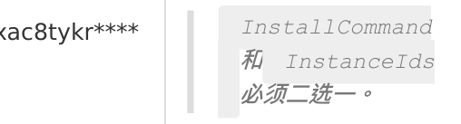
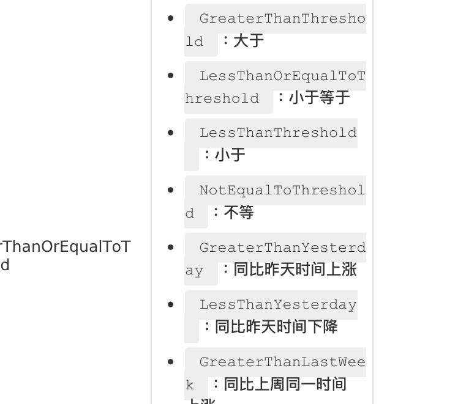
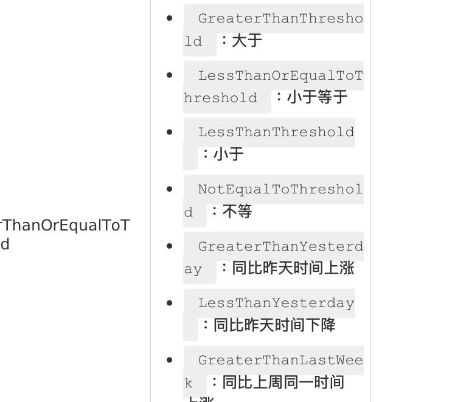
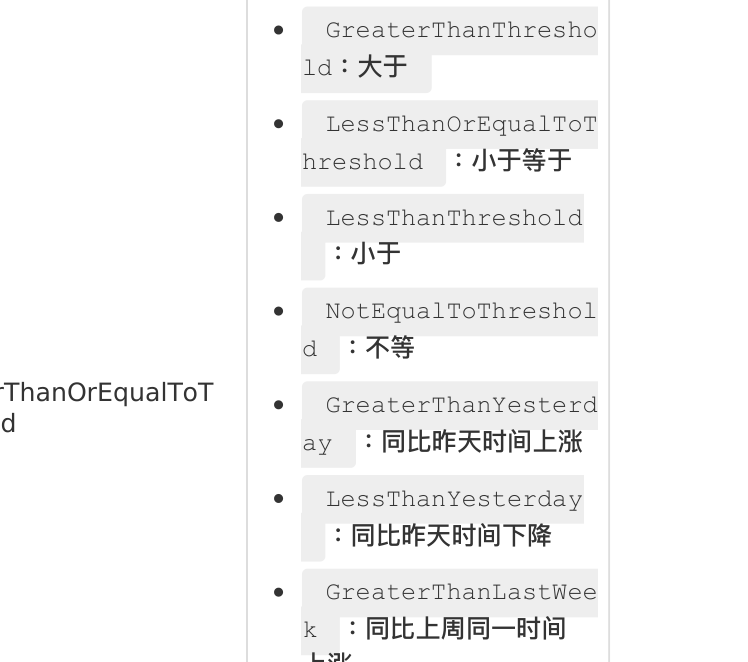

阿里云  
专有云  
云监控  
开发指南  
产品版本：V3.18.6  
文档版本：20250626

**目录**

- [1.API列表](#section-1)
    - [1.1. 云产品时序指标类监控数据](#section-1-1)
        - [1.1.1. DescribeMetricLast](#section-1-1-1)
        - [1.1.2. DescribeMetricList](#section-1-1-2)
        - [1.1.3. DescribeMetricMetaList](#section-1-1-3)
        - [1.1.4. DescribeProjectMeta](#section-1-1-4)
        - [1.1.5. DescribeMetricData](#section-1-1-5)
        - [1.1.6. DescribeMetricTop](#section-1-1-6)
    - [1.2. 自定义监控](#section-1-2)
        - [1.2.1. PutCustomMetric](#section-1-2-1)
        - [1.2.2. DescribeCustomMetricList](#section-1-2-2)
        - [1.2.3. DeleteCustomMetric](#section-1-2-3)
    - [1.3. 主机监控](#section-1-3)
        - [1.3.1. NodeInstall](#section-1-3-1)
        - [1.3.2. DescribeArgusAgentInstallRecord](#section-1-3-2)
        - [1.3.3. DescribeMonitoringAgentStatuses](#section-1-3-3)
        - [1.3.4. DescribeMonitoringAgentHosts](#section-1-3-4)
        - [1.3.5. InstallMonitoringAgent](#section-1-3-5)
        - [1.3.6. DescribeMonitoringAgentProcesses](#section-1-3-6)
        - [1.3.7. PutMonitoringConfig](#section-1-3-7)
        - [1.3.8. DeleteMonitoringAgentProcess](#section-1-3-8)
        - [1.3.9. CreateMonitoringAgentProcess](#section-1-3-9)
        - [1.3.10. DescribeMonitoringConfig](#section-1-3-10)
        - [1.3.11. DescribeMonitoringAgentAccessKey](#section-1-3-11)
        - [1.3.12. UninstallMonitoringAgent](#section-1-3-12)
    - [1.4. 报警服务](#section-1-4)
        - [1.4.1. DescribeAlertingMetricRuleResources](#section-1-4-1)
        - [1.4.2. PutResourceMetricRule](#section-1-4-2)
        - [1.4.3. DescribeAlertHistoryList](#section-1-4-3)
        - [1.4.4. DeleteMetricRuleTargets](#section-1-4-4)
        - [1.4.5. DescribeActiveMetricRuleList](#section-1-4-5)
        - [1.4.6. DescribeProductsOfActiveMetricRule](#section-1-4-6)
        - [1.4.7. DeleteMetricRuleResources](#section-1-4-7)
        - [1.4.8. DescribeMetricRuleList](#section-1-4-8)
        - [1.4.9. DescribeMetricRuleCount](#section-1-4-9)
        - [1.4.10. DeleteMetricRules](#section-1-4-10)
        - [1.4.11. DisableMetricRules](#section-1-4-11)
        - [1.4.12. EnableMetricRules](#section-1-4-12)
        - [1.4.13. DeleteContact](#section-1-4-13)
        - [1.4.14. DescribeMetricRuleTargets](#section-1-4-14)
        - [1.4.15. DescribeEventRuleList](#section-1-4-15)
        - [1.4.16. DescribeMetricRuleTemplateList](#section-1-4-16)
        - [1.4.17. DescribeContactList](#section-1-4-17)
        - [1.4.18. ApplyMetricRuleTemplate](#section-1-4-18)
        - [1.4.19. DescribeEventRuleTargetList](#section-1-4-19)
        - [1.4.20. DescribeMetricRuleTemplateAttribute](#section-1-4-20)
        - [1.4.21. DescribeEventRuleAttribute](#section-1-4-21)
        - [1.4.22. DescribeContactListByContactGroup](#section-1-4-22)
        - [1.4.23. PutContact](#section-1-4-23)
        - [1.4.24. PutContactGroup](#section-1-4-24)
        - [1.4.25. PutGroupMetricRule](#section-1-4-25)
        - [1.4.26. CreateMetricRuleResources](#section-1-4-26)
        - [1.4.27. DescribeContactGroupList](#section-1-4-27)
        - [1.4.28. DeleteMetricRuleTemplate](#section-1-4-28)
        - [1.4.29. PutEventRuleTargets](#section-1-4-29)
        - [1.4.30. CreateMetricRuleTemplate](#section-1-4-30)
        - [1.4.31. CreateGroupMetricRules](#section-1-4-31)
        - [1.4.32. DeleteEventRules](#section-1-4-32)
        - [1.4.33. ModifyMetricRuleTemplate](#section-1-4-33)
        - [1.4.34. PutMetricRuleTargets](#section-1-4-34)
    - [1.5. 事件监控](#section-1-5)
        - [1.5.1. DescribeSystemEventHistogram](#section-1-5-1)
        - [1.5.2. DescribeSystemEventAttribute](#section-1-5-2)
        - [1.5.3. DescribeSystemEventCount](#section-1-5-3)
        - [1.5.4. SendDryRunSystemEvent](#section-1-5-4)
        - [1.5.5. PutCustomEvent](#section-1-5-5)
        - [1.5.6. DescribeSystemEventMetaList](#section-1-5-6)
        - [1.5.7. DescribeCustomEventCount](#section-1-5-7)
        - [1.5.8. DescribeCustomEventAttribute](#section-1-5-8)
    - [1.6. 应用分组](#section-1-6)
        - [1.6.1. DescribeMonitorGroups](#section-1-6-1)
        - [1.6.2. DescribeMonitorGroupInstances](#section-1-6-2)
        - [1.6.3. CreateMonitorGroupInstances](#section-1-6-3)
        - [1.6.4. DescribeUnhealthyHostAvailability](#section-1-6-4)
        - [1.6.5. DeleteMonitorGroupInstances](#section-1-6-5)
        - [1.6.6. DescribeMonitorGroupInstanceAttribute](#section-1-6-6)
        - [1.6.7. DescribeHostAvailabilityList](#section-1-6-7)
        - [1.6.8. CreateMonitorGroup](#section-1-6-8)
        - [1.6.9. DeleteMonitorGroup](#section-1-6-9)
        - [1.6.10. CreateHostAvailability](#section-1-6-10)
        - [1.6.11. CreateMonitorGroupNotifyPolicy](#section-1-6-11)
        - [1.6.12. DeleteHostAvailability](#section-1-6-12)
        - [1.6.13. DescribeMonitorGroupCategories](#section-1-6-13)
        - [1.6.14. ModifyMonitorGroupInstances](#section-1-6-14)
        - [1.6.15. ModifyHostAvailability](#section-1-6-15)
        - [1.6.16. PutMonitorGroupDynamicRule](#section-1-6-16)
        - [1.6.17. ModifyMonitorGroup](#section-1-6-17)
        - [1.6.18. DeleteMonitorGroupDynamicRule](#section-1-6-18)
        - [1.6.19. DeleteMonitorGroupNotifyPolicy](#section-1-6-19)
        - [1.6.20. DescribeMonitorGroupNotifyPolicyList](#section-1-6-20)
        - [1.6.21. DescribeMonitorGroupDynamicRules](#section-1-6-21)
    - [1.7. 站点监控](#section-1-7)
        - [1.7.1. DescribeSiteMonitorData](#section-1-7-1)
        - [1.7.2. DescribeSiteMonitorStatistics](#section-1-7-2)
        - [1.7.3. DescribeSiteMonitorList](#section-1-7-3)
        - [1.7.4. DescribeSiteMonitorISPCityList](#section-1-7-4)
        - [1.7.5. CreateSiteMonitor](#section-1-7-5)
        - [1.7.6. DescribeSiteMonitorAttribute](#section-1-7-6)
        - [1.7.7. DisableSiteMonitors](#section-1-7-7)
        - [1.7.8. EnableSiteMonitors](#section-1-7-8)
        - [1.7.9. DeleteSiteMonitors](#section-1-7-9)
        - [1.7.10. ModifySiteMonitor](#section-1-7-10)
        - [1.7.11. DescribeSiteMonitorQuota](#section-1-7-11)
    - [1.8. 告警中心](#section-1-8)
        - [1.8.1. DescribeNotificationRules](#section-1-8-1)
        - [1.8.2. DescribeAlertList](#section-1-8-2)
        - [1.8.3. DeleteAlertFilterConfigBatch](#section-1-8-3)
        - [1.8.4. ModifyAlertFilterConfig](#section-1-8-4)
        - [1.8.5. DescribeAlertFilterConfig](#section-1-8-5)
        - [1.8.6. DeleteNotificationRules](#section-1-8-6)
        - [1.8.7. ModifyNotificationRule](#section-1-8-7)
        - [1.8.8. CreateAlertFilterConfig](#section-1-8-8)
        - [1.8.9. PutNotificationRule](#section-1-8-9)
    - [1.9. 数据订阅](#section-1-9)
        - [1.9.1. CreateMetricPubSync](#section-1-9-1)
        - [1.9.2. UpdateMetricPubSync](#section-1-9-2)
        - [1.9.3. DeleteMetricPubSync](#section-1-9-3)
        - [1.9.4. DescribeMetricPubSyncs](#section-1-9-4)
    - [1.10. 日志监控](#section-1-10)
        - [1.10.1. PutLogMonitor](#section-1-10-1)
        - [1.10.2. DeleteLogMonitor](#section-1-10-2)
        - [1.10.3. DescribeLogMonitorList](#section-1-10-3)
- [2.云产品监控项](#section-2)
    - [2.1. 弹性计算](#section-2-1)
        - [2.1.1. Kubernetes容器监控](#section-2-1-1)
        - [2.1.2. 云服务器ECS](#section-2-1-2)
        - [2.1.3. 裸金属算力平台BMCP（节点）](#section-2-1-3)
        - [2.1.4. 裸金属算力平台BMCP（裸金属&容器）](#section-2-1-4)
        - [2.1.5. 裸金属算力平台BMCP（裸金属-超算算力集群）](#section-2-1-5)
    - [2.2. 数据库](#section-2-2)
        - [2.2.1. 云数据库RDS](#section-2-2-1)
        - [2.2.2. 云数据库RDS（新链路）](#section-2-2-2)
        - [2.2.3. 云原生分布式数据库PolarDB-X 2.0](#section-2-2-3)
            - [2.2.3.1. 云原生数据库PolarDB-X 2.0计算节点](#section-2-2-3-1)
            - [2.2.3.2. 云原生数据库PolarDB-X 2.0数据节点](#section-2-2-3-2)
        - [2.2.4. 云数据库MongoDB版](#section-2-2-4)
        - [2.2.5. 云数据库MongoDB版（新链路）](#section-2-2-5)
        - [2.2.6. 云数据库Redis版](#section-2-2-6)
        - [2.2.7. 云数据库Redis版（新链路）](#section-2-2-7)
        - [2.2.8. 云原生数据仓库AnalyticDB PostgreSQL](#section-2-2-8)
        - [2.2.9. 云原生数据仓库AnalyticDB PostgreSQL（新链路）](#section-2-2-9)
        - [2.2.10. 数据传输服务DTS](#section-2-2-10)
    - [2.3. 存储与CDN](#section-2-3)
        - [2.3.1. 文件存储NAS](#section-2-3-1)
        - [2.3.2. 对象存储OSS](#section-2-3-2)
    - [2.4. 网络](#section-2-4)
        - [2.4.1. NAT网关](#section-2-4-1)
        - [2.4.2. 负载均衡SLB](#section-2-4-2)
        - [2.4.3. 弹性公网IP](#section-2-4-3)
        - [2.4.4. VPN网关](#section-2-4-4)
        - [2.4.5. 域名解析DNS](#section-2-4-5)
    - [2.5. 互联网中间件](#section-2-5)
        - [2.5.1. 消息队列MQ（RocketMQ）](#section-2-5-1)
        - [2.5.2. 消息队列Kafka](#section-2-5-2)
    - [2.6. 大数据（数加）](#section-2-6)
        - [2.6.1. 数据总线DataHub](#section-2-6-1)
        - [2.6.2. 大数据计算MaxCompute](#section-2-6-2)
        - [2.6.3. 大数据计算MaxCompute（配额组）](#section-2-6-3)
    - [2.7. 安全（云盾）](#section-2-7)
        - [2.7.1. 租户侧堡垒机](#section-2-7-1)
        - [2.7.2. 漏扫引擎](#section-2-7-2)
    - [2.8. 人工智能与机器学习](#section-2-8)
        - [2.8.1. AI Studio（在线服务）](#section-2-8-1)
        - [2.8.2. AI Studio（模型评测）](#section-2-8-2)
        - [2.8.3. AI Studio（Notebook建模）](#section-2-8-3)
        - [2.8.4. AI Studio（任务建模）](#section-2-8-4)

<a id="section-1"></a>

# 1.API列表

<a id="section-1-1"></a>

## 1.1. 云产品时序指标类监控数据

<a id="section-1-1-1"></a>

### 1.1.1. DescribeMetricLast

调用DescribeMetricLast接口查询指定监控对象的最新监控数据。

**请求参数**

| 名称 | 类型 | 是否必选 | 示例值 | 描述 |
| --- | --- | --- | --- | --- |
| Action | String | 是 | DescribeMetricL ast | 系统规定参数，取值：DescribeMetricLast。 |
| MetricName | String | 是 | CPUUtilization | 监控项名称。 |
| Namespace | String | 是 | acs_ecs_dashbo ard | 产品的数据命名空间，用于区分不同的产品。命名方式：acs_产品名。 |
| Dimensions | String | 否 | \[{"instanceId":" XXXXXX"}\] | 维度map，用于查询指定资源的监控数据。<br>格式为<code> key-value </code>键值对形式的集合，常用的<code> key-value </code>集合为<code> instanceId</code>：<code>XXXXXX </code>,instanceId安全调用范围是20个。<br><code> key </code>和<code> value </code>的长度为1~64个字节，超过64个字节时截取前64字节。<code> key </code>和<code> value </code>的取值可包含字母、数字、点号（.）、短横线（-）、下划线（_）、正斜线（/）和反斜线（\\）。<br>说明Dimensions传入时需要使用JSON字符串表示该map对象，必须按顺序传入。 |
| StartTime | String | 否 | 2019-01-31 10:00:00 | 开始时间。格式为Unix时间戳，即从1970年1月1日开始所经过的秒数。<br>说明只能查询270天以内且开始时间和结束时间不超过31天的监控数据。 |
| EndTime | String | 否 | 2019-01-31 10:10:00 | 结束时间。格式为Unix时间戳，即从1970年1月1日开始所经过的秒数。<br>说明只能查询270天以内的监控数据。 |
| Express | String | 否 | {"groupby": \["userId","instan ceId"\]} | 对现有查询结果进行实时计算的表达式。 |
| Length | String | 否 | 1000 | 返回监控数据的每页大小，用于分页查询。默认值为1000，即每页1000条监控数据。 |
| NextToken | String | 否 | 1576143285000 9dd70bb64cff1f 0fff6c0b08ffff07 3be5fb1e785e2 b020f7fed9b5e1 37bd810a6d6cff 5ae\*\*\*\* | 分页游标的标识。<br>• 如果匹配查询条件的返回结果超过了分页大小，则会返回这个分页游标。<br>• 如果需要获取下一页数据，将返回的游标值作为请求参数即可，直到没有游标值的返回则表示已经获取了全部结果数据。 |
| Period | String | 否 | 60 | 时间间隔，通常为监控项的上报周期，单位为秒。<br>• 如果不填写，则按照注册监控项时申明的上报周期来查询原始数据。<br>• 如果设置报警规则时设置了统计周期，则会按照此周期查询对应的统计数据。 |

**返回数据**

| 名称 | 类型 | 示例值 | 描述 |
| --- | --- | --- | --- |
| RequestId | String | 021472A6-25E3-4094-8D00-BA4B6A5486C3 | 请求ID。 |
| Code | String | 200 | 状态码。<br>说明状态码为200表示成功。 |
| Success | Boolean | true | 请求是否成功。 |
| Period | String | 60 | 时间间隔，单位为秒。 |
| NextToken | String | xxxxxx | 分页游标标识。 |
| Datapoints | String | \[{"timestamp":154 8777660000,"userI d":"123","instanceI d":"i-abc","Minimum":9.92,"Average":9.92, "Maximum":9.92}\] | 监控数据列表。 |
| Message | String | Success | 错误信息。 |

**示例**

请求示例

```text
http(s)://[Endpoint]/?Action=DescribeMetricLast
&MetricName=CPUUtilization
&Namespace=acs_ecs_dashboard
&<公共请求参数>
```

正常返回示例

`XML`  格式

```xml
<QueryMetricListResponse>
    <Period>60</Period>
    <Datapoints>
        <Datapoints>
            <timestamp>1490152860000</timestamp>
            <Maximum>100</Maximum>
            <userId> 123456789876****</userId>
            <Minimum>93.1</Minimum>
            <instanceId>i-abcdefgh12****</instanceId>
            <Average>99.52</Average>
        </Datapoints>
        <Datapoints>
            <timestamp>1490152920000</timestamp>
            <Maximum>100</Maximum>
            <userId> 123456789876**** </userId>
            <Minimum>92.59</Minimum>
            <instanceId>i-abcdefgh12****</instanceId>
            <Average>99.49</Average>
        </Datapoints>
        <Datapoints>
            <timestamp>1490152980000</timestamp>
            <Maximum>100</Maximum>
            <userId>123456789876****</userId>
            <Minimum>92.86</Minimum>
            <instanceId>i-abcdefgh12****</instanceId>
            <Average>99.44</Average>
        </Datapoints>
        <Datapoints>
            <timestamp>1490153040000</timestamp>
            <Maximum>100</Maximum>
            <userId>123456789876****</userId>
            <Minimum>91.43</Minimum>
            <instanceId>i-abcdefgh12****</instanceId>
            <Average>99.36</Average>
        </Datapoints>
        <Datapoints>
            <timestamp>1490153100000</timestamp>
            <Maximum>100</Maximum>
            <userId>123456789876****</userId>
            <Minimum>93.55</Minimum>
            <instanceId>i-abcdefgh12****</instanceId>
            <Average>99.51</Average>
        </Datapoints>
        <Datapoints>
            <timestamp>1490153160000</timestamp>
            <Maximum>100</Maximum>
            <userId>123456789876****</userId>
            <Minimum>93.1</Minimum>
            <instanceId>i-abcdefgh12****</instanceId>
            <Average>99.52</Average>
        </Datapoints>
        <Datapoints>
            <timestamp>1490153220000</timestamp>
            <Maximum>100</Maximum>
            <userId>123456789876****</userId>
            <Minimum>92.59</Minimum>
            <instanceId>i-abcdefgh12****</instanceId>
            <Average>99.42</Average>
        </Datapoints>
        <Datapoints>
            <timestamp>1490153280000</timestamp>
            <Maximum>100</Maximum>
            <userId>123456789876****</userId>
            <Minimum>91.18</Minimum>
            <instanceId>i-abcdefgh12****</instanceId>
            <Average>99.34</Average>
        </Datapoints>
        <Datapoints>
            <timestamp>1490153340000</timestamp>
            <Maximum>100</Maximum>
            <userId>123456789876****</userId>
            <Minimum>92.86</Minimum>
            <instanceId>i-abcdefgh12****</instanceId>
            <Average>99.46</Average>
        </Datapoints>
        <Datapoints>
            <timestamp>1490153400000</timestamp>
            <Maximum>100</Maximum>
            <userId>123456789876****</userId>
            <Minimum>91.18</Minimum>
            <instanceId>i-abcdefgh12****</instanceId>
            <Average>99.35</Average>
        </Datapoints>
    </Datapoints>
    <RequestId>6661EC50-8625-4161-B349-E0DD59002AB7</RequestId>
    <Success>true</Success>
    <Code>200</Code>
</QueryMetricListResponse>
```

`JSON`  格式

```json
{
 "Period":"60",
 "Datapoints":[
  {
   "timestamp":1490152860000,
   "Maximum":100,
   "userId":"123456789876****",
   "instanceId":"i-abcdefgh12****",
   "Minimum":93.1,
   "Average":99.52
  },
  {
   "timestamp":1490152920000,
   "Maximum":100,
   "userId":"123456789876****",
   "instanceId":"i-abcdefgh12****",
   "Minimum":92.59,
   "Average":99.49
  },
  {
   "timestamp":1490152980000,
   "Maximum":100,
   "userId":"123456789876****",
   "instanceId":"i-abcdefgh12****",
   "Minimum":92.86,
   "Average":99.44
  },
  {
   "timestamp":1490153040000,
   "Maximum":100,
   "userId":"123456789876****",
   "instanceId":"i-abcdefgh12****",
   "Minimum":91.43,
   "Average":99.36
  },
  {
   "timestamp":1490153100000,
   "Maximum":100,
   "userId":"123456789876****",
   "instanceId":"i-abcdefgh12****",
   "Minimum":93.55,
   "Average":99.51
  },
  {
   "timestamp":1490153160000,
   "Maximum":100,
   "userId":"123456789876****",
   "instanceId":"i-abcdefgh12****",
   "Minimum":93.1,
   "Average":99.52
  },
  {
   "timestamp":1490153220000,
   "Maximum":100,
   "userId":"123456789876****",
   "instanceId":"i-abcdefgh12****",
   "Minimum":92.59,
   "Average":99.42
  },
  {
   "timestamp":1490153280000,
   "Maximum":100,
   "userId":"123456789876****",
   "instanceId":"i-abcdefgh12****",
   "Minimum":91.18,
   "Average":99.34
  },
  {
   "timestamp":1490153340000,
   "Maximum":100,
   "userId":"123456789876****",
   "instanceId":"i-abcdefgh12****",
   "Minimum":92.86,
   "Average":99.46
  },
  {
   "timestamp":1490153400000,
   "Maximum":100,
   "userId":"123456789876****",
   "instanceId":"i-abcdefgh12****",
   "Minimum":91.18,
   "Average":99.35
  }
 ],
 "RequestId":"6A5F022D-AC7C-460E-94AE-B9E75083D027",
 "Success":true,
 "Code":"200"
}
```

<a id="section-1-1-2"></a>

### 1.1.2. DescribeMetricList

调用DescribeMetricList接口查询指定时间段内的云产品时序指标监控数据。

各云产品的Namespace、Metric、Period、Dimensions等参数的取值，请参见云产品监控项章节。

**请求参数**

| 名称 | 类型 | 是否必选 | 示例值 | 描述 |
| --- | --- | --- | --- | --- |
| Action | String | 是 | DescribeMetricLi st | 系统规定参数。取值：DescribeMetricList。 |
| MetricName | String | 是 | cpu_idle | 监控项名称。 |
| Namespace | String | 是 | acs_ecs_dashbo ard | 产品的数据命名空间，用于区分不同的产品。命名方式：acs_产品名。 |
| Dimensions | String | 是 | \[{"instanceId": "i-abcdefgh12\*\*\*\*"}\] | 维度map，用于查询指定资源的监控数据。格式为key-value键值对形式的集合，常用的key-value集合为instanceId：XXXXXX，instanceId安全调用范围是10个。key和value的长度为1~64个字节，超过64个字节时截取前64字节。key和value的取值可包含字母、数字、点号（.）、短横线（-）、下划线（_）、正斜线（/）和反斜线（\\）。<br>说明Dimensions传入时需要使用JSON字符串表示该Map对象，必须按顺序传入。 |
| EndTime | String | 否 | 2019-01-30 00:10:00 | 结束时间。支持的格式：<br>• Unix时间戳：从1970年1月1日开始所经过的秒数。<br>• Format格式：YYYY-MM-DDThh:mm:ssZ。 |
| Express | String | 否 | {"groupby": \["userId","instan ceId"\]} | 对查询出的现有结果进行实时计算的表达式。目前仅支持<code> groupby </code>（类似数据库的<code> groupby </code>语句）。 |
| Length | String | 否 | 1000 | 每页显示的记录条数，用于分页查询，默认值为1000。 |
| NextToken | String | 否 | 1576148535000 9dd70bb64cff1f 0fff750b08ffff07 3be5fb1e785e2 b020f1a949d5e a14aea7fed82f0 1dd87311 | 分页游标标识。<br>说明如果不传入此参数表示获取第一页的数据，此参数只要返回就说明还有下一页，您可以将返回的NextToken作为参数再次请求获得下一页的数据，直到返回为null表示获取到了所有的数据。 |
| Period | String | 否 | 60 | 时间间隔，单位为秒。取值一般为60（1分钟）、300（5分钟）、900（15分钟）。<br>说明请根据需要设置此参数。例如查询一天范围时设置Period为60，则返回1000条数据（实际存在1440，因为最大返回值不超过1000，则只返回前1000条）。如果使用Period为300，则返回288条数据。 |
| StartTime | String | 否 | 2019-01-30 00:00:00 | 开始时间。支持的格式：<br>• Unix时间戳：从1970年1月1日开始所经过的秒数。<br>• Format格式：YYYY-MM-DDThh:mm:ssZ。<br>说明开始和结束时间执行的是左开右闭的模式，startTime不能等于或大于endTime。 |

**返回数据**

| 名称 | 类型 | 示例值 | 描述 |
| --- | --- | --- | --- |
| RequestId | String | 3121AE7D-4AFF-4C25-8F1D-C8226EBB1F42 | 请求ID。 |
| Code | String | 200 | 状态码。<br>说明状态码为200表示成功。 |
| Success | Boolean | true | 请求是否成功。 |
| NextToken | String | 15761441850009d d70bb64cff1f0fff6d 0b08ffff073be5fb1 e785e2b020f7fed9 b5e137bd810a6d6 cff5aee816 | 分页游标标识。<br>说明如果不传入此参数表示获取第一页的数据，此参数只要返回就说明还有下一页，您可以将返回的NextToken作为参数再次请求获得下一页的数据，直到返回为null表示获取到了所有的数据。 |
| Period | String | 60 | 时间间隔，单位为秒。取值为60、300、900。 |
| Datapoints | String | \[{"timestamp":154 8777660000,"userI d":"123","instanceI d":"i-abc","Minimum":9.92,"Average":9.92, "Maximum":9.92}\] | 监控数据列表。 |
| Message | String | Success | 错误信息。 |

**示例**

请求示例

```text
http(s)://[Endpoint]/?Action=DescribeMetricList
&MetricName=cpu_idle
&Namespace=acs_ecs_dashboard
&<公共请求参数>
```

正常返回示例

`XML`  格式

```xml
<Period>60</Period>
<Datapoints>
    <timestamp>1490152860000</timestamp>
    <Maximum>100</Maximum>
    <userId>123456789876****</userId>
    <Minimum>93.1</Minimum>
    <instanceId>i-abcdefgh12****</instanceId>
    <Average>99.52</Average>
</Datapoints>
<Datapoints>
    <timestamp>1490152920000</timestamp>
    <Maximum>100</Maximum>
    <userId>123456789876****</userId>
    <Minimum>92.59</Minimum>
    <instanceId>i-abcdefgh12****</instanceId>
    <Average>99.49</Average>
</Datapoints>
<Datapoints>
    <timestamp>1490152980000</timestamp>
    <Maximum>100</Maximum>
    <userId>123456789876****</userId>
    <Minimum>92.86</Minimum>
    <instanceId>i-abcdefgh12****</instanceId>
    <Average>99.44</Average>
</Datapoints>
<Datapoints>
    <timestamp>1490153040000</timestamp>
    <Maximum>100</Maximum>
    <userId>123456789876****</userId>
    <Minimum>91.43</Minimum>
    <instanceId>i-abcdefgh12****</instanceId>
    <Average>99.36</Average>
</Datapoints>
<Datapoints>
    <timestamp>1490153100000</timestamp>
    <Maximum>100</Maximum>
    <userId>123456789876****</userId>
    <Minimum>93.55</Minimum>
    <instanceId>i-abcdefgh12****</instanceId>
    <Average>99.51</Average>
</Datapoints>
<Datapoints>
    <timestamp>1490153160000</timestamp>
    <Maximum>100</Maximum>
    <userId>123456789876****</userId>
    <Minimum>93.1</Minimum>
    <instanceId>i-abcdefgh12****</instanceId>
    <Average>99.52</Average>
</Datapoints>
<Datapoints>
    <timestamp>1490153220000</timestamp>
    <Maximum>100</Maximum>
    <userId>123456789876****</userId>
    <Minimum>92.59</Minimum>
    <instanceId>i-abcdefgh12****</instanceId>
    <Average>99.42</Average>
</Datapoints>
<Datapoints>
    <timestamp>1490153280000</timestamp>
    <Maximum>100</Maximum>
    <userId>123456789876****</userId>
    <Minimum>91.18</Minimum>
    <instanceId>i-abcdefgh12****</instanceId>
    <Average>99.34</Average>
</Datapoints>
<Datapoints>
    <timestamp>1490153340000</timestamp>
    <Maximum>100</Maximum>
    <userId>123456789876****</userId>
    <Minimum>92.86</Minimum>
    <instanceId>i-abcdefgh12****</instanceId>
    <Average>99.46</Average>
</Datapoints>
<Datapoints>
    <timestamp>1490153400000</timestamp>
    <Maximum>100</Maximum>
    <userId>123456789876****</userId>
    <Minimum>91.18</Minimum>
    <instanceId>i-abcdefgh12****</instanceId>
    <Average>99.35</Average>
</Datapoints>
<RequestId>6A5F022D-AC7C-460E-94AE-B9E75083D027</RequestId>
<Success>true</Success>
<Code>200</Code>
```

`JSON`  格式

```json
{
 "Period":"60",
 "Datapoints":[
  {
   "timestamp":1490152860000,
   "Maximum":100,
   "userId":"123456789876****",
   "instanceId":"i-abcdefgh12****",
   "Minimum":93.1,
   "Average":99.52
  },
  {
   "timestamp":1490152920000,
   "Maximum":100,
   "userId":"123456789876****",
   "instanceId":"i-abcdefgh12****",
   "Minimum":92.59,
   "Average":99.49
  },
  {
   "timestamp":1490152980000,
   "Maximum":100,
   "userId":"123456789876****",
   "instanceId":"i-abcdefgh12****",
   "Minimum":92.86,
   "Average":99.44
  },
  {
   "timestamp":1490153040000,
   "Maximum":100,
   "userId":"123456789876****",
   "instanceId":"i-abcdefgh12****",
   "Minimum":91.43,
   "Average":99.36
  },
  {
   "timestamp":1490153100000,
   "Maximum":100,
   "userId":"123456789876****",
   "instanceId":"i-abcdefgh12****",
   "Minimum":93.55,
   "Average":99.51
  },
  {
   "timestamp":1490153160000,
   "Maximum":100,
   "userId":"123456789876****",
   "instanceId":"i-abcdefgh12****",
   "Minimum":93.1,
   "Average":99.52
  },
  {
   "timestamp":1490153220000,
   "Maximum":100,
   "userId":"123456789876****",
   "instanceId":"i-abcdefgh12****",
   "Minimum":92.59,
   "Average":99.42
  },
  {
   "timestamp":1490153280000,
   "Maximum":100,
   "userId":"123456789876****",
   "instanceId":"i-abcdefgh12****",
   "Minimum":91.18,
   "Average":99.34
  },
  {
   "timestamp":1490153340000,
   "Maximum":100,
   "userId":"123456789876****",
   "instanceId":"i-abcdefgh12****",
   "Minimum":92.86,
   "Average":99.46
  },
  {
   "timestamp":1490153400000,
   "Maximum":100,
   "userId":"123456789876****",
   "instanceId":"i-abcdefgh12****",
   "Minimum":91.18,
   "Average":99.35
  }
 ],
 "RequestId":"6A5F022D-AC7C-460E-94AE-B9E75083D027",
 "Success":true,
 "Code":"200"
}
```

<a id="section-1-1-3"></a>

### 1.1.3. DescribeMetricMetaList

查询云监控开放的时序类指标监控项描述。

通常配合查询监控数据接口DescribeMetricList、DescribeMetricLast等一起使用。

**请求参数**

| 名称 | 类型 | 是否必选 | 示例值 | 描述 |
| --- | --- | --- | --- | --- |
| Action | String | 是 | DescribeMetricM etaList | 系统规定参数，取值：DescribeMetricMetaList。 |
| Namespace | String | 是 | acs_kvstore | 指标所属的Namespace，用于区分每个产品配置。您可以通过调用DescribeProjectMeta查看每个产品对应的Namespace值。 |
| Labels | String | 否 | \[{"name":"prod uctCategory","v alue":"kvstore_o ld"}\] | 根据标签过滤，格式<code> [{"name":"</code>标签名<code>","value":"</code>标签值<code>"},{"name":"</code>标签名<code>","value":"</code>标签值<code>"}]  </code>。<br>已有的标签name说明如下：<br>• MetricCategory：监控项分类的描述<br>• alertEnable：是否需要报警<br>• alertUnit：建议的报警单位<br>• unitFactor：单位转换系数<br>• minAlertPeriod：最小报警周期<br>• productCategory：产品类型分类 |
| MetricName | String | 否 | CPUUtilization | 监控指标名，按等于匹配。 |
| PageNumber | Integer | 否 | 1 | 分页参数，默认值：1。 |
| PageSize | Integer | 否 | 30 | 每页最大数量，默认值：30。 |

**返回数据**

| 名称 | 类型 | 示例值 | 描述 |
| --- | --- | --- | --- |
| Success | Boolean | true | 是否成功。 |
| Code | String | 200 | 状态码，200表示成功。 |
| RequestId | String | 0CCE0AF0-053C-4B13-A583-DC9A85785D49 | 请求ID，用于排查问题。 |
| Message | String | success | 错误信息。 |
| Resources |  |  | 具体的配置信息。 |
| Resource |  |  | 具体的配置信息。 |
| Description | String | CPUUtilization | 监控项描述。 |
| Dimensions | String | instanceId | 监控项的Dimensions。多个用半角逗号（,）分隔。 |
| Labels | String | \[{"name":"alertUni t","value":"Bytes"}, {"name":"minAlert Period","value":"60 "}, {"name":"metricCa tegory","value":"in stanceId"}, {"name":"instance Type","value":"disa ster"}, {"name":"is_alarm ","value":"true"}, {"name":"productC ategory","value":"k vstore_old"}\] | 监控项的标签，是一个JSON的String<code> [{"name":"</code>标签名<code>","value":"</code>标签的值<code>"}] </code>，可以是多个，name可以重复。<br>已有的标签name说明：<br>• metricCategory：指标分类<br>• alertEnable：是否可以报警<br>• alertUnit：报警单位<br>• unitFactor：单位转换系数<br>• minAlertPeriod：最小报警周期<br>• productCategory：产品 |
| MetricName | String | CPUUtilization | 监控项名称。 |
| Namespace | String | acs_kvstore | 用于区分产品类型，通常的命名方式为acs_产品名。 |
| Periods | String | 60,300 | 监控项的所有统计周期，多个用半角逗号（,）分隔：15,60,900。 |
| Statistics | String | Average,Minimum, Maximum | 统计方法，多个用半角逗号（,）分隔，例如：Maximum,Minimum,Average。 |
| Unit | String | % | 监控项的单位。 |
| TotalCount | String | 12 | 总记录条数。 |

**示例**

请求示例

```text
http(s)://[Endpoint]/?Action=DescribeMetricMetaList
&Namespace=acs_ecs_dashboard
&<公共请求参数>
```

正常返回示例

> 返回示例根据各版本监控的产品不同，会返回不同的值，请以实际返回的为准。
>
> **说明**

`XML`  格式

```xml
<DescribeMetricMetaListResponse>
    <TotalCount>120</TotalCount>
    <RequestId>EA94B362-973C-4D6B-BE94-6774E18915C2</RequestId>
    <Success>true</Success>
    <Code>200</Code>
    <Resources>
        <Resource>
            <Description>ECS.CPUUtilization</Description>
            <Statistics>Average,Minimum,Maximum</Statistics>
            <MetricName>CPUUtilization</MetricName>
            <Labels>[{"name":"alertUnit","value":"%"},
{"name":"alertDefault","value":"80"},{"name":"minAlertPeriod","value":"60"},
{"name":"metricCategory","value":"instanceId"},{"name":"is_alarm","value":"true"}]</Labels>
            <Dimensions>userId,instanceId</Dimensions>
            <Namespace>acs_ecs_dashboard</Namespace>
            <Periods>60,300</Periods>
            <Unit>%</Unit>
        </Resource>
        <Resource>
            <Description></Description>
            <Statistics>Average,Maximum,Minimum</Statistics>
            <MetricName>DiskReadBPS</MetricName>
            <Labels>[{"name":"alertUnit","value":"Mbytes/s"},
{"name":"minAlertPeriod","value":"60"},{"name":"unitFactor","value":"1048576"},{"name":
"metricCategory","value":"instanceId"},{"name":"is_alarm","value":"true"}]</Labels>
            <Dimensions>userId,instanceId</Dimensions>
            <Namespace>acs_ecs_dashboard</Namespace>
            <Periods>60,300</Periods>
            <Unit>bytes/s</Unit>
        </Resource>
        <Resource>
            <Description>系统磁盘读IOPS</Description>
            <Statistics>Average,Minimum,Maximum</Statistics>
            <MetricName>DiskReadIOPS</MetricName>
            <Labels>[{"name":"alertUnit","value":"Count/Second"},
{"name":"minAlertPeriod","value":"60"},{"name":"metricCategory","value":"instanceId"},{
"name":"is_alarm","value":"true"}]</Labels>
            <Dimensions>userId,instanceId</Dimensions>
            <Namespace>acs_ecs_dashboard</Namespace>
            <Periods>60,300</Periods>
            <Unit>Count/Second</Unit>
        </Resource>
        <Resource>
            <Description></Description>
            <Statistics>Average,Maximum,Minimum</Statistics>
            <MetricName>DiskWriteBPS</MetricName>
            <Labels>[{"name":"alertUnit","value":"Mbytes/s"},
{"name":"minAlertPeriod","value":"60"},{"name":"unitFactor","value":"1048576"},{"name":
"metricCategory","value":"instanceId"},{"name":"is_alarm","value":"true"}]</Labels>
            <Dimensions>userId,instanceId</Dimensions>
            <Namespace>acs_ecs_dashboard</Namespace>
            <Periods>60,300</Periods>
            <Unit>bytes/s</Unit>
        </Resource>
        <Resource>
            <Description>系统磁盘写IOPS</Description>
            <Statistics>Average,Minimum,Maximum</Statistics>
            <MetricName>DiskWriteIOPS</MetricName>
            <Labels>[{"name":"alertUnit","value":"Count/Second"},
{"name":"minAlertPeriod","value":"60"},{"name":"metricCategory","value":"instanceId"},{
"name":"is_alarm","value":"true"}]</Labels>
            <Dimensions>userId,instanceId</Dimensions>
            <Namespace>acs_ecs_dashboard</Namespace>
            <Periods>60,300</Periods>
            <Unit>Count/Second</Unit>
        </Resource>
        <Resource>
            <Description></Description>
            <Statistics>Average,Minimum,Maximum</Statistics>
            <MetricName>GroupCPUUtilization</MetricName>
            <Labels>[{"name":"alertUnit","value":"%"},
{"name":"minAlertPeriod","value":"60"},{"name":"metricCategory","value":"groupId"}]</Labels>
            <Dimensions>groupId</Dimensions>
            <Namespace>acs_ecs_dashboard</Namespace>
            <Periods>60,300</Periods>
            <Unit>%</Unit>
        </Resource>
        <Resource>
            <Description></Description>
            <Statistics>Average,Minimum,Maximum</Statistics>
            <MetricName>GroupDiskReadBPS</MetricName>
            <Labels>[{"name":"alertUnit","value":"Mbytes/s"},
{"name":"minAlertPeriod","value":"60"},{"name":"unitFactor","value":"1048576"},{"name":
"metricCategory","value":"groupId"}]</Labels>
            <Dimensions>groupId</Dimensions>
            <Namespace>acs_ecs_dashboard</Namespace>
            <Periods>60,300</Periods>
            <Unit>bytes/s</Unit>
        </Resource>
        <Resource>
            <Description></Description>
            <Statistics>Average,Minimum,Maximum</Statistics>
            <MetricName>GroupDiskReadIOPS</MetricName>
            <Labels>[{"name":"alertUnit","value":"Count/Second"},
{"name":"minAlertPeriod","value":"60"},{"name":"metricCategory","value":"groupId"}]</Labels>
            <Dimensions>groupId</Dimensions>
            <Namespace>acs_ecs_dashboard</Namespace>
            <Periods>60,300</Periods>
            <Unit>Count/Second</Unit>
        </Resource>
        <Resource>
            <Description></Description>
            <Statistics>Average,Minimum,Maximum</Statistics>
            <MetricName>GroupDiskWriteBPS</MetricName>
            <Labels>[{"name":"alertUnit","value":"Mbytes/s"},
{"name":"minAlertPeriod","value":"60"},{"name":"unitFactor","value":"1048576"},{"name":
"metricCategory","value":"groupId"}]</Labels>
            <Dimensions>groupId</Dimensions>
            <Namespace>acs_ecs_dashboard</Namespace>
            <Periods>60,300</Periods>
            <Unit>bytes/s</Unit>
        </Resource>
        <Resource>
            <Description></Description>
            <Statistics>Average,Minimum,Maximum</Statistics>
            <MetricName>GroupDiskWriteIOPS</MetricName>
            <Labels>[{"name":"alertUnit","value":"Count/Second"},
{"name":"minAlertPeriod","value":"60"},{"name":"metricCategory","value":"groupId"}]</Labels>
            <Dimensions>groupId</Dimensions>
            <Namespace>acs_ecs_dashboard</Namespace>
            <Periods>60,300</Periods>
            <Unit>Count/Second</Unit>
        </Resource>
    </Resources>
</DescribeMetricMetaListResponse>
```

`JSON`  格式

```json
{
 "TotalCount":1853,
 "RequestId":"CDE9EAFF-D54E-4024-BBFC-B0AAC883143B",
 "Success":true,
 "Code":200,
 "Resources":{
  "Resource":[
   {
    "Description":"磁盘额定容量",
    "MetricName":"ads.diskSize",
    "Statistics":"Average,Minimum,Maximum",
    "Labels":"[{\"name\":\"minAlertPeriod\",\"value\":\"300\"},
{\"name\":\"alertDefault\",\"value\":\"\"},{\"name\":\"unitFactor\",\"value\":\"1\"},{\
"name\":\"alertUnit\",\"value\":\"Mbytes\"},
{\"name\":\"productCategory\",\"value\":\"ads\"},
{\"name\":\"is_alarm\",\"value\":\"true\"},
{\"name\":\"metricCategory\",\"value\":\"workerId\"}]",
    "Dimensions":"userId,instanceId,tableSchema,workerId",
    "Namespace":"acs_ads",
    "Periods":"300",
    "Unit":"Mbytes"
   },
   {
    "Description":"磁盘已⽤容量",
    "MetricName":"ads.diskUsed",
    "Statistics":"Average,Minimum,Maximum",
    "Labels":"[{\"name\":\"alertUnit\",\"value\":\"Mbytes\"},
{\"name\":\"minAlertPeriod\",\"value\":\"300\"},
{\"name\":\"metricCategory\",\"value\":\"workerId\"},
{\"name\":\"is_alarm\",\"value\":\"true\"}]",
    "Dimensions":"userId,instanceId,tableSchema,workerId",
    "Namespace":"acs_ads",
    "Periods":"300",
    "Unit":"Mbytes"
   },
   {
    "Description":"磁盘使⽤率",
    "MetricName":"ads.diskUsedPercent",
    "Statistics":"Average,Minimum,Maximum",
    "Labels":"[{\"name\":\"alertUnit\",\"value\":\"%\"},
{\"name\":\"minAlertPeriod\",\"value\":\"300\"},
{\"name\":\"metricCategory\",\"value\":\"workerId\"},
{\"name\":\"is_alarm\",\"value\":\"true\"}]",
    "Dimensions":"userId,instanceId,tableSchema,workerId",
    "Namespace":"acs_ads",
    "Periods":"300",
    "Unit":"%"
   },
   {
    "Description":"queue的未消费的消息数⽬",
    "MetricName":"QueueMessageAccumulation",
    "Statistics":"Maximum",
    "Labels":"[{\"name\":\"minAlertPeriod\",\"value\":\"60\"},
{\"name\":\"alertDefault\",\"value\":\"\"},{\"name\":\"unitFactor\",\"value\":\"1\"},{\
"name\":\"alertUnit\",\"value\":\"count/min\"},
{\"name\":\"productCategory\",\"value\":\"amqp\"},
{\"name\":\"is_alarm\",\"value\":\"true\"},
{\"name\":\"metricCategory\",\"value\":\"queue\"}]",
    "Dimensions":"userId,regionId,vhostName,queueName",
    "Namespace":"acs_amqp",
    "Periods":"60,300",
    "Unit":"count/min"
   },
   {
    "Description":"queue每分钟消息⽣产量",
    "MetricName":"QueueMessageInput",
    "Statistics":"Value",
    "Labels":"[{\"name\":\"minAlertPeriod\",\"value\":\"60\"},
{\"name\":\"alertDefault\",\"value\":\"\"},{\"n ame\":\"unitFactor\",\"value\":\"1\"},{
\"name\":\"alertUnit\",\"value\":\"count/min\"},
{\"name\":\"productCategory\",\"value\":\"amqp\"},
{\"name\":\"is_alarm\",\"value\":\"true\"},
{\"name\":\"metricCategory\",\"value\":\"queue\"}]",
    "Dimensions":"userId,regionId,vhostName,queueName",
    "Namespace":"acs_amqp",
    "Periods":"60,300",
    "Unit":"count/min"
   },
   {
    "Description":"queue的未消费的消息数⽬",
    "MetricName":"QueueMessageOutput",
    "Statistics":"Value",
    "Labels":"[{\"name\":\"minAlertPeriod\",\"value\":\"60\"},
{\"name\":\"alertDefault\",\"value\":\"\"},{\"name\":\"unitFactor\",\"value\":\"1\"},{\
"name\":\"alertUnit\",\"value\":\"count/min\"},
{\"name\":\"productCategory\",\"value\":\"amqp\"},
{\"name\":\"is_alarm\",\"value\":\"true\"},
{\"name\":\"metricCategory\",\"value\":\"queue\"}]",
    "Dimensions":"userId,regionId,vhostName,queueName",
    "Namespace":"acs_amqp",
    "Periods":"60,300",
    "Unit":"count/min"
   },
   {
    "Description":"实例每分钟产⽣的消息数量",
    "MetricName":"VhostMessageInput",
    "Statistics":"Value",
    "Labels":"[{\"name\":\"minAlertPeriod\",\"value\":\"60\"},
{\"name\":\"alertDefault\",\"value\":\"\"},{\"name\":\"unitFactor\",\"value\":\"1\"},{\
"name\":\"alertUnit\",\"value\":\"count/min\"},
{\"name\":\"productCategory\",\"value\":\"amqp\"},
{\"name\":\"is_alarm\",\"value\":\"true\"},
{\"name\":\"metricCategory\",\"value\":\"vhost\"}]",
    "Dimensions":"userId,regionId,vhostName",
    "Namespace":"acs_amqp",
    "Periods":"60,300",
    "Unit":"count/min"
   },
   {
    "Description":"实例每分钟消费的消息数量",
    "MetricName":"VhostMessageOutput",
    "Statistics":"Value",
    "Labels":"[{\"name\":\"minAlertPeriod\",\"value\":\"60\"},
{\"name\":\"alertDefault\"\"value\":\"\"}{\"name\":\"unitFactor\"\"value\":\"1\"}{\
"name\":\"alertUnit\",\"value\":\"count/min\"},
{\"name\":\"productCategory\",\"value\":\"amqp\"},
{\"name\":\"is_alarm\",\"value\":\"true\"},
{\"name\":\"metricCategory\",\"value\":\"vhost\"}]",
    "Dimensions":"userId,regionId,vhostName",
    "Namespace":"acs_amqp",
    "Periods":"60,300",
    "Unit":"count/min"
   },
   {
    "Description":"",
    "MetricName":"Latency",
    "Statistics":"Average",
    "Labels":"[{\"name\":\"alertUnit\",\"value\":\"ms\"},
{\"name\":\"minAlertPeriod\",\"value\":\"60\"},
{\"name\":\"metricCategory\",\"value\":\"instanceId\"},
{\"name\":\"is_alarm\",\"value\":\"true\"}]",
    "Dimensions":"userId,region,apiUid",
    "Namespace":"acs_apigateway_dashboard",
    "Periods":"60,300,900",
    "Unit":"ms"
   },
   {
    "Description":"",
    "MetricName":"SumQPS",
    "Statistics":"Count",
    "Labels":"[{\"name\":\"alertUnit\",\"value\":\"Count\"},
{\"name\":\"minAlertPeriod\",\"value\":\"60\"},
{\"name\":\"metricCategory\",\"value\":\"instanceId\"},
{\"name\":\"is_alarm\",\"value\":\"true\"}]",
    "Dimensions":"userId,region,apiUid",
    "Namespace":"acs_apigateway_dashboard",
    "Periods":"60,300,900",
    "Unit":"Count"
   },
   {
    "Description":"",
    "MetricName":"TrafficRX",
    "Statistics":"Sum",
    "Labels":"[{\"name\":\"alertUnit\",\"value\":\"KBytes\"},
{\"name\":\"minAlertPeriod\",\"value\":\"60\"},
{\"name\":\"metricCategory\",\"value\":\"instanceId\"},
{\"name\":\"is_alarm\",\"value\":\"true\"}]",
    "Dimensions":"userId,region,apiUid",
    "Namespace":"acs_apigateway_dashboard",
    "Periods":"60,300,900",
    "Unit":"KBytes"
   },
   {
    "Description":"",
    "MetricName":"TrafficTX",
    "Statistics":"Sum",
    "Labels":"[{\"name\":\"alertUnit\",\"value\":\"KBytes\"},
{\"name\":\"minAlertPeriod\",\"value\":\"60\"},
{\"name\":\"metricCategory\",\"value\":\"instanceId\"},
{\"name\":\"is_alarm\",\"value\":\"true\"}]",
    "Dimensions":"userId,region,apiUid",
    "Namespace":"acs_apigateway_dashboard",
    "Periods":"60,300,900",
    "Unit":"KBytes"
   },
   {
    "Description":"",
    "MetricName":"code2XX",
    "Statistics":"Value",
    "Labels":"[{\"name\":\"alertUnit\",\"value\":\"count\"},
{\"name\":\"minAlertPeriod\",\"value\":\"60\"},
{\"name\":\"metricCategory\",\"value\":\"instanceId\"},
{\"name\":\"is_alarm\",\"value\":\"true\"}]",
    "Dimensions":"userId,region,apiUid",
    "Namespace":"acs_apigateway_dashboard",
    "Periods":"60,300",
    "Unit":"count"
   },
   {
    "Description":"",
    "MetricName":"code4XX",
    "Statistics":"Value",
    "Labels":"[{\"name\":\"alertUnit\",\"value\":\"count\"},
{\"name\":\"minAlertPeriod\",\"value\":\"60\"},
{\"name\":\"metricCategory\",\"value\":\"instanceId\"},
{\"name\":\"is_alarm\",\"value\":\"tru\"}]",
    "Dimensions":"userId,region,apiUid",
    "Namespace":"acs_apigateway_dashboard",
    "Periods":"60,300",
    "Unit":"count"
   },
   {
    "Description":"",
    "MetricName":"code5XX",
    "Statistics":"Value",
    "Labels":"[{\"name\":\"alertUnit\",\"value\":\"count\"},
{\"name\":\"minAlertPeriod\",\"value\":\"60\"},
{\"name\":\"metricCategory\",\"value\":\"instanceId\"},
{\"name\":\"is_alarm\",\"value\":\"true\"}]",
    "Dimensions":"userId,region,apiUid",
    "Namespace":"acs_apigateway_dashboard",
    "Periods":"60,300",
    "Unit":"count"
   },
   {
    "Description":"",
    "MetricName":"net_rx.Pkgs",
    "Statistics":"Value",
    "Labels":"[{\"name\":\"alertUnit\",\"value\":\"pps\"},
{\"name\":\"minAlertPeriod\",\"value\":\"60\"},
{\"name\":\"metricCategory\",\"value\":\"instanceId\"},
{\"name\":\"is_alarm\",\"value\":\"true\"}]",
    "Dimensions":"userId,instanceId",
    "Namespace":"acs_bandwidth_package",
    "Periods":"60,300,600",
    "Unit":"pps"
   },
   {
    "Description":"",
    "MetricName":"net_rx.rate",
    "Statistics":"Value",
    "Labels":"[{\"name\":\"alertUnit\",\"value\":\"Mbits/s\"},
{\"name\":\"minAlertPeriod\",\"value\":\"60\"},
{\"name\":\"unitFactor\",\"value\":\"1048576\"},
{\"name\":\"metricCategory\",\"value\":\"instanceId\"},
{\"name\":\"is_alarm\",\"value\":\"true\"}]",
    "Dimensions":"userId,instanceId",
    "Namespace":"acs_bandwidth_package",
    "Periods":"60,300,600",
    "Unit":"bits/s"
   },
   {
    "Description":"",
    "MetricName":"net_tx.Pkgs",
    "Statistics":"Value",
    "Labels":"[{\"name\":\"alertUnit\",\"value\":\"pps\"},
{\"name\":\"minAlertPeriod\",\"value\":\"60\"},
{\"name\":\"metricCategory\",\"value\":\"instanceId\"},
{\"name\":\"is_alarm\",\"value\":\"true\"}]",
    "Dimensions":"userId,instanceId",
    "Namespace":"acs_bandwidth_package",
    "Periods":"60,300,600",
    "Unit":"pps"
   },
   {
    "Description":"",
    "MetricName":"net_tx.rate",
    "Statistics":"Value",
    "Labels":"[{\"name\":\"alertUnit\",\"value\":\"Mbits/s\"},
{\"name\":\"minAlertPeriod\",\"value\":\"60\"},
{\"name\":\"unitFactor\",\"value\":\"1048576\"},
{\"name\":\"metricCategory\",\"value\":\"instanceId\"},
{\"name\":\"is_alarm\",\"value\":\"true\"}]",
    "Dimensions":"userId,instanceId",
    "Namespace":"acs_bandwidth_package",
    "Periods":"60,300,600",
    "Unit":"bits/s"
   },
   {
    "Description":"",
    "MetricName":"net_tx.ratePercent",
    "Statistics":"Value",
    "Labels":"[{\"name\":\"alertUnit\",\"value\":\"%\"},
{\"name\":\"minAlertPeriod\",\"value\":\"60\"},
{\"name\":\"metricCategory\",\"value\":\"instanceId\"},
{\"name\":\"is_alarm\",\"value\":\"true\"}]",
    "Dimensions":"userId,instanceId",
    "Namespace":"acs_bandwidth_package",
    "Periods":"60,300,600",
    "Unit":"%"
   },
   {
    "Description":"单位时间内⽹络流量的最⼤值",
    "MetricName":"BPS",
    "Statistics":"Average,Minimum,Maximum",
    "Labels":"[{\"name\":\"alertUnit\",\"value\":\"Mbits/s\"},
{\"name\":\"minAlertPeriod\",\"value\":\"60\"},
{\"name\":\"unitFactor\",\"value\":\"1000000\"},
{\"name\":\"metricCategory\",\"value\":\"instanceId\"},
{\"name\":\"unitFactor\",\"value\":\"1000\"},
{\"name\":\"is_alarm\",\"value\":\"true\"}]",
    "Dimensions":"userId,instanceId",
    "Namespace":"acs_cdn",
    "Periods":"60,300",
    "Unit":"bits/s"
   },
   {
    "Description":"",
    "MetricName":"GroupBPS",
    "Statistics":"Sum",
    "Labels":"[{\"name\":\"alertUnit\",\"value\":\"Mbits/s\"},
{\"name\":\"minAlertPeriod\",\"value\":\"60\"},
{\"name\":\"unitFactor\",\"value\":\"1000000\"},
{\"name\":\"metricCategory\",\"value\":\"groupId\"},
{\"name\":\"unitFactor\",\"value\":\"1000\"}]",
    "Dimensions":"userId,groupId",
    "Namespace":"acs_cdn",
    "Periods":"60,300",
    "Unit":"bits/s"
   },
   {
    "Description":"",
    "MetricName":"GroupInternetOut",
    "Statistics":"Sum",
    "Labels":"[{\"name\":\"alertUnit\",\"value\":\"Mbytes\"},
{\"name\":\"minAlertPeriod\",\"value\":\"60\"},
{\"name\":\"unitFactor\",\"value\":\"1000000\"},
{\"name\":\"metricCategory\",\"value\":\"groupId\"},
{\"name\":\"unitFactor\",\"value\":\"1000\"}]",
    "Dimensions":"userId,groupId",
    "Namespace":"acs_cdn",
    "Periods":"60,300",
    "Unit":"bytes"
   },
   {
    "Description":"下⾏流量",
    "MetricName":"InternetOut",
    "Statistics":"Sum",
    "Labels":"[{\"name\":\"alertUnit\",\"value\":\"Mbytes\"},
{\"name\":\"minAlertPeriod\",\"value\":\"60\"},
{\"name\":\"unitFactor\",\"value\":\"1000000\"},
{\"name\":\"metricCategory\",\"value\":\"instanceId\"},
{\"name\":\"unitFactor\",\"value\":\"1000\"},
{\"name\":\"is_alarm\",\"value\":\"true\"}]",
    "Dimensions":"userId,instanceId",
    "Namespace":"acs_cdn",
    "Periods":"60,300",
    "Unit":"bytes"
   },
   {
    "Description":"时间粒度内的总访问次数/时间粒度",
    "MetricName":"QPS",
    "Statistics":"Average,Minimum,Maximum",
    "Labels":"[{\"name\":\"alertUnit\",\"value\":\"Count\"},
{\"name\":\"minAlertPeriod\",\"value\":\"60\"},
{\"name\":\"metricCategory\",\"value\":\"instanceId\"},
{\"name\":\"is_alarm\",\"value\":\"true\"}]",
    "Dimensions":"userId,instanceId",
    "Namespace":"acs_cdn",
    "Periods":"60,300",
    "Unit":"Count"
   },
   {
    "Description":"",
    "MetricName":"UserQPS",
    "Statistics":"Average",
    "Labels":"[{\"name\":\"alertUnit\",\"value\":\"Count\"},
{\"name\":\"alertDefault\",\"value\":\"Count\"},
{\"name\":\"minAlertPeriod\",\"value\":\"60\"},
{\"name\":\"metricCategory\",\"value\":\"userId\"}]",
    "Dimensions":"userId",
    "Namespace":"acs_cdn",
    "Periods":"60,300",
    "Unit":""
   },
   {
    "Description":"",
    "MetricName":"Usercode4xx",
    "Statistics":"Average",
    "Labels":"[{\"name\":\"alertUnit\",\"value\":\"Count\"},
{\"name\":\"minAlertPeriod\",\"value\":\"60\"},
{\"name\":\"metricCategory\",\"value\":\"userId\"}]",
    "Dimensions":"userId",
    "Namespace":"acs_cdn",
    "Periods":"60",
    "Unit":"Count"
   },
   {
    "Description":"",
    "MetricName":"Usercode5xx",
    "Statistics":"Average",
    "Labels":"[{\"name\":\"alertUnit\",\"value\":\"Count\"},
{\"name\":\"minAlertPeriod\",\"value\":\"60\"},
{\"name\":\"metricCategory\",\"value\":\"userId\"}]",
    "Dimensions":"userId",
    "Namespace":"acs_cdn",
    "Periods":"60",
    "Unit":"Count"
   },
   {
    "Description":"",
    "MetricName":"UserhitRate",
    "Statistics":"Average",
    "Labels":"[{\"name\":\"alertUnit\",\"value\":\"%\"},
{\"name\":\"minAlertPeriod\",\"value\":\"60\"},
{\"name\":\"metricCategory\",\"value\":\"userId\"}]",
    "Dimensions":"userId",
    "Namespace":"acs_cdn",
    "Periods":"60",
    "Unit":"%"
   },
   {
    "Description":"时间粒度内http返回码4XX占全部返回码的百分比",
    "MetricName":"code4xx",
    "Statistics":"Average,Minimum,Maximum",
    "Labels":"[{\"name\":\"alertUnit\",\"value\":\"%\"},
{\"name\":\"minAlertPeriod\",\"value\":\"60\"},
{\"name\":\"metricCategory\",\"value\":\"instanceId\"},
{\"name\":\"is_alarm\",\"value\":\"true\"}]",
    "Dimensions":"userId,instanceId",
    "Namespace":"acs_cdn",
    "Periods":"60,300",
    "Unit":"%"
   }
  ]
 }
}
```

<a id="section-1-1-4"></a>

### 1.1.4. DescribeProjectMeta

调用DescribeProjectMeta接口查询云监控支持的时序类监控项产品列表。

获取接入的云产品信息，包括产品的描述信息、Namespace和标签。

**请求参数**

| 名称 | 类型 | 是否必选 | 示例值 | 描述 |
| --- | --- | --- | --- | --- |
| Action | String | 是 | DescribeProject Meta | 系统规定参数。取值：DescribeProjectMeta。 |
| callerType | String | 否 | “” | 访问用户类型。 |
| Labels | String | 否 | \[{"name":"prod uct","value":"EC S"}\] | 标签。根据标签过滤，标签为每个报警增加一些特殊标记。例如报警属于哪个产品的某一规格，是否能设置告警等，格式为<code> [{"name":"</code>标签名<code>","value":"</code>标签值<code>"}</code>、<code>{"name":"</code>标签名<code>","value":"</code>标签值<code>"}]</code><code> </code>。常用的标签名包括：<br>• alertUnit：报警的单位。<br>说明为了避免原始上报数据单位过小导致设置告警规则输入的值过大而增加的<code> alertUnit </code>标记，目前主要在云监控控制台上使用。<br>• minAlertPeriod：最小上报周期，即原始数据多长时间上报一条监控数据，通常为1分钟。<br>• metricCategory：产品的规格，例如： kvstore_sharding。<br>说明阿里云有些产品分为不同的规格，但是定义在了同一个namespace下，用这个字段加以区分。<br>• is_alarm: 能否设置告警规则。<br>说明阿里云有另外一部分标签是云监控控制台的一些特殊标记，不建议使用。 |
| PageNumber | Integer | 否 | 1 | 页码。默认值为1。 |
| PageSize | Integer | 否 | 30 | 分页大小，默认值为30。<br>说明目前阿里云并没有限制此参数，如果想获取所有的结果，将分页大小设置为较大的值即可。 |
| RequestId | string | 否 | sdsdsdd | 请求ID。 |

**返回数据**

| 名称 | 类型 | 示例值 | 描述 |
| --- | --- | --- | --- |
| Code | String | 200 | 状态码。<br>说明状态码为200表示成功。 |
| Message | String | success | 错误信息。 |
| PageNumber | String | 1 | 页码。 |
| PageSize | String | 10 | 分页大小。 |
| RequestId | String | 4C2061B2-3B1B-43BF-A4A4-C53426F479C0 | 请求ID。 |
| Resources | Array | 无 | 具体的配置信息。 |
| Resource | 无 | 无 | 具体的配置信息。 |
| Description | String | CDN | 描述信息。 |
| Labels | String | \[{"groupFlag":true}\] | 标签。根据标签过滤，标签为每个报警增加一些特殊标记。例如报警属于哪个产品的某一规格，是否能设置告警等，格式为<code> [{"name":"</code>标签名<code>","value":"</code>标签值<code>"}</code>、<code>{"name":"</code>标签名<code>","value":"</code>标签值<code>"}]</code><code> </code>。常用的标签名包括：<br>• alertUnit：报警的单位。<br>说明为了避免原始上报数据单位过小导致设置告警规则输入的值过大而增加的<code> alertUnit </code>标记，目前主要在云监控控制台上使用。<br>• minAlertPeriod：最小上报周期，即原始数据多长时间上报一条监控数据，通常为1分钟。<br>• metricCategory：产品的规格，例如：kvstore_sharding。<br>说明阿里云有些产品分为不同的规格，但是定义在了同一个namespace下，用这个字段加以区分。<br>• is_alarm: 能否设置告警规则。<br>说明阿里云有另外一部分标签是云监控控制台的一些特殊标记，不建议使用。 |
| Namespace | String | acs_cdn | 命名空间，用于区分产品。通常格式为<code> acs_</code>产品缩写<code> </code>。 |
| Success | Boolean | true | 请求是否成功。 |
| Total | String | 12 | 总记录条数。 |


**示例**

请求示例

```text
http(s)://[Endpoint]/?Action=DescribeProjectMeta
&<公共请求参数>
```

正常返回示例

> 返回示例根据各版本监控的产品不同，会返回不同的值，请以实际返回的为准。
>
> **说明**

`JSON`  格式

```json
{
 "PageNumber":1,
 "PageSize":5,
 "RequestId":"4C2061B2-3B1B-43BF-A4A4-C53426F479C0",
 "Success":true,
 "Code":200,
 "Total":62,
 "Resources":{
  "Resource":[{
     "Description": "云服务器ECS",
     "Labels": "[{\"name\":\"product\",\"value\":\"ECS\"},
{\"name\":\"productCategory\",\"value\":\"ecs,ecs_net_interface,hpc_node,hpc_cluster\"},
{\"name\":\"groupFlag\",\"value\":\"true\"},{\"name\":\"cnName\",\"value\":\"云服务器ECS
\"},{\"name\":\"enName\",\"value\":\"ECS\"}]",
     "Namespace": "acs_ecs_dashboard"
    },
    
  ]
 }
}
```

<a id="section-1-1-5"></a>

### 1.1.5. DescribeMetricData

调用DescribeMetricData接口查询指定云产品的某个监控项的监控数据。

**请求头**

该接口使用公共请求头，无特殊请求头。请参见公共请求参数文档。

**请求参数**

| 参数名称 | 类型 | 位置 | 是否必选 | 示例 | 说明 |
| --- | --- | --- | --- | --- | --- |
| Namespac e | Strin g | Query | 是 | acs_ecs_dashboard | 云产品的数据命名空间。关于云产品的数据命名空间，请参见云产品监控项。 |
| MetricNa me | Strin g | Query | 是 | cpu_idle | 云产品的监控项名称。关于云产品的监控项名称，请参见云产品监控项。 |
| Period | Strin g | Query | 否 | 60 | 监控项的统计周期。取值：15、60、900和3600。单位：秒。<br>• <em>如果不设置统计周</em><em>期，则按照注册监</em><em>控项时申请的上报</em><em>周期来查询监控数</em><em>据。</em><br>• 监控项（<code> MetricName </code>）的统计周期，请参见云产品监控项。 |
|  |  |  |  |  | 查询监控数据的开始时间。<br>• 当您未设置<code> StartTime </code>和<code> E</code> <code>ndTime </code>时，查询当前时间最近一个统计周期<code> Period </code>的监控数据。<br>• 当您同时设置<code> StartTime </code>和<code> E</code> <code>ndTime </code>时，查询指定时间段内距离<code> EndTime </code>最近一个统计周期<code> Period </code>的监控数据。具体如下：<br>• 当<code> Period </code>设置为15秒时，指定时间段必须小于或等于20分钟。例如：StartTime为2021-05-08 08:10:00，EndTime为2021-05-08 08:30:00，统计距离2021-05-08 08:30:00最近一个15秒的监控数据。 |
|  |  |  |  |  |  |
| 参数名称 | 类型 | 位置 | 是否必选 | 示例 | • 当<code> Period </code>设置为说明60秒或900秒时，指 |
| StartTime | Strin g | Query | 否 | 1618368900000 | 定时间段必须小于或等于2小时。例如：Period为60秒，StartTime为2021-05-08 08:00:00，EndTime为2021-05-08 10:00:00，统计距离2021-05-08 10:00:00最近一个60秒的监控数据。<br>• 当<code> Period </code>设置为3600秒时，指定时间段必须小于或等于2天。例如：StartTime为2021-05-08 08:00:00，EndTime为2021-05-10 08:00:00，统计距离2021-05-10 08:00:00最近一个3600秒的监控数据。<br>开始时间支持的格式：<br>• Unix时间戳：从1970年1月1日开始所经过的毫秒数。<br>• Format格式：YYYY-MM-DDThh:mm:ssZ。<br>• <em><code> StartTime </code></em><em>如</em><em>果设置过早，则无</em><em>效。</em><br>• 建议您使用Unix时间戳，避免时区的问题。 |
|  |  |  |  |  | 查询监控数据的结束时间。<br>• 当您未设置<code> StartTime </code>和<code> E</code> <code>ndTime </code>时，查询当前时间最近一个统计周期<code> Period </code>的监控数据。<br>• 当您同时设置<code> StartTime </code>和<code> E</code> <code>ndTime </code>时，查询指定时间段内距离<code> EndTime </code>最近一个统计周期<code> Period </code>的监控数据。具体如下： |
|  |  |  |  |  |  |
| 参数名称 | 类型 | 位置 | 是否必选 | 示例 | • 当<code> Period </code>设置为说明15秒时，指定时间段 |
| EndTime | Strin g | Query | 否 | 1618368960000 | 必须小于或等于20分钟。例如：StartTime为2021-05-08 08:10:00，EndTime为2021-05-08 08:30:00，统计距离2021-05-08 08:30:00最近一个15秒的监控数据。<br>• 当<code> Period </code>设置为60秒或900秒时，指定时间段必须小于或等于2小时。例如：Period为60秒，StartTime为2021-05-08 08:00:00，EndTime为2021-05-08 10:00:00，统计距离2021-05-08 10:00:00最近一个60秒的监控数据。<br>• 当<code> Period </code>设置为3600秒时，指定时间段必须小于或等于2天。例如：StartTime为2021-05-08 08:00:00，EndTime为2021-05-10 08:00:00，统计距离2021-05-10 08:00:00最近一个3600秒的监控数据。<br>结束时间支持的格式：<br>• Unix时间戳：从1970年1月1日开始所经过的毫秒数。<br>• Format格式：YYYY-MM-DDThh:mm:ssZ。<em>建议您使用Unix时间</em><em>戳，避免时区的问题。</em> |
| Dimension s | Strin g | Query | 否 | \[{"instanceId": "i-abcdefgh12\*\*\*\*"}\] | 维度Map，用于查询指定资源的监控数据。格式：key-value键值对形式的集合，常用的key-value集合为<code> instanceId:i-</code><code>2ze2d6j5uhg20x47****</code><code> </code>。<br><em>单次请求最多支持批量</em><em>查询50个实例。</em> |
| Express | Strin g | Query | 否 | {"groupby": \["userId","instanceId"\]} | 对查询出的现有结果进行实时计算的表达式。<em>目前仅支</em><em>持</em><em><code> groupby </code></em><em>（类</em><em>似数据</em><em>库</em><em><code> groupby </code></em><em>语</em><em>句）。</em> |
| Length | Strin g | Query | 否 | 1000 | 每页显示的记录条数，用于分页查询。默认值：1000。<em>单次请求Length的最</em><em>大值为1440。</em> |


**返回数据**

| 参数名称 | 类型 | 示例 | 说明 |
| --- | --- | --- | --- |
| Code | String | 200 | 状态码。<em>200表示成功。</em> |
| Message | String | The specified resource is not found. | 错误信息。 |
| RequestId | String | 6A5F022D-AC7C-460E-94AE-B9E75083D027 | 请求ID。 |
| Datapoints | String | \[{\\"timestamp\\":16 18368900000,\\"Av erage\\":95.829166 6666667,\\"Minimu m\\":65.48,\\"Maxim um\\":100.0}, {\\"timestamp\\":16 18368960000,\\"Av erage\\":95.868333 3333333,\\"Minimu m\\":67.84,\\"Maxim um\\":100.0}\] | 监控数据列表。包括如下信息：<br>• <code> timestamp </code>：发生报警的时间戳。<br>• <code> userId </code>：发生报警的用户ID。<br>• <code> instanceId </code>：发生报警的实例ID。<br>• <code> Minimum </code>、<code> Average </code>、<code> Maximum </code>：报警规则。 |
| Period | String | 60 | 监控数据的统计周期。取值：15、60、900和3600。单位：秒。 |

**示例**

请求示例

```text
http(s)://[Endpoint]/?Action=DescribeMetricData
&Namespace=acs_ecs_dashboard
&MetricName=cpu_idle
&公共请求参数
```

正常返回示例

`JSON`  格式

```json
{
 "Message":"The specified resource is not found.",
 "RequestId":"6A5F022D-AC7C-460E-94AE-B9E75083D027",
 "Period":"60",
 "Datapoints":"
[{\\\"timestamp\\\":1618368900000,\\\"Average\\\":95.8291666666667,\\\"Minimum\\\":65.48,
\"Maximum\\\":100.0},
{\\\"timestamp\\\":1618368960000,\\\"Average\\\":95.8683333333333,\\\"Minimum\\\":67.84,\
"Maximum\\\":100.0}]",
 "Code":"200"
}
```

**错误码**

| HttpCo de | 错误码 | 错误信息 | 描述 |
| --- | --- | --- | --- |
| 400 | 400 | ParameterInvalid | Illegal parameters. |
| 403 | 403 | AccessForbidden | User not authorized to operate on the specified resource. |
| 404 | 404 | ResourceNotFound | The specified resource is not found. |
| 500 | 500 | InternalError | The request processing has failed due to some unknown error. |

<a id="section-1-1-6"></a>

### 1.1.6. DescribeMetricTop

调用DescribeMetricTop接口先查询指定云产品的指定监控项的最新监控数据，再查询该监控项排序后的监控数据。

**请求头**

该接口使用公共请求头，无特殊请求头。请参见公共请求参数文档。

**请求参数**

| 参数名称 | 类型 | 位置 | 是否必选 | 示例 | 说明 |
| --- | --- | --- | --- | --- | --- |
| Period | Strin g | Query | 否 | 60 | 监控数据的统计周期。取值：15、60、900和3600。单位：秒。<br>• <em>如果不设置统计周</em><em>期，则按照注册监</em><em>控项时申请的上报</em><em>周期来查询监控数</em><em>据。</em><br>• 每个云产品的监控项（<code> MetricName </code>）的统计周期不同。更多信息，请参见云产品监控项。 |
| Namespac e | Strin g | Query | 是 | acs_ecs_dashboard | 云产品的数据命名空间。关于云产品的数据命名空间，请参见云产品监控项。 |
| MetricNa me | Strin g | Query | 是 | cpu_idle | 云产品的监控项名称。关于监控项名称，请参见云产品监控项。 |
|  |  |  |  |  | 查询监控数据的开始时间。 |
|  |  |  |  |  |  |
| 参数名称 | 类型 | 位置 | 是否必选 | 示例 | • 当您未设说明置<code> StartTime </code>和<code> E</code> |
| StartTime | Strin g | Query | 否 | 2021-05-08 08:00:00 | <code>ndTime </code>时，查询当前时间最近一个统计周期<code> Period </code>的监控数据。<br>• 当您同时设置<code> StartTime </code>和<code> E</code> <code>ndTime </code>时，查询指定时间段内距离<code> EndTime </code>最近一个统计周期<code> Period </code>的监控数据。具体如下：<br>• 当<code> Period </code>设置为15秒时，指定时间段必须小于或等于20分钟。例如：StartTime为2021-05-08 08:10:00，EndTime为2021-05-08 08:30:00，统计距离2021-05-08 08:30:00最近一个15秒的监控数据。<br>• 当<code> Period </code>设置为60秒或900秒时，指定时间段必须小于或等于2小时。例如：Period为60秒，StartTime为2021-05-08 08:00:00，EndTime为2021-05-08 10:00:00，统计距离2021-05-08 10:00:00最近一个60秒的监控数据。<br>• 当<code> Period </code>设置为3600秒时，指定时间段必须小于或等于2天。例如：StartTime为2021-05-08 08:00:00，EndTime为2021-05-10 08:00:00，统计距离2021-05-10 08:00:00最近一个3600秒的监控数据。<br>开始时间支持的格式：<br>• Unix时间戳：从1970年1月1日开始所经过的毫秒数。<br>• Format格式：YYYY-MM-DDThh:mm:ssZ。<br>• <em><code> StartTime </code></em><em>如</em><em>果设置过早，则无</em><em>效。</em> |
|  |  |  |  |  |  |
|  |  |  |  |  |  |
| 参数名称 | 类型 | 位置 | 是否必选 | 示例 | 查询监控数据的结束时间。说明<br>• 当您未设 |
| EndTime | Strin g | Query | 否 | 2021-05-08 10:00:00 | 置<code> StartTime </code>和<code> E</code> <code>ndTime </code>时，查询当前时间最近一个统计周期<code> Period </code>的监控数据。<br>• 当您同时设置<code> StartTime </code>和<code> E</code> <code>ndTime </code>时，查询指定时间段内距离<code> EndTime </code>最近一个统计周期<code> Period </code>的监控数据。具体如下：<br>• 当<code> Period </code>设置为15秒时，指定时间段必须小于或等于20分钟。例如：StartTime为2021-05-08 08:10:00，EndTime为2021-05-08 08:30:00，统计距离2021-05-08 08:30:00最近一个15秒的监控数据。<br>• 当<code> Period </code>设置为60秒或900秒时，指定时间段必须小于或等于2小时。例如：Period为60秒，StartTime为2021-05-08 08:00:00，EndTime为2021-05-08 10:00:00，统计距离2021-05-08 10:00:00最近一个60秒的监控数据。<br>• 当<code> Period </code>设置为3600秒时，指定时间段必须小于或等于2天。例如：StartTime为2021-05-08 08:00:00，EndTime为2021-05-10 08:00:00，统计距离2021-05-10 08:00:00最近一个3600秒的监控数据。<br>结束时间支持的格式：<br>• Unix时间戳：从1970年1月1日开始所经过的毫秒数。<br>• Format格式：YYYY-MM-DDThh:mm:ssZ。<em>建议您使用Unix时间</em><em>戳，避免时区的问题。</em> |
|  |  |  |  |  |  |
|  |  |  |  |  |  |
| 参数名称 | 类型 | 位置 | 是否必选 | 示例 | 说明指定资源的监控维度。 |
| Dimension s | Strin g | Query | 否 | \[{"instanceId": "i-2ze2d6j5uhg20x47\*\*\*\*"}\] | 格式：<code> key:value </code>键值对形式的集合，例如：<code> {"userId":"12088</code> <code>6317861****"} </code>和<code> {"i</code> <code>nstanceId":"i-</code><br><code>2ze2d6j5uhg20x47****"</code><code>} </code>。<br><em>单次请求最多支持批量</em><em>查询50个实例。</em> |
| OrgId | Strin g | Query | 否 | 1 | 组织id。 |
| ResourceI d | Strin g | Query | 否 |  | 资源id |
| Orderby | Strin g | Query | 否 | Average | 排序字段，即按该字段进行排序。取值：<br>• Average：平均值。<br>• Minimum：最小值。<br>• Maximum：最大值。 |
| OrderDesc | Strin g | Query | 否 | False | 排序方式。取值：<br>• True：由小到大排序。<br>• False（默认值）：由大到小排序。 |
| Length | Strin g | Query | 否 | 10 | 每页显示的记录条数。用于分页查询，默认值：10。<em>单次请求Length的最</em><em>大值为1440。</em> |
| Express | Strin g | Query | 否 | {"groupby": \["userId","instanceId"\]} | 对查询出的现有结果进行实时计算的表达式。<em>目前仅支</em><em>持</em><em><code> groupby </code></em><em>（类</em><em>似数据库的groupby</em><em>语句）。</em> |
| PageSize | Integ er | Query | 否 | 10 | 每页记录条数。 |
| PageNum ber | Integ er | Query | 否 | 1 | 页码。 |

**返回数据**

| 参数名称 | 类型 | 示例 | 说明 |
| --- | --- | --- | --- |
| Code | String | 200 | 状态码。<em>200表示成功。</em> |
| Message | String | The specified resource is not found. | 错误信息。 |
| RequestId | String | 3121AE7D-4AFF-4C25-8F1D-C8226EBB1F42 | 请求ID。 |
| Datapoints | String | \[{\\"order\\":1,\\"time stamp\\":16202875 20000,\\"userId\\":\\" 120886317861\*\*\*\* \\",\\"instanceId\\":\\"i-j6ccf7d5fn335qpo\* \*\*\*\\",\\"Average\\":9 9.92,\\"Minimum\\":9 9.5,\\"Maximum\\":1 00.0,\\"_count\\":1.0}, {\\"order\\":2,\\"times tamp\\":162028752 0000,\\"userId\\":\\"1 20886317861\*\*\*\*\\",\\"instanceId\\":\\"i-0xii2bvf42iqvxbp\*\* \*\*\\",\\"Average\\":99.91,\\"Minimum\\":99.0,\\"Maximum\\":100.0,\\"_count\\":1.0}\] | 监控数据列表。 |
| Period | String | 60 | 监控数据的统计周期。单位：秒。取值：15、60、900和3600。 |
| PageNumber | Integer | 1 | 页码。 |
| PageSize | Integer | 10 | 每页显示数量。 |
| Total | Integer | 100 | 总条数。 |

**示例**

请求示例

```text
http(s)://[Endpoint]/?Action=DescribeMetricTop
&Namespace=acs_ecs_dashboard
&MetricName=cpu_idle
&公共请求参数
```

正常返回示例

`JSON`  格式

```json
{
 "Message":"The specified resource is not found.",
 "RequestId":"3121AE7D-4AFF-4C25-8F1D-C8226EBB1F42",
 "PageSize":"",
 "PageNumber":"",
 "Total":"",
 "Period":"60",
 "Datapoints":"
[{\\\"order\\\":1,\\\"timestamp\\\":1620287520000,\\\"userId\\\":\\\"120886317861****\\\"
\\"instanceId\\\":\\\"i-
j6ccf7d5fn335qpo****\\\",\\\"Average\\\":99.92,\\\"Minimum\\\":99.5,\\\"Maximum\\\":100.0
\\"_count\\\":1.0},
{\\\"order\\\":2,\\\"timestamp\\\":1620287520000,\\\"userId\\\":\\\"120886317861****\\\",
\"instanceId\\\":\\\"i-
0xii2bvf42iqvxbp****\\\",\\\"Average\\\":99.91,\\\"Minimum\\\":99.0,\\\"Maximum\\\":100.0
\\"_count\\\":1.0}]",
 "Code":"200"
}
```

**错误码**

| HttpCo de | 错误码 | 错误信息 | 描述 |
| --- | --- | --- | --- |
| 400 | 400 | ParameterInvalid | Illegal parameters. |
| 403 | 403 | AccessForbidden | User not authorized to operate on the specified resource. |
| 404 | 404 | ResourceNotFound | The specified resource is not found. |
| 500 | 500 | InternalError | The request processing has failed due to some unknown error. |

<a id="section-1-2"></a>

## 1.2. 自定义监控

<a id="section-1-2-1"></a>

### 1.2.1. PutCustomMetric

调用PutCustomMetric接口上报自定义监控数据。

**请求头**

该接口使用公共请求头，无特殊请求头。请参见公共请求参数文档。

**请求参数**

| 参数名称 | 类型 | 位置 | 是否必选 | 示例 | 说明 |
| --- | --- | --- | --- | --- | --- |
| MetricList | Repe atList | Query | 是 |  | 监控数据列表。 |
| -GroupId | Strin g |  | 否 | 12345 | 应用分组ID。N的取值范围：1~21。<em>如果监控项不属于任何</em><em>应用分组， 则输入0。</em> |
| -MetricNa me | Strin g |  | 否 | cpu_total | 监控项名称。N的取值范围：1~21。详情请参见云服务监控项。 |
| -Dimension s | Strin g |  | 否 | {"sampleName1":"value 1","sampleName2":"valu e2"} | 维度Map，用于查询指定资源的监控数据。N的取值范围：1~21。格式：key-value键值对形式的集合，常用的key-value集合为：<code> {"Key":"Value"}</code><code> </code>。<br>Key和Value的长度为1~64个字符，超过64个字符时截取前64个。Key和Value的取值可包含英文字母、数字、点号（.）、短划线（-）、下划线（_）、正斜线（/）和反斜线（\\）。<em>Dimensions传入时需</em><em>要使用JSON字符串表</em><em>示该Map对象，必须</em><em>按顺序传入。</em> |
| -Time | Strin g |  | 否 | 1508136760000 | 指标发生的时间。N的取值范围：1~21。支持以下两种类型：<br>• UTC时间。格式：YYYY-MM-DDThh:mm:ssZ，例如：20171012T132456.88 8+0800。<br>• Long型时间戳。例如：1508136760000。 |


| 参数名称 | 类型 | 位置 | 是否必选 | 示例 | 说明 |
| --- | --- | --- | --- | --- | --- |
| -Type | Strin g |  | 否 | 0 | 上报数值类型。N的取值范围：1~21。取值：<br>• 0：原始数据。<br>• 1：聚合数据。<em>当上报聚合数据时，建</em><em>议周期为60秒和300</em><em>秒的数据均上报，否则</em><em>无法正常查询跨度大于</em><em>7天的监控数据。</em> |
| -Period | Strin g |  | 否 | 60 | 聚合周期。N的取值范围：1~21。单位：秒，取值：60或300。<em>如果上报数值的类型为</em><em>1，则需要设置该参</em><em>数。</em> |
| -Values | Strin g |  | 否 | {"value":10.5} | 指标值集合。N的取值范围：1~21。<em>如果上报数值的类型为</em><em>0，则上报的是原始</em><em>值，云监控会按周期将</em><em>原始值聚合为多个值，</em><em>例如：最大、计数、求</em><em>和等。</em> |

**返回数据**

| 参数名称 | 类型 | 示例 | 说明 |
| --- | --- | --- | --- |
| RequestId | String | 05B36C2C-5F6E-48D5-8B41-CE36DD7EE8E0 | 请求ID。 |
| Code | String | 200 | 状态码。<em>200表示成功。</em> |
| Message | String | The request has failed due to a temporary failure of the server. | 错误信息。 |

**示例**

请求示例

```text
http(s)://[Endpoint]/?Action=PutCustomMetric
&MetricList=null
&公共请求参数
```

正常返回示例

`JSON`  格式

```json
{
 "Message":"The request has failed due to a temporary failure of the server.",
 "RequestId":"05B36C2C-5F6E-48D5-8B41-CE36DD7EE8E0",
 "Code":"200"
}
```

**错误码**

| HttpCo de | 错误码 | 错误信息 | 描述 |
| --- | --- | --- | --- |
| 400 | 400 | ParameterInvalid | Illegal parameters. |
| 403 | 403 | InvalidAuthorization | Permission denied |
| 404 | 404 | ResourceNotFound | The specified resource is not found. |
| 500 | 500 | InternalError | The request processing has failed due to some unknown error. |

<a id="section-1-2-2"></a>

### 1.2.2. DescribeCustomMetricList

调用DescribeCustomMetricList接口查询上报的自定义监控数据。

**请求头**

该接口使用公共请求头，无特殊请求头。请参见公共请求参数文档。

**请求参数**

| 参数名称 | 类型 | 位置 | 是否必选 | 示例 | 说明 |
| --- | --- | --- | --- | --- | --- |
| GroupId | Strin g | Query | 是 | 7378\*\*\*\* | 应用分组ID。关于如何获取应用分组ID，请参见DescribeMonitorGroups。 |
| MetricNa me | Strin g | Query | 否 | cpu_total | 自定义监控项名称。 |
| Dimension | Strin g | Query | 否 | {sampleName1=value1 &amp;sampleName2=value2} | 维度Map，用于查询指定资源的监控数据。 |
| Md5 | Strin g | Query | 否 | 97c25982d9745a23127 6bff27469\*\*\*\* | 消息摘要算法，可以产生一个128位（16字节）的散列值，用来校验上报的自定义监控数据的唯一性。 |
| PageNum ber | Strin g | Query | 否 | 1 | 页码。起始值：1。默认值：1。 |
| PageSize | Strin g | Query | 否 | 10 | 分页时每页显示的数据行数。起始值：1。默认值：10。 |

**返回数据**

| 参数名称 | 类型 | 示例 | 说明 |
| --- | --- | --- | --- |
| Code | String | 200 | 状态码。<em>200表示成功。</em> |
| Message | String | success | 返回信息。 |
| RequestId | String | 1AF425E4-1DEA-54F2-910A-8117C9686140 | 请求ID。 |
| Result | String | {\\"all\\":0,\\"size\\":10,\\"param\\": {\\"metric\\":\\" {\\\\\\"metricName\\\\\\":\\\\\\"cpu_total\\\\\\",\\\\\\" groupId\\\\\\":7378\*\*\* \*,\\\\\\"project\\\\\\":\\\\\\"a cs_customMetric_1 20886317861\*\*\*\*\\\\ \\",\\\\\\"dimension\\\\\\": \\\\\\"sampleName1= value1&amp;sampleNa me2=value2\\\\\\",\\\\\\" status\\\\\\":1}\\",\\"ser vice\\":\\"metric-center.aliyun-inc.com\\"},\\"page\\":1,\\"list\\":\[\]} | 自定义监控数据查询结果。 |

**示例**

请求示例

```text
http(s)://[Endpoint]/?Action=DescribeCustomMetricList
&GroupId=7378****
&公共请求参数
```

正常返回示例

`JSON`  格式

```json
{
 "Message":"success",
 "RequestId":"1AF425E4-1DEA-54F2-910A-8117C9686140",
 "Code":"200",
 "Result":"{\\\"all\\\":0,\\\"size\\\":10,\\\"param\\\":{\\\"metric\\\":\\\"{\\\\\\\"metricName\\\\\\\":\\\\\\\"cpu_total\\\\\\\",\\\\\\\"groupId\\\\\\\":7378****,\\\\\\\"proje
\\\\\\\":\\\\\\\"acs_customMetric_120886317861****\\\\\\\",\\\\\\\"dimension\\\\\\\":\\\\
\"sampleName1=value1&sampleName2=value2\\\\\\\",\\\\\\\"status\\\\\\\":1}\\\",\\\"service
\":\\\"metric-center.aliyun-inc.com\\\"},\\\"page\\\":1,\\\"list\\\":[]}"
}
```

**错误码**

| HttpCo de | 错误码 | 错误信息 | 描述 |
| --- | --- | --- | --- |
| 400 | 400 | ParameterInvalid | Illegal parameters. |
| 403 | 403 | InvalidAuthorization | Permission denied |
| 404 | 404 | ResourceNotFound | The specified resource is not found. |
| 500 | 500 | InternalError | The request processing has failed due to some unknown error. |

<a id="section-1-2-3"></a>

### 1.2.3. DeleteCustomMetric

调用DeleteCustomMetric接口删除自定义监控上报数据。

**请求头**

该接口使用公共请求头，无特殊请求头。请参见公共请求参数文档。

**请求参数**

| 参数名称 | 类型 | 位置 | 是否必选 | 示例 | 说明 |
| --- | --- | --- | --- | --- | --- |
| GroupId | Strin g | Query | 是 | 3607\*\*\*\* | 应用分组ID。 |
| MetricNa me | Strin g | Query | 是 | AdvanceCredit | 监控项的名称。 |
| Md5 | Strin g | Query | 否 | 38796C8CFFEB8F89BB2 A626C7BD7\*\*\*\* | 消息摘要算法，可以产生一个128位（16字节）的散列值，用来校验上报的自定义监控数据的唯一性。<em>当查询自定义监控项</em><em>时，会返回</em><em><code> Md5 </code></em><em>。</em> |
| UUID | Strin g | Query | 否 | 5497633c-66c5-4eae-abaa-89db5adb\*\*\*\* | 发起请求申请时的UUID。<em>查询自定义监控项时，</em><em>会返回</em><em><code> UUID </code></em><em>，建</em><em>议您使用</em><em><code> Md5 </code></em><em>。</em> |

**返回数据**

| 参数名称 | 类型 | 示例 | 说明 |
| --- | --- | --- | --- |
| Code | String | 200 | 状态码。<em>200表示成功。</em> |
| Message | String | success | 返回信息。 |
| RequestId | String | 05B36C2C-5F6E-48D5-8B41-CE36DD7EE8E0 | 请求ID。 |

**示例**

请求示例

```text
http(s)://[Endpoint]/?Action=DeleteCustomMetric
&GroupId=3607****
&MetricName=AdvanceCredit
&公共请求参数
```

正常返回示例

`JSON`  格式

```json
{
 "Message":"success",
 "RequestId":"05B36C2C-5F6E-48D5-8B41-CE36DD7EE8E0",
 "Code":"200"
}
```

**错误码**

| HttpCo de | 错误码 | 错误信息 | 描述 |
| --- | --- | --- | --- |
| 400 | 400 | ParameterInvalid | Illegal parameters. |
| 403 | 403 | InvalidAuthorization | Permission denied |
| 404 | 404 | ResourceNotFound | The specified resource is not found. |
| 500 | 500 | InternalError | The request processing has failed due to some unknown error. |

<a id="section-1-3"></a>

## 1.3. 主机监控

<a id="section-1-3-1"></a>

### 1.3.1. NodeInstall

**请求头**

该接口使用公共请求头，无特殊请求头。请参见公共请求参数文档。

**请求参数**

| 参数名称 | 类型 | 位置 | 是否必选 | 示例 | 说明 |
| --- | --- | --- | --- | --- | --- |
| UserId | Strin g | Query | 是 | 123 | 用户Id。 |
| InstanceId | Strin g | Query | 是 | i-abcdefgh12\*\*\*\* | 资源实例ID。N的取值范围：1~2000。 |
| Force | Boole an | Query | 否 | true | 是否强制。 |

**返回数据**

| 参数名称 | 类型 | 示例 | 说明 |
| --- | --- | --- | --- |
| ErrorCode | Integer | 500 | 状态码。 |
| ErrorMessage | String | success | 错误信息。 |
| Success | Boolean | true | 表示请求是否成。 |
| RequestId | String | ACBDBB40-DFB6-4F4C-8957-51FFB233969C | abc1234567890 |

**示例**

请求示例

```text
http(s)://[Endpoint]/?Action=NodeInstall
&UserId=123
&InstanceId=i-abcdefgh12****
&公共请求参数
```

正常返回示例

`JSON`  格式

```json
{
 "RequestId":"ACBDBB40-DFB6-4F4C-8957-51FFB233969C",
 "ErrorCode":500,
 "ErrorMessage":"success",
 "Success":true
}
```

`XML`  格式

```xml
<RequestId>ACBDBB40-DFB6-4F4C-8957-51FFB233969C</RequestId>
<ErrorCode>500</ErrorCode>
<ErrorMessage>success</ErrorMessage>
<Success>true</Success>
```

**错误码**

| HttpCo de | 错误码 | 错误信息 | 描述 |
| --- | --- | --- | --- |
| 400 | 400 | ParameterInvalid | Illegal parameters. |
| 403 | 403 | AccessForbidden | User not authorized to operate on the specified resource. |
| 404 | 404 | ResourceNotFound | The specified resource is not found. |

<a id="section-1-3-2"></a>

### 1.3.2. DescribeArgusAgentInstallRecord

查询Argus代理安装记录的信息，包括安装时间、状态等详情。

**请求头**

该接口使用公共请求头，无特殊请求头。请参见公共请求参数文档。

**请求参数**

| 参数名称 | 类型 | 位置 | 是否必选 | 示例 | 说明 |
| --- | --- | --- | --- | --- | --- |
| InstanceId | Strin g | Query | 是 | i-abcdefgh12\*\*\*\* | 资源实例ID。 |
| PageSize | Integ er | Query | 否 | 10 | 每页显示的记录数，用于分页查询时指定每页返回的数据量。 |
| PageNum ber | Integ er | Query | 否 | 1 | 当前查询的页码，用于分页查询时指定当前页。 |
| StartTime | Strin g | Query | 否 | 2023 | 01 |
| EndTime | Strin g | Query | 否 | 2023 | 01 |

**返回数据**

| 参数名称 | 类型 | 示例 | 说明 |
| --- | --- | --- | --- |
| RequestId | String | req | abc1234567890 |
| Code | String | 404 | 错误代码，用于标识API请求中出现的具体错误类型。 |
| Success | Boolean | true | 表示请求是否成功，true表示成功，false表示失败。 |
| Resources | String | \[{"id": "res1", "name": "Resource One"}, {"id": "res2", "name": "Resource Two"}\] | 资源列表，包含一个或多个资源对象，每个对象包含资源的具体信息。 |

**错误码**

| HttpCo de | 错误码 | 错误信息 | 描述 |
| --- | --- | --- | --- |
| 400 | 400 | ParameterInvalid | Illegal parameters. |
| 403 | 403 | AccessForbidden | User not authorized to operate on the specified resource. |
| 404 | 404 | ResourceNotFound | The specified resource is not found. |

<a id="section-1-3-3"></a>

### 1.3.3. DescribeMonitoringAgentStatuses

调用DescribeMonitoringAgentStatuses接口查询云监控插件运行状态。

**请求头**

该接口使用公共请求头，无特殊请求头。请参见公共请求参数文档。

**请求参数**

| 参数名称 | 类型 | 位置 | 是否必选 | 示例 | 说明 |
| --- | --- | --- | --- | --- | --- |
| InstanceId s | Strin g | Query | 是 | i-hp3dunahluwajv6f\*\*\*\* | 实例ID。多个实例ID之间用半角逗号（,）分隔。 |

**返回数据**

| 参数名称 | 类型 | 示例 | 说明 |
| --- | --- | --- | --- |
| NodeStatusList | Array |  | 主机的状态列表。 |
| -InstanceId | String | i-hp3dunahluwajv6f\* \*\*\* | 实例ID。 |
| -AutoInstall | Boolean | true | 是否开启自动安装插件。取值：<br>• true：开启自动安装插件。<br>• false：关闭自动安装插件。 |
| -Status | String | running | 插件的运行状态。取值：<br>• running：运行中。<br>• stopped：已停止。<br>• installing：安装中。<br>• install_faild：安装失败。<br>• abnormal：安装异常。<br>• not_installed：未安装。 |
| -AgentVersion | String |  |  |
| Code | String | 200 | 状态码。<em>200表示成功。</em> |
| Message | String | The specified resource is not found. | 错误信息。 |
| Success | Boolean | true | 操作是否成功。取值：<br>• true：成功。<br>• false：失败。 |
| RequestId | String | 6F8371DF-AB81-41B8-9E1B-5493B3FF0E4F | 请求ID。 |

**示例**

请求示例

```text
http(s)://[Endpoint]/?Action=DescribeMonitoringAgentStatuses
&InstanceIds=i-hp3dunahluwajv6f****
&公共请求参数
```

正常返回示例

`JSON`  格式

```json
{
 "Message":"The specified resource is not found.",
 "RequestId":"6F8371DF-AB81-41B8-9E1B-5493B3FF0E4F",
 "NodeStatusList":{
  "Status":"running",
  "AutoInstall":true,
  "InstanceId":"i-hp3dunahluwajv6f****"
 },
 "Code":"200",
 "Success":true
}
```

**错误码**

| HttpCo de | 错误码 | 错误信息 | 描述 |
| --- | --- | --- | --- |
| 400 | 400 | ParameterInvalid | Illegal parameters. |
| 403 | 403 | AccessForbidden | User not authorized to operate on the specified resource. |
| 404 | 404 | ResourceNotFound | The specified resource is not found. |
| 500 | 500 | InternalError | The request processing has failed due to some unknown error. |

<a id="section-1-3-4"></a>

### 1.3.4. DescribeMonitoringAgentHosts

调用DescribeMonitoringAgentHosts接口查询所有已安装和未安装云监控插件的主机列表。

**请求头**

该接口使用公共请求头，无特殊请求头。请参见公共请求参数文档。

**请求参数**

| 参数名称 | 类型 | 位置 | 是否必选 | 示例 | 说明 |
| --- | --- | --- | --- | --- | --- |
| KeyWord | Strin g | Query | 否 | host1 | 模糊搜索关键字。 |
| HostName | Strin g | Query | 否 | hostNam1 | 主机名称。 |
| InstanceId s | Strin g | Query | 否 | i-a3d1q1pm2f9yr29e\*\*\*\* | 实例ID。 |
| SerialNum bers | Strin g | Query | 否 | a1ab31a3-1234-40f2-9e95-c8caa8f0\*\*\*\* | 主机序列号。每台主机成功安装云监控插件之后会生成一个SerialNumber，具备全局唯一性。非阿里云主机无实例ID，有SerialNumber。<em>该参数可用于精准查找</em><em>监控的任何一台主机。</em> |
| PageNum ber | Integ er | Query | 否 | 1 | 页数。 |
| PageSize | Integ er | Query | 否 | 10 | 每页显示记录条数。取值：<br>• 10<br>• 20<br>• 50<br>• 100<em>虽然目前阿里云未限制</em><em>该参数的最大值，但是</em><em>不建议设置的值过大，</em><em>可能会导致超时无法正</em><em>常获取。</em> |
| InstanceR egionId | Strin g | Query | 否 | cn-hangzhou | 实例所在的地域。 |
| Status | Strin g | Query | 否 | Running | 主机状态。取值：<br>• Running：运行中。<br>• Stopped：已停止、未安装或安装失败。 |

**返回数据**

| 参数名称 | 类型 | 示例 | 说明 |
| --- | --- | --- | --- |
| Hosts | Array |  | 主机列表。 |
| -InstanceId | String | i-a2d5q7pm3f9yr21 2\*\*\*\* | 实例ID。 |
| -SerialNumber | String | x12335-6cc8-4a22-9f21-1a00a719\*\*\*\* | 主机序列号。非阿里云主机无实例ID，有SerialNumber。<em>该参数可用于精准查找监控的任何一台主</em><em>机。</em> |
| -HostName | String | hostIP | 主机名称。 |
| -AliUid | Long | 103201326074\*\*\*\* | 阿里云账号ID。 |
| -OperatingSyst em | String | Linux | 操作系统。 |
| -IpGroup | String | 192.168.XX.XX | 主机IP地址。<em>多个IP地址之前用半角逗号（,）分隔。</em> |
| -Region | String | cn-hangzhou | 地域。 |
| -AgentVersion | String | 3.4.6 | 插件版本。 |
| -EipAddress | String | 192.168.XX.XX | EIP的IP地址。 |
| -EipId | String | eip-bp16i16k9gcezyfrp \*\*\*\* | EIP的ID。 |
| -isAliyunHost | Boolean | true | 是否为阿里云主机。取值：<br>• true：是。<br>• false：否。 |
| -NatIp | String | 192.168.XX.XX | NAT IP地址。 |
| -NetworkType | String | vpc | 网络类型。 |
| -InstanceTypeF amily | String | ecs.n4 | ECS实例规格。 |
| Code | String | 200 | 状态码。<em>200表示成功。</em> |
| Message | String | The Request is not authorization. | 错误信息。 |
| Success | Boolean | true | 操作是否成功。取值：<br>• true：成功。<br>• false：失败。 |
| RequestId | String | 63EEBB2A-9E51-41E4-9E83-5DE7F3B292E0 | 请求ID。 |
| PageTotal | Integer | 50 | 页数。 |
| Total | Integer | 10 | 总记录条数。 |

**示例**

请求示例

```text
http(s)://[Endpoint]/?Action=DescribeMonitoringAgentHosts
&公共请求参数
```

正常返回示例

`JSON`  格式

```json
{
 "Hosts":{
  "OperatingSystem":"Linux",
  "isAliyunHost":true,
  "InstanceId":"i-a2d5q7pm3f9yr212****",
  "AgentVersion":"3.4.6",
  "InstanceTypeFamily":"ecs.n4",
  "NatIp":"192.168.XX.XX",
  "SerialNumber":"x12335-6cc8-4a22-9f21-1a00a719****",
  "NetworkType":"vpc",
  "EipAddress":"192.168.XX.XX",
  "Region":"cn-hangzhou",
  "EipId":"eip-bp16i16k9gcezyfrp****",
  "IpGroup":"192.168.XX.XX",
  "HostName":"hostIP",
  "AliUid":"103201326074****"
 },
 "RequestId":"63EEBB2A-9E51-41E4-9E83-5DE7F3B292E0",
 "Message":"The Request is not authorization.",
 "PageTotal":50,
 "Total":10,
 "Code":"200",
 "Success":true
}
```

**错误码**

| HttpCo de | 错误码 | 错误信息 | 描述 |
| --- | --- | --- | --- |
| 400 | 400 | ParameterInvalid | Illegal parameters. |
| 403 | 403 | AccessForbidden | User not authorized to operate on the specified resource. |
| 404 | 404 | ResourceNotFound | The specified resource is not found. |
| 500 | 500 | InternalError | The request processing has failed due to some unknown error. |

<a id="section-1-3-5"></a>

### 1.3.5. InstallMonitoringAgent

调用InstallMonitoringAgent接口为指定阿里云主机安装云监控插件。

**请求头**

该接口使用公共请求头，无特殊请求头。请参见公共请求参数文档。

**请求参数**

| 参数名称 | 类型 | 位置 | 是否必选 | 示例 | 说明 |
| --- | --- | --- | --- | --- | --- |
| Force | Boole an | Query | 否 | true | 是否强制安装云监控插件。取值：<br>• true（默认值）：强制安装。<br>• false：不强制安装。 |
| InstanceId s | Repe atList | Query | 是 | i-m5e0k0bexac8tykr\*\*\*\* | 阿里云主机ID。N的取值范围：1~10。<br><em><code> InstallCommand</code></em><em><code> </code></em><em>和</em><em><code> InstanceIds</code></em><em><code> </code></em><em>必须二选一。</em> |



**返回数据**

| 参数名称 | 类型 | 示例 | 说明 |
| --- | --- | --- | --- |
| Code | String | 200 | 状态码。<em>200表示成功。</em> |
| Message | String | The specified resource is not found. | 错误信息。 |
| Success | Boolean | true | 操作是否成功。取值：<br>• true：成功。<br>• false：失败。 |
| RequestId | String | 0BDAF8A8-04DC-5F0C-90E4-724D42C41945 | 请求ID。 |

**示例**

请求示例

```text
http(s)://[Endpoint]/?Action=InstallMonitoringAgent
&InstanceIds=i-m5e0k0bexac8tykr****
&公共请求参数
```

正常返回示例

`JSON`  格式

```json
{
 "Message":"The specified resource is not found.",
 "RequestId":"0BDAF8A8-04DC-5F0C-90E4-724D42C41945",
 "Code":"200",
 "Success":true
}
```

**错误码**

| HttpCo de | 错误码 | 错误信息 | 描述 |
| --- | --- | --- | --- |
| 400 | 400 | ParameterInvalid | Illegal parameters. |
| 403 | 403 | AccessForbidden | User not authorized to operate on the specified resource. |
| 404 | 404 | ResourceNotFound | The specified resource is not found. |
| 500 | 500 | InternalError | The request processing has failed due to some unknown error. |

<a id="section-1-3-6"></a>

### 1.3.6. DescribeMonitoringAgentProcesses

调用DescribeMonitoringAgentProcesses接口查询指定资源的进程数列表。

**请求头**

该接口使用公共请求头，无特殊请求头。请参见公共请求参数文档。

**请求参数**

| 参数名称 | 类型 | 位置 | 是否必选 | 示例 | 说明 |
| --- | --- | --- | --- | --- | --- |
| InstanceId | Strin g | Query | 是 | i-hp3hl3cx1pbahzy8\*\*\*\* | 实例ID。 |

**返回数据**

| 参数名称 | 类型 | 示例 | 说明 |
| --- | --- | --- | --- |
| NodeProcesse s | Array |  | 进程数列表。 |
| -ProcessId | Long | 234567 | 进程ID。 |
| -InstanceId | String | i-hp3hl3cx1pbahzy8 \*\*\*\* | 实例ID。 |
| -ProcessName | String | Nginx | 进程名称。 |
| -ProcessUser | String | alice | 执行进程的用户。 |
| -Command | String | number | 用于取得指定进程数信息的指令。目前仅支持<code> number </code>。<br><em><code> number </code></em><em>表示匹配条件的进程数。</em> |
| Code | String | 200 | 状态码。<em>200表示成功。</em> |
| Message | String | The specified resource is not found. | 错误信息。 |
| Success | Boolean | true | 操作是否成功。取值：<br>• true：成功。<br>• false：失败。 |
| RequestId | String | C11C0E85-6862-4F25-8D66-D6A5E0882984 | 请求ID。 |

**示例**

请求示例

```text
http(s)://[Endpoint]/?Action=DescribeMonitoringAgentProcesses
&InstanceId=i-hp3hl3cx1pbahzy8****
&公共请求参数
```

正常返回示例

`JSON`  格式

```json
{
 "Message":"The specified resource is not found.",
 "RequestId":"C11C0E85-6862-4F25-8D66-D6A5E0882984",
 "NodeProcesses":{
  "ProcessName":"Nginx",
  "InstanceId":"i-hp3hl3cx1pbahzy8****",
  "Command":"number",
  "ProcessUser":"alice",
  "ProcessId":234567
 },
 "Code":"200",
 "Success":true
}
```

**错误码**

| HttpCo de | 错误码 | 错误信息 | 描述 |
| --- | --- | --- | --- |
| 400 | 400 | ParameterInvalid | Illegal parameters. |
| 403 | 403 | AccessForbidden | User not authorized to operate on the specified resource. |
| 404 | 404 | ResourceNotFound | The specified resource is not found. |
| 500 | 500 | InternalError | The request processing has failed due to some unknown error. |

<a id="section-1-3-7"></a>

### 1.3.7. PutMonitoringConfig

调用PutMonitoringConfig接口设置云监控插件的全局配置。

**请求头**

该接口使用公共请求头，无特殊请求头。请参见公共请求参数文档。

**请求参数**

| 参数名称 | 类型 | 位置 | 是否必选 | 示例 | 说明 |
| --- | --- | --- | --- | --- | --- |
| AutoInstal l | Boole an | Query | 否 | true | 现有ECS主机是否自动安装云监控插件。取值：<br>• true（默认值）：ECS主机自动安装云监控插件。<br>• false：ECS主机不自动安装云监控插件。 |
| EnableInst allAgentN ewECS | Boole an | Query | 否 | true | 新购ECS主机是否自动安装云监控插件。取值：<br>• true（默认值）：新购ECS主机自动安装云监控插件。<br>• false：新购ECS主机不自动安装云监控插件。 |

**返回数据**

| 参数名称 | 类型 | 示例 | 说明 |
| --- | --- | --- | --- |
| Code | Integer | 200 | 状态码。<em>200表示成功。</em> |
| Message | String | Specified parameter EnableInstallAgent NewECS is not valid. | 错误信息。 |
| Success | Boolean | true | 操作是否成功。取值：<br>• true：成功。<br>• false：失败。 |
| RequestId | String | 109C8095-6FAD-4DBB-B013-6ED18CE4C0B1 | 请求ID。 |

**示例**

请求示例

```text
http(s)://[Endpoint]/?Action=PutMonitoringConfig
&公共请求参数
```

正常返回示例

`JSON`  格式

```json
{
 "Message":"Specified parameter EnableInstallAgentNewECS is not valid.",
 "RequestId":"109C8095-6FAD-4DBB-B013-6ED18CE4C0B1",
 "Code":200,
 "Success":true
}
```

**错误码**

| HttpCo de | 错误码 | 错误信息 | 描述 |
| --- | --- | --- | --- |
| 400 | 400 | InvalidParameter | The specified parameter is not valid. |
| 403 | 403 | InvalidAuthorization | The Request is not authorization. |
| 500 | 500 | InternalError | The request processing has failed due to some unknown error. |

<a id="section-1-3-8"></a>

### 1.3.8. DeleteMonitoringAgentProcess

调用DeleteMonitoringAgentProcess接口删除指定主机中的指定进程监控。

**请求头**

该接口使用公共请求头，无特殊请求头。请参见公共请求参数文档。

**请求参数**

| 参数名称 | 类型 | 位置 | 是否必选 | 示例 | 说明 |
| --- | --- | --- | --- | --- | --- |
| InstanceId | Strin g | Query | 是 | i-KpVny6l\*\*\*\* | 实例ID。 |
| ProcessNa me | Strin g | Query | 否 | http | 进程名称。<br><em><code> ProcessId </code></em><em>和</em><em><code> P</code></em> <em><code>rocessName </code></em><em>必须设</em><em>置一个。</em> |
| ProcessId | Strin g | Query | 否 | 123\*\*\*\* | 进程ID。<br><em><code> ProcessId </code></em><em>和</em><em><code> P</code></em> <em><code>rocessName </code></em><em>必须设</em><em>置一个。</em> |

**返回数据**

| 参数名称 | 类型 | 示例 | 说明 |
| --- | --- | --- | --- |
| Message | String | The specified resource is not found. | 错误信息。 |
| RequestId | String | 971CC023-5A96-452A-BB7C-2483F948BCFD | 请求ID。 |
| Code | String | 200 | 状态码。<em>200表示成功。</em> |
| Success | Boolean | true | 操作是否成功。取值：<br>• true：成功。<br>• false：失败。 |

**示例**

请求示例

```text
http(s)://[Endpoint]/?Action=DeleteMonitoringAgentProcess
&InstanceId=i-KpVny6l****
&公共请求参数
```

正常返回示例 `JSON`  格式

```json
{
 "Message":"The specified resource is not found.",
 "RequestId":"971CC023-5A96-452A-BB7C-2483F948BCFD",
 "Code":"200",
 "Success":true
}
```

**错误码**

| HttpCo de | 错误码 | 错误信息 | 描述 |
| --- | --- | --- | --- |
| 400 | 400 | ParameterInvalid | Illegal parameters. |
| 403 | 403 | AccessForbidden | User not authorized to operate on the specified resource. |
| 404 | 404 | ResourceNotFound | The specified resource is not found. |
| 500 | 500 | InternalError | The request processing has failed due to some unknown error. |

<a id="section-1-3-9"></a>

### 1.3.9. CreateMonitoringAgentProcess

调用CreateMonitoringAgentProcess接口创建进程监控。

**请求头**

该接口使用公共请求头，无特殊请求头。请参见公共请求参数文档。

**请求参数**

| 参数名称 | 类型 | 位置 | 是否必选 | 示例 | 说明 |
| --- | --- | --- | --- | --- | --- |
| ProcessNa me | Strin g | Query | 否 | java | 进程名称。 |
| InstanceId | Strin g | Query | 是 | i-2ze51wjtwox01r8g\*\*\*\* | 实例ID。 |
| ProcessUs er | Strin g | Query | 否 | admin | 执行进程的用户。 |

**返回数据**

| 参数名称 | 类型 | 示例 | 说明 |
| --- | --- | --- | --- |
| Code | String | 200 | 状态码。<em>200表示成功。</em> |
|  |  |  |  |
| 参数名称 | 类型 | 示例 | 说明 |

<table>
  <tr>
    <td>Message</td>
    <td>String</td>
    <td>User not authorized to operate on the specified resource.</td>
    <td>错误消息。</td>
  </tr>
  <tr>
    <td>Success</td>
    <td>Boolean</td>
    <td>true</td>
    <td>操作是否成功。取值：<br>• true：成功。<br>• false：失败。</td>
  </tr>
  <tr>
    <td>RequestId</td>
    <td>String</td>
    <td>0DFCB47D-E7E1-4CBE-A381-8339F7B300EF</td>
    <td>请求ID。</td>
  </tr>
  <tr>
    <td>Id</td>
    <td>Long</td>
    <td>12345</td>
    <td>进程ID。</td>
  </tr>
</table>

**示例**

请求示例

```text
http(s)://[Endpoint]/?Action=CreateMonitoringAgentProcess
&InstanceId= i-2ze51wjtwox01r8g****
&公共请求参数
```

正常返回示例

`JSON`  格式

```json
{
 "Message":"User not authorized to operate on the specified resource.",
 "RequestId":"0DFCB47D-E7E1-4CBE-A381-8339F7B300EF",
 "Id":12345,
 "Code":"200",
 "Success":true
}
```

**错误码**

| HttpCo de | 错误码 | 错误信息 | 描述 |
| --- | --- | --- | --- |
| 400 | 400 | ParameterInvalid | Illegal parameters. |
| 403 | 403 | AccessForbidden | User not authorized to operate on the specified resource. |
| 404 | 404 | ResourceNotFound | The specified resource is not found. |
| 500 | 500 | InternalError | The request processing has failed due to some unknown error. |

<a id="section-1-3-10"></a>

### 1.3.10. DescribeMonitoringConfig

调用DescribeMonitoringConfig接口查询云监控插件的全局配置。

**请求头**

该接口使用公共请求头，无特殊请求头。请参见公共请求参数文档。

**返回数据**

| 参数名称 | 类型 | 示例 | 说明 |
| --- | --- | --- | --- |
| Code | String | 200 | 状态码。<em>200表示成功。</em> |
| Message | String | The Request is not authorization. | 错误信息。 |
| Success | Boolean | true | 操作是否成功。取值：<br>• true：成功。<br>• false：失败。 |
| RequestId | String | F35654DB-0C9D-4FB3-903F-479BA7663061 | 请求ID。 |
| AutoInstall | Boolean | false | 现有ECS主机是否自动安装云监控插件。取值：<br>• true<br>• false |
| EnableInstallA gentNewECS | Boolean | true | 新购ECS主机是否自动安装云监控插件。取值：<br>• true<br>• false |

**示例**

请求示例

```text
http(s)://[Endpoint]/?Action=DescribeMonitoringConfig
```

正常返回示例

`JSON`  格式

```json
{
 "AutoInstall":false,
 "EnableInstallAgentNewECS":true,
 "RequestId":"F35654DB-0C9D-4FB3-903F-479BA7663061",
 "Message":"The Request is not authorization.",
 "Code":"200",
 "Success":true
}
```

**错误码**

| HttpCo de | 错误码 | 错误信息 | 描述 |
| --- | --- | --- | --- |
| 400 | 400 | InvalidParameter | The specified parameter is not valid. |
| 403 | 403 | InvalidAuthorization | The Request is not authorization. |
| 500 | 500 | InternalError | The request processing has failed due to some unknown error. |

<a id="section-1-3-11"></a>

### 1.3.11. DescribeMonitoringAgentAccessKey

调用DescribeMonitoringAgentAccessKey接口查询非阿里云主机安装云监控插件时所需要的AccessKey和AccessSecret。

**请求头**

该接口使用公共请求头，无特殊请求头。请参见公共请求参数文档。

**返回数据**

| 参数名称 | 类型 | 示例 | 说明 |
| --- | --- | --- | --- |
| Code | Integer | 200 | 状态码。<em>200表示成功。</em> |
| Message | String | The specified resource is not found. | 错误信息。 |
| Success | Boolean | true | 操作是否成功。取值：<br>• true：成功。<br>• false：失败。 |
| RequestId | String | C0F655E9-D793-51E6-BD78-CABBCCFC1047 | 请求ID。 |
| AccessKey | String | E7A27f9\*\*\*\* | 安装插件需要的AccessKey。 |
| SecretKey | String | sBjNOUhLylrxMX-Xv1\*\*\*\* | 安装插件需要的AccessSecret。 |

**示例**

请求示例

```text
http(s)://[Endpoint]/?Action=DescribeMonitoringAgentAccessKey
```

正常返回示例

`JSON`  格式

```json
{
 "SecretKey":"sBjNOUhLylrxMX-Xv1****",
 "RequestId":"C0F655E9-D793-51E6-BD78-CABBCCFC1047",
 "Message":"The specified resource is not found.",
 "AccessKey":"E7A27f9****",
 "Code":200,
 "Success":true
}
```

**错误码**

| HttpCo de | 错误码 | 错误信息 | 描述 |
| --- | --- | --- | --- |
| 400 | 400 | ParameterInvalid | Illegal parameters. |
| 403 | 403 | AccessForbidden | User not authorized to operate on the specified resource. |
| 404 | 404 | ResourceNotFound | The specified resource is not found. |
| 500 | 500 | InternalError | The request processing has failed due to some unknown error. |

<a id="section-1-3-12"></a>

### 1.3.12. UninstallMonitoringAgent

调用UninstallMonitoringAgent接口卸载非阿里云主机的云监控插件。

**请求头**

该接口使用公共请求头，无特殊请求头。请参见公共请求参数文档。

**请求参数**

| 参数名称 | 类型 | 位置 | 是否必选 | 示例 | 说明 |
| --- | --- | --- | --- | --- | --- |
| InstanceId | Strin g | Query | 是 | host-\*\*\*\* | 非阿里云主机的实例ID。 |

**返回数据**

| 参数名称 | 类型 | 示例 | 说明 |
| --- | --- | --- | --- |
| Code | String | 200 | 状态码。<em>200表示成功。</em> |
| Message | String | Successfully | 返回信息。 |
| Success | Boolean | true | 操作是否成功。取值：<br>• true：成功。<br>• false：失败。 |
| RequestId | String | 466902B9-2842-40B0-B796-00FE772B6EF3 | 请求ID。 |

**示例**

请求示例

```text
http(s)://[Endpoint]/?Action=UninstallMonitoringAgent
&InstanceId=host-****
&公共请求参数
```

正常返回示例

`JSON`  格式

```json
{
 "Message":"Successfully",
 "RequestId":"466902B9-2842-40B0-B796-00FE772B6EF3",
 "Code":"200",
 "Success":true
}
```

**错误码**

| HttpCo de | 错误码 | 错误信息 | 描述 |
| --- | --- | --- | --- |
| 400 | 400 | ParameterInvalid | Illegal parameters. |
| 403 | 403 | AccessForbidden | User not authorized to operate on the specified resource. |
| 404 | 404 | ResourceNotFound | The specified resource is not found. |
| 412 | 4122 | AgentStateError | Expected agent running state is stopped. |
| 500 | 500 | InternalError | The request processing has failed due to some unknown error. |

<a id="section-1-4"></a>

## 1.4. 报警服务

<a id="section-1-4-1"></a>

### 1.4.1. DescribeAlertingMetricRuleResources

**请求头**

该接口使用公共请求头，无特殊请求头。请参见公共请求参数文档。

**请求参数**

| 参数名称 | 类型 | 位置 | 是否必选 | 示例 | 说明 |
| --- | --- | --- | --- | --- | --- |
| RuleId | Strin g | Query | 否 | ruleId-xxxxxx | 报警规则ID。 |
| GroupId | Strin g | Query | 否 | 123456 | 应用分组ID。 |
| Namespac e | Strin g | Query | 否 | acs_ecs_dashboard | 云产品的数据命名空间。 |
| Page | Strin g | Query | 否 | 10 | 页码。 |
| PageSize | Strin g | Query | 否 | 10 | 每页显示记录条数。 |

**返回数据**

| 参数名称 | 类型 | 示例 | 说明 |
| --- | --- | --- | --- |
| Resources | Array | - | 报警规则的资源列表。 |
| -RuleId | String | 123456 | 报警规则ID。 |
| -RuleName | String | rule1 | 报警规则名称。 |
| -GroupId | String | 12345 | 应用分组ID。 |
| -Resource | String | 12345 | 关联资源。 |
| -Enable | String | true | 角色是否有效。 |
| -LastAlertTime | String | 1622427900000 | 最后一次触发报警的时间戳。单位：毫秒。 |
| -LastModifyTim e | String | 1622827900000 | 更新时间。 |
| -StartTime | String | 1622427900000 | 开始时间。 |
| -MetricValues | String | {\\"timestamp\\":16 23727500000,\\"Su m\\":926,\\"value\\":4 63,\\"Maximum\\":46 3,\\"Minimum\\":463, \\"Average\\":463,\\"S ampleCount\\":2,\\"u serId\\":\\"12088631 7861\*\*\*\*\\",\\"region \\":\\"cn-huhehaote\\",\\"queu e\\":\\"test-0128\\"} | 触发报警时监控项的值。格式为一个JSON字符串。 |
| -RetryTimes | String | 3 | 重试次数。 |
| -Threshold | String | 5 | 报警阈值。 |
| RequestId | String | ACBDBB40-DFB6-4F4C-8957-51FFB233969C | 调用其他云产品返回的请求ID。 |
| Success | Boolean | true | 操作是否成功。取值：<br>• true：成功。<br>• false：失败。 |
| Code | Integer | 200 | 状态码。200表示成功。 |
| Message | String | 请求成功 | 返回信息。当请求成功时，返回成功信息；当请求失败时，返回失败原因。 |
| Total | Integer | 1000 | 总记录条数。 |

**示例**

请求示例

```text
http(s)://[Endpoint]/?Action=DescribeAlertingMetricRuleResources
&公共请求参数
```

正常返回示例

`JSON`  格式

```json
{
 "RequestId":"ACBDBB40-DFB6-4F4C-8957-51FFB233969C",
 "Message":"请求成功",
 "Total":1000,
 "Resources":[
  {
   "LastAlertTime":"1622427900000",
   "RuleId":"123456",
   "Resource":"12345",
   "StartTime":"1622427900000",
   "Enable":"true",
   "MetricValues":"
{\\\"timestamp\\\":1623727500000,\\\"Sum\\\":926,\\\"value\\\":463,\\\"Maximum\\\":463,\\
Minimum\\\":463,\\\"Average\\\":463,\\\"SampleCount\\\":2,\\\"userId\\\":\\\"120886317861
**\\\",\\\"region\\\":\\\"cn-huhehaote\\\",\\\"queue\\\":\\\"test-0128\\\"}",
   "LastModifyTime":"1622827900000",
   "RuleName":"rule1",
   "RetryTimes":"3",
   "GroupId":"12345",
   "Threshold":"5"
  }
 ],
 "Code":200,
 "Success":true
}
```

`XML`  格式

```xml
<RequestId>ACBDBB40-DFB6-4F4C-8957-51FFB233969C</RequestId>
<Message>请求成功</Message>
<Total>1000</Total>
<Resources>
 <LastAlertTime>1622427900000</LastAlertTime>
 <RuleId>123456</RuleId>
 <Resource>12345</Resource>
 <StartTime>1622427900000</StartTime>
 <Enable>true</Enable>
 <MetricValues>
{\&quot;timestamp\&quot;:1623727500000,\&quot;Sum\&quot;:926,\&quot;value\&quot;:463,\&qu
;Maximum\&quot;:463,\&quot;Minimum\&quot;:463,\&quot;Average\&quot;:463,\&quot;SampleCoun
&quot;:2,\&quot;userId\&quot;:\&quot;120886317861****\&quot;,\&quot;region\&quot;:\&quot;
-huhehaote\&quot;,\&quot;queue\&quot;:\&quot;test-0128\&quot;}</MetricValues>
 <LastModifyTime>1622827900000</LastModifyTime>
 <RuleName>rule1</RuleName>
 <RetryTimes>3</RetryTimes>
 <GroupId>12345</GroupId>
 <Threshold>5</Threshold>
</Resources>
<Code>200</Code>
<Success>true</Success>
```

**错误码**

| HttpCo de | 错误码 | 错误信息 | 描述 |
| --- | --- | --- | --- |
| 400 | 400 | ParameterInvalid | Illegal parameters. |
| 403 | 403 | InvalidAuthorization | Permission denied |
| 404 | 404 | ResourceNotFound | The specified resource is not found. |
| 500 | 500 | InternalError | The request processing has failed due to some unknown error. |

<a id="section-1-4-2"></a>

### 1.4.2. PutResourceMetricRule

调用PutResourceMetricRule接口对单个资源的性能指标设置阈值报警规则。

**请求头**

该接口使用公共请求头，无特殊请求头。请参见公共请求参数文档。

**请求参数**

| 参数名称 | 类型 | 位置 | 是否必选 | 示例 | 说明 |
| --- | --- | --- | --- | --- | --- |
| Action | Strin g | System | 否 | PutResourceMetricRule | 系统规定参数。取值：PutResourceMetricRule。 |
| RuleId | Strin g | Query | 是 | a151cd6023eacee2f097 8e03863cc1697c89508\* \*\*\* | 报警规则ID。<br>说明由调用者统一生成。如果报警规则ID已经存在，则表示修改报警规则，如果报警规则ID不存在，则表示创建该报警规则。 |
| RuleName | Strin g | Query | 否 | 我的报警规则 | 报警规则的展示名称。 |
| Namespac e | Strin g | Query | 是 | acs_ecs_dashboard | 产品的数据命名空间。<br>说明详情请参见云产品监控项章节。 |
| MetricNa me | Strin g | Query | 是 | cpu_total | 监控项名称。<br>说明详情请参见云产品监控项章节。 |
| Resources | Strin g | Query | 是 | \[{"instanceId":"xxxxxxx"}\] | 需要报警的资源。<br>说明详情请参见云产品监控项章节中对应监控项的<code> Dimensions </code>信息。 |
| ContactGr oups | Strin g | Query | 是 | 默认报警联系组 | 报警联系人组。<br>说明多个联系组之间用英文逗号分隔。 |
| Webhook | Strin g | Query | 否 | http://ww.aliyun.com | 报警发生时回调指定的URL地址。向URL发送POST请求。 |
| EffectiveIn terval | Strin g | Query | 否 | 00:00-23:59 | 报警规则的生效时间范围。 |
| NoEffectiv eInterval | Strin g | Query | 否 | 00:00-06:00 | 报警规则的不生效时间范围。 |
| SilenceTi me | Integ er | Query | 否 | 86400 | 通道沉默周期，单位为秒，默认为86400秒（1天）。<br>说明当监控数据持续超过报警规则阈值时，每个沉默周期内只发送1次报警通知。 |
| Period | Strin g | Query | 否 | 60 | 监控数据的聚合周期，单位为秒，取值为60或60的整数倍。默认为监控数据原始上报的周期。 |
| Interval | Strin g | Query | 否 | 60 | 报警规则的探测周期，即报警系统多长时间检查一次是否要触发报警规则。单位为秒，默认为监控项的最小频率。<br>说明关于监控数据频率请参见DescribeMetricMeta List章节。 |
| EmailSubj ect | Strin g | Query | 否 | 出现告警了 | 报警邮件规则主题。 |
| Escalation s.Critical.S tatistics | Strin g | Query | 否 | Average | Critical级别报警统计方法。 |
| Escalation s.Critical.Comparis onOperato r | Strin g | Query | 否 | GreaterThanOrEqualToT hreshold | Critical级别阈值比较符。您可以根据以下规则进行选择：<br><code>• GreaterThanOrEqual</code> <code>ToThreshold </code>：大于等于<br><code>• GreaterThanThresho</code> <code>ld </code>：大于<br><code>• LessThanOrEqualToT</code> <code>hreshold </code>：小于等于<br><code>• LessThanThreshold</code><code> </code>：小于<br><code>• NotEqualToThreshol</code> <code>d </code>：不等<br><code>• GreaterThanYesterd</code> <code>ay </code>：同比昨天时间上涨<br><code>• LessThanYesterday</code><code> </code>：同比昨天时间下降<br><code>• GreaterThanLastWee</code> <code>k </code>：同比上周同一时间上涨<br><code>• LessThanLastWeek</code><code> </code>：同比上周同一时间下降<br><code>• GreaterThanLastPer</code> <code>iod </code>：环比上周期上涨<br><code>• LessThanLastPeriod</code><code> </code>：环比上周期下降 |
| Escalation s.Critical.T hreshold | Strin g | Query | 否 | 90 | Critical级别报警阈值。 |
| Escalation s.Critical.T imes | Integ er | Query | 否 | 3 | Critical级别报警重试次数。 |
| Escalation s.Warn.St atistics | Strin g | Query | 否 | Average | Warn级别报警统计方法。 |




| 参数名称 | 类型 | 位置 | 是否必选 | 示例 | 说明 |
| --- | --- | --- | --- | --- | --- |
| Escalation s.Warn.Co mparison Operator | Strin g | Query | 否 | GreaterThanOrEqualToT hreshold | Warn级别阈值比较符。您可以根据以下规则进行选择：<br><code>• GreaterThanOrEqual</code> <code>ToThreshold </code>：大于等于<br><code>• GreaterThanThresho</code> <code>ld </code>：大于<br><code>• LessThanOrEqualToT</code> <code>hreshold </code>：小于等于<br><code>• LessThanThreshold</code><code> </code>：小于<br><code>• NotEqualToThreshol</code> <code>d </code>：不等<br><code>• GreaterThanYesterd</code> <code>ay </code>：同比昨天时间上涨<br><code>• LessThanYesterday</code><code> </code>：同比昨天时间下降<br><code>• GreaterThanLastWee</code> <code>k </code>：同比上周同一时间上涨<br><code>• LessThanLastWeek</code><code> </code>：同比上周同一时间下降<br><code>• GreaterThanLastPer</code> <code>iod </code>：环比上周期上涨<br><code>• LessThanLastPeriod</code><code> </code>：环比上周期下降 |
| Escalation s.Warn.Th reshold | Strin g | Query | 否 | 90 | Warn级别报警阈值。 |
| Escalation s.Warn.Ti mes | Integ er | Query | 否 | 3 | Warn级别报警重试次数。 |
| Escalation s.Info.Stati stics | Strin g | Query | 否 | Average | Info级别报警统计方法。 |




| 参数名称 | 类型 | 位置 | 是否必选 | 示例 | 说明 |
| --- | --- | --- | --- | --- | --- |
| Escalation s.Info.Co mparison Operator | Strin g | Query | 否 | GreaterThanOrEqualToT hreshold | Info级别阈值比较符。您可以根据以下规则进行选择：<br><code>• GreaterThanOrEqual</code> <code>ToThreshold </code>：大于等于<br><code>• GreaterThanThresho</code> <code>ld</code>：大于<code> </code><br><code>• LessThanOrEqualToT</code> <code>hreshold </code>：小于等于<br><code>• LessThanThreshold</code><code> </code>：小于<br><code>• NotEqualToThreshol</code> <code>d </code>：不等<br><code>• GreaterThanYesterd</code> <code>ay </code>：同比昨天时间上涨<br><code>• LessThanYesterday</code><code> </code>：同比昨天时间下降<br><code>• GreaterThanLastWee</code> <code>k </code>：同比上周同一时间上涨<br><code>• LessThanLastWeek</code><code> </code>：同比上周同一时间下降<br><code>• GreaterThanLastPer</code> <code>iod </code>：环比上周期上涨<br><code>• LessThanLastPeriod</code><code> </code>：环比上周期下降 |
| Escalation s.Info.Thre shold | Strin g | Query | 否 | 90 | Info级别报警阈值。 |
| Escalation s.Info.Tim es | Integ er | Query | 否 | 3 | Info级别报警重试次数。 |




**返回数据**

| 参数名称 | 类型 | 示例 | 说明 |
| --- | --- | --- | --- |
| Success | Boolean | true | 请求是否成功。 |
| Code | String | 200 | 状态码。<br>说明状态码为200表示成功。 |
| Message | String | success | 错误信息。 |
| RequestId | String | 65D50468-ECEF-48F1-A6E1-D952E89D9436 | 请求ID。 |

**示例**

请求示例

```text
http(s)://[Endpoint]/?Action=PutResourceMetricRule
&RuleId=a151cd6023eacee2f0978e03863cc1697c89508****
&Namespace=acs_ecs_dashboard
&MetricName=cpu_total
&Resources=[{"instanceId":"xxxxxxx"}]
&ContactGroups=默认报警联系组
&公共请求参数
```

正常返回示例

`JSON`  格式

```json
{
 "Message":"success",
 "RequestId":"65D50468-ECEF-48F1-A6E1-D952E89D9436",
 "Code":"200",
 "Success":true
}
```

`XML`  格式

```xml
<Message>success</Message>
<RequestId>65D50468-ECEF-48F1-A6E1-D952E89D9436</RequestId>
<Code>200</Code>
<Success>true</Success>
```

<a id="section-1-4-3"></a>

### 1.4.3. DescribeAlertHistoryList

调用DescribeAlertHistoryList接口查询报警历史详情。

**请求头**

该接口使用公共请求头，无特殊请求头。请参见公共请求参数文档。

**请求参数**

| 参数名称 | 类型 | 位置 | 是否必选 | 示例 | 说明 |
| --- | --- | --- | --- | --- | --- |
| RuleId | Strin g | Quer y | 否 | applyTemplate61dc81b5-d357-4cf6-a9b7-9f83c1d5\*\*\*\* | 报警规则ID。请参见DescribeMetricRuleList。 |
| RuleName | Strin g | Quer y | 否 | ECS_Rule | 报警规则名称。请参见DescribeMetricRuleList。 |
| Namespac e | Strin g | Quer y | 否 | acs_ecs_dashboard | 云产品的数据命名空间。请参见云产品监控项。 |
| MetricNam e | Strin g | Quer y | 否 | cpu_total | 云产品的监控项名称。请参见云产品监控项。 |
| GroupId | Strin g | Quer y | 否 | 7671\*\*\*\* | 应用分组ID。请参见DescribeMonitorGroups。 |
| AlertStatus | Strin g | Quer y | 否 | 2 | 通道沉默状态。取值：<br>• 2（默认值）：通道沉默。<br>• 0：报警或恢复。<br>• 1：失效期。 |
| State | Strin g | Quer y | 否 | ALARM | 报警状态。取值：<br>• ALARM（默认值）：报警状态。<br>• OK：正常状态。 |
| Ascending | Bool ean | Quer y | 否 | true | 时间排序。取值：<br>• true（默认值）：表示时间倒序。<br>• false：表示时间正序。 |
| StartTime | Strin g | Quer y | 否 | 1640237400000 | 查询报警历史的开始时间戳。单位：毫秒。 |
| EndTime | Strin g | Quer y | 否 | 1640608200000 | 查询报警历史的结束时间戳。单位：毫秒。 |
| PageSize | Integ er | Quer y | 否 | 10 | 每页显示记录条数。默认值：10。 |
| Page | Integ er | Quer y | 否 | 1 | 页码。默认值：1。 |
| InstanceId | Strin g | Quer y | 否 | i-abcdefgh12\*\*\*\* | 资源实例ID。 |
| Level | Strin g | Quer y | 否 | CRITICAL | 级别。 |
| QueryAll | Bool ean | Quer y | 否 | 1 | 不透出。 |
| ResourceG roup | Integ er | Quer y | 否 | \*\* | 资源集。 |
| Departme nt | Integ er | Quer y | 否 | \*\* | 一级组织ID。 |
| IncludeEve nt | Bool ean | Quer y | 否 | false | 回结果是否包含系统事件规则的报警历史，默认为false。 |
| Category | Strin g | Quer y | 否 | ecs | 只对系统事件告警生效，筛选归属产品。 |

**返回数据**

| 参数名称 | 类型 | 示例 | 说明 |
| --- | --- | --- | --- |
| AlarmHistoryLi st | Array | - | 报警历史详情。 |
| -ContactGroups | List | ECS_Group | 报警联系组。 |
| -Contacts | List | - | 报警联系人。 |
| -ContactALIIMs | List | - | 报警联系。 |
| -ContactSmses | List | - | 报警联系人的手机号码。 |
| -ContactMails | List | - | 报警联系人的邮箱地址。 |
| -RuleId | String | applyTemplate61d c81b5-d357-4cf6-a9b7-9f83c1d5\*\*\*\* | 报警规则ID。 |
| -AlertName | String | applyTemplate61d c81b5-d357-4cf6-a9b7-9f83c1d5\*\*\*\* | 报警规则ID。 |
| -GroupId | String | 7671\*\*\*\* | 应用分组ID。 |
| -Namespace | String | acs_ecs_dashboard | 云服务的命名空间。 |
| -MetricName | String | cpu_total | 监控项名称。 |
| -Dimensions | String | {\\"instanceId\\":\\"i-bp1cqhiw1za2\*\*\*\*\\ "} | 报警的资源。 |
| -Expression | String | $Average&gt;=10 | 报警触发的表达式。 |
| -EvaluationCou nt | Integer | 3 | 报警重试次数。 |
| -Value | String | 10.58 | 出现报警或报警恢复时的监控值。 |
| -AlertTime | Long | 1640586600000 | 报警推送的时间戳。单位：毫秒。 |
| -LastTime | Long | 360133 | 报警持续的时间。单位：毫秒。 |
| -Level | String | P4 | 报警的级别和通知方式。取值：&lt;props="china"&gt;- P2：电话+短信+邮件+钉钉机器人。&lt;props="china"&gt;- P3：短信+邮件+钉钉机器人。&lt;props="china"&gt;- P4：邮件+钉钉机器人。&lt;props="china"&gt;- OK：无报警。&lt;props="intl"&gt;- P4：邮件+钉钉机器人。&lt;props="intl"&gt;- OK：无报警。&lt;props="partner"&gt;- P4：邮件+钉钉机器人。&lt;props="partner"&gt;- OK：无报警。 |
| -RuleName | String | ECS_Rule | 报警规则名称。 |
| -AlertState | String | ALARM | 报警状态。取值：<br>• ALARM：报警状态。<br>• OK：正常状态。 |
| -Status | Integer | 2 | 通道沉默状态。取值：<br>• 2（默认值）：通道沉默。<br>• 0：报警或恢复。<br>• 1：失效期。 |
| -Webhooks | String | https://www.aliyun.com | URL回调地址。 |
| -WebhookCode | String | - | Webhook。 |
| -InstanceName | String | i-bp1cqhiw1za2\*\*\*\* | 实例名称。 |
| -MetricData | String | xxx | 指标数据。 |
| Success | Boolean | true | 操作是否成功。取值：<br>• true：成功。<br>• false：失败。 |
| Code | String | 200 | 状态码。<br>说明200表示成功。 |
| Message | String | The Request is not authorization. | 错误信息。 |
| Total | String | 2 | 总记录条数。 |
| RequestId | String | C3C69FBE-2262-541F-A409-C52F380BAE63 | 请求ID。 |

**示例**

请求示例

```text
http(s)://[Endpoint]/?Action=DescribeAlertHistoryList
&公共请求参数
```

正常返回示例

`JSON`  格式

```json
{
 "AlarmHistoryList":[
  {
   "Status":2,
   "ContactGroups":"",
   "RuleId":"applyTemplate61dc81b5-d357-4cf6-a9b7-9f83c1d5****",
   "EvaluationCount":3,
   "Dimensions":"{\\\"instanceId\\\":\\\"i-bp1cqhiw1za2****\\\"}",
   "ContactMails":"",
   "ContactSmses":"",
   "Namespace":"acs_ecs_dashboard",
   "AlertTime":1640586600000,
   "GroupId":"7671****",
   "InstanceName":"i-bp1cqhiw1za2****",
   "MetricName":"cpu_total",
   "Contacts":"",
   "Expression":"$Average>=10",
   "State":"ALARM",
   "Webhooks":"https://www.aliyun.com",
   "Value":"10.58",
   "Level":"P4",
   "PreLevel":"",
   "RuleName":"ECS_Rule",
   "LastTime":360133,
   "ContactALIIMs":""
  }
 ],
 "Message":"The Request is not authorization.",
 "RequestId":"C3C69FBE-2262-541F-A409-C52F380BAE63",
 "Total":"2",
 "Code":"200",
 "Success":true
}
```

**错误码**

| HttpCode | 错误码 | 错误信息 | 描述 |
| --- | --- | --- | --- |
| 400 | 400 | ParameterInvalid | Illegal parameters. |
| 403 | 403 | InvalidAuthorization | Permission denied |
| 404 | 404 | ResourceNotFound | The specified resource is not found. |
| 406 | 406 | ExceedingQuota | Exceeding quota limits. |
| 409 | 4091 | ResourceConflict | Concurrent modification of resources. |
| 500 | DEFAULT | InternalError | The request processing has failed due to some unknown error. |

Cms

2019-01-01

DescribeAlertHistoryList

<a id="section-1-4-4"></a>

### 1.4.4. DeleteMetricRuleTargets

调用DeleteMetricRuleTargets接口删除一个报警规则的目标。目前仅支持消息服务MNS。

**请求头**

该接口使用公共请求头，无特殊请求头。请参见公共请求参数文档。

**请求参数**

| 参数名称 | 类型 | 位置 | 是否必选 | 示例 | 说明 |
| --- | --- | --- | --- | --- | --- |
| RuleId | Strin g | Query | 是 | ruleId-xxxxxx | 报警规则ID。 |
| TargetIds | Repe atList | Query | 否 | 12345 | 目标ID。 |

**返回数据**

| 参数名称 | 类型 | 示例 | 说明 |
| --- | --- | --- | --- |
| Success | Boolean | true | 操作是否成功。取值：<br>• true：成功。<br>• false：失败。 |
| Code | String | 200 | 状态码。<br>200表示成功。说明 |
| Message | String | The Request is not authorization. | 错误信息。 |
| RequestId | String | 786E92D2-AC66-4250-B76F-F1E2FCDDBA1C | 请求ID。 |
| FailIds | Struct | 105 | 删除失败的目标ID列表。 |
| -TargetIds | List | 12345 | 目标ID。 |

**示例**

请求示例

```text
http(s)://[Endpoint]/?Action=DeleteMetricRuleTargets
&RuleId=ruleId-xxxxxx
&TargetIds=12345
&公共请求参数
```

正常返回示例

`JSON`  格式

```json
{
 "Message":"The Request is not authorization.",
 "RequestId":"786E92D2-AC66-4250-B76F-F1E2FCDDBA1C",
 "Code":"200",
 "Success":true,
 "FailIds":{
  "TargetIds":""
 }
}
```

**错误码**

| HttpCo de | 错误码 | 错误信息 | 描述 |
| --- | --- | --- | --- |
| 400 | 400 | ParameterInvalid | Illegal parameters. |
| 400 | 400 | ParameterInvalid | Illegal parameters. |
| 400 | 400 | ParameterInvalid | Illegal parameters. |
| 500 | DEFAULT | InternalError | The request processing has failed due to some unknown error. |

<a id="section-1-4-5"></a>

### 1.4.5. DescribeActiveMetricRuleList

调用DescribeActiveMetricRuleList接口查询一键报警规则的列表详情。

**请求头**

该接口使用公共请求头，无特殊请求头。请参见公共请求参数文档。

**请求参数**

| 参数名称 | 类型 | 位置 | 是否必选 | 示例 | 说明 |
| --- | --- | --- | --- | --- | --- |
| Product | Strin g | Quer y | 是 | ecs | 云服务名称缩写。目前支持的云服务如下：<br>• ecs：云服务器ECS。<br>• rds：云数据库RDS版。<br>• slb：负载均衡。<br>• redis_standard：云数据库Redis标准版。<br>• redis_sharding：云数据库Redis集群版。<br>• redis_splitrw：云数据库Redis读写分离版。<br>• mongodb：云数据库MongoDB版（副本集）。<br>• mongodb_sharding：云数据库MongoDB版（分片集群）。<br>• hbase：云数据库HBase版。<br>• elasticsearch：Elasticsearch。<br>• opensearch：OpenSearch。 |
| Namespac e | Strin g | Quer y | 是 | acs_ecs_dashboard | 云服务的命名空间。 |

**返回数据**

| 参数名称 | 类型 | 示例 | 说明 |
| --- | --- | --- | --- |
| Datapoints | Array | - | 报警规则列表。 |
| -RuleId | String | a151cd6023eacee 2f0978e03863cc16 97c89508\*\*\*\* | 报警规则ID。 |
| -Namespace | String | acs_ecs_dashboard | 云服务的命名空间。请参见DescribeMetricRuleList。 |
| -MetricName | String | cpu_total | 监控项名称。 |
| -Period | String | 60 | 监控数据的聚合周期。单位：秒。默认取值为监控项对应的最小频率，通常不需要指定。 |
| -EffectiveInterv al | String | 00:00-23:59 | 报警规则的生效时间段。 |
| -NoEffectiveInt erval | String | 00:00-06:00 | 报警不生效的时间段。 |
| -SilenceTime | String | 86400 | 通道沉默时间。单位：秒， 默认：86400。 |
| -EnableState | Boolean | true | 报警规则的启用状态。取值：<br>• true：启用。<br>• false：禁用。 |
| -AlertState | String | Enable | 报警规则的启用状态。 |
| -ContactGroups | String | ECS_Group | 报警联系人组。 |
| -Webhook | String | http://www.aliyun.c om | URL回调地址。 |
| -RuleName | String | SystemDefault_acs _rds_dashboard_Cp uUsage | 报警规则名称。 |
| -Resources | String | \[{"resource":"_ALL "}\] | 报警规则关联的资源。 一键报警关联所有的资源，该结果目前是固定取值。 |
| -GroupId | String | 12345 | 应用分组ID。 |
| -GroupName | String | ECS_Group | 应用分组名称。 |
| -Dimensions | String | "" | 维度Map，用于查询指定资源的监控数据。格式为：key-value键值对形式的集合。常用的key-value集合为：<code> instanceId:XXXXXX </code>。<br>Key和Value的长度为1~64个字节，超过64个字节时截取前64字节。Key和Value的取值可包含英文字母、数字、英文句点（.）、短划线（-）、下划线（_）、正斜线（/）和反斜线（\\）。<br>说明Dimensions传入时需要使用JSON字符串表示该Map对象，必须按顺序传入。 |
| -SourceType | String | METRIC | 报警规则类型。 |
| -NoDataPolicy | String | KEEP_LAST_STATE | 无监控数据时报警的处理方式。取值：<br>• KEEP_LAST_STATE（默认值）：不做任何处理。<br>• INSUFFICIENT_DATA：报警内容为无数据。<br>• OK：正常。 |
| -ExcludeTarget s | String | \["/admin","/api/priv ate"\] | 排除的目标列表，表示不会对这些目标执行相关操作或纳入处理范围。 |
| -InstanceKey | String | 12345 | 用于标识特定实例的唯一键值，帮助区分不同实例对象。 |
| -Escalations | Struct | 1,2,3 | 报警分级别触发条件。 |
| --Info | Struct | 1 | Info级别报警触发条件。 |
| ---ComparisonOp erator | String | 1 | 1 |
| ---Statistics | String | 1 | 1 |
| ---Threshold | String | 1 | 1 |
| ---Times | String | 1 | 1 |
| ---Range | String | 1 | 1 |
| --Warn | Struct | 1 | Warn级别报警触发条件。 |
| ---ComparisonOp erator | String | 1 | 1 |
| ---Statistics | String | 1 | 1 |
| ---Threshold | String | 1 | 1 |
| ---Times | String | 1 | 1 |
| ---Range | String | 1 | 1 |
| --Critical | Struct | 1 | Critical级别报警触发条件。 |
| ---ComparisonOp erator | String | 1 | 1 |
| ---Statistics | String | 1 | 1 |
| ---Threshold | String | 1 | 1 |
| ---Times | String | 1 | 1 |
| ---Range | String | 1 | 1 |
| Success | Boolean | true | 操作是否成功。取值：<br>• true：成功。<br>• false：失败。 |
| Code | String | 200 | 状态码。<br>说明200表示成功。 |
| Message | String | The Request is not authorization. | 错误信息。 |
| RequestId | String | F82E6667-7811-4BA0-842F-5B2DC42BBAAD | 请求ID。 |

**示例**

请求示例

```text
http(s)://[Endpoint]/?Action=DescribeActiveMetricRuleList
&Product=ecs
&公共请求参数
```

正常返回示例

`JSON`  格式

```json
{
 "Message":"The Request is not authorization.",
 "RequestId":"F82E6667-7811-4BA0-842F-5B2DC42BBAAD",
 "AlertList":[
  {
   "SilenceTime":"86400",
   "ContactGroups":"ECS_Group",
   "NoEffectiveInterval":"00:00-06:00",
   "MailSubject":"ECS_Bucket",
   "RuleId":"ruleIdxxxx",
   "Period":"60",
   "Dimensions":"\"\"",
   "EffectiveInterval":"00:00-23:59",
   "Namespace":"acs_ecs_dashboard",
   "AlertState":"OK",
   "MetricName":"cpu_total",
   "Escalations":[
    {
     "Info":[
      {
       "ComparisonOperator":"",
       "Times":"",
       "Statistics":"",
       "Threshold":""
      }
     ],
     "Critical":[
      {
       "ComparisonOperator":"",
       "Times":"",
       "Statistics":"",
       "Threshold":""
      }
     ],
     "Warn":[
      {
       "ComparisonOperator":"",
       "Times":"",
       "Statistics":"",
       "Threshold":""
      }
     ]
    }
   ],
   "EnableState":true,
   "Webhook":"http://www.aliyun.com",
   "Resources":"[{\"resource\":\"_ALL\"}]",
   "RuleName":"myAlert"
  }
 ],
 "Datapoints":[
  {
   "SilenceTime":"86400",
   "ContactGroups":"ECS_Group",
   "ComparisonOperator":">",
   "EndTime":"24",
   "RuleId":"a151cd6023eacee2f0978e03863cc1697c89508****",
   "StartTime":"00",
   "EvaluationCount":"3",
   "Period":"60",
   "Statistics":"Average",
   "Namespace":"acs_ecs_dashboard",
   "MetricName":"cpu_total",
   "State":"Enable",
   "Enable":"true",
   "Webhook":"http://www.aliyun.com",
   "RuleName":"SystemDefault_acs_rds_dashboard_CpuUsage",
   "Threshold":"90"
  }
 ],
 "Code":"200",
 "Success":true
}
```

**错误码**

<table>
  <tr>
    <td>HttpCode</td>
    <td>错误码</td>
    <td>错误信息</td>
    <td>描述</td>
  </tr>
  <tr>
    <td>400</td>
    <td>400</td>
    <td>InvalidParameter</td>
    <td>The specified parameter is not valid.</td>
  </tr>
  <tr>
    <td>403</td>
    <td>403</td>
    <td>InvalidAuthorization</td>
    <td>The Request is not authorization.</td>
  </tr>
  <tr>
    <td>500</td>
    <td>500</td>
    <td>InternalError</td>
    <td>The request processing has failed due to some unknown error.</td>
  </tr>
</table>

Cms

2019-01-01

DescribeActiveMetricRuleList

<a id="section-1-4-6"></a>

### 1.4.6. DescribeProductsOfActiveMetricRule

调用DescribeProductsOfActiveMetricRule接口查询开通一键报警规则的云服务列表。

**请求头**

该接口使用公共请求头，无特殊请求头。请参见公共请求参数文档。

**返回数据**

| 参数名称 | 类型 | 示例 | 说明 |
| --- | --- | --- | --- |
| AllProductInitM etricRuleList | Array | - | 开通一键报警的云服务列表。 |
| -AlertInitConfig List | Array | - | 初始化开通一键报警云服务的规则列表。 |
| --EvaluationCou nt | String | 3 | 报警重试次数。 |
| --MetricName | String | cpu_total | 监控项名称。 |
| --Namespace | String | acs_ecs_dashboard | 云服务的命名空间。 |
| --Period | String | 60 | 时间间隔。通常是监控项的上报周期，单位：秒。 |
| --Statistics | String | Average | 报警统计方法。 |
| --Level | String | CRITICAL | 报警级别。 |
| --ComparisonOp erator | String | GreaterThanOrEqu alToThreshold | Critical级别的阈值比较符。 |
| --Escalations | Struct | - | 阈值及报警级别。 |
| ---Info | Struct | 1或0 | Info级别报警触发条件。 |
| ----ComparisonOp erator | String | 1 | 1 |
| ----Statistics | String | 1 | 1 |
| ----Threshold | String | 1 | 1 |
| ----Times | String | 1 | 1 |
| ----Range | String | 1 | 1 |
| ---Warn | Struct | 1 | 1 |
| ----ComparisonOp erator | String | 1 | 1 |
| ----Statistics | String | 1 | 1 |
| ----Threshold | String | 1 | 1 |
| ----Times | String | 1 | 1 |
| ----Range | String | 1 | 1 |
| ---Critical | Struct | 1 | 1 |
| ----ComparisonOp erator | String | 1 | 1 |
| ----Statistics | String | 1 | 1 |
| ----Threshold | String | 1 | 1 |
| ----Times | String | 1 | 1 |
| ----Range | String | 1 | 1 |
| -Product | String | ecs | 阿里云服务缩写。 |
| RequestId | String | F82E6667-7811-4BA0-842F-5B2DC42BBAAD | 请求ID。 |
| Success | Boolean | true | 操作是否成功。取值：<br>• true：成功。<br>• false：失败。 |
| Code | Integer | 200 | 状态码。<br>说明200表示成功。 |
| Message | String | The Request is not authorization. | 错误信息。 |
| Resource | String | ecs,rds | 开通一键报警的云服务列表。云服务之间用英文逗号（,）分隔。取值：<br>• ecs：云服务器ECS。<br>• rds：云数据库RDS版。<br>• slb：负载均衡。<br>• redis_standard：云数据库Redis标准版。<br>• redis_sharding：云数据库Redis集群版。<br>• redis_splitrw：云数据库Redis读写分离版。<br>• mongodb：云数据库MongoDB版（副本集）。<br>• mongodb_sharding：云数据库MongoDB版（分片集群）。<br>• hbase：云数据库HBase版。<br>• elasticsearch：Elasticsearch。<br>• opensearch：OpenSearch。 |

**示例**

请求示例

```text
http(s)://[Endpoint]/?Action=DescribeProductsOfActiveMetricRule
```

正常返回示例

`JSON`  格式

```json
{
 "Message":"The Request is not authorization.",
 "RequestId":"F82E6667-7811-4BA0-842F-5B2DC42BBAAD",
 "AllProductInitMetricRuleList":[
  {
   "AlertInitConfigList":[
    {
     "MetricName":"",
     "ComparisonOperator":"",
     "EvaluationCount":"",
     "Period":"",
     "Level":"",
     "Statistics":"",
     "Namespace":"",
     "Threshold":""
    }
   ],
   "Product":"ecs"
  }
 ],
 "Datapoints":"ecs,rds",
 "Code":200,
 "Success":true
}
```

**错误码**

| HttpCo de | 错误码 | 错误信息 | 描述 |
| --- | --- | --- | --- |
| 400 | 400 | InvalidParameter | The specified parameter is not valid. |
| 403 | 403 | InvalidAuthorization | The Request is not authorization. |
| 406 | 406 | ExceedingQuota | Exceeding quota limits. |
| 500 | DEFAULT | InternalError | The request processing has failed due to some unknown error. |

<a id="section-1-4-7"></a>

### 1.4.7. DeleteMetricRuleResources

调用DeleteMetricRuleResources接口删除报警规则关联的资源。

**请求头**

该接口使用公共请求头，无特殊请求头。请参见公共请求参数文档。

**请求参数**

| 参数名称 | 类型 | 位置 | 是否必选 | 示例 | 说明 |
| --- | --- | --- | --- | --- | --- |
| RuleId | Strin g | Query | 否 | rr-bp18017n6iolv\*\*\*\* | 报警规则ID。 |
| Resources | Strin g | Query | 是 | \[{"instanceId":"i-uf6hm9lnlzsarrc7\*\*\*\*"}\] | 报警规则关联的资源。 |

**返回数据**

| 参数名称 | 类型 | 示例 | 说明 |
| --- | --- | --- | --- |
| Success | Boolean | true | 操作是否成功。取值：<br>• true：成功。<br>• false：失败。 |
| Code | String | 200 | 状态码。<br>说明200表示成功。 |
| Message | String | The alert does not exist. | 错误信息。 |
| RequestId | String | D8A35882-90C6-4F03-BBEB-153C180398EA | 请求ID。 |

**示例**

请求示例

```text
http(s)://[Endpoint]/?Action=DeleteMetricRuleResources
&RuleId=rr-bp18017n6iolv****
&Resources=[{"instanceId":"i-uf6hm9lnlzsarrc7****"}]
&公共请求参数
```

正常返回示例

`JSON`  格式

```json
{
 "Message":"The alert does not exist.",
 "RequestId":"D8A35882-90C6-4F03-BBEB-153C180398EA",
 "Code":"200",
 "Success":true
}
```

**错误码**

| HttpCo de | 错误码 | 错误信息 | 描述 |
| --- | --- | --- | --- |
| 403 | 403 | InvalidAuthorization | Permission denied |
| 404 | 404 | ResourceNotFound | The specified resource is not found. |
| 500 | DEFAULT | InternalError | The request processing has failed due to some unknown error. |

<a id="section-1-4-8"></a>

### 1.4.8. DescribeMetricRuleList

调用DescribeMetricRuleList接口查询报警规则列表。

**请求参数**

| 参数名称 | 类型 | 是否必选 | 示例值 | 描述 |
| --- | --- | --- | --- | --- |
| Action | String | 是 | DescribeMetricR uleList | 系统规定参数。取值：DescribeMetricRuleList。 |
| Namespace | String | 否 | acs_ecs_dashbo ard | 产品的数据命名空间。 |
| MetricName | String | 否 | cpu_total | 监控项名称。 |
| EnableState | Boolean | 否 | true | 启用状态。取值：<br>• true：启用<br>• false：禁用默认为空，即所有状态（包含启用和禁用）的规则。 |
| Page | String | 否 | 1 | 分页码，默认为1。 |
| PageSize | String | 否 | 10 | 每页显示记录条数，默认为10。 |
| AlertState | String | 否 | ALARM | 报警规则状态。取值：<br>• OK：正常<br>• ALARM：报警<br>• INSUFFICIENT_DATA：无数据 |
| Dimensions | String | 否 | {"instanceId":"i-xy123\*\*\*\*"} | 维度map，用于查询指定资源的监控数据。<br>格式为<code> key-value </code>键值对形式的集合，常用的<code> key-value </code>集合为<code> instanceId</code>：<code>XXXXXX </code>。<br><code> key </code>和<code> value </code>的长度为1~64个字节，超过64个字节时截取前64字节。<code> key </code>和<code> value </code>的取值可包含字母、数字、半角句号（.）、短划线（-）、下划线（_）、正斜线（/）和反斜线（\\）。<br>说明<br><code> Dimensions </code>传入时需要使用JSON字符串表示该Map对象，必须按顺序传入。 |
| RuleName | String | 否 | ECSCPU报警规则 | 报警规则名称。<br>说明该参数支持模糊查询。 |
| GroupId | String | 否 | 123456 | 应用分组ID。 |
| RuleIds | String | 否 | a151cd6023eac ee2f0978e0386 3cc1697c89508 12\*\*\*\* | 报警规则ID。<br>说明该参数支持一次查询多个，多个ID之间用半角逗号（,）分隔，一次最多可查询20条。 |

**返回数据**

| 参数名称 | 类型 | 示例值 | 描述 |
| --- | --- | --- | --- |
| RequestId | String | 0E657631-CD6C-4C24-9637-98D000B9272C | 请求ID。 |
| Code | Integer | 200 | 状态码。<br>说明状态码为200表示成功。 |
| Total | String | 21 | 总记录条数。 |
| Success | Boolean | true | 请求是否成功。 |
| Alarms | Array | 无 | 报警规则列表。 |
| Alarm | 无 | 无 | 报警规则列表。 |
| AlertState | String | OK | 报警规则状态。取值：<br>• OK：正常<br>• ALARM：报警<br>• INSUFFICIENT_DATA：无数据 |
| ContactGroups | String | 默认报警联系人 | 报警联系人。 |
| Dimensions | String | {"userId":"4342"、"instanceId":"2123 12"} | 维度map，用于查询指定资源的监控数据。格式为<code> key-value </code>键值对形式的集合，常用的<code> key-value </code>集合为<code> instanceId</code>：<code>XXXXXX </code>。<br><code> key </code>和<code> value </code>的长度为1~64个字节，超过64个字节时截取前64字节。<code> key </code>和<code> value </code>的取值可包含字母、数字、半角句号（.）、短划线（-）、下划线（_）、正斜线（/）和反斜线（\\）。<br>说明<br><code> Dimensions </code>传入时需要使用JSON字符串表示该Map对象，必须按顺序传入。 |
| EffectiveInterv al | String | 00:00-23:59 | 报警规则的生效时间段。 |
| EnableState | Boolean | true | 启用状态。取值：<br>• true：启用<br>• false：禁用默认为空，即所有状态（包含启用和禁用）的规则。 |
| Escalations | 无 | 无 | 报警分级别触发条件。 |
| Critical | 无 | 无 | Critical级别报警触发条件。 |
| ComparisonOp erator | String | GreaterThanOrEqu alToThreshold | Critical级别阈值比较符，可选值如下：<br>• GreaterThanOrEqualToThreshold:大于等于<br>• GreaterThanThreshold:大于<br>• LessThanOrEqualToThreshold:小于等于<br>• LessThanThreshold:小于<br>• NotEqualToThreshold:不等<br>• GreaterThanYesterday:同比昨天时间上涨<br>• LessThanYesterday:同比昨天时间下降<br>• GreaterThanLastWeek:同比上周同一时间上涨<br>• LessThanLastWeek:同比上周同一时间下降<br>• GreaterThanLastPeriod:环比上周期上涨<br>• LessThanLastPeriod:环比上周期下降 |
| Statistics | String | Average | Critical级别报警统计方法。 |
| Threshold | String | 90 | Critical级别阈值。 |
| Times | String | 3 | Critical级别连续出现次数，连续出现这个次数并且超过阈值才会触发报警。 |
| Info | 无 | 无 | Info级别报警触发条件。 |
| ComparisonOp erator | String | GreaterThanOrEqu alToThreshold | Info级别阈值比较符，可选值如下：<br>• GreaterThanOrEqualToThreshold:大于等于<br>• GreaterThanThreshold:大于<br>• LessThanOrEqualToThreshold:小于等于<br>• LessThanThreshold:小于<br>• NotEqualToThreshold:不等<br>• GreaterThanYesterday:同比昨天时间上涨<br>• LessThanYesterday:同比昨天时间下降<br>• GreaterThanLastWeek:同比上周同一时间上涨<br>• LessThanLastWeek:同比上周同一时间下降<br>• GreaterThanLastPeriod:环比上周期上涨<br>• LessThanLastPeriod:环比上周期下降 |
| Statistics | String | Average | Info级别报警统计方法。 |
| Threshold | String | 90 | Info级别阈值。 |
| Times | String | 1 | Info级别连续出现次数，连续出现这个次数并且超过阈值才会触发报警。 |
| Warn | 无 | 无 | Warn级别报警触发条件。 |
| ComparisonOp erator | String | GreaterThanOrEqu alToThreshold | Warn级别阈值比较符，可选值如下：<br>• GreaterThanOrEqualToThreshold:大于等于<br>• GreaterThanThreshold:大于<br>• LessThanOrEqualToThreshold:小于等于<br>• LessThanThreshold:小于<br>• NotEqualToThreshold:不等<br>• GreaterThanYesterday:同比昨天时间上涨<br>• LessThanYesterday:同比昨天时间下降<br>• GreaterThanLastWeek:同比上周同一时间上涨<br>• LessThanLastWeek:同比上周同一时间下降<br>• GreaterThanLastPeriod:环比上周期上涨<br>• LessThanLastPeriod:环比上周期下降 |
| Statistics | String | Average | Warn级别报警统计方法。 |
| Threshold | String | 90 | Warn级别阈值。 |
| Times | String | 3 | Warn级别连续出现次数，连续出现这个次数并且超过阈值才会触发报警。 |
| GroupId | String | 123456 | 应用分组ID。 |
| GroupName | String | 我的应用组 | 应用分组名称。<br>说明如果报警规则是关联到应用分组上的，则此处显示该参数。 |
| MailSubject | String | 发生报警 | 报警邮件主题定义。 |
| MetricName | String | cpu_total | 监控项名称。 |
| Namespace | String | acs_ecs_dashboard | 产品的数据命名空间，用于区分不同的产品。 |
| NoEffectiveInt erval | String | 00:00-23:59 | 报警规则不生效时间段。 |
| Period | String | 60 | 统计周期。 |
| Resources | String | \[{\\"instanceId\\":\\"i-a2d5q7pm3f9yr29 e\*\*\*\*\\"}, {\\"instanceId\\":\\"i-a2d5q7pm3f9yr29 e\*\*\*\*\\"} | 报警规则关联的资源。 |
| RuleId | String | a151cd6023eacee 2f0978e03863cc16 97c895012\*\*\*\* | 报警规则ID。 |
| RuleName | String | 我的报警规则 | 报警规则名称。 |
| SilenceTime | String | 86400 | 通道沉默周期，单位为秒。默认86400秒（即1天），最短为3600秒（即1小时）。监控数据持续超过报警规则阈值时，每个沉默周期内只发送1次报警通知。 |
| SourceType | String | METRIC | 报警规则类型METRIC：时序指标报警规则EVENT：旧版本事件类型报警规则（已废弃） |
| Webhook | String | http://www.aliyun.c om | URL回调地址。 |
| Message | String | success | 错误信息。 |

**示例**

请求示例

```text
http(s)://[Endpoint]/?Action=DescribeMetricRuleList
&<公共请求参数>
```

正常返回示例

`XML`  格式

```xml
<Alarms>
    <Alarm>
        <Period>60</Period>
        <Statistics>Average</Statistics>
        <GroupName>组的名称</GroupName>
        <Webhook/>
        <Subject>aaabbb</Subject>
        <EffectiveInterval>00:00-23:59</EffectiveInterval>
        <RuleName>我的报警规则</RuleName>
        <NoEffectiveInterval/>
        <GroupId>3596360</GroupId>
        <EvaluationCount>3</EvaluationCount>
        <MetricName>cpu_total</MetricName>
        <Threshold>92</Threshold>
        <State>OK</State>
        <Enable>true</Enable>
        <SilenceTime>86400</SilenceTime>
        <Dimensions>[{}]</Dimensions>
        <RuleId>a151cd6023eacee2f0978e03863cc1697c89508e2b61****</RuleId>
        <Namespace>acs_ecs_dashboard</Namespace>
        <ContactGroups>测试</ContactGroups>
        <Escalations>
            <Critical>
                <Statistics>Average</Statistics>
                <Threshold>92</Threshold>
                <Times>3</Times>
                <ComparisonOperator>GreaterThanOrEqualToThreshold</ComparisonOperator>
            </Critical>
            <Info/>
            <Warn/>
        </Escalations>
        <ComparisonOperator>&gt;=</ComparisonOperator>
        <Resources>[{"instanceId":"i-a2d5q7pm3f12****"}]</Resources>
    </Alarm>
    <Alarm>
        <Period>60</Period>
        <Statistics>Average</Statistics>
        <GroupName>demo</GroupName>
        <Webhook/>
        <Subject>${serviceType}-${metricName}-${levelDescription}通知（${dimensions}）</S
ubject>
        <EffectiveInterval>00:00-23:59</EffectiveInterval>
        <RuleName>xxxxxxxxxxxxxxx</RuleName>
        <NoEffectiveInterval/>
        <GroupId>12345</GroupId>
        <EvaluationCount>3</EvaluationCount>
        <MetricName>cpu_total</MetricName>
        <Threshold>90</Threshold>
        <State>OK</State>
        <Enable>true</Enable>
        <SilenceTime>86400</SilenceTime>
        <Dimensions>[{}]</Dimensions>
        <RuleId>alarmRule_uuid_adbe286748952b82c6a4ebe3a07521697bb706****</RuleId>
        <Namespace>acs_ecs_dashboard</Namespace>
        <ContactGroups>rongfei</ContactGroups>
        <Escalations>
            <Critical>
                <Statistics>Average</Statistics>
                <Threshold>6666</Threshold>
                <Times>3</Times>
                <ComparisonOperator>GreaterThanOrEqualToThreshold</ComparisonOperator>
            </Critical>
            <Info/>
            <Warn/>
        </Escalations>
        <ComparisonOperator>&gt;=</ComparisonOperator>
        <Resources>[{"instanceId":"host-fTcUci7****"}</Resources>
    </Alarm>
</Alarms>
<RequestId>0F05309F-8863-4B2A-8F52-C6AA00E701B4</RequestId>
<Success>true</Success>
<Code>200</Code>
<Total>102</Total>
```

`JSON`  格式

```json
{
 "RequestId":"0F05309F-8863-4B2A-8F52-C6AA00E701B4",
 "Alarms":{
  "Alarm":[
   {
    "Period":60,
    "Statistics":"Average",
    "GroupName":"组的名称",
    "Webhook":"",
    "Subject":"aaabbb",
    "EffectiveInterval":"00:00-23:59",
    "RuleName":"我的报警规则",
    "NoEffectiveInterval":"",
    "GroupId":"3596360",
    "EvaluationCount":3,
    "MetricName":"cpu_total",
    "State":"OK",
    "Threshold":"92",
    "Enable":true,
    "SilenceTime":86400,
    "Dimensions":"[{}]",
    "RuleId":"a151cd6023eacee2f0978e03863cc1697c89508e2b61****",
    "Namespace":"acs_ecs_dashboard",
    "ContactGroups":"测试",
    "ComparisonOperator":">=",
    "Escalations":{
     "Critical":{
      "Statistics":"Average",
      "Threshold":"92",
      "Times":3,
      "ComparisonOperator":"GreaterThanOrEqualToThreshold"
     },
     "Info":{},
     "Warn":{}
    },
    "Resources":"[{\"instanceId\":\"i-a2d5q7pm3f12****\"}]"
   },
   {
    "Period":60,
    "Statistics":"Average",
    "GroupName":"demo",
    "Webhook":"",
    "Subject":"${serviceType}-${metricName}-${levelDescription}通知（${dimensions}）",
    "EffectiveInterval":"00:00-23:59",
    "RuleName":"xxxxxxxxxxxxxxx",
    "NoEffectiveInterval":"",
    "GroupId":"12345",
    "EvaluationCount":3,
    "MetricName":"cpu_total",
    "State":"OK",
    "Threshold":"90",
    "Enable":true,
    "SilenceTime":86400,
    "Dimensions":"[{}]",
    "RuleId":"alarmRule_uuid_adbe286748952b82c6a4ebe3a07521697bb706****",
    "Namespace":"acs_ecs_dashboard",
    "ContactGroups":"rongfei",
    "ComparisonOperator":">=",
    "Escalations":{
     "Critical":{
      "Statistics":"Average",
      "Threshold":"6666",
      "Times":3,
      "ComparisonOperator":"GreaterThanOrEqualToThreshold"
     },
     "Info":{},
     "Warn":{}
    },
    "Resources":"[{\"instanceId\":\"host-fTcUci7****\"}"
   }
  ]
 },
 "Success":true,
 "Code":"200",
 "Total":102
}
```

<a id="section-1-4-9"></a>

### 1.4.9. DescribeMetricRuleCount

调用DescribeMetricRuleCount接口获取各种状态报警规则的数量。

**请求参数**

| 名称 | 类型 | 是否必选 | 示例值 | 描述 |
| --- | --- | --- | --- | --- |
| Action | String | 否 | DescribeMetricR uleCount | 系统规定参数。取值：DescribeMetricRuleCount。 |
| MetricName | String | 否 | cpu_total | 要查询的监控项名称。 |
| Namespace | String | 否 | acs_ecs_dashbo ard | 产品的数据命名空间，可通过查询DescribeMetricMetaList接口获取。 |

**返回数据**

| 名称 | 类型 | 示例值 | 描述 |
| --- | --- | --- | --- |
| Code | String | 200 | 状态码， 200表示成功。 |
| Message | String | The Request is not authorization. | 错误信息。 |
| MetricRuleCou nt | 无 | 无 | 各类状态的报警规则数量统计。 |
| Alarm | Integer | 5 | 报警状态的规则数量。 |
| Disable | Integer | 0 | 禁用的数量。 |
| Nodata | Integer | 0 | 无数据状态的规则数量。 |
| Ok | Integer | 40 | 正常状态的规则数量。 |
| Total | Integer | 45 | 报警规则总数量。 |
| RequestId | String | FF38D33A-67C1-40EB-AB65-FAEE51EDB644 | 请求ID，用于排查问题。 |
| Success | Boolean | true | 是否成功。 |

**示例**

请求示例

```text
http(s)://[Endpoint]/?Action=DescribeMetricRuleCount
&<公共请求参数>
```

正常返回示例

`XML`  格式

```xml
<DescribeMetricRuleCountResponse>
      <Success>true</Success>
      <Code>200</Code>
      <RequestId>FF38D33A-67C1-40EB-AB65-FAEE51EDB644</RequestId>
      <MetricRuleCount>
            <Ok>40</Ok>
            <Disable>0</Disable>
            <Total>45</Total>
            <Nodata>0</Nodata>
            <Alarm>5</Alarm>
      </MetricRuleCount>
</DescribeMetricRuleCountResponse>
```

`JSON`  格式

```json
{
 "RequestId":"FF38D33A-67C1-40EB-AB65-FAEE51EDB644",
 "Success":true,
 "Code":"200",
 "MetricRuleCount":{
  "Ok":40,
  "Disable":0,
  "Nodata":0,
  "Total":45,
  "Alarm":5
 }
}
```

<a id="section-1-4-10"></a>

### 1.4.10. DeleteMetricRules

删除一个或者多个报警规则。

**请求参数**

| 名称 | 类型 | 是否必选 | 示例值 | 描述 |
| --- | --- | --- | --- | --- |
| Id.N | RepeatL ist | 是 | ab05733c97b7c e239fb1b53393 dc1697c7e12\*\*\* \* | 报警规则的ID。 |
| Action | String | 否 | DeleteMetricRul es | 系统规定参数。取值：DeleteMetricRules。 |

**返回数据**

| 名称 | 类型 | 示例值 | 描述 |
| --- | --- | --- | --- |
| Code | String | 200 | 状态码，200表示成功。 |
| Message | String | success | 错误信息。 |
| RequestId | String | E5599964-8D0D-40DC-8E90-27A619384B81 | 请求ID，用于排查问题。 |
| Success | Boolean | true | 是否成功。 |

**示例**

请求示例

```text
http(s)://[Endpoint]/?Action=DeleteMetricRules
&Id.1=ab05733c97b7ce239fb1b53393dc1697c7e12****
&<公共请求参数>
```

正常返回示例

`XML`  格式

```xml
<DeleteMetricRulesResponse>
      <Code>200</Code>
      <Message>success</Message>
      <RequestId>FF38D33A-67C1-40EB-AB65-FAEE51EDB644</RequestId>
      <Success>true</Success>
</DeleteMetricRulesResponse>
```

`JSON`  格式

```json
{
 "Message":"success",
 "RequestId":"E5599964-8D0D-40DC-8E90-27A619384B81",
 "Success":true,
 "Code":"200"
}
```

<a id="section-1-4-11"></a>

### 1.4.11. DisableMetricRules

**请求头**

该接口使用公共请求头，无特殊请求头。请参见公共请求参数文档。

**请求参数**

| 参数名称 | 类型 | 位置 | 是否必选 | 示例 | 说明 |
| --- | --- | --- | --- | --- | --- |
| RuleId | Repe atLis t | Quer y | 是 | RuleId | RuleId |

**返回数据**

| 参数名称 | 类型 | 示例 | 说明 |
| --- | --- | --- | --- |
| Success | Boolean | true 接口调用成功，false 接口调用失败 | 操作是否成功。取值：<br>• true：成功。<br>• false：失败。 |
| Code | String | 200 | 状态码。200表示成功。 |
| Message | String | 请求成功 | 返回信息。当请求成功时，返回成功信息；当请求失败时，返回失败原因。 |
| RequestId | String | ACBDBB40-DFB6-4F4C-8957-51FFB233969C | xxxxxxxxx |

**示例**

请求示例

```text
http(s)://[Endpoint]/?Action=DisableMetricRules
&RuleId=RuleId
&公共请求参数
```

正常返回示例

`JSON`  格式

```json
{
 "Message":"请求成功",
 "RequestId":"ACBDBB40-DFB6-4F4C-8957-51FFB233969C",
 "Code":"200",
 "Success":false
}
```

`XML`  格式

```xml
<Message  />
<RequestId  />
<Code  />
<Success  />
```

**错误码**

| HttpCode | 错误码 | 错误信息 | 描述 |
| --- | --- | --- | --- |
| 400 | 400 | ParameterInvalid | Illegal parameters. |
| 403 | 403 | InvalidAuthorization | Permission denied |
| 404 | 404 | ResourceNotFound | The specified resource is not found. |
| 401 | 401 | AccessDeniedException | You donot have sufficient access to perform this action. |
| 402 | 402 | LimitExceeded | The quota for this customer had been reached. |
| 429 | 429 | ThrottlingException | The request was denied due to request throttling. |
| 500 | 500 | InternalError | The request processing has failed due to some unknown error. |

Cms

2019-01-01

DisableMetricRules

<a id="section-1-4-12"></a>

### 1.4.12. EnableMetricRules

调用EnableMetricRules接口启用一个或多个报警规则。

**请求头**

该接口使用公共请求头，无特殊请求头。请参见公共请求参数文档。

**请求参数**

| 参数名称 | 类型 | 位置 | 是否必选 | 示例 | 说明 |
| --- | --- | --- | --- | --- | --- |
| RuleId | Repe atList | Query | 是 | ab05733c97b7ce239fb1 b53393dc1697c123\*\*\*\* | 报警规则ID，可通过调用DescribeMetricRuleList接口获取具体报警规则ID。RuleId.N中N的取值范围：1~100。 |

**返回数据**

| 参数名称 | 类型 | 示例 | 说明 |
| --- | --- | --- | --- |
| Success | Boolean | true | 接口请求成功标识。 |
| Code | String | 200 | 状态响应码。 |
| Message | String | success | 返回提示信息。 |
| RequestId | String | FF38D33A-67C1-40EB-AB65-FAEE\*\*\*\* | 请求ID。 |

**示例**

请求示例

```text
http(s)://[Endpoint]/?Action=EnableMetricRules
&RuleId=ab05733c97b7ce239fb1b53393dc1697c123****
&公共请求参数
```

正常返回示例

`JSON`  格式

```json
{
 "Message":"success",
 "RequestId":"FF38D33A-67C1-40EB-AB65-FAEE****",
 "Code":"200",
 "Success":true
}
```

`XML`  格式

```xml
<Message>success</Message>
<RequestId>FF38D33A-67C1-40EB-AB65-FAEE****</RequestId>
<Code>200</Code>
<Success>true</Success>
```

**错误码**

| HttpCo de | 错误码 | 错误信息 | 描述 |
| --- | --- | --- | --- |
| 400 | 400 | %s | %s |
| 403 | 403 | %s | %s |
| 404 | 404 | %s | %s |
| 402 | 402 | LimitExceeded | The quota for this customer had been reached. |
| 429 | 429 | ThrottlingException | The request was denied due to request throttling. |
| 500 | 500 | %s | %s |
| 503 | 503 | %s | %s |
| 500 |  | InternalError | The request processing has failed due to some unknown error. |

<a id="section-1-4-13"></a>

### 1.4.13. DeleteContact

调用DeleteContact接口删除报警联系人。

**请求头**

该接口使用公共请求头，无特殊请求头。请参见公共请求参数文档。

**请求参数**

| 参数名称 | 类型 | 位置 | 是否必选 | 示例 | 说明 |
| --- | --- | --- | --- | --- | --- |
| ContactNa me | Strin g | Query | 是 | 张三 | 报警联系人姓名。 |

**返回数据**

| 参数名称 | 类型 | 示例 | 说明 |
| --- | --- | --- | --- |
| Success | Boolean | true | 操作是否成功。true表示成功，false表示失败。 |
| Code | String | 200 | 状态码。<em>200表示成功。</em> |
| Message | String | success | 返回信息。 |
| RequestId | String | 50D4CFE1-01E5-4543-939C-18BC01E3EC1C | 请求ID。 |

**示例**

请求示例

```text
http(s)://[Endpoint]/?Action=DeleteContact
&ContactName=张三
&公共请求参数
```

正常返回示例

`JSON`  格式

```json
{
 "Message":"success",
 "RequestId":"50D4CFE1-01E5-4543-939C-18BC01E3EC1C",
 "Code":"200",
 "Success":true
}
```

**错误码**

| HttpCo de | 错误码 | 错误信息 | 描述 |
| --- | --- | --- | --- |
| 400 | 400 | InvalidParameterValue | Illegal parameters. |
| 403 | 403 | InvalidAuthorization | Permission denied |
| 500 | 500 | InternalError | The request processing has failed due to some unknown error. |

<a id="section-1-4-14"></a>

### 1.4.14. DescribeMetricRuleTargets

调用DescribeMetricRuleTargets接口查询指定报警规则关联的目标资源。

**请求头**

该接口使用公共请求头，无特殊请求头。请参见公共请求参数文档。

**请求参数**

| 参数名称 | 类型 | 位置 | 是否必选 | 示例 | 说明 |
| --- | --- | --- | --- | --- | --- |
| RuleId | Strin g | Query | 是 | ae06917_75a8c43178ab 66\*\*\*\* | 报警规则ID。关于如何获取报警规则ID，请参见DescribeMetricRuleList。 |

**返回数据**

| 参数名称 | 类型 | 示例 | 说明 |
| --- | --- | --- | --- |
| Targets | Array |  | 报警触发目标。 |
| -Id | String | 1 | 报警触发目标ID。 |
| -Arn | String | acs:mns:cn-hangzhou:1208863 17861\*\*\*\*:/queues/test/message | 资源ARN。格式为<code> acs:{</code>云产品缩写<code>}:</code> <code>{regionId}:{userId}:/{</code>资源类型<code>}/{</code>资源名称<code>}/message </code>。例如：<code> acs:mns:cn-</code><code>hangzhou:120886317861****:/queues/tes</code> <code>t123/message </code>。参数说明如下：<br>• {云产品缩写}：目前仅支持消息服务MNS。<br>• {userId}：阿里云账号ID。<br>• {regionId}：消息队列或主题所在地域。<br>• {资源类型}\`：接收报警的资源类型。取值：：队列。<br>• queues：主题。<br>• topics<br>• {资源名称}：资源名称。<br>• 如果资源类型为<strong>queues</strong>，则资源名称为队列名称。<br>• 如果资源类型为<strong>topics</strong>，则资源名称为主题名称。 |
| -Level | String | INFO | 报警级别。取值：<br>• INFO：信息。<br>• WARN：警告。<br>• CRITICAL：紧急。 |
| Code | String | 200 | 状态码。<em>200表示成功。</em> |
| Message | String | User not authorized to operate on the specified resource. | 错误信息。 |
| RequestId | String | 786E92D2-AC66-4250-B76F-F1E2FCDDBA1C | 请求ID。 |

**示例**

请求示例

```text
http(s)://[Endpoint]/?Action=DescribeMetricRuleTargets
&RuleId=ae06917_75a8c43178ab66****
&公共请求参数
```

正常返回示例

`JSON`  格式

```json
{
 "Message":"User not authorized to operate on the specified resource.",
 "RequestId":"786E92D2-AC66-4250-B76F-F1E2FCDDBA1C",
 "Targets":{
  "Level":"INFO",
  "Id":"1",
  "Arn":"acs:mns:cn-hangzhou:120886317861****:/queues/test/message"
 },
 "Code":"200"
}
```

**错误码**

| HttpCo de | 错误码 | 错误信息 | 描述 |
| --- | --- | --- | --- |
| 400 | 400 | ParameterInvalid | Illegal parameters. |
| 500 | 500 | InternalError | The request processing has failed due to some unknown error. |

<a id="section-1-4-15"></a>

### 1.4.15. DescribeEventRuleList

调用DescribeEventRuleList接口查询事件报警规则列表。

**请求头**

该接口使用公共请求头，无特殊请求头。请参见公共请求参数文档。

**请求参数**

| 参数名称 | 类型 | 位置 | 是否必选 | 示例 | 说明 |
| --- | --- | --- | --- | --- | --- |
| NamePrefi x | Strin g | Query | 否 | test | 事件报警规则前缀。 |
| PageNum ber | Strin g | Query | 否 | 1 | 页码。起始值：1。默认值：1。 |
| PageSize | Strin g | Query | 否 | 10 | 分页时每页显示的数据行数。起始值：1。默认值：10。 |
| GroupId | Strin g | Query | 否 | 7378\*\*\*\* | 应用分组ID。 |

**返回数据**

| 参数名称 | 类型 | 示例 | 说明 |
| --- | --- | --- | --- |
| EventRules | Array |  | 事件报警规则。 |
| -EventPattern | Array |  | 事件报警规则的模式。 |
| --NameList | Normal | value | 事件名称列表。 |
| --LevelList | Normal | value | 事件的等级列表。 |
| --EventTypeList | Normal | value | 事件报警规则的类型列表。 |
| --Product | String | value | 云服务名称的缩写。 |
| -Name | String | test_DefaultEventR ule_7378\*\*\*\* | 事件报警规则名称。 |
| -GroupId | String | 7378\*\*\*\* | 应用分组ID。 |
| -EventType | String | SYSTEM | 事件报警类型。取值：<br>• SYSTEM：系统事件。<br>• CUSTOM：自定义事件。 |
| -State | String | ENABLED | 事件报警规则状态。取值：<br>• ENABLED：启用。<br>• DISABLED：禁用。 |
| -Description | String | Default group event rule. | 事件报警规则的描述信息。 |
| -ContactGroups | String |  | 联系人组。 |
| -Webhook | String |  | 调用地址。 |
| -RuleId | String |  | 规则id。 |
| Success | Boolean | true | 操作是否成功。取值：<br>• true：成功。<br>• false：失败。 |
| Code | String | 200 | 状态码。<em>200表示成功。</em> |
| Message | String | User not authorized to operate on the specified resource. | 错误信息。 |
| RequestId | String | D0E6D82B-16B5-422A-8136-EE5BDC01E415 | 请求ID。 |
| Total | Integer | 21 | 总记录条数。 |

**示例**

请求示例

```text
http(s)://[Endpoint]/?Action=DescribeEventRuleList
&公共请求参数
```

正常返回示例

`JSON`  格式

```json
{
 "Message":"User not authorized to operate on the specified resource.",
 "RequestId":"D0E6D82B-16B5-422A-8136-EE5BDC01E415",
 "Total":21,
 "EventRules":{
  "ContactGroups":"",
  "Description":"Default group event rule.",
  "EventType":"SYSTEM",
  "State":"ENABLED",
  "RuleId":"",
  "Webhook":"",
  "-EventPattern":{
   "NameList":"",
   "LevelList":"",
   "EventTypeList":"",
   "Product":""
  },
  "Name":"test_DefaultEventRule_7378****",
  "GroupId":"7378****"
 },
 "Code":"200",
 "Success":true
}
```

**错误码**

| HttpCo de | 错误码 | 错误信息 | 描述 |
| --- | --- | --- | --- |
| 400 | 400 | InvalidParameterValue | Illegal parameters. |
| 500 | 500 | InternalError | The request processing has failed due to some unknown error. |

<a id="section-1-4-16"></a>

### 1.4.16. DescribeMetricRuleTemplateList

调用DescribeMetricRuleTemplateList接口查询报警模板列表。

**请求头**

该接口使用公共请求头，无特殊请求头。请参见公共请求参数文档。

**请求参数**

| 参数名称 | 类型 | 位置 | 是否必选 | 示例 | 说明 |
| --- | --- | --- | --- | --- | --- |
| Name | Strin g | Query | 否 | ECS_Template1 | 报警模板名称。 |
| Keyword | Strin g | Query | 否 | ECS | 报警模板名称关键字。 |
| TemplateI d | Long | Query | 否 | 70\*\*\*\* | 报警模板ID。 |
| PageNum ber | Long | Query | 否 | 1 | 页码。默认值：1。 |
| PageSize | Long | Query | 否 | 10 | 每页显示模板的记录条数。 |
| History | Boole an | Query | 否 | false | 是否显示报警模板应用到应用分组的历史记录。取值：<br>• true：显示。<br>• false（默认值）：不显示。 |
| IsDefault | Boole an | Query | 否 |  | 默认值。 |

**返回数据**

| 参数名称 | 类型 | 示例 | 说明 |
| --- | --- | --- | --- |
| Templates | Array |  | 报警模板列表。 |
| -ApplyHistories | Array |  | 报警模板应用到应用分组的历史记录。 |
| --GroupId | Long | 36070001 | 应用分组ID。 |
| --GroupName | String | ECS_Group | 应用分组名称。 |
| --ApplyTime | Long | 1646055898000 | 报警模板应用到应用分组的时间戳。单位：毫秒。 |
| -Name | String | ECS_Template1 | 报警模板名称。 |
| -NameSpace | String |  | 命名空间。 |
| -Description | String | ECS的CPU使用率 | 报警模板描述信息。 |
| -RestVersion | Long | 0 | 报警模板版本。默认值：0。 |
| -TemplateId | Long | 70\*\*\*\* | 报警模板ID。 |
| -GmtCreate | Long | 1646018798000 | 创建报警模板的时间戳。单位：毫秒。 |
| -GmtModified | Long | 1646054798000 | 修改报警模板的时间戳。单位：毫秒。 |
| RequestId | String | 659401C0-6214-5C02-972A-CFA929D717B7 | 请求ID。 |
| Success | Boolean | true | 操作是否成功。取值：<br>• true：成功。<br>• false：失败。 |
| Code | Integer | 200 | 状态码。<em>200表示成功。</em> |
| Message | String | The Request is not authorization. | 错误信息。 |
| Total | Integer | 2 | 总记录条数。 |

**示例**

请求示例

```text
http(s)://[Endpoint]/?Action=DescribeMetricRuleTemplateList
&公共请求参数
```

正常返回示例

`JSON`  格式

```json
{
 "Message":"The Request is not authorization.",
 "RequestId":"659401C0-6214-5C02-972A-CFA929D717B7",
 "Total":2,
 "Templates":{
  "GmtCreate":1646018798000,
  "Description":"ECS的CPU使⽤率",
  "-ApplyHistories":{
   "GroupName":"",
   "ApplyTime":"",
   "GroupId":""
  },
  "GmtModified":1646054798000,
  "NameSpace":"",
  "RestVersion":0,
  "TemplateId":"70****",
  "Name":"ECS_Template1"
 },
 "Code":200,
 "Success":true
}
```

**错误码**

| HttpCo de | 错误码 | 错误信息 | 描述 |
| --- | --- | --- | --- |
| 400 | 400 | ParameterInvalid | Illegal parameters. |
| 403 | 403 | AccessForbidden | User not authorized to operate on the specified resource. |
| 404 | 404 | ResourceNotFound | The specified resource is not found. |
| 500 | 500 | InternalError | The request processing has failed due to some unknown error. |

<a id="section-1-4-17"></a>

### 1.4.17. DescribeContactList

调用DescribeContactList接口查询报警联系人列表。

**请求头**

该接口使用公共请求头，无特殊请求头。请参见公共请求参数文档。

**请求参数**

| 参数名称 | 类型 | 位置 | 是否必选 | 示例 | 说明 |
| --- | --- | --- | --- | --- | --- |
| PageSize | Integ er | Query | 否 | 10 | 每页显示的记录条数。默认值：100。 |
| PageNum ber | Integ er | Query | 否 | 1 | 当前页码。默认值：1。 |
| ContactNa me | Strin g | Query | 否 | Alice | 报警联系人姓名。 |

**返回数据**

| 参数名称 | 类型 | 示例 | 说明 |
| --- | --- | --- | --- |
| Contacts | Array |  | 报警联系方式。 |
| -Name | String | Alice | 报警联系人姓名。 |
| -Desc | String | ECS联系人 | 描述信息。 |
| -CreateTime | Long | 1552356159000 | 报警创建时间戳。单位：毫秒。 |
| -UpdateTime | Long | 1552356159000 | 报警更新时间戳。单位：毫秒。 |
| -Channels | Struct | Channels | 报警通知方式。 |
| --SMS | String | value | 短信。 |
| --Mail | String | value | 邮件。 |
| --AliIM | String | value | 阿里旺旺。 |
| --DingWebHook | String | value | DingWebHook |
| Success | Boolean | true | 操作是否成功。取值：<br>• true：成功。<br>• false：失败。 |
| Code | String | 200 | 状态码。<em>200表示成功。</em> |
| Message | String | The Request is not authorization. | 错误信息。 |
| Total | Integer | 15 | 总记录条数。 |
| RequestId | String | 06D5ECC2-B9BE-42A4-8FA3-1A610FB08B83 | 请求ID。 |

**示例**

请求示例

```text
http(s)://[Endpoint]/?Action=DescribeContactList
&公共请求参数
```

正常返回示例

`JSON`  格式

```json
{
 "Message":"The Request is not authorization.",
 "RequestId":"06D5ECC2-B9BE-42A4-8FA3-1A610FB08B83",
 "Contacts":{
  "Desc":"ECS联系⼈",
  "CreateTime":1552356159000,
  "UpdateTime":1552356159000,
  "-Channels":{
   "Mail":"",
   "AliIM":"",
   "DingWebHook":"",
   "SMS":""
  },
  "Name":"Alice"
 },
 "Total":15,
 "Code":"200",
 "Success":true
}
```

**错误码**

| HttpCo de | 错误码 | 错误信息 | 描述 |
| --- | --- | --- | --- |
| 400 | 400 | ParameterInvalid | Illegal parameters. |
| 403 | 403 | InvalidAuthorization | Permission denied |
| 404 | 404 | ResourceNotFound | The specified resource is not found. |
| 500 | 500 | InternalError | The request processing has failed due to some unknown error. |

<a id="section-1-4-18"></a>

### 1.4.18. ApplyMetricRuleTemplate

调用ApplyMetricRuleTemplate接口将报警模板应用到应用分组并生成报警规则。

**请求头**

该接口使用公共请求头，无特殊请求头。请参见公共请求参数文档。

**请求参数**

| 参数名称 | 类型 | 位置 | 是否必选 | 示例 | 说明 |
| --- | --- | --- | --- | --- | --- |
| SilenceTi me | Long | Query | 否 | 86400 | 通道沉默周期。单位：秒。默认值：86400。<em>当监控数据持续超过报</em><em>警规则阈值时，每个沉</em><em>默周期内只发送一次报</em><em>警通知。</em> |
| GroupId | Long | Query | 是 | 123456 | 应用分组ID。关于如何获取应用分组ID，请参见DescribeMonitorGroups。 |
| TemplateI ds | Strin g | Query | 是 | 700\*\*\*\* | 报警模板ID。关于如何获取报警模板ID，请参见DescribeMetricRuleTem plateList。 |
| EnableSta rtTime | Long | Query | 否 | 00 | 报警生效的开始时间。取值范围：00~23，表示00:00到23:00。 |
| EnableEnd Time | Long | Query | 否 | 23 | 报警生效的结束时间。取值范围：00~23，表示00:59到23:59。 |
| NotifyLev el | Long | Query | 否 | 4 | 报警通知方式。取值：<br>• 中国站点：<br>• 2 表示电话+短信+邮箱+旺旺+钉钉机器人。<br>• 3 表示短信+邮箱+旺旺+钉钉机器人。<br>• 4 表示旺旺+钉钉机器人。<br>• 国际站点：4 表示旺旺+钉钉机器人。<br>• 虚商站点：4 表示旺旺+钉钉机器人。 |
| ApplyMod e | Strin g | Query | 否 | GROUP_INSTANCE_FIRST | 模板应用方式。取值：<br>• GROUP_INSTANCE_FIR ST：应用分组实例优先。应用报警模板时，以应用分组实例优先，如果应用分组中不存在该实例，则忽略模板中的规则。<br>• ALARM_TEMPLATE_FIR ST：报警模板实例优先。应用报警模板时，不管应用分组中是否存在该实例，都创建报警规则。 |
| Webhook | Strin g | Query | 否 | https://www.aliyun.com | 报警发生时会回调指定的URL地址并发送POST请求。 |
| ContactGr oups | Strin g | Query | 否 | 1 | 联系人组。 |
| Resource GroupId | Strin g | Query | 否 | 1 | 资源组ID。 |

**返回数据**

| 参数名称 | 类型 | 示例 | 说明 |
| --- | --- | --- | --- |
| RequestId | String | 3F897F3C-020A-4993-95B4-63ABB84F83E6 | 请求ID。 |
| Success | Boolean | true | 操作是否成功。取值：<br>• true：成功。<br>• false：失败。 |
| Code | Integer | 200 | 状态码。<em>200表示成功。</em> |
| Message | String | The specified resource is not found. | 错误信息。 |
| Resource | Struct |  | 报警规则影响的资源。 |
| -AlertResults | Array |  | 报警规则影响的资源。 |
| --GroupId | Long | 123456 | 应用分组ID。 |
| --RuleId | String | applyTemplate8ab 74c6b-9f27-47ab-8841-de01dc08\*\*\*\* | 报警规则ID。 |
| --Message | String | alert rule is creating, please wait a few minutes. | 返回信息。 |
| --RuleName | String | test123 | 报警规则名称。 |
| --Code | String | 200 | 状态码。说明 200表示成功。 |
| --Success | Boolean | value | 操作是否成功。取值：true：成功。false：失败。 |
| -GroupId | Long | 123456 | 应用分组ID。 |

**示例**

请求示例

```text
http(s)://[Endpoint]/?Action=ApplyMetricRuleTemplate
&GroupId=123456
&TemplateIds=700****
&公共请求参数
```

正常返回示例

`JSON`  格式

```json
{
 "Message":"The specified resource is not found.",
 "RequestId":"3F897F3C-020A-4993-95B4-63ABB84F83E6",
 "Resource":{
  "-AlertResults":{
   "Message":"",
   "RuleId":"",
   "Code":"",
   "RuleName":"",
   "Success":"",
   "GroupId":""
  },
  "GroupId":""
 },
 "Code":200,
 "Success":true
}
```

**错误码**

| HttpCo de | 错误码 | 错误信息 | 描述 |
| --- | --- | --- | --- |
| 400 | 400 | ParameterInvalid | Illegal parameters. |
| 403 | 403 | AccessForbidden | User not authorized to operate on the specified resource. |
| 404 | 404 | ResourceNotFound | The specified resource is not found. |
| 500 | 500 | InternalError | The request processing has failed due to some unknown error. |

<a id="section-1-4-19"></a>

### 1.4.19. DescribeEventRuleTargetList

调用DescribeEventRuleTargetList接口查询指定事件报警规则的详情。

**请求头**

该接口使用公共请求头，无特殊请求头。请参见公共请求参数文档。

**请求参数**

| 参数名称 | 类型 | 位置 | 是否必选 | 示例 | 说明 |
| --- | --- | --- | --- | --- | --- |
| RuleName | Strin g | Query | 是 | testRule | 事件报警规则名称。 |

**返回数据**

| 参数名称 | 类型 | 示例 | 说明 |
| --- | --- | --- | --- |
| ContactParam eters | Array |  | 报警联系组通知方式。 |
| -ContactGroup Name | String | 默认告警通知组 | 报警联系人组的名称。 |
| -Level | String | 3 | 通知级别。取值：<br>• 中国站点：<br>• 2 表示电话、短信、钉钉、Email。<br>• 3 表示短信、钉钉、Email。<br>• 4 表示钉钉、Email。<br>• 国际站点：4 表示钉钉、Email。<br>• 虚商站点：4 表示钉钉、Email。 |
| -Id | String | 2 | 消息服务通知方式唯一标识。 |
| FcParameters | Array |  | 函数计算通知方式。 |
| -Region | String | cn-hangzhou | 消息服务对应的地域。 |
| -ServiceName | String | service1 | 函数计算服务名称。 |
| -FunctionName | String | fcTest1 | 函数名称。 |
| -Id | String | 2 | 消息服务通知方式唯一标识。 |
| -Arn | String | acs:log:cn-hangzhou::project/cms-log-mon\*\*\*/logstore/cx xxx\*\*\* | ARN资源描述。格式：<code> arn:acs:${Service}:${Region}:${A</code> <code>ccount}:${ResourceType}/${ResourceId}</code><code> </code>。各字段含义如下：<br>• Service：云服务Code。<br>• Region：地域ID。<br>• Account：阿里云账号ID。<br>• ResourceType：资源类型。<br>• ResourceId：资源ID。 |
| MnsParameter s | Array |  | 消息服务通知。 |
| -Region | String | cn-hangzhou | 消息服务对应的地域。 |
| -Queue | String | testQueue | 消息队列的名称。 |
| -Id | String | 2 | 消息服务通知方式唯一标识。 |
| -Arn | String | acs:log:cn-hangzhou::project/cms-log-mon\*\*\*/logstore/cx xxx\*\*\* | ARN资源描述。格式：<code> arn:acs:${Service}:${Region}:${A</code> <code>ccount}:${ResourceType}/${ResourceId}</code><code> </code>。各字段含义如下：<br>• Service：云服务Code。<br>• Region：地域ID。<br>• Account：阿里云账号ID。<br>• ResourceType：资源类型。<br>• ResourceId：资源ID。 |
| WebhookPara meters | Array |  | URL回调通知方式。 |
| -Id | String | 2 | 消息服务通知方式唯一标识。 |
| -Protocol | String | HTTP | 协议类型。 |
| -Method | String | GET | HTTP回调的请求方法。目前支持GET和POST方法。 |
| -Url | String | http://www.aliyun.c om | 回调的URL地址。 |
| SlsParameters | Array |  | 日志服务（SLS）通知方式。 |
| -Id | String | 2 | 消息服务通知方式唯一标识。 |
| -Region | String | cn-hangzhou | 消息服务对应的地域。 |
| -Project | String | project_test | Project名称。 |
| -LogStore | String | logstore_test | LogStore名称。 |
| -Arn | String | acs:log:cn-hangzhou::project/cms-log-mon\*\*\*/logstore/cx xxx\*\*\* | ARN资源描述。格式：<code> arn:acs:${Service}:${Region}:${A</code> <code>ccount}:${ResourceType}/${ResourceId}</code><code> </code>。各字段含义如下：<br>• Service：云服务Code。<br>• Region：地域ID。<br>• Account：阿里云账号ID。<br>• ResourceType：资源类型。<br>• ResourceId：资源ID。 |
| Code | String | 200 | 状态码。<em>200表示成功。</em> |
| Message | String | The Request is not authorization. | 错误信息。 |
| RequestId | String | 87170bc7-e28a-4c93-b9bf-90a1dbe84736 | 请求ID。 |

**示例**

请求示例

```text
http(s)://[Endpoint]/?Action=DescribeEventRuleTargetList
&RuleName=testRule
&公共请求参数
```

正常返回示例

`JSON`  格式

```json
{
 "Message":"The Request is not authorization.",
 "RequestId":"87170bc7-e28a-4c93-b9bf-90a1dbe84736",
 "ContactParameters":{
  "ContactGroupName":"默认告警通知组",
  "Level":"3",
  "Id":"1"
 },
 "SlsParameters":{
  "Project":"project_test",
  "LogStore":"logstore_test",
  "Region":"cn-hangzhou",
  "Id":"4",
  "Arn":"acs:log:cn-hangzhou::project/cms-log-mo****/logstore/c***"
 },
 "WebhookParameters":{
  "Id":"5",
  "Method":"GET",
  "Protocol":"HTTP",
  "Url":"http://www.aliyun.com"
 },
 "FcParameters":{
  "FunctionName":"fcTest1",
  "ServiceName":"service1",
  "Region":"cn-qingdao",
  "Id":"3",
  "Arn":"acs:log:cn-hangzhou::project/cms-log-mon***/logstore/cxxxx***"
 },
 "Code":"200",
 "MnsParameters":{
  "Region":"cn-hangzhou",
  "Id":"2",
  "Arn":"acs:log:cn-hangzhou::project/cms-log-mon***/logstore/cxxxx***",
  "Queue":"testQueue"
 }
}
```

**错误码**

| HttpCo de | 错误码 | 错误信息 | 描述 |
| --- | --- | --- | --- |
| 400 | 400 | InvalidParameterValue | Illegal parameters. |
| 500 | 500 | InternalError | The request processing has failed due to some unknown error. |

<a id="section-1-4-20"></a>

### 1.4.20. DescribeMetricRuleTemplateAttribute

调用DescribeMetricRuleTemplateAttribute接口查询报警模板详情。

**请求头**

该接口使用公共请求头，无特殊请求头。请参见公共请求参数文档。

**请求参数**

| 参数名称 | 类型 | 位置 | 是否必选 | 示例 | 说明 |
| --- | --- | --- | --- | --- | --- |
| Name | Strin g | Query | 否 | ECS_Template1 | 报警模板名称。<code> Name </code>和<code> Templat</code> <code>eId </code>必须设置一个。<br>关于如何获取报警模板名称，请参见DescribeMetricRuleTem plateList。 |
| TemplateI d | Strin g | Query | 否 | 70\*\*\*\* | 报警模板ID。<code> Name </code>和<code> Templat</code> <code>eId </code>必须设置一个。<br>关于如何获取报警模板ID，请参见DescribeMetricRuleTem plateList。 |
| IsSystemD efault | Boole an | Query | 否 | 1 | 系统默认值。 |

**返回数据**

| 参数名称 | 类型 | 示例 | 说明 |
| --- | --- | --- | --- |
| RequestId | String | 8F3A82AD-DA92-52B0-8EC6-C059D1C3839F | 请求ID。 |
| Success | Boolean | true | 操作是否成功。取值：<br>• true：成功。<br>• false：失败。 |
| Code | Integer | 200 | 状态码。<em>200表示成功。</em> |
| Message | String | The specified resource is not found. | 错误信息。 |
| Resource | Struct | Resource | 报警模板详情。 |
| -AlertTemplate s | Array | AlertTemplates | 报警模板详情。 |
| --RuleName | String | ECS_Rule | 报警规则名称。 |
| --Category | String | ecs | 云服务名称缩写。 |
| --Namespace | String | acs_ecs_dashboard | 云服务的命名空间。 |
| --MetricName | String | cpu_total | 监控项名称。 |
| --Selector | String | {"disk":"/"} | 报警维度扩展选项。 |
| --Escalations | Struct |  | 阈值及报警级别。 |
| ---Info | Struct |  | Info级别报警触发条件。 |
| ----Statistics | String | Average | Warn级别的统计方法。每个云服务的Statistics取值不同。更多信息，请参见云服务监控项。 |
| ----ComparisonOp erator | String | GreaterThanOrEqu alToThreshold | Critical级别的阈值比较符。取值：<br>• GreaterThanOrEqualToThreshold：大于等于。<br>• GreaterThanThreshold：大于。<br>• LessThanOrEqualToThreshold：小于等于。<br>• LessThanThreshold：小于。<br>• NotEqualToThreshold：不等于。<br>• GreaterThanYesterday：同比昨天时间上涨。<br>• LessThanYesterday：同比昨天时间下降。<br>• GreaterThanLastWeek：同比上周同一时间上涨。<br>• LessThanLastWeek：同比上周同一时间下降。<br>• GreaterThanLastPeriod：环比上周期上涨。<br>• LessThanLastPeriod：环比上周期下降。 |
| ----Threshold | String | 90 | Warn级别的阈值。 |
| ----Times | Integer | 5 | Critical级别的重试次数。 |
|  |  |  |  |
| 参数名称 | 类型 | 示例 | 说明 |

<table>
  <tr>
    <td>----Range</td>
    <td>Integer</td>
    <td>1</td>
    <td>范围。</td>
  </tr>
  <tr>
    <td>---Warn</td>
    <td>Struct</td>
    <td></td>
    <td>Warn级别报警触发条件。</td>
  </tr>
  <tr>
    <td>----Statistics</td>
    <td>String</td>
    <td>Average</td>
    <td>Warn级别的统计方法。每个云服务的Statistics取值不同。更多信息，请参见云服务监控项。</td>
  </tr>
  <tr>
    <td>----ComparisonOp erator</td>
    <td>String</td>
    <td>GreaterThanOrEqu alToThreshold</td>
    <td>Critical级别的阈值比较符。取值：<br>• GreaterThanOrEqualToThreshold：大于等于。<br>• GreaterThanThreshold：大于。<br>• LessThanOrEqualToThreshold：小于等于。<br>• LessThanThreshold：小于。<br>• NotEqualToThreshold：不等于。<br>• GreaterThanYesterday：同比昨天时间上涨。<br>• LessThanYesterday：同比昨天时间下降。<br>• GreaterThanLastWeek：同比上周同一时间上涨。<br>• LessThanLastWeek：同比上周同一时间下降。<br>• GreaterThanLastPeriod：环比上周期上涨。<br>• LessThanLastPeriod：环比上周期下降。</td>
  </tr>
  <tr>
    <td>----Threshold</td>
    <td>String</td>
    <td>90</td>
    <td>Warn级别的阈值。</td>
  </tr>
  <tr>
    <td>----Times</td>
    <td>Integer</td>
    <td>5</td>
    <td>Critical级别的重试次数。</td>
  </tr>
  <tr>
    <td>----Range</td>
    <td>Integer</td>
    <td>1</td>
    <td>范围.</td>
  </tr>
  <tr>
    <td>---Critical</td>
    <td>Struct</td>
    <td></td>
    <td>Critical级别报警触发条件。</td>
  </tr>
  <tr>
    <td>----Statistics</td>
    <td>String</td>
    <td>Average</td>
    <td>Warn级别的统计方法。每个云服务的Statistics取值不同。更多信息，请参见云服务监控项。</td>
  </tr>
</table>

| 参数名称 | 类型 | 示例 | 说明 |
| --- | --- | --- | --- |
| ----ComparisonOp erator | String | GreaterThanOrEqu alToThreshold | Critical级别的阈值比较符。取值：<br>• GreaterThanOrEqualToThreshold：大于等于。<br>• GreaterThanThreshold：大于。<br>• LessThanOrEqualToThreshold：小于等于。<br>• LessThanThreshold：小于。<br>• NotEqualToThreshold：不等于。<br>• GreaterThanYesterday：同比昨天时间上涨。<br>• LessThanYesterday：同比昨天时间下降。<br>• GreaterThanLastWeek：同比上周同一时间上涨。<br>• LessThanLastWeek：同比上周同一时间下降。<br>• GreaterThanLastPeriod：环比上周期上涨。<br>• LessThanLastPeriod：环比上周期下降。 |
| ----Threshold | String | 90 | Warn级别的阈值。 |
| ----Times | Integer | 5 | Critical级别的重试次数。 |
| ----Range | Integer | 1 | 范围. |
| -Name | String | ECS_Template1 | 报警模板名称。 |
| -TemplateId | String | 70\*\*\*\* | 报警模板ID。 |
| -RestVersion | String | 1 | 报警模板版本。 |
| -Description | String | ECS模板 | 报警模板描述信息。 |

**示例**

请求示例

```text
http(s)://[Endpoint]/?Action=DescribeMetricRuleTemplateAttribute
&公共请求参数
```

正常返回示例 `JSON`  格式

```json
{
 "Message":"The specified resource is not found.",
 "RequestId":"8F3A82AD-DA92-52B0-8EC6-C059D1C3839F",
 "Resource":{
  "Description":"",
  "-AlertTemplates":{
   "MetricName":"",
   "Category":"",
   "--Escalations":{
    "---Info":{
     "ComparisonOperator":"",
     "Times":"",
     "Range":"",
     "Statistics":"",
     "Threshold":""
    },
    "---Critical":{
     "ComparisonOperator":"",
     "Times":"",
     "Range":"",
     "Statistics":"",
     "Threshold":""
    },
    "---Warn":{
     "ComparisonOperator":"",
     "Times":"",
     "Range":"",
     "Statistics":"",
     "Threshold":""
    }
   },
   "RuleName":"",
   "Namespace":"",
   "Selector":""
  },
  "RestVersion":"",
  "TemplateId":"",
  "Name":""
 },
 "Code":200,
 "Success":true
}
```

**错误码**

| HttpCo de | 错误码 | 错误信息 | 描述 |
| --- | --- | --- | --- |
| 400 | 400 | ParameterInvalid | Illegal parameters. |
| 403 | 403 | AccessForbidden | User not authorized to operate on the specified resource. |
| 404 | 404 | ResourceNotFound | The specified resource is not found. |
| 500 | 500 | InternalError | The request processing has failed due to some unknown error. |

<a id="section-1-4-21"></a>

### 1.4.21. DescribeEventRuleAttribute

调用DescribeEventRuleAttribute接口查询指定事件报警规则的详情。

**请求头**

该接口使用公共请求头，无特殊请求头。请参见公共请求参数文档。

**请求参数**

| 参数名称 | 类型 | 位置 | 是否必选 | 示例 | 说明 |
| --- | --- | --- | --- | --- | --- |
| RuleName | Strin g | Query | 是 | testRule | 事件报警规则名称。关于如何获取事件报警规则名称，请参见DescribeEventRuleList。 |

**返回数据**

| 参数名称 | 类型 | 示例 | 说明 |
| --- | --- | --- | --- |
| Success | Boolean | true | 操作是否成功。取值：<br>• true：成功。<br>• false：失败。 |
| Code | String | 200 | 状态码。<em>200表示成功。</em> |
| Message | String | The alert does not exist. | 错误信息。 |
| RequestId | String | 9AA3F210-C03D-4C86-8DB6-21C84FF692A1 | 请求ID。 |
| Result | Struct |  | 事件报警规则详情。 |
| -Description | String | Default group event rule. | 事件报警规则的描述信息。 |
| -Name | String | test_DefaultEventR ule_7378\*\*\*\* | 事件报警规则的名称。 |
| -EventType | String | SYSTEM | 事件类型。取值：SYSTEM：系统事件。CUSTOM：自定义事件。 |
| -GroupId | String | 3607\*\*\*\* | 应用分组ID。 |
| -State | String | ENABLED | 事件报警规则的状态。取值：<br>• ENABLED：启用。<br>• DISABLED：禁用。 |
| -EventPattern | Struct |  | 事件模式。用于描述事件的触发条件。 |
| --NameList | Normal | Agent_Status_Runn ing | 事件名称。 |
| --StatusList | Normal | Running | 事件状态。 |
| --LevelList | Normal | \["CRITICAL","WARN "\] | 事件报警规则的级别。取值：<br>• CRITICAL：严重。<br>• WARN：警告。<br>• INFO：信息。 |
| --Product | String | CloudMonitor | 云产品名称。 |

**示例**

请求示例

```text
http(s)://[Endpoint]/?Action=DescribeEventRuleAttribute
&RuleName=testRule
&公共请求参数
```

正常返回示例

`JSON`  格式

```json
{
 "Message":"The alert does not exist.",
 "RequestId":"9AA3F210-C03D-4C86-8DB6-21C84FF692A1",
 "Code":"200",
 "Success":true,
 "Result":{
  "Description":"",
  "EventType":"",
  "State":"",
  "-EventPattern":{
   "NameList":"",
   "LevelList":"",
   "StatusList":"",
   "Product":""
  },
  "Name":"",
  "GroupId":""
 }
}
```

**错误码**

| HttpCo de | 错误码 | 错误信息 | 描述 |
| --- | --- | --- | --- |
| 400 | 400 | InvalidParameterValue | Illegal parameters. |
| 404 | 404 | ResourceNotFound | The specified resource is not found. |
| 500 | 500 | InternalError | The request processing has failed due to some unknown error. |

<a id="section-1-4-22"></a>

### 1.4.22. DescribeContactListByContactGroup

调用DescribeContactListByContactGroup接口查询报警联系组中的报警联系人列表。

**请求头**

该接口使用公共请求头，无特殊请求头。请参见公共请求参数文档。

**请求参数**

| 参数名称 | 类型 | 位置 | 是否必选 | 示例 | 说明 |
| --- | --- | --- | --- | --- | --- |
| ContactGr oupName | Strin g | Query | 是 | CloudMonitor | 报警联系组名称。 |

**返回数据**

| 参数名称 | 类型 | 示例 | 说明 |
| --- | --- | --- | --- |
| Contacts | Array |  | 报警联系人。 |
| -Name | String | Alice | 报警联系人的姓名。 |
| -Desc | String | ECS | 报警联系组的描述。 |
| -CreateTime | Long | 1552314252000 | 创建报警联系人的时间戳。 |
| -UpdateTime | Long | 1552314252000 | 报警联系人的更新时间。 |
| -Channels | Struct |  | 报警通道。 |
| --SMS | String | 1333333\*\*\*\* | 报警联系人的手机号码。<em>该参数仅适用于中国站。</em> |
| --Mail | String | alice@example.co m | 报警联系人的Email地址。 |
| --AliIM | String | Alice | 报警联系人的旺旺名称。<em>该参数仅适用于中国站。</em> |
| --DingWebHook | String | https://oapi.dingtal k.com/robot/send? access_token=9bf4 4f8189597d07dfdd 7a123455ffc112\*\*\* \* | 报警联系人的钉钉机器人地址。 |
| Success | Boolean | true | 操作是否成功。取值：<br>• true：成功。<br>• false：失败。 |
| Code | String | 200 | 状态码。<em>200表示成功。</em> |
| Message | String | The group is not exists. | 错误信息。 |
| RequestId | String | 06D5ECC2-B9BE-42A4-8FA3-1A610FB08B83 | 请求ID。 |

**示例**

请求示例

```text
http(s)://[Endpoint]/?Action=DescribeContactListByContactGroup
&ContactGroupName=CloudMonitor
&公共请求参数
```

正常返回示例

`JSON`  格式

```json
{
 "Message":"The group is not exists.",
 "RequestId":"06D5ECC2-B9BE-42A4-8FA3-1A610FB08B83",
 "Contacts":{
  "Desc":"ECS",
  "CreateTime":1552314252000,
  "UpdateTime":1552314252000,
  "-Channels":{
   "Mail":"alice@example.com",
   "AliIM":"Alice",
   "DingWebHook":"https://oapi.dingtalk.com/robot/send?
access_token=9bf44f8189597d07dfdd7a123455ffc112****",
   "SMS":"1333333****"
  },
  "Name":"Alice"
 },
 "Code":"200",
 "Success":true
}
```

**错误码**

| HttpCo de | 错误码 | 错误信息 | 描述 |
| --- | --- | --- | --- |
| 400 | 400 | ParameterInvalid | Illegal parameters. |
| 403 | 403 | InvalidAuthorization | Permission denied |
| 404 | 404 | ResourceNotFound | The specified resource is not found. |
| 500 | 500 | InternalError | The request processing has failed due to some unknown error. |

<a id="section-1-4-23"></a>

### 1.4.23. PutContact

调用PutContact接口创建或修改报警联系人信息。

**请求头**

该接口使用公共请求头，无特殊请求头。请参见公共请求参数文档。

**请求参数**

| 参数名称 | 类型 | 位置 | 是否必选 | 示例 | 说明 |
| --- | --- | --- | --- | --- | --- |
| ContactNa me | Strin g | Query | 是 | Alice | 报警联系人姓名。 |
| Describe | Strin g | Query | 是 | ECS_Instance | 报警联系人描述详情。 |
| Channels.SMS | Strin g | Query | 否 | 1333333\*\*\*\* | 手机号码。手机号码会收到一个激活链接， 激活之后您才会被加入到联系人中。<br>• 中国站点：手机号码、邮箱、钉钉机器人和旺旺最少添加一种联系方式。<br>• 国际站点：邮箱和钉钉机器人最少添加一种联系方式。<br>• 虚商站点：邮箱和钉钉机器人最少添加一种联系方式。 |
| Channels.Mail | Strin g | Query | 否 | test@aliyun.com | Email地址。Email会收到一个激活链接， 激活之后您才会被加入到联系人中。<br>• 中国站点：手机号码、邮箱、钉钉机器人和旺旺最少添加一种联系方式。<br>• 国际站点：邮箱和钉钉机器人最少添加一种联系方式。<br>• 虚商站点：邮箱和钉钉机器人最少添加一种联系方式。 |
| Channels.AliIM | Strin g | Query | 否 | Jim | 旺旺联系人。<br>• 中国站点：手机号码、邮箱、钉钉机器人和旺旺最少添加一种联系方式。<br>• 国际站点：邮箱和钉钉机器人最少添加一种联系方式。<br>• 虚商站点：邮箱和钉钉机器人最少添加一种联系方式。 |
| Channels.DingWebH ook | Strin g | Query | 否 | https://oapi.dingtalk.com/robot/send? access_token=7d49515 e8ebf21106a80a9cc4bb 3d247771305d52fb15d6 201234565\*\*\*\* | 钉钉机器人。<br>• 中国站点：手机号码、邮箱、钉钉机器人和旺旺最少添加一种联系方式。<br>• 国际站点：邮箱和钉钉机器人最少添加一种联系方式。<br>• 虚商站点：邮箱和钉钉机器人最少添加一种联系方式。 |

**返回数据**

| 参数名称 | 类型 | 示例 | 说明 |
| --- | --- | --- | --- |
| Message | String | The Request is not authorization. | 错误信息。 |
| RequestId | String | 181C406E-9DE4-484C-9C61-37AE9A1A12EE | 请求ID。 |
| Code | String | 200 | 状态码。<em>200表示成功。</em> |
| Success | Boolean | true | 操作是否成功。取值：<br>• true：成功。<br>• false：失败。 |

**示例**

请求示例

```text
http(s)://[Endpoint]/?Action=PutContact
&ContactName=Alice
&Describe=ECS_Instance
&公共请求参数
```

正常返回示例

`JSON`  格式

```json
{
 "Message":"The Request is not authorization.",
 "RequestId":"181C406E-9DE4-484C-9C61-37AE9A1A12EE",
 "Code":"200",
 "Success":true
}
```

**错误码**

| HttpCo de | 错误码 | 错误信息 | 描述 |
| --- | --- | --- | --- |
| 400 | 400 | InvalidParameterValue | Illegal parameters. |
| 403 | 403 | InvalidAuthorization | Permission denied |
| 500 | 500 | InternalError | The request processing has failed due to some unknown error. |

<a id="section-1-4-24"></a>

### 1.4.24. PutContactGroup

调用PutContactGroup接口创建或修改报警联系组。

**请求头**

该接口使用公共请求头，无特殊请求头。请参见公共请求参数文档。

**请求参数**

| 参数名称 | 类型 | 位置 | 是否必选 | 示例 | 说明 |
| --- | --- | --- | --- | --- | --- |
| ContactGr oupName | Strin g | Query | 是 | ECS_Group | 报警联系组的名称。关于如何获取报警联系组的名称，请参见DescribeContactGroupLi st。 |
| Describe | Strin g | Query | 是 | ECS_Alert_Group | 报警联系组的描述信息。 |
| ContactNa mes | Repe atList | Query | 是 | Alice | 报警联系人的名称。N的取值范围：1~100。 |

**返回数据**

| 参数名称 | 类型 | 示例 | 说明 |
| --- | --- | --- | --- |
| Success | Boolean | true | 操作是否成功。取值：<br>• true：成功。<br>• false：失败。 |
| Code | String | 200 | 状态码。<em>200表示成功。</em> |
| Message | String | Illegal parameters. | 错误信息。 |
| RequestId | String | B4E30DB6-F069-5D0B-A589-2A89F7D62A57 | 请求ID。 |

**示例**

请求示例

```text
http(s)://[Endpoint]/?Action=PutContactGroup
&ContactGroupName=ECS_Group
&Describe=ECS_Alert_Group
&ContactNames=Alice
&公共请求参数
```

正常返回示例

`JSON`  格式

```json
{
 "Message":"Illegal parameters.",
 "RequestId":"B4E30DB6-F069-5D0B-A589-2A89F7D62A57",
 "Code":"200",
 "Success":true
}
```

**错误码**

| HttpCo de | 错误码 | 错误信息 | 描述 |
| --- | --- | --- | --- |
| 400 | 400 | InvalidParameterValue | Illegal parameters. |
| 403 | 403 | InvalidAuthorization | Permission denied |
| 500 | 500 | InternalError | The request processing has failed due to some unknown error. |

<a id="section-1-4-25"></a>

### 1.4.25. PutGroupMetricRule

调用PutGroupMetricRule接口创建或修改指定应用分组中的报警规则。

**请求头**

该接口使用公共请求头，无特殊请求头。请参见公共请求参数文档。

**请求参数**

| 参数名称 | 类型 | 位置 | 是否必选 | 示例 | 说明 |
| --- | --- | --- | --- | --- | --- |
| Id | Repe atList | Query | 是 | 1 | id标识。 |

**返回数据**

| 参数名称 | 类型 | 示例 | 说明 |
| --- | --- | --- | --- |
| Code | String | 200 | 状态码。<em>200表示成功。</em> |
| Message | String | The Request is not authorization. | 报错信息。 |
| Success | Boolean | true | 操作是否成功。取值：<br>• true：成功。<br>• false：失败。 |
| RequestId | String | 461CF2CD-2FC3-4B26-8645-7BD27E7D0F1D | 请求ID。 |

**示例**

请求示例

```text
http(s)://[Endpoint]/?Action=PutGroupMetricRule
&GroupId=17285****
&RuleId=123456
&Category=ECS
&Namespace=acs_ecs_dashboard
&MetricName=cpu_total
&公共请求参数
```

正常返回示例

`JSON`  格式

```json
{
 "Message":"The Request is not authorization.",
 "RequestId":"461CF2CD-2FC3-4B26-8645-7BD27E7D0F1D",
 "Code":"200",
 "Success":true
}
```

**错误码**

| HttpCo de | 错误码 | 错误信息 | 描述 |
| --- | --- | --- | --- |
| 400 | 400 | ParameterInvalid | Illegal parameters. |
| 403 | 403 | AccessForbidden | User not authorized to operate on the specified resource. |
| 404 | 404 | ResourceNotFound | The specified resource is not found. |
| 409 | 4091 | ResourceConflict | Concurrent modification of resources. |
| 409 | 4092 | ResourceExist | Resources already exist. |
| 500 | 500 | InternalError | The request processing has failed due to some unknown error. |

<a id="section-1-4-26"></a>

### 1.4.26. CreateMetricRuleResources

调用CreateMetricRuleResources接口创建一个报警规则关联的资源。

**请求头**

该接口使用公共请求头，无特殊请求头。请参见公共请求参数文档。

**请求参数**

| 参数名称 | 类型 | 位置 | 是否必选 | 示例 | 说明 |
| --- | --- | --- | --- | --- | --- |
| RuleId | Strin g | Query | 否 | i-2ze3w55tr2rcpejpcfap_5 9c96b85-0339-4f35-ba66-ae4e34d3\*\*\*\* | 报警规则ID。 |
| Overwrite | Strin g | Query | 否 | false | 是否覆盖。取值：<br>• true：覆盖。表示本次提交的资源将覆盖之前的关联资源，即全量修改。<br>• false：不覆盖。 表示本次提交的资源将不覆盖之前的关联资源（关联的结果资源为历史的关联资源加本次提交的资源），即增量修改。 |
| Resources | Strin g | Query | 是 | \[{"instanceId":"i-a2d5q7pm3f9yr29e\*\*\*\*"}\] | 关联的资源。格式为一个JSON数组。<em>每次最多添加100个资</em><em>源实例，一个报警规则</em><em>最多关联3000个实</em><em>例。</em> |

**返回数据**

| 参数名称 | 类型 | 示例 | 说明 |
| --- | --- | --- | --- |
| Success | Boolean | true | 操作是否成功。true表示成功，false表示失败。 |
| Code | String | 200 | 状态码。<em>200表示成功。</em> |
| Message | String | success | 返回信息。 |
| RequestId | String | 0671A721-0D7A-4F11-BB77-2416325D65AB | 请求ID。 |

**示例**

请求示例

```text
http(s)://[Endpoint]/?Action=CreateMetricRuleResources
&Resources=[{"instanceId":"i-a2d5q7pm3f9yr29e****"}]
&公共请求参数
```

正常返回示例

`JSON`  格式

```json
{
 "Message":"success",
 "RequestId":"0671A721-0D7A-4F11-BB77-2416325D65AB",
 "Code":"200",
 "Success":true
}
```

**错误码**

| HttpCo de | 错误码 | 错误信息 | 描述 |
| --- | --- | --- | --- |
| 400 | 400 | ParameterInvalid | Illegal parameters. |
| 403 | 403 | InvalidAuthorization | Permission denied |
| 404 | 404 | ResourceNotFound | The specified resource is not found. |
| 500 | 500 | InternalError | The request processing has failed due to some unknown error. |

<a id="section-1-4-27"></a>

### 1.4.27. DescribeContactGroupList

调用DescribeContactGroupList接口查询报警联系组列表。

**请求头**

该接口使用公共请求头，无特殊请求头。请参见公共请求参数文档。

**请求参数**

| 参数名称 | 类型 | 位置 | 是否必选 | 示例 | 说明 |
| --- | --- | --- | --- | --- | --- |
| Action | Strin g | Query | 是 |  | 作用。 |
| PageSize | Integ er | Query | 否 | 1 | 每页显示记录条数。 |
| PageNum ber | Integ er | Query | 否 | 10 | 页码。 |

**返回数据**

| 参数名称 | 类型 | 示例 | 说明 |
| --- | --- | --- | --- |
| ContactGroups | Normal |  | 联系人组。 |
| Success | Boolean | true | 操作是否成功。取值：<br>• true：成功。<br>• false：失败。 |
| Code | String | 200 | 状态码。<em>200表示成功。</em> |
| Message | String | The Request is not authorization. | 错误信息。 |
| Total | Integer | 22 | 总记录条数。 |
| RequestId | String | 916EE694-03C2-47B6-85EE-5054E3C168D3 | 请求ID。 |

**示例**

请求示例

```text
http(s)://[Endpoint]/?Action=DescribeContactGroupList
&Action=
&公共请求参数
```

正常返回示例

`JSON`  格式

```json
{
 "ContactGroups":"",
 "Message":"The Request is not authorization.",
 "RequestId":"916EE694-03C2-47B6-85EE-5054E3C168D3",
 "Total":22,
 "Code":"200",
 "Success":true
}
```

**错误码**

| HttpCo de | 错误码 | 错误信息 | 描述 |
| --- | --- | --- | --- |
| 400 | 400 | ParameterInvalid | Illegal parameters. |
| 403 | 403 | InvalidAuthorization | Permission denied |
| 404 | 404 | ResourceNotFound | The specified resource is not found. |
| 500 | 500 | InternalError | The request processing has failed due to some unknown error. |

<a id="section-1-4-28"></a>

### 1.4.28. DeleteMetricRuleTemplate

调用DeleteMetricRuleTemplate接口删除报警规则模板。

**请求头**

该接口使用公共请求头，无特殊请求头。请参见公共请求参数文档。

**请求参数**

| 参数名称 | 类型 | 位置 | 是否必选 | 示例 | 说明 |
| --- | --- | --- | --- | --- | --- |
| TemplateI d | Strin g | Query | 是 | 123\*\*\*\* | 报警规则模板ID。 |

**返回数据**

| 参数名称 | 类型 | 示例 | 说明 |
| --- | --- | --- | --- |
| RequestId | String | 7B63F8CF-D48D-4608-A402-04FB5B2B4B6A | 请求ID。 |
| Success | Boolean | true | 操作是否成功。true表示成功，false表示失败。 |
| Code | Integer | 200 | 状态码。<em>200表示成功。</em> |
| Message | String | success | 返回信息。 |
| Resource | Struct |  | 模板信息。 |
| -TemplateId | String | 123\*\*\*\* | 模板ID。 |

**示例**

请求示例

```text
http(s)://[Endpoint]/?Action=DeleteMetricRuleTemplate
&TemplateId=123****
&公共请求参数
```

正常返回示例

`JSON`  格式

```json
{
 "Message":"success",
 "RequestId":"7B63F8CF-D48D-4608-A402-04FB5B2B4B6A",
 "Resource":{
  "TemplateId":"123****"
 },
 "Code":200,
 "Success":true
}
```

**错误码**

| HttpCo de | 错误码 | 错误信息 | 描述 |
| --- | --- | --- | --- |
| 400 | 400 | ParameterInvalid | Illegal parameters. |
| 403 | 403 | AccessForbidden | User not authorized to operate on the specified resource. |
| 404 | 404 | ResourceNotFound | The specified resource is not found. |
| 500 | 500 | InternalError | The request processing has failed due to some unknown error. |

<a id="section-1-4-29"></a>

### 1.4.29. PutEventRuleTargets

调用PutEventRuleTargets接口添加或修改规则的发送目标。

**请求头**

该接口使用公共请求头，无特殊请求头。请参见公共请求参数文档。

**请求参数**

| 参数名称 | 类型 | 位置 | 是否必选 | 示例 | 说明 |
| --- | --- | --- | --- | --- | --- |
| RuleName | Strin g | Query | 是 | testEventRule | 报警规则的名称。 |
| FcParame ters | Repe atList | Query | 否 |  | 函数计算通知方式。 |
| -Id | Strin g |  | 否 | 5 | 规则发送目标的唯一标识。N的取值范围：1~5。 |
| -Region | Strin g |  | 否 | cn-hangzhou | 日志服务对应的地域。N的取值范围：1~5。 |
| -ServiceNa me | Strin g |  | 否 | fc-test | 函数服务的服务名称。N的取值范围为1~5。 |
| -FunctionN ame | Strin g |  | 否 | fc-test | 函数名称。N的取值范围：1~5。 |
| -Arn | Strin g |  | 否 | acs:log:cn-hangzhou::project/cms-log-mon\*\*\*/logstore/cxxxx\*\* \* | 资源的ARN。N的取值范围：1~5。 格式：arn:acs:${Service}:${R egion}:${Account}:${R esourceType}/${Resour ceId}。各字段含义如下：<br>• Service：云产品。<br>• Region：地域ID。<br>• Account：阿里云账号ID。<br>• ResourceType：资源类型。<br>• ResourceId：资源ID。 |
| ContactPa rameters | Repe atList | Query | 否 |  | 报警联系组通知方式。 |
| -Id | Strin g |  | 否 | 5 | 规则发送目标的唯一标识。N的取值范围：1~5。 |
| -ContactGr oupName | Strin g |  | 否 | 默认报警联系组 | 报警联系人组的名称。N的取值范围：1~5。 |
| -Level | Strin g |  | 否 | 3 | 报警通知级别。N的取值范围：1~5。取值：<br>• 中国站点：<br>• 2 表示电话、短信、钉钉、邮箱。<br>• 3 表示短信、钉钉、邮箱。<br>• 4 表示钉钉、邮箱。<br>• 国际站点：4 表示钉钉、邮箱。<br>• 虚商站点：4 表示钉钉、邮箱。 |
| -Arn | Strin g |  | 否 | acs:log:cn-hangzhou::project/cms-log-mon\*\*\*/logstore/cxxxx\*\* \* | 资源的ARN。N的取值范围：1~5。 格式：arn:acs:${Service}:${R egion}:${Account}:${R esourceType}/${Resour ceId}。各字段含义如下：<br>• Service：云产品。<br>• Region：地域ID。<br>• Account：阿里云账号ID。<br>• ResourceType：资源类型。<br>• ResourceId：资源ID。 |
| MnsParam eters | Repe atList | Query | 否 |  | 消息服务通知。 |
| -Id | Strin g |  | 否 | 5 | 规则发送目标的唯一标识。N的取值范围：1~5。 |
| -Region | Strin g |  | 否 | cn-hangzhou | 日志服务对应的地域。N的取值范围：1~5。 |
| -Queue | Strin g |  | 否 | queue1 | 队列名称。N的取值范围：1~5。 |
| -Arn | Strin g |  | 否 | acs:log:cn-hangzhou::project/cms-log-mon\*\*\*/logstore/cxxxx\*\* \* | 资源的ARN。N的取值范围：1~5。 格式：arn:acs:${Service}:${R egion}:${Account}:${R esourceType}/${Resour ceId}。各字段含义如下：<br>• Service：云产品。<br>• Region：地域ID。<br>• Account：阿里云账号ID。<br>• ResourceType：资源类型。<br>• ResourceId：资源ID。 |
| WebhookP arameters | Repe atList | Query | 否 |  | URL回调通知方式。 |
| -Id | Strin g |  | 否 | 5 | 规则发送目标的唯一标识。N的取值范围：1~5。 |
| -Protocol | Strin g |  | 否 | http | 协议名称。N的取值范围：1~5。取值：<br>• http<br>• telnet<br>• ping |
| -Url | Strin g |  | 否 | http://www.aliyun.com | 回调的URL。N的取值范围：1~5。 |
| -Method | Strin g |  | 否 | GET | HTTP回调的请求方法。N的取值范围：1~5。目前仅支持GET和POST。 |
| SlsParame ters | Repe atList | Query | 否 | value | 日志服务（SLS）通知方式。 |
| -Id | Strin g |  | 否 | 5 | 规则发送目标的唯一标识。N的取值范围：1~5。 |
| -Region | Strin g |  | 否 | cn-hangzhou | 日志服务对应的地域。N的取值范围：1~5。 |
| -Project | Strin g |  | 否 | testproject | 日志服务对应的项目。N的取值范围：1~5。 |
| -LogStore | Strin g |  | 否 | testlogstore | 日志服务对应的日志库。N的取值范围：1~5。 |
| -Arn | Strin g |  | 否 | acs:log:cn-hangzhou::project/cms-log-mon\*\*\*/logstore/cxxxx\*\* \* | 资源的ARN。N的取值范围：1~5。 格式：arn:acs:${Service}:${R egion}:${Account}:${R esourceType}/${Resour ceId}。各字段含义如下：<br>• Service：云产品。<br>• Region：地域ID。<br>• Account：阿里云账号ID。<br>• ResourceType：资源类型。<br>• ResourceId：资源ID。 |

**返回数据**

| 参数名称 | 类型 | 示例 | 说明 |
| --- | --- | --- | --- |
| FailedContactP arameters | Array | value | 如果规则发送目标中包含创建错误的报警联系人组，则返回此参数。 |
| -Id | Integer | 2 | 规则发送目标的ID。 |
| -ContactGroup Name | String | 默认报警联系人组 | 报警联系人组的名称。 |
| -Level | String | 3 | 报警通知级别。取值：<br>• 中国站点：<br>• 2 表示电话、短信、钉钉、邮箱。<br>• 3 表示短信、钉钉、邮箱。<br>• 4 表示钉钉、邮箱。<br>• 国际站点：4 表示钉钉、邮箱。<br>• 虚商站点：4 表示钉钉、邮箱。 |
| -Arn | String |  | 资源的ARN。N的取值范围：1~5。 格式：arn:acs:${Service}:${Region}:${Account}:${ResourceType}/${ResourceId}。 各字段含义如下： Service：云产品。 Region：地域ID。 Account：阿里云账号ID。ResourceType：资源类型。 ResourceId：资源ID。 |
| FailedMnsPara meters | Array |  | 如果规则发送目标中包含创建错误的消息服务，则返回此参数。 |
| -Id | Integer | 2 | 规则发送目标的ID。 |
| -Region | String | cn-hangzhou | 地域ID。 |
| -Queue | String | testQueue | 队列的名称。 |
| -Arn | String |  | 资源的ARN。N的取值范围：1~5。 格式：arn:acs:${Service}:${Region}:${Account}:${ResourceType}/${ResourceId}。 各字段含义如下： Service：云产品。 Region：地域ID。 Account：阿里云账号ID。ResourceType：资源类型。 ResourceId：资源ID。 |
| FailedFcParam eters | Array |  | 如果规则发送目标中包含创建错误的函数服务，则返回此参数。 |
| -Id | Integer | 2 | 规则发送目标的ID。 |
| -Region | String | cn-hangzhou | 地域ID。 |
| -ServiceName | String | serviceTest1 | 函数服务的名称。 |
| -FunctionName | String | functionTest1 | 函数名称。 |
| -Arn | String |  | 资源的ARN。N的取值范围：1~5。 格式：arn:acs:${Service}:${Region}:${Account}:${ResourceType}/${ResourceId}。 各字段含义如下： Service：云产品。 Region：地域ID。 Account：阿里云账号ID。ResourceType：资源类型。 ResourceId：资源ID。 |
| Success | Boolean | true | 操作是否成功。true表示成功，false表示失败。 |
| Code | String | 200 | 状态码。<em>200表示成功。</em> |
| Message | String | The Request is not authorization. | 错误信息。 |
| RequestId | String | 409C64DA-CF14-45DF-B463-471C790DD15A | 请求ID。 |
| FailedParamet erCount | String | 2 | 错误参数数量统计。 |

**示例**

请求示例

```text
http(s)://[Endpoint]/?Action=PutEventRuleTargets
&RuleName=testEventRule
&公共请求参数
```

正常返回示例

`JSON`  格式

```json
{
 "Message":"The Request is not authorization.",
 "RequestId":"409C64DA-CF14-45DF-B463-471C790DD15A",
 "FailedMnsParameters":{
  "Region":"cn-hangzhou",
  "Id":2,
  "Arn":"acs:log:cn-hangzhou::project/cms-log-mon***/logstore/cxxxx***",
  "Queue":"testQueue"
 },
 "FailedFcParameters":{
  "FunctionName":"functionTest1",
  "ServiceName":"serviceTest1",
  "Region":"cn-hangzhou",
  "Id":1,
  "Arn":"acs:log:cn-hangzhou::project/cms-log-mon***/logstore/cxxxx***"
 },
 "FailedParameterCount":"2",
 "FailedContactParameters":{
  "ContactGroupName":"默认报警联系⼈组",
  "Level":"3",
  "Id":2,
  "Arn":""
 },
 "Code":"200",
 "Success":true
}
```

**错误码**

| HttpCo de | 错误码 | 错误信息 | 描述 |
| --- | --- | --- | --- |
| 400 | 400 | ParameterInvalid | Illegal parameters. |
| 403 | 403 | InvalidAuthorization | Permission denied |
| 404 | 404 | ResourceNotFound | The specified resource is not found. |
| 500 | 500 | InternalError | The request processing has failed due to some unknown error. |

<a id="section-1-4-30"></a>

### 1.4.30. CreateMetricRuleTemplate

调用CreateMetricRuleTemplate接口创建报警模板。

**请求头**

该接口使用公共请求头，无特殊请求头。请参见公共请求参数文档。

**请求参数**

| 参数名称 | 类型 | 位置 | 是否必选 | 示例 | 说明 |
| --- | --- | --- | --- | --- | --- |
| Name | Strin g | Query | 是 | Template1 | 报警模板名称。 |
| Descriptio n | Strin g | Query | 否 | ECS_Template1 | 报警模板描述信息。 |
| AlertTemp lates | Repe atList | Query | 否 |  | 报警模板列表。 |
| -MetricNa me | Strin g |  | 是 | cpu_total | 监控项名称。N的取值范围：1~200。关于如何获取监控项，请参见DescribeMetricMetaList或云产品监控项。 |
| -RuleName | Strin g |  | 是 | ECS_Rule1 | 报警规则名称。N的取值范围：1~200。 |
| -Category | Strin g |  | 是 | ecs | 云产品名称缩写。N的取值范围：1~200。关于如何获取云产品名称缩写，请参见DescribeProjectMeta接口的返回参数<code> Labels </code>中的<code> metricCategory </code>。 |
| -Namespac e | Strin g |  | 是 | acs_ecs_dashboard | 云产品的数据命名空间。N的取值范围：1~200。关于如何获取云产品的数据命名空间，请参见DescribeMetricMetaList或云产品监控项。 |
| -Period | Integ er |  | 否 | 60 | 监控数据的聚合周期。单位：秒。默认为监控项对应的最小周期，通常不需要指定。N的取值范围：1~200。 |
| -Selector | Strin g |  | 否 | {"disk":"/"} | Dimension扩展字段的选项。N的取值范围：1~200。例如：报警模板被应用到了一个应用分组中，当该参数设置为<code> {"disk":"/"} </code>，监控项（MetricName）设置为<code> DiskUtilization </code>时，表示关联报警模板的应用分组中所有实例的磁盘根分区（<code> "/" </code>) 被关联到了对应报警规则中。<em>关于扩展字段选项的取</em><em>值，请参见</em><em>DescribeMetricRule</em> <em>TemplateAttribute</em><em>。</em> |
| -Escalation s.Critical.S tatistics | Strin g |  | 否 | Average | 紧急级别报警统计方法。N的取值范围：1~200。该参数的取值由指定云产品的<code> MetricName </code>对应的<code> Statistics </code>列决定，例如：Maximum、Minimum和Average。关于如何获取该参数的取值，请参见云产品监控项。<em>报警级别Critical（严</em><em>重）、Warn（警告）</em><em>或Info（信息）至少设</em><em>置一个，且该报警级别</em><em>中的参数Statistics、</em><em>ComparisonOperat</em> <em>or、Threshold和</em><em>Times必须同时设置。</em> |
| -Escalation s.Critical.Comparis onOperato r | Strin g |  | 否 | GreaterThanOrEqualToT hreshold | 紧急级别阈值比较符。取值：<br>• GreaterThanOrEqualT oThreshold：大于等于。<br>• GreaterThanThreshol d：大于。<br>• LessThanOrEqualToTh reshold：小于等于。<br>• LessThanThreshold：小于。<br>• NotEqualToThreshold：不等于。<br>• GreaterThanYesterda y：同比昨天时间上涨。<br>• LessThanYesterday：同比昨天时间下降。<br>• GreaterThanLastWeek：同比上周同一时间上涨。<br>• LessThanLastWeek：同比上周同一时间下降。<br>• GreaterThanLastPerio d：环比上周期上涨。<br>• LessThanLastPeriod：环比上周期下降。N的取值范围：1~200。<em>报警级别Critical（严</em><em>重）、Warn（警告）</em><em>或Info（信息）至少设</em><em>置一个，且该报警级别</em><em>中的参数Statistics、</em><em>ComparisonOperat</em> <em>or、Threshold和</em><em>Times必须同时设置。</em> |
| -Escalation s.Critical.T hreshold | Strin g |  | 否 | 30 | 触发紧急级别报警通知的阈值。N的取值范围：1~200。<em>报警级别Critical（严</em><em>重）、Warn（警告）</em><em>或Info（信息）至少设</em><em>置一个，且该报警级别</em><em>中的参数Statistics、</em><em>ComparisonOperat</em> <em>or、Threshold和</em><em>Times必须同时设置。</em> |
| -Escalation s.Critical.T imes | Integ er |  | 否 | 3 | 发送紧急报警通知需要监控指标达到报警阈值的次数。N的取值范围：1~200。<em>报警级别Critical（严</em><em>重）、Warn（警告）</em><em>或Info（信息）至少设</em><em>置一个，且该报警级别</em><em>中的参数Statistics、</em><em>ComparisonOperat</em> <em>or、Threshold和</em><em>Times必须同时设置。</em> |
| -Escalation s.Critical.Range | Integ er |  | 否 | 1 | 升级 关键 范围。 |
| -Escalation s.Warn.St atistics | Strin g |  | 否 | Average | 警告级别报警统计方法。N的取值范围：1~200。该参数的取值由指定云产品的<code> MetricName </code>对应的<code> Statistics </code>列决定，例如：Maximum、Minimum和Average。关于如何获取该参数的取值，请参见云产品监控项。<em>报警级别Critical（严</em><em>重）、Warn（警告）</em><em>或Info（信息）至少设</em><em>置一个，且该报警级别</em><em>中的参数Statistics、</em><em>ComparisonOperat</em> <em>or、Threshold和</em><em>Times必须同时设置。</em> |
| -Escalation s.Warn.Co mparison Operator | Strin g |  | 否 | GreaterThanOrEqualToT hreshold | 警告级别阈值比较符。取值：<br>• GreaterThanOrEqualT oThreshold：大于等于。<br>• GreaterThanThreshol d：大于。<br>• LessThanOrEqualToTh reshold：小于等于。<br>• LessThanThreshold：小于。<br>• NotEqualToThreshold：不等于。<br>• GreaterThanYesterda y：同比昨天时间上涨。<br>• LessThanYesterday：同比昨天时间下降。<br>• GreaterThanLastWeek：同比上周同一时间上涨。<br>• LessThanLastWeek：同比上周同一时间下降。<br>• GreaterThanLastPerio d：环比上周期上涨。<br>• LessThanLastPeriod：环比上周期下降。N的取值范围：1~200。<em>报警级别Critical（严</em><em>重）、Warn（警告）</em><em>或Info（信息）至少设</em><em>置一个，且该报警级别</em><em>中的参数Statistics、</em><em>ComparisonOperat</em> <em>or、Threshold和</em><em>Times必须同时设置。</em> |
| -Escalation s.Warn.Th reshold | Strin g |  | 否 | 30 | 警告级别报警阈值。N的取值范围：1~200。<em>报警级别Critical（严</em><em>重）、Warn（警告）</em><em>或Info（信息）至少设</em><em>置一个，且该报警级别</em><em>中的参数Statistics、</em><em>ComparisonOperat</em> <em>or、Threshold和</em><em>Times必须同时设置。</em> |
| -Escalation s.Warn.Ti mes | Integ er |  | 否 | 1 | 发送警告报警通知需要监控指标达到报警阈值的次数。N的取值范围：1~200。<em>报警级别Critical（严</em><em>重）、Warn（警告）</em><em>或Info（信息）至少设</em><em>置一个，且该报警级别</em><em>中的参数Statistics、</em><em>ComparisonOperat</em> <em>or、Threshold和</em><em>Times必须同时设置。</em> |
| -Escalation s.Warn.Ra nge | Integ er |  | 否 | 1 | 升级。警告。范围。 |
| -Escalation s.Info.Stati stics | Strin g |  | 否 | Average | 普通级别报警统计方法。N的取值范围：1~200。该参数的取值由指定云产品的<code> MetricName </code>对应的<code> Statistics </code>列决定，例如：Maximum、Minimum和Average。关于如何获取该参数的取值，请参见云产品监控项。<em>报警级别Critical（严</em><em>重）、Warn（警告）</em><em>或Info（信息）至少设</em><em>置一个，且该报警级别</em><em>中的参数Statistics、</em><em>ComparisonOperat</em> <em>or、Threshold和</em><em>Times必须同时设置。</em> |
| -Escalation s.Info.Co mparison Operator | Strin g |  | 否 | GreaterThanOrEqualToT hreshold | 普通级别阈值比较符。取值：<br>• GreaterThanOrEqualT oThreshold：大于等于。<br>• GreaterThanThreshol d：大于。<br>• LessThanOrEqualToTh reshold：小于等于。<br>• LessThanThreshold：小于。<br>• NotEqualToThreshold：不等于。<br>• GreaterThanYesterda y：同比昨天时间上涨。<br>• LessThanYesterday：同比昨天时间下降。<br>• GreaterThanLastWeek：同比上周同一时间上涨。<br>• LessThanLastWeek：同比上周同一时间下降。<br>• GreaterThanLastPerio d：环比上周期上涨。<br>• LessThanLastPeriod：环比上周期下降。N的取值范围：1~200。<em>报警级别Critical（严</em><em>重）、Warn（警告）</em><em>或Info（信息）至少设</em><em>置一个，且该报警级别</em><em>中的参数Statistics、</em><em>ComparisonOperat</em> <em>or、Threshold和</em><em>Times必须同时设置。</em> |
| -Escalation s.Info.Thre shold | Strin g |  | 否 | 20 | 普通级别报警阈值。N的取值范围：1~200。<em>报警级别Critical（严</em><em>重）、Warn（警告）</em><em>或Info（信息）至少设</em><em>置一个，且该报警级别</em><em>中的参数Statistics、</em><em>ComparisonOperat</em> <em>or、Threshold和</em><em>Times必须同时设置。</em> |
| -Escalation s.Info.Tim es | Integ er |  | 否 | 1 | 发送普通报警通知需要监控指标达到报警阈值的次数。N的取值范围：1~200。<em>报警级别Critical（严</em><em>重）、Warn（警告）</em><em>或Info（信息）至少设</em><em>置一个，且该报警级别</em><em>中的参数Statistics、</em><em>ComparisonOperat</em> <em>or、Threshold和</em><em>Times必须同时设置。</em> |
| -Escalation s.Info.Ran ge | Integ er |  | 否 | 1 | 升级。信息。范围。 |

**返回数据**

| 参数名称 | 类型 | 示例 | 说明 |
| --- | --- | --- | --- |
| RequestId | String | 9763ED1A-4D09-41BF-851E-310421750204 | 请求ID。 |
| Success | Boolean | true | 操作是否成功。取值：<br>• true：成功。<br>• false：失败。 |
| Code | Integer | 200 | 状态码。<em>200表示成功。</em> |
| Message | String | The Request is not authorization. | 错误信息。 |
| Id | Long | 12345 | 报警模板ID。 |

**示例**

请求示例

```text
http(s)://[Endpoint]/?Action=CreateMetricRuleTemplate
&Name=Template1
&公共请求参数
```

正常返回示例

`JSON`  格式

```json
{
 "Message":"The Request is not authorization.",
 "RequestId":"9763ED1A-4D09-41BF-851E-310421750204",
 "Id":12345,
 "Code":200,
 "Success":true
}
```

**错误码**

| HttpCo de | 错误码 | 错误信息 | 描述 |
| --- | --- | --- | --- |
| 400 | 400 | ParameterInvalid | Illegal parameters. |
| 401 | 401 | AccessDeniedException | You donot have sufficient access to perform this action. |
| 402 | 402 | LimitExceeded | The quota for this customer had been reached. |
| 403 | 403 | InvalidClientTokenId | The X.509 certificate or cms access key ID provided does not exist in our records. |
| 429 | 429 | ThrottlingException | The request was denied due to request throttling. |
| 406 | 406 | ExceedingQuota | Exceeding quota limits. |
| 409 | 4091 | ResourceConflict | Concurrent modification of resources. |
| 500 | 500 | InternalError | The request processing has failed due to some unknown error. |

<a id="section-1-4-31"></a>

### 1.4.31. CreateGroupMetricRules

调用CreateGroupMetricRules接口批量为指定应用分组创建报警规则。

**请求头**

该接口使用公共请求头，无特殊请求头。请参见公共请求参数文档。

**请求参数**

| 参数名称 | 类型 | 位置 | 是否必选 | 示例 | 说明 |
| --- | --- | --- | --- | --- | --- |
| GroupId | Long | Query | 是 | 3607\*\*\*\* | 应用分组ID。关于如何获取应用分组ID，请参见DescribeMonitorGroups。 |
| GroupMet ricRules | Repe atList | Query | 否 |  | 应用分组的监控项规则列表。 |
| -Category | Strin g |  | 是 | ECS | 云产品名称缩写。N的取值范围：1~200。关于如何获取云产品名称缩写，请参见DescribeProjectMeta接口的返回参数<code> Labels </code>中的<code> metricCategory </code>。 |
| -RuleName | Strin g |  | 是 | ECS_Rule1 | 报警规则名称。N的取值范围：1~200。 |
| -RuleId | Strin g | Query | 是 | 456789 | 报警规则ID。N的取值范围：1~200。 |
| -Namespac e | Strin g |  | 是 | acs_ecs_dashboard | 云产品的数据命名空间。N的取值范围：1~200。关于如何获取云产品的数据命名空间，请参见DescribeMetricMetaList或云产品监控项。 |
| -MetricNa me | Strin g |  | 是 | cpu_total | 监控项名称。N的取值范围：1~200。关于如何获取监控项名称，请参见DescribeMetricMetaList或云产品监控项。 |
| -Dimension s | Strin g |  | 否 | \[{"instanceId":"i-m5e1qg6uo38rztr4\*\*\*\*"}\] | 报警规则的维度。格式：key-value键值对形式的集合，例如：<code> userId:120886317</code> <code>861**** </code>、<code> instanceI</code> <code>d:i-</code><br><code>m5e1qg6uo38rztr4****</code><code> </code>。 |
| -EffectiveIn terval | Strin g |  | 否 | 05:31-23:59 | 报警规则的生效时间范围。N的取值范围：1~200。 |
| -NoEffectiv eInterval | Strin g |  | 否 | 00:00-05:30 | 报警规则的失效时间范围。N的取值范围：1~200。 |
| -SilenceTi me | Integ er |  | 否 | 86400 | 报警通知的沉默周期。N的取值范围：1~200。单位：秒。默认值：86400。最小值：3600。 |
| -Period | Strin g |  | 否 | 60 | 监控数据的上报周期。N的取值范围：1~200。<code> Period </code>的取值为60或60的整数倍。单位：秒。默认值：300。 |
| -Interval | Strin g |  | 否 | 60 | 报警规则的探测周期。N的取值范围：1~200。单位：秒。秒默认为监控项的最小频率。<em>建议报警规则的探测周</em><em>期和数据上报周期保持</em><em>一致。如果报警规则的</em><em>探测周期小于数据上报</em><em>周期，会因为数据不足</em><em>而不能触发报警。</em> |


| 参数名称 | 类型 | 位置 | 是否必选 | 示例 | 说明 |
| --- | --- | --- | --- | --- | --- |
| -Webhook | Strin g |  | 否 | https://www.aliyun.com | 报警发生回调时的URL地址。N的取值范围：1~200。填写公网可访问的URL地址，云监控会将报警信息通过POST请求推送到该地址，目前仅支持HTTP协议。 |
| -EmailSubj ect | Strin g |  | 否 | ECS实例 | 报警邮件主题。N的取值范围：1~200。 |
| -Escalation s.Critical.S tatistics | Strin g | Query | 否 | Average | 紧急级别报警统计方法。N的取值范围：1~200。该参数的取值由指定云产品的<code> MetricName </code>对应的<code> Statistics </code>列决定，例如：Maximum、Minimum和Average。关于如何获取该参数的取值，请参见云产品监控项。<em>报警级别Critical（严</em><em>重）、Warn（警告）</em><em>或Info（信息）至少设</em><em>置一个，且该报警级别</em><em>中的参数Statistics、</em><em>ComparisonOperat</em> <em>or、Threshold和</em><em>Times必须同时设置。</em> |
| -Escalation s.Critical.Comparis onOperato r | Strin g | Query | 否 | GreaterThanOrEqualToT hreshold | 紧急级别阈值比较符。取值：<br>• GreaterThanOrEqualT oThreshold：大于等于。<br>• GreaterThanThreshol d：大于。<br>• LessThanOrEqualToTh reshold：小于等于。<br>• LessThanThreshold：小于。<br>• NotEqualToThreshold：不等于。<br>• GreaterThanYesterda y：同比昨天时间上涨。<br>• LessThanYesterday：同比昨天时间下降。<br>• GreaterThanLastWeek：同比上周同一时间上涨。<br>• LessThanLastWeek：同比上周同一时间下降。<br>• GreaterThanLastPerio d：环比上周期上涨。<br>• LessThanLastPeriod：环比上周期下降。N的取值范围：1~200。<em>报警级别Critical（严</em><em>重）、Warn（警告）</em><em>或Info（信息）至少设</em><em>置一个，且该报警级别</em><em>中的参数Statistics、</em><em>ComparisonOperat</em> <em>or、Threshold和</em><em>Times必须同时设置。</em> |
| -Escalation s.Critical.T hreshold | Strin g | Query | 否 | 90 | 触发紧急级别报警通知的阈值。N的取值范围：1~200。<em>报警级别Critical（严</em><em>重）、Warn（警告）</em><em>或Info（信息）至少设</em><em>置一个，且该报警级别</em><em>中的参数Statistics、</em><em>ComparisonOperat</em> <em>or、Threshold和</em><em>Times必须同时设置。</em> |
| -Escalation s.Critical.T imes | Integ er | Query | 否 | 3 | 发送紧急报警通知需要监控指标达到报警阈值的次数。N的取值范围：1~200。<em>报警级别Critical（严</em><em>重）、Warn（警告）</em><em>或Info（信息）至少设</em><em>置一个，且该报警级别</em><em>中的参数Statistics、</em><em>ComparisonOperat</em> <em>or、Threshold和</em><em>Times必须同时设置。</em> |
| -Escalation s.Warn.St atistics | Strin g | Query | 否 | Average | 警告级别报警统计方法。N的取值范围：1~200。该参数的取值由指定云产品的<code> MetricName </code>对应的<code> Statistics </code>列决定，例如：Maximum、Minimum和Average。关于如何获取该参数的取值，请参见云产品监控项。<em>报警级别Critical（严</em><em>重）、Warn（警告）</em><em>或Info（信息）至少设</em><em>置一个，且该报警级别</em><em>中的参数Statistics、</em><em>ComparisonOperat</em> <em>or、Threshold和</em><em>Times必须同时设置。</em> |
| -Escalation s.Warn.Co mparison Operator | Strin g | Query | 否 | GreaterThanOrEqualToT hreshold | 警告级别阈值比较符。取值：<br>• GreaterThanOrEqualT oThreshold：大于等于。<br>• GreaterThanThreshol d：大于。<br>• LessThanOrEqualToTh reshold：小于等于。<br>• LessThanThreshold：小于。<br>• NotEqualToThreshold：不等于。<br>• GreaterThanYesterda y：同比昨天时间上涨。<br>• LessThanYesterday：同比昨天时间下降。<br>• GreaterThanLastWeek：同比上周同一时间上涨。<br>• LessThanLastWeek：同比上周同一时间下降。<br>• GreaterThanLastPerio d：环比上周期上涨。<br>• LessThanLastPeriod：环比上周期下降。N的取值范围：1~200。<em>报警级别Critical（严</em><em>重）、Warn（警告）</em><em>或Info（信息）至少设</em><em>置一个，且该报警级别</em><em>中的参数Statistics、</em><em>ComparisonOperat</em> <em>or、Threshold和</em><em>Times必须同时设置。</em> |
| -Escalation s.Warn.Th reshold | Strin g | Query | 否 | 20 | 警告级别报警阈值。N的取值范围：1~200。<em>报警级别Critical（严</em><em>重）、Warn（警告）</em><em>或Info（信息）至少设</em><em>置一个，且该报警级别</em><em>中的参数Statistics、</em><em>ComparisonOperat</em> <em>or、Threshold和</em><em>Times必须同时设置。</em> |
| -Escalation s.Warn.Ti mes | Integ er | Query | 否 | 3 | 发送警告报警通知需要监控指标达到报警阈值的次数。N的取值范围：1~200。<em>报警级别Critical（严</em><em>重）、Warn（警告）</em><em>或Info（信息）至少设</em><em>置一个，且该报警级别</em><em>中的参数Statistics、</em><em>ComparisonOperat</em> <em>or、Threshold和</em><em>Times必须同时设置。</em> |
| -Escalation s.Info.Stati stics | Strin g | Query | 否 | Average | 普通级别报警统计方法。N的取值范围：1~200。该参数的取值由指定云产品的<code> MetricName </code>对应的<code> Statistics </code>列决定，例如：Maximum、Minimum和Average。关于如何获取该参数的取值，请参见云产品监控项。<em>报警级别Critical（严</em><em>重）、Warn（警告）</em><em>或Info（信息）至少设</em><em>置一个，且该报警级别</em><em>中的参数Statistics、</em><em>ComparisonOperat</em> <em>or、Threshold和</em><em>Times必须同时设置。</em> |
| -Escalation s.Info.Co mparison Operator | Strin g | Query | 否 | GreaterThanOrEqualToT hreshold | 普通级别阈值比较符。取值：<br>• GreaterThanOrEqualT oThreshold：大于等于。<br>• GreaterThanThreshol d：大于。<br>• LessThanOrEqualToTh reshold：小于等于。<br>• LessThanThreshold：小于。<br>• NotEqualToThreshold：不等于。<br>• GreaterThanYesterda y：同比昨天时间上涨。<br>• LessThanYesterday：同比昨天时间下降。<br>• GreaterThanLastWeek：同比上周同一时间上涨。<br>• LessThanLastWeek：同比上周同一时间下降。<br>• GreaterThanLastPerio d：环比上周期上涨。<br>• LessThanLastPeriod：环比上周期下降。N的取值范围：1~200。<em>报警级别Critical（严</em><em>重）、Warn（警告）</em><em>或Info（信息）至少设</em><em>置一个，且该报警级别</em><em>中的参数Statistics、</em><em>ComparisonOperat</em> <em>or、Threshold和</em><em>Times必须同时设置。</em> |
| -Escalation s.Info.Thre shold | Strin g | Query | 否 | 10 | 普通级别报警阈值。N的取值范围：1~200。<em>报警级别Critical（严</em><em>重）、Warn（警告）</em><em>或Info（信息）至少设</em><em>置一个，且该报警级别</em><em>中的参数Statistics、</em><em>ComparisonOperat</em> <em>or、Threshold和</em><em>Times必须同时设置。</em> |
| -Escalation s.Info.Tim es | Integ er | Query | 否 | 1 | 发送普通报警通知需要监控指标达到报警阈值的次数。N的取值范围：1~200。<em>报警级别Critical（严</em><em>重）、Warn（警告）</em><em>或Info（信息）至少设</em><em>置一个，且该报警级别</em><em>中的参数Statistics、</em><em>ComparisonOperat</em> <em>or、Threshold和</em><em>Times必须同时设置。</em> |

**返回数据**

| 参数名称 | 类型 | 示例 | 说明 |
| --- | --- | --- | --- |
| Message | String | The Request is not authorization. | 报错信息。 |
| RequestId | String | 461CF2CD-2FC3-4B26-8645-7BD27E7D0F1D | 请求ID。 |
| Resources | Array |  | 报警规则列表。 |
| -RuleId | String | 456789 | 新创建报警规则的ID。 |
| -RuleName | String | ECS_Rule1 | 新创建报警规则的名称。 |
| -Message | String | Metric not found. | 新创建报警规则的错误信息。 |
| -Code | Integer | 200 | 新创建报警规则的状态码。<em>200表示成功。</em> |
| -Success | Boolean | true | 新创建报警规则是否成功。取值：<br>• true：成功。<br>• false：失败。 |
| Code | Integer | 200 | 状态码。<em>200表示成功。</em> |
| Success | Boolean | true | 操作是否成功。取值：<br>• true：成功。<br>• false：失败。 |

**示例**

请求示例

```text
http(s)://[Endpoint]/?Action=CreateGroupMetricRules
&GroupId=3607****
&公共请求参数
```

正常返回示例

`JSON`  格式

```json
{
 "Message":"The Request is not authorization.",
 "RequestId":"461CF2CD-2FC3-4B26-8645-7BD27E7D0F1D",
 "Resources":{
  "Message":"Metric not found.",
  "RuleId":"456789",
  "Code":200,
  "RuleName":"ECS_Rule1",
  "Success":true
 },
 "Code":200,
 "Success":true
}
```

**错误码**

| HttpCo de | 错误码 | 错误信息 | 描述 |
| --- | --- | --- | --- |
| 400 | 400 | ParameterInvalid | Illegal parameters. |
| 403 | 403 | InvalidAuthorization | Permission denied |
| 404 | 404 | ResourceNotFound | The specified resource is not found. |
| 409 | 4091 | ResourceConflict | Concurrent modification of resources. |
| 412 | 4121 | ResourcesOverLimit | Resources over limit. |
| 500 | 500 | InternalError | The request processing has failed due to some unknown error. |

<a id="section-1-4-32"></a>

### 1.4.32. DeleteEventRules

调用DeleteEventRules接口删除事件报警规则。

**请求头**

该接口使用公共请求头，无特殊请求头。请参见公共请求参数文档。

**请求参数**

| 参数名称 | 类型 | 位置 | 是否必选 | 示例 | 说明 |
| --- | --- | --- | --- | --- | --- |
| RuleName s | Repe atList | Query | 是 | rule1 | 报警规则名称。N的取值范围为：1~20。 |

**返回数据**

| 参数名称 | 类型 | 示例 | 说明 |
| --- | --- | --- | --- |
| Success | Boolean | true | 操作是否成功。true表示成功，false表示失败。 |
| Code | String | 200 | 状态码。<em>200表示成功。</em> |
| Message | String | success | 返回信息。 |
| RequestId | String | E5A72B5B-4F44-438C-B68A-147FD5DC53A8 | 请求ID。 |

**示例**

请求示例

```text
http(s)://[Endpoint]/?Action=DeleteEventRules
&RuleNames=rule1
&公共请求参数
```

正常返回示例

`JSON`  格式

```json
{
 "Message":"success",
 "RequestId":"E5A72B5B-4F44-438C-B68A-147FD5DC53A8",
 "Code":"200",
 "Success":true
}
```

**错误码**

| HttpCo de | 错误码 | 错误信息 | 描述 |
| --- | --- | --- | --- |
| 400 | 400 | InvalidParameterValue | Illegal parameters. |
| 403 | 403 | InvalidAuthorization | Permission denied |
| 500 | 500 | InternalError | The request processing has failed due to some unknown error. |

<a id="section-1-4-33"></a>

### 1.4.33. ModifyMetricRuleTemplate

调用ModifyMetricRuleTemplate接口修改报警模板。

**请求头**

该接口使用公共请求头，无特殊请求头。请参见公共请求参数文档。

**请求参数**

| 参数名称 | 类型 | 位置 | 是否必选 | 示例 | 说明 |
| --- | --- | --- | --- | --- | --- |
| TemplateI d | Long | Query | 是 | 123456 | 报警模板ID。关于如何获取报警模板ID，请参见DescribeMetricRuleTem plateList。 |
| Name | Strin g | Query | 否 | Template_123 | 报警模板名称。关于如何获取报警模板名称，请参见DescribeMetricRuleTem plateList。 |
| Descriptio n | Strin g | Query | 否 | ECS_template1 | 报警模板描述。 |
| RestVersi on | Long | Query | 是 | 1 | 报警模板的版本。该参数随报警模板的修改次数自动更新。关于如何获取报警模板的版本，请参见DescribeMetricRuleTem plateList。 |
| AlertTemp lates | Repe atList | Query | 否 |  | 报警模板列表。 |
| -MetricNa me | Strin g |  | 否 | cpu_total | 监控项名称。N的取值范围：1~200。关于如何获取监控项，请参见DescribeMetricMetaList或\[云产品监控项。 |
| -RuleName | Strin g |  | 否 | Rule_123 | 报警规则名称。N的取值范围：1~200。 |
| -Category | Strin g |  | 否 | ecs | 云产品名称缩写。N的取值范围：1~200。关于如何获取云产品名称缩写，请参见DescribeProjectMeta接口的返回参数<code> Labels </code>中的<code> metricCategory </code>。 |
| -Namespac e | Strin g |  | 否 | acs_ecs_dashboard | 云产品的命名空间。N的取值范围：1~200。关于如何获取云产品的命名空间，请参见DescribeMetricMetaList或云产品监控项。 |
| -Period | Integ er |  | 否 | 60 | 监控数据的统计周期。N的取值范围：1~200。<em>设置为300秒，表示每</em><em>300秒统计一次监控</em><em>值。如果监控数据每分</em><em>钟上报一次，则会统计</em><em>5分钟的值（平均值、</em><em>最大值、最小值）。因</em><em>为该统计周期可能会造</em><em>成非您期望的报警，所</em><em>以目前不建议您单独设</em><em>置该参数。</em> |
| -Selector | Strin g |  | 否 | {"disk":"/"} | Dimension扩展字段的选项。N的取值范围：1~200。例如：报警模板被应用到了一个应用分组中，当该参数设置为<code> {"disk":"/"} </code>，监控项（MetricName）设置为<code> DiskUtilization </code>时，表示关联报警模板的应用分组中所有实例的磁盘根分区（<code> "/" </code>) 被关联到了对应报警规则中。<em>关于扩展字段选项的取</em><em>值，请参见</em><em>DescribeMetricRule</em> <em>TemplateAttribute</em><em>。</em> |
| -Escalation s.Critical.S tatistics | Strin g |  | 否 | Average | 紧急级别报警统计方法。N的取值范围：1~200。该参数的取值由指定云产品的<code> MetricName </code>对应的<code> Statistics </code>列决定，例如：Maximum、Minimum和Average。关于如何获取该参数的取值，请参见云产品监控项。<em>报警级别Critical（严</em><em>重）、Warn（警告）</em><em>或Info（信息）至少设</em><em>置一个，且该报警级别</em><em>中的参数Statistics、</em><em>ComparisonOperat</em> <em>or、Threshold和</em><em>Times必须同时设置。</em> |
| -Escalation s.Critical.Comparis onOperato r | Strin g |  | 否 | GreaterThanOrEqualToT hreshold | 紧急级别阈值比较符。取值：<br>• GreaterThanOrEqualT oThreshold：大于等于。<br>• GreaterThanThreshol d：大于。<br>• LessThanOrEqualToTh reshold：小于等于。<br>• LessThanThreshold：小于。<br>• NotEqualToThreshold：不等于。<br>• GreaterThanYesterda y：同比昨天时间上涨。<br>• LessThanYesterday：同比昨天时间下降。<br>• GreaterThanLastWeek：同比上周同一时间上涨。<br>• LessThanLastWeek：同比上周同一时间下降。<br>• GreaterThanLastPerio d：环比上周期上涨。<br>• LessThanLastPeriod：环比上周期下降。N的取值范围：1~200。<em>报警级别Critical（严</em><em>重）、Warn（警告）</em><em>或Info（信息）至少设</em><em>置一个，且该报警级别</em><em>中的参数Statistics、</em><em>ComparisonOperat</em> <em>or、Threshold和</em><em>Times必须同时设置。</em> |
| -Escalation s.Critical.T hreshold | Strin g |  | 否 | 30 | 触发紧急级别报警通知的阈值。N的取值范围：1~200。<em>报警级别Critical（严</em><em>重）、Warn（警告）</em><em>或Info（信息）至少设</em><em>置一个，且该报警级别</em><em>中的参数Statistics、</em><em>ComparisonOperat</em> <em>or、Threshold和</em><em>Times必须同时设置。</em> |
| -Escalation s.Critical.T imes | Integ er |  | 否 | 2 | 发送紧急报警通知需要监控指标达到报警阈值的次数。N的取值范围：1~200。<em>报警级别Critical（严</em><em>重）、Warn（警告）</em><em>或Info（信息）至少设</em><em>置一个，且该报警级别</em><em>中的参数Statistics、</em><em>ComparisonOperat</em> <em>or、Threshold和</em><em>Times必须同时设置。</em> |
| -Escalation s.Critical.Range | Integ er |  | 否 | value | 升级 关键 范围。 |
| -Escalation s.Warn.St atistics | Strin g |  | 否 | Average | 警告级别报警统计方法。N的取值范围：1~200。该参数的取值由指定云产品的<code> MetricName </code>对应的<code> Statistics </code>列决定，例如：Maximum、Minimum和Average。关于如何获取该参数的取值，请参见云产品监控项。<em>报警级别Critical（严</em><em>重）、Warn（警告）</em><em>或Info（信息）至少设</em><em>置一个，且该报警级别</em><em>中的参数Statistics、</em><em>ComparisonOperat</em> <em>or、Threshold和</em><em>Times必须同时设置。</em> |
| -Escalation s.Warn.Co mparison Operator | Strin g |  | 否 | GreaterThanOrEqualToT hreshold | 警告级别阈值比较符。取值：<br>• GreaterThanOrEqualT oThreshold：大于等于。<br>• GreaterThanThreshol d：大于。<br>• LessThanOrEqualToTh reshold：小于等于。<br>• LessThanThreshold：小于。<br>• NotEqualToThreshold：不等于。<br>• GreaterThanYesterda y：同比昨天时间上涨。<br>• LessThanYesterday：同比昨天时间下降。<br>• GreaterThanLastWeek：同比上周同一时间上涨。<br>• LessThanLastWeek：同比上周同一时间下降。<br>• GreaterThanLastPerio d：环比上周期上涨。<br>• LessThanLastPeriod：环比上周期下降。N的取值范围：1~200。<em>报警级别Critical（严</em><em>重）、Warn（警告）</em><em>或Info（信息）至少设</em><em>置一个，且该报警级别</em><em>中的参数Statistics、</em><em>ComparisonOperat</em> <em>or、Threshold和</em><em>Times必须同时设置。</em> |
| -Escalation s.Warn.Th reshold | Strin g |  | 否 | 30 | 警告级别报警阈值。N的取值范围：1~200。<em>报警级别Critical（严</em><em>重）、Warn（警告）</em><em>或Info（信息）至少设</em><em>置一个，且该报警级别</em><em>中的参数Statistics、</em><em>ComparisonOperat</em> <em>or、Threshold和</em><em>Times必须同时设置。</em> |
| -Escalation s.Warn.Ti mes | Integ er |  | 否 | 1 | 发送警告报警通知需要监控指标达到报警阈值的次数。N的取值范围：1~200。<em>报警级别Critical（严</em><em>重）、Warn（警告）</em><em>或Info（信息）至少设</em><em>置一个，且该报警级别</em><em>中的参数Statistics、</em><em>ComparisonOperat</em> <em>or、Threshold和</em><em>Times必须同时设置。</em> |
| -Escalation s.Warn.Ra nge | Integ er |  | 否 | value | 升级 警告 范围。 |
| -Escalation s.Info.Stati stics | Strin g |  | 否 | Average | 普通级别报警统计方法。N的取值范围：1~200。该参数的取值由指定云产品的<code> MetricName </code>对应的<code> Statistics </code>列决定，例如：Maximum、Minimum和Average。关于如何获取该参数的取值，请参见云产品监控项。<em>报警级别Critical（严</em><em>重）、Warn（警告）</em><em>或Info（信息）至少设</em><em>置一个，且该报警级别</em><em>中的参数Statistics、</em><em>ComparisonOperat</em> <em>or、Threshold和</em><em>Times必须同时设置。</em> |
| -Escalation s.Info.Co mparison Operator | Strin g |  | 否 | GreaterThanOrEqualToT hreshold | 普通级别阈值比较符。取值：<br>• GreaterThanOrEqualT oThreshold：大于等于。<br>• GreaterThanThreshol d：大于。<br>• LessThanOrEqualToTh reshold：小于等于。<br>• LessThanThreshold：小于。<br>• NotEqualToThreshold：不等于。<br>• GreaterThanYesterda y：同比昨天时间上涨。<br>• LessThanYesterday：同比昨天时间下降。<br>• GreaterThanLastWeek：同比上周同一时间上涨。<br>• LessThanLastWeek：同比上周同一时间下降。<br>• GreaterThanLastPerio d：环比上周期上涨。<br>• LessThanLastPeriod：环比上周期下降。N的取值范围：1~200。<em>报警级别Critical（严</em><em>重）、Warn（警告）</em><em>或Info（信息）至少设</em><em>置一个，且该报警级别</em><em>中的参数Statistics、</em><em>ComparisonOperat</em> <em>or、Threshold和</em><em>Times必须同时设置。</em> |
| -Escalation s.Info.Thre shold | Strin g |  | 否 | 20 | 普通级别报警阈值。N的取值范围：1~200。<em>报警级别Critical（严</em><em>重）、Warn（警告）</em><em>或Info（信息）至少设</em><em>置一个，且该报警级别</em><em>中的参数Statistics、</em><em>ComparisonOperat</em> <em>or、Threshold和</em><em>Times必须同时设置。</em> |
| -Escalation s.Info.Tim es | Integ er |  | 否 | 1 | 发送普通报警通知需要监控指标达到报警阈值的次数。N的取值范围：1~200。<em>报警级别Critical（严</em><em>重）、Warn（警告）</em><em>或Info（信息）至少设</em><em>置一个，且该报警级别</em><em>中的参数Statistics、</em><em>ComparisonOperat</em> <em>or、Threshold和</em><em>Times必须同时设置。</em> |
| -Escalation s.Info.Ran ge | Integ er |  | 否 | value | 升级 通知 范围。 |

**返回数据**

| 参数名称 | 类型 | 示例 | 说明 |
| --- | --- | --- | --- |
| RequestId | String | 9E07117F-F6AE-4F1C-81E8-36FBB4892235 | 请求ID。 |
| Success | Boolean | true | 操作是否成功。取值：<br>• true：成功。<br>• false：失败。 |
| Code | Integer | 200 | 状态码。<em>200表示成功。</em> |
| Message | String | The Request is not authorization. | 错误信息。 |

**示例**

请求示例

```text
http(s)://[Endpoint]/?Action=ModifyMetricRuleTemplate
&TemplateId=123456
&RestVersion=1
&公共请求参数
```

正常返回示例

`JSON`  格式

```json
{
 "Message":"The Request is not authorization.",
 "RequestId":"9E07117F-F6AE-4F1C-81E8-36FBB4892235",
 "Code":200,
 "Success":true
}
```

**错误码**

| HttpCo de | 错误码 | 错误信息 | 描述 |
| --- | --- | --- | --- |
| 400 | 400 | ParameterInvalid | Illegal parameters. |
| 401 | 401 | AccessDeniedException | You donot have sufficient access to perform this action. |
| 402 | 402 | LimitExceeded | The quota for this customer had been reached. |
| 403 | 403 | InvalidClientTokenId | The X.509 certificate or cms access key ID provided does not exist in our records. |
| 429 | 429 | ThrottlingException | The request was denied due to request throttling. |
| 406 | 406 | ExceedingQuota | Exceeding quota limits. |
| 409 | 4091 | ResourceConflict | Concurrent modification of resources. |
| 500 | 500 | InternalError | The request processing has failed due to some unknown error. |

<a id="section-1-4-34"></a>

### 1.4.34. PutMetricRuleTargets

调用PutMetricRuleTargets接口为指定报警规则添加或修改关联资源。

**请求头**

该接口使用公共请求头，无特殊请求头。请参见公共请求参数文档。

**请求参数**

| 参数名称 | 类型 | 位置 | 是否必选 | 示例 | 说明 |
| --- | --- | --- | --- | --- | --- |
| RuleId | Strin g | Query | 是 | ae06917_75a8c43178ab 66\*\*\*\* | 报警规则ID。关于如何获取报警规则ID，请参见DescribeMetricRuleList。 |
| Targets | Repe atList | Query | 是 |  | 目标。 |
| -Id | Strin g |  | 否 | 1 | 报警触发目标ID。关于如何获取报警触发目标ID，请参见DescribeMetricRuleTarg ets。 |
| -Arn | Strin g |  | 否 | acs:mns:cn-hangzhou:12088631786 1\*\*\*\*:/queues/test/mess age | 资源ARN。关于如何获取资源ARN，请参见DescribeMetricRuleTarg ets。资源ARN的格式为<code> acs:</code> <code>{</code>云产品缩写<code>}:</code> <code>{regionId}:</code> <code>{userId}:/{</code>资源类型<code>}/{</code>资源名称<code>}/message </code>。例如：<code> acs:mns:cn-</code><code>hangzhou:120886317861</code><br><code>****:/queues/test123/</code><code>message </code>。参数说明如下：<br>• {云产品缩写}：目前仅支持消息服务MNS。<br>• {userId}：阿里云账号ID。<br>• {regionId}：消息队列或主题所在地域。<br>• {资源类型}：接收报警的资源类型。取值：<br>• queues：队列。<br>• topics：主题。<br>• {资源名称}：资源名称。<br>• 如果资源类型为<strong>queues</strong>，则资源名称为队列名称。<br>• 如果资源类型为<strong>topics</strong>，则资源名称为主题名称。 |
| -Level | Strin g |  | 是 | \["INFO", "WARN", "CRITICAL"\] | 报警级别。取值：<br>• INFO：信息。<br>• WARN：警告。<br>• CRITICAL：紧急。 |

**返回数据**

| 参数名称 | 类型 | 示例 | 说明 |
| --- | --- | --- | --- |
| Success | Boolean | true | 操作是否成功。取值：<br>• true：成功。<br>• false：失败。 |
| Code | String | 200 | 状态码。<em>200表示成功。</em> |
| Message | String | The request processing has failed due to some unknown error. | 错误信息。 |
| RequestId | String | 6A569B0D-9055-58AF-9E82-BAEAF95C0FD5 | 请求ID。 |
| FailData | Struct |  | 失败列表。 |
| -Targets | Array |  | 报警触发目标。 |
| --Id | String | 1 | 报警触发目标ID。关于如何获取报警触发目标ID，请参见DescribeMetricRuleTargets。 |
| --Arn | String | acs:mns:cn-hangzhou:1208863 17861\*\*\*\*:/queues/test/message | 资源ARN。关于如何获取资源ARN，请参见DescribeMetricRuleTargets。资源ARN的格式为acs:{云产品缩写}: {regionId}:{userId}:/{资源类型}/{资源名称}/message。例如：acs:mns:cn-hangzhou:120886317861\*\*\*\*:/queues/test 123/message。参数说明如下：<br>• {云产品缩写}：目前仅支持消息服务MNS。<br>• {userId}：阿里云账号ID。<br>• {regionId}：消息队列或主题所在地域。<br>• {资源类型}：接收报警的资源类型。取值：<br>• queues：队列。<br>• topics：主题。<br>• {资源名称}：资源名称。<br>• 如果资源类型为queues，则资源名称为队列名称。<br>• 如果资源类型为topics，则资源名称为主题名称。 |
| --Level | String | \["INFO", "WARN", "CRITICAL"\] | 报警级别。取值：<br>• INFO：信息。<br>• WARN：警告。<br>• CRITICAL：紧急。 |

**示例**

请求示例

```text
http(s)://[Endpoint]/?Action=PutMetricRuleTargets
&RuleId=ae06917_75a8c43178ab66****
&Targets=null
&公共请求参数
```

正常返回示例

`JSON`  格式

```json
{
 "Message":"The request processing has failed due to some unknown error.",
 "RequestId":"6A569B0D-9055-58AF-9E82-BAEAF95C0FD5",
 "FailData":{
  "-Targets":{
   "Level":"[\"INFO\", \"WARN\", \"CRITICAL\"]",
   "Id":"1",
   "Arn":"acs:mns:cn-hangzhou:120886317861****:/queues/test/message"
  }
 },
 "Code":"200",
 "Success":true
}
```

**错误码**

| HttpCo de | 错误码 | 错误信息 | 描述 |
| --- | --- | --- | --- |
| 400 | 400 | ParameterInvalid | Illegal parameters. |
| 403 | 403 | InvalidAuthorization | Permission denied |
| 404 | 404 | ResourceNotFound | The specified resource is not found. |
| 400 | 400 | ParameterInvalid | Illegal parameters. |
| 401 | 401 | AccessDeniedException | You donot have sufficient access to perform this action. |
| 400 | 400 | ParameterInvalid | Illegal parameters. |
| 500 | 500 | InternalError | The request processing has failed due to some unknown error. |

<a id="section-1-5"></a>

## 1.5. 事件监控

<a id="section-1-5-1"></a>

### 1.5.1. DescribeSystemEventHistogram

调用DescribeSystemEventHistogram接口查询系统事件的时段数量分布图（柱状图）。

**请求头**

该接口使用公共请求头，无特殊请求头。请参见公共请求参数文档。

**请求参数**

| 参数名称 | 类型 | 位置 | 是否必选 | 示例 | 说明 |
| --- | --- | --- | --- | --- | --- |
| Product | Strin g | Query | 否 | OSS | 产品的名称缩写。<em>关于产品名称缩写的取</em><em>值，请参见</em><em>DescribeSystemEve</em> <em>ntMetaList。</em> |
| EventType | Strin g | Query | 否 | Exception | 事件类型。<em>关于事件类型的取值，</em><em>请参见</em><em>DescribeSystemEve</em> <em>ntMetaList。</em> |
| Name | Strin g | Query | 否 | BucketIngressBandwidth | 事件名称。<em>关于事件名称的取值，</em><em>请参见</em><em>DescribeSystemEve</em> <em>ntMetaList。</em> |
| Level | Strin g | Query | 否 | CRITICAL | 事件级别，取值：<br>• CRITICAL：严重<br>• WARN：警告<br>• INFO：信息 |
| Status | Strin g | Query | 否 | normal | 事件状态。<em>关于事件状态的取值，</em><em>请参见</em><em>DescribeSystemEve</em> <em>ntMetaList。</em> |
| GroupId | Strin g | Query | 否 | 12345 | 应用分组ID。 |
| SearchKey words | Strin g | Query | 否 | cms | 搜索事件内容包含的关键字。取值：<br>• 如果您待搜索事件的内容中包括a和b，可以搜索<code> a and b </code>。<br>• 如果您待搜索事件的内容中包括a或b，可以搜索<code> a or b </code>。 |
| StartTime | Strin g | Query | 否 | 1552209685596 | 开始时间。格式为Unix时间戳，即从1970年1月1日开始所经过的毫秒数。 |
| EndTime | Strin g | Query | 否 | 1552220485596 | 结束时间。格式为Unix时间戳，即从1970年1月1日开始所经过的毫秒数。 |
| PageNum ber | Integ er | Query | 否 | 1 | 分页页码。 取值范围：1~1000000000。 默认值：1。 |
| PageSize | Integ er | Query | 否 | 10 | 每页显示记录条数。 取值范围：1~1000000000。 默认值：10。 |

**返回数据**

| 参数名称 | 类型 | 示例 | 说明 |
| --- | --- | --- | --- |
| SystemEventH istograms | Array |  | 事件分段统计详情。 |
| -Count | Long | 2 | 事件发生数量。 |
| -StartTime | Long | 1552225770000 | 开始时间。格式为Unix时间戳，即从1970年1月1日开始所经过的毫秒数。 |
| -EndTime | Long | 1552225753000 | 结束时间。格式为Unix时间戳，即从1970年1月1日开始所经过的毫秒数。 |
| Code | String | 200 | 状态码。<em>200表示成功。</em> |
| Message | String | The Request is not authorization. | 错误信息。 |
| RequestId | String | 486029C9-53E1-44B4-85A8-16A571A043FD | 请求ID。 |
| Success | String | true | 操作是否成功。true表示成功，false表示失败。 |

**示例**

请求示例

```text
http(s)://[Endpoint]/?Action=DescribeSystemEventHistogram
&公共请求参数
```

正常返回示例

`JSON`  格式

```json
{
 "SystemEventHistograms":{
  "EndTime":1552225753000,
  "StartTime":1552225770000,
  "Count":2
 },
 "Message":"The Request is not authorization.",
 "RequestId":"486029C9-53E1-44B4-85A8-16A571A043FD",
 "Code":"200",
 "Success":"true"
}
```

**错误码**

| HttpCo de | 错误码 | 错误信息 | 描述 |
| --- | --- | --- | --- |
| 400 | 400 | ParameterInvalid | Illegal parameters. |
| 403 | 403 | AccessForbidden | User not authorized to operate on the specified resource. |
| 404 | 404 | ResourceNotFound | The specified resource is not found. |
| 500 | 500 | InternalError | The request processing has failed due to some unknown error. |

<a id="section-1-5-2"></a>

### 1.5.2. DescribeSystemEventAttribute

调用DescribeSystemEventAttribute接口查询系统事件详情。

**请求头**

该接口使用公共请求头，无特殊请求头。请参见公共请求参数文档。

**请求参数**

| 参数名称 | 类型 | 位置 | 是否必选 | 示例 | 说明 |
| --- | --- | --- | --- | --- | --- |
| Product | Strin g | Query | 否 | oss | 产品名称缩写。<em>关于产品名称缩写的取</em><em>值，请参见</em><em>DescribeSystemEve</em> <em>ntMetaList。</em> |
| EventType | Strin g | Query | 否 | Exception | 事件类型。<em>关于事件类型的取值，</em><em>请参见</em><em>DescribeSystemEve</em> <em>ntMetaList。</em> |
| Name | Strin g | Query | 否 | BucketIngressBandwidth | 事件名称。<em>关于事件名称的取值，</em><em>请参见</em><em>DescribeSystemEve</em> <em>ntMetaList。</em> |
| Level | Strin g | Query | 否 | CRITICAL | 事件级别。取值：<br>• CRITICAL：严重。<br>• WARN：警告。<br>• INFO：信息。 |
| Status | Strin g | Query | 否 | normal | 事件状态。<em>关于事件状态的取值，</em><em>请参见</em><em>DescribeSystemEve</em> <em>ntMetaList。</em> |
| GroupId | Strin g | Query | 否 | 12346 | 应用分组ID。 |
| SearchKey words | Strin g | Query | 否 | cms | 搜索事件内容包含的关键字。取值：<br>• 如果您待搜索事件的内容中包括a和b，可以搜索<code> a and b </code>。<br>• 如果您待搜索事件的内容中包括a或b，可以搜索<code> a or b </code>。 |
| StartTime | Strin g | Query | 否 | 1552199984949 | 开始时间。格式为Unix时间戳，即从1970年1月1日开始所经过的毫秒数。 |
| EndTime | Strin g | Query | 否 | 1552221584949 | 结束时间。格式为Unix时间戳，即从1970年1月1日开始所经过的毫秒数。 |
| PageNum ber | Integ er | Query | 否 | 1 | 页码。取值范围：1~100000000。默认值：1。 |
| PageSize | Integ er | Query | 否 | 10 | 每页显示记录条数。取值范围：1~100。默认值：10。 |
| Reverse | Boole an | Query | 否 |  | 使反转。 |

**返回数据**

| 参数名称 | 类型 | 示例 | 说明 |
| --- | --- | --- | --- |
| SystemEvents | Array |  | 事件内容详情。 |
| -Content | String | \[{"product":"Cloud Monitor","content": " {\\"ipGroup\\":\\"112.126.XX.XX,10.163.XX.XX\\",\\"tianjimon Version\\":\\"1.2.22\\"}","groupId":"176,1 77,178,179,180,69 2,120812,1663836,96,2028302","time ":"1552209568000 ","resourceId":"acs: ecs:cn-beijing:173651113 438\*\*\*\*:instance/i-25k35\*\*\*\*","level": "CRITICAL","status":"stopped","instanc eName":"cmssitepr obebj-6","name":"Agent_Status_Stopped","r egionId":"cn-beijing"}\] | 事件内容详情。 |
| -Product | String | CloudMonitor | 产品名称缩写。 |
| -Name | String | Agent_Status_Stop ped | 事件名称。 |
| -GroupId | String | 12345 | 应用分组ID。 |
| -Num | Long |  |  |
| -Level | String | WARN | 事件级别。取值：<br>• CRITICAL：严重。<br>• WARN：警告。<br>• INFO：信息。 |
| -Status | String | normal | 事件状态。 |
| -ResourceId | String | xxxxx-1 | 资源ID。 |
| -RegionId | String | cn-hangzhou | 地域ID。 |
| -InstanceName | String | instanceId1 | 实例名称。 |
| -Time | Long | 1552199984000 | 事件发生的时间戳。单位：毫秒。 |
| Message | String | success | 返回信息。当操作成功时，返回<code> success </code>；当操作失败时，返回错误信息。 |
| RequestId | String | 60912C8D-B340-4253-ADE7-61ACDFD25CFC | 请求ID。 |
| Code | String | 200 | 状态码。<em>200表示成功。</em> |
| Success | String | true | 操作是否成功。true表示成功，false表示失败。 |

**示例**

请求示例

```text
http(s)://[Endpoint]/?Action=DescribeSystemEventAttribute
&公共请求参数
```

正常返回示例

`JSON`  格式

```json
{
 "SystemEvents":{
  "Status":"normal",
  "InstanceName":"instanceId1",
  "ResourceId":"xxxxx-1",
  "Content":"[{\"product\":\"CloudMonitor\",\"content\":\"
{\\\"ipGroup\\\":\\\"112.126.XX.XX,10.163.XX.XX\\\",\\\"tianjimonVersion\\\":\\\"1.2.22\\
}\",\"groupId\":\"176,177,178,179,180,692,120812,1663836,96,2028302\",\"time\":\"15522095
000\",\"resourceId\":\"acs:ecs:cn-beijing:173651113438****:instance/i-
25k35****\",\"level\":\"CRITICAL\",\"status\":\"stopped\",\"instanceName\":\"cmssiteprobe
-6\",\"name\":\"Agent_Status_Stopped\",\"regionId\":\"cn-beijing\"}]",
  "Num":"",
  "Product":"CloudMonitor",
  "Level":"WARN",
  "Time":1552199984000,
  "RegionId":"cn-hangzhou",
  "Name":"Agent_Status_Stopped",
  "GroupId":"12345"
 },
 "Message":"success",
 "RequestId":"60912C8D-B340-4253-ADE7-61ACDFD25CFC",
 "Code":"200",
 "Success":"true"
}
```

**错误码**

| HttpCo de | 错误码 | 错误信息 | 描述 |
| --- | --- | --- | --- |
| 400 | 400 | ParameterInvalid | Illegal parameters. |
| 403 | 403 | AccessForbidden | User not authorized to operate on the specified resource. |
| 404 | 404 | ResourceNotFound | The specified resource is not found. |
| 500 | 500 | InternalError | The request processing has failed due to some unknown error. |

<a id="section-1-5-3"></a>

### 1.5.3. DescribeSystemEventCount

调用DescribeSystemEventCount接口查询各云服务发生事件的数量。

**请求头**

该接口使用公共请求头，无特殊请求头。请参见公共请求参数文档。

**请求参数**

| 参数名称 | 类型 | 位置 | 是否必选 | 示例 | 说明 |
| --- | --- | --- | --- | --- | --- |
| Product | Strin g | Query | 否 | ECS | 事件的云服务名称。调用DescribeSystemEventMe taList接口，获取返回参数<code> Product </code>的值，即可获得当前阿里云账号下所有事件的云服务名称。更多信息，请参见DescribeSystemEventMe taList。 |
| EventType | Strin g | Query | 否 | StatusNotification | 事件类型。调用DescribeSystemEventMe taList接口，获取返回参数<code> EventType </code>的值，即可获得当前阿里云账号下所有云服务的事件类型。更多信息，请参见DescribeSystemEventMe taList。 |
| Name | Strin g | Query | 否 | Instance:StateChange | 事件名称。调用DescribeSystemEventMe taList接口，获取返回参数<code> Name </code>的值，即可获得当前阿里云账号下所有云服务的事件名称。更多信息，请参见DescribeSystemEventMe taList。 |
| Level | Strin g | Query | 否 | Info | 事件级别。取值：<br>• Critical：严重。<br>• Warn：警告。<br>• Info：信息。调用DescribeSystemEventMe taList接口，获取返回参数<code> Level </code>的值，即可获得当前阿里云账号下所有云服务的事件级别。更多信息，请参见DescribeSystemEventMe taList。 |
| Status | Strin g | Query | 否 | Normal | 事件状态。调用DescribeSystemEventMe taList接口，获取返回参数<code> Status </code>的值，即可获得当前阿里云账号下所有云服务的事件状态。更多信息，请参见DescribeSystemEventMe taList。 |
| GroupId | Strin g | Query | 否 | 17285\*\*\*\* | 应用分组ID。 |
| SearchKey words | Strin g | Query | 否 | ECS | 搜索事件内容包含的关键字。取值：<br>• 如果您需要搜索事件的内容中包括a和b，则可以搜索<code> a and b </code>。<br>• 如果您需要搜索事件的内容中包括a或b，可以搜索<code> a or b </code>。 |
| StartTime | Strin g | Query | 否 | 1635993541000 | 查询事件开始的时间戳。单位：毫秒。 |
| EndTime | Strin g | Query | 否 | 1635993921000 | 查询事件结束的时间戳。单位：毫秒。 |

**返回数据**

| 参数名称 | 类型 | 示例 | 说明 |
| --- | --- | --- | --- |
| SystemEventC ounts | Array |  | 事件详情。 |
| -Content | String | 实例状态改变通知 | 事件描述。 |
| -Product | String | ECS | 事件的云服务名称。 |
| -Name | String | Instance:StateChan ge | 事件名称。 |
| -GroupId | String | 17285\*\*\*\* | 应用分组ID。 |
| -Num | Long | 3 | 发生事件的数量。 |
| -Level | String | Info | 事件级别。取值：<br>• Critical：严重。<br>• Warn：警告。<br>• Info：信息。 |
| -Status | String | Normal | 事件状态。 |
| -ResourceId | String | i-rj99xc6cptkk64ml\* \*\*\* | 资源ID。 |
| -RegionId | String | cn-hangzhou | 地域ID。 |
| -InstanceName | String | ECS-test | 实例名称。 |
| -Time | Long | 1635993751000 | 事件发生的时间戳。单位：毫秒。 |
| Code | String | 200 | 状态码。<em>200表示成功。</em> |
| Message | String | success | 返回信息。当请求成功时，返回成功信息；当请求失败时，返回失败原因。 |
| RequestId | String | C7A7B776-0ACE-5A93-9B07-DE8008D9CCDF | 请求ID。 |
| Success | String | true | 操作是否成功。取值：<br>• true：成功。<br>• false：失败。 |

**示例**

请求示例

```text
http(s)://[Endpoint]/?Action=DescribeSystemEventCount
&公共请求参数
```

正常返回示例

`JSON`  格式

```json
{
 "Message":"success",
 "RequestId":"C7A7B776-0ACE-5A93-9B07-DE8008D9CCDF",
 "SystemEventCounts":{
  "Status":"Normal",
  "InstanceName":"ECS-test",
  "ResourceId":"i-rj99xc6cptkk64ml****",
  "Content":"实例状态改变通知",
  "Num":3,
  "Product":"ECS",
  "Level":"Info",
  "Time":1635993751000,
  "RegionId":"cn-hangzhou",
  "Name":"Instance:StateChange",
  "GroupId":"17285****"
 },
 "Code":"200",
 "Success":"true"
}
```

**错误码**

| HttpCo de | 错误码 | 错误信息 | 描述 |
| --- | --- | --- | --- |
| 400 | 400 | ParameterInvalid | Illegal parameters. |
| 403 | 403 | AccessForbidden | User not authorized to operate on the specified resource. |
| 404 | 404 | ResourceNotFound | The specified resource is not found. |
| 500 | 500 | InternalError | The request processing has failed due to some unknown error. |

<a id="section-1-5-4"></a>

### 1.5.4. SendDryRunSystemEvent

调用SendDryRunSystemEvent接口调试云资源的系统事件。

**请求头**

该接口使用公共请求头，无特殊请求头。请参见公共请求参数文档。

**请求参数**

| 参数名称 | 类型 | 位置 | 是否必选 | 示例 | 说明 |
| --- | --- | --- | --- | --- | --- |
| Product | Strin g | Query | 是 | ecs | 云服务名称。<em>事件支持的云服务，详</em><em>细信息请参见云服务系</em><em>统事件。</em> |
| EventNam e | Strin g | Query | 是 | Agent_Status_Stopped | 事件名称。<em>详细信息请参见</em><em>DescribeSystemEve</em> <em>ntMetaList。</em> |
| GroupId | Strin g | Query | 否 | 123456 | 应用分组ID。 |
| EventCont ent | Strin g | Query | 否 | {"product":"CloudMonito r","resourceId":"acs:ecs: cn-hongkong:17365111343 8\*\*\*\*:instance/{instance Id}","level":"CRITICAL","i nstanceName":"instance Name","regionId":"cn-hangzhou","name":"Age nt_Status_Stopped","con tent": {"ipGroup":"0.0.0.0,0.0.0.1","tianjimonVersion":" 1.2.11"},"status":"stopp ed"} | 事件内容。<em>该参数的取值可以为任</em><em>意一个合法的JSON，</em><em>建议JSON中包含关键</em><em>字</em><em>值</em><em><code> product </code></em><em>、</em><em><code> r</code></em> <em><code>esourceId </code></em><em>和</em><em><code> reg</code></em> <em><code>ionId </code></em><em>。</em> |

**返回数据**

| 参数名称 | 类型 | 示例 | 说明 |
| --- | --- | --- | --- |
| Code | String | 200 | 状态码。<em>200表示成功。</em> |
| Message | String | success | 返回信息。 |
| RequestId | String | 486029C9-53E1-44B4-85A8-16A571A043FD | 请求ID。 |
| Success | String | true | 操作是否成功。取值：<br>• true：成功。<br>• false：失败。 |

**示例**

请求示例

```text
http(s)://[Endpoint]/?Action=SendDryRunSystemEvent
&Product=ecs
&EventName=Agent_Status_Stopped
&公共请求参数
```

正常返回示例

`JSON`  格式

```json
{
 "Message":"success",
 "RequestId":"486029C9-53E1-44B4-85A8-16A571A043FD",
 "Code":"200",
 "Success":"true"
}
```

**错误码**

| HttpCo de | 错误码 | 错误信息 | 描述 |
| --- | --- | --- | --- |
| 400 | 400 | ParameterInvalid | Illegal parameters. |
| 403 | 403 | AccessForbidden | User not authorized to operate on the specified resource. |
| 404 | 404 | ResourceNotFound | The specified resource is not found. |
| 500 | 500 | InternalError | The request processing has failed due to some unknown error. |

<a id="section-1-5-5"></a>

### 1.5.5. PutCustomEvent

调用PutCustomEvent接口上报自定义事件的监控数据。

**请求头**

该接口使用公共请求头，无特殊请求头。请参见公共请求参数文档。

**请求参数**

| 参数名称 | 类型 | 位置 | 是否必选 | 示例 | 说明 |
| --- | --- | --- | --- | --- | --- |
| EventInfo | Repe atList | Query | 否 |  | 事件信息列表。 |
| -EventNam e | Strin g |  | 否 | myEvent | 事件名称。N的取值范围：1~50。 |
| -Content | Strin g |  | 否 | IOException | 事件内容。N的取值范围：1~50。 |
| -Time | Strin g |  | 否 | 20171013T170923.456 +0800 | 发生事件的时间。格式：<code> yyyyMMddTHHmmss.</code><code>SSSZ </code>（年月日时分秒.毫秒时区）。N的取值范围：1~50。<em>您还可以输入Unix时</em><em>间（例如：</em><em>1552199984000）</em><em>。单位：毫秒。</em> |
| -GroupId | Strin g |  | 否 | 123456 | 应用分组ID。N的取值范围：0~50。默认值：0.0表示上报的事件不属于任何一个应用分组。 |

**返回数据**

| 参数名称 | 类型 | 示例 | 说明 |
| --- | --- | --- | --- |
| RequestId | String | 131DD9C8-9A32-4428-AD2E-4E3013B6E3A7 | 请求ID。 |
| Code | String | 200 | 状态码。<em>200表示成功。</em> |
| Message | String | success | 返回信息。 |

**示例**

请求示例

```text
http(s)://[Endpoint]/?Action=PutCustomEvent
&公共请求参数
```

正常返回示例

`JSON`  格式

```json
{
 "Message":"success",
 "RequestId":"131DD9C8-9A32-4428-AD2E-4E3013B6E3A7",
 "Code":"200"
}
```

**错误码**

| HttpCo de | 错误码 | 错误信息 | 描述 |
| --- | --- | --- | --- |
| 400 | 400 | ParameterInvalid | Illegal parameters. |
| 403 | 403 | InvalidAuthorization | Permission denied |
| 404 | 404 | ResourceNotFound | The specified resource is not found. |
| 500 | 500 | InternalError | The request processing has failed due to some unknown error. |

<a id="section-1-5-6"></a>

### 1.5.6. DescribeSystemEventMetaList

调用DescribeSystemEventMetaList接口查询系统事件的Meta信息。

**请求头**

该接口使用公共请求头，无特殊请求头。请参见公共请求参数文档。

**返回数据**

| 参数名称 | 类型 | 示例 | 说明 |
| --- | --- | --- | --- |
| Data | Array |  | Meta返回信息。 |
| -Product | String | ADS | 产品名称缩写。 |
| -Name | String | SelectFailureRate | 事件名称。 |
| -NameDesc | String | 查询失败率高 | 事件名称的描述信息。 |
| -Level | String | INFO | 报警级别。取值：<br>• CRITICAL：紧急。<br>• WARN：警告。<br>• INFO：信息。 |
| -Status | String | failed | 事件状态。 |
| -StatusDesc | String | Operation Failed | 事件状态描述。 |
| -EventType | String | Exception | 事件类型。取值：<br>• StatusNotification：故障通知。<br>• Exception：异常。<br>• Maintenance：运维。 |
| RequestId | String | A6582C8B-E67C-4A19-BC15-EAEFEBDC7995 | 请求ID。 |
| Success | Boolean | true | 操作是否成功。取值：<br>• true：成功。<br>• false：失败。 |
| Code | Integer | 200 | 状态码。<em>200表示成功。</em> |
| Message | String | success | 返回信息。 |

**示例**

请求示例

```text
http(s)://[Endpoint]/?Action=DescribeSystemEventMetaList
```

正常返回示例

`JSON`  格式

```json
{
 "Message":"success",
 "RequestId":"A6582C8B-E67C-4A19-BC15-EAEFEBDC7995",
 "Data":{
  "Status":"failed",
  "StatusDesc":"Operation Failed",
  "NameDesc":"查询失败率⾼",
  "EventType":"Exception",
  "Product":"ADS",
  "Level":"INFO",
  "Name":"SelectFailureRate"
 },
 "Code":200,
 "Success":true
}
```

**错误码**

| HttpCo de | 错误码 | 错误信息 | 描述 |
| --- | --- | --- | --- |
| 400 | 400 | ParameterInvalid | Illegal parameters. |
| 403 | 403 | AccessForbidden | User not authorized to operate on the specified resource. |
| 404 | 404 | ResourceNotFound | The specified resource is not found. |
| 500 | 500 | InternalError | The request processing has failed due to some unknown error. |

<a id="section-1-5-7"></a>

### 1.5.7. DescribeCustomEventCount

调用DescribeCustomEventCount接口查询自定义事件的统计结果。

**请求头**

该接口使用公共请求头，无特殊请求头。请参见公共请求参数文档。

**请求参数**

| 参数名称 | 类型 | 位置 | 是否必选 | 示例 | 说明 |
| --- | --- | --- | --- | --- | --- |
| Name | Strin g | Query | 否 | BABEL_BUY | 事件名称。 |
| Level | Strin g | Query | 否 | 123 | 级别。 |
| EventId | Strin g | Query | 否 | 123 | 事件ID。 |
| GroupId | Strin g | Query | 否 | 12345 | 应用分组ID。 |
| SearchKey words | Strin g | Query | 否 | cms | 搜索事件内容包含的关键字。<br>• 如果您待搜索事件的内容中包括A和B，则可以搜索A和B。<br>• 如果您待搜索事件的内容中包括A或B，则可以搜索A或B。 |
| StartTime | Strin g | Query | 否 | 1552209685596 | 开始时间。格式为Unix时间戳，即从1970年1月1日开始所经过的毫秒数。 |
| EndTime | Strin g | Query | 否 | 1552220485596 | 结束时间。格式为Unix时间戳，即从1970年1月1日开始所经过的毫秒数。 |

**返回数据**

| 参数名称 | 类型 | 示例 | 说明 |
| --- | --- | --- | --- |
| CustomEventC ounts | Array |  | 自定义事件详情。 |
| -Name | String | BABEL_BUY | 事件名称。 |
| -Num | Integer | 20 | 事件数量。 |
| -Time | Long | 1552267615000 | 事件发生的时间。格式为Unix时间戳，即从1970年1月1日开始所经过的毫秒数。 |
| Code | String | 200 | 状态码。<em>200表示成功。</em> |
| Message | String | success | 返回信息。当请求成功时，返回成功信息；当请求失败时，返回失败原因。 |
| RequestId | String | 60912C8D-B340-4253-ADE7-61ACDFD25CFC | 请求ID。 |
| Success | Boolean | true | 操作是否成功。true表示成功，false表示失败。 |

**示例**

请求示例

```text
http(s)://[Endpoint]/?Action=DescribeCustomEventCount
&公共请求参数
```

正常返回示例

`JSON`  格式

```json
{
 "CustomEventCounts":{
  "Num":20,
  "Time":1552267615000,
  "Name":"BABEL_BUY"
 },
 "Message":"success",
 "RequestId":"60912C8D-B340-4253-ADE7-61ACDFD25CFC",
 "Code":"200",
 "Success":true
}
```

**错误码**

| HttpCo de | 错误码 | 错误信息 | 描述 |
| --- | --- | --- | --- |
| 400 | 400 | ParameterInvalid | Illegal parameters. |
| 403 | 403 | AccessForbidden | User not authorized to operate on the specified resource. |
| 404 | 404 | ResourceNotFound | The specified resource is not found. |
| 500 | 500 | InternalError | The request processing has failed due to some unknown error. |

<a id="section-1-5-8"></a>

### 1.5.8. DescribeCustomEventAttribute

调用DescribeCustomEventAttribute接口查询自定义事件的详情。

**请求头**

该接口使用公共请求头，无特殊请求头。请参见公共请求参数文档。

**请求参数**

| 参数名称 | 类型 | 位置 | 是否必选 | 示例 | 说明 |
| --- | --- | --- | --- | --- | --- |
| Name | Strin g | Query | 否 | test123 | 事件名称。 |
| Level | Strin g | Query | 否 | value | 等级。 |
| EventId | Strin g | Query | 否 | 123\*\*\*\* | 事件ID。 |
| GroupId | Strin g | Query | 否 | 123\*\*\*\* | 应用分组ID。 |
| SearchKey words | Strin g | Query | 否 | cms | 搜索事件内容包含的关键字。<br>• 如果您待搜索事件的内容中包括A和B，则可以搜索A和B。<br>• 如果您待搜索事件的内容中包括A或B，则可以搜索A或B。 |
| StartTime | Strin g | Query | 否 | 1552224365971 | 开始时间。格式为Unix时间戳，即从1970年1月1日开始所经过的毫秒数。 |
| EndTime | Strin g | Query | 否 | 1552227965971 | 结束时间。格式为Unix时间戳，即从1970年1月1日开始所经过的毫秒数。 |
| Reverse | Boole an | Query | 否 | 1 | 使反转。 |
| PageNum ber | Integ er | Query | 否 | 1 | 页码。 |
| PageSize | Integ er | Query | 否 | 50 | 每页记录条数。 |

**返回数据**

| 参数名称 | 类型 | 示例 | 说明 |
| --- | --- | --- | --- |
| CustomEvents | Array | value | 事件详情。 |
| -Id | String | 123 | 事件ID。 |
| -Content | String | requestId:4975A6F 3-19AC-4C01-BAD2-034DA07FEBB5, info: {"autoPay":false,"a utoUseCoupon":fal se,"bid":"26842","b uyerId":118935342 242\*\*\*\*,"commodit ies": \[{"aliyunProduceC ode":"cms","charg eType":"PREPAY"," commodityCode":" cms_call_num","co mponents": \[{"componentCode ":"phone_count","i nstanceProperty": \[{"code":"phone_c ount","value":"500"}\],"moduleAttrStat us":1}\],"duration": 6,"free":false,"orde rParams": {"aliyunProduceCo de":"cms"},"orderT ype":"BUY","prePay PostCharge":false," pricingCycle":"Mon th","quantity":1,"re fundSpecCode":""," renewChange":fals e,"specCode":"cms _call_num","specU pdate":false,"syncT oSubscription":fals e,"upgradeInquireF inancialValue":true}\],"fromApp":"com monbuy","orderPar ams": {"priceCheck":"tru e"},"payerId":1189 35342242\*\*\*\*,"req uestId":"ade3ad32-f58b-45d7-add4-ac542be3d8ec","sk ipChannel":false,"u serId":1189353422 42\*\*\*\*} | 上报事件详情。 |
| -GroupId | String | 12345 | 应用分组ID。 |
| -Name | String | BABEL_CHECK | 事件名称。 |
| -Time | String | 1552199984000 | 事件发生的时间。格式为Unix时间戳，即从1970年1月1日开始所经过的毫秒数。 |
| Code | String | 200 | 状态码。<em>200表示成功。</em> |
| Message | String | userId:1736511134 38\*\*\*\* and name:"BABEL_CHE CK" | 返回信息。 |
| RequestId | String | 60912C8D-B340-4253-ADE7-61ACDFD25CFC | 请求ID。 |
| Success | String | true | 操作是否成功。取值：<br>• true：成功。<br>• false：失败。 |

**示例**

请求示例

```text
http(s)://[Endpoint]/?Action=DescribeCustomEventAttribute
&公共请求参数
```

正常返回示例

`JSON`  格式

```json
{
 "CustomEvents":{
  "Content":"requestId:4975A6F3-19AC-4C01-BAD2-034DA07FEBB5, info:
{\"autoPay\":false,\"autoUseCoupon\":false,\"bid\":\"26842\",\"buyerId\":118935342242****
"commodities\":
[{\"aliyunProduceCode\":\"cms\",\"chargeType\":\"PREPAY\",\"commodityCode\":\"cms_call_nu
",\"components\":[{\"componentCode\":\"phone_count\",\"instanceProperty\":
[{\"code\":\"phone_count\",\"value\":\"500\"}],\"moduleAttrStatus\":1}],\"duration\":6,\"
ee\":false,\"orderParams\":
{\"aliyunProduceCode\":\"cms\"},\"orderType\":\"BUY\",\"prePayPostCharge\":false,\"pricin
ycle\":\"Month\",\"quantity\":1,\"refundSpecCode\":\"\",\"renewChange\":false,\"specCode\
\"cms_call_num\",\"specUpdate\":false,\"syncToSubscription\":false,\"upgradeInquireFinanc
lValue\":true}],\"fromApp\":\"commonbuy\",\"orderParams\":
{\"priceCheck\":\"true\"},\"payerId\":118935342242****,\"requestId\":\"ade3ad32-f58b-45d7-add4-ac542be3d8ec\",\"skipChannel\":false,\"userId\":118935342242****}",
  "Time":"1552199984000",
  "Id":"123",
  "GroupId":"12345",
  "Name":"BABEL_CHECK"
 },
 "Message":"userId:173651113438**** and name:\"BABEL_CHECK\"",
 "RequestId":"60912C8D-B340-4253-ADE7-61ACDFD25CFC",
 "Code":"200",
 "Success":"true"
}
```

**错误码**

| HttpCo de | 错误码 | 错误信息 | 描述 |
| --- | --- | --- | --- |
| 400 | 400 | ParameterInvalid | Illegal parameters. |
| 403 | 403 | AccessForbidden | User not authorized to operate on the specified resource. |
| 404 | 404 | ResourceNotFound | The specified resource is not found. |
| 500 | 500 | InternalError | The request processing has failed due to some unknown error. |

<a id="section-1-6"></a>

## 1.6. 应用分组

<a id="section-1-6-1"></a>

### 1.6.1. DescribeMonitorGroups

调用DescribeMonitorGroups接口查询应用分组列表。

**请求头**

该接口使用公共请求头，无特殊请求头。请参见公共请求参数文档。

**请求参数**

| 参数名称 | 类型 | 位置 | 是否必选 | 示例 | 说明 |
| --- | --- | --- | --- | --- | --- |
| SelectCon tactGroup s | Boole an | Query | 否 | true | 返回结果中是否需要包含报警联系组。取值：<br>• true：是。<br>• false：否。 |
| PageNum ber | Integ er | Query | 否 | 1 | 页码。起始值：1。默认值：1。 |
| PageSize | Integ er | Query | 否 | 30 | 分页时每页显示的数据行数。起始值：1。默认值：30。 |
| Keyword | Strin g | Query | 否 | test | 搜索关键字。 |
| InstanceId | Strin g | Query | 否 | i-abcdefgh12\*\*\*\* | 资源实例ID。该参数用于查询指定实例所在的应用分组。 |
| GroupNa me | Strin g | Query | 否 | testGroup124 | 应用分组名称。 |
| Resource GroupId | Strin g | Query | 否 | 123 | 资源组ID。 |

**返回数据**

| 参数名称 | 类型 | 示例 | 说明 |
| --- | --- | --- | --- |
| Resources | Array |  | 关联资源。 |
| -ContactGroups | Array |  | 报警联系组。 |
| --Name | String | test | 名称。 |
| -GroupId | Long | 12345 | 应用分组ID。 |
| -GroupName | String | test123 | 应用分组名称。 |
| -ServiceId | String | 49\*\*\*\* | 阿里云服务ID。 |
| -Type | String | custom | 应用分组类型。取值：<br>• custom：自建的应用分组。<br>• ehpc_cluster：从EHPC集群同步的应用分组。<br>• kubernetes：从容器服务Kubernetes版同步的应用分组。 |
| -GmtModified | Long | 1603181891000 | 修改应用分组的时间戳。单位：毫秒。 |
| -GmtCreate | Long | 1603181891000 | 创建应用分组的时间戳。单位：毫秒。 |
| -BindUrl | String | https://aliyun.com | 从容器服务Kubernetes版同步过来的URL地址。 |
| -ResourceGrou pId | Long | rg-aek2hopjh\*\*\*\*\*\*\* | 资源ID。 |
| RequestId | String | F02B299A-D374-4595-9F55-7534D604F132 | 请求ID。 |
| Success | Boolean | true | 操作是否成功。取值：<br>• true：成功。<br>• false：失败。 |
| Code | Integer | 200 | 状态码。<em>200表示成功。</em> |
| Message | String | The specified resource is not found. | 错误信息。 |
| PageNumber | Integer | 1 | 页码。 |
| PageSize | Integer | 30 | 分页时每页显示的数据行数。 |
| Total | Integer | 10 | 总记录条数。 |

**示例**

请求示例

```text
http(s)://[Endpoint]/?Action=DescribeMonitorGroups
&公共请求参数
```

正常返回示例

`JSON`  格式

```json
{
 "RequestId":"F02B299A-D374-4595-9F55-7534D604F132",
 "Message":"The specified resource is not found.",
 "PageSize":30,
 "PageNumber":1,
 "Total":10,
 "Resources":{
  "GroupName":"test123",
  "Type":"custom",
  "GmtCreate":1603181891000,
  "ResourceGroupId":"rg-aek2hopjh*******",
  "-ContactGroups":{
   "Name":""
  },
  "BindUrl":"https://aliyun.com",
  "GmtModified":1603181891000,
  "GroupId":12345,
  "ServiceId":"49****"
 },
 "Code":200,
 "Success":true
}
```

**错误码**

| HttpCo de | 错误码 | 错误信息 | 描述 |
| --- | --- | --- | --- |
| 400 | 400 | ParameterInvalid | Illegal parameters. |
| 401 | 401 | AccessDeniedException | You donot have sufficient access to perform this action. |
| 402 | 402 | LimitExceeded | The quota for this customer had been reached. |
| 403 | 403 | AccessForbidden | The X.509 certificate or cms access key ID provided does not exist in our records. |
| 404 | 404 | ResourceNotFound | The specified resource is not found. |
| 429 | 429 | ThrottlingException | The request was denied due to request throttling. |
| 406 | 406 | ExceedingQuota | Exceeding quota limits. |
| 409 | 4091 | ResourceConflict | Concurrent modification of resources. |
| 500 | 500 | InternalError | The request processing has failed due to some unknown error. |

<a id="section-1-6-2"></a>

### 1.6.2. DescribeMonitorGroupInstances

调用DescribeMonitorGroupInstances接口查询指定应用分组内包含的资源列表。

**请求头**

该接口使用公共请求头，无特殊请求头。请参见公共请求参数文档。

**请求参数**

| 参数名称 | 类型 | 位置 | 是否必选 | 示例 | 说明 |
| --- | --- | --- | --- | --- | --- |
| PageSize | Integ er | Query | 否 | 10 | 每页显示记录条数。默认值：10。 |
| PageNum ber | Integ er | Query | 否 | 1 | 页码。默认值：1。 |
| GroupId | Long | Query | 是 | 12345 | 应用分组ID。 |
|  |  |  |  |  | 产品名称或产品规格缩写，取值范围：<br>• ecs（包括阿里云和非阿里云主机）<br>• rds（云数据库RDS版）<br>• ads（分析型数据库）<br>• slb（负载均衡）<br>• vpc（弹性IP）<br>• apigateway（API网关）<br>• cdn（域名加速）<br>• cs（容器服务Swarm版）<br>• dcdn（全站加速）<br>• ddos（DDoS防护）<br>• eip（弹性公网IP）<br>• elasticsearch<br>• emr（E-MapReduce）<br>• ess（弹性伸缩）<br>• hbase（云数据库HBase 版）<br>• iot_edge（IoT边缘计算）<br>• k8s_pod（k8s pod）<br>• kvstore_sharding（Re |
|  |  |  |  |  |  |
| 参数名称 | 类型 | 位置 | 是否必选 | 示例 | dis集群版）说明<br>• kvstore_splitrw（Redi |
| Category | Strin g | Query | 否 | ecs | s读写分离版）<br>• kvstore_standard（Re dis标准版）<br>• memcache（云数据库Memcache）<br>• mns（消息服务）<br>• mongodb（MongoDB副本实例）<br>• mongodb_cluster（Mo ngoDB集群版本）<br>• mongodb_sharding（MongoDB分片集群）<br>• mq_topic（消息服务TOPIC）<br>• ocs（旧版云数据库Memcache）<br>• opensearch（开放搜索）<br>• oss（对象存储OSS）<br>• polardb（云数据库PolarDB）<br>• petadata（HybridDB for MySQL）<br>• scdn（安全加速）<br>• sharebandwidthpacka ges（共享带宽包）<br>• sls（日志服务）<br>• vpn（VPN网关）N的取值范围为1~200。 |
| Keyword | Strin g | Query | 否 | s1 | 按照实例名称模糊查询。 |
| InstanceId s | Strin g | Query | 否 | i-x1234568 | 按照实例ID搜索。 |

**返回数据**

| 参数名称 | 类型 | 示例 | 说明 |
| --- | --- | --- | --- |
| Resources | Array |  | 应用分组资源的描述信息。 |
| -Id | Long | 12345 | 资源ID。 |
| -RegionId | String | cn-hangzhou | 实例对应的地域。 |
| -InstanceId | String | i-2ze3w55tr2r\*\*\*\* | 实例ID，实例的唯一标识。 |
| -Category | String | ecs | 产品名称缩写。 |
| -InstanceName | String | hostIP | 实例名称。 |
| RequestId | String | 97F2A410-9412-499C-9AD1-76EF7EC02DF2 | 请求ID。 |
| Success | Boolean | true | 请求是否成功。 |
| Code | Integer | 200 | 状态码。<em>状态码为200表示成功。</em> |
| Message | String | success | 错误信息。 |
| PageNumber | Integer | 1 | 页码。 |
| PageSize | Integer | 10 | 每页记录条数。 |
| Total | Integer | 12 | 总记录条数。 |

**示例**

请求示例

```text
http(s)://[Endpoint]/?Action=DescribeMonitorGroupInstances
&GroupId=12345
&公共请求参数
```

正常返回示例

`JSON`  格式

```json
{
 "RequestId":"97F2A410-9412-499C-9AD1-76EF7EC02DF2",
 "Message":"success",
 "PageSize":10,
 "PageNumber":1,
 "Total":12,
 "Resources":{
  "InstanceName":"hostIP",
  "Category":"ecs",
  "InstanceId":"i-2ze3w55tr2r****",
  "Id":12345,
  "RegionId":"cn-hangzhou"
 },
 "Code":200,
 "Success":true
}
```

**错误码**

| HttpCo de | 错误码 | 错误信息 | 描述 |
| --- | --- | --- | --- |
| 400 | 400 | ParameterInvalid | Illegal parameters. |
| 401 | 401 | AccessDeniedException | You donot have sufficient access to perform this action. |
| 402 | 402 | LimitExceeded | The quota for this customer had been reached. |
| 403 | 403 | AccessForbidden | The X.509 certificate or cms access key ID provided does not exist in our records. |
| 404 | 404 | ResourceNotFound | The specified resource is not found. |
| 429 | 429 | ThrottlingException | The request was denied due to request throttling. |
| 406 | 406 | ExceedingQuota | Exceeding quota limits. |
| 409 | 4091 | ResourceConflict | Concurrent modification of resources. |
| 500 | 500 | InternalError | The request processing has failed due to some unknown error. |

<a id="section-1-6-3"></a>

### 1.6.3. CreateMonitorGroupInstances

调用CreateMonitorGroupInstances接口添加指定资源到指定应用分组。

**请求头**

该接口使用公共请求头，无特殊请求头。请参见公共请求参数文档。

**请求参数**

| 参数名称 | 类型 | 位置 | 是否必选 | 示例 | 说明 |
| --- | --- | --- | --- | --- | --- |
| GroupId | Long | Query | 是 | 3607\*\*\*\* | 应用分组ID。 |
| Instances | Repe atList | Query | 是 |  | 实例列表。 |
| -Category | Strin g |  | 是 | ecs | 云服务名称缩写。关于如何获取云服务名称缩写，请参见DescribeProjectMeta接口的返回参数<code> Labels </code>中的<code> metricCategory </code>。 |
| -InstanceId | Strin g |  | 是 | i-2ze26xj5wwy12\*\*\*\* | 实例ID。 |
| -RegionId | Strin g |  | 是 | cn-hangzhou | 实例所在地域。 |
| -InstanceN ame | Strin g |  | 是 | test-instance-ecs | 实例名称。 |

**返回数据**

| 参数名称 | 类型 | 示例 | 说明 |
| --- | --- | --- | --- |
| RequestId | String | 1BC69FEB-56CD-4555-A0E2-02536A24A946 | 请求ID。 |
| Success | Boolean | true | 操作是否成功。取值：<br>• true：成功。<br>• false：失败。 |
| Code | Integer | 200 | 状态码。<em>200表示成功。</em> |
| Message | String | The Request is not authorization. | 错误信息。 |

**示例**

请求示例

```text
http(s)://[Endpoint]/?Action=CreateMonitorGroupInstances
&GroupId=3607****
&Instances=null
&公共请求参数
```

正常返回示例

`JSON`  格式

```json
{
 "Message":"The Request is not authorization.",
 "RequestId":"1BC69FEB-56CD-4555-A0E2-02536A24A946",
 "Code":200,
 "Success":true
}
```

**错误码**

| HttpCo de | 错误码 | 错误信息 | 描述 |
| --- | --- | --- | --- |
| 400 | 400 | ParameterInvalid | Illegal parameters. |
| 401 | 401 | AccessDeniedException | You donot have sufficient access to perform this action. |
| 402 | 402 | LimitExceeded | The quota for this customer had been reached. |
| 403 | 403 | InvalidClientTokenId | The X.509 certificate or cms access key ID provided does not exist in our records. |
| 429 | 429 | ThrottlingException | The request was denied due to request throttling. |
| 406 | 406 | ExceedingQuota | Exceeding quota limits. |
| 409 | 4091 | ResourceConflict | Concurrent modification of resources. |
| 404 | 404 | ResourceNotFound | The specified resource is not found. |
| 409 | 4091 | ResourceConflict | Concurrent modification of resources. |
| 412 | 4121 | ResourcesOverLimit | Resources over limit. |
| 500 | 500 | InternalError | The request processing has failed due to some unknown error. |

<a id="section-1-6-4"></a>

### 1.6.4. DescribeUnhealthyHostAvailability

调用DescribeUnhealthyHostAvailability接口查询探测结果异常的服务器列表。

**请求头**

该接口使用公共请求头，无特殊请求头。请参见公共请求参数文档。

**请求参数**

| 参数名称 | 类型 | 位置 | 是否必选 | 示例 | 说明 |
| --- | --- | --- | --- | --- | --- |
| Id | Repe atList | Query | 否 | 123456 | 任务ID。N的取值范围：1~20。 |

**返回数据**

| 参数名称 | 类型 | 示例 | 说明 |
| --- | --- | --- | --- |
| UnhealthyList | Array |  | 探测异常的服务器列表。 |
| -InstanceList | Normal | \["1","2"\] | 实例列表。 |
| -Id | Long | 123456 | 任务ID。 |
| Code | String | 200 | 状态码。<em>200表示成功。</em> |
| Message | String | User not authorized to operate on the specified resource. | 错误信息。 |
| Success | Boolean | true | 操作是否成功。取值：<br>• true：成功。<br>• false：失败。 |
| RequestId | String | ACBDBB40-DFB6-4F4C-8957-51FFB233969C | 请求ID。 |

**示例**

请求示例

```text
http(s)://[Endpoint]/?Action=DescribeUnhealthyHostAvailability
&公共请求参数
```

正常返回示例

`JSON`  格式

```json
{
 "Message":"User not authorized to operate on the specified resource.",
 "RequestId":"ACBDBB40-DFB6-4F4C-8957-51FFB233969C",
 "Code":"200",
 "Success":true,
 "UnhealthyList":{
  "Id":123456,
  "InstanceList":"[\"1\",\"2\"]"
 }
}
```

**错误码**

| HttpCo de | 错误码 | 错误信息 | 描述 |
| --- | --- | --- | --- |
| 400 | 400 | ParameterInvalid | Illegal parameters. |
| 403 | 403 | AccessForbidden | User not authorized to operate on the specified resource. |
| 404 | 404 | ResourceNotFound | The specified resource is not found. |
| 500 | 500 | InternalError | The request processing has failed due to some unknown error. |

<a id="section-1-6-5"></a>

### 1.6.5. DeleteMonitorGroupInstances

调用DeleteMonitorGroupInstances接口删除应用分组内的资源实例。

**请求头**

该接口使用公共请求头，无特殊请求头。请参见公共请求参数文档。

**请求参数**

| 参数名称 | 类型 | 位置 | 是否必选 | 示例 | 说明 |
| --- | --- | --- | --- | --- | --- |
| GroupId | Long | Query | 是 | 123456 | 应用分组ID。 |
| InstanceId List | Strin g | Query | 是 | i-a2d5q7pm3f912\*\*\*\*,i-a2d5q7pm3f222\*\*\*\* | 需要删除的实例，多个实例之间用英文逗号分隔开。一次最多能够删除20个。 |
|  |  |  |  |  | 资源实例所属的云产品名称缩写，如下：<br>• ECS（包括阿里云和非阿里云主机）<br>• RDS（云数据库RDS版）<br>• ADS（分析型数据库）<br>• SLB（负载均衡） |
|  |  |  |  |  |  |
| 参数名称 | 类型 | 位置 | 是否必选 | 示例 | • VPC（专有网络）说明<br>• APIGATEWAY（API网 |
| Category | Strin g | Query | 是 | ecs | 关）<br>• CDN（内容分发网络）<br>• CS（容器服务Swarm版）<br>• DCDN（全站加速）<br>• DDoS（DDoS防护）<br>• EIP（弹性公网IP）<br>• ELASTICSEARCH（阿里云Elasticsearch）<br>• EMR（E-MapReduce）<br>• ESS（弹性伸缩）<br>• HBASE（云数据库HBase）<br>• IOT_EDGE（IoT边缘计算）<br>• K8S_POD（k8s pod）<br>• KVSTORE_SHARDING（Redis集群版）<br>• KVSTORE_SPLITRW（Redis读写分离版）<br>• KVSTORE_STANDARD（Redis标准版）<br>• MEMCACHE（云数据库Memcache）<br>• MNS（消息服务）<br>• MONGODB（MongoDB副本实例）<br>• MONGODB_CLUSTER（MongoDB集群版本）<br>• MONGODB_SHARDIN G（MongoDB分片集群）<br>• MQ_TOPIC（消息服务TOPIC）<br>• OCS（旧版云数据库Memcache）<br>• OPENSEARCH（开放搜索）<br>• OSS（对象存储OSS）<br>• POLARDB（云数据库PolarDB）<br>• PETADATA（HybridDB for MySQL）<br>• SCDN（安全加速）<br>• SHAREBANDWIDTHPA CKAGES（共享带宽包）<br>• SLS（日志服务）<br>• VPN（VPN网关） |

**返回数据**

| 参数名称 | 类型 | 示例 | 说明 |
| --- | --- | --- | --- |
| RequestId | String | 5351B0F2-26A9-4BC9-87FF-1B74034D12C3 | 请求ID。 |
| Success | Boolean | true | 操作是否成功。true表示成功，false表示失败。 |
| Code | Integer | 200 | 状态码。<em>200表示成功。</em> |
| Message | String | success | 返回信息。 |

**示例**

请求示例

```text
http(s)://[Endpoint]/?Action=DeleteMonitorGroupInstances
&GroupId=123456
&InstanceIdList=i-a2d5q7pm3f912****,i-a2d5q7pm3f222****
&Category=ecs
&公共请求参数
```

正常返回示例

`JSON`  格式

```json
{
 "Message":"success",
 "RequestId":"5351B0F2-26A9-4BC9-87FF-1B74034D12C3",
 "Code":200,
 "Success":true
}
```

**错误码**

| HttpCo de | 错误码 | 错误信息 | 描述 |
| --- | --- | --- | --- |
| 400 | 400 | ParameterInvalid | Illegal parameters. |
| 403 | 403 | AccessForbidden | User not authorized to operate on the specified resource. |
| 404 | 404 | ResourceNotFound | The specified resource is not found. |
| 500 | 500 | InternalError | The request processing has failed due to some unknown error. |

<a id="section-1-6-6"></a>

### 1.6.6. DescribeMonitorGroupInstanceAttribute

调用DescribeMonitorGroupInstanceAttribute接口查询应用分组的资源详情。

**请求头**

该接口使用公共请求头，无特殊请求头。请参见公共请求参数文档。

**请求参数**

| 参数名称 | 类型 | 位置 | 是否必选 | 示例 | 说明 |
| --- | --- | --- | --- | --- | --- |
| GroupId | Long | Query | 是 | 123456 | 应用分组ID。 |
| PageNum ber | Integ er | Query | 否 | 1 | 分页页码。取值范围：1~1000000000。默认值：1。 |
| PageSize | Integ er | Query | 否 | 10 | 每页显示记录条数。取值范围：1~1000000000。默认值：10。 |
| Total | Boole an | Query | 否 | true | 是否返回指定应用分组内的资源总数。取值：<br>• true（默认值）：返回。<br>• false：不返回。 |
| Category | Strin g | Query | 否 | ecs | 云服务名称缩写。关于如何获取云服务名称缩写，请参见DescribeProjectMeta接口的返回参数<code> Labels </code>中的<code> metricCategory </code>。 |
| Keyword | Strin g | Query | 否 | portal | 资源的搜索关键字。 |
| InstanceId s | Strin g | Query | 否 | i-m5e0k0bexac8tykr\*\*\*\* | 资源ID。多个资源ID之间用半角逗号（,）分隔，最多支持20个资源。 |

**返回数据**

| 参数名称 | 类型 | 示例 | 说明 |
| --- | --- | --- | --- |
| Resources | Array |  | 应用分组关联的资源。 |
| -Tags | Array |  | 资源的标签。 |
| --Key | String | key | 键。 |
| --Value | String | value | 值。 |
| -InstanceName | String | hostName | 实例名称。 |
| -InstanceId | String | i-m5e0k0bexac8tykr \*\*\*\* | 实例ID。 |
| -Desc | String | desc_test | 资源描述信息。 |
| -NetworkType | String | vpc | 网络类型。 |
| -Category | String | ecs | 云产品名称。 |
| -Dimension | String | {"instanceId":"i-m5e0k0bexac8tykr \*\*\*\*"} | 应用分组关联资源的维度信息。 |
| -Region | Struct |  | 地域。 |
| --RegionId | String | cn-wulan-env212-d01 | 单元。 |
| --AvailabilityZon e | String | value | 可用性区域。 |
| -Vpc | Struct |  | VPC实例的描述信息。 |
| --VpcInstanceId | String | value | Vpc实例Id。 |
| --VswitchInstanc eId | String | value | Vs交换机实例Id。 |
| RequestId | String | 9FB8EA79-7279-4482-8D6D-3D28EEDD871A | 请求ID。 |
| Success | Boolean | true | 操作是否成功。取值：<br>• true：成功。<br>• false：失败。 |
| Code | Integer | 200 | 状态码。<em>200表示成功。</em> |
| Message | String | The specified resource is not found. | 错误信息。 |
| PageNumber | Integer | 1 | 页码。 |
| PageSize | Integer | 2 | 总页数。 |
| Total | Integer | 12 | 总记录条数。 |

**示例**

请求示例

```text
http(s)://[Endpoint]/?Action=DescribeMonitorGroupInstanceAttribute
&GroupId=123456
&公共请求参数
```

正常返回示例

`JSON`  格式

```json
{
 "RequestId":"9FB8EA79-7279-4482-8D6D-3D28EEDD871A",
 "Message":"The specified resource is not found.",
 "PageSize":2,
 "PageNumber":1,
 "Total":12,
 "Resources":{
  "InstanceName":"hostName",
  "Desc":"desc_test",
  "Category":"ecs",
  "-Region":{
   "AvailabilityZone":"",
   "RegionId":""
  },
  "InstanceId":"i-m5e0k0bexac8tykr****",
  "NetworkType":"vpc",
  "-Tags":{
   "Value":"",
   "Key":""
  },
  "-Vpc":{
   "VswitchInstanceId":"",
   "VpcInstanceId":""
  },
  "Dimension":"{\"instanceId\":\"i-m5e0k0bexac8tykr****\"}"
 },
 "Code":200,
 "Success":true
}
```

**错误码**

| HttpCo de | 错误码 | 错误信息 | 描述 |
| --- | --- | --- | --- |
| 400 | 400 | ParameterInvalid | Illegal parameters. |
| 401 | 401 | AccessDeniedException | You donot have sufficient access to perform this action. |
| 402 | 402 | LimitExceeded | The quota for this customer had been reached. |
| 403 | 403 | AccessForbidden | The X.509 certificate or cms access key ID provided does not exist in our records. |
| 404 | 404 | ResourceNotFound | The specified resource is not found. |
| 429 | 429 | ThrottlingException | The request was denied due to request throttling. |
| 406 | 406 | ExceedingQuota | Exceeding quota limits. |
| 409 | 4091 | ResourceConflict | Concurrent modification of resources. |
| 500 | 500 | InternalError | The request processing has failed due to some unknown error. |

<a id="section-1-6-7"></a>

### 1.6.7. DescribeHostAvailabilityList

调用DescribeHostAvailabilityList接口查询可用性监控任务列表。

**请求头**

该接口使用公共请求头，无特殊请求头。请参见公共请求参数文档。

**请求参数**

| 参数名称 | 类型 | 位置 | 是否必选 | 示例 | 说明 |
| --- | --- | --- | --- | --- | --- |
| Id | Long | Query | 否 | 123456 | 单个可用性监控任务ID。 |
| TaskName | Strin g | Query | 否 | ecs_instance | 可用性监控任务名称。 |
| PageNum ber | Integ er | Query | 否 | 1 | 页码。起始值：1。默认值：1。 |
| PageSize | Integ er | Query | 否 | 10 | 分页时每页显示的数据行数。起始值：1。默认值：10。 |
| GroupId | Long | Query | 否 | 12345 | 应用分组ID。 |

**返回数据**

| 参数名称 | 类型 | 示例 | 说明 |
| --- | --- | --- | --- |
| TaskList | Array |  | 任务集合。 |
| -Instances | Normal |  | 实例。 |
| -Id | Long | 123456 | 可用性监控任务ID。 |
| -TaskName | String | ecs_instance | 可用性监控任务名称。 |
| -TaskType | String | HTTP | 任务类型。取值：<br>• PING<br>• TELNET<br>• HTTP |
| -TaskScope | String | GROUP | 可用性监控任务的探测范围。取值：<br>• GROUP：表示将当前应用分组内的所有ECS实例作为探测任务的探针。<br>• GROUP_SPEC_INSTANCE：表示将当前应用分组内的指定ECS实例作为探测任务的探针。 |
| -Disabled | Boolean | false | 可用性监控任务是否禁用。取值：<br>• true：禁用。<br>• false：启用。 |
| -GroupId | Long | 12345 | 应用分组ID。 |
| -GroupName | String | Group_ECS | 应用分组名称。 |
| -TaskOption | Struct |  | 任务Option。 |
| --HttpURI | String | https://www.aliyun.com | HTTP探测类型的探测URI地址。 |
| --TelnetOrPingH ost | String | ssh.aliyun.com | 探测的域名或地址。 |
| --HttpResponse Charset | String | UTF-8 | HTTP探测类型的响应字符集。 |
| --HttpKeyword | String | OK | HTTP探测类型匹配响应内容。 |
| --HttpMethod | String | GET | 探测类型的方法。取值：<br>GET POST HEAD |
| --HttpNegative | Boolean | true | 匹配HTTP响应内容的报警规则。取值：<br>• true：如果HTTP响应内容包含设置的报警规则，则报警。<br>• false：如果HTTP响应内容不包含设置的报警规则，则报警。 |
| --Interval | Integer | 60 | 探测频率。单位：秒。 |
| --HttpHeader | String |  | HTTP请求头。 |
| --HttpPostConte nt | String | params1=paramsV alue1 | HTTP探测类型探测请求的Post内容。 |
| -AlertConfig | Struct |  | 报警规则配置。 |
| --EscalationList | Array |  | 报警触发条件。 |
| ---MetricName | String | HttpStatus | 报警监控项。取值：<br>• HttpStatus：HTTP状态码。<br>• HttpLatency：HTTP等待时间。<br>• TelnetStatus：TELNET状态码。<br>• TelnetLatency：TELNET等待时间。<br>• PingLostRate：PING丢包率。 |
| ---Aggregate | String | value | 报警统计方法。不同监控项的取值如下：<br>• Value：HTTP状态码的值。<br>• Average：HTTP等待时间的平均值。<br>• Value：TELNET状态码的值。<br>• TelnetLatency：TELNET等待时间的平均值。<br>• Average：PING丢包率的平均值。 |
| ---Operator | String | = | 报警规则比较符号。取值：<br><em>= &lt; &lt;= =</em> |
| ---Value | String | 400 | 报警阈值。 |
| ---Times | String | 3 | 报警周期。即连续几个周期超过阈值。 |
| --NotifyType | Integer | 1 | 报警通知类型。取值：<br>• 2：电话+短信+邮件+钉钉机器人。<br>• 1：短信+邮件+钉钉机器人。<br>• 0：邮件+钉钉机器人。 |
| --StartTime | Integer | 0 | 开始时间。 |
| --EndTime | Integer | 22 | 结束时间。 |
| --SilenceTime | Integer | 86400 | 通道沉默时间。单位：秒。 |
| --WebHook | String | https://www.aliyun.com | 报警发生回调时的URL地址。 云监控会将报警信息通过POST请求推送到该地址，目前仅支持HTTP协议。 |
| Code | String | 200 | 状态码。<em>200表示成功。</em> |
| Message | String | The specified resource is not found. | 错误信息。 |
| Success | Boolean | true | 操作是否成功。取值：<br>• true：成功。<br>• false：失败。 |
| RequestId | String | 4A288E86-45C3-4858-9DB0-6D85B10BD92A | 请求ID。 |
| Total | Integer | 1 | 总记录条数。 |

**示例**

请求示例

```text
http(s)://[Endpoint]/?Action=DescribeHostAvailabilityList
&公共请求参数
```

正常返回示例

`JSON`  格式

```json
{
 "Message":"The specified resource is not found.",
 "RequestId":"4A288E86-45C3-4858-9DB0-6D85B10BD92A",
 "TaskList":{
  "Instances":"",
  "GroupName":"Group_ECS",
  "TaskName":"ecs_instance",
  "-AlertConfig":{
   "NotifyType":1,
   "SilenceTime":86400,
   "--EscalationList":{
    "Operator":"=",
    "MetricName":"HttpStatus",
    "Times":"3",
    "Value":"400",
    "Aggregate":"value"
   },
   "EndTime":22,
   "StartTime":0,
   "WebHook":"https://www.aliyun.com"
  },
  "TaskScope":"GROUP",
  "TaskType":"HTTP",
  "Id":123456,
  "Disabled":false,
  "-TaskOption":{
   "HttpHeader":"",
   "HttpPostContent":"params1=paramsValue1",
   "TelnetOrPingHost":"ssh.aliyun.com",
   "HttpResponseCharset":"UTF-8",
   "HttpKeyword":"OK",
   "HttpURI":"https://www.aliyun.com",
   "HttpNegative":true,
   "HttpMethod":"GET",
   "Interval":60
  },
  "GroupId":12345
 },
 "Total":1,
 "Code":"200",
 "Success":true
}
```

**错误码**

| HttpCo de | 错误码 | 错误信息 | 描述 |
| --- | --- | --- | --- |
| 400 | 400 | ParameterInvalid | Illegal parameters. |
| 403 | 403 | AccessForbidden | User not authorized to operate on the specified resource. |
| 404 | 404 | ResourceNotFound | The specified resource is not found. |
| 500 | 500 | InternalError | The request processing has failed due to some unknown error. |

<a id="section-1-6-8"></a>

### 1.6.8. CreateMonitorGroup

调用CreateMonitorGroup接口创建应用分组。

**请求头**

该接口使用公共请求头，无特殊请求头。请参见公共请求参数文档。

**请求参数**

| 参数名称 | 类型 | 位置 | 是否必选 | 示例 | 说明 |
| --- | --- | --- | --- | --- | --- |
| GroupNa me | Strin g | Query | 是 | ECS_Group | 应用分组名称。 |
| ContactGr oups | Strin g | Query | 否 | ECS_Alert_Group | 报警联系组。应用分组的报警通知会发送给该报警联系组中的报警联系人。<em>报警联系组是一组报警</em><em>联系人，可以包含一个</em><em>或多个报警联系人。关</em><em>于如何创建报警联系人</em><em>和报警联系组，请参见</em><em>PutContact和</em><em>PutContactGroup。</em> |

**返回数据**

| 参数名称 | 类型 | 示例 | 说明 |
| --- | --- | --- | --- |
| RequestId | String | 83C89BA6-ABD4-4398-A175-83E86C47A001 | 请求ID。 |
| Success | Boolean | true | 操作是否成功。取值：<br>• true：成功。<br>• false：失败。 |
| Code | Integer | 200 | 状态码。<em>200表示成功。</em> |
| Message | String | The specified resource is not found. | 错误信息。 |
| GroupId | Long | 1234567 | 应用分组ID。 |

**示例**

请求示例

```text
http(s)://[Endpoint]/?Action=CreateMonitorGroup
&GroupName=ECS_Group
&公共请求参数
```

正常返回示例

`JSON`  格式

```json
{
 "Message":"The specified resource is not found.",
 "RequestId":"83C89BA6-ABD4-4398-A175-83E86C47A001",
 "Code":200,
 "Success":true,
 "GroupId":1234567
}
```

**错误码**

| HttpCo de | 错误码 | 错误信息 | 描述 |
| --- | --- | --- | --- |
| 400 | 400 | ParameterInvalid | Illegal parameters. |
| 401 | 401 | AccessDeniedException | You donot have sufficient access to perform this action. |
| 402 | 402 | LimitExceeded | The quota for this customer had been reached. |
| 403 | 403 | InvalidAuthorization | Permission denied |
| 429 | 429 | ThrottlingException | The request was denied due to request throttling. |
| 406 | 406 | ExceedingQuota | Exceeding quota limits. |
| 409 | 4091 | ResourceConflict | Concurrent modification of resources. |
| 404 | 404 | ResourceNotFound | The specified resource is not found. |
| 409 | 4091 | ResourceConflict | Concurrent modification of resources. |
| 409 | 4092 | ResourceExist | Resources already exist. |
| 412 | 4121 | ResourcesOverLimit | Resources over limit. |
| 500 | 500 | InternalError | The request processing has failed due to some unknown error. |

<a id="section-1-6-9"></a>

### 1.6.9. DeleteMonitorGroup

调用DeleteMonitorGroup接口删除指定的应用分组。

**请求头**

该接口使用公共请求头，无特殊请求头。请参见公共请求参数文档。

**请求参数**

| 参数名称 | 类型 | 位置 | 是否必选 | 示例 | 说明 |
| --- | --- | --- | --- | --- | --- |
| GroupId | Long | Query | 否 | 123456 | 应用分组ID。 |

**返回数据**

| 参数名称 | 类型 | 示例 | 说明 |
| --- | --- | --- | --- |
| RequestId | String | CA35B3AE-4FFD-4A33-AE67-67EF68711EFA | 请求ID。 |
| Success | Boolean | true | 操作是否成功。<br>• true表示成功。<br>• false表示失败。 |
| Code | Integer | 200 | 状态码。<em>200表示成功。</em> |
| Message | String | The Request is not authorization. | 返回信息。 |
| Group | Struct |  | 被删除应用分组列表。 |
| -ContactGroups | Array |  | 报警联系组。 |
| --Name | String | ECS_Group | 报警联系组名称。 |
| -GroupName | String | ECS_test | 应用分组名称。 |

**示例**

请求示例

```text
http(s)://[Endpoint]/?Action=DeleteMonitorGroup
&公共请求参数
```

正常返回示例

`JSON`  格式

```json
{
 "Group":{
  "GroupName":"ECS_test",
  "-ContactGroups":{
   "Name":"ECS_Group"
  }
 },
 "Message":"The Request is not authorization.",
 "RequestId":"CA35B3AE-4FFD-4A33-AE67-67EF68711EFA",
 "Code":200,
 "Success":true
}
```

**错误码**

| HttpCo de | 错误码 | 错误信息 | 描述 |
| --- | --- | --- | --- |
| 403 | 403 | AccessForbidden | User not authorized to operate on the specified resource. |
| 404 | 404 | ResourceNotFound | The specified resource is not found. |
| 409 | 409 | ResourceConflict | Concurrent modification of resources. |
| 400 | 400 | ParameterInvalid | Illegal parameters. |
| 401 | 401 | AccessDeniedException | You donot have sufficient access to perform this action. |
| 402 | 402 | LimitExceeded | The quota for this customer had been reached. |
| 403 | 403 | InvalidClientTokenId | The X.509 certificate or cms access key ID provided does not exist in our records. |
| 429 | 429 | ThrottlingException | The request was denied due to request throttling. |
| 406 | 406 | ExceedingQuota | Exceeding quota limits. |
| 500 | 500 | InternalError | The request processing has failed due to some unknown error. |

<a id="section-1-6-10"></a>

### 1.6.10. CreateHostAvailability

调用CreateHostAvailability接口创建可用性监控任务。

**请求头**

该接口使用公共请求头，无特殊请求头。请参见公共请求参数文档。

**请求参数**

| 参数名称 | 类型 | 位置 | 是否必选 | 示例 | 说明 |
| --- | --- | --- | --- | --- | --- |
| GroupId | Long | Query | 是 | 123456 | 应用分组ID。 |
| TaskName | Strin g | Query | 是 | task1 | 可用性监控任务名称。取值范围：4~100个字符，支持英文字母、数字、下划线（_）和汉字。 |
| TaskScop e | Strin g | Query | 否 | GROUP | 可用性监控任务的探测范围。取值：<br>• GROUP：表示将当前应用分组内的所有ECS实例作为探测任务的探针。<br>• GROUP_SPEC_INSTAN CE：表示将当前应用分组内的指定ECS实例作为探测任务的探针。设置该参数时，需要同时设置InstanceList（发起探测的ECS实例列表）。 |
| TaskType | Strin g | Query | 是 | HTTP | 可用性监控任务的探测类型。取值：<br>• PING<br>• TELNET<br>• HTTP |
| TaskOptio n.HttpURI | Strin g | Query | 否 | https://www.aliyun.com | HTTP探测类型的探测URI地址。 |
| TaskOptio n.TelnetOr PingHost | Strin g | Query | 否 | www.aliyun.com | 探测的域名或地址。<em>如果探测任务类型为</em><em>PING或TELNET，则</em><em>需要设置该参数。</em> |
| TaskOptio n.HttpRes ponseCha rset | Strin g | Query | 否 | UTF-8 | HTTP探测类型的响应字符集。<em>仅支持UTF-8。</em> |
| TaskOptio n.HttpRes ponseMat chContent | Strin g | Query | 否 | ok | 匹配响应的内容。 |
| TaskOptio n.HttpMet hod | Strin g | Query | 否 | GET | 探测类型的方法。取值：<br>• GET<br>• POST<br>• HEAD<em>如果任务的探测类型为</em><em>HTTP，则需要设置该</em><em>参数。</em> |
| TaskOptio n.HttpNeg ative | Boole an | Query | 否 | true | 匹配HTTP响应内容的报警规则。取值：<br>• true：如果HTTP响应内容包含设置的报警规则，则报警。<br>• false：如果HTTP响应内容不包含设置的报警规则，则报警。<em>如果任务的探测类型为</em><em>HTTP，则该参数生</em><em>效。</em> |
| TaskOptio n.Interval | Integ er | Query | 否 | 60 | 探测频率。单位：秒。取值：15、30、60、120、300、900、1800和3600。<em>仅3.5.1及以上版本的</em><em>云监控插件支持该参</em><em>数。</em> |
| TaskOptio n.HttpHea der | Strin g | Query | 否 | token:testTokenValue | HTTP请求的Header。格式<br><br>为<code> </code>参数名<code>:</code>参数<code> </code>，多个参数之间用回车符分隔，例如：<br><code>params1:value1</code><br><code>params2:value2</code> |
| TaskOptio n.HttpPost Content | Strin g | Query | 否 | params1=paramsValue1 | HTTP探测类型探测请求的Post内容。 |
| AlertConfi g.NotifyTy pe | Integ er | Query | 是 | 0 | 报警通知类型。取值：<br>• 中国站点：<br>• 2 表示电话+短信+邮件+钉钉机器人。<br>• 1 表示短信+邮件+钉钉机器人。<br>• 0 表示邮件+钉钉机器人。<br>• 国际站点：0 表示邮件+钉钉机器人。<br>• 虚商站点：0 表示邮件+钉钉机器人。 |
| AlertConfi g.StartTim e | Integ er | Query | 否 | 0 | 报警生效的开始时间。取值范围：0~23。例如：<code> AlertConfig.Star</code> <code>tTime </code>为0，<code> AlertConfig.EndTi</code> <code>me </code>为22，表示报警生效时间为00:00:00至22:00:00。<em>如果报警不在生效时间</em><em>内，则超过阈值也不会</em><em>发送报警通知。</em> |
| AlertConfi g.EndTim e | Integ er | Query | 否 | 22 | 报警生效的结束时间。取值范围：0~23。例如：<code> AlertConfig.Star</code> <code>tTime </code>为0，<code> AlertConfig.EndTi</code> <code>me </code>为22，表示报警生效时间为00:00:00至22:00:00。<em>如果报警不在生效时间</em><em>内，则超过阈值也不会</em><em>发送报警通知。</em> |
| AlertConfi g.SilenceT ime | Integ er | Query | 否 | 86400 | 通道沉默时间。单位：秒，默认值：86400（1天）。 |
| AlertConfi g.WebHoo k | Strin g | Query | 否 | https://www.aliyun.com/webhook.json | URL回调地址。 |
| AlertConfi gEscalatio nList | Repe atList | Query | 是 | value | 警报配置升级列表。 |
| -MetricNa me | Strin g |  | 是 | HttpStatus | 报警的监控项。N的取值范围：1~21。取值：<br>• HttpStatus：HTTP状态码。<br>• HttpLatency：HTTP等待时间。<br>• TelnetStatus：Telnet状态码。<br>• TelnetLatency：Telnet等待时间。<br>• PingLostRate：Ping丢包率。 |
| -Aggregate | Strin g |  | 是 | Value | 报警统计方法。N的取值范围：1~21。不同监控项的取值如下：<br>• HttpStatus：Value。<br>• HttpLatency：Average。<br>• TelnetStatus：Value。<br>• TelnetLatency：Average。<br>• PingLostRate：Average。<em>状态码类的统计方法为</em><em>原始值（Value），延</em><em>时时间或丢包率的统计</em><em>方法为平均值</em><em>（Average）。</em> |
| -Times | Integ er |  | 是 | 3 | 报警重试次数。N的取值范围：1~21。 |
| -Operator | Strin g |  | 是 | &gt; | 报警规则比较符号。N的取值范围：1~21。取值：<br><code>• &gt;</code><br><code>• &gt;=</code><br><code>• &lt;</code><br><code>• &lt;=</code><br><code>• =</code> |
| -Value | Strin g |  | 是 | 90 | 报警阈值。N的取值范围：1~21。 |
| InstanceLi st | Repe atList | Query | 否 | i-absdfkwl321\*\*\*\* | 发起探测的ECS实例列表。N的取值范围：1~21。<em>当</em><em><code> TaskScope </code></em><em>为</em><em><code> GROUP_SPEC_INST</code></em> <em><code>ANCE </code></em><em>时，需要设置</em><em>该参数。</em> |

**返回数据**

| 参数名称 | 类型 | 示例 | 说明 |
| --- | --- | --- | --- |
| Code | String | 200 | 状态码。<em>200表示成功。</em> |
| Message | String | The specified resource is not found. | 错误信息。 |
| Success | Boolean | true | 操作是否成功。取值：<br>• true：成功。<br>• false：失败。 |
| RequestId | String | ACBDBB40-DFB6-4F4C-8957-51FFB233969C | 请求ID。 |
| TaskId | Long | 12345 | 可用性监控任务ID。 |

**示例**

请求示例

```text
http(s)://[Endpoint]/?Action=CreateHostAvailability
&GroupId=123456
&TaskName=task1
&TaskType=HTTP
&AlertConfig.NotifyType=0
&AlertConfigEscalationList=null
&公共请求参数
```

正常返回示例

`JSON`  格式

```json
{
 "TaskId":12345,
 "Message":"The specified resource is not found.",
 "RequestId":"ACBDBB40-DFB6-4F4C-8957-51FFB233969C",
 "Code":"200",
 "Success":true
}
```

**错误码**

| HttpCo de | 错误码 | 错误信息 | 描述 |
| --- | --- | --- | --- |
| 400 | 400 | ParameterInvalid | Illegal parameters. |
| 403 | 403 | AccessForbidden | User not authorized to operate on the specified resource. |
| 404 | 404 | ResourceNotFound | The specified resource is not found. |
| 409 | 4091 | ResourceConflict | Concurrent modification of resources. |
| 409 | 4092 | ResourceExist | Resources already exist. |
| 500 | 500 | InternalError | The request processing has failed due to some unknown error. |

<a id="section-1-6-11"></a>

### 1.6.11. CreateMonitorGroupNotifyPolicy

调用CreateMonitorGroupNotifyPolicy接口为应用分组创建暂停报警通知策略。

**请求头**

该接口使用公共请求头，无特殊请求头。请参见公共请求参数文档。

**请求参数**

| 参数名称 | 类型 | 位置 | 是否必选 | 示例 | 说明 |
| --- | --- | --- | --- | --- | --- |
| PolicyTyp e | Strin g | Query | 是 | PauseNotify | 暂停通知类型。目前仅支持PauseNotify。 |
| GroupId | Strin g | Query | 是 | 7301\*\*\*\* | 应用分组ID。 |
| StartTime | Long | Query | 是 | 1622949300000 | 暂停通知的开始时间戳。格式为Unix时间戳，即从1970年1月1日开始所经过的毫秒数。 |
| EndTime | Long | Query | 是 | 1623208500000 | 暂停通知的结束时间戳。格式为Unix时间戳，即从1970年1月1日开始所经过的毫秒数。 |

**返回数据**

| 参数名称 | 类型 | 示例 | 说明 |
| --- | --- | --- | --- |
| Code | String | 200 | 状态码。<em>200表示成功。</em> |
|  |  |  |  |
| 参数名称 | 类型 | 示例 | 说明 |

<table>
  <tr>
    <td>Message</td>
    <td>String</td>
    <td>The Request is not authorization.</td>
    <td>错误信息。</td>
  </tr>
  <tr>
    <td>Success</td>
    <td>String</td>
    <td>true</td>
    <td>操作是否成功。取值：<br>• true：成功。<br>• false：失败。</td>
  </tr>
  <tr>
    <td>RequestId</td>
    <td>String</td>
    <td>13356BCA-3EC3-4748-A771-2064DA69AEF1</td>
    <td>请求ID。</td>
  </tr>
  <tr>
    <td>Result</td>
    <td>Integer</td>
    <td>1</td>
    <td>返回创建的结果数。</td>
  </tr>
</table>

**示例**

请求示例

```text
http(s)://[Endpoint]/?Action=CreateMonitorGroupNotifyPolicy
&PolicyType=PauseNotify
&GroupId=7301****
&StartTime=1622949300000
&EndTime=1623208500000
&公共请求参数
```

正常返回示例

`JSON`  格式

```json
{
 "Message":"The Request is not authorization.",
 "RequestId":"13356BCA-3EC3-4748-A771-2064DA69AEF1",
 "Code":"200",
 "Success":"true",
 "Result":1
}
```

**错误码**

| HttpCo de | 错误码 | 错误信息 | 描述 |
| --- | --- | --- | --- |
| 400 | 400 | ParameterInvalid | Illegal parameters. |
| 403 | 403 | InvalidAuthorization | Permission denied |
| 404 | 404 | ResourceNotFound | The specified resource is not found. |
| 406 | 406 | ExceedingQuota | Exceeding quota limits. |
| 409 | 4091 | ResourceConflict | Concurrent modification of resources. |
| 500 | 500 | InternalError | The request processing has failed due to some unknown error. |

<a id="section-1-6-12"></a>

### 1.6.12. DeleteHostAvailability

调用DeleteHostAvailability接口删除可用性监控任务。

**请求头**

该接口使用公共请求头，无特殊请求头。请参见公共请求参数文档。

**请求参数**

| 参数名称 | 类型 | 位置 | 是否必选 | 示例 | 说明 |
| --- | --- | --- | --- | --- | --- |
| Id | Repe atList | Query | 是 | 12456 | 任务ID。N的取值范围：1~20。 |

**返回数据**

| 参数名称 | 类型 | 示例 | 说明 |
| --- | --- | --- | --- |
| Code | String | 200 | 状态码。<em>200表示成功。</em> |
| Message | String | success | 返回信息。 |
| Success | Boolean | true | 操作是否成功。true表示成功，false表示失败。 |
| RequestId | String | 57C782E6-B235-4842-AD2B-DB94961761EB | 请求ID。 |

**示例**

请求示例

```text
http(s)://[Endpoint]/?Action=DeleteHostAvailability
&Id=12456
&公共请求参数
```

正常返回示例

`JSON`  格式

```json
{
 "Message":"success",
 "RequestId":"57C782E6-B235-4842-AD2B-DB94961761EB",
 "Code":"200",
 "Success":true
}
```

**错误码**

| HttpCo de | 错误码 | 错误信息 | 描述 |
| --- | --- | --- | --- |
| 400 | 400 | ParameterInvalid | Illegal parameters. |
| 403 | 403 | AccessForbidden | User not authorized to operate on the specified resource. |
| 404 | 404 | ResourceNotFound | The specified resource is not found. |
| 500 | 500 | InternalError | The request processing has failed due to some unknown error. |

<a id="section-1-6-13"></a>

### 1.6.13. DescribeMonitorGroupCategories

调用DescribeMonitorGroupCategories接口查询指定应用分组的资源列表和每个云服务的资源数量。

**请求头**

该接口使用公共请求头，无特殊请求头。请参见公共请求参数文档。

**请求参数**

| 参数名称 | 类型 | 位置 | 是否必选 | 示例 | 说明 |
| --- | --- | --- | --- | --- | --- |
| GroupId | Long | Query | 是 | 123456 | 应用分组ID。 |

**返回数据**

| 参数名称 | 类型 | 示例 | 说明 |
| --- | --- | --- | --- |
| RequestId | String | 9E0347B0-EBC3-4769-A78D-D96F21C6BB52 | 请求ID。 |
| Success | Boolean | true | 操作是否成功。取值：<br>• true：成功。<br>• false：失败。 |
| Code | Integer | 200 | 状态码。<em>200表示成功。</em> |
| Message | String | The specified resource is not found. | 错误信息。 |
| MonitorGroup Categories | Struct |  | 应用分组中资源的云服务类型。 |
| -MonitorGroup Category | Array |  | 应用分组的云服务类型。 |
| --Category | String | ECS | 云服务名称缩写。关于如何获取云服务名称缩写，请参见DescribeProjectMeta接口的返回参数Labels中的metricCategory。 |
| --Count | Integer | 1 | 云服务的资源数量。 |
| -GroupId | Long | 123456 | 应用分组ID。 |

**示例**

请求示例

```text
http(s)://[Endpoint]/?Action=DescribeMonitorGroupCategories
&GroupId=123456
&公共请求参数
```

正常返回示例

`JSON`  格式

```json
{
 "Message":"The specified resource is not found.",
 "RequestId":"9E0347B0-EBC3-4769-A78D-D96F21C6BB52",
 "MonitorGroupCategories":{
  "-MonitorGroupCategory":{
   "Category":"ECS",
   "Count":1
  },
  "GroupId":123456
 },
 "Code":200,
 "Success":true
}
```

**错误码**

| HttpCo de | 错误码 | 错误信息 | 描述 |
| --- | --- | --- | --- |
| 403 | 403 | AccessForbidden | User not authorized to operate on the specified resource. |
| 404 | 404 | ResourceNotFound | The specified resource is not found. |
| 400 | 400 | ParameterInvalid | Illegal parameters. |
| 500 | 500 | InternalError | The request processing has failed due to some unknown error. |

<a id="section-1-6-14"></a>

### 1.6.14. ModifyMonitorGroupInstances

调用ModifyMonitorGroupInstances接口修改应用分组中的资源。

**请求头**

该接口使用公共请求头，无特殊请求头。请参见公共请求参数文档。

**请求参数**

| 参数名称 | 类型 | 位置 | 是否必选 | 示例 | 说明 |
| --- | --- | --- | --- | --- | --- |
| GroupId | Long | Query | 是 | 12345 | 应用分组ID。 |
| Instances | Repe atList | Query | 是 | value | 实例列表。 |
|  |  |  |  |  | 资源实例所属的云产品名称或规格。目前支持的产品如下：<br>• ECS（包括阿里云和非阿里云主机）<br>• RDS（云数据库RDS版） |
|  |  |  |  |  |  |
| 参数名称 | 类型 | 位置 | 是否必选 | 示例 | • ADS（分析型数据库）说明<br>• SLB（负载均衡） |
| -Category | Strin g |  | 是 | ECS | • VPC（弹性IP）<br>• APIGATEWAY（API网关）<br>• CDN（内容分发网络）<br>• CS（容器服务Swarm版）<br>• DCDN（全站加速）<br>• DDoS（DDoS防护）<br>• EIP（弹性公网IP）<br>• ELASTICSEARCH<br>• EMR（E-MapReduce）<br>• ESS（弹性伸缩）<br>• HBASE（云数据库HBase）<br>• IOT_EDGE（IoT边缘计算）<br>• K8S_POD（k8s pod）<br>• KVSTORE_SHARDING（Redis集群版）<br>• KVSTORE_SPLITRW（Redis读写分离版）<br>• KVSTORE_STANDARD（Redis标准版）<br>• MEMCACHE（云数据库Memcache）<br>• MNS（消息服务）<br>• MONGODB（MongoDB副本实例）<br>• MONGODB_CLUSTER（MongoDB集群版本）<br>• MONGODB_SHARDIN G（MongoDB分片集群）<br>• MQ_TOPIC（消息服务TOPIC）<br>• OCS（旧版云数据库Memcache）<br>• OPENSEARCH（开放搜索）<br>• OSS（对象存储OSS）<br>• POLARDB（云数据库PolarDB）<br>• PETADATA（云数据库HybridDB for MySQL）<br>• SCDN（安全加速）<br>• SHAREBANDWIDTHPA CKAGES（共享带宽包）<br>• SLS（日志服务）<br>• VPN（VPN网关） N的取值范围：1~2000。 |
| -InstanceId | Strin g |  | 是 | i-a2d5q7pm12\*\*\*\* | 资源实例ID。N的取值范围：1~2000。 |
| -RegionId | Strin g |  | 是 | cn-hangzhou | 地域ID（RegionId）。N的取值范围：1~2000。 |
| -InstanceN ame | Strin g |  | 是 | HostName | 实例名称。N的取值范围：1~2000。 |

**返回数据**

| 参数名称 | 类型 | 示例 | 说明 |
| --- | --- | --- | --- |
| RequestId | String | FEC7EDB3-9B08-4AC0-A42A-329F5D14B95A | 请求ID。 |
| Success | Boolean | true | 操作是否成功。<br>• true表示成功。<br>• false表示失败。 |
| Code | Integer | 200 | 状态码。<em>200表示成功。</em> |
| Message | String | success | 返回信息。 |

**示例**

请求示例

```text
http(s)://[Endpoint]/?Action=ModifyMonitorGroupInstances
&GroupId=12345
&Instances=null
&公共请求参数
```

正常返回示例

`JSON`  格式

```json
{
 "Message":"success",
 "RequestId":"FEC7EDB3-9B08-4AC0-A42A-329F5D14B95A",
 "Code":200,
 "Success":true
}
```

**错误码**

| HttpCo de | 错误码 | 错误信息 | 描述 |
| --- | --- | --- | --- |
| 400 | 400 | ParameterInvalid | Illegal parameters. |
| 401 | 401 | AccessDeniedException | You donot have sufficient access to perform this action. |
| 402 | 402 | LimitExceeded | The quota for this customer had been reached. |
| 403 | 403 | AccessForbidden | The X.509 certificate or cms access key ID provided does not exist in our records. |
| 404 | 404 | ResourceNotFound | The specified resource is not found. |
| 429 | 429 | ThrottlingException | The request was denied due to request throttling. |
| 406 | 406 | ExceedingQuota | Exceeding quota limits. |
| 409 | 4091 | ResourceConflict | Concurrent modification of resources. |
| 409 | 4091 | ResourceConflict | Concurrent modification of resources. |
| 409 | 4091 | ResourceConflict | Concurrent modification of resources. |
| 412 | 4121 | ResourcesOverLimit | Resources over limit. |
| 500 | 500 | InternalError | The request processing has failed due to some unknown error. |

<a id="section-1-6-15"></a>

### 1.6.15. ModifyHostAvailability

调用ModifyHostAvailability接口修改可用性监控任务。

**请求头**

该接口使用公共请求头，无特殊请求头。请参见公共请求参数文档。

**请求参数**

| 参数名称 | 类型 | 位置 | 是否必选 | 示例 | 说明 |
| --- | --- | --- | --- | --- | --- |
| GroupId | Long | Query | 是 | 123456 | 应用分组ID。 |
| Id | Long | Query | 是 | 12345 | 可用性监控任务ID。 |
| TaskName | Strin g | Query | 是 | task2 | 可用性监控任务名称。 |
| TaskScop e | Strin g | Query | 否 | GROUP | 可用性监控任务的探测范围。取值：<br>• GROUP：表示将当前应用分组内的所有ECS实例作为探测任务的探针。<br>• GROUP_SPEC_INSTAN CE：表示将当前应用分组内的指定ECS实例作为探测任务的探针。设置该参数时，需要同时设置InstanceList（发起探测的ECS实例列表）。 |
| TaskOptio n.HttpURI | Strin g | Query | 否 | https://www.aliyun.com | HTTP探测类型的探测URI地址。 |
| TaskOptio n.TelnetOr PingHost | Strin g | Query | 否 | www.aliyun.com | 探测的域名或地址。<em>如果探测任务类型为</em><em>PING或TELNET，则</em><em>需要设置该参数。关于</em><em>探测任务类型的设置方</em><em>法，请参见</em><em>CreateHostAvailabil</em> <em>ity。</em> |
| TaskOptio n.HttpRes ponseCha rset | Strin g | Query | 否 | UTF-8 | HTTP探测类型的响应字符集。<em>仅支持UTF-8。</em> |
| TaskOptio n.HttpRes ponseMat chContent | Strin g | Query | 否 | ok | HTTP探测类型探测响应的Post内容。 |
| TaskOptio n.HttpMet hod | Strin g | Query | 否 | GET | 探测类型的方法。取值：<br>• GET<br>• POST<br>• HEAD<em>如果探测任务类型为</em><em>HTTP，则需要设置该</em><em>参数。关于探测任务类</em><em>型的设置方法，请参见</em><em>CreateHostAvailabil</em> <em>ity。</em> |
| TaskOptio n.HttpNeg ative | Boole an | Query | 否 | true | 匹配HTTP响应内容的报警规则。取值：<br>• true：如果HTTP响应内容包含设置的报警规则，则报警。<br>• false：如果HTTP响应内容不包含设置的报警规则，则报警。<em>如果探测任务类型为</em><em>HTTP，则需要设置该</em><em>参数。关于探测任务类</em><em>型的设置方法，请参见</em><em>CreateHostAvailabil</em> <em>ity。</em> |
| TaskOptio n.Interval | Integ er | Query | 否 | 60 | 探测频率。单位：秒。取值：15、30、60、120、300、900、1800和3600。<em>仅3.5.1及以上版本的</em><em>云监控插件支持该参</em><em>数。</em> |
| TaskOptio n.HttpHea der | Strin g | Query | 否 | params1:value1 | HTTP请求的Header。格式<br><br>为<code> </code>参数名<code>:</code>参数<code> </code>，多个参数之间用回车符分隔，例如：<br><code>params1:value1</code><br><code>params2:value2</code> |
| TaskOptio n.HttpPost Content | Strin g | Query | 否 | params1=value1 | HTTP探测类型探测请求的Post内容。 |
| AlertConfi g.NotifyTy pe | Integ er | Query | 是 | 0 | 报警通知类型。取值：<br>• 中国站点：<br>• 2 表示电话+短信+邮件+钉钉机器人。<br>• 1 表示短信+邮件+钉钉机器人。<br>• 0 表示邮件+钉钉机器人。<br>• 国际站点：0 表示邮件+钉钉机器人。<br>• 虚商站点：0 表示邮件+钉钉机器人。 |
| AlertConfi g.StartTim e | Integ er | Query | 否 | 0 | 报警生效的开始时间。取值范围：0~23。例如：<code> AlertConfig.Star</code> <code>tTime </code>为0，<code> AlertConfig.EndTi</code> <code>me </code>为22，表示报警生效时间为00:00:00至22:00:00。<em>如果报警不在生效时间</em><em>内，则超过阈值也不会</em><em>发送报警通知。</em> |
| AlertConfi g.EndTim e | Integ er | Query | 否 | 22 | 报警生效的结束时间。取值范围：0~23。例如：<code> AlertConfig.Star</code> <code>tTime </code>为0，<code> AlertConfig.EndTi</code> <code>me </code>为22，表示报警生效时间为00:00:00至22:00:00。<em>如果报警不在生效时间</em><em>内，则超过阈值也不会</em><em>发送报警通知。</em> |
| AlertConfi g.SilenceT ime | Integ er | Query | 否 | 86400 | 通道沉默时间。单位：秒，默认值：86400（1天）。 |
| AlertConfi g.WebHoo k | Strin g | Query | 否 | https://www.aliyun.com/webhook.json | URL回调地址。 |
| AlertConfi gEscalatio nList | Repe atList | Query | 是 |  | 报警配置列表。 |
| -MetricNa me | Strin g |  | 是 | HttpStatus | 报警的监控项。N的取值范围：1~21。取值：<br>• HttpStatus：HTTP状态码。<br>• HttpLatency：HTTP等待时间。<br>• TelnetStatus：TELNET状态码。<br>• TelnetLatency：TELNET等待时间。<br>• PingLostRate：PING丢包率。 |
| -Aggregate | Strin g |  | 是 | Value | 报警统计方法。N的取值范围：1~21。不同监控项的统计方法取值如下：<br>• HttpStatus：Value。<br>• HttpLatency：Average。<br>• TelnetStatus：Value。<br>• TelnetLatency：Average。<br>• PingLostRate：Average。<em>状态码类的统计方法为</em><em>原始值（Value），延</em><em>时时间或丢包率的统计</em><em>方法为平均值</em><em>（Average）。</em> |
| -Times | Integ er |  | 是 | 3 | 报警重试次数。N的取值范围：1~21。 |
| -Operator | Strin g |  | 是 | &gt; | 报警规则比较符号。N的取值范围：1~21。取值：<br><code>• &gt;</code><br><code>• &gt;=</code><br><code>• &lt;</code><br><code>• &lt;=</code><br><code>• =</code> |
| -Value | Strin g |  | 是 | 3 | 报警阈值。N的取值范围：1~21。 |
| InstanceLi st | Repe atList | Query | 否 | i-absdfkwl321\*\*\*\* | 发起探测的ECS实例列表。N的取值范围：1~21。<em>当</em><em><code> TaskScope </code></em><em>为</em><em><code> GROUP_SPEC_INST</code></em> <em><code>ANCE </code></em><em>时，需要设置</em><em>该参数。</em> |

**返回数据**

| 参数名称 | 类型 | 示例 | 说明 |
| --- | --- | --- | --- |
| Code | String | 200 | 状态码。<em>200表示成功。</em> |
| Message | String | The specified resource is not found. | 错误信息。 |
| Success | Boolean | true | 操作是否成功。取值：<br>• true：成功。<br>• false：失败。 |
| RequestId | String | 16E815A3-47E1-4290-87F9-D5C99471FF45 | 请求ID。 |

**示例**

请求示例

```text
http(s)://[Endpoint]/?Action=ModifyHostAvailability
&GroupId=123456
&Id=12345
&TaskName=task2
&AlertConfig.NotifyType=0
&AlertConfigEscalationList=null
&公共请求参数
```

正常返回示例

`JSON`  格式

```json
{
 "Message":"The specified resource is not found.",
 "RequestId":"16E815A3-47E1-4290-87F9-D5C99471FF45",
 "Code":"200",
 "Success":true
}
```

**错误码**

| HttpCo de | 错误码 | 错误信息 | 描述 |
| --- | --- | --- | --- |
| 400 | 400 | ParameterInvalid | Illegal parameters. |
| 403 | 403 | AccessForbidden | User not authorized to operate on the specified resource. |
| 404 | 404 | ResourceNotFound | The specified resource is not found. |
| 409 | 4091 | ResourceConflict | Concurrent modification of resources. |
| 409 | 4092 | ResourceExist | Resources already exist. |
| 500 | 500 | InternalError | The request processing has failed due to some unknown error. |

<a id="section-1-6-16"></a>

### 1.6.16. PutMonitorGroupDynamicRule

调用PutMonitorGroupDynamicRule接口创建或修改按照实例名称动态匹配的应用分组，满足匹配规则的所有实例自动添加到该应用分组中。

**请求头**

该接口使用公共请求头，无特殊请求头。请参见公共请求参数文档。

**请求参数**

| 参数名称 | 类型 | 位置 | 是否必选 | 示例 | 说明 |
| --- | --- | --- | --- | --- | --- |
| GroupId | Long | Query | 是 | 123456 | 应用分组ID。 |
| GroupRule s | Repe atList | Query | 是 | value | 分组角色。 |
| -Category | Strin g |  | 是 | ecs | 动态报警规则的云服务类型。N的取值范围：1~3。取值：<br>• ecs：云服务器ECS。<br>• rds：关系型数据库。<br>• slb：负载均衡。 |
| -FilterRelat ion | Strin g |  | 是 | and | 动态报警规则的组合条件。N的取值范围：1~3。取值：<br>• and：满足所有报警规则的实例才会自动添加到应用分组。<br>• or：满足任意报警规则的实例都会自动添加到应用分组。 |
| -Filters | Repe atList | Query | 是 |  | 过滤。 |
| --Name | Strin g |  | 是 | hostName | 实例匹配的字段名称。N的取值范围：1~3。目前仅支持主机名，例如：hostName。 |
| --Function | Strin g |  | 是 | contains | 实例的过滤条件。N的取值范围：1~3。取值：<br>• contains：包含。<br>• notContains：不包含。<br>• startWith：前缀。<br>• endWith：后缀。 |
| --Value | Strin g |  | 是 | nginx | 满足报警条件的值。N的取值范围：1~3。 |

**返回数据**

| 参数名称 | 类型 | 示例 | 说明 |
| --- | --- | --- | --- |
| RequestId | String | 3E73F1AB-D195-438A-BCA7-2F4355789C58 | 请求ID。 |
| Success | Boolean | true | 操作是否成功。取值：<br>• true：成功。<br>• false：失败。 |
| Code | Integer | 200 | 状态码。<em>200表示成功。</em> |
| Message | String | The specified resource is not found. | 错误信息。 |

**示例**

请求示例

```text
http(s)://[Endpoint]/?Action=PutMonitorGroupDynamicRule
&GroupId=123456
&GroupRules=null
&公共请求参数
```

正常返回示例

`JSON`  格式

```json
{
 "Message":"The specified resource is not found.",
 "RequestId":"3E73F1AB-D195-438A-BCA7-2F4355789C58",
 "Code":200,
 "Success":true
}
```

**错误码**

| HttpCo de | 错误码 | 错误信息 | 描述 |
| --- | --- | --- | --- |
| 400 | 400 | ParameterInvalid | Illegal parameters. |
| 401 | 401 | AccessDeniedException | You donot have sufficient access to perform this action. |
| 402 | 402 | LimitExceeded | The quota for this customer had been reached. |
| 403 | 403 | AccessForbidden | The X.509 certificate or cms access key ID provided does not exist in our records. |
| 404 | 404 | ResourceNotFound | The specified resource is not found. |
| 429 | 429 | ThrottlingException | The request was denied due to request throttling. |
| 406 | 406 | ExceedingQuota | Exceeding quota limits. |
| 409 | 4091 | ResourceConflict | Concurrent modification of resources. |
| 206 | 206 | 206 | 206 |
| 503 | 503 | 503 | 503 |
| 412 | 4121 | OverLimit | Matched instances count was over limit |
| 500 | 500 | InternalError | The request processing has failed due to some unknown error. |

<a id="section-1-6-17"></a>

### 1.6.17. ModifyMonitorGroup

调用ModifyMonitorGroup接口修改应用分组。

**请求头**

该接口使用公共请求头，无特殊请求头。请参见公共请求参数文档。

**请求参数**

| 参数名称 | 类型 | 位置 | 是否必选 | 示例 | 说明 |
| --- | --- | --- | --- | --- | --- |
| GroupId | Strin g | Query | 是 | 123456 | 应用分组ID。 |
| GroupNa me | Strin g | Query | 否 | ecs_group | 应用分组名称。 |
| Type | Strin g | Query | 否 | value | 类型。 |
| ContactGr oups | Strin g | Query | 否 | alarm_ecs_group | 报警联系人组。 |

**返回数据**

| 参数名称 | 类型 | 示例 | 说明 |
| --- | --- | --- | --- |
| RequestId | String | C85A2870-5DF4-4269-BC50-ECB5E4591A80 | 请求ID。 |
| Success | Boolean | true | 操作是否成功。取值：<br>• true：成功。<br>• false：失败。 |
| Code | Integer | 200 | 状态码。<em>200表示成功。</em> |
| Message | String | The specified resource is not found. | 错误信息。 |

**示例**

请求示例

```text
http(s)://[Endpoint]/?Action=ModifyMonitorGroup
&GroupId=123456
&公共请求参数
```

正常返回示例 `JSON`  格式

```json
{
 "Message":"The specified resource is not found.",
 "RequestId":"C85A2870-5DF4-4269-BC50-ECB5E4591A80",
 "Code":200,
 "Success":true
}
```

**错误码**

| HttpCo de | 错误码 | 错误信息 | 描述 |
| --- | --- | --- | --- |
| 400 | 400 | ParameterInvalid | Illegal parameters. |
| 403 | 403 | AccessForbidden | User not authorized to operate on the specified resource. |
| 404 | 404 | ResourceNotFound | The specified resource is not found. |
| 409 | 4091 | ResourceConflict | Concurrent modification of resources. |
| 409 | 4092 | ResourceExist | Resources already exist. |
| 500 | 500 | InternalError | The request processing has failed due to some unknown error. |

<a id="section-1-6-18"></a>

### 1.6.18. DeleteMonitorGroupDynamicRule

调用DeleteMonitorGroupDynamicRule接口删除指定应用分组的动态规则。

**请求头**

该接口使用公共请求头，无特殊请求头。请参见公共请求参数文档。

**请求参数**

| 参数名称 | 类型 | 位置 | 是否必选 | 示例 | 说明 |
| --- | --- | --- | --- | --- | --- |
| GroupId | Long | Query | 是 | 123456 | 应用分组ID。 |
| Category | Strin g | Query | 是 | ecs | 动态规则对应的云产品类型，取值：ecs、rds、slb。 |

**返回数据**

| 参数名称 | 类型 | 示例 | 说明 |
| --- | --- | --- | --- |
| RequestId | String | 56B4516A-EB44-4C66-8854-0393B35F636B | 请求ID。 |
| Success | Boolean | true | 操作是否成功。true表示成功，false表示失败。 |
| Code | Integer | 200 | 状态码。<em>200表示成功。</em> |
| Message | String | success | 返回信息。 |

**示例**

请求示例

```text
http(s)://[Endpoint]/?Action=DeleteMonitorGroupDynamicRule
&GroupId=123456
&Category=ecs
&公共请求参数
```

正常返回示例

`JSON`  格式

```json
{
 "Message":"success",
 "RequestId":"56B4516A-EB44-4C66-8854-0393B35F636B",
 "Code":200,
 "Success":true
}
```

**错误码**

| HttpCo de | 错误码 | 错误信息 | 描述 |
| --- | --- | --- | --- |
| 400 | 400 | ParameterInvalid | Illegal parameters. |
| 401 | 401 | AccessDeniedException | You donot have sufficient access to perform this action. |
| 402 | 402 | LimitExceeded | The quota for this customer had been reached. |
| 403 | 403 | AccessForbidden | The X.509 certificate or cms access key ID provided does not exist in our records. |
| 404 | 404 | ResourceNotFound | The specified resource is not found. |
| 429 | 429 | ThrottlingException | The request was denied due to request throttling. |
| 406 | 406 | ExceedingQuota | Exceeding quota limits. |
| 409 | 4091 | ResourceConflict | Concurrent modification of resources. |
| 500 | 500 | InternalError | The request processing has failed due to some unknown error. |

<a id="section-1-6-19"></a>

### 1.6.19. DeleteMonitorGroupNotifyPolicy

调用DeleteMonitorGroupNotifyPolicy接口删除暂停指定应用分组报警通知策略。

**请求头**

该接口使用公共请求头，无特殊请求头。请参见公共请求参数文档。

**请求参数**

| 参数名称 | 类型 | 位置 | 是否必选 | 示例 | 说明 |
| --- | --- | --- | --- | --- | --- |
| PolicyTyp e | Strin g | Query | 是 | PauseNotify | 暂停通知类型。目前仅支持PauseNotify。 |
| GroupId | Strin g | Query | 否 | 6780\*\*\*\* | 应用分组ID。 |

**返回数据**

| 参数名称 | 类型 | 示例 | 说明 |
| --- | --- | --- | --- |
| Code | String | 200 | 状态码。<em>200表示成功。</em> |
| Message | String | The Request is not authorization. | 错误信息。 |
| Success | String | true | 操作是否成功。取值：<br>• true：成功。<br>• false：失败。 |
| RequestId | String | B7AF834D-D38B-4A46-920B-FE974EB7E135 | 请求ID。 |
| Result | Integer | 1 | 影响行数。 |

**示例**

请求示例

```text
http(s)://[Endpoint]/?Action=DeleteMonitorGroupNotifyPolicy
&PolicyType=PauseNotify
&公共请求参数
```

正常返回示例

`JSON`  格式

```json
{
 "Message":"The Request is not authorization.",
 "RequestId":"B7AF834D-D38B-4A46-920B-FE974EB7E135",
 "Code":"200",
 "Success":"true",
 "Result":1
}
```

**错误码**

| HttpCo de | 错误码 | 错误信息 | 描述 |
| --- | --- | --- | --- |
| 400 | 400 | ParameterInvalid | Illegal parameters. |
| 403 | 403 | InvalidAuthorization | Permission denied |
| 404 | 404 | ResourceNotFound | The specified resource is not found. |
| 406 | 406 | ExceedingQuota | Exceeding quota limits. |
| 409 | 4091 | ResourceConflict | Concurrent modification of resources. |
| 500 | 500 | InternalError | The request processing has failed due to some unknown error. |

<a id="section-1-6-20"></a>

### 1.6.20. DescribeMonitorGroupNotifyPolicyList

调用DescribeMonitorGroupNotifyPolicyList接口查询应用分组的报警通知暂停策略列表。

**请求头**

该接口使用公共请求头，无特殊请求头。请参见公共请求参数文档。

**请求参数**

| 参数名称 | 类型 | 位置 | 是否必选 | 示例 | 说明 |
| --- | --- | --- | --- | --- | --- |
| PolicyTyp e | Strin g | Query | 是 | PauseNotify | 暂停通知类型。目前仅支持PauseNotify。 |
| PageNum ber | Integ er | Query | 否 | 1 | 页码。默认值：1。 |
| PageSize | Integ er | Query | 否 | 100 | 每页记录条数。默认值：10。 |
| GroupId | Strin g | Query | 否 | 6780\*\*\*\* | 应用分组ID。 |

**返回数据**

| 参数名称 | 类型 | 示例 | 说明 |
| --- | --- | --- | --- |
| NotifyPolicyLis t | Array |  | 暂停通知列表。 |
| -Type | String | PauseNotify | 禁用类型。 |
| -Id | String | 123\*\*\*\* | 暂停通知ID。 |
| -StartTime | Long | 1551761781273 | 开始时间戳。单位：毫秒。 |
| -EndTime | Long | 1551761781273 | 结束时间戳。单位：毫秒。 |
| -GroupId | String | 6780\*\*\*\* | 应用分组ID。 |
| Code | String | 200 | 状态码。<em>200表示成功。</em> |
| Message | String | The Request is not authorization. | 错误信息。 |
| Success | String | true | 操作是否成功。取值：<br>• true：成功。<br>• false：失败。 |
| RequestId | String | 6072F026-C441-41A6-B114-35A1E8F8FDD3 | 请求ID。 |
| Total | Integer | 11 | 总记录条数。 |

**示例**

请求示例

```text
http(s)://[Endpoint]/?Action=DescribeMonitorGroupNotifyPolicyList
&PolicyType=PauseNotify
&公共请求参数
```

正常返回示例

`JSON`  格式

```json
{
 "NotifyPolicyList":{
  "Type":"PauseNotify",
  "EndTime":1551761781273,
  "StartTime":1551761781273,
  "Id":"123****",
  "GroupId":"6780****"
 },
 "Message":"The Request is not authorization.",
 "RequestId":"6072F026-C441-41A6-B114-35A1E8F8FDD3",
 "Total":11,
 "Code":"200",
 "Success":"true"
}
```

**错误码**

| HttpCo de | 错误码 | 错误信息 | 描述 |
| --- | --- | --- | --- |
| 400 | 400 | ParameterInvalid | Illegal parameters. |
| 403 | 403 | InvalidAuthorization | Permission denied |
| 404 | 404 | ResourceNotFound | The specified resource is not found. |
| 406 | 406 | ExceedingQuota | Exceeding quota limits. |
| 409 | 4091 | ResourceConflict | Concurrent modification of resources. |
| 500 | 500 | InternalError | The request processing has failed due to some unknown error. |

<a id="section-1-6-21"></a>

### 1.6.21. DescribeMonitorGroupDynamicRules

调用DescribeMonitorGroupDynamicRules接口查询指定应用分组的动态规则列表。

**请求头**

该接口使用公共请求头，无特殊请求头。请参见公共请求参数文档。

**请求参数**

| 参数名称 | 类型 | 位置 | 是否必选 | 示例 | 说明 |
| --- | --- | --- | --- | --- | --- |
| GroupId | Long | Query | 是 | 123456 | 应用分组ID。 |

**返回数据**

| 参数名称 | 类型 | 示例 | 说明 |
| --- | --- | --- | --- |
| Resource | Array | 12345 | 关联资源。 |
| -Filters | Array | \[{"Key":"KeyState"}\] | 应用分组的动态规则。 |
| --Function | String | all | 函数 |
| --Name | String | key1 | 名称。 |
| --Value | String | value1 | 值。 |
| -GroupId | Long | 12345 | 应用分组ID。 |
| -Category | String | ecs | 动态规则对应的云服务类型。取值：<br>• ecs：云服务器。<br>• rds：关系型数据库。<br>• slb：负载均衡。 |
| -FilterRelation | String | and | 筛选条件。取值：<br>• and：应用分组中满足所有报警规则的实例。<br>• or：应用分组中满足任意报警规则的实例。 |
| RequestId | String | 2170B94A-1576-4D65-900E-2093037CDAF3 | 请求ID。 |
| Success | Boolean | true | 操作是否成功。取值：<br>• true：成功。<br>• false：失败。 |
| Code | Integer | 200 | 状态码。<br>说明200表示成功。 |
| Message | String | The specified resource is not found. | 错误信息。 |
| PageNumber | Integer | 1 | 页码。 |
| PageSize | Integer | 2 | 每页显示数量。 |
| Total | Integer | 10 | 总记录条数。 |

**示例**

请求示例

```text
http(s)://[Endpoint]/?Action=DescribeMonitorGroupDynamicRules
&GroupId=123456
&公共请求参数
```

正常返回示例

`JSON`  格式

```json
{
 "Message":"The specified resource is not found.",
 "RequestId":"2170B94A-1576-4D65-900E-2093037CDAF3",
 "Resource":[
  {
   "Filters":[
    {
     "Function":"",
     "Value":"",
     "Name":""
    }
   ],
   "FilterRelation":"and",
   "Category":"ecs"
  }
 ],
 "Code":200,
 "Success":true
}
```

**错误码**

| HttpCo de | 错误码 | 错误信息 | 描述 |
| --- | --- | --- | --- |
| 401 | 401 | AccessDeniedException | You donot have sufficient access to perform this action. |
| 402 | 402 | LimitExceeded | The quota for this customer had been reached. |
| 403 | 403 | AccessForbidden | The X.509 certificate or cms access key ID provided does not exist in our records. |
| 404 | 404 | ResourceNotFound | The specified resource is not found. |
| 429 | 429 | ThrottlingException | The request was denied due to request throttling. |
| 406 | 406 | ExceedingQuota | Exceeding quota limits. |
| 409 | 4091 | ResourceConflict | Concurrent modification of resources. |

<a id="section-1-7"></a>

## 1.7. 站点监控

<a id="section-1-7-1"></a>

### 1.7.1. DescribeSiteMonitorData

调用DescribeSiteMonitorData接口查询任务的细粒度监控数据。

**请求头**

该接口使用公共请求头，无特殊请求头。请参见公共请求参数文档。

**请求参数**

| 参数名称 | 类型 | 位置 | 是否必选 | 示例 | 说明 |
| --- | --- | --- | --- | --- | --- |
| TaskId | Strin g | Query | 是 | 49f7b317-7645-4cc9-94fd-ea42e522\*\*\*\* | 任务ID。 |
| Type | Strin g | Query | 否 | metric | 监控的数据类型。取值：<br>• metric：时序类指标监控<br>• event：事件类监控 |
| MetricNa me | Strin g | Query | 是 | Availability | 监控项的名称。取值：<br>• Availability：可用率<br>• ResponseTime：响应时间 |
| StartTime | Strin g | Query | 否 | 1551579637000 | 开始时间。支持的格式：<br>• Unix时间戳：从1970年1月1日开始所经过的毫秒数。<br>• Format格式：YYYY-MM-DDThh:mm:ssZ。 |
| EndTime | Strin g | Query | 否 | 1551581437000 | 结束时间。支持的格式：<br>• Unix时间戳：从1970年1月1日开始所经过的毫秒数。<br>• Format格式：YYYY-MM-DDThh:mm:ssZ。 |
| Period | Strin g | Query | 否 | 60 | 统计周期。单位：秒，取值为60或60的整数倍。<em>默认根据探测频率最小</em><em>周期返回数据。</em> |
| NextToke n | Strin g | Query | 否 | 49f7b317-7645-4cc9-94fd-ea42e5220930ea42e52 20930ea42e522\*\*\*\* | 分页游标。 |
| Length | Integ er | Query | 否 | 1000 | 返回的数据点数量。 |

**返回数据**

| 参数名称 | 类型 | 示例 | 说明 |
| --- | --- | --- | --- |
| Code | String | 200 | 状态码。<em>200表示成功。</em> |
| Message | String | Successful | 返回信息。 |
| Success | String | true | 操作是否成功。true表示成功，false表示失败。 |
| RequestId | String | 3febb181-0d98-4af9-8b04-7faf36b048b9 | 请求ID。 |
| Data | String | \[{"Maximum":247, "Mimimum":61,"Av erage":154,"userId ":"127067667954\* \*\*\*","taskId":"49f7b 317-7645-4cc9-94fd-ea42e522\*\*\*\*","ti mestamp":155158 1760000}\] | 监控数据。 |
| NextToken | String | ea42e5220930ea4 2e522\*\*\*\* | 分页游标。 |

**示例**

请求示例

```text
http(s)://[Endpoint]/?Action=DescribeSiteMonitorData
&TaskId=49f7b317-7645-4cc9-94fd-ea42e522****
&MetricName=Availability
&公共请求参数
```

正常返回示例

`JSON`  格式

```json
{
 "NextToken":"ea42e5220930ea42e522****",
 "RequestId":"3febb181-0d98-4af9-8b04-7faf36b048b9",
 "Message":"Successful",
 "Data":"
[{\"Maximum\":247,\"Mimimum\":61,\"Average\":154,\"userId\":\"127067667954****\",\"taskId
:\"49f7b317-7645-4cc9-94fd-ea42e522****\",\"timestamp\":1551581760000}]",
 "Code":"200",
 "Success":"true"
}
```

**错误码**

| HttpCo de | 错误码 | 错误信息 | 描述 |
| --- | --- | --- | --- |
| 400 | 400 | ParameterInvalid | Illegal parameters. |
| 401 | 401 | AccessDeniedException | You donot have sufficient access to perform this action. |
| 402 | 402 | LimitExceeded | The quota for this customer had been reached. |
| 403 | 403 | Forbidden | You are not authorized to operate the specified resource. |
| 406 | 406 | ExceedingQuota | Exceeding quota limits. |
| 409 | 4091 | ResourceConflict | Concurrent modification of resources. |
| 429 | 429 | ThrottlingException | The request was denied due to request throttling. |
| 500 | 500 | InternalError | The request processing has failed due to some unknown error. |

<a id="section-1-7-2"></a>

### 1.7.2. DescribeSiteMonitorStatistics

调用DescribeSiteMonitorStatistics接口查询指定站点监控任务中指定监控项的平均统计数据。

**请求头**

该接口使用公共请求头，无特殊请求头。请参见公共请求参数文档。

**请求参数**

| 参数名称 | 类型 | 位置 | 是否必选 | 示例 | 说明 |
| --- | --- | --- | --- | --- | --- |
| TaskId | Strin g | Query | 是 | ef4cdc8b-9dc7-43e7-810e-f950e56c\*\*\*\* | 站点监控任务ID。关于如何获取站点监控任务ID，请参见DescribeSiteMonitorList。 |
| TimeRang e | Strin g | Query | 否 | 1440 | 统计周期。单位：分钟。默认值：1440（1天）。最大值：43200（30天）。 |
| StartTime | Strin g | Query | 否 | 1576142850527 | 开始时间戳。单位：毫秒。默认值为当前时间向前推1小时。 |
| MetricNa me | Strin g | Query | 是 | Availability | 监控项名称。取值：<br>• Availability：可用率。<br>• ErrorRate：错误率。<br>• ResponseTime：响应时间。 |

**返回数据**

| 参数名称 | 类型 | 示例 | 说明 |
| --- | --- | --- | --- |
| Code | String | 200 | 状态码。<em>200表示成功。</em> |
| Message | String | Successful | 返回信息。 |
| Success | String | true | 操作是否成功。取值：<br>• true：成功。<br>• false：失败。 |
| RequestId | String | 3AD2724D-E317-4BFB-B422-D6691D071BE1 | 请求ID。 |
| Data | Long | 100 | 统计结果。 |

**示例**

请求示例

```text
http(s)://[Endpoint]/?Action=DescribeSiteMonitorStatistics
&TaskId=ef4cdc8b-9dc7-43e7-810e-f950e56c****
&MetricName=Availability
&公共请求参数
```

正常返回示例

`JSON`  格式

```json
{
 "Message":"Successful",
 "RequestId":"3AD2724D-E317-4BFB-B422-D6691D071BE1",
 "Data":100,
 "Code":"200",
 "Success":"true"
}
```

**错误码**

| HttpCo de | 错误码 | 错误信息 | 描述 |
| --- | --- | --- | --- |
| 403 | 403 | Forbidden | You are not authorized to operate the specified resource. |
| 401 | 401 | AccessDeniedException | You donot have sufficient access to perform this action. |
| 429 | 429 | ThrottlingException | The request was denied due to request throttling. |
| 400 | 400 | ParameterInvalid | Illegal parameters. |
| 406 | 406 | ExceedingQuota | Exceeding quota limits. |
| 409 | 4091 | ResourceConflict | Concurrent modification of resources. |
| 500 | 500 | InternalError | The request processing has failed due to some unknown error. |

<a id="section-1-7-3"></a>

### 1.7.3. DescribeSiteMonitorList

调用DescribeSiteMonitorList接口查询站点监控任务列表。

**请求头**

该接口使用公共请求头，无特殊请求头。请参见公共请求参数文档。

**请求参数**

| 参数名称 | 类型 | 位置 | 是否必选 | 示例 | 说明 |
| --- | --- | --- | --- | --- | --- |
| TaskId | Strin g | Query | 否 | a1ecd34a-8157-44d9-b060-14950837\*\*\*\* | 站点监控任务ID。 |
| TaskType | Strin g | Query | 否 | HTTP | 站点监控任务探测类型。云监控支持的探测类型包括：HTTP 、PING 、TCP 、UDP 、DNS 、SMTP 、POP3 、FTP。 |
| Keyword | Strin g | Query | 否 | site | 查询站点监控任务的关键字。<em>支持根据任务名称或任</em><em>务地址模糊搜索。</em> |
| Page | Integ er | Query | 否 | 1 | 分页页码。默认值：1。 |
| PageSize | Integ er | Query | 否 | 10 | 每页显示条数。默认值：10。 |

**返回数据**

| 参数名称 | 类型 | 示例 | 说明 |
| --- | --- | --- | --- |
| SiteMonitors | Array |  | 站点监控任务列表。 |
| -TaskId | String | f5783760-1b39-4b6b-80e8-453d962a\*\*\*\* | 站点监控任务ID。 |
| -TaskType | String | TCP | 站点监控任务探测类型。云监控支持的探测类型包括：HTTP 、PING 、TCP 、UDP 、DNS 、SMTP 、POP3 、FTP。 |
| -Address | String | https://aliyun.com | 任务的探测URL地址或IP地址。 |
| -TaskState | String | 1 | 任务状态。取值：<br>• 1：正常。<br>• 2：禁用。 |
| -CreateTime | String | 2021-11-01 11:05:18 | 任务的创建时间。 |
| -TaskName | String | 新的探测任务 | 站点监控任务名称。 |
| -Interval | String | 1 | 探测频率。单位：分钟。 |
| -UpdateTime | String | 2022-03-08 17:14:31 | 站点监控任务更新时间。 |
| -OptionsJson | Json |  | 扩展选项。每一种探测类型有不同的扩展类型，详情请参见CreateSiteMonitor。 |
| Code | String | 200 | 状态码。<em>200表示成功。</em> |
| Message | String | successful | 返回信息。 |
| Success | String | true | 操作是否成功。取值：<br>• true：成功。<br>• false：失败。 |
| RequestId | String | A80DB41C-AF6C-50E1-ADB5-66DCBA3D266B | 请求ID。 |
| PageNumber | Integer | 1 | 分页页码。 |
| PageSize | Integer | 10 | 每页显示记录条数。 |
| TotalCount | Integer | 1 | 总记录条数。 |

**示例**

请求示例

```text
http(s)://[Endpoint]/?Action=DescribeSiteMonitorList
&公共请求参数
```

正常返回示例

`JSON`  格式

```json
{
 "TotalCount":1,
 "RequestId":"A80DB41C-AF6C-50E1-ADB5-66DCBA3D266B",
 "Message":"successful",
 "PageSize":10,
 "PageNumber":1,
 "Code":"200",
 "Success":"true",
 "SiteMonitors":{
  "TaskId":"f5783760-1b39-4b6b-80e8-453d962a****",
  "Address":"https://aliyun.com",
  "TaskName":"新的探测任务",
  "OptionsJson":null,
  "TaskType":"TCP",
  "CreateTime":"2021-11-01 11:05:18",
  "UpdateTime":"2022-03-08 17:14:31",
  "TaskState":"1",
  "Interval":"1"
 }
}
```

**错误码**

| HttpCo de | 错误码 | 错误信息 | 描述 |
| --- | --- | --- | --- |
| 400 | 400 | ParameterInvalid | Illegal parameters. |
| 401 | 401 | AccessDeniedException | You donot have sufficient access to perform this action. |
| 402 | 402 | LimitExceeded | The quota for this customer had been reached. |
| 403 | 403 | Forbidden | You are not authorized to operate the specified resource. |
| 406 | 406 | ExceedingQuota | Exceeding quota limits. |
| 409 | 4091 | ResourceConflict | Concurrent modification of resources. |
| 429 | 429 | ThrottlingException | The request was denied due to request throttling. |
| 500 | 500 | InternalError | The request processing has failed due to some unknown error. |

<a id="section-1-7-4"></a>

### 1.7.4. DescribeSiteMonitorISPCityList

调用DescribeSiteMonitorISPCityList接口查询所有运营商探测点详情。

**请求头**

该接口使用公共请求头，无特殊请求头。请参见公共请求参数文档。

**请求参数**

| 参数名称 | 类型 | 位置 | 是否必选 | 示例 | 说明 |
| --- | --- | --- | --- | --- | --- |
| Isp | Strin g | Query | 否 | 联通 | 运营商探测点的名称或ID。<em>运营商名称支持模糊查</em><em>询。</em> |
| City | Strin g | Query | 否 | 贵阳市 | 运营商探测点所在城市的名称或ID。<em>城市名称支持模糊查</em><em>询。</em> |

**返回数据**

| 参数名称 | 类型 | 示例 | 说明 |
| --- | --- | --- | --- |
| IspCityList | Array |  | 探测点列表。 |
| -Isp | String | 232 | 运营商ID。 |
| -City | String | 4 | 城市ID。 |
| -IspName.zh_C N | String | 联通 | 运营商名称（简体中文）。<em>该参数仅适用于中国站。</em> |
| -CityName.zh_CN | String | 贵阳市 | 城市名称（简体中文）。<em>该参数仅适用于中国站。</em> |
| -Region.zh_CN | String | 贵州省 | 省份（简体中文）。<em>该参数仅适用于中国站。</em> |
| -Country.zh_CN | String | 中国 | 国家（简体中文）。<em>该参数仅适用于中国站。</em> |
| -IspName.en | String | China-Unicom | 运营商名称（英文）。 |
| -CityName.en | String | Guiyang | 城市名称（英文）。 |
| -Region.zh_CN | String | 贵州省 | 省份（简体中文）。<em>该参数仅适用于中国站。</em> |
| -Country.zh_CN | String | 中国 | 国家（简体中文）。<em>该参数仅适用于中国站。</em> |
| -Region.en | String | Guizhou | 省份（英文）。 |
| -Country.en | String | China | 国家（英文）。 |
| Code | String | 200 | 状态码。<em>200表示成功。</em> |
| Message | String | successful | 返回信息。 |
| Success | String | true | 操作是否成功。取值：<br>• true：成功。<br>• false：失败。 |
| RequestId | String | B35D7D84-547B-4E61-B909-48A1F8A0C756 | 请求ID。 |

**示例**

请求示例

```text
http(s)://[Endpoint]/?Action=DescribeSiteMonitorISPCityList
&公共请求参数
```

正常返回示例

`JSON`  格式

```json
{
 "Message":"successful",
 "RequestId":"B35D7D84-547B-4E61-B909-48A1F8A0C756",
 "Code":"200",
 "Success":"true",
 "IspCityList":{
  "Country.zh_CN":"中国",
  "Region.zh_CN":"贵州省",
  "CityName.en":"Guiyang",
  "Isp":"232",
  "City":"4",
  "IspName.en":"China-Unicom",
  "IspName.zh_CN":"联通",
  "Region.en":"Guizhou",
  "Country.en":"China",
  "CityName.zh_CN":"贵阳市"
 }
}
```

**错误码**

| HttpCo de | 错误码 | 错误信息 | 描述 |
| --- | --- | --- | --- |
| 500 | 500 | InternalError | The request processing has failed due to some unknown error. |

<a id="section-1-7-5"></a>

### 1.7.5. CreateSiteMonitor

调用CreateSiteMonitor接口创建站点监控任务。

**请求头**

该接口使用公共请求头，无特殊请求头。请参见公共请求参数文档。

**请求参数**

| 参数名称 | 类型 | 位置 | 是否必选 | 示例 | 说明 |
| --- | --- | --- | --- | --- | --- |
| Address | Strin g | Query | 是 | https://www.aliyun.com | 监控任务的URL或IP地址。 |
| TaskType | Strin g | Query | 是 | HTTP | 监控任务的监控类型。目前站点监控任务的类型包括：HTTP（S）、PING、TCP、UDP、DNS、SMTP、POP3、FTP。 |
| TaskName | Strin g | Query | 是 | HanZhou_ECS1 | 监控任务的名称。长度4~100个字符，取值可包含英文字母、数字、下划线（_）和汉字。 |
| Interval | Strin g | Query | 否 | 1 | 监控频率。取值：1分钟、5分钟、15分钟、30分钟和60分钟。默认值：1分钟。 |
| IspCities | Strin g | Query | 否 | \[{"city":"546","isp":"465"}, {"city":"572","isp":"465"}, {"city":"738","isp":"465"}\] | 探针信息。如果该参数取值为空，则系统随机选择3个探测点。格式为JSONArray，例如：<code> [{"city":"546","</code> <code>isp":"465"},</code><br><code>{"city":"572","isp":"</code><br><code>465"},</code><br><code>{"city":"738","isp":"</code> <code>465"}] </code>，分别对应北京、杭州、青岛。关于如何获取探测点信息，请参见DescribeSiteMonitorISPC ityList。 |
| OptionsJso n | Strin g | Query | 否 | {"time_out":5000} | 监控任务对应协议类型的高级扩展选项。不同监控任务的协议类型对应不同的扩展选项。 |
| AlertIds | Strin g | Query | 否 | SystemDefault_acs_ecs_dashboard_InternetOutR ate_Percent | 报警规则ID。关于如何获取云监控中已存在的报警规则ID，请参见DescribeMetricRuleList。 |

**返回数据**

| 参数名称 | 类型 | 示例 | 说明 |
| --- | --- | --- | --- |
| Code | String | 200 | 状态码。<em>200表示成功。</em> |
| Message | String | Successful | 返回信息。 |
| Success | String | true | 操作是否成功。取值：<br>• true：成功。<br>• false：失败。 |
| RequestId | String | 68192f5d-0d45-4b98-9724-892813f86c71 | 请求ID。 |
| AlertRule | String |  | 报警规则。 |
| Data | Struct | value | 监控任务的结果详情。 |
| -AttachAlertRes ult | Array |  | 关联已有报警规则的结果。 |
| --Message | String | successful | 关联报警规则的返回信息。 |
| --RequestId | String | 5dd33455-4f65-4b0c-9200-33d66f3f340b | 关联报警规则的请求ID。 |
| --Code | String | 200 | 关联报警规则的状态码。<em>200表示成功。</em> |
| --Success | String | true | 关联报警规则是否成功。取值：<br>• true：成功。<br>• false：失败。 |
| --RuleId | String | SystemDefault_acs _ecs_dashboard_Int ernetOutRate_Perc ent | 关联报警规则的ID。 |

**示例**

请求示例

```text
http(s)://[Endpoint]/?Action=CreateSiteMonitor
&Address=https://www.aliyun.com
&TaskType=HTTP
&TaskName=HanZhou_ECS1
&公共请求参数
```

正常返回示例

`JSON`  格式

```json
{
 "Message":"Successful",
 "RequestId":"68192f5d-0d45-4b98-9724-892813f86c71",
 "Data":{
  "-AttachAlertResult":{
   "Message":"successful",
   "RequestId":"5dd33455-4f65-4b0c-9200-33d66f3f340b",
   "RuleId":"SystemDefault_acs_ecs_dashboard_InternetOutRate_Percent",
   "Code":"200",
   "Success":"true"
  }
 },
 "Code":"200",
 "Success":"true",
 "AlertRule":""
}
```

**错误码**

| HttpCo de | 错误码 | 错误信息 | 描述 |
| --- | --- | --- | --- |
| 400 | 400 | ParameterInvalid | Illegal parameters. |
| 401 | 401 | AccessDeniedException | You donot have sufficient access to perform this action. |
| 402 | 402 | LimitExceeded | The quota for this customer had been reached. |
| 403 | 403 | Forbidden | You are not authorized to operate the specified resource. |
| 406 | 406 | ExceedingQuota | Exceeding quota limits. |
| 409 | 4091 | ResourceConflict | Concurrent modification of resources. |
| 429 | 429 | ThrottlingException | The request was denied due to request throttling. |
| 600 | 600 | IllegalAddress | Illegal HTTP address |
| 605 | 605 | OperationError | Operation failed |
| 615 | 615 | TaskNotExists | Task does not exist |
| 650 | 650 | OperatorCityInvalid | Operator City invalid |
| 655 | 655 | OperatorCityInvalid | Operator City invalid |
| 660 | 660 | NameRepeat | Task name repeat |
| 680 | 680 | CreateAlarmError | Create alarm error |
| 695 | 695 | NameNotExists | Task name not exists |
| 500 | 500 | InternalError | The request processing has failed due to some unknown error. |

<a id="section-1-7-6"></a>

### 1.7.6. DescribeSiteMonitorAttribute

调用DescribeSiteMonitorAttribute接口查询站点监控任务的详细信息。

**请求头**

该接口使用公共请求头，无特殊请求头。请参见公共请求参数文档。

**请求参数**

| 参数名称 | 类型 | 位置 | 是否必选 | 示例 | 说明 |
| --- | --- | --- | --- | --- | --- |
| TaskId | Strin g | Query | 是 | cc641dff-c19d-45f3-ad0a-818a0c4f\*\*\*\* | 监控任务ID。 |
| IncludeAle rt | Boole an | Query | 否 | false | 返回的任务详情是否包含报警规则。<br>• true：如果该参数的取值为true，则返回报警规则。<br>• false（默认值）：如果该参数的取值为false，则不返回报警规则。 |

**返回数据**

| 参数名称 | 类型 | 示例 | 说明 |
| --- | --- | --- | --- |
| MetricRules | Array | value | 监控任务的报警规则。 |
| -RuleId | String | bf071ae_7b7aec38 17b0fdf\*\*\*\* | 报警规则ID。 |
| -RuleName | String | rule1 | 报警规则名称。 |
| -Namespace | String | acs_networkmonito r | 云服务的数据命名空间。 |
| -MetricName | String | Availability | 监控项名称。 |
| -OkActions | String | \[ "CloudMonitor"\] | 收到报警的联系人组。 |
| -AlarmActions | String | CloudMonitor | 报警规则通知的报警联系组。 |
| -Statistics | String | Availability | 报警的统计方法。取值：<br>• Availability：可用探测点百分比。<br>• AvailableNumber：可用探测点数量。<br>• ErrorCodeMaximum：任意状态码（独立报警）。<br>• ErrorCodeMinimum：所有状态码（组合报警）。<br>• Average：响应时间。 |
| -ActionEnable | String | true | 报警规则的状态。取值：<br>• true：启用。<br>• false：禁用。 |
| -Period | String | 15s | 时间间隔。通常是监控项的上报周期，单位：秒。<em>如果您设置了统计周期，则会按照此周期查</em><em>询对应的统计数据 。</em> |
| -ComparisonOp erator | String | GreaterThanYester day | 报警规则的阈值比较符。取值：<br><code>• &gt;=</code><br><code>• &gt;</code><br><code>• &lt;=</code><br><code>• &lt;</code><br><code>• =</code><br><code>• !=</code><br>• GreaterThanYesterday：同比昨天同时间上涨。<br>• LessThanYesterday：同比昨天同时间下降。<br>• GreaterThanLastWeek：同比上周同一时间上涨。<br>• LessThanLastWeek：同比上周同一时间下降。<br>• GreaterThanLastPeriod：环比上周期上涨。<br>• LessThanLastPeriod：环比上周期下降。 |
| -Threshold | String | 30 | 报警阈值。 |
| -EvaluationCou nt | String | 3 | 报警重试次数。 |
| -Level | String | 2 | 报警规则的级别。取值：<br>• 1：紧急。<br>• 2：警告。<br>• 3：信息。 |
| -Expression | String | $Availability=30 | 报警规则的表达式。 |
| -StateValue | String | OK | 报警的状态。取值：<br>• OK：正常。<br>• ALARM：报警。 |
| -Dimensions | String | \[{"taskId": "cc641dff-c19d-45f3-ad0a-818a0c4f\*\*\*\*" }\] | 报警规则对应的维度。 |
| Code | String | 200 | 状态码。<em>200表示成功。</em> |
| Message | String | successful | 返回信息。 |
| Success | Boolean | true | 操作是否成功。取值：<br>• true：成功。<br>• false：失败。 |
| RequestId | String | D17DF650-7EBD-54D0-903A-1D4E624D7402 | 请求ID。 |
| SiteMonitors | Struct |  | 监控任务详情。 |
| -IspCities | Array |  | 探测点的运营商和城市。 |
| --CityName | String | 北京市 | 城市名称。 |
| --IspName | String | 阿里巴巴 | 运营商名称。 |
| --City | String | 738 | 城市ID。 |
| --Isp | String | 465 | 运营商ID。 |
| -TaskType | String | HTTP | 监控任务类型。目前站点监控任务的类型包括：HTTP（S）、PING、TCP、UDP、DNS、SMTP、POP3、FTP。 |
| -Address | String | https://aliyun.com | 监控任务的探测地址。 |
| -TaskState | String | 1 | 监控任务的状态。取值：<br>• 1：启用。<br>• 2：禁用。 |
| -TaskName | String | test123 | 监控任务名称。 |
| -Interval | String | 1 | 监控任务的周期。单位：分钟。取值：1、 5、15、30和60。 |
| -TaskId | String | cc641dff-c19d-45f3-ad0a-818a0c4f\*\*\*\* | 监控任务ID。 |
| -OptionJson | Json |  | 扩展选项。每一种探测类型有不同的扩展类型，详情请参见CreateSiteMonitor。 |

**示例**

请求示例

```text
http(s)://[Endpoint]/?Action=DescribeSiteMonitorAttribute
&TaskId=cc641dff-c19d-45f3-ad0a-818a0c4f****
&公共请求参数
```

正常返回示例

`JSON`  格式

```json
{
 "MetricRules":{
  "ComparisonOperator":"GreaterThanYesterday",
  "RuleId":"bf071ae_7b7aec3817b0fdf****",
  "Period":"15s",
  "EvaluationCount":"3",
  "Dimensions":"[{\"taskId\": \"cc641dff-c19d-45f3-ad0a-818a0c4f****\" }]",
  "Statistics":"Availability",
  "Namespace":"acs_networkmonitor",
  "AlarmActions":"CloudMonitor",
  "MetricName":"Availability",
  "OkActions":"[ \"CloudMonitor\"]",
  "Expression":"$Availability=30",
  "ActionEnable":"true",
  "StateValue":"OK",
  "Level":"2",
  "RuleName":"rule1",
  "Threshold":"30"
 },
 "Message":"successful",
 "RequestId":"D17DF650-7EBD-54D0-903A-1D4E624D7402",
 "Code":"200",
 "Success":true,
 "SiteMonitors":{
  "OptionJson":"",
  "-IspCities":{
   "IspName":"阿⾥巴巴",
   "Isp":"465",
   "CityName":"北京市",
   "City":"738"
  },
  "TaskId":"cc641dff-c19d-45f3-ad0a-818a0c4f****",
  "Address":"https://aliyun.com",
  "TaskName":"test123",
  "TaskType":"HTTP",
  "TaskState":"1",
  "Interval":"1"
 }
}
```

**错误码**

| HttpCo de | 错误码 | 错误信息 | 描述 |
| --- | --- | --- | --- |
| 400 | 400 | ParameterInvalid | Illegal parameters. |
| 401 | 401 | AccessDeniedException | You donot have sufficient access to perform this action. |
| 402 | 402 | LimitExceeded | The quota for this customer had been reached. |
| 403 | 403 | Forbidden | You are not authorized to operate the specified resource. |
| 406 | 406 | ExceedingQuota | Exceeding quota limits. |
| 409 | 4091 | ResourceConflict | Concurrent modification of resources. |
| 429 | 429 | ThrottlingException | The request was denied due to request throttling. |
| 615 | 615 | Forbidden | Task Id does not exist |
| 500 | 500 | InternalError | The request processing has failed due to some unknown error. |

<a id="section-1-7-7"></a>

### 1.7.7. DisableSiteMonitors

调用DisableSiteMonitors接口禁用一个或多个站点监控任务。

**请求头**

该接口使用公共请求头，无特殊请求头。请参见公共请求参数文档。

**请求参数**

| 参数名称 | 类型 | 位置 | 是否必选 | 示例 | 说明 |
| --- | --- | --- | --- | --- | --- |
| TaskIds | Strin g | Query | 是 | 49f7b317-7645-4cc9-94fd-ea42e522\*\*\*\*,49f7b317-7645-4cc9-94fd-ea42e522\*\*\*\* | 站点监控任务ID。多个ID之间用英文逗号（,）分隔。 |

**返回数据**

| 参数名称 | 类型 | 示例 | 说明 |
| --- | --- | --- | --- |
| Code | String | 200 | 状态码。<em>200表示成功。</em> |
| Message | String | successful | 返回信息。 |
| Success | String | true | 操作是否成功。取值：<br>• true：成功。<br>• false：失败。 |
| RequestId | String | 3fcd12e7-d387-42ee-b77e-661c775bb17f | 请求ID。 |
| Data | String | value | 站点监控任务影响探测点的记录数。 |

**示例**

请求示例

```text
http(s)://[Endpoint]/?Action=DisableSiteMonitors
&TaskIds=49f7b317-7645-4cc9-94fd-ea42e522****,49f7b317-7645-4cc9-94fd-ea42e522****
&公共请求参数
```

正常返回示例

`JSON`  格式

```json
{
 "Message":"successful",
 "RequestId":"3fcd12e7-d387-42ee-b77e-661c775bb17f",
 "Data":null,
 "Code":"200",
 "Success":"true"
}
```

**错误码**

| HttpCo de | 错误码 | 错误信息 | 描述 |
| --- | --- | --- | --- |
| 400 | 400 | ParameterInvalid | Illegal parameters. |
| 401 | 401 | AccessDeniedException | You donot have sufficient access to perform this action. |
| 402 | 402 | LimitExceeded | The quota for this customer had been reached. |
| 403 | 403 | Forbidden | You are not authorized to operate the specified resource. |
| 406 | 406 | ExceedingQuota | Exceeding quota limits. |
| 409 | 4091 | ResourceConflict | Concurrent modification of resources. |
| 429 | 429 | ThrottlingException | The request was denied due to request throttling. |
| 500 | 500 | InternalError | The request processing has failed due to some unknown error. |

<a id="section-1-7-8"></a>

### 1.7.8. EnableSiteMonitors

调用EnableSiteMonitors接口启用一个或多个站点监控任务。

**请求头**

该接口使用公共请求头，无特殊请求头。请参见公共请求参数文档。

**请求参数**

| 参数名称 | 类型 | 位置 | 是否必选 | 示例 | 说明 |
| --- | --- | --- | --- | --- | --- |
| TaskIds | Strin g | Query | 是 | 49f7b317-7645-4cc9-94fd-ea42e522\*\*\*\*,49f7b317-7645-4cc9-94fd-ea42e522\*\*\*\* | 站点监控任务ID。多个ID之间用英文逗号（,）分隔。 |

**返回数据**

| 参数名称 | 类型 | 示例 | 说明 |
| --- | --- | --- | --- |
| Code | String | 200 | 状态码。<em>200表示成功。</em> |
| Message | String | successful | 返回信息。 |
| Success | String | true | 操作是否成功。取值：<br>• true：成功。<br>• false：失败。 |
| RequestId | String | 3fcd12e7-d387-42ee-b77e-661c775bb17f | 请求ID。 |
| Data | String | value | 站点监控任务影响探测点的记录数。 |

**示例**

请求示例

```text
http(s)://[Endpoint]/?Action=EnableSiteMonitors
&TaskIds=49f7b317-7645-4cc9-94fd-ea42e522****,49f7b317-7645-4cc9-94fd-ea42e522****
&公共请求参数
```

正常返回示例

`JSON`  格式

```json
{
 "Message":"successful",
 "RequestId":"3fcd12e7-d387-42ee-b77e-661c775bb17f",
 "Data":null,
 "Code":"200",
 "Success":"true"
}
```

**错误码**

| HttpCo de | 错误码 | 错误信息 | 描述 |
| --- | --- | --- | --- |
| 400 | 400 | ParameterInvalid | Illegal parameters. |
| 401 | 401 | AccessDeniedException | You donot have sufficient access to perform this action. |
| 402 | 402 | LimitExceeded | The quota for this customer had been reached. |
| 403 | 403 | Forbidden | You are not authorized to operate the specified resource. |
| 406 | 406 | ExceedingQuota | Exceeding quota limits. |
| 409 | 4091 | ResourceConflict | Concurrent modification of resources. |
| 429 | 429 | ThrottlingException | The request was denied due to request throttling. |
| 500 | 500 | InternalError | The request processing has failed due to some unknown error. |

<a id="section-1-7-9"></a>

### 1.7.9. DeleteSiteMonitors

调用DeleteSiteMonitors接口删除站点监控的探测任务。

**请求头**

该接口使用公共请求头，无特殊请求头。请参见公共请求参数文档。

**请求参数**

| 参数名称 | 类型 | 位置 | 是否必选 | 示例 | 说明 |
| --- | --- | --- | --- | --- | --- |
| TaskIds | Strin g | Query | 是 | 01adacc2-ece5-41b6-afa2-3143ab5d\*\*\*\*,43bd1ead -514f-4524-813e-228ce091\*\*\*\* | 待删除的任务ID。多个任务ID之间用半角逗号（,）分隔。 |
| IsDeleteAl arms | Boole an | Query | 否 | true | 删除任务的同时是否删除报警规则。取值：<br>• true（默认值）：删除报警规则。<br>• false：不删除报警规则。 |

**返回数据**

| 参数名称 | 类型 | 示例 | 说明 |
| --- | --- | --- | --- |
| Code | String | 200 | 状态码。<em>200表示成功。</em> |
| Message | String | 请求成功 | 返回信息。当请求成功时，返回成功信息；当请求失败时，返回失败原因，例如：<code> TaskId </code> <code>not found </code>。 |
| Success | String | true | 操作是否成功。true表示成功，false表示失败。 |
| RequestId | String | 123BCC5D-8B63-48EA-B747-9A8995BE7AA6 | 请求ID。 |
| Data | String | value | 返回受影响的行数。 |

**示例**

请求示例

```text
http(s)://[Endpoint]/?Action=DeleteSiteMonitors
&TaskIds=01adacc2-ece5-41b6-afa2-3143ab5d****,43bd1ead-514f-4524-813e-228ce091****
&公共请求参数
```

正常返回示例

`JSON`  格式

```json
{
 "Message":"请求成功",
 "RequestId":"123BCC5D-8B63-48EA-B747-9A8995BE7AA6",
 "Data":null,
 "Code":"200",
 "Success":"true"
}
```

**错误码**

| HttpCo de | 错误码 | 错误信息 | 描述 |
| --- | --- | --- | --- |
| 400 | 400 | ParameterInvalid | Illegal parameters. |
| 401 | 401 | AccessDeniedException | You donot have sufficient access to perform this action. |
| 402 | 402 | LimitExceeded | The quota for this customer had been reached. |
| 403 | 403 | Forbidden | You are not authorized to operate the specified resource. |
| 406 | 406 | ExceedingQuota | Exceeding quota limits. |
| 409 | 4091 | ResourceConflict | Concurrent modification of resources. |
| 500 | 500 | InternalError | The request processing has failed due to some unknown error. |

<a id="section-1-7-10"></a>

### 1.7.10. ModifySiteMonitor

调用ModifySiteMonitor接口修改站点监控任务。

**请求头**

该接口使用公共请求头，无特殊请求头。请参见公共请求参数文档。

**请求参数**

| 参数名称 | 类型 | 位置 | 是否必选 | 示例 | 说明 |
| --- | --- | --- | --- | --- | --- |
| Address | Strin g | Query | 否 | http://www.aliyun.com | 监控任务的URL或IP地址。 |
| TaskId | Strin g | Query | 是 | 2c8dbdf9-a3ab-46a1-85a4-f094965e\*\*\*\* | 监控任务ID。 |
| TaskName | Strin g | Query | 否 | HanZhou_ECS2 | 监控任务名称。长度4~100个字符，取值可包含英文字母、数字、下划线（_）和汉字。 |
| Interval | Strin g | Query | 否 | 1 | 监控频率。取值：1、5、15。单位：分钟。默认值：1。 |
| IspCities | Strin g | Query | 否 | \[{"city":"546","isp":"465"}, {"city":"572","isp":"465"}, {"city":"738","isp":"465"}\] | 探针信息。格式为JSONArray，例如：<code> [{"city":"546","</code> <code>isp":"465"},</code><br><code>{"city":"572","isp":"</code><br><code>465"},</code><br><code>{"city":"738","isp":"</code> <code>465"}] </code>，<code> city </code>分别对应北京、杭州和青岛。<em>您可以通过</em><em>DescribeSiteMonito</em> <em>rISPCityList接口获取</em><em>探测点信息，请参见</em><em>DescribeSiteMonito</em> <em>rISPCityList。如果该</em><em>参数取值为空，则系统</em><em>随机选择3个探测点。</em> |
| OptionsJso n | Strin g | Query | 否 | {"time_out":5000} | 监控任务对应协议类型的高级扩展选项。不同监控任务的协议类型对应不同的扩展选项。 |
| AlertIds | Strin g | Query | 否 | 49f7c317-7645-4cc9-94fd-ea42e122\*\*\*\* | 报警规则ID。云监控中已存在的报警规则ID，可通过DescribeMetricRuleList接口查询，请参见DescribeMetricRuleList。 |

**返回数据**

| 参数名称 | 类型 | 示例 | 说明 |
| --- | --- | --- | --- |
| Code | String | 200 | 状态码。<em>200表示成功。</em> |
| Message | String | successful | 返回信息。 |
| Success | String | true | 操作是否成功。取值：<br>• true：成功。<br>• false：失败。 |
| RequestId | String | 68192f5d-0d45-4b98-9724-892813f86c71 | 请求ID。 |
| Data | String | value | 修改任务结果详情。 |

**示例**

请求示例

```text
http(s)://[Endpoint]/?Action=ModifySiteMonitor
&TaskId=2c8dbdf9-a3ab-46a1-85a4-f094965e****
&公共请求参数
```

正常返回示例

`JSON`  格式

```json
{
 "Message":"successful",
 "RequestId":"68192f5d-0d45-4b98-9724-892813f86c71",
 "Data":null,
 "Code":"200",
 "Success":"true"
}
```

**错误码**

| HttpCo de | 错误码 | 错误信息 | 描述 |
| --- | --- | --- | --- |
| 400 | 400 | ParameterInvalid | Illegal parameters. |
| 401 | 401 | AccessDeniedException | You donot have sufficient access to perform this action. |
| 402 | 402 | LimitExceeded | The quota for this customer had been reached. |
| 403 | 403 | Forbidden | You are not authorized to operate the specified resource. |
| 406 | 406 | ExceedingQuota | Exceeding quota limits. |
| 409 | 4091 | ResourceConflict | Concurrent modification of resources. |
| 429 | 429 | ThrottlingException | The request was denied due to request throttling. |
| 600 | 600 | IllegalAddress | Illegal HTTP address |
| 605 | 605 | OperationError | Operation failed |
| 615 | 615 | TaskNotExists | Task does not exist |
| 650 | 650 | OperatorInvalid | Operator invalid |
| 650 | 650 | OperatorCityInvalid | Operator City invalid |
| 655 | 655 | OperatorCityInvalid | Operator City invalid |
| 660 | 660 | NameRepeat | Task name repeat |
| 680 | 680 | CreateAlarmError | Create alarm error |
| 695 | 695 | NameNotExists | Task name not exists |
| 500 | 500 | InternalError | The request processing has failed due to some unknown error. |

<a id="section-1-7-11"></a>

### 1.7.11. DescribeSiteMonitorQuota

调用DescribeSiteMonitorQuota接口查询站点监控的配额以及版本。

**请求头**

该接口使用公共请求头，无特殊请求头。请参见公共请求参数文档。

**返回数据**

| 参数名称 | 类型 | 示例 | 说明 |
| --- | --- | --- | --- |
| Code | String | 200 | 状态码。<br>说明200表示成功。 |
| Message | String | 请求成功 | 返回信息。 |
| Success | String | true | 操作是否成功。取值：<br>• true：成功。<br>• false：失败。 |
| RequestId | String | 26860260-76C6-404E-AB7A-EB98D36A6885 | 请求ID。 |
| Data | Struct | value | 配额。 |
| -SiteMonitorIdc Quota | Integer | 5 | 阿里巴巴探测点配额。免费配额5个。 |
| -SiteMonitorOp eratorQuotaQu ota | Integer | 0 | 非阿里巴巴探测点配额。默认值：0。 |
| -SiteMonitorTas kQuota | Integer | 10 | 站点监控探测任务配额。 |
| -SiteMonitorQu otaTaskUsed | Integer | 6 | 站点监控探测任务配额使用数。 |
| -SiteMonitorVer sion | String | V1 | 站点监控版本。取值：<br>• V1：老版本。<br>• V2：新版本。 |

**示例**

请求示例

```text
http(s)://[Endpoint]/?Action=DescribeSiteMonitorQuota
```

正常返回示例

`JSON`  格式

```json
{
 "Message":"请求成功",
 "RequestId":"26860260-76C6-404E-AB7A-EB98D36A6885",
 "Data":{
  "SiteMonitorVersion":"V1",
  "SecondMonitor":false,
  "SiteMonitorQuotaTaskUsed":6,
  "SiteMonitorOperatorQuotaQuota":0,
  "SiteMonitorTaskQuota":10,
  "SiteMonitorIdcQuota":5
 },
 "Code":"200",
 "Success":"true"
}
```

**错误码**

| HttpCo de | 错误码 | 错误信息 | 描述 |
| --- | --- | --- | --- |
| 400 | 400 | ParameterInvalid | Illegal parameters. |
| 401 | 401 | AccessDeniedException | You donot have sufficient access to perform this action. |
| 402 | 402 | LimitExceeded | The quota for this customer had been reached. |
| 403 | 403 | Forbidden | You are not authorized to operate the specified resource. |
| 406 | 406 | ExceedingQuota | Exceeding quota limits. |
| 409 | 4091 | ResourceConflict | Concurrent modification of resources. |
| 500 | DEFAULT | InternalError | The request processing has failed due to some unknown error. |

<a id="section-1-8"></a>

## 1.8. 告警中心

<a id="section-1-8-1"></a>

### 1.8.1. DescribeNotificationRules

获取通知策略。

**请求头**

该接口使用公共请求头，无特殊请求头。请参见公共请求参数文档。

**请求参数**

| 参数名称 | 类型 | 位置 | 是否必选 | 示例 | 说明 |
| --- | --- | --- | --- | --- | --- |
| Status | Strin g | Query | 否 | normal | 状态。 |
| PageSize | Strin g | Query | 是 | 1000 | 每页显示记录条数。 |
| KeyWords | Strin g | Query | 否 | 1 | 关键字 |
| AcceptLan guage | Strin g | Query | 是 | zh | 返回信息的语言类型。 |
| PageNum ber | Strin g | Query | 是 | 1 | 页码。 |
| Departme nt | Strin g | Query | 否 | \*\* | 组织。 |

**返回数据**

| 参数名称 | 类型 | 示例 | 说明 |
| --- | --- | --- | --- |
| RequestId | String | ACBDBB40-DFB6-4F4C-8957-51FFB233969C | 调用云产品返回的请求ID。 |
| Success | Boolean | true | 操作是否成功。 |
| Code | Integer | 200 | 状态码。 |
| Message | String | 请求成功 | 返回信息。 |

**示例**

请求示例

```text
http(s)://[Endpoint]/?Action=DescribeNotificationRules
&PageSize=
&AcceptLanguage=
&PageNumber=
&公共请求参数
```

正常返回示例

`JSON`  格式

```json
{
 "RequestId":"ACBDBB40-DFB6-4F4C-8957-51FFB233969C",
 "Message":"请求成功",
 "Data":{
  "Pages":"",
  "PageSize":"",
  "List":[
   {
    "Status":"",
    "GmtCreate":"",
    "Description":"",
    "AvailableTime":[
     {
      "Start":"",
      "End":""
     }
    ],
    "FilterCondition":[
     {
      "FilterConditionList":[
       {
        "Operator":"",
        "ValueList":"",
        "Key":""
       }
      ],
      MatchType:":""
     }
    ],
    "Receivers":"",
    "GmtModified":"",
    "Id":"",
    "NotificationTrigger":[
     {
      "ExecTimes":"",
      "Type":"",
      "ExecInterval":"",
      "SilenceInterval":""
     }
    ],
    "Webhook":[
     {
      "RequestParam":"",
      "ContentType":"",
      "CustomHeader":"",
      "Method":"",
      "BodyParamJson":"",
      "Url":"",
      "BodyParam":""
     }
    ],
    "Name":""
   }
  ],
  "CurrentPage":"",
  "Total":""
 },
 "Code":200,
 "Success":true
}
```

`XML`  格式

```xml
<RequestId>ACBDBB40-DFB6-4F4C-8957-51FFB233969C</RequestId>
<Message>请求成功</Message>
<Data>
 <Pages  />
 <PageSize  />
 <List>
  <Status  />
  <GmtCreate  />
  <Description  />
  <AvailableTime>
   <Start  />
   <End  />
  </AvailableTime>
  <FilterCondition>
   <FilterConditionList>
    <Operator  />
    <ValueList  />
    <Key  />
   </FilterConditionList>
   <MatchType  />
  </FilterCondition>
  <Receivers  />
  <GmtModified  />
  <Id  />
  <NotificationTrigger>
   <ExecTimes  />
   <Type  />
   <ExecInterval  />
   <SilenceInterval  />
  </NotificationTrigger>
  <Webhook>
   <RequestParam  />
   <ContentType  />
   <CustomHeader  />
   <Method  />
   <BodyParamJson  />
   <Url  />
   <BodyParam  />
  </Webhook>
  <Name  />
 </List>
 <CurrentPage  />
 <Total  />
</Data>
<Code>200</Code>
<Success>true</Success>
```

**错误码**

| HttpCo de | 错误码 | 错误信息 | 描述 |
| --- | --- | --- | --- |
| 400 | 400 | ParameterInvalid | Illegal parameters. |
| 403 | 403 | AccessForbidden | User not authorized to operate on the specified resource. |
| 404 | 404 | ResourceNotFound | The specified resource is not found. |

<a id="section-1-8-2"></a>

### 1.8.2. DescribeAlertList

告警列表。

**请求头**

该接口使用公共请求头，无特殊请求头。请参见公共请求参数文档。

**请求参数**

| 参数名称 | 类型 | 位置 | 是否必选 | 示例 | 说明 |
| --- | --- | --- | --- | --- | --- |
| AlertSourc e | Strin g | Query | 否 | 系统日志 | 告警来源。 |
| AlertBizId | Strin g | Query | 否 | 1024 | 系统生成的业务警报ID， |
| Status | Strin g | Query | 否 | normal | 事件状态。 |
| Severity | Strin g | Query | 否 | information | 案件优先级。 |
| ItemName | Strin g | Query | 否 | virtio | 节目名称。 |
| Summary | Strin g | Query | 否 | event content | 摘要信息 |
| AlertProdu ct | Strin g | Query | 否 | 防火墙 | 描述信息。 |
| PageNum | Integ er | Query | 是 | 1 | 页码。 |
| PageSize | Integ er | Query | 是 | 10 | 每页显示记录条数。 |
| StartTime | Strin g | Query | 否 | 1640608200000 | 报警生效的开始时间。 |
| EndTime | Strin g | Query | 否 | 1640608200000 | 报警生效的结束时间。 |
| Departme nt | Integ er | Query | 是 | \*\* | 组织。 |
| AlertIds | Strin g | Query | 否 | SystemDefault_acs_ecs_dashboard_InternetOutR ate_Percent | 报警规则ID。 |
| RuleName | Strin g | Query | 否 | testRule | 报警规则名称。 |

**返回数据**

| 参数名称 | 类型 | 示例 | 说明 |
| --- | --- | --- | --- |
| RequestId | String | ACBDBB40-DFB6-4F4C-8957-51FFB233969C | 调用其他云产品返回的请求ID。 |
| Success | Boolean | true | 操作是否成功。 |
| Code | String | 404 | 状态码。 |
| Message | String | 请求成功 | 报错信息。 |
| TotalCount | String | 1 | 总记录条数。 |

**示例**

请求示例

```text
http(s)://[Endpoint]/?Action=DescribeAlertList
&PageNum=
&PageSize=
&Department=
&公共请求参数
```

正常返回示例

`JSON`  格式

```json
{
 "TotalCount":"",
 "RequestId":"",
 "Message":"",
 "Data":[
  {
   "EndTime":"",
   "ProcessStatus":"",
   "ItemType":"",
   "Product":"",
   "ItemId":"",
   "Url":"",
   "AlertBizId":"",
   "ItemName":"",
   "FirstMessageTime":"",
   "RuleName":"",
   "Tags":"",
   "AlertKey":"",
   "ItemLayer":"",
   "Status":"",
   "OrgNameByUserId":"",
   "AckTime":"",
   "StartTime":"",
   "Title":"",
   "ResolvedTime":"",
   "Severity":"",
   "Duration":"",
   "AlertSource":"",
   "OrgId":"",
   "ResourceId":"",
   "UserId":"",
   "LastMessageTime":"",
   "Summary":"",
   "Id":"",
   "RuleCode":"",
   "MessageCount":"",
   "Detail":""
  }
 ],
 "Code":"",
 "Success":""
}
```

`XML`  格式

```xml
<TotalCount  />
<RequestId  />
<Message  />
<Data>
 <EndTime  />
 <ProcessStatus  />
 <ItemType  />
 <Product  />
 <ItemId  />
 <Url  />
 <AlertBizId  />
 <ItemName  />
 <FirstMessageTime  />
 <RuleName  />
 <Tags  />
 <AlertKey  />
 <ItemLayer  />
 <Status  />
 <OrgNameByUserId  />
 <AckTime  />
 <StartTime  />
 <Title  />
 <ResolvedTime  />
 <Severity  />
 <Duration  />
 <AlertSource  />
 <OrgId  />
 <ResourceId  />
 <UserId  />
 <LastMessageTime  />
 <Summary  />
 <Id  />
 <RuleCode  />
 <MessageCount  />
 <Detail  />
</Data>
<Code  />
<Success  />
```

**错误码**

| HttpCo de | 错误码 | 错误信息 | 描述 |
| --- | --- | --- | --- |
| 400 | 400 | ParameterInvalid | Illegal parameters. |
| 403 | 403 | AccessForbidden | User not authorized to operate on the specified resource. |
| 404 | 404 | ResourceNotFound | The specified resource is not found. |
| 500 | 500 | InternalError | The request processing has failed due to some unknown error. |

<a id="section-1-8-3"></a>

### 1.8.3. DeleteAlertFilterConfigBatch

删除屏蔽策略。

**请求头**

该接口使用公共请求头，无特殊请求头。请参见公共请求参数文档。

**请求参数**

| 参数名称 | 类型 | 位置 | 是否必选 | 示例 | 说明 |
| --- | --- | --- | --- | --- | --- |
| IdList | Strin g | Query | 是 | 1 | ID列表 |
| Departme nt | Strin g | Query | 是 | \*\* | 组织。 |

**返回数据**

| 参数名称 | 类型 | 示例 | 说明 |
| --- | --- | --- | --- |
| RequestId | String | ACBDBB40-DFB6-4F4C-8957-51FFB233969C | 调用其他云产品返回的请求ID。 |
| Success | Boolean | true | 操作是否成功。 |
| Code | Integer | 404 | 状态码。 |
| Message | String | 请求成功 | 返回信息。 |

**示例**

请求示例

```text
http(s)://[Endpoint]/?Action=DeleteAlertFilterConfigBatch
&IdList=1
&Department=**
&公共请求参数
```

正常返回示例

`JSON`  格式

```json
{
 "RequestId":"",
 "Message":"",
 "Code":"",
 "Success":""
}
```

`XML`  格式

```xml
<RequestId  />
<Message  />
<Code  />
<Success  />
```

**错误码**

| HttpCo de | 错误码 | 错误信息 | 描述 |
| --- | --- | --- | --- |
| 400 | 400 | ParameterInvalid | Illegal parameters. |
| 403 | 403 | AccessForbidden | User not authorized to operate on the specified resource. |
| 404 | 404 | ResourceNotFound | The specified resource is not found. |
| 500 | 500 | InternalError | The request processing has failed due to some unknown error. |

<a id="section-1-8-4"></a>

### 1.8.4. ModifyAlertFilterConfig

更新屏蔽策略。

**请求头**

该接口使用公共请求头，无特殊请求头。请参见公共请求参数文档。

**请求参数**

| 参数名称 | 类型 | 位置 | 是否必选 | 示例 | 说明 |
| --- | --- | --- | --- | --- | --- |
| Id | Strin g | Query | 是 | 123456 | 应用分组ID。 |
| Name | Strin g | Query | 否 | test123 | 应用分组名称。 |
| Departme nt | Strin g | Query | 是 | \*\* | 组织。 |
| AlertSourc e | Strin g | Query | 否 | 系统日志 | 告警来源。 |
| Descriptio n | Strin g | Query | 否 | ECS_Template1 | 报警模板描述。 |
| AlertNam e | Strin g | Query | 否 | ruleId-xxxxxx | 报警规则ID。 |
| Forbid | Strin g | Query | 否 | 0/1 | 表示是否禁止某项操作。 |
| Severity | Strin g | Query | 否 | information | 案件优先级。 |
| Dimension | Strin g | Query | 否 | TENANT | 维度Map，用于查询指定资源的监控数据。 |
| Content | Strin g | Query | 否 | IOException | 事件内容。 |
| AvailableT ime | Strin g | Query | 否 | 8小时 | 表示某资源或服务在24小时内均可使用。 |

**返回数据**

| 参数名称 | 类型 | 示例 | 说明 |
| --- | --- | --- | --- |
| RequestId | String | ACBDBB40-DFB6-4F4C-8957-51FFB233969C | 调用其他云产品返回的请求ID。 |
| Success | Boolean | true | 操作是否成功。 |
| Code | Integer | 404 | 状态码。 |
| Message | String | 请求成功 | 返回信息。 |

**示例**

请求示例

```text
http(s)://[Endpoint]/?Action=ModifyAlertFilterConfig
&Id=123456
&Department=**
&公共请求参数
```

正常返回示例

`JSON`  格式

```json
{
 "RequestId":"",
 "Message":"",
 "Code":"",
 "Success":""
}
```

`XML`  格式

```xml
<RequestId  />
<Message  />
<Code  />
<Success  />
```

**错误码**

| HttpCo de | 错误码 | 错误信息 | 描述 |
| --- | --- | --- | --- |
| 400 | 400 | ParameterInvalid | Illegal parameters. |
| 403 | 403 | AccessForbidden | User not authorized to operate on the specified resource. |
| 404 | 404 | ResourceNotFound | The specified resource is not found. |
| 500 | 500 | InternalError | The request processing has failed due to some unknown error. |

<a id="section-1-8-5"></a>

### 1.8.5. DescribeAlertFilterConfig

获取屏蔽策略。

**请求头**

该接口使用公共请求头，无特殊请求头。请参见公共请求参数文档。

**请求参数**

| 参数名称 | 类型 | 位置 | 是否必选 | 示例 | 说明 |
| --- | --- | --- | --- | --- | --- |
| PageNum | Integ er | Query | 是 | 1 | 页码。 |
| PageSize | Integ er | Query | 是 | 1000 | 每页显示记录条数。 |
| Departme nt | Integ er | Query | 是 | \*\* | 组织。 |
| Forbid | Boole an | Query | 否 | 0/1 | 表示是否禁止某项操作。 |
| Name | Strin g | Query | 否 | test123 | 应用分组名称。 |

**返回数据**

| 参数名称 | 类型 | 示例 | 说明 |
| --- | --- | --- | --- |
| RequestId | String | ACBDBB40-DFB6-4F4C-8957-51FFB233969C | abc1234567890 |
| Success | Boolean | true | 操作是否成功。 |
| Code | String | 200 | 状态码。 |
| Message | String | 请求成功 | 报错信息。 |
| TotalCount | String | 1 | 总记录条数。 |

**示例**

请求示例

```text
http(s)://[Endpoint]/?Action=DescribeAlertFilterConfig
&PageNum=
&PageSize=
&Department=
&公共请求参数
```

正常返回示例

`JSON`  格式

```json
{
 "TotalCount":"",
 "RequestId":"",
 "Message":"",
 "Data":[
  {
   "Forbid":"",
   "OrgId":"",
   "Description":"",
   "AlertName":"",
   "AvailableTime":"",
   "UserId":"",
   "Content":"",
   "Severity":"",
   "Id":"",
   "Dimension":"",
   "AlertSource":"",
   "Name":""
  }
 ],
 "Code":"",
 "Success":""
}
```

`XML`  格式

```xml
<TotalCount  />
<RequestId  />
<Message  />
<Data>
 <Forbid  />
 <OrgId  />
 <Description  />
 <AlertName  />
 <AvailableTime  />
 <UserId  />
 <Content  />
 <Severity  />
 <Id  />
 <Dimension  />
 <AlertSource  />
 <Name  />
</Data>
<Code  />
<Success  />
```

**错误码**

| HttpCo de | 错误码 | 错误信息 | 描述 |
| --- | --- | --- | --- |
| 400 | 400 | ParameterInvalid | Illegal parameters. |
| 403 | 403 | AccessForbidden | User not authorized to operate on the specified resource. |
| 404 | 404 | ResourceNotFound | The specified resource is not found. |
| 500 | 500 | InternalError | The request processing has failed due to some unknown error. |

<a id="section-1-8-6"></a>

### 1.8.6. DeleteNotificationRules

删除通知策略。

**请求头**

该接口使用公共请求头，无特殊请求头。请参见公共请求参数文档。

**请求参数**

| 参数名称 | 类型 | 位置 | 是否必选 | 示例 | 说明 |
| --- | --- | --- | --- | --- | --- |
| IdList | Strin g | Query | 是 | 1 | ID列表 |
| Departme nt | Strin g | Query | 否 | \*\* | 组织。 |

**返回数据**

| 参数名称 | 类型 | 示例 | 说明 |
| --- | --- | --- | --- |
| RequestId | String | ACBDBB40-DFB6-4F4C-8957-51FFB233969C | 调用其他云产品返回的请求ID。 |
| Success | Boolean | true | 操作是否成功。 |
| Code | Integer | 200 | 状态码。 |
| Message | String | 请求成功 | 返回信息。 |

**示例**

`JSON`  格式

```json
{
 "RequestId":"ACBDBB40-DFB6-4F4C-8957-51FFB233969C",
 "Message":"请求成功",
 "Code":200,
 "Success":true
}
```

`XML`  格式

```xml
<RequestId>ACBDBB40-DFB6-4F4C-8957-51FFB233969C</RequestId>
<Message>请求成功</Message>
<Code>200</Code>
<Success>true</Success>
```

**错误码**

| HttpCo de | 错误码 | 错误信息 | 描述 |
| --- | --- | --- | --- |
| 400 | 400 | ParameterInvalid | Illegal parameters. |
| 403 | 403 | AccessForbidden | User not authorized to operate on the specified resource. |
| 404 | 404 | ResourceNotFound | The specified resource is not found. |

<a id="section-1-8-7"></a>

### 1.8.7. ModifyNotificationRule

更新通知策略。

**请求头**

该接口使用公共请求头，无特殊请求头。请参见公共请求参数文档。

**请求参数**

| 参数名称 | 类型 | 位置 | 是否必选 | 示例 | 说明 |
| --- | --- | --- | --- | --- | --- |
| RuleId | Long | Query | 是 | ruleId-xxxxxx | 报警规则ID。 |
| Name | Strin g | Query | 否 | test123 | 应用分组名称。 |
| Descriptio n | Strin g | Query | 否 | ECS_Template1 | 报警模板描述。 |
| Receivers | Strin g | Query | 否 | 123.qq.com | 告警接收对象。 |
| Status | Strin g | Query | 否 | normal | 事件状态。 |
| AvailableT ime | Strin g | Query | 是 | 全天 | 描述信息。 |
| FilterCond ition | Strin g | Query | 否 | \[dbName:sys\] | 过滤条件。 |
| Notificatio nTrigger | Strin g | Query | 否 | 09:00 | 在接收到新消息时触发通知。 |
| AcceptLan guage | Strin g | Query | 是 | zh | 返回信息的语言类型。 |
| Webhook | Strin g | Query | 否 | https://www.aliyun.com | URL回调地址。 |
| Departme nt | Strin g | Query | 否 | \*\* | 组织。 |

**返回数据**

| 参数名称 | 类型 | 示例 | 说明 |
| --- | --- | --- | --- |
| RequestId | String | ACBDBB40-DFB6-4F4C-8957-51FFB233969C | abc1234567890 |
| Success | Boolean | true | 操作是否成功。 |
| Code | Integer | 200 | 状态码。 |
| Message | String | 请求成功 | 报错信息。 |
| Id | String | 2 | ID。 |

**示例**

请求示例

```text
http(s)://[Endpoint]/?Action=ModifyNotificationRule
&RuleId=ruleId-xxxxxx
&AvailableTime=全天
&AcceptLanguage=zh
&公共请求参数
```

正常返回示例

`JSON`  格式

```json
{
 "RequestId":"",
 "Message":"",
 "Id":"",
 "Code":"",
 "Success":""
}
```

`XML`  格式

```xml
<RequestId  />
<Message  />
<Id  />
<Code  />
<Success  />
```

**错误码**

| HttpCo de | 错误码 | 错误信息 | 描述 |
| --- | --- | --- | --- |
| 400 | 400 | ParameterInvalid | Illegal parameters. |
| 403 | 403 | AccessForbidden | User not authorized to operate on the specified resource. |
| 404 | 404 | ResourceNotFound | The specified resource is not found. |

<a id="section-1-8-8"></a>

### 1.8.8. CreateAlertFilterConfig

创建屏蔽策略。

**请求头**

该接口使用公共请求头，无特殊请求头。请参见公共请求参数文档。

**请求参数**

| 参数名称 | 类型 | 位置 | 是否必选 | 示例 | 说明 |
| --- | --- | --- | --- | --- | --- |
| Name | Strin g | Query | 否 | test123 | 应用分组名称。 |
| Departme nt | Strin g | Query | 是 | \*\* | 组织。 |
| Descriptio n | Strin g | Query | 否 | ECS_Template1 | 报警模板描述。 |
| AlertSourc e | Strin g | Query | 否 | 用户行为 | 告警来源。 |
| AlertNam e | Strin g | Query | 否 | ruleId-xxxxxx | 报警规则ID。 |
| Severity | Strin g | Query | 否 | information | 案件优先级。 |
| Dimension | Strin g | Query | 否 | {sampleName1=value1 &amp;sampleName2=value2} | 维度Map，用于查询指定资源的监控数据。 |
| Content | Strin g | Query | 否 | IOException | 事件内容。 |
| AvailableT ime | Strin g | Query | 否 | 8 | 描述信息。 |

**返回数据**

| 参数名称 | 类型 | 示例 | 说明 |
| --- | --- | --- | --- |
| RequestId | String | ACBDBB40-DFB6-4F4C-8957-51FFB233969C | 调用其他云产品返回的请求ID。 |
| Success | Boolean | true | 操作是否成功。 |
| Code | Integer | 404 | 状态码。 |
| Message | String | 请求成功 | 返回信息。 |

**示例**

请求示例

```text
http(s)://[Endpoint]/?Action=CreateAlertFilterConfig
&Department=**
&公共请求参数
```

正常返回示例

`JSON`  格式

```json
{
 "RequestId":"ACBDBB40-DFB6-4F4C-8957-51FFB233969C",
 "Message":"请求成功",
 "Code":404,
 "Success":true
}
```

`XML`  格式

```xml
<RequestId>ACBDBB40-DFB6-4F4C-8957-51FFB233969C</RequestId>
<Message>请求成功</Message>
<Code>404</Code>
<Success>true</Success>
```

**错误码**

| HttpCo de | 错误码 | 错误信息 | 描述 |
| --- | --- | --- | --- |
| 400 | 400 | ParameterInvalid | Illegal parameters. |
| 403 | 403 | AccessForbidden | User not authorized to operate on the specified resource. |
| 404 | 404 | ResourceNotFound | The specified resource is not found. |

<a id="section-1-8-9"></a>

### 1.8.9. PutNotificationRule

创建通知策略。

**请求头**

该接口使用公共请求头，无特殊请求头。请参见公共请求参数文档。

**请求参数**

| 参数名称 | 类型 | 位置 | 是否必选 | 示例 | 说明 |
| --- | --- | --- | --- | --- | --- |
| Name | Strin g | Query | 否 | test123 | 应用分组名称。 |
| Descriptio n | Strin g | Query | 否 | ECS_Template1 | 报警模板描述。 |
| Receivers | Strin g | Query | 否 | 123.qq.com | 告警接收对象。 |
| Status | Strin g | Query | 否 | normal | 事件状态。 |
| AvailableT ime | Strin g | Query | 是 | 8小时 | 描述信息。 |
| FilterCond ition | Strin g | Query | 否 | \[dbName:sys\] | 过滤条件。 |
| Notificatio nTrigger | Strin g | Query | 否 | 地理位置触发 | 触发通知。 |
| AcceptLan guage | Strin g | Query | 是 | zh | 返回值语言。 |
| Webhook | Strin g | Query | 否 | https://www.aliyun.com | URL回调地址。 |

**返回数据**

| 参数名称 | 类型 | 示例 | 说明 |
| --- | --- | --- | --- |
| RequestId | String | ACBDBB40-DFB6-4F4C-8957-51FFB233969C | 调用云产品返回的请求ID。 |
| Success | Boolean | true | 操作是否成功。 |
| Code | Integer | 404 | 状态码。 |
| Message | String | 请求成功 | 返回信息。 |
| Id | String | 2 | ID。 |

**示例**

请求示例

```text
http(s)://[Endpoint]/?Action=PutNotificationRule
&AvailableTime=8⼩时
&AcceptLanguage=zh
&公共请求参数
```

正常返回示例

`JSON`  格式

```json
{
 "RequestId":"ACBDBB40-DFB6-4F4C-8957-51FFB233969C",
 "Message":"请求成功",
 "Id":"2",
 "Code":404,
 "Success":true
}
```

`XML`  格式

```xml
<RequestId>ACBDBB40-DFB6-4F4C-8957-51FFB233969C</RequestId>
<Message>请求成功</Message>
<Id>2</Id>
<Code>404</Code>
<Success>true</Success>
```

**错误码**

| HttpCo de | 错误码 | 错误信息 | 描述 |
| --- | --- | --- | --- |
| 400 | 400 | ParameterInvalid | Illegal parameters. |
| 403 | 403 | AccessForbidden | User not authorized to operate on the specified resource. |
| 404 | 404 | ResourceNotFound | The specified resource is not found. |

<a id="section-1-9"></a>

## 1.9. 数据订阅

<a id="section-1-9-1"></a>

### 1.9.1. CreateMetricPubSync

创建数据订阅。

**请求头**

该接口使用公共请求头，无特殊请求头。请参见公共请求参数文档。

**请求参数**

| 参数名称 | 类型 | 位置 | 是否必选 | 示例 | 说明 |
| --- | --- | --- | --- | --- | --- |
| Departme nt | Integ er | Query | 否 | \*\* | 组织。 |
| Name | Strin g | Query | 是 | test123 | 名称。 |
| ProjectNa meRegex | Strin g | Query | 否 | ProjectName | ProjectName |
| MetricNa meRegex | Strin g | Query | 否 | MetricName | MetricName |
| SlsProject | Strin g | Query | 否 | test-project | sls project |
| SlsLogstor e | Strin g | Query | 否 | test-logstore | sls log store |
| SlsAk | Strin g | Query | 否 | 4Fke8a2D1Xp9Bc3dG5f 6H | Ak |
| SlsSk | Strin g | Query | 否 | 1234567890abcdef | Sk |

**返回数据**

| 参数名称 | 类型 | 示例 | 说明 |
| --- | --- | --- | --- |
| RequestId | String | ACBDBB40-DFB6-4F4C-8957-51FFB233969C | abc1234567890 |
| Code | String | 404 | 状态码。 |
| Message | String | 请求成功 | 返回信息。 |
| Success | Boolean | true | 操作是否成功。 |
| Resource | String | 12345 | 资源。 |

**示例**

请求示例

```text
http(s)://[Endpoint]/?Action=CreateMetricPubSync
&Name=
&公共请求参数
```

正常返回示例

`JSON`  格式

```json
{
 "RequestId":"",
 "Message":"",
 "Resource":"",
 "Code":"",
 "Success":""
}
```

`XML`  格式

```xml
<RequestId  />
<Message  />
<Resource  />
<Code  />
<Success  />
```

**错误码**

| HttpCo de | 错误码 | 错误信息 | 描述 |
| --- | --- | --- | --- |
| 400 | 400 | ParameterInvalid | Illegal parameters. |
| 403 | 403 | AccessForbidden | User not authorized to operate on the specified resource. |
| 404 | 404 | ResourceNotFound | The specified resource is not found. |

<a id="section-1-9-2"></a>

### 1.9.2. UpdateMetricPubSync

更新数据订阅。

**请求头**

该接口使用公共请求头，无特殊请求头。请参见公共请求参数文档。

**请求参数**

| 参数名称 | 类型 | 位置 | 是否必选 | 示例 | 说明 |
| --- | --- | --- | --- | --- | --- |
| Id | Long | Query | 是 | 123456 | ID。 |
| Departme nt | Integ er | Query | 否 | \*\* | 组织。 |
| Name | Strin g | Query | 是 | test123 | 名称。 |
| ProjectNa meRegex | Strin g | Query | 否 | ProjectName | ProjectName。 |
| MetricNa meRegex | Strin g | Query | 否 | MetricName | MetricName。 |
| SlsProject | Strin g | Query | 否 | test-project | sls project |
| SlsLogstor e | Strin g | Query | 否 | test-logstore | sls log store |
| SlsAk | Strin g | Query | 否 | 4321XXXXXXXXX1234 | Ak |
| SlsSk | Strin g | Query | 否 | xxxxxxxxxx | Sk |

**返回数据**

| 参数名称 | 类型 | 示例 | 说明 |
| --- | --- | --- | --- |
| RequestId | String | ACBDBB40-DFB6-4F4C-8957-51FFB233969C | 调用云产品返回的请求ID。 |
| Code | String | 404 | 状态码。 |
| Message | String | 请求成功 | 返回信息。 |
| Success | Boolean | true | 操作是否成功。 |
| Resource | String | 12345 | 资源。 |

**示例**

请求示例

```text
http(s)://[Endpoint]/?Action=UpdateMetricPubSync
&Id=123456
&Name=test123
&公共请求参数
```

正常返回示例

`JSON`  格式

```json
{
 "RequestId":"",
 "Message":"",
 "Resource":"",
 "Code":"",
 "Success":""
}
```

`XML`  格式

```xml
<RequestId  />
<Message  />
<Resource  />
<Code  />
<Success  />
```

**错误码**

| HttpCo de | 错误码 | 错误信息 | 描述 |
| --- | --- | --- | --- |
| 400 | 400 | ParameterInvalid | Illegal parameters. |
| 403 | 403 | AccessForbidden | User not authorized to operate on the specified resource. |
| 404 | 404 | ResourceNotFound | The specified resource is not found. |

<a id="section-1-9-3"></a>

### 1.9.3. DeleteMetricPubSync

删除数据订阅。

**请求头**

该接口使用公共请求头，无特殊请求头。请参见公共请求参数文档。

**请求参数**

| 参数名称 | 类型 | 位置 | 是否必选 | 示例 | 说明 |
| --- | --- | --- | --- | --- | --- |
| Departme nt | Integ er | Query | 是 | \*\* | 组织。 |
| Id | Long | Query | 是 | 123456 | ID。 |

**返回数据**

| 参数名称 | 类型 | 示例 | 说明 |
| --- | --- | --- | --- |
| RequestId | String | ACBDBB40-DFB6-4F4C-8957-51FFB233969C | 调用云产品返回的请求ID。 |
| Code | String | 404 | 状态码。 |
| Success | Boolean | true | 操作是否成功。 |

**示例**

请求示例

```text
http(s)://[Endpoint]/?Action=DeleteMetricPubSync
&Department=**
&Id=123456
&公共请求参数
```

正常返回示例

`JSON`  格式

```json
{
 "RequestId":"",
 "Code":"",
 "Success":""
}
```

`XML`  格式

```xml
<RequestId  />
<Code  />
<Success  />
```

**错误码**

| HttpCo de | 错误码 | 错误信息 | 描述 |
| --- | --- | --- | --- |
| 400 | 400 | ParameterInvalid | Illegal parameters. |
| 403 | 403 | AccessForbidden | User not authorized to operate on the specified resource. |
| 404 | 404 | ResourceNotFound | The specified resource is not found. |

<a id="section-1-9-4"></a>

### 1.9.4. DescribeMetricPubSyncs

查询数据订阅列表。

**请求头**

该接口使用公共请求头，无特殊请求头。请参见公共请求参数文档。

**请求参数**

| 参数名称 | 类型 | 位置 | 是否必选 | 示例 | 说明 |
| --- | --- | --- | --- | --- | --- |
| Departme nt | Integ er | Query | 是 | "" | 组织。 |

**返回数据**

| 参数名称 | 类型 | 示例 | 说明 |
| --- | --- | --- | --- |
| RequestId | String | ACBDBB40-DFB6-4F4C-8957-51FFB233969C | 调用其他云产品返回的请求ID。 |
| Code | String | 200 | 状态码。 |
| Success | Boolean | true | 操作是否成功。 |
| Resources | String | \[{"resource":"_ALL "}\] | 返回集合。 |

**示例**

请求示例

```text
http(s)://[Endpoint]/?Action=DescribeMetricPubSyncs
```

正常返回示例

`JSON`  格式

```json
{
 "RequestId":"ACBDBB40-DFB6-4F4C-8957-51FFB233969C",
 "Resources":"[{\"resource\":\"_ALL\"}]",
 "Code":"200",
 "Success":true
}
```

`XML`  格式

```xml
<RequestId>ACBDBB40-DFB6-4F4C-8957-51FFB233969C</RequestId>
<Resources>[{&quot;resource&quot;:&quot;_ALL&quot;}]</Resources>
<Code>200</Code>
<Success>true</Success>
```

**错误码**

| HttpCo de | 错误码 | 错误信息 | 描述 |
| --- | --- | --- | --- |
| 400 | 400 | ParameterInvalid | Illegal parameters. |
| 403 | 403 | AccessForbidden | User not authorized to operate on the specified resource. |
| 404 | 404 | ResourceNotFound | The specified resource is not found. |

<a id="section-1-10"></a>

## 1.10. 日志监控

<a id="section-1-10-1"></a>

### 1.10.1. PutLogMonitor

调用PutLogMonitor接口创建或修改日志监控。

**请求头**

该接口使用公共请求头，无特殊请求头。请参见公共请求参数文档。

**请求参数**

| 参数名称 | 类型 | 位置 | 是否必选 | 示例 | 说明 |
| --- | --- | --- | --- | --- | --- |
| LogId | Integ er | Query | 否 | 16\*\*\*\* | 日志监控ID。 |
| SlsRegionI d | Strin g | Query | 否 | cn-hangzhou | 日志服务中日志项目（Project）所在地域。 |
| SlsProject | Strin g | Query | 是 | test-project | 日志服务中日志项目的名称。 |
| SlsLogstor e | Strin g | Query | 是 | test-logstore | 日志服务中日志库的名称。 |
| MetricNa me | Strin g | Query | 是 | cpu_total | 监控项名称。关于云监控支持云服务的监控项，请参见云产品监控项。 |
| MetricExp ress | Strin g | Query | 否 | {"extend": {"errorPercent":"5XXNu mber/TotalNumber\*100"}} | 扩展字段。 扩展字段为统计方法中的结果提供四则运算的功能。例如：在统计方法中配置了HTTP状态码请求总数TotalNumber和HTTP状态码大于499的请求数5xxNumber，则可以通过扩展字段计算出服务端的错误率：5xxNumber/TotalNumbe r\*100。JSON格式：{"extend": {"errorPercent":"5xxNu mber/TotalNumber\*100"}}。字段说明如下：<br>• extend：必填字段。<br>• errorPercent：计算结果生成新字段的别名，您可以根据真实情况自行命名。<br>• errorPercent：现有字段的计算表达式。 |
| Unit | Strin g | Query | 否 | Percent | 单位。 |
| ValueFilte rRelation | Strin g | Query | 否 | and | 日志筛选的过滤条件。取值：<br>• and：和。<br>• or：或。<br>说明本参数需要与<code> ValueFilter.N.</code><code>Key </code>配合使用。 |
| Tumbling windows | Strin g | Query | 否 | 60,300 | 预计算窗口时间。单位：秒。云监控将在定义的预计算时间对数据做一次聚合计算。 |
| Aggregate s | Repe atList | Query | 是 | AVG | 聚合计算定义。 |
| -FieldNam e | Strin g |  | 是 | cpu | GroupBy字段名称。N的取值范围：1~10。 |
| -Function | Strin g |  | 是 | count | 在计算周期内根据选定的统计方法对日志数据进行聚合处理。N的取值范围：1~10。取值：<br>• count：计数。<br>• sum：求和。<br>• avg：平均值。<br>• max：最大值。<br>• min：最小值。<br>• countps：计算统计周期内指定字段求count后的每秒平均值。<br>• sumps：计算统计周期内指定字段求sum后的每秒平均值。<br>• distinct：去重后计算统计周期内指定字段出现的次数。 |
| -Alias | Strin g |  | 是 | CPUUtilization | GroupBy别名。N的取值范围：1~10。 |
| Groupbys | Strin g | Query | 否 | 1 | 对数据进行空间维度聚合。相当于SQL中的Group By，根据指定的维度，对监控数据进行分组。如果Group By不选择任何维度，则根据聚合方法对全部监控数据进行聚合。 |
| ValueFilte r | Repe atList | Query | 否 | v1 | 筛选的过滤规则，配合ValueFilterRelation使用。相当于SQL中的Where条件。如果不填写，则表示对全部数据进行处理。例如：日志中有Level和Error字段，如果需要统计每分钟Error出现的次数，则统计方法可以定义为对Level求和，并且Level=Error。 |
| -Key | Strin g |  | 否 | lh_source | 日志匹配的字段名名称。N的取值范围：1~10。 |
| -Value | Strin g |  | 否 | test | 日志匹配的字段值。N的取值范围：1~10。 |
| -Operator | Strin g |  | 否 | Operator | 字段值的匹配方式。N的取值范围：1~10。取值：<br>• <code> contain </code>：包含。<br>• <code> notContain </code>：不包含。<br>• <code> &gt; </code>：大于。<br>• <code> &lt; </code>：小于。<br>• <code> &gt;= </code>：大于等于。<br>• <code> &lt;= </code>：小于等于。 |

**返回数据**

| 参数名称 | 类型 | 示例 | 说明 |
| --- | --- | --- | --- |
| RequestId | String | 91561287-0802-5F9C-9BDE-404C50D41B06 | 请求ID。 |
| Success | Boolean | true | 操作是否成功。取值：<br>• true：成功。<br>• false：失败。 |
| Code | Integer | 200 | 状态码。<br>说明该参数已废弃。 |
| Message | String | successful | 返回信息。结果如下：<br>• 当操作成功时，返回<code> successful </code>。<br>• 当操作失败时，返回错误信息，例如：<code> alias of aggreate must be </code> <code>set value. </code>。 |
| PageNumber | Integer | 1 | 页码。 |
| PageSize | Integer | 2 | 每页显示数量。 |
| LogId | String | 16\*\*\*\* | 日志监控ID。 |

**示例**

请求示例

```text
http(s)://[Endpoint]/?Action=PutLogMonitor
&SlsRegionId=cn-hangzhou
&SlsProject=test-project
&SlsLogstore=test-logstore
&MetricName=cpu_total
&ValueFilterRelation=and
&Aggregates=null
&公共请求参数
```

正常返回示例

`JSON`  格式

```json
{
 "Message":"successful",
 "RequestId":"91561287-0802-5F9C-9BDE-404C50D41B06",
 "Code":"200",
 "LogId":"16****",
 "Success":true
}
```

`XML`  格式

```xml
<Message>successful</Message>
<RequestId>91561287-0802-5F9C-9BDE-404C50D41B06</RequestId>
<Code>200</Code>
<LogId>16****</LogId>
<Success>true</Success>
```

**错误码**

| HttpCo de | 错误码 | 错误信息 | 描述 |
| --- | --- | --- | --- |
| 400 | 400 | ParameterInvalid | %s |
| 401 | 401 | AccessDeniedException | You donot have sufficient access to perform this action. |
| 402 | 402 | LimitExceeded | The quota for this customer had been reached. |
| 403 | 403 | AccessForbidden | User not authorized to operate on the specified resource. |
| 404 | 404 | ResourceNotFound | The specified resource is not found. |
| 429 | 429 | ThrottlingException | The request was denied due to request throttling. |
| 503 | 503 | %s | %s |
| 409 | 409 | %s | %s |
| 206 | 206 | %s | %s |
| 503 | 503 | %s | %s |
| 500 | DEFAULT | InternalError | The request processing has failed due to some unknown error. |

<a id="section-1-10-2"></a>

### 1.10.2. DeleteLogMonitor

调用DeleteLogMonitor接口删除日志监控。

**请求头**

该接口使用公共请求头，无特殊请求头。请参见公共请求参数文档。

**请求参数**

| 参数名称 | 类型 | 位置 | 是否必选 | 示例 | 说明 |
| --- | --- | --- | --- | --- | --- |
| LogId | Integ er | Query | 是 | 12345 | 日志监控ID。 |

**返回数据**

| 参数名称 | 类型 | 示例 | 说明 |
| --- | --- | --- | --- |
| RequestId | String | 42BFFC2B-5E4D-4FDE-BCC6-E91EE33C5967 | 请求ID。 |
| Success | Boolean | true | 操作是否成功。取值：<br>• true：成功。<br>• false：失败。 |
| Code | Integer | 200 | 状态码。<br>说明200表示成功。 |
| Message | String | metric not exist. | 错误信息。 |
| PageNumber | Integer | 1 | 页码。 |
| PageSize | Integer | 2 | 每页显示数量。 |

**示例**

请求示例

```text
http(s)://[Endpoint]/?Action=DeleteLogMonitor
&LogId=12345
&公共请求参数
```

正常返回示例

`JSON`  格式

```json
{
 "Message":"metric not exist.",
 "RequestId":"42BFFC2B-5E4D-4FDE-BCC6-E91EE33C5967",
 "Code":"200",
 "Success":true
}
```

`XML`  格式

```xml
<Message>metric not exist.</Message>
<RequestId>42BFFC2B-5E4D-4FDE-BCC6-E91EE33C5967</RequestId>
<Code>200</Code>
<Success>true</Success>
```

**错误码**

| HttpCo de | 错误码 | 错误信息 | 描述 |
| --- | --- | --- | --- |
| 400 | 400 | ParameterInvalid | Illegal parameters. |
| 401 | 401 | AccessDeniedException | You donot have sufficient access to perform this action. |
| 402 | 402 | LimitExceeded | The quota for this customer had been reached. |
| 403 | 403 | AccessForbidden | User not authorized to operate on the specified resource. |
| 404 | 404 | ResourceNotFound | The specified resource is not found. |
| 429 | 429 | ThrottlingException | The request was denied due to request throttling. |
| 406 | 406 | %s | %s |
| 409 | 409 | %s | %s |
| 206 | 206 | %s | %s |
| 503 | 503 | %s | %s |
| 500 | DEFAULT | InternalError | The request processing has failed due to some unknown error. |

<a id="section-1-10-3"></a>

### 1.10.3. DescribeLogMonitorList

调用DescribeLogMonitorList接口获取日志监控列表。

**请求头**

该接口使用公共请求头，无特殊请求头。请参见公共请求参数文档。

**请求参数**

| 参数名称 | 类型 | 位置 | 是否必选 | 示例 | 说明 |
| --- | --- | --- | --- | --- | --- |
| PageNum ber | Integ er | Query | 否 | 1 | 页码。 |
| PageSize | Integ er | Query | 否 | 10 | 每页显示记录条数。默认：10。 |
| SearchVal ue | Strin g | Query | 否 | test | 监控项搜索。支持模糊搜索。 |
| GroupId | Long | Query | 否 | 123456 | 应用分组ID。 |

**返回数据**

| 参数名称 | 类型 | 示例 | 说明 |
| --- | --- | --- | --- |
| RequestId | String | 01E90080-4300-4FAA-B9AE-161956BC350D | 请求ID。 |
| Message | String | successful | 返回信息。 |
| PageSize | Integer | 10 | 分页大小。 |
| PageNumber | Integer | 1 | 当前页码。 |
| Total | Long | 15 | 总记录条数。 |
| Code | String | 200 | 状态码。<br>说明200表示成功。 |
| Success | Boolean | true | 操作是否成功。取值：<br>• true：成功。<br>• false：失败。 |

**示例**

请求示例

```text
http(s)://[Endpoint]/?Action=DescribeLogMonitorList
&公共请求参数
```

正常返回示例

`JSON`  格式

```json
{
 "RequestId":"01E90080-4300-4FAA-B9AE-161956BC350D",
 "Message":"successful",
 "PageSize":10,
 "PageNumber":1,
 "Total":15,
 "LogMonitorList":[
  {
   "MetricName":"cpu_total",
   "SlsProject":"sls-project-test****",
   "ValueFilter":[
    {
     "Operator":"",
     "Value":"",
     "Key":""
    }
   ],
   "GmtCreate":1577766395000,
   "ValueFilterRelation":"and",
   "SlsLogstore":"testSlS****",
   "LogId":12345,
   "SlsRegionId":"cn-hangzhou",
   "GroupId":12345
  }
 ],
 "Code":"200",
 "Success":true
}
```

`XML`  格式

```xml
<RequestId>01E90080-4300-4FAA-B9AE-161956BC350D</RequestId>
<Message>successful</Message>
<PageSize>10</PageSize>
<PageNumber>1</PageNumber>
<Total>15</Total>
<LogMonitorList>
 <MetricName>cpu_total</MetricName>
 <SlsProject>sls-project-test****</SlsProject>
 <ValueFilter>
  <Operator  />
  <Value  />
  <Key  />
 </ValueFilter>
 <GmtCreate>1577766395000</GmtCreate>
 <ValueFilterRelation>and</ValueFilterRelation>
 <SlsLogstore>testSlS****</SlsLogstore>
 <LogId>12345</LogId>
 <SlsRegionId>cn-hangzhou</SlsRegionId>
 <GroupId>12345</GroupId>
</LogMonitorList>
<Code>200</Code>
<Success>true</Success>
```

**错误码**

| HttpCo de | 错误码 | 错误信息 | 描述 |
| --- | --- | --- | --- |
| 400 | 400 | ParameterInvalid | Illegal parameters. |
| 403 | 403 | AccessForbidden | User not authorized to operate on the specified resource. |
| 404 | 404 | ResourceNotFound | The specified resource is not found. |
| 500 | DEFAULT | InternalError | The request processing has failed due to some unknown error. |

<a id="section-2"></a>

# 2.云产品监控项

接入云监控的云产品拥有不同的监控项，在调用云监控API接口查询云产品监控信息时，需要指定云产品数据命名空间（Namespace）中已支持的监控项（MetricName），并设置维度（Dimension）和时间间隔（Period）获取相应的监控数据。各云产品监控项支持的维度和时间间隔也各有不同。

**注意事项**

- OpenAPI支持查询最近31天的监控数据。

- 参数中的**Dimensions**为JSON字符串，格式为： `{"instanceId":"<`实际调用云产品的实例`ID>"}` 。

- 当您调用云监控的API接口时，需要获取当前云产品的**Namespace**和**Period**。

<a id="section-2-1"></a>

## 2.1. 弹性计算

<a id="section-2-1-1"></a>

### 2.1.1. Kubernetes容器监控

本文介绍Kubernetes容器监控的监控指标。

**集群**

**Namespace**的取值为**acs_k8s**；**Period**的取值默认为**60**秒，也可以为60的整数倍。

| 监控项 | 单位 | MetricName | Dimensions | 描述 |
| --- | --- | --- | --- | --- |
| CPU资源限制 | cores | cluster.cpu.limit | user_id、cluster_name | 一个容器被允许使用的最大CPU资源量。 |
| CPU资源请求 | cores | cluster.cpu.reque st | user_id、cluster_name | 容器在调度时所请求的最小CPU资源量。 |
| CPU使用率 | cores | cluster.cpu.usage _rate | user_id、cluster_name | CPU使用率。 |
| 集群维度的CPU使用率 | % | cluster.cpu.utiliza tion | user_id、cluster_name | 集群维度的CPU使用率。 |
| 集群文件系统可用大小 | Bytes | cluster.filesystem.available | user_id、cluster_name | 集群文件系统可用大小。 |
| 集群文件系统上限 | Bytes | cluster.filesystem.limit | user_id、cluster_name | 集群文件系统上限。 |
| 集群内存限制 | Bytes | cluster.memory.li mit | user_id、cluster_name | 集群内存限制。 |
| 集群内存请求 | Bytes | cluster.memory.r equest | user_id、cluster_name | 集群内存请求。 |
| 集群维度的内存使用率 | % | cluster.memory.u tilization | user_id、cluster_name | 集群维度的内存使用率。 |

**node**

**Namespace**的取值为**acs_k8s**；**Period**的取值默认为**60**秒，也可以为60的整数倍。

| 监控项 | 单位 | MetricName | Dimensions | 描述 |
| --- | --- | --- | --- | --- |
| node.cpu.alloca table | core | node.cpu.allocata ble | userId、cluster、node | node.cpu.allocatable |
| node.cpu.capaci ty | core | node.cpu.capacit y | userId、cluster、node | node.cpu.capacity |
| node.cpu.limit | core | node.cpu.limit | userId、cluster、node | node.cpu.limit |
| node.cpu.overs ale_rate | % | node.cpu.oversal e_rate | userId、cluster、node | node_CPU资源超卖率 |
| node.cpu.reque st | core | node.cpu.request | userId、cluster、node | node.cpu.request |
| node.cpu.reserv ation | core | node.cpu.reserva tion | userId、cluster、node | node.cpu.reservation |
| node.cpu.usage _rate | core | node.cpu.usage_r ate | userId、cluster、node | node.cpu.usage_rate |
| node.cpu.utiliza tion | % | node.cpu.utilizati on | userId、cluster、node | node.cpu.utilization |
| node.filesystem.available | count | node.filesystem.a vailable | userId、cluster、node | node.filesystem.available |
| node.filesystem.limit | count | node.filesystem.li mit | userId、cluster、node | node.filesystem.limit |
| node.filesystem.usage | count | node.filesystem.u sage | userId、cluster、node | node.filesystem.usage |
| node.memory.al locatable | GB | node.memory.all ocatable | userId、cluster、node | node.memory.allocatable |
| node.memory.c apacity | count | node.memory.ca pacity | userId、cluster、node | node.memory.capacity |
| node.memory.li mit | count | node.memory.lim it | userId、cluster、node | node.memory.limit |
| node.memory.major_page_fau lts | count | node.memory.ma jor_page_faults | userId、cluster、node | node.memory.major_page_faults |
| node.memory.major_page_fau lts_rate | count | node.memory.ma jor_page_faults_r ate | userId、cluster、node | node.memory.major_page_faults_rate |
| node.memory.o versale_rate | % | node.memory.ov ersale_rate | userId、cluster、node | node_内存资源超卖率(usage/request) |
| node.memory.p age_faults | count | node.memory.pa ge_faults | userId、cluster、node | node.memory.page_faults |
| node.memory.p age_faults_rate | count | node.memory.pa ge_faults_rate | userId、cluster、node | node.memory.page_faults_rate |
| node.memory.r equest | count | node.memory.req uest | userId、cluster、node | node.memory.request |
| node.memory.r eservation | count | node.memory.res ervation | userId、cluster、node | node.memory.reservation |
| node.memory.rs s | count | node.memory.rss | userId、cluster、node | node.memory.rss |
| node.memory.u sage | count | node.memory.us age | userId、cluster、node | node.memory.usage |
| node.memory.u tilization | count | node.memory.util ization | userId、cluster、node | node.memory.utilization |
| node.memory.w orking_set | count | node.memory.wo rking_set | userId、cluster、node | node.memory.working_set |
| node.network.rx _errors | count | node.network.rx_errors | userId、cluster、node | node.network.rx_errors |
| node.network.rx _errors_rate | % | node.network.rx_errors_rate | userId、cluster、node | node.network.rx_errors_rat e |
| node.network.rx _rate | （B/s） | node.network.rx_rate | userId、cluster、node | node.network.rx_rate |
| node.network.tx _errors_rate | （B/s） | node.network.tx_errors_rate | userId、cluster、node | node.network.tx_errors_rat e |
| node.network.tx _rate | （B/s） | node.network.tx_rate | userId、cluster、node | node.network.tx_rate |

**pod**

**Namespace**的取值为**acs_k8s**；**Period**的取值默认为**60**秒，也可以为60的整数倍。

| 监控项 | 单位 | MetricName | Dimensions | 描述 |
| --- | --- | --- | --- | --- |
| 容器组CPU资源分配上限 | core | pod.cpu.limit | userId、cluster、namespace、type、app、pod | 容器组CPU资源分配上限。 |
| pod_CPU资源超卖率 | % | pod.cpu.oversale _rate | userId、cluster、namespace、type、app、pod | pod_CPU资源超卖率(usage/request)。 |
| 容器组CPU资源分配最小需求 | core | pod.cpu.request | userId、cluster、namespace、type、app、pod | 容器组CPU资源分配最小需求。 |
| 容器组CPU使用量 | core | pod.cpu.usage_ra te | userId、cluster、namespace、type、app、pod | 容器组CPU使用量。 |
| 容器组CPU使用率（usage/limit） | % | pod.cpu.utilizatio n | userId、cluster、namespace、type、app、pod | 容器组CPU使用率（usage/limit） 。 |
| 容器组文件系统可用大小 | B | pod.filesystem.av ailable | userId、cluster、namespace、type、app、pod | 容器组文件系统可用大小。 |
| 容器组文件系统上限 | B | pod.filesystem.li mit | userId、cluster、namespace、type、app、pod | 容器组文件系统上限 |
| 容器组文件系统使用量 | bytes | pod.filesystem.us age | userId、cluster、namespace、type、app、pod | 容器组文件系统使用量 |
| 容器组文件系统使用率 | % | pod.filesystem.uti lization | userId、cluster、namespace、type、app、pod | 容器组文件系统使用率 |
| 容器组内存资源cache | B | pod.memory.cac he | userId、cluster、namespace、type、app、pod | 容器组内存资源cache |
| 容器组文件系统上限 | B | pod.filesystem.li mit | userId、cluster、namespace、type、app、pod | 容器组文件系统上限。 |
| 容器组内存资源分配上限 | B | pod.memory.limit | userId、cluster、namespace、type、app、pod | 容器组内存资源分配上限。 |
| pod_内存资源超卖率（usage/request） | % | pod.memory.over sale_rate | userId、cluster、namespace、type、app、pod | pod_内存资源超卖率（usage/request）。 |
| 容器组内存资源分配最小需求 | B | pod.memory.req uest | userId、cluster、namespace、type、app、pod | 容器组内存资源分配最小需求。 |
| 容器组内存资源rss | B | pod.memory.rss | userId、cluster、namespace、type、app、pod | 容器组内存资源rss。 |
| 容器组内存使用率（working_set/li mit） | % | pod.memory.utili zation | userId、cluster、namespace、type、app、pod | 容器组内存使用率（working_set/limit）。 |
| pod.memory.wo rking_set | B | pod.memory.wor king_set | userId、cluster、namespace、type、app、pod | pod.memory.working_set |
| 容器组网络接收错误速率 | B/s | pod.network.rx_e rrors_rate | userId、cluster、namespace、type、app、pod | 容器组网络接收错误速率。 |
| 容器组网络接收速率 | B/s | pod.network.rx_r ate | userId、cluster、namespace、type、app、pod | 容器组网络接收速率。 |
| 容器组网络发送错误速率 | B/s | pod.network.tx_e rrors_rate | userId、cluster、namespace、type、app、pod | 容器组网络发送错误速率。 |
| 容器组网络发送速率 | B/s | pod.network.tx_r ate | userId、cluster、namespace、type、app、pod | 容器组网络发送速率。 |

**deployment**

| 监控项 | 单位 | MetricName | Dimensions | 描述 |
| --- | --- | --- | --- | --- |
| 部署应用CPU资源分配上限 | core | deployment.cpu.l imit | userId、cluster、namespace、type、app | 部署应用CPU资源分配上限。 |
| 部署应用CPU使用量 | core | deployment.cpu.usage_rate | userId、cluster、namespace、type、app | 部署应用CPU使用量。 |
| 部署应用文件系统可用大小 | B | deployment.filesy stem.available | userId、cluster、namespace、type、app | 部署应用文件系统可用大小。 |
| 部署应用文件系统上限 | B | deployment.filesy stem.limit | userId、cluster、namespace、type、app | 部署应用文件系统上限。 |
| 部署应用文件系统使用量 | bytes | deployment.filesy stem.usage | userId、cluster、namespace、type、app | 部署应用文件系统使用量。 |
| 部署应用文件系统使用率 | % | deployment.filesy stem.utilization | userId、cluster、namespace、type、app | 部署应用文件系统使用率。 |
| 部署应用内存资源分配上限 | B | deployment.mem ory.limit | userId、cluster、namespace、type、app | 部署应用内存资源分配上限。 |
| 部署应用内存资源分配最小需求 | B | deployment.mem ory.request | userId、cluster、namespace、type、app | 部署应用内存资源分配最小需求。 |
| 部署应用工作内存使用量 | B | deployment.mem ory.working_set | userId、cluster、namespace、type、app | 部署应用工作内存使用量。 |
| 应用网络接收错误速率 | B/s | deployment.netw ork.rx_errors_rate | userId、cluster、namespace、type、app | 应用网络接收错误速率。 |
| 应用网络接收错误速率 | B/s | deployment.netw ork.rx_errors_rate | userId、cluster、namespace、type、app | 应用网络接收错误速率。 |
| 应用网络发送错误速率 | B/s | deployment.netw ork.tx_errors_rate | userId、cluster、namespace、type、app | 应用网络发送错误速率。 |

<a id="section-2-1-2"></a>

### 2.1.2. 云服务器ECS

本文介绍云服务器ECS的监控指标。

**基础监控项**

**Namespace**的取值为**acs_ecs_dashboard**；**Period**的取值默认为**60**秒，也可以为60的整数倍。

> **说明**
>
> 以下指标是通过宿主机（虚拟化）层采集，与操作系统内部采集的指标数据存在微小差异。

| 监控项 | 单位 | MetricName | Dimensions | 描述 |
| --- | --- | --- | --- | --- |
| （ECS）CPU使用率 | % | CPUUtilization | userId、instanceId | CPU使用率。 |
| （ECS）经典网络公网流入带宽 | bits/s | InternetInRate | userId、instanceId | 公网入流量速率。 |
| （ECS）内网流入带宽 | bits/s | IntranetInRate | userId、instanceId | 内网入流量速率。 |
| （ECS）经典网络公网流出带宽 | bits/s | InternetOutRate | userId、instanceId | 公网出流量速率。 |
| （ECS）内网流出带宽 | bits/s | IntranetOutRate | userId、instanceId | 内网出流量速率。 |
| （ECS）所有磁盘读取BPS | Byte/s | DiskReadBPS | userId、instanceId | 所有磁盘读取每秒读取字节数。 |
| （ECS）所有磁盘写入BPS | Byte/s | DiskWriteBPS | userId、instanceId | 所有磁盘读取每秒写入字节数。 |
| （ECS）所有磁盘每秒读取次数 | Count/s | DiskReadIOPS | userId、instanceId | 所有磁盘读取每秒读取次数。 |
| （ECS）所有磁盘每秒写入次数 | Count/s | DiskWriteIOPS | userId、instanceId | 所有磁盘读取每秒写入次数。 |

**操作系统级别监控项**

**Namespace**的取值为**acs_ecs_dashboard**；**Period**的取值默认为**15**秒，也可以为15的整数倍。

> **说明**
>
> ECS实例需要安装监控插件才能采集操作系统级别的指标数据。
>
> 安装方法：在云监控控制台左侧导航栏中单击主机监控，在**ECS监控列表**页面中，选择待监控的实例，单击监控列表最下方的**批量安装或升级插件**。
>
> 安装监控插件成功5～10分钟后，监控图表才会显示监控数据。

| 监控项 | 单位 | MetricName | Dimensions | 描述 |
| --- | --- | --- | --- | --- |
| （Agent）Host.cp u_totalCPU使用率 | % | cpu_total | userId、instanceId | CPU使用率。 |
| （Agent）Host.m em.used.utilizatio n内存使用率 | % | memory_usedutil ization | userId、instanceId | 内存使用率。 |
| （Agent）Host.lo ad15系统负载 | 无 | load_15m | userId、instanceId | 过去15分钟的系统负载。<br>说明Windows操作系统没有此指标。 |
| （Agent）Host.lo ad1系统负载 | 无 | load_1m | userId、instanceId | 过去1分钟的系统负载。<br>说明Windows操作系统没有此指标。 |
| （Agent）Host.lo ad5系统负载 | 无 | load_5m | userId、instanceId | 过去5分钟的系统负载。<br>说明Windows操作系统没有此指标。 |
| （Agent）Host.di sk.utilization磁盘使用率 | % | diskusage_utiliza tion | userId、instanceId、device | 磁盘容量使用率。 |
| （Agent）Host.fs.inode使用率 | % | fs_inodeutilizatio n | userId、instanceId、device | inode使用率。<br>说明该指标仅支持Linux操作系统。 |
| （Agent）Host.di sk.readbytes读取字节数 | Byte/s | disk_readbytes | userId、instanceId、device | 磁盘每秒读取的字节数。 |
| （Agent）Host.di sk.readiops读取请求数 | Count/s | disk_readiops | userId、instanceId、device | 磁盘每秒的读请求数量。 |
| （Agent）Host.di sk.writebytes写入字节数 | Byte/s | disk_writebytes | userId、instanceId、device | 磁盘每秒写入的字节数。 |
| （Agent）Host.di sk.writeiops写入请求数 | Count/s | disk_writeiops | userId、instanceId、device | 磁盘每秒的写请求数量。 |
| （Agent）Host.tc pconnection tcp连接状态 | Count | net_tcpconnectio n | userId、instanceId、state | 系统TCP连接各状态数。 |
| （Agent）process.expend_pid活跃进程 | 无 | process.expend | userId、instanceId、name、pid | Top5进程详细统计指标。 |
| （Agent）process.count_processna me进程数 | Count | process.number | userId、instanceId、processName | 进程匹配数目。 |
| io饱和度 | % | disk_io_util | userId、instanceId、device | IO饱和度。 |
| 僵尸进程总数 | Count | zombieProcessNu mber | userId、instanceId | 僵尸进程总数。<br>说明Windows操作系统没有此指标。 |
| 进程总数 | Count | totalProcessNum ber | userId、instanceId | 进程总数。<br>说明Windows操作系统没有此指标。 |
| swap分区使用率 | % | swapUtilization | userId、instanceId | swap分区使用率。 |
| 网卡发送丢包率 | % | networkout_drop _ratio | userId、instanceId、device | 网卡发送丢包率。 |
| 网卡发送错误率 | % | networkout_error _ratio | userId、instanceId、device | 网卡发送错误率。 |
| 网卡接收丢包率 | % | networkin_drop_r atio | userId、instanceId、device | 网卡接收丢包率。 |
| 网卡接收错误率 | % | networkin_error_r atio | userId、instanceId、device | 网卡接收错误率。 |

**GPU监控**

**Namespace**的取值为**acs_ecs_dashboard**；**Period**的取值默认为**60**秒，也可以为60的整数倍。

| 监控项 | 单位 | MetricName | Dimensions | 描述 |
| --- | --- | --- | --- | --- |
| （Agent）GPU维度解码器使用率 | % | gpu_decoder_utili zation | userId、instanceId、gpuId | GPU维度解码器使用率。 |
| （Agent）GPU维度编码器使用率 | % | gpu_encoder_utili zation | userId、instanceId、gpuId | GPU维度编码器使用率。 |
| （Agent）GPU维度GPU温度 | ℃ | gpu_gpu_temper ature | userId、instanceId、gpuId | GPU温度。 |
| （Agent）GPU维度GPU使用率 | % | gpu_gpu_usedutil ization | userId、instanceId、gpuId | GPU使用率。 |
| （Agent）GPU维度显存空闲量 | Byte | gpu_memory_fre espace | userId、instanceId、gpuId | GPU维度显存空闲量。 |
| （Agent）GPU维度显存空闲率 | % | gpu_memory_fre eutilization | userId、instanceId、gpuId | GPU维度显存空闲率。 |
| （Agent）GPU维度显存使用量 | Byte | gpu_memory_use dspace | userId、instanceId、gpuId | GPU维度显存使用量。 |
| （Agent）GPU维度显存使用率 | % | gpu_memory_use dutilization | userId、instanceId、gpuId | GPU维度显存使用率。 |
| （Agent）GPU维度GPU功率 | W | gpu_power_readi ngs_power_draw | userId、instanceId、gpuId | GPU功率。 |

**云盘**

**Namespace**的取值为**acs_ecs_dashboard**；**Period**的取值默认为**60**秒，也可以为60的整数倍。

| 监控项 | 单位 | MetricName | Dimensions | 描述 |
| --- | --- | --- | --- | --- |
| (Agent)云盘使用率百分比 | % | DiskSerialUsePercent | userId、instanceId、id_serial | (Agent)云盘使用率百分比。 |
| 云盘读时延 | us | DiskReadLatency | instanceId、diskId | 云盘读时延。 |
| 云盘写时延 | us | DiskWriteLatency | instanceId、diskId | 云盘写时延。 |
| 云盘写带宽 | bytes | DiskWriteBytes | instanceId、diskId | 云盘写带宽。 |
| 云盘读带宽 | bytes | DiskReadBytes | instanceId、diskId | 云盘读带宽。 |
| 云盘写iops | count | DiskIOPSWrite | instanceId、diskId | 云盘写iops。 |
| 云盘读iops | count | DiskIOPSRead | instanceId、diskId | 云盘读iops。 |

**网络监控**

**Namespace**的取值为**acs_ecs_dashboard**；**Period**的取值默认为**60**秒，也可以为60的整数倍。

| 监控项 | 单位 | MetricName | Dimensions | 描述 |
| --- | --- | --- | --- | --- |
| 入网卡带宽 | bit/s | networkin_rate_avs | userId、instanceId | 入网卡带宽。 |
| 出网卡带宽 | bit/s | networkout_rate_avs | userId、instanceId | 出网卡带宽。 |
| 网卡流入包数 | Count/s | networkin_packages _avs | userId、instanceId | 网卡流入包数。 |
| 网卡流出包数 | Count/s | networkout_package s_avs | userId、instanceId | 网卡流出包数。 |
| 网卡入方向错误包数 | Count/s | networkin_errorpack ages_avs | userId、instanceId | 网卡入方向错误包数。 |
| 网卡出方向错误包数 | Count/s | networkout_errorpac kages_avs | userId、instanceId | 网卡出方向错误包数。 |
| 网络连接数 | Count | net_tcpconnection_a vs | userId、instanceId | 网络连接数。 |
| 入VPC-宽带 | bit/s | VPC_PublicTP_Intern etInRate | userId、instanceId | 入VPC-宽带。 |
| 出VPC-宽带 | bit/s | VPC_PublicTP_Intern etOutRate | userId、instanceId | 出VPC-宽带。 |
| ipv6发包比特 | bit | ipv6_tx_bytes_sum | userId、instanceId | ipv6发包比特。 |
| ipv6收包比特 | bit | ipv6_rx_bytes_sum | userId、instanceId | ipv6收包比特。 |
| ipv6发包数 | count | ipv6_tx_packets_su m | userId、instanceId | ipv6发包数。 |
| ipv6收包数 | count | ipv6_rx_packets_su m | userId、instanceId | ipv6收包数 。 |
| ipv6出方向安全组丢包数 | count | ipv6_tx_acl_error_su m | userId、instanceId | ipv6出方向安全组丢包数。 |
| ipv6入方向安全组丢包数 | count | ipv6_rx_acl_error_su m | userId、instanceId | ipv6入方向安全组丢包数。 |
| 南北向流量ipv6统计发包数 | count | ipv6_tx_igw_packets _avg | userId、instanceId | 南北向流量ipv6统计发包数。 |
| 南北向流量ipv6统计收包数 | count | ipv6_rx_igw_packets _avg | userId、instanceId | 南北向流量ipv6统计收包数。 |
| 南北向流量ipv6统计发包比特 | bit/s | ipv6_tx_igw_bytes_a vg | userId、instanceId | 南北向流量ipv6统计发包比特。 |
| 南北向流量ipv6统计收包比特 | bit/s | ipv6_rx_igw_bytes_a vg | userId、instanceId | 南北向流量ipv6统计收包比特。 |

<a id="section-2-1-3"></a>

### 2.1.3. 裸金属算力平台BMCP（节点）

本文介绍裸金属算力平台BMCP(节点)的监控指标。

**Namespace**的取值为**acs_bms**；**Period**的取值默认为**60**秒，也可以为60的整数倍。

**基础监控**

| 监控项 | 单位 | MetricName | Dimensions | 描述 |
| --- | --- | --- | --- | --- |
| CPU使用率 | % | NODE_CPU_USAG E | instanceId | CPU使用率。 |
| 内存使用率 | % | NODE_MEM_USA GE | instanceId | 内存使用率。 |
| 磁盘使用率 | % | NODE_DISK_USA GE | instanceId | 磁盘使用率。 |
| 系统负载load1 | value | NODE_LOAD1 | instanceId | 系统负载load1。 |
| 系统负载load5 | value | NODE_LOAD5 | instanceId | 系统负载load5。 |
| 系统负载load15 | value | NODE_LOAD15 | instanceId | 系统负载load15。 |
| tcp连接数 | Count | TCP_ESTAB | instanceId | tcp连接数。 |
| 网络下载带宽 | MB/s | NETWORK_RX | instanceId | 网络下载带宽。 |
| 网络流入带宽 | MB/s | NETWORK_TX | instanceId | 网络流入带宽。 |

**GPU监控**

| 监控项 | 单位 | MetricName | Dimensions | 描述 |
| --- | --- | --- | --- | --- |
| GPU温度 | ° | GPU_TEMP | instanceId | GPU温度。 |
| GPU功率 | W | GPU_POWER_USA GE | instanceId | GPU功率。 |
| GPU利用率 | % | GPU_USAGE | instanceId | GPU利用率。 |
| GPU编码器利用率 | % | GPU_ENC_USAGE | instanceId | GPU编码器利用率。 |
| GPU解码器利用率 | % | GPU_DEC_USAGE | instanceId | GPU解码器利用率。 |
| GPU帧缓存使用率 | % | GPU_FB_USAGE | instanceId | GPU帧缓存使用率。 |
| GPU SM 时钟频率 | MHz | GPU_SM_CLOCK | instanceId | GPU SM时钟频率。 |
| GPU内存时钟频率 | MHz | GPU_MEM_CLOCK | instanceId | GPU内存时钟频率。 |

**RDMA监控**

| 监控项 | 单位 | MetricName | Dimensions | 描述 |
| --- | --- | --- | --- | --- |
| RDMA网络发送吞吐 | MB/s | rdma_tx_bytes | instanceId | RDMA网络发送吞吐。 |
| RDMA网络接收吞吐 | MB/s | rdma_rx_bytes | instanceId | RDMA网络接收吞吐。 |
| RDMA网络缓冲区溢出数 | count | rdma_out_of_buff er | instanceId | RDMA网络缓冲区溢出数。 |
| RDMA网络数据报文乱序数 | count | rdma_out_of_seq | instanceId | RDMA网络数据报文乱序数。 |
| RDMA本机CQE错误数 | count | rdma_cqe_error | instanceId | RDMA本机CQE错误数。 |
| 对端RNR NAK包数 | count | rdma_service_mo nitor_rnr_nak_retr y_err | instanceId | 对端RNR NAK包数。 |

<a id="section-2-1-4"></a>

### 2.1.4. 裸金属算力平台BMCP（裸金属&容器）

本文介绍裸金属算力平台BMCP（裸金属&容器）的监控指标。

**Namespace**的取值为**acs_bmcp**；**Period**的取值默认为**60**秒，也可以为60的整数倍。

**基础监控**

| 监控项 | 单位 | MetricName | Dimensions | 描述 |
| --- | --- | --- | --- | --- |
| CPU使用率 | % | NODE_CPU_USAG E | instanceId | CPU使用率。 |
| 内存使用率 | % | NODE_MEM_USA GE | instanceId | 内存使用率。 |
| 磁盘使用率 | % | NODE_DISK_USA GE | instanceId | 磁盘使用率。 |
| 系统负载load1 | value | NODE_LOAD1 | instanceId | 系统负载load1。 |
| 系统负载load5 | value | NODE_LOAD5 | instanceId | 系统负载load5。 |
| 系统负载load15 | value | NODE_LOAD15 | instanceId | 系统负载load15。 |
| tcp连接数 | Count | TCP_ESTAB | instanceId | tcp连接数。 |
| 网络下载带宽 | MB/s | NETWORK_RX | instanceId | 网络下载带宽。 |
| 网络流入带宽 | MB/s | NETWORK_TX | instanceId | 网络流入带宽。 |

**GPU监控**

| 监控项 | 单位 | MetricName | Dimensions | 描述 |
| --- | --- | --- | --- | --- |
| GPU温度 | ° | GPU_TEMP | instanceId | GPU温度。 |
| GPU功率 | W | GPU_POWER_USA GE | instanceId | GPU功率。 |
| GPU 利用率 | % | GPU_USAGE | instanceId | GPU利用率。 |
| GPU编码器利用率 | % | GPU_ENC_USAGE | instanceId | GPU编码器利用率。 |
| GPU解码器利用率 | % | GPU_DEC_USAGE | instanceId | GPU解码器利用率。 |
| GPU帧缓存使用率 | % | GPU_FB_USAGE | instanceId | GPU帧缓存使用率。 |

**RDMA监控**

| 监控项 | 单位 | MetricName | Dimensions | 描述 |
| --- | --- | --- | --- | --- |
| RDMA网络发送吞吐 | MB/s | rdma_tx_bytes | instanceId | RDMA网络发送吞吐。 |
| RDMA网络接收吞吐 | MB/s | rdma_rx_bytes | instanceId | RDMA网络接收吞吐。 |
| RDMA网络缓冲区溢出数 | count | rdma_out_of_buff er | instanceId | RDMA网络缓冲区溢出数。 |
| RDMA网络数据报文乱序数 | count | rdma_out_of_seq | instanceId | RDMA网络数据报文乱序数。 |
| RDMA本机CQE错误数 | count | rdma_cqe_error | instanceId | RDMA本机CQE错误数。 |
| 对端RNR NAK包数 | count | rdma_service_mo nitor_rnr_nak_retr y_err | instanceId | 对端RNR NAK包数。 |

<a id="section-2-1-5"></a>

### 2.1.5. 裸金属算力平台BMCP（裸金属-超算算力集群）

本文介绍裸金属算力平台BMCP（裸金属-超算算力集群）的监控指标。

**Namespace**的取值为**acs_bmcp**；**Period**的取值默认为**60**秒，也可以为60的整数倍。

| 监控项 | 单位 | MetricName | Dimensions | 描述 |
| --- | --- | --- | --- | --- |
| CPU使用率 | % | NODE_CPU_USAG E | instanceId | CPU使用率。 |
| 内存使用率 | % | NODE_MEM_USA GE | instanceId | 内存使用率。 |
| 磁盘使用率 | % | NODE_DISK_USA GE | instanceId | 磁盘使用率。 |
| 系统负载load1 | value | NODE_LOAD1 | instanceId | 系统负载load1。 |
| 系统负载load5 | value | NODE_LOAD5 | instanceId | 系统负载load5。 |
| 系统负载load15 | value | NODE_LOAD15 | instanceId | 系统负载load15。 |
| tcp连接数 | Count | TCP_ESTAB | instanceId | tcp连接数。 |
| 网络下载带宽 | MB/s | NETWORK_RX | instanceId | 网络下载带宽。 |
| 网络流入带宽 | MB/s | NETWORK_TX | instanceId | 网络流入带宽。 |

<a id="section-2-2"></a>

## 2.2. 数据库

<a id="section-2-2-1"></a>

### 2.2.1. 云数据库RDS

本文介绍云数据库RDS的监控指标。

云数据库RDS默认为老链路，采集的数据周期为60~300秒不定。

**Namespace**的取值为**acs_rds_dashboard**；**Period**的取值默认为**60-300**秒。

云数据库RDS包括MySQL、SQLServer、PolarDB O、PostgreSQL四种引擎。

**RDS MySQL**

| 监控项 | 单位 | MetricName | Dimensions | 描述 |
| --- | --- | --- | --- | --- |
| 连接数使用率 | % | ConnectionUsage | userId、instanceId | 连接数使用率。 |
| CPU使用率 | % | CpuUsage | userId、instanceId | CPU使用率。 |
| 磁盘使用率 | % | DiskUsage | userId、instanceId | 磁盘使用率。 |
| IOPS使用率 | % | IOPSUsage | userId、instanceId | 每秒IO请求次数。 |
| 内存使用率 | % | MemoryUsage | userId、instanceId | 内存使用率。 |
| MySQL网络流入带宽 | bit/s | MySQL_NetworkI nNew | userId、instanceId | MySQL每秒网络流入量。 |
| MySQL网络流出带宽 | bit/s | MySQL_NetworkO utNew | userId、instanceId | MySQL每秒网络流出量。 |
| MySQL每秒查询量 | Count/s | MySQL_QPS | userId、instanceId | MySQL每秒查询量。 |
| 数据库代理-CPU使用率 | % | DockerCpuUsage | userId、instanceId | Docker容器CPU占用比例。 |

**RDS SQLServer**

| 监控项 | 单位 | MetricName | Dimensions | 描述 |
| --- | --- | --- | --- | --- |
| 连接数使用率 | % | ConnectionUsage | userId、instanceId | 连接数使用率。 |
| CPU使用率 | % | CpuUsage | userId、instanceId | CPU使用率。 |
| 磁盘使用率 | % | DiskUsage | userId、instanceId | 磁盘使用率。 |
| IOPS使用率 | % | IOPSUsage | userId、instanceId | 每秒IO请求次数。 |
| SQLServer网络流入带宽 | bit/s | SQLServer_Netw orkInNew | userId、instanceId | SQLServer每秒网络流入量。 |
| SQLServer网络流出带宽 | bit/s | SQLServer_Netw orkOutNew | userId、instanceId | SQLServer每秒网络流出量。 |

**RDS PolarDB O**

| 监控项 | 单位 | MetricName | Dimensions | 描述 |
| --- | --- | --- | --- | --- |
| 连接数使用率 | % | ConnectionUsage | userId、instanceId | 连接数使用率。 |
| CPU使用率 | % | CpuUsage | userId、instanceId | CPU使用率。 |
| 磁盘使用率 | % | DiskUsage | userId、instanceId | 磁盘使用率。 |
| IOPS使用率 | % | IOPSUsage | userId、instanceId | 每秒IO请求次数。 |
| 内存使用率 | % | MemoryUsage | userId、instanceId | 内存使用率。 |

**RDS PostgreSQL**

- **RDS PostgreSQL 本地SSD版**

  | 监控项 | 单位 | MetricName | Dimensions | 描述 |
  | --- | --- | --- | --- | --- |
  | 连接数使用率 | % | ConnectionUsag e | userId、instanceId | 连接数使用率。 |
  | CPU使用率 | % | CpuUsage | userId、instanceId | CPU使用率。 |
  | 磁盘使用率 | % | DiskUsage | userId、instanceId | 磁盘使用率。 |
  | IOPS使用率 | % | IOPSUsage | userId、instanceId | 每秒IO请求次数。 |
  | 内存使用率 | % | MemoryUsage | userId、instanceId | 内存使用率。 |

- **RDS PostgreSQL 云盘版**

  | 监控项 | 单位 | MetricName | Dimensions | 描述 |
  | --- | --- | --- | --- | --- |
  | 每CPU平均活跃连接数_PG云盘 | Count | ActiveConnectio ns | userId、instanceId | 每CPU平均活跃连接数。 |
  | INODE使用率_PG云盘 | % | InodeUsage | userId、instanceId | INODE使用率。 |
  | 只读同步延迟_PG云盘 | 秒 | ReadLag | userId、instanceId | 只读同步延迟。 |
  | 数据库年龄_PG云盘 | xids | DBAge | userId、instanceId | 数据库年龄。 |
  | 只读流复制状态_PG云盘 | value | StreamingStatus | userId、instanceId | 只读实例的流复制状态。<br>• 0：断开。<br>• 1：正常。 |
  | PG_连接数使用率 | % | conn_usage | userId、instanceId | 连接数使用率。 |
  | PG_CPU使用率 | % | cpu_usage | userId、instanceId | CPU使用率。 |
  | PG_IOPS使用率 | % | iops_usage | userId、instanceId | IOPS使用率。 |
  | PG_磁盘空间使用率 | % | local_fs_size_usa ge | userId、instanceId | 磁盘空间使用率。 |
  | PG_内存使用率 | % | mem_usage | userId、instanceId | 内存使用率。 |

<a id="section-2-2-2"></a>

### 2.2.2. 云数据库RDS（新链路）

本文介绍云数据库RDS（新链路）的监控指标。

云数据库RDS支持新链路，采集的数据周期为60秒。

**Namespace**的取值为**acs_rds_dashboard**；**Period**的取值默认为**60**秒。

云数据库RDS（新链路）包括MySQL、PolarDB O、PostgreSQL三种引擎。

**RDS MySQL**

| 监控项 | 单位 | MetricName | Dimensions | 描述 |
| --- | --- | --- | --- | --- |
| 连接数使用率（新） | % | ConnectionUsage _new | userId、instanceId | 连接数使用率。 |
| CPU使用率（新） | % | CpuUsage_new | userId、instanceId | CPU使用率。 |
| 磁盘使用率（新） | % | DiskUsage_new | userId、instanceId | 磁盘使用率。 |
| IOPS使用率（新） | % | IOPSUsage_new | userId、instanceId | 每秒IO请求次数。 |
| 内存使用率（新） | % | MemoryUsage_n ew | userId、instanceId | 内存使用率。 |
| MySQL网络流入带宽（新） | bit/s | MySQL_NetworkI nNew_new | userId、instanceId | MySQL每秒网络流入量。 |
| MySQL网络流出带宽（新） | bit/s | MySQL_NetworkO utNew_new | userId、instanceId | MySQL每秒网络流出量。 |
| MySQL每秒查询量（新） | Count/s | MySQL_QPS_new | userId、instanceId | MySQL每秒查询量。 |
| 备库延迟（新） | 秒 | DataDelay | userId、instanceId | 主从延时。 |
| 读写延时（新） | 秒 | RWDelay | userId、instanceId、slave | 读写延时。 |
| 线程连接数（新） | Count | ThreadsConnecte d | userId、instanceId | 线程连接数。 |
| 线程活跃数（新） | Count | ThreadsRunning | userId、instanceId | 线程活跃数。 |
| 每秒慢查询数（新） | Count | SlowQueriesPs | userId、instanceId | 每秒慢查询数。 |
| 行锁等待总时间（新） | ms | InnodbRowLockW aits | userId、instanceId | 行锁等待次数。 |
| 行锁等待平均时间（新） | ms | InnodbRowLockTi meAvg | userId、instanceId | 行锁等待平均时间。 |
| 行锁等待次数（新） | Count | InnodbRowLockW aits | userId、instanceId | 行锁等待次数。 |
| 当前总连接数（新） | Count | TotalConnections | userId、instanceId | 当前总连接数。 |

**RDS PolarDB O**

| 监控项 | 单位 | MetricName | Dimensions | 描述 |
| --- | --- | --- | --- | --- |
| 连接数使用率（新） | % | ConnectionUsage _new | userId、instanceId | 连接数使用率。 |
| CPU使用率（新） | % | CpuUsage_new | userId、instanceId | CPU使用率。 |
| 磁盘使用率（新） | % | DiskUsage_new | userId、instanceId | 磁盘使用率。 |
| IOPS使用率（新） | % | IOPSUsage_new | userId、instanceId | 每秒IO请求次数。 |
| 内存使用率（新） | % | MemoryUsage_n ew | userId、instanceId | 内存使用率。 |
| PPAS主备断开 | Count | PPAS_Replication Num | userId、instanceId | PPAS主备断开。 |
| PPAS主备延时 | 秒 | PPAS_Replication Lag | userId、instanceId | PPAS主备延时。 |

**RDS PostgreSQL**

- **RDS PostgreSQL本地SSD版**

  | 监控项 | 单位 | MetricName | Dimensions | 描述 |
  | --- | --- | --- | --- | --- |
  | 连接数使用率（新） | % | ConnectionUsag e_new | userId、instanceId | 连接数使用率。 |
  | CPU使用率（新） | % | CpuUsage_new | userId、instanceId | CPU使用率。 |
  | 磁盘使用率（新） | % | DiskUsage_new | userId、instanceId | 磁盘使用率。 |
  | IOPS使用率（新） | % | IOPSUsage_new | userId、instanceId | 每秒IO请求次数。 |
  | 内存使用率（新） | % | MemoryUsage_n ew | userId、instanceId | 内存使用率。 |
  | PG主备连接数 | Count | PG_ReplicationN um | userId、instanceId | 主备连接数。 |
  | PG主备延时 | 秒 | PG_ReplicationLa g | userId、instanceId | 主备延时。 |

- **RDS PostgreSQL云盘版**

  | 监控项 | 单位 | MetricName | Dimensions | 描述 |
  | --- | --- | --- | --- | --- |
  | 每CPU平均活跃连接数_PG云盘（新） | Count | ActiveConnectio ns_new | userId、instanceId | 每CPU平均活跃连接数。 |
  | PG_连接数使用率 | % | conn_usage | userId、instanceId | 连接数使用率。 |
  | PG_CPU使用率 | % | cpu_usage | userId、instanceId | CPU使用率。 |
  | PG_IOPS使用率 | % | iops_usage | userId、instanceId | IOPS使用率。 |
  | INODE使用率_PG云盘（新） | % | InodeUsage_new | userId、instanceId | INODE使用率。 |
  | PG_磁盘空间使用率 | % | local_fs_size_usa ge | userId、instanceId | 磁盘空间使用率。 |
  | PG_内存使用率 | % | mem_usage | userId、instanceId | 内存使用率。 |
  | 只读同步延迟_PG云盘（新） | 秒 | ReadLag_new | userId、instanceId | 只读同步延迟。 |
  | 数据库年龄_PG云盘（新） | xids | DBAge_new | userId、instanceId | 数据库年龄。 |
  | 只读流复制状态_PG云盘（新） | value | StreamingStatus _new | userId、instanceId | 只读流复制状态。 |
  | PG云盘_主备连接数 | Count | PG_ESSD_Replic ationNum | userId、instanceId | 主备连接数。 |
  | PG云盘_主备延时 | 秒 | PG_ESSD_Replic ationLag | userId、instanceId | 主备延时。 |

<a id="section-2-2-3"></a>

### 2.2.3. 云原生分布式数据库PolarDB-X 2.0

<a id="section-2-2-3-1"></a>

#### 2.2.3.1. 云原生数据库PolarDB-X 2.0计算节点

本文介绍云原生数据库PolarDB-X 2.0计算节点的监控指标。

**Namespace**的取值为**acs_drds**；**Period**的取值默认为**60**秒，也可以为60的整数倍。

| 监控项 | 单位 | MetricName | Dimensions | 描述 |
| --- | --- | --- | --- | --- |
| CPU使用率 | % | CPUUtilization | userId、instanceId | CPU使用率。 |
| 总会话数 | Count | ConnectionCount | userId、instanceId | 总会话数。 |
| 每秒请求数 | Count | LogicQPS | userId、instanceId | 每秒请求数。 |
| 平均逻辑响应时间 | ms | LogicRT | userId、instanceId | 平均逻辑响应时间。 |
| 内存利用率 | % | MemoryUtilization | userId、instanceId | 内存利用率。 |
| DRDS 网络输入带宽 | bit/s | NetworkInputTraffi c | userId、instanceId | DRDS网络输入带宽。 |
| DRDS_网络输出带宽 | bit/s | NetworkOutputTra ffic | userId、instanceId | DRDS网络输出带宽。 |
| 物理QPS | Count | PhysicsQPS | userId、instanceId | 物理QPS。 |
| 物理RT | ms | PhysicsRT | userId、instanceId | 物理RT。 |
| 活跃线程数 | Count | ThreadCount | userId、instanceId | 活跃线程数。 |
| 堆内存使用率 | % | HeapMemoryUsag e | userId、instanceId | 堆内存使用率。 |
| 日志目录大小 | Byte | LogSize | userId、instanceId | 日志目录大小。 |
| 每秒错误次数 | Count | SecondErrorCount | userId、instanceId | 每秒错误次数。 |
| 每秒物理慢sql数 | Count | SecondPhysicalSql Count | userId、instanceId | 每秒物理慢sql数。 |
| 每秒慢请求数 | Count | SecondRequestCo unt | userId、instanceId | 每秒慢请求数。 |
| spill目录大小 | Byte | SpillSize | userId、instanceId | spill目录大小。 |
| 临时目录大小 | Byte | TmpSize | userId、instanceId | 临时目录大小。 |

<a id="section-2-2-3-2"></a>

#### 2.2.3.2. 云原生数据库PolarDB-X 2.0数据节点

本文介绍云原生数据库PolarDB-X 2.0数据节点的监控指标。

**Namespace**的取值为**acs_polarxsn_dashboard**；**Period**的取值默认为**60-300**秒，也可以为60的整数倍。

| 监控项 | 单位 | MetricName | Dimensions | 描述 |
| --- | --- | --- | --- | --- |
| 连接数使用率 | % | ConnectionUsage_n ew | userId、instanceId | 连接数使用率。 |
| CPU使用率 | % | CpuUsage_new | userId、instanceId | CPU使用率。 |
| 磁盘使用率 | % | DiskUsage_new | userId、instanceId | 磁盘使用率。 |
| IOPS使用率 | % | IOPSUsage_new | userId、instanceId | 每秒IO请求次数。 |
| 内存使用率 | % | MemoryUsage_new | userId、instanceId | 内存使用率。 |
| MySQL网络流入带宽 | bit/s | MySQL_NetworkInN ew_new | userId、instanceId | MySQL每秒网络流入量。 |
| MySQL网络流出带宽 | bit/s | MySQL_NetworkOut New_new | userId、instanceId | MySQL每秒网络流出量。 |
| MySQL每秒查询量 | Count/s | MySQL_QPS_new | userId、instanceId | MySQL每秒查询量。 |

<a id="section-2-2-4"></a>

### 2.2.4. 云数据库MongoDB版

本文介绍云数据库MongoDB版的监控指标。

**Namespace**的取值为**acs_mongodb**；**Period**的取值默认为**60**秒，也可以为60的整数倍。

**基础指标**

| 监控项 | 单位 | MetricName | Dimensions | 描述 |
| --- | --- | --- | --- | --- |
| CPU使用率 | % | CPUUtilization | userId、instanceId、role | CPU使用率。 |
| 内存使用率 | % | MemoryUtilizatio n | userId、instanceId、role | 内存使用百分比。 |
| 磁盘使用率 | % | DiskUtilization | userId、instanceId、role | 磁盘空间使用百分比。 |
| IOPS使用率 | % | IOPSUtilization | userId、instanceId、role | IOPS使用率。 |
| 连接数使用率 | % | ConnectionUtiliza tion | userId、instanceId、role | 连接数使用率。 |
| 每秒访问次数 | Count | QPS | userId、instanceId、role | 每秒请求数。 |
| 连接数使用量 | Count | ConnectionAmou nt | userId、instanceId、role | 连接数使用量。 |

**磁盘容量**

| 监控项 | 单位 | MetricName | Dimensions | 描述 |
| --- | --- | --- | --- | --- |
| 实例占用磁盘空间量 | Byte | InstanceDiskAmo unt | userId、instanceId、role | 实例占用磁盘空间量。 |
| 数据占用磁盘空间量 | Byte | DataDiskAmount | userId、instanceId、role | 数据占用磁盘空间量。 |
| 日志占用磁盘空间量 | Byte | LogDiskAmount | userId、instanceId、role | 日志占用磁盘空间量。 |

**网络请求**

| 监控项 | 单位 | MetricName | Dimensions | 描述 |
| --- | --- | --- | --- | --- |
| 内网网络入流量 | Byte | IntranetIn | userId、instanceId、role | 内网网络入流量。 |
| 内网网络出流量 | Byte | IntranetOut | userId、instanceId、role | 内网网络出流量。 |
| 请求数 | Count | NumberRequests | userId、instanceId、role | 请求数。 |

**操作次数**

| 监控项 | 单位 | MetricName | Dimensions | 描述 |
| --- | --- | --- | --- | --- |
| Command操作次数 | Count | OpCommand | userId、instanceId、role | Command操作次数。 |
| Delete操作次数 | Count | OpDelete | userId、instanceId、role | Delete操作次数。 |
| Getmore操作次数 | Count | OpGetmore | userId、instanceId、role | Getmore操作次数。 |
| Insert操作次数 | Count | OpInsert | userId、instanceId、role | Insert操作次数。 |
| Query操作次数 | Count | OpQuery | userId、instanceId、role | Query操作次数。 |
| Update操作次数 | Count | OpUpdate | userId、instanceId、role | Update操作次数。 |

<a id="section-2-2-5"></a>

### 2.2.5. 云数据库MongoDB版（新链路）

本文介绍云数据库MongoDB版（新链路）的监控指标。

**Namespace**的取值为**acs_mongodb**；**Period**的取值默认为**60**秒，也可以为60的整数倍。

**基础指标**

| 监控项 | 单位 | MetricName | Dimensions | 描述 |
| --- | --- | --- | --- | --- |
| CPU使用率（新） | % | CPUUtilization_ne w | userId、instanceId、role | CPU使用率。 |
| 内存使用率（新） | % | MemoryUtilizatio n_new | userId、instanceId、role | 内存使用百分比。 |
| 磁盘使用率（新） | % | DiskUtilization_n ew | userId、instanceId、role | 磁盘空间使用百分比。 |
| IOPS使用率（新） | % | IOPSUtilization_n ew | userId、instanceId、role | IOPS使用率。 |
| 连接数使用率（新） | % | ConnectionUtiliza tion_new | userId、instanceId、role | 连接数使用率。 |
| 每秒访问次数（新） | Count | QPS_new | userId、instanceId、role | 每秒请求数。 |
| 连接数使用量（新） | Count | ConnectionAmou nt_new | userId、instanceId、role | 连接数使用量。 |
| 当前总连接数（新） | Count | TotalConnections | userId、instanceId、role | 当前总连接数。 |

**磁盘容量**

| 监控项 | 单位 | MetricName | Dimensions | 描述 |
| --- | --- | --- | --- | --- |
| 实例占用磁盘空间量（新） | Byte | InstanceDiskAmo unt_new | userId、instanceId、role | 实例占用磁盘空间量。 |
| 数据占用磁盘空间量（新） | Byte | DataDiskAmount _new | userId、instanceId、role | 数据占用磁盘空间量。 |
| 日志占用磁盘空间量（新） | Byte | LogDiskAmount_new | userId、instanceId、role | 日志占用磁盘空间量。 |

**网络请求**

| 监控项 | 单位 | MetricName | Dimensions | 描述 |
| --- | --- | --- | --- | --- |
| 内网网络入流量（新） | Byte | IntranetIn_new | userId、instanceId、role | 内网网络入流量。 |
| 内网网络出流量（新） | Byte | IntranetOut_new | userId、instanceId、role | 内网网络出流量。 |
| 请求数（新） | Count | NumberRequests _new | userId、instanceId、role | 请求数。 |

**操作次数**

| 监控项 | 单位 | MetricName | Dimensions | 描述 |
| --- | --- | --- | --- | --- |
| Command操作次数（新） | Count | OpCommand_ne w | userId、instanceId、role | Command操作次数。 |
| Delete操作次数（新） | Count | OpDelete_new | userId、instanceId、role | Delete操作次数。 |
| Getmore操作次数（新） | Count | OpGetmore_new | userId、instanceId、role | Getmore操作次数。 |
| Insert操作次数（新） | Count | OpInsert_new | userId、instanceId、role | Insert操作次数。 |
| Query操作次数（新） | Count | OpQuery_new | userId、instanceId、role | Query操作次数。 |
| Update操作次数（新） | Count | OpUpdate_new | userId、instanceId、role | Update操作次数。 |

**基础指标（集群版）**

| 监控项 | 单位 | MetricName | Dimensions | 描述 |
| --- | --- | --- | --- | --- |
| （集群版）CPU使用率 | % | CPUUtilization_new _cluster | userId、instanceId、role | CPU使用率。 |
| （集群版）内存使用率 | % | MemoryUtilization_new_cluster | userId、instanceId、role | 内存使用率。 |
| （集群版）磁盘使用率 | % | DiskUtilization_ne w_cluster | userId、instanceId、role | 磁盘使用率。 |
| （集群版）IOPS使用率 | % | IOPSUtilization_ne w_cluster | userId、instanceId、role | IOPS使用率。 |
| （集群版）连接数使用率 | % | ConnectionUtilizati on_new_cluster | userId、instanceId、role | 连接数使用率。 |
| （集群版）每秒访问次数 | Count | QPS_new_cluster | userId、instanceId、role | 每秒访问次数。 |
| （集群版）连接数使用量 | Count | ConnectionAmount _new_cluster | userId、instanceId、role | 连接数使用量。 |
| （集群版）当前总连接数 | Count | TotalConnections_cluster | userId、instanceId、role | 当前总连接数。 |

**磁盘容量（集群版）**

| 监控项 | 单位 | MetricName | Dimensions | 描述 |
| --- | --- | --- | --- | --- |
| （集群版）实例占用磁盘空间量 | Bytes | InstanceDiskAmoun t_new_cluster | userId、instanceId、role | 实例占用磁盘空间量。 |
| （集群版）数据占用磁盘空间量 | Bytes | DataDiskAmount_n ew_cluster | userId、instanceId、role | 数据占用磁盘空间量。 |
| （集群版）日志占用磁盘空间量 | Bytes | LogDiskAmount_ne w_cluster | userId、instanceId、role | 日志占用磁盘空间量。 |

**网络请求（集群版）**

| 监控项 | 单位 | MetricName | Dimensions | 描述 |
| --- | --- | --- | --- | --- |
| （集群版）内网网络入流量 | Bytes | IntranetIn_new_cl uster | userId、instanceId、role | 内网网络入流量。 |
| （集群版）内网网络出流量 | Bytes | IntranetOut_new_cluster | userId、instanceId、role | 内网网络出流量。 |
| （集群版）请求数 | Coun t | NumberRequests _new_cluster | userId、instanceId、role | 请求数。 |

**操作次数（集群版）**

| 监控项 | 单位 | MetricName | Dimensions | 描述 |
| --- | --- | --- | --- | --- |
| （集群版）Command操作次数 | Count | OpCommand_new_cluster | userId、instanceId、role | Command操作次数。 |
| （集群版）Delete操作次数 | Count | OpDelete_ne w_cluster | userId、instanceId、role | Delete操作次数。 |
| （集群版）Getmore操作次数 | Count | OpGetmore_n ew_cluster | userId、instanceId、role | Getmore操作次数。 |
| （集群版）Insert操作次数 | Count | OpInsert_new _cluster | userId、instanceId、role | Insert操作次数。 |
| （集群版）Query操作次数 | Count | OpQuery_new _cluster | userId、instanceId、role | Query操作次数。 |
| （集群版）Update操作次数 | Count | OpUpdate_ne w_cluster | userId、instanceId、role | Update操作次数。 |

<a id="section-2-2-6"></a>

### 2.2.6. 云数据库Redis版

本文介绍云数据库Redis版的监控指标。

**Namespace**的取值为**acs_kvstore**；**Period**的取值默认为**60**秒，也可以为60的整数倍。

| 监控项 | 单位 | Metric | Dimensions | 描述 |
| --- | --- | --- | --- | --- |
| 连接数使用率 | % | ConnectionUsage | userId、instanceId | 连接数使用率。 |
| CPU使用率 | % | CpuUsage | userId、instanceId | CPU使用率。 |
| 操作失败数 | Count/s | FailedCount | userId、instanceId | 操作失败数。 |
| 内网网络入流量 | Byte/s | IntranetIn | userId、instanceId | 内网网络入流量。 |
| 写入带宽使用率 | % | IntranetInRatio | userId、instanceId | 写入带宽使用率。 |
| 内网网络出流量 | Byte/s | IntranetOut | userId、instanceId | 内网网络出流量。 |
| 读取带宽使用率 | % | IntranetOutRatio | userId、instanceId | 读取带宽使用率。 |
| 内存使用率 | % | MemoryUsage | userId、instanceId | 内存使用率。 |
| 已用QPS数量 | Count/S | UsedQPS | userId、instanceId | 已用QPS数量。 |

<a id="section-2-2-7"></a>

### 2.2.7. 云数据库Redis版（新链路）

本文介绍云数据库Redis版（新链路）的监控指标。

**Namespace**的取值为**acs_kvstore**；**Period**的取值默认为**60**秒，也可以为60的整数倍。

**标准版/读写分离**

> **说明**
>
> 标准版和读写分离版共用一套指标。

| 监控项 | 单位 | Metric | Dimensions | 描述 |
| --- | --- | --- | --- | --- |
| 连接数使用率（标准版） | % | StandardConnectionU sage | userId、instanceId | 连接数使用率（标准版）。 |
| 流入带宽（标准版） | KB/s | StandardIntranetIn | userId、instanceId | 流入带宽（标准版）。 |
| 流入带宽使用率（标准版） | % | StandardIntranetInRat io | userId、instanceId | 流入带宽使用率（标准版）。 |
| 流出带宽（标准版） | KB/s | StandardIntranetOut | userId、instanceId | 流出带宽（标准版）。 |
| 流出带宽使用率（标准版） | % | StandardIntranetOutR atio | userId、instanceId | 流出带宽使用率（标准版）。 |
| 内存使用率（标准版） | % | StandardMemoryUsag e | userId、instanceId | 内存使用率（标准版）。 |
| QPS使用率（标准版） | % | StandardQPSUsage | userId、instanceId | QPS使用率（标准版）。 |
| CPU使用率（标准版） | % | StandardCpuUsage | userId、instanceId | CPU使用率（标准版）。 |
| 平均每秒访问次数（标准版） | Count/S | StandardUsedQPS | userId、instanceId | 平均每秒访问次数（标准版）。 |
| 总QPS（标准版） | Count/S | StandardTotalQps | userId、instanceId | 总QPS（标准版）。 |
| 当前总连接数（标准版） | Count | StandardTotalConnec tions | userId、instanceId | 当前总连接数（标准版）。 |

**集群版**

| 监控项 | 单位 | Metric | Dimensions | 描述 |
| --- | --- | --- | --- | --- |
| 连接数使用率（集群版） | % | ShardingConnec tionUsage | userId、instanceId | 连接数使用率（集群版）。 |
| 流入带宽（集群版） | KB/s | ShardingIntranet In | userId、instanceId | 流入带宽（集群版）。 |
| 流出带宽（集群版） | KB/s | ShardingIntranet Out | userId、instanceId | 流出带宽（集群版）。 |
| 流入带宽使用率（集群版） | % | ShardingIntranet InRatio | userId、instanceId | 流入带宽使用率（集群版）。 |
| 流出带宽使用率（集群版） | % | ShardingIntranet OutRatio | userId、instanceId | 流出带宽使用率（集群版）。 |
| 内存使用率（集群版） | % | ShardingMemor yUsage | userId、instanceId | 内存使用率（集群版）。 |
| QPS使用率（集群版） | % | ShardingQPSUsa ge | userId、instanceId | QPS使用率（集群版）。 |
| CPU使用率（集群版） | % | ShardingCpuUsa ge | userId、instanceId | CPU使用率（集群版）。 |
| 平均每秒访问次数（集群版） | Count/S | ShardingUsedQP S | userId、instanceId | 平均每秒访问次数（集群版）。 |
| 总QPS（集群版） | Count/S | ShardingTotalQp s | userId、instanceId | 总QPS（集群版）。 |
| 当前总连接数（集群版） | Count | ShardingTotalCo nnections | userId、instanceId | 当前总连接数（集群版）。 |

**集群版-节点**

| 监控项 | 单位 | Metric | Dimensions | 描述 |
| --- | --- | --- | --- | --- |
| 连接数使用率（节点） | % | NodeConnection Usage | userId、instanceId、nodeId | 连接数使用率。 |
| 流入带宽（节点） | KB/s | NodeIntranetIn | userId、instanceId、nodeId | 流入带宽。 |
| 流出带宽（节点） | KB/s | NodeIntranetOut | userId、instanceId、nodeId | 流出带宽。 |
| 流入带宽使用率（节点） | % | NodeIntranetInR atio | userId、instanceId、nodeId | 流入带宽使用率。 |
| 流出带宽使用率（节点） | % | NodeIntranetOut Ratio | userId、instanceId、nodeId | 流出带宽使用率。 |
| 内存使用率（节点） | % | NodeMemoryUs age | userId、instanceId、nodeId | 内存使用率。 |
| QPS使用率（节点） | % | NodeQPSUsage | userId、instanceId、nodeId | QPS使用率。 |
| CPU使用率（节点） | % | NodeCpuUsage | userId、instanceId、nodeId | CPU使用率。 |
| 平均每秒访问次数（节点） | Count | NodeUsedQPS | userId、instanceId、nodeId | 平均每秒访问次数。 |
| 总QPS（节点） | Count/S | NodeTotalQps | userId、instanceId、nodeId | 总QPS。 |
| 当前总连接数（节点） | count | NodeTotalConne ctions | userId、instanceId、nodeId | 当前总连接数。 |

<a id="section-2-2-8"></a>

### 2.2.8. 云原生数据仓库AnalyticDB PostgreSQL

本文介绍云原生数据仓库AnalyticDB PostgreSQL的监控指标。

**Namespace**的取值为**acs_hybriddb**；**Period**的取值默认为**60**秒，也可以为60的整数倍。

**计算存储一体化**

| 监控项 | 单位 | MetricName | Dimensions | 描述 |
| --- | --- | --- | --- | --- |
| 【计算存储一体化】连接数使用率 | % | ConnectionUsage | userId、instanceId、role | 连接数使用率。 |
| 【计算存储一体化】CPU使用率 | % | CpuUsage | userId、instanceId、role | CPU使用率。 |
| 【计算存储一体化】磁盘使用率 | % | DiskUsage | userId、instanceId、role | 磁盘使用率。 |
| 【计算存储一体化】IO吞吐量使用率 | % | IOPSUsage | userId、instanceId、role | IO吞吐量使用率。 |
| 【计算存储一体化】内存使用率 | % | MemoryUsage | userId、instanceId、role | 内存使用率。 |

**存储预留**

| 监控项 | 单位 | MetricName | Dimensions | 描述 |
| --- | --- | --- | --- | --- |
| 【存储预留】协调节点连接数 | Count | adbpg_conn_count | instance_id、<br>instance_compon ent、hostname | 协调节点连接数。 |
| 【存储预留】节点磁盘使用量 | MB | node_disk_used_m b | instance_id、<br>instance_compon ent、hostname | 节点磁盘使用量。 |
| 【存储预留】节点CPU使用率 | % | node_cpu_used_per cent | instance_id、<br>instance_compon ent、hostname | 节点CPU使用率。 |
| 【存储预留】节点内存使用率 | % | node_mem_used_p ercent | instance_id、<br>instance_compon ent、hostname | 节点内存使用率。 |
| 【存储预留】节点IOPS | Count | node_disk_iops | instance_id、<br>instance_compon ent、hostname | 节点IOPS。 |
| 【存储预留】节点磁盘使用率 | % | node_disk_used_pe rcent | instance_id、<br>instance_compon ent、hostname | 节点磁盘使用率。 |
| 【存储预留】实例磁盘使用量 | MB | adbpg_instance_dis k_used_mb | instance_id | 实例磁盘使用量。 |
| 【存储预留】实例磁盘使用率 | % | adbpg_instance_dis k_usage_percent | instance_id | 实例磁盘使用率。 |
| 【存储预留】协调节点异常个数 | Count | adbpg_master_cnt_unhealth | instance_id | 协调节点异常个数。 |
| 【存储预留】计算节点异常个数 | Count | adbpg_segment_cn t_unhealth | instance_id | 计算节点异常个数。 |
| 【存储预留】协调节点处于不同步状态的节点数 | Count | adbpg_master_cnt_repl_not_sync | instance_id | 协调节点处于不同步状态的节点数。 |
| 【存储预留】计算节点处于不同步状态的节点数 | Count | adbpg_segment_cn t_repl_not_sync | instance_id | 计算节点处于不同步状态的节点数。 |
| 【存储预留】实例阻塞查询个数 | Count | adbpg_query_block ed | instance_id | 实例阻塞查询个数。 |
| 【存储预留】实例排队查询个数 | Count | adbpg_query_queu ed | instance_id | 实例排队查询个数。 |
| 【存储预留】实例活跃连接数 | Count | adbpg_conn_active | instance_id | 实例活跃连接数。 |
| 【存储预留】实例活跃查询个数 | Count | adbpg_query_activ e | instance_id | 实例活跃查询个数。 |
| 【存储预留】实例空闲连接数 | Count | adbpg_conn_idle | instance_id | 实例空闲连接数。 |

<a id="section-2-2-9"></a>

### 2.2.9. 云原生数据仓库AnalyticDB PostgreSQL（新链路）

本文介绍云原生数据仓库AnalyticDB PostgreSQL（新链路）的监控指标。

**Namespace**的取值为**acs_hybriddb**；**Period**的取值默认为**60**秒，也可以为60的整数倍。

**计算存储一体化（主节点）**

| 监控项 | 单位 | MetricName | Dimensions | 描述 |
| --- | --- | --- | --- | --- |
| 【计算存储一体化】主节点连接数使用率（新） | % | ConnectionUsageMa ster | userId、instanceId、role | 主节点连接数使用率。 |
| 【计算存储一体化】主节点CPU使用率（新） | % | CpuUsageMaster | userId、instanceId、role | 主节点CPU使用率。 |
| 【计算存储一体化】主节点磁盘使用率（新） | % | DiskUsageMaster | userId、instanceId、role | 主节点磁盘使用率。 |
| 【计算存储一体化】主节点IO吞吐量使用率（新） | % | IOPSUsageMaster | userId、instanceId、role | 主节点IO吞吐量使用率。 |
| 【计算存储一体化】主节点内存使用率（新） | % | MemoryUsageMaste r | userId、instanceId、role | 主节点内存使用率。 |

**计算存储一体化（计算组节点）**

| 监控项 | 单位 | MetricName | Dimensions | 描述 |
| --- | --- | --- | --- | --- |
| 【计算存储一体化】计算组节点CPU使用率（新） | % | CpuUsageSegment | userId、instanceId、role | 计算组节点CPU使用率。 |
| 【计算存储一体化】计算组节点磁盘使用率（新） | % | DiskUsageSegment | userId、instanceId、role | 计算组节点磁盘使用率。 |
| 【计算存储一体化】计算组节点IO吞吐量使用率（新） | % | IOPSUsageSegment | userId、instanceId、role | 计算组节点IO吞吐量使用率。 |
| 【计算存储一体化】计算组节点内存使用率（新） | % | MemoryUsageSegm ent | userId、instanceId、role | 计算组节点内存使用率。 |

<a id="section-2-2-10"></a>

### 2.2.10. 数据传输服务DTS

本文介绍数据传输服务DTS的监控指标。

**Namespace**的取值为**acs_dts_dashboard**；**Period**的取值默认为**60**秒，也可以为60的整数倍。

| 监控项 | 单位 | MetricName | dimensions | 描述 |
| --- | --- | --- | --- | --- |
| 订阅任务延迟 | 秒 | ChangeTrackingLatenc y | userId、instanceId | 订阅任务延迟。 |
| 同步任务延迟 | 秒 | SynchronizationLatenc y | userId、instanceId | 同步任务延迟。 |
| 迁移任务延迟 | 秒 | MigrationLatency | userId、instanceId | 迁移任务延迟。 |

<a id="section-2-3"></a>

## 2.3. 存储与CDN

<a id="section-2-3-1"></a>

### 2.3.1. 文件存储NAS

本文介绍文件存储NAS的监控指标。

**Namespace**的取值为**acs_nas**；**Period**的取值默认为**60**秒，也可以为60的整数倍。

**fileSystemId维度**

| 监控项 | 单位 | MetricName | Dimensions | 描述 |
| --- | --- | --- | --- | --- |
| 通用型NAS数据量（不含低频介质） | Byte | AlignedSize | userId、fileSystemId | 通用型NAS数据量（不含低频介质）。 |
| 低频介质数据量 | Byte | SecondaryAligned Size | userId、fileSystemId | 低频介质数据量。 |
| 文件数 | Byte | FileCount | userId、fileSystemId | 文件数。 |
| 读IOPS | op/s | IopsRead | userId、fileSystemId | 读操作IOPS一分钟的平均值。 |
| 写IOPS | op/s | IopsWrite | userId、fileSystemId | 写操作IOPS一分钟的平均值。 |
| 读延迟 | ms | LatencyRead | userId、fileSystemId | 读延迟一分钟的平均值。 |
| 写延迟 | ms | LatencyWrite | userId、fileSystemId | 写延迟一分钟的平均值。 |
| 元数据QPS | op/s | QpsMeta | userId、fileSystemId | 元数据操作QPS一分钟的平均值。 |
| 元数据延迟 | ms | LatencyMeta | userId、fileSystemId | 元数据延迟平均值。 |
| 读吞吐 | byte/s | ThruputRead | userId、fileSystemId | 读吞吐一分钟的平均值。 |
| 写吞吐 | byte/s | ThruputWrite | userId、fileSystemId | 写吞吐一分钟的平均值。 |
| 最大可用容量 | byte | Quota | userId、fileSystemId | 最大可用容量。 |
| 最大文件数量 | Count | MaxFileCount | userId、fileSystemId | 最大文件数量。 |
| 读操作一分钟的平均错误率 | % | ErrorRateRead | userId、fileSystemId | 读操作一分钟的平均错误率。 |
| 写操作一分钟的平均错误率 | % | ErrorRateWrite | userId、fileSystemId | 写操作一分钟的平均错误率。 |
| 元数据操作一分钟的平均错误率 | % | ErrorRateMeta | userId、fileSystemId | 元数据操作一分钟的平均错误率。 |
| 存储使用率 | % | StorageUtilization Rate | userId、fileSystemId | 存储使用率。 |

<a id="section-2-3-2"></a>

### 2.3.2. 对象存储OSS

本文介绍对象存储OSS的监控指标。

**Namespace**的取值为**acs_oss_dashboard**；**Period**的取值默认为**60**秒，也可以为60的整数倍。

**服务总览**

| 监控项 | 单位 | MetricName | Dimensions | 描述 |
| --- | --- | --- | --- | --- |
| 有效请求率 | % | RequestValidRat e | userId、BucketName | 有效请求率。 |
| 有效请求数 | Count | ValidRequestCou nt | userId、BucketName | 有效请求数。 |
| 总请求数 | Count | TotalRequestCou nt | userId、BucketName | 总请求数。 |
| 可用性 | % | Availability | userId、BucketName | 可用性，一般低于100%需要警惕。 |
| 公网流出流量 | Byte | InternetSend | userId、BucketName | 公网流出流量。 |
| 公网流入流量 | Byte | InternetRecv | userId、BucketName | 公网流入流量。 |
| 内网流出流量 | Byte | IntranetSend | userId、BucketName | 内网流出流量。 |
| 内网流入流量 | Byte | IntranetRecv | userId、BucketName | 内网流入流量。 |
| CDN流出流量 | Byte | CdnSend | userId、BucketName | CDN流出流量。 |
| CDN流入流量 | Byte | CdnRecv | userId、BucketName | CDN流入流量。 |
| 跨区域复制流出流量 | Byte | SyncSend | userId、BucketName | 跨区域复制流出流量。 |
| 跨区域复制流入流量 | Byte | SyncRecv | userId、BucketName | 跨区域复制流入流量。 |
| 存储大小 | Byte | MeteringStorage Utilization | userId、BucketName | 当前使用的存储大小。 |
| 存储使用率 | % | MeteringStorage UtilizationPercent | userId、BucketName | OSS Bucket存储使用量占比。 |

**请求状态详情**

| 监控项 | 单位 | MetricName | Dimensions | 描述 |
| --- | --- | --- | --- | --- |
| 服务端错误请求数 | Count | ServerErrorCount | userId、BucketName | 服务端错误请求数。 |
| 服务端错误请求占比 | % | ServerErrorRate | userId、BucketName | 服务端错误请求占比。 |
| 网络错误请求数 | Count | NetworkErrorCou nt | userId、BucketName | 网络错误请求数。 |
| 网络错误请求占比 | % | NetworkErrorRat e | userId、BucketName | 网络错误请求占比。 |
| 授权错误请求数 | Count | AuthorizationErro rCount | userId、BucketName | 授权错误请求数。 |
| 客户端资源不存在错误请求数 | Count | ResourceNotFoun dErrorCount | userId、BucketName | 资源不存在错误请求数。 |
| 客户端超时错误请求数 | Count | ClientTimeoutErr orCount | userId、BucketName | 客户端超时错误请求数。 |
| 客户端其他错误请求数 | Count | ClientOtherError Count | userId、BucketName | 客户端其他错误请求数。 |
| 授权错误请求占比 | % | AuthorizationErro rRate | userId、BucketName | 授权错误请求占比。 |
| 客户端资源不存在错误请求占比 | % | ResourceNotFoun dErrorRate | userId、BucketName | 资源不存在错误请求占比。 |
| 客户端超时错误请求占比 | % | ClientTimeoutErr orRate | userId、BucketName | 客户端超时错误请求占比。 |
| 客户端其他错误请求占比 | % | ClientOtherError Rate | userId、BucketName | 客户端其他错误请求占比。 |
| 成功请求数 | Count | SuccessCount | userId、BucketName | 成功请求数。 |
| 重定向请求数 | Count | RedirectCount | userId、BucketName | 重定向请求数。 |
| 成功请求占比 | % | SuccessRate | userId、BucketName | 成功请求占比。 |
| 重定向请求占比 | % | RedirectRate | userId、BucketName | 重定向请求占比。 |

**最大延时**

| 监控项 | 单位 | MetricName | Dimensions | 描述 |
| --- | --- | --- | --- | --- |
| GetObject请求最大E2E延时 | ms | MaxGetObjectE2 eLatency | userId、BucketName | GetObject请求最大E2E延时。 |
| GetObject请求最大服务器延时 | ms | MaxGetObjectSer verLatency | userId、BucketName | GetObject请求最大服务器延时。 |
| HeadObject请求最大E2E延时 | ms | MaxHeadObjectE 2eLatency | userId、BucketName | HeadObject请求最大E2E延时。 |
| HeadObject请求最大服务器延时 | ms | MaxHeadObjectS erverLatency | userId、BucketName | HeadObject请求最大服务器延时。 |
| PutObject请求最大E2E延时 | ms | MaxPutObjectE2e Latency | userId、BucketName | PutObject请求最大E2E延时。 |
| PutObject请求最大服务器延时 | ms | MaxPutObjectSer verLatency | userId、BucketName | PutObject请求最大服务器延时。 |
| AppendObject请求最大E2E延时 | ms | MaxAppendObjec tE2eLatency | userId、BucketName | AppendObject请求最大E2E延时。 |
| AppendObject请求最大服务器延时 | ms | MaxAppendObjec tServerLatency | userId、BucketName | AppendObject请求最大服务器延时。 |
| UploadPart请求最大E2E延时 | ms | MaxUploadPartE2 eLatency | userId、BucketName | UploadPart请求最大E2E延时。 |
| UploadPart请求最大服务器延时 | ms | MaxUploadPartSe rverLatency | userId、BucketName | UploadPart请求最大服务器延时。 |
| UploadPartCopy请求最大E2E延时 | ms | MaxUploadPartC opyE2eLatency | userId、BucketName | UploadPartCopy请求最大E2E延时。 |
| UploadPartCopy请求最大服务器延时 | ms | MaxUploadPartC opyServerLatenc y | userId、BucketName | UploadPartCopy请求最大服务器延时。 |

**成功请求操作分类**

| 监控项 | 单位 | MetricName | Dimensions | 描述 |
| --- | --- | --- | --- | --- |
| GetObject成功请求数 | Frequency | GetObjectCount | userId、BucketName | GetObject成功请求数。 |
| HeadObject成功请求数 | Count | HeadObjectCount | userId、BucketName | HeadObject成功请求数。 |
| PostObject成功请求数 | Count | PostObjectCount | userId、BucketName | PostObject成功请求数。 |
| AppendObject成功请求数 | Count | AppendObjectCo unt | userId、BucketName | AppendObject成功请求数。 |
| UploadPart成功请求数 | Count | UploadPartCount | userId、BucketName | UploadPart成功请求数。 |
| UploadPartCopy成功请求数 | Count | UploadPartCopyC ount | userId、BucketName | UploadPartCopy成功请求数。 |
| DeleteObject成功请求数 | Count | DeleteObjectCou nt | userId、BucketName | DeleteObject成功请求数。 |
| DeleteObjects成功请求数 | Count | DeleteObjectsCo unt | userId、BucketName | DeleteObjects成功请求数。 |

<a id="section-2-4"></a>

## 2.4. 网络

<a id="section-2-4-1"></a>

### 2.4.1. NAT网关

本文介绍NAT网关的监控指标。

**Namespace**的取值为**acs_nat_gateway**；**Period**的取值默认为**60**秒，也可以为60的整数倍。

**实例监控项**

| 监控项 | 单位 | MetricName | Dimensions | 描述 |
| --- | --- | --- | --- | --- |
| session总数 | Count/s | curr_num | userId、instanceId | session总数。 |
| 容量丢弃连接数（累积值） | Count | capacity_drop | userId、instanceId | 容量丢弃连接数（累积值）。 |
| 新建丢弃连接数（累积值） | Count | ratelimit_drop | userId、instanceId | 新建丢弃连接数（累积值）。 |
| 每秒容量丢弃连接数 | Count/s | capacity_drop_in c | userId、instanceId | 每秒容量丢弃连接数。 |
| 每秒新建丢弃连接数 | Count/s | ratelimit_drop_in c | userId、instanceId | 每秒新建丢弃连接数。 |
| 每秒新建连接数 | Count/s | establish_rate | userId、instanceId | 每秒新建连接数。 |

**SNAT监控项**

| 监控项 | 单位 | MetricName | Dimensions | 描述 |
| --- | --- | --- | --- | --- |
| 网络流入带宽 | bit/s | snet_rx.rate | userId、instanceId、snatentryId | 网络流入带宽。 |
| 网络流出带宽 | bit/s | snet_tx.rate | userId、instanceId、snatentryId | 网络流出带宽。 |

<a id="section-2-4-2"></a>

### 2.4.2. 负载均衡SLB

本文介绍负载均衡SLB的监控指标。

**Namespace**的取值为**acs_slb_dashboard**；**Period**的取值默认为**60**秒，也可以为60的整数倍。

**实例监控项**

| 监控项 | 单位 | MetricName | Dimensions | 描述 |
| --- | --- | --- | --- | --- |
| TCP每秒活跃连接数 | Count | InstanceActiveConnec tion | userId、instanceId | TCP活跃连接数。 |
| TCP每秒非活跃连接数 | Count | InstanceInactiveConn ection | userId、instanceId | 端口非活跃连接数。 |
| 端口并发连接数 | Count/s | InstanceMaxConnecti on | userId、instanceId | 端口每秒并发连接数。 |
| TCP新建连接数 | Count | InstanceNewConnecti on | userId、instanceId | TCP新建连接数。 |
| 每秒流入数据包数 | Count/s | InstancePacketRX | userId、instanceId | 每秒流入数据包数。 |
| 每秒流出数据包数 | Count/s | InstancePacketTX | userId、instanceId | 每秒流出数据包数。 |
| 流入带宽 | bit/s | InstanceTrafficRXNew | userId、instanceId | 流入带宽。 |
| 流出带宽 | bit/s | InstanceTrafficTXNew | userId、instanceId | 流出带宽。 |
| 后端异常ECS实例个数 | Count | InstanceUnhealthySer verCount | userId、instanceId | 后端异常ECS实例个数。 |
| 监听每秒丢失连接数 | Count/s | InstanceDropConnecti on | userId、instanceId | 监听每秒丢失连接数。 |
| 监听每秒丢失入bit数 | bits/s | InstanceDropTrafficR X | userId、instanceId | 监听每秒丢失入bit数。 |
| 监听每秒丢失出bit数 | bits/s | InstanceDropTrafficT X | userId、instanceId | 监听每秒丢失出bit数。 |
| 监听每秒丢失入包数 | Count/s | InstanceDropPacketR X | userId、instanceId | 监听每秒丢失入包数。 |
| 监听每秒丢失出包数 | Count/s | InstanceDropPacketT X | userId、instanceId | 监听每秒丢失出包数。 |
| 七层实例Qps | req/s | InstanceSevenFloorQ ps | userId、instanceId | 七层Qps。 |
| 实例失败连接数 | Count | InstanceFailConnectio n | userId、instanceId | 实例失败连接数。 |

**端口监控项**

| 监控项 | 单位 | MetricName | Dimensions | 描述 |
| --- | --- | --- | --- | --- |
| TCP每秒活跃连接数 | Count | ActiveConnection | userId、instanceId、port | TCP活跃连接数。 |
| TCP每秒非活跃连接数 | Count | InactiveConnectio n | userId、instanceId、port | 端口非活跃连接数。 |
| 端口并发连接数 | Count/s | MaxConnection | userId、instanceId、port | 端口每秒并发连接数。 |
| TCP新建连接数 | Count | NewConnection | userId、instanceId、port | TCP新建连接数。 |
| 每秒流入数据包数 | Count/s | PacketRX | userId、instanceId、port | 每秒流入数据包数。 |
| 每秒流出数据包数 | Count/s | PacketTX | userId、instanceId、port | 每秒流出数据包数。 |
| 流入带宽 | bit/s | TrafficRXNew | userId、instanceId、port | 流入带宽。 |
| 流出带宽 | bit/s | TrafficTXNew | userId、instanceId、port | 流出带宽。 |
| 后端异常ECS实例个数 | Count | UnhealthyServerC ount | userId、instanceId、port | 后端异常ECS实例个数。 |
| 监听每秒丢失连接数 | Count/s | DropConnection | userId、instanceId、port | 监听每秒丢失连接数。 |
| 监听每秒丢失入bit数 | bits/s | DropTrafficRX | userId、instanceId、port | 监听每秒丢失入bit数。 |
| 监听每秒丢失出bit数 | bits/s | DropTrafficTX | userId、instanceId、port | 监听每秒丢失出bit数。 |
| 监听每秒丢失入包数 | Count/s | DropPacketRX | userId、instanceId、port | 监听每秒丢失入包数。 |
| 监听每秒丢失出包数 | Count/s | DropPacketTX | userId、instanceId、port | 监听每秒丢失出包数。 |
| 七层Qps | req/s | SevenFloorQps | userId、instanceId、port | 七层Qps。 |
| 每秒建连失败数 | Count | FailConnection | userId、instanceId、port | 每秒建连失败数。 |

<a id="section-2-4-3"></a>

### 2.4.3. 弹性公网IP

本文介绍弹性公网IP的监控指标。

**Namespace**的取值为**acs_vpc_eip**；**Period**的取值默认为**60**秒，也可以为60的整数倍。

| 监控项 | 单位 | Metric | Dimensions | 描述 |
| --- | --- | --- | --- | --- |
| 网络流入带宽 | bit/s | net_rx.rate | userId、instanceId | 流入带宽。 |
| 流入包速率 | Count/s | net_rxPkgs.rate | userId、instanceId | 流入包速率。 |
| 网络流出带宽 | bit/s | net_tx.rate | userId、instanceId | 流出带宽。 |
| 流出包速率 | Count/s | net_txPkgs.rate | userId、instanceId | 流出包速率。 |
| 出方向限速丢包速率 | Packets/s | out_ratelimit_dro p_speed | userId、instanceId | 出方向限速丢包速率。 |
| 入方向限速丢包速率 | Packets/s | in_ratelimit_drop _speed | userId、instanceId | 入方向限速丢包速率。 |

<a id="section-2-4-4"></a>

### 2.4.4. VPN网关

本文介绍VPN网关的监控指标。

**Namespace**的取值为**acs_vpn**；**Period**的取值默认为**60**秒，也可以为60的整数倍。

| 监控项 | 单位 | Metric | Dimensions | 描述 |
| --- | --- | --- | --- | --- |
| 连接流入包速率 | Packets/s | ipsec.rxPkgs | userId、instanceId、ipsecId | 连接流入包速率。 |
| 连接流出包速率 | Packets/s | ipsec.txPkgs | userId、instanceId、ipsecId | 连接流出包速率。 |
| 连接流入带宽 | bit/s | ipsec_rx.rate | userId、instanceId、ipsecId | 每秒连接流入bit数。 |
| 连接流出带宽 | bit/s | ipsec_tx.rate | userId、instanceId、ipsecId | 每秒连接流出bit数。 |
| 连接个数 | Count | ssl_client.count | userId、instanceId | 连接个数。 |

<a id="section-2-4-5"></a>

### 2.4.5. 域名解析DNS

本文介绍域名解析DNS的监控指标。

**Namespace**的取值为**acs_dns_dashboard**；**Period**的取值默认为**60**秒，也可以为60的整数倍。

| 监控项 | 单位 | MetricName | dimensions | 描述 |
| --- | --- | --- | --- | --- |
| 解析延迟 | ms | Latency | userId、instanceId | 解析延迟。 |
| 解析成功数 | Count | ParsingSucceeded | userId、instanceId | 解析成功数。 |
| 解析总数 | Count | ParsingTotal | userId、instanceId | 解析总数。 |

<a id="section-2-5"></a>

## 2.5. 互联网中间件

<a id="section-2-5-1"></a>

### 2.5.1. 消息队列MQ（RocketMQ）

本文介绍消息队列MQ（RocketMQ）的监控指标。

**Namespace**的取值为**acs_rocketmq_dashboard**；**Period**的取值默认为**60**秒，也可以为60的整数倍。

**实例维度**

| 监控项 | 单位 | MetricName | Dimensions | 描述 |
| --- | --- | --- | --- | --- |
| 消息保留时长 | h | MessageRetentio nPeriod | userId、instanceI d | 消息保留时长。 |
| 消费者每分钟接收消息数的数量（Instance） | Count/min | ReceiveMessage CountPerInstance | userId、instanceId | 消费者每分钟接收消息数的数量。 |
| 生产者每分钟发送消息数量（Instance） | Count/min | SendMessageCou ntPerInstance | userId、instanceId | 生产者每分钟发送消息数量。 |
| 消费者（Instance）每分钟接收消息TPS | Count/min | ReceiveMessage TPSPerInstance | userId、instanceId | 消费者（Instance）每分钟接收消息TPS。 |
| 生产者（Instance）每分钟发送消息TPS | Count/min | SendMessageTPS PerInstance | userId、instanceId | 生产者（Instance）每分钟发送消息TPS。 |

**GroupID维度**

| 监控项 | 单位 | MetricName | Dimensions | 描述 |
| --- | --- | --- | --- | --- |
| 消息堆积量（Group） | Count | ConsumerLag | userId、instanceId、groupId | 消息堆积量。 |
| 消费者每分钟接收消息数量（Group） | Count/min | ReceiveMessage CountPerGid | userId、instanceId、groupId | 消费者每分钟接收消息数量。 |
| 每分钟产生死信消息的数量（Group） | Count/min | SendDLQMessag eCountPerGid | userId、instanceId、groupId | 每分钟产生死信消息的数量。 |
| 生产者每分钟发送消息的数量（Group） | Count/min | SendMessageCou ntPerGid | userId、instanceId、groupId | 生产者每分钟发送消息的数量。 |
| 消费者（GroupId）每分钟接收消息TPS | Count/min | ReceiveMessage TPSPerGid | userId、instanceId、groupId | 消费者（GroupId）每分钟接收消息TPS。 |
| 生产者（GroupId）每分钟发送消息TPS | Count/min | SendMessageTPS PerGid | userId、instanceId、groupId | 生产者（GroupId）每分钟发送消息TPS。 |

**Topic维度**

| 监控项 | 单位 | MetricName | Dimensions | 描述 |
| --- | --- | --- | --- | --- |
| 消费者每分钟接收消息的数量（Topic） | Count/min | ReceiveMessage CountPerTopic | userId、instanceId、topic | 消费者每分钟接收消息的数量。 |
| 生产者每分钟发送消息数量（Topic） | Count/min | SendMessageCou ntPerTopic | userId、instanceId、topic | 生产者每分钟发送消息数量。 |
| 消费者（Topic）每分钟接收消息TPS | Count/min | ReceiveMessage TPSPerTopic | userId、instanceId、topic | 消费者（Topic）每分钟接收消息TPS。 |
| 生产者（Topic）每分钟发送消息 | Count/min | SendMessageTPS PerTopic | userId、instanceId、topic | 生产者（Topic）每分钟发送消息TPS。 |

**GroupID&Topic维度**

| 监控项 | 单位 | MetricName | Dimensions | 描述 |
| --- | --- | --- | --- | --- |
| 消息堆积量（Group&amp;Topic） | Count | ConsumerLagPer GidTopic | userId、instanceId、groupId、topic | 消息堆积量。 |
| 消费者每分钟接收消息数量（Group&amp;Topic） | Count/min | ReceiveMessage CountPerGidTopi c | userId、instanceId、groupId、topic | 消费者每分钟接收消息数量。 |
| 每分钟产生死信消息的数量（Group&amp;Topic） | Count/min | SendDLQMessag eCountPerGidTop ic | userId、instanceId、groupId、topic | 每分钟产生死信消息的数量。 |
| 生产者每分钟发送消息数量（Group&amp;Topic） | Count/min | SendMessageCou ntPerGidTopic | userId、instanceId、groupId、topic | 生产者每分钟发送消息数量。 |

<a id="section-2-5-2"></a>

### 2.5.2. 消息队列Kafka

本文介绍消息队列Kafka的监控指标。

**Namespace**的取值为**acs_kafka**；**Period**的取值默认为**60**秒，也可以为60的整数倍。

| 监控项 | 单位 | MetricName | Dimensions | 描述 |
| --- | --- | --- | --- | --- |
| Broker消息生产流量 | bytes | instance_kafka_server_br okertopicmetrics_bytesin _total | userId、instanceId | Broker消息生产流量。 |
| Broker消息消费流量 | bytes | instance_kafka_server_br okertopicmetrics_bytesou t_total | userId、instanceId | Broker消息消费流量。 |
| Broker消息生产请求频率 | count | instance_kafka_server_br okertopicmetrics_totalpro ducerequests_total | userId、instanceId | Broker消息生产请求频率。 |
| Broker消息生产条数 | count | instance_kafka_server_br okertopicmetrics_messag esin_total | userId、instanceId | Broker消息生产条数。 |
| Broker消息消费请求频率 | count | instance_kafka_server_br okertopicmetrics_totalfet chrequests_total | userId、instanceId | Broker消息消费请求频率。 |
| Topic消息生产流量 | bytes | topic_kafka_server_broke rtopicmetrics_bytesin_tot al | userId、instanceId | Topic消息生产流量。 |
| Topic消息消费流量 | bytes | topic_kafka_server_broke rtopicmetrics_bytesout_t otal | userId、instanceId | Topic消息消费流量。 |
| Topic消息生产频率 | Count | topic_kafka_server_broke rtopicmetrics_totalproduc erequests_total | userId、instanceId | Topic消息生产频率。 |
| Topic消息消费频率 | Count | topic_kafka_server_broke rtopicmetrics_totalfetchre quests_total | userId、instanceId | Topic消息消费频率。 |
| Topic消息生产条数 | Count | topic_kafka_server_broke rtopicmetrics_messagesi n_total | userId、instanceId | Topic消息生产条数。 |
| Group消息堆积量 | Count | group_kafka_hk_consume r_group_lag | userId、instanceId | Group消息堆积量。 |

<a id="section-2-6"></a>

## 2.6. 大数据（数加）

<a id="section-2-6-1"></a>

### 2.6.1. 数据总线DataHub

本文介绍数据总线DataHub的监控指标。

**Namespace**的取值为**acs_datahub**；**Period**的取值默认为**60**秒，也可以为60的整数倍。

| 监控项 | 单位 | MetricName | Dimensions | 描述 |
| --- | --- | --- | --- | --- |
| 订阅延迟 | s | subscribe_delay | userId、 regionId、project、topic、subId | 用户订阅的数据时间较当前系统时间的延迟。 |
| 消费延迟 | s | consume_delay | userId、regionId、project、topic、subId | 用户订阅的数据时间较最新数据时间的延迟。 |
| 消息堆积量 | s | record_stacked | userId、regionId、project、topic、subId | 用户订阅的待消费数据堆积量。 |

<a id="section-2-6-2"></a>

### 2.6.2. 大数据计算MaxCompute

本文介绍大数据计算MaxCompute的监控指标。

**Namespace**的取值为**acs_maxcompute**；**Period**的取值默认为**60**秒，也可以为60的整数倍。

| 监控项 | 单位 | MetricName | Dimensions | 描述 |
| --- | --- | --- | --- | --- |
| 项目使用文件数 | count | project_used_file_nu mber | userId,instanceId | 项目使用文件数。 |
| 项目空间使用率 | % | project_used_rate | userId,instanceId | 项目空间使用率。 |
| 项目上限空间 | bytes | project_max_size | userId,instanceId | 项目上限空间。 |
| 项目使用空间 | bytes | project_used_size | userId,instanceId | 项目使用空间。 |

<a id="section-2-6-3"></a>

### 2.6.3. 大数据计算MaxCompute（配额组）

本文介绍大数据计算MaxCompute（配额组）的监控指标。

**Namespace**的取值为**acs_maxcompute**；**Period**的取值默认为**60**秒，也可以为60的整数倍。

| 监控项 | 单位 | MetricName | Dimensions | 描述 |
| --- | --- | --- | --- | --- |
| 配置组cpu上限 | cu | quota_max_cpu | userId,instanceId | 配置组cpu上限。 |
| 配置组cpu保障 | cu | quota_min_cpu | userId,instanceId | 配置组cpu保障。 |
| 配置组cpu使用 | cu | quota_used_cpu | userId,instanceId | 配置组cpu使用。 |
| 配置组内存上限 | GB | quota_max_memory | userId,instanceId | 配置组内存上限。 |
| 配置组内存保障 | GB | quota_min_memory | userId,instanceId | 配置组内存保障。 |
| 配置组内存使用 | GB | quota_used_memor y | userId,instanceId | 配置组内存使用。 |
| 配置组cpu使用率 | % | quota_used_cpu_rat e | userId,instanceId | 配置组cpu使用率。 |
| 配置组mem使用率 | % | quota_used_memor y_rate | userId,instanceId | 配置组mem使用率。 |

<a id="section-2-7"></a>

## 2.7. 安全（云盾）

<a id="section-2-7-1"></a>

### 2.7.1. 租户侧堡垒机

本文介绍租户侧堡垒机的监控指标。

**Namespace**的取值为**acs_bastionhost**；**Period**的取值默认为**60**秒，也可以为60的整数倍。

**系统监控**

| 监控项 | 单位 | MetricName | Dimensions | 描述 |
| --- | --- | --- | --- | --- |
| (ECS)CPU使用率 | % | CPUUtilization | userId、instanceId | (ECS)CPU使用率。 |
| CPU系统态使用率 | % | CPUSysUtilization | userId、instanceId | CPU系统态使用率。 |
| CPU用户态使用率 | % | CPUSysUtilization | userId、instanceId | CPU用户态使用率。 |
| (ECS)内存使用率 | % | MemoryUtilization | userId、instanceId | (ECS)内存使用率。 |
| (ECS)系统负载Load1 | Count/s | SystemLoad1 | userId、instanceId | (ECS)系统负载Load1。 |
| (ECS)系统负载Load5 | Count/s | SystemLoad5 | userId、instanceId | (ECS)系统负载Load5。 |
| (ECS)系统负载Load15 | Count/s | SystemLoad15 | userId、instanceId | (ECS)系统负载Load15。 |
| (ECS)根目录磁盘使用率 | % | RootDiskUtilization | userId、instanceId | (ECS)根目录磁盘使用率。 |
| (ECS)Docker目录磁盘使用率 | % | DockerDiskUtilizatio n | userId、instanceId | (ECS)Docker目录磁盘使用率。 |
| (ECS)根目录磁盘剩余 | G/s | DfRootBfree | userId、instanceId | (ECS)根目录磁盘剩余。 |
| (ECS)根目录磁盘已用 | G/s | DfRootUsed | userId、instanceId | (ECS)根目录磁盘已用。 |
| (ECS)根目录磁盘总量 | G/s | DfRootBtotl | userId、instanceId | (ECS)根目录磁盘总量。 |
| (ECS)Docker目录磁盘剩余 | G/s | DfDockerBfree | userId、instanceId | (ECS)Docker目录磁盘剩余。 |
| (ECS)Docker目录磁盘已用 | G/s | DfDockerUsed | userId、instanceId | (ECS)Docker目录磁盘已用。 |
| (ECS)Docker目录磁盘总量 | G/s | DfDockerBtotl | userId、instanceId | (ECS)Docker目录磁盘总量。 |
| (ECS)根目录Inode使用率 | % | RootInodeUtilization | userId、instanceId | (ECS)根目录Inode使用率。 |
| (ECS)Docker目录Inode使用率 | % | DockerInodeUtilizati on | userId、instanceId | (ECS)Docker目录Inode使用率。 |
| (ECS)网络入口流量 | Bytes/s | TrafficBytin | userId、instanceId | (ECS)网络入口流量。 |
| (ECS)网络出口流量 | Bytes/s | TrafficBytout | userId、instanceId | (ECS)网络出口流量。 |
| (ECS)tcp链接数 | Count/s | TcpConnections | userId、instanceId | (ECS)tcp链接数。 |
| (ECS)进程数 | Bytes/s | ProcessNumber | userId、instanceId | (ECS)进程数。 |
| (ECS)NTP服务偏移量 | ms | NtpOffset | userId、instanceId | (ECS)NTP服务偏移量。 |
| (ECS)Docker服务是否正常运行 | Count/s | DockerService | userId、instanceId | 取值0或1。<br>• 0代表不存在docker服务。<br>• 1代表存在docker服务。 |

**业务监控**

| 监控项 | 单位 | MetricName | Dimensions | 描述 |
| --- | --- | --- | --- | --- |
| 实时会话连接数 | Count | CountSession | instanceId | 当前实时会话连接数。 |
| 用户数 | Count | CountUser | instanceId | 堡垒机用户数量。 |
| 托管主机数 | Count | CountHost | instanceId | 堡垒机托管主机数量。 |
| 托管主机额度 | Count | CountHostQuota | instanceId | 堡垒机可托管主机额度。 |
| 访问策略数 | Count | CountVisitPolicy | instanceId | 堡垒机访问策略数量。 |
| 命令策略数 | Count | CountCommandPolic y | instanceId | 堡垒机指令策略数量。 |
| 工单策略数 | Count | CountWorkorderPolic y | instanceId | 堡垒机工单策略数量。 |
| 当日未处理告警数 | Count | CountWarningDayUn | instanceId | 堡垒机当日未处理告警数。 |
| 当日告警总数 | Count | CountWarningDay | instanceId | 堡垒机当日告警总数。 |
| 网卡信息(接收） | Mbit/s | NICBindWidthRx | instanceId | 网卡接收带宽。 |
| 网卡信息(发送） | Mbit/s | NICBindWidthTx | instanceId | 网卡发送带宽。 |
| 前置机正常数量 | Count | CountAppServerRun | instanceId | 前置机正常状态数量。 |
| 前置机异常数量 | Count | CountAppServerFault | instanceId | 前置机异常状态数量。 |

**健康检查**

| 监控项 | 单位 | MetricName | Dimensions | 描述 |
| --- | --- | --- | --- | --- |
| (Service)服务健康检查 | Count/s | ServiceHealthCheck | userId、instanceId | 取值0或1。<br>• 0代表服务有问题。<br>• 1代表服务正常。 |

<a id="section-2-7-2"></a>

### 2.7.2. 漏扫引擎

本文介绍漏扫引擎的监控指标。

**Namespace**的取值为**acs_scanner**；**Period**的取值默认为**60**秒，也可以为60的整数倍。

**系统监控**

| 监控项 | 单位 | MetricName | Dimensions | 描述 |
| --- | --- | --- | --- | --- |
| (ECS)CPU使用率 | % | CPUUtilization | userId、instanceId | CPU使用率。 |
| CPU系统态使用率 | % | CPUSysUtilization | userId、instanceId | CPU系统态使用率。 |
| CPU用户态使用率 | % | CPUUserUtilization | userId、instanceId | CPU用户态使用率 |
| (ECS)内存使用率 | % | MemoryUtilization | userId、instanceId | 内存使用率。 |
| (ECS)系统负载Load1 | Count/s | SystemLoad1 | userId、instanceId | 系统负载Load1。 |
| (ECS)系统负载Load5 | Count/s | SystemLoad5 | userId、instanceId | 系统负载Load5。 |
| (ECS)系统负载Load15 | Count/s | SystemLoad15 | userId、instanceId | 系统负载Load15。 |
| (ECS)根目录磁盘使用率 | % | RootDiskUtilization | userId、instanceId | 根目录磁盘使用率。 |
| (ECS)Docker目录磁盘使用率 | % | DockerDiskUtilizatio n | userId、instanceId | Docker目录磁盘使用率。 |
| (ECS)Docker目录磁盘剩余 | G/s | DfDockerBfree | userId、instanceId | Docker目录磁盘剩余。 |
| (ECS)Docker目录磁盘已用 | G/s | DfDockerUsed | userId、instanceId | Docker目录磁盘已用。 |
| (ECS)Docker目录磁盘总量 | G/s | DfDockerBtotl | userId、instanceId | Docker目录磁盘总量。 |
| (ECS)根目录磁盘剩余 | G/s | DfRootBfree | userId、instanceId | 根目录磁盘剩余。 |
| (ECS)根目录磁盘已用 | G/s | DfRootUsed | userId、instanceId | 根目录磁盘已用。 |
| (ECS)根目录磁盘总量 | G/s | DfRootBtotl | userId、instanceId | 根目录磁盘总量。 |
| (ECS)根目录Inode使用率 | % | RootInodeUtilization | userId、instanceId | 根目录Inode使用率。 |
| (ECS)Docker目录Inode使用率 | % | DockerInodeUtilizati on | userId、instanceId | Docker目录Inode使用率。 |
| (ECS)网络入口流量 | Bytes/s | TrafficBytin | userId、instanceId | 网络入口流量。 |
| (ECS)网络出口流量 | Bytes/s | TrafficBytout | userId、instanceId | 网络出口流量。 |
| (ECS)tcp链接数 | Count/s | TcpConnections | userId、instanceId | tcp链接数。 |
| (ECS)进程数 | Bytes/s | ProcessNumber | userId、instanceId | 进程数。 |
| (ECS)NTP服务偏移量 | ms（单位毫秒） | NtpOffset | userId、instanceId | NTP服务偏移量。 |
| (ECS)Docker服务是否正常运行 | Count/s | DockerService | userId、instanceId | 取值(0、1)。<br>• 0代表不存在docker服务。<br>• 1代表存在docker服务。 |

**健康检查**

| 监控项 | 单位 | MetricName | Dimensions | 描述 |
| --- | --- | --- | --- | --- |
| (Service)服务健康检查 | Count/s | ServiceHealthCheck | userId、instanceId | 取值(0、1)。<br>• 0代表服务有问题。<br>• 1代表服务ok。 |

<a id="section-2-8"></a>

## 2.8. 人工智能与机器学习

<a id="section-2-8-1"></a>

### 2.8.1. AI Studio（在线服务）

本文介绍AI Studio（在线服务）的监控指标。

**Namespace**的取值为**acs_online_service**；**Period**的取值默认为**60**秒，也可以为60的整数倍。

**任务监控**

| 监控项 | 单位 | MetricName | Dimensions | 描述 |
| --- | --- | --- | --- | --- |
| 任务cpu使用量 | core | task.cpu.usage_rate.sum | taskId | 任务cpu使用量。 |
| 任务cpu使用率 | % | task.cpu.utilization | taskId | 任务cpu使用率。 |
| 任务工作内存使用量 | Bytes | task.memory.workin g_set.sum | taskId | 任务工作内存使用量。 |
| 任务内存使用率 | % | task.memory.utilizat ion | taskId | 任务内存使用率。 |
| 任务网络接受速率 | B/s | task.network.rx_rate | taskId | 任务网络接受速率。 |
| 任务网络发送速率 | B/s | task.network.tx_rate | taskId | 任务网络发送速率。 |
| 任务DCU加速卡利用率 | % | task.dcu_utilizationr ate | taskId | 任务DCU加速卡利用率。 |
| 任务DCU加速卡显存使用量 | Bytes | task.dcu_usedmemo ry_bytes | taskId | 任务DCU加速卡显存使用量。 |
| 任务DCU加速卡显存使用率 | % | task.dcu_usedmemo ry_ratio | taskId | 任务DCU加速卡显存使用率。 |
| 任务GPU利用率 | % | task.DCGM_CUSTOM _PROCESS_SM_UTIL | taskId | 任务GPU利用率。 |
| 任务GPU显存使用量 | MiB | task.DCGM_CUSTOM _PROCESS_MEM_US ED | taskId | 任务GPU显存使用量。 |
| 任务GPU显存使用率 | % | task.DCGM_CUSTOM _PROCESS_MEM_US ED_RATIO | taskId | 任务GPU显存使用率。 |

**容器组监控**

| 监控项 | 单位 | MetricName | Dimensions | 描述 |
| --- | --- | --- | --- | --- |
| 容器组cpu使用量 | core | pod.cpu.usage_rate | taskId,pod_name | 容器组cpu使用量。 |
| 容器组cpu使用率 | % | pod.cpu.utilization | taskId,pod_name | 容器组cpu使用率。 |
| 容器组工作内存使用量 | Bytes | pod.memory.workin g_set | taskId,pod_name | 容器组工作内存使用量。 |
| 容器组内存使用率 | % | pod.memory.utilizati on | taskId,pod_name | 容器组内存使用率。 |
| 容器组网络接受速率 | B/s | pod.network.rx_rate | taskId,pod_name | 容器组网络接受速率。 |
| 容器组网络发送速率 | B/s | pod.network.tx_rate | taskId,pod_name | 容器组网络发送速率。 |
| 容器组DCU加速卡利用率 | % | dcu_utilizationrate | askId,pod_name | 容器组DCU加速卡利用率。 |
| 容器组DCU加速卡显存使用量 | Bytes | dcu_usedmemory_b ytes | taskId,pod_name | 容器组DCU加速卡显存使用量。 |
| 容器组DCU加速卡显存使用率 | % | dcu_usedmemory_r atio | taskId,pod_name | 容器组DCU加速卡显存使用率。 |
| 容器组GPU利用率 | % | DCGM_CUSTOM_PR OCESS_SM_UTIL | taskId,pod_name | 容器组GPU利用率。 |
| 容器组GPU显存使用量 | MiB | DCGM_CUSTOM_PR OCESS_MEM_USED | taskId,pod_name | 容器组GPU显存使用量。 |
| 容器组GPU显存使用率 | % | DCGM_CUSTOM_PR OCESS_MEM_USED_RATIO | taskId,pod_name | 容器组GPU显存使用率。 |

<a id="section-2-8-2"></a>

### 2.8.2. AI Studio（模型评测）

本文介绍AI Studio（模型评测）的监控指标。

**Namespace**的取值为**acs_model_evaluation**；**Period**的取值默认为**60**秒，也可以为60的整数倍。

| 监控项 | 单位 | MetricName | Dimensions | 描述 |
| --- | --- | --- | --- | --- |
| 任务cpu使用量 | core | task.cpu.usage_r ate.sum | taskId | 任务cpu使用量。 |
| 任务cpu使用率 | % | task.cpu.utilizati on | taskId | 任务cpu使用率。 |
| 任务工作内存使用量 | Bytes | task.memory.wo rking_set.sum | taskId | 任务工作内存使用量。 |
| 任务内存使用率 | % | task.memory.util ization | taskId | 任务内存使用率。 |
| 任务网络接受速率 | B/s | task.network.rx_r ate | taskId | 任务网络接受速率。 |
| 任务网络发送速率 | B/s | task.network.tx_r ate | taskId | 任务网络发送速率。 |
| 任务DCU加速卡利用率 | % | task.dcu_utilizati onrate | taskId | 任务DCU加速卡利用率。 |
| 任务DCU加速卡显存使用量 | Bytes | task.dcu_usedm emory_bytes | taskId | 任务DCU加速卡显存使用量。 |
| 任务DCU加速卡显存使用率 | % | task.dcu_usedm emory_bytes | taskId | 任务DCU加速卡显存使用率。 |
| 任务GPU利用率 | % | task.DCGM_CUS TOM_PROCESS_S M_UTIL | taskId | 任务GPU利用率。 |
| 任务GPU显存使用量 | MiB | task.DCGM_CUS TOM_PROCESS_MEM_USED | taskId | 任务GPU显存使用量。 |
| 任务GPU显存使用率 | % | task.DCGM_CUS TOM_PROCESS_MEM_USED_RATI O | taskId | 任务GPU显存使用率。 |

<a id="section-2-8-3"></a>

### 2.8.3. AI Studio（Notebook建模）

本文介绍AI Studio（Notebook建模）的监控指标。

**Namespace**的取值为**acs_notebook_modeling**；**Period**的取值默认为**60**秒，也可以为60的整数倍。

| 监控项 | 单位 | MetricName | Dimensions | 描述 |
| --- | --- | --- | --- | --- |
| 任务cpu使用量 | core | task.cpu.usage_r ate.sum | taskId | 任务cpu使用量。 |
| 任务cpu使用率 | % | task.cpu.utilizati on | taskId | 任务cpu使用率。 |
| 任务工作内存使用量 | Bytes | task.memory.wo rking_set.sum | taskId | 任务工作内存使用量。 |
| 任务内存使用率 | % | task.memory.util ization | taskId | 任务内存使用率。 |
| 任务网络接收速率 | B/s | task.network.rx_r ate | taskId | 任务网络接收速率。 |
| 任务网络发送速率 | B/s | task.network.tx_r ate | taskId | 任务网络发送速率。 |
| 任务DCU加速卡利用率 | % | task.dcu_utilizati onrate | instanceId | 任务DCU加速卡利用率。 |
| 任务DCU加速卡显存使用量 | Bytes | task.dcu_usedm emory_bytes | instanceId | 任务DCU加速卡显存使用量。 |
| 任务DCU加速卡显存使用率 | % | task.dcu_usedm emory_ratio | instanceId | 任务DCU加速卡显存使用率。 |
| 任务GPU利用率 | % | task.DCGM_CUS TOM_PROCESS_S M_UTIL | instanceId | 任务GPU利用率。 |
| 任务GPU显存使用量 | MiB | task.DCGM_CUS TOM_PROCESS_MEM_USED | instanceId | 任务GPU显存使用量。 |
| 任务GPU显存使用率 | % | task.DCGM_CUS TOM_PROCESS_MEM_USED_RATI O | instanceId | 任务GPU显存使用率。 |

<a id="section-2-8-4"></a>

### 2.8.4. AI Studio（任务建模）

本文介绍AI Studio（任务建模）的监控指标。

**Namespace**的取值为**acs_task_modeling**；**Period**的取值默认为**60**秒，也可以为60的整数倍。

**任务监控**

| 监控项 | 单位 | MetricName | Dimensions | 描述 |
| --- | --- | --- | --- | --- |
| 任务cpu使用量 | core | task.cpu.usage_rate.sum | taskId | 任务cpu使用量。 |
| 任务cpu使用率 | % | task.cpu.utilization | taskId | 任务cpu使用率。 |
| 任务工作内存使用量 | Bytes | task.memory.workin g_set.sum | taskId | 任务工作内存使用量。 |
| 任务内存使用率 | % | task.memory.utilizat ion | taskId | 任务内存使用率。 |
| 任务网络接受速率 | B/s | task.network.rx_rate | taskId | 任务网络接受速率。 |
| 任务网络发送速率 | B/s | task.network.tx_rate | taskId | 任务网络发送速率。 |
| 任务DCU加速卡利用率 | % | task.dcu_utilizationr ate | taskId | 任务DCU加速卡利用率。 |
| 任务DCU加速卡显存使用量 | Bytes | task.dcu_usedmemo ry_bytes | taskId | 任务DCU加速卡显存使用量。 |
| 任务DCU加速卡显存使用率 | % | task.dcu_usedmemo ry_ratio | taskId | 任务DCU加速卡显存使用率。 |
| 任务GPU利用率 | % | task.DCGM_CUSTOM _PROCESS_SM_UTIL | taskId | 任务GPU利用率。 |
| 任务GPU显存使用量 | MiB | task.DCGM_CUSTOM _PROCESS_MEM_US ED | taskId | 任务GPU显存使用量。 |
| 任务GPU显存使用率 | % | task.DCGM_CUSTOM _PROCESS_MEM_US ED_RATIO | taskId | 任务GPU显存使用率。 |

**容器组监控**

| 监控项 | 单位 | MetricName | Dimensions | 描述 |
| --- | --- | --- | --- | --- |
| 容器组cpu使用量 | core | pod.cpu.usage_rate | taskId,pod_name | 容器组cpu使用量。 |
| 容器组cpu使用率 | % | pod.cpu.utilization | taskId,pod_name | 容器组cpu使用率。 |
| 容器组工作内存使用量 | Bytes | pod.memory.workin g_set | taskId,pod_name | 容器组工作内存使用量。 |
| 容器组内存使用率 | % | pod.memory.utilizati on | taskId,pod_name | 容器组内存使用率。 |
| 容器组网络接受速率 | B/s | pod.network.rx_rate | taskId,pod_name | 容器组网络接受速率。 |
| 容器组网络发送速率 | B/s | pod.network.tx_rate | taskId,pod_name | 容器组网络发送速率。 |
| 容器组DCU加速卡利用率 | % | dcu_utilizationrate | taskId,pod_name | 容器组DCU加速卡利用率。 |
| 容器组DCU加速卡显存使用量 | Bytes | dcu_usedmemory_b ytes | taskId,pod_name | 容器组DCU加速卡显存使用量。 |
| 容器组DCU加速卡显存使用率 | % | dcu_usedmemory_r atio | taskId,pod_name | 容器组DCU加速卡显存使用率。 |
| 容器组GPU利用率 | % | DCGM_CUSTOM_PR OCESS_SM_UTIL | taskId,pod_name | 容器组GPU利用率。 |
| 容器组GPU显存使用量 | MiB | DCGM_CUSTOM_PR OCESS_MEM_USED | taskId,pod_name | 容器组GPU显存使用量。 |
| 容器组GPU显存使用率 | % | DCGM_CUSTOM_PR OCESS_MEM_USED_RATIO | taskId,pod_name | 容器组GPU显存使用率。 |
