阿里云  
专有云  
云监控  
用户指南  
产品版本：V3.18.6  
文档版本：20251203

**目录**

- [1.云监控概述](#section-1)
- [2.概览](#section-2)
- [3.告警中心](#section-3)
    - [3.1. 告警概览](#section-3-1)
    - [3.2. 告警列表](#section-3-2)
    - [3.3. 告警规则](#section-3-3)
    - [3.4. 通知策略](#section-3-4)
    - [3.5. 屏蔽策略](#section-3-5)
- [4.云资源监控](#section-4)
    - [4.1. 主机监控](#section-4-1)
        - [4.1.1. 安装插件](#section-4-1-1)
        - [4.1.2. 进程监控](#section-4-1-2)
    - [4.2. 云产品监控](#section-4-2)
        - [4.2.1. 云监控指标说明](#section-4-2-1)
            - [4.2.1.1. 弹性计算](#section-4-2-1-1)
                - [4.2.1.1.1. Kubernetes容器监控](#section-4-2-1-1-1)
                - [4.2.1.1.2. 云服务器ECS](#section-4-2-1-1-2)
                - [4.2.1.1.3. 裸金属算力平台BMCP（节点）](#section-4-2-1-1-3)
                - [4.2.1.1.4. 裸金属算力平台BMCP（裸金属&容器）](#section-4-2-1-1-4)
                - [4.2.1.1.5. 裸金属算力平台BMCP（裸金属-超算算力集群）](#section-4-2-1-1-5)
            - [4.2.1.2. 数据库](#section-4-2-1-2)
                - [4.2.1.2.1. 云数据库RDS](#section-4-2-1-2-1)
                - [4.2.1.2.2. 云数据库RDS（新链路）](#section-4-2-1-2-2)
                - [4.2.1.2.3. 云原生关系型数据库PolarDB](#section-4-2-1-2-3)
                - [4.2.1.2.4. 云原生关系型数据库PolarDB（本地盘）](#section-4-2-1-2-4)
                - [4.2.1.2.5. 云原生分布式数据库PolarDB-X 2.0](#section-4-2-1-2-5)
                    - [4.2.1.2.5.1. 云原生数据库PolarDB-X 2.0计算节点](#section-4-2-1-2-5-1)
                    - [4.2.1.2.5.2. 云原生数据库PolarDB-X 2.0数据节点](#section-4-2-1-2-5-2)
                - [4.2.1.2.6. 云数据库MongoDB版](#section-4-2-1-2-6)
                - [4.2.1.2.7. 云数据库MongoDB版（新链路）](#section-4-2-1-2-7)
                - [4.2.1.2.8. 云数据库Redis版](#section-4-2-1-2-8)
                - [4.2.1.2.9. 云数据库Redis版（新链路）](#section-4-2-1-2-9)
                - [4.2.1.2.10. 云原生数据仓库AnalyticDB PostgreSQL](#section-4-2-1-2-10)
                - [4.2.1.2.11. 云原生数据仓库AnalyticDB PostgreSQL（新链路）](#section-4-2-1-2-11)
                - [4.2.1.2.12. 数据传输服务DTS](#section-4-2-1-2-12)
                    - [4.2.1.2.12.1. 数据传输服务DTS（订阅任务）](#section-4-2-1-2-12-1)
                    - [4.2.1.2.12.2. 数据传输服务DTS（迁移任务）](#section-4-2-1-2-12-2)
                    - [4.2.1.2.12.3. 数据传输服务DTS（同步任务）](#section-4-2-1-2-12-3)
                - [4.2.1.2.13. 云原生多模数据库Lindorm](#section-4-2-1-2-13)
                - [4.2.1.2.14. 云原生多模数据库 Lindorm2.0](#section-4-2-1-2-14)
            - [4.2.1.3. 存储与CDN](#section-4-2-1-3)
                - [4.2.1.3.1. 文件存储NAS](#section-4-2-1-3-1)
                - [4.2.1.3.2. 对象存储OSS](#section-4-2-1-3-2)
                - [4.2.1.3.3. 文件系统APFS](#section-4-2-1-3-3)
            - [4.2.1.4. 网络](#section-4-2-1-4)
                - [4.2.1.4.1. NAT网关](#section-4-2-1-4-1)
                - [4.2.1.4.2. 负载均衡SLB](#section-4-2-1-4-2)
                - [4.2.1.4.3. 应用型负载均衡](#section-4-2-1-4-3)
                - [4.2.1.4.4. 弹性公网IP](#section-4-2-1-4-4)
                - [4.2.1.4.5. VPN网关](#section-4-2-1-4-5)
                - [4.2.1.4.6. 域名解析DNS-租户内网域名](#section-4-2-1-4-6)
                - [4.2.1.4.7. 域名解析DNS-租户转发域名](#section-4-2-1-4-7)
            - [4.2.1.5. 互联网中间件](#section-4-2-1-5)
                - [4.2.1.5.1. 消息队列MQ（RocketMQ）](#section-4-2-1-5-1)
                - [4.2.1.5.2. 消息队列 MQ（tiangong）](#section-4-2-1-5-2)
                - [4.2.1.5.3. 消息队列Kafka](#section-4-2-1-5-3)
                - [4.2.1.5.4. API网关](#section-4-2-1-5-4)
            - [4.2.1.6. 大数据（数加）](#section-4-2-1-6)
                - [4.2.1.6.1. 数据总线DataHub](#section-4-2-1-6-1)
                - [4.2.1.6.2. 大数据计算MaxCompute](#section-4-2-1-6-2)
                - [4.2.1.6.3. 大数据计算MaxCompute（配额组）](#section-4-2-1-6-3)
                - [4.2.1.6.4. 实时计算（Flink）存算分离版](#section-4-2-1-6-4)
            - [4.2.1.7. 安全（云盾）](#section-4-2-1-7)
                - [4.2.1.7.1. 租户侧堡垒机](#section-4-2-1-7-1)
                - [4.2.1.7.2. 漏扫引擎](#section-4-2-1-7-2)
                - [4.2.1.7.3. Web应用防火墙](#section-4-2-1-7-3)
                - [4.2.1.7.4. CSP密码服务](#section-4-2-1-7-4)
            - [4.2.1.8. 人工智能与机器学习](#section-4-2-1-8)
                - [4.2.1.8.1. AI Studio（在线服务）](#section-4-2-1-8-1)
                - [4.2.1.8.2. AI Studio（模型评测）](#section-4-2-1-8-2)
                - [4.2.1.8.3. AI Studio（Notebook建模）](#section-4-2-1-8-3)
                - [4.2.1.8.4. AI Studio（任务建模）](#section-4-2-1-8-4)
                - [4.2.1.8.5. AI Studio（可视化建模）](#section-4-2-1-8-5)
                - [4.2.1.8.6. AI Studio（模型调优）](#section-4-2-1-8-6)
                - [4.2.1.8.7. AI Studio（批量推理）](#section-4-2-1-8-7)
                - [4.2.1.8.8. AI Studio（在线服务组）](#section-4-2-1-8-8)
        - [4.2.2. 管理云产品监控](#section-4-2-2)
    - [4.3. Kubernetes容器监控](#section-4-3)
    - [4.4. 应用分组](#section-4-4)
        - [4.4.1. 创建应用分组](#section-4-4-1)
        - [4.4.2. 管理应用分组](#section-4-4-2)
        - [4.4.3. 可用性监控](#section-4-4-3)
            - [4.4.3.1. 创建可用性监控](#section-4-4-3-1)
            - [4.4.3.2. 管理可用性监控](#section-4-4-3-2)
            - [4.4.3.3. 状态码说明](#section-4-4-3-3)
    - [4.5. 指标仓库](#section-4-5)
        - [4.5.1. 时序指标](#section-4-5-1)
        - [4.5.2. 系统事件](#section-4-5-2)
            - [4.5.2.1. 云产品事件监控指标说明](#section-4-5-2-1)
            - [4.5.2.2. 查看事件监控指标](#section-4-5-2-2)
- [5.可视化](#section-5)
    - [5.1. 自定义大盘](#section-5-1)
- [6.报警服务](#section-6)
    - [6.1. 报警历史](#section-6-1)
    - [6.2. 报警规则](#section-6-2)
        - [6.2.1. 创建报警规则](#section-6-2-1)
        - [6.2.2. 管理报警规则](#section-6-2-2)
        - [6.2.3. CMS报警外发的通知策略](#section-6-2-3)
    - [6.3. 报警模板](#section-6-3)
        - [6.3.1. 通用报警模板](#section-6-3-1)
        - [6.3.2. 创建报警模板](#section-6-3-2)
        - [6.3.3. 管理报警模板](#section-6-3-3)
    - [6.4. 一键报警](#section-6-4)
    - [6.5. 报表导出](#section-6-5)
- [7.可用性监控](#section-7)
    - [7.1. 服务可用性监控](#section-7-1)
    - [7.2. 云产品可用性监控](#section-7-2)
- [8.事件中心](#section-8)
    - [8.1. 系统事件](#section-8-1)
        - [8.1.1. 云产品系统事件说明](#section-8-1-1)
        - [8.1.2. 查看系统事件](#section-8-1-2)
        - [8.1.3. 创建系统事件报警规则](#section-8-1-3)
        - [8.1.4. 管理系统事件报警规则](#section-8-1-4)
- [9.统计分析](#section-9)
    - [9.1. 监控排序](#section-9-1)
    - [9.2. 数据订阅](#section-9-2)
- [10.接入中心](#section-10)
    - [10.1. 日志监控](#section-10-1)
    - [10.2. 自定义监控](#section-10-2)
    - [10.3. 自定义事件](#section-10-3)

<a id="section-1"></a>

# 1.云监控概述

云监控（CloudMonitor）是一项针对阿里专有云飞天企业版资源进行监控的服务，为云上用户提供开箱即用的企业级开放型一站式监控解决方案。

**背景信息**

云监控提供云产品监控、主机监控、报警服务、告警中心、统计分析、事件监控、应用分组、报表导出、指标仓库、服务可用性监控的能力。云监控涵盖各个云产品实例，例如ECS、SLB、OSS、SLS等基于事件和自定义指标（云服务实例指标）监控。

云监控提供全方位更高效、全面的监控服务。使用云监控，不但可以提升系统服务可用时长，还可以降低企业IT运维监控成本。

**操作须知**

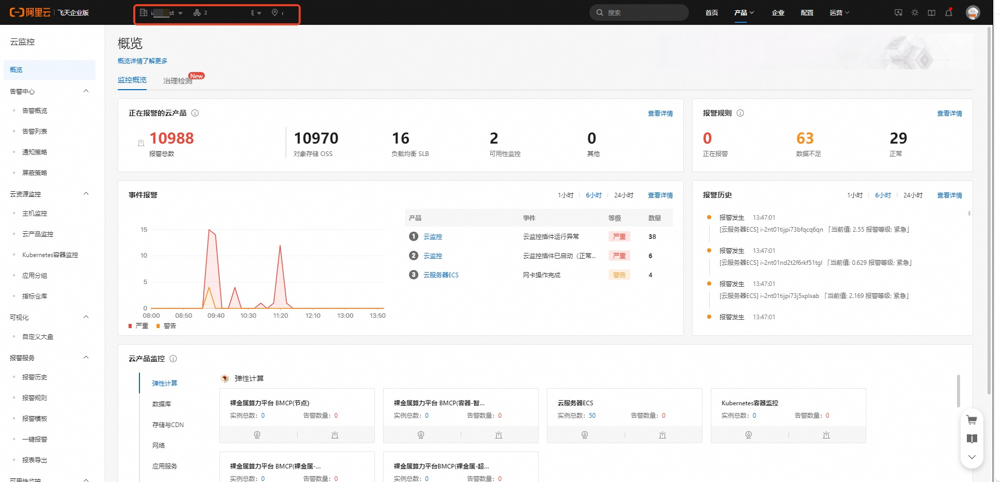

> **重要**
>
> - 云监控的业务数据支持分域，可在顶部菜单栏左侧按照组织、资源集和地域切换进行展示。
>
> - 请不要在Root组织下进行相关操作。

> **说明**
>
> 列表信息展示时：
>
> - 列表上方会显示  、  、  、  等按钮，您可根据实际需要调整列表展示。
>
>    ：表示刷新列表。
>
>    ：选择默认或紧凑展示列表信息。
>
>    ：设置显示或隐藏列表的展示项。鼠标悬浮在展示项上，单击展示项右侧的  ，还
>
>   可以调整展示项的显示顺序。
>
>    ：进入列表全屏模式。
>
> - 列表支持自定义拖拽列宽，您可以根据实际情况拖拽列宽进行展示。列宽配置存储在浏览器本地Storage中，清除Storage后会失效。

<a id="section-2"></a>

# 2.概览

**监控概览**

云监控概览信息可全面了解阿里云上的资源使用情况、业务的运行状况和健康度，并及时收到异常报警做出反应，保证应用程序顺畅运行。监控概览页面包含正在报警的云产品、报警规则、事件报警、报警历史、云产品监控5个模块。

1. 登录Apsara Uni-manager运营控制台。

2. 单击顶部菜单栏的**产品**，选择**迁移与运维管理** > **运维与监控** > **云监控**。

3. 在左侧导航栏，单击**概览**。

4. 在**概览**页面，单击**监控概览**页签，查看概览信息。

   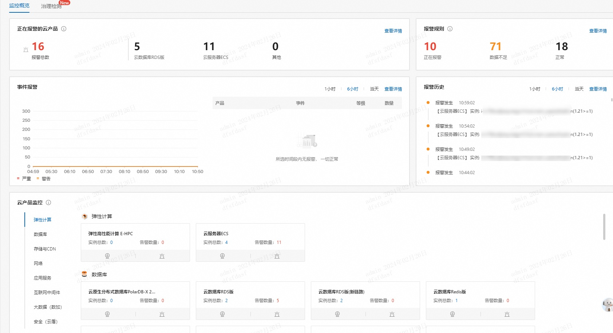

   <table>
     <tr>
       <th width="152">模块</th>
       <th>描述</th>
     </tr>
     <tr>
       <td>正在报警的云产品</td>
       <td>• 被云监控纳管并且开启了报警服务的云产品，在当前时间正在发生的报警数量。<br>• 单击<strong>查看详情</strong>可跳转至<strong>报警历史</strong>，查看报警明细。</td>
     </tr>
     <tr>
       <td>报警规则</td>
       <td>• 展示报警规则状态为<strong>正在报警</strong>、<strong>数据不足</strong>和<strong>正常</strong>的报警规则数量。<br>说明<strong>报警规则</strong>状态为<strong>数据不足</strong>可能的情况有：<br>• 云产品自身对该服务指标没有数据上报。<br>• 该云产品实例被删除 。<br>• 该云产品实例在SLS logstore中未创建或丢失，需要进一步排查等。<br>• 单击<strong>查看详情</strong>可跳转至<strong>报警规则</strong>，查看报警规则明细。</td>
     </tr>
     <tr>
       <td>事件报警</td>
       <td>• 事件报警提供各云产品系统事件运行状态，在业务故障时，便于快速分析并定位问题。<br>• 单击<strong>查看详情</strong>可跳转至<strong>系统事件</strong>，查看事件报警明细。</td>
     </tr>
     <tr>
       <td>报警历史</td>
       <td>• 支持云监控并且开启了报警服务的云产品，当前时间正在发生的报警明细数据。<br>• 单击<strong>查看详情</strong>跳转至<strong>报警历史</strong>，查看报警明细。</td>
     </tr>
     <tr>
       <td>云产品监控</td>
       <td>• 云监控自动获取当前账号下云产品资源的实例总数和告警数量。<br>• 单击云产品名称跳转至云产品监控，查看各实例的监控图表和报警规则。<br>• 单击可查看该云产品报警规则。<br>• 单击可查看该云产品监控信息。</td>
     </tr>
   </table>

**治理检测**

治理检测通过分析当前组织资源集的资源实例指标和报警规则，对指标有效性和报警有效性进行评估诊断，并提供一键修复和建议。

1. 在**概览**页面，单击**治理检测**页签，查看治理检测信息。

   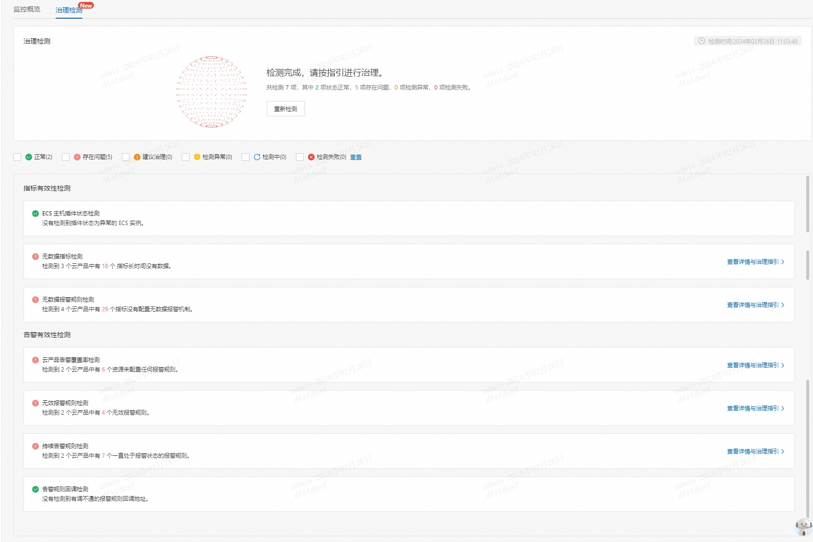

   <table>
     <tr>
       <th width="90">模块</th>
       <th>描述</th>
     </tr>
     <tr>
       <td>检测区域</td>
       <td>在治理检测区域，单击<strong>立即检测</strong>或<strong>重新检测</strong>。<br>说明<br>• 如果没有检测过，显示为<strong>立即检测</strong>。<br>• 如果检测过，显示为<strong>重新检测</strong>，并且展示最近一次的检测结果。</td>
     </tr>
     <tr>
       <td>检测详情</td>
       <td>当检测的结果存在问题时，可以单击检测项右侧的<strong>查看详情与治理指引</strong>，在<strong>检测详情</strong>面板，查看具体的检测机制、检测范围和需要治理的对象信息等。<br>• 指标有效性检测<br>• <strong>ECS主机插件状态检测</strong>：检测ECS所有实例的插件状态是否都时进行中。<br>• <strong>无数据报警规则检测</strong>：检测云产品所有指标是否在当前组资源集下有配置至少1个实例绑定无数据报警机制。<br>• <strong>无数据指标检测</strong>：检测云产品所有指标是都有数据输入，并且能够最终被用户查询。<br>• 告警有效性检测<br>• <strong>持续告警规则检测</strong>：检测最近24小时内，报警规则是否一直处于报警状态。<br>• <strong>告警规则回调检测</strong>：检测最近24小时内，报警规则回调地址是否有调用失败的情况。<br>• <strong>无效报警规则检测</strong>：检测云产品资源是否存在无效报警规则。<br>• <strong>云产品告警覆盖率检测</strong>：检测云产品资源是否存在未配置任何报警规则。<br>说明<br>• 如果某云产品有针对一级组织下所有的实例开启的一键报警，则默认当前云产品的所有实例均覆盖报警规则。<br>• 如果某云产品的报警规则是针对当前资源集（指定资源集）生效，则当前账号下指定资源集下的云产品的所有实例均覆盖报警规则。<br>• 如果一个资源实例中至少有一个指标存在报警规则，则认为该资源实例覆盖了报警规则。</td>
     </tr>
   </table>

<a id="section-3"></a>

# 3.告警中心

**应用价值**

- 提供统一的集中告警界面，可集中展示云产品的告警数据。

- 提供统一的外发策略，可针对云产品配置统一的告警外发策略。

**功能特性**

<table>
  <tr>
    <th width="90">特性</th>
    <th>特性描述</th>
  </tr>
  <tr>
    <td>告警概览</td>
    <td>告警信息的统计视图，识别问题的焦点内容。</td>
  </tr>
  <tr>
    <td>告警列表</td>
    <td>支持查看当前正在上报的告警和历史告警列表以及报警趋势。统计维度包含两个统计维度（正在告警（告警状态：待处理、处理中）列表、历史告警（告警状态：已关闭）列表）。</td>
  </tr>
  <tr>
    <td>通知策略</td>
    <td>针对已发生的告警进行过滤、合并、降噪，目的在于减少低优先级/不必要的告警通知干扰用户，有效解决告警泛滥、信息散乱的问题，帮助用户甄选高优先级和关注的告警。</td>
  </tr>
  <tr>
    <td>屏蔽策略</td>
    <td>对集成的告警按照一定的告警条件进行设置屏蔽，支持指定屏蔽时间段、指定多个告警对象、告警等级、告警来源、告警名称进行屏蔽。</td>
  </tr>
</table>

**告警源信息**

告警数据从以下告警源中获取。

- 应用监控（ARMS）

- 日志监控（SLS）

- 云产品监控实例（CMS）

- 大数据监控（Dataworks）

- 普罗米修斯（Prometheus）

<a id="section-3-1"></a>

## 3.1. 告警概览

提供标准的可视化视图，可快速识别有异常的云产品，点击云产品可跳转到对应的产品监控列表和详情页进行问题排查。

**操作步骤**

1. 登录Apsara Uni-manager运营控制台。

2. 单击顶部菜单栏的**产品**，选择**迁移与运维管理** > **运维与监控** > **云监控**。

3. 在左侧导航栏，选择**告警中心 > 告警概览。**

4. 当前页面包含以下七个部分，从不同角度分析和统计告警信息。

   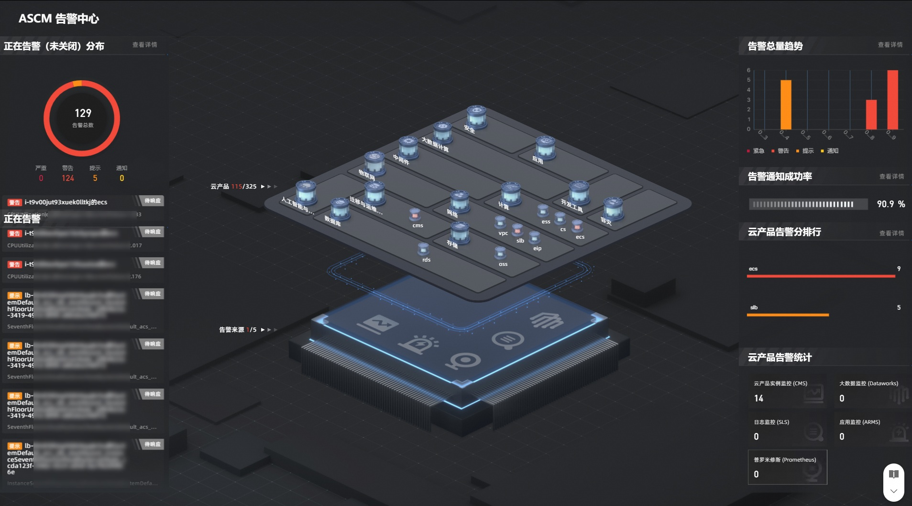

   - **正在告警（未关闭）分布**：提供当前组织资源集下正在告警且未被关闭的告警分布，根据告警等级分为严重、警告、提示、通知。单击**查看详情**，跳转至**告警列表**页面。

   - **正在告警**：提供当前组织资源集下正在告警的具体内容进行实时滚屏。单击**查看详情**，跳转至告警详情页面。

   - **告警总量趋势**：提供当前组织资源集下过去7天的告警总量趋势。

     - 每个柱面不同颜色的区域表示告警等级，对于每个色块，颜色越深代表告警等级越高。

     - 每个柱面的面积越大代表对应告警等级下的告警数量越多。

     - 单击**查看详情**，跳转至**告警列表**页面。

   - **告警通知成功率**：提供当前组织资源集下，配置了通知策略的通知成功率统计。单击**查看详情**，跳转至**通知策略**页面。

   - **云产品告警分布排行**：提供当前组织资源集下所有云产品的告警排行TOP。单击**查看详情**，跳转至**告警列表**页面。

   - **云产品告警统计**：提供当前组织资源集下不同的告警源的告警数量分布。单击云产品名称，跳转至**告警列表**页面。

   - 中间区域：鼠标单击云产品图标，展示云产品的告警状态、告警来源以及异常实例。单击**查看详情**，跳转至云产品实例列表页面。

**后续操作**

按照需求获取告警概览信息后，可通过告警列表进一步查看告警的信息。

<a id="section-3-2"></a>

## 3.2. 告警列表

支持查看当前正在上报的告警和历史告警列表以及报警趋势。统计维度包含两个统计维度（正在告警（告警状态：待处理、处理中）列表、历史告警（告警状态：已关闭）列表）。

**操作步骤**

1. 登录Apsara Uni-manager运营控制台。

2. 单击顶部菜单栏的**产品**，选择**迁移与运维管理** > **运维与监控** > **云监控**。

3. 在左侧导航栏，选择**告警中心 > 告警列表。**

4. 在**告警列表**页面，可查看**正在告警**和**历史告警**。默认进入**正在告警**页签，单击**历史告警**可切换到**历史告警**页签。

   - 在页面上方，可通过设置**告警ID**、**告警名称**、**告警等级**、**告警来源**、**告警对象**、**归属产品**、**告警内容**以及时间范围来快速筛选告警。

     

   - 在**报警趋势**区域，按照时间进行划分统计告警数量。

     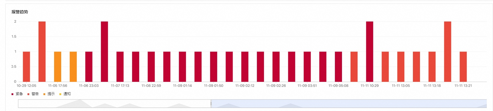

     - 每个柱面不同颜色的区域表示告警等级，对于每个色块，颜色越深代表告警等级越高。

     - 每个柱面的面积越大代表对应告警等级下的告警数量越多。

     - 将鼠标悬停在柱面上时，系统会显示当天每个告警等级对应的数量统计。

   - 在告警列表区域，可查看**告警项ID/告警名称**、**组织**、**告警等级**、**告警对象/归属产品**、**告警内容**、**告警状态**、**处理状态**、**告警来源**、**告警次数**、**告警开始时间**、**最近告警时间**以及<strong>持续时间（秒）</strong>等<strong>。</strong>

     

     - 单击目标告警的**告警项ID/告警名称**进入告警详情页面，获取告警的详细信息。

       - 在页面右上角单击**处理**或**关闭**，可以修改当前的告警状态。

       - 在页面右上角单击**一键诊断**，飞天助理可对当前告警进行一键诊断分析，并展示详细的总结信息。

       - 在基本信息区域查看告警基本信息。

         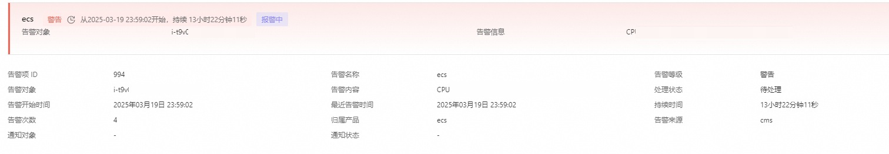

       - 在**拓展属性**区域查看告警的拓展信息。

         > **说明**
         >
         > 不同告警展示的拓展属性不同，以实际界面展示为准。

       - 在**时间线**区域，可设置**告警发生**、**告警定位**、**根因定位**和**告警关闭**的时间和描述信息。

         单击**新增**，在**新增时间线**面板，设置**选择节点**、**时间**和**描述**。

         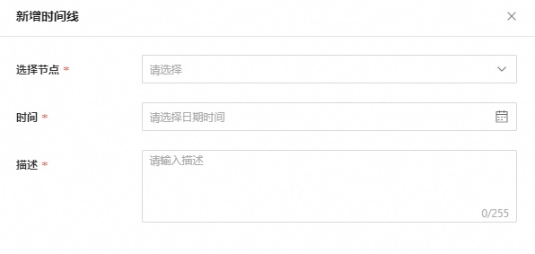

       - 在**告警分析**区域，可查看详细的监控指标及告警链路图。

         

         单击**监控图表**，用户可自定义时间，查看监控指标趋势图。

         > **说明**
         >
         > 非CMS的告警，不展示告警分析。

       - 在**告警反馈**区域查看**告警有效性**和**告警准确性**。

         > **说明**
         >
         > 关闭告警时可反馈告警有效性和准确性。

         

     - 当告警清除完成后，系统按照告警规则定期同步告警状态。如果告警清除后，系统未及时更新告警状态，您可以手动变更告警状态，将告警状态置为**处理中**或**关闭**状态。

       - 置为**处理中**：

         - 单个告警：在告警列表中，单击目标告警**操作**列的**处理**，系统会将目标告警的**处理状态**修改为**处理中**。

         - 多个告警：选中目标告警，在页面左下方，单击**批量处理**，系统会将目标告警的**处理状态**修改为**处理中**。

       - 置为**已关闭**：

         - 单个告警：在**告警列表**页面中，单击目标告警**操作**列的**关闭**，系统会将目标告警的**处理状态**修改为**已关闭**。修改完成后会在**历史告警**页签下的告警列表中显示关闭的告警。

         - 多个告警：选中目标告警，在页面左下方，单击**批量关闭** ，系统会将目标告警的**处理状态**修改为**已关闭**。修改完成后会在**历史告警**页签下的告警列表中显示关闭的告警。

<a id="section-3-3"></a>

## 3.3. 告警规则

云监控告警中心集成了 ARMS、SLS以及 Prometheus 告警规则能力，如果未部署相关产品，则无法使用对应告警规则。

**ARMS**

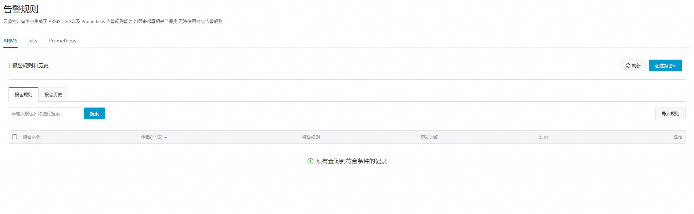

ARMS报警规则和历史相关操作，请参见<strong>《应用实时监控服务ARMS》</strong>>**《用户指南》**>**《报警》**>**《创建报警》**。

**SLS**

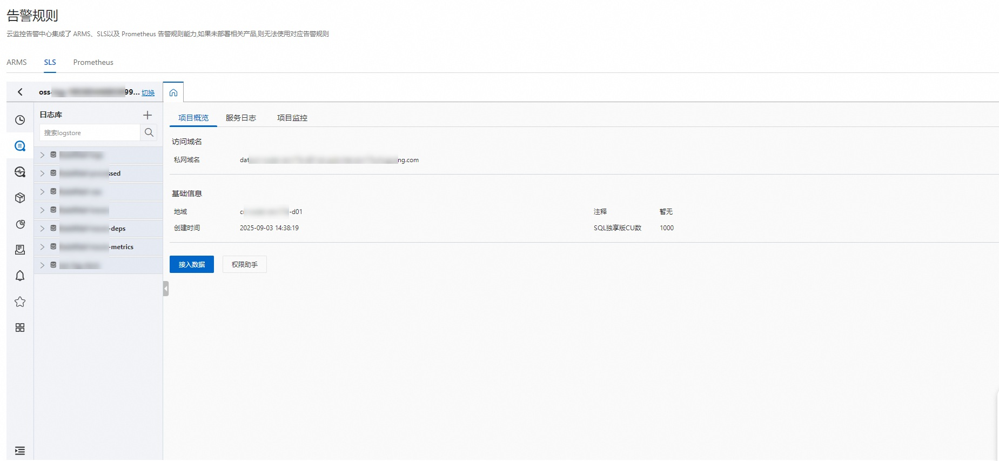

SLS相关操作，请参见<strong>《日志服务》</strong>>**《用户指南》**。

**Prometheus**

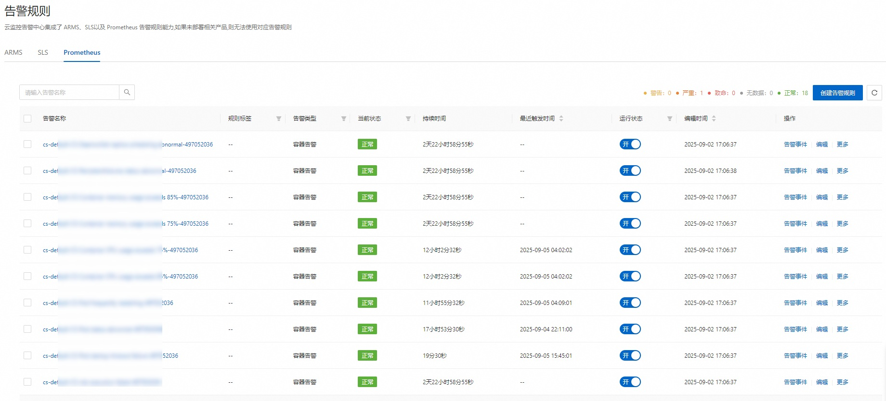

Prometheus报警规则和历史相关操作，请参见<strong>《日志服务》</strong>>**《用户指南》**>**《报警管理》**>**《创建报警》**。

<a id="section-3-4"></a>

## 3.4. 通知策略

针对已发生的告警进行过滤、合并、降噪，目的是减少低优先级/不必要的告警通知干扰用户，有效解决告警泛滥、信息散乱的问题，帮助用户甄选高优先级和关注的告警。

**创建通知策略**

**操作步骤**

1. 登录Apsara Uni-manager运营控制台。

2. 单击顶部菜单栏的**产品**，选择**迁移与运维管理** > **运维与监控** > **云监控**。

3. 在左侧导航栏，选择**告警中心 > 通知策略。**

4. 在**通知策略**页面，单击**创建通知策略**。

5. 在**创建通知策略**面板中，根据实际需要设置相应配置项。

   **分类**

   **参数**

   **说明**

   输入通知策略的名称。

   **名称**

   **基本信息**

   输入通知策略的描述信息。

   **描述**

   选择通知策略的告警来源，可多选。

   **告警来源**

   单击**添加告警名称**，在输入框输入通知策略的告警名称。

   **告警名称**

   > **说明**
   >
   > 支持添加多个告警名称。

   选择通知策略的告警等级。取值：**紧急**、**警告**、**提示**、**通知**。

   **告警等级**

   **订阅条件**

   单击**添加告警对象**，在输入框输入通知策略的告警对象。

   **告警对象**

   > **说明**
   >
   > 支持添加多个告警对象。

   单击**添加告警内容**，在输入框输入通知策略的告警内容。

   **告警内容**

   > **说明**
   >
   > 支持添加多个告警内容。

   选择通知策略的抑制条件。取值：**条件触发**、**直接触发，触发后抑制通知**、**直接触发不抑制**、**直接触发，下次状态不等于恢复则**

   **抑制条件**

   **抑制**。

   **抑制策略**

   > **说明**
   >
   > 当**抑制条件**选择**条件触发**或**直接触发，触发后抑制通知**时，需设置此参数。

   **抑制条件描述**

   设置抑制条件描述。

   单击**添加策略生效时间**，选择时间范围，告警仅在时间范围内通知。

   > **说明**
   >
   > 支持选择多个时间段。

   **策略周期**

   **策略生效时间**

   > **重要**
   >
   > 当选择多个策略生效周期时，请尽量避免重叠的时间段，避免重复通知。

   选择告警的通知联系人。

   **通知人/组**

   > **说明**
   >
   > 支持添加多个联系人。

   配置Webhook。单击**添加Webhook**，设置**Url**、**Method**、**自定义Header**、**RequestParams**、**ContentType**以及**bodyParamJson**等。

   - **Url**：输入Webhook对应的Url，必须使用域名（以http或https开头），不能使用IP。

   - **Method**：选择请求方式，**GET**或**POST**。

   - **自定义Header**：单击**添加自定义Header**，设置键值对信息。

     > **说明**
     >
     > 支持设置多个自定义Header。

   **通知方式**

   - **RequestParams**：单击**添加RequestParam**，设置键值对信息。

     > **说明**
     >
     > 支持设置多个RequestParam。

   **Webhook**

   - **ContentType**：选择请求中传输的内容类型和字符编码。

     > **说明**
     >
     > 当Method选择POST时，需要设置此参数。

     - **application/json**：表示发送的请求数据的格式必须为json字符串。

       **bodyParamJson**：输入json格式的请求内容。

     - **application/x-www-form-urlencoded**：表示发送的请求内容为表单提交。

       **bodyParams**：单击**添加BodyParams**，设置发送的请求的键值对信息。

       > **说明**
       >
       > 支持设置多个bodyParams。

   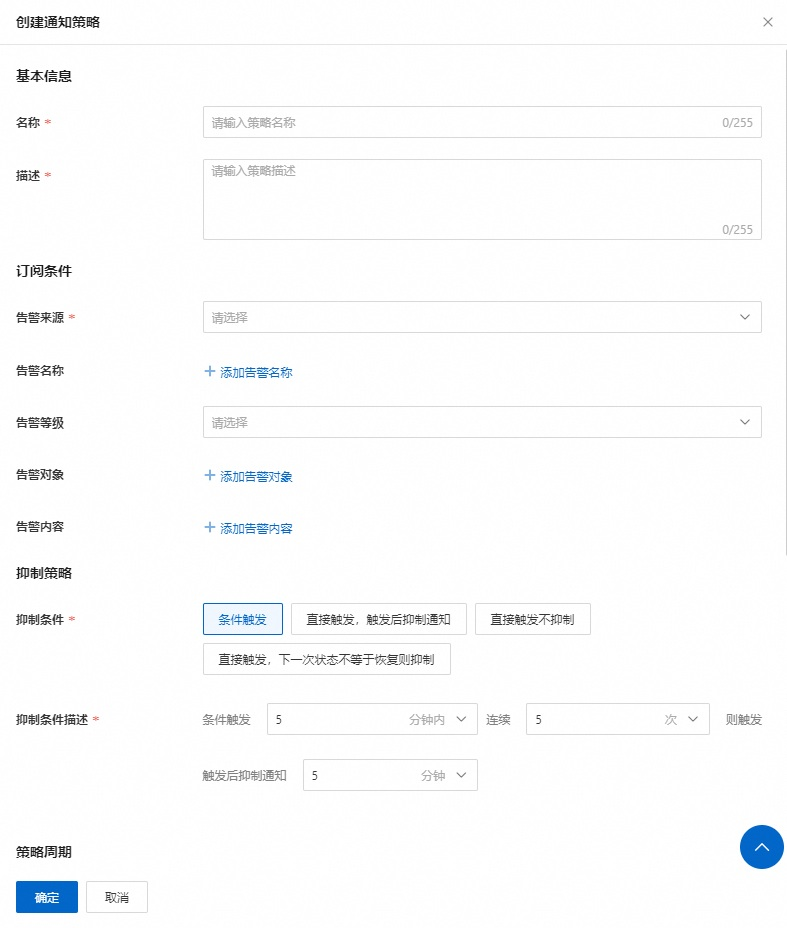

6. 单击**确定**。

**查看通知策略**

**操作步骤**

通知策略创建成功后，可以查看通知策略的详细信息。

在**通知策略**页面的列表，查看通知策略的**策略名称**、**策略描述**、**策略状态**、**通知规则**、**抑制条件**、**生效时间段**、**通知记录**、**通知对象**和**Webhook配置**等。

> **说明**
>
> - 通过通知策略列表上方的下拉列表或搜索框设置，可以快速查找通知策略。
>
> - 单击策略状态右侧的  ，可通过筛选策略状态快速查找通知策略。
>
> - 鼠标悬停**通知规则**、**生效时间段**或**通知对象**列的数字上，可查看详细信息。
>
> - 单击**通知记录**列的  图标，在弹出的面板可查看最近3天通知记录，包括**告警项ID/告警名**
>
>   **称**、**告警等级**、**告警对象/归属产品**、**告警内容**、**处理状态**、**告警开始时间**、**最近告警时间**以及**发送时间**等。
>
>   单击右上角的**查看更多**，跳转至**消息中心 > 未读消息**页面。


**修改通知策略**

**操作步骤**

当已有通知策略信息需要变更时，可以根据需要进行修改。

1. 在**通知策略**页面的列表中，单击目标策略操作列的**编辑**。

2. 在**编辑通知策略**面板，根据业务需要进行参数配置修改。具体参数配置说明可参见创建通知策略。

**禁用通知策略**

**操作步骤**

当暂时不需要通知策略时，可以停用对应的通知策略。

> **重要**
>
> 停用通知策略前，请确保**策略状态**为**启用中**。

- 单个禁用

  <ol type="i">

  <li>

  在**通知策略**页面的列表中，单击目标通知策略操作列的**禁用**。

  </li>

  <li>

  单击**确定**。

  </li>

  </ol>

- 批量禁用

  <ol type="i">

  <li>

  在**通知策略**页面的列表中，勾选目标通知策略前的复选框。

  </li>

  <li>

  单击列表下方的**批量禁用**。

  </li>

  <li>

  单击**确定**。

  </li>

  </ol>

**启用通知策略**

**操作步骤**

当需要继续使用通知策略时，可以重启通知策略。

> **重要**
>
> 启用通知策略前，请确保**策略状态**为**已禁用**。

- 单个启用

  <ol type="i">

  <li>

  在**通知策略**页面的列表中，单击目标通知策略操作列的**启用**。

  </li>

  <li>

  单击**确定**。

  </li>

  </ol>

- 批量启用

  <ol type="i">

  <li>

  在**通知策略**页面的列表中，勾选目标通知策略前的复选框。

  </li>

  <li>

  单击列表下方的**批量启用**。

  </li>

  <li>

  单击**确定**。

  </li>

  </ol>

**删除通知策略**

**操作步骤**

当不再需要通知策略时，可以将其删除。

- 单个删除

  <ol type="i">

  <li>

  在**通知策略**页面的列表中，单击目标通知策略操作列的**删除**。

  </li>

  <li>

  单击**确定**。

  </li>

  </ol>

- 批量删除

  <ol type="i">

  <li>

  在**通知策略**页面的列表中，勾选目标通知策略前的复选框。

  </li>

  <li>

  单击列表下方的**批量删除**。

  </li>

  <li>

  单击**确定**。

  </li>

  </ol>

<a id="section-3-5"></a>

## 3.5. 屏蔽策略

允许对告警进行设定屏蔽策略（临时或永久），屏蔽的告警不再接入到系统。

**创建屏蔽策略**

**操作步骤**

1. 登录Apsara Uni-manager运营控制台。

2. 单击顶部菜单栏的**产品**，选择**迁移与运维管理** > **运维与监控** > **云监控**。

3. 在左侧导航栏，选择**告警中心 > 屏蔽策略。**

4. 在**屏蔽策略**页面，单击**创建屏蔽策略**。

5. 在**创建屏蔽策略**面板中，根据实际需要设置相应配置项。

   **分类**

   **参数**

   **说明**

   输入屏蔽策略的名称。

   **名称**

   **基本信息**

   输入屏蔽策略的描述信息。

   **描述**

   <table>
     <tr>
       <td rowspan="5">屏蔽条件</td>
       <td>告警来源</td>
       <td>选择需要屏蔽的告警来源。</td>
     </tr>
     <tr>
       <td>告警名称</td>
       <td>单击<strong>添加告警名称</strong>，在输入框输入需要屏蔽的告警名称。<br>说明支持添加多个告警名称。</td>
     </tr>
     <tr>
       <td>告警等级</td>
       <td>选择需要屏蔽的告警等级。取值：<strong>紧急</strong>、<strong>警告</strong>、<strong>提示</strong>、<strong>通知</strong>。</td>
     </tr>
     <tr>
       <td>告警对象</td>
       <td>单击<strong>添加告警对象</strong>，在输入框输入需要屏蔽的告警对象。<br>说明支持添加多个告警对象。</td>
     </tr>
     <tr>
       <td>告警内容</td>
       <td>单击<strong>添加告警内容</strong>，在输入框输入需要屏蔽的告警内容。<br>说明支持添加多个告警内容。</td>
     </tr>
     <tr>
       <td rowspan="2">屏蔽设置</td>
       <td>屏蔽条件</td>
       <td>选择屏蔽条件，<strong>自定义时间</strong>或<strong>所有</strong><strong>时间，直接屏蔽</strong>。</td>
     </tr>
     <tr>
       <td>策略屏蔽时间</td>
       <td>说明仅当<strong>屏蔽条件</strong>选择<strong>自定义时</strong><strong>间</strong>时，设置此配置项。<br>单击<strong>添加策略屏蔽时间</strong>，设置时间范围，告警仅在时间范围内被屏蔽。<br>重要当选择多个屏蔽策略时间时，请尽量避免重叠的时间段，避免重复。</td>
     </tr>
   </table>

   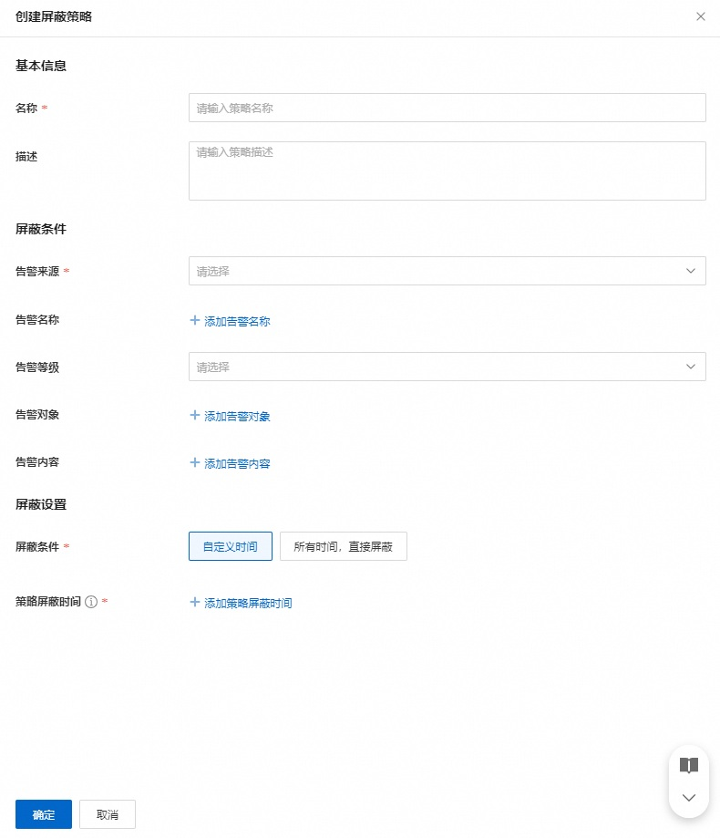

6. 单击**确定**。

**查看屏蔽策略**

**操作步骤**

告警的屏蔽策略创建成功后，可以查看屏蔽策略的详细信息。

在**屏蔽策略**页面的列表，查看屏蔽策略的**策略名称**、**策略描述**、**策略状态**、**屏蔽规则**和**屏蔽时间段**等。

> **说明**
>
> - 通过屏蔽策略列表上方的下拉列表或搜索框设置，可以快速查找屏蔽策略。
>
> - 单击策略状态右侧的  ，可通过筛选策略状态快速查找屏蔽策略。
>
> - 鼠标悬停在**屏蔽规则**和**屏蔽时间段**列的数字上，可查看详细信息。

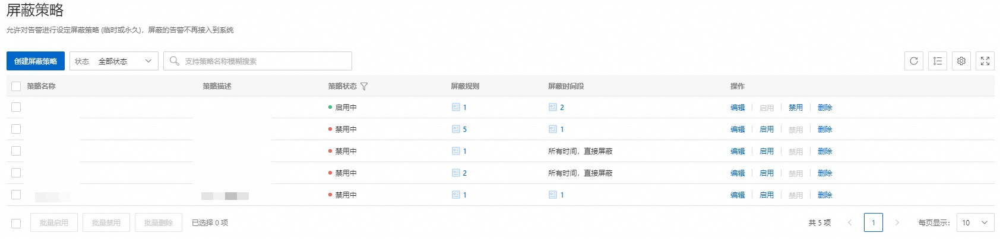

**修改屏蔽策略**

**操作步骤**

当已有屏蔽策略信息需要变更时，可以根据需要进行修改。

1. 在**屏蔽策略**页面的列表中，单击目标策略操作列的**编辑**。

2. 在**编辑**面板，根据业务需要进行参数配置修改。具体参数配置说明可参见创建屏蔽策略。

**禁用屏蔽策略**

**操作步骤**

当暂时不需要屏蔽告警时，可以停用对应的屏蔽策略。

> **重要**
>
> 停用屏蔽策略前，请确保**策略状态**为**启用中**。

- 单个禁用

  <ol type="i">

  <li>

  在**屏蔽策略**页面的列表中，单击目标屏蔽策略操作列的**禁用**。

  </li>

  <li>

  单击**确定**。

  </li>

  </ol>

- 批量禁用

  <ol type="i">

  <li>

  在**屏蔽策略**页面的列表中，勾选目标屏蔽策略前的复选框。

  </li>

  <li>

  单击列表下方的**批量禁用**。

  </li>

  <li>

  单击**确定**。

  </li>

  </ol>

**启用屏蔽策略**

**操作步骤**

当需要继续屏蔽告警时，可以重启告警的屏蔽策略。

> **重要**
>
> 启用屏蔽策略前，请确保**策略状态**为**禁用中**。

- 单个启用

  <ol type="i">

  <li>

  在**屏蔽策略**页面的列表中，单击目标屏蔽策略操作列的**启用**。

  </li>

  <li>

  单击**确定**。

  </li>

  </ol>

- 批量启用

  <ol type="i">

  <li>

  在**屏蔽策略**页面的列表中，勾选目标屏蔽策略前的复选框。

  </li>

  <li>

  单击列表下方的**批量启用**。

  </li>

  <li>

  单击**确定**。

  </li>

  </ol>

**删除屏蔽策略**

**操作步骤**

当不再需要屏蔽告警时，可以将其删除。

- 单个删除

  <ol type="i">

  <li>

  在**屏蔽策略**页面的列表中，单击目标屏蔽策略操作列的**删除**。

  </li>

  <li>

  单击**确定**。

  </li>

  </ol>

- 批量删除

  <ol type="i">

  <li>

  在**屏蔽策略**页面的列表中，勾选目标屏蔽策略前的复选框。

  </li>

  <li>

  单击列表下方的**批量删除**。

  </li>

  <li>

  单击**确定**。

  </li>

  </ol>

<a id="section-4"></a>

# 4.云资源监控

<a id="section-4-1"></a>

## 4.1. 主机监控

云监控通过安装在云服务器ECS上的云监控插件，采集丰富的操作系统层面的监控项。支持对监控项设置报警规则，降低监控成本。

- **便捷的插件安装**：云监控通过安装在主机上的云监控插件，采集丰富的操作系统层面的监控项。

- **丰富的监控项**：操作系统监控、GPU监控、基础的网络流入流出、磁盘读写、进程监控、云盘及AVS网络监控等监控项。

- **业务级进程监控**：采集当前活跃进程的CPU使用率、内存使用率和打开文件数，帮助用户了解主机的资源分配情况。

- **灵活的报警服务**：支持对主机跨地域分组管理，通过设置分组维度的报警规则，极大地降低监控管理成本。

<a id="section-4-1-1"></a>

### 4.1.1. 安装插件

云监控通过在云服务器ECS上安装插件，来采集ECS操作系统的监控指标数据。

**批量安装或升级插件**

1. 登录Apsara Uni-manager运营控制台。

2. 单击顶部菜单栏的**产品**，选择**迁移与运维管理** > **运维与监控** > **云监控**。

3. 在左侧导航栏，选择**云资源监控 > 主机监控**。

4. 在**主机监控**页面，选中待安装或升级插件的ECS，单击列表左下角的**批量安装或升级插件**。

   > **说明**
   >
   > 目前云监控仅支持为**Linux**和**Windows**操作系统的ECS安装插件。

5. 单击**确定**。

   > **说明**
   >
   > 安装或升级插件大约需要5分钟。当**插件状态**由**安装中**变为**运行中**时，表示插件安装或升级成功。

**全局安装/升级Agent**

> **说明**
>
> 该操作为批量操作，每30分钟可以执行一次。

1. 在**主机监控**页面，单击列表上方的**安装/升级Agent**。

2. 在**安装/升级Agent**对话框中，选择要操作的类型包括**只对没有安装的进行安装**、**只对安装过的进行升级**或**安装并升级到最新版**。

   > **说明**
   >
   > - **只对没有安装的进行安装**：对于已经创建的 ECS 实例，只对没有安装 Agent 插件的实例的进行安装。
   >
   > - **只对安装过的进行升级**：对于已经创建的 ECS 实例，只对安装过 Agent 插件的实例的进行升级。
   >
   > - **安装并升级到最新版**：对于已经创建的 ECS 实例，安装并升级到最新版 Agent。

3. 单击**立即执行**。

**单个Agent安装**

1. 单击目标实例插件状态列的  。

2. 在弹出的Agent安装确认对话框中，单击**确定**。

   > **说明**
   >
   > 若插件安装失败，单击插件状态列的
   >
   > ，可查看插件安装失败检测信息，包含**最近一次安装失败原**
   >
   > 
   >
   > **因**、**安装历史详情**、**安装状态**和**安装插件输出**。

<a id="section-4-1-2"></a>

### 4.1.2. 进程监控

进程监控默认为您采集云服务器ECS最近一段时间内活跃进程的CPU使用率、内存使用率和文件打开数。如果添加了进程关键字，还可以采集包含关键字的进程个数。

**前提条件**

已为云服务器ECS安装云监控插件。具体操作，请参见安装插件。

**背景信息**

云监控系统以15秒为间隔轮询采集进程数据，记录这些进程的进程名称、进程ID、用户、CPU使用率、内存使用率、打开文件数和时间。

- 进程的CPU使用率与内存使用率。可以参考Linux中的**top**命令理解这两个监控项的含义。

- 进程的打开文件数。可以参考Linux中的**lsof**命令理解这个监控项的含义。

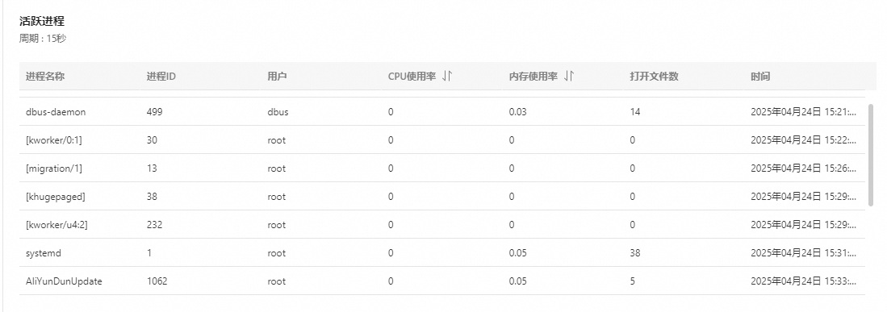

**添加或删除系统进程关键字**

通过监控云服务器ECS的进程数，采集关键进程的数量，及时获取关键进程的存活状态。

**操作步骤**

1. 登录Apsara Uni-manager运营控制台。

2. 单击顶部菜单栏的**产品**，选择**迁移与运维管理** > **运维与监控** > **云监控**。

3. 在左侧导航栏，选择**云资源监控 > 主机监控**。

4. 在**主机监控**页面，单击目标云服务器ECS实例名称。

5. 单击**进程监控**页签，在**进程数**区域，单击右上角的**添加进程**。

   - **添加系统进程关键字**：在**添加进程**面板，输入进程名称，单击**添加进程**。

   - **删除系统进程关键字**：在**添加进程**面板，单击目标进程名称**操作**列的**删除进程**。

**添加系统进程关键字操作示例**

假设云服务器ECS运行了如下进程：

```text
 /usr/bin/java -Xmx2300m -Xms2300m org.apache.catalina.startup.Bootstrap 

 /usr/bin/ruby 

 nginx -c /etc/nginx/nginx.conf 
```

当添加了6个进程关键字后，采集结果如下：

- 进程关键字为**ruby**，采集进程数为1，命中进程名称。

- 进程关键字为**nginx**，采集进程数为1，命中进程名称与参数。

- 进程关键字为<strong>/usr/bin</strong>，采集进程数为2，命中路径（2个进程包含该路径）。

- 进程关键字为**apache.catalina**，采集进程数为1，命中部分参数。

- 进程关键字为**nginx.conf**，采集进程数为1，命中部分参数。

- 进程关键字为<strong>-c</strong>，采集进程数为1，命中部分参数。

**为进程监控设置报警规则**

在添加进程监控后，再为该进程设置报警规则，当进程数发生变化时，报警通知对象可以收到报警通知。

**操作步骤**

1. 在左侧导航栏，选择**云资源监控 > 主机监控**。

2. 单击**创建报警规则**。

3. 在**创建报警规则**面板，单击**创建报警规则**，**监控指标**选择**进程**中的<strong>（Agent）process.count_processname</strong>，根据所需设置报警规则的其他参数。

   如果云服务器ECS上设置了多个进程，且每个进程数不同，可以单击**创建报警规则**，为多个进程设置报警规则。关于如何设置报警规则中的相关参数，请参见创建报警规则。

4. 单击**确定**。

<a id="section-4-2"></a>

## 4.2. 云产品监控

云监控自动获取当账号下云产品的资源。可以通过查看各云产品的监控图表，了解资源的运行状况；也可以通过设置报警规则，监控资源的运行状况。当符合报警规则时，云监控将自动发送报警通知，便于及时获悉资源的运行状况。

云监控支持以下云产品的监控：

> **说明**
>
> 各云产品监控项详情，参见云监控指标说明。

<table>
  <tr>
    <th width="170">云产品类型</th>
    <th>云产品名称</th>
  </tr>
  <tr>
    <td>弹性计算</td>
    <td>• Kubernetes容器监控<br>• 云服务器ECS<br>• 裸金属算力平台BMCP（节点）<br>• 裸金属算力平台BMCP（裸金属&amp;容器）<br>• 裸金属算力平台BMCP（裸金属-超算算力集群）</td>
  </tr>
  <tr>
    <td>数据库</td>
    <td>• 云数据库RDS<br>• 云数据库RDS（新链路）<br>• 云数据库Redis<br>• 云数据库Redis版（新链路）<br>• 云原生分布式数据库PolarDB-X 2.0<br>• 云原生数据仓库AnalyticDB PostgreSQL<br>• 云原生数据仓库AnalyticDB PostgreSQL（新链路）<br>• 云数据库MongoDB<br>• 云数据库MongoDB版（新链路）<br>• 数据传输服务DTS<br>• 云原生多模数据库Lindorm</td>
  </tr>
  <tr>
    <td>存储与CDN</td>
    <td>• 文件存储NAS<br>• 对象存储OSS</td>
  </tr>
  <tr>
    <td>网络</td>
    <td>• NAT网关<br>• 负载均衡SLB<br>• VPN网关<br>• 弹性公网IP<br>• 域名解析DNS</td>
  </tr>
  <tr>
    <td>互联网中间件</td>
    <td>• 消息队列MQ<br>• 消息队列Kafka</td>
  </tr>
  <tr>
    <td>大数据（数加）</td>
    <td>• 数据总线DataHub<br>• 大数据计算MaxCompute<br>• 大数据计算MaxCompute（配额组）</td>
  </tr>
  <tr>
    <td>安全（云盾）</td>
    <td>• 租户侧堡垒机<br>• 漏扫引擎</td>
  </tr>
  <tr>
    <td>人工智能与机器学习</td>
    <td>• AI Studio（在线服务）<br>• AI Studio（模型评测）<br>• AI Studio（Notebook建模）<br>• AI Studio（任务建模）</td>
  </tr>
</table>

<a id="section-4-2-1"></a>

### 4.2.1. 云监控指标说明

云监控中心通过云资源的监控指标，检测服务的可用性。通过对这些监控指标设置告警规则和通知策略，用户可及时了解各产品服务的实例资源运行状况和性能。

<a id="section-4-2-1-1"></a>

#### 4.2.1.1. 弹性计算

<a id="section-4-2-1-1-1"></a>

##### 4.2.1.1.1. Kubernetes容器监控

本文介绍Kubernetes容器监控的监控指标。

**集群**

**Namespace**的取值为**acs_k8s**；**Period**的取值默认为**60**秒，也可以为60的整数倍。

| 监控项 | 单位 | MetricName | Dimensions | 描述 |
| --- | --- | --- | --- | --- |
| CPU资源限制 | core | cluster.cpu.limit | user_id、cluster_name | 一个容器被允许使用的最大CPU资源量。 |
| CPU资源请求 | core | cluster.cpu.reque st | user_id、cluster_name | 容器在调度时所请求的最小CPU资源量。 |
| CPU使用率 | core | cluster.cpu.usage _rate | user_id、cluster_name | CPU使用率。 |
| 集群维度的CPU使用率 | % | cluster.cpu.utiliza tion | user_id、cluster_name | 集群维度的CPU使用率。 |
| 集群文件系统可用大小 | Byte | cluster.filesystem.available | user_id、cluster_name | 集群文件系统可用大小。 |
| 集群文件系统上限 | Byte | cluster.filesystem.limit | user_id、cluster_name | 集群文件系统上限。 |
| 集群内存限制 | Byte | cluster.memory.li mit | user_id、cluster_name | 集群内存限制。 |
| 集群内存请求 | Byte | cluster.memory.r equest | user_id、cluster_name | 集群内存请求。 |
| 集群维度的内存使用率 | % | cluster.memory.u tilization | user_id、cluster_name | 集群维度的内存使用率。 |

**node**

**Namespace**的取值为**acs_k8s**；**Period**的取值默认为**60**秒，也可以为60的整数倍。

| 监控项 | 单位 | MetricName | Dimensions | 描述 |
| --- | --- | --- | --- | --- |
| node.cpu.alloca table | core | node.cpu.allocata ble | userId、cluster、node | node.cpu.allocatable |
| node.cpu.capaci ty | core | node.cpu.capacit y | userId、cluster、node | node.cpu.capacity |
| node.cpu.limit | core | node.cpu.limit | userId、cluster、node | node.cpu.limit |
| node.cpu.overs ale_rate | % | node.cpu.oversal e_rate | userId、cluster、node | node_CPU资源超卖率 |
| node.cpu.reque st | core | node.cpu.request | userId、cluster、node | node.cpu.request |
| node.cpu.reserv ation | core | node.cpu.reserva tion | userId、cluster、node | node.cpu.reservation |
| node.cpu.usage _rate | core | node.cpu.usage_r ate | userId、cluster、node | node.cpu.usage_rate |
| node.cpu.utiliza tion | % | node.cpu.utilizati on | userId、cluster、node | node.cpu.utilization |
| node.filesystem.available | counts | node.filesystem.a vailable | userId、cluster、node | node.filesystem.available |
| node.filesystem.limit | counts | node.filesystem.li mit | userId、cluster、node | node.filesystem.limit |
| node.filesystem.usage | counts | node.filesystem.u sage | userId、cluster、node | node.filesystem.usage |
| node.memory.al locatable | GIB | node.memory.all ocatable | userId、cluster、node | node.memory.allocatable |
| node.memory.c apacity | counts | node.memory.ca pacity | userId、cluster、node | node.memory.capacity |
| node.memory.li mit | counts | node.memory.lim it | userId、cluster、node | node.memory.limit |
| node.memory.major_page_fau lts | counts | node.memory.ma jor_page_faults | userId、cluster、node | node.memory.major_page_faults |
| node.memory.major_page_fau lts_rate | counts | node.memory.ma jor_page_faults_r ate | userId、cluster、node | node.memory.major_page_faults_rate |
| node.memory.o versale_rate | % | node.memory.ov ersale_rate | userId、cluster、node | node_内存资源超卖率(usage/request) |
| node.memory.p age_faults | counts | node.memory.pa ge_faults | userId、cluster、node | node.memory.page_faults |
| node.memory.p age_faults_rate | counts | node.memory.pa ge_faults_rate | userId、cluster、node | node.memory.page_faults_rate |
| node.memory.r equest | counts | node.memory.req uest | userId、cluster、node | node.memory.request |
| node.memory.r eservation | counts | node.memory.res ervation | userId、cluster、node | node.memory.reservation |
| node.memory.rs s | counts | node.memory.rss | userId、cluster、node | node.memory.rss |
| node.memory.u sage | counts | node.memory.us age | userId、cluster、node | node.memory.usage |
| node.memory.u tilization | counts | node.memory.util ization | userId、cluster、node | node.memory.utilization |
| node.memory.w orking_set | counts | node.memory.wo rking_set | userId、cluster、node | node.memory.working_set |
| node.network.rx _errors | counts | node.network.rx_errors | userId、cluster、node | node.network.rx_errors |
| node.network.rx _errors_rate | % | node.network.rx_errors_rate | userId、cluster、node | node.network.rx_errors_rat e |
| node.network.rx _rate | （BYTE/S） | node.network.rx_rate | userId、cluster、node | node.network.rx_rate |
| node.network.tx _errors_rate | （BYTE/S） | node.network.tx_errors_rate | userId、cluster、node | node.network.tx_errors_rat e |
| node.network.tx _rate | （BYTE/S） | node.network.tx_rate | userId、cluster、node | node.network.tx_rate |

**pod**

**Namespace**的取值为**acs_k8s**；**Period**的取值默认为**60**秒，也可以为60的整数倍。

| 监控项 | 单位 | MetricName | Dimensions | 描述 |
| --- | --- | --- | --- | --- |
| 容器组工作内存使用量 | MIB | pod.memory.wor king_set | cluster、namespace、type、app、pod | 容器组工作内存使用量。 |
| 容器组CPU资源分配上限 | core | pod.cpu.limit | userId、cluster、namespace、type、app、pod | 容器组CPU资源分配上限。 |
| pod_CPU资源超卖率 | % | pod.cpu.oversale _rate | userId、cluster、namespace、type、app、pod | pod_CPU资源超卖率(usage/request)。 |
| 容器组CPU资源分配最小需求 | core | pod.cpu.request | userId、cluster、namespace、type、app、pod | 容器组CPU资源分配最小需求。 |
| 容器组CPU使用量 | core | pod.cpu.usage_ra te | userId、cluster、namespace、type、app、pod | 容器组CPU使用量。 |
| 容器组CPU使用率（usage/limit） | % | pod.cpu.utilizatio n | userId、cluster、namespace、type、app、pod | 容器组CPU使用率（usage/limit） 。 |
| 容器组文件系统可用大小 | GIB | pod.filesystem.av ailable | userId、cluster、namespace、type、app、pod | 容器组文件系统可用大小。 |
| 容器组文件系统上限 | GIB | pod.filesystem.li mit | userId、cluster、namespace、type、app、pod | 容器组文件系统上限 |
| 容器组文件系统上限 | GIB | pod.filesystem.li mit | userId、cluster、namespace、type、app、pod | 容器组文件系统上限。 |
| 容器组内存资源分配上限 | GIB | pod.memory.limit | userId、cluster、namespace、type、app、pod | 容器组内存资源分配上限。 |
| pod_内存资源超卖率（usage/request） | % | pod.memory.over sale_rate | userId、cluster、namespace、type、app、pod | pod_内存资源超卖率（usage/request）。 |
| 容器组内存资源分配最小需求 | MIB | pod.memory.req uest | userId、cluster、namespace、type、app、pod | 容器组内存资源分配最小需求。 |
| 容器组内存资源rss | MIB | pod.memory.rss | userId、cluster、namespace、type、app、pod | 容器组内存资源rss。 |
| 容器组内存使用率（working_set/li mit） | % | pod.memory.utili zation | userId、cluster、namespace、type、app、pod | 容器组内存使用率（working_set/limit）。 |
| pod.memory.wo rking_set | MIB | pod.memory.wor king_set | userId、cluster、namespace、type、app、pod | pod.memory.working_set |
| 容器组网络接收错误速率 | BYTE/S | pod.network.rx_e rrors_rate | userId、cluster、namespace、type、app、pod | 容器组网络接收错误速率。 |
| 容器组网络接收速率 | BYTE/S | pod.network.rx_r ate | userId、cluster、namespace、type、app、pod | 容器组网络接收速率。 |
| 容器组网络发送错误速率 | BYTE/S | pod.network.tx_e rrors_rate | userId、cluster、namespace、type、app、pod | 容器组网络发送错误速率。 |
| 容器组网络发送速率 | BYTE/S | pod.network.tx_r ate | userId、cluster、namespace、type、app、pod | 容器组网络发送速率。 |

**deployment**

| 监控项 | 单位 | MetricName | Dimensions | 描述 |
| --- | --- | --- | --- | --- |
| 部署应用CPU资源分配上限 | core | deployment.cpu.l imit | cluster、namespace、type、app | 部署应用CPU资源分配上限。 |
| 部署应用CPU使用量 | core | deployment.cpu.usage_rate | cluster、namespace、type、app | 部署应用CPU使用量。 |
| 部署应用文件系统可用大小 | BYTE | deployment.filesy stem.available | cluster、namespace、type、app | 部署应用文件系统可用大小。 |
| 部署应用文件系统上限 | BYTE | deployment.filesy stem.limit | cluster、namespace、type、app | 部署应用文件系统上限。 |
| 部署应用CPU资源分配最小需求 | core | deployment.cpu.r equest | cluster、namespace、type、app | 部署应用CPU资源分配最小需求。 |
| 部署应用内存资源分配最小需求 | BYTE | deployment.mem ory.request | cluster、namespace、type、app | 部署应用内存资源分配最小需求。 |
| 部署应用工作内存使用量 | BYTE | deployment.mem ory.working_set | cluster、namespace、type、app | 部署应用工作内存使用量。 |
| 部署应用网络发送速率 | (B/s) | deployment.netw ork.tx_rate | cluster、namespace、type、app | 部署应用网络发送速率。 |
| 部署应用网络接收速率 | (B/s) | deployment.netw ork.rx_rate | cluster、namespace、type、app | 部署应用网络接收速率<strong>。</strong> |
| 应用网络发送错误速率 | BYTE/S | deployment.netw ork.tx_errors_rate | cluster、namespace、type、app | 应用网络发送错误速率。 |

<a id="section-4-2-1-1-2"></a>

##### 4.2.1.1.2. 云服务器ECS

本文介绍云服务器ECS的监控指标。

**基础监控项**

**Namespace**的取值为**acs_ecs_dashboard**；**Period**的取值默认为**60**秒，也可以为60的整数倍。

> **说明**
>
> - 如果已接入公共云，可通过切换云平台，查看公共云云服务器ECS的监控指标。
>
> - 以下指标是通过宿主机（虚拟化）层采集，与操作系统内部采集的指标数据存在微小差异。

| 监控项 | 单位 | MetricName | Dimensions | 描述 |
| --- | --- | --- | --- | --- |
| （ECS）CPU使用率 | % | CPUUtilization | userId、instanceId | CPU使用率。 |
| （ECS）经典网络公网流入带宽 | BYTE/S | InternetInRate | userId、instanceId | 公网入流量速率。 |
| （ECS）内网流入带宽 | BYTE/S | IntranetInRate | userId、instanceId | 内网入流量速率。 |
| （ECS）经典网络公网流出带宽 | BYTE/S | InternetOutRate | userId、instanceId | 公网出流量速率。 |
| （ECS）内网流出带宽 | BYTE/S | IntranetOutRate | userId、instanceId | 内网出流量速率。 |
| （ECS）所有磁盘读取BPS | BYTE/S | DiskReadBPS | userId、instanceId | 所有磁盘读取每秒读取字节数。 |
| （ECS）所有磁盘写入BPS | BYTE/S | DiskWriteBPS | userId、instanceId | 所有磁盘读取每秒写入字节数。 |
| （ECS）所有磁盘每秒读取次数 | Count/s | DiskReadIOPS | userId、instanceId | 所有磁盘读取每秒读取次数。 |
| （ECS）所有磁盘每秒写入次数 | Count/s | DiskWriteIOPS | userId、instanceId | 所有磁盘读取每秒写入次数。 |

**操作系统级别监控项**

**Namespace**的取值为**acs_ecs_dashboard**；**Period**的取值默认为**15**秒，也可以为15的整数倍。

> **说明**
>
> ECS实例需要安装监控插件才能采集操作系统级别的指标数据。
>
> 安装方法：在云监控控制台左侧导航栏中单击主机监控，在**ECS监控列表**页面中，选择待监控的实例，单击监控列表最下方的**批量安装或升级插件**。
>
> 安装监控插件成功5～10分钟后，监控图表才会显示监控数据。

| 监控项 | 单位 | MetricName | Dimensions | 描述 |
| --- | --- | --- | --- | --- |
| （Agent）Host.cp u_totalCPU使用率 | % | cpu_total | userId、instanceId | CPU使用率。 |
| （Agent）Host.m em.used.utilizatio n内存使用率 | % | memory_usedutil ization | userId、instanceId | 内存使用率。 |
| （Agent）Host.lo ad15系统负载 | 无 | load_15m | userId、instanceId | 过去15分钟的系统负载。<br>说明Windows操作系统没有此指标。 |
| （Agent）Host.lo ad1系统负载 | 无 | load_1m | userId、instanceId | 过去1分钟的系统负载。<br>说明Windows操作系统没有此指标。 |
| （Agent）Host.lo ad5系统负载 | 无 | load_5m | userId、instanceId | 过去5分钟的系统负载。<br>说明Windows操作系统没有此指标。 |
| （Agent）Host.di sk.utilization磁盘使用率 | % | diskusage_utiliza tion | userId、instanceId、device | 磁盘容量使用率。 |
| （Agent）Host.fs.inode使用率 | % | fs_inodeutilizatio n | userId、instanceId、device | inode使用率。<br>说明该指标仅支持Linux操作系统。 |
| （Agent）Host.di sk.readbytes读取字节数 | Byte/s | disk_readbytes | userId、instanceId、device | 磁盘每秒读取的字节数。 |
| （Agent）Host.di sk.readiops读取请求数 | Count/s | disk_readiops | userId、instanceId、device | 磁盘每秒的读请求数量。 |
| （Agent）Host.di sk.writebytes写入字节数 | Byte/s | disk_writebytes | userId、instanceId、device | 磁盘每秒写入的字节数。 |
| （Agent）Host.di sk.writeiops写入请求数 | Count/s | disk_writeiops | userId、instanceId、device | 磁盘每秒的写请求数量。 |
| （Agent）Host.tc pconnection tcp连接状态 | counts | net_tcpconnectio n | userId、instanceId、state | 系统TCP连接各状态数。 |
| （Agent）process.expend_pid活跃进程 | 无 | process.expend | userId、instanceId、name、pid | Top5进程详细统计指标。 |
| （Agent）process.count_processna me进程数 | counts | process.number | userId、instanceId、processName | 进程匹配数目。 |
| io饱和度 | % | disk_io_util | userId、instanceId、device | IO饱和度。 |
| 僵尸进程总数 | counts | zombieProcessNu mber | userId、instanceId | 僵尸进程总数。<br>说明Windows操作系统没有此指标。 |
| 进程总数 | counts | totalProcessNum ber | userId、instanceId | 进程总数。<br>说明Windows操作系统没有此指标。 |
| swap分区使用率 | % | swapUtilization | userId、instanceId | swap分区使用率。 |
| 网卡发送丢包率 | % | networkout_drop _ratio | userId、instanceId、device | 网卡发送丢包率。 |
| 网卡发送错误率 | % | networkout_error _ratio | userId、instanceId、device | 网卡发送错误率。 |
| 网卡接收丢包率 | % | networkin_drop_r atio | userId、instanceId、device | 网卡接收丢包率。 |
| 网卡接收错误率 | % | networkin_error_r atio | userId、instanceId、device | 网卡接收错误率。 |

**GPU监控**

**GPU监控新旧指标映射**

> **重要**
>
> - CMS对GPU的监控指标进行了整合，如果用户升级了Argusagent版本，旧的GPU指标就会失效，旧的GPU指标由于采集协议不统一故而进行统一升级，如果有外部指标消费场景建议进行更换指标。
>
> - 当用户升级完CMS后，旧GPU指标的报警规则会迁移成新指标的报警规则。

**英伟达**

| 旧指标 | 旧指标中文名 | 新指标 | 新指标中文名 |
| --- | --- | --- | --- |
| gpu_power_readings_p ower_draw | GPU维度GPU功率 | gpu_power_readings_p ower_draw_v2 | GPU维度GPU功率 |
| gpu_gpu_temperature | GPU维度GPU温度 | gpu_gpu_temperature_v2 | GPU维度GPU温度 |
| gpu_gpu_usedutilizatio n | GPU维度GPU使用率 | gpu_gpu_usedutilizatio n_v2 | GPU维度GPU使用率 |
| gpu_memory_usedutili zation | GPU维度显存使用率 | gpu_memory_usedutiliz ation_v2 | GPU维度显存使用率 |
| gpu_memory_freespac e | GPU维度显存空闲量 | gpu_memory_freespac e_v2 | GPU维度显存空闲量 |
| gpu_memory_freeutiliz ation | GPU维度显存空闲率 | gpu_memory_freeutiliz ation_v2 | GPU维度显存空闲率 |
| gpu_memory_usedspac e | GPU维度显存使用量 | gpu_memory_usedspac e_v2 | GPU维度显存使用量 |
| gpu_encoder_utilizatio n | GPU维度编码器使用率 | gpu_encoder_utilization _v2 | GPU维度编码器使用率 |
| gpu_decoder_utilizatio n | GPU维度解码器使用率 | gpu_decoder_utilization _v2 | GPU维度解码器使用率 |
| / | / | gpu_tx_throughput_v2 | GPU维度发送吞吐率 |
| / | / | gpu_rx_throughput_v2 | GPU维度接收吞吐率 |
| / | / | gpu_fan_speed_v2 | GPU维度风扇转速 |
| / | / | gpu_power_utilization_v2 | GPU维度GPU功率使用率 |

**海光**

| 旧指标 | 旧指标中文名 | 新指标 | 新指标中文名 |
| --- | --- | --- | --- |
| gpu_power_readings_po wer_draw_hygon | （Agent）Hygon维度Hygon功率 | gpu_power_readings_p ower_draw_v2 | GPU维度GPU功率 |
| gpu_gpu_temperature_hygon | （Agent）Hygon维度Hygon温度 | gpu_gpu_temperature_v2 | GPU维度GPU温度 |
| gpu_gpu_usedutilization _hygon | （Agent）Hygon维度Hygon使用率 | gpu_gpu_usedutilizatio n_v2 | GPU维度GPU使用率 |
| gpu_memory_usedutiliz ation_hygon | （Agent）Hygon维度显存使用率 | gpu_memory_usedutili zation_v2 | GPU维度显存使用率 |
| / | / | gpu_memory_freespac e_v2 | GPU维度显存空闲量 |
| / | / | gpu_memory_freeutiliz ation_v2 | GPU维度显存空闲率 |
| / | / | gpu_memory_usedspa ce_v2 | GPU维度显存使用量 |
| / | / | gpu_power_utilization_v2 | GPU维度GPU功率使用率 |

**昇腾**

| 旧指标 | 旧指标中文名 | 新指标 | 新指标中文名 |
| --- | --- | --- | --- |
| gpu_power_readings_po wer_draw_ascend | （Agent）Ascend维度Ascend功率 | gpu_power_readings_p ower_draw_v2 | GPU维度GPU功率 |
| gpu_gpu_temperature_ascend | （Agent）Ascend维度Ascend温度 | gpu_gpu_temperature_v2 | GPU维度GPU温度 |
| gpu_gpu_usedutilization _ascend | （Agent）Ascend维度Ascend使用率 | gpu_gpu_usedutilizatio n_v2 | GPU维度GPU使用率 |
| gpu_memory_usedutiliz ation_ascend | （Agent）Ascend维度显存使用率 | gpu_memory_usedutiliz ation_v2 | GPU维度显存使用率 |
| / | / | gpu_memory_freespac e_v2 | GPU维度显存空闲量 |
| / | / | gpu_memory_freeutiliz ation_v2 | GPU维度显存空闲率 |
| / | / | gpu_memory_usedspac e_v2 | GPU维度显存使用量 |

**APG**

| 旧指标 | 旧指标中文名 | 新指标 | 新指标中文名 |
| --- | --- | --- | --- |
| gpu_power_readings_po wer_draw_ppu | （Agent）Ppu维度Ppu功率 | gpu_power_readings_p ower_draw_v2 | GPU维度GPU功率 |
| gpu_gpu_temperature_p pu | （Agent）Ppu维度Ppu温度 | gpu_gpu_temperature_v2 | GPU维度GPU温度 |
| gpu_gpu_usedutilization_ppu | （Agent）Ppu维度Ppu使用率 | gpu_gpu_usedutilizatio n_v2 | GPU维度GPU使用率 |
| gpu_memory_usedutiliza tion_ppu | （Agent）Ppu维度显存使用率 | gpu_memory_usedutili zation_v2 | GPU维度显存使用率 |
| / | / | gpu_memory_freespac e_v2 | GPU维度显存空闲量 |
| / | / | gpu_memory_freeutiliz ation_v2 | GPU维度显存空闲率 |
| / | / | gpu_memory_usedspac e_v2 | GPU维度显存使用量 |
| / | / | gpu_encoder_utilizatio n_v2 | GPU维度编码器使用率 |
| / | / | gpu_decoder_utilizatio n_v2 | GPU维度解码器使用率 |
| / | / | gpu_tx_throughput_v2 | GPU维度发送吞吐率 |
| / | / | gpu_rx_throughput_v2 | GPU维度接收吞吐率 |
| / | / | gpu_fan_speed_v2 | GPU维度风扇转速 |
| / | / | gpu_power_utilization_v2 | GPU维度GPU功率使用率 |

**GPU指标说明**

**Namespace**的取值为**acs_ecs_dashboard**；**Period**的取值默认为**60**秒，也可以为60的整数倍。

| 监控项 | 单位 | MetricName | Dimensions | 描述 |
| --- | --- | --- | --- | --- |
| GPU维度解码器使用率 | % | gpu_decoder_utili zation_v2 | instanceId,gpuId | GPU维度解码器使用率。 |
| GPU维度编码器使用率 | % | gpu_encoder_utili zation_v2 | instanceId,gpuId | GPU维度编码器使用率。 |
| GPU维度GPU温度 | ℃ | gpu_gpu_tempera ture_v2 | instanceId,gpuId | GPU温度。 |
| GPU维度GPU使用率 | % | gpu_gpu_usedutili zation_v2 | instanceId,gpuId | GPU使用率。 |
| GPU维度显存空闲量 | BYTE | gpu_memory_free space_v2 | instanceId,gpuId | GPU维度显存空闲量。 |
| GPU维度显存空闲率 | % | gpu_memory_free utilization_v2 | instanceId,gpuId | GPU维度显存空闲率。 |
| GPU维度显存使用量 | BYTE | gpu_memory_use dspace_v2 | instanceId,gpuId | GPU维度显存使用量。 |
| GPU维度显存使用率 | % | gpu_memory_use dutilization_v2 | instanceId,gpuId | GPU维度显存使用率。 |
| GPU维度GPU功率 | W | gpu_power_readin gs_power_draw_v 2 | instanceId,gpuId | GPU功率。 |
| GPU维度发送吞吐率 | KB/s | gpu_tx_throughpu t_v2 | instanceId,gpuId | GPU维度发送吞吐率。 |
| GPU维度接收吞吐率 | KB/s | gpu_rx_throughpu t_v2 | instanceId,gpuId | GPU维度接收吞吐率。 |
| GPU维度风扇转速 | % | gpu_fan_speed_v2 | instanceId,gpuId | GPU维度风扇转速。 |
| GPU维度GPU功率使用率 | % | gpu_power_utiliza tion_v2 | instanceId,gpuId | GPU维度GPU功率使用率。 |

**云盘**

**Namespace**的取值为**acs_ecs_dashboard**；**Period**的取值默认为**60**秒，也可以为60的整数倍。

| 监控项 | 单位 | MetricName | Dimensions | 描述 |
| --- | --- | --- | --- | --- |
| (Agent)云盘使用率百分比 | % | DiskSerialUsePercent | userId、instanceId、id_serial | (Agent)云盘使用率百分比。 |
| (Agent)云盘总量 | GIB | DiskSerialTotal | instanceId,id_serial | 云盘总量。 |
| (Agent)云盘使用量 | MIB | DiskSerialUsed | instanceId,id_serial | 云盘使用量。 |
| (Agent)云盘空闲量 | MIB | DiskSerialFree | instanceId,id_serial | 云盘空闲量。 |
| 所有云盘已挂载总量 | GIB | DiskSerialTotal_Sum | instanceId | 所有云盘已挂载总量。 |
| 所有云盘已挂载总使用量 | MIB | DiskSerialUsed_Sum | instanceId | 所有云盘已挂载总使用量。 |
| 所有云盘已挂载总使用率 | % | DiskSerialUsePercent_Sum | instanceId | 所有云盘已挂载总使用率。 |
| 云盘读时延 | us | DiskReadLatency | instanceId、diskId | 云盘读时延。 |
| 云盘写时延 | us | DiskWriteLatency | instanceId、diskId | 云盘写时延。 |
| 云盘写带宽 | BYTE | DiskWriteBytes | instanceId、diskId | 云盘写带宽。 |
| 云盘读带宽 | BYTE | DiskReadBytes | instanceId、diskId | 云盘读带宽。 |
| 云盘写iops | counts | DiskIOPSWrite | instanceId、diskId | 云盘写iops。 |
| 云盘读iops | counts | DiskIOPSRead | instanceId、diskId | 云盘读iops。 |

**网络监控**

**Namespace**的取值为**acs_ecs_dashboard**；**Period**的取值默认为**60**秒，也可以为60的整数倍。

| 监控项 | 单位 | MetricName | Dimensions | 描述 |
| --- | --- | --- | --- | --- |
| 入网卡带宽 | BYTE/S | networkin_rate_avs | userId、instanceId | 入网卡带宽。 |
| 出网卡带宽 | BYTE/S | networkout_rate_avs | userId、instanceId | 出网卡带宽。 |
| 网卡流入包数 | count/s | networkin_packages_avs | userId、instanceId | 网卡流入包数。 |
| 网卡流出包数 | count/s | networkout_package s_avs | userId、instanceId | 网卡流出包数。 |
| 网卡入方向错误包数 | count/s | networkin_errorpack ages_avs | userId、instanceId | 网卡入方向错误包数。 |
| 网卡出方向错误包数 | count/s | networkout_errorpac kages_avs | userId、instanceId | 网卡出方向错误包数。 |
| 网络连接数 | counts | net_tcpconnection_a vs | userId、instanceId | 网络连接数。 |
| 入VPC-宽带 | BYTE/S | VPC_PublicTP_Intern etInRate | userId、instanceId | 入VPC-宽带。 |
| 出VPC-宽带 | BYTE/S | VPC_PublicTP_Intern etOutRate | userId、instanceId | 出VPC-宽带。 |
| ipv6发包比特 | bit | ipv6_tx_bytes_sum | userId、instanceId | ipv6发包比特。 |
| ipv6收包比特 | bit | ipv6_rx_bytes_sum | userId、instanceId | ipv6收包比特。 |
| ipv6发包数 | counts | ipv6_tx_packets_sum | userId、instanceId | ipv6发包数。 |
| ipv6收包数 | counts | ipv6_rx_packets_sum | userId、instanceId | ipv6收包数 。 |
| ipv6出方向安全组丢包数 | counts | ipv6_tx_acl_error_su m | userId、instanceId | ipv6出方向安全组丢包数。 |
| ipv6入方向安全组丢包数 | counts | ipv6_rx_acl_error_su m | userId、instanceId | ipv6入方向安全组丢包数。 |
| 南北向流量ipv6统计发包数 | counts | ipv6_tx_igw_packets_avg | userId、instanceId | 南北向流量ipv6统计发包数。 |
| 南北向流量ipv6统计收包数 | counts | ipv6_rx_igw_packets _avg | userId、instanceId | 南北向流量ipv6统计收包数。 |
| 南北向流量ipv6统计发包比特 | BYTE/S | ipv6_tx_igw_bytes_av g | userId、instanceId | 南北向流量ipv6统计发包比特。 |
| 南北向流量ipv6统计收包比特 | BYTE/S | ipv6_rx_igw_bytes_a vg | userId、instanceId | 南北向流量ipv6统计收包比特。 |

**CPU积分**

> **说明**
>
> 当ECS实例规格为ecs.t5时，该指标会展示，其他规格族该指标不展示。

| 监控项 | 单位 | MetricName | Dimensions | 描述 |
| --- | --- | --- | --- | --- |
| (ECS)突发性能实例-预支CPU积分 | counts | AdvanceCredit | instanceId,gpuId | 突发性能实例-预支CPU积分。 |
| (ECS)突发性能实例-已消耗CPU积分 | counts | BurstCredit | instanceId,gpuId | 突发性能实例-已消耗CPU积分。 |
| (ECS)突发性能实例-超额CPU积分 | counts | NotpaidSurplusCredit | instanceId,gpuId | 突发性能实例-超额CPU积分。 |
| (ECS)突发性能实例-累积CPU积分 | counts | TotalCredit | instanceId,gpuId | 突发性能实例-累积CPU积分。 |

<a id="section-4-2-1-1-3"></a>

##### 4.2.1.1.3. 裸金属算力平台BMCP（节点）

本文介绍裸金属算力平台BMCP（节点）的监控指标。

**Namespace**的取值为**acs_bms**；**Period**的取值默认为**60**秒，也可以为60的整数倍。

**基础监控**

| 监控项 | 单位 | MetricName | Dimensions | 描述 |
| --- | --- | --- | --- | --- |
| CPU使用率 | % | NODE_CPU_USAG E | instanceId | CPU使用率。 |
| 内存使用率 | % | NODE_MEM_USA GE | instanceId | 内存使用率。 |
| 磁盘使用率 | % | NODE_DISK_USA GE | instanceId | 磁盘使用率。 |
| 系统负载load1 | value | NODE_LOAD1 | instanceId | 系统负载load1。 |
| 系统负载load5 | value | NODE_LOAD5 | instanceId | 系统负载load5。 |
| 系统负载load15 | value | NODE_LOAD15 | instanceId | 系统负载load15。 |
| tcp连接数 | counts | TCP_ESTAB | instanceId | tcp连接数。 |
| 网络下载带宽 | MB/s | NETWORK_RX | instanceId | 网络下载带宽。 |
| 网络流入带宽 | MB/s | NETWORK_TX | instanceId | 网络流入带宽。 |

**GPU监控**

| 监控项 | 单位 | MetricName | Dimensions | 描述 |
| --- | --- | --- | --- | --- |
| GPU温度 | ° | GPU_TEMP | instanceId | GPU温度。 |
| GPU功率 | W | GPU_POWER_USA GE | instanceId | GPU功率。 |
| GPU利用率 | % | GPU_USAGE | instanceId | GPU利用率。 |
| GPU编码器利用率 | % | GPU_ENC_USAGE | instanceId | GPU编码器利用率。 |
| GPU解码器利用率 | % | GPU_DEC_USAGE | instanceId | GPU解码器利用率。 |
| GPU帧缓存使用率 | % | GPU_FB_USAGE | instanceId | GPU帧缓存使用率。 |
| GPU SM 时钟频率 | MHz | GPU_SM_CLOCK | instanceId | GPU SM时钟频率。 |
| GPU内存时钟频率 | MHz | GPU_MEM_CLOCK | instanceId | GPU内存时钟频率。 |

**RDMA监控**

| 监控项 | 单位 | MetricName | Dimensions | 描述 |
| --- | --- | --- | --- | --- |
| RDMA网络发送吞吐 | MB/s | rdma_tx_bytes | instanceId | RDMA网络发送吞吐。 |
| RDMA网络接收吞吐 | MB/s | rdma_rx_bytes | instanceId | RDMA网络接收吞吐。 |
| RDMA网络缓冲区溢出数 | counts | rdma_out_of_buff er | instanceId | RDMA网络缓冲区溢出数。 |
| RDMA网络数据报文乱序数 | counts | rdma_out_of_seq | instanceId | RDMA网络数据报文乱序数。 |
| RDMA本机CQE错误数 | counts | rdma_cqe_error | instanceId | RDMA本机CQE错误数。 |
| 对端RNR NAK包数 | counts | rdma_service_mo nitor_rnr_nak_retr y_err | instanceId | 对端RNR NAK包数。 |

<a id="section-4-2-1-1-4"></a>

##### 4.2.1.1.4. 裸金属算力平台BMCP（裸金属&容器）

本文介绍裸金属算力平台BMCP（裸金属&容器）的监控指标。

**Namespace**的取值为**acs_bmcp**；**Period**的取值默认为**60**秒，也可以为60的整数倍。

**基础监控**

| 监控项 | 单位 | MetricName | Dimensions | 描述 |
| --- | --- | --- | --- | --- |
| CPU使用率 | % | NODE_CPU_USAG E | instanceId | CPU使用率。 |
| 内存使用率 | % | NODE_MEM_USA GE | instanceId | 内存使用率。 |
| 磁盘使用率 | % | NODE_DISK_USA GE | instanceId | 磁盘使用率。 |
| 系统负载load1 | value | NODE_LOAD1 | instanceId | 系统负载load1。 |
| 系统负载load5 | value | NODE_LOAD5 | instanceId | 系统负载load5。 |
| 系统负载load15 | value | NODE_LOAD15 | instanceId | 系统负载load15。 |
| tcp连接数 | counts | TCP_ESTAB | instanceId | tcp连接数。 |
| 网络下载带宽 | MB/s | NETWORK_RX | instanceId | 网络下载带宽。 |
| 网络流入带宽 | MB/s | NETWORK_TX | instanceId | 网络流入带宽。 |

**GPU监控**

| 监控项 | 单位 | MetricName | Dimensions | 描述 |
| --- | --- | --- | --- | --- |
| GPU温度 | ° | GPU_TEMP | instanceId | GPU温度。 |
| GPU功率 | W | GPU_POWER_USA GE | instanceId | GPU功率。 |
| GPU 利用率 | % | GPU_USAGE | instanceId | GPU利用率。 |
| GPU编码器利用率 | % | GPU_ENC_USAGE | instanceId | GPU编码器利用率。 |
| GPU解码器利用率 | % | GPU_DEC_USAGE | instanceId | GPU解码器利用率。 |
| GPU帧缓存使用率 | % | GPU_FB_USAGE | instanceId | GPU帧缓存使用率。 |

**RDMA监控**

| 监控项 | 单位 | MetricName | Dimensions | 描述 |
| --- | --- | --- | --- | --- |
| RDMA网络发送吞吐 | MB/s | rdma_tx_bytes | instanceId | RDMA网络发送吞吐。 |
| RDMA网络接收吞吐 | MB/s | rdma_rx_bytes | instanceId | RDMA网络接收吞吐。 |
| RDMA网络缓冲区溢出数 | counts | rdma_out_of_buff er | instanceId | RDMA网络缓冲区溢出数。 |
| RDMA网络数据报文乱序数 | counts | rdma_out_of_seq | instanceId | RDMA网络数据报文乱序数。 |
| RDMA本机CQE错误数 | counts | rdma_cqe_error | instanceId | RDMA本机CQE错误数。 |
| 对端RNR NAK包数 | counts | rdma_service_mo nitor_rnr_nak_retr y_err | instanceId | 对端RNR NAK包数。 |

<a id="section-4-2-1-1-5"></a>

##### 4.2.1.1.5. 裸金属算力平台BMCP（裸金属-超算算力集群）

本文介绍裸金属算力平台BMCP（裸金属-超算算力集群）的监控指标。

**Namespace**的取值为**acs_bmcp**；**Period**的取值默认为**60**秒，也可以为60的整数倍。

| 监控项 | 单位 | MetricName | Dimensions | 描述 |
| --- | --- | --- | --- | --- |
| CPU使用率 | % | NODE_CPU_USAG E | instanceId | CPU使用率。 |
| 内存使用率 | % | NODE_MEM_USA GE | instanceId | 内存使用率。 |
| 磁盘使用率 | % | NODE_DISK_USA GE | instanceId | 磁盘使用率。 |
| 系统负载load1 | value | NODE_LOAD1 | instanceId | 系统负载load1。 |
| 系统负载load5 | value | NODE_LOAD5 | instanceId | 系统负载load5。 |
| 系统负载load15 | value | NODE_LOAD15 | instanceId | 系统负载load15。 |
| tcp连接数 | counts | TCP_ESTAB | instanceId | tcp连接数。 |
| 网络下载带宽 | MB/s | NETWORK_RX | instanceId | 网络下载带宽。 |
| 网络流入带宽 | MB/s | NETWORK_TX | instanceId | 网络流入带宽。 |

<a id="section-4-2-1-2"></a>

#### 4.2.1.2. 数据库

<a id="section-4-2-1-2-1"></a>

##### 4.2.1.2.1. 云数据库RDS

本文介绍云数据库RDS的监控指标。

云数据库RDS默认为老链路，采集的数据周期为60~300秒不定。

**Namespace**的取值为**acs_rds_dashboard**；**Period**的取值默认为**60-300**秒。

云数据库RDS包括MySQL、SQLServer、PolarDB O、PostgreSQL四种引擎。

**RDS MySQL**

| 监控项 | 单位 | MetricName | Dimensions | 描述 |
| --- | --- | --- | --- | --- |
| 连接数使用率 | % | ConnectionUsage | userId、instanceId | 连接数使用率。 |
| CPU使用率 | % | CpuUsage | userId、instanceId | CPU使用率。 |
| 磁盘使用率 | % | DiskUsage | userId、instanceId | 磁盘使用率。 |
| IOPS使用率 | % | IOPSUsage | userId、instanceId | 每秒IO请求次数。 |
| 内存使用率 | % | MemoryUsage | userId、instanceId | 内存使用率。 |
| MySQL网络流入带宽 | BYTE/S | MySQL_NetworkI nNew | userId、instanceId | MySQL每秒网络流入量。 |
| MySQL网络流出带宽 | BYTE/S | MySQL_NetworkO utNew | userId、instanceId | MySQL每秒网络流出量。 |
| MySQL每秒查询量 | count/s | MySQL_QPS | userId、instanceId | MySQL每秒查询量。 |
| 数据库代理-CPU使用率 | % | DockerCpuUsage | userId、instanceId | Docker容器CPU占用比例。 |

**RDS SQLServer**

| 监控项 | 单位 | MetricName | Dimensions | 描述 |
| --- | --- | --- | --- | --- |
| 连接数使用率 | % | ConnectionUsage | userId、instanceId | 连接数使用率。 |
| CPU使用率 | % | CpuUsage | userId、instanceId | CPU使用率。 |
| 磁盘使用率 | % | DiskUsage | userId、instanceId | 磁盘使用率。 |
| IOPS使用率 | % | IOPSUsage | userId、instanceId | 每秒IO请求次数。 |
| SQLServer网络流入带宽 | BYTE/S | SQLServer_Netw orkInNew | userId、instanceId | SQLServer每秒网络流入量。 |
| SQLServer网络流出带宽 | BYTE/S | SQLServer_Netw orkOutNew | userId、instanceId | SQLServer每秒网络流出量。 |

**RDS PolarDB O**

| 监控项 | 单位 | MetricName | Dimensions | 描述 |
| --- | --- | --- | --- | --- |
| 连接数使用率 | % | ConnectionUsage | userId、instanceId | 连接数使用率。 |
| CPU使用率 | % | CpuUsage | userId、instanceId | CPU使用率。 |
| 磁盘使用率 | % | DiskUsage | userId、instanceId | 磁盘使用率。 |
| IOPS使用率 | % | IOPSUsage | userId、instanceId | 每秒IO请求次数。 |
| 内存使用率 | % | MemoryUsage | userId、instanceId | 内存使用率。 |

**RDS PostgreSQL**

- **RDS PostgreSQL 本地SSD版**

  | 监控项 | 单位 | MetricName | Dimensions | 描述 |
  | --- | --- | --- | --- | --- |
  | 连接数使用率 | % | ConnectionUsag e | userId、instanceId | 连接数使用率。 |
  | CPU使用率 | % | CpuUsage | userId、instanceId | CPU使用率。 |
  | 磁盘使用率 | % | DiskUsage | userId、instanceId | 磁盘使用率。 |
  | IOPS使用率 | % | IOPSUsage | userId、instanceId | 每秒IO请求次数。 |
  | 内存使用率 | % | MemoryUsage | userId、instanceId | 内存使用率。 |

- **RDS PostgreSQL 云盘版**

  | 监控项 | 单位 | MetricName | Dimensions | 描述 |
  | --- | --- | --- | --- | --- |
  | 每CPU平均活跃连接数_PG云盘 | counts | ActiveConnectio ns | userId、instanceId | 每CPU平均活跃连接数。 |
  | INODE使用率_PG云盘 | % | InodeUsage | userId、instanceId | INODE使用率。 |
  | 只读同步延迟_PG云盘 | s | ReadLag | userId、instanceId | 只读同步延迟。 |
  | 数据库年龄_PG云盘 | count | DBAge | userId、instanceId | 数据库年龄。 |
  | 只读流复制状态_PG云盘 | value | StreamingStatus | userId、instanceId | 只读实例的流复制状态。<br>• 0：断开。<br>• 1：正常。 |
  | PG_连接数使用率 | % | conn_usage | userId、instanceId | 连接数使用率。 |
  | PG_CPU使用率 | % | cpu_usage | userId、instanceId | CPU使用率。 |
  | PG_IOPS使用率 | % | iops_usage | userId、instanceId | IOPS使用率。 |
  | PG_磁盘空间使用率 | % | local_fs_size_usa ge | userId、instanceId | 磁盘空间使用率。 |
  | PG_内存使用率 | % | mem_usage | userId、instanceId | 内存使用率。 |

<a id="section-4-2-1-2-2"></a>

##### 4.2.1.2.2. 云数据库RDS（新链路）

本文介绍云数据库RDS（新链路）的监控指标。

云数据库RDS支持新链路，采集的数据周期为60秒。

**Namespace**的取值为**acs_rds_dashboard**；**Period**的取值默认为**60**秒。

云数据库RDS（新链路）包括MySQL、PolarDB O、PostgreSQL三种引擎。

**RDS MySQL**

| 监控项 | 单位 | MetricName | Dimensions | 描述 |
| --- | --- | --- | --- | --- |
| 连接数使用率（新） | % | ConnectionUsage_new | instanceId | 连接数使用率。 |
| CPU使用率（新） | % | CpuUsage_new | instanceId | CPU使用率。 |
| 磁盘使用率（新） | % | DiskUsage_new | instanceId | 磁盘使用率。 |
| IOPS使用率（新） | % | IOPSUsage_new | instanceId | 每秒IO请求次数。 |
| 内存使用率（新） | % | MemoryUsage_ne w | instanceId | 内存使用率。 |
| MySQL网络流入带宽（新） | BYTE/S | MySQL_NetworkIn New_new | instanceId | MySQL每秒网络流入量。 |
| MySQL网络流出带宽（新） | BYTE/S | MySQL_NetworkOu tNew_new | instanceId | MySQL每秒网络流出量。 |
| 用户数据使用量 | MB | M_UserDataSize | instanceId | 用户数据使用量。 |
| 系统数据使用量 | MB | M_SysDataSize | instanceId | 系统数据使用量。 |
| 实例空间使用量 | MB | M_InsSize | instanceId | 实例空间使用量。 |
| MySQL_实例磁盘使用量 | MB | M_InstanceDiskSiz e | instanceId | MySQL_实例磁盘使用量。 |
| MySQL_数据磁盘使用量 | MB | M_DataDiskSize | instanceId | MySQL_数据磁盘使用量。 |
| MySQL_临时磁盘使用量 | MB | M_TmpDiskSize | instanceId | MySQL_临时磁盘使用量。 |
| MySQL_其他磁盘使用量 | MB | M_OtherDiskSize | instanceId | MySQL_其他磁盘使用量。 |
| MySQL_日志磁盘使用量 | MB | M_LogDiskSize | instanceId | MySQL_日志磁盘使用量。 |
| 慢日志使用量 | MB | M_SlowLogSize | instanceId | 慢日志使用量。 |
| relay log使用量 | MB | M_RelayLogSize | instanceId | relay log使用量。 |
| redo log使用量 | MB | M_RedoLogSize | instanceId | redo log使用量。 |
| 常规log使用量 | MB | M_GeneralLogSize | instanceId | 常规log使用量。 |
| bin log使用量 | MB | M_BinLogSize | instanceId | bin log使用量。 |
| MySQL每秒查询量（新） | count/s | MySQL_QPS_new | instanceId | MySQL每秒查询量。 |
| 备库延迟（新） | s | DataDelay | instanceId | 主从延时。 |
| 读写延时（新） | s | RWDelay | instanceId | 读写延时。 |
| 线程连接数（新） | counts | ThreadsConnected | instanceId | 线程连接数。 |
| 线程活跃数（新） | counts | ThreadsRunning | instanceId | 线程活跃数。 |
| 每秒慢查询数（新） | counts | SlowQueriesPs | instanceId | 每秒慢查询数。 |
| 行锁等待总时间（新） | ms | InnodbRowLockWa its | instanceId | 行锁等待次数。 |
| 行锁等待平均时间（新） | ms | InnodbRowLockTi meAvg | instanceId | 行锁等待平均时间。 |
| 行锁等待次数（新） | counts | InnodbRowLockWa its | instanceId | 行锁等待次数。 |
| 当前总连接数（新） | counts | TotalConnections | instanceId | 当前总连接数。 |
| 数据磁盘使用率(新) | % | DiskUsage_data_n ew | instanceId | 数据磁盘使用率。 |
| MySQL平均活跃连接数 | count | MySQL_ActiveSessi on | instanceId | MySQL平均活跃连接数。 |
| 所有会话连接 | count | M_TotalSessions | instanceId | 所有会话连接。 |
| 每秒总SQL次数 | Count/s | M_Queries_ps | instanceId | 每秒总SQL次数。 |
| MySQL每秒事务数 | Count/s | M_TPS | instanceId | MySQL每秒事务数。 |
| 每秒慢查询数（新） | count | SlowQueriesPs | instanceId | 每秒慢查询数（新）。 |
| MySQL每秒ReplaceSelect量 | Count/s | M_ComReplaceSel ect | instanceId | MySQL每秒ReplaceSelect量。 |
| MySQL每秒InsertSelect量 | Count/s | M_ComInsertSelect | instanceId | MySQL每秒InsertSelect量。 |
| MySQL每秒Replace量 | Count/s | M_ComReplace | instanceId | MySQL每秒Replace量。 |
| MySQL每秒Insert量 | Count/s | M_ComInsert | instanceId | MySQL每秒Insert量。 |
| MySQL每秒Delete量 | Count/s | M_ComDelete | instanceId | MySQL每秒Delete量。 |
| 每秒往存储引擎写入数据量 | KB/s | M_Inno_Data_Writt en | instanceId | 每秒往存储引擎写入数据量。 |
| MySQL_InnoDB每秒读取数据量 | KB/s | M_InnoDBDataRea d | instanceId | MySQL_InnoDB每秒读取数据量。 |
| MySQL_InnoDB每秒写入数据量 | KB/s | M_InnoDBDataWrit ten | instanceId | MySQL_InnoDB每秒写入数据量。 |
| MySQL_InnoDB每秒更新行数 | Count/s | M_InnoDBRowUpd ate | instanceId | MySQL_InnoDB每秒更新行数。 |
| MySQL_InnoDB每秒读取行数 | Count/s | M_InnoDBRowRea d | instanceId | MySQL_InnoDB每秒读取行数。 |
| MySQL_InnoDB每秒插入行数 | Count/s | M_InnoDBRowInser t | instanceId | MySQL_InnoDB每秒插入行数。 |
| MySQL_InnoDB每秒删除行数 | Count/s | M_InnoDBRowDele te | instanceId | MySQL_InnoDB每秒删除行数。 |
| MySQL_InnoDB每秒日志物理写次数 | Count/s | M_InnoDBLogWrite s | instanceId | MySQL_InnoDB每秒日志物理写次数。 |
| MySQL_InnoDB每秒日志写请求次数 | Count/s | M_InnoDBLogWrite Requests | instanceId | MySQL_InnoDB每秒日志写请求次数。 |
| MySQL_InnoDB每秒日志fsync量 | Count/s | M_InnoDBLogFsyn c | instanceId | MySQL_InnoDB每秒日志fsync量。 |
| innodb打开文件数 | Count | M_InnoDBNumOpe nFiles | instanceId | innodb打开文件数。 |
| MySQL_InnoDB每秒等待row locks时间 | ms | M_InnoDBRowLock TimePs | instanceId | MySQL_InnoDB每秒等待row locks时间。 |
| 行锁等待次数 | Count | InnodbRowLockWa its | instanceId | 行锁等待次数。 |
| 行锁等待总时间（新） | ms | InnodbRowLockTi me | instanceId | 行锁等待总时间（新）。 |
| 行锁等待平均时间（新） | ms | InnodbRowLockTi meAvg | instanceId | 行锁等待平均时间（新）。 |
| 正在等待行锁的会话数 | Count | Innodb_row_lock_c urrent_waits | instanceId | 正在等待行锁的会话数。 |
| 正在等待行锁的会话数差值 | Count | M_Innodb_row_loc k_current_waits_de lta | instanceId | 正在等待行锁的会话数差值。 |
| MyISAM Key Buffer利用率 | % | M_Key_Usage_Rati o | instanceId | MyISAM Key Buffer利用率。 |
| MyISAM Key Buffer读命中率 | % | M_Key_Read_Hit_R atio | instanceId | MyISAM Key Buffer读命中率。 |
| MyISAM Key Buffer写命中率 | % | M_Key_Write_Hit_R atio | instanceId | MyISAM Key Buffer写命中率。 |
| 每秒MyISAM向缓存中写入索引次数 | Count/s | M_Myisam_KeyR_W | instanceId | 每秒MyISAM向缓存中写入索引次数。 |
| 每秒MyISAM向缓存中读取索引次数 | Count/s | M_Myisam_keyR_R | instanceId | 每秒MyISAM向缓存中读取索引次数。 |
| 每秒MyISAM从硬盘上读取索引次数 | Count/s | M_Myisam_KeyR | instanceId | 每秒MyISAM从硬盘上读取索引次数。 |
| 每秒MyISAM向硬盘上写入索引次数 | Count/s | M_Myisam_KeyW | instanceId | 每秒MyISAM向硬盘上写入索引次数。 |
| MySQL_BP利用率 | % | M_IbufUseRatio | instanceId | MySQL_BP利用率。 |
| MySQL_BP读命中率 | % | M_IbufReadHit | instanceId | MySQL_BP读命中率。 |
| MySQL_BP脏页百分率 | % | M_IbufDirtyRatio | instanceId | MySQL_BP脏页百分率。 |
| MySQL每秒逻辑写次数 | Count/s | M_IbufRequestW | instanceId | MySQL每秒逻辑写次数。 |
| MySQL每秒逻辑读次数 | Count/s | M_IbufRequestR | instanceId | MySQL每秒逻辑读次数。 |
| MySQL每秒物理读次数 | Count/s | M_ibufPoolReads | instanceId | MySQL每秒物理读次数。 |
| 只读实例SQL线程状态（备库sql线程是否连接） | Count | M_SlaveSQLRunnin g | instanceId | 只读实例SQL线程状态（备库sql线程是否连接）。 |
| 只读实例IO线程状态（备库io线程是否连接） | Count | M_SlaveIORunning | instanceId | 只读实例IO线程状态（备库io线程是否连接）。 |
| 主实例备库同步延迟 | s | M_StandbySyncLa g | instanceId | 主实例备库同步延迟。 |
| 每秒创建临时表个数 | Count/s | M_TempDiskTable Creates | instanceId | 每秒创建临时表个数。 |
| mdl锁阻塞的连接数 | count | mdl_lock_session | instanceId | mdl锁阻塞的连接数。 |
| 死锁数量 | count | lock_deadlocks | instanceId | 死锁数量。 |

**RDS PolarDB O**

| 监控项 | 单位 | MetricName | Dimensions | 描述 |
| --- | --- | --- | --- | --- |
| 连接数使用率（新） | % | ConnectionUsage _new | userId、instanceId | 连接数使用率。 |
| CPU使用率（新） | % | CpuUsage_new | userId、instanceId | CPU使用率。 |
| 磁盘使用率（新） | % | DiskUsage_new | userId、instanceId | 磁盘使用率。 |
| IOPS使用率（新） | % | IOPSUsage_new | userId、instanceId | 每秒IO请求次数。 |
| 内存使用率（新） | % | MemoryUsage_n ew | userId、instanceId | 内存使用率。 |
| PPAS主备断开 | counts | PPAS_Replication Num | userId、instanceId | PPAS主备断开。 |
| PPAS主备延时 | s | PPAS_Replication Lag | userId、instanceId | PPAS主备延时。 |

**RDS PostgreSQL**

- **RDS PostgreSQL本地SSD版**

  | 监控项 | 单位 | MetricName | Dimensions | 描述 |
  | --- | --- | --- | --- | --- |
  | 连接数使用率（新） | % | ConnectionUsag e_new | userId、instanceId | 连接数使用率。 |
  | CPU使用率（新） | % | CpuUsage_new | userId、instanceId | CPU使用率。 |
  | 磁盘使用率（新） | % | DiskUsage_new | userId、instanceId | 磁盘使用率。 |
  | IOPS使用率（新） | % | IOPSUsage_new | userId、instanceId | 每秒IO请求次数。 |
  | 内存使用率（新） | % | MemoryUsage_n ew | userId、instanceId | 内存使用率。 |
  | PG主备连接数 | counts | PG_ReplicationN um | userId、instanceId | 主备连接数。 |
  | PG主备延时 | s | PG_ReplicationLa g | userId、instanceId | 主备延时。 |

- **RDS PostgreSQL云盘版**

  | 监控项 | 单位 | MetricName | Dimensions | 描述 |
  | --- | --- | --- | --- | --- |
  | 每CPU平均活跃连接数_PG云盘（新） | counts | ActiveConnectio ns_new | userId、instanceId | 每CPU平均活跃连接数。 |
  | PG_连接数使用率 | % | conn_usage | userId、instanceId | 连接数使用率。 |
  | PG_CPU使用率 | % | cpu_usage | userId、instanceId | CPU使用率。 |
  | PG_IOPS使用率 | % | iops_usage | userId、instanceId | IOPS使用率。 |
  | INODE使用率_PG云盘（新） | % | InodeUsage_new | userId、instanceId | INODE使用率。 |
  | PG_磁盘空间使用率 | % | local_fs_size_usa ge | userId、instanceId | 磁盘空间使用率。 |
  | PG_内存使用率 | % | mem_usage | userId、instanceId | 内存使用率。 |
  | 只读同步延迟_PG云盘（新） | s | ReadLag_new | userId、instanceId | 只读同步延迟。 |
  | 数据库年龄_PG云盘（新） | count | DBAge_new | userId、instanceId | 数据库年龄。 |
  | 只读流复制状态_PG云盘（新） | value | StreamingStatus _new | userId、instanceId | 只读流复制状态。 |
  | PG云盘_主备连接数 | counts | PG_ESSD_Replic ationNum | userId、instanceId | 主备连接数。 |
  | PG云盘_主备延时 | s | PG_ESSD_Replic ationLag | userId、instanceId | 主备延时。 |

<a id="section-4-2-1-2-3"></a>

##### 4.2.1.2.3. 云原生关系型数据库PolarDB

本文介绍云原生关系型数据库PolarDB的监控指标。

**Namespace**的取值为**acs_polardb_dashboard**；**Period**的取值默认为**60**秒，也可以为60的整数倍。

**PolarDB MySQL**

| 监控项 | 单位 | Metric | Dimensions | 描述 |
| --- | --- | --- | --- | --- |
| （PolarDB-M）连接数使用率 | % | ConnectionUsa ge_new | userId、instanceId | 连接数使用率。 |
| （PolarDB-M）CPU使用率 | % | CpuUsage_new | userId、instanceId | CPU使用率。 |
| （PolarDB-M）内存使用率 | % | MemoryUsage_new | userId、instanceId | 内存使用率。 |
| （PolarDB-M）活跃连接数 | counts | Active_Session _new | userId、instanceId | 活跃连接数。 |
| （PolarDB-M）每秒存储引擎IO吞吐量 | KIB | Iops_throughou t_new | userId、instanceId | 每秒存储引擎IO吞吐量。 |
| （PolarDB-M）每秒存储引擎IO次数 | count/S | Mps_new | userId、instanceId | 每秒存储引擎IO次数。 |
| （PolarDB-M）每秒IO次数 | count/S | DataIo_Ps_new | userId、instanceId | 每秒IO次数。 |
| （PolarDB-M）每秒查询次数 | counts | Queries_Ps_ne w | userId、instanceId | 每秒查询次数。 |
| （PolarDB-M）每秒慢查询次数 | count/S | SlowQueries_Ps _new | userId、instanceId | 每秒慢查询次数。 |
| （PolarDB-M）每秒事务数 | count/S | Tps_M | userId、instanceId | 每秒事务数（TPS）。 |

**PolarDB O**

| 监控项 | 单位 | Metric | Dimensions | 描述 |
| --- | --- | --- | --- | --- |
| （PolarDB-O）每秒事务数 | count/s | Tps_O | userId、instanceId | 每秒事务数（TPS）。 |
| （PolarDB-O）数据库CPU使用率 | % | Cgroup_Cpu_To tal | userId、instanceId | 数据库CPU使用率。 |
| （PolarDB-O）内存使用率 | % | Cgroup_Mem_U sage | userId、instanceId | 数据库内存使用率。 |
| （PolarDB-O）连接数使用率 | % | Connection_Rati o | userId、instanceId | 连接数使用率。 |
| （PolarDB-O）连接数 | counts | Connections_O | userId、instanceId | 连接数。 |
| （PolarDB-O）活跃连接数 | counts | Active_Connecti ons | userId、instanceId | 活跃连接数。 |
| （PolarDB-O）PFS读IOPS | frequency | Pfsd_Read_Iops | userId、instanceId | PFS读IOPS。 |
| （PolarDB-O）PFS写IOPS | frequency | Pfsd_Write_Iops | userId、instanceId | PFS写IOPS。 |
| （PolarDB-O）数据库年龄 | count | Db_Age | userId、instanceId | 数据库年龄。 |
| （PolarDB-O）本地磁盘使用率 | % | Local_Disk_Usa ge | userId、instanceId | 本地磁盘使用率。 |

<a id="section-4-2-1-2-4"></a>

##### 4.2.1.2.4. 云原生关系型数据库PolarDB（本地盘）

本文介绍云原生关系型数据库PolarDB（本地盘）的监控指标。

**Namespace**的取值为**acs_polardblocal**；**Period**的取值默认为**60**秒，也可以为60的整数倍。

**Mysql语法兼容**

**基础监控**

| 监控项 | 单位 | Metric | Dimensions | 描述 |
| --- | --- | --- | --- | --- |
| MySQL每秒查询量(新） | count/s | MySQL_QPS_new | instanceId | MySQL每秒查询量。 |
| MySQL每秒事务数 | count/s | M_TPS | instanceId | MySQL每秒事务数。 |
| MySQL平均活跃连接数(新) | count/s | MySQL_ActiveSe ssion | instanceId | MySQL平均活跃连接数。 |
| 死锁数量 | count | lock_deadlocks | instanceId | 死锁数量。 |
| 当前总连接数 | count | TotalConnections | instanceId | 当前总连接数。 |
| 每秒慢查询数(新) | count | SlowQueriesPs | instanceId | 每秒慢查询数。 |
| 读写延时（新） | s | RWDelay | instanceId、slave | 读写延时。 |
| CPU使用率(新） | % | CpuUsage_new | instanceId | CPU使用率。 |
| 内存使用率(新） | % | MemoryUsage_n ew | instanceId | 内存使用率。 |
| MySQL_临时磁盘使用量 | KIB | M_TmpDiskSize | instanceId | MySQL_临时磁盘使用量。 |
| MySQL_其他磁盘使用量 | KIB | M_OtherDiskSize | instanceId | MySQL_其他磁盘使用量。 |
| MySQL_日志磁盘使用量 | KIB | M_LogDiskSize | instanceId | MySQL_日志磁盘使用量。 |
| IOPS使用率(新） | % | IOPSUsage_new | instanceId | IOPS使用率。 |
| 磁盘使用率(新） | % | DiskUsage_new | instanceId | 磁盘使用率。 |
| 慢日志使用量 | KIB | M_SlowLogSize | instanceId | 慢日志使用量。 |
| relay log使用量 | KIB | M_RelayLogSize | instanceId | relay log使用量。 |
| redo log使用量 | KIB | M_RedoLogSize | instanceId | redo log使用量。 |
| 常规log使用量 | KIB | M_GeneralLogSiz e | instanceId | 常规log使用量。 |
| bin log使用量 | KIB | M_BinLogSize | instanceId | bin log使用量。 |
| innodb打开文件数 | count | M_InnoDBNumO penFiles | instanceId | innodb打开文件数。 |
| MySQL网络流入带宽(新） | BYTE/S | MySQL_NetworkI nNew_new | instanceId | MySQL每秒网络流入量。 |
| MySQL网络流出带宽(新） | BYTE/S | MySQL_Network OutNew_new | instanceId | MySQL每秒网络流出量。 |
| MySQL平均活跃连接数 | count | MySQL_ActiveSe ssion | instanceId | MySQL平均活跃连接数。 |
| 线程连接数(新) | count | ThreadsConnect ed | instanceId | 线程连接数。 |
| 线程活跃数(新) | count | ThreadsRunning | instanceId | 线程活跃数。 |
| 连接数使用率(新） | % | ConnectionUsag e_new | instanceId | 连接数使用率。 |
| MySQL每秒ReplaceSelect量 | count/s | M_ComReplaceS elect | instanceId | MySQL每秒ReplaceSelect量。 |
| MySQL每秒Replace量 | count/s | M_ComReplace | instanceId | MySQL每秒Replace量。 |
| MySQL每秒InsertSelect量 | count/s | M_ComInsertSele ct | instanceId | MySQL每秒InsertSelect量。 |
| MySQL每秒Insert量 | count/s | M_ComInsert | instanceId | MySQL每秒Insert量。 |
| MySQL每秒Delete量 | count/s | M_ComDelete | instanceId | MySQL每秒Delete量。 |
| MySQL_InnoDB每秒读取行数 | count/s | M_InnoDBRowRe ad | instanceId | MySQL_InnoDB每秒读取行数。 |
| MySQL_InnoDB每秒更新行数 | count/s | M_InnoDBRowUp date | instanceId | MySQL_InnoDB每秒更新行数。 |
| MySQL_InnoDB每秒插入行数 | count/s | M_InnoDBRowIns ert | instanceId | MySQL_InnoDB每秒插入行数。 |
| MySQL_InnoDB每秒删除行数 | count/s | M_InnoDBRowDe lete | instanceId | MySQL_InnoDB每秒删除行数。 |
| MySQL每秒逻辑写次数 | count/s | M_IbufRequestW | instanceId | MySQL每秒逻辑写次数。 |
| MySQL每秒逻辑读次数 | count/s | M_IbufRequestR | instanceId | MySQL每秒逻辑读次数。 |
| MySQL每秒物理读次数 | count/s | M_ibufPoolReads | instanceId | MySQL每秒物理读次数。 |
| MySQL_BP利用率 | % | M_IbufUseRatio | instanceId | MySQL_BP利用率。 |
| MySQL_BP读命中率 | % | M_IbufReadHit | instanceId | MySQL_BP读命中率。 |
| MySQL_BP脏页百分率 | % | M_IbufDirtyRatio | instanceId | MySQL_BP脏页百分率。 |
| MySQL_InnoDB每秒写入数据量 | byte/s | M_InnoDBDataW ritten | instanceId | MySQL_InnoDB每秒写入数据量。 |
| MySQL_InnoDB每秒读取数据量 | byte/s | M_InnoDBDataRe ad | instanceId | MySQL_InnoDB每秒读取数据量。 |
| MySQL_InnoDB每秒日志fsync量 | count/s | M_InnoDBLogFsy nc | instanceId | MySQL_InnoDB每秒日志fsync量。 |
| MySQL_InnoDB每秒日志物理写次数 | count/s | M_InnoDBLogWri tes | instanceId | MySQL_InnoDB每秒日志物理写次数。 |
| MySQL_InnoDB每秒日志写请求次数 | count/s | M_InnoDBLogWri teRequests | instanceId | MySQL_InnoDB每秒日志写请求次数。 |
| 行锁等待次数(新) | count | InnodbRowLock Waits | instanceId | 行锁等待次数。 |
| 行锁等待平均时间(新) | ms | InnodbRowLockTi meAvg | instanceId | 行锁等待平均时间。 |
| 行锁等待总时间(新) | ms | InnodbRowLockTi me | instanceId | 行锁等待总时间。 |
| MySQL_InnoDB每秒等待row locks时间 | ms | M_InnoDBRowLo ckTimePs | instanceId | MySQL_InnoDB每秒等待row locks时间。 |
| mdl锁阻塞的连接数 | count | mdl_lock_session | instanceId | mdl锁阻塞的连接数。 |
| 正在等待行锁的会话数 | count | Innodb_row_lock _current_waits | instanceId | 正在等待行锁的会话数。 |
| 半同步降级异步 | Count | SemiSyncDegrad ation | instanceId | 半同步降级异步。 |
| 只读实例延迟 | s | DataDelay | instanceId | 只读实例延迟。 |
| 只读实例IO线程状态 （从节点监控） | count | M_SlaveIORunnin g | instanceId | 只读实例IO线程状态（从节点监控）。 |
| 只读实例SQL线程状态（从节点监控） | count | M_SlaveSQLRunn ing | instanceId | 只读实例SQL线程状态（从节点监控）。 |

**网络监控**

| 监控项 | 单位 | MetricName | Dimensions | 描述 |
| --- | --- | --- | --- | --- |
| IPv4入方向流量 | KB/s | SLB_VipTraffic_I PV4 | instanceId | IPv4入方向流量。 |
| IPv4入方向数据包 | Count/s | SLB_VipPackets _IPV4 | instanceId | IPv4入方向数据包。 |
| IPv4丢包率 | % | SLB_VipPacketL oss_IPV4 | instanceId | IPv4丢包率。 |
| IPv4活跃连接数 | Count | SLB_VipActiveC onnections_IPV4 | instanceId | IPv4活跃连接数。 |
| IPv4新建连接数 | Count/s | SLB_VipNewCon nections_IPV4 | instanceId | IPv4新建连接数。 |

**Oracle语法兼容/PostgreSQL语法兼容**

| 监控项 | 单位 | MetricName | Dimensions | 描述 |
| --- | --- | --- | --- | --- |
| 连接数使用率(新） | % | ConnectionUsa ge_new | instanceId | 连接数使用率。 |
| CPU使用率(新） | % | CpuUsage_new | instanceId | CPU使用率。 |
| 磁盘使用率(新） | % | DiskUsage_new | instanceId | 磁盘使用率。 |
| IOPS使用率(新） | % | IOPSUsage_ne w | instanceId | IOPS使用率。 |
| 内存使用率（新） | % | MemoryUsage_new | instanceId | 内存使用率。 |
| PPAS主备断开 | counts | PPAS_Replicatio nNum | instanceId | PPAS主备断开。 |
| PPAS主备延时 | s | PPAS_Replicatio nLag | instanceId | PPAS主备延时。 |
| PolarDB-O企业版本地盘数据库平均每核活跃链接数 | counts | PG_ActiveConn ectionsPerCpu | instanceId | PolarDB-O企业版本地盘数据库平均每核活跃链接数。 |
| PolarDB-O企业版本地盘数据库年龄 | count | PG_DBAge | instanceId | PolarDB-O企业版本地盘数据库年龄。 |
| PolarDB-O企业版本地盘数据库膨胀点 | s | PG_SwellTime | instanceId | PolarDB-O企业版本地盘数据库膨胀点。 |
| PolarDB-O企业版本地盘数据checkpoint延迟字节数 | MIB | PG_Checkpoint LatencyMB | instanceId | PolarDB-O企业版本地盘数据库checkpoint 延迟字节数。 |
| PolarDB-O企业版本地盘实例数据库slot断开数 | counts | PG_InactiveSlot s | instanceId | PolarDB-O企业版本地盘实例数据库slot断开数。 |
| PolarDB-O企业版本地盘实例数据库延迟字节数 | MIB | PG_ReplayLate ncyInMB | instanceId | PolarDB-O企业版本地盘实例数据库延迟字节数。 |
| Postmaser主进程cpu使用率 | % | PostmasterCpu Usage | instanceId | Postmaser主进程cpu使用率。 |

<a id="section-4-2-1-2-5"></a>

##### 4.2.1.2.5. 云原生分布式数据库PolarDB-X 2.0

<a id="section-4-2-1-2-5-1"></a>

###### 4.2.1.2.5.1. 云原生数据库PolarDB-X 2.0计算节点

本文介绍云原生数据库PolarDB-X 2.0计算节点的监控指标。

**Namespace**的取值为**acs_drds**；**Period**的取值默认为**60**秒，也可以为60的整数倍。

| 监控项 | 单位 | MetricName | Dimensions | 描述 |
| --- | --- | --- | --- | --- |
| CPU使用率 | % | CPUUtilization | userId、instanceId | CPU使用率。 |
| 总会话数 | counts | ConnectionCount | userId、instanceId | 总会话数。 |
| 每秒请求数 | counts | LogicQPS | userId、instanceId | 每秒请求数。 |
| 平均逻辑响应时间 | ms | LogicRT | userId、instanceId | 平均逻辑响应时间。 |
| 内存利用率 | % | MemoryUtilization | userId、instanceId | 内存利用率。 |
| DRDS 网络输入带宽 | BYTE/S | NetworkInputTraffi c | userId、instanceId | DRDS网络输入带宽。 |
| DRDS_网络输出带宽 | BYTE/S | NetworkOutputTra ffic | userId、instanceId | DRDS网络输出带宽。 |
| 物理QPS | counts | PhysicsQPS | userId、instanceId | 物理QPS。 |
| 物理RT | ms | PhysicsRT | userId、instanceId | 物理RT。 |
| 活跃线程数 | counts | ThreadCount | userId、instanceId | 活跃线程数。 |
| 堆内存使用率 | % | HeapMemoryUsag e | userId、instanceId | 堆内存使用率。 |
| 日志目录大小 | Byte | LogSize | userId、instanceId | 日志目录大小。 |
| 每秒错误次数 | counts | SecondErrorCount | userId、instanceId | 每秒错误次数。 |
| 每秒物理慢sql数 | counts | SecondPhysicalSql Count | userId、instanceId | 每秒物理慢sql数。 |
| 每秒慢请求数 | counts | SecondRequestCo unt | userId、instanceId | 每秒慢请求数。 |
| spill目录大小 | Byte | SpillSize | userId、instanceId | spill目录大小。 |
| 临时目录大小 | Byte | TmpSize | userId、instanceId | 临时目录大小。 |

<a id="section-4-2-1-2-5-2"></a>

###### 4.2.1.2.5.2. 云原生数据库PolarDB-X 2.0数据节点

本文介绍云原生数据库PolarDB-X 2.0数据节点的监控指标。

**Namespace**的取值为**acs_polarxsn_dashboard**；**Period**的取值默认为**60-300**秒，也可以为60的整数倍。

| 监控项 | 单位 | MetricName | Dimensions | 描述 |
| --- | --- | --- | --- | --- |
| 连接数使用率 | % | ConnectionUsage_n ew | userId、instanceId | 连接数使用率。 |
| CPU使用率 | % | CpuUsage_new | userId、instanceId | CPU使用率。 |
| 磁盘使用率 | % | DiskUsage_new | userId、instanceId | 磁盘使用率。 |
| IOPS使用率 | % | IOPSUsage_new | userId、instanceId | 每秒IO请求次数。 |
| 内存使用率 | % | MemoryUsage_new | userId、instanceId | 内存使用率。 |
| MySQL网络流入带宽 | BYTE/S | MySQL_NetworkInN ew_new | userId、instanceId | MySQL每秒网络流入量。 |
| MySQL网络流出带宽 | BYTE/S | MySQL_NetworkOut New_new | userId、instanceId | MySQL每秒网络流出量。 |
| MySQL每秒查询量 | count/s | MySQL_QPS_new | userId、instanceId | MySQL每秒查询量。 |

<a id="section-4-2-1-2-6"></a>

##### 4.2.1.2.6. 云数据库MongoDB版

本文介绍云数据库MongoDB版的监控指标。

**Namespace**的取值为**acs_mongodb**；**Period**的取值默认为**60**秒，也可以为60的整数倍。

**基础指标**

| 监控项 | 单位 | MetricName | Dimensions | 描述 |
| --- | --- | --- | --- | --- |
| CPU使用率 | % | CPUUtilization | userId、instanceId、role | CPU使用率。 |
| 内存使用率 | % | MemoryUtilizatio n | userId、instanceId、role | 内存使用百分比。 |
| 磁盘使用率 | % | DiskUtilization | userId、instanceId、role | 磁盘空间使用百分比。 |
| IOPS使用率 | % | IOPSUtilization | userId、instanceId、role | IOPS使用率。 |
| 连接数使用率 | % | ConnectionUtiliza tion | userId、instanceId、role | 连接数使用率。 |
| 每秒访问次数 | counts | QPS | userId、instanceId、role | 每秒请求数。 |
| 连接数使用量 | counts | ConnectionAmou nt | userId、instanceId、role | 连接数使用量。 |

**磁盘容量**

| 监控项 | 单位 | MetricName | Dimensions | 描述 |
| --- | --- | --- | --- | --- |
| 实例占用磁盘空间量 | Byte | InstanceDiskAmo unt | userId、instanceId、role | 实例占用磁盘空间量。 |
| 数据占用磁盘空间量 | Byte | DataDiskAmount | userId、instanceId、role | 数据占用磁盘空间量。 |
| 日志占用磁盘空间量 | Byte | LogDiskAmount | userId、instanceId、role | 日志占用磁盘空间量。 |

**网络请求**

| 监控项 | 单位 | MetricName | Dimensions | 描述 |
| --- | --- | --- | --- | --- |
| 内网网络入流量 | Byte | IntranetIn | userId、instanceId、role | 内网网络入流量。 |
| 内网网络出流量 | Byte | IntranetOut | userId、instanceId、role | 内网网络出流量。 |
| 请求数 | counts | NumberRequests | userId、instanceId、role | 请求数。 |

**操作次数**

| 监控项 | 单位 | MetricName | Dimensions | 描述 |
| --- | --- | --- | --- | --- |
| Command操作次数 | counts | OpCommand | userId、instanceId、role | Command操作次数。 |
| Delete操作次数 | counts | OpDelete | userId、instanceId、role | Delete操作次数。 |
| Getmore操作次数 | counts | OpGetmore | userId、instanceId、role | Getmore操作次数。 |
| Insert操作次数 | counts | OpInsert | userId、instanceId、role | Insert操作次数。 |
| Query操作次数 | counts | OpQuery | userId、instanceId、role | Query操作次数。 |
| Update操作次数 | counts | OpUpdate | userId、instanceId、role | Update操作次数。 |

<a id="section-4-2-1-2-7"></a>

##### 4.2.1.2.7. 云数据库MongoDB版（新链路）

本文介绍云数据库MongoDB版（新链路）的监控指标。

**Namespace**的取值为**acs_mongodb**；**Period**的取值默认为**60**秒，也可以为60的整数倍。

**基础指标**

| 监控项 | 单位 | MetricName | Dimensions | 描述 |
| --- | --- | --- | --- | --- |
| CPU使用率（新） | % | CPUUtilization_ne w | userId、instanceId、role | CPU使用率。 |
| 内存使用率（新） | % | MemoryUtilizatio n_new | userId、instanceId、role | 内存使用百分比。 |
| 磁盘使用率（新） | % | DiskUtilization_n ew | userId、instanceId、role | 磁盘空间使用百分比。 |
| IOPS使用率（新） | % | IOPSUtilization_n ew | userId、instanceId、role | IOPS使用率。 |
| 连接数使用率（新） | % | ConnectionUtiliza tion_new | userId、instanceId、role | 连接数使用率。 |
| 每秒访问次数（新） | counts | QPS_new | userId、instanceId、role | 每秒请求数。 |
| 连接数使用量（新） | counts | ConnectionAmou nt_new | userId、instanceId、role | 连接数使用量。 |
| 当前总连接数（新） | counts | TotalConnections | userId、instanceId、role | 当前总连接数。 |

**磁盘容量**

| 监控项 | 单位 | MetricName | Dimensions | 描述 |
| --- | --- | --- | --- | --- |
| 实例占用磁盘空间量（新） | Byte | InstanceDiskAmo unt_new | userId、instanceId、role | 实例占用磁盘空间量。 |
| 数据占用磁盘空间量（新） | Byte | DataDiskAmount _new | userId、instanceId、role | 数据占用磁盘空间量。 |
| 日志占用磁盘空间量（新） | Byte | LogDiskAmount_new | userId、instanceId、role | 日志占用磁盘空间量。 |

**网络请求**

| 监控项 | 单位 | MetricName | Dimensions | 描述 |
| --- | --- | --- | --- | --- |
| 内网网络入流量（新） | Byte | IntranetIn_new | userId、instanceId、role | 内网网络入流量。 |
| 内网网络出流量（新） | Byte | IntranetOut_new | userId、instanceId、role | 内网网络出流量。 |
| 请求数（新） | counts | NumberRequests _new | userId、instanceId、role | 请求数。 |

**操作次数**

| 监控项 | 单位 | MetricName | Dimensions | 描述 |
| --- | --- | --- | --- | --- |
| Command操作次数（新） | counts | OpCommand_ne w | userId、instanceId、role | Command操作次数。 |
| Delete操作次数（新） | counts | OpDelete_new | userId、instanceId、role | Delete操作次数。 |
| Getmore操作次数（新） | counts | OpGetmore_new | userId、instanceId、role | Getmore操作次数。 |
| Insert操作次数（新） | counts | OpInsert_new | userId、instanceId、role | Insert操作次数。 |
| Query操作次数（新） | counts | OpQuery_new | userId、instanceId、role | Query操作次数。 |
| Update操作次数（新） | counts | OpUpdate_new | userId、instanceId、role | Update操作次数。 |

**基础指标（集群版）**

| 监控项 | 单位 | MetricName | Dimensions | 描述 |
| --- | --- | --- | --- | --- |
| （集群版）CPU使用率 | % | CPUUtilization_new _cluster | userId、instanceId、role | CPU使用率。 |
| （集群版）内存使用率 | % | MemoryUtilization_new_cluster | userId、instanceId、role | 内存使用率。 |
| （集群版）磁盘使用率 | % | DiskUtilization_ne w_cluster | userId、instanceId、role | 磁盘使用率。 |
| （集群版）IOPS使用率 | % | IOPSUtilization_ne w_cluster | userId、instanceId、role | IOPS使用率。 |
| （集群版）连接数使用率 | % | ConnectionUtilizati on_new_cluster | userId、instanceId、role | 连接数使用率。 |
| （集群版）每秒访问次数 | counts | QPS_new_cluster | userId、instanceId、role | 每秒访问次数。 |
| （集群版）连接数使用量 | counts | ConnectionAmount _new_cluster | userId、instanceId、role | 连接数使用量。 |
| （集群版）当前总连接数 | counts | TotalConnections_cluster | userId、instanceId、role | 当前总连接数。 |

**磁盘容量（集群版）**

| 监控项 | 单位 | MetricName | Dimensions | 描述 |
| --- | --- | --- | --- | --- |
| （集群版）实例占用磁盘空间量 | Byte | InstanceDiskAmoun t_new_cluster | userId、instanceId、role | 实例占用磁盘空间量。 |
| （集群版）数据占用磁盘空间量 | Byte | DataDiskAmount_n ew_cluster | userId、instanceId、role | 数据占用磁盘空间量。 |
| （集群版）日志占用磁盘空间量 | Byte | LogDiskAmount_ne w_cluster | userId、instanceId、role | 日志占用磁盘空间量。 |

**网络请求（集群版）**

| 监控项 | 单位 | MetricName | Dimensions | 描述 |
| --- | --- | --- | --- | --- |
| （集群版）内网网络入流量 | Byte | IntranetIn_new_cl uster | userId、instanceId、role | 内网网络入流量。 |
| （集群版）内网网络出流量 | Byte | IntranetOut_new_cluster | userId、instanceId、role | 内网网络出流量。 |
| （集群版）请求数 | count s | NumberRequests _new_cluster | userId、instanceId、role | 请求数。 |

**操作次数（集群版）**

| 监控项 | 单位 | MetricName | Dimensions | 描述 |
| --- | --- | --- | --- | --- |
| （集群版）Command操作次数 | counts | OpCommand_new_cluster | userId、instanceId、role | Command操作次数。 |
| （集群版）Delete操作次数 | counts | OpDelete_ne w_cluster | userId、instanceId、role | Delete操作次数。 |
| （集群版）Getmore操作次数 | counts | OpGetmore_n ew_cluster | userId、instanceId、role | Getmore操作次数。 |
| （集群版）Insert操作次数 | counts | OpInsert_new _cluster | userId、instanceId、role | Insert操作次数。 |
| （集群版）Query操作次数 | counts | OpQuery_new _cluster | userId、instanceId、role | Query操作次数。 |
| （集群版）Update操作次数 | counts | OpUpdate_ne w_cluster | userId、instanceId、role | Update操作次数。 |

<a id="section-4-2-1-2-8"></a>

##### 4.2.1.2.8. 云数据库Redis版

本文介绍云数据库Redis版的监控指标。

**Namespace**的取值为**acs_kvstore**；**Period**的取值默认为**60**秒，也可以为60的整数倍。

| 监控项 | 单位 | Metric | Dimensions | 描述 |
| --- | --- | --- | --- | --- |
| 连接数使用率 | % | ConnectionUsage | userId、instanceId | 连接数使用率。 |
| CPU使用率 | % | CpuUsage | userId、instanceId | CPU使用率。 |
| 操作失败数 | count/s | FailedCount | userId、instanceId | 操作失败数。 |
| 内网网络入流量 | KIB/S | IntranetIn | userId、instanceId | 内网网络入流量。 |
| 写入带宽使用率 | % | IntranetInRatio | userId、instanceId | 写入带宽使用率。 |
| 内网网络出流量 | KIB/S | IntranetOut | userId、instanceId | 内网网络出流量。 |
| 读取带宽使用率 | % | IntranetOutRatio | userId、instanceId | 读取带宽使用率。 |
| 内存使用率 | % | MemoryUsage | userId、instanceId | 内存使用率。 |
| 已用QPS数量 | count/s | UsedQPS | userId、instanceId | 已用QPS数量。 |

<a id="section-4-2-1-2-9"></a>

##### 4.2.1.2.9. 云数据库Redis版（新链路）

本文介绍云数据库Redis版（新链路）的监控指标。

**Namespace**的取值为**acs_kvstore**；**Period**的取值默认为**60**秒，也可以为60的整数倍。

**集群版**

**实例全局**

| 监控项 | 单位 | Metric | Dimension s | 描述 |
| --- | --- | --- | --- | --- |
| CPU使用率 | % | ShardingCpuUsage | instanceId | CPU使用率。 |
| Lua脚本使用内存量 | MB | ShardingUsedMemoryLu a | instanceId | Lua脚本使用内存量。 |
| 处理命令总数 | Count | SplitrwTotalCommandsPr ocessed | instanceId | 处理命令总数。 |
| 读QPS | Count/s | ShardingGetQps | instanceId | 读QPS。 |
| 写QPS | Count/s | ShardingPutQps | instanceId | 写QPS。 |
| 其他QPS | Count/s | ShardingOtherQps | instanceId | 其他QPS。 |
| 每秒未命中的Key数量 | Count/s | SplitrwMisses | instanceId | 每秒未命中的Key数量。 |
| 每秒淘汰的Key数量 | Count/s | SplitrwExpiredKeysPerSe cond | instanceId | 每秒淘汰的Key数量。 |
| 每秒逐出的Key数量 | Count/s | SplitrwEvictedKeysPerSe cond | instanceId | 每秒逐出的Key数量。 |
| 缓存内Key数量 | Count | SplitrwKeys | instanceId | 缓存内Key数量。 |
| 缓存内Key数量（分片集群） | Count | ShardingKeys | instanceId | 缓存内Key数量（分片集群）。 |
| 实例中设置过期时间的Key数量 | Count | SplitrwExpires | instanceId | 实例中设置过期时间的Key数量，展示的是采集数据时的瞬间值。 |
| 历史累计淘汰的Key总数 | Count | SplitrwExpiredKeys | instanceId | 历史累计淘汰的Key总数。 |
| 历史累计逐出的Key总数 | Count | SplitrwEvictedKeys | instanceId | 历史累计逐出的Key总数。 |
| Proxy到DB节点的连接数数量（分片集群） | MB | ShardingAdminClients | instanceId | Proxy到DB节点的连接数数量（分片集群）。 |
| 执行block命令后暂时挂起的客户端数量 | Count | ShardingBlockedClients | instanceId | 执行block命令后暂时挂起的客户端数量。 |
| 当前同步Binlog到最新Binlog的时延 | kb | SplitrwSyncDelayTime | instanceId | 当前同步Binlog到最新Binlog的时延。 |

**数据节点**

| 监控项 | 单位 | Metric | Dimensions | 描述 |
| --- | --- | --- | --- | --- |
| CPU使用率 | % | SplitrwCpuUsage | instanceId | CPU使用率。 |
| 内存使用率 | % | NodeMemoryUsage | instanceId | 内存使用率。 |
| CPU使用率（节点维度） | % | SplitrwNodeCpuUsage | instanceId | CPU使用率（节点维度）。 |
| Lua脚本使用内存量（节点维度） | MB | SplitrwNodeUsedMemor yLua | instanceId | Lua脚本使用内存量（节点维度）。 |
| 流入带宽使用率（节点） | % | NodeIntranetInRatio | instanceId | 流入带宽使用率（节点）。 |
| 流出带宽使用率（节点） | % | NodeIntranetOutRatio | instanceId | 流出带宽使用率（节点）。 |
| 流入带宽（节点） | KByte/s | NodeIntranetIn | instanceId | 流入带宽（节点）。 |
| 流出带宽（节点） | KByte/s | NodeIntranetOut | instanceId | 流出带宽（节点）。 |
| 当前总连接数（节点） | count | NodeTotalConnections | instanceId | 当前总连接数（节点）。 |
| 已用连接数（节点版） | count | NodeUsedConnection | instanceId | 已用连接数（节点版）。 |
| 连接数使用率（节点） | % | NodeConnectionUsage | instanceId | 连接数使用率（节点）。 |
| Proxy到DB节点的连接数数量(节点维度） | MB | SplitrwNodeAdminClien ts | instanceId | Proxy到DB节点的连接数数量(节点维度）。 |
| 总QPS（节点） | % | NodeTotalQps | instanceId | 总QPS（节点）。 |
| 平均每秒访问次数（节点） | count | NodeUsedQPS | instanceId | 平均每秒访问次数（节点）。 |
| QPS使用率（节点） | % | NodeQPSUsage | instanceId | QPS使用率（节点）。 |
| 写QPS（节点维度） | Count/s | SplitrwNodePutQps | instanceId | 写QPS（节点维度）。 |
| 其他QPS（节点维度） | Count/s | SplitrwNodeOtherOps | instanceId | 其他QPS（节点维度）。 |
| 读QPS（节点维度） | Count/s | SplitrwNodeGetQps | instanceId | 读QPS（节点维度）。 |
| 处理命令总数（节点维度） | Count | SplitrwNodeTotalComm andsProcessed | instanceId | 处理命令总数（节点维度）。 |
| 平均响应时间（节点） | ms | NodeAvgRt | instanceId | 平均响应时间（节点）。 |
| 命中率（节点） | % | NodeHitRate | instanceId | 命中率（节点）。 |
| 执行block命令后暂时挂起的客户端数量(节点维度) | Count | SplitrwNodeBlockedClie nts | instanceId | 执行block命令后暂时挂起的客户端数量(节点维度)。 |
| 当前同步Binlog到最新Binlog的时延(节点维度） | kb | SplitrwNodeSyncDelayT ime | instanceId | 当前同步Binlog到最新Binlog的时延(节点维度）。 |
| 实例中设置过期时间的Key数量（节点维度） | count | SplitrwNodeExpires | instanceId | 实例中设置过期时间的Key数量，展示的是采集数据时的瞬间值（节点维度）。 |
| 每秒未命中的Key数量（节点维度） | Count/s | SplitrwNodeMisses | instanceId | 每秒未命中的Key数量（节点维度）。 |
| 每秒淘汰的Key数量（节点维度） | Count/s | SplitrwNodeExpiredKey sPerSecond | instanceId | 每秒淘汰的Key数量（节点维度）。 |
| 每秒逐出的Key数量（节点维度） | Count/s | SplitrwNodeEvictedKey sPerSecond | instanceId | 每秒逐出的Key数量（节点维度）。 |
| 历史累计逐出的Key总数（节点维度） | Count | SplitrwNodeEvictedKey s | instanceId | 历史累计逐出的Key总数（节点维度）。 |
| 缓存内Key数量（节点维度） | Count | SplitrwNodeKeys | instanceId | 缓存内Key数量（节点维度）。 |

**代理节点**

| 监控项 | 单位 | Metric | Dimensions | 描述 |
| --- | --- | --- | --- | --- |
| proxy CPU使用率 | % | SplitrwProxyCpuUsag e | instanceId | proxy CPU使用率。 |
| proxy CPU使用率（节点维度） | % | SplitrwNodeProxyCpu Usage | instanceId | proxy CPU使用率（节点维度）。 |
| Proxy出流量速率（分片集群） | BYTE/s | ShardingProxyIntranet Out | instanceId | Proxy出流量速率。 |
| Proxy单Count请求的平均字节数（分片集群） | BYTE | ShardingProxyAvgReq uestSize | instanceId | Proxy单Count请求的平均字节数。 |
| Proxy单Count请求最大字节数（分片集群） | BYTE | ShardingProxyMaxReq uestSize | instanceId | Proxy单Count请求最大字节数。 |
| Proxy单Count响应的平均字节数（分片集群） | BYTE | ShardingProxyAvgRes ponseSize | instanceId | Proxy单Count响应的平均字节数。 |
| Proxy单Count响应的最大字节数（分片集群） | BYTE | ShardingProxyMaxRes ponseSize | instanceId | Proxy单Count响应的最大字节数。 |
| Proxy出流量速率 | BYTE/s | SplitrwProxyIntranetO ut | instanceId | Proxy出流量速率。 |
| Proxy单Count请求的平均字节数 | BYTE | SplitrwProxyAvgRequ estSize | instanceId | Proxy单Count请求的平均字节数。 |
| Proxy单Count请求最大字节数 | BYTE | SplitrwProxyMaxRequ estSize | instanceId | Proxy单Count请求最大字节数。 |
| Proxy单Count响应的平均字节数 | BYTE | SplitrwProxyAvgRespo nseSize | instanceId | Proxy单Count响应的平均字节数。 |
| Proxy单Count响应的最大字节数 | BYTE | SplitrwProxyMaxResp onseSize | instanceId | Proxy单Count响应的最大字节数。 |
| Proxy每秒总请求数(节点维度) | Count/s | SplitrwNodeProxyTota lQps | instanceId | Proxy每秒总请求数(节点维度)。 |
| Proxy出流量速率(节点维度) | BYTE/s | SplitrwNodeProxyIntra netOut | instanceId | Proxy出流量速率(节点维度)。 |
| Proxy每秒总请求数 | Count/s | SplitrwProxyTotalQps | instanceId | Proxy每秒总请求数。 |
| proxy读QPS | Count/s | SplitrwProxyGetQps | instanceId | proxy读QPS。 |
| proxy写QPS | Count/s | SplitrwProxyPutQps | instanceId | proxy写QPS。 |
| Proxy单Count响应的最大字节数（节点维度） | BYTE | SplitrwNodeProxyMax ResponseSize | instanceId | Proxy单Count响应的最大字节数（节点维度）。 |
| Proxy单Count请求最大字节数（节点维度） | BYTE | SplitrwNodeProxyMax RequestSize | instanceId | Proxy单Count请求最大字节数（节点维度）。 |
| Proxy单Count响应的平均字节数（节点维度） | BYTE | SplitrwNodeProxyAvg ResponseSize | instanceId | Proxy单Count响应的平均字节数（节点维度）。 |
| Proxy单Count请求的平均字节数（节点维度） | BYTE | SplitrwNodeProxyAvg RequestSize | instanceId | Proxy单Count请求的平均字节数（节点维度）。 |
| Proxy读QPS（节点维度） | Count/s | SplitrwNodeProxyGet Qps | instanceId | Proxy读QPS（节点维度）。 |
| Proxy写QPS（节点维度） | Count/s | SplitrwNodeProxyPutQ ps | instanceId | Proxy写QPS（节点维度）。 |
| 平均时延 | us | ProxyAvgRt | instanceId | 平均时延。 |
| 最大时延 | us | ProxyMaxRt | instanceId | 最大时延。 |
| 已使用连接数 | Count | ProxyConnectionUsag e | instanceId | 已使用连接数。 |

**标准版/读写分离**

> **说明**
>
> 标准版和读写分离版共用一套指标。

| 监控项 | 单位 | Metric | Dimensions | 描述 |
| --- | --- | --- | --- | --- |
| CPU使用率（标准版/读写分离） | % | StandardCpuUsage | instanceId | CPU使用率（标准版/读写分离）。 |
| 内存使用率（标准版/读写分离） | % | StandardMemoryUsage | instanceId | 内存使用率（标准版/读写分离） |
| 已使用内存量（标准集群） | MB | StandardUsedMemory | instanceId | 已使用内存量（标准集群）。 |
| Lua脚本使用内存量（标准集群） | MB | StandardUsedMemoryL ua | instanceId | Lua脚本使用内存量（标准集群）。 |
| 入流量速率（标准集群） | BYTE/s | StandardIntranetIn | instanceId | 入流量速率（标准集群）。 |
| 流出带宽（标准版/读写分离） | KB/s | StandardIntranetOut | instanceId | 流出带宽（标准版/读写分离）。 |
| 流入带宽使用率（标准版/读写分离） | % | StandardIntranetInRati o | instanceId | 流入带宽使用率（标准版/读写分离）。 |
| 流出带宽使用率（标准版/读写分离） | % | StandardIntranetOutRa tio | instanceId | 流出带宽使用率（标准版/读写分离）。 |
| 当前总连接数（标准版/读写分离） | count | StandardTotalConnecti ons | instanceId | 当前总连接数（标准版/读写分离）。 |
| 已用连接数（标准版/读写分离） | count | StandardUsedConnecti on | instanceId | 已用连接数（标准版/读写分离）。 |
| 失败连接数（标准集群） | count | ShardardErrorConnecti ons | instanceId | 失败连接数（标准集群）。 |
| 连接数使用率（标准集群） | % | StandardConnectionUs age | instanceId | 连接数使用率（标准集群）。 |
| 总QPS（标准版/读写分离） | Count/S | StandardTotalQps | instanceId | 总QPS（标准版/读写分离）。 |
| 写QPS（标准集群） | Count/s | StandardPutQps | instanceId | 写QPS（标准集群）。 |
| 读QPS（标准集群） | Count/s | StandardGetQps | instanceId | 读QPS（标准集群）。 |
| 其他QPS（标准集群） | Count/s | StandardOtherOps | instanceId | 其他QPS（标准集群）。 |
| 处理命令总数（标准集群） | Count | StandardTotalComman dsProcessed | instanceId | 处理命令总数（标准集群）。 |
| 平均每秒访问次数（标准版/读写分离） | Count/s | StandardUsedQPS | instanceId | 平均每秒访问次数（标准版/读写分离）。 |
| 平均响应时间（标准版/读写分离） | ms | StandardAvgRt | instanceId | 平均响应时间（标准版/读写分离）。 |
| 数据节点命中率（标准版/读写分离） | % | StandardHitRate | instanceId | 数据节点命中率（标准版/读写分离）。 |
| 执行block命令后暂时挂起的客户端数量（标准集群） | Count | StandardBlockedClient s | instanceId | 执行block命令后暂时挂起的客户端数量（标准集群）。 |
| 当前同步Binlog到最新Binlog的时延（标准集群） | Count/s | StandardSyncDelayTim e | instanceId | 当前同步Binlog到最新Binlog的时延（标准集群）。 |

<a id="section-4-2-1-2-10"></a>

##### 4.2.1.2.10. 云原生数据仓库AnalyticDB PostgreSQL

本文介绍云原生数据仓库AnalyticDB PostgreSQL的监控指标。

**Namespace**的取值为**acs_hybriddb**；**Period**的取值默认为**60**秒，也可以为60的整数倍。

**计算存储一体化**

| 监控项 | 单位 | MetricName | Dimensions | 描述 |
| --- | --- | --- | --- | --- |
| 【计算存储一体化】连接数使用率 | % | ConnectionUsage | userId、instanceId、role | 连接数使用率。 |
| 【计算存储一体化】CPU使用率 | % | CpuUsage | userId、instanceId、role | CPU使用率。 |
| 【计算存储一体化】磁盘使用率 | % | DiskUsage | userId、instanceId、role | 磁盘使用率。 |
| 【计算存储一体化】IO吞吐量使用率 | % | IOPSUsage | userId、instanceId、role | IO吞吐量使用率。 |
| 【计算存储一体化】内存使用率 | % | MemoryUsage | userId、instanceId、role | 内存使用率。 |

**存储预留**

| 监控项 | 单位 | MetricName | Dimensions | 描述 |
| --- | --- | --- | --- | --- |
| 【存储预留】协调节点连接数 | count s | adbpg_conn_count | instance_id、<br>instance_compon ent、hostname | 协调节点连接数。 |
| 【存储预留】节点磁盘使用量 | MIB | node_disk_used_m b | instance_id、<br>instance_compon ent、hostname | 节点磁盘使用量。 |
| 【存储预留】节点CPU使用率 | % | node_cpu_used_per cent | instance_id、<br>instance_compon ent、hostname | 节点CPU使用率。 |
| 【存储预留】节点内存使用率 | % | node_mem_used_p ercent | instance_id、<br>instance_compon ent、hostname | 节点内存使用率。 |
| 【存储预留】节点IOPS | count s | node_disk_iops | instance_id、<br>instance_compon ent、hostname | 节点IOPS。 |
| 【存储预留】节点磁盘使用率 | % | node_disk_used_pe rcent | instance_id、<br>instance_compon ent、hostname | 节点磁盘使用率。 |
| 【存储预留】实例磁盘使用量 | MIB | adbpg_instance_dis k_used_mb | instance_id | 实例磁盘使用量。 |
| 【存储预留】实例磁盘使用率 | % | adbpg_instance_dis k_usage_percent | instance_id | 实例磁盘使用率。 |
| 【存储预留】协调节点异常个数 | count s | adbpg_master_cnt_unhealth | instance_id | 协调节点异常个数。 |
| 【存储预留】计算节点异常个数 | count s | adbpg_segment_cn t_unhealth | instance_id | 计算节点异常个数。 |
| 【存储预留】协调节点处于不同步状态的节点数 | count s | adbpg_master_cnt_repl_not_sync | instance_id | 协调节点处于不同步状态的节点数。 |
| 【存储预留】计算节点处于不同步状态的节点数 | count s | adbpg_segment_cn t_repl_not_sync | instance_id | 计算节点处于不同步状态的节点数。 |
| 【存储预留】实例阻塞查询个数 | count s | adbpg_query_block ed | instance_id | 实例阻塞查询个数。 |
| 【存储预留】实例排队查询个数 | count s | adbpg_query_queu ed | instance_id | 实例排队查询个数。 |
| 【存储预留】实例活跃连接数 | count s | adbpg_conn_active | instance_id | 实例活跃连接数。 |
| 【存储预留】实例活跃查询个数 | count s | adbpg_query_activ e | instance_id | 实例活跃查询个数。 |
| 【存储预留】实例空闲连接数 | count s | adbpg_conn_idle | instance_id | 实例空闲连接数。 |

<a id="section-4-2-1-2-11"></a>

##### 4.2.1.2.11. 云原生数据仓库AnalyticDB PostgreSQL（新链路）

本文介绍云原生数据仓库AnalyticDB PostgreSQL（新链路）的监控指标。

**Namespace**的取值为**acs_hybriddb**；**Period**的取值默认为**60**秒，也可以为60的整数倍。

**计算存储一体化（主节点）**

| 监控项 | 单位 | MetricName | Dimensions | 描述 |
| --- | --- | --- | --- | --- |
| 【计算存储一体化】主节点连接数使用率（新） | % | ConnectionUsageMa ster | userId、instanceId、role | 主节点连接数使用率。 |
| 【计算存储一体化】主节点CPU使用率（新） | % | CpuUsageMaster | userId、instanceId、role | 主节点CPU使用率。 |
| 【计算存储一体化】主节点磁盘使用率（新） | % | DiskUsageMaster | userId、instanceId、role | 主节点磁盘使用率。 |
| 【计算存储一体化】主节点IO吞吐量使用率（新） | % | IOPSUsageMaster | userId、instanceId、role | 主节点IO吞吐量使用率。 |
| 【计算存储一体化】主节点内存使用率（新） | % | MemoryUsageMaste r | userId、instanceId、role | 主节点内存使用率。 |

**计算存储一体化（计算组节点）**

| 监控项 | 单位 | MetricName | Dimensions | 描述 |
| --- | --- | --- | --- | --- |
| 【计算存储一体化】计算组节点CPU使用率（新） | % | CpuUsageSegment | userId、instanceId、role | 计算组节点CPU使用率。 |
| 【计算存储一体化】计算组节点磁盘使用率（新） | % | DiskUsageSegment | userId、instanceId、role | 计算组节点磁盘使用率。 |
| 【计算存储一体化】计算组节点IO吞吐量使用率（新） | % | IOPSUsageSegment | userId、instanceId、role | 计算组节点IO吞吐量使用率。 |
| 【计算存储一体化】计算组节点内存使用率（新） | % | MemoryUsageSegm ent | userId、instanceId、role | 计算组节点内存使用率。 |

<a id="section-4-2-1-2-12"></a>

##### 4.2.1.2.12. 数据传输服务DTS

<a id="section-4-2-1-2-12-1"></a>

###### 4.2.1.2.12.1. 数据传输服务DTS（订阅任务）

本文介绍数据传输服务DTS（订阅任务）监控指标。

**Namespace**的取值为**acs_dts_dashboard**；**Period**的取值默认为**60**秒，也可以为60的整数倍。

| 监控项 | 单位 | MetricName | dimensions | 描述 |
| --- | --- | --- | --- | --- |
| 订阅任务延迟 | s | ChangeTrackingLatency | instanceId | 订阅任务延迟。 |
| 数据传输失败任务 | Count | ChangeTrackingJobFailed | instanceId | 数据传输失败任务。 |
| 订阅任务实例总数 | Count | SubscribeInstanceTotal | userId | 订阅任务实例总数。 |
| 订阅任务实例不可用数 | Count | SubscribeInstanceUnavai lability | userId | 订阅任务实例不可用数。 |

<a id="section-4-2-1-2-12-2"></a>

###### 4.2.1.2.12.2. 数据传输服务DTS（迁移任务）

本文介绍数据传输服务DTS（迁移任务）的监控指标。

**Namespace**的取值为**acs_dts_dashboard**；**Period**的取值默认为**60**秒，也可以为60的整数倍。

| 监控项 | 单位 | MetricName | dimensions | 描述 |
| --- | --- | --- | --- | --- |
| 迁移任务延迟 | s | MigrationLatency | instanceId | 迁移任务延迟。 |
| 数据传输失败任务 | Count | MigrationJobFailed | instanceId | 数据传输失败任务。 |
| 迁移任务实例总数 | Count | MigrationInstanceTotal | userId | 迁移任务实例总数。 |
| 迁移任务实例不可用数 | Count | MigrationInstanceUnavai lability | userId | 迁移任务实例不可用数。 |

<a id="section-4-2-1-2-12-3"></a>

###### 4.2.1.2.12.3. 数据传输服务DTS（同步任务）

本文介绍数据传输服务DTS（同步任务）的监控指标。

**Namespace**的取值为**acs_dts_sync**；**Period**的取值默认为**60**秒，也可以为60的整数倍。

| 监控项 | 单位 | MetricName | dimensions | 描述 |
| --- | --- | --- | --- | --- |
| 同步任务延迟 | s | SynchronizationLatency | instanceId | 同步任务延迟。 |
| 数据传输失败任务 | Count | SynchronizationJobFailed | instanceId | 数据传输失败任务。 |
| 同步任务实例总数 | Count | SynchronizationInstance Total | userId | 同步任务实例总数。 |
| 同步任务实例不可用数 | Count | SynchronizationInstance Unavailability | userId | 同步任务实例不可用数。 |

<a id="section-4-2-1-2-13"></a>

##### 4.2.1.2.13. 云原生多模数据库Lindorm

本文介绍云原生多模数据库Lindorm的监控指标。

**Namespace**的取值为**acs_lindorm**；**Period**的取值默认为**60**秒，也可以为60的整数倍。

**宽表引擎指标**

| 监控项 | 单位 | MetricName | Dimensions | 描述 |
| --- | --- | --- | --- | --- |
| 宽表引擎指标——读请求-读请求量 | rows/s | WTEM_RR_readR equestVolume | instanceId | 宽表引擎指标——读请求-读请求量。 |
| 宽表引擎指标——读请求-读平均RT | ms | WTEM_RR_readA verageRT | instanceId | 宽表引擎指标——读请求-读平均RT。 |
| 宽表引擎指标——读请求-读流量 | value | WTEM_RR_readTr affic | instanceId | 宽表引擎指标——读请求-读流量。 |
| 宽表引擎指标——读请求-Get请求量 | rows/s | WTEM_RR_getRe questVolume | instanceId | 宽表引擎指标——读请求-Get请求量。 |
| 宽表引擎指标——读请求-Get平均RT | ms | WTEM_RR_getAv erageRT | instanceId | 宽表引擎指标——读请求-Get平均RT。 |
| 宽表引擎指标——读请求-Get P99 RT | ms | WTEM_RR_getP9 9RT | instanceId | 宽表引擎指标——读请求-Get P99 RT。 |
| 宽表引擎指标——读请求-Scan请求量 | ops/s | WTEM_RR_scanR equestVolume | instanceId | 宽表引擎指标——读请求-Scan请求量 |
| 宽表引擎指标——读请求-Scan平均RT | ms | WTEM_RR_scanA verageRT | instanceId | 宽表引擎指标——读请求-Scan平均RT。 |
| 宽表引擎指标——读请求-Scan P99 RT | ms | WTEM_RR_scanP 99RT | instanceId | 宽表引擎指标——读请求-Scan P99 RT。 |
| 宽表引擎指标——写请求-写请求量 | ops/s | WTEM_WR_write RequestVolume | instanceId | 宽表引擎指标——写请求-写请求量。 |
| 宽表引擎指标——写请求-写平均RT | ms | WTEM_WR_write Requests | instanceId | 宽表引擎指标——写请求-写平均RT。 |
| 宽表引擎指标——写请求-写流量 | value | WTEM_WR_writeT raffic | instanceId | 宽表引擎指标——写请求-写流量。 |
| 宽表引擎指标——写请求-Put总请求量 | ops/s | WTEM_WR_putTo talRequestVolum e | instanceId | 宽表引擎指标——写请求-Put总请求量。 |
| 宽表引擎指标——写请求-Put平均RT | ms | WTEM_WR_putAv erageRT | instanceId | 宽表引擎指标——写请求-Put平均RT。 |
| 宽表引擎指标——写请求-Put请求量 | ops/s | WTEM_WR_putRe questVolume | instanceId | 宽表引擎指标——写请求-Put请求量。 |
| 宽表引擎指标——写请求-超过Memstore上限次数 | counts | WTEM_WR_excee dingMemstoreUp perLimit | instanceId | 宽表引擎指标——写请求-超过Memstore上限次数。 |
| 宽表引擎指标——写请求-Put P99 RT | ms | WTEM_WR_putP9 9RT | instanceId | 宽表引擎指标——写请求-Put P99 RT。 |
| 宽表引擎指标—— SQLv2-sql连接数 | counts | WTEM_SQLv2_sQ LConnectionCoun t | instanceId | 宽表引擎指标——SQLv2-sql连接数。 |
| 宽表引擎指标—— SQLv2-select请求数 | ops/s | WTEM_SQLv2_sel ectRequestCount | instanceId | 宽表引擎指标——SQLv2-select请求数。 |
| 宽表引擎指标—— SQLv2-select请求p99耗时 | ms | WTEM_SQLv2_sel ectP99RequestTi me | instanceId | 宽表引擎指标——SQLv2-select请求p99耗时。 |
| 宽表引擎指标—— SQLv2-upsert请求数 | ops/s | WTEM_SQLv2_up sertRequestCoun t | instanceId | 宽表引擎指标——SQLv2-upsert请求数。 |
| 宽表引擎指标—— SQLv2-upsert请求p99耗时 | ms | WTEM_SQLv2_up sertP99RequestTi me | instanceId | 宽表引擎指标——SQLv2-upsert请求p99耗时。 |
| 宽表引擎指标—— SQLv2-delete请求数 | ops/s | WTEM_SQLv2_del eteRequestCount | instanceId | 宽表引擎指标——SQLv2-delete请求数。 |
| 宽表引擎指标—— SQLv2-delete请求p99耗时 | ms | WTEM_SQLv2_del eteP99RequestTi me | instanceId | 宽表引擎指标——SQLv2-delete请求p99耗时。 |
| 宽表引擎指标——集群负载-RS的region数 | counts | WTEM_CL_rSRegi onCount | instanceId | 宽表引擎指标——集群负载-RS的region数。 |
| 宽表引擎指标——集群负载-Handler队列长度 | counts | WTEM_CL_handle rQueueLength | instanceId | 宽表引擎指标——集群负载-Handler队列长度。 |
| 宽表引擎指标——集群负载-Compaction队列长度 | counts | WTEM_CL_compa ctionQueueLengt h | instanceId | 宽表引擎指标——集群负载-Compaction队列长度。 |
| 宽表引擎指标—— SQLv2-delete请求中位数耗时 | ms | WTEM_SQLv2_del eteMedianReque stTime | instanceId | 宽表引擎指标——SQLv2-delete请求中位数耗时。 |
| 宽表引擎指标—— SQLv2-upsert请求中位数耗时 | ms | WTEM_SQLv2_up sertMedianReque stTime | instanceId | 宽表引擎指标——SQLv2-upsert请求中位数耗时。 |
| 宽表引擎指标—— SQLv2-select请求中位数耗时 | ms | WTEM_SQLv2_sel ectMedianReques tTime | instanceId | 宽表引擎指标——SQLv2-select请求中位数耗时。 |

**时序引擎指标**

| 监控项 | 单位 | MetricName | Dimensions | 描述 |
| --- | --- | --- | --- | --- |
| 时序引擎指标-写入量 | points/s | TSEM_WV | instanceId | 时序引擎指标-写入量。 |
| 时序引擎指标-失败量 | points/s | TSEM_FV | instanceId | 时序引擎指标-失败量。 |
| 时序引擎指标-写入请求量 | ops/s | TSEM_writeReque stVolume | instanceId | 时序引擎指标-写入请求量。 |
| 时序引擎指标-写平均RT | ms | TSEM_writeAvera geRT | instanceId | 时序引擎指标-写平均RT。 |
| 时序引擎指标-写入RT P99 | ms | TSEM_writeRTP99 | instanceId | 时序引擎指标-写入RT P99。 |
| 时序引擎指标-读请求量 | ops/s | TSEM_readReque stVolume | instanceId | 时序引擎指标-读请求量。 |
| 时序引擎指标-SQL活跃连接数（负数代表无相关指标） | counts | TSEM_activeConn ectionsCount | instanceId | 时序引擎指标-SQL活跃连接数（负数代表无相关指标）。 |
| 时序引擎指标-活跃Statement数量 | counts | TSEM_activesStat ementCount | instanceId | 时序引擎指标-活跃Statement数量。 |
| 时序引擎指标-活跃ResultSet数量 | counts | TSEM_activeResu ltSetCount | instanceId | 时序引擎指标-活跃ResultSet数量。 |
| 时序引擎指标-Insert行数 | rows/s | TSEM_insertRowC ount | instanceId | 时序引擎指标-Insert行数。 |
| 时序引擎指标-Select扫描行数 | rows/s | TSEM_selectScan RowCount | instanceId | 时序引擎指标-Select扫描行数。 |
| 时序引擎指标-Select请求数 | rows/s | TSEM_selectRequ estCount | instanceId | 时序引擎指标-Select请求数。 |
| 时序引擎指标-Select平均RT | ms | TSEM_selectAver ageRT | instanceId | 时序引擎指标-Select平均RT。 |
| 时序引擎指标-Select耗时 P99 | ms | TSEM_selectTime P99 | instanceId | 时序引擎指标-Select耗时P99。 |
| 时序引擎指标-客户端连接数 | counts | TSEM_clientConn ectionCount | instanceId | 时序引擎指标-客户端连接数。 |
| 时序引擎指标-多值API查询平均RT | ms | TSEM_queryAver ageRT_mquery | instanceId | 时序引擎指标-多值API查询平均RT。 |
| 时序引擎指标-单值API查询平均RT | ms | TSEM_TSEM_quer yAverageRT_quer y | instanceId | 时序引擎指标-单值API查询平均RT。 |
| 时序引擎指标-多值API查询RT P99 | ms | TSEM_queryRTP9 9_mquery | instanceId | 时序引擎指标-多值API查询RT P99。 |
| 时序引擎指标-单值API查询RT P99 | ms | TSEM_queryRTP9 9_query | instanceId | 时序引擎指标-单值API查询RT P99。 |
| 时序引擎指标-时间线数量 | counts | TSEM_timelineCo unt | instanceId | 时序引擎指标-时间线数量。 |

**文件引擎指标**

| 监控项 | 单位 | MetricName | Dimensions | 描述 |
| --- | --- | --- | --- | --- |
| 文件引擎指标-存储（热存）使用情况-存储使用量 | MIB | FEM_SU_storageU sed | instanceId | 文件引擎指标-存储（热存）使用情况-存储使用量。 |
| 文件引擎指标-存储（热存）使用情况-存储总量 | MIB | FEM_SU_totalStor age | instanceId | 文件引擎指标-存储（热存）使用情况-存储总量。 |
| 文件引擎指标-存储（热存）使用情况-dfs_fsnamesyst em_capacitytot al（lindorm多可用区） | value | FEM_SU_dfs_fsna mesystem_capaci tytotal | instanceId | 文件引擎指标-存储（热存）使用情况-dfs_fsnamesystem_capacit ytotal（lindorm多可用区）。 |
| 文件引擎指标-存储（热存）使用情况-dfs_fsnamesyst em_capacityuse d（lindorm多可用区） | value | FEM_SU_dfs_fsna mesystem_capaci tyused | instanceId | 文件引擎指标-存储（热存）使用情况-dfs_fsnamesystem_capacit yused（lindorm多可用区）。 |
| 文件引擎指标-存储（热存）水位 | % | FEM_sWatermark | instanceId | 文件引擎指标-存储（热存）水位。 |
| 文件引擎指标-NameNode操作数（次/秒）-create_file_ops | ops/s | FEM_NO_create_fi le_ops | instanceId | 文件引擎指标-NameNode操作数（次/秒）-create_file_ops。 |
| 文件引擎指标-NameNode操作数（次/秒）-delete_file_ops | ops/s | FEM_NO_delete_fi le_ops | instanceId | 文件引擎指标-NameNode操作数（次/秒）-delete_file_ops。 |
| 文件引擎指标-NameNode操作数(次/秒)-add_block_ops | ops/s | FEM_NO_add_blo ck_ops | instanceId | 文件引擎指标-NameNode操作数(次/秒)-add_block_ops。 |
| 文件引擎指标-NameNode操作数(次/秒)-get_blockloc_op s | ops/s | FEM_NO | instanceId | 文件引擎指标-NameNode操作数(次/秒)-get_blockloc_ops。 |
| 文件引擎指标-NameNode操作数（次/秒）-get_file_info_op s | ops/s | FEM_NO_get_file_info_ops | instanceId | 文件引擎指标-NameNode操作数（次/秒）-get_file_info_ops。 |
| 文件引擎指标-NameNode操作数（次/秒）-list_dir_ops | ops/s | FEM_NO_list_dir_ops | instanceId | 文件引擎指标-NameNode操作数（次/秒）-list_dir_ops。 |
| 文件引擎指标-NameNode操作数（次/秒）-block_report_op s | ops/s | FEM_NO_block_re port_ops | instanceId | 文件引擎指标-NameNode操作数（次/秒）-block_report_ops。 |
| 文件引擎指标-DataNode读流量 | value | FEM_dataNodeRe adTraffic | instanceId | 文件引擎指标-DataNode读流量。 |
| 文件引擎指标-DataNode写流量 | value | FEM_dataNodeWr iteTraffic | instanceId | 文件引擎指标-DataNode写流量。 |

<a id="section-4-2-1-2-14"></a>

##### 4.2.1.2.14. 云原生多模数据库 Lindorm2.0

本文为您介绍云原生多模数据库Lindorm2.0的监控指标。

**Namespace**的取值为**acs_lindorm_multi_model**；**Period**的取值默认为**60**秒，也可以为60的整数倍。

**集群概况**

| 监控项 | 单位 | MetricName | Dimensions | 描述 |
| --- | --- | --- | --- | --- |
| 每5分钟平均负载（load5） | % | lindorm_cluster_s ystem_load5 | instanceId,compon ent | 每5分钟平均负载。 |
| 每分钟平均负载（load1） | % | lindorm_cluster_s ystem_load1 | instanceId,compon ent | 每分钟平均负载。 |
| CPU空闲率 | % | lindorm_cluster_c pu_usage_idle | instanceId,compon ent | CPU空闲率。 |
| CPU WIO使用率 | % | lindorm_cluster_c pu_usage_iowait | instanceId,compon ent | CPU WIO使用率。 |
| CPU利用率System | % | lindorm_cluster_c pu_usage_system | instanceId,compon ent | CPU利用率System。 |
| CPU利用率User | % | lindorm_cluster_c pu_usage_user | instanceId,compon ent | CPU利用率User。 |

**计算引擎**

| 监控项 | 单位 | MetricName | Dimensions | 描述 |
| --- | --- | --- | --- | --- |
| 资源组当日累计用量 | CU | Idps_total_cuh | instanceId,computeGr oup | 资源组当日累计用量。 |
| 资源组内存实时用量 | GB | Idps_memory_scale_b y_compute_group | instanceId,computeGr oup | 资源组内存实时用量。 |
| 资源组CPU实时用量 | core | Idps_cpu_scale_by_co mpute_group | instanceId,computeGr oup | 资源组CPU实时用量。 |

**搜索引擎**

| 监控项 | 单位 | MetricName | Dimensions | 描述 |
| --- | --- | --- | --- | --- |
| Doc count | Numbe r | search_node_index_level_doc s_count | instanceId | Doc count。 |
| 索引Doc store size | bytes | search_node_index_level_doc s_total_size_in_bytes | instanceId | 索引Doc store size。 |
| filed data缓存详情 | mebiby tes | search_node_cache_field_dat a_cache_memory_size_in_byt es | instanceId | filed data缓存详情。 |
| request缓存详情 | mebiby tes | search_node_cache_request_cache_memory_size_in_bytes | instanceId | request缓存详情。 |
| query缓存详情 | mebiby tes | search_node_cache_query_c ache_memory_size_in_bytes | instanceId | query缓存详情。 |
| 写入线程活跃详情 | Choose | search_node_thread_pool_wri te_active | instanceId | 写入线程活跃详情。 |
| 写入线程排队详情 | Choose | search_node_thread_pool_wri te_queue | instanceId | 写入线程排队详情。 |
| 查询线程排队详情 | Choose | search_node_thread_pool_se arch_queue | instanceId | 查询线程排队详情。 |
| 节点Query QPS | ms | lindorm_search_node_indices _search_query_rate | instanceId | 节点Query QPS。 |
| 查询线程活跃详情 | Choose | search_node_thread_pool_se arch_active | instanceId | 查询线程活跃详情。 |
| 节点Fetch QPS | ops/sec | search_node_fetch_qps | instanceId | 节点Fetch QPS。 |
| 节点写入TPS | ops/sec | search_node_write_tps | instanceId | 节点写入TPS。 |

**宽表引擎**

| 监控项 | 单位 | MetricName | Dimensions | 描述 |
| --- | --- | --- | --- | --- |
| Compaction队列长度 | count | lindorm_ldserver_compactionQ ueueSize_prom | instanceId | Compaction队列长度。 |
| Handler队列长度 | count | lindorm_ldserver_handlerQueue Size_prom | instanceId | Handler队列长度。 |
| RS的region数 | count | lindorm_ldserver_regions_prom | instanceId | RS的region数。 |
| Put请求量 | ops/sec | lindorm_ldserver_putRequestLa tency_num_ops_prom | instanceId | Put请求量。 |
| 写流量 | value | lindorm_ldserver_writeDataPer SecondKB_prom | instanceId | 写流量。 |
| 写请求量 | ops/sec | lindorm_ldserver_writeRequests _num_ops_prom | instanceId | 写请求量。 |
| 读请求量 | rows/se c | lindorm_ldserver_readRequests _num_ops_prom | instanceId | 读请求量。 |
| Get请求量 | rows/se c | lindorm_ldserver_getRequestLa tency_num_ops_prom | instanceId | Get请求量。 |
| Scan请求量 | ops/sec | lindorm_ldserver_nextrpcReque stLatency_num_ops_prom | instanceId | Scan请求量。 |
| 读流量 | value | lindorm_ldserver_readDataPerS econdKB_prom | instanceId | 读流量。 |

**时序引擎**

| 监控项 | 单位 | MetricName | Dimensions | 描述 |
| --- | --- | --- | --- | --- |
| 客户端连接数 | count | tsdb_reporter_tsd_connectionmg r_connections_open_prom | instanceId | 客户端连接数。 |
| Select请求数 | rows/se c | tsdb_reporter_tsql_connector_qu ery_timer_1min_prom | instanceId | Select请求数。 |
| 活跃Statement数量 | count | tsdb_reporter_tsql_statement_ac tive_counter_prom | instanceId | 活跃Statement数量。 |
| SQL活跃连接数（负数代表无相关指标） | count | tsdb_reporter_tsql_connection_a ctive_counter_prom | instanceId | SQL活跃连接数（负数代表无相关指标）。 |
| 活跃ResultSet数量（SQL） | count | tsdb_reporter_tsql_resultset_acti ve_counter_prom | instanceId | 活跃ResultSet数量（SQL）。 |

**向量引擎**

| 监控项 | 单位 | MetricName | Dimensions | 描述 |
| --- | --- | --- | --- | --- |
| VectorProxy客户端连接数 | Count | lindorm_vector_n ode_proxy_total_connections | instanceId | VectorProxy客户端连接数。 |
| Delete最大时延 | ms | lindorm_vector_n ode_vs_delete_m ax | instanceId | Delete最大时延。 |
| Delete平均时延 | ms | lindorm_vector_n ode_vs_delete_m ean | instanceId | Delete平均时延。 |
| Get最大时延 | ms | lindorm_vector_n ode_vs_get_max | instanceId | Get最大时延。 |
| Get平均时延 | ms | lindorm_vector_n ode_vs_get_mean | instanceId | Get平均时延。 |
| GetDistance最大时延 | ms | lindorm_vector_n ode_vs_getdistan ce_max | instanceId | GetDistance最大时延。 |
| GetDistance平均时延 | ms | lindorm_vector_n ode_vs_getdistan ce_mean | instanceId | GetDistance平均时延。 |
| Put最大时延 | ms | lindorm_vector_n ode_vs_put_max | instanceId | Put最大时延。 |
| Put平均时延 | ms | lindorm_vector_n ode_vs_put_mea n | instanceId | Put平均时延。 |
| KnnSearch最大延迟 | ms | lindorm_vector_n ode_vs_knnsearc h_max | instanceId | KnnSearch最大延迟。 |
| KnnSearch平均延迟 | ms | lindorm_vector_n ode_vs_knnsearc h_mean | instanceId | KnnSearch平均延迟。 |

<a id="section-4-2-1-3"></a>

#### 4.2.1.3. 存储与CDN

<a id="section-4-2-1-3-1"></a>

##### 4.2.1.3.1. 文件存储NAS

本文介绍文件存储NAS的监控指标。

**Namespace**的取值为**acs_nas**；**Period**的取值默认为**60**秒，也可以为60的整数倍。

**fileSystemId维度**

| 监控项 | 单位 | MetricName | Dimensions | 描述 |
| --- | --- | --- | --- | --- |
| 通用型NAS数据量（不含低频介质） | Byte | AlignedSize | userId、fileSystemId | 通用型NAS数据量（不含低频介质）。 |
| 低频介质数据量 | Byte | SecondaryAligned Size | userId、fileSystemId | 低频介质数据量。 |
| 文件数 | Byte | FileCount | userId、fileSystemId | 文件数。 |
| 读IOPS | IOPS | IopsRead | userId、fileSystemId | 读操作IOPS一分钟的平均值。 |
| 写IOPS | IOPS | IopsWrite | userId、fileSystemId | 写操作IOPS一分钟的平均值。 |
| 读延迟 | ms | LatencyRead | userId、fileSystemId | 读延迟一分钟的平均值。 |
| 写延迟 | ms | LatencyWrite | userId、fileSystemId | 写延迟一分钟的平均值。 |
| 元数据QPS | IOPS | QpsMeta | userId、fileSystemId | 元数据操作QPS一分钟的平均值。 |
| 元数据延迟 | ms | LatencyMeta | userId、fileSystemId | 元数据延迟平均值。 |
| 读吞吐 | byte/s | ThruputRead | userId、fileSystemId | 读吞吐一分钟的平均值。 |
| 写吞吐 | byte/s | ThruputWrite | userId、fileSystemId | 写吞吐一分钟的平均值。 |
| 最大可用容量 | byte | Quota | userId、fileSystemId | 最大可用容量。 |
| 最大文件数量 | counts | MaxFileCount | userId、fileSystemId | 最大文件数量。 |
| 读操作一分钟的平均错误率 | % | ErrorRateRead | userId、fileSystemId | 读操作一分钟的平均错误率。 |
| 写操作一分钟的平均错误率 | % | ErrorRateWrite | userId、fileSystemId | 写操作一分钟的平均错误率。 |
| 元数据操作一分钟的平均错误率 | % | ErrorRateMeta | userId、fileSystemId | 元数据操作一分钟的平均错误率。 |
| 存储使用率 | % | StorageUtilization Rate | userId、fileSystemId | 存储使用率。 |

<a id="section-4-2-1-3-2"></a>

##### 4.2.1.3.2. 对象存储OSS

本文介绍对象存储OSS的监控指标。

**Namespace**的取值为**acs_oss_dashboard**；**Period**的取值默认为**60**秒，也可以为60的整数倍。

**服务总览**

| 监控项 | 单位 | MetricName | Dimensions | 描述 |
| --- | --- | --- | --- | --- |
| 有效请求率 | % | RequestValidRat e | userId、BucketName | 有效请求率。 |
| 有效请求数 | counts | ValidRequestCou nt | userId、BucketName | 有效请求数。 |
| 总请求数 | counts | TotalRequestCou nt | userId、BucketName | 总请求数。 |
| 可用性 | % | Availability | userId、BucketName | 可用性，一般低于100%需要警惕。 |
| 公网流出流量 | Byte | InternetSend | userId、BucketName | 公网流出流量。 |
| 公网流入流量 | Byte | InternetRecv | userId、BucketName | 公网流入流量。 |
| 内网流出流量 | Byte | IntranetSend | userId、BucketName | 内网流出流量。 |
| 内网流入流量 | Byte | IntranetRecv | userId、BucketName | 内网流入流量。 |
| CDN流出流量 | Byte | CdnSend | userId、BucketName | CDN流出流量。 |
| CDN流入流量 | Byte | CdnRecv | userId、BucketName | CDN流入流量。 |
| 跨区域复制流出流量 | Byte | SyncSend | userId、BucketName | 跨区域复制流出流量。 |
| 跨区域复制流入流量 | Byte | SyncRecv | userId、BucketName | 跨区域复制流入流量。 |
| 存储大小 | Byte | MeteringStorage Utilization | userId、BucketName | 当前使用的存储大小。 |
| 存储使用率 | % | MeteringStorage UtilizationPercent | userId、BucketName | OSS Bucket存储使用量占比。 |

**请求状态详情**

| 监控项 | 单位 | MetricName | Dimensions | 描述 |
| --- | --- | --- | --- | --- |
| 服务端错误请求数 | counts | ServerErrorCount | userId、BucketName | 服务端错误请求数。 |
| 服务端错误请求占比 | % | ServerErrorRate | userId、BucketName | 服务端错误请求占比。 |
| 网络错误请求数 | counts | NetworkErrorCou nt | userId、BucketName | 网络错误请求数。 |
| 网络错误请求占比 | % | NetworkErrorRat e | userId、BucketName | 网络错误请求占比。 |
| 授权错误请求数 | counts | AuthorizationErro rCount | userId、BucketName | 授权错误请求数。 |
| 客户端资源不存在错误请求数 | counts | ResourceNotFoun dErrorCount | userId、BucketName | 资源不存在错误请求数。 |
| 客户端超时错误请求数 | counts | ClientTimeoutErr orCount | userId、BucketName | 客户端超时错误请求数。 |
| 客户端其他错误请求数 | counts | ClientOtherError Count | userId、BucketName | 客户端其他错误请求数。 |
| 授权错误请求占比 | % | AuthorizationErro rRate | userId、BucketName | 授权错误请求占比。 |
| 客户端资源不存在错误请求占比 | % | ResourceNotFoun dErrorRate | userId、BucketName | 资源不存在错误请求占比。 |
| 客户端超时错误请求占比 | % | ClientTimeoutErr orRate | userId、BucketName | 客户端超时错误请求占比。 |
| 客户端其他错误请求占比 | % | ClientOtherError Rate | userId、BucketName | 客户端其他错误请求占比。 |
| 成功请求数 | counts | SuccessCount | userId、BucketName | 成功请求数。 |
| 重定向请求数 | counts | RedirectCount | userId、BucketName | 重定向请求数。 |
| 成功请求占比 | % | SuccessRate | userId、BucketName | 成功请求占比。 |
| 重定向请求占比 | % | RedirectRate | userId、BucketName | 重定向请求占比。 |

**最大延时**

| 监控项 | 单位 | MetricName | Dimensions | 描述 |
| --- | --- | --- | --- | --- |
| GetObject请求最大E2E延时 | ms | MaxGetObjectE2 eLatency | userId、BucketName | GetObject请求最大E2E延时。 |
| GetObject请求最大服务器延时 | ms | MaxGetObjectSer verLatency | userId、BucketName | GetObject请求最大服务器延时。 |
| HeadObject请求最大E2E延时 | ms | MaxHeadObjectE 2eLatency | userId、BucketName | HeadObject请求最大E2E延时。 |
| HeadObject请求最大服务器延时 | ms | MaxHeadObjectS erverLatency | userId、BucketName | HeadObject请求最大服务器延时。 |
| PutObject请求最大E2E延时 | ms | MaxPutObjectE2e Latency | userId、BucketName | PutObject请求最大E2E延时。 |
| PutObject请求最大服务器延时 | ms | MaxPutObjectSer verLatency | userId、BucketName | PutObject请求最大服务器延时。 |
| AppendObject请求最大E2E延时 | ms | MaxAppendObjec tE2eLatency | userId、BucketName | AppendObject请求最大E2E延时。 |
| AppendObject请求最大服务器延时 | ms | MaxAppendObjec tServerLatency | userId、BucketName | AppendObject请求最大服务器延时。 |
| UploadPart请求最大E2E延时 | ms | MaxUploadPartE2 eLatency | userId、BucketName | UploadPart请求最大E2E延时。 |
| UploadPart请求最大服务器延时 | ms | MaxUploadPartSe rverLatency | userId、BucketName | UploadPart请求最大服务器延时。 |
| UploadPartCopy请求最大E2E延时 | ms | MaxUploadPartC opyE2eLatency | userId、BucketName | UploadPartCopy请求最大E2E延时。 |
| UploadPartCopy请求最大服务器延时 | ms | MaxUploadPartC opyServerLatenc y | userId、BucketName | UploadPartCopy请求最大服务器延时。 |

**成功请求操作分类**

| 监控项 | 单位 | MetricName | Dimensions | 描述 |
| --- | --- | --- | --- | --- |
| GetObject成功请求数 | counts | GetObjectCount | userId、BucketName | GetObject成功请求数。 |
| HeadObject成功请求数 | counts | HeadObjectCount | userId、BucketName | HeadObject成功请求数。 |
| PostObject成功请求数 | counts | PostObjectCount | userId、BucketName | PostObject成功请求数。 |
| AppendObject成功请求数 | counts | AppendObjectCo unt | userId、BucketName | AppendObject成功请求数。 |
| UploadPart成功请求数 | counts | UploadPartCount | userId、BucketName | UploadPart成功请求数。 |
| UploadPartCopy成功请求数 | counts | UploadPartCopyC ount | userId、BucketName | UploadPartCopy成功请求数。 |
| DeleteObject成功请求数 | counts | DeleteObjectCou nt | userId、BucketName | DeleteObject成功请求数。 |
| DeleteObjects成功请求数 | counts | DeleteObjectsCo unt | userId、BucketName | DeleteObjects成功请求数。 |

<a id="section-4-2-1-3-3"></a>

##### 4.2.1.3.3. 文件系统APFS

本文介绍文件系统APFS的监控指标。

**Namespace**的取值为**acs_apfs**；**Period**的取值默认为**60**秒，也可以为60的整数倍。

| 监控项 | 单位 | Metric | Dimensions | 描述 |
| --- | --- | --- | --- | --- |
| 文件系统总容量 | byte | efs_filesystem_total_bytes | instanceId | 文件系统总容量。 |
| 文件系统剩余容量 | byte | efs_filesystem_free_bytes | instanceId | 文件系统剩余容量。 |
| 文件系统已用容量 | byte | efs_filesystem_used_bytes | instanceId | 文件系统已用容量。 |
| 文件系统已用比例 | % | efs_filesystem_used_util | instanceId | 文件系统已用比例。 |
| 文件系统读带宽 | byte/s | efs_filesystem_read_throug hput | instanceId | 文件系统读带宽。 |
| 文件系统写带宽 | byte/s | efs_filesystem_write_throug hput | instanceId | 文件系统写带宽。 |
| 文件系统读 | iops | efs_filesystem_read_iops | instanceId | 文件系统读。 |
| 文件系统写 | iops | efs_filesystem_write_iops | instanceId | 文件系统写。 |

<a id="section-4-2-1-4"></a>

#### 4.2.1.4. 网络

<a id="section-4-2-1-4-1"></a>

##### 4.2.1.4.1. NAT网关

本文介绍NAT网关的监控指标。

**Namespace**的取值为**acs_nat_gateway**；**Period**的取值默认为**60**秒，也可以为60的整数倍。

> **说明**
>
> 如果已接入公共云，可通过切换云平台，查看公共云NAT网关的监控指标。

**实例监控项**

| 监控项 | 单位 | MetricName | Dimensions | 描述 |
| --- | --- | --- | --- | --- |
| session总数 | counts | curr_num | userId、instanceId | session总数。 |
| 容量丢弃连接数（累积值） | counts | capacity_drop | userId、instanceId | 容量丢弃连接数（累积值）。 |
| 新建丢弃连接数（累积值） | counts | ratelimit_drop | userId、instanceId | 新建丢弃连接数（累积值）。 |
| 每秒容量丢弃连接数 | count/s | capacity_drop_in c | userId、instanceId | 每秒容量丢弃连接数。 |
| 每秒新建丢弃连接数 | count/s | ratelimit_drop_in c | userId、instanceId | 每秒新建丢弃连接数。 |
| 每秒新建连接数 | count/s | establish_rate | userId、instanceId | 每秒新建连接数。 |

**SNAT监控项**

| 监控项 | 单位 | MetricName | Dimensions | 描述 |
| --- | --- | --- | --- | --- |
| 网络流入带宽 | byte/s | snet_rx.rate | userId、instanceId、snatentryId | 网络流入带宽。 |
| 网络流出带宽 | byte/s | snet_tx.rate | userId、instanceId、snatentryId | 网络流出带宽。 |

<a id="section-4-2-1-4-2"></a>

##### 4.2.1.4.2. 负载均衡SLB

本文介绍负载均衡SLB的监控指标。

**Namespace**的取值为**acs_slb_dashboard**；**Period**的取值默认为**60**秒，也可以为60的整数倍。

> **说明**
>
> 如果已接入公共云，可通过切换云平台，查看公共云负载均衡SLB的监控指标。

**实例监控项**

| 监控项 | 单位 | MetricName | Dimensions | 描述 |
| --- | --- | --- | --- | --- |
| 流入带宽 | BYTE/S | InstanceTrafficRXNew | instanceId | 实例每秒入bit数。 |
| 流出带宽 | BYTE/S | InstanceTrafficTXNew | instanceId | 实例每秒出bit数。 |
| 流入带宽总和 | BYTE/S | InstanceTrafficRXNew_SUM | instanceId | 流入带宽总和。 |
| 流出带宽总和 | BYTE/S | InstanceTrafficTXNew_S UM | instanceId | 流出带宽总和。 |
| 新建连接数 | counts | InstanceNewConnectio n | instanceId | 实例每秒新建连接数。 |
| 流入数据包数 | count/s | InstancePacketRX | userId、instanceId | 实例每秒流入数据包数。 |
| 流出数据包数 | count/s | InstancePacketTX | userId、instanceId | 实例每秒流出数据包数。 |
| 活跃连接数 | counts | InstanceActiveConnecti on | userId、instanceId | 实例每秒活跃连接数。 |
| 非活跃连接数 | counts | InstanceInactiveConnec tion | userId、instanceId | 实例每秒非活跃连接数。 |
| 端口并发连接数 | count/s | InstanceMaxConnection | userId、instanceId | 实例每秒并发连接数。 |
| 实例每秒丢失连接数 | count/s | InstanceDropConnectio n | userId、instanceId | 实例每秒丢失连接数。 |
| 实例每秒丢失入bit数 | BYTE/S | InstanceDropTrafficRX | userId、instanceId | 监听每秒丢失入bit数。 |
| 实例每秒丢失出bit数 | BYTE/S | InstanceDropTrafficTX | userId、instanceId | 监听每秒丢失出bit数。 |
| 实例每秒丢失入包数 | count/s | InstanceDropPacketRX | userId、instanceId | 监听每秒丢失入包数。 |
| 实例每秒丢失出包数 | count/s | InstanceDropPacketTX | userId、instanceId | 监听每秒丢失出包数。 |
| 实例健康检查后端异常ECS实例个数 | counts | InstanceUnhealthyServ erCount | instanceId | 后端异常ECS实例个数。 |
| 实例正常服务数 | counts | InstanceHeathyServerC ount | instanceId | 实例正常服务数。 |
| 七层实例Qps | count/s | InstanceSevenFloorQps | userId、instanceId | 七层实例Qps。 |
| 实例失败连接数 | counts | InstanceFailConnection | userId、instanceId | 实例失败连接数。 |
| 实例七层后端健康检查失败率 | % | InstanceSeventhFloorU nhealthyServerRate | instanceId,rip | 实例七层后端健康检查失败率。 |
| 实例最大连接数使用率 | % | InstanceMaxConnection Rate | instanceId | 实例最大连接数使用率。 |
| 七层实例Qps使用率 | % | InstanceSevenFloorQps Rate | instanceId | 七层实例Qps使用率。 |

**端口监控项**

| 监控项 | 单位 | MetricName | Dimensions | 描述 |
| --- | --- | --- | --- | --- |
| 流入带宽 | BYTE/S | TrafficRXNew | userId、instanceId、port | 流入带宽。 |
| 流出带宽 | BYTE/S | TrafficTXNew | userId、instanceId、port | 流出带宽。 |
| 端口流入带宽总和 | BYTE/S | TrafficRXNew_SUM | instanceId,port | 端口流入带宽总和。 |
| 端口流出带宽总和 | BYTE/S | TrafficTXNew_SUM | instanceId,port | 端口流出带宽总和。 |
| 新建连接数 | counts | NewConnection | userId、instanceId、port | TCP新建连接数。 |
| 流入数据包数 | count/s | PacketRX | userId、instanceId、port | 每秒流入数据包数。 |
| 流出数据包数 | count/s | PacketTX | userId、instanceId、port | 每秒流出数据包数。 |
| 活跃连接数 | counts | ActiveConnection | userId、instanceId、port | TCP每秒活跃连接数。 |
| 非活跃连接数 | counts | InactiveConnectio n | userId、instanceId、port | TCP每秒非活跃连接数。 |
| 端口并发连接数 | count/s | MaxConnection | userId、instanceId、port | 端口每秒并发连接数。 |
| 监听每秒丢失连接数 | count/s | DropConnection | userId、instanceId、port | 监听每秒丢失连接数。 |
| 监听每秒丢失入bit数 | BYTE/S | DropTrafficRX | userId、instanceId、port | 监听每秒丢失入bit数。 |
| 监听每秒丢失出bit数 | BYTE/S | DropTrafficTX | userId、instanceId、port | 监听每秒丢失出bit数。 |
| 监听每秒丢失入包数 | count/s | DropPacketRX | userId、instanceId、port | 监听每秒丢失入包数。 |
| 监听每秒丢失出包数 | count/s | DropPacketTX | userId、instanceId、port | 监听每秒丢失出包数。 |
| 后端异常ECS实例个数 | counts | UnhealthyServerC ount | userId、instanceId、port | 后端异常ECS实例个数。 |
| 健康检查后端健康ECS实例个数 | counts | HeathyServerCoun t | instanceId,port,vip | 健康检查后端健康ECS实例个数。 |
| 七层Qps | count/s | SevenFloorQps | userId、instanceId、port | 七层Qps。 |
| 每秒建连失败数 | counts | FailConnection | userId、instanceId、port | 每秒建连失败数。 |
| 七层后端健康检查失败率 | % | SeventhFloorUnhe althyServerRate | instanceId,rip | 七层后端健康检查失败率。 |

<a id="section-4-2-1-4-3"></a>

##### 4.2.1.4.3. 应用型负载均衡

本文介绍应用型负载均衡的监控指标。

**Namespace**的取值为**acs_alb**；**Period**的取值默认为**60**秒，也可以为60的整数倍。

| 监控项 | 单位 | MetricName | Dimensions | 描述 |
| --- | --- | --- | --- | --- |
| 负载均衡实例最大并发连接数 | counts | conn_concurrent | instanceId | 负载均衡实例最大并发连接数。 |
| 负载均衡实例后端每秒TLS握手失败数 | count/s | ups_tls_cps_fail | instanceId | 负载均衡实例后端每秒TLS握手失败数。 |
| 负载均衡实例每秒新建连接数 | count/s | cps | instanceId | 负载均衡实例每秒新建连接数。 |
| 负载均衡实例后端每秒连接失败数 | count/s | upstream_conn_error | instanceId | 负载均衡实例后端每秒连接失败数。 |
| 负载均衡实例每秒TLS握手失败连接数 | count/s | tls_cps_fail | instanceId | 负载均衡实例每秒TLS握手失败连接数。 |
| 负载均衡实例每秒重定向个数 | count/s | redirect_count | instanceId | 负载均衡实例每秒重定向个数。 |
| 负载均衡实例每秒请求数 | count/s | qps | instanceId | 负载均衡实例每秒请求数。 |
| 负载均衡实例后端应答时间 | ms | upstream_rt | instanceId | 负载均衡实例后端应答时间。 |
| 负载均衡实例请求时延 | ms | rt | instanceId | 负载均衡实例请求时延。 |
| 负载均衡实例出带宽 | bps | bytes_out | instanceId | 负载均衡实例出带宽。 |
| 负载均衡实例入带宽 | bps | bytes_in | instanceId | 负载均衡实例入带宽。 |
| 负载均衡实例每秒2XX个数 | count/s | status_code_2xx | instanceId | 负载均衡实例每秒2XX个数。 |
| 负载均衡实例每秒3XX个数 | count/s | status_code_3XX | instanceId | 负载均衡实例每秒3XX个数。 |
| 负载均衡实例每秒4XX个数 | count/s | status_code_4XX | instanceId | 负载均衡实例每秒4XX个数。 |
| 负载均衡实例每秒500个数 | count/s | 500_count | instanceId | 负载均衡实例每秒500个数。 |
| 负载均衡实例每秒502个数 | count/s | 502_count | instanceId | 负载均衡实例每秒502个数。 |
| 负载均衡实例每秒503个数 | count/s | 503_count | instanceId | 负载均衡实例每秒503个数。 |
| 负载均衡实例每秒504个数 | count/s | 504_count | instanceId | 负载均衡实例每秒504个数。 |
| 负载均衡实例每秒5XX个数 | count/s | status_code_5xx | instanceId | 负载均衡实例每秒5XX个数。 |
| 负载均衡实例后端每秒2XX个数 | count/s | upstream_code_2xx | instanceId | 负载均衡实例后端每秒2XX个数。 |
| 负载均衡实例后端每秒3XX个数 | count/s | upstream_code_3XX | instanceId | 负载均衡实例后端每秒3XX个数。 |
| 负载均衡实例后端每秒4XX个数 | count/s | upstream_code_4XX | instanceId | 负载均衡实例后端每秒4XX个数。 |
| 负载均衡实例后端每秒5XX个数 | count/s | upstream_code_5XX | instanceId | 负载均衡实例后端每秒5XX个数。 |
| 负载均衡实例健康的服务器数 | counts | statusup | instanceId | 负载均衡实例健康的服务器数。 |
| 负载均衡实例不健康的服务器数 | counts | statusdown | instanceId | 负载均衡实例不健康的服务器数。 |

<a id="section-4-2-1-4-4"></a>

##### 4.2.1.4.4. 弹性公网IP

本文介绍弹性公网IP的监控指标。

**Namespace**的取值为**acs_vpc_eip**；**Period**的取值默认为**60**秒，也可以为60的整数倍。

> **说明**
>
> 如果已接入公共云，可通过切换云平台，查看公共云弹性公网 IP的监控指标。

| 监控项 | 单位 | Metric | Dimensions | 描述 |
| --- | --- | --- | --- | --- |
| 网络流入带宽 | BYTE/S | net_rx.rate | userId、instanceId | 流入带宽。 |
| 流入包速率 | count/s | net_rxPkgs.rate | userId、instanceId | 流入包速率。 |
| 网络流出带宽 | BYTE/S | net_tx.rate | userId、instanceId | 流出带宽。 |
| 流出包速率 | count/s | net_txPkgs.rate | userId、instanceId | 流出包速率。 |
| 出方向限速丢包速率 | packets/s | out_ratelimit_dro p_speed | userId、instanceId | 出方向限速丢包速率。 |
| 入方向限速丢包速率 | packets/s | in_ratelimit_drop _speed | userId、instanceId | 入方向限速丢包速率。 |

<a id="section-4-2-1-4-5"></a>

##### 4.2.1.4.5. VPN网关

本文介绍VPN网关的监控指标。

**Namespace**的取值为**acs_vpn**；**Period**的取值默认为**60**秒，也可以为60的整数倍。

| 监控项 | 单位 | Metric | Dimensions | 描述 |
| --- | --- | --- | --- | --- |
| 连接流入包速率 | pps | ipsec.rxPkgs | userId、instanceId、ipsecId | 连接流入包速率。 |
| 连接流出包速率 | pps | ipsec.txPkgs | userId、instanceId、ipsecId | 连接流出包速率。 |
| 连接流入带宽 | BYTE/S | ipsec_rx.rate | userId、instanceId、ipsecId | 每秒连接流入bit数。 |
| 连接流出带宽 | BYTE/S | ipsec_tx.rate | userId、instanceId、ipsecId | 每秒连接流出bit数。 |
| 连接个数 | counts | ssl_client.count | userId、instanceId | 连接个数。 |

<a id="section-4-2-1-4-6"></a>

##### 4.2.1.4.6. 域名解析DNS-租户内网域名

本文介绍域名解析DNS的监控指标。

**Namespace**的取值为**acs_dns_dashboard**；**Period**的取值默认为**60**秒，也可以为60的整数倍。

| 监控项 | 单位 | MetricName | dimensions | 描述 |
| --- | --- | --- | --- | --- |
| 响应时间 | ms | Latency | instanceId | 解析延迟。 |
| 解析成功数 | counts | ParsingSucceeded | instanceId | 解析成功数。 |
| 解析总数 | counts | ParsingTotal | instanceId | 解析总数。 |
| 客户端ip个数 | counts | client_count | instanceId,client | 客户端ip个数。 |
| 域名解析成功率 | % | ParsingSucceededRa te | instanceId | 域名解析成功率。 |
| 响应时间(qname) | ms | LatencybyQname | instanceId,qname | 响应时间(qname)。 |
| 解析成功数(qname) | counts | ParsingSucceededby Qname | instanceId,qname | 解析成功数(qname)。 |
| 解析总数(qname) | counts | ParsingTotalbyQnam e | instanceId,qname | 解析总数(qname)。 |

<a id="section-4-2-1-4-7"></a>

##### 4.2.1.4.7. 域名解析DNS-租户转发域名

本文介绍域名解析DNS-租户转发域名的监控指标。

**Namespace**的取值为**acs_dns_dashboard**；**Period**的取值默认为**60**秒，也可以为60的整数倍。

| 监控项 | 单位 | MetricName | dimensions | 描述 |
| --- | --- | --- | --- | --- |
| 客户端ip个数 | counts | client_count | instanceId,client | 客户端ip个数。 |
| 域名解析成功率 | % | ParsingSucceededRa te | instanceId | 域名解析成功率。 |
| 响应时间(qname) | ms | LatencybyQname | instanceId,qname | 响应时间。 |
| 响应时间 | ms | Latency | instanceId | 解析延迟。 |
| 解析成功数 | counts | ParsingSucceeded | instanceId | 解析成功数。 |
| 解析成功数(qname) | counts | ParsingSucceededby Qname | instanceId,qname | 解析成功数。 |
| 解析总数 | counts | ParsingTotal | instanceId | 解析总数。 |
| 解析总数(qname) | counts | ParsingTotalbyQnam e | instanceId,qname | 解析总数。 |

<a id="section-4-2-1-5"></a>

#### 4.2.1.5. 互联网中间件

<a id="section-4-2-1-5-1"></a>

##### 4.2.1.5.1. 消息队列MQ（RocketMQ）

本文介绍消息队列MQ（RocketMQ）的监控指标。

**Namespace**的取值为**acs_rocketmq_dashboard**；**Period**的取值默认为**60**秒，也可以为60的整数倍。

**实例维度**

| 监控项 | 单位 | MetricName | Dimensions | 描述 |
| --- | --- | --- | --- | --- |
| 消息保留时长 | hour | MessageRetentio nPeriod | userId、instanceI d | 消息保留时长。 |
| 消费者每分钟接收消息数的数量（Instance） | count/m | ReceiveMessage CountPerInstance | userId、instanceId | 消费者每分钟接收消息数的数量。 |
| 生产者每分钟发送消息数量（Instance） | count/m | SendMessageCou ntPerInstance | userId、instanceId | 生产者每分钟发送消息数量。 |
| 消费者（Instance）每分钟接收消息TPS | count/m | ReceiveMessage TPSPerInstance | userId、instanceId | 消费者（Instance）每分钟接收消息TPS。 |
| 生产者（Instance）每分钟发送消息TPS | count/m | SendMessageTPS PerInstance | userId、instanceId | 生产者（Instance）每分钟发送消息TPS。 |

**GroupID维度**

| 监控项 | 单位 | MetricName | Dimensions | 描述 |
| --- | --- | --- | --- | --- |
| 消息堆积量（Group） | counts | ConsumerLag | userId、instanceId、groupId | 消息堆积量。 |
| 消费者每分钟接收消息数量（Group） | count/m | ReceiveMessage CountPerGid | userId、instanceId、groupId | 消费者每分钟接收消息数量。 |
| 每分钟产生死信消息的数量（Group） | count/m | SendDLQMessag eCountPerGid | userId、instanceId、groupId | 每分钟产生死信消息的数量。 |
| 生产者每分钟发送消息的数量（Group） | count/m | SendMessageCou ntPerGid | userId、instanceId、groupId | 生产者每分钟发送消息的数量。 |
| 消费者（GroupId）每分钟接收消息TPS | count/m | ReceiveMessage TPSPerGid | userId、instanceId、groupId | 消费者（GroupId）每分钟接收消息TPS。 |
| 生产者（GroupId）每分钟发送消息TPS | count/m | SendMessageTPS PerGid | userId、instanceId、groupId | 生产者（GroupId）每分钟发送消息TPS。 |

**Topic维度**

| 监控项 | 单位 | MetricName | Dimensions | 描述 |
| --- | --- | --- | --- | --- |
| 消费者每分钟接收消息的数量（Topic） | count/m | ReceiveMessage CountPerTopic | userId、instanceId、topic | 消费者每分钟接收消息的数量。 |
| 生产者每分钟发送消息数量（Topic） | count/m | SendMessageCou ntPerTopic | userId、instanceId、topic | 生产者每分钟发送消息数量。 |
| 消费者（Topic）每分钟接收消息TPS | count/m | ReceiveMessage TPSPerTopic | userId、instanceId、topic | 消费者（Topic）每分钟接收消息TPS。 |
| 生产者（Topic）每分钟发送消息 | count/m | SendMessageTPS PerTopic | userId、instanceId、topic | 生产者（Topic）每分钟发送消息TPS。 |

**GroupID&Topic维度**

| 监控项 | 单位 | MetricName | Dimensions | 描述 |
| --- | --- | --- | --- | --- |
| 消息堆积量（Group&amp;Topic） | counts | ConsumerLagPer GidTopic | userId、instanceId、groupId、topic | 消息堆积量。 |
| 消费者每分钟接收消息数量（Group&amp;Topic） | count/m | ReceiveMessage CountPerGidTopi c | userId、instanceId、groupId、topic | 消费者每分钟接收消息数量。 |
| 每分钟产生死信消息的数量（Group&amp;Topic） | count/m | SendDLQMessag eCountPerGidTop ic | userId、instanceId、groupId、topic | 每分钟产生死信消息的数量。 |
| 生产者每分钟发送消息数量（Group&amp;Topic） | count/m | SendMessageCou ntPerGidTopic | userId、instanceId、groupId、topic | 生产者每分钟发送消息数量。 |

<a id="section-4-2-1-5-2"></a>

##### 4.2.1.5.2. 消息队列 MQ（tiangong）

本文介绍消息队列MQ（tiangong）监控指标。

**Namespace**的取值为acs_mqtiangong_dashboard；**Period**的取值默认为**60**秒，也可以为60的整数倍。

| 监控项 | 单位 | MetricName | Dimensions | 描述 |
| --- | --- | --- | --- | --- |
| 消费者组偏移量 | counts | rocketmq_group_dif f | instanceId | 消费者组偏移量。 |
| 消费者组重试偏移量 | counts | rocketmq_group_re trydiff | instanceId | 消费者组重试偏移量。 |
| 消费者组死信队列偏移量 | counts | rocketmq_group_dl qdiff | instanceId | 消费者组死信队列偏移量。 |
| 消费者组实例数量 | counts | rocketmq_group_co unt | instanceId | 消费者组实例数量。 |
| 生产者实例数量 | counts | rocketmq_producer _count | instanceId | 生产者实例数量。 |
| 生产者消息进度 | counts | rocketmq_producer _offset | instanceId | 生产者消息进度。 |
| 重试主题消息进度 | counts | rocketmq_topic_ret ry_offset | instanceId | 重试主题消息进度。 |
| 延迟主题消息进度 | counts | rocketmq_topic_dlq _offset | instanceId | 延迟主题消息进度。 |
| 生产者每秒产生消息数 | counts | rocketmq_producer _tps | instanceId | 生产者每秒产生消息数。 |
| 生产者产生消息数 | counts | rocketmq_producer _message_size | instanceId | 生产者产生消息数。 |
| 消费者每秒消费消息数 | counts | rocketmq_consume r_tps | instanceId | 消费者每秒消费消息数。 |
| 消费者组每秒消费消息数 | counts | rocketmq_group_co nsume_tps | instanceId | 消费者组每秒消费消息数。 |
| 消费者主题重新发送次数 | counts | rocketmq_send_bac k_nums | instanceId | 消费者主题重新发送次数。 |
| 消费组消费延迟时间 | counts | rocketmq_group_ge t_latency_by_storet ime | instanceId | 消费组消费延迟时间。 |
| 消费组消费消息进度 | counts | rocketmq_consume r_offset | instanceId | 消费组消费消息进度。 |
| 消费者组消费消息数 | counts | rocketmq_consume r_message_size | instanceId | 消费者组消费消息数。 |
| 客户端消费失败的消息数 | counts | rocketmq_client_co nsume_fail_msg_co unt | instanceId | 客户端消费失败的消息数。 |
| 客户端每秒消费失败消息数 | counts | rocketmq_client_co nsume_fail_msg_tp s | instanceId | 客户端每秒消费失败消息数。 |
| 客户端每秒消费成功消息数 | counts | rocketmq_client_co nsume_ok_msg_tps | instanceId | 客户端每秒消费成功消息数。 |
| 客户端每条消息平均消费时长 | counts | rocketmq_client_co nsume_rt | instanceId | 客户端每条消息平均消费时长。 |
| 客户端每秒拉取消息时间 | counts | rocketmq_client_co nsumer_pull_rt | instanceId | 客户端每秒拉取消息时间。 |
| 客户端每秒拉取消息数 | counts | rocketmq_client_co nsumer_pull_tps | instanceId | 客户端每秒拉取消息数。 |

<a id="section-4-2-1-5-3"></a>

##### 4.2.1.5.3. 消息队列Kafka

本文介绍消息队列Kafka的监控指标。

**Namespace**的取值为**acs_kafka**；**Period**的取值默认为**60**秒，也可以为60的整数倍。

**Broker**

| 监控项 | 单位 | MetricName | Dimensions | 描述 |
| --- | --- | --- | --- | --- |
| Broker消息生产流量 | BYTE | instance_kafka_server_br okertopicmetrics_bytesin _total | userId、instanceId | Broker消息生产流量。 |
| Broker消息消费流量 | BYTE | instance_kafka_server_br okertopicmetrics_bytesou t_total | userId、instanceId | Broker消息消费流量。 |
| Broker消息生产请求频率 | counts | instance_kafka_server_br okertopicmetrics_totalpro ducerequests_total | userId、instanceId | Broker消息生产请求频率。 |
| Broker消息生产条数 | counts | instance_kafka_server_br okertopicmetrics_messag esin_total | userId、instanceId | Broker消息生产条数。 |
| Broker消息消费请求频率 | counts | instance_kafka_server_br okertopicmetrics_totalfet chrequests_total | userId、instanceId | Broker消息消费请求频率。 |

**Topic**

| 监控项 | 单位 | MetricName | Dimensions | 描述 |
| --- | --- | --- | --- | --- |
| Topic消息生产流量 | BYTE | topic_kafka_server_broke rtopicmetrics_bytesin_tot al | userId、instanceId | Topic消息生产流量。 |
| Topic消息消费流量 | BYTE | topic_kafka_server_broke rtopicmetrics_bytesout_t otal | userId、instanceId | Topic消息消费流量。 |
| Topic消息生产频率 | counts | topic_kafka_server_broke rtopicmetrics_totalproduc erequests_total | userId、instanceId | Topic消息生产频率。 |
| Topic消息消费频率 | counts | topic_kafka_server_broke rtopicmetrics_totalfetchre quests_total | userId、instanceId | Topic消息消费频率。 |
| Topic消息生产条数 | counts | topic_kafka_server_broke rtopicmetrics_messagesi n_total | userId、instanceId | Topic消息生产条数。 |

**Group**

| 监控项 | 单位 | MetricName | Dimensions | 描述 |
| --- | --- | --- | --- | --- |
| Group消息堆积量 | counts | group_kafka_hk_consume r_group_lag | userId、instanceId | Group消息堆积量。 |

<a id="section-4-2-1-5-4"></a>

##### 4.2.1.5.4. API网关

本文介绍API网关的监控指标。

**Namespace**的取值为**acs_cop**；**Period**的取值默认为**60**秒，也可以为60的整数倍。

| 监控项 | 单位 | MetricName | Dimensions | 描述 |
| --- | --- | --- | --- | --- |
| TCP发送字节数 | B/s | envoy_http_downstream_cx_tx_bytes_total | instanceId | TCP发送字节数。 |
| TCP接收字节数 | B/s | envoy_http_downstream_cx_rx_bytes_total | instanceId | TCP接收字节数。 |
| 上游请求量 | req/s | envoy_cluster_upstream_r q_total | instanceId | 上游请求量。 |
| 下游请求量 | req/s | envoy_http_downstream_r q_total | instanceId | 下游请求量。 |
| 上游请求响应时间平均值 | ms | envoy_cluster_upstream_r q_time_average | instanceId | 上游请求响应时间平均值。 |
| 下游请求响应时间平均值 | ms | envoy_http_downstream_r q_time_average | instanceId | 下游请求响应时间平均值。 |
| 上游请求响应时间99分位数 | ms | envoy_cluster_upstream_r q_time_ninety_nine_perce ntile | instanceId,le | 上游请求响应时间99分位数。 |
| 上游请求响应时间90分位数 | ms | envoy_cluster_upstream_r q_time_ninety_percentile | instanceId,le | 上游请求响应时间90分位数。 |
| 上游请求响应时间50分位数 | ms | envoy_cluster_upstream_r q_time_median | instanceId,le | 上游请求响应时间50分位数。 |
| 下游成功率 | % | envoy_http_downstream_r q_success_rate | instanceId | 下游成功率。 |
| 下游请求响应时间99分位数 | ms | envoy_http_downstream_r q_time_ninety_nine_perce ntile | instanceId,le | 下游请求响应时间99分位数。 |
| 下游请求响应时间90分位数 | ms | envoy_http_downstream_r q_time_ninety_percentile | instanceId,le | 下游请求响应时间90分位数。 |
| 下游请求响应时间50分位数 | ms | envoy_http_downstream_r q_time_median | instanceId,le | 下游请求响应时间50分位数。 |
| 上游成功率 | % | envoy_cluster_upstream_r q_success_rate | instanceId | 上游成功率。 |

<a id="section-4-2-1-6"></a>

#### 4.2.1.6. 大数据（数加）

<a id="section-4-2-1-6-1"></a>

##### 4.2.1.6.1. 数据总线DataHub

本文介绍数据总线DataHub的监控指标。

**Namespace**的取值为**acs_datahub**；**Period**的取值默认为**60**秒，也可以为60的整数倍。

| 监控项 | 单位 | MetricName | Dimensions | 描述 |
| --- | --- | --- | --- | --- |
| 订阅延迟 | s | subscribe_delay | userId、 regionId、project、topic、subId | 用户订阅的数据时间较当前系统时间的延迟。 |
| 消费延迟 | s | consume_delay | userId、regionId、project、topic、subId | 用户订阅的数据时间较最新数据时间的延迟。 |
| 消息堆积量 | counts | record_stacked | userId、regionId、project、topic、subId | 用户订阅的待消费数据堆积量。 |

<a id="section-4-2-1-6-2"></a>

##### 4.2.1.6.2. 大数据计算MaxCompute

本文介绍大数据计算MaxCompute的监控指标。

**Namespace**的取值为**acs_maxcompute**；**Period**的取值默认为**60**秒，也可以为60的整数倍。

| 监控项 | 单位 | MetricName | Dimensions | 描述 |
| --- | --- | --- | --- | --- |
| 项目使用文件数 | counts | project_used_file_nu mber | userId,instanceId | 项目使用文件数。 |
| 项目空间使用率 | % | project_used_rate | userId,instanceId | 项目空间使用率。 |
| 项目上限空间 | BYTE | project_max_size | userId,instanceId | 项目上限空间。 |
| 项目使用空间 | BYTE | project_used_size | userId,instanceId | 项目使用空间。 |

<a id="section-4-2-1-6-3"></a>

##### 4.2.1.6.3. 大数据计算MaxCompute（配额组）

本文介绍大数据计算MaxCompute（配额组）的监控指标。

**Namespace**的取值为**acs_maxcompute**；**Period**的取值默认为**60**秒，也可以为60的整数倍。

| 监控项 | 单位 | MetricName | Dimensions | 描述 |
| --- | --- | --- | --- | --- |
| 配置组cpu上限 | cu | quota_max_cpu | userId,instanceId | 配置组cpu上限。 |
| 配置组cpu保障 | cu | quota_min_cpu | userId,instanceId | 配置组cpu保障。 |
| 配置组cpu使用 | cu | quota_used_cpu | userId,instanceId | 配置组cpu使用。 |
| 配置组内存上限 | GIB | quota_max_memory | userId,instanceId | 配置组内存上限。 |
| 配置组内存保障 | GIB | quota_min_memory | userId,instanceId | 配置组内存保障。 |
| 配置组内存使用 | GIB | quota_used_memor y | userId,instanceId | 配置组内存使用。 |
| 配置组cpu使用率 | % | quota_used_cpu_rat e | userId,instanceId | 配置组cpu使用率。 |
| 配置组mem使用率 | % | quota_used_memor y_rate | userId,instanceId | 配置组mem使用率。 |

<a id="section-4-2-1-6-4"></a>

##### 4.2.1.6.4. 实时计算（Flink）存算分离版

本文介绍实时计算（Flink）存算分离版的监控指标。

**Namespace**的取值为**acs_flinkonoss**；**Period**的取值默认为**60**秒，也可以为60的整数倍。

**Overview监控指标**

| 监控项 | 单位 | Metric | Dimensions | 描述 |
| --- | --- | --- | --- | --- |
| 作业错误恢复次数 | counts | flink_jobmanager_job _numRestarts | namespace,deploy mentName,instanc eId | 作业错误恢复次数。 |
| 作业已运行时长 | ms | flink_jobmanager_job _uptime | namespace,deploy mentName,instanc eId | 作业已运行时长。 |
| 运行作业数 | counts | flink_jobmanager_nu mRunningJobs | namespace,deploy mentName,instanc eId | 运行作业数。 |
| 可用slot数 | counts | flink_jobmanager_tas kSlotsAvailable | namespace,deploy mentName,instanc eId | 可用slot数。 |
| 任务总slot数 | counts | flink_jobmanager_tas kSlotsTotal | namespace,deploy mentName,instanc eId | 任务总slot数。 |
| tm数量 | counts | flink_jobmanager_nu mRegisteredTaskMan agers | namespace,deploy mentName,instanc eId | tm数量。 |
| 业务延时 | ms | flink_taskmanager_jo b_task_operator_curr entEmitEventTimeLa g | namespace,deploy mentName,instanc eId | 业务延时。 |
| 传输延时 | s | flink_taskmanager_jo b_task_operator_curr entFetchEventTimeLa g | namespace,deploy mentName,instanc eId | 传输延时。 |
| 所有Operator的输入的记录总数 | counts | flink_taskmanager_jo b_task_operator_num RecordsIn | namespace,deploy mentName,instanc eId | 所有Operator的输入的记录总数。 |
| 输出记录总数 | counts | flink_taskmanager_jo b_task_operator_num RecordsOut | namespace,deploy mentName,instanc eId | 输出记录总数。 |
| 整个数据流每秒钟输入的记录数 | count/s | flink_taskmanager_jo b_task_operator_num RecordsInPerSecond | namespace,deploy mentName,instanc eId | 整个数据流每秒钟输入的记录数。 |
| 整个数据流每秒钟输出的记录数 | count/s | flink_taskmanager_jo b_task_operator_num RecordsOutPerSecon d | namespace,deploy mentName,instanc eId | 整个数据流每秒钟输出的记录数。 |
| 源端未读数据的条数 | counts | flink_taskmanager_jo b_task_operator_pen dingRecords | namespace,deploy mentName,instanc eId | 源端未读数据的条数。 |
| 源端未处理数据的时间 | ms | flink_taskmanager_jo b_task_operator_sour ceIdleTime | namespace,deploy mentName,instanc eId | 源端未处理数据的时间。 |

**Checkpoint**

| 监控项 | 单位 | Metric | Dimensions | 描述 |
| --- | --- | --- | --- | --- |
| Checkpoint数量(Total) | counts | flink_jobmanager_job_totalN umberOfCheckpoints | namespace,depl oymentName,ins tanceId | Checkpoint总数。 |
| Checkpoint数量(Failed) | counts | flink_jobmanager_job_numb erOfFailedCheckpoints | namespace,depl oymentName,ins tanceId | Checkpoint失败的数量。 |
| Checkpoint数量(Completed) | counts | flink_jobmanager_job_numb erOfCompletedCheckpoints | namespace,depl oymentName,ins tanceId | Checkpoint完成的数量。 |
| Checkpoint数量(InProgress) | counts | flink_jobmanager_job_numb erOfInProgressCheckpoints | namespace,depl oymentName,ins tanceId | Checkpoint正在进行中的数量。 |
| 最近一个Checkpoint的持续时间 | ms | flink_jobmanager_job_lastCh eckpointDuration | namespace,depl oymentName,ins tanceId | 最近一个Checkpoint的持续时间。 |
| 最近一个Checkpoint的大小 | Byte | flink_jobmanager_job_lastCh eckpointSize | namespace,depl oymentName,ins tanceId | 最近一个Checkpoint的大小。 |

**State**

| 监控项 | 单位 | Metric | Dimensions | 描述 |
| --- | --- | --- | --- | --- |
| 单次状态清理延迟最大值 | ns | flink_taskmanager_job_task _operator_state_name_state ClearLatency | namespace,depl oymentName,ins tanceId | 单次状态清理延迟最大值。 |
| 单次Value State访问延迟的最大值(Get) | ns | flink_taskmanager_job_task _operator_state_name_valu eStateGetLatency | namespace,depl oymentName,ins tanceId | 单次Value State访问延迟的最大值(Get)。 |
| 单次Value State访问延迟的最大值(Update) | ns | flink_taskmanager_job_task _operator_state_name_valu eStateUpdateLatency | namespace,depl oymentName,ins tanceId | 单次Value State访问延迟的最大值(Update)。 |
| 单次Aggregating State访问延迟的最大值(Get) | ns | flink_taskmanager_job_task _operator_state_name_aggr egatingStateGetLatency | namespace,depl oymentName,ins tanceId | 单次Aggregating State访问延迟的最大值(Get)。 |
| 单次Aggregating State访问延迟的最大值(Add) | ns | flink_taskmanager_job_task _operator_state_name_aggr egatingStateAddLatency | namespace,depl oymentName,ins tanceId | 单次Aggregating State访问延迟的最大值(Add)。 |
| 单次Aggregating State访问延迟的最大值(MerageNamesp aces) | ns | flink_taskmanager_job_task _operator_state_name_aggr egatingStateMergeNamespa cesLatency | namespace,depl oymentName,ins tanceId | 单次Aggregating State访问延迟的最大值(MerageNamesp aces)。 |
| 单次Reducing State访问延迟的最大值(Get) | ns | flink_taskmanager_job_task _operator_state_name_redu cingStateGetLatency | namespace,depl oymentName,ins tanceId | 单次Reducing State访问延迟的最大值(Get)。 |
| 单次Reducing State访问延迟的最大值(Add) | ns | flink_taskmanager_job_task _operator_state_name_redu cingStateAddLatency | namespace,depl oymentName,ins tanceId | 单次Reducing State访问延迟的最大值(Add)。 |
| 单次Reducing State访问延迟的最大值(MerageNamesp aces) | ns | flink_taskmanager_job_task _operator_state_name_redu cingStateMergeNamespaces Latency | namespace,depl oymentName,ins tanceId | 单次Reducing State访问延迟的最大值(MerageNamesp aces)。 |
| 单次Map State访问延迟的最大值(IsEmpty) | ns | flink_taskmanager_job_task _operator_state_name_map StateIsEmptyLatency | namespace,depl oymentName,ins tanceId | 单次Map State访问延迟的最大值(IsEmpty)。 |
| 单次Map State访问延迟的最大值(IteratorHasNext) | ns | flink_taskmanager_job_task _operator_state_name_map StateIteratorHasNextLatenc y | namespace,depl oymentName,ins tanceId | 单次Map State访问延迟的最大值(IteratorHasNext)。 |
| 单次Map State访问延迟的最大值(IteratorNext) | ns | flink_taskmanager_job_task _operator_state_name_map StateIteratorNextLatency | namespace,depl oymentName,ins tanceId | 单次Map State访问延迟的最大值(IteratorNext)。 |
| 单次Map State访问延迟的最大值(IteratorRemove) | ns | flink_taskmanager_job_task _operator_state_name_map StateIteratorRemoveLatenc y | namespace,depl oymentName,ins tanceId | 单次Map State访问延迟的最大值(IteratorRemove)。 |
| 单次Map State访问延迟的最大值(Get) | ns | flink_taskmanager_job_task _operator_state_name_map StateGetLatency | namespace,depl oymentName,ins tanceId | 单次Map State访问延迟的最大值(Get)。 |
| 单次Map State访问延迟的最大值(Put) | ns | flink_taskmanager_job_task _operator_state_name_map StatePutLatency | namespace,depl oymentName,ins tanceId | 单次Map State访问延迟的最大值(Put)。 |
| 单次Map State访问延迟的最大值(PutAll) | ns | flink_taskmanager_job_task _operator_state_name_map StatePutAllLatency | namespace,depl oymentName,ins tanceId | 单次Map State访问延迟的最大值(PutAll)。 |
| 单次Map State访问延迟的最大值(Remove) | ns | flink_taskmanager_job_task _operator_state_name_map StateRemoveLatency | namespace,depl oymentName,ins tanceId | 单次Map State访问延迟的最大值(Remove)。 |
| 单次Map State访问延迟的最大值(Contains) | ns | flink_taskmanager_job_task _operator_state_name_map StateContainsLatency | namespace,depl oymentName,ins tanceId | 单次Map State访问延迟的最大值(Contains)。 |
| 单次Map State访问延迟的最大值(EntriesInit) | ns | flink_taskmanager_job_task _operator_state_name_map StateEntriesInitLatency | namespace,depl oymentName,ins tanceId | 单次Map State访问延迟的最大值(EntriesInit)。 |
| 单次Map State访问延迟的最大值(KeysInit) | ns | flink_taskmanager_job_task _operator_state_name_map StateKeysInitLatency | namespace,depl oymentName,ins tanceId | 单次Map State访问延迟的最大值(KeysInit)。 |
| 单次Map State访问延迟的最大值(ValuesInit) | ns | flink_taskmanager_job_task _operator_state_name_map StateValuesInitLatency | namespace,depl oymentName,ins tanceId | 单次Map State访问延迟的最大值(ValuesInit)。 |
| 单次Map State访问延迟的最大值(IteratorInit) | ns | flink_taskmanager_job_task _operator_state_name_map StateIteratorInitLatency | namespace,depl oymentName,ins tanceId | 单次Map State访问延迟的最大值(IteratorInit)。 |
| 单次List State访问延迟的最大值(Get) | ns | flink_taskmanager_job_task _operator_state_name_listSt ateGetLatency | namespace,depl oymentName,ins tanceId | 单次List State访问延迟的最大值(Get)。 |
| 单次List State访问延迟的最大值(Add) | ns | flink_taskmanager_job_task _operator_state_name_listSt ateAddLatency | namespace,depl oymentName,ins tanceId | 单次List State访问延迟的最大值(Add)。 |
| 单次List State访问延迟的最大值(AddAll) | ns | flink_taskmanager_job_task _operator_state_name_listSt ateAddAllLatency | namespace,depl oymentName,ins tanceId | 单次List State访问延迟的最大值(AddAll)。 |
| 单次List State访问延迟的最大值(Update) | ns | flink_taskmanager_job_task _operator_state_name_listSt ateUpdateLatency | namespace,depl oymentName,ins tanceId | 单次List State访问延迟的最大值(Update)。 |
| 单次List State访问延迟的最大值(MergeNamespac es) | ns | flink_taskmanager_job_task _operator_state_name_listSt ateMergeNamespacesLaten cy | namespace,depl oymentName,ins tanceId | 单次List State访问延迟的最大值(MergeNamespa ces)。 |
| 单次Sorted Map State访问延迟的最大值(FirstEntry) | ns | flink_taskmanager_job_task _operator_state_name_sorte dMapStateFirstEntryLatency | namespace,depl oymentName,ins tanceId | 单次Sorted Map State访问延迟的最大值(FirstEntry)。 |
| 单次Sorted Map State访问延迟的最大值(LastEntry) | ns | flink_taskmanager_job_task _operator_state_name_sorte dMapStateLastEntryLatency | namespace,depl oymentName,ins tanceId | 单次Sorted Map State访问延迟的最大值(LastEntry)。 |

**Network**

| 监控项 | 单位 | Metric | Dimensions | 描述 |
| --- | --- | --- | --- | --- |
| 输入池使用率 | % | flink_taskmanager_job_task _buffers_inPoolUsage | namespace,depl oymentName,ins tanceId | 输入池使用率。 |
| 输出池使用率 | % | flink_taskmanager_job_task _buffers_outPoolUsage | namespace,depl oymentName,ins tanceId | 输出池使用率。 |
| 输入队列长度 | value | flink_taskmanager_job_task _buffers_inputQueueLength | namespace,depl oymentName,ins tanceId | 输入队列长度。 |
| 输出队列长度 | value | flink_taskmanager_job_task _buffers_outputQueueLengt h | namespace,depl oymentName,ins tanceId | 输出队列长度。 |

**IO**

| 监控项 | 单位 | Metric | Dimensions | 描述 |
| --- | --- | --- | --- | --- |
| 输入字节总数 | Byte | flink_taskmanager_job_task _operator_numBytesIn | namespace,depl oymentName,ins tanceId | 输入字节总数。 |
| 每秒输入字节总数(Local) | Byte/s | flink_taskmanager_job_task _numBytesInLocalPerSecon d | namespace,depl oymentName,ins tanceId | 每秒输入字节总数(Local)。 |
| 每秒输入字节总数(Remote) | Byte/s | flink_taskmanager_job_task _numBytesInRemotePerSec ond | namespace,depl oymentName,ins tanceId | 每秒输入字节总数(Remote)。 |
| 每秒输入Buffer总数(Local) | Byte/s | flink_taskmanager_job_task _numBuffersInLocalPerSeco nd | namespace,depl oymentName,ins tanceId | 每秒输入Buffer总数(Local)。 |
| 每秒输入Buffer总数(Remote) | Byte/s | flink_taskmanager_job_task _numBuffersInRemotePerSe cond | namespace,depl oymentName,ins tanceId | 每秒输入Buffer总数(Remote)。 |
| 每秒输入字节总数(operator) | Byte/s | flink_taskmanager_job_task _operator_numBytesInPerSe cond | namespace,depl oymentName,ins tanceId | 每秒输入字节总数(operator)。 |
| 输出字节总数 | Byte | flink_taskmanager_job_task _operator_numBytesOut | namespace,depl oymentName,ins tanceId | 输出字节总数。 |
| 每秒输出字节总数 | Byte/s | flink_taskmanager_job_task _numBytesOutPerSecond | namespace,depl oymentName,ins tanceId | 每秒输出字节总数。 |
| 每秒输出Buffer总数 | Byte/s | flink_taskmanager_job_task _numBuffersOutPerSecond | namespace,depl oymentName,ins tanceId | 每秒输出Buffer总数。 |
| 每秒输出字节总数(operator) | Byte/s | flink_taskmanager_job_task _operator_numBytesOutPer Second | namespace,depl oymentName,ins tanceId | 每秒输出字节总数(operator)。 |
| 每个Subtask收到总数据量 | counts | flink_taskmanager_job_task _numRecordsIn | namespace,depl oymentName,ins tanceId | 每个Subtask收到总数据量。 |
| 每个Subtask输出的总数据量 | counts | flink_taskmanager_job_task _numRecordsOut | namespace,depl oymentName,ins tanceId | 每个Subtask输出的总数据量。 |
| 每个Subtask每秒收到的总数据量 | count/s | flink_taskmanager_job_task _numRecordsInPerSecond | namespace,depl oymentName,ins tanceId | 每个Subtask每秒收到的总数据量。 |
| 每个Subtask每秒输出的总数据量 | count/s | flink_taskmanager_job_task _numRecordsOutPerSecond | namespace,depl oymentName,ins tanceId | 每个Subtask每秒输出的总数据量。 |
| 输出到下游系统的每个Subtask发送最近一条数据的用时 | s | flink_taskmanager_job_task _operator_currentSendTime | namespace,depl oymentName,ins tanceId | 输出到下游系统的每个Subtask发送最近一条数据的用时。 |

**WaterMark**

| 监控项 | 单位 | Metric | Dimensions | 描述 |
| --- | --- | --- | --- | --- |
| 每个Task收到最近一条水印的时间 | ms | flink_taskmanager_job_task _currentInputWatermark | namespace,depl oymentName,ins tanceId | 每个Task收到最近一条水印的时间。 |
| 每个Task收到最近一条水印的时间(operator) | ms | flink_taskmanager_job_task _operator_currentInputWate rmark | namespace,depl oymentName,ins tanceId | 每个Task收到最近一条水印的时间(operator)。 |
| 每个Task输出最近一条水印的时间(operator) | ms | flink_taskmanager_job_task _operator_currentOutputWa termark | namespace,depl oymentName,ins tanceId | 每个Task输出最近一条水印的时间(operator)。 |
| Watermark延迟 | ms | flink_taskmanager_job_task _operator_watermarkLag | namespace,depl oymentName,ins tanceId | Watermark延迟。 |

**CPU**

| 监控项 | 单位 | Metric | Dimensions | 描述 |
| --- | --- | --- | --- | --- |
| 单个JM CPU的负载 | % | flink_jobmanager_Status_JV M_CPU_Load | namespace,depl oymentName,ins tanceId | 单个JM CPU的负载。 |
| 单个TM CPU的负载 | % | flink_taskmanager_Status_J VM_CPU_Load | namespace,depl oymentName,ins tanceId | 单个TM CPU的负载。 |
| 单个TM CPU的CPU利用率 | % | flink_taskmanager_Status_P rocessTree_CPU_Usage | namespace,depl oymentName,ins tanceId | 单个TM CPU的CPU利用率。 |

**Memory**

| 监控项 | 单位 | Metric | Dimensions | 描述 |
| --- | --- | --- | --- | --- |
| JM的堆内存(Used) | Byte | flink_jobmanager_Status_JV M_Memory_Heap_Used | namespace,depl oymentName,ins tanceId | JM的堆内存(Used)。 |
| JM的堆内存(Committed) | Byte | flink_jobmanager_Status_JV M_Memory_Heap_Committe d | namespace,depl oymentName,ins tanceId | JM的堆内存(Committed)。 |
| JM的堆内存(Max) | Byte | flink_jobmanager_Status_JV M_Memory_Heap_Max | namespace,depl oymentName,ins tanceId | JM的堆内存(Max)。 |
| JM的非堆内存(Used) | Byte | flink_jobmanager_Status_JV M_Memory_NonHeap_Used | namespace,depl oymentName,ins tanceId | JM的非堆内存(Used)。 |
| JM的非堆内存(Committed) | Byte | flink_jobmanager_Status_JV M_Memory_NonHeap_Comm itted | namespace,depl oymentName,ins tanceId | JM的非堆内存(Committed)。 |
| JM的非堆内存(Max) | Bytes | flink_jobmanager_Status_JV M_Memory_NonHeap_Max | namespace,depl oymentName,ins tanceId | JM的非堆内存(Max)。 |
| TM的堆内存(Used) | Byte | flink_taskmanager_Status_J VM_Memory_Heap_Used | namespace,depl oymentName,ins tanceId | TM的堆内存(Used)。 |
| TM的堆内存(Committed) | Byte | flink_taskmanager_Status_J VM_Memory_Heap_Committ ed | namespace,depl oymentName,ins tanceId | TM的堆内存(Committed)。 |
| TM的堆内存(Max) | Byte | flink_taskmanager_Status_J VM_Memory_Heap_Max | namespace,depl oymentName,ins tanceId | TM的堆内存(Max)。 |
| TM的非堆内存(Used) | Byte | flink_taskmanager_Status_J VM_Memory_NonHeap_Used | namespace,depl oymentName,ins tanceId | TM的非堆内存(Used)。 |
| TM的非堆内存(Committed) | Byte | flink_taskmanager_Status_J VM_Memory_NonHeap_Com mitted | namespace,depl oymentName,ins tanceId | TM的非堆内存(Committed)。 |
| TM的非堆内存(Max) | Byte | flink_taskmanager_Status_J VM_Memory_NonHeap_Max | namespace,depl oymentName,ins tanceId | TM的非堆内存(Max)。 |
| 通过linux获取的整个进程的内存 | Byte | flink_taskmanager_Status_P rocessTree_Memory_RSS | namespace,depl oymentName,ins tanceId | 通过linux获取的整个进程的内存。 |

**JVM**

| 监控项 | 单位 | Metric | Dimensions | 描述 |
| --- | --- | --- | --- | --- |
| JM线程数 | counts | flink_jobmanager_Status_JV M_Threads_Count | namespace,depl oymentName,ins tanceId | JM线程数。 |
| TM线程数 | counts | flink_taskmanager_Status_J VM_Threads_Count | namespace,depl oymentName,ins tanceId | TM线程数。 |
| JM GC次数(ParNew) | count | flink_jobmanager_Status_JV M_GarbageCollector_ParNe w_Count | namespace,depl oymentName,ins tanceId | JM GC次数(ParNew)。 |
| JM GC次数(ConcurrentMark Sweep) | counts | flink_jobmanager_Status_JV M_GarbageCollector_Concur rentMarkSweep_Count | namespace,depl oymentName,ins tanceId | JM GC次数(ConcurrentMark Sweep)。 |
| 每次JM GC时间(ParNew) | ms | flink_jobmanager_Status_JV M_GarbageCollector_ParNe w_Time | namespace,depl oymentName,ins tanceId | 每次JM GC时间(ParNew)。 |
| 每次JM GC时间(ConcurrentMark Sweep) | ms | flink_jobmanager_Status_JV M_GarbageCollector_Concur rentMarkSweep_Time | namespace,depl oymentName,ins tanceId | 每次JM GC时间(ConcurrentMark Sweep)。 |
| TM GC次数(ParNew) | counts | flink_taskmanager_Status_J VM_GarbageCollector_ParNe w_Count | namespace,depl oymentName,ins tanceId | TM GC次数(ParNew)。 |
| TM GC次数(ConcurrentMark Sweep) | counts | flink_taskmanager_Status_J VM_GarbageCollector_Conc urrentMarkSweep_Count | namespace,depl oymentName,ins tanceId | TM GC次数(ConcurrentMark Sweep)。 |
| 每次TM GC时间(ParNew) | ms | flink_taskmanager_Status_J VM_GarbageCollector_ParNe w_Time | namespace,depl oymentName,ins tanceId | 每次TM GC时间(ParNew)。 |
| 每次TM GC时间(ConcurrentMark Sweep) | ms | flink_taskmanager_Status_J VM_GarbageCollector_Conc urrentMarkSweep_Time | namespace,depl oymentName,ins tanceId | 每次TM GC时间(ConcurrentMark Sweep)。 |
| JM所在的JVM创建后加载类的总数 | value | flink_jobmanager_Status_JV M_ClassLoader_ClassesLoad ed | namespace,depl oymentName,ins tanceId | JM所在的JVM创建后加载类的总数。 |
| JM所在的JVM创建后卸载类的总数 | value | flink_jobmanager_Status_JV M_ClassLoader_ClassesUnlo aded | namespace,depl oymentName,ins tanceId | JM所在的JVM创建后卸载类的总数。 |
| TM所在的JVM创建后加载类的总数(value) | value | flink_taskmanager_Status_J VM_ClassLoader_ClassesLoa ded | namespace,depl oymentName,ins tanceId | TM所在的JVM创建后加载类的总数(value)。 |
| TM所在的JVM创建后卸载类的总数(value) | value | flink_taskmanager_Status_J VM_ClassLoader_ClassesUnl oaded | namespace,depl oymentName,ins tanceId | TM所在的JVM创建后卸载类的总数(value)。 |

<a id="section-4-2-1-7"></a>

#### 4.2.1.7. 安全（云盾）

<a id="section-4-2-1-7-1"></a>

##### 4.2.1.7.1. 租户侧堡垒机

本文介绍租户侧堡垒机的监控指标。

**Namespace**的取值为**acs_bastionhost**；**Period**的取值默认为**60**秒，也可以为60的整数倍。

**系统监控**

| 监控项 | 单位 | MetricName | Dimensions | 描述 |
| --- | --- | --- | --- | --- |
| (ECS)CPU使用率 | % | CPUUtilization | userId、instanceId | (ECS)CPU使用率。 |
| CPU系统态使用率 | % | CPUSysUtilization | userId、instanceId | CPU系统态使用率。 |
| CPU用户态使用率 | % | CPUUserUtilization | userId、instanceId | CPU用户态使用率。 |
| (ECS)内存使用率 | % | MemoryUtilization | userId、instanceId | (ECS)内存使用率。 |
| (ECS)系统负载Load1 | count/s | SystemLoad1 | userId、instanceId | (ECS)系统负载Load1。 |
| (ECS)系统负载Load5 | count/s | SystemLoad5 | userId、instanceId | (ECS)系统负载Load5。 |
| (ECS)系统负载Load15 | count/s | SystemLoad15 | userId、instanceId | (ECS)系统负载Load15。 |
| (ECS)根目录磁盘使用率 | % | RootDiskUtilization | userId、instanceId | (ECS)根目录磁盘使用率。 |
| (ECS)Docker目录磁盘使用率 | % | DockerDiskUtilizatio n | userId、instanceId | (ECS)Docker目录磁盘使用率。 |
| (ECS)根目录磁盘剩余 | GIB/S | DfRootBfree | userId、instanceId | (ECS)根目录磁盘剩余。 |
| (ECS)根目录磁盘已用 | GIB/S | DfRootUsed | userId、instanceId | (ECS)根目录磁盘已用。 |
| (ECS)根目录磁盘总量 | GIB/S | DfRootBtotl | userId、instanceId | (ECS)根目录磁盘总量。 |
| (ECS)Docker目录磁盘剩余 | GIB/S | DfDockerBfree | userId、instanceId | (ECS)Docker目录磁盘剩余。 |
| (ECS)Docker目录磁盘已用 | GIB/S | DfDockerUsed | userId、instanceId | (ECS)Docker目录磁盘已用。 |
| (ECS)Docker目录磁盘总量 | GIB/S | DfDockerBtotl | userId、instanceId | (ECS)Docker目录磁盘总量。 |
| (ECS)根目录Inode使用率 | % | RootInodeUtilization | userId、instanceId | (ECS)根目录Inode使用率。 |
| (ECS)Docker目录Inode使用率 | % | DockerInodeUtilizati on | userId、instanceId | (ECS)Docker目录Inode使用率。 |
| (ECS)网络入口流量 | BYTE/S | TrafficBytin | userId、instanceId | (ECS)网络入口流量。 |
| (ECS)网络出口流量 | BYTE/S | TrafficBytout | userId、instanceId | (ECS)网络出口流量。 |
| (ECS)tcp链接数 | count/s | TcpConnections | userId、instanceId | (ECS)tcp链接数。 |
| (ECS)进程数 | BYTE/S | ProcessNumber | userId、instanceId | (ECS)进程数。 |
| (ECS)NTP服务偏移量 | ms | NtpOffset | userId、instanceId | (ECS)NTP服务偏移量。 |
| (ECS)Docker服务是否正常运行 | count/s | DockerService | userId、instanceId | 取值0或1。<br>• 0代表不存在docker服务。<br>• 1代表存在docker服务。 |

**业务监控**

| 监控项 | 单位 | MetricName | Dimensions | 描述 |
| --- | --- | --- | --- | --- |
| 实时会话连接数 | counts | CountSession | instanceId | 当前实时会话连接数。 |
| 用户数 | counts | CountUser | instanceId | 堡垒机用户数量。 |
| 托管主机数 | counts | CountHost | instanceId | 堡垒机托管主机数量。 |
| 托管主机额度 | counts | CountHostQuota | instanceId | 堡垒机可托管主机额度。 |
| 访问策略数 | counts | CountVisitPolicy | instanceId | 堡垒机访问策略数量。 |
| 命令策略数 | counts | CountCommandPolic y | instanceId | 堡垒机指令策略数量。 |
| 工单策略数 | counts | CountWorkorderPolic y | instanceId | 堡垒机工单策略数量。 |
| 当日未处理告警数 | counts | CountWarningDayUn | instanceId | 堡垒机当日未处理告警数。 |
| 当日告警总数 | counts | CountWarningDay | instanceId | 堡垒机当日告警总数。 |
| 网卡信息(接收） | counts | NICBindWidthRx | instanceId | 网卡接收带宽。 |
| 网卡信息(发送） | counts | NICBindWidthTx | instanceId | 网卡发送带宽。 |
| 前置机正常数量 | counts | CountAppServerRun | instanceId | 前置机正常状态数量。 |
| 前置机异常数量 | counts | CountAppServerFault | instanceId | 前置机异常状态数量。 |

**健康检查**

| 监控项 | 单位 | MetricName | Dimensions | 描述 |
| --- | --- | --- | --- | --- |
| (Service)服务健康检查 | count/s | ServiceHealthCheck | userId、instanceId | 取值0或1。<br>• 0代表服务有问题。<br>• 1代表服务正常。 |

<a id="section-4-2-1-7-2"></a>

##### 4.2.1.7.2. 漏扫引擎

本文介绍漏扫引擎的监控指标。

**Namespace**的取值为**acs_scanner**；**Period**的取值默认为**60**秒，也可以为60的整数倍。

**系统监控**

| 监控项 | 单位 | MetricName | Dimensions | 描述 |
| --- | --- | --- | --- | --- |
| (ECS)CPU使用率 | % | CPUUtilization | userId、instanceId | CPU使用率。 |
| CPU系统态使用率 | % | CPUSysUtilization | userId、instanceId | CPU系统态使用率。 |
| CPU用户态使用率 | % | CPUUserUtilization | userId、instanceId | CPU用户态使用率 |
| (ECS)内存使用率 | % | MemoryUtilization | userId、instanceId | 内存使用率。 |
| (ECS)系统负载Load1 | count/s | SystemLoad1 | userId、instanceId | 系统负载Load1。 |
| (ECS)系统负载Load5 | count/s | SystemLoad5 | userId、instanceId | 系统负载Load5。 |
| (ECS)系统负载Load15 | count/s | SystemLoad15 | userId、instanceId | 系统负载Load15。 |
| (ECS)根目录磁盘使用率 | % | RootDiskUtilization | userId、instanceId | 根目录磁盘使用率。 |
| (ECS)Docker目录磁盘使用率 | % | DockerDiskUtilizatio n | userId、instanceId | Docker目录磁盘使用率。 |
| (ECS)Docker目录磁盘剩余 | GIB/S | DfDockerBfree | userId、instanceId | Docker目录磁盘剩余。 |
| (ECS)Docker目录磁盘已用 | GIB/S | DfDockerUsed | userId、instanceId | Docker目录磁盘已用。 |
| (ECS)Docker目录磁盘总量 | GIB/S | DfDockerBtotl | userId、instanceId | Docker目录磁盘总量。 |
| (ECS)根目录磁盘剩余 | GIB/S | DfRootBfree | userId、instanceId | 根目录磁盘剩余。 |
| (ECS)根目录磁盘已用 | GIB/S | DfRootUsed | userId、instanceId | 根目录磁盘已用。 |
| (ECS)根目录磁盘总量 | GIB/S | DfRootBtotl | userId、instanceId | 根目录磁盘总量。 |
| (ECS)根目录Inode使用率 | % | RootInodeUtilization | userId、instanceId | 根目录Inode使用率。 |
| (ECS)Docker目录Inode使用率 | % | DockerInodeUtilizati on | userId、instanceId | Docker目录Inode使用率。 |
| (ECS)网络入口流量 | BYTE/S | TrafficBytin | userId、instanceId | 网络入口流量。 |
| (ECS)网络出口流量 | BYTE/S | TrafficBytout | userId、instanceId | 网络出口流量。 |
| (ECS)tcp链接数 | count/s | TcpConnections | userId、instanceId | tcp链接数。 |
| (ECS)进程数 | BYTE/S | ProcessNumber | userId、instanceId | 进程数。 |
| (ECS)NTP服务偏移量 | ms | NtpOffset | userId、instanceId | NTP服务偏移量。 |
| (ECS)Docker服务是否正常运行 | count/s | DockerService | userId、instanceId | 取值(0、1)。<br>• 0代表不存在docker服务。<br>• 1代表存在docker服务。 |

**健康检查**

| 监控项 | 单位 | MetricName | Dimensions | 描述 |
| --- | --- | --- | --- | --- |
| (Service)服务健康检查 | count/s | ServiceHealthCheck | userId、instanceId | 取值(0、1)。<br>• 0代表服务有问题。<br>• 1代表服务ok。 |

<a id="section-4-2-1-7-3"></a>

##### 4.2.1.7.3. Web应用防火墙

本文介绍Web应用防火墙监控指标。

**Namespace**的取值为acs_wafonecs；**Period**的取值默认为**60**秒，也可以为60的整数倍。

**系统监控**

| 监控项 | 单位 | MetricName | Dimensions | 描述 |
| --- | --- | --- | --- | --- |
| (ECS)CPU使用率 | % | CPUUtilization | instanceId,ecsIn stanceId | CPU使用率。 |
| CPU系统态使用率 | % | CPUSysUtilization | instanceId,ecsIn stanceId | CPU系统态使用率。 |
| CPU用户态使用率 | % | CPUUserUtilization | instanceId,ecsIn stanceId | CPU用户态使用率 |
| (ECS)内存使用率 | % | MemoryUtilization | instanceId,ecsIn stanceId | 内存使用率。 |
| (ECS)系统负载Load1 | count/s | SystemLoad1 | instanceId,ecsIn stanceId | 系统负载Load1。 |
| (ECS)系统负载Load5 | count/s | SystemLoad5 | instanceId,ecsIn stanceId | 系统负载Load5。 |
| (ECS)系统负载Load15 | count/s | SystemLoad15 | instanceId,ecsIn stanceId | 系统负载Load15。 |
| (ECS)根目录磁盘使用率 | % | RootDiskUtilization | instanceId,ecsIn stanceId | 根目录磁盘使用率。 |
| (ECS)Docker目录磁盘使用率 | % | DockerDiskUtilizatio n | instanceId,ecsIn stanceId | Docker目录磁盘使用率。 |
| (ECS)Docker目录磁盘剩余 | GIB/S | DfDockerBfree | instanceId,ecsIn stanceId | Docker目录磁盘剩余。 |
| (ECS)Docker目录磁盘已用 | GIB/S | DfDockerUsed | instanceId,ecsIn stanceId | Docker目录磁盘已用。 |
| (ECS)Docker目录磁盘总量 | GIB/S | DfDockerBtotl | instanceId,ecsIn stanceId | Docker目录磁盘总量。 |
| (ECS)根目录磁盘剩余 | GIB/S | DfRootBfree | instanceId,ecsIn stanceId | 根目录磁盘剩余。 |
| (ECS)根目录磁盘已用 | GIB/S | DfRootUsed | instanceId,ecsIn stanceId | 根目录磁盘已用。 |
| (ECS)根目录磁盘总量 | GIB/S | DfRootBtotl | instanceId,ecsIn stanceId | 根目录磁盘总量。 |
| (ECS)根目录Inode使用率 | % | RootInodeUtilization | instanceId,ecsIn stanceId | 根目录Inode使用率。 |
| (ECS)Docker目录Inode使用率 | % | DockerInodeUtilizati on | instanceId,ecsIn stanceId | Docker目录Inode使用率。 |
| (ECS)网络入口流量 | BYTE/S | TrafficBytin | instanceId,ecsIn stanceId | 网络入口流量。 |
| (ECS)网络出口流量 | BYTE/S | TrafficBytout | instanceId,ecsIn stanceId | 网络出口流量。 |
| (ECS)tcp连接数 | count/s | TcpConnections | instanceId,ecsIn stanceId | tcp连接数。 |
| (ECS)进程数 | BYTE/S | ProcessNumber | instanceId,ecsIn stanceId | 进程数。 |
| (ECS)NTP服务偏移量 | ms | NtpOffset | instanceId,ecsIn stanceId | NTP服务偏移量。 |
| (ECS)Docker服务是否正常运行 | count/s | DockerService | instanceId,ecsIn stanceId | Docker服务是否正常运行。 |

**健康检查**

| 监控项 | 单位 | MetricName | Dimensions | 描述 |
| --- | --- | --- | --- | --- |
| (Service)服务健康检查 | count/s | ServiceHealthCheck | instanceId,ecsIn stanceId | 服务健康检查。 |

<a id="section-4-2-1-7-4"></a>

##### 4.2.1.7.4. CSP密码服务

本文介绍CSP密码服务监控指标。

**Namespace**的取值为acs_csp；**Period**的取值默认为**60**秒，也可以为60的整数倍。

**系统监控**

| 监控项 | 单位 | MetricName | Dimensions | 描述 |
| --- | --- | --- | --- | --- |
| (ECS)CPU使用率 | % | CPUUtilization | instanceId,ecsIn stanceId | CPU使用率。 |
| CPU系统态使用率 | % | CPUSysUtilization | instanceId,ecsIn stanceId | CPU系统态使用率。 |
| CPU用户态使用率 | % | CPUUserUtilization | instanceId,ecsIn stanceId | CPU用户态使用率 |
| (ECS)内存使用率 | % | MemoryUtilization | instanceId,ecsIn stanceId | 内存使用率。 |
| (ECS)系统负载Load1 | count/s | SystemLoad1 | instanceId,ecsIn stanceId | 系统负载Load1。 |
| (ECS)系统负载Load5 | count/s | SystemLoad5 | instanceId,ecsIn stanceId | 系统负载Load5。 |
| (ECS)系统负载Load15 | count/s | SystemLoad15 | instanceId,ecsIn stanceId | 系统负载Load15。 |
| (ECS)根目录磁盘使用率 | % | RootDiskUtilization | instanceId,ecsIn stanceId | 根目录磁盘使用率。 |
| (ECS)Docker目录磁盘使用率 | % | DockerDiskUtilizatio n | instanceId,ecsIn stanceId | Docker目录磁盘使用率。 |
| (ECS)Docker目录磁盘剩余 | GIB/S | DfDockerBfree | instanceId,ecsIn stanceId | Docker目录磁盘剩余。 |
| (ECS)Docker目录磁盘已用 | GIB/S | DfDockerUsed | instanceId,ecsIn stanceId | Docker目录磁盘已用。 |
| (ECS)Docker目录磁盘总量 | GIB/S | DfDockerBtotl | instanceId,ecsIn stanceId | Docker目录磁盘总量。 |
| (ECS)根目录磁盘剩余 | GIB/S | DfRootBfree | instanceId,ecsIn stanceId | 根目录磁盘剩余。 |
| (ECS)根目录磁盘已用 | GIB/S | DfRootUsed | instanceId,ecsIn stanceId | 根目录磁盘已用。 |
| (ECS)根目录磁盘总量 | GIB/S | DfRootBtotl | instanceId,ecsIn stanceId | 根目录磁盘总量。 |
| (ECS)根目录Inode使用率 | % | RootInodeUtilization | instanceId,ecsIn stanceId | 根目录Inode使用率。 |
| (ECS)Docker目录Inode使用率 | % | DockerInodeUtilizati on | instanceId,ecsIn stanceId | Docker目录Inode使用率。 |
| (ECS)网络入口流量 | BYTE/S | TrafficBytin | instanceId,ecsIn stanceId | 网络入口流量。 |
| (ECS)网络出口流量 | BYTE/S | TrafficBytout | instanceId,ecsIn stanceId | 网络出口流量。 |
| (ECS)tcp连接数 | count/s | TcpConnections | instanceId,ecsIn stanceId | tcp连接数。 |
| (ECS)进程数 | BYTE/S | ProcessNumber | instanceId,ecsIn stanceId | 进程数。 |
| (ECS)NTP服务偏移量 | ms | NtpOffset | instanceId,ecsIn stanceId | NTP服务偏移量。 |
| (ECS)Docker服务是否正常运行 | count/s | DockerService | instanceId,ecsIn stanceId | Docker服务是否正常运行。 |

**健康检查**

| 监控项 | 单位 | MetricName | Dimensions | 描述 |
| --- | --- | --- | --- | --- |
| (Service)服务健康检查 | count/s | ServiceHealthCheck | instanceId,ecsIn stanceId | 服务健康检查。 |

<a id="section-4-2-1-8"></a>

#### 4.2.1.8. 人工智能与机器学习

<a id="section-4-2-1-8-1"></a>

##### 4.2.1.8.1. AI Studio（在线服务）

本文介绍AI Studio（在线服务）的监控指标。

**Namespace**的取值为**acs_online_service**；**Period**的取值默认为**60**秒，也可以为60的整数倍。

**任务监控**

| 监控项 | 单位 | MetricName | Dimensions | 描述 |
| --- | --- | --- | --- | --- |
| 任务cpu使用量 | core | task.cpu.usage_rate.sum | taskId | 任务cpu使用量。 |
| 任务cpu使用率 | % | task.cpu.utilization | taskId | 任务cpu使用率。 |
| 任务工作内存使用量 | BYTE | task.memory.workin g_set.sum | taskId | 任务工作内存使用量。 |
| 任务内存使用率 | % | task.memory.utilizat ion | taskId | 任务内存使用率。 |
| 任务网络接受速率 | BYTE/S | task.network.rx_rate | taskId | 任务网络接受速率。 |
| 任务网络发送速率 | BYTE/S | task.network.tx_rate | taskId | 任务网络发送速率。 |
| 任务DCU加速卡利用率 | % | task.dcu_utilizationr ate | taskId | 任务DCU加速卡利用率。 |
| 任务DCU加速卡显存使用量 | BYTE | task.dcu_usedmemo ry_bytes | taskId | 任务DCU加速卡显存使用量。 |
| 任务DCU加速卡显存使用率 | % | task.dcu_usedmemo ry_ratio | taskId | 任务DCU加速卡显存使用率。 |
| 任务GPU利用率 | % | task.DCGM_CUSTOM _PROCESS_SM_UTIL | taskId | 任务GPU利用率。 |
| 任务GPU显存使用量 | MiB | task.DCGM_CUSTOM _PROCESS_MEM_US ED | taskId | 任务GPU显存使用量。 |
| 任务GPU显存使用率 | % | task.DCGM_CUSTOM _PROCESS_MEM_US ED_RATIO | taskId | 任务GPU显存使用率。 |

**容器组监控**

| 监控项 | 单位 | MetricName | Dimensions | 描述 |
| --- | --- | --- | --- | --- |
| 容器组cpu使用量 | core | pod.cpu.usage_rate | taskId,pod_name | 容器组cpu使用量。 |
| 容器组cpu使用率 | % | pod.cpu.utilization | taskId,pod_name | 容器组cpu使用率。 |
| 容器组工作内存使用量 | BYTE | pod.memory.workin g_set | taskId,pod_name | 容器组工作内存使用量。 |
| 容器组内存使用率 | % | pod.memory.utilizati on | taskId,pod_name | 容器组内存使用率。 |
| 容器组网络接受速率 | BYTE/S | pod.network.rx_rate | taskId,pod_name | 容器组网络接受速率。 |
| 容器组网络发送速率 | BYTE/S | pod.network.tx_rate | taskId,pod_name | 容器组网络发送速率。 |
| 容器组DCU加速卡利用率 | % | dcu_utilizationrate | askId,pod_name | 容器组DCU加速卡利用率。 |
| 容器组DCU加速卡显存使用量 | BYTE | dcu_usedmemory_b ytes | taskId,pod_name | 容器组DCU加速卡显存使用量。 |
| 容器组DCU加速卡显存使用率 | % | dcu_usedmemory_r atio | taskId,pod_name | 容器组DCU加速卡显存使用率。 |
| 容器组GPU利用率 | % | DCGM_CUSTOM_PR OCESS_SM_UTIL | taskId,pod_name | 容器组GPU利用率。 |
| 容器组GPU显存使用量 | MiB | DCGM_CUSTOM_PR OCESS_MEM_USED | taskId,pod_name | 容器组GPU显存使用量。 |
| 容器组GPU显存使用率 | % | DCGM_CUSTOM_PR OCESS_MEM_USED_RATIO | taskId,pod_name | 容器组GPU显存使用率。 |

**网关监控**

| 监控项 | 单位 | MetricName | Dimensions | 描述 |
| --- | --- | --- | --- | --- |
| 每秒输入token数(全部) | count/s | route_upstream_mo del_consumer_metri c_input_token_sump m | taskId,ai_consu mer | 每秒输入全部token数。 |
| 每秒输出token数(全部) | count/s | route_upstream_mo del_consumer_metri c_output_token_sum pm | taskId,ai_consu mer | 每秒输出全部token数。 |
| 响应时长(全部) | ms | route_upstream_mo del_consumer_metri c_llm_service_durati on_sumpm | taskId,ai_consu mer | 响应时长(全部)。 |
| QPS | counts | envoy_cluster_upstr eam_rq | taskId | QPS。 |
| 请求成功率 | % | envoy_cluster_upstr eam_rq_succer_rate | taskId | 请求成功率。 |

<a id="section-4-2-1-8-2"></a>

##### 4.2.1.8.2. AI Studio（模型评测）

本文介绍AI Studio（模型评测）的监控指标。

**Namespace**的取值为**acs_model_evaluation**；**Period**的取值默认为**60**秒，也可以为60的整数倍。

| 监控项 | 单位 | MetricName | Dimensions | 描述 |
| --- | --- | --- | --- | --- |
| 任务cpu使用量 | core | task.cpu.usage_r ate.sum | taskId | 任务cpu使用量。 |
| 任务cpu使用率 | % | task.cpu.utilizati on | taskId | 任务cpu使用率。 |
| 任务工作内存使用量 | BYTE | task.memory.wo rking_set.sum | taskId | 任务工作内存使用量。 |
| 任务内存使用率 | % | task.memory.util ization | taskId | 任务内存使用率。 |
| 任务网络接受速率 | BYTE/S | task.network.rx_r ate | taskId | 任务网络接受速率。 |
| 任务网络发送速率 | BYTE/S | task.network.tx_r ate | taskId | 任务网络发送速率。 |
| 任务DCU加速卡利用率 | % | task.dcu_utilizati onrate | taskId | 任务DCU加速卡利用率。 |
| 任务DCU加速卡显存使用量 | BYTE | task.dcu_usedm emory_bytes | taskId | 任务DCU加速卡显存使用量。 |
| 任务DCU加速卡显存使用率 | % | task.dcu_usedm emory_ratio | taskId | 任务DCU加速卡显存使用率。 |
| 任务GPU利用率 | % | task.DCGM_CUS TOM_PROCESS_S M_UTIL | taskId | 任务GPU利用率。 |
| 任务GPU显存使用量 | MiB | task.DCGM_CUS TOM_PROCESS_MEM_USED | taskId | 任务GPU显存使用量。 |
| 任务GPU显存使用率 | % | task.DCGM_CUS TOM_PROCESS_MEM_USED_RATI O | taskId | 任务GPU显存使用率。 |

<a id="section-4-2-1-8-3"></a>

##### 4.2.1.8.3. AI Studio（Notebook建模）

本文介绍AI Studio（Notebook建模）的监控指标。

**Namespace**的取值为**acs_notebook_modeling**；**Period**的取值默认为**60**秒，也可以为60的整数倍。

| 监控项 | 单位 | MetricName | Dimensions | 描述 |
| --- | --- | --- | --- | --- |
| 任务cpu使用量 | core | task.cpu.usage_r ate.sum | taskId | 任务cpu使用量。 |
| 任务cpu使用率 | % | task.cpu.utilizati on | taskId | 任务cpu使用率。 |
| 任务工作内存使用量 | BYTE | task.memory.wo rking_set.sum | taskId | 任务工作内存使用量。 |
| 任务内存使用率 | % | task.memory.util ization | taskId | 任务内存使用率。 |
| 任务网络接收速率 | BYTE/S | task.network.rx_r ate | taskId | 任务网络接收速率。 |
| 任务网络发送速率 | BYTE/S | task.network.tx_r ate | taskId | 任务网络发送速率。 |
| 任务DCU加速卡利用率 | % | task.dcu_utilizati onrate | instanceId | 任务DCU加速卡利用率。 |
| 任务DCU加速卡显存使用量 | BYTE | task.dcu_usedm emory_bytes | instanceId | 任务DCU加速卡显存使用量。 |
| 任务DCU加速卡显存使用率 | % | task.dcu_usedm emory_ratio | instanceId | 任务DCU加速卡显存使用率。 |
| 任务GPU利用率 | % | task.DCGM_CUS TOM_PROCESS_S M_UTIL | instanceId | 任务GPU利用率。 |
| 任务GPU显存使用量 | MiB | task.DCGM_CUS TOM_PROCESS_MEM_USED | instanceId | 任务GPU显存使用量。 |
| 任务GPU显存使用率 | % | task.DCGM_CUS TOM_PROCESS_MEM_USED_RATI O | instanceId | 任务GPU显存使用率。 |

<a id="section-4-2-1-8-4"></a>

##### 4.2.1.8.4. AI Studio（任务建模）

本文介绍AI Studio（任务建模）的监控指标。

**Namespace**的取值为**acs_task_modeling**；**Period**的取值默认为**60**秒，也可以为60的整数倍。

**任务监控**

| 监控项 | 单位 | MetricName | Dimensions | 描述 |
| --- | --- | --- | --- | --- |
| 任务cpu使用量 | core | task.cpu.usage_rate.sum | taskId | 任务cpu使用量。 |
| 任务cpu使用率 | % | task.cpu.utilization | taskId | 任务cpu使用率。 |
| 任务工作内存使用量 | BYTE | task.memory.workin g_set.sum | taskId | 任务工作内存使用量。 |
| 任务内存使用率 | % | task.memory.utilizat ion | taskId | 任务内存使用率。 |
| 任务网络接受速率 | BYTE/S | task.network.rx_rate | taskId | 任务网络接受速率。 |
| 任务网络发送速率 | BYTE/S | task.network.tx_rate | taskId | 任务网络发送速率。 |
| 任务DCU加速卡利用率 | % | task.dcu_utilizationr ate | taskId | 任务DCU加速卡利用率。 |
| 任务DCU加速卡显存使用量 | BYTE | task.dcu_usedmemo ry_bytes | taskId | 任务DCU加速卡显存使用量。 |
| 任务DCU加速卡显存使用率 | % | task.dcu_usedmemo ry_ratio | taskId | 任务DCU加速卡显存使用率。 |
| 任务GPU利用率 | % | task.DCGM_CUSTOM _PROCESS_SM_UTIL | taskId | 任务GPU利用率。 |
| 任务GPU显存使用量 | MiB | task.DCGM_CUSTOM _PROCESS_MEM_US ED | taskId | 任务GPU显存使用量。 |
| 任务GPU显存使用率 | % | task.DCGM_CUSTOM _PROCESS_MEM_US ED_RATIO | taskId | 任务GPU显存使用率。 |

**容器组监控**

| 监控项 | 单位 | MetricName | Dimensions | 描述 |
| --- | --- | --- | --- | --- |
| 容器组cpu使用量 | core | pod.cpu.usage_rate | taskId,pod_name | 容器组cpu使用量。 |
| 容器组cpu使用率 | % | pod.cpu.utilization | taskId,pod_name | 容器组cpu使用率。 |
| 容器组工作内存使用量 | BYTE | pod.memory.workin g_set | taskId,pod_name | 容器组工作内存使用量。 |
| 容器组内存使用率 | % | pod.memory.utilizati on | taskId,pod_name | 容器组内存使用率。 |
| 容器组网络接受速率 | BYTE/S | pod.network.rx_rate | taskId,pod_name | 容器组网络接受速率。 |
| 容器组网络发送速率 | BYTE/S | pod.network.tx_rate | taskId,pod_name | 容器组网络发送速率。 |
| 容器组DCU加速卡利用率 | % | dcu_utilizationrate | taskId,pod_name | 容器组DCU加速卡利用率。 |
| 容器组DCU加速卡显存使用量 | BYTE | dcu_usedmemory_b ytes | taskId,pod_name | 容器组DCU加速卡显存使用量。 |
| 容器组DCU加速卡显存使用率 | % | dcu_usedmemory_r atio | taskId,pod_name | 容器组DCU加速卡显存使用率。 |
| 容器组GPU利用率 | % | DCGM_CUSTOM_PR OCESS_SM_UTIL | taskId,pod_name | 容器组GPU利用率。 |
| 容器组GPU显存使用量 | MiB | DCGM_CUSTOM_PR OCESS_MEM_USED | taskId,pod_name | 容器组GPU显存使用量。 |
| 容器组GPU显存使用率 | % | DCGM_CUSTOM_PR OCESS_MEM_USED_RATIO | taskId,pod_name | 容器组GPU显存使用率。 |

<a id="section-4-2-1-8-5"></a>

##### 4.2.1.8.5. AI Studio（可视化建模）

本文介绍AI Studio（可视化建模）的监控指标。

**Namespace**的取值为**acs_pipeline_draft**；**Period**的取值默认为**60**秒，也可以为60的整数倍。

| 监控项 | 单位 | MetricName | Dimensions | 描述 |
| --- | --- | --- | --- | --- |
| 任务cpu使用量 | core | task.cpu.usage_rate.sum | taskId | 任务cpu使用量。 |
| 任务cpu使用率 | % | task.cpu.utilization | taskId | 任务cpu使用率。 |
| 任务工作内存使用量 | BYTE | task.memory.working _set.sum | taskId | 任务工作内存使用量。 |
| 任务内存使用率 | % | task.memory.utilizati on | taskId | 任务内存使用率。 |
| 任务网络接受速率 | BYTE/S | task.network.rx_rate | taskId | 任务网络接受速率。 |
| 任务网络发送速率 | BYTE/S | task.network.tx_rate | taskId | 任务网络发送速率。 |
| 任务DCU加速卡利用率 | % | task.dcu_utilizationra te | instanceId | 任务DCU加速卡利用率。 |
| 任务DCU加速卡显存使用量 | BYTE | task.dcu_usedmemor y_bytes | instanceId | 任务DCU加速卡显存使用量。 |
| 任务DCU加速卡显存使用率 | % | task.dcu_usedmemor y_ratio | instanceId | 任务DCU加速卡显存使用率。 |
| 任务GPU利用率 | % | task.DCGM_CUSTOM_PROCESS_SM_UTIL | instanceId | 任务GPU利用率。 |
| 任务GPU显存使用量 | MiB | task.DCGM_CUSTOM_PROCESS_MEM_USED | instanceId | 任务GPU显存使用量。 |
| 任务GPU显存使用率 | % | task.DCGM_CUSTOM_PROCESS_MEM_USED _RATIO | instanceId | 任务GPU显存使用率。 |

<a id="section-4-2-1-8-6"></a>

##### 4.2.1.8.6. AI Studio（模型调优）

本文介绍AI Studio（模型调优）的监控指标。

**Namespace**的取值为**acs_finetune**；**Period**的取值默认为**60**秒，也可以为60的整数倍。

| 监控项 | 单位 | MetricName | Dimensions | 描述 |
| --- | --- | --- | --- | --- |
| 任务cpu使用量 | core | task.cpu.usage_rate.sum | taskId | 任务cpu使用量。 |
| 任务cpu使用率 | % | task.cpu.utilization | taskId | 任务cpu使用率。 |
| 任务工作内存使用量 | BYTE | task.memory.workin g_set.sum | taskId | 任务工作内存使用量。 |
| 任务内存使用率 | % | task.memory.utilizat ion | taskId | 任务内存使用率。 |
| 任务网络接受速率 | BYTE/S | task.network.rx_rate | taskId | 任务网络接受速率。 |
| 任务网络发送速率 | BYTE/S | task.network.tx_rate | taskId | 任务网络发送速率。 |
| 任务DCU加速卡利用率 | % | task.dcu_utilizationr ate | instanceId | 任务DCU加速卡利用率。 |
| 任务DCU加速卡显存使用量 | BYTE | task.dcu_usedmemo ry_bytes | instanceId | 任务DCU加速卡显存使用量。 |
| 任务DCU加速卡显存使用率 | % | task.dcu_usedmemo ry_ratio | instanceId | 任务DCU加速卡显存使用率。 |
| 任务GPU利用率 | % | task.DCGM_CUSTOM _PROCESS_SM_UTIL | instanceId | 任务GPU利用率。 |
| 任务GPU显存使用量 | MiB | task.DCGM_CUSTOM _PROCESS_MEM_US ED | instanceId | 任务GPU显存使用量。 |
| 任务GPU显存使用率 | % | task.DCGM_CUSTOM _PROCESS_MEM_US ED_RATIO | instanceId | 任务GPU显存使用率。 |

<a id="section-4-2-1-8-7"></a>

##### 4.2.1.8.7. AI Studio（批量推理）

本文介绍AI Studio（批量推理）的监控指标。

**Namespace**的取值为**acs_batch_inference**；**Period**的取值默认为**60**秒，也可以为60的整数倍。

| 监控项 | 单位 | MetricName | Dimensions | 描述 |
| --- | --- | --- | --- | --- |
| 任务cpu使用量 | core | task.cpu.usage_rate.sum | taskId | 任务cpu使用量。 |
| 任务cpu使用率 | % | task.cpu.utilization | taskId | 任务cpu使用率。 |
| 任务工作内存使用量 | BYTE | task.memory.workin g_set.sum | taskId | 任务工作内存使用量。 |
| 任务内存使用率 | % | task.memory.utilizat ion | taskId | 任务内存使用率。 |
| 任务网络接受速率 | BYTE/S | task.network.rx_rate | taskId | 任务网络接受速率。 |
| 任务网络发送速率 | BYTE/S | task.network.tx_rate | taskId | 任务网络发送速率。 |
| 任务DCU加速卡利用率 | % | task.dcu_utilizationr ate | instanceId | 任务DCU加速卡利用率。 |
| 任务DCU加速卡显存使用量 | BYTE | task.dcu_usedmemo ry_bytes | instanceId | 任务DCU加速卡显存使用量。 |
| 任务DCU加速卡显存使用率 | % | task.dcu_usedmemo ry_ratio | instanceId | 任务DCU加速卡显存使用率。 |
| 任务GPU利用率 | % | task.DCGM_CUSTOM _PROCESS_SM_UTIL | instanceId | 任务GPU利用率。 |
| 任务GPU显存使用量 | MiB | task.DCGM_CUSTOM _PROCESS_MEM_US ED | instanceId | 任务GPU显存使用量。 |
| 任务GPU显存使用率 | % | task.DCGM_CUSTOM _PROCESS_MEM_US ED_RATIO | instanceId | 任务GPU显存使用率。 |

<a id="section-4-2-1-8-8"></a>

##### 4.2.1.8.8. AI Studio（在线服务组）

本文介绍AI Studio（在线服务组）的监控指标。

**Namespace**的取值为**acs_online_service_group**；**Period**的取值默认为**60**秒，也可以为60的整数倍。

| 监控项 | 单位 | MetricName | Dimensions | 描述 |
| --- | --- | --- | --- | --- |
| 每秒输入token数(全部) | count/s | route_upstream_mo del_consumer_metri c_input_token_sump m | serviceGroupId,t askId,ai_consum er | 每秒输入全部的token数。 |
| 每秒输入token数 | count/s | route_upstream_mo del_consumer_metri c_input_token | serviceGroupId,t askId,ai_consum er,ai_route | 每秒输入token数 |
| 每秒输出token数(全部) | count/s | route_upstream_mo del_consumer_metri c_output_token_sum pm | serviceGroupId,t askId,ai_consum er | 每秒输出全部的token数。 |
| 每秒输出token数 | count/s | route_upstream_mo del_consumer_metri c_output_token | serviceGroupId,t askId,ai_consum er,ai_route | 每秒输出token数。 |
| 响应时长(全部) | ms | route_upstream_mo del_consumer_metri c_llm_service_durati on_sumpm | serviceGroupId,t askId,ai_consum er | 全部响应时长。 |
| 响应时长 | ms | route_upstream_mo del_consumer_metri c_llm_service_durati on | serviceGroupId,t askId,ai_consum er,ai_route | 响应时长。 |
| QPS | counts | envoy_cluster_upstr eam_rq | serviceGroupId,t askId | QPS。 |
| 请求成功率 | % | envoy_cluster_upstr eam_rq_succer_rate | serviceGroupId,t askId | 请求成功率。 |

<a id="section-4-2-2"></a>

### 4.2.2. 管理云产品监控

在云产品监控页面，您可以查看各云产品资源的监控图表，了解资源运行状况。也可以通过设置报警规则，帮助您监控资源的运行状况。当符合报警规则时，云监控自动发送报警通知，便于您及时获悉资源的运行状态。

> **重要**
>
> - 在Root组织下，仅支持查看监控图表和报警规则，不支持操作报警规则。

**查看监控图表**

在目标云产品的监控页面，可查看该云产品中资源的运行状态和各个指标的使用情况。

1. 登录Apsara Uni-manager运营控制台。

2. 单击顶部菜单栏的**产品**，选择**迁移与运维管理** > **运维与监控** > **云监控**。

3. 在左侧导航栏，选择**云资源监控 > 云产品监控**。

4. 在**云产品监控**页面，单击目标云产品。

5. 在目标云产品的监控页面，单击目标资源对应**操作**列的**监控图表**。查看该云产品中指定资源的监控图表。

   > **说明**
   >
   > 最多可查看最近30天的数据。

   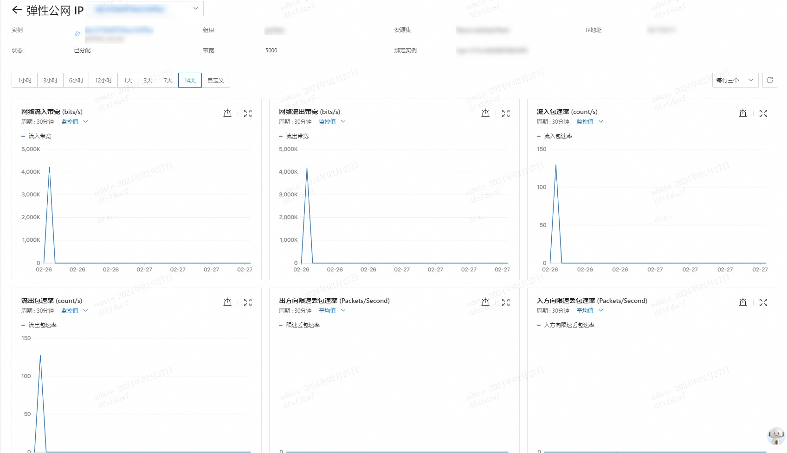

**查看报警规则**

在目标云产品的监控页面，可查看当前组织和资源集下该云产品的所有报警规则或具体实例对应的报警规则。

1. 在目标云产品的监控页面，单击列表上方的**查看报警规则**或目标资源实例**操作**列的**报警规则**。

2. 跳转至**报警规则**页面，查看当前组织资源集下该云产品所有的报警规则或指定资源下的报警规则，包括**产品名称**、**规则名称**、**状态**、**关联资源**、**报警条件描述**、**启用**、**通知对象**、**有效性**、**规则执行记录**等。

   > **说明**
   >
   > - 在目标云产品监控页面，单击上方的**创建报警规则**，可自定义该云产品的报警规则，具体可参见创建报警规则。
   >
   > - 报警规则的其他相关操作具体可参见管理报警规则。

   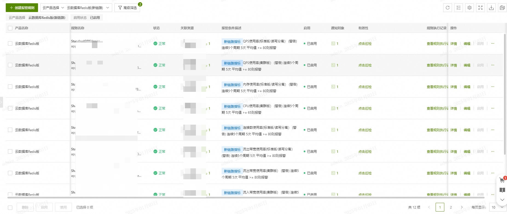

<a id="section-4-3"></a>

## 4.3. Kubernetes容器监控

通过Kubernetes容器监控，实现对K8s集群的监控，以便了解集群的健康状况，及时发现并解决问题。

**背景信息**

Kubernetes容器监控主要实现以下能力。

- 实现对K8s集群的监控和报警能力。

- 实现K8s集群同步和列表展示能力，信息数据包含集群的名称、ID、健康状况和节点数。

- 实现单个集群的监控图表能力，包含CPU、内存和文件系统的指标监控。

- 实现对单个集群监控的CPU、内存和文件系统指标的报警定义能力。

**操作步骤**

1. 登录Apsara Uni-manager运营控制台。

2. 单击顶部菜单栏的**产品**，选择**迁移与运维管理** > **运维与监控** > **云监控**。

3. 在左侧导航栏，选择**云资源监控 > Kubernetes容器监控**。

4. 在**Kubernetes容器监控**页面，查看Kubernetes集群列表，包括**实例ID/名称**、**组织/资源集**、**地域**、**实例状态**、**CPU使用量**、**内存使用量**、**集群标识**、**集群类型**、**集群版本**、**节点数量**、**网络模式**、**可用区ID**、**安全组ID**、**专有网络ID**等。

   > **说明**
   >
   > - 在**Kubernetes容器监控**页面，单击集群**操作**列的**报警规则**，跳转至**报警规则**页签，详细内容可参见报警规则。
   >
   > - 单击列表上方的**创建报警规则**，可新增报警规则。配置项说明可参见创建报警规则。

5. 单击实例ID/名称，进入集群详情。

   - 在基础信息区域，查看**集群名称**、**集群ID**、**集群类型**、**版本**、**虚拟专有网络VPC**等。

   - 在**监控图表**页签，查看集群CPU、内存和文件系统指标的监控图表。监控图表支持按**1小时**、**3小时**、**6小时**、**12小时**、**1天**、**3天**、**7天**、**14天**或自定义时间进行切换。

     > **说明**
     >
     > - 在**Kubernetes容器监控**页面，单击集群**操作**列的**监控图表**，也可直接进入**监控图表**页签。
     >
     > - 监控图表支持**每行一个**、**每行两个**或**每行三个**，可在右侧下拉列表选择。
     >
     > - 单击指标监控图表右侧的
     >
     >   ，可添加规则描述，并创建报警规则。配置项说明可参见创建
     >
     >   
     >
     >   报警规则。
     >
     > - 单击指标监控图表右侧
     >
     >   ，可大图展示该监控图表。
     >
     >   

   - 在**节点**页签，查看当前集群的**实例名称/ID**、**状态**、**CPU使用量**、**内存使用量**。单击实例名称/ID或操作列的**查看详情**，进入节点详情页面。

     - 在基础信息区域，查看**实例名称**、**集群ID**。

     - 在**监控图表**页签，查看CPU、内存、文件和网络系统指标的监控图表。监控图表支持按**1小时**、**3小时**、 **6小时**、**12小时**、**1天**、**3天**、**7天**、**14天**或自定义时间进行切换。

       > **说明**
       >
       > - 监控图表支持**每行展示 1**、**每行展示 2**或**每行展示 3**，可在右侧下拉列表选择。
       >
       > - 单击指标监控图表右侧
       >
       >   ，可大图展示该监控图表。
       >
       >   

     - 在**容器组列表**页签，展示集群中当前节点下关联的容器列表，包括容器**实例名称**、**CPU使用量**、**内存使用量**。单击**实例名称/ID**或操作列的**查看详情**，进入容器组详情页面。

       - 在基础信息区域，查看**实例名称**、**命名空间**。

       - 在**监控图表**页签，查看容器组CPU、内存、文件、网络系统指标的监控图表。监控图表支持按**1小时**、**3小时**、 **6小时**、**12小时**、**1天**、**3天**、**7天**、**14天**或自定义时间进行切换。

         > **说明**
         >
         > - 监控图表支持**每行展示 1**、**每行展示 2**或**每行展示 3**，可在右侧下拉列表选择。
         >
         > - 单击指标监控图表右侧
         >
         >   ，可大图展示该监控图表。
         >
         >   

   - 在**工作负载**页签，查看集群中的**实例名称**、**CPU使用量**、**内存使用量**。单击**实例名称**或操作列的**查看详情**，进入实例详情页面。

     > **说明**
     >
     > - 单击**命名空间**下拉框可切换命名空间。
     >
     > - 单击实例列表上方的**无状态**、**有状态**、**守护进程集**、**定时任务**、**任务**、**容器组**可快速对实例进行筛选展示。
     >
     >   - **无状态**：提供基于namespace下的无状态 deployment 监控，包含列表信息（实例名称、CPU/内存）使用量、详情指标包括CPU分配上限、使用量、文件系统的可用大小上限、网络的接收发送的速率等监控指标；并提供当前workload关联的容器组列表和容器组的监控详情。
     >
     >   - **有状态**：提供基于namespace下的有状态 StatefulSet 监控，包含列表信息（实例名称、CPU/内存）使用量、详情指标包括CPU分配上限、使用量、文件系统的可用大小上限、网络的接收发送的速率等监控指标；并提供当前workload关联的容器组列表和容器组的监控详情。
     >
     >   - **守护进程集**：提供基于namespace下的守护进程集DaemonSet监控，包含列表信息（实例名称、CPU/内存）使用量、详情指标包括CPU分配上限、使用量、文件系统的可用大小上限、网络的接收发送的速率等监控指标；并提供当前workload关联的容器组列表和容器组的监控详情。
     >
     >   - **定时任务**：提供基于namespace下的定时任务 CronJob 监控，包含列表信息（实例名称、CPU/内存）使用量、详情指标包括CPU分配上限、使用量、文件系统的可用大小上限、网络的接收发送的速率等监控指标；并提供当前workload关联的容器组列表和容器组的监控详情。
     >
     >   - **任务**：提供基于namespace下的任务 Job监控，包含列表信息（实例名称、CPU/内存）使用量、详情指标包括CPU分配上限、使用量、文件系统的可用大小上限、网络的接收发送的速率等监控指标；并提供当前workload关联的容器组列表和容器组的监控详情。
     >
     >   - **容器组**：提供集群中关联的容器列表，包含容器名称、CPU/内存使用量等列表数据，以及各个容器组的监控详情。

     - 在基础信息区域，查看**实例名称**、**命名空间**。

     - 在**监控图表**页签，查看CPU、内存、文件、网络系统指标的监控图表。监控图表支持按**1小时**、**3小时**、 **6小时**、**12小时**、**1天**、**3天**、**7天**、**14天**或自定义时间进行切换。

       > **说明**
       >
       > - 监控图表支持**每行展示 1**、**每行展示 2**或**每行展示 3**，可在右侧下拉列表选择。
       >
       > - 单击指标监控图表右侧
       >
       >   ，可大图展示该监控图表。
       >
       >   

     - 在**容器组列表**页签，展示集群中当前工作负载关联的容器列表，包括容器**实例名称**、**CPU使用量**、**内存使用量**。单击实例名称或操作列的**查看详情**，进入容器组详情页面。

       - 在基础信息区域，查看**实例名称**、**命名空间**。

       - 在**监控图表**页签，查看容器组CPU、内存、文件、网络系统指标的监控图表。监控图表支持按**1小时**、**3小时**、 **6小时**、**12小时**、**1天**、**3天**、**7天**、**14天**或自定义时间进行切换。

         > **说明**
         >
         > - 监控图表支持**每行展示 1**、**每行展示 2**或**每行展示 3**，可在右侧下拉列表选择。
         >
         > - 单击指标监控图表右侧
         >
         >   ，可大图展示该监控图表。
         >
         >   

   - 在**事件列表**页签，可查看当前实例最近6小时内前100条事件上报记录，包括**事件名称**、**事件等级**、**事件状态**、**事件内容**、**时间**等。

     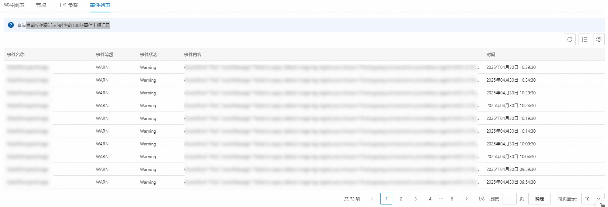

<a id="section-4-4"></a>

## 4.4. 应用分组

应用分组提供云服务器ECS分组管理功能，支持用户从业务角度集中管理业务线云服务器ECS资源。在分组维度管理报警规则、查看监控数据，可以极大的降低管理复杂度，提高云监控使用效率。

<a id="section-4-4-1"></a>

### 4.4.1. 创建应用分组

应用分组提供跨云产品、跨地域的云产品资源分组管理功能。支持从业务角度集中管理业务线，按业务线来管理报警规则、查看监控数据，可以迅速提升运维效率。

**操作步骤**

1. 登录Apsara Uni-manager运营控制台。

2. 单击顶部菜单栏的**产品**，选择**迁移与运维管理** > **运维与监控** > **云监控**。

3. 在左侧导航栏，选择**云资源监控 > 应用分组**。

4. 在**应用分组**页面，单击**应用分组**。

5. 在**新建应用分组**面板中，完成相应配置，各配置项说明如下。

   <table>
     <tr>
       <th width="121">配置项</th>
       <th>说明</th>
     </tr>
     <tr>
       <td>创建实例方法</td>
       <td>• <strong>实例名创建</strong>：对于特性资源集或者本组织所有资源提供按照实例名称动态匹配的能力。<br>• <strong>手动创建</strong>：当您需要根据业务管理需求，对已有固定实例进行管理时，可以选择手动创建标准应用分组。<br>• <strong>动态创建</strong>：动态创建基于资源集创建，通过排除资源实例的逻辑，实现资源实例创建后自动归入当前应用分组。</td>
     </tr>
     <tr>
       <td>应用分组名称</td>
       <td>当前应用分组的名称。</td>
     </tr>
     <tr>
       <td>资源集范围</td>
       <td>说明当创建实例方法为<strong>实例名创建</strong>时，界面展示此配置项。<br>默认选中<strong>指定资源集</strong>。</td>
     </tr>
     <tr>
       <td>资源集选择</td>
       <td>选择当前组织下的目标资源集。</td>
     </tr>
     <tr>
       <td>报警联系人</td>
       <td>在报警规则联系人下拉列表选择报警联系人，支持选择多个。</td>
     </tr>
     <tr>
       <td>添加资源项</td>
       <td>说明当创建实例方法为手动创建和实例名创建时，使用此配置项。<br>在资源项中配置<strong>云产品选择</strong>、<strong>规则关系</strong>、<strong>规则配置</strong>、<strong>添加实例</strong>等。</td>
     </tr>
     <tr>
       <td>排除资源项</td>
       <td>说明当创建实例方法为动态创建时，使用此配置项。<br>在资源项中配置<strong>云产品选择</strong>和<strong>批量排除实例</strong>。</td>
     </tr>
   </table>

6. 单击**确定**。

<a id="section-4-4-2"></a>

### 4.4.2. 管理应用分组

在应用分组列表中，可以对应用分组进行修改、删除等操作。

**操作步骤**

1. 登录Apsara Uni-manager运营控制台。

2. 单击顶部菜单栏的**产品**，选择**迁移与运维管理** > **运维与监控** > **云监控**。

3. 在左侧导航栏，选择**云资源监控 > 应用分组**，在**应用分组**页面，执行相关操作。

   <table>
     <tr>
       <th width="122">操作任务</th>
       <th>操作步骤</th>
     </tr>
     <tr>
       <td>查看应用分组</td>
       <td>i. （可选）在顶部菜单栏选择目标组织，在<strong>应用分组列表</strong>页面输入应用分组名称或ID，可快速筛选应用分组。ii. 单击目标应用分组名称，单击目标应用分组详情页面的左侧导航栏的不同页签，查看其对应内容。<br>• <strong>组概览</strong>：可以查看目标应用分组的<strong>基本信息</strong>和<strong>关联云产品概览</strong>。<br>• <strong>组内资源</strong>：可以查看当前应用分组内的资源详情。<br>• <strong>可用性监控</strong>：可以查看当前应用分组内所有ECS实例的可用性监控。</td>
     </tr>
     <tr>
       <td>修改应用分组</td>
       <td>i. （可选）在顶部菜单栏选择目标组织，在<strong>应用分组列表</strong>页面输入应用分组名称或ID，可快速筛选应用分组。<br>ii. 单击目标应用分组卡片中的图标，单击<strong>编辑组</strong>。<br>iii. 在<strong>编辑应用分组</strong>面板中，修改当前应用分组。iv. 修改完成后，单击<strong>确定</strong>。</td>
     </tr>
     <tr>
       <td>删除应用分组</td>
       <td>说明删除应用分组将同时删除该应用分组的所有报警规则和事件通知，该应用分组内的实例将自动转移到全部实例中。<br>i. （可选）在顶部菜单栏选择目标组织，在<strong>应用分组列表</strong>页面输入应用分组名称或ID，可快速筛选应用分组。ii. 在应用分组列表页面进行删除。<br>• 单个删除<br>a. 单击目标应用分组卡片中的图标，单击<strong>删除组</strong>。<br>b. 在<strong>确认删除组</strong>对话框中，单击<strong>确定</strong>。<br>• 批量删除<br>a. 选中目标应用分组卡片中的复选框，单击列表左下方的<strong>批量删除</strong>。<br>b. 在<strong>确认删除组</strong>对话框中，单击<strong>确定</strong>。</td>
     </tr>
   </table>

<a id="section-4-4-3"></a>

### 4.4.3. 可用性监控

<a id="section-4-4-3-1"></a>

#### 4.4.3.1. 创建可用性监控

可用性监控定期探测本地或远程指定路径和端口是否正常响应。当出现响应超时或状态码错误时，云监控将发出报警，以便快速发现本地或远程服务无响应的情况。

**操作步骤**

> **说明**
>
> 可用性探测支持任意ECS作为探测源。

1. 登录Apsara Uni-manager运营控制台。

2. 单击顶部菜单栏的**产品**，选择**迁移与运维管理** > **运维与监控** > **云监控**。

3. 在左侧导航栏，选择**云资源监控 > 应用分组**。

4. 在**应用分组**页面，单击目标应用分组名称。

5. 在目标应用分组详情页面单击其左侧导航栏的**可用性监控**页签。

6. 单击**添加可用性监控**，在**创建/修改可用性监控**面板依次完成配置向导，单击**确定**。各配置项说明如下。

   **配置项**

   **说明**

   当前可用性监控的任务名称。支持中文、英文字母、数字、下划线

   **任务名称**

   （_）和短划线（-），长度为4~50个字符。

   在当前应用分组的全部实例，选择一个或多个待探测的实例。

   > **说明**

   **探测源**

   > 如果单个实例拥有超过500个任务，则该实例的部分任务可能无法运行。

   默认为**URL或者IP**。

   **探测目标**

   探测类型支持**HTTP(S)**、**TELNET**、**PING**三种类型。

   - **HTTP(S)**：指通过发送HTTP(s)请求来探测目标的健康状态，需要输入待探测目标的URL地址。例如，http://localhost:8081/check_health.html。

   **探测类型**

   - **TELNET**：指通过发送TELNET命令来探测目标的健康状态，需要输入待探测目标的IP地址和端口号。例如，192.168.1.1:22。

   - **PING**：指通过发送PING命令来探测目标的健康状态，需要输入待探测目标的IP地址。例如，192.168.1.1。

   探测类型的请求方法。请求方法包括**HEAD**、**GET**和**POST**。

   > **说明**

   **请求方法**

   > 当**探测目标**为**URL或者IP**，**探测类型**为<strong>HTTP(S)</strong>时，需要设置此项参数配置。

   探测周期，默认为1分钟。

   > **说明**

   **监控频率**

   > - 当**探测目标**为**URL或者IP**，**探测类**

   **创建任务**

   > **型**为<strong>HTTP(S)</strong>时，需要设置此项参数配置。
   >
   > - 单击**高级配置**，可为报警规则设置此参数配置。

   站点探测时HTTP或HTTPS的Headers。

   Header格式： `parameter1:value1` 。

   多个Header之间用半角逗号（,）分隔。

   > **说明**

   **Headers**

   > - 当**探测目标**为**URL或者IP**，**探测类型**为<strong>HTTP(S)</strong>时，可以单击**高级配置**来设置该参数配置。
   >
   > - 单击**高级配置**，可为报警规则设置此参数配置。

   > **说明**
   >
   > - 当**探测目标**为**URL或者IP**，**探测类型**为**HTTP(S)**，且**请求方法**选择**POST**时，可以单击**高级配置**来设置该参数配置。
   >
   > - 单击**高级配置**，可为报警规则设置此参数配置。

   **提交内容**

   系统在做站点探测的时候，会POST提交这个信息，提交内容仅支持英文。请求方式选择POST时需要设置此项参数配置。

   格式为：parameter1=value1&parameter2=value2。

   站点探测的匹配响应方式和匹配响应信息。

   当匹配响应信息非空时，站点探测读取HTTP服务器回应Body的前64KB，从中查找匹配响应信息。匹配响应方式取值：

   - **包含匹配内容则报警**

   - **不包含匹配内容则报警**

   **匹配响应内容**

   > **说明**
   >
   > 当**探测目标**为**URL或者IP**，**探测类型**为<strong>HTTP(S)</strong>时，可以单击**高级配置**来设置该参数配置。

   当探测的状态码满足报警设置时，触发报警。状态码详情请参见状态码说明。

   **状态码**

   **状态码**和**响应时间**其中之一达到阈值后都会触发报警，报警会发送给应用分组的报警联系人组。

   当探测的响应时间满足报警设置时，触发报警。单位毫秒。

   **响应时间**

   **状态码**和**响应时间**其中之一达到阈值后都会触发报警，报警会发送给应用分组的报警联系人组。

   报警级别和报警通知方式。取值：

   - **紧急**

   **报警级别**

   - **警告**

   - **提示**

   公网可访问的URL，用于接收云监控通过POST请求推送的报警信息。

   **报警回调**

   > **说明**
   >
   > 目前仅支持HTTP协议。

   **报警设置**

   报警发生后未恢复正常，间隔多久重复发送一次报警通知。取值：**5分钟**、**10分钟**、**15分钟**、**30分钟**、**60分钟**、**3小时**、**6小时**、**12小时**和**24小时**。

   某监控指标达到报警阈值时发送报警，如果监控指标在通道沉默周期内持续超过报警阈值，在通道沉默周期内不会重复发送报警通知；如果监控指标在通道沉默周期后仍未恢复正常，则云监控再次

   **通道沉默周期**

   发送报警通知。

   > **说明**
   >
   > 单击**高级配置**，可为报警规则设置此参数配置。

   报警规则的生效时间。报警规则只在生效时间内发送报警通知，非生效时间内产生的报警只记录报警历史。

   **生效时间**

   > **说明**
   >
   > 单击**高级配置**，可为报警规则设置此参数配置。

<a id="section-4-4-3-2"></a>

#### 4.4.3.2. 管理可用性监控

在可用性监控列表中，可以对可用性监控进行修改、禁用、启用和删除等操作。

**操作步骤**

1. 登录Apsara Uni-manager运营控制台。

2. 单击顶部菜单栏的**产品**，选择**迁移与运维管理** > **运维与监控** > **云监控**。

3. 在左侧导航栏，选择**云资源监控 > 应用分组**。

4. 在**应用分组**页面单击目标应用分组名称。

5. 在目标应用分组详情页面单击其左侧导航栏的**可用性监控**页签。在**可用性监控**页签内执行相关操作。

   <table>
     <tr>
       <th width="186">操作任务</th>
       <th>操作步骤</th>
     </tr>
     <tr>
       <td>查看可用性监控图表</td>
       <td>i. 单击目标可用性监控<strong>操作</strong>列的。<br>ii. 在下拉列表选择可用性监控任务，支持选择多个监控实例。iii. 选择监控的时间范围，支持选择<strong>1小时</strong>、<strong>6小时</strong>、<strong>12小时</strong>、<strong>1天</strong>、<strong>3天</strong>、<strong>7天</strong>、<strong>14</strong><strong>天</strong>，或自定义时间范围。iv. 根据选择的实例和时间，查看可用性监控图表信息。</td>
     </tr>
     <tr>
       <td>修改可用性监控</td>
       <td>i. 单击目标可用性监控<strong>操作</strong>列的<strong>修改</strong>。ii. 在<strong>创建/修改可用性监控</strong>面板中，根据配置向导修改相应配置项信息，各配置项说明请参见创建可用性监控。iii. 修改完成后，单击<strong>确定</strong>。</td>
     </tr>
     <tr>
       <td>禁用或启用可用性监控</td>
       <td>说明支持对<strong>监控状态</strong>为<strong>启用</strong>的可用性监控进行禁用；支持对<strong>监控状态</strong>为<strong>禁用</strong>的可用性监控进行启用。<br>• 单个禁用或启用<br>a. 单击目标可用性监控<strong>操作</strong>列的<strong>禁用</strong>或<strong>启用</strong>。<br>b. 在<strong>禁用</strong>或<strong>启用</strong>对话框中，单击<strong>确定</strong>。<br>• 批量禁用<br>a. 选中目标可用性监控前的复选框，单击列表左下方的<strong>批量禁用</strong>或<strong>批量启用</strong>。<br>b. 在<strong>禁用</strong>或<strong>启用</strong>对话框中，单击<strong>确定</strong>。</td>
     </tr>
     <tr>
       <td>删除可用性监控</td>
       <td>• 单个删除<br>a. 单击目标可用性监控<strong>操作</strong>列的<strong>删除</strong>。<br>b. 在<strong>删除</strong>对话框中，单击<strong>确定</strong>。<br>• 批量删除<br>a. 选中目标可用性监控前的复选框，单击列表左下方的<strong>批量删除</strong>。<br>b. 在<strong>删除</strong>对话框中，单击<strong>确定</strong>。</td>
     </tr>
   </table>

<a id="section-4-4-3-3"></a>

#### 4.4.3.3. 状态码说明

通过可用性监控功能探测指定路径或端口的可用性时，如果探测异常，会返回相应状态码。

状态码及其说明如下。

<table>
  <tr>
    <th>协议类型</th>
    <th>状态码</th>
    <th>含义</th>
  </tr>
  <tr>
    <td rowspan="3">HTTP</td>
    <td>200</td>
    <td>正常。</td>
  </tr>
  <tr>
    <td>610</td>
    <td>超时。发出HTTP请求后5秒内无响应，视为超时。</td>
  </tr>
  <tr>
    <td>611</td>
    <td>探测失败。</td>
  </tr>
  <tr>
    <td rowspan="3">Telnet</td>
    <td>200</td>
    <td>正常。</td>
  </tr>
  <tr>
    <td>630</td>
    <td>超时。发出Telnet请求后5秒内无响应，视为超时。</td>
  </tr>
  <tr>
    <td>631</td>
    <td>探测失败。</td>
  </tr>
</table>

<a id="section-4-5"></a>

## 4.5. 指标仓库

<a id="section-4-5-1"></a>

### 4.5.1. 时序指标

指标仓库的时序指标提供了云产品指标的统一查询入口，使您明确云产品指标的定义、计算方法等信息。

**背景信息**

- 时序指标包含当前版本接入云监控CMS所有云产品列表中展示的指标，并且展示的信息与云监控指标说明中的产品及指标命名一致。

- 提供每个指标的血缘分析：从数据指标的创建（SQL虚拟指标）、来源依赖指标（SQL真实指标）以及数据源（Project、Logstore），展示数据指标存在的依赖关系，帮助您更好地追踪和排查数据问题。

- 提供指标可视化监控图表，方便您进行指标数据分析和可视化展示。

**查看时序指标**

1. 登录Apsara Uni-manager运营控制台。

2. 单击顶部菜单栏的**产品**，选择**迁移与运维管理** > **运维与监控** > **云监控**。

3. 在左侧导航栏，选择**云资源监控 > 指标仓库**，默认进入**时序指标**页签。

4. 在左侧**云产品列表**单击目标云产品，在右侧列表查看云产品对应的指标信息。

   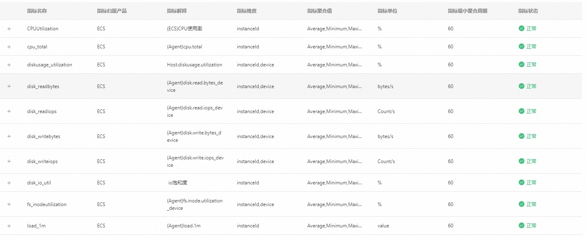

5. 单击指标名称左侧的  展开指标信息，查看指标血缘（即展示每个指标从Create SQL开始到最终SLS的

   Project、Logstore的数据依赖来源，以及云监控CMS上的DIM Table）。

   > **说明**
   >
   > 不是所有云产品指标都有DIM表数据。

   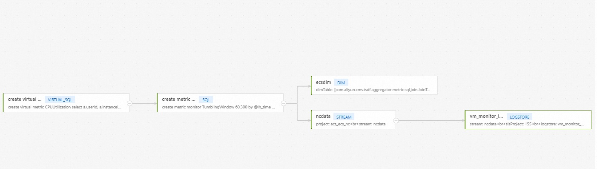

6. 单击各个环节进入**可用性监控详情**，在**巡检项详情**页检查是否有数据。根据巡检项结果判断是原始数据、中间过程还是末端汇聚计算的时候出现的问题。如果有错误，则通过巡检项结果进行提示，便于问题排查和追踪。

   <table>
     <tr>
       <th width="96">环节</th>
       <th>巡检项</th>
     </tr>
     <tr>
       <td>虚拟指标</td>
       <td>• 检测virtual指标是否有数据<br>• 检测virtual指标是否含有字段与原始指标不匹配<br>• 检测virtual指标是否含有字段与OTS查询结果不匹配</td>
     </tr>
     <tr>
       <td>真实指标</td>
       <td>• 检测原始指标是否有数据<br>• 检测指标是否含有字段与OTS查询结果不匹配<br>• 指标正常的延时时间为</td>
     </tr>
     <tr>
       <td>DIM表</td>
       <td>• 抽样检查实例对应dim数据是否都含有</td>
     </tr>
     <tr>
       <td>Stream</td>
       <td>• 检测当前的metric是否有合成的数据需要收割<br>• 检测当前的metric是否有数据到达ISLOT模块中<br>• 检测当前的metric是否有数据要持久化到OTS中</td>
     </tr>
     <tr>
       <td>Logstore</td>
       <td>• 当前logstore输入到ISLSLoader中record是否被使用<br>• 当前logstore是有数据输入到ISLSLoader中<br>• 判断当前logstore是否有匹配到指标的数据<br>• 判断当前logstore是否存在，当前logstore是否有数据<br>• 当前logstore对应shard是否满足</td>
     </tr>
   </table>

7. 在虚拟指标和真实指标**可用性监控详情**的**监控详情**页，输入实例ID，设置聚合值和时间后，单击**查询**，查看指标监控图表。

   <table>
     <tr>
       <th width="90">配置项</th>
       <th>说明</th>
     </tr>
     <tr>
       <td>命名空间</td>
       <td>指标所属的命名空间，默认值。</td>
     </tr>
     <tr>
       <td>指标名称</td>
       <td>指标的名称，默认值。</td>
     </tr>
     <tr>
       <td>实例ID</td>
       <td>填写需要查询云产品的实例ID。</td>
     </tr>
     <tr>
       <td>聚合值</td>
       <td>设置聚合值，即聚合统计方法。<br>说明不同云产品指标支持的聚合值有所不同。</td>
     </tr>
     <tr>
       <td>时间选择</td>
       <td>选择指标监控的时间范围，支持1小时、4小时、12小时及自定义。</td>
     </tr>
     <tr>
       <td>SLS数据</td>
       <td>仅真实指标的监控详情页面支持。显示是否有SLS数据。</td>
     </tr>
     <tr>
       <td>监控图表</td>
       <td>根据实例ID、聚合值和时间选择生成对应的监控图表，查看指标数据的变化趋势。<br>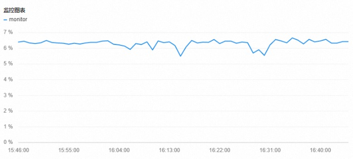</td>
     </tr>
   </table>

**设置数据保留时长**

> **重要**
>
> - 数据生命周期设置，只针对指标数据生效。
>
> - 操作前需要评估OTS的容量，请谨慎操作！
>
> - 不支持按组织、资源集、单个指标维度配置，设置完成即对所有cms的接入指标生效。

**新增配置**

1. 在**时序指标**页签的云产品列表选中云产品，单击指标**操作**列的**数据生命周期配置**。

2. 在**数据生命周期配置**对话框，**操作**选择**新增**，**数据生命周期配置**填写数据保留天数（取值0~1095）。数据生命周期系统默认为31天，最多保留3年或者1095天。

3. 单击**确定**。

**修改配置**

指标已设置数据保留时长后才支持修改。

1. 在**时序指标**页签的云产品列表选中云产品，单击指标**操作**列的**数据生命周期配置**。

2. 在**数据生命周期配置**对话框，**操作**选择**编辑**，**数据生命周期配置**填写数据保留天数（取值0~1095）。数据生命周期系统默认为31天，最多保留3年或者1095天。

3. 单击**确定**。

**删除配置**

指标已设置数据保留时长后才支持删除，删除后即恢复默认31天保留时长。

1. 在**时序指标**页签的云产品列表选中云产品，单击指标**操作**列的**数据生命周期配置**。

2. 在**数据生命周期配置**对话框，**操作**选择**删除**。

3. 单击**确定**。

<a id="section-4-5-2"></a>

### 4.5.2. 系统事件

<a id="section-4-5-2-1"></a>

#### 4.5.2.1. 云产品事件监控指标说明

通过云产品事件监控指标说明，了解云产品相关系统事件的事件名称、事件解释、事件等级、事件状态和事件类型。

**【云监控】事件监控指标**

| 事件名称 | 事件归属产品 | 事件解释 | 事件等级 | 事件状态 | 事件类型 |
| --- | --- | --- | --- | --- | --- |
| Agent_Status_Stopped | CloudM onitor | 插件心跳停止 | CRITICAL | stoppe d | StatusNotif ication |
| Agent_Status_Running | CloudM onitor | 插件心跳恢复 | CRITICAL | runnin g | StatusNotif ication |

**【混合云容灾】事件监控指标**

| 事件名称 | 事件归属产品 | 事件解释 | 事件等级 | 事件状态 | 事件类型 |
| --- | --- | --- | --- | --- | --- |
| PrimarySiteVpc:Delete d | HDR | 生产站点VPC被删除 | CRITICAL | Failed | StatusNotif ication |
| SecondarySiteVpc:Del eted | HDR | 容灾站点VPC被删除 | CRITICAL | Failed | StatusNotif ication |
| PrimarySiteNetwork:D eleted | HDR | 生产站点网络被删除 | CRITICAL | Failed | StatusNotif ication |
| SecondarySiteNetwor k:Deleted | HDR | 容灾站点网络被删除 | CRITICAL | Failed | StatusNotif ication |
| PrimarySecurityGroup:Deleted | HDR | 生产站点安全组被删除 | CRITICAL | Failed | StatusNotif ication |
| SecondarySecurityGro up:Deleted | HDR | 容灾站点安全组被删除 | CRITICAL | Failed | StatusNotif ication |
| SecurityGroup:Inconsi stency | HDR | 安全组策略不一致 | CRITICAL | Failed | StatusNotif ication |
| ProductSiteNetwork:In consistency | HDR | 生产站点网络相关信息异常变化 | CRITICAL | Failed | StatusNotif ication |
| DrSiteNetwork:Inconsi stency | HDR | 容灾站点网络相关信息异常变化 | CRITICAL | Failed | StatusNotif ication |
| ProductSiteStorage:In consistency | HDR | 生产站点存储相关信息异常变化 | CRITICAL | Failed | StatusNotif ication |
| DrSiteStorage:Inconsi stency | HDR | 容灾站点存储相关信息异常变化 | CRITICAL | Failed | StatusNotif ication |
| PrimarySiteComputati on:Inconsistency | HDR | 生产站点计算相关信息异常变化 | CRITICAL | Failed | StatusNotif ication |
| DrSiteComputation:In consistency | HDR | 容灾站点计算相关信息异常变化 | CRITICAL | Failed | StatusNotif ication |
| ReplicationGroup:Inco nsistency | HDR | 复制组信息异常 | CRITICAL | Failed | StatusNotif ication |
| ReplicationPair:Incons istency | HDR | 复制对信息异常 | CRITICAL | Failed | StatusNotif ication |
| Gateway:Inconsistenc y | HDR | 网关异常 | CRITICAL | Failed | StatusNotif ication |
| ShadowEcs:Inconsiste ncy | HDR | 复制Ecs实例异常 | CRITICAL | Failed | StatusNotif ication |

**【备份管理平台】事件监控指标**

| 事件名称 | 事件归属产品 | 事件解释 | 事件等级 | 事件状态 | 事件类型 |
| --- | --- | --- | --- | --- | --- |
| BackupPlan | ASRBR | 备份计划相关告警 | CRITICAL | FAILED | StatusNotif ication |
| RecoveryTask | ASRBR | 恢复任务相关告警 | CRITICAL | FAILED | StatusNotif ication |
| MigratePlan | ASRBR | 迁移计划相关告警 | CRITICAL | FAILED | StatusNotif ication |
| LICENSE | ASRBR | 授权使用量相关告警 | CRITICAL | FAILED | Maintenan ce |

**【资源编排】事件监控指标**

| 事件名称 | 事件归属产品 | 事件解释 | 事件等级 | 事件状态 | 事件类型 |
| --- | --- | --- | --- | --- | --- |
| Stack:StatusChange | ros | 资源栈状态变化 | INFO | Normal | StatusNotif ication |
| StackResource:Status Change | ros | 资源栈资源状态变化 | INFO | Normal | StatusNotif ication |
| StackGroup:Operation StatusChange | ros | 资源栈组操作状态变化 | INFO | Normal | StatusNotif ication |

**【云服务器ECS】事件监控指标**

| 事件名称 | 事件归属产品 | 事件解释 | 事件等级 | 事件状态 | 事件类型 |
| --- | --- | --- | --- | --- | --- |
| Disk:ConvertToPostpai dCompleted | ECS | 转换磁盘到按量付费完成 | INFO | Normal | StatusNotif ication |
| Disk:DiskOperationCo mpleted | ECS | 磁盘操作完成 | INFO | Normal | StatusNotif ication |
| Disk:ErrorDetected:Ex ecuted | ECS | 本地磁盘出现损坏告警结束 | CRITICAL | Execut ed | Exception |
| Disk:ErrorDetected:Ex ecuting | ECS | 本地磁盘出现损坏告警开始 | CRITICAL | Executi ng | Exception |
| Disk:OverduePayment Release | ECS | 磁盘释放（账号欠费） | CRITICAL | Normal | StatusNotif ication |
| Disk:Stalled:Executed | ECS | 磁盘性能受到严重影响结束 | CRITICAL | Execut ed | Exception |
| Disk:Stalled:Executing | ECS | 磁盘性能受到严重影响开始 | CRITICAL | Executi ng | Exception |
| Instance:AutoReactiva teCompleted | ECS | 完成自动重开机 | INFO | Normal | StatusNotif ication |
| Instance:BurstablePer formanceRestricted | ECS | 突发性能实例性能受限 | WARN | Normal | StatusNotif ication |
| Instance:InstanceFailu re.PerformanceImpact:Executed | ECS | 实例性能潜在影响结束（实例错误） | WARN | Execut ed | Exception |
| Instance:InstanceFailu re.PerformanceImpact:Executing | ECS | 实例性能潜在影响开始（实例错误） | WARN | Executi ng | Exception |
| Instance:InstanceFailu re.Reboot:Executed | ECS | 实例重启结束（实例错误） | CRITICAL | Execut ed | Exception |
| Instance:InstanceFailu re.Reboot:Executing | ECS | 实例重启开始（实例错误） | CRITICAL | Executi ng | Exception |
| Instance:LiveMigratio nAcrossDDH | ECS | 实例在专有宿主机间热迁移 | INFO | Normal | StatusNotif ication |
| Instance:Performance ModeChange | ECS | 突发性能实例性能模式切换 | INFO | Normal | StatusNotif ication |
| Instance:PreemptibleI nstanceInterruption | ECS | 抢占式实例中断通知 | WARN | Normal | StatusNotif ication |
| Instance:Security.Tpm Alert:Executed | ECS | TPM安全警告结束 | WARN | Execut ed | Exception |
| Instance:Security.Tpm Alert:Executing | ECS | TPM安全警告开始 | WARN | Executi ng | Exception |
| Instance:StateChange | ECS | 实例状态改变通知 | INFO | Normal | StatusNotif ication |
| Instance:SystemFailur e.Delete:Avoided | ECS | 实例自动释放已规避（实例创建失败） | CRITICAL | Avoide d | Exception |
| Instance:SystemFailur e.Delete:Executed | ECS | 实例自动释放已完成（实例创建失败） | CRITICAL | Execut ed | Exception |
| Instance:SystemFailur e.Delete:Executing | ECS | 实例自动释放执行中（实例创建失败） | CRITICAL | Executi ng | Exception |
| Instance:SystemFailur e.PerformanceImpact: Executed | ECS | 实例性能影响结束（系统错误） | WARN | Execut ed | Exception |
| Instance:SystemFailur e.PerformanceImpact: Executing | ECS | 实例性能影响开始（系统错误） | WARN | Executi ng | Exception |
| Instance:SystemFailur e.Reboot:Executed | ECS | 实例重启结束（系统错误） | CRITICAL | Execut ed | Exception |
| Instance:SystemFailur e.Reboot:Executing | ECS | 实例重启开始（系统错误） | CRITICAL | Executi ng | Exception |
| Instance:SystemFailur e.Reboot:Failed | ECS | 实例重启失败（系统错误） | CRITICAL | Failed | Exception |
| Instance:SystemFailur e.Redeploy:Avoided | ECS | 实例重新部署已规避（系统错误） | CRITICAL | Avoide d | Exception |
| Instance:SystemFailur e.Redeploy:Canceled | ECS | 实例重新部署已取消（系统错误） | CRITICAL | Cancel ed | Exception |
| Instance:SystemFailur e.Redeploy:Executed | ECS | 实例重新部署已完成（系统错误） | CRITICAL | Execut ed | Exception |
| Instance:SystemFailur e.Redeploy:Executing | ECS | 实例重新部署执行中（系统错误） | CRITICAL | Executi ng | Exception |
| Instance:SystemFailur e.Stop:Executed | ECS | 实例停止已完成（系统错误） | CRITICAL | Execut ed | Exception |
| Instance:SystemFailur e.Stop:Executing | ECS | 实例停止开始（系统错误） | CRITICAL | Executi ng | Exception |
| Instance:SystemMaint enance.IsolateErrorDi sk:Avoided | ECS | 因系统维护隔离坏盘已规避 | CRITICAL | Avoide d | Maintenan ce |
| Instance:SystemMaint enance.IsolateErrorDi sk:Canceled | ECS | 因系统维护隔离坏盘已取消 | CRITICAL | Cancel ed | Maintenan ce |
| Instance:SystemMaint enance.IsolateErrorDi sk:Executed | ECS | 因系统维护隔离坏盘已完成 | CRITICAL | Execut ed | Maintenan ce |
| Instance:SystemMaint enance.IsolateErrorDi sk:Executing | ECS | 因系统维护隔离坏盘执行中 | CRITICAL | Executi ng | Maintenan ce |
| Instance:SystemMaint enance.IsolateErrorDi sk:Failed | ECS | 因系统维护隔离坏盘已失败 | CRITICAL | Failed | Maintenan ce |
| Instance:SystemMaint enance.IsolateErrorDi sk:Inquiring | ECS | 因系统维护隔离坏盘问询中 | CRITICAL | Inquirin g | Maintenan ce |
| Instance:SystemMaint enance.PerformanceI mpact:Executed | ECS | 实例性能潜在影响结束（系统维护） | CRITICAL | Execut ed | Maintenan ce |
| Instance:SystemMaint enance.PerformanceI mpact:Executing | ECS | 实例性能潜在影响开始（系统维护） | CRITICAL | Executi ng | Maintenan ce |
| Instance:SystemMaint enance.ReInitErrorDis k:Avoided | ECS | 因系统维护重新初始化坏盘已规避 | CRITICAL | Avoide d | Maintenan ce |
| Instance:SystemMaint enance.ReInitErrorDis k:Canceled | ECS | 因系统维护重新初始化坏盘已取消 | CRITICAL | Cancel ed | Maintenan ce |
| Instance:SystemMaint enance.ReInitErrorDis k:Executed | ECS | 因系统维护重新初始化坏盘已完成 | CRITICAL | Execut ed | Maintenan ce |
| Instance:SystemMaint enance.ReInitErrorDis k:Executing | ECS | 因系统维护重新初始化坏盘执行中 | CRITICAL | Executi ng | Maintenan ce |
| Instance:SystemMaint enance.ReInitErrorDis k:Failed | ECS | 因系统维护重新初始化坏盘已失败 | CRITICAL | Failed | Maintenan ce |
| Instance:SystemMaint enance.ReInitErrorDis k:Inquiring | ECS | 因系统维护重新初始化坏盘问询中 | CRITICAL | Inquirin g | Maintenan ce |
| Instance:SystemMaint enance.Reboot:Avoide d | ECS | 实例计划重启规避（系统维护） | CRITICAL | Avoide d | Maintenan ce |
| Instance:SystemMaint enance.Reboot:Cancel ed | ECS | 实例计划重启取消（系统维护） | CRITICAL | Cancel ed | Maintenan ce |
| Instance:SystemMaint enance.Reboot:Execut ed | ECS | 实例计划重启已完成（系统维护） | CRITICAL | Execut ed | Maintenan ce |
| Instance:SystemMaint enance.Reboot:Execut ing | ECS | 实例计划重启执行中（系统维护） | CRITICAL | Executi ng | Maintenan ce |
| Instance:SystemMaint enance.Reboot:Failed | ECS | 实例计划重启失败（系统维护） | CRITICAL | Failed | Maintenan ce |
| Instance:SystemMaint enance.Reboot:Inquiri ng | ECS | 实例计划重启问询中（系统维护） | CRITICAL | Inquirin g | Maintenan ce |
| Instance:SystemMaint enance.Reboot:Sched uled | ECS | 实例计划重启通知（系统维护） | CRITICAL | Schedu led | Maintenan ce |
| Instance:SystemMaint enance.RebootAndIsol ateErrorDisk:Avoided | ECS | 因系统维护重启实例并隔离坏盘已规避 | CRITICAL | Avoide d | Maintenan ce |
| Instance:SystemMaint enance.RebootAndIsol ateErrorDisk:Canceled | ECS | 因系统维护重启实例并隔离坏盘已取消 | CRITICAL | Cancel ed | Maintenan ce |
| Instance:SystemMaint enance.RebootAndIsol ateErrorDisk:Executed | ECS | 因系统维护重启实例并隔离坏盘已完成 | CRITICAL | Execut ed | Maintenan ce |
| Instance:SystemMaint enance.RebootAndIsol ateErrorDisk:Executin g | ECS | 因系统维护重启实例并隔离坏盘执行中 | CRITICAL | Executi ng | Maintenan ce |
| Instance:SystemMaint enance.RebootAndIsol ateErrorDisk:Inquiring | ECS | 因系统维护重启实例并隔离坏盘问询中 | CRITICAL | Inquirin g | Maintenan ce |
| Instance:SystemMaint enance.RebootAndReI nitErrorDisk:Avoided | ECS | 因系统维护重启实例并重新初始化坏盘已规避 | CRITICAL | Avoide d | Maintenan ce |
| Instance:SystemMaint enance.RebootAndReI nitErrorDisk:Canceled | ECS | 因系统维护重启实例并重新初始化坏盘已取消 | CRITICAL | Cancel ed | Maintenan ce |
| Instance:SystemMaint enance.RebootAndReI nitErrorDisk:Executed | ECS | 因系统维护重启实例并重新初始化坏盘已完成 | CRITICAL | Execut ed | Maintenan ce |
| Instance:SystemMaint enance.RebootAndReI nitErrorDisk:Executing | ECS | 因系统维护重启实例并重新初始化坏盘执行中 | CRITICAL | Executi ng | Maintenan ce |
| Instance:SystemMaint enance.RebootAndReI nitErrorDisk:Inquiring | ECS | 因系统维护重启实例并重新初始化坏盘问询中 | CRITICAL | Inquirin g | Maintenan ce |
| Instance:SystemMaint enance.Redeploy:Avoi ded | ECS | 实例计划重新部署已规避（系统维护） | CRITICAL | Avoide d | Maintenan ce |
| Instance:SystemMaint enance.Redeploy:Can celed | ECS | 实例计划重新部署已取消（系统维护） | CRITICAL | Cancel ed | Maintenan ce |
| Instance:SystemMaint enance.Redeploy:Exe cuted | ECS | 实例计划重新部署已完成（系统维护） | CRITICAL | Execut ed | Maintenan ce |
| Instance:SystemMaint enance.Redeploy:Exe cuting | ECS | 实例计划重新部署执行中（系统维护） | CRITICAL | Executi ng | Maintenan ce |
| Instance:SystemMaint enance.Redeploy:Inqu iring | ECS | 实例计划重新部署问询中（系统维护） | CRITICAL | Inquirin g | Maintenan ce |
| Instance:SystemMaint enance.Redeploy:Sch eduled | ECS | 实例计划重新部署通知（系统维护） | CRITICAL | Schedu led | Maintenan ce |
| Instance:SystemMaint enance.Stop:Avoided | ECS | 实例计划停止规避（系统维护） | CRITICAL | Avoide d | Maintenan ce |
| Instance:SystemMaint enance.Stop:Canceled | ECS | 实例计划停止取消（系统维护） | CRITICAL | Cancel ed | Maintenan ce |
| Instance:SystemMaint enance.Stop:Executed | ECS | 实例计划停止已完成（系统维护） | CRITICAL | Execut ed | Maintenan ce |
| Instance:SystemMaint enance.Stop:Executin g | ECS | 实例计划停止执行中（系统维护） | CRITICAL | Executi ng | Maintenan ce |
| Instance:SystemMaint enance.Stop:Failed | ECS | 实例计划停止失败（系统维护） | CRITICAL | Failed | Maintenan ce |
| Instance:SystemMaint enance.Stop:Schedule d | ECS | 实例计划停止通知（系统维护） | CRITICAL | Schedu led | Maintenan ce |
| NetworkInterface:Net workInterfaceOperate Completed | ECS | 网卡操作完成 | INFO | Normal | StatusNotif ication |
| Snapshot:CreateSnap shotCompleted | ECS | 磁盘快照创建完成 | INFO | Normal | StatusNotif ication |
| Instance:VmLivemigra teException | ECS | 热迁移后VM状态异常 | WARN | Normal | StatusNotif ication |
| Instance:VmDownCau sedByNcDown | ECS | nc宕机导致VM宕 | WARN | Normal | StatusNotif ication |
| Instance:VmDownEnd | ECS | VM宕机恢复事件 | WARN | Execut ed | StatusNotif ication |
| Instance:VmPanicEve nt | ECS | VM异常PANIC重启可能是虚拟机内部异常 | WARN | Normal | StatusNotif ication |
| Instance:VmCrashEve nt | ECS | VM异常crash事件 | WARN | Normal | StatusNotif ication |
| Instance:InstanceFailu re.Reboot:Inquiring | ECS | 实例重启（客户确认） | CRITICAL | Inquirin g | StatusNotif ication |
| Instance:InstanceFailu re.Reboot:Scheduled | ECS | 实例重启（计划执行） | CRITICAL | Schedu led | StatusNotif ication |
| Instance:InstanceFailu re.Reboot:Avoided | ECS | 实例重启（避免执行） | CRITICAL | Avoide d | StatusNotif ication |
| Instance:InstanceFailu re.Reboot:Canceled | ECS | 实例重启（取消） | CRITICAL | Cancel ed | StatusNotif ication |
| Instance:InstanceFailu re.Reboot:Failed | ECS | 实例重启（失败） | CRITICAL | Failed | StatusNotif ication |
| Instance:InstanceFailu re.Alert:Inquiring | ECS | 实例告警（客户确认） | WARN | Inquirin g | StatusNotif ication |
| Instance:SystemFailur e.PerformanceImpact: Canceled | ECS | 系统性能重大影响（取消） | WARN | Cancel ed | StatusNotif ication |
| Instance:SystemFailur e.PerformanceImpact: Avoided | ECS | 系统性能重大影响（避免执行） | WARN | Avoide d | StatusNotif ication |
| Instance:SystemFailur e.PerformanceImpact: Scheduled | ECS | 系统性能重大影响（计划执行） | WARN | Schedu led | StatusNotif ication |
| Instance:SystemFailur e.PerformanceImpact: Inquiring | ECS | 系统性能重大影响（客户确认） | WARN | Inquirin g | StatusNotif ication |
| Instance:InstanceFailu re.Alert:Failed | ECS | 实例告警（失败） | WARN | Failed | StatusNotif ication |
| Instance:InstanceFailu re.Alert:Canceled | ECS | 实例告警（取消） | WARN | Cancel ed | StatusNotif ication |
| Instance:InstanceFailu re.Alert:Executed | ECS | 实例告警（执行完毕） | WARN | Execut ed | StatusNotif ication |
| Instance:InstanceFailu re.Alert:Executing | ECS | 实例告警（执行中） | WARN | Executi ng | StatusNotif ication |
| Instance:InstanceFailu re.Alert:Avoided | ECS | 实例告警（避免执行） | WARN | Avoide d | StatusNotif ication |
| Instance:InstanceFailu re.Alert:Scheduled | ECS | 实例告警（计划执行） | WARN | Schedu led | StatusNotif ication |
| Instance:SystemMaint enance.LiveMigrate:E xecuted | ECS | 低峰分析、热迁移（执行完毕） | INFO | Execut ed | Maintenan ce |
| Instance:SystemMaint enance.LiveMigrate:A voided | ECS | 低峰分析、热迁移（执行中） | INFO | Execut ed | Maintenan ce |
| Instance:SystemMaint enance.LiveMigrate:A voided | ECS | 低峰分析、热迁移（避免执行） | INFO | Avoide d | Maintenan ce |
| Instance:SystemMaint enance.LiveMigrate:S cheduled | ECS | 低峰分析、热迁移（计划执行） | INFO | Schedu led | Maintenan ce |
| Instance:SystemMaint enance.LiveMigrate:In quiring | ECS | 低峰分析、热迁移（客户确认） | INFO | Inquirin g | Maintenan ce |
| Instance:SystemMaint enance.LiveMigrate:F ailed | ECS | 低峰分析、热迁移（失败） | INFO | Failed | Maintenan ce |
| Instance:SystemMaint enance.LiveMigrate:C anceled | ECS | 低峰分析、热迁移（取消） | INFO | Cancel ed | Maintenan ce |
| Instance:SystemFailur e.Reboot:Canceled | ECS | 系统重启（取消） | CRITICAL | Cancel ed | StatusNotif ication |
| Instance:SystemFailur e.Reboot:Avoided | ECS | 系统重启（避免执行） | CRITICAL | Avoide d | StatusNotif ication |
| Instance:SystemFailur e.Reboot:Scheduled | ECS | 系统重启（计划执行） | CRITICAL | Schedu led | StatusNotif ication |
| Instance:SystemFailur e.Reboot:Inquiring | ECS | 系统重启（客户确认） | CRITICAL | Inquirin g | StatusNotif ication |
| Instance:SystemFailur e.PerformanceImpact: Failed | ECS | 系统性能重大影响（失败） | WARN | Failed | StatusNotif ication |
| Instance:SystemFailur e.PerformanceAffect:I nquiring | ECS | 系统性能影响（客户确认） | WARN | Inquirin g | StatusNotif ication |
| Instance:SystemFailur e.Alert:Failed | ECS | 系统告警（失败） | INFO | Failed | StatusNotif ication |
| Instance:SystemFailur e.Alert:Canceled | ECS | 系统告警（取消） | INFO | Cancel ed | StatusNotif ication |
| Instance:SystemFailur e.Alert:Executed | ECS | 系统告警（执行完毕） | INFO | Execut ed | StatusNotif ication |
| Instance:SystemFailur e.Alert:Executing | ECS | 系统告警（执行中） | INFO | Executi ng | StatusNotif ication |
| Instance:SystemFailur e.Alert:Avoided | ECS | 系统告警（避免执行） | INFO | Avoide d | StatusNotif ication |
| Instance:SystemFailur e.Alert:Scheduled | ECS | 系统告警（计划执行） | INFO | Schedu led | StatusNotif ication |
| Instance:SystemFailur e.Alert:Inquiring | ECS | 系统告警（客户确认） | INFO | Inquirin g | StatusNotif ication |
| Instance:Redeploy:Fai led | ECS | VM重新部署（本地盘、失败） | CRITICAL | Failed | StatusNotif ication |
| Instance:Redeploy:Ca nceled | ECS | VM重新部署（本地盘、取消） | CRITICAL | Cancel ed | StatusNotif ication |
| Instance:Redeploy:Ex ecuted | ECS | VM重新部署（本地盘、执行完毕） | CRITICAL | Execut ed | StatusNotif ication |
| Instance:Redeploy:Ex ecuting | ECS | VM重新部署（本地盘、执行中） | CRITICAL | Executi ng | StatusNotif ication |
| Instance:Redeploy:Av oided | ECS | VM重新部署（本地盘、避免执行） | CRITICAL | Avoide d | StatusNotif ication |
| Instance:Redeploy:Sc heduled | ECS | VM重新部署（本地盘、计划执行） | CRITICAL | Schedu led | StatusNotif ication |
| Instance:Redeploy:Inq uiring | ECS | VM重新部署（本地盘、客户确认） | CRITICAL | Inquirin g | StatusNotif ication |
| Instance:Reboot:Faile d | ECS | VM重新部署（失败） | CRITICAL | Failed | StatusNotif ication |
| Instance:Reboot:Canc eled | ECS | VM重新部署（取消） | CRITICAL | Cancel ed | StatusNotif ication |
| Instance:Reboot:Exec uted | ECS | VM重新部署（执行完毕） | CRITICAL | Execut ed | StatusNotif ication |
| Instance:Reboot:Exec uting | ECS | VM重新部署（执行中） | CRITICAL | Executi ng | StatusNotif ication |
| Instance:Reboot:Avoid ed | ECS | VM重新部署（避免执行） | CRITICAL | Avoide d | StatusNotif ication |
| Instance:Reboot:Sche duled | ECS | VM重新部署（计划执行） | CRITICAL | Schedu led | StatusNotif ication |
| Instance:Reboot:Inqui ring | ECS | VM重新部署（客户确认） | CRITICAL | Inquirin g | StatusNotif ication |
| Instance:SystemFailur e.PerformanceAffect:F ailed | ECS | 系统性能影响（失败） | WARN | Failed | StatusNotif ication |
| Instance:SystemFailur e.PerformanceAffect:C anceled | ECS | 系统性能影响（取消） | WARN | Cancel ed | StatusNotif ication |
| Instance:SystemFailur e.PerformanceAffect:E xecuted | ECS | 系统性能影响（执行完毕） | WARN | Execut ed | StatusNotif ication |
| Instance:SystemFailur e.PerformanceAffect:E xecuting | ECS | 系统性能影响（执行中） | WARN | Executi ng | StatusNotif ication |
| Instance:SystemFailur e.PerformanceAffect:A voided | ECS | 系统性能影响（避免执行） | WARN | Avoide d | StatusNotif ication |
| Instance:SystemFailur e.PerformanceAffect:S cheduled | ECS | 系统性能影响（计划执行） | WARN | Schedu led | StatusNotif ication |

**【异地容灾管理平台】事件监控指标**

| 事件名称 | 事件归属产品 | 事件解释 | 事件等级 | 事件状态 | 事件类型 |
| --- | --- | --- | --- | --- | --- |
| ProtectGroupStatus:Fa iled | asrdr | 保护组状态失败 | CRITICAL | Failed | Exception |
| ProtectGroupLatency: Exceeded | asrdr | 保护组同步延迟高 | CRITICAL | Exceeded | Exception |
| RecoveryPlanRTO:Exc eeded | asrdr | 容灾计划RTO高 | CRITICAL | Exceeded | Exception |
| RecoveryPlanStatus:F ailed | asrdr | 容灾计划执行状态失败 | CRITICAL | Failed | Exception |
| ProtectGroupCapacity: Insufficiency | asrdr | 保护组容量不足 | WARN | Insufficiency | Maintenance |
| ProtectEntityCapacity: Insufficiency | asrdr | 同步实体容量不足 | WARN | Insufficiency | Maintenance |
| RecoveryPlanCapacity:Insufficiency | asrdr | 容灾计划容量不足 | WARN | Insufficiency | Maintenance |
| ProtectEntityLoad:Exc eeded | asrdr | 同步实体任务超出负载 | CRITICAL | Exceeded | Maintenance |

**【裸金属算力平台】事件监控指标**

| 事件名称 | 事件归属产品 | 事件解释 | 事件等级 | 事件状态 | 事件类型 |
| --- | --- | --- | --- | --- | --- |
| GPU_NVSMI_HW_POW ERLOST | bmcp | 外置电源线未插 | CRITICAL | - | Exception |
| GPU_HWM_LINK_GPUL OST | bmcp | gpu pcie设备rev掉卡 | CRITICAL | - | Exception |
| GPU_NVSMI_LINK_GPU LOST | bmcp | GPU驱动掉卡无法访问 | CRITICAL | - | Exception |
| GPU_HWQC_LINK_GPU LOST | bmcp | GPU数量不符合机型配置预期 | CRITICAL | - | Exception |
| GPU_NVSMI_HW_MSG ERR | bmcp | GPU nvidia-smi风扇信息返回ERR | WARN | - | Exception |
| GPU_KERN_LINK_FALL ENOFF | bmcp | xid 79 gpu驱动掉卡 | CRITICAL | - | Exception |
| GPU_DRIVER_XID13ER R | bmcp | GPU计算引擎异常 | CRITICAL | - | Exception |
| GPU_DRIVER_XID61ER R | bmcp | GPU微控制器断点告警 | WARN | - | Exception |
| GPU_DRIVER_XID62ER R | bmcp | GPU控制器halt | WARN | - | Exception |
| GPU_DRIVER_XID119E RR | bmcp | GPU GSP core RPC超时 | WARN | - | Exception |
| GPU_HWM_LINK_PCIEL INKERR | bmcp | GPU pcie链路带宽下降 | CRITICAL | - | Exception |
| GPU_DRIVER_XID74ER R | bmcp | gpu nvlink故障 | WARN | - | Exception |
| GPU_NVSMI_HW_NVLI NKERR | bmcp | GPU nvlink连接失效 | CRITICAL | - | Exception |
| GPU_NVSMI_HW_TOPO NS | bmcp | gpu nvlink断连 | CRITICAL | - | Exception |
| GPU_DRIVER_XID48ER R | bmcp | gpu内存多bit错误 | INFO | - | Exception |

**【AIStudio】事件监控指标**

| 事件名称 | 事件归属产品 | 事件解释 | 事件等级 | 事件状态 | 事件类型 |
| --- | --- | --- | --- | --- | --- |
| Instance:DataAcc.Exe cute.Failed | AIStu dio | 数据加速器运行失败 | CRITICAL | TaskFailed | StatusNotific ation |
| Instance:ModelEvaluat ion.Execute.Succeede d | AIStu dio | 模型评测任务成功 | INFO | TaskSuccee ded | Maintenance |
| Instance:ModelEvaluat ion.Execute.Failed | AIStu dio | 模型评测任务失败 | CRITICAL | TaskFailed | StatusNotific ation |
| Instance:OnlineServic e.Execute.Failed | AIStu dio | 在线服务执行失败 | CRITICAL | ExecutionFa iled | StatusNotific ation |
| Instance:OnlineServic e.Create.Failed | AIStu dio | 在线服务创建失败 | CRITICAL | CreationFail ed | StatusNotific ation |
| Instance:TaskModelin g.Execute.running | AIStu dio | 任务建模开始执行 | INFO | TaskRunnin g | Maintenance |
| Instance:TaskModelin g.Execute.Failed | AIStu dio | 任务建模执行失败 | CRITICAL | TaskFailed | StatusNotific ation |
| Instance:TaskModelin g.Execute.Succeeded | AIStu dio | 任务建模执行成功 | INFO | TaskSuccee ded | Maintenance |
| Action:Notebook.Expo rt.Failed | AIStu dio | Notebook实例导出镜像失败 | CRITICAL | TaskFailed | StatusNotific ation |
| Instance:DataAcc.Cre ate.Failed | AIStu dio | 数据加速器创建失败 | CRITICAL | CreationFail ed | StatusNotific ation |
| Action:Image.Accelera te.Failed | AIStu dio | 自定义镜像加速失败 | CRITICAL | TaskFailed | StatusNotific ation |
| Instance:TaskModelin g.Queue.Failed | AIStu dio | 任务建模排队失败 | CRITICAL | TaskQueueF ailed | StatusNotific ation |
| Instance:TaskModelin g.Start.Failed | AIStu dio | 任务建模启动失败 | CRITICAL | TaskStartFai led | StatusNotific ation |
| Instance:Notebook.Cr eate.Failed | AIStu dio | Notebook实例创建失败 | CRITICAL | CreationFail ed | StatusNotific ation |
| Instance:Notebook.Ex ecute.Failed | AIStu dio | Notebook实例运行失败 | CRITICAL | ExecutionFa iled | StatusNotific ation |

**【云数据库RDS版】事件监控指标**

| 事件名称 | 事件归属产品 | 事件解释 | 事件等级 | 事件状态 | 事件类型 |
| --- | --- | --- | --- | --- | --- |
| Instance:HASwitch | RDS | 实例HA切换事件告警 | WARN | Normal | Maintenan ce |

**【云数据库MongoDB版】事件监控指标**

| 事件名称 | 事件归属产品 | 事件解释 | 事件等级 | 事件状态 | 事件类型 |
| --- | --- | --- | --- | --- | --- |
| Instance:HASwitch | MongoD B | 实例HA切换事件告警 | WARN | Normal | Maintenan ce |

**【容器监控Kubernetes版】事件监控指标**

| 事件名称 | 事件归属产品 | 事件解释 | 事件等级 | 事件状态 | 事件类型 |
| --- | --- | --- | --- | --- | --- |
| ContainerUnhealthy | CS | Container:Unhealthy | WARN | WARNI NG | Exception |
| FailedNodeAllocatable Enforcement | CS | Node:FailedNodeAllocat ableEnforcement | WARN | WARNI NG | Exception |
| FailedToMakePodData Directories | CS | Pod:Failed | WARN | WARNI NG | Exception |
| NodeRebooted | CS | Node:NodeRebooted | WARN | WARNI NG | Exception |
| BackOffPullImage | CS | Image:BackOff | INFO | NORMA L | Maintenan ce |
| NodeNotReady | CS | Node:NodeNotReady | WARN | WARNI NG | Exception |
| FailedPrepareDynamic Resources | CS | Node:FailedPrepareDyn amicResources | WARN | WARNI NG | Exception |
| ContainerGCFailed | CS | Node:ContainerGCFaile d | WARN | WARNI NG | Exception |
| ImageGCFailed | CS | Node:ImageGCFailed | WARN | WARNI NG | Exception |
| PreemptContainer | CS | Container:Preempting | WARN | WARNI NG | Exception |
| SuccessfulAttachVolu me | CS | Node:SuccessfulAttach Volume | INFO | NORMA L | Maintenan ce |
| FailedPreStopHook | CS | Pod:FailedPreStopHook | WARN | WARNI NG | Exception |
| FailedValidation | CS | Pod:FailedValidation | WARN | WARNI NG | Exception |
| KillingContainer | CS | Container:Killing | INFO | NORMA L | Maintenan ce |
| NodeShutdown | CS | Node:Shutdown | WARN | WARNI NG | Exception |
| BackOffStartContainer | CS | Container:BackOff | WARN | WARNI NG | Exception |
| FailedToInspectImage | CS | Image:InspectFailed | WARN | WARNI NG | Exception |
| FailedToStartContaine r | CS | Container:Failed | WARN | WARNI NG | Exception |
| InvalidDiskCapacity | CS | Node:InvalidDiskCapaci ty | WARN | WARNI NG | Exception |
| NodeSchedulable | CS | Node:NodeSchedulable | INFO | NORMA L | Maintenan ce |
| FailedToCreateContai ner | CS | Container:Failed | WARN | WARNI NG | Exception |
| FailedToPullImage | CS | Image:Failed | INFO | NORMA L | Maintenan ce |
| ExceededGracePeriod | CS | Container:ExceededGra cePeriod | WARN | WARNI NG | Exception |
| VolumeResizeFailed | CS | Pod:VolumeResizeFaile d | WARN | WARNI NG | Exception |
| ContainerProbeWarnin g | CS | Container:ProbeWarnin g | WARN | WARNI NG | Exception |
| PulledImage | CS | Image:Pulled | INFO | NORMA L | Maintenan ce |
| PullingImage | CS | Image:Pulling | INFO | NORMA L | Maintenan ce |
| PossibleMemoryBacke dVolumesOnDisk | CS | Node:PossibleMemoryB ackedVolumesOnDisk | WARN | WARNI NG | Exception |
| FailedToCreatePodCo ntainer | CS | Pod:FailedCreatePodCo ntainer | WARN | WARNI NG | Exception |
| FailedMountOnFilesyst emMismatch | CS | Node:FailedMountOnFil esystemMismatch | WARN | WARNI NG | Exception |
| CreatedContainer | CS | Container:Created | INFO | NORMA L | Maintenan ce |
| FreeDiskSpaceFailed | CS | Node:FreeDiskSpaceFail ed | WARN | WARNI NG | Exception |
| SuccessfulNodeAllocat ableEnforcement | CS | Node:NodeAllocatableE nforced | WARN | WARNI NG | Exception |
| NodeNotSchedulable | CS | Node:NodeNotSchedula ble | INFO | NORMA L | Maintenan ce |
| FailedPostStartHook | CS | Pod:FailedPostStartHoo k | WARN | WARNI NG | Exception |
| NodeReady | CS | Node:NodeReady | INFO | NORMA L | Maintenan ce |
| StartingKubelet | CS | Node:Starting | INFO | NORMA L | Maintenan ce |
| SuccessfulMountVolu me | CS | Pod:SuccessfulMountVo lume | INFO | NORMA L | Maintenan ce |
| FailedMapVolume | CS | Pod:FailedMapVolume | WARN | WARNI NG | Exception |
| FailedAttachVolume | CS | Node:FailedAttachVolu me | WARN | WARNI NG | Exception |
| FailedCreatePodSand Box | CS | Pod:FailedCreatePodSa ndBox | WARN | WARNI NG | Exception |
| SandboxChanged | CS | Pod:SandboxChanged | WARN | WARNI NG | Exception |
| FailedMountVolume | CS | Pod:FailedMount | WARN | WARNI NG | Exception |
| FailedSync | CS | Pod:FailedSync | WARN | WARNI NG | Exception |
| VolumeResizeSuccess | CS | Pod:VolumeResizeSucc essful | INFO | NORMA L | Maintenan ce |
| NetworkNotReady | CS | Pod:NetworkNotReady | WARN | WARNI NG | Exception |
| FileSystemResizeFaile d | CS | Pod:FileSystemResizeFa iled | WARN | WARNI NG | Exception |
| StartedContainer | CS | Container:Started | INFO | NORMA L | Maintenan ce |
| CgroupV1 | CS | Node:CgroupV1 | WARN | WARNI NG | Exception |
| WarnAlreadyMounted Volume | CS | Pod:AlreadyMountedVol ume | WARN | WARNI NG | Exception |
| FailedToKillPod | CS | Pod:FailedKillPod | WARN | WARNI NG | Exception |
| KubeletSetupFailed | CS | Node:KubeletSetupFaile d | WARN | WARNI NG | Exception |
| ErrImageNeverPullPoli cy | CS | Image:ErrImageNeverP ull | INFO | NORMA L | Maintenan ce |

**【云原生数据仓库AnalyticDB PostgreSQL版】事件监控指标**

| 事件名称 | 事件归属产品 | 事件解释 | 事件等级 | 事件状态 | 事件类型 |
| --- | --- | --- | --- | --- | --- |
| Instance:Locked | GPDB | GPDB实例锁定 | CRITICAL | Error | Exception |

**【弹性伸缩】事件监控指标**

| 事件名称 | 事件归属产品 | 事件解释 | 事件等级 | 事件状态 | 事件类型 |
| --- | --- | --- | --- | --- | --- |
| AUTOSCALING:SCHED ULE_TASK_EXPIRING | ESS | 弹性伸缩定时任务到期提醒 | INFO | normal | StatusNotif ication |
| AUTOSCALING:SCALE_REJECT | ESS | 弹性伸缩组伸缩活动执行被拒绝 | WARN | warn | StatusNotif ication |
| AUTOSCALING:SCALE_OUT_WARN | ESS | 弹性伸缩组扩容伸缩活动部分成功 | WARN | warn | StatusNotif ication |
| AUTOSCALING:SCALE_OUT_SUCCESS | ESS | 弹性伸缩组扩容伸缩活动成功 | INFO | normal | StatusNotif ication |
| AUTOSCALING:SCALE_OUT_START | ESS | 弹性伸缩组扩容伸缩活动开始 | INFO | normal | StatusNotif ication |
| AUTOSCALING:SCALE_OUT_ERROR | ESS | 弹性伸缩组扩容伸缩活动失败 | CRITICAL | unnor mal | StatusNotif ication |
| AUTOSCALING:SCALE_IN_ERROR | ESS | 弹性伸缩组缩容伸缩活动失败 | CRITICAL | unnor mal | StatusNotif ication |
| AUTOSCALING:SCALE_IN_WARN | ESS | 弹性伸缩组缩容伸缩活动部分成功 | WARN | warn | StatusNotif ication |
| AUTOSCALING:SCALE_IN_SUCCESS | ESS | 弹性伸缩组缩容伸缩活动成功 | INFO | normal | StatusNotif ication |
| AUTOSCALING:SCALE_IN_START | ESS | 弹性伸缩组缩容伸缩活动开始 | INFO | normal | StatusNotif ication |

**【云数据库Redis版】事件监控指标**

| 事件名称 | 事件归属产品 | 事件解释 | 事件等级 | 事件状态 | 事件类型 |
| --- | --- | --- | --- | --- | --- |
| Instance:HASwitch | Redis | 实例HA切换事件告警 | WARN | Normal | Maintenan ce |

<a id="section-4-5-2-2"></a>

#### 4.5.2.2. 查看事件监控指标

指标仓库的系统事件提供了云产品系统事件监控指标的统一查询入口，使您明确事件监控指标的等级、状态和类型等信息。

**背景信息**

- 系统事件仅展示已经对接过的事件、产品等信息。

- 事件监控指标与云产品系统事件说明中支持的云产品和事件一致。

**操作步骤**

1. 登录Apsara Uni-manager运营控制台。

2. 单击顶部菜单栏的**产品**，选择**迁移与运维管理** > **运维与监控** > **云监控**。

3. 在左侧导航栏，选择**云资源监控 > 指标仓库**。

4. 单击**系统事件**页签。

5. 在左侧**云产品列表**单击目标云产品，在右侧列表查看云产品系统事件监控对应的指标信息。

   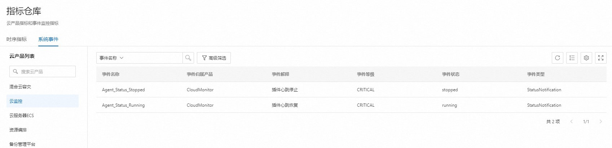

<a id="section-5"></a>

# 5.可视化

<a id="section-5-1"></a>

## 5.1. 自定义大盘

您可以根据业务需求，创建个性化的数据可视化大盘，用于监控、分析和展示关键指标，便于直观、高效地理解和管理数据。

**预置大盘**

系统提供的预置大盘如下：

- 消息队列MQ

- Elasticsearch on K8s

- 对象存储OSS

- 负载均衡SLB

- 云服务器ECS

- 云数据库Redis（集群版）

- 云数据库Redis（标准版/读写分离版）

- 云数据库RDS-PG（云盘）

- 云数据库RDS-PG（本地SSD）

- 云数据库RDS-PolarDB

- 云数据库RDS-MYSQL

**创建目录**

1. 登录Apsara Uni-manager运营控制台。

2. 单击顶部菜单栏的**产品**，选择**迁移与运维管理** > **运维与监控** > **云监控**。

3. 在左侧导航栏，选择**可视化 > 自定义大盘**。

4. 单击页面上方的**创建目录**。

5. 在输入框中，输入目录名称。

6. 单击Enter键。

**修改目录名称**

> **重要**
>
> 预置的目录不支持修改名称。

1. 在**自定义大盘**页面，单击目录右侧的  。

2. 在输入框，重新输入目录名称。

3. 单击Enter键。

**删除目录**

> **重要**
>
> - 预置的目录不支持删除。
>
> - 删除目录，该目录下的大盘也会被删除，请谨慎操作！

1. 在**自定义大盘**页面，单击目录右侧的  。

2. 在弹框中，单击**确定**。

**创建大盘**

> **重要**
>
> 创建大盘前，请先完成目录的创建，否则保存大盘时无法保存到对应目录。

1. 在**自定义大盘**页面，单击页面上方的**创建大盘**。

2. 在**创建大盘**弹框中，输入**大盘名称**，选择**大盘目录**，单击**确定**。

   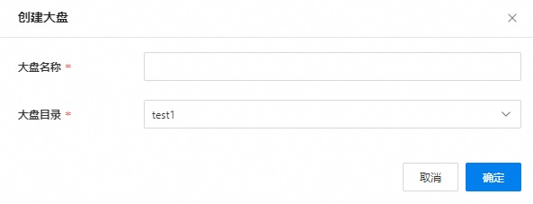

3. 在大盘页面，您可以新建卡片和行容器。

   - **新建卡片**

     <ol type="a">

     <li>

     单击**新建卡片**，选择**新建卡片**。

     </li>

     <li>

     在新建卡片页面，设置图表的**数据配置**、**数据变换**（可选）和**图表配置**（可选）。

     - **数据配置**：单击**新增 Query**，选择需要监控的**云产品**、**监控指标**、**统计方法**和**监控范围**等。

       > **说明**
       >
       > 可以添加多个数据配置。

       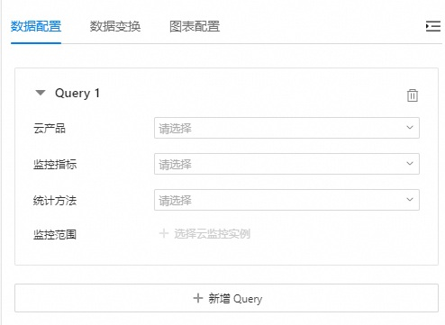

     - （可选）**数据变换**：单击**新增数据变换 > 数据筛选**，勾选需要设置筛选功能的数据列；单击**新增数据变换 > 数据列命名**，可对数据列重新命名；单击**新增数据变换 > 表合并**，可将多个表格合并为一个表格，仅对表格生效。

       > **重要**
       >
       > 配置数据变换前需要先配置数据配置。

       

     - （可选）**图表配置**：配置基础信息、图表类型、图表元素、坐标轴、图例、辅助线、辅助面积、数据轴配置、数据映射等。

       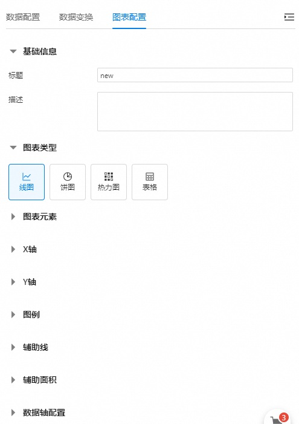

     </li>

     </ol>

     <ol type="i" start="100">

     <li>

     设置完成后，单击图表上方的**应用于大盘**，即可保存该图表。

     > **说明**
     >
     > - 单击图表上方的**取消**，则取消保存该图表。
     >
     > - 单击图表上方**最近1小时**的下拉列表，选择或自定义图表监控的时间范围。

     

     </li>

     </ol>

   - **添加行容器**

     <ol type="a">

     <li>

     在大盘页面单击**新建卡片**，选择**新建行容器**。

     </li>

     <li>

     鼠标悬浮在行容器上，单击  ，编辑行名称。

     > **说明**
     >
     > 鼠标悬浮在行容器上，单击
     >
     > ，可删除行容器。
     >
     > 

     </li>

     </ol>

4. 卡片和行容器添加完成后，您可以自定义大盘布局。

   - 在画布区域右上方的下拉列表，单击**布局模板**，可选择**每行展示1个**、**每行展示2个**、**每行展示3个**、**每行展示4个**。

   - 鼠标拖动卡片，可调整其位置。

   - 单击卡片右上角的 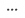 ，可选择对卡片进行**编辑**、**复制**、**删除**、**查看**等操作。

5. （可选）单击大盘上方**最近1小时**下拉列表，选择或自定义大盘监控的时间范围。

   > **说明**
   >
   > 卡片编辑页设置的时间仅在编辑页对该卡片生效（相当于临时查看这个卡片在其他时间的数据），当从卡片编辑页返回大盘后，则统一以大盘设置的时间为准。

6. （可选）单击  右侧的下拉列表，设置大盘的自动刷新时间。

   > **说明**
   >
   > 设置为off时，表示关闭自动刷新。

7. (可选)单击大盘上方的  ，可查看或编辑大盘的基础配置和JSON模式。

   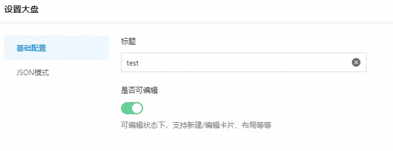

   - **基础配置**

     在基础配置中，您可以查看或修改大盘名称以及可编辑开关。

     > **说明**
     >
     > 可编辑开关打开，则可以添加或删除图表、行容器，以及自定义大盘布局，否则不能进行这些操作。

   - **JSON模式**JSON模式中以JSON格式显示该大盘信息。您也可以通过JSON去进行编辑，单击**预览**，可预览是否符

     合预期，符合则单击  ，即可保存该JSON。

8. 单击  保存大盘，大盘创建完成。

**修改大盘内容和布局**

> **重要**
>
> 预置的大盘不支持修改内容和布局。

1. 在**自定义大盘**页面，单击目标目录，在右侧展示的大盘中，单击大盘名称。

2. 在大盘详情页面，根据需要修改大屏的卡片、行容器以及布局等。具体可参见创建大盘。

**修改大盘名称**

> **重要**
>
> 预置的大盘不支持修改名称。

1. 在**自定义大盘**页面，单击目标目录，在右侧展示的大盘列表中，单击大盘操作列的**编辑**。

2. 在**编辑大盘**对话框，重新输入大盘名称。

3. 单击**确定**。

**移动大盘**

> **重要**
>
> 预置的大盘不支持移动。

- **移动单个大盘**

  <ol type="i">

  <li>

  在**自定义大盘**页面，单击目标目录，在右侧展示的大盘列表中，单击大盘操作列的**编辑**。

  </li>

  <li>

  在**编辑大盘**对话框，选择大盘所属文件夹。

  </li>

  <li>

  单击**确定**。

  </li>

  </ol>

- **批量移动大盘**

  <ol type="i">

  <li>

  在**自定义大盘**页面，单击目标目录，在右侧展示的大盘列表中，勾选需要移动的大盘。

  </li>

  <li>

  单击页面下方的**移动**。

  </li>

  <li>

  在**批量移动大盘**对话框，选择大盘所属目录。

  </li>

  <li>

  单击**确定**。

  </li>

  </ol>

**复制大盘**

复制大盘即快速新增一个相同的大盘。

1. 在**自定义大盘**页面，单击目标目录，在右侧展示的大盘列表中，单击大盘操作列的**复制**。

2. 在**复制大盘**对话框，重新输入大盘名称，选择大盘所属文件夹。

3. 单击**确定**。

**设置默认大盘**

> **重要**
>
> - 只能设置一个默认大盘。
>
> - 设置目标大盘为默认大盘后，会覆盖之前的默认大盘，同时进入自定义大盘时会自动展示该大
>
>   盘。单击默认大盘页面左上方的  可返回目录页。

1. 在**自定义大盘**页面，单击目标目录，在右侧展示的大盘列表中，单击大盘操作列的**设为默认大盘**。

2. 单击**确定**。

**删除大盘**

> **重要**
>
> 预置的大盘不支持删除。

- **删除单个大盘**

  <ol type="i">

  <li>

  在**自定义大盘**页面，单击目标目录，在右侧展示的大盘列表中，单击大盘操作列的**删除**。

  </li>

  <li>

  单击**确定**。

  </li>

  </ol>

- **批量删除大盘**

  <ol type="i">

  <li>

  在**自定义大盘**页面，单击目标目录，在右侧展示的大盘列表中，勾选需要删除的大盘。

  </li>

  <li>

  单击页面下方的**删除**。

  </li>

  <li>

  单击**确定**。

  </li>

  </ol>

<a id="section-6"></a>

# 6.报警服务

报警服务中提供了报警规则、报警历史和报警模板的能力。通过设置报警规则来定义报警系统如何检查监控数据，当监控数据满足报警规则时发送报警通知。报警发生时生成报警历史，可对近期报警历史进行分析复查，帮助定位问题根源并作出预测。报警模板简化了大量云资源场景创建和维护报警规则的过程，助力更高效的监控服务。

<a id="section-6-1"></a>

## 6.1. 报警历史

当报警发生后，可以按照云产品、云服务实例、报警级别等查看报警历史信息。支持导出并下载报警历史信息，便于在本地进行数据分析。

**操作步骤**

1. 登录Apsara Uni-manager运营控制台。

2. 单击顶部菜单栏的**产品**，选择**迁移与运维管理** > **运维与监控** > **云监控**。

3. 在左侧导航栏，选择**报警服务** > **报警历史**。

4. （可选）在**报警历史**页面，可通过**云产品选择**、**规则ID**、**规则名称**、**实例ID**、**报警级别**和时间来筛选目标报警历史记录。

   > **说明**
   >
   > 数据传输服务DTS不显示故障实例信息。

5. 在报警历史页面，执行以下操作。

   <table>
     <tr>
       <th width="170">操作任务</th>
       <th>操作步骤</th>
     </tr>
     <tr>
       <td>查看报警历史</td>
       <td>在<strong>报警历史</strong>列表中，可以直接查看目标报警历史的<strong>产品名称</strong>、<strong>故障实</strong><strong>例</strong>、<strong>发生时间</strong>、<strong>规则名称</strong>、<strong>状态</strong>、<strong>等级</strong>和<strong>通知对象</strong>。单击目标报警历史对应规格名称，可以查看报警规则详情。<br>说明报警历史默认支持查询最近2天的数据。</td>
     </tr>
     <tr>
       <td>导出并下载报警历史</td>
       <td>i. 在<strong>报警历史</strong>页面，单击页面右上方的。<br>ii. 在<strong>导出任务</strong>对话框中，设置<strong>时间选择</strong>和<strong>任务名称</strong>后，单击<strong>确定</strong>。iii. 在左侧导航栏单击<strong>报表导出</strong>，在<strong>报表导出</strong>页面单击<strong>报警历史</strong>页签。iv. 单击目标报表<strong>操作</strong>列中的<strong>下载报表任务</strong>。<br>v. 在<strong>下载报表任务</strong>对话框中，单击<strong>确定</strong><br>说明所下载报表的格式为<strong>.xlsx</strong>，请在浏览器下载路径下查找下载报表。</td>
     </tr>
   </table>

<a id="section-6-2"></a>

## 6.2. 报警规则

支持对主机监控中的监控项、云服务监控中的实例设置报警规则。可以在全部资源、应用分组和单实例维度设置报警规则。报警服务支持通过邮件、钉钉和Webhook地址接收报警通知。

> **说明**
>
> 在Root组织下，不支持操作报警规则。

<a id="section-6-2-1"></a>

### 6.2.1. 创建报警规则

云监控CMS支持为云服务器ECS等所有接入云监控的云产品创建报警规则，按照所设定的云产品监控指标阈值进行告警，及时通知相关用户。

**背景信息**

报警规则在生效时间内，云监控CMS根据默认的探测频率检测报警指标是否超出所设定的阈值，一旦检测到云产品监控指标超出阈值（出现异常），按照设定的报警联系人或其他报警信息处理平台进行告警。

> **说明**
>
> 除云数据库RDS（老链路）报警探测频率为每60~300秒一次（周期不定）外，其他云产品的最小报警探测频率均为每分钟一次。

**操作步骤**

1. 登录Apsara Uni-manager运营控制台。

2. 单击顶部菜单栏的**产品**，选择**迁移与运维管理** > **运维与监控** > **云监控**。

3. 在左侧导航栏选择**报警服务** > **报警规则**。

4. 单击列表上方的**创建报警规则**。

5. 在**创建报警规则**面板中，根据实际需要设置相应配置项。

   <table>
     <tr>
       <th width="137">配置项</th>
       <th>说明</th>
     </tr>
     <tr>
       <td>云产品选择</td>
       <td>选择需要监控告警的云产品。</td>
     </tr>
     <tr>
       <td>资源范围</td>
       <td>报警规则关联资源的范围，支持以下几类。不同云产品可选择的范围类型存在一定差异。<br>• <strong>实例维度</strong>：选择当前组织资源集下的一个或多个目标实例。<br>• <strong>资源集</strong>：选择当前组织和地域下的目标资源集。<br>• <strong>应用分组</strong>：选择当前组织和地域下的应用分组。<br>• <strong>全部资源</strong>：默认不支持选择。</td>
     </tr>
     <tr>
       <td>资源选择</td>
       <td>根据<strong>资源范围</strong>的选择，选择具体的资源实例、资源集或应用分组。</td>
     </tr>
     <tr>
       <td>规则类型</td>
       <td>支持<strong>单指标规则</strong>和<strong>多指标规则</strong>。</td>
     </tr>
     <tr>
       <td>报警规则描述</td>
       <td>报警规则的主体。当监控数据满足报警条件时，触发报警规则。规则描述设置方法：<br>• 规则类型为<strong>单指标规则</strong><br>a. 单击<strong>创建报警规则</strong>。<br>b. 在<strong>创建报警规则</strong>面板，设置<strong>规则名称</strong>、<strong>指标维度</strong>、<strong>监控指标</strong>、<strong>阈值及报警级别</strong>等。<br>说明指标维度仅在资源范围选择<strong>实例维度</strong>时才会显示。<br>c. 单击<strong>确认</strong>。<br>• 规则类型为<strong>多指标规则</strong><br>a. 单击<strong>创建多指标规则</strong>。<br>b. 在<strong>创建多指标规则</strong>面板，设置<strong>规则名称</strong>、<strong>阈值及告警级别</strong>、<strong>多指标报警规则</strong>、<strong>多指标关</strong><strong>系</strong>、<strong>报警阈值触发次数</strong>。<br>c. 单击<strong>确定</strong>。</td>
     </tr>
     <tr>
       <td>沉默通道周期</td>
       <td>报警发生后未恢复正常，间隔多久重复发送一次报警通知。取值：<strong>5分钟</strong>、<strong>15分钟</strong>、<strong>30分</strong><strong>钟</strong>、<strong>1小时</strong>、<strong>3小时</strong>、<strong>6小时</strong>、<strong>12小时</strong>和<strong>24小时</strong>。当某监控指标超出报警阈值时触发报警，如果监控指标在沉默通道周期内持续超过报警阈值，在沉默通道周期内不会重复发送报警通知；如果监控指标在沉默通道周期后仍未恢复正常，则云监控将再次发送报警通知。例如，当<strong>沉默通道周期</strong>设置为<strong>12小时</strong>时，如果超出报警阈值的监控指标在首次触发报警后12小时仍未恢复正常，云监控将再次发送报警通知。</td>
     </tr>
     <tr>
       <td>生效时间</td>
       <td>报警规则的生效时间。报警规则只在生效时间内检查监控数据是否超出报警阈值。</td>
     </tr>
     <tr>
       <td>报警回调</td>
       <td>用于接收云监控通过POST请求推送报警消息的回调地址。<br>说明报警回调地址必须是云监控可访问的域名地址，仅支持HTTP协议，不支持填写IP。</td>
     </tr>
     <tr>
       <td>无数据处理方法</td>
       <td>无监控数据时报警的处理方式。<br>• 不做任何处理<br>• 发送无数据报警</td>
     </tr>
     <tr>
       <td>报警联系人</td>
       <td>选择报警信息发送的用户组或用户。默认的云账号报警联系人组是一个空账号，可用于测试报警规则的有效性。</td>
     </tr>
   </table>

6. 单击**确定**。

**规则描述配置项说明**

| 配置项 | 说明 |
| --- | --- |
| 规则名称 | 填写报警规则名称。 |
| 监控指标 | 从当前报警规则所选择的云产品的所有监控指标中，选择目标指标项。各云产品的监控指标详情可参见云产品监控指标说明。 |
| 指标维度 | 指除实例ID之外的其他维度。仅在资源范围选择<strong>实例维度</strong>时才会显示。 |
| 阈值及报警级别（单位：%） | • 报警级别分为<strong>紧急</strong>、<strong>警告</strong>和<strong>普通</strong>。<br>• 监控数据的聚合值类型可以选择<strong>平均值</strong>、<strong>最小值</strong>和<strong>最大值</strong>。<br>• 监控数据的周期可以选择<strong>连续</strong>、<strong>连续5个周期</strong>、<strong>连续10个周期</strong>、<strong>连续15个周期</strong>、<strong>连续30个周</strong><strong>期</strong>、<strong>连续60个周期</strong>。<br>• 实际监控数据与报警阈值之间的比较关系，支持 “<strong>&gt;</strong>”、“ <strong>&gt;=</strong>”、“<strong>&lt;</strong>”、“<strong>&lt;=</strong> ”、“<strong>=</strong>”、“<strong>!=</strong>”、“<strong>同比昨天同时间上涨</strong>”、“<strong>同比昨天同时间下降</strong>”、“<strong>环比上周期上涨”</strong>、<strong>“环比上周期</strong><strong>下降”</strong>、<strong>”比昨天增量“</strong>、<strong>”比昨天降量“</strong>、<strong>“比上周期增量”</strong>、<strong>“比上周期降量”</strong>的选择。还支持设置阈值和触发次数，当监控数据达到设置的阈值的触发次数时，产生报警。 |

**规则配置示例**

为云服务器ECS创建一个名为example的报警规则，用于监控目标ECS实例的CPU使用率，当CPU使用率峰值（最大值）在五个探测周期内有三次大于等于70%的情况时触发报警，且报警级别为紧急。

适用于此场景的规则描述配置如下图所示。

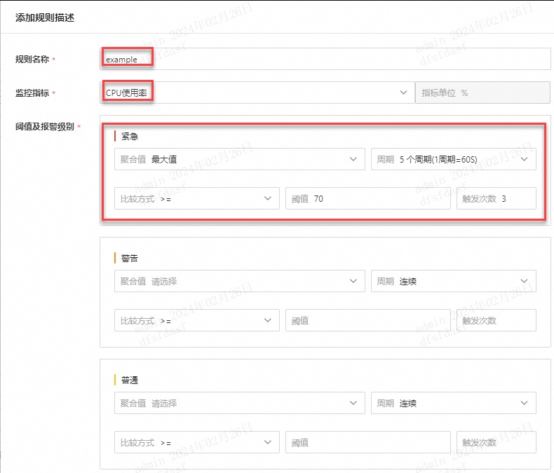

<a id="section-6-2-2"></a>

### 6.2.2. 管理报警规则

在报警规则列表中，可以对报警规则进行修改、禁用、启用、删除等操作。

**操作步骤**

1. 登录Apsara Uni-manager运营控制台。

2. 单击顶部菜单栏的**产品**，选择**迁移与运维管理** > **运维与监控** > **云监控**。

3. 在左侧导航栏选择**报警服务** > **报警规则**。

4. 选择目标报警规则，执行相关操作。

   <table>
     <tr>
       <th width="170">操作任务</th>
       <th>操作步骤</th>
     </tr>
     <tr>
       <td>查看报警规则详情</td>
       <td>单击目标报警规则<strong>操作</strong>列的<strong>详情</strong>，在<strong>报警规则/报警历史/故障资源</strong>面板中可查看报警规则的详细信息。</td>
     </tr>
     <tr>
       <td>判断规则有效性</td>
       <td>单击目标报警规则<strong>有效性</strong>列的<strong>点击巡检</strong>，在有效性列可查看巡检结果。<br>说明<br>• 若巡检结果异常，可单击<strong>检测结果</strong>，在弹出的面板中查看<strong>告警规则执行异常</strong><strong>检测</strong>、<strong>告警规则加载检测</strong>、<strong>无效报警规则检测</strong>和<strong>告警规则回调检测</strong>结果。<br>• 单击<strong>重新检测</strong>，可重新检测规则有效性。</td>
     </tr>
     <tr>
       <td>查看规则执行记录</td>
       <td>单击目标报警规则<strong>规则执行记录</strong>列的<strong>查看规则执行记录</strong>，在<strong>报警规则执行记录</strong>面板中，可通过时间范围筛选执行记录。</td>
     </tr>
     <tr>
       <td>修改报警规则</td>
       <td>i. 单击目标报警规则<strong>操作</strong>列的<strong>编辑。</strong>ii. 在<strong>修改报警规则</strong>面板中，修改报警规则。相关配置参数说明请参考创建报警规则。iii. 修改完成后，单击<strong>确定</strong>。</td>
     </tr>
     <tr>
       <td>禁用报警规则</td>
       <td>当需要手动停止云产品的服务，进行维护或升级时，可以禁用报警规则，避免因人为变更而收到大量且无用的报警通知。<br>说明请先确认报警规则的<strong>状态</strong>为<strong>正常</strong>后，再进行禁用。<br>• 单个禁用<br>a. 单击目标报警规则<strong>操作</strong>列的图标，单击<strong>禁用。</strong><br>b. 在<strong>禁用报警规则</strong>对话框中，单击<strong>确定。</strong><br>• 批量禁用<br>a. 选中目标报警规则前的复选框，然后单击列表左下角的<strong>禁用</strong>。<br>b. 在<strong>禁用报警规则</strong>对话框，单击<strong>确定</strong>。</td>
     </tr>
     <tr>
       <td>启用报警规则</td>
       <td>完成云产品的维护或升级后，可以重新启用已被禁用的报警规则。<br>说明请先确认报警规则的<strong>状态</strong>为<strong>已禁用</strong>后，再进行<strong>启用</strong>。<br>• 单个启用<br>a. 单击目标报警规则<strong>操作</strong>列的<strong>启用。</strong><br>b. 在<strong>启用报警规则</strong>对话框中，单击<strong>确定。</strong><br>• 批量启用<br>a. 选中目标报警规则前的复选框，然后单击列表左下角的<strong>启用</strong>。<br>b. 在<strong>启用报警规则</strong>对话框，单击<strong>确定</strong>。</td>
     </tr>
     <tr>
       <td>删除报警规则</td>
       <td>• 单个删除<br>a. 单击目标报警规则操作列的图标，单击<strong>删除</strong>。<br>b. 在<strong>删除报警规则</strong>对话框中，单击<strong>确定</strong>。<br>• 批量删除<br>a. 选中目标报警规则前的复选框，然后单击列表左下角的删除。<br>b. 在<strong>删除报警规则</strong>对话框中，单击<strong>确定</strong>。</td>
     </tr>
     <tr>
       <td>导出并下载报警规则</td>
       <td>i. 在<strong>报警规则</strong>页面，单击导出报表。<br>ii. 在<strong>导出任务</strong>对话框中，填入<strong>任务名称</strong>。iii. 单击<strong>确定</strong>。iv. 在左侧导航栏单击<strong>报表导出</strong>。<br>v. 在<strong>报警规则</strong>页签，单击目标报表<strong>操作</strong>列中的<strong>下载报表任务</strong>。vi. 在下<strong>载报表任务</strong>对话框中，单击<strong>确定</strong>。</td>
     </tr>
     <tr>
       <td>老链路规则迁移</td>
       <td>i. 在<strong>报警规则</strong>页面，单击。<br>ii. 在弹出的面板中，勾选需要查看的老链路产品，页面展示云产品对应的老链路规则列表。iii. 对老链路规则可执行以下操作：<br>• 创建与老链路对应的新链路规则<br>• 创建新链路规则，并删除老链路规则<br>• 删除老链路规则iv. 单击<strong>确认</strong>。</td>
     </tr>
   </table>

<a id="section-6-2-3"></a>

### 6.2.3. CMS报警外发的通知策略

云监控CMS报警外发支持钉钉、邮件、Webhook和ASO平台侧通知等几种方式。

**钉钉、邮件通知方式**

- **配置报警联系组**

  在创建/修改报警规则时，在报警联系组中选择用户或用户组。创建/修改报警规则具体可参见创建报警规则。

- **启用所选用户钉钉、邮件通知方式**

  所选用户或用户组中的用户需要配置可接收钉钉或邮件通知方式，以及补充对应的钉钉密钥或邮件Email。钉钉密钥、邮件Email以及通知方式的启用可在创建/修改用户时进行补充或修改，具体可参见《Apsara Uni-manager运营控制台 用户指南》中创建用户章节。

  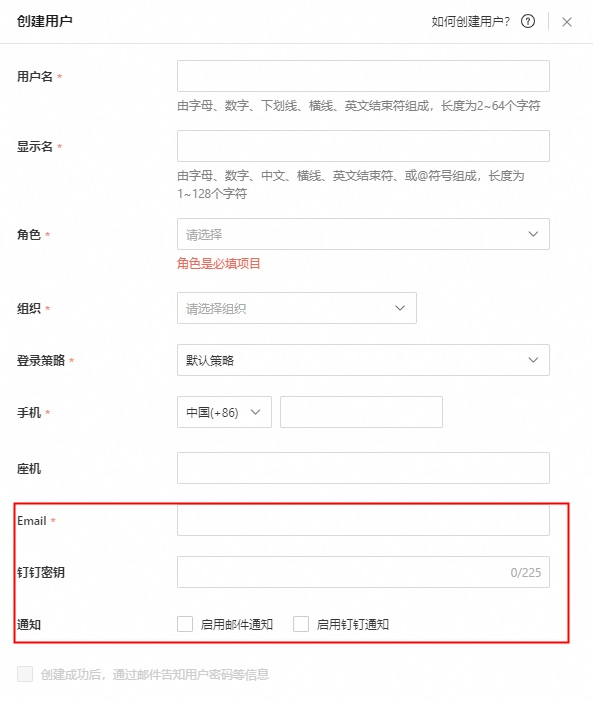

  - 邮件的消息体内容支持对报警、日志和事件的通知，具体发送内容如下：

    - **报警-邮件模板内容**

      HTML

      ```xml
      <html>
      <head>
          <meta http-equiv="Content-Type" content="text/html; charset=utf-8">
      </head>
      <body>
      <style>table{font-size:14px;}</style>
      <div align="center">
      <font color="#525252">
      <table border="0" style="border:5px solid #F2F2F2;" cellspacing="2" 
      cellpadding="2" width="900" style="table-layout:fixed">
          <tr bgcolor="#D1D1D1">
              <th align="left" style="font-size:23px;">告警信息</th>
          </tr>

          <!-- 原始等级 -->
          {{ if index . "sourceLevel" }} 
              <tr>
                  <td align="left" style="font-family:微软雅⿊; size=5; WORD-WRAP:break-w
      ord">原始等级: {{ .sourceLevel }}</td>
              </tr>
          {{ end }}

          <!-- 规则名称 -->
          <tr>
              <td align="left" style="font-family:微软雅⿊; size=5; WORD-WRAP:break-word"
      >规则名称: {{ .ruleName }}</td>
          </tr>

          <!-- 规则ID -->
          <tr>
              <td align="left" style="font-family:微软雅⿊; size=5; WORD-WRAP:break-word"
      >规则ID: {{ .alertName }}</td>
          </tr>

          <!-- 产品 -->
          <tr>
              <td align="left" style="font-family:微软雅⿊; size=5; WORD-WRAP:break-word"
      >产品: {{ .metricProject }}</td>
          </tr>

          <!-- 实例ID -->
          <tr>
              <td align="left" style="font-family:微软雅⿊; size=5; WORD-WRAP:break-word"
      ><b>实例id:</b> {{ .instanceId }}</td>
          </tr>

          <!-- 实例名称 -->
          <tr>
              <td align="left" style="font-family:微软雅⿊; size=5; WORD-WRAP:break-word"
      ><b>实例名称:</b> {{ .instanceName }}</td>
          </tr>

          <!-- ECS实例IP -->
          {{ if eq .product "ecs_instance" }}
              <tr>
                  <td align="left" style="font-family:微软雅⿊; size=5; WORD-WRAP:break-w
      ord">IP: {{ .detail.VpcAttributes.PrivateIpAddress.IpAddress }}</td>
              </tr>
          {{ end }}

          <!-- 告警等级 -->
          <tr>
              <td align="left" style="font-family:微软雅⿊; size=5; WORD-WRAP:break-word"
      >告警等级: {{ .level }}</td>
          </tr>

          <!-- 告警时间 -->
          <tr>
              <td align="left" style="font-family:微软雅⿊; size=5; WORD-WRAP:break-word"
      >告警时间: {{ .time }}</td>
          </tr>

          <!-- 监控指标 -->
          <tr>
              <td align="left" style="font-family:微软雅⿊; size=5; WORD-WRAP:break-word"
      >监控指标: {{ .metricName }}</td>
          </tr>

          <!-- 判断规则 -->
          <tr>
              <td align="left" style="font-family:微软雅⿊; size=5; WORD-WRAP:break-word"
      >判断规则: {{ .expression }}</td>
          </tr>

          <!-- 告警值 -->
          <tr>
              <td align="left" style="font-family:微软雅⿊; size=5; WORD-WRAP:break-word"
      >告警值: {{ if eq .rawLevel "NODATA" }} 无数据 {{ else }}  {{ .value }} {{ end }}</td>
          </tr>
      </table>
      <br/>
      <p>此邮件为ASCM/CMS监控平台⾃动发送,请勿回复!</p>
      </body>
      </html>
      ```

    - **日志-邮件模板内容**

      HTML

      ```xml
      <font color=#778899 face="微软雅⿊">⽇志告警</font>
      <br />
      *****
      <font color=#778899 face="微软雅⿊">产品</font>: {{ .product }} &ensp;&ensp; <font color=#778899 face="微软雅⿊">等级</font>: 
      <font color={{ if eq .level "P1"}} #FF0000 {{ else if eq .level "P2"}} #FF8000 {{
      else if eq .level "P3"}} #c8c64e {{ else if eq .level "P4"}} #BF00FF {{ else}} #2
      CBD22 {{end}} face="⿊体">{{ .level }}</font>
      <br />
      <font color=#778899 face="微软雅⿊">规则名称</font>：{{ .ruleName }}
      <br />
      {{ if index . "sourceLevel"}}
      <font color=#778899 face="微软雅⿊">原始等级</font>:{{ .sourceLevel}}
      {{ end }}
      <br />
      <font color=#778899 face="微软雅⿊">监控指标</font>：{{ .metricName }}
      <br />
      <font color=#778899 face="微软雅⿊">关联资源</font>：{{ .dimensions }}
      <br />
      <font color=#778899 face="微软雅⿊">告警值</font>：{{ .message.metricColumns }}
      <br />
      <font color=#778899 face="微软雅⿊">判断规则</font>：{{ .message.expression }}
      <br />
      <font color=#778899 face="微软雅⿊">规则ID</font>：{{ .alertName }}
      <br />
      <font color=#778899 face="微软雅⿊">报警时间</font>：{{ .time }}
      <br />
      *****
      <br />
      >此消息由ASCM/CMS发送，请尽快处理
      ```

    - **事件-邮件模板内容**

      HTML

      ```xml
      <html>
      <head>
          <meta http-equiv="Content-Type" content="text/html; charset=utf-8">
      </head>
      <body>
      <style>table{font-size:14px;}</style>
      <div align="center">
      <font color="#525252">
      <table border="0" style="border:5px solid #F2F2F2;" cellspacing="2" 
      cellpadding="2" width="900" style="table-layout:fixed">
          <tr bgcolor="#D1D1D1">
              <th align="left" style="font-size:23px;">事件告警</th>
          </tr>

          <!-- 产品 -->
          <tr>
              <td align="left" style="font-family:微软雅⿊; WORD-WRAP: break-word">产品: 
      {{ .product }}</td>
          </tr>

          <!-- 实例名称 -->
          <tr>
              <td align="left" style="font-family:微软雅⿊; WORD-WRAP: break-word">实例名
      称: {{ .instanceName }}</td>
          </tr>

          <!-- 实例ID -->
          <tr>
              <td align="left" style="font-family:微软雅⿊; WORD-WRAP: break-word">实例ID: {{ .resourceId }}</td>
          </tr>

          <!-- 内容 -->
          <tr>
              <td align="left" style="font-family:微软雅⿊; WORD-WRAP: break-word">内容: 
      {{ .content }}</td>
          </tr>

          <!-- 事件 -->
          <tr>
              <td align="left" style="font-family:微软雅⿊; WORD-WRAP: break-word">事件: 
      {{ .name }}</td>
          </tr>

          <!-- 规则名称 -->
          <tr>
              <td align="left" style="font-family:微软雅⿊; WORD-WRAP: break-word">规则名
      称: {{ .ruleName }}</td>
          </tr>

          <!-- 规则ID -->
          <tr>
              <td align="left" style="font-family:微软雅⿊; WORD-WRAP: break-word">规则ID: {{ .alertName }}</td>
          </tr>

          <!-- 告警等级 -->
          <tr>
              <td align="left" style="font-family:微软雅⿊; WORD-WRAP: break-word">告警等
      级: {{ .level }}</td>
          </tr>

          <!-- 报警时间 -->
          <tr>
              <td align="left" style="font-family:微软雅⿊; WORD-WRAP: break-word">报警时
      间: {{ .time }}</td>
          </tr>
      </table>
      <br/>
      <p>此邮件为ASCM/CMS监控平台⾃动发送,请勿回复!</p>
      </body>
      </html>
      ```

  - 钉钉的消息体内容支持对报警、日志和事件的通知，具体发送内容如下：

    - **报警-钉钉模板内容**

      HTML

      ```xml
      # # #
      <font color=#778899 face="微软雅⿊">产品</font>: {{ .metricProject }} &ensp;&ensp; 
      <font color=#778899 face="微软雅⿊">等级</font>: <font color={{ if eq  .level "P1"}
      } #FF0000 {{ else if eq  .level "P2"}} #FF8000 {{ else if  eq .level "P3"}} #c8c64e {{ else if eq  .level "P4"}} #BF00FF {{ else  }} #2CBD22 {{end}} face="⿊体">{{
      .level }}</font>

      {{ if index . "sourceLevel"}}
      <font color=#778899 face="微软雅⿊">原始等级</font>: {{ .sourceLevel}}
      {{ end}}

      <font color=#778899 face="微软雅⿊">告警值</font>: {{ if eq .rawLevel "NODATA"}} 无
      数据 {{ else}}{{ .value}}{{ end}}

      <font color=#778899 face="微软雅⿊">实例ID</font>:&ensp;{{ .instanceId}}

      <font color=#778899 face="微软雅⿊">实例名称</font>:&ensp;{{ .instanceName}}

      {{ if eq  .product "ecs_instance"}}

      <font color=#778899 face="微软雅⿊">IP</font>: {{ 
      .detail.VpcAttributes.PrivateIpAddress.IpAddress}}
      {{ end}}

      <font color=#778899 face="微软雅⿊">规则名称</font>: {{ .ruleName}}

      <font color=#778899 face="微软雅⿊">规则ID</font>: {{ .alertName}}

      <font color=#778899 face="微软雅⿊">监控指标</font>: {{ .metricName}}

      <font color=#778899 face="微软雅⿊">判断规则</font>: {{ .expression}}

      <font color=#778899 face="微软雅⿊">报警时间</font>: {{ .time}}

      *****
      > 此消息由ASCM/CMS发送，请尽快处理
      ```

    - **日志-钉钉模板内容**

      HTML

      ```xml
      <font color=#778899 face="微软雅⿊">⽇志告警</font>

      *****
      <font color=#778899 face="微软雅⿊">产品</font>: {{ .product }} &ensp;&ensp; <font color=#778899 face="微软雅⿊">等级</font>: <font color={{ if eq  .level "P1"}} #FF0000 {{ else if eq  .level "P2"}} #FF8000 {{ else if  eq .level "P3"}} #c8c64e {{ 
      else if eq  .level "P4"}} #BF00FF {{ else  }} #2CBD22 {{end}} face="⿊体">{{ .leve
      l }}</font>

      <font color=#778899 face="微软雅⿊">规则名称</font>： {{ .ruleName }}

      {{ if index . "sourceLevel"}}
      <font color=#778899 face="微软雅⿊">原始等级</font>: {{ .sourceLevel }}
      {{ end }}

      <font color=#778899 face="微软雅⿊">监控指标</font>： {{ .metricName }}

      <font color=#778899 face="微软雅⿊">关联资源</font>： {{ .dimensions }}

      <font color=#778899 face="微软雅⿊">告警值</font>： {{ .message.metricColumns }}

      <font color=#778899 face="微软雅⿊">判断规则</font>： {{ .message.expression }}

      <font color=#778899 face="微软雅⿊">规则ID</font>： {{ .alertName }}

      <font color=#778899 face="微软雅⿊">报警时间</font>： {{ .time }}

      *****

      >此消息由ASCM/CMS发送，请尽快处理
      ```

    - **事件-钉钉模板内容**

      HTML

      ```xml
      <font color=#778899 face="微软雅⿊">事件告警</font>

      *****
      <font color=#778899 face="微软雅⿊">产品</font>: {{ .product }} &ensp;&ensp; <font color=#778899 face="微软雅⿊">等级</font>: <font color= {{ if eq  .level "P1"}} #FF0000 {{ else if eq  .level "P2"}} #FF8000 {{ else if  eq .level "P3"}} #c8c64e {{
      else if eq  .level "P4"}} #BF00FF {{ else  }} #2CBD22 {{end}} face="⿊体">{{ .leve
      l }}</font>

      <font color=#778899 face="微软雅⿊">实例名称</font>： {{ .instanceName }}

      <font color=#778899 face="微软雅⿊">实例ID</font>： {{ .resourceId }}

      <font color=#778899 face="微软雅⿊">内容</font>： {{ .content }}

      <font color=#778899 face="微软雅⿊">事件</font>： {{ .name }}

      <font color=#778899 face="微软雅⿊">规则名称</font>： {{ .ruleName }}

      <font color=#778899 face="微软雅⿊">规则ID</font>： {{ .alertName }}

      <font color=#778899 face="微软雅⿊">报警时间</font>： {{ .time }}

      *****
      >此消息由ASCM/CMS发送，请尽快处理
      ```

- **ANS配置**

  > **重要**
  >
  > 配置报警联系组与启用用户钉钉、邮件通知方式后，还需要检测及配合ANS的配置。完成邮箱和钉钉的内容配置后，才允许通过该方式进行报警外发。

  <ol type="i">

  <li>

  检查ANS集群是否已经部署。

  <ol type="a">

  <li>

  登录飞天基础运维平台。

  </li>

  <li>

  在左侧菜单选择**资源管理** > **产品集群运维**。

  </li>

  </ol>

  <ol type="i" start="100">

  <li>

  在集群文本框输入ans，查找ans集群。

  </li>

  <li value="500">

  单击集群名称，进去ans集群详情。

  </li>

  </ol>

  <ol type="a" start="5">

  <li>

  在终态配置页签，找到**tag.conf**文件，确认ans版本。请确认是否已经升级到了最新版本，最新版本更加稳定，问题更少。

  </li>

  </ol>

  </li>

  <li>

  打通ANS到外网的网络。

  请联系技术支持打通ansApi.aliyunNotifyService#容器到对应钉钉服务器/邮件服务器的网络。

  > **说明**
  >
  > 此容器所在的网络为云内经典网络。

  </li>

  <li>

  检查服务是否正常。

  <ol type="a">

  <li>

  在ans集群详情页面，单击**服务列表**页签。

  </li>

  <li>

  单击**ansApi**服务进入服务详情。

  </li>

  </ol>

  <ol type="i" start="100">

  <li>

  找到**ansApi**.<strong>aliyunNotifyService#</strong>组件<strong>，</strong>单击组件机器操作列的**Terminal**。

  </li>

  <li value="500">

  执行以下命令，检查服务是否正常。

  Shell

  ```bash
  docker exec -it `docker ps|awk '/aliyunNotifyService/{print $1}'` bash
  cd /apsara/ans/
  # 检查服务是否正常
  ps -ef | grep notifier | grep -v grep
  netstat -antp | grep notifier | grep 8010
  ```

  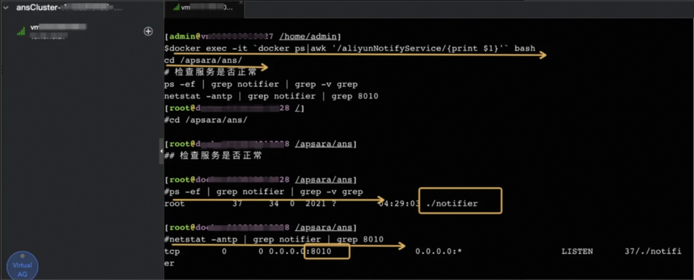

  </li>

  </ol>

  </li>

  <li>

  配置和检查邮箱、钉钉。

  具体配置和检查操作请联系技术支持进行协助解决。

  > **重要**
  >
  > 在进行钉钉机器人配置时，强烈推荐使用加签模式，钉钉机器人带加签的配置更加安全。

  </li>

  </ol>

**Webhook通知方式**

Webhook是指云监控CMS往客户配置的域名发送POST请求，也就是说客户需要有一个服务来接收CMS的POST请求。

**配置**

客户想要使用自己的平台来处理告警，并且有服务能接收CMS发送的请求时，可以在创建/修改报警规则时，进行报警回调的配置。创建/修改报警规则具体可参见创建报警规则。

> **重要**
>
> - 报警回调配置时不能使用IP，需要使用域名。域名后缀需要与cms.cloudmonitor容器中环境变量internet_domain相同。
>
> - 客户提供的URL和CMS的alertnotify的容器网络能连通，并且主备机房都要关注。

**发送方式**

发送方式默认为POST请求，Content-Type默认只支持application/x-www-form-urlencoded。

**发送字段**

当报警规则被触发时，云监控会将报警消息发送到您指定的URL地址，发送的POST请求内容如下表所示。

| 参数 | 数据类型 | 描述 |
| --- | --- | --- |
| userId | String | 用户ID。 |
| alertName | String | 报警名称。 |
| timestamp | String | 触发本次报警的时间戳。 |
| alertState | String | 告警状态 ALARM/OK/INSUFFICIENT_DATA |
| curlLevel | String | 本次触发报警的级别。取值：<br>• CRITICAL：严重。<br>• WARN：警告。<br>• INFO：信息。 |
| curLevelDisplay | String | 等级。 |
| expression | String | 报警条件。 |
| curValue | String | 报警发生或恢复时监控项的当前值。 |
| metricName | String | 监控项名称。关于监控项名称，请参见云监控指标说明中的Metric Name。 |
| metricProject | String | 云服务名称。metricProject与namespace相同。关于云服务名称，请参见《云监控API参考》中的云产品监控项。 |
| namespace | String | 云服务命名空间。namespace与metricProject相同。关于云服务命名空间，请参见《云监控API参考》中的云产品监控项。 |
| dimensionsOrigin al | String | 原始的dimension字段，发生报警的对象。示例：{userId=110803419679\*\*\*\*, instanceId=i-8psdh7l6lphbn10l\*\*\*\*}。 |
| dimensions | String | 处理过的dimension字段，发生报警的对象。特别地，对于"SLB指标健康检查后端异常ECS实例个数"指标报警的通知中包含ecs的ip信息示例：{userId=110803419679\*\*\*\*, instanceId=lb-8psdh7l6lphbn10l\*\*\*\*,rips=10.11.1.\*\*\*\*}。 |
| appkey | String | 告警实例所在资源集ID。 |
| appName | String | 告警实例所在资源集名称。 |
| sourceLevel | String | 告警规则配置的原始等级。示例：WARN。 |

**问题排查**

报警回调配置完成后，如果一直收不到回调可联系技术支持进行问题排查。

**Apsara Uni-manager运维控制台通知方式**

CMS的报警消息会默认在Apsara Uni-manager运维控制台侧进行接收，可以借助Apsara Uni-manager运维控制台的外发渠道进行分发。具体操作请联系技术支持进行协助解决。

<a id="section-6-3"></a>

## 6.3. 报警模板

<a id="section-6-3-1"></a>

### 6.3.1. 通用报警模板

云监控为云服务器ECS、云数据库RDS、对象存储OSS、负载均衡SLB、弹性公网IP、专有云DNS、云数据库Redis等云产品预置通用报警模板。您可以直接将通用报警模板应用到资源集、应用分组快速实现针对云产品常用监控指标的监控告警能力，也可以在创建自定义模板时克隆通用模板在预置报警规则基础上根据业务需要快速定制报警模板。

通用报警模板根据云产品主要应用场景和业务实践，预置一系列常用报警规则，便于用户快速建设云产品资源运行状况的监控告警能力。

**云服务器ECS**

**默认模板**

**监控项**

**阈值**

**连续次数**

**告警级别**

**规则描述**

ECS实例CPU使用率连续五次大于等于85%

>=85.00%

5

INFO

cpu_total

ECS实例CPU使用率连续五次大于等于95%

>=95.00%

5

WARN

memory_use

ECS实例内存使用率连续五次大于等于80%

>=80.00%

5

INFO

dutilization

ECS实例磁盘空间使用率连续五次大于等于85%

>=85.00%

5

INFO

diskusage_u tilization

ECS实例磁盘空间使用率连续五次大于等于95%

>=95.00%

5

WARN

**最佳实践模板**

**监控项**

**阈值**

**连续次数**

**告警级别**

**规则描述**

（ECS）CPU使用率连续三次平均值大于90%

> 90.00%

3

Critical

CPUUtilizatio n

（ECS）CPU使用率连续三次平均值大于80%

> 80.00%

3

WARN

CPU使用率连续三次平均值大于90%

> 90.00%

3

Critical

cpu_total

CPU使用率连续三次平均值大于80%

> 80.00%

3

WARN

磁盘容量使用率连续三次平均值大于95%

> 95.00%

3

Critical

diskusage_u tilization

> 85.00%

磁盘容量使用率连续三次平均值大于85%

3

WARN

io饱和度连续三次平均值大于90

> 90

3

Critical

disk_io_util

io饱和度连续三次平均值大于80

> 80

3

WARN

内存使用率连续三次平均值大于90%

> 90.00%

3

Critical

memory_use dutilization

内存使用率连续三次平均值大于80%

> 80.00%

3

WARN

所有磁盘每秒读取次数连续三次平均值大于等于

DiskReadIOP

>= 90

3

Critical

S

90

所有磁盘每秒写入次数连续三次平均值大于等于

DiskWriteIO

>= 90

3

Critical

PS

90

gpu_decode

GPU维度解码器使用率连续三次平均值大于30

> 30.00%

3

Critical

r_utilization

gpu_encode

GPU维度编码器使用率连续三次平均值大于30

> 30.00%

3

Critical

r_utilization

GPU维度GPU使用率连续三次平均值大于90

> 90.00%

3

Critical

gpu_gpu_us edutilization

GPU维度GPU使用率连续三次平均值大于70

> 70.00%

3

WARN

gpu_memor

GPU维度显存空闲率连续三次平均值大于20

y_freeutiliza

> 20.00%

3

Critical

tion

gpu_memor

GPU维度显存使用率连续三次平均值大于80

y_usedutiliz

> 80.00%

3

Critical

ation

网卡接收错误率连续三次平均值大于等于15

>= 15.00%

3

Critical

networkin_e rror_ratio

网卡接收错误率连续三次平均值大于等于10

>= 10.00%

3

WARN

网卡接收丢包率连续三次平均值大于等于15

>= 15.00%

3

Critical

networkin_d rop_ratio

网卡接收丢包率连续三次平均值大于等于10

>= 10.00%

3

WARN

网卡发送错误率连续三次平均值大于等于15

>= 15.00%

3

Critical

networkout_ error_ratio

网卡发送错误率连续三次平均值大于等于10

>= 10.00%

3

WARN

网卡发送丢包率连续三次平均值大于等于15

>= 15.00%

3

Critical

networkout_ drop_ratio

网卡发送丢包率连续三次平均值大于等于10

>= 10.00%

3

WARN

swapUtilizati

swap分区使用率连续三次平均值大于20

> 20.00%

3

Critical

on

云盘使用率百分比连续三次平均值大于等于90

>= 90.00%

3

Critical

DiskSerialUs ePercent

云盘使用率百分比连续三次平均值大于等于80

>= 80.00%

3

WARN

**云数据库RDS**

**云数据库RDS（新链路）**

**默认模板**

适用于MySQL、PolarDB O、SQLServer数据库引擎的RDS实例资源。

| 监控项 | 阈值 | 连续次数 | 告警级别 | 规则描述 |
| --- | --- | --- | --- | --- |
| ConnectionUsa ge_new | &gt;=80.00% | 5 | INFO | RDS实例连接数使用率连续五次大于等于80% |
| CpuUsage_new | &gt;=65.00% | 5 | INFO | RDS实例CPU使用率连续五次大于等于65% |
| DataDelay | &gt;=10 | 5 | WARN | RDS只读实例延迟连续五次大于等于10秒 |
| DiskUsage_ne w | &gt;=70.00% | 5 | INFO | RDS实例磁盘使用率连续五次大于等于70% |
| IOPSUsage_ne w | &gt;=80.00% | 5 | INFO | RDS实例IOPS使用率连续五次大于等于80% |
| MemoryUsage_new | &gt;=80.00% | 5 | INFO | RDS实例内存使用率连续五次大于等于80% |

**云数据库RDS PostgreSQL**

**默认模板**

仅适用于PostgreSQL数据库引擎的RDS实例资源。

| 监控项 | 阈值 | 连续次数 | 告警级别 | 规则描述 |
| --- | --- | --- | --- | --- |
| cpu_usage | &gt;=80.00% | 5 | INFO | RDS PG实例CPU使用率连续五次大于等于80 |
| mem_usage | &gt;=80.00% | 5 | INFO | RDS PG实例内存使用率连续五次大于等于80 |
| local_fs_size_us age | &gt;=85.00% | 5 | WARN | RDS PG实例磁盘使用率连续五次大于等于85 |
| ReadLag_new | &gt;=7200 | 5 | INFO | RDS PG只读实例同步延迟连续五次大于等于7200秒 |

**云数据库RDS**

**最佳实践模板**

**监控项**

**阈值**

**连续次数**

**告警级别**

**规则描述**

磁盘使用率（新）连续三次平均值大于90

> 90.00%

3

Critical

DiskUsage_ne w

磁盘使用率（新）连续三次平均值大于80

> 80.00%

3

WARN

ConnectionUs

连接数使用率（新）连续三次平均值大于80

> 80.00%

3

WARN

age_new

CPU使用率（新）连续三次平均值大于90

> 90.00%

3

Critical

CpuUsage_ne w

CPU使用率（新）连续三次平均值大于80

> 80.00%

3

WARN

内存使用率（新）连续三次平均值大于90

> 90.00%

3

Critical

MemoryUsage _new

> 80.00%

内存使用率（新）连续三次平均值大于80

3

WARN

IOPS使用率（新）连续三次平均值大于95

> 95.00%

3

Critical

IOPSUsage_ne w

IOPS使用率（新）连续三次平均值大于90

> 90.00%

3

WARN

PG_CPU使用率连续三次平均值大于80

> 80.00%

3

Critical

cpu_usage

PG_CPU使用率连续三次平均值大于70

> 70.00%

3

WARN

PG_连接数使用率连续三次平均值大于80

> 80.00%

3

Critical

conn_usage

PG_连接数使用率连续三次平均值大于70

> 70.00%

3

WARN

PG_IOPS使用率连续三次平均值大于95

> 95.00%

3

Critical

iops_usage

PG_IOPS使用率连续三次平均值大于90

> 90.00%

3

WARN

PG_磁盘空间使用率连续三次平均值大于85

> 85.00%

3

Critical

local_fs_size_u sage

PG_磁盘空间使用率连续三次平均值大于75

> 75.00%

3

WARN

PG_内存使用率连续三次平均值大于80

> 80.00%

3

Critical

mem_usage

PG_内存使用率连续三次平均值大于80

> 80.00%

3

WARN

INODE使用率_PG云盘（新）连续三次平均值 大

> 80.00%

3

Critical

于80

InodeUsage_n ew

INODE使用率_PG云盘（新）连续三次平均值 大

> 70.00%

3

WARN

于70

**对象存储OSS**

**默认模板**

| 监控项 | 阈值 | 连续次数 | 告警级别 | 规则描述 |
| --- | --- | --- | --- | --- |
| Availability | &lt;100% | 3 | INFO | OSS Bucket可用性连续三次小于100% |

**最佳实践模板**

<table>
  <tr>
    <th>监控项</th>
    <th>阈值</th>
    <th>连续次数</th>
    <th>告警级别</th>
    <th>规则描述</th>
  </tr>
  <tr>
    <td rowspan="2">UserRequestValidR ate</td>
    <td>&gt;95.0 0%</td>
    <td>3</td>
    <td>Critical</td>
    <td>用户层级有效请求率连续三次监控值大于95</td>
  </tr>
  <tr>
    <td>&gt;90.0 0%</td>
    <td>3</td>
    <td>WARN</td>
    <td>用户层级有效请求率连续三次监控值大于90</td>
  </tr>
  <tr>
    <td rowspan="2">AuthorizationErrorR ate</td>
    <td>&gt;=30.00%</td>
    <td>3</td>
    <td>Critical</td>
    <td>客户端授权错误请求占比连续三次监控值大于等于30</td>
  </tr>
  <tr>
    <td>&gt;=20.00%</td>
    <td>3</td>
    <td>WARN</td>
    <td>客户端授权错误请求占比连续三次监控值大于等于20</td>
  </tr>
  <tr>
    <td rowspan="2">Availability</td>
    <td>&lt;=80</td>
    <td>3</td>
    <td>Critical</td>
    <td>可用性连续三次监控值小于等于80</td>
  </tr>
  <tr>
    <td>&lt;=90</td>
    <td>3</td>
    <td>WARN</td>
    <td>可用性连续三次监控值小于等于 90</td>
  </tr>
  <tr>
    <td rowspan="2">ClientOtherErrorRat e</td>
    <td>&gt;4</td>
    <td>3</td>
    <td>Critical</td>
    <td>客户端其他错误请求占比连续三次监控值大于 4</td>
  </tr>
  <tr>
    <td>&gt;1</td>
    <td>3</td>
    <td>WARN</td>
    <td>客户端其他错误请求占比连续三次监控值大于1</td>
  </tr>
  <tr>
    <td>ClientTimeoutError Rate</td>
    <td>&gt;1</td>
    <td>3</td>
    <td>Critical</td>
    <td>客户端超时错误请求占比连续三次监控值大于1</td>
  </tr>
  <tr>
    <td>NetworkErrorRate</td>
    <td>&gt;1</td>
    <td>3</td>
    <td>Critical</td>
    <td>网络错误请求占比连续三次监控值大于1</td>
  </tr>
  <tr>
    <td>RedirectRate</td>
    <td>&gt;1</td>
    <td>3</td>
    <td>Critical</td>
    <td>重定向请求占比连续三次监控值大于1</td>
  </tr>
</table>

<70.0

有效请求率连续三次监控值小于70

3

Critical

0%

RequestValidRate

<90.0

有效请求率连续三次监控值小于90

3

WARN

0%

客户端资源不存在错误请求占比连续三次监控值 大

>5

3

Critical

于5

ResourceNotFound ErrorRate

客户端资源不存在错误请求占比连续三次监控值 大

>2

3

WARN

于2

服务端错误请求占比连续三次监控值大于5

>5

3

Critical

ServerErrorRate

服务端错误请求占比连续三次监控值大于3

>3

3

WARN

成功请求占比连续三次监控值小于95

<95%

3

Critical

SuccessRate

成功请求占比连续三次监控值小于99

<99%

3

WARN

用户层级客户端授权错误请求占比连续三次监控值

UserAuthorizationE

>5

3

WARN

大于5

rrorRate

用户层级可用性连续三次监控值小于95

< 95

3

Critical

UserAvailability

用户层级可用性连续三次监控值小于99

< 99

3

WARN

UserClientOtherErr

客户端超时错误请求占比连续三次监控值大于5

> 5

3

WARN

orRate

用户层级客户端超时错误请求占比连续三次监控值

UserClientTimeoutE

> 5

3

WARN

大于5

rrorRate

UserNetworkErrorR

用户层级网络错误请求占比连续三次监控值大于 5

> 5

3

WARN

ate

> 20

用户层级重定向请求占比连续三次监控值大于20

Critical

3

UserRedirectRate

用户层级重定向请求占比连续三次监控值大于10

> 10

3

WARN

<table>
  <tr>
    <td>UserResourceNotFo undErrorRate</td>
    <td>&gt; 1</td>
    <td>3</td>
    <td>WARN</td>
    <td>用户层级客户端资源不存在错误请求占比连续三次监控值大于1</td>
  </tr>
  <tr>
    <td>UserServerErrorRat e</td>
    <td>&gt; 95</td>
    <td>3</td>
    <td>Critical</td>
    <td>用户层级服务端错误请求占比连续三次监控值大于95</td>
  </tr>
  <tr>
    <td>UserSuccessRate</td>
    <td>&lt; 80</td>
    <td>3</td>
    <td>Critical</td>
    <td>用户层级成功请求占比连续三次监控值小于80</td>
  </tr>
  <tr>
    <td rowspan="2">MeteringStorageUti lizationGB</td>
    <td>&gt; 800</td>
    <td>3</td>
    <td>Critical</td>
    <td>存储大小（GB）连续三次监控值大于800</td>
  </tr>
  <tr>
    <td>&gt; 28</td>
    <td>3</td>
    <td>WARN</td>
    <td>存储大小（GB）连续三次监控值大于28</td>
  </tr>
  <tr>
    <td rowspan="2">MeteringStorageUti lizationPercent</td>
    <td>&gt; 95%</td>
    <td>3</td>
    <td>Critical</td>
    <td>存储使用率连续三次监控值大于95</td>
  </tr>
  <tr>
    <td>&gt; 80%</td>
    <td>3</td>
    <td>WARN</td>
    <td>存储使用率连续三次监控值大于80</td>
  </tr>
</table>

**负载均衡SLB**

**默认模板**

**监控项**

**阈值**

**连续次数**

**告警级别**

**规则描述**

SLB实例每秒流入带宽大于等于4

>=4000000000

1

WARN

Gbps（4000000000 bits/s）

InstanceTraffi cRXNew_SUM

SLB实例每秒流入带宽大于等于4.5

>=4500000000

1

Critical

Gbps（4500000000 bits/s）

SLB实例每秒流出带宽大于等于4

1

WARN

>=4000000000

Gbps（4000000000 bits/s）

InstanceTraffi cTXNew_SUM

SLB实例每秒流出带宽大于等于4.5

>=4500000000

1

Critical

Gbps（4500000000 bits/s）

SLB实例每秒新建连接数大于等于16000

>=16000

1

WARN

InstanceNewC onnection

SLB实例每秒新建连接数大于等于18000

>=18000

1

Critical

SLB实例端口每秒最大并发连接数大于等于

>=160000

1

WARN

160000

InstanceMaxC onnection

SLB实例端口每秒最大并发连接数大于等于

>=180000

1

Critical

180000

SLB实例每秒丢弃连接数连续三次大于等于10

>=10

3

WARN

InstanceDrop Connection

SLB实例每秒丢弃连接数连续三次大于等于

>=200

3

Critical

200

SLB实例每秒丢弃入方向流量连续三次大于等

>=100000

3

WARN

于100000 bit

InstanceDrop TrafficRX

SLB实例每秒丢弃入方向流量连续三次大于等

>=2000000

3

Critical

于2000000 bit

SLB实例每秒丢弃出方向流量连续三次大于等

>=100000

3

WARN

于100000 bit

InstanceDrop TrafficTX

SLB实例每秒丢弃出方向流量连续三次大于等

>=2000000

3

Critical

于2000000 bit

InstanceUnhe

同比昨天同时间上

SLB实例健康检查后端异常ECS实例数量连续

althyServerCo

3

WARN

涨1

三次同比上一天同时间多一台

unt

**最佳实践模板**

**监控项**

**阈值**

**连续次数**

**告警级别**

**规则描述**

>

实例最大连接数使用率连续三次监控值大于80

80.0

3

Critical

0%

InstanceMaxConnec tionRate

>

实例最大连接数使用率连续三次监控值大于70

70.0

3

WARN

0%

>

七层实例Qps使用率连续三次监控值大于80

80.0

3

Critical

0%

InstanceSevenFloor

>

QpsRate

七层实例Qps使用率连续三次监控值大于70

70.0

3

WARN

0%

>=

实例失败连接数连续三次平均值大于等于4

3

Critical

4

InstanceFailConnect ion

>=

实例失败连接数连续三次平均值大于等于1

3

WARN

1

>

七层后端健康检查失败率连续三次监控值大于50

50.0

3

Critical

0%

SeventhFloorUnheal thyServerRate

>

七层后端健康检查失败率连续三次监控值大于10

10.0

3

WARN

0%

>

实例七层后端健康检查失败率连续三次监控值大于

50.0

3

Critical

50

0%

InstanceSeventhFlo orUnhealthyServerR

>

ate

10.0

实例七层后端健康检查失败率连续三次监控值大于

3

WARN

0%

10

> 450

实例每秒入bit数连续一次平均值大于4500000000

000

1

Critical

000 0

InstanceTrafficRXNe w

> 400

实例每秒入bit数连续一次平均值大于4000000000

000

1

WARN

000 0

> 450

实例每秒出bit数连续一次平均值大于4500000000

000

1

Critical

000 0

>

InstanceTrafficTXNe

400

w

实例每秒出bit数连续一次平均值大于4000000000

000

1

WARN

000 0

<table>
  <tr>
    <td rowspan="2">InstanceNewConnec tion</td>
    <td>&gt; 180 00</td>
    <td>1</td>
    <td>Critical</td>
    <td>实例每秒新建连接数连续一次平均值大于18000</td>
  </tr>
  <tr>
    <td>&gt; 160 00</td>
    <td>1</td>
    <td>WARN</td>
    <td>实例每秒新建连接数连续一次平均值大于16000</td>
  </tr>
  <tr>
    <td rowspan="2">InstanceMaxConnec tion</td>
    <td>&gt; 180 000</td>
    <td>1</td>
    <td>Critical</td>
    <td>实例每秒最大并发连接数连续一次平均值大于180000</td>
  </tr>
  <tr>
    <td>&gt; 160 000</td>
    <td>1</td>
    <td>WARN</td>
    <td>实例每秒最大并发连接数连续一次平均值大于160000</td>
  </tr>
  <tr>
    <td rowspan="2">InstanceDropConne ction</td>
    <td>&gt; 200</td>
    <td>3</td>
    <td>Critical</td>
    <td>实例每秒丢失连接数连续三次平均值大于200</td>
  </tr>
  <tr>
    <td>&gt; 10</td>
    <td>3</td>
    <td>WARN</td>
    <td>实例每秒丢失连接数连续三次平均值大于10</td>
  </tr>
  <tr>
    <td rowspan="2">InstanceDropTraffic RX</td>
    <td>&gt; 200 000 0</td>
    <td>3</td>
    <td>Critical</td>
    <td>实例每秒丢失入bit数连续三次平均值大于2000000</td>
  </tr>
  <tr>
    <td>&gt; 100 000</td>
    <td>3</td>
    <td>WARN</td>
    <td>实例每秒丢失入bit数连续三次平均值大于100000</td>
  </tr>
  <tr>
    <td rowspan="2">InstanceDropTraffic TX</td>
    <td>&gt; 200 000 0</td>
    <td>3</td>
    <td>Critical</td>
    <td>实例每秒丢失出bit数连续三次平均值大于2000000</td>
  </tr>
  <tr>
    <td>&gt; 100 000</td>
    <td>3</td>
    <td>WARN</td>
    <td>实例每秒丢失出bit数连续三次平均值大于100000</td>
  </tr>
  <tr>
    <td>InstanceUnhealthyS erverCount</td>
    <td>同比昨天同时间上涨1%</td>
    <td>3</td>
    <td>WARN</td>
    <td>实例健康检查后端异常ECS实例个数连续三次监控值同比昨天同时间上涨 1%</td>
  </tr>
</table>

**弹性公网IP**

**默认模板**

| 监控项 | 阈值 | 连续次数 | 告警级别 | 规则描述 |
| --- | --- | --- | --- | --- |
| out_ratelimit_drop_s peed | &gt;0.00% | 3 | INFO | EIP实例出方向限速丢包率连续三次大于0 |
| in_ratelimit_drop_sp eed | &gt;0.00% | 3 | INFO | EIP实例入方向限速丢包率连续三次大于0 |

**最佳实践模板**

| 监控项 | 阈值 | 连续次数 | 告警级别 | 规则描述 |
| --- | --- | --- | --- | --- |
| out_ratelimit_drop_s peed | &gt;0.00% | 3 | INFO | 出方向限速丢包速率连续三次平均值大于0 |
| in_ratelimit_drop_sp eed | &gt;0.00% | 3 | INFO | 入方向限速丢包速率连续三次平均值大于0 |

**专有云DNS**

**默认模板**

<table>
  <tr>
    <th>监控项</th>
    <th>阈值</th>
    <th>连续次数</th>
    <th>告警级别</th>
    <th>规则描述</th>
  </tr>
  <tr>
    <td rowspan="2">ParsingTotal</td>
    <td>&gt;40000</td>
    <td>3</td>
    <td>WARN</td>
    <td>DNS域名的解析总数连续三次大于40000</td>
  </tr>
  <tr>
    <td>&gt;45000</td>
    <td>3</td>
    <td>Cirtical</td>
    <td>DNS域名的解析总数连续三次大于45000</td>
  </tr>
</table>

**最佳实践模板**

<table>
  <tr>
    <th>监控项</th>
    <th>阈值</th>
    <th>连续次数</th>
    <th>告警级别</th>
    <th>规则描述</th>
  </tr>
  <tr>
    <td>Latency</td>
    <td>&gt;300</td>
    <td>3</td>
    <td>WARN</td>
    <td>DNS域名的延迟连续三次大于300</td>
  </tr>
  <tr>
    <td rowspan="2">ParsingTotal</td>
    <td>&gt;45000</td>
    <td>3</td>
    <td>Cirtical</td>
    <td>DNS域名的解析总数连续三次大于等于45000</td>
  </tr>
  <tr>
    <td>&gt;40000</td>
    <td>3</td>
    <td>WARN</td>
    <td>DNS域名的解析总数连续三次大于等于40000</td>
  </tr>
</table>

**云数据库Redis云数据库Redis标准版**

**默认模板**

| 监控项 | 阈值 | 连续次数 | 告警级别 | 规则描述 |
| --- | --- | --- | --- | --- |
| StandardCpuU sage | &gt;=65.00% | 5 | WARN | Redis实例CPU使用率连续五次大于等于65 |
| StandardIntra netInRatio | &gt;=80.00% | 5 | WARN | Redis实例流入带宽使用率连续五次大于等于80 |
| StandardIntra netOutRatio | &gt;=80.00% | 5 | WARN | Redis实例流出带宽使用率连续五次大于等于80 |
| StandardMem oryUsage | &gt;=80.00% | 5 | WARN | Redis实例内存使用率连续五次大于等于80 |
| StandardQPSU sage | &gt;=80.00% | 5 | WARN | Redis实例QPS使用率连续五次大于等于80 |
| StandardConn ectionUsage | &gt;=80.00% | 5 | WARN | Redis实例连接数使用率连续五次大于等于80 |

**最佳实践模板**

**监控项**

**阈值**

**连续次数**

**告警级别**

**规则描述**

CPU使用率（标准版/读写分离）连续三次平均

> 80.00%

3

Cirtical

值大于80

StandardCpuU sage

CPU使用率（标准版/读写分离）连续三次平均

> 65.00%

3

WARN

值大于65

流出带宽使用率（标准版/读写分离）连续三次平

StandardIntra

> 80.00%

3

WARN

均值大于80

netOutRatio

流入带宽使用率（标准版/读写分离）连续五次平

StandardIntra

> 80.00%

5

WARN

均值大于80

netInRatio

连接数使用率（标准版/读写分离）连续三次平均

StandardConn

> 80.00%

3

WARN

值大于80

ectionUsage

内存使用率（标准版/读写分离）连续三次平均

> 90.00%

3

Cirtical

值大于90

StandardMem oryUsage常

内存使用率（标准版/读写分离）连续三次平均

> 80.00%

3

WARN

值大于80

QPS使用率（标准版/读写分离）连续三次平均

StandardQPSU

> 80.00%

3

WARN

值大于80

sage

数据节点命中率（标准版/读写分离）连续三次平

StandardHitRa

< 80.00%

3

WARN

均值小于80

te

**云数据库Redis集群版**

**默认模板**

| 监控项 | 阈值 | 连续次数 | 告警级别 | 规则描述 |
| --- | --- | --- | --- | --- |
| ShardingCpuU sage | &gt;=65.00 % | 5 | WARN | Redis实例CPU使用率连续五次大于等于65 |
| ShardingIntra netIn | &gt;=80.00 % | 5 | WARN | Redis实例流入带宽使用率连续五次大于等于80 |
| ShardingIntra netOut | &gt;=80.00 % | 5 | WARN | Redis实例流出带宽使用率连续五次大于等于80 |
| ShardingMem oryUsage | &gt;=80.00 % | 5 | WARN | Redis实例内存使用率连续五次大于等于80 |
| ShardingQPSU sage | &gt;=80.00 % | 5 | WARN | Redis实例QPS使用率连续五次大于等于80 |
| ShardingConn ectionUsage | &gt;=80.00 % | 5 | WARN | Redis实例连接数使用率连续五次大于等于80 |

**最佳实践模板**

<table>
  <tr>
    <th>监控项</th>
    <th>阈值</th>
    <th>连续次数</th>
    <th>告警级别</th>
    <th>规则描述</th>
  </tr>
  <tr>
    <td>NodeHitRate</td>
    <td>&lt; 80.00%</td>
    <td>3</td>
    <td>WARN</td>
    <td>命中率（节点）连续三次平均值小于80</td>
  </tr>
  <tr>
    <td>NodeConnecti onUsage</td>
    <td>&gt; 80.00%</td>
    <td>3</td>
    <td>WARN</td>
    <td>连接数使用率（节点）连续三次平均值大于80</td>
  </tr>
  <tr>
    <td>NodeIntranetI nRatio</td>
    <td>&gt; 80.00%</td>
    <td>3</td>
    <td>WARN</td>
    <td>流入带宽使用率（节点）连续三次平均值大于80</td>
  </tr>
  <tr>
    <td>NodeIntranet OutRatio</td>
    <td>&gt; 80.00%</td>
    <td>3</td>
    <td>WARN</td>
    <td>流出带宽使用率（节点）连续三次平均值大于80</td>
  </tr>
  <tr>
    <td>NodeQPSUsag e</td>
    <td>&gt; 70.00%</td>
    <td>3</td>
    <td>WARN</td>
    <td>QPS使用率（节点）连续三次平均值大于70</td>
  </tr>
  <tr>
    <td>NodeTotalCon nections</td>
    <td>&gt; 24000</td>
    <td>3</td>
    <td>WARN</td>
    <td>当前总连接数（节点）连续三次平均值大于24000</td>
  </tr>
  <tr>
    <td>NodeCpuUsag e</td>
    <td>&gt; 70.00%</td>
    <td>3</td>
    <td>WARN</td>
    <td>CPU使用率（节点）连续三次平均值大于70</td>
  </tr>
  <tr>
    <td rowspan="2">ShardingTotal Qps</td>
    <td>&gt; 80.00%</td>
    <td>3</td>
    <td>Cirtical</td>
    <td>总QPS（集群版）连续三次平均值大于80</td>
  </tr>
  <tr>
    <td>&gt; 50.00%</td>
    <td>3</td>
    <td>WARN</td>
    <td>总QPS（集群版）连续三次平均值大于50</td>
  </tr>
  <tr>
    <td>ShardingHitRa te</td>
    <td>&lt; 50.00%</td>
    <td>3</td>
    <td>WARN</td>
    <td>数据节点命中率（集群版）连续三次平均值小于50</td>
  </tr>
  <tr>
    <td>ShardingCpuU sage</td>
    <td>&gt;= 70.00%</td>
    <td>3</td>
    <td>WARN</td>
    <td>CPU使用率（集群版）连续三次平均值大于等于70</td>
  </tr>
  <tr>
    <td>ShardingIntra netOutRatio</td>
    <td>&gt;= 70.00%</td>
    <td>3</td>
    <td>WARN</td>
    <td>流出带宽使用率（集群版）连续三次平均值大于等于70</td>
  </tr>
  <tr>
    <td>ShardingIntra netInRatio</td>
    <td>&gt;= 80.00%</td>
    <td>5</td>
    <td>WARN</td>
    <td>流入带宽使用率（集群版）连续五次平均值大于等于80</td>
  </tr>
  <tr>
    <td>ShardingConn ectionUsage</td>
    <td>&gt;= 80.00%</td>
    <td>5</td>
    <td>WARN</td>
    <td>连接数使用率（集群版）连续五次平均值大于等于80</td>
  </tr>
  <tr>
    <td>ShardingMem oryUsage</td>
    <td>&gt;= 80.00%</td>
    <td>3</td>
    <td>WARN</td>
    <td>内存使用率（集群版）连续三次平均值大于等于80</td>
  </tr>
  <tr>
    <td>ShardingQPSU sage</td>
    <td>&gt;= 70.00%</td>
    <td>3</td>
    <td>WARN</td>
    <td>QPS使用率（集群版）连续三次平均值大于等于70</td>
  </tr>
</table>

**Elasticsearch on k8s**

**最佳实践模板**

<table>
  <tr>
    <th>监控项</th>
    <th>阈值</th>
    <th>连续次数</th>
    <th>告警级别</th>
    <th>规则描述</th>
  </tr>
  <tr>
    <td>PendingTaskC ount</td>
    <td>&gt; 0</td>
    <td>3</td>
    <td>WARN</td>
    <td>等待执行的任务数连续三次监控值大于0</td>
  </tr>
  <tr>
    <td rowspan="2">NodeCPUUtil</td>
    <td>&gt; 90.00%</td>
    <td>3</td>
    <td>Cirtical</td>
    <td>节点CPU使用率连续三次平均值大于90</td>
  </tr>
  <tr>
    <td>&gt; 80.00%</td>
    <td>3</td>
    <td>WARN</td>
    <td>节点CPU使用率连续三次平均值大于80</td>
  </tr>
  <tr>
    <td rowspan="2">NodeDiskUtil</td>
    <td>&gt; 85.00%</td>
    <td>3</td>
    <td>Cirtical</td>
    <td>节点磁盘使用率连续三次平均值大于85</td>
  </tr>
  <tr>
    <td>&gt; 80.00%</td>
    <td>3</td>
    <td>WARN</td>
    <td>节点磁盘使用率连续三次平均值大于80</td>
  </tr>
  <tr>
    <td rowspan="2">NodeHeapMe moryUtil</td>
    <td>&gt; 85.00%</td>
    <td>3</td>
    <td>Cirtical</td>
    <td>节点堆内存使用率连续三次平均值大于85</td>
  </tr>
  <tr>
    <td>&gt; 80.00%</td>
    <td>3</td>
    <td>WARN</td>
    <td>节点堆内存使用率连续三次平均值大于80</td>
  </tr>
  <tr>
    <td>OldGCRate</td>
    <td>&gt;= 5</td>
    <td>3</td>
    <td>WARN</td>
    <td>节点OldGC速率连续三次平均值大于等于5</td>
  </tr>
  <tr>
    <td>OldGCCostTim e</td>
    <td>&gt;= 1000</td>
    <td>3</td>
    <td>WARN</td>
    <td>节点OldGC平均耗时（毫秒）连续三次平均值大于等于1000</td>
  </tr>
  <tr>
    <td>AvgSearchTim e</td>
    <td>&gt;= 30000</td>
    <td>3</td>
    <td>WARN</td>
    <td>查询平均耗时连续三次平均值大于等于30000</td>
  </tr>
  <tr>
    <td>NodeSearchLa tency</td>
    <td>&gt;= 30000</td>
    <td>3</td>
    <td>WARN</td>
    <td>单次查询平均耗时连续三次平均值大于等于30000</td>
  </tr>
</table>

**文件存储NAS**

**最佳实践模板**

<table>
  <tr>
    <th>监控项</th>
    <th>阈值</th>
    <th>连续次数</th>
    <th>告警级别</th>
    <th>规则描述</th>
  </tr>
  <tr>
    <td rowspan="2">StorageUtilizat ionRate</td>
    <td>&gt;90.00%</td>
    <td>3</td>
    <td>Cirtical</td>
    <td>存储使用率连续三次监控值大于等于90</td>
  </tr>
  <tr>
    <td>&gt;85.00%</td>
    <td>3</td>
    <td>WARN</td>
    <td>存储使用率连续三次监控值大于等于85</td>
  </tr>
</table>

**漏扫引擎**

**最佳实践模板**

<table>
  <tr>
    <th>监控项</th>
    <th>阈值</th>
    <th>连续次数</th>
    <th>告警级别</th>
    <th>规则描述</th>
  </tr>
  <tr>
    <td rowspan="2">CPUUtilization</td>
    <td>&gt; 85.00%</td>
    <td>3</td>
    <td>Cirtical</td>
    <td>（ECS）CPU使用率连续三次平均值大于85</td>
  </tr>
  <tr>
    <td>&gt; 70.00%</td>
    <td>3</td>
    <td>WARN</td>
    <td>（ECS）CPU使用率连续三次平均值大于70</td>
  </tr>
  <tr>
    <td rowspan="2">CPUSysUtilizati on</td>
    <td>&gt; 30.00%</td>
    <td>3</td>
    <td>Cirtical</td>
    <td>CPU系统态使用率连续三次平均值大于30</td>
  </tr>
  <tr>
    <td>&gt; 20.00%</td>
    <td>3</td>
    <td>WARN</td>
    <td>CPU系统态使用率连续三次平均值大于20</td>
  </tr>
  <tr>
    <td rowspan="2">CPUUserUtiliza tion</td>
    <td>&gt; 50.00%</td>
    <td>3</td>
    <td>Cirtical</td>
    <td>CPU用户态使用率连续三次平均值大于50</td>
  </tr>
  <tr>
    <td>&gt; 30.00%</td>
    <td>3</td>
    <td>WARN</td>
    <td>CPU用户态使用率连续三次平均值大于30</td>
  </tr>
  <tr>
    <td rowspan="2">MemoryUtiliza tion</td>
    <td>&gt; 80.00%</td>
    <td>3</td>
    <td>Cirtical</td>
    <td>（ECS）内存使用率连续三次平均值大于80</td>
  </tr>
  <tr>
    <td>&gt; 70.00%</td>
    <td>3</td>
    <td>WARN</td>
    <td>（ECS）内存使用率连续三次平均值大于70</td>
  </tr>
  <tr>
    <td>RootDiskUtiliz ation</td>
    <td>&gt; 80.00%</td>
    <td>3</td>
    <td>Cirtical</td>
    <td>（ECS）根目录磁盘使用率连续三次平均值大于80</td>
  </tr>
  <tr>
    <td>DockerDiskUtil ization</td>
    <td>&gt; 80.00%</td>
    <td>3</td>
    <td>Cirtical</td>
    <td>（ECS）Docker目录磁盘使用率连续三次平均值大于80</td>
  </tr>
  <tr>
    <td>RootInodeUtili zation</td>
    <td>&gt; 80.00%</td>
    <td>3</td>
    <td>Cirtical</td>
    <td>（ECS）根目录Inode使用率连续三次平均值大于80</td>
  </tr>
  <tr>
    <td>DockerInodeUt ilization</td>
    <td>&gt; 80.00%</td>
    <td>3</td>
    <td>Cirtical</td>
    <td>（ECS）Docker目录Inode使用率连续三次平均值大于80</td>
  </tr>
</table>

**裸金属算力平台BMCP（裸金属算力集群）**

**最佳实践模板**

**监控项**

**阈值**

**连续次数**

**告警级别**

**规则描述**

CPU使用率连续三次监控值大于90

>90.00%

3

Cirtical

NODE_CPU_U SAGE

CPU使用率连续三次监控值大于80

>80.00%

3

WARN

内存使用率连续三次监控值大于90

>90.00%

3

Cirtical

NODE_MEM_ USAGE

内存使用率连续三次监控值大于80

>80.00%

3

WARN

磁盘使用率连续三次监控值大于95

>95.00%

3

Cirtical

NODE_DISK_ USAGE

磁盘使用率连续三次监控值大于85

>85.00%

3

WARN

GPU温度连续三次监控值大于85

>85

3

Cirtical

GPU_TEMP

GPU温度连续三次监控值大于70

>70

3

WARN

- nvidia>400

  GPU功率连续三次监控值

- 华为（昇腾910）>400

  - nvidia大于400

- 海光

  - 华为（昇腾910）大于400

  （k100）>400

  3

  Cirtical

  - 海光（k100）大于400

- 沐曦

  - 沐曦（c500）大于400

  （c500）>400

  - 天数（天垓）大于400

- 天数（天垓）>400

GPU_POWER _USAGE

- nvidia>360

  GPU功率连续三次监控值

- 华为（昇腾910）>360

  - nvidia大于360

- 海光

  - 华为（昇腾910）大于360

  （k100）>270

  3

  WARN

  - 海光（k100）大于270

- 沐曦

  - 沐曦（c500）大于315

  （c500）>315

  - 天数（天垓）大于315

- 天数（天垓）>315

  GPU利用率连续三次监控值大于90

>90.00%

3

Cirtical

GPU_USAGE

GPU利用率连续三次监控值大于80

>80.00%

3

WARN

**裸金属算力平台BMCP（容器算力集群）**

**最佳实践模板**

<table>
  <tr>
    <th>监控项</th>
    <th>阈值</th>
    <th>连续次数</th>
    <th>告警级别</th>
    <th>规则描述</th>
  </tr>
  <tr>
    <td rowspan="2">NODE_CPU_US AGE</td>
    <td>&gt;90.00%</td>
    <td>3</td>
    <td>Cirtical</td>
    <td>CPU使用率连续三次监控值大于90</td>
  </tr>
  <tr>
    <td>&gt;80.00%</td>
    <td>3</td>
    <td>WARN</td>
    <td>CPU使用率连续三次监控值大于80</td>
  </tr>
  <tr>
    <td rowspan="2">NODE_MEM_U SAGE</td>
    <td>&gt;90.00%</td>
    <td>3</td>
    <td>Cirtical</td>
    <td>内存使用率连续三次监控值大于90</td>
  </tr>
  <tr>
    <td>&gt;80.00%</td>
    <td>3</td>
    <td>WARN</td>
    <td>内存使用率连续三次监控值大于80</td>
  </tr>
  <tr>
    <td rowspan="2">NODE_DISK_U SAGE</td>
    <td>&gt;95.00%</td>
    <td>3</td>
    <td>Cirtical</td>
    <td>磁盘使用率连续三次监控值大于95</td>
  </tr>
  <tr>
    <td>&gt;85.00%</td>
    <td>3</td>
    <td>WARN</td>
    <td>磁盘使用率连续三次监控值大于85</td>
  </tr>
  <tr>
    <td rowspan="2">GPU_TEMP</td>
    <td>&gt;85</td>
    <td>3</td>
    <td>Cirtical</td>
    <td>GPU温度连续三次监控值大于85</td>
  </tr>
  <tr>
    <td>&gt;70</td>
    <td>3</td>
    <td>WARN</td>
    <td>GPU温度连续三次监控值大于70</td>
  </tr>
  <tr>
    <td rowspan="2">GPU_POWER_USAGE</td>
    <td>• nvidia&gt; 400<br>• 华为（昇腾910）&gt;4 00<br>• 海光（k100）&gt;400<br>• 沐曦（c500）&gt;400<br>• 天数（天垓）&gt;40 0</td>
    <td>3</td>
    <td>Cirtical</td>
    <td>GPU功率连续三次监控值<br>• nvidia大于400<br>• 华为（昇腾910）大于400<br>• 海光（k100）大于400<br>• 沐曦（c500）大于400<br>• 天数（天垓）大于400</td>
  </tr>
  <tr>
    <td>• nvidia&gt; 360<br>• 华为（昇腾910）&gt;3 60<br>• 海光（k100）&gt;270<br>• 沐曦（c500）&gt;315<br>• 天数（天垓）&gt;31 5</td>
    <td>3</td>
    <td>WARN</td>
    <td>GPU功率连续三次监控值<br>• nvidia大于360<br>• 华为（昇腾910）大于360<br>• 海光（k100）大于270<br>• 沐曦（c500）大于315<br>• 天数（天垓）大于315</td>
  </tr>
  <tr>
    <td rowspan="2">GPU_USAGE</td>
    <td>&gt;90.00%</td>
    <td>3</td>
    <td>Cirtical</td>
    <td>GPU利用率连续三次监控值大于90</td>
  </tr>
  <tr>
    <td>&gt;80.00%</td>
    <td>3</td>
    <td>WARN</td>
    <td>GPU利用率连续三次监控值大于80</td>
  </tr>
</table>

**容器服务Kubernetes**

**最佳实践模板**

<table>
  <tr>
    <th>监控项</th>
    <th>阈值</th>
    <th>连续次数</th>
    <th>告警级别</th>
    <th>规则描述</th>
  </tr>
  <tr>
    <td rowspan="2">cluster.cpu.util ization</td>
    <td>&gt;80.00%</td>
    <td>3</td>
    <td>Cirtical</td>
    <td>集群维度的cpu使用率连续三次监控值大于80</td>
  </tr>
  <tr>
    <td>&gt;70.00%</td>
    <td>3</td>
    <td>WARN</td>
    <td>集群维度的cpu使用率连续三次监控值大于70</td>
  </tr>
  <tr>
    <td rowspan="2">cluster.memor y.utilization</td>
    <td>&gt;80.00%</td>
    <td>3</td>
    <td>Cirtical</td>
    <td>集群维度的内存使用率连续三次监控值大于80</td>
  </tr>
  <tr>
    <td>&gt;70.00%</td>
    <td>3</td>
    <td>WARN</td>
    <td>集群维度的内存使用率连续三次监控值大于70</td>
  </tr>
  <tr>
    <td>node.cpu.over sale_rate</td>
    <td>&gt;1.5</td>
    <td>3</td>
    <td>Cirtical</td>
    <td>node_CPU资源超卖率（usage/request）连续三次监控值大于1.5</td>
  </tr>
  <tr>
    <td rowspan="2">node.cpu.utiliz ation</td>
    <td>&gt;80.00%</td>
    <td>3</td>
    <td>Cirtical</td>
    <td>node.cpu.utilization连续三次监控值大于80</td>
  </tr>
  <tr>
    <td>&gt;70.00%</td>
    <td>3</td>
    <td>WARN</td>
    <td>node.cpu.utilization连续三次监控值大于70</td>
  </tr>
  <tr>
    <td>node.memory.oversale_rate</td>
    <td>&gt; 1.5</td>
    <td>3</td>
    <td>Cirtical</td>
    <td>node_内存资源超卖率（usage/request）连续三次监控值大于1.5</td>
  </tr>
  <tr>
    <td>node.network.rx_errors_rate</td>
    <td>&gt;00.00%</td>
    <td>3</td>
    <td>Cirtical</td>
    <td>node.network.rx_errors_rate连续三次监控值大于 0</td>
  </tr>
  <tr>
    <td rowspan="2">pod.cpu.utiliza tion</td>
    <td>&gt;80.00%</td>
    <td>3</td>
    <td>Cirtical</td>
    <td>容器组cpu使用率（usage/limit）连续三次监控值大于80</td>
  </tr>
  <tr>
    <td>&gt;70.00%</td>
    <td>3</td>
    <td>WARN</td>
    <td>容器组cpu使用率（usage/limit）连续三次监控值大于70</td>
  </tr>
  <tr>
    <td>pod.memory.u tilization</td>
    <td>&gt;70.00%</td>
    <td>3</td>
    <td>Cirtical</td>
    <td>容器组内存使用率（working_set/limit） 连续三次监控值大于70</td>
  </tr>
</table>

**消息队列kafka最佳实践模板**

| 监控项 | 阈值 | 连续次数 | 告警级别 | 规则描述 |
| --- | --- | --- | --- | --- |
| group_kafka_h k_consumer_g roup_lag | &gt; 0 | 3 | Cirtical | 消息堆积量（Group级别）连续三次监控值大于0 |

**消息队列 RocketMQ**

**最佳实践模板**

<table>
  <tr>
    <th>监控项</th>
    <th>阈值</th>
    <th>连续次数</th>
    <th>告警级别</th>
    <th>规则描述</th>
  </tr>
  <tr>
    <td rowspan="2">MessageReten tionPeriod</td>
    <td>&gt;= 40</td>
    <td>3</td>
    <td>Cirtical</td>
    <td>消息保留时长连续三次平均值大于等于40</td>
  </tr>
  <tr>
    <td>&gt;= 30</td>
    <td>3</td>
    <td>WARN</td>
    <td>消息保留时长连续三次平均值大于等于30</td>
  </tr>
</table>

**堡垒机**

**最佳实践模板**

**监控项**

**阈值**

**连续次数**

**告警级别**

**规则描述**

（ECS）CPU使用率连续3次平均值大于85

> 85.00%

3

Cirtical

CPUUtilization

（ECS）CPU使用率连续3次平均值大于70

> 70.00%

3

WARN

CPUSysUtilizati

CPU系统态使用率连续3次平均值大于25

> 25.00%

3

Cirtical

on

CPU用户态使用率连续3次平均值大于80

> 80.00%

3

Cirtical

CPUUserUtiliza tion

CPU用户态使用率连续3次平均值大于60

> 60.00%

3

WARN

（ECS）内存使用率连续3次平均值大于85

> 85.00%

3

Cirtical

MemoryUtiliza tion

（ECS）内存使用率连续3次平均值大于70

> 70.00%

3

WARN

（ECS）根目录磁盘使用率连续3次平均值大于80

> 80.00%

3

Cirtical

RootDiskUtiliz ation

（ECS）根目录磁盘使用率连续3次平均值大于60

> 60.00%

3

WARN

（ECS）Docker目录磁盘使用率连续3次平均值

> 80.00%

3

Cirtical

大于80

DockerDiskUtil ization

（ECS）Docker目录磁盘使用率连续3次平均值

> 60.00%

3

WARN

大于60

（ECS）根目录Inode使用率连续3次平均值大于

RootInodeUtili

> 80.00%

3

Cirtical

zation

80

**数据传输服务 DTS（同步任务）**

**最佳实践模板**

<table>
  <tr>
    <th>监控项</th>
    <th>阈值</th>
    <th>连续次数</th>
    <th>告警级别</th>
    <th>规则描述</th>
  </tr>
  <tr>
    <td rowspan="2">Synchronizatio nLatency</td>
    <td>&gt; 20</td>
    <td>3</td>
    <td>Cirtical</td>
    <td>同步任务延迟连续三次监控值大于20</td>
  </tr>
  <tr>
    <td>&gt; 10</td>
    <td>3</td>
    <td>WARN</td>
    <td>同步任务延迟连续三次监控值大于10</td>
  </tr>
</table>

**数据传输服务 DTS（订阅任务）**

**最佳实践模板**

<table>
  <tr>
    <th>监控项</th>
    <th>阈值</th>
    <th>连续次数</th>
    <th>告警级别</th>
    <th>规则描述</th>
  </tr>
  <tr>
    <td rowspan="2">ChangeTracki ngLatency</td>
    <td>&gt; 20</td>
    <td>3</td>
    <td>Cirtical</td>
    <td>订阅任务延迟连续三次监控值大于20</td>
  </tr>
  <tr>
    <td>&gt; 10</td>
    <td>3</td>
    <td>WARN</td>
    <td>订阅任务延迟连续三次监控值大于10</td>
  </tr>
</table>

**数据传输服务 DTS（迁移任务）**

**最佳实践模板**

<table>
  <tr>
    <th>监控项</th>
    <th>阈值</th>
    <th>连续次数</th>
    <th>告警级别</th>
    <th>规则描述</th>
  </tr>
  <tr>
    <td rowspan="2">MigrationLate ncy</td>
    <td>&gt; 20</td>
    <td>3</td>
    <td>Cirtical</td>
    <td>迁移任务延迟连续三次监控值大于20</td>
  </tr>
  <tr>
    <td>&gt; 10</td>
    <td>3</td>
    <td>WARN</td>
    <td>迁移任务延迟连续三次监控值大于10</td>
  </tr>
</table>

**云原生大数据计算服务 MaxCompute最佳实践模板**

| 监控项 | 阈值 | 连续次数 | 告警级别 | 规则描述 |
| --- | --- | --- | --- | --- |
| project_used_r ate | &gt; 90.00% | 3 | WARN | 项目空间使用率连续三次监控值大于90 |

**云原生大数据计算服务 MaxCompute（配额组）**

**默认模板**

| 监控项 | 阈值 | 连续次数 | 告警级别 | 规则描述 |
| --- | --- | --- | --- | --- |
| quota_used_c pu_rate | &gt;= 90.00% | 3 | Cirtical | 配置组cpu使用率连续三次监控值大于等于90 |
| quota_used_m emory_rate | &gt;= 90.00% | 3 | WARN | 配置组mem使用率连续三次监控值大于等于90 |

**最佳实践模板**

| 监控项 | 阈值 | 连续次数 | 告警级别 | 规则描述 |
| --- | --- | --- | --- | --- |
| quota_used_c pu_rate | &gt;= 90.00% | 3 | Cirtical | 配置组cpu使用率连续三次监控值大于等于90 |
| quota_used_m emory_rate | &gt;= 90.00% | 3 | WARN | 配置组mem使用率连续三次监控值大于等于90 |

**云数据库MongoDB版**

**最佳实践模板**

**监控项**

**阈值**

**连续次数**

**告警级别**

**规则描述**

CPU使用率（新）连续三次平均值大于80

> 80.00%

3

Cirtical

CPUUtilization _new

CPU使用率（新）连续三次平均值大于60

> 60.00%

3

WARN

内存使用率（新）连续三次平均值大于85

> 85.00%

3

Cirtical

MemoryUtiliza tion_new

内存使用率（新）连续三次平均值大于70

> 70.00%

3

WARN

<table>
  <tr>
    <td rowspan="2">DiskUtilization _new</td>
    <td>&gt; 80.00%</td>
    <td>3</td>
    <td>Cirtical</td>
    <td>磁盘使用率（新）连续三次平均值大于80</td>
  </tr>
  <tr>
    <td>&gt; 70.00%</td>
    <td>3</td>
    <td>WARN</td>
    <td>磁盘使用率（新）连续三次平均值大于70</td>
  </tr>
  <tr>
    <td rowspan="2">IOPSUtilization _new</td>
    <td>&gt; 90.00%</td>
    <td>3</td>
    <td>Cirtical</td>
    <td>IOPS使用率（新）连续三次平均值大于90</td>
  </tr>
  <tr>
    <td>&gt; 80.00%</td>
    <td>3</td>
    <td>WARN</td>
    <td>IOPS使用率（新）连续三次平均值大于80</td>
  </tr>
  <tr>
    <td rowspan="2">ConnectionUtil ization_new</td>
    <td>&gt; 80.00%</td>
    <td>3</td>
    <td>Cirtical</td>
    <td>连接数使用率（新）连续三次平均值大于80</td>
  </tr>
  <tr>
    <td>&gt; 70.00%</td>
    <td>3</td>
    <td>WARN</td>
    <td>连接数使用率（新）连续三次平均值大于70</td>
  </tr>
  <tr>
    <td rowspan="2">CPUUtilization _new_cluster</td>
    <td>&gt; 80.00%</td>
    <td>3</td>
    <td>Cirtical</td>
    <td>（集群版）CPU使用率 连续三次平均值大于80</td>
  </tr>
  <tr>
    <td>&gt; 60.00%</td>
    <td>3</td>
    <td>WARN</td>
    <td>（集群版）CPU使用率连续三次平均值大于60</td>
  </tr>
  <tr>
    <td rowspan="2">MemoryUtiliza tion_new_clust er</td>
    <td>&gt; 85.00%</td>
    <td>3</td>
    <td>Cirtical</td>
    <td>（集群版）内存使用率连续三次平均值大于85</td>
  </tr>
  <tr>
    <td>&gt; 70.00%</td>
    <td>3</td>
    <td>WARN</td>
    <td>（集群版）内存使用率连续三次平均值大于70</td>
  </tr>
  <tr>
    <td rowspan="2">DiskUtilization _new_cluster</td>
    <td>&gt; 80.00%</td>
    <td>3</td>
    <td>Cirtical</td>
    <td>（集群版）磁盘使用率连续三次平均值大于80</td>
  </tr>
  <tr>
    <td>&gt; 70.00%</td>
    <td>3</td>
    <td>WARN</td>
    <td>（集群版）磁盘使用率连续三次平均值大于70</td>
  </tr>
  <tr>
    <td rowspan="2">IOPSUtilization _new_cluster</td>
    <td>&gt; 90.00%</td>
    <td>3</td>
    <td>Cirtical</td>
    <td>（集群版）IOPS使用率连续三次平均值大于90</td>
  </tr>
  <tr>
    <td>&gt; 70.00%</td>
    <td>3</td>
    <td>WARN</td>
    <td>（集群版）IOPS使用率连续三次平均值大于70</td>
  </tr>
  <tr>
    <td rowspan="2">ConnectionUtil ization_new_cl uster</td>
    <td>&gt; 80.00%.</td>
    <td>3</td>
    <td>Cirtical</td>
    <td>（集群版）连接数使用率连续三次平均值大于80</td>
  </tr>
  <tr>
    <td>&gt; 70.00%</td>
    <td>3</td>
    <td>WARN</td>
    <td>（集群版）连接数使用率连续三次平均值大于70</td>
  </tr>
</table>

**云原生分布式数据库PolarDB-X 2.0（计算节点）**

**最佳实践模板**

<table>
  <tr>
    <th>监控项</th>
    <th>阈值</th>
    <th>连续次数</th>
    <th>告警级别</th>
    <th>规则描述</th>
  </tr>
  <tr>
    <td>CPUUtilization</td>
    <td>&gt; 70.00%</td>
    <td>3</td>
    <td>WARN</td>
    <td>CPU使用率连续三次平均值大于70</td>
  </tr>
  <tr>
    <td rowspan="2">MemoryUtiliza tion</td>
    <td>&gt; 80.00%</td>
    <td>3</td>
    <td>Cirtical</td>
    <td>内存使用率连续三次平均值大于80</td>
  </tr>
  <tr>
    <td>&gt; 70.00%</td>
    <td>3</td>
    <td>WARN</td>
    <td>内存使用率连续三次平均值大于70</td>
  </tr>
  <tr>
    <td rowspan="2">HeapMemoryU sage</td>
    <td>&gt; 80.00%</td>
    <td>3</td>
    <td>Cirtical</td>
    <td>堆内存使用率连续三次平均值大于80</td>
  </tr>
  <tr>
    <td>&gt; 70.00%</td>
    <td>3</td>
    <td>WARN</td>
    <td>堆内存使用率连续三次平均值大于70</td>
  </tr>
</table>

**云原生数据仓库AnalyticDB PostgreSQL版**

**最佳实践模板**

**监控项**

**阈值**

**连续次数**

**告警级别**

**规则描述**

【计算存储一体化】主节点连接数使用率（新）连

> 90.00%

3

Cirtical

续3次平均值大于90则报警

ConnectionUs ageMaster

【计算存储一体化】主节点连接数使用率（新）连

> 70.00%

3

WARN

续3次平均值大于70则报警

【计算存储一体化】主节点CPU使用率(新) 连续3

> 90.00%

3

Cirtical

次平均值大于90则报警

CpuUsageMas ter

【计算存储一体化】主节点CPU使用率（新）连续

> 70.00%

3

WARN

3次平均值大于70则报警

【计算存储一体化】主节点磁盘使用率（新）连续

> 90.00%

3

Cirtical

3次平均值大于90则报警

DiskUsageMas ter

【计算存储一体化】主节点磁盘使用率（新）连续

> 75.00%

3

WARN

3次平均值大于75则报警

【计算存储一体化】主节点IO吞吐量使用率

> 90.00%

3

Cirtical

（新）连续3次平均值大于90则报警

IOPSUsageMas ter

【计算存储一体化】主节点IO吞吐量使用率

> 70.00%

3

WARN

（新）连续3次平均值大于70则报警

【计算存储一体化】主节点内存使用率（新） 连

> 90.00%

3

Cirtical

续3次平均值大于90则报警

MemoryUsage Master

【计算存储一体化】主节点内存使用率（新）连续

> 80.00%

3

WARN

3次平均值大于80则报警

【计算存储一体化】计算组节点CPU使用率（新）

> 90.00%

3

Cirtical

连续3次平均值大于90则报警

CpuUsageSeg ment

【计算存储一体化】计算组节点CPU使用率（新）

> 80.00%

3

WARN

连续3次平均值大于80则报警

【计算存储一体化】计算组节点磁盘使用率（新）

> 90.00%

3

Cirtical

连续3次平均值大于90则报警

DiskUsageSeg ment

【计算存储一体化】计算组节点磁盘使用率（新）

> 75.00%

3

WARN

连续3次平均值大于75则报警

【计算存储一体化】计算组节点IO吞吐量使用率

> 90.00%

3

Cirtical

（新）连续3次平均值大于90则报警

IOPSUsageSeg ment

【计算存储一体化】计算组节点IO吞吐量使用率

> 70.00%

3

WARN

（新）连续3次平均值大于70则报警

【计算存储一体化】计算组节点内存使用率（新）

> 90.00%

3

Cirtical

连续3次平均值大于90则报警

MemoryUsage Segment

【计算存储一体化】计算组节点内存使用率（新）

> 80.00%

3

WARN

连续3次平均值大于80则报警

【存储预留】主节点节点CPU使用率（新）连续3

> 90.00%

Cirtical

3

次平均值大于90则报警

node_cpu_use d_percent_ma ster

【存储预留】主节点节点CPU使用率（新）连续3

> 70.00%

3

WARN

次平均值大于70则报警

【存储预留】主节点节点内存使用率（新）连续3

> 90.00%

3

Cirtical

次平均值大于90则报警

node_mem_us ed_percent_m aster

【存储预留】主节点节点内存使用率（新）连续3

> 80.00%

3

WARN

次平均值大于80则报警

【存储预留】计算组节点节点CPU使用率（新）连

> 90.00%

3

Cirtical

续3次平均值大于90则报警

node_cpu_use d_percent_seg ment

【存储预留】计算组节点节点CPU使用率（新）连

> 70.00%

3

WARN

续3次平均值大于70则报警

<table>
  <tr>
    <td rowspan="2">node_mem_us ed_percent_se gment</td>
    <td>&gt; 90.00%</td>
    <td>3</td>
    <td>Cirtical</td>
    <td>【存储预留】计算组节点节点内存使用率（新）连续3次平均值大于90则报警</td>
  </tr>
  <tr>
    <td>&gt; 80.00%</td>
    <td>3</td>
    <td>WARN</td>
    <td>【存储预留】计算组节点节点内存使用率（新）连续3次平均值大于80则报警</td>
  </tr>
  <tr>
    <td rowspan="2">node_disk_use d_percent_seg ment</td>
    <td>&gt; 90.00%</td>
    <td>3</td>
    <td>Cirtical</td>
    <td>【存储预留】计算组节点节点磁盘使用率（新）连续3次平均值大于90则报警</td>
  </tr>
  <tr>
    <td>&gt; 75.00%</td>
    <td>3</td>
    <td>WARN</td>
    <td>【存储预留】计算组节点节点磁盘使用率（新）连续3次平均值大于75则报警</td>
  </tr>
  <tr>
    <td rowspan="2">adbpg_instanc e_disk_usage_percent_segm ent</td>
    <td>&gt; 90.00%</td>
    <td>3</td>
    <td>Cirtical</td>
    <td>【存储预留】计算组节点实例磁盘使用率（新）连续3次平均值大于90则报警</td>
  </tr>
  <tr>
    <td>&gt; 75.00%</td>
    <td>3</td>
    <td>WARN</td>
    <td>【存储预留】计算组节点实例磁盘使用率（新）连续3次平均值大于75则报警</td>
  </tr>
</table>

**域名解析DNS**

**默认模板**

| 监控项 | 阈值 | 连续次数 | 告警级别 | 规则描述 |
| --- | --- | --- | --- | --- |
| ParsingTotal | &gt; 40000 | 3 | WARN | 解析总数连续3次监控值大于40000 |
| ParsingTotal | &gt; 45000 | 3 | Cirtical | 解析总数连续3次监控值大于45000 |

**最佳实践模板**

<table>
  <tr>
    <th>监控项</th>
    <th>阈值</th>
    <th>连续次数</th>
    <th>告警级别</th>
    <th>规则描述</th>
  </tr>
  <tr>
    <td rowspan="2">ParsingTotal</td>
    <td>&gt; 45000</td>
    <td>3</td>
    <td>Cirtical</td>
    <td>解析总数连续3次监控值大于45000</td>
  </tr>
  <tr>
    <td>&gt; 40000</td>
    <td>3</td>
    <td>WARN</td>
    <td>解析总数连续3次监控值大于40000</td>
  </tr>
  <tr>
    <td>Latency</td>
    <td>&gt; 300</td>
    <td>3</td>
    <td>WARN</td>
    <td>响应时间连续3次监控值大于300</td>
  </tr>
</table>

<a id="section-6-3-2"></a>

### 6.3.2. 创建报警模板

拥有大量云资源时，可以使用报警模板功能，将各类云产品监控项的报警规则保存到模板中。创建或修改报警规则时，可以直接使用模板，无需重复定义报警规则。

**背景信息**

报警模板需要与应用分组配合使用。可以先创建应用分组，再创建报警模板，并将报警模板应用到应用分组，简化报警规则的创建和维护过程。如何创建应用分组，请参见创建应用分组。

**操作步骤**

1. 登录Apsara Uni-manager运营控制台。

2. 单击顶部菜单栏的**产品**，选择**迁移与运维管理** > **运维与监控** > **云监控**。

3. 在左侧导航栏选择**报警服务** > **报警模板**。

4. 单击**自定义模板**页签，单击**创建告警模板**。

5. 在**创建告警模板**面板，完成以下配置。

   <table>
     <tr>
       <th width="89">配置项</th>
       <th>说明</th>
     </tr>
     <tr>
       <td>模板名称</td>
       <td>当前报警模板的名称，由中文、英文字母、数字或下划线（_）组成，长度建议不超过30个字符。</td>
     </tr>
     <tr>
       <td>模板描述</td>
       <td>（可选）当前报警模板的描述信息，长度建议不超过100个字符。</td>
     </tr>
     <tr>
       <td>产品选择</td>
       <td>单击<strong>添加产品</strong>，选择云产品，单击<strong>新增告警规则</strong>配置告警规则后，单击<strong>确定</strong>。</td>
     </tr>
   </table>

   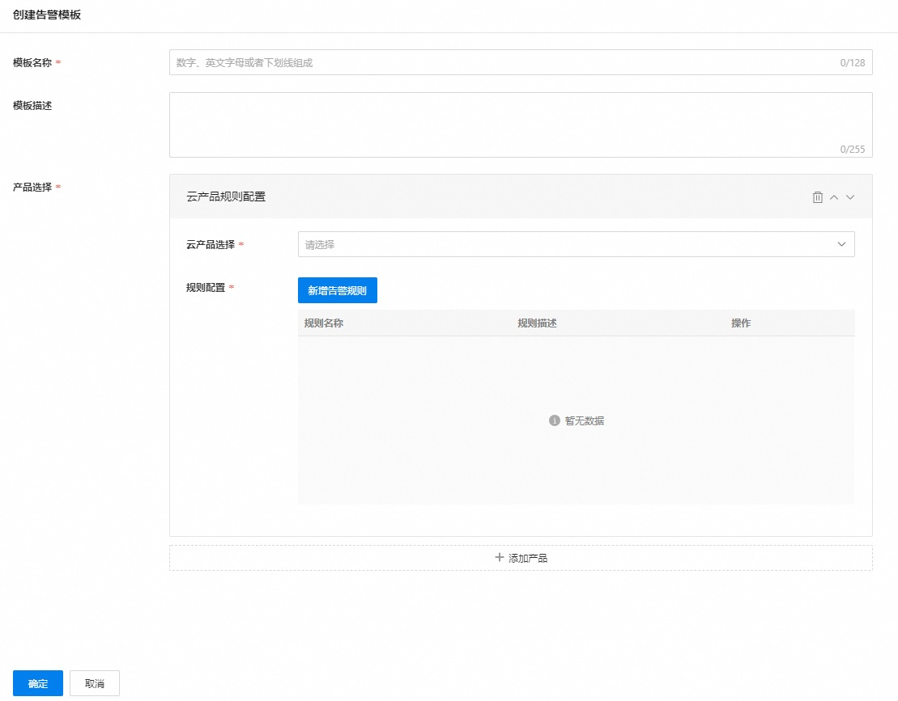

   阈值报警规则的配置项说明如下表所示。

   <table>
     <tr>
       <th width="137">配置项</th>
       <th>说明</th>
     </tr>
     <tr>
       <td>规则名称</td>
       <td>阈值报警规则的名称。</td>
     </tr>
     <tr>
       <td>指标名称</td>
       <td>报警的监控指标名称。各云产品监控指标详情请查看《云监控指标说明》。</td>
     </tr>
     <tr>
       <td>比较方式</td>
       <td>阈值的比较，填入的阈值和监控值进行比较，当符合比较规则时，则会触发报警规则。比较符支持 “<strong>&gt;</strong>”、“ <strong>&gt;=</strong>”、“<strong>&lt;</strong>”、“<strong>&lt;=</strong> ”、“<strong>=</strong>”、“<strong>!=</strong>”、“<strong>同比昨天同时间上涨</strong>”、“<strong>同比昨</strong><strong>天同时间下降</strong>”、“<strong>环比上周期上涨</strong>”、“<strong>环比上周期下降</strong>”、“<strong>比昨天增量</strong>”、“<strong>比昨天降量</strong>”、“<strong>比上周期增量</strong>”、“<strong>比上周期降量</strong>”。</td>
     </tr>
     <tr>
       <td>阈值及报警级别</td>
       <td>• 报警级别分为<strong>紧急</strong>、<strong>警告</strong>和<strong>普通</strong>。<br>• 监控数据的聚合值类型可以选择<strong>平均值</strong>、<strong>最小值</strong>和<strong>最大值</strong>。<br>• 监控数据的周期可以选择<strong>连续</strong>、<strong>连续5个周期</strong>、<strong>连续10个周期</strong>、<strong>连续15个周期</strong>、<strong>连续30</strong><strong>个周期</strong>、<strong>连续60个周期</strong>。<br>• 支持设置阈值和触发次数，当监控数据达到设置的阈值的触发次数时，产生报警。</td>
     </tr>
   </table>

   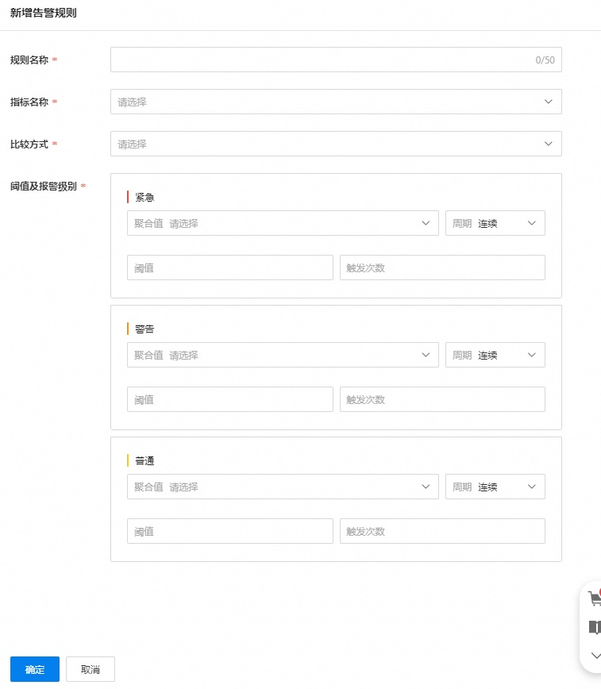

6. 为各云产品完成添加规则后，单击**确定**。

<a id="section-6-3-3"></a>

### 6.3.3. 管理报警模板

在报警模板列表中，可以对报警模板进行修改、克隆、导出、删除等操作。

**操作步骤**

1. 登录Apsara Uni-manager运营控制台。

2. 单击顶部菜单栏的**产品**，选择**迁移与运维管理** > **运维与监控** > **云监控**。

3. 在左侧导航栏选择**报警服务** > **报警模板**。

4. 选择目标报警模板，执行相关操作。

   <table>
     <tr>
       <th width="122">操作任务</th>
       <th>操作步骤</th>
     </tr>
     <tr>
       <td>查看报警模板</td>
       <td>在<strong>通用模板</strong>页签，单击目标报警模板<strong>操作</strong>列的<strong>查看</strong>。</td>
     </tr>
     <tr>
       <td>修改报警模板</td>
       <td>i. 在<strong>自定义模板</strong>页签，单击目标报警模板<strong>操作</strong>列的<strong>编辑</strong>。ii. 在弹出的面板中修改报警模板相关信息。iii. 完成后单击<strong>确定</strong>。<br>说明不支持对默认模板进行修改。</td>
     </tr>
     <tr>
       <td>克隆报警模板</td>
       <td>当需要将一个报警模板上的配置复制到新模板时，可以使用克隆报警模板功能。<br>i. 单击目标报警模板<strong>操作</strong>列的<strong>克隆</strong>。ii. 在弹出的面板中，根据所需设置模板配置信息。iii. 完成后单击<strong>确定</strong>。</td>
     </tr>
     <tr>
       <td>删除报警模板</td>
       <td>警告报警模板删除后无法恢复。<br>说明不支持对默认模板进行删除。<br>• 单个删除<br>a. 在<strong>自定义模板</strong>页签，单击目标报警模板<strong>操作</strong>列的<strong>删除</strong>。<br>b. 在弹出的对话框中，单击<strong>确定</strong>。<br>• 批量删除<br>a. 在<strong>自定义模板</strong>页签，选中目标报警模板前的复选框，然后单击列表左下角的<strong>批量删除</strong>。<br>b. 在弹出的对话框中，单击<strong>确定</strong>。</td>
     </tr>
   </table>

   <table>
     <tr>
       <td>应用报警模板到应用分组或资源集</td>
       <td>报警模板需要与应用分组配合使用，报警模板可以应用在各个应用分组上，为各云服务快速创建报警规则。使用前请先确保已创建报警模板、应用分组或资源集。<br>重要选择报警模板应用到指定分组后，云监控将删除您分组下原有的所有云产品的规则（进程监控和可用性报警规则除外），然后根据所选模板内容为您创建新的报警规则。建议选择应用分组不超过5个，超过可能会导致部分失败。<br>• 单个应用<br>a. 单击目标报警模板<strong>操作</strong>列的<strong>应用模板</strong>。<br>b. 在<strong>应用模板到分组</strong>对话框中，分别配置<strong>覆盖/追加</strong>、<strong>资源类型</strong>、<strong>资源集选</strong><strong>择</strong>、<strong>应用分组选择</strong>、<strong>沉默通道周期</strong>、<strong>生效时间</strong>、<strong>报警回调</strong>和<strong>报警联系人</strong>。<br>c. 完成后单击<strong>确定</strong>。<br>• 批量应用<br>a. 选中目标报警模板前的复选框，然后单击列表左下角的<strong>批量应用模板</strong>。<br>b. 在<strong>应用模板到分组</strong>对话框中，分别配置<strong>覆盖/追加</strong>、<strong>资源类型</strong>、<strong>资源集选</strong><strong>择</strong>、<strong>应用分组选择</strong>、<strong>沉默通道周期</strong>、<strong>生效时间</strong>、<strong>报警回调</strong>和<strong>报警联系人</strong>。<br>c. 完成后单击<strong>确定</strong>。</td>
     </tr>
     <tr>
       <td>导出并下载报警模板</td>
       <td>i. 在<strong>报警模板</strong>页面，单击。<br>ii. 在<strong>导出任务</strong>对话框中，填入<strong>任务名称</strong>。iii. 单击<strong>确定</strong>。iv. 在左侧导航栏单击<strong>报表导出</strong>，在<strong>报表导出</strong>页面单击<strong>报警模板</strong>页签。<br>v. 单击目标报表<strong>操作</strong>列中的<strong>下载报表任务</strong>。vi. 在<strong>下载报表任务</strong>对话框中，单击<strong>确定</strong>。<br>说明所下载报表的格式为<strong>.xlsx</strong>，请在浏览器下载路径下查找下载报表。</td>
     </tr>
   </table>

<a id="section-6-4"></a>

## 6.4. 一键报警

对当前一级组织下所有组织资源集的云产品实例可进行绑定默认的报警规则，完成一键报警。

**背景信息**

- 一键报警按云产品开启或关闭。

- 开启目标云产品的一键报警功能后，默认开启该云产品的所有预置报警规则，云监控自动建立指定监控项的报警体系。

- 开启目标云产品的一键报警功能后，该云产品的报警规则应用于当前一级组织下的实例及后续新生成的实例。

- 开启目标云产品的一键报警功能后，可以根据实际需求新增、修改、删除和禁用规则。

- 开启目标云产品的一键报警功能后，如果触发报警规则，则报警历史中生成报警，默认通知云账号报警联系人。

- 关闭目标云产品的一键报警后，对应的报警规则全部禁用。

- 云产品的默认监控项请参考通用报警模板。

**操作步骤**

1. 登录Apsara Uni-manager运营控制台。

2. 单击顶部菜单栏的**产品**，选择**迁移与运维管理** > **运维与监控** > **云监控**。

3. 在左侧导航栏选择**报警服务** > **一键报警**。

4. 执行相关操作。

   <table>
     <tr>
       <th width="160">操作任务</th>
       <th>操作步骤</th>
     </tr>
     <tr>
       <td>开启一键报警</td>
       <td><br>i. 单击目标云产品<strong>一键报警</strong>列的，开启云产品报警。<br><br>：表示报警处于关闭状态。<br><br>：表示报警处于开启状态。<br>ii. 单击<strong>启用</strong>。<br>重要开启一键报警后，会在<strong>报警服务</strong> &gt;<strong> 报警规则</strong>中新增并启用对应的报警规则。<br>iii. 单击目标云产品前面的，查看云产品的报警规则。</td>
     </tr>
     <tr>
       <td>关闭一键报警</td>
       <td>i. 单击目标云产品<strong>一键报警</strong>列的<br><br>，关闭云产品报警。<br>ii. 单击<strong>关闭</strong>。<br>重要关闭一键报警后，会在<strong>报警服务</strong> &gt;<strong> 报警规则</strong>中删除对应的报警规则。</td>
     </tr>
     <tr>
       <td>新增报警规则</td>
       <td>i. 单击云产品（已开启一键报警）前面的。<br>ii. 单击<strong>创建报警规则</strong>。iii. 在<strong>创建报警规则</strong>面板，设置<strong>规则名称</strong>、<strong>监控指标</strong>、<strong>阈值及报警级别</strong>等。iv. 单击<strong>确认</strong>，返回<strong>创建报警规则</strong>面板。<br>v. 设置<strong>通道沉默周期</strong>、<strong>生效时间</strong>、<strong>报警回调</strong>、<strong>无数据处理方法</strong>和<strong>报警联系人</strong>。vi. 单击<strong>确定</strong>。</td>
     </tr>
     <tr>
       <td>启用/禁用报警规则</td>
       <td>i. 单击云产品（已开启一键报警）前面的。<br>ii. 启用/禁用规则。<br>• 单击规则（状态为启用）<strong>操作</strong>列的<strong>禁用</strong>，禁用后<strong>报警服务</strong> &gt;<strong> 报警规则</strong>中的对应规则将同步置于禁用状态并不再生效。<br>• 单击规则（状态为禁用）<strong>操作</strong>列的<strong>启用</strong>，启用后<strong>报警服务</strong> &gt;<strong> 报警规则</strong>中的对应规则将同步置于启用状态。</td>
     </tr>
     <tr>
       <td>修改报警规则</td>
       <td>i. 单击云产品（已开启一键报警）前面的。<br>ii. 单个/批量规则修改。<br>• 单个规则修改<br>a. 单击规则<strong>操作</strong>列的<strong>编辑</strong>。<br>b. 在<strong>修改报警规则</strong>面板，根据实际需要修改规则信息。<br>c. 单击<strong>确定</strong>。<br>• 批量规则修改<br>a. 勾选规则。<br>b. 单击规则列表下方的<strong>批量编辑</strong>。<br>c. 在<strong>批量编辑</strong>对话框，修改<strong>通道沉默周期</strong>、<strong>生效时间</strong>、<strong>报警回调</strong>、<strong>无数据处理方</strong><strong>法</strong>、<strong>报警联系组</strong>等信息。<br>d. 单击<strong>确认</strong>。</td>
     </tr>
     <tr>
       <td>删除报警规则</td>
       <td>i. 单击云产品（已开启一键报警）前面的。<br>ii. 单击规则操作列的<strong>删除</strong>。<br>重要删除后<strong>报警服务</strong> &gt;<strong> 报警规则</strong>中的对应规则也将被删除，该操作不可撤回，请谨慎操作。</td>
     </tr>
     <tr>
       <td>批量排除实例</td>
       <td>i. 单击云产品（已开启一键报警）前面的。<br>ii. 勾选目标规则，单击<strong>批量排除实例</strong>。iii. 在对话框中勾选目标实例，单击<strong>确定</strong>。<br>说明<br>• 鼠标悬停在规则<strong>批量排除实例</strong>列下的数字，可查看报警规则排除的实例。<br>• 设置了批量排除实例的实例在触发报警规则后，不会触发报警。</td>
     </tr>
   </table>

<a id="section-6-5"></a>

## 6.5. 报表导出

支持将报警历史、报警规则和报警模板导出的报表下载至本地。

**背景信息**

- 下载报警历史、报警规则和报警模板的报表前，请确保已完成报表的导出。

- 所下载报表的格式为<strong>.xlsx</strong>，可在浏览器下载路径下查找下载报表。

**操作步骤**

1. 登录Apsara Uni-manager运营控制台。

2. 单击顶部菜单栏的**产品**，选择**迁移与运维管理** > **运维与监控** > **云监控**。

3. 在左侧导航栏，选择**报警服务 > 报表导出**。

4. 在**报表导出**页面，执行相关操作。

   <table>
     <tr>
       <th width="122">操作任务</th>
       <th>操作步骤</th>
     </tr>
     <tr>
       <td>下载报表任务</td>
       <td>i. 单击<strong>报警历史</strong>、<strong>报警规则</strong>或<strong>报警模板</strong>页签。ii. （可选）根据<strong>报表状态</strong>，筛选目标报表。iii. 在目标报表<strong>操作</strong>列中，单击<strong>下载报表任务</strong>。iv. 在<strong>下载报表任务</strong>对话框中，单击<strong>确定</strong>。</td>
     </tr>
     <tr>
       <td>删除报表任务</td>
       <td>i. 单击<strong>报警历史</strong>、<strong>报警规则</strong>或<strong>报警模板</strong>页签。ii. （可选）根据<strong>报表状态</strong>，筛选目标报表。iii. 在目标报表<strong>操作</strong>列中，单击<strong>删除报表任务</strong>。iv. 在弹出的对话框中，单击<strong>确定</strong>。</td>
     </tr>
   </table>

<a id="section-7"></a>

# 7.可用性监控

<a id="section-7-1"></a>

## 7.1. 服务可用性监控

可用性监控定期探测本地或远程指定路径和端口是否正常响应。当出现响应超时或状态码错误时，云监控将发出报警，以便快速发现本地或远程服务无响应的情况。可用性探测支持任意ECS作为探测源。

**创建可用性监控**

1. 登录Apsara Uni-manager运营控制台。

2. 单击顶部菜单栏的**产品**，选择**迁移与运维管理** > **运维与监控** > **云监控**。

3. 在左侧导航栏，选择**可用性监控 > 服务可用性监控**。

4. 单击**添加可用性监控**，在**创建可用性监控**面板依次完成配置向导，各配置项说明如下。

   <ol type="i">

   <li>

   创建任务

   <table>
     <tr>
       <th width="89">配置项</th>
       <th>说明</th>
     </tr>
     <tr>
       <td>任务名称</td>
       <td>当前可用性监控的任务名称。支持英文字母、数字、下划线、横杠以及汉字，长度为4~50个字符。</td>
     </tr>
     <tr>
       <td>探测源</td>
       <td>选择一个或多个待探测的实例。</td>
     </tr>
     <tr>
       <td>探测目标</td>
       <td>默认为<strong>URL或IP</strong>。</td>
     </tr>
     <tr>
       <td>探测类型</td>
       <td>探测类型支持<strong>HTTP(S)</strong>、<strong>TELNET</strong>、<strong>PING</strong>三种类型。<br>• <strong>HTTP(S)</strong>：指通过发送HTTP(s)请求来探测目标的健康状态，需要输入待探测目标的URL地址。例如，http://localhost:8081/check_health.html。<br>• <strong>TELNET</strong>：指通过发送TELNET命令来探测目标的健康状态，需要输入待探测目标的IP地址和端口号。例如，192.168.1.1:22。<br>• <strong>PING</strong>：指通过发送PING命令来探测目标的健康状态，需要输入待探测目标的IP地址。例如，192.168.1.1。</td>
     </tr>
     <tr>
       <td>端口</td>
       <td>当<strong>探测类型</strong>为<strong>TELNET</strong>时，需输入源端口号。</td>
     </tr>
     <tr>
       <td>请求方法</td>
       <td>探测类型的请求方法。请求方法包括<strong>HEAD</strong>、<strong>GET</strong>和<strong>POST</strong>。<br>说明当<strong>探测目标</strong>为<strong>URL或者IP</strong>，且<strong>探测类型</strong>为<strong>HTTP(S)</strong>时，需要设置此项参数配置。</td>
     </tr>
     <tr>
       <td>高级配置</td>
       <td>说明当<strong>探测目标</strong>为<strong>URL或者IP</strong>，且<strong>探测类型</strong>为<strong>HTTP(S)</strong>时，可以单击<strong>高级配置</strong>来设置如下参数配置。<br>• 请求参数<br>• <strong>Headers</strong>：站点探测时HTTP或HTTPS的Headers。格式为：key1:value1回车换行key2:value2。<br>• <strong>提交内容</strong>：系统在做站点探测的时候，会POST提交这个信息，提交内容仅支持英文。请求方式选择POST时需要设置此项参数配置。格式为：parameter1=value1&amp;parameter2=value2。<br>• <strong>匹配响应内容</strong>：站点探测的匹配响应方式和匹配响应信息。当匹配响应信息非空时，站点探测读取HTTP服务器回应Body的前64KB，从中查找匹配响应信息。匹配响应方式取值：<br>• 包含匹配内容则报警<br>• 不包含匹配内容则报警<br>• 用户认证<br>• <strong>HTTP验证用户名</strong>：输入HTTP验证的用户名信息。<br>• <strong>HTTP验证密码</strong>：输入HTTP验证的密码信息。<br>• <strong>监控频率</strong>：选择探测周期。取值：15秒。</td>
     </tr>
   </table>

   </li>

   <li>

   报警设置

   <table>
     <tr>
       <th width="137">配置项</th>
       <th>说明</th>
     </tr>
     <tr>
       <td>报警规则</td>
       <td>• 探测类型为HTTP(S)或TELNET时需要设置状态码和响应时间。<br>• 探测类型为PING时需要设置丢包率和响应时间。<br>说明<br>• <strong>状态码</strong>：当探测的状态码满足报警设置时，触发报警。状态码说明可参见状态码说明。<br>• <strong>丢包率</strong>：当探测的丢包率满足报警设置时，触发报警。<br>• <strong>响应时间</strong>：当探测的响应时间满足报警设置时，触发报警。单位毫秒。<br>• <strong>状态码</strong>、<strong>丢包率</strong>、<strong>响应时间</strong>其中之一达到阈值后都会触发报警，报警会发送给报警联系组。</td>
     </tr>
     <tr>
       <td>报警级别</td>
       <td>报警级别和报警通知方式。取值：<br>• 紧急<br>• 警告<br>• 提示</td>
     </tr>
     <tr>
       <td>报警回调</td>
       <td>公网可访问的URL，用于接收云监控通过POST请求推送的报警信息。<br>说明目前仅支持HTTP协议。</td>
     </tr>
     <tr>
       <td>配置报警联系组</td>
       <td>在联系组待选择区域选择需要通知的报警联系人。</td>
     </tr>
     <tr>
       <td>高级配置</td>
       <td>说明单击<strong>高级配置</strong>，可为报警规则设置如下参数配置。<br>• <strong>通道沉默周期</strong>：报警发生后未恢复正常，间隔多久重复发送一次报警通知。取值：<strong>5分钟</strong>、<strong>10分钟</strong>、<strong>15分钟</strong>、<strong>30分钟</strong>、<strong>60分钟</strong>、<strong>3小时</strong>、<strong>6小时</strong>、<strong>12小时</strong>、<strong>24小</strong><strong>时</strong>。某监控指标达到报警阈值时发送报警，如果监控指标在通道沉默周期内持续超过报警阈值，在通道沉默周期内不会重复发送报警通知；如果监控指标在通道沉默周期后仍未恢复正常，则云监控再次发送报警通知。<br>• <strong>生效时间</strong>：报警规则的生效时间。报警规则只在生效时间内发送报警通知，非生效时间内产生的报警只记录报警历史。</td>
     </tr>
   </table>

   </li>

   <li>

   创建结果

   创建成功后，在列表中查看已创建的可用性监控。

   </li>

   </ol>

**查看可用性监控**

1. 在**服务可用性监控**页面的列表，查看可用性监控的**任务名称/任务ID**、**监控状态**、**探测目标**、**探测类型**、**探测异常机器数**、**插件异常机器数**、**机器总数**、**可用率**、**平均延时**等。

   

2. 单击目标可用性监控**操作**列的  ，进入监控详情。

3. 在页面上方，查看监控任务的基本信息。

   

4. 在下拉列表中选择监控实例，支持选择多个。

5. 根据业务需要，选择的监控时间范围。支持选择**1小时**、**6小时**、**12小时**、**1天**、**3天**、**7天**、**17天**，或自定义时间范围。

6. 查看目标监控实例在选择监控时间内的趋势图。

   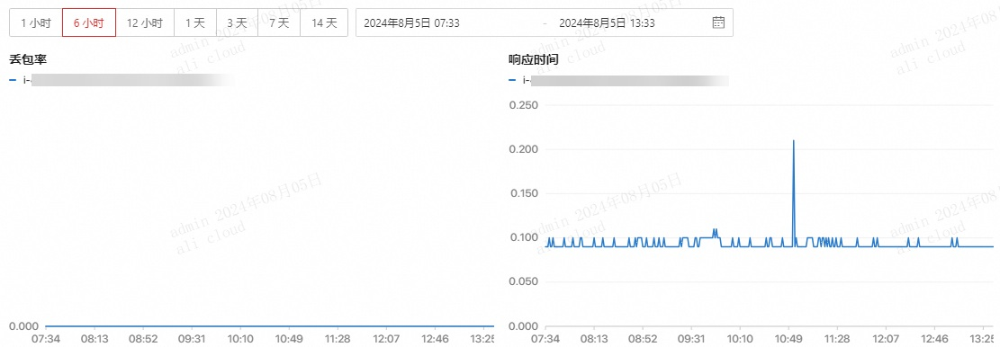

**修改可用性监控**

当已有可用性监控任务信息需要变更时，可以根据需要进行修改。

1. 在**服务可用性监控**页面的列表，单击目标可用性监控操作列的**修改**。

2. 在**修改可用性监控**面板，根据业务需要进行参数配置修改。具体参数配置说明可参见创建可用性监控。

   > **重要**
   >
   > 探测目标和探测类型不支持修改。

**禁用可用性监控**

当暂时不需要探测资源时，可以禁用对应的可用性监控任务。

> **重要**
>
> 禁用可用性监控前，请确保**监控状态**为**启用**。

- 单个禁用

  <ol type="i">

  <li>

  在**服务可用性监控**页面的列表，单击目标可用性监控操作列的**禁用**。

  </li>

  <li>

  单击**确定**。

  </li>

  </ol>

- 批量禁用

  <ol type="i">

  <li>

  在**服务可用性监控**页面的列表，勾选目标可用性监控任务前的复选框。

  </li>

  <li>

  单击列表下方的**批量禁用**。

  </li>

  <li>

  单击**确定**。

  </li>

  </ol>

**启用可用性监控**

当需要继续探测资源时，可以重启可用性监控任务。

> **重要**
>
> 启用可用性监控前，请确保**监控状态**为**禁用**。

- 单个启用

  <ol type="i">

  <li>

  在**服务可用性监控**页面的列表，单击目标可用性监控操作列的**修改**。

  </li>

  <li>

  单击**确定**。

  </li>

  </ol>

- 批量启用

  <ol type="i">

  <li>

  在**服务可用性监控**页面的列表，勾选目标可用性监控任务前的复选框。

  </li>

  <li>

  单击列表下方的**批量启用**。

  </li>

  <li>

  单击**确定**。

  </li>

  </ol>

**删除可用性监控**

当不再需要可用性监控时，可以将其删除。

- 单个删除

  <ol type="i">

  <li>

  在**服务可用性监控**页面的列表，单击目标可用性监控操作列的**删除**。

  </li>

  <li>

  单击**确定**。

  </li>

  </ol>

- 批量删除

  <ol type="i">

  <li>

  在**服务可用性监控**页面的列表，勾选目标可用性监控任务前的复选框。

  </li>

  <li>

  单击列表下方的**批量删除**。

  </li>

  <li>

  单击**确定**。

  </li>

  </ol>

<a id="section-7-2"></a>

## 7.2. 云产品可用性监控

通过部署在ECS上的探针，基于ICMP、TCP的方式对云产品实例进行一键云产品实例的连通性监控。仅支持具备VPC地址、公网地址的探测，不支持探测经典网络地址。

**背景信息**

- 用户在一级组织下，开启云产品的可用性监控，在完成一级组织维度的配置后，CMS会自动维护各个产品的可用性探测任务。

- 所有的探测源，都是ECS上的ArgusAgent。

**约束限制**

- 每个一级组织下仅支持创建一个探测任务。

- 创建探测任务前，需要一级组织授权，且组织里能看到RAM Role（否则经典网络探测会有问题）。

  方式：登录Apsara Uni-manager运营控制台，单击顶部菜单栏的**配置**，选择**RAM服务角色**，单击**创建RAM服务角色**，**服务名称**选择**云监控**。

  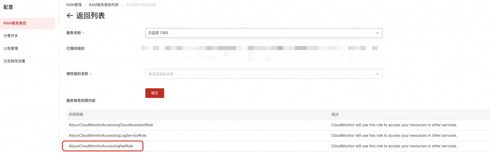

- ECS的全局网络连通性，指ECS的交换机或ECS自身接入SNAT。

- 探测发起端的ECS，必须安装有版本大于等于3.5.10的ArgusAgent；如需探测公网目标（如公网类型SLB），还需要ECS具有全局网络连通性。如果探测目标要求的范围内没有满足要求的ECS，探测任务不会生成。

- ECS的探测源如果不满足探测要求，会被自动替换为新的满足要求的ECS，若找不到，则任务被禁用。

  > **重要**
  >
  > 在ECS探测源产出的探测数据触发告警后，如此ECS探测源被自动替换，告警状态会保持最长24小时。

  ECS探测源需要被自动替换的可能场景：

  - ECS自身被销毁。

  - ECS的ArgusAgent断连。

  - 探测的目标具有全局网络连通性（公网），但经过运维变更后，探测目标或ECS不再具备。

  - 探测的目标为VPC地址，但ECS经过变更后VPC发生变更。

  - 探测的目标为VPC，实际探测为VPC内的ECS，由于ECS的安全组变更，此时探测被拦截。

  - 探测的目标是RDS redis，探测模板的IP白名单变更导致探测被拦截而无意义。

- 对SLB、RDS、Redis的探测任务分为两类，VPC网络与全局网络地址，不支持经典网络目标探测。一个实例同时存在VPC与公网探测地址（如弹性EIP）时，仅探测VPC地址。

  - VPC网络的ECS探测源，必须与探测目标在同一个VPC内。

  - 全局网络的ECS探测源，必须具有全局网络连通性。

  - 如探测目标仅有经典网络地址，不适用云产品可用性监控功能。

- ECS探测是同一个默认安全组内的ECS互探，方式为ping。

- VPC探测，是两个连通的VPC中，各选择一台ECS互探，如果有安全组原因导致无法互探，页面会有相应提示。

- SLB/RDS/Redis探测，是根据产品的VPC地址与公网地址信息，选择ECS发起探测，优先使用VPC地址。SLB的探测方式是ping，RDS/Redis的方式是Telnet。SLB无法被其后端监听组的ECS探测。ACK集群自动创建的SLB，也无法被作为该ACK集群节点的ECS探测。

- 自动适应探测源/被探测源的新增与删除，最大延迟20分钟。但暂不支持status变更（即被探测源如果status不是Running/Healthy，但实例依然存在，可用性探测仍会正常工作） 。

- 目前支持的云产品：云服务器ECS、专有网络VPC、云数据库RDS、云数据Tair（兼容Redis）、负载均衡SLB、云解析DNS、对象存储OSS、日志服务SLS、表格存储Tablestore、云原生关系型数据库PolarDB（本地盘）、数据传输服务DTS、检索分析服务Elasticsearch版、租户侧堡垒机、数据库审计、数据静态脱敏与水印、特权访问管理、漏扫引擎、文件存储NAS。

**查看探测结果**

**操作步骤**

1. 登录Apsara Uni-manager运营控制台。

2. 单击顶部菜单栏的**产品**，选择**迁移与运维管理** > **运维与监控** > **云监控**。

3. 在左侧导航栏，选择**可用性监控 > 云产品可用性监控**。

4. 在**探测结果**页签，可通过选择**云产品**、**探测类型**或输入**实例ID**快速筛选探测结果，页面下方展示云产品的实例总数以及运行状态。

   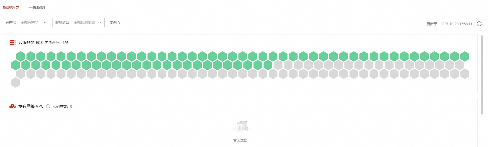

   > **说明**
   >
   > - 红色代表实例有可用性报警。
   >
   > - 灰色代表该实例因为各种潜在原因未生成对应的告警任务。
   >
   > - 绿色代表实例正常运行。

   - 单击探测成功的实例色块，弹出弹窗，单击实例名称，可查看服务可用性监控详情。

   - 单击探测失败的实例色块，可在弹窗中查看失败提示。

**一键探测**

**排除实例**

1. 在**云产品可用性监控**页面，选择**一键探测**页签。

2. 单击目标云产品**操作**列的**排除实例**，在添加实例弹框中根据业务需要选择实例。

3. 单击**确认**。

**关闭探测**

1. 在**云产品可用性监控**页面，选择**一键探测**页签。

2. 单击目标云产品**操作**列的**关闭**。

3. 单击**确定**后，即可关闭当前云产品的可用性探测能力。

**查看任务及规则**

1. 在**云产品可用性监控**页面，选择**一键探测**页签。

2. 单击目标云产品左侧的  。

3. 任务管理。

   <ol type="i">

   <li>

   在**任务管理**页签，可查看当前云产品下的任务详情，包括**任务名称/任务ID**、**监控状态**、**探测目标**、**探测异常机器数**、**插件异常机器数**、**机器总数**、**探测类型**。

   </li>

   <li>

   单击目标任务**操作**列的**详情**，可查看监控详情。

   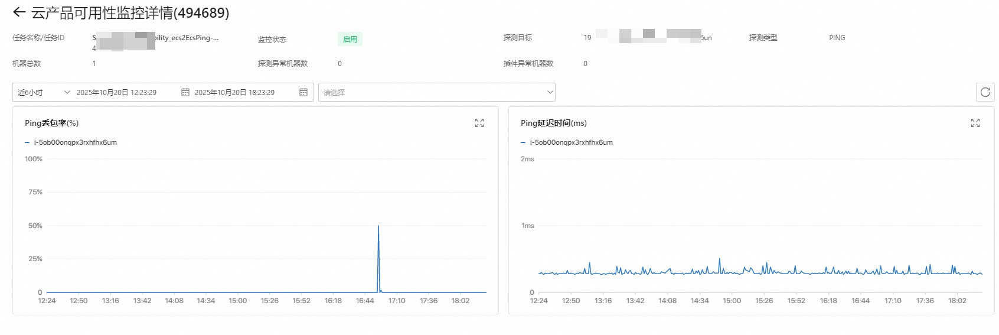

   </li>

   </ol>

4. 规则管理。

   在**规则管理**页签，可查看当前云产品的规则详情。

   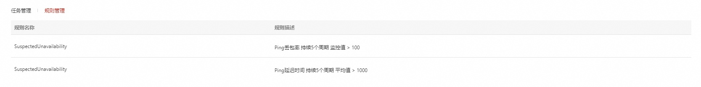

<a id="section-8"></a>

# 8.事件中心

事件中心提供云监控CMS、云服务器ECS、混合云容灾HDR、备份管理平台ASR-BR和资源编排ROS产品系统事件的统一查询和统计入口，便于及时得知各云产品的运行状态，并接收报警通知。当业务故障时，能够快速分析并定位问题。

<a id="section-8-1"></a>

## 8.1. 系统事件

<a id="section-8-1-1"></a>

### 8.1.1. 云产品系统事件说明

云监控CMS支持的云产品及其对应系统事件如下表所示，具体的事件监控指标信息参见指标仓库中的云产品事件监控指标说明。

**云监控CMS**

| 云产品 | 接入的系统事件 |
| --- | --- |
| 云监控 | • 插件心跳停止<br>• 插件心跳恢复 |

**混合云容灾HDR**

<table>
  <tr>
    <th width="106">云产品</th>
    <th>接入的系统事件</th>
  </tr>
  <tr>
    <td>混合云容灾</td>
    <td>• 生产站点VPC被删除<br>• 容灾站点VPC被删除<br>• 生产站点网络被删除<br>• 容灾站点网络被删除<br>• 生产站点安全组被删除<br>• 容灾站点安全组被删除<br>• 安全组策略不一致<br>• 生产站点网络相关信息异常变化<br>• 容灾站点网络相关信息异常变化<br>• 生产站点存储相关信息异常变化<br>• 容灾站点存储相关信息异常变化<br>• 生产站点计算相关信息异常变化<br>• 容灾站点计算相关信息异常变化<br>• 复制组信息异常<br>• 复制对信息异常<br>• 网关异常<br>• 复制ECS实例异常</td>
  </tr>
</table>

**备份管理平台ASR-BR**

<table>
  <tr>
    <th width="122">云产品</th>
    <th>接入的系统事件</th>
  </tr>
  <tr>
    <td>备份管理平台</td>
    <td>• 备份计划相关告警<br>• 恢复任务相关告警<br>• 迁移计划相关告警<br>• 授权使用量相关告警</td>
  </tr>
</table>

**资源编排ROS**

| 云产品 | 接入的系统事件 |
| --- | --- |
| 资源编排 | • 资源栈状态变化<br>• 资源栈资源状态变化<br>• 资源栈组操作状态变化 |

**云服务器ECS**

<table>
  <tr>
    <th width="122">云产品</th>
    <th>接入的系统事件</th>
  </tr>
  <tr>
    <td>云服务器ECS</td>
    <td>• 转换磁盘到按量付费完成<br>• 磁盘操作完成<br>• 本地磁盘出现损坏告警结束<br>• 本地磁盘出现损坏告警开始<br>• 磁盘释放（账号欠费）<br>• 磁盘性能受到严重影响结束<br>• 磁盘性能受到严重影响开始<br>• 完成自动重开机<br>• 突发性能实例性能受限<br>• 实例性能潜在影响结束（实例错误）<br>• 实例性能潜在影响开始（实例错误）<br>• 实例重启结束（实例错误）<br>• 实例重启开始（实例错误）<br>• 实例在专有宿主机间热迁移<br>• 突发性能实例性能模式切换<br>• 抢占式实例中断通知<br>• TPM安全警告结束<br>• TPM安全警告开始<br>• 实例状态改变通知<br>• 实例自动释放已规避（实例创建失败）<br>• 实例自动释放已完成（实例创建失败）<br>• 实例自动释放执行中（实例创建失败）<br>• 实例性能影响结束（系统错误）<br>• 实例性能影响开始（系统错误）<br>• 实例重启结束（系统错误）<br>• 实例重启开始（系统错误）<br>• 实例重启失败（系统错误）<br>• 实例重新部署已规避（系统错误）<br>• 实例重新部署已取消（系统错误）<br>• 实例重新部署已完成（系统错误）<br>• 实例重新部署执行中（系统错误）<br>• 实例计划重新部署通知（系统错误）<br>• 实例停止已完成（系统错误）<br>• 实例停止开始（系统错误）<br>• 因系统维护隔离坏盘已规避<br>• 因系统维护隔离坏盘已取消<br>• 因系统维护隔离坏盘已完成<br>• 因系统维护隔离坏盘执行中<br>• 因系统维护隔离坏盘已失败<br>• 因系统维护隔离坏盘问询中<br>• 实例性能潜在影响结束（系统维护）<br>• 实例性能潜在影响开始（系统维护）<br>• 因系统维护重新初始化坏盘已规避<br>• 因系统维护重新初始化坏盘已取消<br>• 因系统维护重新初始化坏盘已完成<br>• 因系统维护重新初始化坏盘执行中<br>• 因系统维护重新初始化坏盘已失败<br>• 因系统维护重新初始化坏盘问询中<br>• 实例计划重启规避（系统维护）<br>• 实例计划重启取消（系统维护）<br>• 实例计划重启已完成（系统维护）<br>• 实例计划重启执行中（系统维护）<br>• 实例计划重启失败（系统维护）<br>• 实例计划重启问询中（系统维护）<br>• 实例计划重启通知（系统维护）<br>• 因系统维护重启实例并隔离坏盘已规避<br>• 因系统维护重启实例并隔离坏盘已取消<br>• 因系统维护重启实例并隔离坏盘已完成<br>• 因系统维护重启实例并隔离坏盘执行中<br>• 因系统维护重启实例并隔离坏盘问询中<br>• 因系统维护重启实例并重新初始化坏盘已规避<br>• 因系统维护重启实例并重新初始化坏盘已取消<br>• 因系统维护重启实例并重新初始化坏盘已完成<br>• 因系统维护重启实例并重新初始化坏盘执行中<br>• 因系统维护重启实例并重新初始化坏盘问询中<br>• 实例计划重新部署已规避（系统维护）<br>• 实例计划重新部署已取消（系统维护）<br>• 实例计划重新部署已完成（系统维护）<br>• 实例计划重新部署执行中（系统维护）<br>• 实例计划重新部署问询中（系统维护）<br>• 实例计划重新部署通知（系统维护）<br>• 实例计划停止规避（系统维护）<br>• 实例计划停止取消（系统维护）<br>• 实例计划停止已完成（系统维护）<br>• 实例计划停止执行中（系统维护）<br>• 实例计划停止失败（系统维护）<br>• 实例计划停止通知（系统维护）<br>• 网卡操作完成<br>• 磁盘快照创建完成<br>• 热迁移后VM状态异常<br>• nc宕机导致VM宕<br>• VM宕机恢复事件<br>• VM异常PANIC重启可能是虚拟机内部异常<br>• VM异常crash事件<br>• 实例重启（客户确认）<br>• 实例重启（计划执行）<br>• 实例重启（避免执行）<br>• 实例重启（取消）<br>• 实例重启（失败）<br>• 实例告警（客户确认）<br>• 实例告警（计划执行）<br>• 实例告警（避免执行）<br>• 实例告警（执行中）<br>• 实例告警（执行完毕）<br>• 实例告警（取消）<br>• 实例告警（失败）<br>• 系统性能重大影响（客户确认）<br>• 系统性能重大影响（计划执行）<br>• 系统性能重大影响（避免执行）<br>• 系统性能重大影响（取消）<br>• 系统性能重大影响（失败）<br>• 系统重启（客户确认）<br>• 系统重启（计划执行）<br>• 系统重启（避免执行）<br>• 系统重启（取消）<br>• 低峰分析、热迁移（客户确认）<br>• 低峰分析、热迁移（计划执行）<br>• 低峰分析、热迁移（避免执行）<br>• 低峰分析、热迁移（执行中）<br>• 低峰分析、热迁移（执行完毕）<br>• 低峰分析、热迁移（取消）<br>• 低峰分析、热迁移（失败）<br>• 系统告警（客户确认）<br>• 系统告警（计划执行）<br>• 系统告警（避免执行）<br>• 系统告警（执行中）<br>• 系统告警（执行完毕）<br>• 系统告警（取消）<br>• 系统告警（失败）<br>• 系统性能影响（客户确认）<br>• 系统性能影响（计划执行）<br>• 系统性能影响（避免执行）<br>• 系统性能影响（执行中）<br>• 系统性能影响（执行完毕）<br>• 系统性能影响（取消）<br>• 系统性能影响（失败）<br>• VM重新部署（客户确认）<br>• VM重新部署（计划执行）<br>• VM重新部署（避免执行）<br>• VM重新部署（执行中）<br>• VM重新部署（执行完毕）<br>• VM重新部署（取消）<br>• VM重新部署（失败）<br>• VM重新部署（本地盘、客户确认）<br>• VM重新部署（本地盘、计划执行）<br>• VM重新部署（本地盘、避免执行）<br>• VM重新部署（本地盘、执行中）<br>• VM重新部署（本地盘、执行完毕）<br>• VM重新部署（本地盘、取消）<br>• VM重新部署（本地盘、失败）</td>
  </tr>
</table>

**异地容灾ASR-DR**

<table>
  <tr>
    <th width="90">云产品</th>
    <th>接入的系统事件</th>
  </tr>
  <tr>
    <td>异地容灾</td>
    <td>• 保护组状态失败<br>• 保护组同步延迟高<br>• 容灾计划RTO<br>• 容灾计划执行状态失败<br>• 同步实体任务超出负载<br>• 保护组容量不足<br>• 同步实体容量不足<br>• 容灾计划容量不足</td>
  </tr>
</table>

**裸金属算力平台BMCP**

<table>
  <tr>
    <th width="138">云产品</th>
    <th>接入的系统事件</th>
  </tr>
  <tr>
    <td>裸金属算力平台</td>
    <td>• GPU数量与预期不一致<br>• NVLink状态异常<br>• PCIE设备数量与预期不一致（GPU相关）<br>• 出现GPU相关的PCIE降速<br>• GPU出现XID79错误<br>• GPU内存多bit错误<br>• GPU nvlink断连<br>• GPU nvlink连接失效<br>• GPU nvlink故障<br>• GPU pcie链路带宽下降<br>• GPU GSP core RPC超时<br>• GPU控制器 halt<br>• GPU微控制器断点告警<br>• GPU计算引擎异常<br>• xid 79 gpu驱动掉卡<br>• GPU nvidia-smi风扇信息返回ERR<br>• GPU数量不符合机型配置预期<br>• GPU驱动掉卡无法访问<br>• GPU pcie设备rev掉卡<br>• 外置电源线未插<br>• Nvidia卡故障<br>• NPU卡故障<br>• DCU卡故障<br>• XPU卡故障<br>• PG机器硬件故障<br>• 发现XID故障</td>
  </tr>
</table>

**AIStudio**

<table>
  <tr>
    <th width="93">云产品</th>
    <th>接入的系统事件</th>
  </tr>
  <tr>
    <td>AIStudio</td>
    <td>• 数据加速器运行失败<br>• 模型评测任务成功<br>• 模型评测任务失败<br>• 在线服务执行失败<br>• 在线服务创建失败<br>• 任务建模开始执行<br>• 任务建模执行失败<br>• 任务建模执行成功<br>• Notebook实例导出镜像失败<br>• 数据加速器创建失败<br>• 自定义镜像加速失败<br>• 任务建模排队失败<br>• 任务建模启动失败<br>• Notebook实例创建失败<br>• Notebook实例运行失败</td>
  </tr>
</table>

**云数据库RDS版**

| 云产品 | 接入的系统事件 |
| --- | --- |
| 云数据库RDS版 | 实例HA切换事件告警 |

**云数据库MongoDB版**

| 云产品 | 接入的系统事件 |
| --- | --- |
| 云数据库MongoDB版 | 实例HA切换事件告警 |

**容器监控Kubernetes版**

| 云产品 | 接入的系统事件 |
| --- | --- |
| 容器监控Kubernetes版 | • Container:Unhealthy<br>• Node:FailedNodeAllocatableEnforcement<br>• Pod:Failed<br>• Node:NodeRebooted<br>• Image:BackOff<br>• Node:NodeNotReady<br>• Node:FailedPrepareDynamicResources<br>• Node:ContainerGCFailed<br>• Node:ImageGCFailed<br>• Container:Preempting<br>• Node:SuccessfulAttachVolume<br>• Pod:FailedPreStopHook<br>• Pod:FailedValidation<br>• Container:Killing<br>• Node:Shutdown<br>• Container:BackOff<br>• Image:InspectFailed<br>• Container:Failed<br>• Node:InvalidDiskCapacity<br>• Node:NodeSchedulable<br>• Container:Failed<br>• Image:Failed<br>• Container:ExceededGracePeriod<br>• Pod:VolumeResizeFailed<br>• Container:ProbeWarning<br>• Image:Pulled<br>• Image:Pulling<br>• Node:PossibleMemoryBackedVolumesOnDisk<br>• Pod:FailedCreatePodContainer<br>• Node:FailedMountOnFilesystemMismatch<br>• Container:Created<br>• Node:FreeDiskSpaceFailed<br>• Node:NodeAllocatableEnforced<br>• Node:NodeNotSchedulable<br>• Pod:FailedPostStartHook<br>• Node:NodeReady<br>• Node:Starting<br>• Pod:SuccessfulMountVolume<br>• Pod:FailedMapVolume<br>• Node:FailedAttachVolume<br>• Pod:FailedCreatePodSandBox<br>• Pod:SandboxChanged<br>• Pod:FailedMount<br>• Pod:FailedSync<br>• Pod:VolumeResizeSuccessful<br>• Pod:NetworkNotReady<br>• Pod:FileSystemResizeFailed<br>• Container:Started<br>• Node:CgroupV1<br>• Pod:AlreadyMountedVolume<br>• Pod:FailedKillPod<br>• Node:KubeletSetupFailed<br>• Image:ErrImageNeverPull |

**云原生数据仓库AnalyticDB PostgreSQL版**

| 云产品 | 接入的系统事件 |
| --- | --- |
| 云原生数据仓库AnalyticDB PostgreSQL版 | GPDB实例锁定 |

**弹性伸缩**

<table>
  <tr>
    <th width="90">云产品</th>
    <th>接入的系统事件</th>
  </tr>
  <tr>
    <td>弹性伸缩</td>
    <td>• 弹性伸缩定时任务到期提醒<br>• 弹性伸缩组伸缩活动执行被拒绝<br>• 弹性伸缩组扩容伸缩活动部分成功<br>• 弹性伸缩组扩容伸缩活动成功<br>• 弹性伸缩组扩容伸缩活动开始<br>• 弹性伸缩组扩容伸缩活动失败<br>• 弹性伸缩组缩容伸缩活动失败<br>• 弹性伸缩组缩容伸缩活动部分成功<br>• 弹性伸缩组缩容伸缩活动成功<br>• 弹性伸缩组缩容伸缩活动开始</td>
  </tr>
</table>

**云数据库Redis版**

| 云产品 | 接入的系统事件 |
| --- | --- |
| 云数据库Redis版 | 实例HA切换事件告警 |

<a id="section-8-1-2"></a>

### 8.1.2. 查看系统事件

事件监控提供各云产品系统事件的统一查询和统计入口，方便您及时得知各云产品的运行状态。

**背景信息**

- 系统事件仅展示已经对接过的事件、产品等信息。

- 事件监控支持的各云产品事件，请参见云产品系统事件说明。

**操作步骤**

1. 登录Apsara Uni-manager运营控制台。

2. 单击顶部菜单栏的**产品**，选择**迁移与运维管理** > **运维与监控** > **云监控**。

3. 在左侧导航栏，选择**事件中心 > 系统事件**。

4. 单击**事件监控**页签，在**事件监控**页签，选择待查看的云产品、事件级别、事件名称和时间段。

5. 查看事件监控图表。

   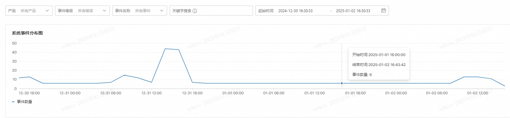

   - 横坐标表示时间，纵坐标表示事件数量。

   - 鼠标悬浮在分布图上，显示**开始时间**、**结束时间**和**事件数量**信息。

6. 在下方的事件列表中，查看事件列表信息。单击目标事件记录的**详情**，查看事件的**JSON**格式。

   > **说明**
   >
   > 产生的系统事件会上报至告警中心，可在**告警中心**>**告警列表**页面查看告警详情。

<a id="section-8-1-3"></a>

### 8.1.3. 创建系统事件报警规则

为云产品的系统事件设置报警规则，异常发生时产生报警并通知联系人，便于分析并定位问题。

**操作步骤**

1. 登录Apsara Uni-manager运营控制台。

2. 单击顶部菜单栏的**产品**，选择**迁移与运维管理** > **运维与监控** > **云监控**。

3. 在左侧导航栏，选择**事件中心 > 系统事件**。

4. 单击**事件报警规则**页签，单击**创建事件报警规则**。

5. 在**创建事件报警规则**面板，完成相应报警规则的配置，配置项说明如下。

   <table>
     <tr>
       <th width="121">配置项</th>
       <th>说明</th>
     </tr>
     <tr>
       <td>报警规则名称</td>
       <td>事件报警规则的名称。由中文、英文字母、数字和下划线（_）组成，长度不超过30个字符。</td>
     </tr>
     <tr>
       <td>产品</td>
       <td>事件报警规则的云产品。云监控支持的云产品可参见云产品系统事件说明。</td>
     </tr>
     <tr>
       <td>事件等级</td>
       <td>事件报警规则的事件等级。每个云产品支持的事件等级可参见云产品事件监控指标说明。</td>
     </tr>
     <tr>
       <td>事件名称</td>
       <td>事件报警规则的事件名称。每个云产品支持的事件名称可参见云产品事件监控指标说明。</td>
     </tr>
     <tr>
       <td>报警回调</td>
       <td>用于接收云监控通过POST请求推送报警消息的回调地址。<br>说明报警回调地址必须是云监控可访问的域名地址，仅支持HTTP协议，不支持填写IP。</td>
     </tr>
     <tr>
       <td>报警联系组人</td>
       <td>选择报警信息发送的用户组或用户。</td>
     </tr>
   </table>

6. 单击**确认**。

<a id="section-8-1-4"></a>

### 8.1.4. 管理系统事件报警规则

在事件报警规则列表中，可以对事件报警规则进行修改、禁用、启用、删除等操作。

**操作步骤**

1. 登录Apsara Uni-manager运营控制台。

2. 单击顶部菜单栏的**产品**，选择**迁移与运维管理** > **运维与监控** > **云监控**。

3. 在左侧导航栏，选择**事件中心** > **系统事件**。

4. 单击**事件报警规则**页签，选择目标事件报警规则，执行相关操作。

   <table>
     <tr>
       <th width="154">操作任务</th>
       <th>操作步骤</th>
     </tr>
     <tr>
       <td>修改事件报警规则</td>
       <td>i. 单击目标事件报警规则<strong>操作</strong>列的<strong>编辑</strong>，可对<strong>报警规则名称</strong>、<strong>产品</strong>、<strong>事件等级</strong>和<strong>事件</strong><strong>名称</strong>等进行修改。配置项详情说明请参考创建系统事件报警规则。ii. 完成后单击<strong>确认</strong>。</td>
     </tr>
     <tr>
       <td>禁用事件报警规则</td>
       <td>说明仅支持<strong>禁用状态</strong>为<strong>已启用</strong>的事件报警规则。禁用后规则将不再生效。<br>• 单个禁用<br>a. 单击目标事件报警规则<strong>操作</strong>列的<strong>禁用</strong>。<br>b. 在弹出的对话框中，单击<strong>确定</strong>。<br>• 批量禁用<br>a. 选中目标事件报警规则前的复选框，然后单击列表左下角的<strong>禁用</strong>。<br>b. 在弹出的对话框中，单击<strong>确定</strong>。</td>
     </tr>
     <tr>
       <td>启用事件报警规则</td>
       <td>已被禁用的时间报警规则，可通过启用再次恢复使用。<br>说明仅支持<strong>禁用状态</strong>为<strong>已禁用</strong>的事件报警规则。<br>• 单个启用<br>a. 单击目标事件报警规则<strong>操作</strong>列的<strong>启用</strong>。<br>b. 在弹出的对话框中，单击<strong>确定</strong>。<br>• 批量启用<br>a. 选中目标事件报警规则前的复选框，然后单击列表左下角的<strong>启用</strong>。<br>b. 在弹出的对话框中，单击<strong>确定</strong>。</td>
     </tr>
     <tr>
       <td>删除事件报警规则</td>
       <td>• 单个删除<br>a. 单击目标事件报警规则<strong>操作</strong>列的<strong>删除</strong>。<br>b. 在弹出的对话框中，单击<strong>确定</strong>。<br>• 批量删除<br>a. 选中目标事件报警规则前的复选框，然后单击列表左下角的<strong>删除</strong>。<br>b. 在弹出的对话框中，单击<strong>确定</strong>。</td>
     </tr>
     <tr>
       <td>查看事件报警历史</td>
       <td>当事件报警规则创建或启用后，触发报警则会产生事件报警历史。<br>i. 单击<strong>事件报警历史</strong>页签。ii. （可选）输入<strong>规则ID</strong>或<strong>规则名称</strong>，选择时间范围和<strong>产品</strong>，进行筛选。事件报警历史将展示<strong>产品</strong>、<strong>规则名称</strong>、<strong>实例名称</strong>、<strong>事件名称</strong>、<strong>事件等级</strong>和<strong>报警时间</strong>等信息。</td>
     </tr>
   </table>

<a id="section-9"></a>

# 9.统计分析

在指定组织下，对所有云监控纳管的云产品服务，实现对监控指标的数据分析。

<a id="section-9-1"></a>

## 9.1. 监控排序

通过监控排序，可对指定组织下所有云监控纳管的云产品服务进行监控数据分析。

**使用限制**

- 目前仅针对当前组织下的某个云产品前1000个实例进行数据的排序，超过限制会造成数据无法计算。

- 数据传输服务DTS、对象存储OSS的部分指标不支持排序。

**操作步骤**

1. 登录Apsara Uni-manager运营控制台。

2. 单击顶部菜单栏的**产品**，选择**迁移与运维管理** > **运维与监控** > **云监控**。

3. 在左侧导航栏，选择**统计分析 > 监控排序。**

4. 根据需要设置**云产品选择**、**指标名称**、**监控排序**、**指标聚合值**、**数量**。

   > **说明**
   >
   > - **监控排序**：支持选择升序/降序。选择升序则监控数据列表从小至大依次按照升序排列，选择降序则监控数据列表从大至小依次按照降序排列。
   >
   > - **指标聚合值**：为各实例指定监控指标的平均值、最小值或最大值。
   >
   > - **数量**：支持选择10、50、100或200，展示Top10、Top50、Top100或Top200的监控数据。

5. （可选）单击页面上方的**报表导出**，可跳转至Apsara Uni-manager运营控制台的**运营** > **数据分析** > **自定义分析** > **产品数据分析**页面，自定义报表进行导出。

<a id="section-9-2"></a>

## 9.2. 数据订阅

通过创建数据订阅，可以查看当前一级组织下的数据。

**使用限制**

数据订阅分为创建数据订阅的任务、以及基于sls的数据进行自行消费和数据查看。目前的消费订阅是以一级组织为单位的数据订阅，如果有多个需要在多个一级组织下进行创建任务。

**新建订阅任务**

**操作步骤**

> **重要**
>
> 目前仅支持开放5个创建订阅任务数，如需打开此限制，请联系专有云技术支持人员协助处理。

1. 登录Apsara Uni-manager运营控制台。

2. 单击顶部菜单栏的**产品**，选择**迁移与运维管理** > **运维与监控** > **云监控**。

3. 在左侧导航栏，选择**统计分析 > 数据订阅。**

4. 单击**新建订阅**，在**新建订阅**页面，参考下表完成**基础配置**和**SLS配置**，单击**确定**。

   <table>
     <tr>
       <th>分类</th>
       <th>参数名</th>
       <th>参数说明</th>
     </tr>
     <tr>
       <td rowspan="4">基础配置</td>
       <td>任务名称</td>
       <td>创建数据订阅任务的名称。</td>
     </tr>
     <tr>
       <td>时间范围</td>
       <td>默认是从创建数据订阅任务完成的时间开始。</td>
     </tr>
     <tr>
       <td>数据范围</td>
       <td>选择订阅的数据范围。默认选择<strong>部分产品/指标</strong>，即订阅所选择的云产品的指标数据。</td>
     </tr>
     <tr>
       <td>产品/指标选择</td>
       <td>单击<strong>添加条目</strong>，配置产品指标选择。支持添加多个条目。<br>• <strong>云产品选择</strong>：选择需要订阅的云产品。<br>• <strong>指标范围</strong>：选择订阅书的指标范围。默认选择<strong>部分指标</strong>，即订阅所选云产品的部分指标数据。<br>• <strong>指标选择</strong>：选择需要订阅的云产品指标项，支持多选。</td>
     </tr>
     <tr>
       <td rowspan="5">SLS配置</td>
       <td>获取SLS配置地址</td>
       <td>点击跳转到SLS相关页面获取SLS配置。</td>
     </tr>
     <tr>
       <td>slsProject</td>
       <td>Project名称。</td>
     </tr>
     <tr>
       <td>slsLogstore</td>
       <td>日志库名称。<br>说明一个SlsLogstore只能创建一个数据订阅。</td>
     </tr>
     <tr>
       <td>SlsAk</td>
       <td>一级组织的AK信息。</td>
     </tr>
     <tr>
       <td>SlsSk</td>
       <td>一级组织的SK信息。</td>
     </tr>
   </table>

   > **说明**
   >
   > 一级组织AK、SK获取方式：
   >
   > <ol type="i">
   >
   > <li>
   >
   > 登录Apsara Uni-manager运营控制台。
   >
   > </li>
   >
   > <li>
   >
   > 选择**企业 > 资源管理 > 组织管理**，选择目标组织，单击基本信息右侧的**管理Accesskey**，在**管理Accesskey**页面可以查看组织AK、SK。
   >
   > 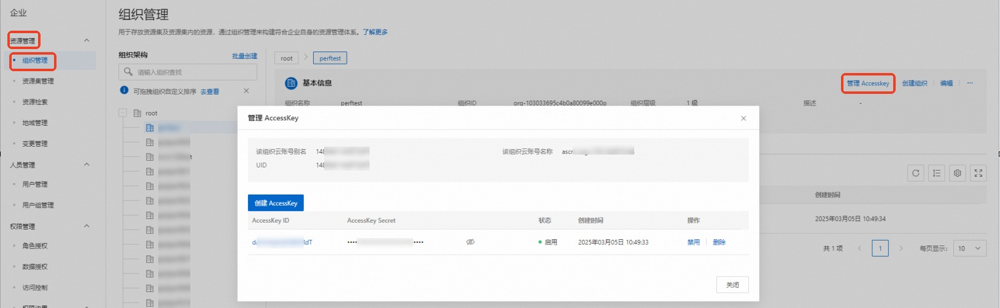
   >
   > </li>
   >
   > </ol>

   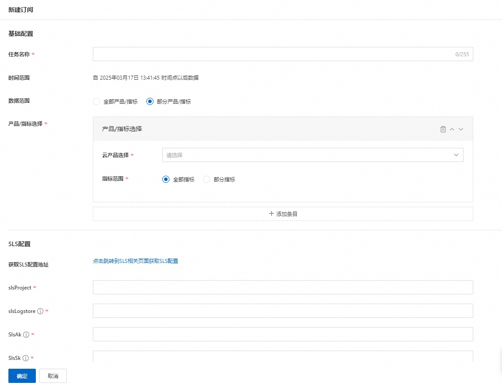

**查看数据订阅任务**

**操作步骤**

数据订阅任务创建成功后，可以查看数据订阅任务的相关信息。

在**数据订阅**页面的列表中，可以查看订阅任务的**订阅名称**、**订阅范围**、**订阅状态**、**SlsLogstore/SlsProject**、**运行状态**以及**创建时间**等信息。

**编辑数据订阅任务**

**操作步骤**

当已有数据订阅任务信息需要变更时，可以根据需要进行修改。

1. 在**数据订阅**页面的列表，单击目标订阅任务操作列的**编辑**。

2. 在**编辑**面板，根据业务需要进行参数配置修改。具体参数配置说明可参见新建订阅任务。

3. 修改完成后，单击**确定**。

**删除数据订阅任务**

**操作步骤**

当不再需要数据订阅任务时，可以将其删除。

1. 在**数据订阅**页面的列表，单击目标订阅任务操作列的**删除**。

2. 单击**确定**。

**禁用数据订阅任务**

**操作步骤**

当暂时不需要数据订阅任务时，可以停用对应的订阅任务。

> **重要**
>
> 停用数据订阅任务前，请确保**订阅状态**为**已开启**。

1. 在**数据订阅**页面的列表，单击目标订阅任务操作列的**禁用**。

2. 单击**确定**。

**启用数据订阅任务**

**操作步骤**

当需要继续数据订阅时，可以重启订阅任务。

> **重要**
>
> 启用数据订阅任务前，请确保**订阅状态**为**已关闭**。

1. 在**数据订阅**页面的列表，单击目标订阅任务操作列的**启用**。

2. 单击**确定**。

**SLS查看数据**

**操作步骤**

1. 在订阅任务列表查看目标数据订阅任务的**SlsLogstore/SlsProject。**

2. 登录Apsara Uni-manager运营控制台。

3. 单击顶部菜单栏的产品，选择**存储 > 存储数据服务 > 日志服务 SLS**。

4. 依据步骤一查到的**SlsProject**，在日志服务页面的Project列表，单击对应的Project名称。

5. 依据步骤一查到的**SlsLogstore**，在目标**SlsProject**页面，单击对应的日志库名，可查看订阅数据。

   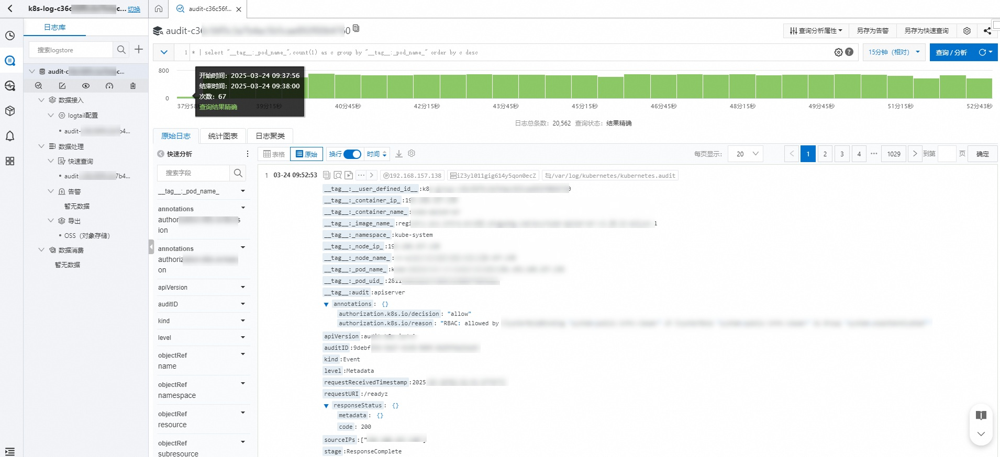

<a id="section-10"></a>

# 10.接入中心

<a id="section-10-1"></a>

## 10.1. 日志监控

通过日志监控，可以有效地监控日志中的关键字，及时发现潜在的问题，提升系统的稳定性和运维效率。

**创建日志监控**

**操作步骤**

您可以根据业务需要，创建日志监控以实时跟踪和分析日志数据。

1. 登录Apsara Uni-manager运营控制台。

2. 单击顶部菜单栏的**产品**，选择**迁移与运维管理** > **运维与监控** > **云监控**。

3. 在左侧导航栏选择**接入中心** > **日志监控**。

4. 在**日志监控**页面，单击**创建日志监控**。

5. 在**创建日志监控**面板，依次完成**基础信息**、**日志数据源**、**计算配置**步骤的填写。

   <ol type="i">

   <li>

   在**基础信息**步骤中，填写**监控项名称**后，单击**下一步**。

   > **说明**
   >
   > 监控项名称在同一个一级组织下唯一。

   

   </li>

   <li>

   在**日志数据源**步骤中，选择**SLS日志源**、**SlsProject**、**SlsLogstore**后，单击**下一步**。

   > **说明**
   >
   > - **SLS日志源**表示提供日志数据的源头，默认是Redline。
   >
   > - **SlsProject**表示SLS日志服务中日志项的名称。
   >
   > - **SlsLogstore**表示SLS日志服务中日志库的名称。

   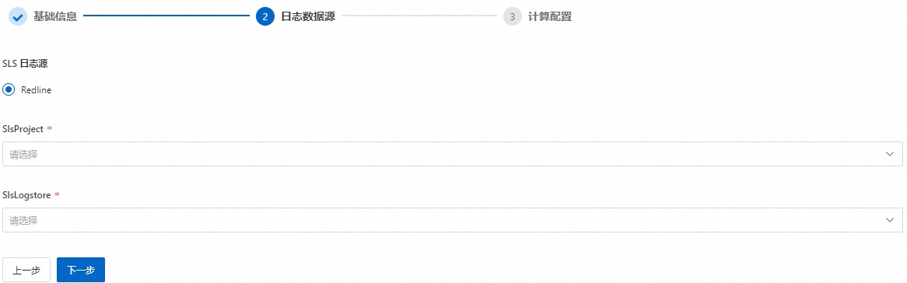

   </li>

   <li>

   在**计算配置**步骤中，选择**单位**、**聚合周期**，根据需要添加**统计方法**、**日志筛选**、**Group By**条目后，单击**提交**。

   <table>
     <tr>
       <th width="109">配置项</th>
       <th>描述</th>
     </tr>
     <tr>
       <td>单位</td>
       <td>监控项的单位。</td>
     </tr>
     <tr>
       <td>聚合周期</td>
       <td>监控项的计算周期。单位：分钟。聚合周期取值包括：<strong>1分钟</strong>、<strong>2分钟</strong>、<strong>3分钟</strong>、<strong>4分钟</strong>、<strong>5分钟</strong>、<strong>10分钟</strong>、<strong>15分钟</strong>、<strong>20分钟、</strong><strong>30分钟</strong>、<strong>60分钟</strong>。</td>
     </tr>
     <tr>
       <td>统计方法</td>
       <td>在计算周期内根据选定的统计方法对日志数据进行聚合处理。如果字段值是数值型，可以使用所有统计方法，否则只能使用计数和countps两种聚合算法。统计方法取值包括<strong>计数</strong>、<strong>求和</strong>、<strong>最大值</strong>、<strong>最小值</strong>、<strong>平均值</strong>、<strong>value</strong>、<strong>sumps</strong>、<strong>countps</strong>。<br>• <strong>计数</strong>：计算统计周期内指定字段数值的个数。<br>• <strong>求和</strong>：计算统计周期内指定字段数值之和。<br>• <strong>最大值</strong>：计算统计周期内指定字段数值的最大值。<br>• <strong>最小值</strong>：计算统计周期内指定字段数值的最小值。<br>• <strong>平均值</strong>：计算统计周期内指定字段数值的平均值。<br>• <strong>value</strong>：计算统计周期内指定字段数值的随机采样。<br>• <strong>sumps</strong>：计算统计周期内指定字段求sum后的每秒平均值。<br>• <strong>countps</strong>：计算统计周期内指定字段求count后的每秒平均值。例如：需要统计_sql_rendered字段的个数，则在统计方法中添加一个条目，第一列填写日志字段_sql_rendered，第二列选择计数，as后面自动匹配为_sql_rendered__count。</td>
     </tr>
     <tr>
       <td>日志筛选</td>
       <td>对日志数据进行过滤，相当于SQL中的WHERE条件。例如：Key为_sql_rendered，Value中需要监控的关键字为ERROR，该参数设置为_sql_rendered 包含 ERROR。<br>重要选择过滤的日志字段名不能包含中文。</td>
     </tr>
     <tr>
       <td>Group By</td>
       <td>对数据进行空间维度聚合，相当于SQL中的Group By。根据指定的维度，对监控数据进行分组。如果Group By不选择任何维度，则根据聚合方法对全部监控数据进行聚合。</td>
     </tr>
   </table>

   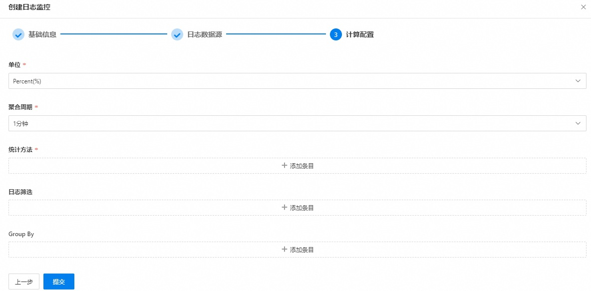

   </li>

   </ol>

**查看监控项详情**

**操作步骤**

日志监控创建成功后，可以查看监控项的详细信息，包括监控的基础信息、监控图表和报警规则等。

1. 在**日志监控**页面，查看监控项列表信息，包括**监控项**、**数据源（地域/Logstore/Project）**、**日志筛选**、**创建时间**等。

2. 在监控项列表，单击监控项**操作**列的**详情**。

3. 在监控详情页面，查看详细日志监控信息。

   - 在基础信息区域，查看监控项的基础信息，包括**监控项**、**地域**、**Logstore**、**SlsProject**、**创建时间**等。

     

   - 在**监控图表**页签，查看监控项图表。支持按**1小时**、**3小时**、**6小时**、**12小时**、**1天**、**3天**、**7天**、**14天**或**自定义**时间进行切换。

     > **说明**
     >
     > 单击**创建告警规则**，可新增报警规则。配置项说明可参见创建报警规则。

     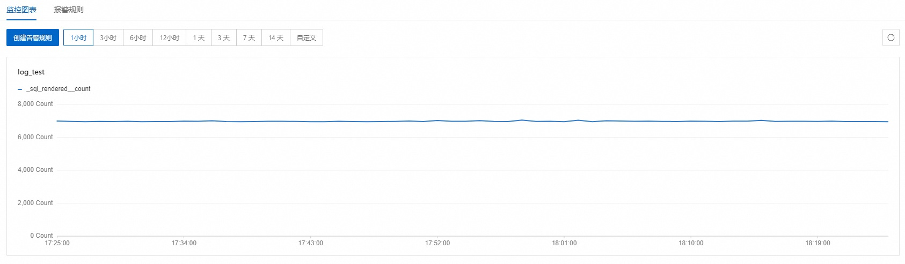

   - 在**报警规则**页签，查看监控项的相关报警规则。

     > **说明**
     >
     > - 单击**创建告警规则**，可新增报警规则。配置项说明可参见创建报警规则。
     >
     > - 单击报警规则操作列的相关操作，可对报警规则进行管理，详细内容可参见管理报警规则。

     

**编辑监控项**

**操作步骤**

监控项信息变更时，可以进行修改。

> **说明**
>
> 监控项名称不支持修改。

1. 在**日志监控**页面，单击监控项**操作**列的**编辑**。

2. 在**编辑日志监控**面板，按照步骤向导，根据需要依次完成内容的修改。配置项说明可参见创建日志监控。

**复制监控项**

**操作步骤**

复制监控项即快速新增一个相同的监控项，可以根据业务需求，对复制后的监控项进行微调，以满足个性化的需求。

1. 在**日志监控**页面，单击监控项**操作**列的**复制**。

2. 在**复制日志监控**面板，按照步骤向导，根据需要依次完成内容的修改。配置项说明可参见创建报警规则。

**删除监控项**

**操作步骤**

监控项不需要时，可以删除。

1. 在**日志监控**页面，单击监控项**操作**列的**删除**。

2. 在**删除监控项**对话框，单击**确定**。

<a id="section-10-2"></a>

## 10.2. 自定义监控

指标监控功能为您提供上报自定义指标的接口，方便您将业务产生的指标采集上报到云监控，通过对上报的指标配置报警规则来接收报警通知。

**背景**

云监控系统（CMS）当前仅支持预置的云产品指标监控，用户需自定义补充未覆盖的云产品自定义指标，并通过API主动上报自定义指标数据。

**指标监控**

**添加指标**

1. 登录Apsara Uni-manager运营控制台。

2. 单击顶部菜单栏的**产品**，选择**迁移与运维管理** > **运维与监控** > **云监控**。

3. 在左侧导航栏选择**接入中心** > **自定义监控**。

4. 在**自定义监控**页面，选择**指标监控**页签，单击**添加指标**。

   <table>
     <tr>
       <th width="122">配置项</th>
       <th>说明</th>
     </tr>
     <tr>
       <td>指标名称</td>
       <td>填写指标名称，支持字母、数字、下划线，最长为64个字符。</td>
     </tr>
     <tr>
       <td>指标描述信息</td>
       <td>填写指标描述信息，最长支持500个字符。</td>
     </tr>
     <tr>
       <td>指标周期</td>
       <td>选择指标周期，支持<strong>1分钟</strong>、<strong>5分钟</strong>、<strong>15分钟</strong>、<strong>30分钟</strong>、<strong>60分钟</strong>。</td>
     </tr>
     <tr>
       <td>指标单位</td>
       <td>输入指标单位，云监控对以下单位做了进位处理：<br>• 带宽类指标单位BYTE、KIB、MIB、GIB、TIB、PIB、EIB、ZIB<br>• 流速类指标单位BYTE/S、KIB/S、MIB/S、GIB/S、TIB/S、PIB/S、EIB/S、ZIB/S</td>
     </tr>
     <tr>
       <td>指标维度</td>
       <td>输入指标维度，同时系统默认选择userId、instanceId、groupId。</td>
     </tr>
     <tr>
       <td>统计方法</td>
       <td>选择指标的统计方法，支持<strong>平均值</strong>、<strong>最大值</strong>、<strong>最小值</strong>、<strong>求和值</strong>、<strong>监控值</strong>。</td>
     </tr>
   </table>

   > **说明**
   >
   > 指标添加成功后，大约10分钟后开始接收上报的监控数据。

5. 参数填写完成后，单击**确定**，在指标监控页签，即可查看新增的指标。

   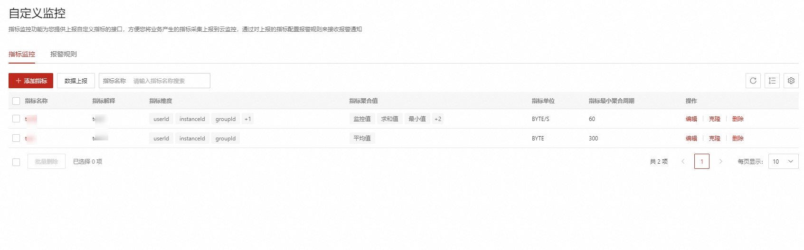

**指标查询**

1. 在**指标监控**页签，单击指标名称。

2. 在弹出的**指标查询**页面，选择**实例ID**、**指标维度**、**统计方法**、**查询时间区间**，在**查询结果**栏即可显示指标的监控详情。

**编辑指标**

1. 在**指标监控**页签，选择目标指标，单击**操作**列的**编辑**。

   

2. 在**编辑指标**弹框，可修改**指标描述信息**、**指标周期**、**指标单位**、**指标维度**、**统计方法**。

   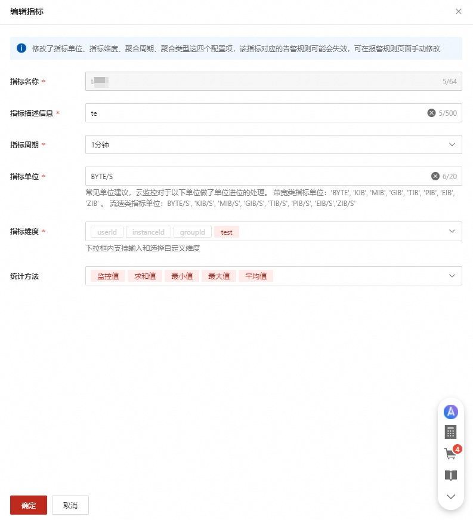

   > **说明**
   >
   > 如果修改了**指标周期**、**指标单位**、**指标维度**、**统计方法**这四个配置项，该指标对应的告警规则可能会失效，可在报警规则页签手动修改。

3. 编辑完成后，单击**确定**。

**克隆指标**

1. 在**指标监控**页签，选择目标指标，单击**操作**列的**克隆**。

   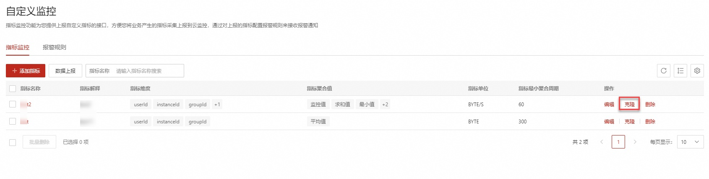

2. 在**克隆指标**弹框，可修改指标名称及其他配置项，修改完成后，单击**确定**。

**删除指标**

1. 在**指标监控**页签，选择目标指标，单击**操作**列的**删除**。

   

2. 单击弹框的**确定**，即可删除该指标。

   > **说明**
   >
   > 指标删除后不可恢复，请谨慎操作。

**报警规则**

**创建报警规则**

1. 在**自定义监控**页面，选择**报警规则**页签，单击**创建报警规则**。

   <table>
     <tr>
       <th width="138">配置项</th>
       <th>说明</th>
     </tr>
     <tr>
       <td>资源范围</td>
       <td>报警规则关联资源的范围，默认为<strong>全部资源</strong>。</td>
     </tr>
     <tr>
       <td>规则类型</td>
       <td>默认为<strong>单指标规则</strong>。</td>
     </tr>
     <tr>
       <td>报警规则描述</td>
       <td>报警规则的主体。当监控数据满足报警条件时，触发报警规则。<br>i. 单击<strong>创建报警规则</strong>。ii. 在<strong>创建报警规则</strong>面板，设置<strong>规则名称</strong>、<strong>监控指标</strong>、<strong>指标聚合周期</strong>、<strong>阈值及报</strong><strong>警级别</strong>。iii. 单击<strong>确认</strong>。</td>
     </tr>
     <tr>
       <td>沉默通道周期</td>
       <td>报警发生后未恢复正常，间隔多久重复发送一次报警通知。取值：<strong>5分钟</strong>、<strong>15</strong><strong>分钟</strong>、<strong>30分钟</strong>、<strong>1小时</strong>、<strong>3小时</strong>、<strong>6小时</strong>、<strong>12小时</strong>和<strong>24小时</strong>。当某些监控指标超出报警阈值时触发报警，如果监控指标在沉默通道周期内持续超过报警阈值，在沉默通道周期内不会重复发送报警通知；如果监控指标在沉默通道周期后仍未恢复正常，则云监控将再次发送报警通知。例如，当<strong>沉默通道周期</strong>设置为<strong>12小时</strong>时，如果超出报警阈值的监控指标在首次触发报警后12小时内仍未恢复正常，云监控将再次发送报警通知。</td>
     </tr>
     <tr>
       <td>生效时间</td>
       <td>报警规则的生效时间。报警规则只在生效时间内检查监控数据是否超出报警阈值。</td>
     </tr>
     <tr>
       <td>报警回调</td>
       <td>用于接收云监控通过POST请求推送报警消息的回调地址。<br>说明报警回调地址必须是云监控可访问的域名地址，仅支持HTTP协议，不支持填写IP。</td>
     </tr>
     <tr>
       <td>无数据处理方法</td>
       <td>无监控数据时报警的处理方式。<br>• 不做任何处理<br>• 发送无数据报警</td>
     </tr>
     <tr>
       <td>报警联系人</td>
       <td>选择报警信息发送的用户组或用户。默认的云账号报警联系人组是一个空账号，可用于测试报警规则的有效性。</td>
     </tr>
   </table>

2. 单击**确定**。

**管理报警规则**

1. 在**自定义监控**页面，选择**报警规则**页签。

2. 选择目标报警规则，执行相关操作。

   <table>
     <tr>
       <th width="154">操作任务</th>
       <th>操作步骤</th>
     </tr>
     <tr>
       <td>查看报警规则详情</td>
       <td>单击目标报警规则<strong>操作</strong>列的<strong>详情</strong>，在<strong>报警规则/报警历史/故障资源</strong>面板中可查看报警规则的详细信息。</td>
     </tr>
     <tr>
       <td>判断规则有效性</td>
       <td>单击目标报警规则<strong>有效性</strong>列的<strong>点击巡检</strong>，在有效性列可查看巡检结果。<br>说明<br>• 若巡检结果异常，可单击<strong>检测结果</strong>，在弹出的面板中查看<strong>告警规则执行异常</strong><strong>检测</strong>、<strong>告警规则加载检测</strong>、<strong>无效报警规则检测</strong>和<strong>告警规则回调检测</strong>结果。<br>• 单击<strong>重新检测</strong>，可重新检测规则有效性。</td>
     </tr>
     <tr>
       <td>查看规则执行记录</td>
       <td>单击目标报警规则<strong>规则执行记录</strong>列的<strong>查看规则执行记录</strong>，在<strong>报警规则执行记录</strong>面板中，可通过时间范围筛选执行记录。</td>
     </tr>
     <tr>
       <td>修改报警规则</td>
       <td>i. 单击目标报警规则<strong>操作</strong>列的<strong>编辑。</strong>ii. 在<strong>修改报警规则</strong>面板中，修改报警规则。iii. 修改完成后，单击<strong>确定</strong>。</td>
     </tr>
     <tr>
       <td>禁用报警规则</td>
       <td>当需要手动停止服务，进行维护或升级时，可以禁用报警规则，避免因人为变更而收到大量且无用的报警通知。<br>说明请先确认报警规则的<strong>状态</strong>为<strong>正常</strong>后，再进行禁用。<br>• 单个禁用<br>a. 单击目标报警规则<strong>操作</strong>列的图标，单击<strong>禁用。</strong><br>b. 在<strong>禁用报警规则</strong>对话框中，单击<strong>确定。</strong><br>• 批量禁用<br>a. 选中目标报警规则前的复选框，然后单击列表左下角的<strong>禁用</strong>。<br>b. 在<strong>禁用报警规则</strong>对话框，单击<strong>确定</strong>。</td>
     </tr>
     <tr>
       <td>启用报警规则</td>
       <td>完成云产品的维护或升级后，可以重新启用已被禁用的报警规则。<br>说明请先确认报警规则的<strong>状态</strong>为<strong>已禁用</strong>后，再进行<strong>启用</strong>。<br>• 单个启用<br>a. 单击目标报警规则<strong>操作</strong>列的<strong>启用。</strong><br>b. 在<strong>启用报警规则</strong>对话框中，单击<strong>确定。</strong><br>• 批量启用<br>a. 选中目标报警规则前的复选框，然后单击列表左下角的<strong>启用</strong>。<br>b. 在<strong>启用报警规则</strong>对话框，单击<strong>确定</strong>。</td>
     </tr>
     <tr>
       <td>删除报警规则</td>
       <td>• 单个删除<br>a. 单击目标报警规则操作列的图标，单击<strong>删除</strong>。<br>b. 在<strong>删除报警规则</strong>对话框中，单击<strong>确定</strong>。<br>• 批量删除<br>a. 选中目标报警规则前的复选框，然后单击列表左下角的删除。<br>b. 在<strong>删除报警规则</strong>对话框中，单击<strong>确定</strong>。</td>
     </tr>
   </table>

<a id="section-10-3"></a>

## 10.3. 自定义事件

事件监控功能为您提供上报自定义事件的接口，方便您将业务产生的异常事件采集上报到云监控，通过对上报的事件配置报警规则来接收报警通知。

**前提条件**

查看自定义事件前，请确保已上报事件监控数据。

**事件监控**

**数据上报**

1. 登录Apsara Uni-manager运营控制台。

2. 单击顶部菜单栏的**产品**，选择**迁移与运维管理** > **运维与监控** > **云监控**。

3. 在左侧导航栏，单击**接入中心** > **自定义事件**，进入**自定义事件**页面。

4. 在**事件监控**页签，单击**数据上报**。

5. 在展开的**SDK数据上报**面板，参见**增加依赖POM**和**示例代码**，完成数据上报。

**查看自定义事件**

1. 在**自定义事件监控**页面的**事件监控**页签，输入**事件名称**、**关键字搜索**，选择**事件等级**、**起止时间**。

2. 查看自定义事件上报分布的柱状图和列表。

   - **自定义事件分布柱状图**

     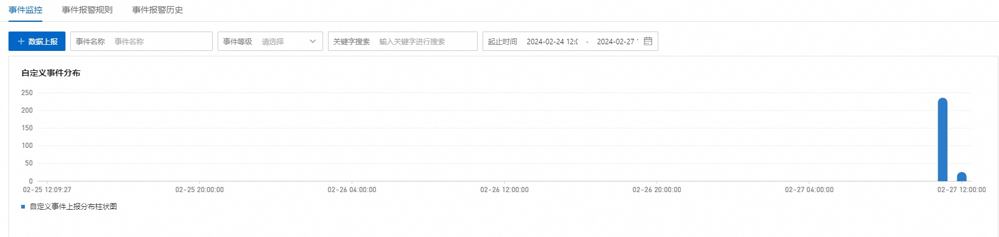

   - **自定义事件监控列表**

     > **说明**
     >
     > 单击**操作**列的**创建事件报警规则**，在**创建事件报警规则**面板为该事件创建报警规则，具体配置可参见创建事件报警规则。

     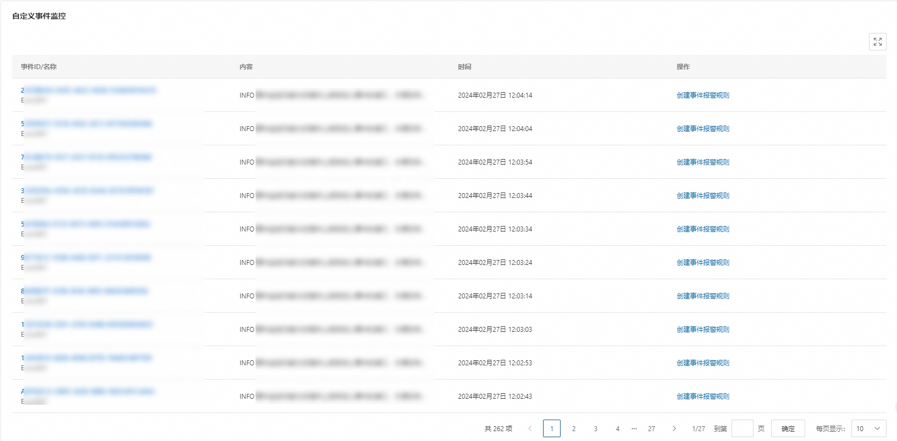

**事件报警规则**

**创建事件报警规则**

1. 在**自定义事件**页面，单击**事件报警规则**页签。

2. 单击**创建事件报警规则**，在**创建事件报警规则**面板，设置事件报警规则参数。

   <table>
     <tr>
       <th width="121">配置项</th>
       <th>说明</th>
     </tr>
     <tr>
       <td>报警规则名称</td>
       <td>填写报警规则的名称。</td>
     </tr>
     <tr>
       <td>事件名称</td>
       <td>填写事件的名称。</td>
     </tr>
     <tr>
       <td>事件告警等级</td>
       <td>可选择<strong>紧急</strong>、<strong>警告</strong>或<strong>提示</strong>。</td>
     </tr>
     <tr>
       <td>规则描述</td>
       <td>事件报警规则的详细信息，如设置5分钟内累计发生3次。</td>
     </tr>
     <tr>
       <td>联系人组</td>
       <td>选择报警信息发送的用户或用户组。</td>
     </tr>
     <tr>
       <td>报警回调</td>
       <td>用于接收云监控通过POST请求推送报警消息的回调地址。<br>说明报警回调地址必须是云监控可访问的域名地址，仅支持HTTP协议，不支持填写IP。</td>
     </tr>
   </table>

   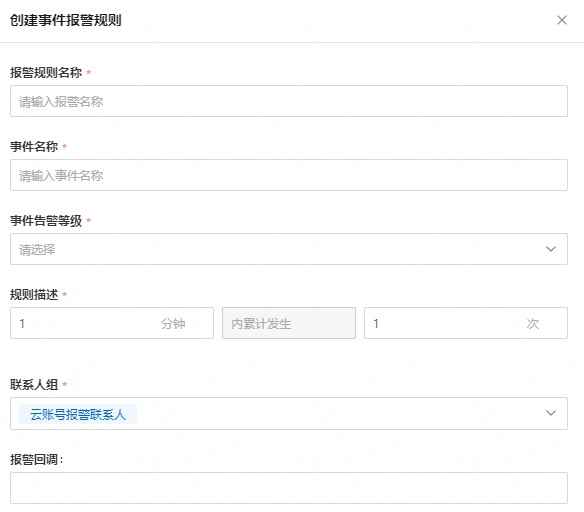

3. 单击**确定**。

**修改事件报警规则**

1. 在**事件报警规则**页签，单击**操作**列的**修改**。

2. 在**修改事件报警规则**面板，进行参数修改。

   > **说明**
   >
   > 事件名称不支持修改。

   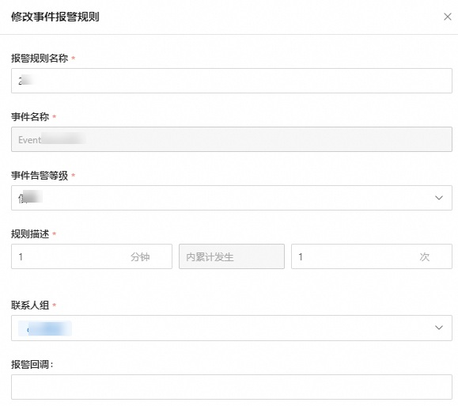

3. 单击**确定**。

**禁用事件报警规则**

> **说明**
>
> - 当暂时不需要接收某自定义事件的报警通知时，可以对其执行禁用操作。
>
> - 当自定义事件的报警规则的**启用状态**为**启用**时，可以对其执行禁用操作。

- **单个禁用**

  <ol type="i">

  <li>

  在**事件报警规则**页签，单击**操作**列的**禁用**。

  </li>

  <li>

  在**禁用报警规则**对话框，单击**确定**。

  </li>

  </ol>

- **批量禁用**

  <ol type="i">

  <li>

  在**事件报警规则**页签，单击规则前面的复选框，勾选多个规则。

  </li>

  <li>

  单击**禁用**。

  </li>

  <li>

  在**禁用报警规则**对话框，单击**确定**。

  </li>

  </ol>

**启用事件报警规则**

> **说明**
>
> 当自定义事件的报警规则的**启用状态**为**禁用**时，可以对其执行启用操作。

- **单个启用**

  <ol type="i">

  <li>

  在**事件报警规则**页签，单击**操作**列的**启用**。

  </li>

  <li>

  在**启用报警规则**对话框，单击**确定**。

  </li>

  </ol>

- **批量启用**

  <ol type="i">

  <li>

  在**事件报警规则**页签，单击规则前面的复选框，勾选多个规则。

  </li>

  <li>

  单击**启用**。

  </li>

  <li>

  在**启用报警规则**对话框，单击**确定**。

  </li>

  </ol>

**删除事件报警规则**

> **说明**
>
> 删除目标自定义事件的报警规则后，该自定义事件不再给您发送报警通知。

- **单个删除**

  <ol type="i">

  <li>

  在**事件报警规则**页签，单击**操作**列的**删除**。

  </li>

  <li>

  在**删除报警规则**对话框，单击**确定**。

  </li>

  </ol>

- **批量删除**

  <ol type="i">

  <li>

  在**事件报警规则**页签，单击规则前面的复选框，勾选多个规则。

  </li>

  <li>

  单击**删除**。

  </li>

  <li>

  在**删除报警规则**对话框，单击**确定**。

  </li>

  </ol>

**事件报警历史**

**查看事件报警历史**

1. 在**自定义事件**页面，单击**事件报警历史**页签。

2. 填写**规则ID**、**规则名称**，选择**起止时间**。

3. 在列表中查看事件的报警历史记录，包括**规则名称/ID**、**发生时间**、**事件名称**、**事件等级**等。

   
