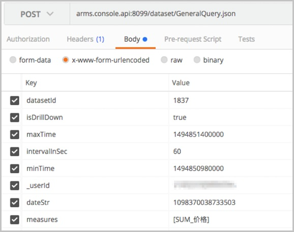
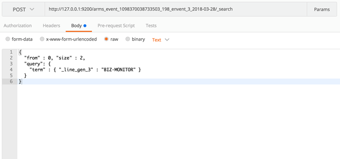
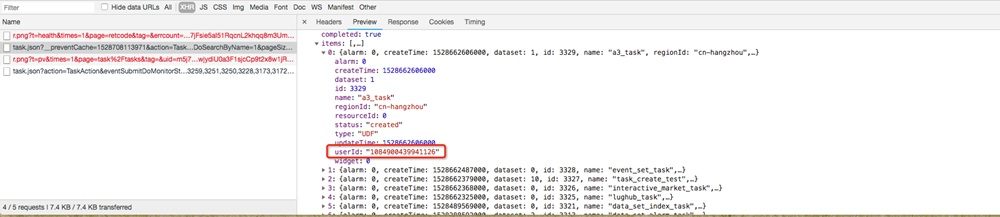
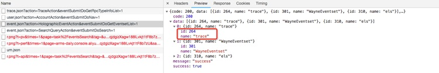

阿里云  
专有云  
应用实时监控服务 ARMS  
开发指南  
产品版本：V3.18.6  
文档版本：20250529

**目录**

- [1.概述](#section-1)
- [2.Postman请求示例](#section-2)
- [3.数据集查询](#section-3)
    - [3.1. 概述](#section-3-1)
    - [3.2. 请求参数说明](#section-3-2)
    - [3.3. 接口说明](#section-3-3)
    - [3.4. 返回码](#section-3-4)
- [4.事件集查询](#section-4)
- [5.API参考](#section-5)
    - [5.1. 登录Apsara Uni-manager运营控制台](#section-5-1)
    - [5.2. 获取组织AccessKey](#section-5-2)
    - [5.3. 应用监控](#section-5-3)
        - [5.3.1. ConfigApp](#section-5-3-1)
        - [5.3.2. SaveTraceAppConfig](#section-5-3-2)
        - [5.3.3. GetTrace](#section-5-3-3)
        - [5.3.4. GetTraceApp](#section-5-3-4)
        - [5.3.5. GetStack](#section-5-3-5)
        - [5.3.6. ListTraceApps](#section-5-3-6)
        - [5.3.7. SearchTraceAppByName](#section-5-3-7)
        - [5.3.8. SearchTraceAppByPage](#section-5-3-8)
        - [5.3.9. SearchTraces](#section-5-3-9)
        - [5.3.10. SearchTracesByPage](#section-5-3-10)
        - [5.3.11. QueryMetric](#section-5-3-11)
        - [5.3.12. DeleteTraceApp](#section-5-3-12)
        - [5.3.13. GetArmsAgentDownLoadUrl](#section-5-3-13)
        - [5.3.14. DescribeTraceLicenseKey](#section-5-3-14)
        - [5.3.15. DescribeTraceLocation](#section-5-3-15)
    - [5.4. 报警](#section-5-4)
        - [5.4.1. UpdateAlertRule](#section-5-4-1)
        - [5.4.2. DeleteAlertRules](#section-5-4-2)
        - [5.4.3. SearchAlertRules](#section-5-4-3)
        - [5.4.4. CreateAlertContact](#section-5-4-4)
        - [5.4.5. DeleteAlertContact](#section-5-4-5)
        - [5.4.6. UpdateAlertContact](#section-5-4-6)
        - [5.4.7. SearchAlertContact](#section-5-4-7)
        - [5.4.8. CreateAlertContactGroup](#section-5-4-8)
        - [5.4.9. DeleteAlertContactGroup](#section-5-4-9)
        - [5.4.10. UpdateAlertContactGroup](#section-5-4-10)
        - [5.4.11. SearchAlertContactGroup](#section-5-4-11)
        - [5.4.12. StartAlert](#section-5-4-12)
        - [5.4.13. StopAlert](#section-5-4-13)
        - [5.4.14. SearchEvents](#section-5-4-14)
        - [5.4.15. SearchAlertHistories](#section-5-4-15)

<a id="section-1"></a>

# 1.概述

本手册为 ARMS 开发指南，重点介绍如何利用 ARMS RESTful API 查询数据集，以及如何利用 ES RESTful API 查询事件集。

本手册主要内容有：

- 参数说明：ARMS API 规格，包含 API 路径、方法、输入参数以及输出参数的详细说明。

- 返回码（Response Code）：对 API 调用错误情况下返回的 Response 的说明。

- 详细的接口信息及使用示例：包括通用数据集查询、数据集下钻查询、数据集多维度查询、WhereIn 条件数据集查询接口。

- 事件集的常用查询接口和语法。

<a id="section-2"></a>

# 2.Postman请求示例

在使用ARMS Open API与ES的API之前，您可以通过第三方软件Postman进行测试，确保可以获取数据集和事件集数据。

图 1. 使用Postman测试ARMS Open API



图 2. 使用Postman测试ES Rest API



<a id="section-3"></a>

# 3.数据集查询

<a id="section-3-1"></a>

## 3.1. 概述

本章介绍了与数据集查询相关的请求参数、接口和返回码。

<a id="section-3-2"></a>

## 3.2. 请求参数说明

本问介绍了 ARMS 数据集查询 API 请求字段的具体含义。

> List[String] 表示 List 的 toString() 之后的字符串。
>
> **说明**

| 字段名称 | 字段类型 | 字段含义 | 是否必须 | 备注 |
| --- | --- | --- | --- | --- |
| datasetId | Long | 数据集 ID | 是 |  |
| minTime | Long | 查询数据的起始时间 | 是 |  |
| maxTime | Long | 查询数据的截止时间 | 是 |  |
| intervalInSec | Integer | 数据片的时间间隔 | 是 |  |
| measures | List\[String\] | 查询指标列表 | 否 | 列表最长支持 3 个元素。如果列表为空，则返回所有指标数据。 |
| isDrillDown | Boolean | 是否下钻 | 否 |  |
| dimensions | List\[String\] | 查询维度 | 否 |  |
| whereInKey | String | Where In 条件查询 Key 字段 | 否 |  |
| whereInValues | List\[String\] | Where In 条件查询 Key 字段 | 否 |  |
| requiredDims | List\[String\] | 通用数据集的必选维度 | 否 |  |
| optionalDims | List\[String\] | 通用数据集的可选维度 | 否 |  |
| orderByKey | String | orderBy 指标 | 否 |  |
| limit | Integer | 限制的返回个数 | 否 |  |
| reduceTail | Boolean | 是否把 limit 之外的数据合并到一起 | 否 |  |
| _userId | String | 用户 ID |  | 专有云中， _userId 与用户名相同，例如ARMS 管理员用户 ID为 arms_admin。 |

<a id="section-3-3"></a>

## 3.3. 接口说明

本文提供了 ARMS 数据集查询接口的示例。

以下示例使用 Java Apache HTTP Client 和 Python 脚本发送 HTTP Post 请求以获取数据。您也可以根据需要选择其他语言，例如 Ruby。

**数据集查询接口**

可调用此接口来查询通用数据集数据。本文提供Java和Python示例。

**Java Apache HTTP 请求示例**

```java
import org.apache.http.HttpResponse;
import org.apache.http.NameValuePair;
import org.apache.http.client.HttpClient;
import org.apache.http.client.entity.UrlEncodedFormEntity;
import org.apache.http.client.methods.HttpPost;
import org.apache.http.impl.client.HttpClientBuilder;
import org.apache.http.message.BasicNameValuePair;
import org.junit.Test;

import java.io.BufferedReader;
import java.io.InputStreamReader;
import java.util.ArrayList;
import java.util.List;

public class GeneralQueryTest {

    public static final String url = 
"http://***.**.**.**:8099/dataset/GeneralQuery.json";

    @Test
    public void GeneralQueryTest() throws Exception {
        HttpClient client = HttpClientBuilder.create().build();
        HttpPost post = new HttpPost(url);

        // add header
        post.setHeader("Content-Type", "application/x-www-form-urlencoded");

        // add post parameters
        List<NameValuePair> urlParameters = new ArrayList<>();
        urlParameters.add(new BasicNameValuePair("datasetId", "1837"));
        urlParameters.add(new BasicNameValuePair("isDrillDown", "false"));
        urlParameters.add(new BasicNameValuePair("maxTime", "1494851400000"));
        urlParameters.add(new BasicNameValuePair("intervalInSec", "60"));
        urlParameters.add(new BasicNameValuePair("minTime", "1494850980000"));
        urlParameters.add(new BasicNameValuePair("_userId", "11************596"));
        urlParameters.add(new BasicNameValuePair("dateStr", "date"));
        urlParameters.add(new BasicNameValuePair("measures", "MAX_load_load1"));
        post.setEntity(new UrlEncodedFormEntity(urlParameters));

        // send post
        HttpResponse response = client.execute(post);

        // analyse result
        BufferedReader rd = new BufferedReader(
                new InputStreamReader(response.getEntity().getContent()));

        StringBuffer result = new StringBuffer();
        String line = "";
        while ((line = rd.readLine()) != null) {
            result.append(line);
        }
    }
}
```

**Python 请求示例**

```python
#!/usr/bin/python
#-*-coding:utf-8 -*-

import httplib, urllib

try:
        params = urllib.urlencode({'datasetId': '1837',
                                   'isDrillDown': 'false',
                                   'maxTime': '1494851400000',
                                   'intervalInSec': '60',
                                   'minTime': '1494850980000',
                                   '_userId': '11***********96',
                                   'dateStr': 'date',
                                   'measures': 'MAX_load_load1'
                                  })
        headers = {"Content-type": "application/x-www-form-urlencoded",
                   "Accept": "text/plain"}

        conn = httplib.HTTPConnection("***:**:**:**",8099)
        conn.request("POST", "/dataset/GeneralQuery.json", params, headers)
        response = conn.getresponse()
        print response.read()
except Exception,e:
        print str(e)
finally:
        if conn:
                conn.close()
```

**下钻数据集查询接口**

此示例代码与数据集查询接口中的 **Java Apache HTTP 请求示例**代码基本一致，只需修改一行代码。

```text
urlParameters.add(new BasicNameValuePair("isDrillDown", "false"));
```

应修改为：

```text
urlParameters.add(new BasicNameValuePair("isDrillDown", "true"));
```

**下钻数据集多维度查询接口**

此示例代码与数据集查询接口中的 **Java Apache HTTP 请求示例**代码基本一致，只需增加以下代码：

```text
Map<String, String> dimension = new LinkedMap(); dimension.put("value", "hz");
dimension.put("key", "区域");
dimension.put("type", "ALL");
List<Map<String, String>> dimensions = Lists.newArrayList(); dimensions.add(dimension);
```

**WHERE IN 条件数据集查询接口**

此示例代码与数据集查询接口中的 **Java Apache HTTP 请求示例**代码基本一致，只需增加以下代码：

```text
urlParameters.add(new BasicNameValuePair("whereInKey","区域"); List<String> whereInValues = new ArrayList<>(); whereInValues.add("hz");
whereInValues.add("bj");
urlParameters.add(new BasicNameValuePair("whereInValues", whereInValues.toString()));
```

**通用数据集查询接口**

此示例代码与数据集查询接口中的 **Java Apache HTTP 请求示例**代码基本一致，只需增加以下代码：

```text
Map<String, String> optionalDim = Maps.newTreeMap(); optionalDim.put("value", "hz");
optionalDim.put("key", "区域"); optionalDim.put("type", "ALL");
List<Map<String, String>> optionalDims = Lists.newArrayList(); 
optionalDims.add(optionalDim);
```

<a id="section-3-4"></a>

## 3.4. 返回码

本文介绍响应内容和对应的解决方法。

API 返回的通用响应结果包含以下内容：

| 名称 | 说明 |
| --- | --- |
| code | 错误代码 |
| data | ARMS 查询结果具体信息 |
| message | 错误消息 |
| success | 是否成功（true 或 false） |

**errMsg 数据集不存在**

```json
{
    "code": 200,
    "data": "{\"actualSizeFromDB\":0,\"errMsg\":\"数据集 ID 不存在！\",\
    "message": "success",
    "success": true
}
```

解决方法：请在 ARMS 中查询该数据集 ID 拼写是否正确，该数据集 ID 是否属于该用户。

**errMsg 查询结果为空**

```json
{
    "code": 200,
    "data": "{\"actualSizeFromDB\":0,\"errMsg\":\"查询结果为空\",\
    "message": "success",
    "success": true
}
```

解决方法：

1. 确定在请求的开始时间和结束时间之间是否存在数据。

2. 如果选择了维度，则检查该维度是否存在数据。

3. 检查 _userId 是否设置错误。专有云中 _userId 与用户名相同。

**Code 500**

该代码表示 ARMS 内部错误。

解决方法：请联系 ARMS 开发人员。

**Code 200**

该代码表示访问处理成功。

<a id="section-4"></a>

# 4.事件集查询

**请求参数说明**

ARMS 事件集底层依赖 ElasticSearch，因此可以直接使用 ElasticSearch 的 Rest API 进行数据的查询与操作。在进行查询或者其他操作时，必须明确以下几个参数：

<table>
  <tr>
    <td></td>
    <td>说明</td>
    <td>备注</td>
  </tr>
  <tr>
    <td>ES 机器 IP</td>
    <td>ES 集群机器的 IP</td>
    <td>可到 arms-console 对应机器的region.yaml 配置文件中查询 IP</td>
  </tr>
  <tr>
    <td>索引</td>
    <td>事件集底层存储的索引</td>
    <td>获取索引的方法见下文</td>
  </tr>
  <tr>
    <td>类型</td>
    <td>事件集底层存储索引的类型</td>
    <td>类型值固定设置为 arms_event</td>
  </tr>
</table>

**如何获取事件集的索引**

在获取事件集的索引之前，需要获取用户 ID、事件集 ID 和事件集名称。

1. 获取用户 ID。

   

2. 通过在浏览器查看事件搜索页面的事件集列表接口来获取事件集 ID。

   

事件集的索引分为以下两种类型：

- 按天滚动的索引

  取值规则：arms_event_用户 ID_事件集 ID_事件集名称_时间

  示例：arms_event_1098370038733503_198_envent_2018-03-28

- 别名索引

  取值规则：arms_alias_用户 ID_事件集 ID_事件集名称_时间

  示例：event_alias_1098370038733503_198_envent

**查询接口**

Rest API 查询接口为：

```text
http://IP:9200/索引/arms_event/_search
```

或：

```text
http://IP:9200/索引/_search
```

关于查询语法，请参考 ES 官方网站。

<a id="section-5"></a>

# 5.API参考

<a id="section-5-1"></a>

## 5.1. 登录Apsara Uni-manager运营控制台

本文主要向您介绍如何登录Apsara Uni-manager运营控制台。

**前提条件**

- 登录Apsara Uni-manager运营控制台前，确认您已从部署人员处获取Apsara Uni-manager运营控制台的服务域名地址。

- 推荐使用Chrome浏览器。

**操作步骤**

1. 在浏览器地址栏中，输入Apsara Uni-manager运营控制台的服务域名地址，按回车键。

2. 输入正确的用户名及密码。

   请向运营管理员获取登录控制台的用户名和密码。

   > 首次登录Apsara Uni-manager运营控制台时，需要修改登录用户名的密码，请按照提
   >
   > **说明**
   >
   > 示完成密码修改。为提高安全性，密码长度必须为10~32位，且至少包含以下两种类型：
   >
   > - 英文大写或小写字母（A~Z、a~z）
   >
   > - 阿拉伯数字（0~9）
   >
   > - 特殊符号（感叹号（!）、at（@）、井号（#）、美元符号（$）、百分号（%）等）

3. 单击**账号登录**。

4. 如果账号已激活MFA多因素认证，请根据以下两种情况进行操作：

   - 管理员强制开启MFA后的首次登录：

     <ol type="a">

     <li>

     在绑定虚拟MFA设备页面中，按页面提示步骤绑定MFA设备。

     </li>

     <li>

     按照步骤2重新输入账号和密码，单击**账号登录**。

     </li>

     </ol>

     <ol type="i" start="100">

     <li>

     输入6位MFA码后单击**认证**。

     </li>

     </ol>

   - 您已开启并绑定MFA：

     输入6位MFA码后单击**认证**。

     > 绑定并开启MFA的操作请参见<strong>《Apsara Uni-manager运营控制台用户指南》</strong>中
     >
     > **说明**
     >
     > 的<strong>《绑定并开启虚拟MFA设备》</strong>章节。

<a id="section-5-2"></a>

## 5.2. 获取组织AccessKey

访问身份验证中通过使用AccessKey ID和AccessKey Secret对称加密的方法来验证某个请求的发送者身份。AccessKey ID用于标示用户，AccessKey Secret是用户用于加密签名字符串。本章节将为您描述如何获取组织AccessKey。

**前提条件**

只有运营管理员和一级组织管理员可以获取组织AccessKey。

**操作步骤**

1. 登录Apsara Uni-manager运营控制台。

2. 在页面顶部菜单栏单击**企业**。

3. 在**企业**页面的左侧导航栏选择**资源管理 > 组织管理**。

4. 在**组织管理**页面左侧列表中单击目标一级组织名，然后在右侧页面单击右上角的**管理AccessKey**。

5. 在弹出的对话框中，获取组织的AccessKey ID和AccessKey Secret。

   > 调用接口时必须使用处于启用状态的组织AccessKey。AccessKey被禁用后将无法正常
   >
   > **说明**
   >
   > 调用API接口。

<a id="section-5-3"></a>

## 5.3. 应用监控

<a id="section-5-3-1"></a>

### 5.3.1. ConfigApp

调用ConfigApp接口打开或关闭应用监控的Agent总开关，或者查询Agent总开关的状态。

**请求参数**

| 名称 | 类型 | 是否必选 | 示例值 | 描述 |
| --- | --- | --- | --- | --- |
| Action | String | 是 | ConfigApp | 系统规定参数。取值：ConfigApp。 |
| AppIds | String | 是 | iioe7jcnuk@582 846f37\*\*\*\*\*\*,atc 889zkcf@d8dee dfa9bf\*\*\*\*\*\* | 应用ID，即pid。多个pid之间以半角逗号（,）分隔。 |
| Enable | String | 是 | true | 打开或关闭一个或多个应用的Agent总开关。关闭开关后即停止监控。如果不填写该参数，则表示查询目标应用当前的Agent总开关状态。<br>• true：打开Agent总开关<br>• false：关闭Agent总开关 |
| RegionId | String | 是 | cn-hangzhou | 地域ID。 |

**返回数据**

| 名称 | 类型 | 示例值 | 描述 |
| --- | --- | --- | --- |
| Data | String | abc@def success\\nghi@jkl success\\n | 操作是否成功或者目标应用的Agent总开关状态。 |
| RequestId | String | 16AF921B-8187-489F-9913-43C808B4\*\*\*\* | 请求ID。 |

**示例**

请求示例

```text
http(s)://[Endpoint]/?Action=ConfigApp
&AppIds=iioe7jcnuk@582846f37******,atc889zkcf@d8deedfa9bf******
&Enable=true
&RegionId=cn-hangzhou
&<公共请求参数>
```

正常返回示例

`XML` 格式

```xml
<RequestId>16AF921B-8187-489F-9913-43C808B4****</RequestId>
<Data>abc@def success\nghi@jkl success\n</Data>
```

`JSON` 格式

```json
{
    "RequestId": "16AF921B-8187-489F-9913-43C808B4****",
    "Data": "abc@def success\\nghi@jkl success\\n"
}
```

<a id="section-5-3-2"></a>

### 5.3.2. SaveTraceAppConfig

调用SaveTraceAppConfig接口进行应用监控的自定义设置（如调用链采样设置、Agent开关等）。

**请求参数**

| 名称 | 类型 | 是否必选 | 示例值 | 描述 |
| --- | --- | --- | --- | --- |
| Action | String | 是 | SaveTraceAppC onfig | 系统规定参数。取值：SaveTraceAppConfig。 |
| Pid | String | 是 | a2n80plglh@74 5eddx | 应用的ID标识串。 |
| Settings.N.Key | String | 是 | sampling.enable | 自定义设置，各设置的详细字段见下文说明。<br>• 调用链路采样相关<br>• 总开关设置<br>• 阈值设置<br>• 高级设置<br>• 线程设置<br>• 内存快照设置<br>• URL收敛设置<br>• 业务日志关联设置<br>• 业务监控设置 |
| Settings.N.Value | String | 是 | true | 自定义设置，各设置的详细字段见下文说明。<br>• 调用链路采样相关<br>• 总开关设置<br>• 阈值设置<br>• 高级设置<br>• 线程设置<br>• 内存快照设置<br>• URL收敛设置<br>• 业务日志关联设置<br>• 业务监控设置 |
| RegionId | String | 否 | cn-hangzhou | 必选，地域ID。 |

**调用链路采样字段说明**

| Key | 字段说明 | Value |
| --- | --- | --- |
| sampling.enable | 采样开关 | 取值：<br>- <code> true </code>：开启采样开关。<br>- <code> false </code>：关闭采样开关，调用链功能将关闭。 |
| sampling.rate | 采样率。调大采样率可能会消耗额外的系统资源，最大每秒采集条数存在限制。每秒采集100条的情况下，开销在300m内存左右。如需调整每秒最大采集数，可修改限流阈值。 | 0~100之间，默认为10。 |

**总开关字段说明**

| Key | 字段说明 | Value |
| --- | --- | --- |
| enable | Agent总开关 | 取值：<br>- <code> true </code>：开启Agent总开关。<br>- <code> false </code>：关闭Agent总开关。 |
| agent.logger.level | 日志级别配置 | 取值：<br>- <code> DEBUG </code><br>- <code> INFO </code><br>- <code> WARN </code><br>- <code> ERROR </code> |
| dubbo.enable<br>mongodb.enable<br>hsf.enable<br>httpclient3.enable<br>httpclient4.enable<br>jdkhttp.enable<br>jetty.enable<br>mybatis.enable<br>mysql.enable<br>okhttp.enable<br>oracle.enable<br>postgresql.enable<br>redis.enable<br>spring.enable<br>springboot.enable<br>tomcat.enable<br>lettuc.enable<br>grpc.enable<br>thrift.enable<br>hystrix.enable<br>rxjava.enable<br>googlehttpclient.enable | 插件开关 | 取值：<br>- <code> true </code><br>- <code> false </code> |

**阈值字段说明**

| Key | 字段说明 | Value |
| --- | --- | --- |
| thresholds.limit | 限流阈值，Agent端每秒最大可处理请求数。 | 默认为100，最大值为2000。 |
| thresholds.interface | 接口响应时间阈值。当接口响应时间大于该阈值的时候，该接口会被标记为慢调用。 | 默认为500，单位为ms，最大值为2000。 |
| thresholds.sql | 慢SQL查询阈值。当SQL查询的耗时大于该阈值的时候，该查询会被标记为慢SQL。 | 默认为500，单位为ms，最大值为2000。 |

**高级字段说明**

| Key | 字段说明 | Value |
| --- | --- | --- |
| defined.excludeurl | 无效接口调用过滤 | 支持以半角逗号（,）分隔多个接口调用。示例：/service/taobao,/service/sta tus。 |
| callstack.maxLength | 方法堆栈最大长度间阈值 | 默认为128，支持最大长度400条。 |
| exception.stacktrace | 同类异常堆栈区分深度 | 同类型异常，用于作为不同异常区分的堆栈深度，一般设置为第一个差异调用的深度。最大值为100。 |
| callsql.maxLength | 采集SQL最大长度 | 默认为1024个字符，最小长度为256个字符，最大长度为4096个字符。 |
| jdbc.tracesqlbindvalue | 采集SQL绑定值 | 捕获PrepareStatement参数绑定的变量值，无需重启应用即可生效。取值：<br>- <code> true </code><br>- <code> false </code> |
| jdbc.tracesqlraw | 是否显示原始SQL | 仅对SQL截断，不做额外处理。取值：<br>- <code> true </code><br>- <code> false </code> |
| exception.whitelist | 异常过滤 | 使用正则表达式匹配异常类全名，多个异常请使用半角逗号（,）分隔。例如：java.lang.InterrupetedException,java.lang.IndexOutOfBoundsEx ception。此处输入的异常不会显示在应用详情和异常分析页面的图表中。 |
| error.skip | 错误数过滤 | 默认情况下，大于400的状态码会计入错误数，您可以设置需要忽略的状态码，多个错误码使用半角逗号（,）分隔，例如：429或429,512。Agent 2.5.7.2以上版本支持。 |
| spanV3.enable | 调用链新格式 | 采用支持调用链时间排序的新存储格式。取值：<br>- <code> true </code>（默认）<br>- <code> false </code> |
| compress.enable | 调用链压缩 | 是否将重复调用（比如for循环）简化，无需重启应用即生效。取值：<br>- <code> true </code><br>- <code> false </code> |
| param.maxLength | 请求入参最大长度 | 默认为512字符，支持的最大长度为2048字符，最小长度为256字符。 |
| quantile.enable | 分位数统计 | 是否开启分位数统计功能。取值：<br>- <code> true </code><br>- <code> false </code> |
| AIAlert.enable | 应用紧急事件报警，Agent版本需在v2.5.8版本以上。 | 支持线程死锁、OOM等紧急报警。取值：<br>- <code> true </code><br>- <code> false </code> |
| threadpoolmonitor.enable | 池化监控 | 支持Tomcat/Dubbo/HSF等框架的线程池指标监控，请将Agent版本升级至最新版本。取值：<br>- <code> true </code><br>- <code> false </code><br>应用重启生效。 |
| rabbitmq.client.consumer.class es | RabbitMQ自定义消费者 | 通过设置自定义消费者的类名或者包含匿名内部消费者的类名，可以看到该消费者的调用链路。多个消费者以英文逗号（,）分隔。应用重启生效。 |
| kafka.consumer.entryPoint | Kafka自定义消费者 | 通过设置自定义消费者的类名或者包含匿名内部消费者的类名，可以看到该消费者的调用链路。多个消费者以英文逗号（,）分隔。应用重启生效。 |
| convergence.dneReq2Error.ena ble | 404请求收敛开关 | 默认值为true，会将404请求收敛为/error。此时接口调用展示的是收敛后的接口/error（会查询不到调用链路），调用链路记录的还是原始的接口名。取值：<br>- <code> true </code><br>- <code> false </code> |

**线程字段说明**

| Key | 字段说明 | Value |
| --- | --- | --- |
| tprof.enableThreadProfiler | 线程剖析总控开关 | 取值：<br>- <code> true </code>：开启线程剖析总控开关。<br>- <code> false </code>：关闭线程剖析总控开关。开启后自动保存慢调用本地方法栈。 |
| tprof.threadProfilerSlowInteracti onRt | 慢调用监听触发阈值 | 默认为2000。耗时高于该阈值才启动线程剖析，建议设为耗时的99分位线。低于2000ms会增加CPU消耗，不可小于500ms。最大值为10000ms。 |
| tprof.enableThreadStackRecord er | 线程诊断方法栈 | 取值：<br>- <code> true </code>：开启线程诊断方法栈。<br>- <code> false </code>：关闭线程诊断方法栈。开启后每隔5分钟采集一次方法栈。 |

**URL收敛字段说明**

| Key | 字段说明 | Value |
| --- | --- | --- |
| convergence.enable | 收敛URL | 取值：<br>- <code> true </code>：开启收敛URL。<br>- <code> false </code>：关闭收敛URL。 |
| convergence.minServerSize | 收敛阈值 | 默认值为1000，大于此阈值即进行收敛。 |
| convergence.pattern | 收敛规则正则 | 可使用正则表达式设置收敛规则，多个正则表达式之间以英文逗号（,）分隔，例如：/service/(.\*?)/demo。 |
| convergence.excludes | 排除规则正则 | 可使用正则表达式设置排除规则，多个正则表达式之间以英文逗号（,）分隔，例如：/service/\\d+/demo。 |

**业务日志关联字段说明**

| Key | 字段说明 | Value |
| --- | --- | --- |
| logging.enable | 关联业务日志与TraceId开关 | 取值：<br>- <code> true </code>：开启关联业务日志与TraceId开关。<br>- <code> false </code>：关闭关联业务日志与TraceId开关。开启后业务日志中会自动生成调用链的TraceId，此设置在重启应用后生效。支持Log4j/Log4j2/Logback日志组件。业务应用需要在日志的Layout中通过声明%X{EagleEye-TraceID}来输出TraceId信息。 |
| SLS.project | 当前区域业务日志的project | 当前区域业务日志的project。 |
| SLS.logStore | 当前区域业务日志的logstore | 当前区域业务日志的logstore。 |
| SLS.index | 当前区域业务日志的关联索引 | 取值：<br>• 当指定全文索引时，不填。<br>• 指定字段索引时，取值为相应的字段名。例如：<strong>SLS.index:</strong> <strong>tag</strong>。 |

**返回数据**

| 名称 | 类型 | 示例值 | 描述 |
| --- | --- | --- | --- |
| Data | String | success | 操作是否成功。 |
| RequestId | String | 78901766-3806-4E96-8E47-CFEF59E4\*\*\*\* | 请求ID。 |

**示例**

请求示例

```text
http(s)://[Endpoint]/?Action=SaveTraceAppConfig
&Pid=a2n80plglh@745eddx
&<公共请求参数>
```

正常返回示例

`XML` 格式

```xml
<RequestId>78901766-3806-4E96-8E47-CFEF59E4****</RequestId>
<Data>success</Data>
```

`JSON` 格式

```json
{
    "RequestId": "78901766-3806-4E96-8E47-CFEF59E4****",
    "Data": "success"
}
```

<a id="section-5-3-3"></a>

### 5.3.3. GetTrace

调用GetTrace接口获取调用链路详情。

**请求参数**

| 名称 | 类型 | 是否必选 | 示例值 | 描述 |
| --- | --- | --- | --- | --- |
| Action | String | 是 | GetTrace | 系统规定参数。取值：GetTrace。 |
| RegionId | String | 是 | cn-beijing | 地域ID。 |
| TraceID | String | 是 | ac14001a15954 493811405707d \*\*\*\* | 调用链ID，链路请求的唯一标识。 |

**返回数据**

| 名称 | 类型 | 示例值 | 描述 |
| --- | --- | --- | --- |
| RequestId | String | 1E2B6A4C-6B83-4062-8B6F-AEEC1F\*\*\*\*\*\* | 请求ID。 |
| Spans | Array of Span |  | Span列表。 |
| Duration | Long | 1000 | 耗时，单位为毫秒。 |
| HaveStack | Boolean | false | 是否有方法栈：<br>• <code> true </code>：有方法栈。<br>• <code> false </code>：没有方法栈。 |
| LogEventList | Array of LogEvent |  | 日志事件列表。 |
| TagEntryList | Array of TagEntry |  | 标签列表。 |
| Key | String | logLevel | 日志事件的标签键。 |
| Value | String | Warning | 日志事件的标签值。 |
| Timestamp | Long | 158368320204700 0 | 日志事件的产生时间戳。 |
| OperationNam e | String | /api/demo | 埋点的接口名称。 |
| ParentSpanId | String | 18 | 父Span ID。 |
| ResultCode | String | 200 | 返回码。 |
| RpcId | String | 1.1 | 表示Span之间的父子兄弟关系。 例如1.1是1.1.1的父亲Span， 而1.1.2和1.1.1是兄弟Span。 |
| RpcType | Integer | 101 | 调用类型。<br>• 101：表示Client调用<br>• 102：表示Server调用<br>• 103：表示Producer调用<br>• 104：表示Consumer调用<br>• 105：表示DB调用<br>• 106：表示Xtrace_Other调用 |
| ServiceIp | String | 192.168.XX.XX | 服务IP地址，即Span所在的机器IP地址。 |
| ServiceName | String | server1 | 服务名称，又称为应用名称。 |
| SpanId | String | fec891bb8f\*\*\*\* | Span ID。 |
| TagEntryList | Array of TagEntry |  | 标签项列表。 |
| Key | String | logLevel | Span的标签键。 |
| Value | String | Warning | Span的标签值。 |
| Timestamp | Long | 158368320204700 0 | Span的产生时间戳。 |
| TraceID | String | ac14001a1595449 3811405707d\*\*\*\* | 调用链ID，链路请求的唯一标识。 |

**示例**

请求示例

```text
http(s)://[Endpoint]/?Action=GetTrace
&RegionId=cn-beijing
&TraceID=ac14001a15954493811405707d****
&<公共请求参数>
```

正常返回示例

`XML` 格式

```xml
<RequestId>1E2B6A4C-6B83-4062-8B6F-AEEC1F******</RequestId>
<Spans>
    <HaveStack>false</HaveStack>
    <ParentSpanId>18</ParentSpanId>
    <ServiceIp>192.168.XX.XX</ServiceIp>
    <ServiceName>server1</ServiceName>
    <OperationName>/api/demo</OperationName>
    <RpcType>101</RpcType>
    <RpcId>1.1</RpcId>
    <TraceID>ac14001a15954493811405707d****</TraceID>
    <Duration>1000</Duration>
    <Timestamp>1583683202047000</Timestamp>
    <ResultCode>200</ResultCode>
    <SpanId>fec891bb8f****</SpanId>
    <TagEntryList>
        <Value>Warning</Value>
        <Key>logLevel</Key>
    </TagEntryList>
    <LogEventList>
        <Timestamp>1583683202047000</Timestamp>
        <TagEntryList>
            <Value>Warning</Value>
            <Key>logLevel</Key>
        </TagEntryList>
    </LogEventList>
</Spans>
```

`JSON` 格式

```json
{
    "RequestId": "1E2B6A4C-6B83-4062-8B6F-AEEC1F******",
    "Spans": {
        "HaveStack": false,
        "ParentSpanId": 18,
        "ServiceIp": "192.168.XX.XX",
        "ServiceName": "server1",
        "OperationName": "/api/demo",
        "RpcType": 101,
        "RpcId": 1.1,
        "TraceID": "ac14001a15954493811405707d****",
        "Duration": 1000,
        "Timestamp": 1583683202047000,
        "ResultCode": 200,
        "SpanId": "fec891bb8f****",
        "TagEntryList": {
            "Value": "Warning",
            "Key": "logLevel"
        },
        "LogEventList": {
            "Timestamp": 1583683202047000,
            "TagEntryList": {
                "Value": "Warning",
                "Key": "logLevel"
            }
        }
    }
}
```

<a id="section-5-3-4"></a>

### 5.3.4. GetTraceApp

调用GetTraceApp接口查询应用监控任务详情。

**请求参数**

| 名称 | 类型 | 是否必选 | 示例值 | 描述 |
| --- | --- | --- | --- | --- |
| Action | String | 是 | GetTraceApp | 系统规定参数。取值：GetTraceApp。 |
| Pid | String | 是 | b590lhguqs@d8 deedfa9bf\*\*\*\* | 应用的ID标识串。 |
| RegionId | String | 是 | cn-hangzhou | 地域ID。 |

**返回数据**

| 名称 | 类型 | 示例值 | 描述 |
| --- | --- | --- | --- |
| RequestId | String | D80ADAAC-8C32-5479-BD14-C28CF832\*\*\*\* | 请求ID。 |
| TraceApp | Struct |  | 返回结构体。 |
| AppId | Long | 123 | 应用ID。 |
| AppName | String | arms-k8s-demo | 应用名称。 |
| CreateTime | Long | 1576599253000 | 创建时间的时间戳。 |
| Labels | List | \[ "test", "123123123", "uat"\], | 应用标签。 |
| Pid | String | b590lhguqs@d8de edfa9bf\*\*\*\* | 应用的ID标识串。 |
| RegionId | String | cn-hangzhou | 地域ID。 |
| Show | Boolean | true | ARMS控制台是否显示该应用：<br>• true：显示。<br>• false：不显示。<br>说明EDAS应用如果在EDAS控制台未开启<strong>高级监控</strong>功能，则显示为<code> false </code>。 |
| Type | String | TRACE | 监控任务类型，目前仅支持应用监控类型<strong>TRACE</strong>。 |
| UpdateTime | Long | 1635700348000 | 更新时间的时间戳。 |
| UserId | String | 113197164949\*\*\*\* | 用户ID。 |

**示例**

请求示例

```text
http(s)://[Endpoint]/?Action=GetTraceApp
&Pid=b590lhguqs@d8deedfa9bf****
&RegionId=cn-hangzhou
&<公共请求参数>
```

正常返回示例

`XML` 格式

```xml
<RequestId>D80ADAAC-8C32-5479-BD14-C28CF832****</RequestId>
<TraceApp>
    <Type>TRACE</Type>
    <AppId>123</AppId>
    <UserId>113197164949****</UserId>
    <CreateTime>1576599253000</CreateTime>
    <UpdateTime>1635700348000</UpdateTime>
    <Show>true</Show>
    <Pid>b590lhguqs@d8deedfa9bf****</Pid>
    <RegionId>cn-hangzhou</RegionId>
    <AppName>arms-k8s-demo</AppName>
    <Labels>[ "test", "123123123", "uat" ],</Labels>
</TraceApp>
```

`JSON` 格式

```json
{
    "RequestId": "D80ADAAC-8C32-5479-BD14-C28CF832****",
    "TraceApp": {
        "Type": "TRACE",
        "AppId": 123,
        "UserId": "113197164949****",
        "CreateTime": 1576599253000,
        "UpdateTime": 1635700348000,
        "Show": true,
        "Pid": "b590lhguqs@d8deedfa9bf****",
        "RegionId": "cn-hangzhou",
        "AppName": "arms-k8s-demo",
        "Labels": "[ \"test\", \"123123123\", \"uat\" ],"
    }
}
```

<a id="section-5-3-5"></a>

### 5.3.5. GetStack

调用GetStack接口获取调用链方法栈信息。

**请求参数**

| 名称 | 类型 | 是否必选 | 示例值 | 描述 |
| --- | --- | --- | --- | --- |
| Action | String | 是 | GetStack | 系统规定参数。取值：GetStack。 |
| Pid | String | 是 | eb4zdose6v@36 bab313a\*\*\*\*\*\* | 应用的ID标识串。 |
| RegionId | String | 是 | cn-hangzhou | 地域ID。 |
| RpcID | String | 是 | 1.1 | 表示Span之间的父子兄弟关系。 例如1.1是1.1.1的父亲Span， 而1.1.2和1.1.1是兄弟Span。 |
| TraceID | String | 是 | 0a58006116414 70044457853\*\* \*\*\*\* | 调用链ID。您可以在ARMS控制台的<strong>应用</strong><strong>监控</strong> &gt; <strong>多维查询</strong>页面获取。 |

**返回数据**

| 名称 | 类型 | 示例值 | 描述 |
| --- | --- | --- | --- |
| RequestId | String | B34C3A43-A901-5F94-9DAD-758CE4\*\*\*\*\*\* | 请求ID。 |
| StackInfo | Array of StackInfo |  | 方法栈信息。 |
| Api | String | /api/state | 接口名称。 |
| Duration | Long | 1000 | 耗时，单位为毫秒。 |
| Exception | String | java.lang.NullPoint erException | 异常信息。 |
| ExtInfo | Struct |  | 扩展信息。 |
| Info | String | input=254275&amp;am p; | 自定义参数信息内容。 |
| Type | String | 41 | 自定义参数信息类型。 |
| Line | String | 34 | 方法栈信息行数。 |
| RpcId | String | 1.1 | 表示Span之间的父子兄弟关系。 例如1.1是1.1.1的父亲Span， 而1.1.2和1.1.1是兄弟Span。 |
| ServiceName | String | /com/test | 服务名称。 |
| StartTime | Long | 1618382700761 | 调用方法入口时间的时间戳。 |

**示例**

请求示例

```text
http(s)://[Endpoint]/?Action=GetStack
&Pid=eb4zdose6v@36bab313a******
&RegionId=cn-hangzhou
&RpcID=1.1
&TraceID=0a5800611641470044457853******
&<公共请求参数>
```

正常返回示例

`XML` 格式

```xml
<RequestId>B34C3A43-A901-5F94-9DAD-758CE4******</RequestId>
<StackInfo>
    <Line>34</Line>
    <ServiceName>/com/test</ServiceName>
    <RpcId>1.1</RpcId>
    <StartTime>1618382700761</StartTime>
    <Duration>1000</Duration>
    <Api>/api/state</Api>
    <Exception>java.lang.NullPointerException</Exception>
    <ExtInfo>
        <Type>41</Type>
        <Info>input=254275&amp;</Info>
    </ExtInfo>
</StackInfo>
```

`JSON` 格式

```json
{
    "RequestId": "B34C3A43-A901-5F94-9DAD-758CE4******",
    "StackInfo": {
        "Line": 34,
        "ServiceName": "/com/test",
        "RpcId": 1.1,
        "StartTime": 1618382700761,
        "Duration": 1000,
        "Api": "/api/state",
        "Exception": "java.lang.NullPointerException",
        "ExtInfo": {
            "Type": 41,
            "Info": "input=254275&amp;"
        }
    }
}
```

<a id="section-5-3-6"></a>

### 5.3.6. ListTraceApps

调用ListTraceApps接口获取指定地域下全部应用监控任务的列表。

**请求参数**

| 名称 | 类型 | 是否必选 | 示例值 | 描述 |
| --- | --- | --- | --- | --- |
| Action | String | 是 | ListTraceApps | 系统规定参数。取值：ListTraceApps。 |
| RegionId | String | 是 | cn-hangzhou | 地域ID。 |

**返回数据**

| 名称 | 类型 | 示例值 | 描述 |
| --- | --- | --- | --- |
| Code | Integer | 200 | 接口状态码：<br>• <code> 2XX </code>：成功<br>• <code> 3XX </code>：重定向<br>• <code> 4XX </code>：请求错误<br>• <code> 5XX </code>：服务器错误 |
| Message | String | Internal error.Please try again.Contact the DingTalk service account if the issue persists after multiple retries. | 请求参数错误时返回的信息。 |
| RequestId | String | 40B10E04-81E8-4643-970D-F1B38F2E\*\*\*\* | 请求ID。 |
| Success | Boolean | true | 操作是否成功：<br>• <code> true </code>：操作成功<br>• <code> false </code>：操作失败 |
| TraceApps | Array of TraceApp |  | 返回的应用监控列表信息。 |
| AppId | Long | 123 | 应用ID。 |
| AppName | String | test-app | 应用名称。 |
| CreateTime | Long | 1529667762000 | 创建时间的时间戳。 |
| Labels | List | prod | 应用标签。 |
| Pid | String | a5f9bdeb-2627-4dbe-9247-\*\*\*\* | 应用的ID标识串。 |
| RegionId | String | cn-hangzhou | 地域ID。 |
| Show | Boolean | true | ARMS控制台是否显示该应用：<br>• <code> true </code>：显示<br>• <code> false </code>：不显示<br>说明EDAS应用如果在EDAS控制台未开启<strong>高级监控</strong>功能，则显示为<code> false </code>。 |
| Type | String | TRACE | 监控任务类型，目前仅支持应用监控类型<strong>TRACE</strong>。 |
| UpdateTime | Long | 1529667762000 | 更新时间的时间戳。 |
| UserId | String | 113197164949\*\*\*\* | 用户ID。 |

**示例**

请求示例

```text
http(s)://[Endpoint]/?Action=ListTraceApps
&RegionId=cn-hangzhou
&<公共请求参数>
```

正常返回示例

`XML` 格式

```xml
<TraceApps>
    <Type>TRACE</Type>
    <AppId>123</AppId>
    <UserId>113197164949****</UserId>
    <CreateTime>1529667762000</CreateTime>
    <UpdateTime>1529667762000</UpdateTime>
    <Show>true</Show>
    <Pid>a5f9bdeb-2627-4dbe-9247-****</Pid>
    <RegionId>cn-hangzhou</RegionId>
    <AppName>test-app</AppName>
    <Labels>prod</Labels>
</TraceApps>
<Message>Internal error. Please try again. Contact the DingTalk service account if the issue persists after multiple retries.</Message>
<RequestId>40B10E04-81E8-4643-970D-F1B38F2E****</RequestId>
<Code>200</Code>
<Success>true</Success>
```

`JSON` 格式

```json
{
    "TraceApps": {
        "Type": "TRACE",
        "AppId": 123,
        "UserId": "113197164949****",
        "CreateTime": 1529667762000,
        "UpdateTime": 1529667762000,
        "Show": true,
        "Pid": "a5f9bdeb-2627-4dbe-9247-****",
        "RegionId": "cn-hangzhou",
        "AppName": "test-app",
        "Labels": "prod"
    },
    "Message": "Internal error. Please try again. Contact the DingTalk service account 
if the issue persists after multiple retries.",
    "RequestId": "40B10E04-81E8-4643-970D-F1B38F2E****",
    "Code": 200,
    "Success": true
}
```

<a id="section-5-3-7"></a>

### 5.3.7. SearchTraceAppByName

调用SearchTraceAppByName接口来按应用名称查询应用监控任务。

**请求参数**

| 名称 | 类型 | 是否必选 | 示例值 | 描述 |
| --- | --- | --- | --- | --- |
| Action | String | 是 | SearchTraceApp ByName | 系统规定参数。取值：SearchTraceAppByName。 |
| RegionId | String | 是 | cn-hangzhou | 地域ID。 |
| TraceAppName | String | 是 | test-app | 应用名称。 |

**返回数据**

| 名称 | 类型 | 示例值 | 描述 |
| --- | --- | --- | --- |
| RequestId | String | F7781D4A-2818-41E7-B7BB-79D809E9\*\*\*\* | 请求ID。 |
| TraceApps | Array of TraceApp |  | 应用监控任务信息。 |
| AppId | Long | 123 | 应用ID。 |
| AppName | String | test-app | 应用名称。 |
| CreateTime | Long | 1593486786000 | 创建时间的时间戳。 |
| Labels | List | prod | 应用标签。 |
| Pid | String | a5f9bdeb-2627-4dbe-9247-\*\*\*\* | 应用的ID标识串。 |
| RegionId | String | cn-hangzhou | 地域ID。 |
| Show | Boolean | true | ARMS控制台中是否显示该应用：<br>• true：显示。<br>• false：不显示。<br>说明EDAS应用如果在EDAS控制台未开启<strong>高级监控</strong>功能，则显示为<code> false </code>。 |
| Type | String | TRACE | 监控任务类型，目前仅支持应用监控类型<strong>TRACE</strong>。 |
| UpdateTime | Long | 1593486786000 | 更新时间的时间戳。 |
| UserId | String | 113197164949\*\*\*\* | 用户ID。 |

**示例**

请求示例

```text
http(s)://[Endpoint]/?Action=SearchTraceAppByName
&RegionId=cn-hangzhou
&TraceAppName=test-app
&<公共请求参数>
```

正常返回示例

`XML` 格式

```xml
<TraceApps>
    <Type>TRACE</Type>
    <AppId>123</AppId>
    <UserId>113197164949****</UserId>
    <CreateTime>1593486786000</CreateTime>
    <UpdateTime>1593486786000</UpdateTime>
    <Show>true</Show>
    <Pid>a5f9bdeb-2627-4dbe-9247-****</Pid>
    <RegionId>cn-hangzhou</RegionId>
    <AppName>test-app</AppName>
    <Labels>prod</Labels>
</TraceApps>
<RequestId>F7781D4A-2818-41E7-B7BB-79D809E9****</RequestId>
```

`JSON` 格式

```json
{
    "TraceApps": {
        "Type": "TRACE",
        "AppId": 123,
        "UserId": "113197164949****",
        "CreateTime": 1593486786000,
        "UpdateTime": 1593486786000,
        "Show": true,
        "Pid": "a5f9bdeb-2627-4dbe-9247-****",
        "RegionId": "cn-hangzhou",
        "AppName": "test-app",
        "Labels": "prod"
    },
    "RequestId": "F7781D4A-2818-41E7-B7BB-79D809E9****"
}
```

<a id="section-5-3-8"></a>

### 5.3.8. SearchTraceAppByPage

调用SearchTraceAppByPage接口来分页查询应用监控任务。

**请求参数**

| 名称 | 类型 | 是否必选 | 示例值 | 描述 |
| --- | --- | --- | --- | --- |
| Action | String | 是 | SearchTraceApp ByPage | 系统规定参数。取值：SearchTraceAppByPage。 |
| PageNumber | Integer | 是 | 1 | 非必选，查询结果的页码，如果不填写则默认为1。 |
| PageSize | Integer | 是 | 10 | 非必选，查询结果的每页项目数量，如果不填写则默认为10。 |
| RegionId | String | 是 | cn-hangzhou | 地域ID。 |
| TraceAppName | String | 是 | test-app | 非必选，应用名称。 |

**返回数据**

| 名称 | 类型 | 示例值 | 描述 |
| --- | --- | --- | --- |
| PageBean | Struct |  | 返回的页面信息。 |
| PageNumber | Integer | 1 | 返回结果的页码。 |
| PageSize | Integer | 10 | 返回结果的每页项目数量。 |
| TotalCount | Integer | 3 | 查询结果的总项目数量。 |
| TraceApps | Array of TraceApp |  | 应用监控任务信息。 |
| AppId | Long | 123 | 应用ID。 |
| AppName | String | test-app | 应用名称。 |
| CreateTime | Long | 1531291867000 | 创建时间的时间戳。 |
| Labels | List | prod | 应用标签。 |
| Pid | String | atc889zkcf@d8dee dfa9bf\*\*\*\* | 应用的ID标识串。 |
| RegionId | String | cn-hangzhou | 地域ID。 |
| Show | Boolean | true | 是否在ARMS控制台显示：<br>• true：显示。<br>• false：不显示。<br>EDAS应用如果在EDAS控制说明台未开启<strong>高级监控</strong>功能，则显示为<code> false </code>。 |
| Type | String | TRACE | 监控任务类型，目前仅支持应用监控类型<strong>TRACE</strong>。 |
| UpdateTime | Long | 1531291867000 | 更新时间的时间戳。 |
| UserId | String | 113197164949\*\*\*\* | 用户ID。 |
| RequestId | String | 4B446DF2-3DDD-4B5B-8E3F-D5225120\*\*\*\* | 请求ID。 |

**示例**

请求示例

```text
http(s)://[Endpoint]/?Action=SearchTraceAppByPage
&PageNumber=1
&PageSize=10
&RegionId=cn-hangzhou
&TraceAppName=test-app
&<公共请求参数>
```

正常返回示例

`XML` 格式

```xml
<PageBean>
    <TotalCount>3</TotalCount>
    <PageSize>10</PageSize>
    <PageNumber>1</PageNumber>
    <TraceApps>
        <Type>TRACE</Type>
        <AppId>123</AppId>
        <UserId>113197164949****</UserId>
        <CreateTime>1531291867000</CreateTime>
        <UpdateTime>1531291867000</UpdateTime>
        <Show>true</Show>
        <Pid>atc889zkcf@d8deedfa9bf****</Pid>
        <RegionId>cn-hangzhou</RegionId>
        <AppName>test-app</AppName>
        <Labels>prod</Labels>
    </TraceApps>
</PageBean>
<RequestId>4B446DF2-3DDD-4B5B-8E3F-D5225120****</RequestId>
```

`JSON` 格式

```json
{
    "PageBean": {
        "TotalCount": 3,
        "PageSize": 10,
        "PageNumber": 1,
        "TraceApps": {
            "Type": "TRACE",
            "AppId": 123,
            "UserId": "113197164949****",
            "CreateTime": 1531291867000,
            "UpdateTime": 1531291867000,
            "Show": true,
            "Pid": "atc889zkcf@d8deedfa9bf****",
            "RegionId": "cn-hangzhou",
            "AppName": "test-app",
            "Labels": "prod"
        }
    },
    "RequestId": "4B446DF2-3DDD-4B5B-8E3F-D5225120****"
}
```

<a id="section-5-3-9"></a>

### 5.3.9. SearchTraces

调用SearchTraces接口查询调用链列表信息，可根据时间、应用名称、IP地址、Span名称和Tag等信息筛选调用链。

该接口最多返回100条数据。如需查询全量数据，建议使用**SearchTracesByPage**。

**请求参数**

| 名称 | 类型 | 是否必选 | 示例值 | 描述 |
| --- | --- | --- | --- | --- |
| Action | String | 是 | SearchTraces | 系统规定参数。取值：SearchTraces。 |
| EndTime | Long | 是 | 1595210400000 | 结束时间的时间戳，精确到毫秒。 |
| RegionId | String | 是 | cn-hangzhou | 地域ID。 |
| StartTime | Long | 是 | 1595174400000 | 开始时间的时间戳，精确到毫秒。 |
| ServiceName | String | 否 | arms-k8s-demo-subcomponent | 微服务名称，又称为应用名称。 |
| OperationName | String | 否 | /demo/queryNot ExistDB/11 | Span名称，即某个跟踪点或埋点的名称。 |
| MinDuration | Long | 否 | 2 | 最小耗时，单位为毫秒。 |
| Tag.N.Key | String | 否 | http.status_code | 标签键。 |
| Tag.N.Value | String | 否 | 200 | 标签值。 |
| Reverse | Boolean | 否 | false | 按照时间正序或者倒序排列。默认为<code> false </code>。取值：<br>• true：倒序。<br>• false：正序。 |
| ServiceIp | String | 否 | 172.20.XX.X | Span对应的IP地址。 |
| ExclusionFilters.N.Key | String | 否 | http.status_code | 用于排除的筛选条件的主键。 |
| ExclusionFilters.N.Value | String | 否 | 404 | 用于排除的筛选条件的值。 |

**返回数据**

| 名称 | 类型 | 示例值 | 描述 |
| --- | --- | --- | --- |
| RequestId | String | 4C518054-852F-4023-ABC1-4AF95FF7\*\*\*\* | 请求ID。 |
| TraceInfos | Array of TraceInfo |  | 返回的调用链路详细信息。 |
| Duration | Long | 6 | 调用链路耗时（毫秒）。 |
| OperationNam e | String | /demo/queryNotExi stDB/11 | Span名称。 |
| ServiceIp | String | 172.20.XX.X | Span所在的IP地址。 |
| ServiceName | String | arms-k8s-demo-subcomponent | 微服务名称，又称为应用名称。 |
| Timestamp | Long | 1595174436993 | Span产生时间的时间戳。 |
| TraceID | String | ac1400a11595174 4369937024d\*\*\*\* | 调用链ID。 |

**示例**

请求示例

```text
http(s)://[Endpoint]/?Action=SearchTraces
&EndTime=1595210400000
&RegionId=cn-hangzhou
&StartTime=1595174400000
&<公共请求参数>
```

正常返回示例

`XML` 格式

```xml
<RequestId>4C518054-852F-4023-ABC1-4AF95FF7****</RequestId>
<TraceInfos>
    <ServiceIp>172.20.XX.X</ServiceIp>
    <ServiceName>arms-k8s-demo-subcomponent</ServiceName>
    <OperationName>/demo/queryNotExistDB/11</OperationName>
    <TraceID>ac1400a115951744369937024d****</TraceID>
    <Duration>6</Duration>
    <Timestamp>1595174436993</Timestamp>
</TraceInfos>
```

`JSON` 格式

```json
{
    "RequestId": "4C518054-852F-4023-ABC1-4AF95FF7****",
    "TraceInfos": {
        "ServiceIp": "172.20.XX.X",
        "ServiceName": "arms-k8s-demo-subcomponent",
        "OperationName": "/demo/queryNotExistDB/11",
        "TraceID": "ac1400a115951744369937024d****",
        "Duration": 6,
        "Timestamp": 1595174436993
    }
}
```

<a id="section-5-3-10"></a>

### 5.3.10. SearchTracesByPage

调用SearchTracesByPage接口分页查询调用链列表信息，可根据时间、应用名称、IP地址、Span名称和Tag等信息筛选调用链。

**请求参数**

| 名称 | 类型 | 是否必选 | 示例值 | 描述 |
| --- | --- | --- | --- | --- |
| Action | String | 是 | SearchTracesBy Page | 系统规定参数。取值：SearchTracesByPage。 |
| EndTime | Long | 是 | 1595210400000 | 结束时间的时间戳，精确到毫秒。 |
| RegionId | String | 是 | cn-hangzhou | 地域ID。 |
| StartTime | Long | 是 | 1595174400000 | 开始时间的时间戳，精确到毫秒。 |
| ServiceName | String | 否 | arms-k8s-demo-subcomponent | 应用名称。 |
| OperationName | String | 否 | /demo/queryNot ExistDB/11 | 埋点的接口名称。 |
| MinDuration | Long | 否 | 2 | 最小耗时，单位为毫秒。 |
| Reverse | Boolean | 否 | false | 按照时间正序或者倒序排列。默认值为false。<br>• true：表示倒序。<br>• false：表示正序。 |
| ServiceIp | String | 否 | 172.20.XX.XX | 应用所在机器的IP地址。 |
| ExclusionFilters.N.Key | String | 否 | http.status_code | 用于排除的筛选条件的主键。 |
| ExclusionFilters.N.Value | String | 否 | 404 | 用于排除的筛选条件的值。 |
| PageNumber | Integer | 否 | 1 | 查询分页的页码。 |
| PageSize | Integer | 否 | 5 | 查询分页的每页项目数量，最大值为100。 |

**返回数据**

| 名称 | 类型 | 示例值 | 描述 |
| --- | --- | --- | --- |
| PageBean | Struct |  | 返回结构体。 |
| PageNumber | Integer | 1 | 返回结果的页码。 |
| PageSize | Integer | 5 | 返回结果的每页项目数量。 |
| Total | Integer | 10 | 返回结果的总项目数量。 |
| TraceInfos | Array of TraceInfo |  | 返回的调用链路详细信息。 |
| Duration | Long | 679 | 调用链路耗时，单位为毫秒。 |
| OperationNam e | String | /demo/queryExcept ion/12 | 埋点的接口名称。 |
| ServiceIp | String | 172.20.XX.XX | 应用所在机器的IP地址。 |
| ServiceName | String | arms-k8s-demo-subcomponent | 应用名称。 |
| Timestamp | Long | 1595174436994 | 时间戳。 |
| TraceID | String | ac1400a11595174 4369947025d\*\*\*\* | 调用链路ID。 |
| RequestId | String | 4C518054-852F-4023-ABC1-4AF95FF7\*\*\*\* | 请求ID。 |

**示例**

请求示例

```text
http(s)://[Endpoint]/?Action=SearchTracesByPage
&EndTime=1595210400000
&RegionId=cn-hangzhou
&StartTime=1595174400000
&<公共请求参数>
```

正常返回示例

`XML` 格式

```xml
<PageBean>
    <PageSize>5</PageSize>
    <PageNumber>1</PageNumber>
    <Total>10</Total>
    <TraceInfos>
        <ServiceIp>172.20.XX.XX</ServiceIp>
        <ServiceName>arms-k8s-demo-subcomponent</ServiceName>
        <OperationName>/demo/queryException/12</OperationName>
        <TraceID>ac1400a115951744369947025d****</TraceID>
        <Duration>679</Duration>
        <Timestamp>1595174436994</Timestamp>
    </TraceInfos>
</PageBean>
<RequestId>4C518054-852F-4023-ABC1-4AF95FF7****</RequestId>
```

`JSON` 格式

```json
{
    "PageBean": {
        "PageSize": 5,
        "PageNumber": 1,
        "Total": 10,
        "TraceInfos": {
            "ServiceIp": "172.20.XX.XX",
            "ServiceName": "arms-k8s-demo-subcomponent",
            "OperationName": "/demo/queryException/12",
            "TraceID": "ac1400a115951744369947025d****",
            "Duration": 679,
            "Timestamp": 1595174436994
        }
    },
    "RequestId": "4C518054-852F-4023-ABC1-4AF95FF7****"
}
```

<a id="section-5-3-11"></a>

### 5.3.11. QueryMetric

调用QueryMetric查询相关监控指标。

**请求参数**

| 名称 | 类型 | 是否必选 | 示例值 | 描述 |
| --- | --- | --- | --- | --- |
| Action | String | 是 | QueryMetric | 系统规定参数。取值：QueryMetric。 |
| EndTime | Long | 是 | 1575622455686 | 结束时间的时间戳，精确到毫秒。 |
| IntervalInSec | Integer | 是 | 60000 | 数据片的时间间隔，单位为毫秒，最小值为60000。 |
| Measures.N | RepeatL ist | 是 | count | 对应Metric的测量数据。查询字段请参见下方补充说明。 |
| Metric | String | 是 | appstat.incall | 指标名称，支持设置的指标请参见下方补充说明。 |
| StartTime | Long | 是 | 1575561600000 | 开始时间，精确到毫秒（ms）。 |
| OrderBy | String | 否 | count | 排序字段，根据查询返回字段中的某个字段排序。 |
| Limit | Integer | 否 | 100 | 返回数据条数，最大值为10000。 |
| Filters.N.Key | String | 否 | pid | 过滤字段的Key，必须添加pid。 |
| Filters.N.Value | String | 否 | xxx@74xxx | 过滤字段的Value。 |
| Dimensions.N | RepeatL ist | 否 | RT | 对应Metric的维度。查询字段请参见下方补充说明。 |
| Order | String | 否 | ASC | 排序，取值：<br>• ASC：升序。<br>• DESC：降序。 |
| RegionId | String | 否 | cn-beijing | 地域ID。 |
| ProxyUserId | String | 否 | testefgag12 | 代理用户ID。 |
| ConsistencyData Key | String | 否 | - | 专有云暂不支持该参数。 |
| ConsistencyQuer yStrategy | String | 否 | - | 专有云暂不支持该参数。 |

**可查询的应用监控指标**

> 请求参数**Filters**必须添加 `pid` 和 `regionId` 条件。已知具体的查询条件时，应将值传
>
> **说明**
>
> 入**Filters**参数中，用于限定查询结果的范围。如果不知道具体的查询条件，可以将下表中的维度传入**Dimensions**参数，从而获得该维度所有可能值的列表。

| 指标（Metric） | 描述 | 维度（Dimensions） | 测量数据（Measures） |
| --- | --- | --- | --- |
| appstat.vm | 通用指标，对应应用详情下的JVM监控图表，包括GC指标、堆内存和非堆内存详情以及线程数。 | • pid<br>• rootIp | GC指标：<br>• youngGcCount：JVM监控Young GC次数<br>• oldGcCount：JVM监控Full GC次数<br>• youngGcTime：JVM监控Young GC耗时<br>• oldGcTime：JVM监控Full GC耗时<br>• youngGcCountInsta nt：JVM监控Young GC次数瞬时值<br>• oldGcCountInstant：JVM监控Full GC次数瞬时值<br>• youngGcTimeInstant：JVM监控Young GC耗时瞬时值<br>• oldGcTimeInstant：JVM监控Full GC耗时瞬时值 |

<table>
  <tr>
    <td>appstat.vm</td>
    <td>通用指标，对应应用详情下的JVM监控图表，包括GC指标、堆内存和非堆内存详情以及线程数。</td>
    <td>• pid<br>• rootIp</td>
    <td>堆内存和非堆内存详情：<br>• edenSpace：年轻代eden区<br>• oldGen：老年代<br>• survivorSpace：年轻代survivor区<br>• metaSpace：元空间<br>• nonHeapCommitted：非堆内存<br>• nonHeapInit：非堆内存初始值<br>• nonHeapMax：非堆内存最大值<br>• nonHeapUsed：非堆内存使用量<br>• directUsed：对外内存中direct_buffer已使用的大小<br>• directCapacity：对外内存中direct_buffer的总大小</td>
  </tr>
</table>

<table>
  <tr>
    <td>appstat.vm</td>
    <td>通用指标，对应应用详情下的JVM监控图表，包括GC指标、堆内存和非堆内存详情以及线程数。</td>
    <td>• pid<br>• rootIp</td>
    <td>线程数：<br>• threadCount：线程总数<br>• threadNewCount：新建线程数<br>• threadDeadlockCou nt：JVM内死锁的个数<br>• threadRunnableCou nt：JVM处于Runnable的线程个数<br>• threadTerminatedCo unt：终结线程数<br>• threadTimedWaitCo unt：处于timed_waiting状态的线程个数<br>• threadWaitCount：处于waiting状态的线程个数<br>• threadBlockedCount：阻塞线程数</td>
  </tr>
  <tr>
    <td>appstat.host</td>
    <td>主机监控，包括实例数、CPU、物理内存、磁盘、负载、网络流量（Bytes）和网络数据包数量。</td>
    <td>• pid<br>• rootIp</td>
    <td>instanceCount：实例数</td>
  </tr>
  <tr>
    <td>appstat.host</td>
    <td>主机监控，包括实例数、CPU、物理内存、磁盘、负载、网络流量（Bytes）和网络数据包数量。</td>
    <td>• pid<br>• rootIp</td>
    <td>CPU：<br>• systemCpuIdle：最近5s的空闲CPU使用率，控制台页面未展示<br>• systemCpuSystem：最近5s的系统CPU使用率<br>• systemCpuUser：最近5s的用户CPU使用率<br>• systemCpuIoWait：最近5s的等待IO完成的CPU使用率</td>
  </tr>
</table>

<table>
  <tr>
    <td>appstat.host</td>
    <td>主机监控，包括实例数、CPU、物理内存、磁盘、负载、网络流量（Bytes）和网络数据包数量。</td>
    <td>• pid<br>• rootIp</td>
    <td>物理内存：<br>• systemMemFree：当前系统的空闲内存（KB）<br>• systemMemUsed：当前系统的已经使用的内存（KB）<br>• systemMemTotal：当前系统的总内存（KB），控制台页面未展示<br>• systemMemBuffers：当前系统的buffer cache的内存数<br>• systemMemCached：当前系统的page cache里的内存数</td>
  </tr>
  <tr>
    <td>appstat.host</td>
    <td>主机监控，包括实例数、CPU、物理内存、磁盘、负载、网络流量（Bytes）和网络数据包数量。</td>
    <td>• pid<br>• rootIp</td>
    <td>磁盘：<br>• systemDiskFree：磁盘空闲字节数<br>• systemDiskUsedRati o：磁盘使用率<br>• systemDiskTotal：磁盘总字节数，公共云控制台页面未展示</td>
  </tr>
  <tr>
    <td>appstat.host</td>
    <td>主机监控，包括实例数、CPU、物理内存、磁盘、负载、网络流量（Bytes）和网络数据包数量。</td>
    <td>• pid<br>• rootIp</td>
    <td>systemLoad：负载</td>
  </tr>
  <tr>
    <td>appstat.host</td>
    <td>主机监控，包括实例数、CPU、物理内存、磁盘、负载、网络流量（Bytes）和网络数据包数量。</td>
    <td>• pid<br>• rootIp</td>
    <td>网络：<br>• systemNetInPackets：最近30秒平均每秒网络接收到的报文数<br>• systemNetOutPacke ts：最近30秒平均每秒网络发送的字节数<br>• systemNetInErrs：最近30秒平均每秒网络接收的错误数<br>• systemNetOutErrs：最近30秒平均每秒网络发送的错误数<br>• systemNetInBytes：最近30秒平均每秒网络接收到的字节数<br>• systemNetOutBytes：最近30秒平均每秒网络发送的字节数</td>
  </tr>
  <tr>
    <td>appstat.database</td>
    <td>数据库调用。</td>
    <td>• pid<br>• rpcType：调用类型<br>• endpoint：数据库地址为localhost: 3306<br>• destId：库名为arms</td>
    <td>• rt：响应时间<br>• count：请求数<br>• error：错误数<br>• resultsize：仅支持Mysql 5.X版本<br>• slowcount：慢调用次数</td>
  </tr>
  <tr>
    <td>appstat.incall</td>
    <td>应用详情。</td>
    <td>• pid<br>• rpcType<br>• rootIp<br>• rpc<br>• ppid</td>
    <td>• rt：响应时间<br>• count：请求数<br>• error：错误数<br>• exception：异常<br>• errorrate：错误率<br>• qps：每秒查询数</td>
  </tr>
  <tr>
    <td>appstat.exception</td>
    <td>异常。</td>
    <td>• pid<br>• rpc<br>• endpoint<br>• excepType<br>• excepInfo</td>
    <td>• rt：响应时间<br>• count：请求数<br>• error：错误数</td>
  </tr>
  <tr>
    <td>appstat.sql</td>
    <td>慢SQL。</td>
    <td>• pid<br>• rpc<br>• endpoint<br>• sqlId</td>
    <td>• rt：响应时间<br>• count：请求数<br>• error：错误数<br>• slow：慢调用次数</td>
  </tr>
  <tr>
    <td>appstat.mq.send</td>
    <td>MQ发送。</td>
    <td>无</td>
    <td>• rt：响应时间<br>• count：请求数<br>• error：错误数<br>• delay：调度延迟</td>
  </tr>
  <tr>
    <td>appstat.mq.receive</td>
    <td>MQ接收。</td>
    <td>无</td>
    <td>• rt：响应时间<br>• count：请求数<br>• error：错误数<br>• delay：调度延迟</td>
  </tr>
  <tr>
    <td>appstat.schedulerx</td>
    <td>SchedulerX的调用量。</td>
    <td>• pid<br>• rpcType<br>• rootIp<br>• rpc</td>
    <td>count：请求数</td>
  </tr>
  <tr>
    <td>appstat.elasticsearch</td>
    <td>Elasticsearch的调用量。</td>
    <td>• rpc<br>• endpoint<br>• opType：操作类型。例如：index、search等。Elasticsearch存在RestHighLevelClient和RestLowLevelClient，仅使用RestHighLevelClient时支持该维度。</td>
    <td>count：请求数</td>
  </tr>
  <tr>
    <td>appstat.redis</td>
    <td>Redis的调用量。</td>
    <td>• pid<br>• rpcType<br>• endpoint<br>• opType<br>• rpc</td>
    <td>count：请求数</td>
  </tr>
</table>

**返回数据**

| 名称 | 类型 | 示例值 | 描述 |
| --- | --- | --- | --- |
| Data | String | { "RequestId": "E2373982-D8CD-413D-B991-8EB678C01B4F", "Data": "{\\"data\\": \[{\\"date\\":1583686 800000,\\"count\\":0,\\"rt\\":0,\\"rpc\\":\\"chi ldSpan3\\"}} | 返回统计信息。 |
| RequestId | String | 1E2B6A4C-6B83-4062-8B6F-AEEC1FC47DED | 请求ID。 |

**示例**

请求示例

```text
http(s)://[Endpoint]/?Action=QueryMetric
&EndTime=1575622455686
&IntervalInSec=60
&Measures.1=count
&Metric=appstat.incall
&StartTime=1575561600000
&<公共请求参数>
```

正常返回示例

`XML` 格式

```xml
<RequestId>1E2B6A4C-6B83-4062-8B6F-AEEC1FC47DED</RequestId>
<Data>{ "RequestId": "E2373982-D8CD-413D-B991-8EB678C01B4F", "Data": "{\"data\":[{\"date\":1583686800000,\"count\":0,\"rt\":0,\"rpc\":\"childSpan3\"}}</Data>
```

`JSON` 格式

```json
{
    "RequestId": "1E2B6A4C-6B83-4062-8B6F-AEEC1FC47DED",
    "Data": "{ \"RequestId\": \"E2373982-D8CD-413D-B991-8EB678C01B4F\", \"Data\": \"{\\
\"data\\\":
[{\\\"date\\\":1583686800000,\\\"count\\\":0,\\\"rt\\\":0,\\\"rpc\\\":\\\"childSpan3\\\"}

}
```

<a id="section-5-3-12"></a>

### 5.3.12. DeleteTraceApp

调用DeleteTraceApp接口删除指定ID和类型的应用。

**请求参数**

| 名称 | 类型 | 是否必选 | 示例值 | 描述 |
| --- | --- | --- | --- | --- |
| Action | String | 是 | DeleteTraceApp | 系统规定参数。取值：DeleteTraceApp。 |
| Pid | String | 是 | 9w0sc5gxxz@ed csd447c2f\*\*\*\* | 应用的ID标识串。 |
| RegionId | String | 是 | cn-hangzhou | 地域ID。 |
| Type | String | 是 | TRACE | 需要删除的应用的类型，目前仅支持填写应用监控类型<strong>TRACE</strong>。 |
| AppId | String | 否 | 5406\*\* | 需要删除的应用的ID，可调用<strong>SearchTraceAppByName</strong>接口获取。 |

**返回数据**

| 名称 | 类型 | 示例值 | 描述 |
| --- | --- | --- | --- |

<table>
  <tr>
    <td>Data</td>
    <td>String</td>
    <td>{ "RequestId": "46355DD8-FC56-40C5-BFC6-269DE4F9****", "Data": " {\"code\":200,\"dat a\":\" {\\\"code\\\":200,\\\ "data\\\":true,\\\"err orCode\\\":\\\"删除应用成功\\\",\\\"message\\\": \\\"删除应用成功\\\",\\\"success\\\":tr ue,\\\"traceId\\\":\\\" 0bc0594d1595482 6692915817e****\\ \"}\",\"errorCode\": \"删除应用成功\",\"message\":\"删除应用成功\",\"success\":true,\ "traceId\":\"0ab264 691595482669256 8137d****\"}" }</td>
    <td>JSON格式的返回结果，包含HTTP状态码、错误码、返回消息、TraceId等。</td>
  </tr>
  <tr>
    <td>RequestId</td>
    <td>String</td>
    <td>46355DD8-FC56-40C5-BFC6-269DE4F9****</td>
    <td>请求ID。</td>
  </tr>
</table>

**示例**

请求示例

```text
http(s)://[Endpoint]/?Action=DeleteTraceApp
&Pid=9w0sc5gxxz@edcsd447c2f****
&RegionId=cn-hangzhou
&Type=TRACE
&<公共请求参数>
```

正常返回示例

`XML` 格式

```xml
<RequestId>46355DD8-FC56-40C5-BFC6-269DE4F9****</RequestId>
<Data>{ "RequestId": "46355DD8-FC56-40C5-BFC6-269DE4F9****", "Data": "
{\"code\":200,\"data\":\"{\\\"code\\\":200,\\\"data\\\":true,\\\"errorCode\\\":\\\"删除
应⽤成功\\\",\\\"message\\\":\\\"删除应⽤成功
\\\",\\\"success\\\":true,\\\"traceId\\\":\\\"0bc0594d15954826692915817e****\\\"}\",\"err
Code\":\"删除应⽤成功\",\"message\":\"删除应⽤成功
\",\"success\":true,\"traceId\":\"0ab2646915954826692568137d****\"}" }</Data>
```

`JSON` 格式

```json
{
    "RequestId": "46355DD8-FC56-40C5-BFC6-269DE4F9****",
    "Data": "{ \"RequestId\": \"46355DD8-FC56-40C5-BFC6-269DE4F9****\", \"Data\": \"{\\
\"code\\\":200,\\\"data\\\":\\\"
{\\\\\\\"code\\\\\\\":200,\\\\\\\"data\\\\\\\":true,\\\\\\\"errorCode\\\\\\\":\\\\\\\"删
除应⽤成功\\\\\\\",\\\\\\\"message\\\\\\\":\\\\\\\"删除应⽤成功
\\\\\\\",\\\\\\\"success\\\\\\\":true,\\\\\\\"traceId\\\\\\\":\\\\\\\"0bc0594d15954826692
5817e****\\\\\\\"}\\\",\\\"errorCode\\\":\\\"删除应⽤成功\\\",\\\"message\\\":\\\"删除应⽤
成功\\\",\\\"success\\\":true,\\\"traceId\\\":\\\"0ab2646915954826692568137d****\\\"}\" 
}"
}
```

<a id="section-5-3-13"></a>

### 5.3.13. GetArmsAgentDownLoadUrl

调用GetArmsAgentDownLoadUrl接口获取Agent包下载链接。

**请求参数**

| 名称 | 类型 | 是否必选 | 示例值 | 描述 |
| --- | --- | --- | --- | --- |
| Action | String | 是 | GetArmsAgentD ownLoadUrl | 系统规定参数。取值：GetArmsAgentDownLoadUrl。 |
| RegionId | String | 是 | cn-hangzhou | 地域ID。 |

**返回数据**

| 名称 | 类型 | 示例值 | 描述 |
| --- | --- | --- | --- |
| ArmsAgentDo wnloadUrl | String | http://arms.console.inter.env66.shugu ang.com/download/ArmsAgent.zip | Agent安装包下载链接。 |
| RequestId | String | 46355DD8-FC56-40C5-BFC6-269DE4F9\*\*\*\* | 请求ID。 |

**示例**

请求示例

```text
http(s)://[Endpoint]/?Action=GetArmsAgentDownLoadUrl
&RegionId=cn-hangzhou
&<公共请求参数>
```

正常返回示例

`XML` 格式

```xml
<ArmsAgentDownloadUrl>http://arms.console.inter.env66.shuguang.com/download/ArmsAgent.zip
ArmsAgentDownloadUrl>
<RequestId>46355DD8-FC56-40C5-BFC6-269DE4F9****</RequestId>
```

`JSON` 格式

```json
{
    "ArmsAgentDownloadUrl": 
"http://arms.console.inter.env66.shuguang.com/download/ArmsAgent.zip",
    "RequestId": "46355DD8-FC56-40C5-BFC6-269DE4F9****"
}
```

<a id="section-5-3-14"></a>

### 5.3.14. DescribeTraceLicenseKey

调用DescribeTraceLicenseKey接口列出LicenseKey。

**请求参数**

| 名称 | 类型 | 是否必选 | 示例值 | 描述 |
| --- | --- | --- | --- | --- |
| Action | String | 是 | DescribeTraceLi censeKey | 系统规定参数。取值：DescribeTraceLicenseKey。 |
| RegionId | String | 否 | cn-hangzhou | 必选，地域ID。 |

**返回数据**

| 名称 | 类型 | 示例值 | 描述 |
| --- | --- | --- | --- |
| LicenseKey | String | b590lhguqs@3a75 d95f218\*\*\*\* | 应用的LicenseKey。 |
| RequestId | String | 29053944-6FE5-4240-8927-10095ECE\*\*\*\* | 请求ID。 |

**示例**

请求示例

```text
http(s)://[Endpoint]/?Action=DescribeTraceLicenseKey
&<公共请求参数>
```

正常返回示例

`XML` 格式

```xml
<RequestId>29053944-6FE5-4240-8927-10095ECE****</RequestId>
<LicenseKey>b590lhguqs@3a75d95f218****</LicenseKey>
```

`JSON` 格式

```json
{
    "RequestId": "29053944-6FE5-4240-8927-10095ECE****",
    "LicenseKey": "b590lhguqs@3a75d95f218****"
}
```

<a id="section-5-3-15"></a>

### 5.3.15. DescribeTraceLocation

调用DescribeTraceLocation接口获取应用所在地域。

**请求参数**

| 名称 | 类型 | 是否必选 | 示例值 | 描述 |
| --- | --- | --- | --- | --- |
| Action | String | 是 | DescribeTraceLo cation | 系统规定参数。取值：DescribeTraceLocation。 |
| RegionId | String | 否 | cn-hangzhou | 地域ID。 |

**返回数据**

| 名称 | 类型 | 示例值 | 描述 |
| --- | --- | --- | --- |
| RegionConfigs | Array of RegionConfig |  | 地域信息。 |
| RegionNo | String | cn-hangzhou | 地域ID。 |
| Url | String | arms.console.inter.env66.shuguang.c om | 应用的控制台链接。 |
| RequestId | String | 46355DD8-FC56-40C5-BFC6-269DE4F9\*\*\*\* | 请求ID。 |

**示例**

请求示例

```text
http(s)://[Endpoint]/?Action=DescribeTraceLocation
&<公共请求参数>
```

正常返回示例

`XML` 格式

```xml
<RequestId>46355DD8-FC56-40C5-BFC6-269DE4F9****</RequestId>
<RegionConfigs>
    <RegionNo>cn-hangzhou</RegionNo>
    <Url>arms.console.inter.env66.shuguang.com</Url>
</RegionConfigs>
```

`JSON` 格式

```json
{
    "RequestId": "46355DD8-FC56-40C5-BFC6-269DE4F9****",
    "RegionConfigs": {
        "RegionNo": "cn-hangzhou",
        "Url": "arms.console.inter.env66.shuguang.com"
    }
}
```

<a id="section-5-4"></a>

## 5.4. 报警

<a id="section-5-4-1"></a>

### 5.4.1. UpdateAlertRule

调用UpdateAlertRule接口更新报警规则。

**请求参数**

| 名称 | 类型 | 是否必选 | 示例值 | 描述 |
| --- | --- | --- | --- | --- |
| Action | String | 是 | UpdateAlertRule | 系统规定参数。取值：UpdateAlertRule。 |
| AlertId | Long | 是 | 1234567 | 报警规则ID，可调用<strong>SearchAlertRules</strong>接口查询，对应返回参数<strong>Id</strong>。 |
| RegionId | String | 是 | cn-hangzhou | 地域ID。 |
| TemplageAlertC onfig | String | 是 | \[ {"contactGroupId s": "381", "alertType": 5, "alarmContext": { "subTitle": "", "content": "报警名称：$报警名称\\n筛选条件：$筛选\\n报警时间：$报警时间\\n报警内容：$报警内容\\n注意：该报警未收到恢复邮件之前，正在持续报警中，24小时后会再次提醒您！" }, "alertLevel": "WARN", "metricParam": { "appId": "70901", "pid": "atc889zkcf@d8 deedfa9bf\*\*\*\*", "type": "TXN", "dimensions": \[{ "type": "STATIC", "value": "\\\\/hello_test_api _address\\\\/test1 ", "key": "rpc" }\] }, "alertWay": \["SMS", "MAIL", "DING_ROBOT"\], "alertRule": {"rules": \[ {"measure": "appstat.txn.rt", "alias": "入口调用响应时间_ms", "aggregates": "AVG", "nValue": 1, "value": 1, "operator": "CURRENT_GTE"} \], "operator": "\|" }, "title": "报警模板报警名", "config": " {\\"continuous\\":f alse,\\"dataRevisi on\\":2,\\"ownerId \\":\\"1234123412 34\\"}", "notice": {"noticeStartTime ": 1480521600000, "startTime": 1480521600000, "endTime": 1480607940000, "noticeEndTime": 1480607940000}, "status": "NON" } \] | ARMS报警规则的配置JSON串。 |
| ContactGroupIds | String | 否 | \[123, 234\] | 报警联系人分组ID。 |
| IsAutoStart | Boolean | 否 | true | 生成报警规则后是否自动启动报警规则。<br>• true：自动启动报警规则<br>• false（默认）：不自动启动报警规则 |

**关于参数TemplageAlertConfig的补充说明**

**报警模板JSON串示例及说明**

```json
[
  {

    "contactGroupIds": "381",                         // 报警通知发送的联系⼈分组ID，以半⾓逗
号（,）分隔。报警模板中忽略，导入时会映射对应值。
```

`"alertType": 5,                                   //` 可选值为`4`和`5`。`4`表示前端监控报警，`5`表示

```text
应⽤监控报警。
    "alarmContext": {                                 // 报警通知内容模板。
      "subTitle": "",
      "content": "报警名称：$报警名称\n筛选条件：$筛选\n报警时间：$报警时间\n报警内容：$报警内容\n
注意：该报警未收到恢复邮件之前，正在持续报警中，24⼩时后会再次提醒您！"
    },
    "alertLevel": "WARN",                             // 报警等级：FATAL、ERROR、WARN。
    "metricParam": {
      "appId": "70901",                               // 报警关联的应⽤AppId。模板报警配置中可
随意填写，导入时会映射对应值。
      "pid": "atc889zkcf@d8deedfa9bf****",            // 报警关联的应⽤Pid。模板报警配置中可
随意填写，导入时会映射对应值。
      "type": "TXN",                                  // 报警指标类型，详⻅下⼀节。
      "dimensions": [                                 // 报警关联的维度，详⻅下⼀节。
        {
          "type": "STATIC",
          "value": "\/hello_test_api_address\/test1",
          "key": "rpc"
        }
      ]
    },
    "alertWay": [                                       // 报警通知发送⽅式：SMS（开启短信通知
）、MAIL（开启邮件通知）、DING_ROBOT（开启钉钉机器⼈通知）。
      "SMS",
      "MAIL",
      "DING_ROBOT"
    ],
    "alertRule": {
      "rules": [                                          // 报警判断规则列表
        {
          "measure": "appstat.txn.rt",                    // 报警规则请求指标，详⻅下⼀节。
          "alias": "入⼝调⽤响应时间_ms",                 // 报警规则请求指标展示字段，报警模板无
需填此字段。
          "aggregates": "AVG",                            // 数据请求后聚合算⼦。AVG为取平均，
SUM为取和，MIN为取最⼩值，MAX为取最⼤值。
```

`"nValue": 1,                                    //` 报警规则每分钟轮询请求几分钟的数据

```text
。
          "value": 1,                                     // 报警规则判断阈值。
          "operator": "CURRENT_GTE"                       // CURRENT_GTE：⼤于或等于；CURRE
NT_LTE：⼩于或等于；PREVIOUS_UP：环比上升；PREVIOUS_DOWN：环比下降；HOH_UP：与上⼩时同比上升；HOH_DOWN：与上⼩时同比下降；DOD_UP：与昨⽇同比上升百分比；DOD_DOWN：与昨⽇同比下降百分比。
        }
      ],
      "operator": "|"                                     // 表示多个判断条件的组合⽅式。&为与
逻辑，|为或逻辑。
    },
    "title": "报警模板报警名",                              // 模板报警名称。导入后，会⽣成新报
警名称“{title}-应⽤名”。
    "config": "{\"continuous\":false,\"dataRevision\":2,\"ownerId\":\"123412341234\"}",  
// continuous为true表示连续报警，continuous为false表示以24⼩时为静默期的静默报警策略。
dataRevision字段为数据修订策略，0表示补零，1表示补1，2表示空值，即不处理。
    "notice": {                                                                          
// unix timestamp ms时间戳，noticeStartTime与noticeEndTime时间戳表示通知时间范围，startTime与endTime表示报警⽣效时间范围，timestamp转换为时间戳表示当天时间点，如1565964097071对应2019-08-16 
22:01:37。
      "noticeStartTime": 1480521600000,
      "startTime": 1480521600000,
      "endTime": 1480607940000,
      "noticeEndTime": 1480607940000
    },
    "status": "NON"                                        // 报警当前启动状态。报警模板中忽略
此字段，导入时会映射对应值。
  }
]
```

**关于报警模板中Measure、Dimension、metricParam.type的说明**

每个报警属于一个类型（type），由**metricParam.type**字段控制。每类报警都能设置一种维度（Dimension）作为筛选条件。每类报警都可以配置多个报警规则（alertRule），每个**alertRule**可以配置多个属于此类型的数据请求指标进行计算。

**Dimensions.type**包含以下可选值：

- `STATIC` ： 固定匹配此维度值需要填**dimensions.value**。

- `ALL` ：遍历所有维度值，按此接口所有接口名的指标依次判断，哪个接口触发阈值引起报警，就会在报警内容中体现该接口名，此时不需要填**dimensions.value**。

- `DISABLE` ：聚合所有维度值为一个值（求和），此时不需要填**dimensions.value**。

**报警指标取值枚举**

- 报警类型（metricParam.type）：TXN（应用监控入口调用量）

  - 此类报警维度（dimensions.key）：rpc（接口名称）

  - 此类报警数据请求指标（alertRule.rules.measure）：

    - appstat.txn.rt：入口调用响应时间（毫秒）

    - appstat.txn.count：入口调用次数

    - appstat.txn.errcount：入口调用错误次数

- 报警类型（metricParam.type）：TXN_TYPE（应用监控调用类型统计）

  - 此类报警维度（dimensions.key）：rpcType（接口调用类型，如HTTP、DUBBO）

  - 此类报警数据请求指标（alertRule.rules.measure）：

    - appstat.incall.rt：应用提供服务调用响应时间（毫秒）

    - appstat.incall.count：应用提供服务调用次数

    - appstat.incall.error：应用提供服务调用错误数

    - appstat.outcall.rt：应用依赖服务调用响应时间（毫秒）

    - appstat.outcall.count：应用依赖服务调用次数

    - appstat.outcall.error：应用依赖服务调用错误数

- 报警类型（metricParam.type）：DB（数据库指标）

  - 此类报警维度（dimensions.key）：endpoint（数据库名称）

  - 此类报警数据请求指标（alertRule.rules.measure）：

    - appstat.database.rt：数据库调用响应时间（毫秒）

    - appstat.database.count：数据库调用次数

    - appstat.database.errcount：数据库调用错误次数

- 报警类型（metricParam.type）：JVM（JVM监控）

  - 此类报警维度（dimensions.key）：rootIp（机器IP地址）

  - 此类报警数据请求指标（alertRule.rules.measure）：

    - appstat.jvm.heap_used：JVM堆内总内存量（字节）

    - appstat.jvm.GcPsScavengeCount：JVM垃圾回收次数

    - appstat.jvm.GcPsMarkSweepCount：JVM标记清除次数

    - appstat.jvm.GcG1OldGenCount：JVM_Old区G1GC次数

    - appstat.jvm.GcG1YoungGenCount：JVM_Young区G1GC次数

    - appstat.jvm.gc.YoungGcCountInstant：JVM_YoungGC次数

    - appstat.jvm.gc.OldGcCountInstant：JVM_FullGC次数

    - appstat.jvm.gc.YoungGcTimeInstant：JVM_YoungGC耗时（毫秒）

    - appstat.jvm.gc.OldGcTimeInstant：JVM_FullGC耗时（毫秒）

    - appstat.jvm.ThreadCount：JVM_线程总数

    - appstat.jvm.non_heap_used：JVM非堆总使用内存量（字节）

    - appstat.jvm.non_heap_max：JVM非堆内存最大值（字节）

    - appstat.jvm.non_heap_init：JVM非堆内存初始值（字节）

    - appstat.jvm.non_heap_committed：JVM非堆内存提交值（字节）

- 报警类型（metricParam.type）：HOST（主机监控）

  - 此类报警维度（dimensions.key）：rootIp（机器IP地址）

  - 此类报警数据请求指标（alertRule.rules.measure）：

    - appstat.jvm.SystemCpuUser：节点机用户使用CPU（百分比）

    - appstat.jvm.SystemMemFree：节点机空闲内存（字节）

    - appstat.jvm.SystemDiskFree：节点机空闲磁盘（字节）

    - appstat.jvm.SystemNetInErrs：节点机接收错误报文数

    - appstat.jvm.SystemNetOutErrs：节点机发送错误报文数

    - appstat.jvm.SystemLoad：节点机系统负载

- 报警类型（metricParam.type）：EXCEPTION（异常接口调用）

  - 此类报警维度（dimensions.key）：rpc（接口名称）

  - 此类报警数据请求指标（alertRule.rules.measure）：

    - appstat.exception.rt：应用异常接口调用响应时间（毫秒）

    - appstat.exception.count：应用异常接口调用次数

**返回数据**

| 名称 | 类型 | 示例值 | 描述 |
| --- | --- | --- | --- |
| AlertId | Long | 1234567 | 报警规则ID。 |
| Data | String | - | 返回信息。 |
| RequestId | String | 6A9AEA84-7186-4D8D-B498-4585C6A2\*\*\*\* | 报警规则ID。 |

**示例**

请求示例

```text
http(s)://[Endpoint]/?Action=UpdateAlertRule
&AlertId=1234567
&RegionId=cn-hangzhou
&TemplageAlertConfig=[ { "contactGroupIds": "381", "alertType": 5, "alarmContext": { "subTitle": "", "content": "报警名称：$报警名称\n筛选条件：$筛选\n报警时间：$报警时间\n报警内容：$
报警内容\n注意：该报警未收到恢复邮件之前，正在持续报警中，24⼩时后会再次提醒您！" }, "alertLevel": "
WARN", "metricParam": { "appId": "70901", "pid": "atc889zkcf@d8deedfa9bf****", "type": 
"TXN", "dimensions": [ { "type": "STATIC", "value": 
"\\/hello_test_api_address\\/test1", "key": "rpc" } ] }, "alertWay": [ "SMS", "MAIL", "
DING_ROBOT" ], "alertRule": { "rules": [ { "measure": "appstat.txn.rt", "alias": "入⼝调
⽤响应时间_ms", "aggregates": "AVG", "nValue": 1, "value": 1, "operator": "CURRENT_GTE" }
], "operator": "|" }, "title": "报警模板报警名", "config": "
{\"continuous\":false,\"dataRevision\":2,\"ownerId\":\"123412341234\"}", "notice": { "noticeStartTime": 1480521600000, "startTime": 1480521600000, "endTime": 1480607940000, "noticeEndTime": 1480607940000 }, "status": "NON" } ]
&<公共请求参数>
```

正常返回示例

`XML` 格式

```xml
<AlertId>1234567</AlertId>
<RequestId>6A9AEA84-7186-4D8D-B498-4585C6A2****</RequestId>
<Data>-</Data>
```

`JSON` 格式

```json
{
    "AlertId": 1234567,
    "RequestId": "6A9AEA84-7186-4D8D-B498-4585C6A2****",
    "Data": "-"
}
```

<a id="section-5-4-2"></a>

### 5.4.2. DeleteAlertRules

调用DeleteAlertRules接口删除报警规则。

**请求参数**

| 名称 | 类型 | 是否必选 | 示例值 | 描述 |
| --- | --- | --- | --- | --- |
| Action | String | 是 | DeleteAlertRules | 系统规定参数。取值：DeleteAlertRules。 |
| AlertIds | String | 是 | \[123, 234\] | 要删除的报警规则ID列表。格式为JSONArray，例如：\[123, 234\]。可调用<strong>SearchAlertRules</strong>接口获取报警规则ID（对应返回参数中的Id）。 |
| RegionId | String | 是 | cn-hangzhou | 地域ID。 |

**返回数据**

| 名称 | 类型 | 示例值 | 描述 |
| --- | --- | --- | --- |
| IsSuccess | Boolean | true | 删除报警规则是否成功。<br>• true：删除成功。<br>• false：删除失败。 |
| RequestId | String | C21AB7CF-B7AF-410F-BD61-82D1567F\*\*\*\* | 请求ID。 |

**示例**

请求示例

```text
http(s)://[Endpoint]/?Action=DeleteAlertRules
&AlertIds=[123, 234]
&RegionId=cn-hangzhou
&<公共请求参数>
```

正常返回示例

`XML` 格式

```xml
<IsSuccess>true</IsSuccess>
<RequestId>C21AB7CF-B7AF-410F-BD61-82D1567F****</RequestId>
```

`JSON` 格式

```json
{
    "IsSuccess": true,
    "RequestId": "C21AB7CF-B7AF-410F-BD61-82D1567F****"
}
```

<a id="section-5-4-3"></a>

### 5.4.3. SearchAlertRules

调用SearchAlertRules接口查询报警规则。

**请求参数**

| 名称 | 类型 | 是否必选 | 示例值 | 描述 |
| --- | --- | --- | --- | --- |
| Action | String | 是 | SearchAlertRule s | 系统规定参数。取值：SearchAlertRules。 |
| RegionId | String | 是 | cn-hangzhou | 报警数据地域ID。 |
| Title | String | 否 | AlertRuleTitle | 报警规则名称。 |
| Type | String | 否 | 5 | 报警规则类型：<br>• 1：基于下钻数据集的自定义监控报警规则。<br>• 3：基于平铺数据集的自定义监控报警规则。<br>• 5：应用监控报警规则。<br>• 100：系统报警。<br>• 102：默认应用紧急报警。 |
| CurrentPage | Integer | 否 | 1 | 查询结果分页的页码。默认为1。 |
| PageSize | Integer | 否 | 10 | 查询结果分页的每页项目数量。默认为10。 |
| Pid | String | 否 | atc889zkcf@d8d eedfa9bf\*\*\*\* | 报警规则关联的ARMS应用的ID标识串。 |
| AppType | String | 否 | TRACE | 报警规则对应的应用类型，分为以下类型：<br>• TRACE_ALL：所有报警规则<br>• TRACE：应用监控报警规则<br>• XTRACE：链路追踪报警规则 |

**返回数据**

| 名称 | 类型 | 示例值 | 描述 |
| --- | --- | --- | --- |
| PageBean | Struct |  | 返回结构体。 |
| AlertRules | Array of AlertRuleEntity |  | 报警规则列表。 |
| AlarmContext | Struct |  | 报警发送消息格式。 |
| AlarmContent SubTitle | String | TestSubTitle | 报警内容子标题。 |
| AlarmContent Template | String | 报警名称：$报警名称\\n筛选条件：$筛选\\n报警时间：$报警时间\\n报警内容：$报警内容\\n注意：该报警未收到恢复邮件之前，正在持续报警中，24小时后会再次提醒您！ | 报警通知内容模板。 |
| Content | String | 报警名称：$报警名称\\n筛选条件：$筛选\\n报警时间：$报警时间\\n报警内容：$报警内容\\n注意：该报警未收到恢复邮件之前，正在持续报警中，24小时后会再次提醒您！ | 报警通知内容。 |
| SubTitle | String | test | 报警通知子标题。 |
| AlertLevel | String | WARN | 报警通知级别，目前只支持<strong>WARN</strong>。 |
| AlertRule | Struct |  | 报警规则判断条件列表。支持多个条件，条件间用“与逻辑”或“或逻辑”连接。 |
| Operator | String | \| | 报警规则判断逻辑。<code> &amp; </code>表示“与”逻辑，<code> &#124; </code>表示“或”逻辑。 |
| Rules | Array of Rule |  | 报警规则判断条件。 |
| Aggregates | String | AVG | 报警判断规则的聚合逻辑：<br>• AVG：每分钟求平均<br>• SUM：每分钟值求和<br>• MAX：每分钟最大值<br>• MIN：每分钟最小值 |
| Alias | String | 调用响应时间_ms | 报警指标的展示文本。 |
| Measure | String | appstat.jvm.Syste mDiskFree | 报警规则数据指标，根据这些指标判断是否符合报警规则条件。详细数据请参见下方补充说明。 |
| NValue | Integer | 5 | 报警规则判断条件的数据请求范围，单位为分钟。例如，NValue=5表示每分钟报警将请求最近5分钟的数据。 |
| Operator | String | CURRENT_GTE | 报警规则判断条件的判断符号：<br>• CURRENT_GTE：大于或等于<br>• CURRENT_LTE：小于或等于<br>• PREVIOUS_UP：环比上升百分比<br>• PREVIOUS_DOWN：环比下降百分比<br>• HOH_UP：与上小时同比上升百分比<br>• HOH_DOWN：与上小时同比下降百分比<br>• DOD_UP：与昨日同比上升百分比<br>• DOD_DOWN：与昨日同比下降百分比 |
| Value | Float | 30 | 报警规则判断条件的判断阈值。 |
| AlertTitle | String | TestAlertRule | 报警规则名称。 |
| AlertType | Integer | 5 | 报警规则类型：<br>• 1：基于下钻数据集的自定义监控报警规则。<br>• 3：基于平铺数据集的自定义监控报警规则。<br>• 5：应用监控报警规则。<br>• 100：系统报警。<br>• 102：默认应用紧急报警。 |
| AlertVersion | Integer | 1 | 报警规则版本，默认为1。 |
| AlertWay | List | MAIL | 报警通知发送方式：<br>• SMS：短信<br>• MAIL：邮件<br>• DING_ROBOT：钉钉机器人<br>• WEBHOOK：Webhook方式 |
| AlertWays | List | \["MAIL", "SMS", "DING_ROBOT"\] | 报警通知发送方式：<br>• SMS：短信<br>• MAIL：邮件<br>• DING_ROBOT：钉钉机器人<br>• WEBHOOK：Webhook方式 |
| Config | String | {\\"continuous\\":tru e,\\"dataRevision\\": 2} | 报警规则的配置项，格式为JSON字符串。<strong>continuous</strong>的值包括：<br>• true：每分钟均发送报警<br>• false：打开报警静默期开关<strong>dataRevision</strong>表示未取得数据或者或数据为null值时的数据修订策略，包括：<br>• 0：补零策略。<br>• 1：补一策略。<br>• 2：补null （默认补null），将不对数据做处理，无数据时将不会生成报警事件。 |
| ContactGroupI dList | String | 381\*,572\* | 报警规则中联系人分组ID，多个ID以半角逗号（,）分隔。 |
| ContactGroupI ds | String | \[123, 234\] | 报警联系人分组ID，格式为JSONArray。 |
| CreateTime | Long | 1579508519683 | 报警规则创建时间的时间戳。 |
| Id | Long | 123 | 报警规则ID。 |
| MetricParam | Struct |  | 报警规则关联应用信息配置。 |
| AppGroupId | String | DEFAULT | 报警关联应用的应用子分组ID。 |
| AppId | String | 123 | ARMS应用的自增ID，可忽略。 |
| Dimensions | Array of Dimension |  | 报警规则判断条件中的维度条件。 |
| Key | String | rootIp | 维度名称，包括以下值：<br>• rpc：接口名称<br>• rpcType：接口调用类型（如HTTP、DUBBO）<br>• endpoint：数据库名称<br>• rootIp：机器IP地址 |
| Type | String | DISABLED | 维度条件的类型，包含以下可选值：<br>• STATIC： 固定匹配此维度值需要填dimensions.value。<br>• ALL：遍历所有维度值，按此接口所有接口名的指标依次判断，哪个接口触发阈值引起报警，就会在报警内容中体现该接口名，此时不需要填dimensions.value。<br>• DISABLE：聚合所有维度值为一个值（求和），此时不需要填dimensions.value。 |
| Value | String | "127.0.XX.XX" | 维度选项的值。 |
| Pid | String | 9870ca99-8105-4da7-a3a4-d72dd1b1\*\*\*\* | 报警规则关联的应用的ID。 |
| Type | String | DB | 报警规则指标的类型。<br>• txn：应用监控入口调用量<br>• txn_type：应用监控调用类型统计<br>• db：数据库指标<br>• jvm：JVM监控<br>• host：主机监控<br>• exception：异常接口调用 |
| Notice | Struct |  | 报警规则的生效时间范围和通知时间范围。 |
| EndTime | Long | 1480607940000 | 报警规则生效时间范围的结束时间的时间戳，控制报警规则在每天24小时中的生效时间范围。格式为UNIX时间戳，其中年月日不生效，只有时分秒生效。 |
| NoticeEndTim e | Long | 1480607940000 | 报警规则通知时间范围的结束时间的时间戳，控制报警规则在每天24小时中的通知时间范围。格式为UNIX时间戳，其中年月日不生效，只有时分秒生效。 |
| NoticeStartTim e | Long | 1480521600000 | 报警规则通知时间范围的开始时间的时间戳，控制报警规则在每天24小时中的通知时间范围。格式为UNIX时间戳，其中年月日不生效，只有时分秒生效。 |
| StartTime | Long | 1480521600000 | 报警规则生效时间范围的开始时间的时间戳，控制报警规则在每天24小时中的生效时间范围。格式为UNIX时间戳，其中年月日不生效，只有时分秒生效。 |
| RegionId | String | cn-hangzhou | 报警规则所属的地域ID。 |
| Status | String | RUNNING | 报警规则状态。<code> RUNNING </code>表示运行中，<code> STOPPED </code>表示已停止。 |
| TaskId | Long | 123 | 基于任务的自定义监控报警规则所关联的ARMS任务ID。 |
| TaskStatus | String | "" | 内部字段。 |
| Title | String | AlertTest | 报警名称。 |
| UpdateTime | Long | 1480521600000 | 报警规则更新时间的时间戳。 |
| UserId | String | 113197164949\*\*\*\* | 报警规则所属用户的ID。 |
| PageNumber | Integer | 1 | 查询结果分页页码。 |
| PageSize | Integer | 10 | 查询结果分页的每页项目数量。 |
| TotalCount | Integer | 13 | 查询结果总数。 |
| RequestId | String | 34ED024E-9E31-434A-9E4E-D9D15C3\*\*\*\* | 请求ID。 |

**报警指标取值枚举**

- 报警类型（metricParam.type）：TXN（应用监控入口调用量）

  - 此类报警维度（dimensions.key）：rpc（接口名称）

  - 此类报警数据请求指标（alertRule.rules.measure）：

    - appstat.txn.rt：入口调用响应时间（毫秒）

    - appstat.txn.count：入口调用次数

    - appstat.txn.errcount：入口调用错误次数

- 报警类型（metricParam.type）：TXN_TYPE（应用监控调用类型统计）

  - 此类报警维度（dimensions.key）：rpcType（接口调用类型，如HTTP、DUBBO）

  - 此类报警数据请求指标（alertRule.rules.measure）：

    - appstat.inbound.rt：应用提供服务调用响应时间（毫秒）

    - appstat.inbound.count：应用提供服务调用次数

    - appstat.inbound.error：应用提供服务调用错误数

    - appstat.outbound.rt：应用依赖服务调用响应时间（毫秒）

    - appstat.outbound.count：应用依赖服务调用次数

    - appstat.outbound.error：应用依赖服务调用错误数

- 报警类型（metricParam.type）：DB（数据库指标）

  - 此类报警维度（dimensions.key）：endpoint（数据库名称）

  - 此类报警数据请求指标（alertRule.rules.measure）：

    - appstat.database.rt：数据库调用响应时间（毫秒）

    - appstat.database.count：数据库调用次数

    - appstat.database.errcount：数据库调用错误次数

- 报警类型（metricParam.type）：JVM（JVM监控）

  - 此类报警维度（dimensions.key）：rootIp（机器IP地址）

  - 此类报警数据请求指标（alertRule.rules.measure）：

    - appstat.jvm.heap_used：JVM堆内总内存量（字节）

    - appstat.jvm.GcPsScavengeCount：JVM垃圾回收次数

    - appstat.jvm.GcPsMarkSweepCount：JVM标记清除次数

    - appstat.jvm.GcG1OldGenCount：JVM_Old区G1GC次数

    - appstat.jvm.GcG1YoungGenCount：JVM_Young区G1GC次数

    - appstat.jvm.gc.YoungGcCountInstant：JVM_YoungGC次数

    - appstat.jvm.gc.OldGcCountInstant：JVM_FullGC次数

    - appstat.jvm.gc.YoungGcTimeInstant：JVM_YoungGC耗时（毫秒）

    - appstat.jvm.gc.OldGcTimeInstant：JVM_FullGC耗时（毫秒）

    - appstat.jvm.ThreadCount：JVM_线程总数

    - appstat.jvm.non_heap_used：JVM非堆总使用内存量（字节）

    - appstat.jvm.non_heap_max：JVM非堆内存最大值（字节）

    - appstat.jvm.non_heap_init：JVM非堆内存初始值（字节）

    - appstat.jvm.non_heap_committed：JVM非堆内存提交值（字节）

- 报警类型（metricParam.type）：HOST（主机监控）

  - 此类报警维度（dimensions.key）：rootIp（机器IP地址）

  - 此类报警数据请求指标（alertRule.rules.measure）：

    - appstat.jvm.SystemCpuUser：节点机用户使用CPU（百分比）

    - appstat.jvm.SystemMemFree：节点机空闲内存（字节）

    - appstat.jvm.SystemDiskFree：节点机空闲磁盘（字节）

    - appstat.jvm.SystemNetInErrs：节点机接收错误报文数

    - appstat.jvm.SystemNetOutErrs：节点机发送错误报文数

    - appstat.jvm.SystemLoad：节点机系统负载

- 报警类型（metricParam.type）：EXCEPTION（异常接口调用）

  - 此类报警维度（dimensions.key）：rpc（接口名称）

  - 此类报警数据请求指标（alertRule.rules.measure）：

    - appstat.exception.rt：应用异常接口调用响应时间（毫秒）

    - appstat.exception.count：应用异常接口调用次数

**示例**

请求示例

```text
http(s)://[Endpoint]/?Action=SearchAlertRules
&RegionId=cn-hangzhou
&<公共请求参数>
```

正常返回示例

`XML` 格式

```xml
<PageBean>
    <TotalCount>13</TotalCount>
    <PageSize>10</PageSize>
    <PageNumber>1</PageNumber>
    <AlertRules>
        <Status>RUNNING</Status>
        <TaskId>123</TaskId>
        <AlertVersion>1</AlertVersion>
        <ContactGroupIds>[123, 234]</ContactGroupIds>
        <Config>{\"continuous\":true,\"dataRevision\":2}</Config>
        <CreateTime>1579508519683</CreateTime>
        <Title>AlertTest</Title>
        <TaskStatus>""</TaskStatus>
        <AlertType>5</AlertType>
        <ContactGroupIdList>381*,572*</ContactGroupIdList>
        <UserId>113197164949****</UserId>
        <UpdateTime>1480521600000</UpdateTime>
        <AlertTitle>TestAlertRule</AlertTitle>
        <AlertLevel>WARN</AlertLevel>
        <RegionId>cn-hangzhou</RegionId>
        <Id>123</Id>
        <AlertWays>["MAIL", "SMS", "DING_ROBOT"]</AlertWays>
        <AlertWay>MAIL</AlertWay>
        <AlarmContext>
            <AlarmContentTemplate>报警名称：$报警名称\n筛选条件：$筛选\n报警时间：$报警时间\n报
警内容：$报警内容\n注意：该报警未收到恢复邮件之前，正在持续报警中，24⼩时后会再次提醒您！</AlarmContentTemplate>
            <AlarmContentSubTitle>TestSubTitle</AlarmContentSubTitle>
            <Content>报警名称：$报警名称\n筛选条件：$筛选\n报警时间：$报警时间\n报警内容：$报警内容
\n注意：该报警未收到恢复邮件之前，正在持续报警中，24⼩时后会再次提醒您！</Content>
            <SubTitle>test</SubTitle>
        </AlarmContext>
        <AlertRule>
            <Operator>|</Operator>
            <Rules>
                <Operator>CURRENT_GTE</Operator>
                <NValue>5</NValue>
                <Aggregates>AVG</Aggregates>
                <Alias>调⽤响应时间_ms</Alias>
                <Value>30</Value>
                <Measure>appstat.jvm.SystemDiskFree</Measure>
            </Rules>
        </AlertRule>
        <MetricParam>
            <Type>DB</Type>
            <AppId>123</AppId>
            <AppGroupId>DEFAULT</AppGroupId>
            <Pid>9870ca99-8105-4da7-a3a4-d72dd1b1****</Pid>
            <Dimensions>
                <Type>DISABLED</Type>
                <Value>"127.0.XX.XX"</Value>
                <Key>rootIp</Key>
            </Dimensions>
        </MetricParam>
        <Notice>
            <EndTime>1480607940000</EndTime>
            <NoticeStartTime>1480521600000</NoticeStartTime>
            <StartTime>1480521600000</StartTime>
            <NoticeEndTime>1480607940000</NoticeEndTime>
        </Notice>
    </AlertRules>
</PageBean>
<RequestId>34ED024E-9E31-434A-9E4E-D9D15C3****</RequestId>
```

`JSON` 格式

```json
{
    "PageBean": {
        "TotalCount": 13,
        "PageSize": 10,
        "PageNumber": 1,
        "AlertRules": {
            "Status": "RUNNING",
            "TaskId": 123,
            "AlertVersion": 1,
            "ContactGroupIds": "[123, 234]",
            "Config": "{\\\"continuous\\\":true,\\\"dataRevision\\\":2}",
            "CreateTime": 1579508519683,
            "Title": "AlertTest",
            "TaskStatus": "\"\"",
            "AlertType": 5,
            ContactGroupIdList: 381*,572*,
            "UserId": "113197164949****",
            "UpdateTime": 1480521600000,
            "AlertTitle": "TestAlertRule",
            "AlertLevel": "WARN",
            "RegionId": "cn-hangzhou",
            "Id": 123,
            "AlertWays": "[\"MAIL\", \"SMS\", \"DING_ROBOT\"]",
            "AlertWay": "MAIL",
            "AlarmContext": {
                "AlarmContentTemplate": "报警名称：$报警名称\\n筛选条件：$筛选\\n报警时间：$报
警时间\\n报警内容：$报警内容\\n注意：该报警未收到恢复邮件之前，正在持续报警中，24⼩时后会再次提醒您！",
                "AlarmContentSubTitle": "TestSubTitle",
                "Content": "报警名称：$报警名称\\n筛选条件：$筛选\\n报警时间：$报警时间\\n报警内
容：$报警内容\\n注意：该报警未收到恢复邮件之前，正在持续报警中，24⼩时后会再次提醒您！",
                "SubTitle": "test"
            },
            "AlertRule": {
                "Operator": "|",
                "Rules": {
                    "Operator": "CURRENT_GTE",
                    "NValue": 5,
                    "Aggregates": "AVG",
                    "Alias": "调⽤响应时间_ms",
                    "Value": 30,
                    "Measure": "appstat.jvm.SystemDiskFree"
                }
            },
            "MetricParam": {
                "Type": "DB",
                "AppId": 123,
                "AppGroupId": "DEFAULT",
                "Pid": "9870ca99-8105-4da7-a3a4-d72dd1b1****",
                "Dimensions": {
                    "Type": "DISABLED",
                    "Value": "\"127.0.XX.XX\"",
                    "Key": "rootIp"
                }
            },
            "Notice": {
                "EndTime": 1480607940000,
                "NoticeStartTime": 1480521600000,
                "StartTime": 1480521600000,
                "NoticeEndTime": 1480607940000
            }
        }
    },
    "RequestId": "34ED024E-9E31-434A-9E4E-D9D15C3****"
}
```

<a id="section-5-4-4"></a>

### 5.4.4. CreateAlertContact

调用CreateAlertContact接口创建报警联系人。

**请求参数**

| 名称 | 类型 | 是否必选 | 示例值 | 描述 |
| --- | --- | --- | --- | --- |
| Action | String | 是 | CreateAlertCont act | 系统规定参数。取值：CreateAlertContact。 |
| RegionId | String | 是 | cn-hangzhou | 地域ID。 |
| ContactName | String | 是 | JohnDoe | 必选，报警联系人名称。 |
| PhoneNum | String | 是 | 1381111\*\*\*\* | 联系人手机号码。<strong>PhoneNum</strong>、<strong>Email</strong>和<strong>DingRobo</strong> <strong>tWebhookUrl</strong>必须至少填写一个。 |
| Email | String | 是 | someone@exam ple.com | 联系人邮箱地址。<strong>PhoneNum</strong>、<strong>Email</strong>和<strong>DingRobo</strong> <strong>tWebhookUrl</strong>必须至少填写一个。 |
| DingRobotWebh ookUrl | String | 是 | https://oapi.ding talk.com/robot/s end? access_token=9 1f2f6\*\*\*\* | 钉钉机器人Webhook URL。<strong>PhoneNum</strong>、<strong>Email</strong>和<strong>DingRo</strong> <strong>botWebhookUrl</strong>必须至少填写一个。<br>说明钉钉机器人安全设置中的自定义关键词请填写<strong>报警</strong>。 |
| SystemNoc | Boolean | 否 | true | 是否接收系统通知：<br>• true：接收系统通知<br>• false：不接收系统通知 |

**返回数据**

| 名称 | 类型 | 示例值 | 描述 |
| --- | --- | --- | --- |
| ContactId | String | 12345 | 报警联系人ID。 |
| RequestId | String | E9C9DA3D-10FE-472E-9EEF-2D0A3E41\*\*\*\* | 请求ID。 |

**示例**

请求示例

```text
http(s)://[Endpoint]/?Action=CreateAlertContact
&RegionId=cn-hangzhou
&<公共请求参数>
```

正常返回示例

`XML` 格式

```xml
<RequestId>E9C9DA3D-10FE-472E-9EEF-2D0A3E41****</RequestId>
<ContactId>12345</ContactId>
```

`JSON` 格式

```json
{
    "RequestId": "E9C9DA3D-10FE-472E-9EEF-2D0A3E41****",
    "ContactId": 12345
}
```

<a id="section-5-4-5"></a>

### 5.4.5. DeleteAlertContact

调用DeleteAlertContact接口删除报警联系人。

**请求参数**

| 名称 | 类型 | 是否必选 | 示例值 | 描述 |
| --- | --- | --- | --- | --- |
| Action | String | 是 | DeleteAlertCont act | 系统规定参数。取值：DeleteAlertContact。 |
| ContactId | Long | 是 | 123 | 需要删除的报警联系人的ID。可调用<strong>SearchAlertContact</strong>接口来查询联系人ID。 |
| RegionId | String | 是 | cn-hangzhou | 地域ID。 |

**返回数据**

| 名称 | 类型 | 示例值 | 描述 |
| --- | --- | --- | --- |
| IsSuccess | Boolean | true | 删除联系人是否成功。<br>• true：删除成功<br>• false：删除失败 |
| RequestId | String | 78901766-3806-4E96-8E47-CFEF59E4\*\*\*\* | 请求ID。 |

**示例**

请求示例

```text
http(s)://[Endpoint]/?Action=DeleteAlertContact
&ContactId=123
&RegionId=cn-hangzhou
&<公共请求参数>
```

正常返回示例

`XML` 格式

```xml
<IsSuccess>true</IsSuccess>
<RequestId>78901766-3806-4E96-8E47-CFEF59E4****</RequestId>
```

`JSON` 格式

```json
{
    "IsSuccess": true,
    "RequestId": "78901766-3806-4E96-8E47-CFEF59E4****"
}
```

<a id="section-5-4-6"></a>

### 5.4.6. UpdateAlertContact

调用UpdateAlertContact接口更新报警联系人。

**请求参数**

| 名称 | 类型 | 是否必选 | 示例值 | 描述 |
| --- | --- | --- | --- | --- |
| Action | String | 是 | UpdateAlertCont act | 系统规定参数。取值：UpdateAlertContact。 |
| ContactId | Long | 是 | 123 | 需要更新的报警联系人的ID，可调用<strong>SearchAlertContact</strong>接口查询。 |
| RegionId | String | 是 | cn-hangzhou | 地域ID。 |
| ContactName | String | 是 | John Doe | 必选，将报警联系人名称改为此名称。 |
| PhoneNum | String | 是 | 1381111\*\*\*\* | 将报警联系人的手机号码修改为此值。PhoneNum、Email和DingRobotWebhookUrl必须至少填写一个。<br>说明如果此参数为空，则表示删除报警联系人的该参数。如果此参数设为一个值，则表示更新报警联系人的该参数。 |
| Email | String | 是 | someone@exam ple.com | 将报警联系人的邮箱地址修改为此值。PhoneNum、Email和DingRobotWebhookUrl必须至少填写一个。<br>说明如果此参数为空，则表示删除报警联系人的该参数。如果此参数设为一个值，则表示更新报警联系人的该参数。 |
| DingRobotWebh ookUrl | String | 是 | https://oapi.ding talk.com/robot/s end? access_token=9 1f2f6\*\*\*\* | 将报警联系人的钉钉机器人Webhook URL修改为此值。PhoneNum、Email和DingRobotWebhookUrl必须至少填写一个。<br>说明如果此参数为空，则表示删除报警联系人的该参数。如果此参数设为一个值，则表示更新报警联系人的该参数。 |
| SystemNoc | Boolean | 否 | true | 是否接收系统通知：<br>• true：接收系统通知<br>• false：不接收系统通知 |

**返回数据**

| 名称 | 类型 | 示例值 | 描述 |
| --- | --- | --- | --- |
| IsSuccess | Boolean | true | 更新联系人是否成功：<br>• true：更新成功<br>• false：更新失败 |
| RequestId | String | 1A474FF8-7861-4D00-81B5-5BC3DA4E\*\*\*\* | 请求ID。 |

**示例**

请求示例

```text
http(s)://[Endpoint]/?Action=UpdateAlertContact
&ContactId=123
&RegionId=cn-hangzhou
&<公共请求参数>
```

正常返回示例

`XML` 格式

```xml
<IsSuccess>true</IsSuccess>
<RequestId>1A474FF8-7861-4D00-81B5-5BC3DA4E****</RequestId>
```

`JSON` 格式

```json
{
    "IsSuccess": true,
    "RequestId": "1A474FF8-7861-4D00-81B5-5BC3DA4E****"
}
```

<a id="section-5-4-7"></a>

### 5.4.7. SearchAlertContact

调用SearchAlertContact接口查询报警联系人。

**请求参数**

| 名称 | 类型 | 是否必选 | 示例值 | 描述 |
| --- | --- | --- | --- | --- |
| Action | String | 是 | SearchAlertCont act | 系统规定参数。取值：SearchAlertContact。 |
| RegionId | String | 是 | cn-hangzhou | 地域ID。 |
| ContactName | String | 否 | John Doe | 报警联系人名称。 |
| Phone | String | 否 | 1381111\*\*\*\*\* | 报警联系人电话号码。 |
| Email | String | 否 | someone@exam ple.com | 联系人邮箱地址。 |
| CurrentPage | String | 否 | 1 | 查询分页的当前页码。 |
| PageSize | String | 否 | 20 | 查询分页的每页项目数量。 |
| ContactIds | String | 否 | \[12345\] | 报警联系人ID。 |

**返回数据**

| 名称 | 类型 | 示例值 | 描述 |
| --- | --- | --- | --- |
| PageBean | Struct |  | 返回结构体。 |
| Contacts | Array of Contact |  | 联系人对象列表。 |
| ContactId | Long | 123 | 联系人ID。 |
| ContactName | String | John Doe | 联系人名称。 |
| CreateTime | Long | 1572349025000 | 创建时间的时间戳。 |
| DingRobot | String | https://oapi.dingtal k.com/robot/send? access_token=91f2 f6\*\*\*\* | 钉钉机器人Webhook URL。 |
| Email | String | someone@exampl e.com | 联系人邮箱地址。 |
| Phone | String | 13197164949\*\*\*\* | 用户ID。 |
| SystemNoc | Boolean | false | 是否接收系统通知：<br>• true：接收系统通知。<br>• false：不接收系统通知。 |
| UpdateTime | Long | 1580258717000 | 更新时间的时间戳。 |
| UserId | String | 1131971649\*\*\* | 用户ID。 |
| Webhook | String | {\\"body\\":\\"{\\\\\\"msg_type\\\\\\": \\\\\\"text\\\\\\", \\\\\\"content\\\\\\": {\\\\\\"text\\\\\\": \\\\\\"$content\\\\\\" }}\\",\\"header\\": {\\"Arms-Content-Type\\":\\"json\\"},\\" method\\":\\"post\\",\\ "params\\": {},\\"url\\":\\"https://\* \*\*",\\"userId\\":\\"113 1971649\*\*\*\\"}", | Webhook信息。 |
| PageNumber | Integer | 1 | 返回结果的页码。 |
| PageSize | Integer | 20 | 返回结果的每页项目数量。 |
| TotalCount | Integer | 23 | 返回结果的总项数数量。 |
| RequestId | String | 21E85B16-75A6-429A-9F65-8AAC9A54\*\*\*\* | 请求ID。 |

**示例**

请求示例

```text
http(s)://[Endpoint]/?Action=SearchAlertContact
&RegionId=cn-hangzhou
&<公共请求参数>
```

正常返回示例

`XML` 格式

```xml
<PageBean>
    <TotalCount>23</TotalCount>
    <PageSize>20</PageSize>
    <PageNumber>1</PageNumber>
    <Contacts>
        <Email>someone@example.com</Email>
        <UserId>1131971649***</UserId>
        <Phone>13197164949****</Phone>
        <CreateTime>1572349025000</CreateTime>
        <UpdateTime>1580258717000</UpdateTime>
        <Webhook>{\"body\":\"{ \\\"msg_type\\\": \\\"text\\\", \\\"content\\\": { 
\\\"text\\\": \\\"$content\\\" } }\",\"header\":{\"Arms-Content-
Type\":\"json\"},\"method\":\"post\",\"params\":
{},\"url\":\"https://***",\"userId\":\"1131971649***\"}",</Webhook>
        <ContactId>123</ContactId>
        <DingRobot>https://oapi.dingtalk.com/robot/send?access_token=91f2f6****
</DingRobot>
        <SystemNoc>false</SystemNoc>
        <ContactName>John Doe</ContactName>
    </Contacts>
</PageBean>
<RequestId>21E85B16-75A6-429A-9F65-8AAC9A54****</RequestId>
```

`JSON` 格式

```json
{
    "PageBean": {
        "TotalCount": 23,
        "PageSize": 20,
        "PageNumber": 1,
        "Contacts": {
            "Email": "someone@example.com",
            "UserId": "1131971649***",
            "Phone": "13197164949****",
            "CreateTime": 1572349025000,
            "UpdateTime": 1580258717000,
            "Webhook": "{\\\"body\\\":\\\"{ \\\\\\\"msg_type\\\\\\\": \\\\\\\"text\\\\\\
\", \\\\\\\"content\\\\\\\": { \\\\\\\"text\\\\\\\": \\\\\\\"$content\\\\\\\" } }\\\",\
\\"header\\\":{\\\"Arms-Content-
Type\\\":\\\"json\\\"},\\\"method\\\":\\\"post\\\",\\\"params\\\":
{},\\\"url\\\":\\\"https://***\",\\\"userId\\\":\\\"1131971649***\\\"}\",",
            "ContactId": 123,
            "DingRobot": "https://oapi.dingtalk.com/robot/send?
access_token=91f2f6****",
            "SystemNoc": false,
            "ContactName": "John Doe"
        }
    },
    "RequestId": "21E85B16-75A6-429A-9F65-8AAC9A54****"
}
```

<a id="section-5-4-8"></a>

### 5.4.8. CreateAlertContactGroup

调用CreateAlertContactGroup接口创建报警联系人分组。

**请求参数**

| 名称 | 类型 | 是否必选 | 示例值 | 描述 |
| --- | --- | --- | --- | --- |
| Action | String | 是 | CreateAlertCont actGroup | 系统规定参数。取值：CreateAlertContactGroup。 |
| ContactGroupNa me | String | 是 | TestGroup | 报警联系人分组名称。 |
| RegionId | String | 是 | cn-hangzhou | 地域ID。 |
| ContactIds | String | 否 | 12\* 23\* 34\* | 要包含在报警联系人分组内的联系人ID。多个联系人ID以空格分隔。可调用<strong>SearchAlertContact</strong>接口来查询联系人ID。 |

**返回数据**

| 名称 | 类型 | 示例值 | 描述 |
| --- | --- | --- | --- |
| ContactGroupI d | String | 446\* | 报警联系人分组ID。 |
| RequestId | String | 70675725-8F11-4817-8106-CFE0AD71\*\*\*\* | 请求ID。 |

**示例**

请求示例

```text
http(s)://[Endpoint]/?Action=CreateAlertContactGroup
&ContactGroupName=TestGroup
&RegionId=cn-hangzhou
&<公共请求参数>
```

正常返回示例

`XML` 格式

```xml
<ContactGroupId>446*</ContactGroupId>
<RequestId>70675725-8F11-4817-8106-CFE0AD71****</RequestId>
```

`JSON` 格式

```json
{
    "ContactGroupId": "446*",
    "RequestId": "70675725-8F11-4817-8106-CFE0AD71****"
}
```

<a id="section-5-4-9"></a>

### 5.4.9. DeleteAlertContactGroup

调用DeleteAlertContactGroup接口删除报警联系人分组。

**请求参数**

| 名称 | 类型 | 是否必选 | 示例值 | 描述 |
| --- | --- | --- | --- | --- |
| Action | String | 是 | DeleteAlertCont actGroup | 系统规定参数。取值：DeleteAlertContactGroup。 |
| ContactGroupId | Long | 是 | 123 | 需要删除的联系人分组的ID。可调用<strong>SearchAlertContactGroup</strong>接口来查询联系人分组ID。 |
| RegionId | String | 是 | cn-hangzhou | 地域ID。 |

**返回数据**

| 名称 | 类型 | 示例值 | 描述 |
| --- | --- | --- | --- |
| IsSuccess | Boolean | true | 删除报警联系人分组是否成功。<br>• true：删除成功<br>• false：删除失败 |
| RequestId | String | C21AB7CF-B7AF-410F-BD61-82D1567F\*\*\*\* | 请求ID。 |

**示例**

请求示例

```text
http(s)://[Endpoint]/?Action=DeleteAlertContactGroup
&ContactGroupId=123
&RegionId=cn-hangzhou
&<公共请求参数>
```

正常返回示例

`XML` 格式

```xml
<IsSuccess>true</IsSuccess>
<RequestId>C21AB7CF-B7AF-410F-BD61-82D1567F****</RequestId>
```

`JSON` 格式

```json
{
    "IsSuccess": true,
    "RequestId": "C21AB7CF-B7AF-410F-BD61-82D1567F****"
}
```

<a id="section-5-4-10"></a>

### 5.4.10. UpdateAlertContactGroup

调用UpdateAlertContactGroup接口更新报警联系人分组。

**请求参数**

| 名称 | 类型 | 是否必选 | 示例值 | 描述 |
| --- | --- | --- | --- | --- |
| Action | String | 是 | UpdateAlertCont actGroup | 系统规定参数。取值：UpdateAlertContactGroup。 |
| ContactGroupId | Long | 是 | 123 | 需要更新的联系人分组的ID。可调用<strong>SearchAlertContactGroup</strong>接口来查询联系人分组ID。 |
| ContactGroupNa me | String | 是 | TestGroup | 将报警联系人分组的名称修改为此值。 |
| RegionId | String | 是 | cn-hangzhou | 地域ID。 |
| ContactIds | String | 是 | 12\* 23\* 34\* | 必选，要包含在报警联系人分组内的联系人ID。多个联系人ID以空格分隔。可调用<strong>SearchAlertContact</strong>接口来查询联系人ID。 |

**返回数据**

| 名称 | 类型 | 示例值 | 描述 |
| --- | --- | --- | --- |
| IsSuccess | Boolean | true | 更新联系人分组是否成功。<br>• true：更新成功<br>• false：更新失败 |
| RequestId | String | 9319A57D-2D9E-472A-B69B-CF3CD16D\*\*\*\* | 请求ID。 |

**示例**

请求示例

```text
http(s)://[Endpoint]/?Action=UpdateAlertContactGroup
&ContactGroupId=123
&ContactGroupName=TestGroup
&RegionId=cn-hangzhou
&<公共请求参数>
```

正常返回示例

`XML` 格式

```xml
<IsSuccess>true</IsSuccess>
<RequestId>9319A57D-2D9E-472A-B69B-CF3CD16D****</RequestId>
```

`JSON` 格式

```json
{
    "IsSuccess": true,
    "RequestId": "9319A57D-2D9E-472A-B69B-CF3CD16D****"
}
```

<a id="section-5-4-11"></a>

### 5.4.11. SearchAlertContactGroup

调用SearchAlertContactGroup接口查询报警联系人分组。

**请求参数**

| 名称 | 类型 | 是否必选 | 示例值 | 描述 |
| --- | --- | --- | --- | --- |
| Action | String | 是 | SearchAlertCont actGroup | 系统规定参数。取值：SearchAlertContactGroup。 |
| RegionId | String | 是 | cn-hangzhou | 地域ID。 |
| ContactGroupNa me | String | 否 | TestGroup | 报警联系人分组名称。 |
| ContactName | String | 否 | John Doe | 报警联系人名称。 |
| ContactId | Long | 否 | 123 | 报警联系人ID。可调用<strong>SearchAlertContact</strong>接口来查询联系人ID。 |
| ContactGroupIds | String | 否 | 746 | 报警联系人分组ID。可以同时查询多个联系人分组ID，联系人分组ID之间用半角逗号（,）分隔。 |
| IsDetail | Boolean | 否 | true | 是否返回联系人分组中包含的所有联系人。默认不返回所有联系人。 |

**返回数据**

| 名称 | 类型 | 示例值 | 描述 |
| --- | --- | --- | --- |
| ContactGroups | Array of ContactGroup |  | 报警联系人分组信息。 |
| ContactGroupI d | Long | 746 | 报警联系人分组ID。 |
| ContactGroup Name | String | TestGroup | 报警联系人分组名称。 |
| Contacts | Array of Contact |  | 联系人对象列表。 |
| ContactId | Long | 123 | 联系人ID。 |
| ContactName | String | John Doe | 联系人名称。 |
| CreateTime | Long | 1572349025000 | 创建时间的时间戳。 |
| DingRobot | String | https://oapi.dingtal k.com/robot/send? access_token=91f2 f6\*\*\*\* | 钉钉机器人Webhook URL。 |
| Email | String | someone@exampl e.com | 联系人邮箱地址。 |
| Phone | String | 1381111\*\*\*\* | 联系人电话号码。 |
| SystemNoc | Boolean | false | 是否接收系统通知：<br>• true：接收系统通知<br>• false：不接收系统通知 |
| UpdateTime | Long | 1580258717000 | 更新时间的时间戳。 |
| UserId | String | 113197164949\*\*\*\* | 用户ID。 |
| CreateTime | Long | 1529668855000 | 创建时间的时间戳。 |
| UpdateTime | Long | 1529668855000 | 更新时间的时间戳。 |
| UserId | String | 113197164949\*\*\*\* | 用户ID。 |
| RequestId | String | 4D6C358A-A58B-4F4B-94CE-F5AAF023\*\*\*\* | 请求ID。 |

**示例**

请求示例

```text
http(s)://[Endpoint]/?Action=SearchAlertContactGroup
&RegionId=cn-hangzhou
&<公共请求参数>
```

正常返回示例

`XML` 格式

```xml
<ContactGroups>
    <ContactGroupId>746</ContactGroupId>
    <ContactGroupName>TestGroup</ContactGroupName>
    <UserId>113197164949****</UserId>
    <CreateTime>1529668855000</CreateTime>
    <UpdateTime>1529668855000</UpdateTime>
    <Contacts>
        <Email>someone@example.com</Email>
        <UserId>113197164949****</UserId>
        <Phone>1381111****</Phone>
        <CreateTime>1572349025000</CreateTime>
        <UpdateTime>1580258717000</UpdateTime>
        <ContactId>123</ContactId>
        <DingRobot>https://oapi.dingtalk.com/robot/send?access_token=91f2f6****
</DingRobot>
        <SystemNoc>false</SystemNoc>
        <ContactName>John Doe</ContactName>
    </Contacts>
</ContactGroups>
<RequestId>4D6C358A-A58B-4F4B-94CE-F5AAF023****</RequestId>
```

`JSON` 格式

```json
{
    "ContactGroups": {
        "ContactGroupId": 746,
        "ContactGroupName": "TestGroup",
        "UserId": "113197164949****",
        "CreateTime": 1529668855000,
        "UpdateTime": 1529668855000,
        "Contacts": {
            "Email": "someone@example.com",
            "UserId": "113197164949****",
            "Phone": "1381111****",
            "CreateTime": 1572349025000,
            "UpdateTime": 1580258717000,
            "ContactId": 123,
            "DingRobot": "https://oapi.dingtalk.com/robot/send?
access_token=91f2f6****",
            "SystemNoc": false,
            "ContactName": "John Doe"
        }
    },
    "RequestId": "4D6C358A-A58B-4F4B-94CE-F5AAF023****"
}
```

<a id="section-5-4-12"></a>

### 5.4.12. StartAlert

调用StartAlert接口启动报警规则。

**请求参数**

| 名称 | 类型 | 是否必选 | 示例值 | 描述 |
| --- | --- | --- | --- | --- |
| Action | String | 是 | StartAlert | 系统规定参数。取值：StartAlert。 |
| AlertId | String | 是 | 1610\*\*\* | 报警规则ID，可调用<strong>SearchAlertRules</strong>接口查询，对应返回参数<strong>Id</strong>。 |
| RegionId | String | 是 | cn-hangzhou | 地域ID。 |

**返回数据**

| 名称 | 类型 | 示例值 | 描述 |
| --- | --- | --- | --- |
| IsSuccess | Boolean | true | 操作是否成功：<br>• true：操作成功<br>• false：操作失败 |
| RequestId | String | 27E653FA-5958-45BE-8AA9-14D884DC\*\*\*\* | 请求ID。 |

**示例**

请求示例

```text
http(s)://[Endpoint]/?Action=StartAlert
&AlertId=1610***
&RegionId=cn-hangzhou
&<公共请求参数>
```

正常返回示例

`XML` 格式

```xml
<IsSuccess>true</IsSuccess>
<RequestId>27E653FA-5958-45BE-8AA9-14D884DC****</RequestId>
```

`JSON` 格式

```json
{
    "IsSuccess": true,
    "RequestId": "27E653FA-5958-45BE-8AA9-14D884DC****"
}
```

<a id="section-5-4-13"></a>

### 5.4.13. StopAlert

调用StopAlert接口停止报警规则。

**请求参数**

| 名称 | 类型 | 是否必选 | 示例值 | 描述 |
| --- | --- | --- | --- | --- |
| Action | String | 是 | StopAlert | 系统规定参数。取值：StopAlert。 |
| AlertId | String | 是 | 1610\*\*\* | 报警规则ID，可调用<strong>SearchAlertRules</strong>接口查询，对应返回参数<strong>Id</strong>。 |
| RegionId | String | 是 | cn-hangzhou | 地域ID。 |

**返回数据**

| 名称 | 类型 | 示例值 | 描述 |
| --- | --- | --- | --- |
| IsSuccess | Boolean | true | 操作是否成功：<br>• true：操作成功<br>• false：操作失败 |
| RequestId | String | 27E653FA-5958-45BE-8AA9-14D884DC\*\*\*\* | 请求ID。 |

**示例**

请求示例

```text
http(s)://[Endpoint]/?Action=StopAlert
&AlertId=1610***
&RegionId=cn-hangzhou
&<公共请求参数>
```

正常返回示例

`XML` 格式

```xml
<IsSuccess>true</IsSuccess>
<RequestId>27E653FA-5958-45BE-8AA9-14D884DC****</RequestId>
```

`JSON` 格式

```json
{
    "IsSuccess": true,
    "RequestId": "27E653FA-5958-45BE-8AA9-14D884DC****"
}
```

<a id="section-5-4-14"></a>

### 5.4.14. SearchEvents

调用SearchEvents接口查询报警事件记录。

**请求参数**

| 名称 | 类型 | 是否必选 | 示例值 | 描述 |
| --- | --- | --- | --- | --- |
| Action | String | 是 | SearchEvents | 系统规定参数。取值：SearchEvents。 |
| RegionId | String | 是 | cn-hangzhou | 地域ID。 |
| AlertId | Long | 否 | 123 | 报警规则ID，可调用<strong>SearchAlertRules</strong>接口获取，对应返回参数中的<strong>Id</strong>。 |
| Pid | String | 否 | atc889zkcf@d8d eedfa9bf\*\*\*\* | 报警关联应用的应用ID。 |
| CurrentPage | Integer | 否 | 1 | 查询结果分页的页码。默认为1。 |
| PageSize | Integer | 否 | 10 | 查询结果分页的每页项目数量。默认为10。 |
| AppType | String | 否 | TRACE | 报警规则对应的应用类型，分为以下类型：<br>• TRACE_ALL：所有报警规则<br>• TRACE：应用监控报警规则<br>• XTRACE：链路追踪报警规则 |
| AlertType | Integer | 否 | 5 | 报警规则类型：<br>• 1：基于下钻数据集的自定义监控报警规则。<br>• 3：基于平铺数据集的自定义监控报警规则。<br>• 5：应用监控报警规则。<br>• 100：系统报警。 |
| IsTrigger | Integer | 否 | 1 | 报警事件是否被触发，若不填写则查询全部。<br>• 1：触发<br>• 0：未触发 |
| StartTime | Long | 否 | 1595565300000 | 查询报警事件的开始时间的时间戳。格式为Unix Timestamp Long，单位为毫秒。默认为当前时间的前10分钟。 |
| EndTime | Long | 否 | 1595568970000 | 查询报警事件的结束时间的时间戳。格式为Unix Timestamp Long，单位为毫秒。默认为当前时间。 |

**返回数据**

| 名称 | 类型 | 示例值 | 描述 |
| --- | --- | --- | --- |
| IsTrigger | Integer | 1 | 报警事件是否被触发。<br>• 1：触发<br>• 0：未触发 |
| PageBean | Struct |  | 返回结构体。 |
| Event | Array of Event |  | 报警事件列表。 |
| AlertId | Long | 123 | 事件关联的报警规则ID。 |
| AlertName | String | alertName | 事件关联的报警规则名称。 |
| AlertRule | String | {\\"operator\\":\\"&amp;\\", \\"rules\\": \[{\\"aggregates\\":\\" AVG\\",\\"alias\\":\\"JV M_线程总数\\",\\"measure\\":\\"ap pstat.jvm.ThreadC ount\\",\\"nValue\\":1, \\"operator\\":\\"HOH_DOWN\\",\\"value\\":5 0.0}\]} | 事件关联的报警规则判断条件配置。 |
| AlertType | Integer | 5 | 报警规则类型：<br>• 1：基于下钻数据集的自定义监控报警规则。<br>• 3：基于平铺数据集的自定义监控报警规则。<br>• 5：应用监控报警规则。<br>• 100：系统报警。 |
| EventLevel | String | 1 | 事件等级。 |
| EventTime | Long | 1595569020000 | 事件发生时间的时间戳。 |
| Id | Long | 123 | 事件记录ID。 |
| Links | List | \["http://arms.consol e.aliyun.com/apm? startTime=159556 5300000&amp;endTime =1595569246633 &amp;regionId=cn-hangzhou&amp;pid=\*\*\* \*" \] | 事件还原现场链接列表。 |
| Message | String | unknow紧急报警\\nip：172.27.XX.XX\\n应用名 = test\\nRegion = cn-shenzhen\\n异常信息 = {\\"timestamp\\"：\\"1615447972235\\ "} | 事件内容，为JSONString格式，键表示维度，值表示此维度的报警内容。 |
| PageNumber | Integer | 1 | 查询结果分页的页码。 |
| PageSize | Integer | 10 | 查询结果分页的每页项目数量。 |
| TotalCount | Integer | 2 | 查询结果总数。 |
| RequestId | String | 32940175-181B-4B93-966E-4BB69176\*\*\*\* | 请求ID。 |

**示例**

请求示例

```text
http(s)://[Endpoint]/?Action=SearchEvents
&RegionId=cn-hangzhou
&<公共请求参数>
```

正常返回示例

`XML` 格式

```xml
<PageBean>
    <TotalCount>2</TotalCount>
    <PageSize>10</PageSize>
    <PageNumber>1</PageNumber>
    <Event>
        <EventLevel>1</EventLevel>
        <AlertType>5</AlertType>
        <AlertId>123</AlertId>
        <AlertName>alertName</AlertName>
        <Message>unknow紧急报警\nip：172.27.XX.XX\n应⽤名 = test\nRegion = cn-shenzhen\n异
常信息 = {\"timestamp\"：\"1615447972235\"}</Message>
        <EventTime>1595569020000</EventTime>
        <Id>123</Id>
        <AlertRule>{\"operator\":\"&amp;\",\"rules\":
[{\"aggregates\":\"AVG\",\"alias\":\"JVM_线程总数
\",\"measure\":\"appstat.jvm.ThreadCount\",\"nValue\":1,\"operator\":\"HOH_DOWN\",\"value
:50.0}]}</AlertRule>
        <Links>[ "http://arms.console.aliyun.com/apm?
startTime=1595565300000&amp;endTime=1595569246633&amp;regionId=cn-
hangzhou&amp;pid=****" ]</Links>
    </Event>
</PageBean>
<RequestId>32940175-181B-4B93-966E-4BB69176****</RequestId>
<IsTrigger>1</IsTrigger>
```

`JSON` 格式

```json
{
    "PageBean": {
        "TotalCount": 2,
        "PageSize": 10,
        "PageNumber": 1,
        "Event": {
            "EventLevel": 1,
            "AlertType": 5,
            "AlertId": 123,
            "AlertName": "alertName",
            "Message": "unknow紧急报警\\nip：172.27.XX.XX\\n应⽤名 = test\\nRegion = cn-shenzhen\\n异常信息 = {\\\"timestamp\\\"：\\\"1615447972235\\\"}",
            "EventTime": 1595569020000,
            "Id": 123,
            "AlertRule": "{\\\"operator\\\":\\\"&amp;\\\",\\\"rules\\\":
[{\\\"aggregates\\\":\\\"AVG\\\",\\\"alias\\\":\\\"JVM_线程总数
\\\",\\\"measure\\\":\\\"appstat.jvm.ThreadCount\\\",\\\"nValue\\\":1,\\\"operator\\\":\\
HOH_DOWN\\\",\\\"value\\\":50.0}]}",
            "Links": "[ \"http://arms.console.aliyun.com/apm?
startTime=1595565300000&amp;endTime=1595569246633&amp;regionId=cn-
hangzhou&amp;pid=****\" ]"
        }
    },
    "RequestId": "32940175-181B-4B93-966E-4BB69176****",
    "IsTrigger": 1
}
```

<a id="section-5-4-15"></a>

### 5.4.15. SearchAlertHistories

调用SearchAlertHistories接口查询报警规则的报警发送记录。

**请求参数**

| 名称 | 类型 | 是否必选 | 示例值 | 描述 |
| --- | --- | --- | --- | --- |
| Action | String | 是 | SearchAlertHisto ries | 系统规定参数。取值：SearchAlertHistories。 |
| RegionId | String | 是 | cn-hangzhou | 地域ID。 |
| AlertId | Long | 否 | 123 | 报警规则ID，可调用<strong>SearchAlertRules</strong>接口获取，对应返回参数中的<strong>Id</strong>。 |
| AlertType | Integer | 否 | 5 | 报警规则类型：<br>• 1：基于下钻数据集的自定义监控报警规则。<br>• 3：基于平铺数据集的自定义监控报警规则。<br>• 5：应用监控报警规则。<br>• 100：系统报警。 |
| CurrentPage | Integer | 否 | 1 | 查询结果分页的页码。默认为1。 |
| PageSize | Integer | 否 | 10 | 查询结果分页的每页项目数量。默认为10。 |
| StartTime | Long | 否 | 1595568910000 | 查询报警历史记录的开始时间的时间戳。格式为Unix Timestamp Long，单位为毫秒。默认为当前时间的前10分钟。 |
| EndTime | Long | 否 | 1579499626000 | 查询报警历史记录的结束时间的时间戳。格式为Unix Timestamp Long，单位为毫秒。默认为当前时间。 |

**返回数据**

| 名称 | 类型 | 示例值 | 描述 |
| --- | --- | --- | --- |
| PageBean | Struct |  | 返回结构体。 |
| AlarmHistories | Array of AlarmHistory |  | 报警历史对象列表。 |
| AlarmContent | String | "报警名称：Alert1\\n报警时间：2020-07-24 12:14:00\\n报警内容：共有4条记录触发异常：\*\*\*\*" | 报警内容。 |
| AlarmRespons eCode | Integer | 200 | 报警投递返回的状态码。 |
| AlarmSources | String | https://oapi.dingtal k.com/robot/send? access_token=91f2 f65002fefe0ab9b7 1e6590c5ca50434 8cad742ff01e9c8a b204439ca\*\*\*\* | 报警Webhook（如钉钉机器人Webhook地址）。 |
| AlarmTime | Long | 1595564179000 | 报警发送时间。 |
| AlarmType | Integer | 5 | 报警规则类型：<br>• 1：基于下钻数据集的自定义监控报警规则。<br>• 3：基于平铺数据集的自定义监控报警规则。<br>• 5：应用监控报警规则。<br>• 100：系统报警。 |
| Emails | String | someone@exampl e.com | 接收报警的邮箱地址。 |
| Id | Long | 123 | 报警发送记录ID。 |
| Phones | String | 1381111\*\*\*\* | 接收报警的手机号码。 |
| StrategyId | String | "" | 内部字段。 |
| Target | String | "" | 内部字段。 |
| UserId | String | 113197164949\*\*\*\* | 用户ID。 |
| PageNumber | Integer | 1 | 查询结果分页的页码。 |
| PageSize | Integer | 10 | 查询结果分页的每页项目数量。 |
| TotalCount | Integer | 2 | 查询结果总数。 |
| RequestId | String | 2FC13182-B9AF-4E6B-BE51-72669B7C\*\*\*\* | 请求ID。 |

**示例**

请求示例

```text
http(s)://[Endpoint]/?Action=SearchAlertHistories
&RegionId=cn-hangzhou
&<公共请求参数>
```

正常返回示例

`XML` 格式

```xml
<PageBean>
    <TotalCount>2</TotalCount>
    <PageSize>10</PageSize>
    <PageNumber>1</PageNumber>
    <AlarmHistories>
        <Target>""</Target>
        <Phones>1381111****</Phones>
        <AlarmTime>1595564179000</AlarmTime>
        <UserId>113197164949****</UserId>
        <AlarmResponseCode>200</AlarmResponseCode>
        <AlarmType>5</AlarmType>
        <StrategyId>""</StrategyId>
        <AlarmContent>"报警名称：Alert1\n报警时间：2020-07-24 12:14:00\n报警内容：共有4条记录
触发异常：****"</AlarmContent>
        <Emails>someone@example.com</Emails>
        <Id>123</Id>
        <AlarmSources>https://oapi.dingtalk.com/robot/send?
access_token=91f2f65002fefe0ab9b71e6590c5ca504348cad742ff01e9c8ab204439ca****</AlarmSources>
    </AlarmHistories>
</PageBean>
<RequestId>2FC13182-B9AF-4E6B-BE51-72669B7C****</RequestId>
```

`JSON` 格式

```json
{
    "PageBean": {
        "TotalCount": 2,
        "PageSize": 10,
        "PageNumber": 1,
        "AlarmHistories": {
            "Target": "\"\"",
            "Phones": "1381111****",
            "AlarmTime": 1595564179000,
            "UserId": "113197164949****",
            "AlarmResponseCode": 200,
            "AlarmType": 5,
            "StrategyId": "\"\"",
            "AlarmContent": "\"报警名称：Alert1\\n报警时间：2020-07-24 12:14:00\\n报警内容：
共有4条记录触发异常：****\"",
            "Emails": "someone@example.com",
            "Id": 123,
            "AlarmSources": "https://oapi.dingtalk.com/robot/send?
access_token=91f2f65002fefe0ab9b71e6590c5ca504348cad742ff01e9c8ab204439ca****"
        }
    },
    "RequestId": "2FC13182-B9AF-4E6B-BE51-72669B7C****"
}
```
