阿里云  
专有云  
应用实时监控服务 ARMS  
用户指南  
产品版本：V3.18.6  
文档版本：20250925

**目录**

- [1.什么是应用实时监控ARMS](#section-1)
- [2.名词解释](#section-2)
- [3.快速入门](#section-3)
    - [3.1. 登录应用实时监控服务控制台](#section-3-1)
    - [3.2. 创建基于模板的监控任务](#section-3-2)
- [4.应用监控](#section-4)
    - [4.1. 什么是应用监控](#section-4-1)
    - [4.2. 快速入门](#section-4-2)
        - [4.2.1. 应用监控接入概述](#section-4-2-1)
        - [4.2.2. 为Java应用手动安装探针](#section-4-2-2)
        - [4.2.3. 为部署在EDAS中的应用接入ARMS](#section-4-2-3)
        - [4.2.4. 为Docker中的Java应用安装Agent](#section-4-2-4)
    - [4.3. 使用教程](#section-4-3)
        - [4.3.1. 应用列表](#section-4-3-1)
        - [4.3.2. 应用总览](#section-4-3-2)
        - [4.3.3. 应用详情](#section-4-3-3)
            - [4.3.3.1. 概览](#section-4-3-3-1)
            - [4.3.3.2. JVM监控](#section-4-3-3-2)
            - [4.3.3.3. 池化监控](#section-4-3-3-3)
            - [4.3.3.4. 主机监控](#section-4-3-3-4)
            - [4.3.3.5. SQL调用分析](#section-4-3-3-5)
            - [4.3.3.6. NoSQL调用分析](#section-4-3-3-6)
            - [4.3.3.7. 异常分析](#section-4-3-3-7)
            - [4.3.3.8. 错误分析](#section-4-3-3-8)
            - [4.3.3.9. 上游应用](#section-4-3-3-9)
            - [4.3.3.10. 接口快照](#section-4-3-3-10)
        - [4.3.4. 定时任务](#section-4-3-4)
        - [4.3.5. 接口调用](#section-4-3-5)
        - [4.3.6. 数据库调用](#section-4-3-6)
        - [4.3.7. NoSQL调用](#section-4-3-7)
        - [4.3.8. 外部调用](#section-4-3-8)
        - [4.3.9. MQ监控](#section-4-3-9)
        - [4.3.10. 持续性能剖析](#section-4-3-10)
        - [4.3.11. 应用诊断](#section-4-3-11)
            - [4.3.11.1. 异常分析](#section-4-3-11-1)
            - [4.3.11.2. 线程分析](#section-4-3-11-2)
            - [4.3.11.3. Arthas诊断](#section-4-3-11-3)
        - [4.3.12. 应用环境](#section-4-3-12)
        - [4.3.13. 应用设置](#section-4-3-13)
            - [4.3.13.1. 自定义配置](#section-4-3-13-1)
            - [4.3.13.2. 标签管理](#section-4-3-13-2)
            - [4.3.13.3. 通过RAM权限设置ARMS的Tag标签](#section-4-3-13-3)
            - [4.3.13.4. 监控方法自定义](#section-4-3-13-4)
            - [4.3.13.5. 删除应用](#section-4-3-13-5)
        - [4.3.14. 全局拓扑](#section-4-3-14)
        - [4.3.15. 调用链路查询](#section-4-3-15)
        - [4.3.16. 用量统计](#section-4-3-16)
        - [4.3.17. Agent列表](#section-4-3-17)
    - [4.4. 最佳实践](#section-4-4)
        - [4.4.1. 使用调用链采样策略](#section-4-4-1)
        - [4.4.2. 诊断服务端报错问题](#section-4-4-2)
        - [4.4.3. 诊断应用卡顿问题](#section-4-4-3)
        - [4.4.4. 业务日志关联调用链的TraceId信息](#section-4-4-4)
        - [4.4.5. ARMS用户网络部署](#section-4-4-5)
        - [4.4.6. 通过配置告警规则管理探针](#section-4-4-6)
    - [4.5. 参考信息](#section-4-5)
        - [4.5.1. ARMS应用监控支持的Java组件和框架](#section-4-5-1)
        - [4.5.2. 关键统计指标说明](#section-4-5-2)
        - [4.5.3. ARMS SDK使用说明](#section-4-5-3)
    - [4.6. 升级探针](#section-4-6)
- [5.交互大盘](#section-5)
    - [5.1. 交互大盘概述](#section-5-1)
    - [5.2. 创建交互大盘](#section-5-2)
    - [5.3. 管理交互大盘](#section-5-3)
- [6.报警](#section-6)
    - [6.1. 创建报警](#section-6-1)
    - [6.2. 管理报警](#section-6-2)
    - [6.3. 管理报警模板](#section-6-3)
    - [6.4. 管理联系人](#section-6-4)
    - [6.5. 管理联系人分组](#section-6-5)
- [7.权限管理](#section-7)
    - [7.1. 登录Apsara Uni-manager运营控制台](#section-7-1)
    - [7.2. 创建用户和用户组](#section-7-2)
    - [7.3. 创建自定义角色](#section-7-3)
    - [7.4. 创建RAM角色](#section-7-4)
    - [7.5. 权限策略示例库](#section-7-5)
- [8.常见问题](#section-8)
    - [8.1. 一般常见问题](#section-8-1)
    - [8.2. 应用监控常见问题](#section-8-2)

<a id="section-1"></a>

# 1.什么是应用实时监控ARMS

应用实时监控服务ARMS（Application Real-Time Monitoring Service）的应用监控是一款应用性能管理（Application Performance Management，简称APM）产品。您无需修改代码，只需为应用安装一个探针，ARMS就能够对应用进行全方位监控，帮助您快速定位出错接口和慢接口、重现调用参数、发现系统瓶颈，从而大幅提升线上问题诊断的效率。

**自动发现应用拓扑**

ARMS应用监控探针能够自动发现应用的上下游依赖关系。具体而言，该探针能够有效捕获、智能计算、自动展示不同应用之间通过RPC框架（例如Dubbo、HTTP、HSF等协议）组成的调用链。您可以通过应用拓扑轻松发现系统中的性能瓶颈和异常调用。

**捕获异常事务和慢事务**

您可以进一步获取接口的慢SQL、MQ堆积分析报表或者异常分类报表，对错、慢等常见问题进行更细致的分析。

**自动发现并监控接口**

ARMS应用监控能够自动发现和监控应用代码中常见的Web框架和RPC框架，并自动统计Web接口和RPC接口的调用量、响应时间、错误数等指标。

**多维排查**

您可以查看分布式及本地方法栈明细，并按应用、IP、耗时等维度进行多维分析。您还可以搭配使用ARMS自定义监控中的全息排查功能，排除业务单据完整事务。

<a id="section-2"></a>

# 2.名词解释

本文解释了ARMS常见术语的含义。

- ***报警规则***

  - 是指关于如何基于数据集生成报警和如何发送报警通知的定义。报警的优先级分为：警告、错误和致命。

- ***采集规则***

  - 是指关于在一个监控任务中如何从不同数据源实例采集数据的定义。监控任务中必须定义采集规则。

- ***监控任务***

  - 是指从数据抓取、数据处理、数据存储到结果展示和导出的一个监控实例。

- ***交互式大盘***

  - 是指以不同类型的图表展示指定时间段内的一个或多个数据集的自定义交互式报表。

- ***时间粒度***

  - 是指查询数据时需要返回数据的最小时间间隔。例如1天、2小时或5分钟等。

- ***数据集***

  - 是对所采集数据的聚合计算、持久化存储和Open API访问输出方式的定义。

- ***日志清洗***

  - 是指通过切分和静态Join等操作，将日志数据转化为标准Key-Value（KV）格式的过程。

- ***数据源***

  - 是指ARMS获取数据的来源。例如服务器日志或MQ。

<a id="section-3"></a>

# 3.快速入门

<a id="section-3-1"></a>

## 3.1. 登录应用实时监控服务控制台

本文介绍了如何登录应用实时监控服务ARMS控制台。

**前提条件**

- 登录Apsara Uni-manager运营控制台前，确认您已从部署人员处获取Apsara Uni-manager运营控制台的服务域名地址。

- 推荐使用Chrome浏览器。

**操作步骤**

1. 在浏览器地址栏中，输入Apsara Uni-manager运营控制台的服务域名地址，按回车键。

   

   > **说明**
   >
   > - 单击页面右上角的当前语言可以切换其它语言。
   >
   > - 授权登录是第三方认证中配置了全局IdP设置才会显示，且“授权登录”名称用户可按需自定义。
   >
   > - 由于浏览器证书过期或环境开启HTTPS认证等出现多次单击继续访问或无Apsara Uni-manager运营控制台地址入口等现象，此时需要安装证书才能正常访问。单击页面右上角的**浏览器证书安装**，可打开浏览器证书安装指南。

2. 输入正确的用户名及密码。

   > **说明**
   >
   > - 请向运营管理员获取登录控制台的用户名和密码。
   >
   > - 首次登录Apsara Uni-manager运营控制台时，需要修改登录用户名的密码，请按照提示完成密码修改。为提高安全性，密码长度必须为10~32位，且包含英文字母大小写、阿拉伯数字和特殊符号（感叹号（!）、at（@）、井号（#）、美元符号（$）、百分号（%）等）。

3. 单击**账号登录**。

4. 如果账号已激活MFA多因素认证，请根据以下两种情况进行操作：

   - **管理员强制开启MFA后的首次登录**

     <ol type="a">

     <li>

     在绑定虚拟MFA设备页面中，按页面提示步骤绑定MFA设备。

     </li>

     <li>

     按照步骤2重新输入账号和密码，单击**账号登录**。

     </li>

     </ol>

     <ol type="i" start="100">

     <li>

     输入6位MFA码后单击**认证**。

     </li>

     </ol>

   - **您已开启并绑定MFA**

     输入6位MFA码后单击**认证**。

     > **说明**
     >
     > 绑定并开启MFA的操作请参见《 Apsara Uni-manager运营控制台 用户指南》的**管理多因素认证**章节。

5. 在顶部菜单栏，选择**产品 > 中间件 > 云原生可观测 > 应用实时监控服务ARMS**，进入应用实时监控服务ARMS控制台。

6. 单击右下角悬浮球**切换账号**，选择**组织设置**和**地域设置**。

7. 单击**管理员权限访问**或**角色授权访问**，进入**概览**页面。

   > **说明**
   >
   > 如果您的账号是管理员，请单击**管理员权限访问**。如果您的账号是非管理员，请单击**角色授权访问。**

<a id="section-3-2"></a>

## 3.2. 创建基于模板的监控任务

本文以监控EDAS应用为例，介绍如何创建基于模板的监控任务。

**获取appId与appName**

新建映射表时需要填入appId与appName，因此请按照以下步骤在EDAS控制台中获取appId与appName：

1. 登录EDAS控制台，在左侧导航栏中选择**应用管理 > 应用列表**。

2. 在**应用列表**页面上，**应用名称**列中的字符串即为应用的appName。

3. 单击应用名称，进入**基本信息**标签页，**应用信息**区域中的ID即为该应用的appId。

**新建映射表**

1. 登录应用实时监控服务控制台。

2. 在左侧导航栏中选择**自定义监控 > 映射表管理**。在**实例列表**页面，单击**创建映射表**。

3. 在**创建映射表**对话框中，填写所有必填信息，并单击**确定**。

   <ol type="i">

   <li>

   根据所在区域选择**资源区域**。

   </li>

   <li>

   在**资源名称**字段中填写自定义的名称。

   </li>

   <li>

   在**Schema**字段中填写  `appId`和 

   `appName`。

   </li>

   <li>

   **资源类型**仅支持**TEXT**类型。

   </li>

   <li>

   在**文本内容**字段中根据业务填写“appId=appName”的列表。

   > **说明**
   >
   > - 此处appId与appName的映射关系是您在EDAS中配置的用户的应用关系。您可以在专有云环境中登录EDAS控制台查找该信息，具体操作，请参见获取appId与appName。
   >
   > - ARMS映射表的文本内容为JSON Array格式。

   </li>

   </ol>

   映射表创建完毕。该映射表会出现在**映射表管理**页面的列表中。

   > **说明**
   >
   > 请记录该映射表的资源ID，后续操作中需要使用该资源ID。

**导入任务**

1. 根据您使用的操作系统，执行以下操作之一：

   - 如果是Windows系统，确保您已从相关人员处获取JSON格式的模板文件。

   - 如果是Linux系统，请使用**wget**命令。

2. 在左侧导航栏中选择**自定义监控 > 监控任务管理**。在页面右上角选择**新建监控任务 > 导入自定义模板**。在**新建导入模板任务**对话框中，输入自定义的监控任务名称，并将JSON格式的模板文件内容粘贴至**模板配置**文本框，然后单击**新建并进行配置**。

**配置采集点**

在导入任务步骤跳转的**数据源配置**页面上填写以下必填信息后，单击**保存**和**下一步**：

1. 在**日志源类型**下拉列表中选择**StarAgent**。

2. 在**日志路径**字段中填写ECS服务器上eagleeye.log日志的路径。

3. 在**采集目标**文本框中粘贴从EDAS IP URL中请求到的ECS IP地址。

   > **说明**
   >
   > 此处填写监控目标机器的IP地址。如果当前专有云环境分为预发、生产等多套环境，可根据实际情况编辑填入的采集目标IP地址。如果不分多套环境，可以通过访问http://{实际环境EDAS的TLog域名}/api/EdasIp并复制页面内容来获取全部IP地址，例如：http://tlog-internal.console.xxx.cn/api/EdasIp。关于EDAS TLog的域名，请咨询专有云环境的驻场工作人员或EDAS团队。

4. 在**编码设置**下拉列表中选择**自动探测**。

**配置映射表**

1. 在**日志清洗**页面上，通过下拉滚动条找到**ARMS映射表资源**积木块，并在**映射表ID**字段中填写操作步骤新建映射表获得的资源ID，然后单击**保存**和**下一步**。

2. 在**数据集与报警配置**页面单击**保存**和**完成配置**。

3. 在**启动监控任务**对话框中，选择一个消费位置，并单击**确定**。

   监控任务启动成功。

**后续操作**

1. 任务启动一段时间后，单击**浏览**进入任务详情页面。单击左侧的**任务运行详情**，查看**数据拉取**区域是否有数据流入。单击左侧的**数据集详情**，查看是否有数据。

2. 创建交互大盘，具体操作，请参见创建交互大盘。

<a id="section-4"></a>

# 4.应用监控

<a id="section-4-1"></a>

## 4.1. 什么是应用监控

应用监控可以帮助您快速定位出错接口和慢接口、重现调用参数、发现系统瓶颈，从而大幅提升线上问题诊断的效率。

**自动发现应用拓扑**

ARMS应用监控探针能够自动发现应用的上下游依赖关系。具体而言，该探针能够有效捕获、智能计算、自动展示不同应用之间通过RPC框架（例如Dubbo、HTTP、HSF等协议）组成的调用链。您可以通过应用拓扑轻松发现系统中的性能瓶颈和异常调用。

**常用诊断场景下的指标下钻分析**

根据应用响应时间、请求数、错误率等指标开展下钻分析，并按应用、事务、数据库等维度查看。

**捕获异常事务和慢事务**

您可以进一步获取接口的慢SQL、MQ堆积分析报表或者异常分类报表，对错、慢等常见问题进行更细致的分析。

**自动发现并监控接口**

ARMS应用监控能够自动发现和监控应用代码中常见的Web框架和RPC框架，并自动统计Web接口和RPC接口的调用量、响应时间、错误数等指标。

**基于调用链的事务快照查询**

通过调用链（Invocation Trace）智能收集问题事务，借助明细数据排查异常或错误的源头。

**多维排查**

您可以查看分布式及本地方法栈明细，并按应用、IP、耗时等维度进行多维分析。您还可以搭配使用ARMS自定义监控中的全息排查功能，排除业务单据完整事务。

**集成阿里云中间件PaaS平台**

通过一键集成阿里云EDAS PaaS平台，让运行于阿里中间件分布式架构平台上的应用监控更加有效。

<a id="section-4-2"></a>

## 4.2. 快速入门

<a id="section-4-2-1"></a>

### 4.2.1. 应用监控接入概述

应用安装探针的准备工作方便您使用ARMS控制台查看丰富的应用监控指标。以下是当前所支持的三种安装探针的方式。

- 为Java应用手动安装探针

- 为部署在EDAS中的应用接入ARMS

- 为Docker中的Java应用安装Agent

<a id="section-4-2-2"></a>

### 4.2.2. 为Java应用手动安装探针

为Java应用安装探针后，ARMS即可开始监控Java应用，您可以查看应用拓扑、调用链路、异常事务、慢事务和SQL分析等一系列监控数据。本文介绍如何为Java应用手动安装探针。

**前提条件**

- 确保您使用的第三方组件或框架在应用监控兼容性列表范围内，请参见ARMS应用监控支持的Java组件和框架。

- 如果JDK版本为1.8.0_25或者1.8.0_31，可能会出现无法安装探针的情况，请升级至1.8.X最新版本。

**操作步骤**

1. 登录应用实时监控服务控制台。

2. 在左侧导航栏选择**应用监控 > 应用列表**。

3. 在**应用列表**页面单击**接入应用**。

4. 在**接入应用**页面选择使用语言为**Java**。

5. 采用以下任一方法下载探针，然后在**接入应用**页面的**下载Agent**页签中单击**下一步**。

   - 方法一：手动下载。在**下载Agent**页签中单击**下载Agent**。

   - 方法二：使用**wget**命令下载。

6. 进入探针安装包所在目录，并执行以下命令来解压安装包到任意工作目录下。

   ```text
   unzip ArmsAgent.zip -d /{user.workspace}/ 
   ```

   > **说明**
   >
   > {user.workspace}是示例目录，请替换为真实的目录。

7. 在**接入应用**页面顶部复制License Key。

8. 采用以下任一方法来添加**AppName**和**LicenseKey**参数，然后单击**下一步**。

   > **说明**
   >
   > 请将示例代码中的 `{LicenseKey}` 替换成您的License Key，将 `{AppName}` 替换成您的应用名称（应用名不可包含中文字符），将 `{user.workspace}` 替换成实际探针安装包的解压目录，将demoApp.jar替换为真实的JAR包地址。

   - 方法一：根据您的应用运行环境修改JVM参数。

     | 运行环境 | 步骤 |
     | --- | --- |
     | Tomcat（Lin ux或macOS操作系统） | 在{TOMCAT_HOME}/bin/setenv.sh文件中添加以下配置。<br><code>JAVA_OPTS="$JAVA_OPTS -</code><br><code>javaagent:/{user.workspace}/ArmsAgent/arms-bootstrap-1.7.0-</code><br><code>SNAPSHOT.jar -Darms.licenseKey={LicenseKey} -Darms.appName=</code><br><code>{AppName}"</code><br>如果您的Tomcat版本没有setenv.sh配置文件，请打开{TOMCAT_HOME}/bin/catalina.sh文件，并在<strong>JAVA_OPTS</strong>后添加上述配置，具体示例，请参见catalina.sh的第256行。 |
     | Tomcat（Win dows操作系统） | 在{TOMCAT_HOME}/bin/catalina.bat文件中添加以下配置：<br><code>set "JAVA_OPTS=%JAVA_OPTS% -</code><br><code>javaagent:/{user.workspace}/ArmsAgent/arms-bootstrap-1.7.0-</code><br><code>SNAPSHOT.jar -Darms.licenseKey={LicenseKey} -Darms.appName=</code><br><code>{AppName}"</code><br>如果以上配置未生效，可以尝试在{TOMCAT_HOME}/bin/catalina.bat文件中添加以下配置：<br><code>set "CATALINA_OPTS=-javaagent:/{user.workspace}/arms-bootstrap-</code><br><code>1.7.0-SNAPSHOT.jar -Darms.licenseKey={LicenseKey} -Darms.appName=</code><br><code>{AppName}"</code> |
     | Jetty | 在{JETTY_HOME}/start.ini配置文件中添加以下配置：<br><code>--exec</code><br><code>-javaagent:/{user.workspace}/ArmsAgent/arms-bootstrap-1.7.0-</code><br><code>SNAPSHOT.jar</code><br><code>-Darms.licenseKey={LicenseKey}</code><br><code>-Darms.appName={AppName}</code> |
     | Spring Boot | 启动Spring Boot进程时，在启动命令后加上<strong>-javaagent</strong>参数：<br><code>java -javaagent:/{user.workspace}/ArmsAgent/arms-bootstrap-1.7.0-</code><br><code>SNAPSHOT.jar -Darms.licenseKey={LicenseKey} -Darms.appName=</code><br><code>{AppName} -jar demoApp.jar</code> |
     | Resin | 启动Resin进程时，在conf/resin.xml配置文件中添加以下标签：<br><code>&lt;server-default&gt;</code><br><code>&lt;jvm-arg&gt;-javaagent:{user.workspace}/ArmsAgent/arms-</code><br><code>bootstrap-1.7.0-SNAPSHOT.jar&lt;/jvm-arg&gt;</code><br><code>&lt;jvm-arg&gt;-Darms.licenseKey={LicenseKey}&lt;/jvm-arg&gt;</code><br><code>&lt;jvm-arg&gt;-Darms.appName={AppName}&lt;/jvm-arg&gt;</code><br><code>&lt;/server-default&gt;</code><br>在conf/app-default.xml文件中添加以下标签：<br><code>&lt;library-loader path="{user.workspace}/ArmsAgent/plugin"/&gt;</code> |
     | Windows | 使用CMD启动Java进程时，在挂载Agent路径中使用反斜线（\\）作为分隔符。<br><code>java -javaagent:\{user.workspace}\ArmsAgent\arms-bootstrap-1.7.0-</code><br><code>SNAPSHOT.jar -Darms.licenseKey={LicenseKey} -Darms.appName=</code><br><code>{AppName} -jar {user.workspace}\demoApp.jar</code> |

     如需在一台服务器上部署同一应用的多个实例，可以通过<strong>-Darms.agentId</strong>参数（逻辑编号）来区分接入的JVM进程，例如：

     ```text
     java -javaagent:/{user.workspace}/ArmsAgent/arms-bootstrap-1.7.0-SNAPSHOT.jar -Darms.licenseKey={LicenseKey} -Darms.appName={AppName} -Darms.agentId=001 -jar demoApp.jar
     ```

   - 方法二：

     <ol type="a">

     <li>

     在arms-agent.config文件中添加以下配置。

     ```text
     arms.licenseKey={LicenseKey} arms.appName={AppName}
     ```

     </li>

     <li>

     在Java应用的启动脚本中添加以下参数。

     ```text
     -javaagent:/{user.workspace}/ArmsAgent/arms-bootstrap-1.7.0-SNAPSHOT.jar 
     ```

     </li>

     </ol>

9. 重启Java应用。

**结果验证**

约一分钟后，若Java应用出现在应用列表中且有数据上报，则说明接入成功。

> **说明**
>
> **应用列表**页面的所有监控会分页显示，每个页面最多显示20个应用监控。

**卸载探针**

当您不需要使用ARMS监控您的Java应用时，请按照以下步骤卸载探针：

1. 删除添加的<strong>{AppName}</strong>、<strong>{LicenseKey}</strong>等所有参数。参数所在位置，请参见步骤7。

2. 重启Java应用。

**快速更改应用名称**

如需更改应用名称，例如忘记将示例应用名称Java-Demo修改为自定义名称，您可以在不重启应用、不重装探针的情况下更改应用名称，具体操作，请参见以通用方式安装Agent的普通Java应用如何更改应用名称？。

**相关文档**

应用监控常见问题

<a id="section-4-2-3"></a>

### 4.2.3. 为部署在EDAS中的应用接入ARMS

借助ARMS应用监控，您可以对EDAS应用进行多项应用性能监控，例如应用拓扑、接口调用、异常事务、慢事务、SQL分析等。ARMS与EDAS进行了功能集成，您可以在EDAS控制台为EDAS应用一键接入ARMS应用监控。

**前提条件**

如果JDK版本为1.8.0_25或者1.8.0_31，可能会出现无法安装探针的情况，请升级至1.8.X最新版本。

**在EDAS控制台为应用接入ARMS应用监控**

1. 登录EDAS控制台。

2. 在左侧导航栏单击**应用列表**。

3. 在**应用列表**页面单击要开启ARMS应用监控的应用名称。

4. 在左侧导航栏中选择**应用监控 > 高级监控**，单击**开启高级应用监控**。

5. 在**提示**对话框中单击**确定**。

**在ARMS中查看EDAS应用的监控数据**

成功开启ARMS应用监控后，单击**跳转至ARMS应用监控**，即可跳转到ARMS应用监控的**应用列表**页面。在**应用列表**页面单击应用名称即可查看该应用的详细监控数据。

为EDAS应用接入ARMS高级监控后，可使用多项应用监控能力，以下是一些示例。

- 自动发现应用拓扑

  ARMS应用监控探针能够自动发现应用的上下游依赖关系，有效捕获、智能计算、自动展示不同应用之间通过RPC框架组成的调用链。

- 自动发现并监控接口

  ARMS应用监控能够自动发现和监控应用代码中常见的Web框架和RPC框架，并统计接口的调用量、响应时间、错误数等指标。

更多ARMS应用监控的使用方法，请参见什么是应用监控。

<a id="section-4-2-4"></a>

### 4.2.4. 为Docker中的Java应用安装Agent

为Docker中的Java应用安装ARMS Agent后，ARMS即可开始监控Java应用，且ARMS将自动适配该应用运行的环境，不需要针对Tomcat、Jetty或Spring Boot等应用单独配置运行环境。本文介绍如何为Docker中的Java应用安装Agent。

**前提条件**

- 您已在Docker中部署Java应用。

- 如果JDK版本为1.8.0_25或者1.8.0_31，可能会出现无法安装探针的情况，请升级至1.8.X最新版本。

**背景信息**

对于Java应用镜像{original-docker-image:tag}，可以通过编辑Dockerfile文件来集成已有镜像，然后构建和启动新的镜像，即可将Java应用接入ARMS应用监控。

**步骤一：获取应用监控License Key**

1. 登录应用实时监控服务控制台。

2. 在左侧导航栏选择**应用监控 > 应用列表**。

3. 在**应用列表**页面右上角单击**接入应用**。

4. 在**接入应用**页面顶部复制License Key。

**步骤二：集成已有镜像**

编辑Dockerfile文件来集成{original-docker-image:tag}镜像，您可以参考以下Dockerfile示例文件。

```text
###################################
##                              ###
##      ARMS APM DEMO Docker    ###
##          For Java            ###
##      withAgent   V0.1        ###
##                              ###
###################################
# 将{original-docker-image:tag}替换为您的镜像地址。
FROM {original-docker-image:tag}
WORKDIR /root/
# 根据实际情况替换Agent的下载地址，将******替换成您ARMS的域名。
RUN wget "http://******/download/ArmsAgent.zip" -O ArmsAgent.zip
RUN unzip ArmsAgent.zip -d /root/
# 按照步骤⼀的说明获取License Key。
# {AppName}为⾃定义ARMS监控应⽤名称，不可包含中⽂字符。
# 若所有镜像都接入同⼀个应⽤监控任务，配置此处的arms_licenseKey和arms_appName即可。
ENV arms_licenseKey={LicenseKey}
ENV arms_appName={AppName}
ENV JAVA_TOOL_OPTIONS ${JAVA_TOOL_OPTIONS} '-javaagent:/root/ArmsAgent/arms-bootstrap-1.7.0-SNAPSHOT.jar -Darms.licenseKey='${arms_licenseKey}' -
Darms.appName='${arms_appName}
### for check the args
RUN env | grep JAVA_TOOL_OPTIONS
### 可在下⽅添加⾃定义Dockerfile逻辑。
### ......
```

请按照以下说明替换上述配置文件中的示例值。

- 将 `{original-docker-image:tag}` 替换为您的镜像地址。若您没有自定义镜像，可使用系统镜像。

- 将 `{LicenseKey}` 替换成您的License Key。将 `{AppName}` 替换成您的应用名称（应用名不可包含中文字符）。

**步骤三：构建并启动新镜像**

1. 运行 `docker build` 命令来构建镜像。

   ```bash
   docker build -t registry.cn-hangzhou.aliyuncs.com/arms-docker-repo/arms-springboot-demo:v0.1 -f /{workspace}/Dockerfile /{workspace}/
   ```

   > **说明**
   >
   > 将 `registry.cn-hangzhou.aliyuncs.com/arms-docker-repo/arms-springboot-demo:v0.1` 替换为真实镜像名称。

2. 运行 `docker run` 命令来启动镜像。

   ```bash
   docker run -d -p 8081:8080 registry.cn-hangzhou.aliyuncs.com/arms-docker-repo/arms-springboot-demo:v0.1
   ```

   > **说明**
   >
   > 将 `registry.cn-hangzhou.aliyuncs.com/arms-docker-repo/arms-springboot-demo:v0.1` 替换为真实镜像名称。

**结果验证**

约一分钟后，若您的应用名称出现在应用列表中且有数据上报，则说明接入成功。

**卸载Agent**

当您不需要再监控Docker集群中的Java应用时，请按照以下步骤卸载Agent。

1. 删除按照步骤二：集成已有镜像的说明添加的Dockerfile内容。

2. 运行 `docker build` 命令来构建镜像。

3. 运行 `docker run` 命令来启动镜像。

**相关文档**

应用监控常见问题

<a id="section-4-3"></a>

## 4.3. 使用教程

<a id="section-4-3-1"></a>

### 4.3.1. 应用列表

在**应用列表**页面，您可以查看应用监控已接入的应用。

1. 登录应用实时监控服务控制台。

2. 在左侧导航栏选择**应用监控 > 应用列表**。

3. 在**应用列表**页面查看应用监控已接入的应用。

   <table>
     <tr>
       <th width="95">参数/功能</th>
       <th>说明</th>
     </tr>
     <tr>
       <td>接入应用</td>
       <td>将应用进入应用监控。具体操作，请参见应用监控接入概述。</td>
     </tr>
     <tr>
       <td>应用名称</td>
       <td>应用的名称。</td>
     </tr>
     <tr>
       <td>标签</td>
       <td>您可以通过标签过滤应用。为应用添加标签的操作，请参见标签管理。</td>
     </tr>
     <tr>
       <td>指标</td>
       <td>显示应用接入后以下指标的产生数量或状态。<br>• 健康度<br>• 请求数<br>• 错误数<br>• 响应时间<br>• 异常数<br>• 最近10分钟响应时间</td>
     </tr>
     <tr>
       <td>操作</td>
       <td><strong>设置</strong>：进入应用设置页面。您可以在应用设置页面执行以下操作：<br>• 自定义配置监控参数。更多信息，请参见自定义配置。<br>• 自定义监控方法。更多信息，请参见监控方法自定义。<br>• 删除应用。更多信息，请参见删除应用。</td>
     </tr>
     <tr>
       <td>分页功能</td>
       <td>您可以自定义每页显示的应用数量。</td>
     </tr>
   </table>

<a id="section-4-3-2"></a>

### 4.3.2. 应用总览

应用总览页面显示应用的关键指标以及上下游依赖组件，帮助您掌握应用的总体健康情况。

**功能入口**

1. 登录应用实时监控服务控制台。

2. 在左侧导航栏中选择**应用监控 > 应用列表**。

3. 在**应用列表**中选择您想查看的应用，进入**应用总览**页面。

   您可以在**应用总览**页面顶部选择**概览分析**和**拓扑图**页签查看相应信息。

**概览分析**

**概览分析**页签上展示以下关键指标：

- 选定时间内的总请求量、平均响应时间、错误数、实时实例数、Full GC次数、慢SQL次数、异常次数和慢调用次数，以及这些指标和上周、上一天的同比升降幅度。

- 应用提供服务：因用户访问该应用而产生的数据，例如用户在浏览器中访问该应用。其包含应用提供服务的请求量和平均响应时间两个指标。

- 应用依赖服务：因该应用访问其他服务而产生的数据，例如该应用访问数据库。其包含应用依赖服务的请求量、平均响应时间和应用实例数三个指标。

- 系统信息：CPU、MEM和负载的时序曲线。

- 统计分析：接口慢调用分析和异常类型分析。

**应用拓扑**

在**拓扑图**页签上，您可以通过拓扑图更加直观地看到应用的上下游组件以及与它们的调用关系，从而更快速地找出应用的瓶颈。

**复制视图**

您可以通过复制视图功能创建自定义拓扑图。

1. 单击**复制视图**，在弹出的对话框中填写**视图名称**，选择是否设置为默认视图。

2. 单击**编辑视图**，执行以下操作调整拓扑图。

   <ol type="i">

   <li>

   右键节点可查看该节点的上游、下游和详情，复制节点信息或移除该节点。

   </li>

   <li>

   双击节点可展开该节点的下游。

   </li>

   <li>

   将鼠标悬浮于节点或节点之间连线的圆点上，可以查看以下信息：

   <ol type="a">

   <li>

   服务名称

   </li>

   <li>

   QPS：Query Per Second（每秒查询数）

   </li>

   </ol>

   <ol type="i" start="100">

   <li>

   RT：Response Time（响应时间，单位为毫秒）

   </li>

   <li value="500">

   ERROR：Error QPS（每秒错误查询数）

   </li>

   </ol>

   </li>

   </ol>

3. 单击**确定**即可完成创建。

**编辑或删除视图**

您可以对已创建的自定义拓扑图进行二次编辑。

1. 在**复制视图**右侧下拉框中选择需要编辑的视图，然后单击**编辑**。

2. 在弹出的对话框中修改视图的名称。

3. 单击**编辑视图**，对视图进行修改后单击**确定**。

4. 如果不需要当前拓扑图，也可以单击右上角**删除**。

<a id="section-4-3-3"></a>

### 4.3.3. 应用详情

<a id="section-4-3-3-1"></a>

#### 4.3.3.1. 概览

本文说明如何查看应用概览，从而了解应用拓扑、请求数、响应时间、错误数等信息。

**功能入口**

1. 登录应用实时监控服务控制台。

2. 在左侧导航栏，选择**应用监控 > 应用列表**。

3. 在**应用列表**页面，单击应用名称。

4. 在左侧导航栏，单击**应用详情**。

5. 在**应用详情**页面，选择应用实例，设置时间段，单击**概览**页签。

**应用拓扑**

应用拓扑区域显示该应用在指定时间段的内部服务的调用关系拓扑图。

<strong>可选：</strong>在应用拓扑区域，您可以执行以下操作：

- 单击加号图标或向上滑动鼠标滚轮，放大应用拓扑图。

- 单击减号图标或向下滑动鼠标滚轮，缩小应用拓扑图。

- 单击RESET图标，将应用拓扑图恢复至默认大小。

- 单击一个节点，可以高亮显示该节点关联的上下游拓扑。

**复制视图**

您可以通过复制视图功能创建自定义拓扑图。

1. 单击**复制视图**，在弹出的对话框中填写**视图名称**，选择是否设置为默认视图。

2. 单击**编辑视图**，执行以下操作调整拓扑图。

   <ol type="i">

   <li>

   右键节点可查看该节点的上游、下游和详情，复制节点信息或移除该节点。

   </li>

   <li>

   双击节点可展开该节点的下游。

   </li>

   <li>

   将鼠标悬浮于节点或节点之间连线的圆点上，可以查看以下信息：

   <ol type="a">

   <li>

   服务名称

   </li>

   <li>

   QPS：Query Per Second（每秒查询数）

   </li>

   </ol>

   <ol type="i" start="100">

   <li>

   RT：Response Time（响应时间，单位为毫秒）

   </li>

   <li value="500">

   ERROR：Error QPS（每秒错误查询数）

   </li>

   </ol>

   </li>

   </ol>

3. 单击**确定**即可完成创建。

**编辑或删除视图**

您可以对已创建的自定义拓扑图进行二次编辑。

1. 在**复制视图**右侧下拉框中选择需要编辑的视图，然后单击**编辑**。

2. 在弹出的对话框中修改视图的名称。

3. 单击**编辑视图**，对视图进行修改后单击**确定**。

4. 如果不需要当前拓扑图，也可以单击右上角**删除**。

**请求数**

**请求数**区域显示该应用在指定时间段的请求数时序曲线。

<strong>可选：</strong>在**请求数**区域，您可以执行以下操作：

- 将光标移到统计图上，查看统计情况。

- 使用光标选中一段时间，查看指定时间段的统计情况。

- 单击  图标，查看该指标在某个时间段的统计情况或对比不同日期同一时间段的统计情况。

- 单击  图标，为该指标创建报警。具体操作，请参见创建报警。

**响应时间**

**响应时间**区域显示该应用在指定时间段的响应时间时序曲线。

<strong>可选：</strong>在**响应时间**区域，您可以执行以下操作：

- 将光标移到统计图上，查看统计情况。

- 使用光标选中一段时间，查看指定时间段的统计情况。

- 单击  图标，查看该指标在某个时间段的统计情况或对比不同日期同一时间段的统计情况。

- 单击  图标，为该指标创建报警。具体操作，请参见创建报警。

**错误数**

**错误数**区域显示该应用在指定时间段的错误数时序曲线。

<strong>可选：</strong>在**错误数**区域，您可以执行以下操作：

- 将光标移到统计图上，查看统计情况。

- 使用光标选中一段时间，查看指定时间段的统计情况。

- 单击  图标，查看该指标在某个时间段的统计情况或对比不同日期同一时间段的统计情况。

- 单击  图标，为该指标创建报警。具体操作，请参见创建报警。

**HTTP状态码**

**HTTP状态码**区域显示该应用在指定时间段的HTTP状态码时序曲线。

<strong>可选：</strong>在**HTTP-状态码统计**区域，您可以执行以下操作：

- 将光标移到统计图上，查看统计情况。

- 使用光标选中一段时间，查看指定时间段的统计情况。

- 单击图例，隐藏或显示数据。

- 单击  图标，查看该指标在某个时间段的统计情况或对比不同日期同一时间段的统计情况。

<a id="section-4-3-3-2"></a>

#### 4.3.3.2. JVM监控

JVM监控功能用于监控重要的JVM指标，包括GC（Garbage Collection）累计详情、堆内存指标、元空间详情、非堆内存指标、直接缓冲区指标和JVM线程数等。本文介绍JVM监控功能和查看JVM监控指标的操作步骤。

**功能入口**

1. 登录应用实时监控服务控制台。

2. 在左侧导航栏选择**应用管理 > 应用列表**。

3. 在**应用列表**中单击目标应用名称。

4. 在左侧导航栏单击**应用详情**。

5. 在**应用详情**页面选择您想查看的实例，并在页面右侧单击**JVM监控**页签。

**查看JVM监控指标**

**JVM监控**页签内展示了GC瞬时次数、GC瞬时耗时、堆内存详情、元空间详情、非堆内存、直接缓冲区和JVM线程数的时序曲线。

- 单击**GC瞬时次数/每分钟**和**GC瞬时耗时/每分钟**面板右上角的**瞬时值**和**累计值**按钮，可以切换查看GC瞬时次数和GC瞬时耗时的时序曲线。

- 单击各监控面板上的指标名称（例如FullGC次数），可打开或关闭该指标在图表中的可见性。

  > **说明**
  >
  > 每个图表必须至少有一个指标设为可见，这意味着当图表中只有一个指标时，您无法关闭该指标的可见性。

**监控指标**

JVM监控功能可监控以下指标：

- GC（垃圾收集）瞬时和累计详情

  - FullGC次数

  - YoungGC次数

  - FullGC耗时

  - YoungGC耗时

- 堆内存详情

  - 堆内存总和

  - 堆内存老年代字节数

  - 堆内存年轻代Survivor区字节数

  - 堆内存年轻代Eden区字节数

- 元空间

  元空间字节数

- 非堆内存

  - 非堆内存提交字节数

  - 非堆内存初始字节数

  - 非堆内存最大字节数

- 直接缓冲区

  - DirectBuffer总大小（字节）

  - DirectBuffer使用大小（字节）

- JVM线程数

  - 线程总数量

  - 死锁线程数量

  - 新建线程数量

  - 阻塞线程数量

  - 可运行线程数量

  - 终结线程数量

  - 限时等待线程数量

  - 等待中线程数量

<a id="section-4-3-3-3"></a>

#### 4.3.3.3. 池化监控

您可以通过池化监控功能监控具体应用所使用的线程池的各项指标，包括核心线程数、当前线程数、最大线程数、活跃线程数和队列大小。

**开启池化监控**

1. 登录应用实时监控服务控制台。

2. 在左侧导航栏选择**应用管理 > 应用列表**。

3. 在**应用列表**页面，单击应用名称。

4. 在左侧导航栏单击**应用设置**，然后单击**自定义配置**页签。

5. 在**自定义配置**页签下的**高级设置**区域内，打开**池化监控**的开关。

   > **重要**
   >
   > 池化监控支持Tomcat/Dubbo/HSF等框架的线程池指标监控，您需要将Agent升级至最新版本。应用重启后，池化监控功能生效。

**查看池化监控指标**

开启池化监控功能后，您可以在**应用详情 > 池化监控**下查看各项池化监控指标。**池化监控**页签包含以下指标的时序曲线：核心线程数、当前线程数、最大线程数、活跃线程数和队列大小。

| 监控指标 | 说明 |
| --- | --- |
| 核心线程数 | 线程池内核心线程数量。 |
| 当前线程数 | 线程池内当前存在的线程数量。 |
| 最大线程数 | 线程池可容纳的最大线程数量。 |
| 活跃线程数 | 当前正在处理任务的线程数量。 |
| 队列大小 | 线程池的阻塞队列大小。 |

> **说明**
>
> 当线程池内当前线程数少于核心线程数时，即使存在空闲线程，在提交新任务时也会创建新的线程执行该任务。当线程池内线程数超过核心线程数量，但未超过最大线程数量，且任务队列容量已满时，提交的新任务会通过创建新的线程来执行。线程池内线程数不会超过最大线程数量。

在**池化监控**页签下，您可以执行以下操作：

- 将光标移到统计图上，查看具体的统计数据。

- 单击各监控面板上的指标名称（例如核心线程数量），打开或关闭该指标在图表中的可见性。

  > **说明**
  >
  > 每个图表必须至少有一个指标设为可见，因此当图表中只有一个指标时，您无法关闭该指标的可见性。

<a id="section-4-3-3-4"></a>

#### 4.3.3.4. 主机监控

主机监控功能用于监控CPU、内存、Disk（磁盘）、Load（负载）、网络流量和网络数据包的各项指标。本文介绍主机监控功能和查看主机监控指标的操作步骤。

**功能入口**

1. 登录应用实时监控服务控制台。

2. 在左侧导航栏选择**应用监控 > 应用列表**。

3. 在**应用列表**页面选择您想查看的应用。

4. 在左侧导航栏单击**应用详情**。

5. 在**应用详情**页面选择您想查看的节点，并在页面右侧单击**主机监控**页签。

**查看主机监控指标**

**主机监控**页签展示了CPU、物理内存、Disk（磁盘）、Load（负载）、网络流量和网络数据包的时序曲线。

- 单击各监控面板上的指标名称（例如系统CPU使用率），可打开或关闭该指标在图表中的可见性。

  > **说明**
  >
  > 每个图表必须至少有一个指标设为可见，这意味着当图表中只有一个指标时，您无法关闭该指标的可见性。

- 单击右上角的折线图按钮，可选择区间查看和对比查看。

- 单击  图标，为该指标创建报警。具体操作，请参见创建报警。

**功能介绍**

主机监控功能可监控以下指标：

- CPU

  - CPU使用率总和

  - 系统CPU使用率

  - 用户CPU使用率

  - 等待IO完成的CPU使用率

- 物理内存

  - 系统总内存

  - 系统空闲内存

  - 系统已使用内存

  - 系统PageCache中的内存

  - 系统BufferCache中的内存

- Disk（磁盘）

  - 系统磁盘总字节数

  - 系统磁盘空闲字节数

  - 系统磁盘使用字节数

- Load（负载）

  系统负载数

- 网络流量

  - 网络接收的字节数

  - 网络发送的字节数

- 网络数据包

  - 网络接收的报文数

  - 网络发送的报文数

  - 网络接收的错误数

  - 网络丢弃的报文数

<a id="section-4-3-3-5"></a>

#### 4.3.3.5. SQL调用分析

本文说明如何查看SQL调用分析，从而了解应用的SQL调用情况。

**功能入口**

1. 登录应用实时监控服务控制台。

2. 在左侧导航栏，选择**应用监控 > 应用列表**。

3. 在**应用列表**页面，单击应用名称。

4. 在左侧导航栏，单击**应用详情**。

5. 在**应用详情**页面，选择应用实例，设置时间段，单击**SQL调用分析**页签。

**SQL调用统计**

**SQL调用统计**区域显示该应用在指定时间段的SQL调用时序曲线。

<strong>可选：</strong>在**SQL调用统计**页签下，您可以执行以下操作：

- 将光标移到统计图上，查看统计情况。

- 使用光标选中一段时间，查看指定时间段的统计情况。

- 单击  图标，查看该指标在某个时间段的统计情况或对比不同日期同一时间段的统计情况。

**SQL语句列表**

SQL语句列表显示该应用在指定时间段的所有SQL语句的列表。

<strong>可选：</strong>在SQL语句列表，您可以执行以下操作：

- 在SQL语句的**操作**列，单击**调用统计**，查看该SQL语句的SQL调用时序曲线。

- 在SQL语句的**操作**列，单击**接口快照**，查看该SQL语句调用的接口的快照。

  接口快照说明，请参见接口快照。

<a id="section-4-3-3-6"></a>

#### 4.3.3.6. NoSQL调用分析

本文说明如何查看NoSQL调用分析，从而了解应用的NoSQL调用情况。

**功能入口**

1. 登录应用实时监控服务控制台。

2. 在左侧导航栏，选择**应用监控 > 应用列表**。

3. 在**应用列表**页面，单击应用名称。

4. 在左侧导航栏，单击**应用详情**。

5. 在**应用详情**页面，选择应用实例，设置时间段，单击**NoSQL调用分析**页签。

**NoSQL调用统计**

**NoSQL调用统计**区域显示该应用在指定时间段的NoSQL调用时序曲线。

<strong>可选：</strong>在**NoSQL调用统计**页签下，您可以执行以下操作：

- 将光标移到统计图上，查看统计情况。

- 使用光标选中一段时间，查看指定时间段的统计情况。

- 单击  图标，查看该指标在某个时间段的统计情况或对比不同日期同一时间段的统计情况。

**操作命令列表**

操作命令列表显示该应用在指定时间段的所有NoSQL调用的操作命令。

<strong>可选：</strong>在操作命令列表，您可以执行以下操作：

- 在操作命令右侧**操作**列，单击**调用统计**，查看该操作命令的NoSQL调用统计。

- 在操作命令右侧**操作**列，单击**接口快照**，查看该操作命令的接口的快照。

  接口快照说明，请参见接口快照。

<a id="section-4-3-3-7"></a>

#### 4.3.3.7. 异常分析

本文说明如何查看异常分析，从而了解应用的异常情况。

**功能入口**

1. 登录应用实时监控服务控制台。

2. 在左侧导航栏，选择**应用监控 > 应用列表**。

3. 在**应用列表**页面，单击应用名称。

4. 在左侧导航栏，单击**应用详情**。

5. 在**应用详情**页面，选择应用实例，设置时间段，单击**异常分析**页签。

**异常统计**

**异常统计**区域显示该应用在指定时间段的异常的堆积柱状图和异常列表。

<strong>可选：</strong>在**异常统计**区域，您可以执行以下操作：

- 将光标移到统计图上，查看统计情况。

- 使用光标选中一段时间，查看指定时间段的统计情况。

- 单击  图标，查看该指标在某个时间段的统计情况或对比不同日期同一时间段的统计情况。

**异常列表**

异常列表显示该应用在指定时间段的所有异常。

> **说明**
>
> 如果要过滤异常，在**应用设置 > 自定义设置 > 高级义设置**的**异常过滤**文本框设置。

<strong>可选：</strong>在异常列表，您可以执行以下操作：

- 在异常的**操作**列，单击**调用统计**查看该异常的堆积柱状图。

- 在异常的**操作**列，单击**接口快照**查看该异常的接口的快照。

  接口快照说明，请参见接口快照。

- 在异常的**操作**列，单击**详情**查看该异常的详细信息。

<a id="section-4-3-3-8"></a>

#### 4.3.3.8. 错误分析

本文说明如何查看错误分析，从而了解应用的错误情况。

**功能入口**

1. 登录应用实时监控服务控制台。

2. 在左侧导航栏，选择**应用监控 > 应用列表**。

3. 在**应用列表**页面，单击应用名称。

4. 在左侧导航栏，单击**应用详情**。

5. 在**应用详情**页面，选择应用实例，设置时间段，单击**错误分析**页签。

**错误数**

**错误数**区域显示该应用在指定时间段的错误时序曲线。

<strong>可选：</strong>在**错误数**区域，您可以执行以下操作：

- 将光标移到统计图上，查看统计情况。

- 使用光标选中一段时间，查看指定时间段的统计情况。

- 单击  图标，查看该指标在某个时间段的统计情况或对比不同日期同一时间段的统计情况。

**HTTP状态码**

**HTTP-状态码统计**区域显示该应用在指定时间段的HTTP状态码时序曲线。

<strong>可选：</strong>在**HTTP-状态码统计**区域，您可以执行以下操作：

- 将光标移到统计图上，查看统计情况。

- 使用光标选中一段时间，查看指定时间段的统计情况。

- 单击图例，隐藏或显示数据。

- 单击  图标，查看该指标在某个时间段的统计情况或对比不同日期同一时间段的统计情况。

**错误列表**

错误列表显示该应用在指定时间段的所有错误。

<strong>可选：</strong>在错误列表，您可以执行：

在错误右侧的**TraceId**列，单击TraceId名称查看该错误的调用链路和业务轨迹。

<a id="section-4-3-3-9"></a>

#### 4.3.3.9. 上游应用

对于某个应用而言，上游应用是指向该应用发送数据的应用。本文说明如何查看上游应用情况，包括响应时间、请求数、错误数等信息。

**功能入口**

1. 登录应用实时监控服务控制台。

2. 在左侧导航栏，选择**应用监控 > 应用列表**。

3. 在**应用列表**页面，单击应用名称。

4. 在左侧导航栏，单击**应用详情**。

5. 在**应用详情**页面，选择应用实例，设置时间段，单击**上游应用**页签。

**响应时间**

**响应时间**区域显示该应用的上游应用在指定时间段的响应时间时序曲线。

在**响应时间**区域，您可以执行以下操作：

- 将光标移到统计图上，查看统计情况。

- 使用光标选中一段时间，查看指定时间段的统计情况。

**请求数**

**请求数**区域显示该应用的上游应用在指定时间段的请求数时序曲线。

在**请求数**区域，您可以执行以下操作：

- 将光标移到统计图上，查看统计情况。

- 使用光标选中一段时间，查看指定时间段的统计情况。

**错误数**

**错误数**区域显示该应用的上游应用在指定时间段的错误数时序曲线。

在**错误数**区域，您可以执行以下操作：

- 将光标移到统计图上，查看统计情况。

- 使用光标选中一段时间，查看指定时间段的统计情况。

<a id="section-4-3-3-10"></a>

#### 4.3.3.10. 接口快照

本文说明如何查看接口快照，从而了解应用的所有接口的被调用情况，包括产生时间、耗时、状态等信息。

**功能入口**

1. 登录应用实时监控服务控制台。

2. 在左侧导航栏，选择**应用监控 > 应用列表**。

3. 在**应用列表**页面，单击应用名称。

4. 在左侧导航栏，单击**应用详情**。

5. 在**应用详情**页面，选择应用实例，设置时间段，单击**接口快照**页签。

**接口快照**

**接口快照**页签下显示该应用在指定时间段内被调用的所有接口的列表。

<strong>可选：</strong>在**接口快照**页签下，您可以执行以下操作：

- 在搜索框，输入接口名称，然后单击  图标，查看指定接口的快照。

- 在接口的**TraceId**列，单击TraceId名称，查看该接口的调用链路和业务轨迹。

<a id="section-4-3-4"></a>

### 4.3.4. 定时任务

定时任务可以在固定的间隔时间执行指定的程序或者指令，应用监控的定时任务功能可以帮助您了解定时任务的详细情况，包括概览、SQL调用分析、NoSQL调用分析、异常分析、错误分析、链路下游和调用链查询。

> **说明**
>
> ARMS应用监控目前仅支持展示XXL-JOB类型的定时任务。

**功能入口**

1. 登录应用实时监控服务控制台。

2. 在左侧导航栏，选择**应用监控 > 应用列表**。

3. 在**应用列表**页面，单击应用名称。

4. 在左侧导航栏，单击**定时任务**。

   在定时任务页面左侧列表显示了当前应用下的所有定时任务。

5. 单击目标定时任务，可以查看对应的定时任务详情。

**查看概览信息**

**概览**页签可以查看目标定时任务的详细调用拓扑，以及运行次数、平均时间、运行异常次数和调度延迟时间的时序曲线。

**查看SQL和NoSQL调用分析**

**SQL调用分析**页签和**NoSQL调用分析**页签展示了左侧选中的定时任务所发起的SQL和NoSQL请求列表。借助此页签，您可以找出是哪一个SQL或NoSQL造成某个服务过慢。

在SQL或NoSQL语句列表，您可以执行以下操作：

- 将光标移到统计图上，查看统计情况。

- 使用光标选中一段时间，查看指定时间段的统计情况。

- 单击  图标，查看该指标在某个时间段的统计情况或对比不同日期同一时间段的统计情况。

- 单击**操作**列**调用统计**，查看该SQL或NoSQL语句的调用时序曲线。

- 单击**操作**列**接口快照**，查看该SQL或NoSQL语句的调用链。更多信息，请参见接口快照。

**查看异常分析**

**异常分析**页签展示了左侧选中定时任务的代码段内所造成的Java异常。

在异常列表，您可以执行以下操作：

- 将光标移到统计图上，查看统计情况。

- 使用光标选中一段时间，查看指定时间段的统计情况。

- 单击  图标，查看该指标在某个时间段的统计情况或对比不同日期同一时间段的统计情况。

- 单击**操作**列**调用统计**，查看该异常的时序曲线。

- 单击**操作**列**接口快照**，查看该异常的调用链。更多信息，请参见接口快照。

- 单击**操作**列**详情**，查看该异常的详细信息。

**查看错误分析**

**错误分析**页签展示了目标定时任务产生错误的统计数据。

在错误列表，您可以执行以下操作：

- 将光标移到统计图上，查看统计情况。

- 使用光标选中一段时间，查看指定时间段的统计情况。

- 单击  图标，查看该指标在某个时间段的统计情况或对比不同日期同一时间段的统计情况。

- 在错误右侧的**TraceId**列，单击TraceId名称查看该错误的调用链路和业务轨迹。更多信息，请参见调用链路查询。

**查看链路下游的调用情况**

**链路下游**页签列出了应用下游（被应用调用的一方）的接口及其调用性能指标，包括响应时间、请求数和错误数。

在**链路下游**页签上，可按需执行以下操作：

- 在页签顶部单击**全部折叠/展开**，即可折叠或展开下方的所有接口。

- 在页签顶部的搜索框内输入应用名称或接口（Span）名称的关键字，并单击搜索图标，即可筛选出符合条件的接口。

- 单击接口信息所在的折叠面板，或者单击行末的上箭头或下箭头，即可展开或折叠该接口的性能指标信息。

**接口快照**

**接口快照**页签展示了目标定时任务的调用链详情。

在**接口快照**页签下，您可以执行以下操作：

- 在搜索框，输入接口名称，然后单击  图标，搜索指定接口的调用链信息。

- 在接口的**TraceId**列，单击TraceId名称，查看目标接口的调用链路和业务轨迹。

<a id="section-4-3-5"></a>

### 4.3.5. 接口调用

本功能用于监控应用下的接口调用详情，包括SQL调用分析、NoSQL调用分析、异常分析、错误分析、链路上下游和接口快照。

**功能入口**

按照以下步骤进入应用接口调用监控功能。

1. 登录应用实时监控服务控制台。

2. 在左侧导航栏选择**应用监控 > 应用列表**。

3. 在**应用列表**页面选择您想查看的应用。

4. 在左侧导航栏中单击**接口调用**。

**支持的框架**

本功能模块可自动发现和监控以下Web框架和RPC框架中提供的接口：

- Tomcat 7+

- Jetty 8+

- Resin 3.0+

- Undertow 1.3+

- WebLogic 11.0+

- SpringBoot 1.3.0+

- HSF 2.0+

- Dubbo 2.5+

- SOFABoot 3.2.0+

**查看接口概览**

在**概览**页签上可以查看目标接口的详细调用拓扑，以及请求数、响应时间、错误数和HTTP状态码的时序曲线。

**查看SQL和NoSQL调用分析**

在**SQL调用分析**页签和**NoSQL调用分析**展示了左侧选中服务的代码段内所发起的SQL和NoSQL请求列表。借助此页签，您可以找出是哪一个SQL或NoSQL造成某个服务过慢。

在SQL或NoSQL语句列表，您可以执行以下操作：

- 将光标移到统计图上，查看统计情况。

- 使用光标选中一段时间，查看指定时间段的统计情况。

- 单击  图标，查看该指标在某个时间段的统计情况或对比不同日期同一时间段的统计情况。

- 单击**操作**列**调用统计**，查看该SQL或NoSQL语句的调用时序曲线。

- 单击**操作**列**接口快照**，查看一个SQL或NoSQL执行逻辑所处的完整代码链路。

**查看异常分析**

在**异常分析**页签展示了左侧选中服务的代码段内所抛出的Java异常。

在异常列表，您可以执行以下操作：

- 将光标移到统计图上，查看统计情况。

- 使用光标选中一段时间，查看指定时间段的统计情况。

- 单击  图标，查看该指标在某个时间段的统计情况或对比不同日期同一时间段的统计情况。

- 单击**操作**列**调用统计**，查看该异常的时序曲线。

- 单击**操作**列**接口快照**，来查看一个异常堆栈所处的完整代码链路。

- 单击**操作**列**详情**，查看该异常的详细信息。

**查看错误分析**

在**错误分析**页签展示了应用的错误数和HTTP状态码统计数据。您还可以单击需要查看的TraceId，即可在新页面查看调用链路相关信息和业务轨迹。

**查看链路上游和链路下游的接口调用情况**

**链路上游**和**链路下游**页签分别列出了应用上游（调用应用的一方）和应用下游（被应用调用的一方）的接口及其调用性能指标，包括响应时间、请求数和错误数。

在**链路上游**和**链路下游**页签上，可按需执行以下操作：

- 在页签顶部单击**全部折叠/展开**，即可折叠或展开下方的所有接口。

- 在页签顶部的搜索框内输入应用名称或接口（Span）名称的关键字，并单击搜索图标，即可筛选出符合条件的接口。

- 单击接口信息所在的折叠面板，或者单击行末的上箭头或下箭头，即可展开或折叠该接口的性能指标信息。

**查看接口快照**

**接口快照**页签展示了该服务接口中的参数详情。

在参数详情表格中，单击TraceId可以查看调用链路和业务轨迹。

<a id="section-4-3-6"></a>

### 4.3.6. 数据库调用

本文说明如何查看数据库调用，从而了解应用的数据库调用情况，包括概况、SQL调用、异常、调用来源、接口等信息。

**支持的SQL类型**

- MySQL

- Oracle

- PostgreSQL

- PPAS

- SQLServer

- MariaDB

- DMDB

**功能入口**

1. 登录应用实时监控服务控制台。

2. 在左侧导航栏，选择**应用监控 > 应用列表**。

3. 在**应用列表**页面，单击应用名称。

4. 在左侧导航栏，单击**数据库调用**。

5. 在显示的页面，选择数据库，设置时间段。

6. 完成设置后，您可以执行以下操作：

   - 单击**概览**页签，查看应用的数据库调用概况。

   - 单击**SQL调用分析**页签，查看应用的SQL调用。

   - 单击**异常分析**页签，查看应用的数据库调用异常。

   - 单击**调用来源**页签，查看应用的数据库调用来源。

   - 单击**接口快照**页签，查看应用的数据库调用的接口的快照。

**概览**

**概览**页签下显示数据库的调用关系拓扑、请求数时序曲线、响应时间时序曲线、错误数时序曲线等信息。

<strong>可选：</strong>在**概览**页签下，您可以执行以下操作：

- 单击  图标，设置应用拓扑图的显示设置。

  > **说明**
  >
  > 设置会被浏览器存储，下次依然生效。

- 单击加号图标或向上滑动鼠标滚轮，放大应用拓扑图。

- 单击减号图标或向下滑动鼠标滚轮，缩小应用拓扑图。

- 单击RESET图标，将应用拓扑图恢复至默认大小。

- 将光标移到统计图上，查看统计情况。

- 使用光标选中一段时间，查看指定时间段的统计情况。

- 单击  图标，查看该指标在某个时间段的统计情况或对比不同日期同一时间段的统计情况。

- 单击  图标，为该指标创建报警。具体操作，请参见创建报警。

**SQL调用分析**

**SQL调用分析**页签下显示数据库的SQL调用数柱状图、响应时间时序曲线、SQL语句列表等信息。

<strong>可选：</strong>在**SQL调用分析**页签下，您可以执行以下操作：

- 将光标移到统计图上，查看统计情况。

- 使用光标选中一段时间，查看指定时间段的统计情况。

- 单击  图标，查看该指标在某个时间段的统计情况或对比不同日期同一时间段的统计情况。

- 在SQL语句的**操作**列，单击**调用统计**，查看该SQL语句的SQL调用统计。

- 在SQL语句的**操作**列，单击**接口快照**，查看该SQL语句调用的接口的快照。

**异常分析**

**异常分析**页签下显示数据库的异常情况。

<strong>可选：</strong>在**异常分析**页签下，您可以执行以下操作：

> **说明**
>
> 如果要过滤异常，在**应用设置 > 自定义设置 > 高级义设置**的**异常过滤**文本框设置。

- 将光标移到统计图上，查看统计情况。

- 使用光标选中一段时间，查看指定时间段的统计情况。

- 单击  图标，查看该指标在某个时间段的统计情况或对比不同日期同一时间段的统计情况。

- 在异常的**操作**列，单击**调用统计**，查看该异常的统计情况。

- 在异常的**操作**列，单击**详情**，查看该异常的详情。

**调用来源**

**调用来源**页签下显示数据库的调用来源情况。

<strong>可选：</strong>在**调用来源**页签下，您可以执行以下操作：

- 在搜索框，输入应用或接口名称，单击  图标，查看应用或接口的情况。

- 在调用来源应用的接口右侧，单击**查看详情**，查看该接口的快照。

- 将光标移到统计图上，查看统计情况。

- 单击  图标，查看该指标在某个时间段的统计情况或对比不同日期同一时间段的统计情况。

**接口快照**

**接口快照**页签下显示数据库的所有接口的快照。

<strong>可选：</strong>在**接口快照**页签下，您可以执行以下操作：

- 在搜索框，输入接口名称，然后单击  图标，查看接口的快照。

- 在接口的**TraceId**列，单击TraceId名称，查看该接口的调用链路和业务轨迹。

<a id="section-4-3-7"></a>

### 4.3.7. NoSQL调用

本文说明如何查看NoSQL调用，从而了解应用的NoSQL调用情况，包括概览、NoSQL调用分析、异常分析、接口快照等信息。

**支持的NoSQL类型**

- Redis

- Memcached

- MongoDB

- Elasticsearch

**功能入口**

1. 登录应用实时监控服务控制台。

2. 在左侧导航栏，选择**应用监控 > 应用列表**。

3. 在**应用列表**页面，单击应用名称。

4. 在左侧导航栏，单击**NoSQL调用**。

5. 在显示的页面，选择NoSQL数据库，设置时间段。

6. 完成设置后，您可以执行以下操作：

   - 单击**概览**页签，查看应用的NoSQL调用概况。

   - 单击**NoSQL调用分析**页签，查看应用的NoSQL调用。

   - 单击**异常分析**页签，查看应用的NoSQL调用异常。

   - 单击**接口快照**页签，查看应用的NoSQL调用的接口的快照。

**概览**

**概览**页签下显示NoSQL数据库的调用关系拓扑、请求数时序曲线、响应时间时序曲线、错误数时序曲线等信息。

<strong>可选：</strong>在**概览**页签下，您可以执行以下操作：

- 单击  图标，设置应用拓扑图的显示设置。

  > **说明**
  >
  > 设置会被浏览器存储，下次依然生效。

- 单击加号图标或向上滑动鼠标滚轮，放大应用拓扑图。

- 单击减号图标或向下滑动鼠标滚轮，缩小应用拓扑图。

- 单击RESET图标，将应用拓扑图恢复至默认大小。

- 将光标移到统计图上，查看统计情况。

- 使用光标选中一段时间，查看指定时间段的统计情况。

- 单击图例，隐藏或显示数据。

- 单击  图标，查看该指标在某个时间段的统计情况或对比不同日期同一时间段的统计情况。

- 单击  图标，为该指标创建报警。具体操作，请参见创建报警。

**NoSQL调用分析**

**NoSQL调用分析**页签下显示NoSQL数据库的NoSQL调用数柱状图、操作命令列表等信息。

<strong>可选：</strong>在**NoSQL调用分析**页签下，您可以执行以下操作：

- 将光标移到统计图上，查看统计情况。

- 使用光标选中一段时间，查看指定时间段的统计情况。

- 单击  图标，查看该指标在某个时间段的统计情况或对比不同日期同一时间段的统计情况。

- 在操作命令的**操作**列，单击**调用统计**，查看该操作命令的调用统计。

- 在操作命令的**操作**列，单击**接口快照**，查看该操作命令调用的接口的快照。

**异常分析**

**异常分析**页签显示了NoSQL调用的异常情况。

<strong>可选：</strong>在**异常分析**页签下，您可以执行以下操作：

> **说明**
>
> 如果要过滤异常，在**自定义设置**页签的**高级设置**区域的**异常过滤**文本框设置。更多信息，请参见自定义配置。

- 将光标移到统计图上，查看统计情况。

- 使用光标选中一段时间，查看指定时间段的统计情况。

- 单击  图标，查看该指标在某个时间段的统计情况或对比不同日期同一时间段的统计情况。

- 在异常的**操作**列，单击**调用统计**，查看该异常的统计情况。

- 在异常的**操作**列，单击**接口快照**，查看该异常的接口快照。

- 在异常的**操作**列，单击**详情**，查看该异常的详情。

**接口快照**

**接口快照**页签下显示NoSQL调用的接口快照参数详情。

<strong>可选：</strong>在**接口快照**页签下，您可以执行以下操作：

- 在搜索框，输入接口名称，然后单击  图标，查看接口的快照。

- 在接口的**TraceId**列，单击TraceId名称，查看该接口的调用链路和业务轨迹。

<a id="section-4-3-8"></a>

### 4.3.8. 外部调用

当您需要定位应用外部调用缓慢或出错的问题时，可以使用ARMS应用监控的外部调用功能实现问题定位。

**功能入口**

1. 登录应用实时监控服务控制台。

2. 在左侧导航栏选择**应用监控 > 应用列表**。

3. 在**应用列表**页面单击目标应用的名称。

4. 在左侧导航栏中单击**外部调用**。

   **外部调用**页面的左侧列表展示了应用的所有外部调用。您可以按照响应时间、请求数、错误数或异常数对该列表排序。

**概览**

在左侧列表选中其中一个外部调用，可在**概览**页签上查看该外部调用的请求数、响应时间、错误数和HTTP状态码的时序曲线。

**调用来源**

在左侧列表选中其中一个外部调用，可在**调用来源**页签上查看该外部调用所有接口的响应时间、请求数和错误数的时序曲线。

在**调用来源**页签上，可按需执行以下操作：

- 在页签顶部单击**全部折叠/展开**，即可折叠或展开下方的所有接口。

- 在页签顶部的搜索框内输入应用名称或接口（Span）名称的关键字，并单击搜索图标，即可筛选出符合条件的接口。

- 单击接口信息所在的折叠面板，或者单击行末的上箭头或下箭头，即可展开或折叠该接口的性能指标信息。

- 在调用来源应用的接口右侧，单击**查看详情**，查看该接口的快照。

<a id="section-4-3-9"></a>

### 4.3.9. MQ监控

ARMS应用监控的MQ监控可展示消息队列RocketMQ、Kafka、RabbitMQ和AliwareMQ的Topic发布和订阅消息的情况。

**功能入口**

1. 登录应用实时监控服务控制台。

2. 在左侧导航栏选择**应用监控 > 应用列表**。

3. 在**应用列表**页面单击目标应用名称。

4. 在左侧导航栏中单击**MQ监控**。

5. 在页面右侧单击查询结果的链接。

**功能介绍**

- 在**概览**页签中以拓扑图展示应用与MQ数据源之间的消息发布和订阅关系。

- 在**发布端统计**页签展示消息发布的统计数据，包括请求数、响应时间和错误数。

- 在**订阅端统计**页签展示消息订阅的统计数据，包括消息请求数、响应时间和错误数。

- 在**接口快照**页签提供关于消息发布和订阅的接口快照，您可以通过TraceId链接查看完整调用链以及诊断问题原因。

<a id="section-4-3-10"></a>

### 4.3.10. 持续性能剖析

持续性能剖析可以有效发现Java程序中因为CPU、内存和IO导致的瓶颈问题，并且按照方法名称、类名称和行号进行细分统计，最终协助开发者优化程序、降低延迟、增加吞吐、节约成本。本文介绍如何开通ARMS持续性能剖析功能以及如何查看持续性能剖析数据。

持续性能剖析功能经性能测试，在一般的Spring Web应用所有功能效果全部开启的情况下，CPU增加开销5%左右，堆外增加内存开销50M左右，GC以及请求延迟增加不明显。

**前提条件**

> **重要**
>
> 持续性能剖析数据仅支持存储7天。

- 已接入应用监控。具体操作，请参见应用监控接入概述。

- 如果应用所部署环境的VPC网络配置了可访问阿里云对象存储OSS的Bucket限制策略，由于该功能会将应用实例所采集数据上传到ARMS统一的OSS Bucket中进行存储与处理，如果配置相关策略但未将ARMS统一的OSS Bucket配置在其中，会导致数据无法被有效采集。需要将持续性能剖析功能相关的Bucket（arms-profiling-&lt;regionId>）配置在您的策略规则中。请将&lt;regionId>换成对应的地域ID，例如您应用部署在cn-hangzhou地域，Bucket则对应为arms-profiling-cn-hangzhou。

- 持续性能剖析功能当前仅支持OpenJDK和Oracle JDK，不支持IBM OpenJ9和Oracle GraalVM JDK。

**使用限制**

**操作系统内核**

Linux 2.6.32-431.23.3.el6.x86_64及以上。

> **说明**
>
> 通过 `uname -r` 命令可以查询当前内核版本。

**JDK版本**

ARMS的持续性能剖析功能使用Java虚拟机工具接口（Java Virtual Machine Tool Interface，简称JVM TI）获取应用的方法栈，从而获得应用运行期间的CPU以及内存使用详情。JVM TI存在已知的Crash问题，可能导致应用崩溃，这个问题在OpenJDK 8u352/11.0.17/17.0.5，Oracle JDK 11.0.21/17.0.9版本中已经得到了修复。对于问题修复之前的JDK版本，ARMS团队进行了多次测试，发现问题的触发依赖特殊的场景，发生概率极低。因此，在JDK版本不能满足要求的情况下，ARMS不会强制关闭持续性能剖析能力，您可以根据需要，临时打开持续性能剖析功能，并通过应用IP限制生效范围。但为了应用运行稳定，我们强烈建议您按照要求升级JDK版本，在低版本的JDK上使用持续性能剖析功能，存在应用崩溃的风险。

持续性能剖析功能主要依赖于JDK中存在调试符号（debug symbols），Alpine基础镜像为了控制体积而去除了JDK调试符号导致功能使用受影响，如需使用相关功能建议优先考虑使用非Alpine基础镜像。

**持续性能剖析建议JDK版本：**

<table>
  <tr>
    <th width="111">JDK类型</th>
    <th>版本</th>
  </tr>
  <tr>
    <td>OpenJDK</td>
    <td>• OpenJDK 8u352+<br>• OpenJDK 11.0.17+<br>• OpenJDK 17.0.5+</td>
  </tr>
  <tr>
    <td>Oracle JDK</td>
    <td>• Oracle JDK 11.0.21+<br>• Oracle JDK 17.0.9+</td>
  </tr>
</table>

**在控制台上开通持续性能剖析功能**

1. 登录应用实时监控服务控制台。

2. 在左侧导航栏中选择**应用监控 > 应用列表**，然后在**应用列表**页面单击目标应用的名称。

3. 在左侧导航栏中单击**应用设置**，并在右侧单击**自定义配置**页签。

4. 在**自定义配置**页签的**持续性能剖析**区域，打开总开关，并设置**生效实时IP**。

   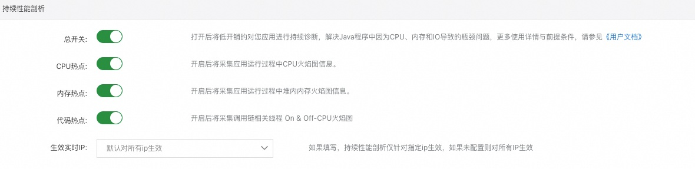

5. 在**自定义配置**页签左下角单击**保存**。

**查看持续性能剖析数据**

1. 登录应用实时监控服务控制台。

2. 在左侧导航栏中选择**应用监控 > 应用列表**，然后在**应用列表**页面单击目标应用的名称。

3. 在左侧导航栏中单击**持续性能剖析**。

4. 在左侧实例列表中选择目标实例，然后在右侧页面设置数据展示时间。

5. 在右侧**查询**页签，您可以执行以下操作筛选数据并查看聚合分析。

   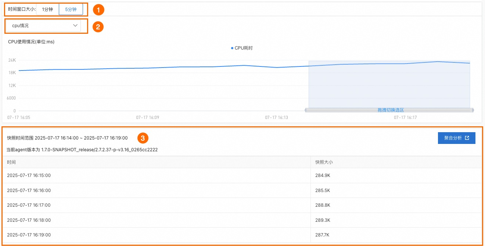

   <ol type="i">

   <li>

   在**时间窗口大小**区域（图示①）选择快照时间大小，然后在曲线图上通过鼠标拖拽选择快照时间范围。

   </li>

   <li>

   在图示②的下拉框可以选择数据类型：CPU情况、JVM Heap、JVM GC。

   </li>

   <li>

   在图示③区域显示了快照时间范围内的数据列表，单击右上角的**聚合分析**可以查看快照详情。

   **性能分析**

   性能分析类型：

   - **CPU Time**：CPU申请量热点剖析数据。

   - **Allocated Memory**：内存申请量热点剖析数据。

   - **Allocations**：内存申请次数热点剖析数据，可以查看哪些方法申请内存次数频繁。

   - **Wall Clock**：代码整体执行时间。

   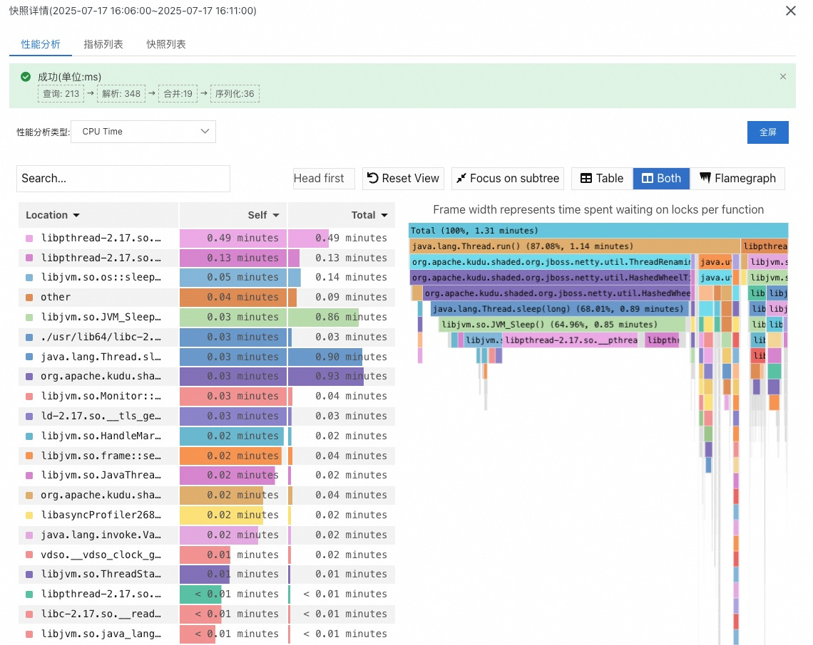

   - **Self**列表示方法在自身的调用栈中所消耗的时间或资源，不包括其子方法调用所消耗的时间或资源。可以用于识别哪些方法在自身内部花费了大量的时间或资源。

   - **Total**列包含方法自身消耗的时间或资源，及其所有子方法调用所消耗的时间或资源。可以帮助了解整个方法调用栈中哪些方法贡献了最多的时间或资源。

   如需排查具体的热点代码逻辑，可以通过重点关注**Self**列，或直接查看右侧火焰图中底部的较宽火苗从中定位到高耗时的业务方法。较宽火苗是引发上层耗时高的根源，一般是系统性能的瓶颈所在，您可以重点关注。

   **指标列表**

   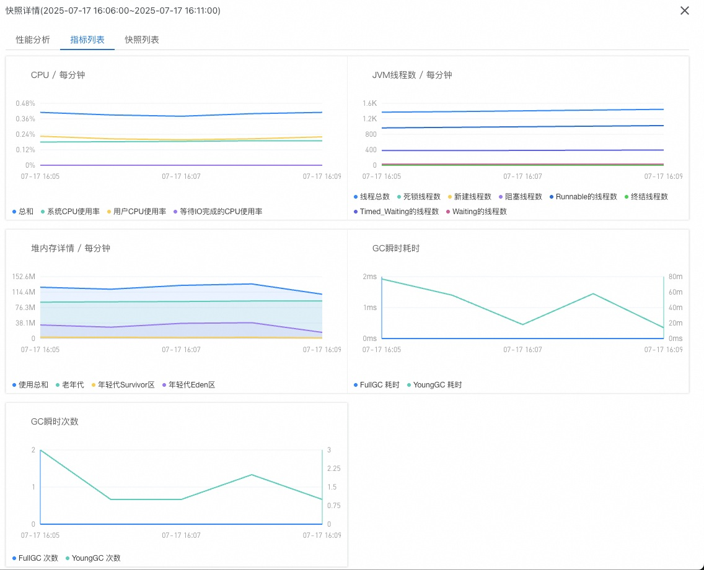

   **快照列表**

   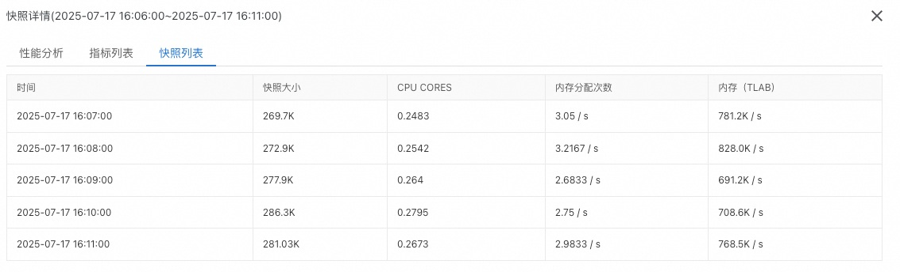

   </li>

   </ol>

6. 在右侧**对比**页签，您可以分别两组筛选数据，对不同时间段的数据进行对比分析。

**火焰图说明**

ARMS持续性能剖析功能通过火焰图可视化技术呈现应用的性能剖析数据，当线上应用出现CPU、内存资源使用率高或大量慢调用问题时，可以通过该功能生成的火焰图对其进行根因定位，从而协助开发者优化程序、降低延迟、增加吞吐、节约成本。

下图为一张资源占用较高的火焰图，火焰图中性能瓶颈的具体分析步骤如下：

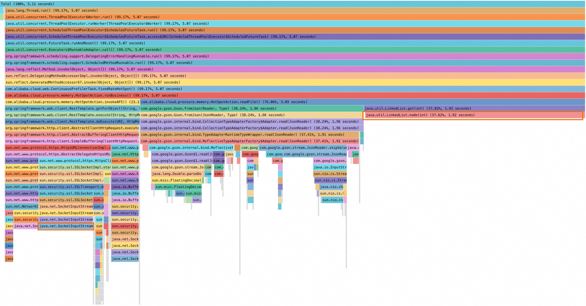

1. 通过火焰形状可以判断这是一张栈底在上，栈顶在下的冰柱状火焰图，因此需要从下往上分析。

2. 分析下方的栈顶，可以发现右侧较宽的栈顶为<strong>java.util.LinkedList.node(int)</strong>方法。

3. 由于该栈顶是JDK中的库函数，并非为业务方法，因此，沿着栈顶方法<strong>java.util.LinkedList.node(int)</strong>从下往上搜索，依次经过**java.util.LinkedList.get(int)** > **com.alibaba.cloud.pressure.memory.HotSpotAction.readFile()**，而<strong>com.alibaba.cloud.pressure.memory.HotSpotAction.readFile()</strong>属于所分析应用的业务方法，即为第一个所分析应用自身定义的方法行，其耗时为3.89s，占整张火焰图的76.06%，因此<strong>com.alibaba.cloud.pressure.memory.HotSpotAction.readFile()</strong>是该火焰图所采集时段内资源占用较高的显著瓶颈所在，可以根据该方法名，对业务中相关方法的逻辑进行梳理，查看是否存在优化空间。

   另外也可以根据上述分析方法对火焰图左下角**java.net.SocketInputStream**的相关方法进行相同分析，可以发现其第一个属于所分析应用自身定义的父方法为**com.alibaba.cloud.pressure.memory.HotSpotAction.invokeAPI**，总占比约为23%。

<a id="section-4-3-11"></a>

### 4.3.11. 应用诊断

<a id="section-4-3-11-1"></a>

#### 4.3.11.1. 异常分析

本文说明如何查看异常分析，从而了解应用的异常情况。

**功能入口**

1. 登录应用实时监控服务控制台。

2. 在左侧导航栏，选择**应用监控 > 应用列表**。

3. 在**应用列表**页面，单击应用名称。

4. 在**左侧导航栏**，选择**应用诊断 > 异常分析**。

5. 在右侧页面，设置时间范围，然后单击要查看的异常。

**异常次数**

**异常次数**区域显示该应用在指定时间范围抛出该异常的次数。

在**异常次数**区域下，您可以执行以下操作：

- 将光标移到统计图上，查看统计情况。

- 使用光标选中一段时间，查看指定时间段的统计情况。

**异常接口列表**

异常接口列表显示抛出该异常的接口的情况，包括异常接口名称、异常信息摘要、异常次数、占比等。

在异常接口列表，您可以执行以下操作：

- 在**异常名称**列，单击异常名称，查看该接口的异常详情。

  - **异常详情**面板的**异常堆栈**页签下显示该接口的异常堆栈信息。

  - **异常详情**面板的**关联Trace**页签下显示该接口被捕获的异常调用。

    您可以在**TraceId**列单击Trace ID，查看该异常调用的链路以及业务轨迹。

    如何分析调用链路，请参见调用链路查询。

- 在**异常接口**列，单击接口名称，查看该接口的调用情况。

  接口调用说明，请参见接口调用。

- 将光标移到统计图上，查看统计情况。

- 使用光标选中一段时间，查看指定时间段的统计情况。

<a id="section-4-3-11-2"></a>

#### 4.3.11.2. 线程分析

线程分析功能提供线程粒度的CPU耗时和每类线程数量的统计，并且每5分钟记录一次线程的方法栈并聚合，可真实还原代码执行过程，帮助您快速定位线程问题。当发现集群的CPU使用率过高，或者出现大量慢方法时，可以通过线程分析功能找到消耗CPU最多的线程或方法。

**功能入口**

1. 登录应用实时监控服务控制台。

2. 在左侧导航栏，选择**应用监控 > 应用列表**。

3. 在**应用列表**页面，单击应用名称。

4. 在左侧导航栏，选择**应用诊断 > 线程分析**。

**进行线程分析**

**线程分析**页面的左侧列表展示了应用的全部线程，您可以根据**CPU耗时**统计快速发现异常线程。选中某一异常线程后，再根据右侧的**CPU耗时**和**线程数**曲线图分析CPU耗时与线程数变化，例如分析每分钟的线程总数是否过多。

您还可以单击异常线程的**方法栈**，查看指定时间内的真实运行方法栈，例如查看处于BLOCKED状态的线程对应的方法，从而优化指定代码段，以便降低CPU使用率。

> **说明**
>
> 如果单击**方法栈**后，显示无数据，则需要单击左侧导航栏的**应用设置**，在**自定义配置**页签**线程设置**区域查看**线程诊断方法栈**开关是否开启。如未开启，则无法记录方法栈信息；如已开启，则每5分钟采集一次方法栈信息。

<a id="section-4-3-11-3"></a>

#### 4.3.11.3. Arthas诊断

Arthas是诊断Java领域线上问题的利器，利用字节码增强技术，可以在不重启JVM进程的情况下，查看程序的运行情况。

ARMS 100%集成Arthas的所有能力，且相比自行挂载使用有如下优势：

- 不依赖JDK环境，您无需下载安装Arthas，可按需批量一键开启/关闭。

- 常用功能白屏化，免去记命令、查命令、写表达式的烦恼。

- 和ARMS上下文关联，通过Trace命令可以看到ARMS的链路TraceID。

**前提条件**

> **说明**
>
> Arthas诊断功能建议只在排查问题时开启，在日常使用时建议关闭。

已接入应用监控。具体操作，请参见应用监控接入概述。

**背景信息**

ARMS提供的Arthas诊断功能主要用于补齐ARMS在实时诊断方面的能力。ARMS的Arthas诊断功能包括以下几种类型：

- JVM概览：查看当前JVM进程实时的内存使用情况、系统信息、系统变量和环境变量。

- 线程耗时分析：查看当前JVM进程的线程耗时情况以及指定线程的实时方法栈。

- 方法执行分析：抓取任意方法（非JDK方法）满足指定条件的一次执行记录，记录该方法的参数、异常、返回值以及方法内部各个方法执行耗时。

- 对象查看器：查看任意类的某个实例实时的属性取值情况。

- 实时看板：常见组件的实时看板，例如，Druid连接池的实时看板可以看到连接池的配置、使用情况以及SQL执行耗时情况。

- Arthas Shell：通过命令行方式使用Arthas诊断。

**开通Arthas诊断功能**

1. 登录应用实时监控服务控制台。

2. 在左侧导航栏中选择**应用监控 > 应用列表**，然后在**应用列表**页面单击目标应用的名称。

3. 在左侧导航栏中单击**应用设置**，并在右侧单击**自定义配置**页签。

4. 在**自定义配置**页签的**Arthas监控**区域，打开**Arthas开关**，根据需求选择是否仅对部分IP进行Arthas诊断，并添加目标IP。

   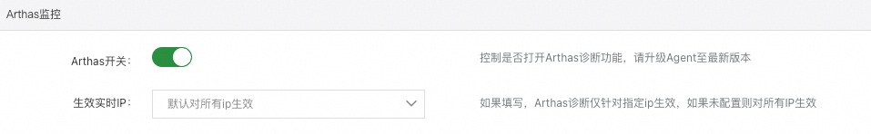

5. 在**自定义配置**页签左下角单击**保存**。

**查看Arthas诊断信息**

1. 登录应用实时监控服务控制台。

2. 在左侧导航栏中选择**应用监控 > 应用列表**，然后在**应用列表**页面单击目标应用的名称。

3. 在左侧导航栏，选择**应用诊断 > Arthas诊断**。

4. 在Arthas诊断页面顶部下拉列表选择待诊断的应用实例。

   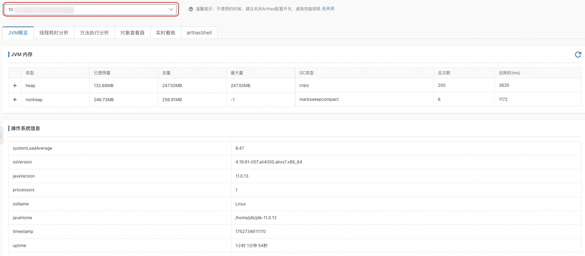

**JVM概览**

JVM概览支持查看应用的JVM相关信息，包括JVM内存、操作系统信息、变量信息等，帮助您了解JVM的总体情况。

- JVM内存：JVM内存的相关信息，包括堆内存使用情况、非堆内存使用情况、GC情况等。

  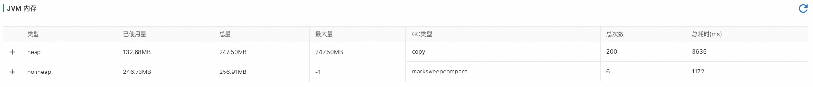

- 操作系统信息：操作系统的相关信息，包括平均负载情况，操作系统名称、操作系统版本、Java版本等。

  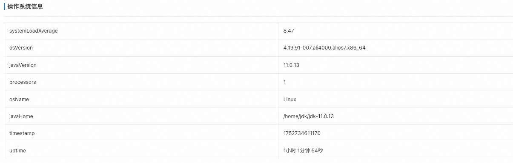

- 变量信息：变量的相关信息，包括系统变量和环境变量。

  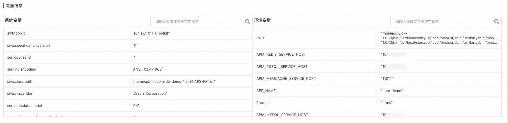

**线程耗时分析**

线程耗时分析支持显示该应用的所有线程和查看线程的堆栈信息，帮助您快速定位耗时较高的线程。

**线程耗时分析**页签会实时获取当前JVM进程的线程耗时情况，并将相似线程聚合。

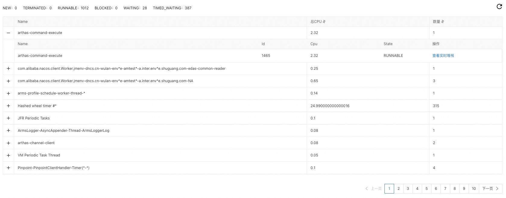

1. 单击线程左侧的<strong>+</strong>图标展开线程明细，可以查看线程的ID、CPU使用率和状态。

2. 如需查看目标线程的堆栈信息，您可以在目标线程右侧的**操作**列，单击**查看实时堆栈**。

   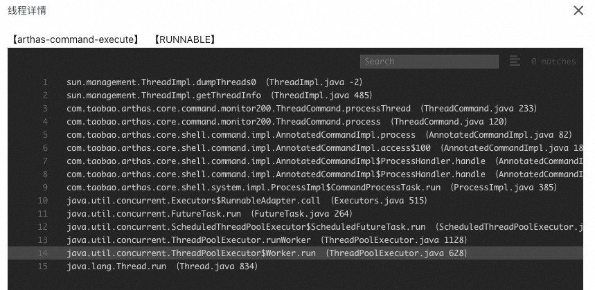

**方法执行分析**

方法执行分析支持抓取方法的某一次执行的耗时、入参、返回值等信息和钻入，帮助您快速定位导致慢调用的根本原因，以及问题线下无法复现或日志缺失等场景。

1. 在方法执行分析页签的搜索框中输入类名的关键词，然后单击  图标。

2. 在搜索到的类中选择需要诊断的类，然后在右侧方法选择框选取该类的某个方法，单击**确定**。

   页面将会显示ARMS随机抓取的该方法的某一次执行的信息。

   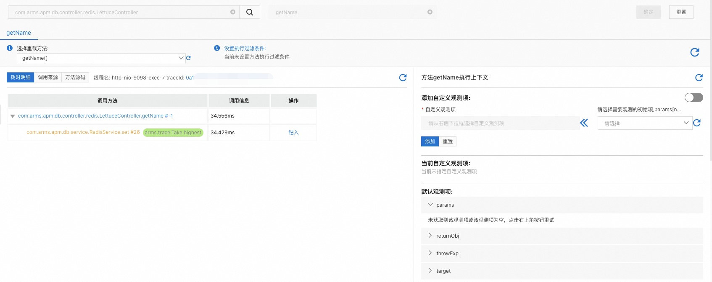

   执行以下步骤，可以设置方法执行条件来抓取满足条件的方法执行记录。

   <ol type="i">

   <li>

   选择当前方法中的一个重载方法，然后单击**设置执行过滤条件**。

   </li>

   <li>

   在**请选择初始过滤key**下拉框选择初始过滤Key的类型，单击  图标。

   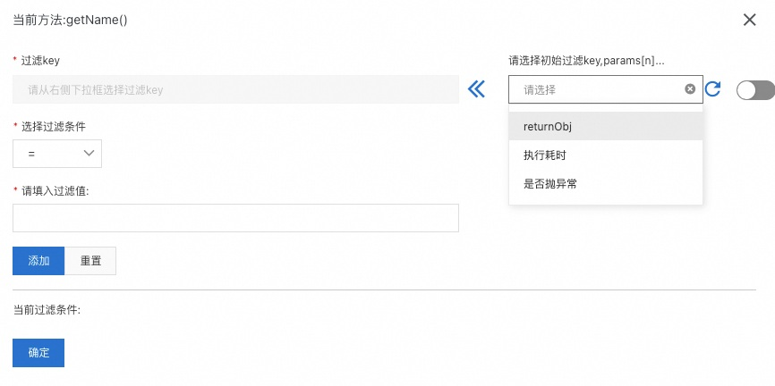

   初始过滤Key的类型：

   - params[n]：方法的第n个参数。

   - returnObj：方法的返回值。

   - 执行耗时：方法执行的耗时。

   - 是否抛出异常：方法执行时是否抛出异常。

   > **说明**
   >
   > 如果选取的初始过滤Key为嵌套类型，则还需要继续选择该嵌套类型的内部字段，直到选择字段为基础类型。

   </li>

   <li>

   选择过滤条件。

   </li>

   <li>

   输入过滤值。

   </li>

   <li>

   单击**添加**。

   在**当前过滤条件**区域会显示已添加的过滤条件。

   </li>

   <li>

   单击**确定**，然后单击右侧的  图标，系统会按照设置的条件重新抓取一次方法执行。

   </li>

   </ol>

   查询到的方法执行说明如下：

   - 左侧**耗时明细**区域显示诊断方法的内部执行记录。

     如需钻入某个内部方法，在其右侧**操作**列单击**钻入**。

   - 左侧**调用来源**区域显示了当前方法的调用来源。

   - 左侧**方法源码**区域，每一次内部方法的执行耗时都会以注释的方式显示在源代码中。

     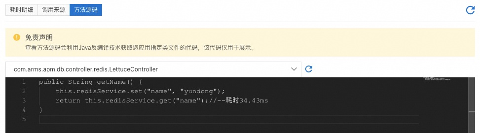

   - 右侧**添加自定义观测项**区域可以添加自定义可观测项。

     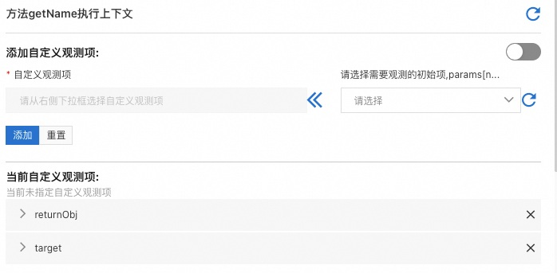

     <ol type="a">

     <li>

     在**请选择需要观测的初始项**下拉框选择初始过滤Key的类型，单击  图标。

     初始过滤Key的类型：

     - params[n]：方法第n个入参。

     - returnObj：方法返回值。

     - target：执行该方法的类实例（静态方法该字段为空）。

     > **说明**
     >
     > 如果选取的初始过滤Key为嵌套类型，则还需要继续选择该嵌套类型的内部字段，直到选择字段为基础类型。

     </li>

     <li>

     单击**添加**。

     在**当前自定义观测项**区域会显示已添加的过滤条件，单击右侧  图标可以删除对应条件。

     </li>

     </ol>

     <ol type="i" start="100">

     <li>

     在下方**默认观测项**区域可以查看当前方法的观测项，包括方法的params、returnObj、throwExp和target。

     </li>

     </ol>

**对象查看器**

对象查看器用于查看一些单例对象当前的状态，用于排查应用状态异常问题，例如应用配置、黑白名单、成员变量等。

1. 在对象查看器页签的搜索框中输入类名的关键词，然后单击  图标。

2. 在搜索到的类中选择需要诊断的类，然后在右侧实例选择框选择该类的某个实例，单击**确定**。

   页面则会显示该实例中当前字段的实时取值。

   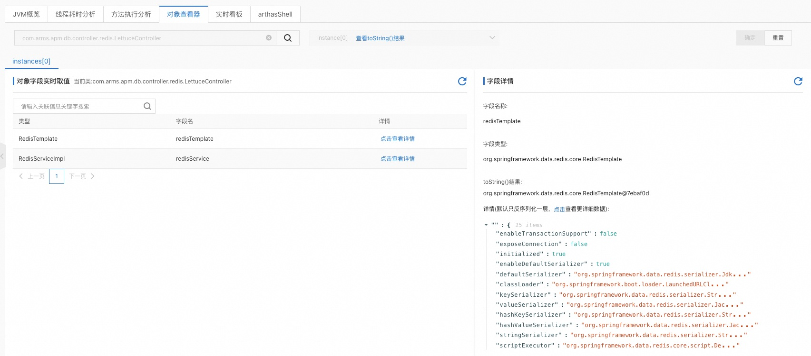

   - 对于简单类型的字段，在左侧**对象字段实时取值**区域的**详情**列会是字段的取值。

   - 对于复制类型的字段，在左侧**对象字段实时取值**区域的**详情**列单击**点击查看详情**，在右侧**字段详情**区域查看字段取值详情。

     **字段详情**区域仅支持将复杂类型字段反序列化一层进行展示，如果需要查看更具体的数据，单击**点击**查看字段更详细的数据。

**实时看板**

实时看板用于查看系统中用到的关键组件的实时状态，例如查看数据库连接池的使用情况、HTTP连接池的使用情况等，有利于排查资源类型的问题。

在实时看板页签的下拉列表中选择一个看板，然后在右侧实例选择框选择该看板的一个实例，单击**添加到看板**。

页面显示该看板的实时情况。如下图显示为一个Druid连接池的实时状态信息，包括基础配置、连接池状态、执行耗时分布等。

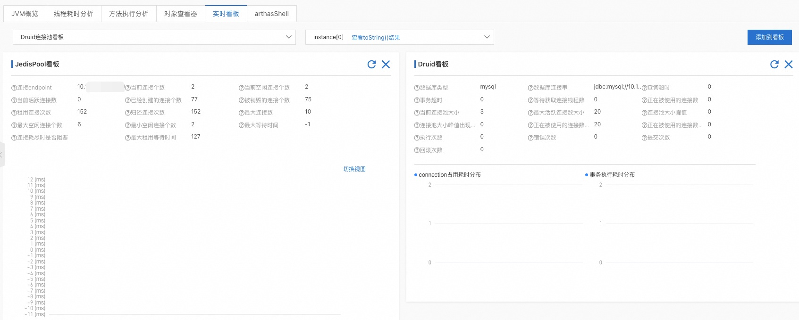

**Arthas Shell**

通过命令行方式自定义Arthas诊断，具体用法可以参考Arthas官网。

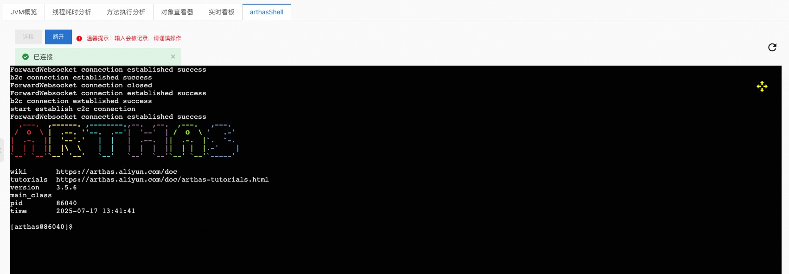

<a id="section-4-3-12"></a>

### 4.3.12. 应用环境

本文说明如何查看应用的环境信息，包括IP地址、运行时长、进程号、JVM版本等信息。

**操作步骤**

1. 登录应用实时监控服务控制台。

2. 在左侧导航栏，选择**应用监控 > 应用列表**。

3. 在**应用列表**页面，单击应用名称。

4. 在左侧导航栏，单击**应用环境**。

   **应用环境**页面显示应用的环境信息。

   | 参数 | 说明 |
   | --- | --- |
   | 实例IP | 应用的实例的IP地址。 |
   | 运行时长 | 应用从启动开始到当前的运行时长。 |
   | 进程号 | 应用所对应的进程的唯一标识。 |
   | JVM版本 | 应用的Java虚拟机版本。 |
   | ARMS探针版本 | 应用所安装的ARMS探针的版本。 |
   | JVM参数 | 应用的Java虚拟机参数配置。 |
   | 启动时间 | 应用启动的时间。 |
   | 主机名 | 应用所在的主机的名称。 |

<a id="section-4-3-13"></a>

### 4.3.13. 应用设置

<a id="section-4-3-13-1"></a>

#### 4.3.13.1. 自定义配置

应用监控的一些常用设置，例如调用链采样率、Agent开关、慢SQL阈值等，可直接在**自定义配置**页签上配置。

**前提条件**

已创建应用监控任务。具体操作，请参见应用监控接入概述。

**功能入口**

1. 登录应用实时监控服务控制台。

2. 在左侧导航栏选择**应用监控 > 应用列表**。

3. 在**应用列表**页面单击目标应用的名称。

4. 在左侧导航栏中单击**应用设置**，并在右侧页面单击**自定义配置**页签。

5. 设置自定义配置参数，设置完毕后，在页面底部单击**保存**。

**配置调用链采样设置**

在**调用链采样设置**区域，可以打开或关闭调用链采样开关，并设置采样率。**采样率设置**字段输入百分比的数字部分即可，例如输入 

`10`代表采样10%。

> **重要**
>
> 修改即时生效，无需重启应用。如果关闭采样，则调用链数据将不会被采集，请谨慎操作。

**配置Agent（探针）开关和日志级别**

在**Agent开关配置**区域，可以打开或关闭探针总开关以及各插件开关，并配置日志级别。

> **重要**
>
> 探针总开关和日志级别的修改即时生效，无需重启应用。如果关闭探针总开关，则系统将无法监控您的应用，请谨慎操作。要使对各插件开关的修改生效，必须手动重启应用。

**配置阈值设置**

在**阈值设置**区域，可以设置慢SQL查询阈值、接口响应时间阈值和限流阈值。

**配置高级设置**

在**高级设置**区域，可以设置需过滤的接口、方法堆栈最大长度等。

- **无效接口调用过滤**：输入不需要查看调用情况的接口，从而将其从**接口调用**页面隐去。

- **方法堆栈最大长度**：默认为128条，最大值为400条。

- **是否强制收敛destId**：是否强制收敛destId。

- **同类异常堆栈区分深度**：同类型异常，用于作为不同异常区分的堆栈深度，一般设置为第一个差异调用的深度。

- **采集SQL最大长度**：默认为1024个字符，最小值为256，最大值为4096。

- **采集SQL绑定值**：捕获**PrepareStatement**参数绑定的变量值，无需重启应用即可生效。

- **原始SQL**：仅对SQL截断，不做额外处理。

- **异常过滤**：此处输入的异常不会显示在应用详情和异常分析页面的图表中。

- **错误数过滤**：默认情况下，大于400的状态码会计入错误数，您可以自定义大于400但不计入的HTTP状态码。

- **调用链新格式**：采用支持调用链时间排序的新存储格式（默认打开）。

- **调用链压缩**：是否将重复调用（比如for循环）简化，无需重启应用即生效。

- **请求入参最大长度**：默认为512字符，支持的最大长度为2048字符。

- **分位数统计**：是否开启分位数统计功能。

- **应用紧急事件报警**：支持线程死锁、OOM等紧急报警。探针版本须为2.5.8+。

- **池化监控**：支持Tomcat/Dubbo/HSF等框架的线程池指标监控，需升级Agent探针至最新版本。该设置需重启应用后生效。

- **RabbitMQ自定义消费者**：通过设置自定义消费者的类名或者包含匿名内部消费者的类名，可以看到该消费者的调用链路。多个消费者以半角逗号（,）分隔。

- **Kafka自定义消费者**：通过设置自定义消费者的类名或者包含匿名内部消费者的类名，可以看到该消费者的调用链路。多个消费者以半角逗号（,）分隔。

- **404请求收敛开关**：将404请求收敛为/error。

**配置线程设置**

在**线程设置**区域，可以打开或关闭线程剖析总控开关、线程诊断方法栈开关，并设置慢调用监听触发阈值。

**设置关联业务日志与TraceId**

在**业务日志关联设置**区域，可以设置是否在应用的业务日志中关联调用链的TraceId信息。更多信息，请参考业务日志关联调用链的TraceId信息。

**配置URL收敛规则**

在**URL收敛设置**区域，可以打开或关闭收敛功能的开关，并设置收敛阈值、收敛规则和排查规则。URL收敛是指将具有相似性的一系列URL作为一个单独的个体展示，例如将前半部分都为/service/demo/的一系列URL集中展示。收敛阈值是指要进行URL收敛的最低数量条件，例如当阈值为100时，则符合规则正则表达式的URL达到100时才会对它们进行收敛。

**将配置复制到其他应用**

如果您需要为其他应用同步相同配置，可以将对应配置复制到其他应用上。

1. 在页面底部单击**批量复制到其他应用**。

2. 在弹出的对话框中选择生效的应用，然后单击**确定**。

   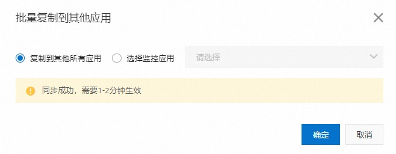

**相关文档**

- 调用链路查询

- 接口调用

<a id="section-4-3-13-2"></a>

#### 4.3.13.2. 标签管理

您可以在应用设置页面上设置和管理应用的自定义标签。

**设置标签**

1. 登录应用实时监控服务控制台。

2. 在左侧导航栏，单击**应用列表**。

3. 在**应用列表**页面，单击应用名称。

4. 在左侧导航栏中单击**应用设置**，并在右侧页面单击**标签管理**。

5. 在**应用标签管理**区域框中，单击**管理应用标签**。

6. 在弹出的**管理应用标签**对话框，单击  图标，输入您自定义的标签名称并单击**确定**。

7. 在弹出的**成功**对话框中单击**确定**，然后单击页面底部的**保存**。

**启用或停用标签**

1. 在**应用设置**页面上单击**标签管理**页签。

2. 在**应用标签管理**区域框中，选中要为应用启用的标签，取消选择不用的标签。

3. 单击页面底部的**保存**。

**修改和删除标签**

1. 在**应用设置**页面上单击**标签管理**页签。

2. 在**应用标签管理**区域框中单击**管理应用标签**。

3. 在弹出的**管理应用标签**对话框中，将鼠标悬浮到您想编辑或删除的标签上。

   - 如需编辑标签，则单击右侧的  图标，并在文本框内输入新的标签。

   - 如需删除标签，则单击左侧的  图标。

     > **重要**
     >
     > 如果在**管理账户标签**对话框中删除现有标签，则所有已经启用该标签的应用将会失去该标签。

4. 单击对话框底部的**确定**。

5. 在弹出的**成功**对话框中单击**确定**，然后单击页面底部的**保存**。

<a id="section-4-3-13-3"></a>

#### 4.3.13.3. 通过RAM权限设置ARMS的Tag标签

本文介绍如何通过设置RAM权限设置ARMS的Tag标签。

**步骤一：配置子账号权限**

1. 登录Apsara Uni-manager运营控制台。

2. 在左侧导航栏选择**企业 > 角色授权**，然后单击需要进行配置的子账号。

3. 单击**添加权限策略**，然后单击**创建权限策略**。

4. 在弹出的窗口内填入策略名称，并按以下脚本配置策略内容。

   以下示例会过滤包含tag1、tag2、tag3的应用，且标签权限配置之间的关系是“或”。

   ```json
   {
     "Version": "1",
     "Statement": [
       {
         "Action": "arms:*",
         "Resource": "*",
         "Effect": "Allow",
         "condition":{
           "StringLike":{
             "arms:tag":[
               "tag1",
               "tag2",
               "tag3"
               ]
           }
         }
       },
       {
     "Action":"arms:ReadContactMember",
     "Resource":"*",
     "Effect": "Allow",
     "condition":{
           "StringLike":{
             "arms:tag":"arms:*"
           }
         }
   }
     ]
   }
   ```

   若只需过滤包含单个标签的应用，可更改权限配置如下，以下实例会筛选只包含tag1标签的应用。

   ```text
   "StringLike":{
    "arms:tag": "tag1"
    }
   ```

   **参数说明：**

   | 参数 | 说明 |
   | --- | --- |
   | arms:tag:"tag1" | <code> tag1 </code>代表应用的标签。 |
   | arms:tag:"arms:\*" | <code> arms:* </code>代表可查看的相关功能的权限。 |
   | arms:ReadContactMember | 可查看报警联系人的权限配置，您可以按需配置需要开放的功能权限。 |

**步骤二：开启Tag权限配置开关**

子账号权限配置完成后仍需开启Tag权限配置开关才能生效，如需使用，还请联系运维人员开启Tag权限配置开关。

<a id="section-4-3-13-4"></a>

#### 4.3.13.4. 监控方法自定义

除了被ARMS探针自动发现的所有方法和接口外，如果您需要监控应用中的其他方法和接口，则可在ARMS应用监控中自定义监控方法。

**前提条件**

已创建应用监控任务。具体操作，请参见应用监控接入概述。

**功能入口**

1. 登录应用实时监控服务控制台。

2. 在左侧导航栏选择**应用监控 > 应用列表**。

3. 在**应用列表**页面单击目标应用的名称。

4. 在左侧导航栏中单击**应用设置**，并在右侧单击**监控方法自定义**页签。

**自定义监控方法**

1. 在**监控方法自定义**页签，单击右上角的**添加方法**。

2. 在**添加自定义方法**对话框中，设置以下参数，并单击**确认**。

   <table>
     <tr>
       <th width="152">参数</th>
       <th>描述</th>
     </tr>
     <tr>
       <td>方法全名</td>
       <td>需要监控的方法的名称，具有唯一性。</td>
     </tr>
     <tr>
       <td>开启此功能</td>
       <td>开启此功能，即可监控此方法，并且可在本地方法栈中展示此方法，更多信息，请参见调用链路查询。默认为开启状态。<br>说明ARMS支持动态开启或关闭此功能，并且无需重启应用。</td>
     </tr>
     <tr>
       <td>设为业务调用入口</td>
       <td>设置为业务调用入口后，则可通过调用链对其进行业务查询，并且可在<strong>接口调用</strong>模块中展示对应接口，更多信息，请参见接口调用。默认为关闭状态。</td>
     </tr>
   </table>

   自定义监控方法添加成功后，自动显示在方法列表中。您可以在**操作**列单击**编辑**或**删除**，修改或删除对应方法。

**相关文档**

调用链路查询

<a id="section-4-3-13-5"></a>

#### 4.3.13.5. 删除应用

当您不需要再使用ARMS监控您的应用，并且需要在ARMS中删除您的应用时，可以在应用设置页面彻底删除。

> **说明**
>
> ARMS会自动删除最近60天没有任何数据上报的应用。

**操作步骤**

1. 登录应用实时监控服务控制台。

2. 在左侧导航栏选择**应用监控 > 应用列表**。

3. 在**应用列表**页面单击目标应用的名称。

4. 在左侧导航栏中单击**应用设置**，并在右侧页面单击**自定义配置**页签。

5. 在**自定义配置**页签的**Agent开关配置**区域，关闭**Agent总开关**，然后单击**保存**。

   > **重要**
   >
   > 开关修改动态生效，无需重启应用。关闭此开关后，系统将无法监控您的应用，同时也不会产生费用，请您谨慎操作。

6. 卸载ARMS Agent，具体操作，请参见卸载Agent的常见问题。

7. Agent卸载完成后，在**应用设置**页面单击**删除**页签。

   > **警告**
   >
   > 此操作将会清除应用所有的监控数据，并且删除之后无法恢复。

8. 在**删除**页签单击**删除应用**，在弹出的**提示**对话框中单击**确定**彻底删除应用。

**执行结果**

返回**应用列表**页面，您可以查看到**应用列表**不再显示已删除的应用。

**相关文档**

应用监控常见问题

<a id="section-4-3-14"></a>

### 4.3.14. 全局拓扑

ARMS应用监控的全局拓扑图能展示指定应用的上下游依赖关系。

**查看全局拓扑**

1. 登录应用实时监控服务控制台。

2. 在左侧导航栏选择**应用监控 > 全局拓扑**。

在全局拓扑页面，您可以执行以下操作：

- 单击加号图标或向上滑动鼠标滚轮，放大应用拓扑图。

- 单击减号图标或向下滑动鼠标滚轮，缩小应用拓扑图。

- 单击RESET图标，将应用拓扑图恢复至默认大小。

- 单击一个节点，可以高亮显示该节点关联的拓扑图。

- 将鼠标悬浮于节点或节点之间连线的圆点上，可以查看以下信息：

  - 服务名称

  - QPS：Query Per Second（每秒查询数）

  - RT：Response Time（响应时间，单位为毫秒）

  - ERROR：Error QPS（每秒错误查询数）

**新建视图**

您可以通过新建视图功能创建自定义拓扑图。

1. 登录应用实时监控服务控制台。

2. 在左侧导航栏选择**应用监控 > 全局拓扑**。

3. 单击**新建视图**，在弹出的对话框中填写**视图名称**，并选择目标核心应用。

4. 单击**编辑视图**，执行以下操作调整拓扑图。

   <ol type="i">

   <li>

   右键节点可查看该节点的上游、下游和详情，复制节点信息或移除该节点。

   </li>

   <li>

   双击节点可展开该节点的下游。

   </li>

   <li>

   将鼠标悬浮于节点或节点之间连线的圆点上，可以查看以下信息：

   <ol type="a">

   <li>

   服务名称

   </li>

   <li>

   QPS：Query Per Second（每秒查询数）

   </li>

   </ol>

   <ol type="i" start="100">

   <li>

   RT：Response Time（响应时间，单位为毫秒）

   </li>

   <li value="500">

   ERROR：Error QPS（每秒错误查询数）

   </li>

   </ol>

   </li>

   </ol>

5. 单击**确定**即可完成创建。

**编辑或删除视图**

您可以对已创建的自定义拓扑图进行二次编辑。

> **说明**
>
> 默认视图不支持编辑和删除操作。

1. 登录应用实时监控服务控制台。

2. 在左侧导航栏选择**应用监控 > 全局拓扑**。

3. 在**新建视图**右侧下拉框中选择需要编辑的视图，然后单击**编辑**。

4. 您可以在弹出的对话框中修改视图的名称。

5. 单击**编辑视图**，对视图进行修改后单击**确定**。

6. 如果不需要当前拓扑图，也可以单击右上角**删除**。

<a id="section-4-3-15"></a>

### 4.3.15. 调用链路查询

在**调用链路查询**页面，您可以通过TraceId精确查询调用链路详细情况，或结合多种条件筛选查询调用链路。

**查询调用链路**

1. 登录应用实时监控服务控制台。

2. 在左侧导航栏选择**应用监控 > 多维查询**。

3. 在**调用链路查询**页面选择**参数类型**，在**参数值**中填入自定义标签，单击**添加到查询条件**。

   可以使用**TraceId**参数进行精确查询。

   表 1. 参数类型说明

   | 参数类型 | 描述 |
   | --- | --- |
   | TraceId | 输入TraceId。 |
   | 接口名称 | 应用调用的接口名称，不支持模糊搜索。 |
   | 客户端应用名 | 客户端的应用名称。 |
   | 服务端应用名 | 服务端的应用名称。 |
   | 耗时大于 | 调用的耗时大于指定毫秒数。 |
   | 调用类型 | 选择调用类型。 |
   | 是否异常调用 | 所有包含异常调用的链路。 |
   | 仅含线程剖析快照 | 所有包含线程剖析快照的链路。 |
   | 客户端IP | 调用发起应用IP。 |
   | 服务端IP | 请求被调用的应用IP。 |
   | 业务主键 | 搜索业务事件所使用的字段。 |
   | 响应码 | 输入响应码。 |

4. 单击需要查看的TraceID名称，进入**调用链路**页面。

   **调用链路**页面字段说明如下：

   - 应用名称：所属应用名称。

   - 日志产生时间：日志产生的时间。

   - 状态： 红色表示该服务调用的本地调用链路中存在异常，绿色表示正常。

   - IP地址：该应用的IP地址。

   - 调用类型：该次调用的调用类型，与即席查询的调用类型选项对应。

   - 服务名称：该次调用的服务接口名称。

   - 时间轴：各服务间调用链路的耗时，以及相对于整条调用链路的耗时分布。

**相关操作**

在**调用链路**页面，单击**指标监控**列的折线图，可以查看不同时间段的请求数、响应时间和错误数。

在**调用链路**页面，单击**方法栈**列的  图标，进入**方法栈**对话框。

方法栈对话框字段说明如下：

- 调用方法：本地方法栈调用方法，展开后显示的是该方法的下一层调用。

- 行号：本地方法的代码所在行数。

- 扩展信息：

  - 参数：调用的输入参数等。

  - SQL：数据库调用的SQL语句等。

  - 异常：抛错的信息等。

- 时间轴：本地调用链路每次方法调用的时间分布。

<a id="section-4-3-16"></a>

### 4.3.16. 用量统计

ARMS控制台已支持查看资源消耗统计，您可以通过设置过滤条件查看应用在特定时间内的资源消耗详情。

1. 登录应用实时监控服务控制台。

2. 在左侧导航栏选择**应用监控 > 用量统计**。

3. 在**用量统计**页面右上角设置需要查看的时间段。

4. 在**自研探针上报**或<strong>自研探针上报（全局）</strong>页签查看在线应用数和APM实例数，以及对应的用量趋势。

   - 自研探针上报：当前用户的用量数据。

   - 自研探针上报（全局）：所有用户的用量数据，仅管理员支持查看<strong>自研探针上报（全局）</strong>页签。

<a id="section-4-3-17"></a>

### 4.3.17. Agent列表

本文介绍了如何查看应用所安装的探针相关信息。

**操作步骤**

1. 登录应用实时监控服务控制台。

2. 在左侧导航栏，单击**应用监控 > Agent列表**。

3. （可选）在**Agent列表**页面，可通过**应用名称**、**主机IP**、**运行状态**和**版本号**快速筛选Agent。

4. 在**Agent列表**中，可查看应用所安装的Agent相关信息，包括**Agent运行状态**、**最近一次启动时间**、**运行时长**、**Agent版本号**等。

   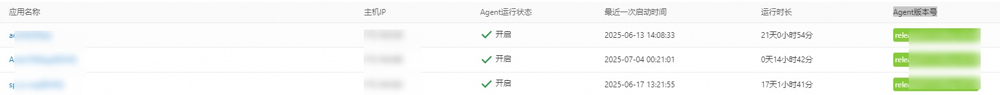

<a id="section-4-4"></a>

## 4.4. 最佳实践

<a id="section-4-4-1"></a>

### 4.4.1. 使用调用链采样策略

本文介绍ARMS支持的多种调用链采样策略，帮助您根据自身场景选择合适的调用链采样策略，从而以较低成本获取想要的调用链数据。

调用链采样适用于访问量比较高的大流量应用，能够帮助您以较低的成本和性能开销记录最有价值的链路数据。调用链采样的基本原则是优先记录您最关心、最有可能访问的调用链。ARMS提供的调用链采样策略如下。

**基于链路特征采样**

基于链路特征采样是指根据调用链本身的属性进行采样，例如耗时、状态等。ARMS支持按照固定比例采样和线程剖析慢调用采样。

**固定比例采样**

固定比例采样就是根据TraceId顺序号记录一定比例的调用链数据。例如，固定比例为10%，则每10条调用链数据记录1条。固定比例采样不会导致调用链数据本身不完整，要么保留整条链路数据，要么丢弃整条链路数据。

基于固定比例采样适用于以下场景：

- 压测或大促峰值期间流量过大，为了避免调用链全量日志上报影响客户端性能，建议调低固定采样率比例至1%~10%。

- 日常态全量调用链日志上报导致网络带宽成本高，可以考虑按需调整固定采样率的比例。

基于固定比例采样的基本原理如下：

TraceId A不符合采样率全部丢弃

TraceId B不符合采样率全部丢弃

TraceId C符合采样率全部保留

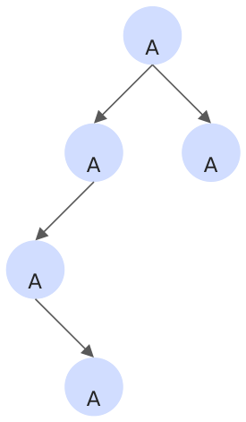

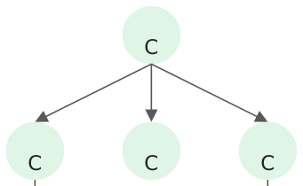

B

B

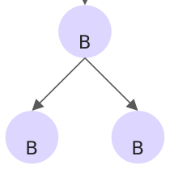


C

设置固定比例采样的操作步骤如下：

1. 登录应用实时监控服务控制台。

2. 在左侧导航栏选择**应用监控 > 应用列表**。

3. 在**应用列表**页面单击目标应用的名称。

4. 在左侧导航栏中单击**应用设置**，并在右侧页面单击**自定义配置**页签。

5. 在**调用链采样设置**区域，可以打开调用链采样开关，并设置采样率。**采样率设置**字段输入百分比的数字部分即可，例如输入 

   `10`代表采样10%。

**线程剖析慢调用采样**

线程剖析慢调用采样就是记录触发线程剖析慢调用监听的调用链数据。开启线程剖析后，ARMS在记录慢调用的同时会向下传递一个采样标记，并保留该次慢调用的下游链路。不过，为了避免影响客户端性能，线程剖析监听数是有限的，如果有多个慢调用同时发生，仅会记录部分满足条件的慢调用及其下游调用链路。

线程剖析慢调用采样适用于以下场景：

- 系统出现偶发性慢调用，例如夜间服务响应耗时从0.5s突增到10s。如果提前打开线程剖析（默认触发阈值为2s），ARMS会自动记录该次请求2s至10s之间的慢调用本地方法栈，及其下游调用链路。

- 秒杀或周期性大促峰值期间系统响应慢，线程剖析会记录满足触发阈值的慢调用本地方法栈，及其下游调用链路。

线程剖析慢调用采样的基本原理如下：

Service A调用耗时超过25，触发线程剖析慢调用监听，记录本地方法栈的同时向下游链路打标（sample=1），记录调用链路。

2 s

8 s

Service A

(sample=1)

Service B

Service C

(sample=1)

Service D

(sample=1)

设置线程剖析慢调用采样的操作步骤如下：

1. 登录应用实时监控服务控制台。

2. 在左侧导航栏选择**应用监控 > 应用列表**。

3. 在**应用列表**页面单击目标应用的名称。

4. 在左侧导航栏中单击**应用设置**，并在右侧页面单击**自定义配置**页签。

5. 在**线程设置**区域，可以打开或关闭线程剖析总控开关，并设置慢调用监听触发阈值。

<a id="section-4-4-2"></a>

### 4.4.2. 诊断服务端报错问题

网页抛错是互联网应用最常见的问题之一，但其错因分析是一个难点。为应用安装ARMS探针后，就能在不改动应用代码的情况下，借助ARMS应用监控的异常自动捕捉、收集、统计和溯源等功能，准确定位应用中所有异常并进行线上诊断。

**问题描述**

网页抛错，尤其是5xx错误是互联网应用最常见的问题之一。5xx错误通常发生于服务端。服务端是业务逻辑最复杂，也是整条网络请求链路中最容易出错、出了错之后最难诊断原因的地方。运维工程师或研发工程师往往需要登录机器查看日志来定位问题。

图 1. 示例：常见的Java应用错误日志

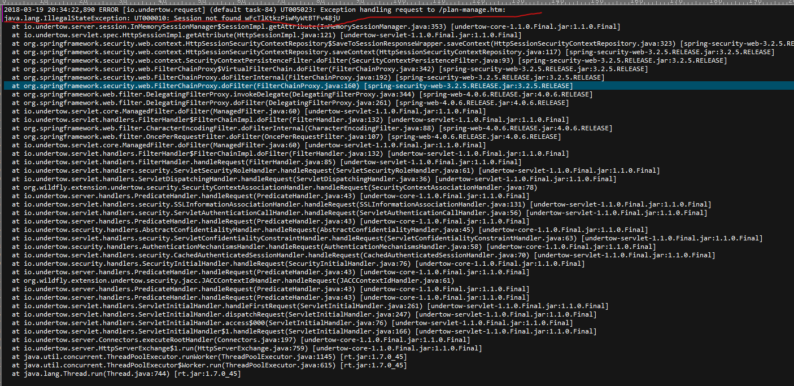

对于逻辑不太复杂、上线时间不长的应用来说，登录机器查看日志的方式能够解决大部分网站抛错的问题。但在以下场景中，传统的问题诊断方式往往没有用武之地。

- 在一个分布式应用集群中，需知道某一类错误的发生时间和频率。

- 某系统已运行了很长时间，但是不想关心遗留的异常，只想知道今天和昨天相比、发布后和发布前相比多了哪些异常。

- 查看一个异常对应的Web请求和相关参数。

- 客服人员提供了一个用户下单失败的订单号，分析该用户下单失败的原因。

**解决方案**

为应用安装ARMS探针后，即可在不改动应用代码的情况下，利用ARMS应用监控的异常自动捕捉、收集、统计和溯源等能力，全面掌握应用的各种错误信息。

**步骤一：安装ARMS探针**

为应用安装ARMS探针后，才能对应用进行全方位监控。请根据实际需求选择一种方式来安装探针。

- 为Java应用安装探针，请参见为Java应用手动安装探针。

- 为EDAS上的应用安装探针，请参见为部署在EDAS中的应用接入ARMS。

- 为Docker中的应用安装探针，请参见为Docker中的Java应用安装Agent。

**步骤二：查看关于应用异常的统计信息**

为应用安装ARMS探针后，ARMS会收集和展示选定时间内应用的总请求量、平均响应时间、错误数、实时实例数、FullGC次数、慢SQL次数、异常次数和慢调用次数，以及这些指标和上一天的环比、上周的同比升降幅度。请按以下步骤查看应用异常的统计信息。

1. 登录应用实时监控服务控制台。

2. 在左侧导航栏，选择**应用监控 > 应用列表**。

3. 在**应用列表**页面，单击您的应用名称。

4. 在**应用总览**页面的**概览分析**页签下方，查看异常的总数、周同比和日同比数据。

5. 滑动页面至**概览分析**页签底部的**统计分析**区域的**异常类型**，查看各类型异常出现的次数。

6. 在左侧导航栏，单击**应用详情**，然后在页面右侧单击**异常分析**页签，查看异常统计图、异常数、异常堆栈等。

**步骤三：诊断异常出现的原因**

掌握应用异常的统计信息还不足以诊断异常出现的原因。虽然日志中异常堆栈包含调用的代码片段，但并不包含这次调用的完整上下游信息和请求参数。ARMS探针采用了字节码增强技术，让您能够以很小的性能消耗捕获异常上下游的完整调用快照，进而找出导致异常出现的具体原因。

1. 在**异常分析**页签下，找到要诊断的异常类型，在其右侧**操作**列，单击**接口快照**。

   **接口快照**页签下显示与该异常类型相关的调用链路信息。

2. 在**接口快照**页签下，单击某个错误调用的TraceId。

   > **说明**
   >
   > 如何查找目标调用链路，请参见调用链路查询。

3. 在弹出的页面，查看异常的调用链路信息，在**方法栈**列，单击放大镜图标，查看调用的方法栈，从而获得异常的上下文信息。

   操作至此，您已发现了应用异常的原因，这将有效地帮助您进行下一步的代码优化工作。您还可以返回**接口调用**页面，查看列表中其他异常，逐一解决。

**后续操作**

为避免在出现问题后被动诊断错误原因，您还可以使用ARMS的报警功能针对一个接口或全部接口创建报警，即可在出现问题时向运维团队发送通知。如何创建报警，请参见创建报警。

**更多信息**

- 应用监控接入概述

- 调用链路查询

- 创建报警

<a id="section-4-4-3"></a>

### 4.4.3. 诊断应用卡顿问题

定位、排查应用卡顿问题的原因有诸多难点。针对这类问题，ARMS提供线程剖析、调用链路诊断、接口监控等一套解决方案，帮助您快速准确定位应用中所有慢调用，进而解决应用卡顿问题。

**问题分析**

网站卡顿、页面加载过慢是互联网应用最常见的问题之一。排查、解决网站卡顿、页面加载过慢等问题过程复杂，耗时较长，原因如下：

- 应用链路太长

  - 从前端页面到后台网关，从Web应用服务器到后台数据库，任何一个环节出现故障都有可能导致整体卡顿。

  - 采用微服务架构的应用，链路更加复杂，而且不同组件可能由不同的团队和人员维护，加剧了问题排查的难度。

- 日志不全或质量欠佳

  应用日志是排查线上问题的主要方法，但出现问题的位置往往无法预期，而且“慢”通常是偶发现象，要真正找到“慢”的原因，需要在每个可能出现问题的地方打印日志，记录每一次调用，但是成本太高。

- 监控不足

  业务发展过快、应用快速迭代导致应用频繁修改接口、增加依赖等情况，进而导致代码质量恶化。应用需要一个完善的监控体系来自动监控应用的每一个接口，自动记录出现问题的调用。

**解决方案**

为应用安装ARMS探针后，即可在不改动应用代码的情况下，使用ARMS应用监控的线程剖析、调用链路诊断、接口监控等功能，全方位监控应用中所有慢调用。

**步骤一：安装Java探针**

为您的应用安装ARMS探针后才能使用ARMS应用监控对应用进行全方位监控。请根据实际需求选择一种方式来安装探针。

- 为Java应用安装探针，请参见为Java应用手动安装探针。

- 快速为EDAS上的应用安装探针，请参见为部署在EDAS中的应用接入ARMS。

- 快速为Docker中的应用安装探针，请参见为Docker中的Java应用安装Agent。

**步骤二：查看慢SQL的统计信息**

为应用安装ARMS探针后，ARMS会收集和展示选定时间内应用的总请求量、平均响应时间、错误数、实时实例数、Full GC次数、慢SQL次数、异常次数和慢调用次数，以及这些指标的周同比和日同比。请按以下步骤查看慢SQL的统计信息。

1. 登录应用实时监控服务控制台。

2. 在左侧导航栏，选择**应用监控 > 应用列表**。

3. 在**应用列表**页面上，单击您的应用名称。

4. 在**应用总览**页面的**概览分析**页签下，查看慢SQL的总数、周同比和日环比数据。

**步骤三：发现并锁定慢接口**

ARMS在**接口调用**页面展示了被监控的应用提供的所有接口以及这个接口的调用次数和耗时，慢接口会被标注出来，帮助您发现和锁定慢接口。

1. 在左侧导航栏，单击**接口调用**。

2. 在**接口调用**页面的左侧，单击调用次数最多的慢接口，在右侧查看慢接口的详细信息。

**步骤四：查看并锁定问题代码**

锁定慢接口后，需要找到问题代码来解决问题。快照是对一次调用的全链路调用的完整记录，包括每一次调用所经过的代码及耗时，可以精准定位问题代码。

1. 在**接口调用**页面右侧，单击**接口快照**页签。

   **接口快照**页签下显示该接口的所有快照。

2. 在**接口快照**页签下，单击某个调用链路的TraceId。

3. 在弹出的页面，查看异常的调用链路信息，在**方法栈**列，单击放大镜图标，查看调用的方法栈，从而获得异常的上下文信息。

   > **说明**
   >
   > 如何查找目标调用链路，请参见调用链路查询。

   操作至此，您已发现了系统中的某个慢调用的原因，这将有效地帮助您进行下一步的代码优化工作。您还可以返回**接口调用**页面，查看列表中其他慢调用，逐一解决。

**后续操作**

为避免在出现问题后被动诊断错误原因，您还可以使用ARMS的报警功能针对一个接口或全部接口创建报警，即可在出现问题时向运维团队发送通知。如何创建报警，请参见创建报警。

**更多信息**

- 应用监控接入概述

- 调用链路查询

- 创建报警

<a id="section-4-4-4"></a>

### 4.4.4. 业务日志关联调用链的TraceId信息

您可以在应用的业务日志中关联调用链的TraceId信息，从而在应用出现问题时，能够通过调用链的TraceId快速关联到业务日志，及时定位分析、解决问题。

**前提条件**

您已将Agent版本升级至2.6.1.2及以上版本，具体操作，请参见升级探针。

**背景信息**

ARMS在业务日志中关联调用链TraceId的功能基于MDC（Mapped Diagnostic Context）机制实现，支持主流的Log4j、Log4j2和Logback日志框架。

**业务日志关联调用链的TraceId信息**

1. 登录应用实时监控服务控制台

2. 在左侧导航栏中选择**应用监控 > 应用列表**，然后在**应用列表**页面单击目标应用的名称。

3. 在左侧导航栏中单击**应用设置**，并在右侧单击**自定义配置**页签。

4. 在**自定义配置**页签的**业务日志关联设置**区域，打开**关联业务日志与TraceId**。

   > **说明**
   >
   > 开启此开关后，会在业务日志中自动生成调用链的TraceId。

5. 在您业务日志的Layout的Pattern属性中添加 `%X{EagleEye-TraceID}` 配置。以Logback组件添加此配置为例，如下图所示。

   > **说明**
   >
   > 如何在业务代码中获取{EagleEye-TraceID}，请参见ARMS SDK使用说明。

   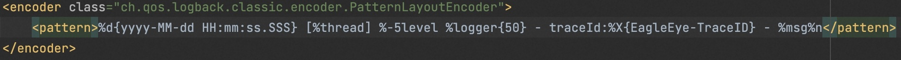

6. 重启应用。

   在应用的业务日志中成功打印出TraceId信息，则说明业务日志关联调用链的TraceId关联成功，如下图所示。

   

<a id="section-4-4-5"></a>

### 4.4.5. ARMS用户网络部署

本文介绍如何通过Gateway组件将用户网络中的应用接入公有云ARMS应用监控服务中。

**使用场景**

Gateway组件主要解决混合云场景下，由于网络不通原因，导致应用无法接入公有云ARMS应用监控服务问题，将其部署在阿里云环境（经典网络或VPC网络）充当代理角色。

**部署原理**

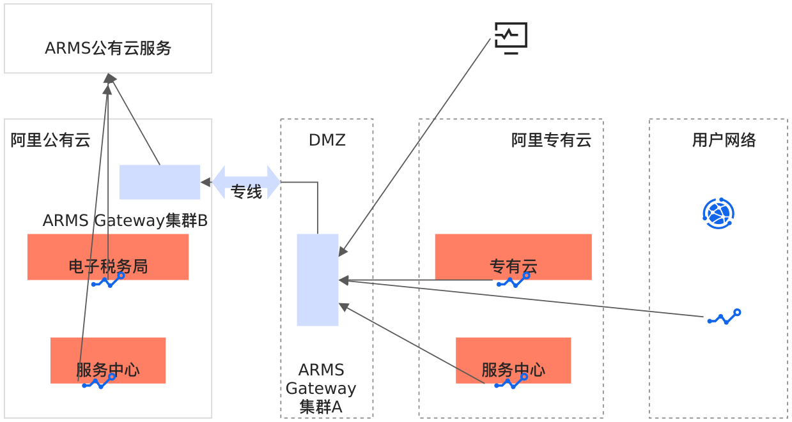

1. 部署在DMZ中的ARMS Gateway集群A对阿里云专有云和用户网络暴露内网地址，部署在专有云中的ARMS探针和WebLogic上的ARMS探针把采集的监控数据发送到Gateway上。

2. DMZ通过专线和阿里云公有云打通，部署在公有云VPC内的ARMS Gateway集群B通过专线连接Gateway集群A，起桥接作用。

3. ARMS Gateway集群B把收集到的ARMS监控数据发送到公有云服务端。

4. 阿里云公有云上的ARMS探针，包括部署在页面上的前端探针，将数据发送到ARMS公有云服务端。

**ARMS混合云监控部署要求**

- 按照采集专有云和用户网络500个节点来规划，需要6台规格为2核8 G的虚拟机，部署2个包含3台Gateway组件的集群。

- Gateway向阿里公有云传输的监控数据量比较小，可以控制在1 M/s内，所以利用现有的专线带宽，专有云EDAS和WebLogic都可以通过安装ARMS探针开启应用监控，无需修改代码。

**安装ARMS**

1. 下载Gateway软件包，此处以杭州地域为例。

2. 将Gateway部署在代理机器上，通过如下命令启动。

   ```text
   java -jar arms-gateway-1.7.0.jar
   ```

   > **说明**
   >
   > JDK版本需要为JDK 1.7+。

   Gateway默认连接杭州地域的ARMS服务，如需连接其它地域，可通过-D参数修改地域，命令如下：

   ```text
   java -jar -Darms.server.endpoint=arms-dc-bj.aliyuncs.com arms-gateway-1.7.0.jar
   ```

   - 华东1（杭州）：arms-dc-hz.aliyuncs.com

   - 华北2（北京）：arms-dc-bj.aliyuncs.com

   - 华东2（上海）：arms-dc-sh.aliyuncs.com

   - 华北1（青岛）：arms-dc-qd.aliyuncs.com

   - 华南1（深圳）：arms-dc-sz.aliyuncs.com

3. 下载Agent。

   可以在ARMS控制台的**接入应用**页面下载，具体操作，请参见为Java应用手动安装探针。

4. 解压Agent安装包。

5. 在arms-agent.config文件中，修改**profiler.collector.ip**指定的服务地址为代理机器地址。

   ```text
   profiler.collector.ip={代理机器IP}
   ```

6. 启动应用，在ARMS控制台的**应用监控 > 应用列表**页面查看监控数据是否正常上报，如果有数据上报，则说明接入成功。

<a id="section-4-4-6"></a>

### 4.4.6. 通过配置告警规则管理探针

业务在极限性能压力下，为了避免监控探针与业务争抢资源，您可以为应用配置告警指标（例如CPU使用率超过80%），并在收到告警后手动关闭探针。

**步骤一：配置告警指标**

1. 登录应用实时监控服务控制台。

2. 在左侧导航栏中选择**报警管理 > 报警策略管理 > 创建报警 > 应用监控报警**。

3. 选择需要进行监测的业务应用。

   可以通过**JVM指标**类型和**主机监控**指标类型来配置告警规则。

4. 配置通知方式和告警对象，并单击**保存**。

**步骤二：停止探针**

当被监测的应用触发告警，您可以通过以下方法为其停止探针。

1. 登录应用实时监控服务控制台。

2. 在左侧导航栏选择**应用监控 > 应用列表**。

3. 在**应用列表**页面单击目标应用的名称。

4. 在左侧导航栏中单击**应用设置**，并在右侧页面单击**自定义配置**页签。

5. 在**自定义配置**页签的**Agent开关配置**区域，关闭**Agent总开关**，然后单击**保存**。

   > **重要**
   >
   > 开关修改动态生效，无需重启应用。关闭此开关后，系统将无法监控您的应用，同时也不会产生费用，请您谨慎操作。

6. 在页面最下方单击**保存**。

   如果您想要关闭多个应用的Agent总开关，可以选择**批量复制到其他应用**。

<a id="section-4-5"></a>

## 4.5. 参考信息

<a id="section-4-5-1"></a>

### 4.5.1. ARMS应用监控支持的Java组件和框架

本文列出了ARMS应用监控支持的Java第三方组件和框架。如果待监控应用使用的组件或框架不在支持范围内，则需要通过配置通用Filter拦截器的方式进行监控数据采集。

**ARMS应用监控支持的Java组件和框架**

| 组件 | JDK 1.7 | JDK 1.8 | JDK 11 |
| --- | --- | --- | --- |
| Aliware MQ | 4.1.X+ | 4.1.X+ | 4.1.X+ |
| Druid | 1.0.0+ | 1.2.4+ | 1.2.4+ |
| DSF（Daojia Service Framework） | 不支持 | 2.1.X+ | 2.1.X+ |
| Dubbo | 2.5.X+ | 2.5.X+ | 2.5.X+ |
| Elasticsearch Rest Client | 5.X+ | 7.X+ | 7.X+ |
| Elasticsearch Rest High Level Client | 5.X+ | 7.X+ | 7.X+ |
| Feign | 不支持 | 9.X+ | 9.X+ |
| Google HTTP Client | 1.10.X+ | 1.10.X+ | 1.10.X+ |
| GRPC-Java | 1.15+ | 1.15+ | 1.15+ |
| HikariCP | 2.3.0+ | 2.3.13+ | 2.3.13+ |
| Ali-HSF（High Speed Framework） | 2.2.4.6-TLS+ | 2.2.4.6-TLS+ | 2.3.13+ |
| HttpClient 3 | 3.X+ | 3.X+ | 3.X+ |
| HttpClient 4 | 4.X+ | 4.X+ | 4.X+ |
| Hystrix | 1.5.X+ | 1.5.X+ | 1.5.X+ |
| JDK HTTP | 1.7.X+ | 1.7.X+ | 1.7.X+ |
| Jedis | 2.X+ | 2.X+ | 2.X+ |
| Jetty | 8.X+ | 8.X+ | 8.X+ |
| Kafka | 2.4.0+ | 2.4.0+ | 2.4.0+ |
| Lettuce | 不支持 | 4.0+ | 4.0+ |
| MariaDB | 1.3+ | 1.3+ | 1.3+ |
| MemCached | 2.8+ | 2.8+ | 2.8+ |
| MongoDB | 3.7+ | 3.7+ | 3.7+ |
| MyBatis | 3.X+ | 3.X+ | 3.X+ |
| MySQL JDBC | 5.0.X+ | 5.0.X+ | 5.0.X+ |
| OKHttp | 2.X+ | 2.X+ | 2.X+ |
| Oracle JDBC | 10.2.X+ | 10.2.X+ | 10.2.X+ |
| Play Framework | 不支持 | 1.4.X | 1.4.X |
| PostgreSQL JDBC | 9.4+ | 9.4+ | 9.4+ |
| RabbitMQ | 不支持 | 2.1.X+ | 2.1.X+ |
| Reactor | 不支持 | 3.X+ | 3.X+ |
| Reactor Netty | 不支持 | 0.9+ | 0.9+ |
| Redisson | 不支持 | 3.10.0+ | 3.10.0+ |
| Resin | 3.0+ | 3.0+ | 3.0+ |
| RxJava | 2.X+ | 2.X+ | 2.X+ |
| SOFABoot | 3.2.0+ | 3.2.0+ | 3.2.0+ |
| SofaRPC | 5.4.X+ | 5.4.X+ | 5.4.X+ |
| Spring | 4.X+ | 4.X+ | 4.X+ |
| Spring Boot | 1.3.X+ | 1.3.X+ | 1.3.X+ |
| Spring Cloud Gateway | 不支持 | 2.1.0.RELEASE+ | 2.1.0.RELEASE+ |
| Spring WebMVC | 不支持 | 5.0.6.RELEASE+ | 5.0.6.RELEASE+ |
| Spring WebFlux | 不支持 | 5.0.0.RELEASE+ | 5.0.0.RELEASE+ |
| SQLServer JDBC | 6.4+ | 6.4+ | 6.4+ |
| Thrift | 0.8+ | 0.8+ | 0.8+ |
| Tomcat | 7.X+ | 7.X+ | 7.X+ |
| Undertow | 1.3X+ | 1.3X+ | 1.3X+ |
| WebLogic | 12.X+ | 12.X+ | 12.X+ |

**配置通用Filter拦截器以采集数据**

如果应用的组件或框架不在支持范围内，可以通过配置通用Filter拦截器的方式采集数据。配置步骤：

1. 在工程的POM文件中引入arms-sdk-1.7.1.jar。

   ```xml
   <dependency>
       <groupId>com.alibaba.arms.apm</groupId>
       <artifactId>arms-sdk</artifactId>
       <version>1.7.1</version>
   </dependency>
   ```

   > 如果无法获取POM文件，请下载arms-sdk-1.7.1.jar。
   >
   > **说明**

2. 在web.xml中配置ARMS的Filter拦截器。

   ```xml
   <filter>
       <filter-name>EagleEyeFilter</filter-name>
       <filter-class>com.alibaba.arms.filter.EagleEyeFilter</filter-class>
   </filter>
   <filter-mapping>
       <filter-name>EagleEyeFilter</filter-name>
       <url-pattern>/*</url-pattern>
   </filter-mapping>
   ```

3. 登录应用实时监控服务控制台。

4. 为Java应用安装Agent。具体详情，请参见为Java应用手动安装探针。

5. 重启应用令配置生效。

<a id="section-4-5-2"></a>

### 4.5.2. 关键统计指标说明

本文说明了ARMS应用监控各页面的关键统计指标的含义。

**基本概念**

本文涉及以下基本概念：

- APDEX性能指数

  APDEX性能指数（Application Performance Index）是一个国际通用的应用性能计算标准。该标准将用户对应用的使用感受定义为三个等级：

  - 满意（0~T）

  - 可容忍（T~4T）

  - 不满意（大于4T）

  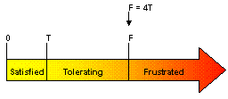

  图片来源：apdex.org

  计算公式为：

  ```text
  Apdex=(满意数+可容忍数/2)/总样本量
  ```

  ARMS取应用的平均响应时间作为计算指标，并将T定义为500毫秒。

- 实例

  实例是指被监控的应用所部署的机器，以JVM为粒度。

**相关统计页面**

- **应用列表**页面

  在控制台左侧导航栏中选择**应用监控 > 应用列表**，即可看到各应用的健康度、请求数、错误数、响应时间、异常数和最近10分钟响应时间曲线。

- **应用总览**页面

  在应用监控列表页面单击应用名称，即可进入**应用总览**页面。在页面顶部选择相应菜单，可以查看其他维度的统计信息。

  - **概览分析**页签

    - 应用提供的服务：因用户访问该应用而产生的数据，例如用户在浏览器中访问该应用。其包含应用提供服务请求量和应用提供服务平均响应时间两个指标。

    - 应用依赖的服务：因该应用访问其他服务而产生的数据，例如该应用访问数据库。其包含应用依赖服务请求量、应用依赖服务平均响应时间和应用实例数三个指标。

    - 系统信息：CPU、内存和负载。

    - 统计分析：慢接口调用分析和平均响应时间、异常类型和出现次数。

  - **拓扑图**页签

    - 应用拓扑图

    - 实例健康： 绿色表示**正常**，黄色表示**警告**，红色表示**严重**。

    - 调用类型：

      | 调用类型 | 描述 | 备注 |
      | --- | --- | --- |
      | 调用MySQL | 对MySQL进行操作的调用 | 数据库调用 |
      | 调用HTTP | 该调用为该应用对其他服务发起的HTTP调用 | 服务间调用 |
      | 调用本地API | 对本地API进行操作的调用 | API调用 |
      | HTTP入口 | 客户端使用HTTP协议调用该应用的入口 | 服务入口调用 |

    - 实例IP： 显示该应用下所有实例的IP。

    - 应用的请求数、响应时间和错误率。

- **应用详情**页面

  此页面展示当前应用的调用详细信息。选择不同页签，可切换展示实例响应时间、请求数、错误数统计，以及实例概览、SQL分析、异常分析、接口快照等维度的详细分析。

- **接口调用**页面

  此页面展示当前应用所开放的接口的统计信息。选择不同页签，可切换展示实例响应时间、请求数、错误数统计，以及实例概览、SQL分析、异常分析、接口快照等维度的详细分析。

- **数据库调用**页面

  该部分展示应用所关联的数据库调用情况。选择不同页签，可切换展示实例响应时间、请求数、错误数统计，以及实例概览、SQL分析、异常分析等维度的详细分析。

**相关页签的关键统计指标说明**

- 响应时间：应用、实例调用的平均响应时间，或数据库操作的平均执行响应时间。

- 请求数：应用、实例调用的请求调用次数，或数据库操作的执行次数。

- 错误数：应用、实例调用的错误调用次数，或数据库操作中异常执行次数。

- **概览**页签

  | 上报字段 | 描述 |
  | --- | --- |
  | 请求数 | 应用、实例调用的请求调用次数，或数据库操作的执行次数。 |
  | 响应时间 | 应用、实例调用的平均响应时间，或数据库操作的平均执行响应时间。 |
  | 错误率 | （应用、实例调用的异常调用次数，或数据库操作的异常次数）/请求数。 |

- **SQL调用分析**页签

  | 上报字段 | 描述 |
  | --- | --- |
  | SQL调用统计 | 柱状图与左Y轴为数据库请求数统计，折线图与右Y轴为数据库响应时间。 |
  | 平均耗时 | 本次数据库调用的平均耗时。 |
  | 调用次数 | 该应用此类型数据库调用次数。 |

- **异常分析**页签

  | 上报字段 | 描述 |
  | --- | --- |
  | 异常统计 | 柱状图为该应用、实例、数据库的异常次数。 |
  | 异常类型 | 采集到的抛错类型。 |
  | 异常详细信息 | 抛错的详细信息。 |
  | 平均耗时 | 本次错误调用的平均耗时。 |
  | 错误数 | 该异常类型的错误出现的次数。 |

- **接口快照**页签

  | 上报字段 | 描述 |
  | --- | --- |
  | 耗时 | 应用、实例的接口的调用耗时。 |
  | 状态 | 应用、实例的接口的调用返回状态，绿色表示正常返回，红色表示抛异常。 |
  | TraceId | 应用、实例调用的索引ID，单击可以跳转到该调用链详情。 |

<a id="section-4-5-3"></a>

### 4.5.3. ARMS SDK使用说明

借助ARMS提供的SDK，您可以在业务代码中动态获取TraceId及相关调用链属性。

**前提条件**

- 已在ARMS控制台上创建应用监控，并已在Java程序中挂载和启动应用监控的Agent。具体操作，请参见为Java应用手动安装探针。

- 程序中已引入arms-sdk-1.7.3.jar依赖。

  ```xml
  <dependency>
      <groupId>com.alibaba.arms.apm</groupId>
      <artifactId>arms-sdk</artifactId>
      <version>1.7.3</version>
  </dependency>
  ```

  > **说明**
  >
  > 如果无法获取pom.xml中的依赖，请直接下载arms-sdk-1.7.3.jar。

**获取TraceId与RpcId**

您可通过以下代码获取TraceId与RpcId。

```text
Span span = Tracer.builder().getSpan();
String traceId = span.getTraceId();
String rpcId = span.getRpcId();
```

**透传业务自定义标签baggage**

若您要透传业务自定义标签，则需要在代码中写入添加和获取自定义标签，具体操作步骤如下：

1. 在业务代码中添加自定义标签**baggage**。

   ```text
   Map<String, String> baggage = new HashMap<String, String>();
   baggage.put("key-01", "value-01");
   baggage.put("key-02", "value-02");
   baggage.put("key-03", "value-03");
   Span span = Tracer.builder().getSpan();
   span.withBaggage(baggage);
   ```

2. 在业务代码中获取自定义标签**baggage**。

   ```text
   Span span = Tracer.builder().getSpan();
   Map<String, String> baggage = span.baggageItems();
   ```

**为Span设置自定义标签tag**

为Span设置自定义标签只会在当前Span中有效，并不会透传。您需要在代码中写入添加和获取自定义的标签，具体操作步骤如下：

1. 在业务代码中为Span添加自定义标签**tag**，可以添加多个标签。

   ```text
   Span span = Tracer.builder().getSpan();
   // Add a tag to the Span.
   span.setTag("tag-key1", "tag-value1");
   span.setTag("tag-key2", "tag-value2");
   ```

2. 在业务代码中获取Span自定义标签**tag**。

   ```text
   Span span = Tracer.builder().getSpan();
   // Inspect the Span's tags.
   Map<String, String> tags = span.tags();
   ```

**根据自定义标签baggage和tag查询调用链**

通过Span设置的自定义标签**baggage**和**tag**可以用来按标签维度查询调用链。

- **baggage**上的标签具有透传到下游效果，一般用于业务染色，标签项不建议设置过多。

- **tag**上的标签只在本Span作用域内有效，可以设置多个业务项。

1. 登录应用实时监控服务控制台。

2. 在左侧导航栏选择**应用监控 > 多维查询**。

3. 在**调用链路查询**页面选择参数类型，输入参数值，单击**添加到查询条件**。

4. 在**调用链路查询**列表中单击目标链路的**TraceID**。

5. 在**调用链路**详情页面，鼠标移动至**服务名称**，会显示当前Span对应的Tags信息（**baggage**内容会自动加入到每个Span的Tags上）。

<a id="section-4-6"></a>

## 4.6. 升级探针

对于在ARMS中监控的EDAS应用和其他类型应用，请按照本文所述的相应方法更新Java探针版本。

**如何为EDAS应用更新探针？**

如果您需要更新EDAS应用的Java探针版本，重新部署EDAS应用即可。

**如何为其他类型的应用更新探针？**

如果您需要更新除了EDAS应用之外的其他类型应用的Java探针版本，先卸载探针再重新安装即可。

如需卸载探针，请参见卸载Agent的常见问题。

<a id="section-5"></a>

# 5.交互大盘

<a id="section-5-1"></a>

## 5.1. 交互大盘概述

本文介绍交互式大盘的用户界面。

在控制台左侧导航栏中选择**交互大盘**，进入**交互大盘管理**页面，可以看到所有交互大盘。

交互大盘主要分为控件操作区、标签栏操作区、导航树操作区和数据展示区四个模块。

- 控件操作区：您可以在此操作控件（导航树、图片、文本编辑等）和选择时间。

- 标签栏操作区：您可在此添加不同标签页，用来对图表进行聚类。例如要统计 Nginx 页面的 PV、UV 操作，也要统计 Nginx 页面的错误返回码，则可以将这两种统计纳入不同的标签页。

- 导航树操作区：最多可以设置三层的导航树。逐级下钻选择查询维度，然后单击，就可以在右侧的数据集展示模块看到相应数据。导航树是 ARMS 根据用户数据自动生成的，此外还支持按照相应的JSON 格式手动导入导航树。

- 数据展示区：是交互大盘的核心模块，会根据选择的导航树维度、时间范围显示对应的标签栏下的所有数据图表，允许添加多个不同的标签。

<a id="section-5-2"></a>

## 5.2. 创建交互大盘

创建交互大盘包含两个步骤：新建交互大盘和配置大盘数据。

**操作步骤**

1. 登录应用实时监控服务控制台。

2. 在左侧导航栏单击**交互大盘**。

3. 在**交互大盘管理**页面选择**新建交互大盘 > 自定义大盘**。

4. 在**创建交互大盘**对话框中，输入交互大盘名称并单击**确定**。

   系统自动为此交互大盘创建一个空白的标签页，您可以单击标签页顶部的铅笔图标来为标签页命名。新建的交互大盘显示在**交互大盘管理**页面的列表中，但没有任何数据，接下来需要为大盘配置数据。

5. 添加数据集。

   <ol type="i">

   <li>

   在**交互大盘管理**页面，单击大盘名称右侧**操作**列中的**编辑**。

   </li>

   <li>

   在页面右上角选择**交互控件 > 应用监控图表**。

   > **说明**
   >
   > - 如果需要展示应用拓扑图，此处选择**应用监控拓扑图**。
   >
   > - 如果需要添加自定义监控数据，此处选择**自定义监控图表**。
   >
   > - 如果需要添加文本面板，此处选择**添加文本**。

   </li>

   <li>

   在**新建交互图表**对话框中，输入**图表名称**，设置**应用**、**指标**，选择**图表类型**，按需输入其他可选信息，并单击**确定**。

   </li>

   </ol>

6. 添加导航树。

   <ol type="i">

   <li>

   在大盘编辑页面右上角选择**交互控件 > 导航树控件**。

   </li>

   <li>

   在**导航树**对话框中，填写**名称**，选择**数据集类型**和**数据集**。

   ARMS自动将该数据集的多维度遍历值导入到**数据**文本框。

   </li>

   <li>

   单击**确定**。

   导航树显示在页面左侧的导航树操作区。

   </li>

   </ol>

7. 关联数据集与导航树。

   <ol type="i">

   <li>

   在数据展示区找到目标图表，单击齿轮图标。

   </li>

   <li>

   在**编辑**对话框**数据集**区域的**维度**一栏中，从下拉框中选择**导航树**维度，并单击**确定**。

   数据集的维度与导航树的维度关联完毕。

   </li>

   </ol>

8. 查看数据集的数据展示。

   选择导航树中的不同维度值，就可以在数据展示区中看到对应的数据展示。

9. 在空间操作区的时间选择模块中，选择**今天**、**本周**、**本月**等，或者手动选择开始时间与结束时间，即可显示指定时间范围的数据。

0. 大盘配置完毕后，单击右上角的**保存**，可以保存当前的配置。此外，每隔十秒钟，系统还会自动保存一次，防止丢失正在编辑的数据。

   > **说明**
   >
   > 为防止丢失正在编辑的数据，ARMS 会每隔 10 秒钟自动保存一次。

   > **说明**
   >
   > 大盘中图表的大小和位置均可调整。
   >
   > - 调整图表大小
   >
   >   在编辑模式下拖拽图表右下角控制柄即可调整大小。
   >
   > - 调整图表位置
   >
   >   在编辑模式下拖动图表即可调整位置，松开鼠标即可确定其最终位置。

<a id="section-5-3"></a>

## 5.3. 管理交互大盘

本文介绍了如何对交互大盘进行编辑、删除、设置全屏播放等操作。

**操作步骤**

1. 登录应用实时监控服务控制台。

<ol type="A">

<li>

浏览、编辑、删除、修改名称和复制

</li>

</ol>

2. 在控制台左侧导航栏中选择**交互大盘**。

3. 在**交互大盘管理**页面上，在搜索框中输入大盘名称，并单击**搜索**。

4. 在搜索结果列表中，按需对目标大盘采取以下操作：

   - 如需查看大盘，请单击**浏览**，并在播放模式下查看大盘数据。

   - 如需编辑大盘，请单击**编辑**，在编辑模式下编辑大盘，并单击**保存**。

   - 如需删除大盘，请单击**删除**，并在**删除**对话框中单击**删除**。

   - 如需修改大盘名称，请单击**修改别名**，在**编辑**对话框中输入新的大盘名称，并单击**确定**。

   - 如需复制大盘，请单击**更多 > 复制**，在**创建交互大盘**对话框中输入大盘名称，并单击**确定**。此后您可以在**交互大盘管理**页面找到该大盘并继续编辑。

<ol type="A" start="2">

<li>

设置全屏播放

</li>

</ol>

5. 单击大盘名称，在播放模式下，单击右上角的**全屏**。

6. 在**全屏设置**对话框中，勾选需要全屏查看的标签页，并单击**确定**。

   大盘以全屏模式播放。

   > **说明**
   >
   > 默认每分钟刷新一次。如有特定需求，欢迎联系我们。

<a id="section-6"></a>

# 6.报警

<a id="section-6-1"></a>

## 6.1. 创建报警

ARMS可在满足报警条件时通过邮件、短信、钉钉、Webhook等渠道实时报警，帮助您主动发现异常。

**前提条件**

- 已设置好管理联系人分组，因为仅可将联系人分组设为报警的通知对象。

- 已有应用监控任务或自定义监控任务。

- 如果是已创建完成的监控任务，且该任务正在运行，请先暂停或停止该任务。

**背景信息**

默认报警条件：

- 为避免报警信息爆炸，相同报警在半小时内只发送两次通知。

- 如果5分钟内没有重复报警，则会发送恢复邮件，通知数据恢复正常。

- 发送恢复邮件后，报警的状态会重置。如果该报警再次出现，会被视为新报警。

报警控件本质是数据集的数据展示方式，所以在创建报警控件的同时，会创建一个数据集来存储报警控件的底层数据。

> **说明**
>
> 报警支持对接ANS，如需使用ANS通道，请联系管理员开通。

**创建应用监控报警**

1. 登录应用实时监控服务控制台。

2. 在左侧导航栏中选择**报警管理 > 报警策略管理**。

3. 在**报警规则和历史**页面，选择右上角的**创建报警 > 应用监控报警**。

4. 在**创建报警**对话框中输入相关信息，并单击**保存**。

   <ol type="i">

   <li>

   填写报警名称，例如：JVM-GC次数同比报警。

   </li>

   <li>

   在**应用站点**下拉框中选择应用，在**应用组**列表中选择应用组。

   </li>

   <li>

   在**类型**栏选择监控指标的类型，例如：**JVM监控**。

   </li>

   <li>

   设置维度为**遍历**。

   </li>

   <li>

   设置报警规则。

   <ol type="a">

   <li>

   选择**同时满足下述规则**或**满足下述一条规则**。

   </li>

   <li>

   编辑报警规则，例如：N=5时jvm_fullgc次数的平均值与上小时同比上升100%时则报警。

   > **说明**
   >
   > 若需设置多条报警规则，单击右侧的加号图标，即可编辑第二条报警规则。

   </li>

   </ol>

   </li>

   <li>

   选择通知方式，例如：选择**邮件**。

   </li>

   <li>

   设置通知对象。在**全部联系组**框中单击联系人分组的名称，该联系人分组出现在**已选联系组**框中，则设置成功。

   </li>

   </ol>

**通用基础字段含义**

通用基础字段含义见下列表。

| 字段 | 含义 | 说明 |
| --- | --- | --- |
| 应用站点 | 已创建的监控任务。 | 在下拉菜单中选择。 |
| 类型 | 报警指标的类型。 | 两种报警的报警指标类型各不相同：<br>• 应用监控报警：应用调用统计、应用调用类型统计、数据库指标、JVM监控、主机监控、异常接口调用和MQ指标。<br>• 自定义监控报警：基于已有下钻数据集创建报警和基于已有通用数据集创建报警。 |
| 维度 | 配置报警指标（数据集）的维度，可选择为：<strong>无</strong>、<strong>=</strong> 、<strong>遍</strong><strong>历</strong>、<strong>in</strong>（自定义监控支持）。 | • 配置为<strong>无</strong>：报警内容中透出这个维度所有数值的和。<br>• 配置为<strong>=</strong> ：具体内容需手动填写。<br>• 配置为<strong>遍历</strong>：会在报警内容中透出实际触发报警的维度内容。 |
| 最近N分钟 | 报警判断最近N分钟内数据结果是否达到触发条件。 | N的范围为：<br>• 应用监控：1~60分钟。<br>• 自定义监控：1~3600分钟。 |
| 通知方式 | 支持邮件、短信、钉钉机器人和Webhook四种方式。 | 可选择多种方式。 |
| 报警静默期开关 | 可选择为开启或关闭，默认为开启状态。 | • 开启报警静默期开关：若数据一直处于触发状态，首次触发报警后，24小时后才会发送第二次报警信息。当数据恢复正常，会收到数据恢复通知并解除报警。若数据再次触发报警，则会再次发送报警信息。<br>• 关闭报警静默期开关：若报警连续触发，将会每分钟发送一次报警信息。 |
| 报警级别 | 包括警告、错误和致命。 | 无 |
| 生效时间 | 报警生效时间。 | 报警仅会在生效时间内触发。 |
| 通知时间 | 报警发送时的通知时间。此时间范围外将不发送报警通知，但仍会有报警事件记录。 | 查看报警事件记录请参见管理报警。 |
| 通知内容 | 自定义的报警通知内容。 | 您可以编辑默认模板。在模板中，除$报警名称、$筛选、$报警时间和$报警内容等4个变量（暂不支持其它变量）为固定搭配，其余内容均可自定义。 |

**通用复杂字段含义**

**环比、同比**

- 环比上升/下降% ：若β为最近N分钟的数据（可选择为平均值、总和、最大值和最小值），α为前2N分钟到前N分钟的数据， 环比为β与α做比较。

- 与上小时同比上升/下降%：若β为最近N分钟的数据（可选择为平均值、总和、最大值和最小值），α为上小时最近N分钟的数据，与上小时同比为β与α做比较。

- 与昨日同比上升/下降%：若β为最近N分钟的数据（可选择为平均值、总和、最大值和最小值），α为昨日同一时刻最近N分钟的数据，与昨日同比为β与α做比较。

**报警数据修订策略**

报警数据修订策略可选择为补零、补一或补零Null（默认）。此功能一般用于无数据、复合指标和环比同比等异常的数据修复。

- 补零： 将被判断的数值修复为0。

- 补一： 将被判断的数值修复为1。

- 补零Null： 不会触发报警。

应用场景

- 异常情况一：复合指标异常

  用户B想利用报警功能监控商品的实时单价。创建报警时，选择自定义监控报警，设置变量a的数据集为当前总价，变量b的数据集为当前商品总数，报警规则为N=3时（当前总价）/（当前商品总数）的最小值小于等于10则报警。若当前商品总数为0时，复合指标（当前总价）/（当前商品总数）的值不存在，则不会发送报警。为解决此类问题，可将报警数据修订策略选择为补零，将复合指标（当前总价）/（当前商品总数）的值视为0，符合报警规则，即可发送报警。

- 异常情况二：指标环比、同比异常

  用户C想利用报警功能监控节点机用户使用CPU百分比。创建报警时，选择应用监控，设置报警规则为N=3时节点机用户使用CPU百分比的平均值环比下降100%则报警。若最近N分钟用户的CPU故障无法工作，即α无法获取，导致环比结果不存在，则不会发送报警。为解决此类问题，可将报警数据修订策略选择为补一，将环比结果视为下降100%，符合报警规则，即可发送报警。

**后续操作**

单击右侧**报警历史**页签，即可看到所有报警记录。您也可以使用搜索框查询报警记录。

<a id="section-6-2"></a>

## 6.2. 管理报警

在ARMS控制台可以管理在监控任务中配置的报警规则，以及查看报警历史。

**管理报警规则**

1. 登录应用实时监控服务控制台。

2. 在左侧导航栏中选择**报警管理 > 报警策略管理**。

   **报警规则和历史**页面打开，默认显示**报警规则**页签。

3. 在**报警规则**页签的搜索框中输入报警名称，并单击**搜索**。

   搜索结果显示在列表中。

4. 在搜索结果列表中，按需对目标报警规则采取以下操作：

   - 如需编辑报警规则，请单击**操作**列的**编辑**，在**编辑报警**对话框中编辑报警规则，并单击**保存**。

   - 如需删除报警规则，请单击**操作**列的**删除**，并在**删除**对话框中单击**删除**。

   - 如需启动已停止的报警规则，请单击**操作**列的**启动**，并在**确定**对话框中单击**启动**。

   - 如需停止已启动的报警规则，请单击**操作**列的**停止**，并在**停止**对话框中单击**确定**。

   - 如需查看报警历史，请单击**操作**列的**报警历史**，并在**报警历史**页签上查看相关记录。

5. 如需批量导出、启动/停止、删除报警，可以在列表下方单击对应按钮。

6. 如需导入报警规则，单击页面右上角的**导入规则**，并按照对话框提示填写相关内容。

**查询报警历史**

1. 登录应用实时监控服务控制台。

2. 在左侧导航栏中选择**报警管理 > 报警策略管理**。

3. 单击**报警历史**页签，选择报警类型、事件触发状态、报警名称、应用Pid或主机IP，并单击**搜索**。

   报警历史显示在列表中。

<a id="section-6-3"></a>

## 6.3. 管理报警模板

ARMS 提供了报警模板功能，您可以使用报警模板批量创建报警，提高配置报警规则的效率。

**背景信息**

ARMS默认提供的报警模板包括：

- 应用监控默认报警-数据库异常报警模板：数据库响应时间长或数据库调用出错场景的报警。

- 应用监控默认报警-异常调用报警模板：存在超时调用或错误调用场景的报警。

- 应用监控默认报警-主机监控报警模板：CPU水位过高或磁盘空间不足场景的报警。

- 应用监控默认报警-进程异常报警模板：进程存活场景的报警。

- 应用监控默认报警-GC异常报警模板：FullGC过多、FullGC耗时长或YoungGC耗时长场景的报警。

**创建报警模板**

除 ARMS 默认提供的报警模板外，您还可以根据自身需求选择创建自己的报警模板。

1. 登录应用实时监控服务控制台。

2. 在左侧导航栏选择**报警管理 > 报警模板管理**。

3. 在**报警模板管理**页面，单击右上角的**创建报警模板**，然后单击**应用监控报警模板**。

   在弹出的**创建报警模板**对话框中输入所有必填信息，完成后单击**保存**。各字段详情请参见创建报警文档中的**通用基础字段含义**。

4. <strong>可选：</strong>报警模板创建完成后，在报警模板列表选中刚才创建的模板，单击右侧**操作**列的**创建报警**。在弹出的**创建报警**对话框中输入所有必填信息，完成后单击**保存**。

   选择**报警管理 > 报警策略管理**，在**报警规则和历史**页面的**报警规则**页签，刚才创建的报警规则显示在报警列表中，表示您已使用前面创建的报警模板成功创建了报警规则。

5. <strong>可选：</strong>在报警模板列表选中刚才创建的模板，单击右侧**操作**列的**批量创建报警**。

6. <strong>可选：</strong>在弹出的**批量创建报警**对话框中，在左侧的选择框单击多个应用，将其添加至右侧选择框。完成后单击**保存**，并在弹出的**提示**对话框单击**确定**。

   选择**报警管理 > 报警策略管理**，在**报警规则和历史**页面的**报警规则**页签，刚才批量创建的报警规则显示在报警列表中，表示您已使用前面创建的报警模板成功批量创建了报警规则。

**管理报警模板**

您可以对报警模板执行开启自动生成、停止自动生成、编辑、删除和复制等操作。

1. 登录应用实时监控服务控制台。

2. 在左侧导航栏选择**报警管理 > 报警模板管理**。

3. 在报警模板列表中找到目标模板，在右侧的**操作**列中，按需对目标模板采取以下操作。

   - 如需编辑报警模板，请单击**编辑**，在**编辑报警模板**对话框中编辑报警模板，并单击**保存**。

   - 如需删除报警模板，请单击**删除**，并在**删除**对话框中单击**删除**。

   - 如需复制报警模板，请单击**复制**，在**编辑报警模板**对话框中编辑需复制的报警模板，并单击**保存**。

<a id="section-6-4"></a>

## 6.4. 管理联系人

配置报警规则时，仅可将联系人分组作为报警联系人，请务必在设置好联系人之后设置联系人分组。

**新建联系人**

1. 登录应用实时监控服务控制台。

2. 在左侧导航栏中选择**报警管理 > 联系人管理**。

3. 在**联系人**页签单击右上角的**新建联系人**。

4. 在**新建联系人**对话框中输入联系人姓名、手机号码和邮箱。如需接收系统通知，则勾选**是否接收系统通知**，默认为不勾选。最后单击**确认**。

   > **说明**
   >
   > 每个手机号码或邮箱只能用于一个联系人。至多可添加100个联系人。

**新建Webhook**

1. 登录应用实时监控服务控制台。

2. 在左侧导航栏中选择**报警管理 > 联系人管理**。

3. 在**联系人**页签单击右上角的**创建webhook**。

4. 在弹出的对话框中输入Webhook名称、Post、Header和Body。最后单击**创建**。

   | 参数 | 说明 |
   | --- | --- |
   | Webhook名称 | 必填，自定义Webhook名称。 |
   | <strong>Post</strong>和<strong>Get</strong> | 必填，设置请求方法。URL不可超过256个字符。 |
   | <strong>Header</strong>和<strong>Pa</strong> ram | 非必填，设置请求头，不可超过200个字符。 单击<strong>+添加</strong>，可以添加其他Header信息或Param信息。默认请求头为<strong>Content-Type: text/plain; charset=UTF-8</strong>，Header和Param个数总数不能超过6个。此例中设置以下两个<strong>Header</strong>：<br>• Arms-Content-Type : json<br>• Content-Type : application/json |
   | Body | 非必填，在Post方法下出现，可在Body字符串中使用$content占位符输出报警内容，不可超过500个字符。 |

**后续步骤**

- 如需搜索联系人，请在**联系人**标签页上，从搜索下拉框中选择**姓名**、**手机号**或**Email**，然后在搜索框中输入联系人姓名、手机号码或邮箱的全部或部分，并单击搜索图标。

- 如需编辑联系人，请单击联系人右侧**操作**栏中的**编辑**，在**编辑联系人**对话框中编辑信息，并单击**确认**。

- 如需删除单个联系人，请单击联系人右侧**操作**栏中的**删除**，并在弹出的对话框中单击**确认**。

- 如需删除多个联系人，请勾选目标联系人，单击**批量删除**，并在弹出的对话框中单击**确认**。

<a id="section-6-5"></a>

## 6.5. 管理联系人分组

本文介绍如何管理联系人分组。

**操作步骤**

1. 登录应用实时监控服务控制台。

2. 在控制台左侧导航栏中选择**报警管理 > 联系人管理**。

3. 在**联系人管理**页面上，单击**联系人组**标签页。

4. 在**联系人组**标签页上，单击右上角的**新建联系组**。填写**组名**，选择**报警联系人**，并单击**确认**。

**后续步骤**

- 如需搜索联系组，请在搜索框中输入完整的联系人组名称或名称的一部分，并单击搜索图标。

  > **说明**
  >
  > 英文搜索关键字区分大小写。

- 如需编辑联系组，请单击联系人分组右侧的铅笔图标，并在**编辑联系组**对话框中编辑相关信息。

- 如需查看联系组中的联系人信息，请单击联系人分组右侧的下箭头图标来展开联系组。

  > **说明**
  >
  > 您可以在展开模式下移除联系组中的联系人。

- 如需删除联系组，请单击联系人分组右侧的删除图标。

  > **警告**
  >
  > 请谨慎删除联系组。删除联系组之前，请确保没有正在运行的任务，否则可能导致报警等功能失效。

<a id="section-7"></a>

# 7.权限管理

<a id="section-7-1"></a>

## 7.1. 登录Apsara Uni-manager运营控制台

本文主要向您介绍如何登录Apsara Uni-manager运营控制台。

**前提条件**

- 登录Apsara Uni-manager运营控制台前，确认您已从部署人员处获取Apsara Uni-manager运营控制台的服务域名地址。

- 推荐使用Chrome浏览器。

**操作步骤**

1. 在浏览器地址栏中，输入Apsara Uni-manager运营控制台的服务域名地址，按回车键。

   

   > **说明**
   >
   > - 单击页面右上角的当前语言可以切换其它语言。
   >
   > - 授权登录是第三方认证中配置了全局IdP设置才会显示，且“授权登录”名称用户可按需自定义。
   >
   > - 由于浏览器证书过期或环境开启HTTPS认证等出现多次单击继续访问或无Apsara Uni-manager运营控制台地址入口等现象，此时需要安装证书才能正常访问。单击页面右上角的**浏览器证书安装**，可打开浏览器证书安装指南。

2. 输入正确的用户名及密码。

   > **说明**
   >
   > - 请向运营管理员获取登录控制台的用户名和密码。
   >
   > - 首次登录Apsara Uni-manager运营控制台时，需要修改登录用户名的密码，请按照提示完成密码修改。为提高安全性，密码长度必须为10~32位，且包含英文字母大小写、阿拉伯数字和特殊符号（感叹号（!）、at（@）、井号（#）、美元符号（$）、百分号（%）等）。

3. 单击**账号登录**。

4. 如果账号已激活MFA多因素认证，请根据以下两种情况进行操作：

   - **管理员强制开启MFA后的首次登录**

     <ol type="a">

     <li>

     在绑定虚拟MFA设备页面中，按页面提示步骤绑定MFA设备。

     </li>

     <li>

     按照步骤2重新输入账号和密码，单击**账号登录**。

     </li>

     </ol>

     <ol type="i" start="100">

     <li>

     输入6位MFA码后单击**认证**。

     </li>

     </ol>

   - **您已开启并绑定MFA**

     输入6位MFA码后单击**认证**。

     > **说明**
     >
     > 绑定并开启MFA的操作请参见《 Apsara Uni-manager运营控制台 用户指南》的**管理多因素认证**章节。

**相关操作**

**忘记密码**

1. 用户忘记登录密码时，单击密码输入框下方的**忘记密码**。

2. 在忘记密码页面，输入**账户名**、**邮箱**和验证码后，单击**确认**。

   

   > **说明**
   >
   > - 账户名请输入当前账号的用户名，邮箱请输入注册账号的Email地址。
   >
   > - 重置密码的链接将发至邮箱，进入链接后用户可输入新密码。

<a id="section-7-2"></a>

## 7.2. 创建用户和用户组

Apsara Uni-manager运营控制台可以创建用户，并为用户赋予角色，以满足用户对系统的访问控制需求。

**创建组织**

创建用户和用户组都需要提前创建组织。

1. 管理员登录Apsara Uni-manager运营控制台。

2. 在页面顶部的菜单栏中，单击**企业**。

3. 在左侧导航栏中，选择**资源管理 > 组织管理**。

4. 在**组织管理**页面左侧组织树上选择**root**，然后在右侧单击**创建组织**。

5. 在**添加组织**对话框，设置组织名称，然后单击**确定**。

**创建用户**

1. 在左侧导航栏中，选择**人员管理 > 用户管理**。

2. 在**用户管理**页面，单击**创建用户**。

3. 在**创建用户**对话框，设置用户基本信息，然后单击**确定**。

   <table>
     <tr>
       <th width="121">名称</th>
       <th>描述</th>
     </tr>
     <tr>
       <td>用户名</td>
       <td>用户的个人云平台账号名，由字母、数字、短划线（-）、下划线（_）、半角句号（.）组成，长度为2~64个字符。</td>
     </tr>
     <tr>
       <td>显示名</td>
       <td>显示名由中文汉字、字母、数字、短划线（-）、下划线（_）、半角句号（.）或at（@）组成，长度为1~128个字符。</td>
     </tr>
     <tr>
       <td>角色</td>
       <td>选择用户的角色。</td>
     </tr>
     <tr>
       <td>组织</td>
       <td>选择用户所在的组织。</td>
     </tr>
     <tr>
       <td>登录策略</td>
       <td>保持默认，选择默认策略。</td>
     </tr>
     <tr>
       <td>手机</td>
       <td>用户的手机号码。手机号码用于系统以短信形式通知用户资源的申请和使用情况，请填写正确的手机号码。<br>说明若手机号有变更，请及时在平台上更新。</td>
     </tr>
     <tr>
       <td>座机</td>
       <td>用户的座机号码。座机号码仅允许输入数字（0~9）和短划线（-），长度为4~20 个字符。</td>
     </tr>
     <tr>
       <td>Email</td>
       <td>用户的邮箱地址。邮箱用于系统以邮件方式通知用户资源的申请和使用情况，请填写正确的邮箱地址。<br>说明若Email有变更，请及时在平台上更新。</td>
     </tr>
     <tr>
       <td>钉钉密钥</td>
       <td>钉钉机器人的密钥。</td>
     </tr>
     <tr>
       <td>启用邮件通知</td>
       <td>启用后，Apsara Uni-manager运营控制台出现报警项且该用户是报警联系人时，Apsara Uni-manager运营控制台会将报警信息通过邮件通知用户对应的Email。<br>说明邮件通知需要配置邮件服务器，具体请联系驻场运维工程师。</td>
     </tr>
     <tr>
       <td>启用钉钉通知</td>
       <td>启用后，Apsara Uni-manager运营控制台出现报警项且该用户是报警联系人时，Apsara Uni-manager运营控制台会将报警信息通过钉钉消息通知用户的钉钉。</td>
     </tr>
   </table>

4. <strong>可选：</strong>添加角色。

   <ol type="i">

   <li>

   在 **用户管理**页面单击目标用户右侧的  图标，然后单击**角色授权**。

   </li>

   <li>

   在**角色授权**对话框中，您可以通过选中或取消选中目标角色，为用户赋予权限或解除权限，然后单击**确定**。

   </li>

   </ol>

**创建用户组**

1. 在左侧导航栏中，选择**人员管理 > 用户组管理**。

2. 在**用户组管理**页面单击**创建用户组**。

3. 在**创建用户组**对话框，设置**用户组名**并选择目标**组织**，然后单击**确定**。

   <table>
     <tr>
       <th width="89">参数</th>
       <th>描述</th>
     </tr>
     <tr>
       <td>用户组名</td>
       <td>自定义设置用户组名称，由字母、数字、中文字符、下划线（_）、短划线（-）、半角句号（.）或at（@）组成，长度为3~255个字符。例如<br><br><code>ARMS_group</code>。</td>
     </tr>
     <tr>
       <td>组织</td>
       <td>从下拉列表中选择目标组织。</td>
     </tr>
     <tr>
       <td>角色授权</td>
       <td>授权用户组中的用户使用的角色权限。创建角色的操作，请参见创建角色。</td>
     </tr>
   </table>

4. <strong>可选：</strong>添加用户。

   <ol type="i">

   <li>

   在**用户组管理**页面单击目标用户组右侧的**添加用户**。

   </li>

   <li>

   在**添加用户**对话框左侧选中目标用户，单击向右的箭头，移动到右侧用户名列表中。

   </li>

   <li>

   单击**确定**。

   </li>

   </ol>

5. 添加角色。

   <ol type="i">

   <li>

   在**用户组管理**页面单击目标用户组右侧的  图标，然后单击**授权**。

   </li>

   <li>

   在**授权**对话框中，单击**角色授权**下拉框。

   </li>

   <li>

   在下拉列表中，您可以通过选中或取消选中目标角色，为用户组赋予权限或解除权限，然后单击**确定**。

   </li>

   </ol>

<a id="section-7-3"></a>

## 7.3. 创建自定义角色

您可以在Apsara Uni-manager运营控制台中添加自定义角色，以便更好地为用户分配权限，满足不同的功能由不同人员来操作的需求。

**背景信息**

角色是一组访问权限的集合，每个角色都有对应权限范围。一个用户可以拥有多个角色，这意味着该用户可以获得这些角色定义的所有权限。当需要对一组用户赋予相同的权限时，可以使用角色来授权。

自定义角色和默认角色的总数不能超过20个。

**操作步骤**

1. 管理员登录Apsara Uni-manager运营控制台。

2. 在顶部菜单栏上，单击**企业**。

3. 在左侧导航栏中，选择**权限管理 > 角色授权**。

4. 单击页面左上角**创建自定义角色**。

5. 在**创建自定义角色**页面，设置名称、共享范围和管理范围等信息。单击**下一步**。添加角色的配置说明如下表所示。 表 1. 添加角色配置说明

   <table>
     <tr>
       <th width="89">名称</th>
       <th>描述</th>
     </tr>
     <tr>
       <td>角色名称</td>
       <td>角色名称。只可以为中文、英文大小写字母（A~Z、a~z）、阿拉伯数字（0~9），长度限制为64个字符。</td>
     </tr>
     <tr>
       <td>描述</td>
       <td>（可选）角色描述信息。只可以为中文、英文大小写字母（A~Z、a~z）、阿拉伯数字（0~9）、半角逗号（，）、半角分号（；）和下划线（_），长度限制为500个字符。</td>
     </tr>
     <tr>
       <td>共享范围</td>
       <td><strong>全局共享</strong>：该角色可以被所有组织看见并使用。</td>
     </tr>
     <tr>
       <td>管理权限</td>
       <td>• 所有组织权限的作用范围为涉及模块的所有组织。<br>• 本组织及级联下级组织权限的作用范围为用户所属组织及下级组织。<br>• 资源集权限的作用范围为用户加入的资源集。</td>
     </tr>
   </table>

6. 在**管理权限**页面选择该角色对Apsara Uni-manager运营控制台的操作权限。单击**下一步**。您可以通过单击左侧的权限分类，对权限进行快速过滤。

7. 在**应用权限**页面选择该角色对**应用实时监控服务**的操作权限。单击**下一步**。您可以通过单击左侧的应用名称，对应用权限进行快速过滤。

8. 在**菜单权限**页面选择该角色对各菜单的操作权限和角色对应的首页仪表盘模板。单击**创建**完成创建过程。您可以通过单击左侧的父级菜单，对级联菜单权限进行快速过滤。

**执行结果**

创建成功后，您可以单击**立即授权**为用户或用户组授权，也可以稍后在角色详情中进行授权。

<a id="section-7-4"></a>

## 7.4. 创建RAM角色

Apsara Uni-manager控制台可以自定义创建RAM角色并为用户授权，以便更精细的管理权限。本文介绍如何创建RAM角色并绑定权限策略等操作。

**创建RAM角色**

1. 管理员登录Apsara Uni-manager运营控制台。

2. 在顶部菜单栏上，单击**企业**。

3. 在左侧导航栏选择**权限管理 > 角色授权**，然后在右侧页面单击**创建自定义角色**。

4. 在**创建自定义角色**页面，展开**高级创建**页签，单击**创建RAM授权**。

5. 在**创建RAM授权**页面，设置角色信息，然后单击**创建RAM授权并配置**。

   <table>
     <tr>
       <th width="89">参数</th>
       <th>描述</th>
     </tr>
     <tr>
       <td>角色名称</td>
       <td><br>自定义角色名称，例如管理命名空间的权限。</td>
     </tr>
     <tr>
       <td>描述</td>
       <td>角色的备注信息，通常用来描述角色所具备的权限。</td>
     </tr>
     <tr>
       <td>共享范围</td>
       <td>请根据实际需要选择角色的共享范围：<br>• <strong>全局共享</strong>：默认选项，该角色可以被所有组织看见并使用。<br>• <strong>本组织内共享</strong>：该角色可以被用户所属的组织看见并使用。<br>• <strong>下级组织共享</strong>：该角色可以被用户所属组织及其下级组织看见并使用。<br>说明使用admin账号登录时，共享范围默认为<strong>全局共享</strong>，不可设置。其它账号登录时，可以看到3个共享范围选项。</td>
     </tr>
   </table>

6. <strong>可选：</strong>为RAM角色添加授权用户组。添加授权用户组后，该用户组下的所有用户即被赋予该角色对应的权限。

   <ol type="i">

   <li>

   在**用户组管理**页签，单击**添加用户组**。

   </li>

   <li>

   在**添加用户组**对话框，选择目标用户组，然后单击**确定**。需要提前创建用户组。具体操作，请参见创建用户和用户组。

   </li>

   </ol>

7. 为RAM角色绑定自定义权限策略。

   <ol type="i">

   <li>

   单击**权限管理**页签，然后单击**添加权限策略**。

   </li>

   <li>

   在**添加新权限策略**对话框单击**创建权限策略**。

   </li>

   <li>

   在**创建权限策略**对话框设置权限基本信息，然后单击**确定**。

   <table>
     <tr>
       <th width="89">参数</th>
       <th>描述</th>
     </tr>
     <tr>
       <td>策略名称</td>
       <td><br>自定义设置策略名称，不超过50个字符，例如<code>TraceApp</code>。</td>
     </tr>
     <tr>
       <td>共享范围</td>
       <td>请根据实际需要选择角色的共享范围：<br>• <strong>全局共享</strong>：默认选项，该角色可以被所有组织看见并使用。<br>• <strong>本组织内共享</strong>：该角色可以被用户所属的组织看见并使用。<br>• <strong>下级组织共享</strong>：该角色可以被用户所属组织及其下级组织看见并使用。<br>说明使用admin账号登录时，共享范围默认为<strong>全局共享</strong>，不可设置。其它账号登录时，可以看到3个共享范围选项。</td>
     </tr>
     <tr>
       <td>备注</td>
       <td>策略的描述信息，常用于描述该策略的能力。</td>
     </tr>
     <tr>
       <td>策略内容</td>
       <td>自定义策略内容如下：<br><code>{</code><br><code>"Version": "1",</code><br><code>"Statement": [</code><br><code>{</code><br><code>"Action": [</code><br><code>"arms:ReadTraceApp",</code><br><code>"arms:EditTraceApp"</code><br><code>],</code><br><code>"Resource": "acs:arms:cn-qingdao-env66-</code><br><code>d01:*:armsapp/arms-console-1",</code><br><code>"Effect": "Allow"</code><br><code>},</code><br><code>{</code><br><code>"Action": [</code><br><code>"arms:ReadTraceApp"</code><br><code>],</code><br><code>"Resource": "acs:arms:cn-qingdao-env66-</code><br><code>d01:*:armsapp/arms-console-2",</code><br><code>"Effect": "Allow"</code><br><code>}</code><br><code>]</code><br><code>}</code><br>该策略的权限动作代表授予指定应用的读写权限。<br>说明此处仅以应用监控的读写权限为例，如果需要自定义其他权限策略，请参见权限策略示例库。如果需要同时设置多个权限动作，请以半角逗号（,）分隔。</td>
     </tr>
   </table>

   </li>

   <li>

   在**添加新权限策略**对话框选择目标权限策略，然后单击**确定**。

   </li>

   </ol>

<a id="section-7-5"></a>

## 7.5. 权限策略示例库

文本介绍在RAM中可以授权的跟ARMS相关的权限细分规则和权限策略。

**权限细分规则**

本章节介绍ARMS内置权限和RAM中权限策略的对应关系。

表 1. 应用监控

| Description | Action | Resource |
| --- | --- | --- |
| 应用监控只读权限 | arms:ReadTraceApp | acs:arms:\*:\*:armsapp/\* |
| 应用监控编辑权限 | arms:EditTraceApp | acs:arms:\*:\*:armsapp/\* |
| 应用监控删除权限 | arms:DeleteTraceApp | acs:arms:\*:\*:armsapp/\* |

表 2. 自定义监控

| Description | Action | Resource |
| --- | --- | --- |
| 自定义监控只读权限 | arms:ReadTask | acs:arms:\*:\*:armscustom/\* |
| 自定义监控编辑权限 | arms:EditTask | acs:arms:\*:\*:armscustom/\* |
| 自定义监控删除权限 | arms:DeleteTask | acs:arms:\*:\*:armscustom/\* |

表 3. 交互大盘

| Description | Action | Resource |
| --- | --- | --- |
| 自定义监控只读权限 | arms:ReadInteractiveDashboar d | acs:arms:\*:\*:interactive/\* |
| 自定义监控编辑权限 | arms:EditInteractiveDashboard | acs:arms:\*:\*:interactive/\* |
| 自定义监控删除权限 | arms:DeleteInteractiveDashboa rd | acs:arms:\*:\*:interactive/\* |

**授权示例**

**应用监控**

- 查看和编辑应用监控授权用户可以查看和编辑cn-qingdao-env66-d01环境下的所有应用监控，但不允许删除。

  ```json
  {
    "Version": "1",
    "Statement": [
      {
        "Action": [
          "arms:ReadTraceApp",
          "arms:EditTraceApp"
        ],
        "Resource": "acs:arms:cn-qingdao-env66-d01:*:armsapp/*",
        "Effect": "Allow"
      }
    ]
  }
  ```

- 删除应用监控授权用户可以删除cn-qingdao-env66-d01环境下应用监控名称为arms-console-2的监控。

  > 删除应用监控时还需要授予查看监控的权限，这样才能找到需要删除的监控。
  >
  > **重要**

  ```json
  {
    "Version": "1",
    "Statement": [
      {
        "Action": [
          "arms:ReadTraceApp",
          "arms:DeleteTraceApp"
        ],
        "Resource": "acs:arms:cn-qingdao-env66-d01:*:armsapp/arms-console-2",
        "Effect": "Allow"
      }
    ]
  }
  ```

**自定义监控**

- 查看和编辑自定义监控授权用户可以查看和编辑cn-qingdao-env66-d01环境下的所有自定义监控，但不允许删除。

  ```json
  {
    "Version": "1",
    "Statement": [
      {
        "Action": [
          "arms:ReadTask",
          "arms:EditTask"
        ],
        "Resource": "acs:arms:cn-qingdao-env66-d01:*:armscustom/*",
        "Effect": "Allow"
      }
    ]
  }
  ```

- 删除自定义监控

  授权用户可以删除cn-qingdao-env66-d01环境下自定义监控名称前缀为test的监控。

  > 删除自定义监控时还需要授予查看监控的权限，这样才能找到需要删除的监控。
  >
  > **重要**

  ```json
  {
    "Version": "1",
    "Statement": [
      {
        "Action": [
          "arms:ReadTask",
          "arms:DeleteTask"
        ],
        "Resource": "acs:arms:cn-qingdao-env66-d01:*:armscustom/test*",
        "Effect": "Allow"
      }
    ]
  }
  ```

**交互大盘**

- 查看和编辑交互大盘授权用户可以查看和编辑所有环境下大盘名称前缀为test的交互大盘，但不允许删除。

  ```json
  {
    "Version": "1",
    "Statement": [
      {
        "Action": [
          "arms:ReadInteractiveDashboard",
          "arms:EditInteractiveDashboard"
        ],
        "Resource": "acs:arms:*:*:interactive/test*",
        "Effect": "Allow"
      }
    ]
  }
  ```

- 删除交互大盘

  授权用户可以删除所有环境下大盘名称前缀为arms的交互大盘。

  > 删除交互大盘时还需要授予查看大盘的权限，这样才能找到需要删除的大盘。
  >
  > **重要**

  ```json
  {
    "Version": "1",
    "Statement": [
      {
        "Action": [
          "arms:ReadInteractiveDashboard",
          "arms:DeleteInteractiveDashboard"
        ],
        "Resource": "acs:arms:*:*:interactive/arms*",
        "Effect": "Allow"
      }
    ]
  }
  ```

<a id="section-8"></a>

# 8.常见问题

<a id="section-8-1"></a>

## 8.1. 一般常见问题

本文解答了关于ARMS的一般常见问题。

1. ARMS报表数据在服务器保存多长时间？

   数据默认保存时间为7天。

2. ARMS支持监控除了日志以外的数据来源吗？

   目前ARMS不仅提供日志作为数据来源，同时也支持MQ作为数据源。

3. ARMS业务监控报表数据的延迟有多久？

   在日志通道不延迟的情况下，统计计算的延迟在10秒之内。也就是说，假如您在ARMS上定制了一个统计日志某字段出现次数的报表，我们将在北京时间12点10分10秒前统计出12点10分0秒前的数据。

4. 除了在ARMS控制台内查看报表以外，我可以通过API的方式获取到某张报表所对应的数据吗？

   可以。

5. ARMS会修改或移动我本机上的日志文件吗？

   不会，ARMS使用的用于采集日志的StarAgent客户端，只会按照您的配置对您机器上的文件进行读取操作，不会对其进行任何形式的修改操作。

6. ARMS的实时计算引擎JStorm能开放给用户直接使用么？

   我们目前不支持直接开放JStorm给客户直接使用。主要原因也是因为ARMS基于JStorm做了很多性能和QoS的优化。但是不排除未来我们经过优化以后暴露给您JStorm接口直接运行。

7. ARMS的列示存储能直接暴露给用户直接使用么？

   不能。目前我们仅支持RESTful API的方式取数据。主要原因也是因为我们的存储方式是经过特定优化。

<a id="section-8-2"></a>

## 8.2. 应用监控常见问题

本章节汇总了使用ARMS应用监控时的常见问题。

**本页目录**

- 为Java应用手动安装Agent的常见问题

  - ARMS Agent和其他APM产品Agent（例如Pinpoint）是否兼容？

  - 安装Agent后应用启动时报OutOfMemoryError错误怎么办？

  - 如何测试网络连通性？

  - 如何检查ARMS Agent是否安装成功？

  - ARMS Agent安装成功，为什么控制台上仍无监控数据？

  - ARMS Agent安装成功，但IP显示不正确或不显示怎么办？

  - 对于ARMS Agent日志（路径：ArmsAgent/log）错误，有哪些常用排查方法？

  - 如何支持单机多实例？

- 在不重装Agent的情况下更改Java应用名称的常见问题

  - 以通用方式安装Agent的普通Java应用如何更改应用名称？

  - 部署在EDAS上的Java应用如何更改应用名称？

- 卸载Agent的常见问题

  - 如何卸载以通用方式安装的Agent？

  - 如何卸载Docker中Java应用的Agent？

- 其他问题

  - 使用OpenFeign组件的应用在ARMS中数据不完整怎么办？

**ARMS Agent和其他APM产品Agent（例如Pinpoint）是否兼容？**

ARMS Agent和其他APM产品Agent都不兼容。APM大多是基于ASM框架进行字节码插桩实现的，同时安装两个Agent相当于对您的代码插桩两次，而不同商家的插桩代码实现不同，代码冲突可能造成严重的性能问题，因此强烈建议您不要同时安装多个APM Agent。

[回到顶部]

**安装Agent后应用启动时报OutOfMemoryError错误怎么办？**

请在Java启动命令后面加上堆内存大小配置项，以适当调大JVM参数。以下示例配置项表示堆内存初始值（Xms）为512 M，堆内存最大值（Xmx）为2 G。

> **说明**
>
> 请根据实际情况适当调节。对于Tomcat等其他环境，请在配置文件的**JAVA_OPTS**中加入此参数。

```text
   -Xms512M
   -Xmx2048M
```

如果出现 `OutOfMemoryError: PermGen space` 错误，请添加以下配置。

```text
   -XX:PermSize=256M 
   -XX:MaxPermSize=512M
```

如果出现 `OutOfMemoryError: metaspace` 错误，请添加以下配置。

```text
   -XX:MetaspaceSize=256M 
   -XX:MaxMetaspaceSize=512M
```

[回到顶部]

**如何测试网络连通性？**

部署ARMS Agent时，必须确保9994、9995、9996这三个端口的可连通性，Agent才能正常工作。可使用**Telnet**命令测试目标主机与ARMS服务器网络是否连通。例如，以端口9994为例，请登录应用所部署的机器，并输入以下命令。

> **说明**
>
> 以下示例中，\*\*\*\*\*\*表示当前环境Collector的域名或VIP。

```text
telnet ****** 9994
```

以下结果表明网络已连通：

```text
telnet ****** 9994
Trying 119.23.XX.XX
Connected to ******.
Escape character is '^]'.
```

[回到顶部]

**如何检查ARMS Agent是否安装成功？**

使用**ps**命令查看命令行启动参数中是否成功安装ARMS Agent。

```text
ps -ef | grep 'arms-bootstrap'
```

成功安装时，如下图所示：

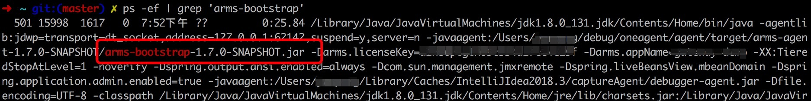

命令行中的**Darms.licenseKey**的值必须与ARMS**接入应用**页面显示的License Key一致。

[回到顶部]

**ARMS Agent安装成功，为什么控制台上仍无监控数据？**

1. 如果Agent日志中出现 `send agent metrics. no metrics.` ，请确认您的应用是否有持续的外部访问请求，包括HTTP请求、HSF请求和Dubbo请求，并确认开发框架是否在ARMS Agent的支持范围内。关于ARMS应用监控对第三方组件和框架的支持情况，请参见ARMS应用监控支持的Java组件和框架。

2. 确认选择的查询时间范围是否正确。请您将查询时间条件设为最近15分钟，然后再次确认是否有监控数据。

3. 如果是通过 `-jar` 命令行启动的，请检查命令行设置，确保<strong>-javaagent</strong>参数在 `-jar` 之前。以下是一个正确示例。

   ```text
   java -javaagent:/{user.workspace}/ArmsAgent/arms-bootstrap-1.7.0-SNAPSHOT.jar -Darms.licenseKey=xxx -Darms.appName=xxx -jar demoApp.jar
   ```

4. 如果ArmsAgent/log/下的日志中出现LicenseKey is invalid.异常，请检查应用所属地域与Agent所属地域是否一致。

5. 如果应用启动之后ArmsAgent目录下没有log子目录，则表明arms-bootstrap-1.7.0-SNAPSHOT.jar未被成功加载，请检查ArmsAgent安装目录的权限是否正确。

6. 若应用启动时出现以下报错，请您检查arms-bootstrap-1.7.0-SNAPSHOT.jar软件包及相应权限是否正确。

   ```text
   Error opening zip file or JAR manifest missing: /root/ArmsAgent/arms-bootstrap-1.7.0-
   SNAPSHOT.jar
   Error occurred during initialization of VM
   agent library failed to init: instrument
   ```

7. 如果仍无监控数据，请将Java Agent日志（路径：ArmsAgent/log）保存为压缩文件，并联系钉钉服务账号 `arms160804` 解决问题。

8. 检查JDK版本。如果JDK版本为1.8.0_25或者1.8.0_31，可能会出现无法安装Agent的情况，建议您升级对应的JDK版本，或咨询钉钉服务账号 `arms160804` 。

[回到顶部]

**ARMS Agent安装成功，但IP显示不正确或不显示怎么办？**

1. 首先通过**ifconfig -a**命令确认当前机器的网络配置情况，若为多网卡环境，则Agent采集到的IP地址可能会不符合预期（与网络配置环境有关）。

2. 选择以下方式之一来解决问题。

   - 配置JVM的 `-DEAGLEEYE.LOCAL.IP=10.XX.XX.XX` 参数。

     > **说明**
     >
     > 将 `10.XX.XX.XX` 替换为实际IP地址。

   - 配置Agent获取JVM的 `-DNETWORK.INTERFACE=eth0` 参数，其中 `eth0` 为网卡名称。

[回到顶部]

**对于ARMS Agent日志（路径：ArmsAgent/log）错误，有哪些常用排查方法？**

LicenseKey is invalid错误：

1. 确保在ARMS中已成功创建该应用，并且确认安装Agent时填写的LicenseKey正确。

2. 由于ARMS产品是多地域（Region）环境，所以还需要确认Agent的下载地址所属的地域与应用所属地域是否一致。

[回到顶部]

**如何支持单机多实例？**

如需在同一台机器上部署同一应用的多个实例，可以通过<strong>-Darms.agentId</strong>（逻辑编号，如001、002）参数来区分接入的JVM进程，例如：

```text
java -javaagent:/{user.workspace}/ArmsAgent/arms-bootstrap-1.7.0-SNAPSHOT.jar -Darms.licenseKey=<LicenseKey> -Darms.appName=<AppName> -Darms.agentId=001 -jar demoApp.jar
```

[回到顶部]

**以通用方式安装Agent的普通Java应用如何更改应用名称？**

普通Java应用是指除了部署在阿里云ECS实例上的应用以外的Java应用。如果您是以通用方式安装Agent的，则Agent目录就是您自定义的位置。

您可以在Agent目录的Version文件中查看Agent版本。例如， `2.5.8_cf020486_20190816150025` 表示Agent版本为2.5.8。

- 如果您的Agent版本低于2.5.8.1，请先卸载Agent再重新安装，并在重新安装时使用新的应用名称。

  - 手动安装的Agent的卸载方法，请参见如何卸载以通用方式安装的Agent？。

- 如果您的Agent版本为2.5.8.1或以上，则可在不重装Agent的情况下更改Java应用名称，请参见以下操作步骤：

  > **说明**
  >
  > 2019年08月20日之后下载的Agent默认都支持该功能。

1. 请使用以下方法之一下载并解压Supervisor。

   - 公网地址

     ```bash
     wget http://arms-apm-hangzhou.oss-cn-hangzhou.aliyuncs.com/ArmsSupervisor.zip -O ArmsSupervisor.zip
     unzip ArmsSupervisor.zip
     ```

   - VPC地址（公网地址无法下载时使用）

     ```bash
     wget http://arms-apm-hangzhou.oss-cn-hangzhou-
     internal.aliyuncs.com/ArmsSupervisor.zip -O ArmsSupervisor.zip
     unzip ArmsSupervisor.zip
     ```

2. 运行以下命令更改应用名称。

   ```bash
   cd ArmsSupervisor
   ./attach.sh </path/to/ArmsAgent/arms-bootstrap-1.7.0-SNAPSHOT.jar> <PID> <NewAppName> 
   <LicenseKey>
   ```

   - *&lt;/path/to/ArmsAgent/arms-bootstrap-1.7.0-SNAPSHOT.jar>*：指向Agent下同名文件的路径。

   - *&lt;PID>*：目标进程ID，可通过 `jps/ps` 命令获取。

   - *&lt;NewAppName>*：新的应用名称。

   - *&lt;LicenseKey>*：ARMS应用监控中应用的LicenseKey，可从控制台获取。

如果应用的标准输出打印以下日志，则说明应用名称更改成功。

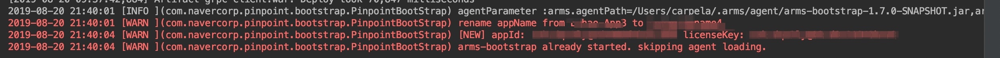

[回到顶部]

**部署在EDAS上的Java应用如何更改应用名称？**

目前不支持为部署在EDAS上的Java应用更改应用名称。

[回到顶部]

**如何卸载以通用方式安装的Agent？**

以通用方式安装Agent是指使用手动方式为Java应用安装Agent，具体操作，请参见为Java应用手动安装探针。卸载以通用方式安装的Agent的操作步骤如下所示：

1. 当您不需要使用ARMS监控您的Java应用时，删除上述安装文档中添加的**AppName**、**LicenseKey**相关的所有参数。

2. 重启Java应用。

[回到顶部]

**如何卸载Docker中Java应用的Agent？**

1. 当您不需要再监控Docker集群中的Java应用时，可以删除为Docker中的Java应用安装Agent文档中编辑的Dockerfile内容。

2. 运行**docker build**命令来构建镜像。

3. 运行**docker run**命令来启动镜像。

[回到顶部]

**使用OpenFeign组件的应用在ARMS中数据不完整怎么办？**

若您的OpenFeign应用接入ARMS应用监控后，出现数据不完整、看不到下游应用的数据等情况，可能的原因是OpenFeign组件默认开启了使用RxJava异步框架的Hystrix，而ARMS不支持异步框架。

> **说明**
>
> 本文仅限于ARMS应用监控Java Agent版本低于2.6.0的场景，2.6.0及以上版本已支持异步框架。

您可以通过关闭Hystrix并配置OkHttp请求类来解决此类问题：

1. 在pom.xml文件中添加以下依赖。

   ```xml
   <!-- OKHttp对Feign⽀持 -->
   <dependency>
       <groupId>io.github.openfeign</groupId>
       <artifactId>feign-okhttp</artifactId>
   </dependency>                
   ```

2. 在SpringCloud配置文件中添加以下配置。

   ```text
   feign.okhttp.enabled: true
   feign.hystrix.enabled: false                 
   ```

3. 配置OkHttp请求类。

   ```java
   @Configuration
   @ConditionalOnClass(Feign.class)
   @AutoConfigureBefore(FeignAutoConfiguration.class)
   public class FeignClientOkHttpConfiguration {

       @Bean
       public OkHttpClient okHttpClient() {
           return new OkHttpClient.Builder()
                   // 连接超时
                   .connectTimeout(20, TimeUnit.SECONDS)
                   // 响应超时
                   .readTimeout(20, TimeUnit.SECONDS)
                   // 写超时
                   .writeTimeout(20, TimeUnit.SECONDS)
                   // 是否⾃动重连
                   .retryOnConnectionFailure(true)
                   // 连接池
                   .connectionPool(new ConnectionPool())
                   .build();
       }                
   ```

[回到顶部]
