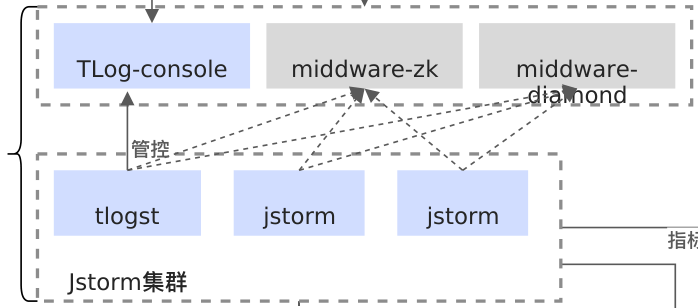
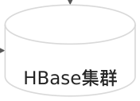
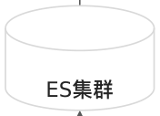
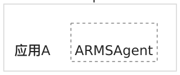
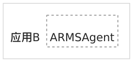
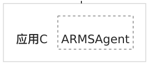
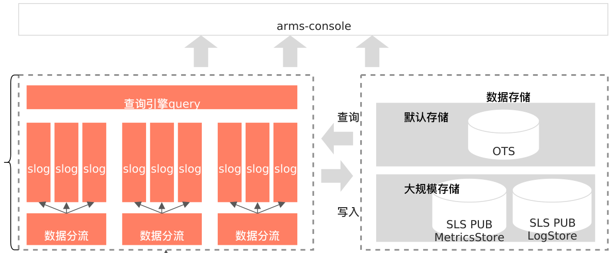
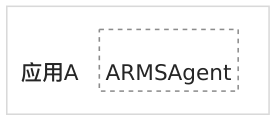
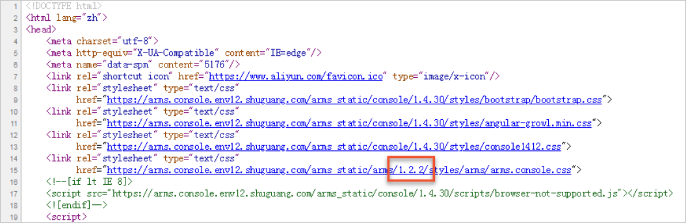
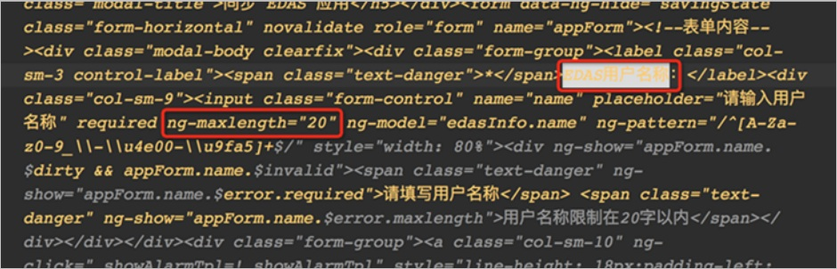

阿里云  
专有云  
应用实时监控服务 ARMS  
运维指南  
产品版本：V3.18.6  
文档版本：20251205

**目录**

- [1.运维概述](#section-1)
    - [1.1. 系统架构](#section-1-1)
    - [1.2. 部署架构](#section-1-2)
    - [1.3. 服务角色列表](#section-1-3)
- [2.高危操作](#section-2)
- [3.例行维护](#section-3)
    - [3.1. 登录Apsara Uni-manager运维控制台](#section-3-1)
    - [3.2. 登录飞天基础运维平台](#section-3-2)
    - [3.3. 组件巡检](#section-3-3)
    - [3.4. ESDB数据库运维](#section-3-4)
- [4.故障处理](#section-4)
- [5.告警处理](#section-5)
- [6.日志参考](#section-6)
- [7.常见问题](#section-7)
- [8.升级指南](#section-8)

<a id="section-1"></a>

# 1.运维概述

<a id="section-1-1"></a>

## 1.1. 系统架构

本文介绍了ARMS的系统架构。

在可观测领域，ARMS负责进行应用中指标（Metrics）和链路（Tracing）数据的监控。在当前版本中，ARMS支持两种不同的计算存储组件：

- Tlog：由 Jstom + HBase + ES 等三个核心组件组成，Jstorm负责计算，HBase存储指标数据，ES存储链路数据。

- TSDF + OTS-inner/SLS-Pub：由TSDF负责计算，在默认场景下指标和链路数据写入至OTS-inner，在大规模场景下数据可切换至SLS-Pub。

TSDF + OTS-inner/SLS-Pub架构也称为“监控统一存储组件”架构，下文为方便描述，如涉及此链路亦使用监控统一存储来描述。

基于Tlog的系统架构如下：


交互层

数据查询

管控



计算存储层





指标数据

链路数据

日志采集（StarAgent）


接入层

Collector集

群

云管控区

arms-dc 域名/vip

客户侧

数据上报







采集层

基于TSDF + OTS-inner/SLS-Pub的系统架构如下：



交互层

计算存储层


接入层

Gateway集

群

云管控区

arms-dc 域名/vip

客户侧

数据上报





采集层

ARMS应用监控产品在企业版中主要由控制台以及API服务组成，除此之外，核心计算和存储等服务依赖TLog或监控统一存储。更多信息，请参见部署架构章节。

<a id="section-1-2"></a>

## 1.2. 部署架构

本文介绍了ARMS部署架构中各组件的含义。

**ARMS + Tlog系统架构**

| 组件分组 | 组件名称 | 说明 |
| --- | --- | --- |
| ARMS | Arms-Console（控制台和API服务） | ARMS应用监控产品的控制台，主要负责应用列表展示、分布式调用链查询和诊断、应用性能实时汇总、分布式拓扑动态发现以及应用相关设置；API服务主要提供对外API服务。控制台服务和API服务部署在同一个容器中。 |
| TLog | Collector | 该组件隶属于TLog，应用程序通过集成ARMS Agent上报服务调用数据，Collector集群负责调用数据的收集。 |
| Tlog | JStorm | 该组件隶属于TLog，JStorm集群包含TLogst和JStorm两种类型组件，主要负责日志的采集、清洗、计算和存储写入。 |
| Tlog | HBase | 该组件隶属于TLog，主要负责ARMS应用监控统计数据的存储。 |
| Tlog | ESDB | 该组件隶属于TLog，主要负责ARMS应用监控明细数据的存储。 |
| Tlog | TLog-Console | 该组件隶属于TLog，主要负责采集点管控、采集规则分发等。 |

**ARMS + 监控统一存储架构**

| 组件分组 | 组件名称 | 说明 |
| --- | --- | --- |
| ARMS | Arms-Console（控制台和API服务） | ARMS应用监控产品的控制台，主要负责应用列表展示、分布式调用链查询和诊断、应用性能实时汇总、分布式拓扑动态发现以及应用相关设置；API服务主要提供对外API服务。控制台服务和API服务部署在同一个容器中。 |
| ARMS | Gateway | 该组件隶属于ARMS，应用程序通过集成ARMS Agent上报服务调用数据，Gateway集群负责调用数据的收集。 |
| CMS | Ibulk | 该组件隶属于CMS的TSDF组件，接收ARMS写入的指标和链路数据。 |
| CMS | Islot | 该组件隶属于CMS的TSDF组件，负责进行指标计算。 |
| CMS | Query Service | 该组件隶属于CMS的TSDF组件，负责进行指标查询。 |
| 底座 | OTS-inner | 该组件为底座组件，负责ARMS小规模场景下的指标和链路数据存储。 |
| SLS | SLS-Pub | SLS产品，负责ARMS大规模场景下的指标和链路数据存储。 |

<a id="section-1-3"></a>

## 1.3. 服务角色列表

本文介绍ARMS产品设计的服务角色列表。对于监控统一存储架构中的CMS和SLS侧组件，本文档不做展开说明。

**ARMS**

**项目**

**集群**

**服务**

**服务角色**

**描述**

ARMS产品初始化。

ARMS

arms2-apm

--

arms2-apm-init

ARMS应用监控控制台DB初始化。

arms2-basic-

--

arms2-init

standard

ARMS应用监控控制台。

arms2-basic-

--

arms2-console

standard

接收Agent端上报数据。仅适用于

arms2-

--

arms2-gateway

监控统一存储架构。

infrastructure-standard

暂存Agent端上报数据。仅适用于

arms2-

--

arms2-kafka

监控统一存储架构。

infrastructure-standard

将Agent端的上报数据写入至CMS

arms2-

--

arms2-streaming

侧的TSDF组件。仅适用于监控统

infrastructure-

一存储架构。

standard

**Tlog**

<table>
  <tr>
    <th>项目</th>
    <th>集群</th>
    <th>服务</th>
    <th>服务角色</th>
    <th>描述</th>
  </tr>
  <tr>
    <td rowspan="7">TLog</td>
    <td>BasicCluster</td>
    <td>arms-arms-collector</td>
    <td>arms-arms-collector.ArmsCol lectorProcess#</td>
    <td>用于应用监控上报的链路数据。</td>
  </tr>
  <tr>
    <td>BasicCluster</td>
    <td>tlog-tlogEsdb</td>
    <td>tlog-tlogEsdb.TlogEsd b#</td>
    <td>ESDB集群，用于存储应用监控详细数据。</td>
  </tr>
  <tr>
    <td>BasicCluster</td>
    <td>tlog-tlogHbase</td>
    <td>tlog-tlogHbase.TlogHb ase#</td>
    <td>HBase集群，用于存储应用监控统计数据。</td>
  </tr>
  <tr>
    <td>BasicCluster</td>
    <td>tlog-tlogService</td>
    <td>tlog-tlogService.Tlogs t#</td>
    <td>JStorm集群Nimbus所在节点。</td>
  </tr>
  <tr>
    <td>BasicCluster</td>
    <td>tlog-tlogService</td>
    <td>tlog-tlogService.Jstor m#</td>
    <td>JStorm集群Supervisor所在节点。</td>
  </tr>
  <tr>
    <td>BasicCluster</td>
    <td>tlog-tlogService</td>
    <td>tlog-tlogService.TlogI nit#</td>
    <td>TLog DB资源初始化。</td>
  </tr>
  <tr>
    <td>BasicCluster</td>
    <td>tlog-tlogService</td>
    <td>tlog-tlogService.TlogC onsole#</td>
    <td>TLog控制台。</td>
  </tr>
</table>

<a id="section-2"></a>

# 2.高危操作

在开展运维工作时，请务必谨慎执行高危操作。ARMS运维工作中的高危操作是删除资源。

**操作入口**

在ARMS管理后台的资源管理页面，可以看到ARMS所使用的所有资源。以Admin账号登录时，您可以在该页面删除资源。

**操作影响**

如果删除资源，则分配在该资源上的任务将无法自动或手动停止，即任务将会持续运行，不受影响。

**操作建议**

建议在任何情况下，都不要轻易执行删除资源的操作。

<a id="section-3"></a>

# 3.例行维护

<a id="section-3-1"></a>

## 3.1. 登录Apsara Uni-manager运维控制台

本节介绍运维工程师等相关用户如何登录到Apsara Uni-manager运维控制台。

**前提条件**

- 已从部署人员或管理员处获取Apsara Uni-manager运维控制台的访问地址、用户名和密码。

  Apsara Uni-manager运维控制台访问地址格式为*region-id*.aso.*intranet-domain-id*.com。

- 推荐使用Chrome浏览器。

**操作步骤**

1. 打开浏览器。

2. 在地址栏中，输入Apsara Uni-manager运维控制台的访问地址*region-id*.aso.*intranet-domain-id*.com，按回车键。

   > **说明**
   >
   > 您可以单击页面右上角的下拉按钮来进行语言切换。

3. 输入正确的用户名及密码。

   > **说明**
   >
   > 登录Apsara Uni-manager运维控制台的用户名和密码请从部署人员或管理员处获取。

   首次登录Apsara Uni-manager运维控制台时，需要修改登录用户名的密码，请按照提示完成密码修改。

   为提高安全性，密码必须满足以下要求：

   - 英文大小写字母。

   - 阿拉伯数字（0~9）。

   - 特殊符号，包括感叹号（！）、at（@）、井号（#）、美元符号（$）、百分号（%）等。

   - 密码长度10~20个字符。

4. 单击**登录**，进入Apsara Uni-manager运维控制台。

<a id="section-3-2"></a>

## 3.2. 登录飞天基础运维平台

本节介绍运维工程师等相关用户如何登录到飞天基础运维平台。

**前提条件**

- 已从部署人员或管理员处获取Apsara Uni-manager运维控制台的访问地址、用户名和密码。

  Apsara Uni-manager运维控制台访问地址格式为*region-id*.aso.*intranet-domain-id*.com。

- 推荐使用Chrome浏览器。

**操作步骤**

1. 打开浏览器。

2. 在地址栏中，输入Apsara Uni-manager运维控制台的访问地址*region-id*.aso.*intranet-domain-id*.com，按回车键。

3. 输入正确的用户名及密码。

   > **说明**
   >
   > - 登录Apsara Uni-manager运维控制台的用户名和密码请从部署人员或管理员处获取。
   >
   > - 您可以单击页面右上角的下拉按钮来进行语言切换。

   首次登录Apsara Uni-manager运维控制台时，需要修改登录用户名的密码，请按照提示完成密码修改。

   为提高安全性，密码必须满足以下要求：

   - 英文大小写字母。

   - 阿拉伯数字（0~9）。

   - 特殊符号，包括感叹号（！）、at（@）、井号（#）、美元符号（$）、百分号（%）等。

   - 密码长度10~20个字符。

4. 单击**登录**。

5. 在Apsara Uni-manager运维控制台顶部菜单栏单击**平台运维**。

6. 在下拉列表的**飞天基础运维平台**区域选择需要进行配置的入口。

<a id="section-3-3"></a>

## 3.3. 组件巡检

本文介绍了常用系统巡检方法。

**Diamond巡检**

1. 登录飞天基础运维平台。

2. 在左侧导航栏选择**运维 > 集群运维**，在**集群列表**页面的**Project**搜索框中输入并选中 

   `middleWareAll`，然

   后在搜索结果中的**操作**列单击**运维**。

3. 在**服务管理**页签的**服务**搜索框中输入 

   `middleWare-jmenv`。

   检查**middleWare-jmenv**服务对应机器的状态是否正常。

**HBase巡检**

1. 登录飞天基础运维平台。

2. 在左侧导航栏选择**运维 > 服务运维**，在**服务列表**页面的**服务**搜索框中输入 

   `tlog-tlogHbase`，然后在搜索结

   果中的**操作**列单击**运维**。

3. 在**服务详情**页面，单击**所在集群**页签，然后在右侧**操作**列单击**运维**。

4. 在**集群详情**页面的**服务管理**页签，单击服务角色**tlog-tlogHbase.TlogHbase#**。

5. 在**服务管理**页签下方的机器列表中，选中任一机器并单击**操作**列的**Terminal**，在**TerminalService**页面单击左侧的机器名称，登录到任意一台HBase机器，执行如下命令，进入Shell模式。

   ```bash
   sudo docker ps
   sudo docker exec -it <HBase容器ID> bash
   su hadoop
   cd ~/hbase-current/bin
   ./hbase shell
   ```

6. 执行 `list` 命令，查看是否存在tlog-biz表。

7. 执行 `describe 'tlog-biz'` 命令，查看tlog-biz是否正常加载coprocessor。

8. 执行 `scan 'tlog-biz',{LIMIT=>10}` 命令，判断读取数据是否有异常。

**TLog巡检**

1. 登录Apsara Uni-manager运维控制台。

2. 在顶部菜单栏选择**产品运维 > 中间件运维 > 中间件日志服务·Tlog**，然后在页面选择。

   如果能打开页面，则表示正常。

**JStorm巡检**

1. 登录飞天基础运维平台。

2. 在左侧导航栏选择**运维 > 服务运维**，在**服务列表**页面的**服务**搜索框中输入 

   `tlog-tlogService`，然后在搜索

   结果中的**操作**列单击**运维**。

3. 在**服务详情**页面，单击**所在集群**页签，然后在右侧**操作**列单击**运维**。

4. 在**集群详情**页面的**服务管理**页签，单击服务角色**tlog-tlogService.Tlogst#**。

5. 在**服务管理**页签下方的机器列表中，选中任一机器并单击**操作**列的**Terminal**，在**TerminalService**页面单击左侧的机器名称，登录到任意一台TLogst机器，执行如下命令进入容器。

   ```bash
   sudo docker ps
   sudo docker exec -it <TLogst容器ID> bash
   ```

6. 执行 `su admin` 命令，切换为admin用户。

7. 执行 `jstorm list` 命令，查看Topology和相关节点是否运行正常。

**ARMS Console巡检**

登录用户侧环境，如果能打开ARMS控制台，则表示正常。

<a id="section-3-4"></a>

## 3.4. ESDB数据库运维

本文介绍了ESDB数据库的特点及其常见运维操作。

ESDB是基于开源Elasticsearch开发的高性能低成本分布式文档数据库，支持高效实时的全文检索、多维查询、地理信息查询和聚合分析等，为应用搜索、运维诊断分析、LBS等领域提供一体化的存储、搜索和分析能力，并致力于在未来3年成为智能分析的基础设施，为拓展机器学习能力提供高效的预测和诊断能力。

**ESDB的架构和引擎特征**

ESDB是share-nothing的分布式架构。

ESDB的服务节点分为Master节点和Data节点，业务通过Client读写：

- Master保障集群可用性，部署在3个机房的3个节点，通过Bully算法选主。

- Data保存数据及其副本，索引的mapping、分片数量、路由键、节点数量根据业务的数据规模和查询需求确定。数据分布将实时根据节点的数据量等资源消耗情况进行负载均衡。Data保障跨机房容灾。Data副本之间是强同步，当分片异常时将自动切换或者恢复，可以通过提高副本数扩展读能力。

- Client的写请求将路由到指定的分片，而读请求可能随机分配到任何一个节点，再转发到指定的主备分片上。

  纯 Master 节点

  纯 Data 节

  0

  1

  0

  1

  点

  Client 节点（无 Data 或Master）

  请求

  区域A

  区域B

  区域C

ESDB的任何写入都需要通过指定分区键来定位分片，可新增、更新、删除一条记录/文档。doc_id为某一个分片下记录/文档的唯一标识。当更新一条已存在的doc_id时，不需要获得历史完整的记录/文档，而是可以针对指定的Field进行部分更新。当出现未定义Mapping的Field时，ESDB会根据默认Mapping规则索引这个Field。Mapping规则允许动态修改，但是历史数据的索引不会重建。

ESDB主备副本目前是对记录/文档的复制，是强同步的，通过WAL写Translog避免数据丢失。由于主备回放请求和Refresh的时机不同，ESDB通过Version来保障最终一致。

ESDB为了提升写入能力，提供了二级散列，在时序场景或者日志场景能够均衡负载。ESDB可以支持一种动态二级散列，支持不均衡的热点场景。ESDB通过二级散列提升热点的写入能力，可实时推送散列规则将热点实时均衡。当热点分区散列到更多节点后，查询也需要分散到更多节点，可通过平滑的散列策略将查询的损失降低到最小。

ESDB的写入性能和成本与业务提交批量的大小、索引域的大小、类型、个数、值稀疏程度都有直接关系。业务不一定便于实现对单个分片的高效合并，因此，ESDB实现了服务器端的批量合并。另外，ESDB针对结构化字段提供了高低频查询，降低了低频字段索引开销。

ESDB的查询（包括聚合分析）可粗略分为：

- 指定分区键：只在该分片上查询，携带doc_id的查询性能成本很低。

- 不指定分区键：所有分片都将被查询，ESDB将汇总排序后返回，这类查询的吞吐较低，目前可支持任意维度、QPS较低的查询和聚合。

ESDB支持NRT搜索。ESDB在不大于Refresh的时间周期内批量构建生成新索引，由此新数据可被查询。Refresh的周期越短，实时性越好。但是，为了保障写入性能，索引是“仅追加”（Append Only）的，而Refresh的周期越短可能导致生成越多细碎的新索引，进而影响读性能。结合读写性能的Tradeoff，默认Refresh的时间周期配置为1秒。为了保障读性能，需要配合索引的Merge策略，尽可能将索引Merge成少量的大索引。若业务需要写入后立刻可见，可以通过Client指定强制Refresh，但是不建议经常使用这种方式，因为读写性能都可能受损。

ESDB不保障事务性。

ESDB提供了丰富的全文检索能力，可参考Elasticsearch官方文档。ESDB在等值查询的实时性上有了一定的积累，其中联合索引可以有效地帮助业务在复杂查询中以较小代价获得明显的性能提升。

ESDB的聚合函数可支持一些较为复杂的分析，这些函数主要聚焦于时序、运维、诊断、地理信息的场景，可参考Elasticsearch官方文档。聚合的执行速度很快，并且就像搜索一样近乎实时，在单个请求里同时对相同的数据进行搜索、过滤和分析，不需要像Hardoop那样预定义，就可以分析实时数据。

**ESDB常见运维操作**

- 黑屏操作

  - Elasticsearch集群

    - 查看集群健康状态

      ```bash
      curl IP:PORT/_cluster/health?pretty
      ```

    - 查看系统统计信息

      ```bash
      curl IP:PORT/_cluster/stats?pretty
      ```

    - 查看集群堆积任务

      ```bash
      curl IP:PORT/_cluster/pending_tasks?pretty
      ```

    - 查看集群配置

      ```bash
      curl IP:PORT/_cluster/settings?pretty
      ```

    - 集群慢日志配置

      ```text
      index.search.slowlog.level: TRACE
      index.search.slowlog.threshold.query.warn: 10s
      index.search.slowlog.threshold.query.info: 5s
      index.search.slowlog.threshold.query.debug: 2s
      index.search.slowlog.threshold.query.trace: 500ms
      index.search.slowlog.threshold.fetch.warn: 1s
      index.search.slowlog.threshold.fetch.info: 800ms
      index.search.slowlog.threshold.fetch.debug:500ms
      index.search.slowlog.threshold.fetch.trace: 200ms
      ```

    - 集群节点热线程

      ```bash
      curl IP:PORT/nodes/local/hotthreads
      ```

    - 调整集群日志级别

      ```bash
      curl -XPUT IP:PORT/cluster/settings -d'{"transient":{"logger.root":"DEBUG"}}'
      curl -XPUT IP:PORT/cluster/settings -d'{"transient":{"logger.root":"INFO"}}'
      ```

    - 节点下线

      直接关闭节点下线，可通过自动容灾恢复副本，也可以配置分配黑名单，ESDB会自动把该IP的所有分片自动转移到其他节点上。等转移完成后，这个空节点就可以毫无影响地下线了。

      ```bash
      curl -XPUT IP:PORT/_cluster/settings -d '{
       "transient" :{
       "cluster.routing.allocation.exclude._ip" : "IP"
       }
      }'
      ```

  - 索引

    - 查看集群分片状态

      ```bash
      curl IP:PORT/_cat/Shards?v
      ```

    - 查看索引配置

      ```bash
      curl IP:PORT/INDEX/_settings?pretty
      ```

    - 查看索引Mapping

      ```bash
      curl IP:PORT/INDEX_NAME/TYPE_NAME/_Mapping?pretty
      ```

    - 推送Refresh时间周期

      ```bash
      curl -XPUT IP:PORT/INDEX_NAME/_settings -d 
      '{"index" : {"Refresh_interval" : "10s"}}'
      ```

  - 迁移热点Shard步骤

    <ol type="a">

    <li>

    关闭Allocate

    ```bash
    curl -XPUT IP:PORT/_cluster/settings -d 
    '{"persistent": {"cluster.routing.allocation.enable": "none"}}'
    ```

    </li>

    <li>

    Allocate限速

    ```bash
    curl -XPUT IP:PORT/_cluster/settings -d 
    '{"persistent":{"cluster.routing.allocation.node_concurrent_recoveries":8}}'
    curl -XPUT IP:PORT/_cluster/settings -d 
    '{"persistent":{"cluster.routing.allocation.cluster_concurrent_rebalance":8}}'
    curl -XPUT IP:PORT/_cluster/settings -d 
     '{"persistent":{"indices.recovery.max_bytes_per_sec":"600mb"}}'
    ```

    </li>

    </ol>

    <ol type="i" start="100">

    <li>

    迁移Shard

    ```bash
    curl -XPUT IP:PORT/_cluster/reroute?pretty -d 
    '{"commands":[{"move":
    {"index":"INDEX","Shard":SHARD_NUM,"from_node":"SOURCE_IP","to_node":"DES_IP"}}]}'
    ```

    </li>

    <li value="500">

    打开Allocate

    ```bash
    curl IP:PORT/_cluster/settings -d
     '{"persistent": {"cluster.routing.allocation.enable": "all"}}'
    ```

    </li>

    </ol>

- 白屏操作

  安装Kibana。

<a id="section-4"></a>

# 4.故障处理

本文介绍了常见故障的排除方法。

表 1. 常见故障排除方法

| 故障 | 症状 | 分析 | 解决方法 |
| --- | --- | --- | --- |
| Docker容器无响应 | 在Docker总控机上运行命令<code> docker ps </code>，查看所有Docker的运行信息，发现某个Docker容器无响应。 | - | 1. 运行命令<code> Docker </code> <code>inspect</code> <code>{DockerIP} </code>查看。<br>2. 运行命令<code> docker </code> <code>restart</code> <code>{DockerID} </code>尝试重启。 |
| 日志含有Unknow Host报错信息 | Arms-Console容器中的/home/admin/logs/ar ms-console.log日志或Jstorm的/home/admin/logs/\* worker\*.log日志中出现Unknow Host错误。 | 无法访问域名 | 请在容器的/etc/hosts中配置对应IP与域名Host的映射。 |
| ZooKeeper容器磁盘负载过高 | 当流量过大时，ZooKeeper容器所在物理机的磁盘使用负载过高。 | - | 请将挂载在SATA盘上的ZooKeeper容器挂载到SSD盘。 |

<table>
  <tr>
    <td>ZooKeeper的No router to host问题</td>
    <td>ZooKeeper容器中的zookeeper.log出现no router to host报错信息。</td>
    <td>此问题通常出现于HBase容器中的ZooKeeper集群，一般是因变更生成的脏数据导致的。</td>
    <td>从ZooKeeper中删除并重启HMaster服务。<br>1. 进入HBase容器的zkcli，并执行以下命令：<br><code>ls</code><br><code>/hbase/root-</code><br><code>region-sever</code><br><code>get</code><br><code>/hbasedocker-</code><br><code>em14-</code><br><code>hbsmonitor/root</code><br><code>-region-server</code><br><code>delete</code><br><code>/hbase/root-</code><br><code>region-server</code><br><code>quit</code><br><code>hbase-</code><br><code>daemon.sh</code><br><code>start master</code><br>2. 执行<code> jps </code>命令，检查HMaster进程是否成功启动。</td>
  </tr>
  <tr>
    <td>基本模块问题</td>
    <td>无法打开ARMS控制台。</td>
    <td>-</td>
    <td>请重启Arms-Console容器。</td>
  </tr>
  <tr>
    <td>基本模块问题</td>
    <td>ARMS控制台所有时序数据跌为零。</td>
    <td>可初步定位为HBase读取问题。</td>
    <td>参考组件巡检。</td>
  </tr>
  <tr>
    <td>基本模块问题</td>
    <td>ARMS数据拉取延时</td>
    <td>请进入TLog控制台，打开arms_cloud分组 &gt; arms_cloud1~x采集点的采集点明细 &gt; 采集器状态，并查看具体状态。<br>• 若状态为正常，则排除采集流程问题。<br>• 若确定有数据持续流入该文件，但采集点状态不正常，或与上一次拉取数据时间相隔大于15分钟，则可初步定位为JStorm问题。</td>
    <td>若为JStorm问题，请参考组件巡检。</td>
  </tr>
</table>

<a id="section-5"></a>

# 5.告警处理

本文介绍了常见告警的处理方法。

**磁盘使用率超标**

1. 执行以下命令，查看磁盘使用情况。

   ```text
   df –h
   ```

2. 执行以下命令，查看并清除磁盘占用最多的目录及对应文件。

   示例：占用磁盘最大的文件为catalina.out。

   ```bash
   cd /home/admin
   du --max-depth=1 –h
   cat /dev/null > ./catalina.out
   ```

**内存使用率超标**

1. 执行 `top` 命令，查看内存占用最多的进程。

2. 执行以下命令，查看进程对应的业务。

   ```text
   ps aux|grep {进程PID}
   ```

   如果内存使用率始终较高，请联系阿里巴巴技术支持工程师，以确认是否需要扩容。

**CPU使用率超标**

处理方法请参考内存使用率超标。

**HTTP巡检失败**

查看巡检失败的组件，到对应机器上定位具体错误原因，执行启动或重启操作来恢复对应功能。

在ARMS中，以下两个组件会对外暴露HTTP服务：

- ARMS控制台对应的arms-console-process容器

- TLog控制台对应的tlog-console容器

这两个容器均通过Tomcat和Tengine提供HTTP服务。

Tengine在80端口启动，Tomcat在8080端口启动。HTTP请求是通过Tengine从80端口向8080端口转发流量完成的。

借助命令 `curl -v 127.0.0.1:8080` 和 `curl -v 127.0.0.1:80` ，可以判断问题出在Tomcat还是Tengine。

要重启Tengine，请执行以下命令：

```text
/opt/taobao/tengine/bin/nginxctl restart #使⽤root⽤户执⾏
```

要重启Tomcat，请执行以下命令：

```text
su admin #切换为admin⽤户执⾏以下命令ps aux | grep arms-console # 在arms-console-process容
器中执⾏该命令ps aux | grep tlog-console # 在tlog-console容器中执⾏该命令kill -9 <pid> # Kill查询到的进程，<pid> 是通过以上命令查到的进程号
 $CATALINA_HOME/bin/startup.sh # 执⾏Tomcat启动脚本
```

<a id="section-6"></a>

# 6.日志参考

本文列出了ARMS各组件下常用日志的路径和说明。

**arms-console**

| 日志路径 | 说明 |
| --- | --- |
| /home/admin/logs/arms/arms-console.log | arms-console业务日志。 |
| /home/admin/taobao-tomcat-production-7.0.85/logs/catalina.out | Tomcat Catalina日志。 |
| /home/admin/taobao-tomcat-production-7.0.85/logs/localhost.log | Tomcat Localhost日志。 |

**arms-pop**

| 日志路径 | 说明 |
| --- | --- |
| /home/admin/logs/arms/arms-pop.log | arms-pop业务日志。 |
| /home/admin/arms-pop/taobao-tomcat-production/logs/catalina.out | Tomcat Catalina日志。 |
| /home/admin/arms-pop/taobao-tomcat-production/logs/localhost.log | Tomcat Localhost日志。 |

**arms-collector**

| 日志路径 | 说明 |
| --- | --- |
| /home/admin/logs/arms/arms-collector.log | arms-collector服务日志。 |
| /home/admin/logs/arms/tracelogs | 用户应用监控上报的业务日志（请勿删除）。 |
| /home/admin/taobao-tomcat-production-7.0.85/logs/catalina.out | Tomcat Catalina日志。 |
| /home/admin/taobao-tomcat-production-7.0.85/logs/localhost.log | Tomcat Localhost日志。 |

**tlogconsole**

| 日志路径 | 说明 |
| --- | --- |
| /home/admin/tlogconsole/logs/tlog-console.log | tlogconsole业务日志。 |
| /home/admin/taobao-tomcat-production-7.0.85/logs/catalina.out | Tomcat Catalina日志。 |
| /home/admin/taobao-tomcat-production-7.0.85/logs/localhost.log | Tomcat Localhost日志。 |

**middware-zookeeper**

| 日志路径 | 说明 |
| --- | --- |
| /opt/taobao/zookeeper/zookeeper.out | ZooKeeper业务日志。 |

**JStorm集群（组件tlogst、JStorm的Nimbus）**

| 日志路径 | 说明 |
| --- | --- |
| /home/admin/logs/nimbus.log | JStorm Nimbus业务日志。 |
| /home/admin/logs/supervisor.log | JStorm Supervisor日志。 |
| /home/admin/logs/check.log | 检查Nimbus与Supervisor状态的日志。 |
| /home/admin/logs/xxxx-worker-端口.log | 采集点Worker日志。 |

**JStorm集群（组件JStorm、JStorm的Supervisor）**

| 日志路径 | 说明 |
| --- | --- |
| /home/admin/logs/supervisor.log | JStorm Supervisor日志。 |
| /home/admin/logs/check.log | 检查Supervisor状态的日志。 |
| /home/admin/logs/xxxx-worker-端口.log | 采集点Worker日志。 |

**HBase**

| 日志路径 | 说明 |
| --- | --- |
| /home/hadoop/cluster-data/logs/hbase_health.log | HBase健康检查日志。 |
| /home/hadoop/cluster-data/hbase/logs/hbase-hadoop-master-xxx.log | Master日志。 |
| /home/hadoop/cluster-data/logs/hadoop-xxx-namenode-xxx.log | Namenode日志。 |
| /home/hadoop/cluster-data/hbase/logs/hbase-xxx-regionserver-xxx.log | Region Server日志。 |
| /home/hadoop/cluster-data/hbase/logs/hbase-xxx-zookeeper-xxx.log | HBase ZooKeeper日志。 |

<a id="section-7"></a>

# 7.常见问题

本文列出了关于ARMS运维的常见问题。

**如何查询ARMS管理员账号和密码？**

在某些场景下需要使用ARMS内置的一个管理员账号。例如，任务数据流转实际上是由ARMS管理员的监控任务产生的数据。

管理员账号和密码请从部署人员或管理员处获取。

您还可以按照以下步骤查询管理员账号和密码：

1. 登录飞天基础运维平台。

2. 在左侧导航栏选择**资源管理 > 产品集群运维**，在**产品集群运维**的**产品 | 集群**搜索框输入 `arms` ，然后在搜索结果的**操作**列单击**集群详情**。

3. 在**集群详情**页面，单击**资源详情**页签，然后在**资源详情**页签的**资源**列表中选择accesskey。

4. 在搜索结果的**资源申请结果**列单击图标，然后点击出现的内容，在弹出的**资源申请结果**对话框查看ARMS管理员账号和密码。

**如何查看Nimbus状态？**

1. 在Nimbus机器上运行命令 `jps` ，查看是否有NimbusServer、Supervisor、Worker进程。

2. 运行命令 `jstorm list` ，查看Nimbus详细信息。

3. 运行命令 `jstorm list | grep "host" | wc -l` ，查看有多少个Topology处于Active状态。

   若Host数量与JStorm集群数量不符，则可初步判定为JStorm节点容器故障。

4. 运行命令 `jstorm list | grep {topo name}` 。

   若没有查到对应TLog中采集点的名字，说明JStorm的Topology任务已停止运行。

**如何查看/home/admin/logs下日志中的报错信息？**

1. 运行以下命令，确定是哪个Worker。

   ```bash
   cat -worker-.log* | grep Exception
   ```

2. 运行以下命令，查看Nimbus上的日志。

   ```text
   grep 'kill' -A 20 /home/admin/logs/nimbus.log
   # 也请尝试其他关键字。
   ```

3. 运行以下命令，查看各个服务器的supervisor.log日志（Nimbus机器上也有一份）。

   ```text
   grep 'dead' -A 20 /home/admin/logs/supervisor.log
   ```

若报HBase flush failed或HBase写入队列满等错误，则可初步判定为HBase模块故障。

**登录时遇到无效的回调URL错误怎么办？**

如果登录时遇到**无效的回调URL**错误，请按照以下步骤解决。

1. 检查浏览器地址栏中的back_URL是否正确。上图展示的是典型的back_URL设置不正确的情况，应改为ARMS的域名。

   > **重要**
   >
   > 禁止通过IP访问ARMS。

2. 如果是通过域名访问ARMS，仍出现上述错误，请检查Dauth的一级域名与back_URL中ARMS的一级域名是否一致。

   - 示例：两者一致的情况

     ```text
     dauth.sgcloud.com
     arms.console.sgcloud.com
     ```

   - 示例：两者不一致的情况

     ```text
     dauth.sgcloud.com
     arms.console.aliyun.com
     ```

**可以用Root账号启动arms-console吗？**

禁止使用Root账号启动arms-console，否则会导致ARMS不可用，此时localhost.log中会出现以下错误：

```text
Caused by: java.lang.RuntimeException: java.io.FileNotFoundException: 
/root/logs/mcms/i18n/i18nResourcesFile (No such file or directory)
        at 
com.alibaba.mcms.client.utils.McmsFileUtil.readI18nResourcesFile(McmsFileUtil.java:112)
        at 
com.alibaba.mcms.client.service.impl.McmsClientServiceImpl.initData(McmsClientServiceImpl
ava:471)
        at 
com.alibaba.mcms.client.service.impl.McmsClientServiceImpl.initApp(McmsClientServiceImpl.
va:401)
        at 
com.alibaba.mcms.client.service.impl.McmsClientServiceImpl.init(McmsClientServiceImpl.jav
348)
        at sun.reflect.NativeMethodAccessorImpl.invoke0(Native Method)
        at 
sun.reflect.NativeMethodAccessorImpl.invoke(NativeMethodAccessorImpl.java:57)
        at 
sun.reflect.DelegatingMethodAccessorImpl.invoke(DelegatingMethodAccessorImpl.java:43)
        at java.lang.reflect.Method.invoke(Method.java:606)
        at 
org.springframework.beans.factory.support.AbstractAutowireCapableBeanFactory.invokeCustom
itMethod(AbstractAutowireCapableBeanFactory.java:1694)
        at 
org.springframework.beans.factory.support.AbstractAutowireCapableBeanFactory.invokeInitMe
ods(AbstractAutowireCapableBeanFactory.java:1633)
        at 
org.springframework.beans.factory.support.AbstractAutowireCapableBeanFactory.initializeBe
(AbstractAutowireCapableBeanFactory.java:1562)
        ... 27 more
        Caused by: java.io.FileNotFoundException: 
/root/logs/mcms/i18n/i18nResourcesFile (No such file or directory)
        at java.io.FileInputStream.open(Native Method)
        at java.io.FileInputStream.<init>(FileInputStream.java:146)
        at 
com.alibaba.mcms.client.utils.McmsFileUtil.readI18nResourcesFile(McmsFileUtil.java:87)
        ... 37 more
```

**启动进程时遇到Failed to access resource /WEB-INF/lib/\*\*\*.jar错误怎么办？**

手动升级arms-console、arms-pop时，删除 /WEB-INF/lib并解压新的包之后，/WEB-INF/lib中会出现大量问号文件（???），若此时启动进程就会出现如题所述的错误。

解决方法是找出 /WEB-INF/lib目录下所有的问号相关文件，并替换为空JAR包，然后重新启动进程。

```text
touch /home/admin/empty
cp /home/admin/empty xxxxx.jar
```

**应用监控页面不显示内容怎么办？**

请务必使用42或更高版本的Chrome浏览器。目前已知42以下版本的Chrome浏览器时存在问题。

**应用监控中的应用没有监控数据怎么办？**

应用监控中的应用没有监控数据时，请按照以下步骤排查：

1. 确认应用监控任务的状态是否正常。

   应用监控在每个区域都对应一个唯一的系统任务，您可以前往监控列表查看该系统任务的状态是否正常。若任务状态为运行中则表示正常。

2. 确认是否为EDAS应用。

   对于EDAS应用，如果是ARMS自动同步过来的（即用户在EDAS控制台中为该应用开启了应用监控），那么Arms-Agent会自动挂载到应用上。但如果是通过EDAS数据库进行同步的，那么默认情况下不会挂载Arms-Agent，因而导致没有监控数据。解决方法是手动挂载Arms-Agent并重启应用。

3. 查看目标应用进程，检查启动参数中是否有以下必需参数：

   ```text
   -javaagent:/{user.workspace}/ArmsAgent/arms-bootstrap-1.7.0-SNAPSHOT.jar -Darms.licenseKey=xxxxx -Darms.appId=xxxxx
   ```

4. 检查应用启动的Arms-Agent日志。

   ArmsAgent/log目录下的pid.log（例如aokcdqn3ly@46e26bf5be00697.log）含有相关的异常信息，请仔细阅读获取线索。

**自定义监控任务没有监控数据流转怎么办？**

如果自定义监控任务无数据流转，可能的原因包括：

- 任务状态确认不正常。

- 系统任务有问题。

- TLog采集状态有问题。

请按照以下步骤排查：

1. 检查用户任务运行状态。

   <ol type="i">

   <li>

   如果用户任务不处于运行状态，则没有数据流入，因而也没有数据流转。

   </li>

   <li>

   确认数据源是否能产生实时数据，如果不能，则只能在自定义监控任务的数据集中查到数据，但是没有数据流转。

   </li>

   </ol>

2. 检查系统任务状态。

   以管理员身份登录ARMS，检查系统任务“arms_monitor”的状态。如果任务处于**新建**、**停止**或**暂停**状态，请在**操作**列中单击**启动**。

3. 检查系统任务对应TLog的采集器状态。

   检查系统任务对应TLog的采集器状态。进入arms_cloud分组下的arms_cloud01采集点，检查/home/admin/logs/eagleeye/stat-arms_stage.log的状态是否为**正常**。

4. 确认TLog宿主机的Star Agent是否正常。

   <ol type="i">

   <li>

   进入TLog的TLogst和JStorm容器所在的宿主机，并运行以下命令来查看进程。

   ```bash
   sudo lsof -i:8182
   ```

   </li>

   <li>

   运行以下命令，终止查看到的全部进程。

   ```bash
   sudo kill -9 <进程号> 
   ```

   </li>

   <li>

   等待大约10秒后，再次运行以下命令，查看进程是否存在。如果不存在则继续执行后续操作。

   ```bash
   sudo lsof -i:8182
   ```

   </li>

   <li>

   运行以下命令，进入HBase容器。

   ```bash
   docker ps | grep hbase
   ```

   </li>

   <li>

   运行以下命令，停止Star Agent。

   ```text
   /usr/alisys/dragoon/bin/agent.sh stop
   ```

   </li>

   <li>

   分别执行以下命令进入TLogst和JStorm容器。

   ```bash
   sudo docker ps | grep jstorm
   sudo docker ps | grep tlogst
   ```

   </li>

   <li>

   在TLogst和JStorm容器中分别运行以下命令来重启Star Agent。

   ```text
   /usr/alisys/dragoon/bin/agent.sh restart
   ```

   </li>

   </ol>

   稍等几分钟返回ARMS控制台查看数据流转是否恢复正常。

**同步EDAS应用时遇到EDAS用户名称长度限制的错误怎么办？**

在曙光V3.6.1以前的版本中同步EDAS应用时，可能会遇到用户名称限制在20字以内的错误。

请按照以下步骤手动修改前端JS文件来解决。

1. 在Chrome浏览器中打开ARMS控制台首页，在空白处单击右键并选择**查看网页源代码**，然后找出ARMS的前端版本号。例如，在下图中，前端版本号为1.2.2。

   

2. 执行以下命令，打开对应版本的前端JS文件。

   > **说明**
   >
   > 将 `<version>` 替换为上一步找到的前端版本号（本例中为1.2.2）。

   ```bash
   cd /home/admin/arms_static/arms/<version>
   vi armsConsole.js
   ```

3. 在文件中搜索“EDAS用户名称”，将表示长度限制的 `ng-maxlength="20"` 删除，并保存文件即可。

   

**如何修改应用监控调用链数据的存储时间？**

调用链的默认存储时间为7天。如需更改，请在arms-console容器中找到biz.properties文件，并修改 `trace.store.time` 配置，然后重启进程即可。

**如何解除交互大盘中对应用监控图表的限制？**

在专有云环境下，部分版本的交互式大盘不允许添加应用监控图表。

请按照以下步骤手动修改前端JS文件来解决。

1. 在Chrome浏览器中打开ARMS控制台首页，在空白处单击右键并选择**查看网页源代码**，然后找出ARMS的前端版本号。例如，在下图中，前端版本号为1.2.2。

   

2. 执行以下命令，打开对应版本的前端JS文件。

   > **说明**
   >
   > 将 `<version>` 替换为上一步找到的前端版本号（本例中为1.2.2）。

   ```bash
   cd /home/admin/arms_static/arms/<version>
   vi armsConsole.js
   ```

3. 在文件中搜索“edb.addChart('appstat')”，删除以下限制并保存文件即可。

   ```text
   ng-class=\"{disabled:!isCommercial||!isCommercial.traceStatus}\"
   ```

**如何修改报警静默期时间？**

报警静默期的默认值为24小时（  `noc.period.timestamps = 86400000` ，单位为毫秒）。如需更改，请在arms-console容器中找到biz.properties文件，并修改 `noc.period.timestamps` 配置，然后重启进程即可。

**如何查询ARMS的commitId？**

出现问题时通常需要确认基线版本，您可以按照以下步骤查询ARMS的commitId。

1. 登录飞天基础运维平台。

2. 在左侧导航栏选择**资源管理 > 产品集群运维**，在**产品集群运维**的**产品 | 集群**搜索框输入 `arms` ，然后在搜索结果的**操作**列单击**集群详情**。

3. 在**集群详情**页面，单击**集群配置**页签。

4. 在**集群配置**页签，单击左侧文件列表中的tag.conf文件，文件中 `__zhuque_tags_productCommitId` 参数的值即为要查找的commitId。

<a id="section-8"></a>

# 8.升级指南

本文列出了进行系统升级前需要了解的注意事项。

一般情况下，产品会随平台进行统一升级，您无需执行额外操作。

如有特殊需求，也可以执行手动升级。但是鉴于手动升级之后会影响下一次自动升级的顺利进行，给业务延续性带来潜在的风险，所以强烈建议您在任何情况下都不要轻易通过手动方式升级。如果确有需求，您可以联系阿里云驻场工作人员索取手动升级的操作指南。
