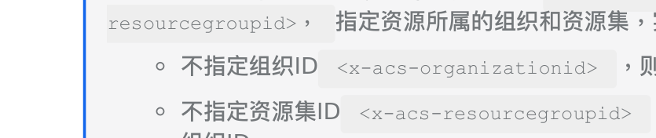
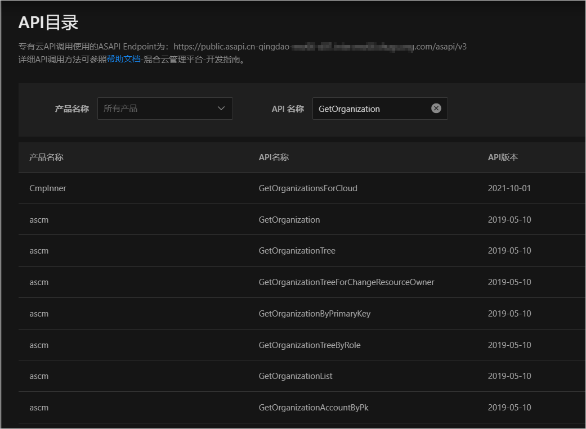
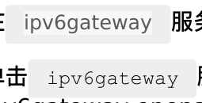

阿里云  
专有云  
IPv6网关  
开发指南  
产品版本：v3.18.2  
文档版本：20240521

**目录**

- [1.快速入门](#section-1)
    - [1.1. 开发文档使用说明](#section-1-1)
    - [1.2. API调用流程说明](#section-1-2)
- [2.准备工作](#section-2)
    - [2.1. 登录API与工具控制台](#section-2-1)
    - [2.2. 查看API信息](#section-2-2)
    - [2.3. 获取AccessKey](#section-2-3)
    - [2.4. 获取公共Header参数](#section-2-4)
    - [2.5. 获取STS AccessKey](#section-2-5)
- [3.通过POP网关调用专有云API](#section-3)
    - [3.1. 调用前置](#section-3-1)
    - [3.2. Java版](#section-3-2)
    - [3.3. Go版](#section-3-3)
    - [3.4. Python版](#section-3-4)
- [4.API参考](#section-4)
    - [4.1. API概览](#section-4-1)
    - [4.2. 调用API](#section-4-2)
        - [4.2.1. 请求结构](#section-4-2-1)
        - [4.2.2. API授权](#section-4-2-2)
        - [4.2.3. API签名](#section-4-2-3)
    - [4.3. RAM鉴权](#section-4-3)
    - [4.4. 公共参数](#section-4-4)
    - [4.5. IPv6网关](#section-4-5)
        - [4.5.1. CreateIpv6Gateway](#section-4-5-1)
        - [4.5.2. DescribeIpv6Gateways](#section-4-5-2)
        - [4.5.3. DescribeIpv6GatewayAttribute](#section-4-5-3)
        - [4.5.4. ModifyIpv6GatewayAttribute](#section-4-5-4)
        - [4.5.5. ModifyIpv6GatewaySpec](#section-4-5-5)
        - [4.5.6. DeleteIpv6Gateway](#section-4-5-6)
        - [4.5.7. DescribeIpv6EgressOnlyRules](#section-4-5-7)
        - [4.5.8. CreateIpv6EgressOnlyRule](#section-4-5-8)
        - [4.5.9. DeleteIpv6EgressOnlyRule](#section-4-5-9)
        - [4.5.10. AllocateIpv6InternetBandwidth](#section-4-5-10)
        - [4.5.11. ModifyIpv6AddressAttribute](#section-4-5-11)
        - [4.5.12. DeleteIpv6InternetBandwidth](#section-4-5-12)
        - [4.5.13. DescribeIpv6Addresses](#section-4-5-13)
        - [4.5.14. ModifyIpv6InternetBandwidth](#section-4-5-14)

<a id="section-1"></a>

# 1.快速入门

<a id="section-1-1"></a>

## 1.1. 开发文档使用说明

本文为您介绍在使用专有云API进行开发工作时，如何查看所需要的产品文档。

**使用流程**

您可以按照以下流程图中步骤，判断自己所需要使用的开发文档。


**前提条件**

通过运维人员或运营管理员已获取专有云的版本。

**操作步骤**

您可以通过阿里云专有云文档中心，获取需要的产品文档。

1. 通过浏览器打开专有云文档中心。

2. 根据专有云的版本，单击**飞天企业版**、**敏捷版&XStack**或**一体机**页签。

3. 在下拉列表中，选择对应的专有云版本。

4. 在左侧导航栏中，选择目标产品名称。

5. 在单击目标文档区域的**查看详情**或**下载PDF**。

<a id="section-1-2"></a>

## 1.2. API调用流程说明

阿里云专有云支持通过POP网关调用专有云API，为了使您拥有与公有云一致的体验，自企业版V3.16.0开始，专有云API默认使用POP网关方式调用。本文介绍通过POP网关调用专有云API的流程。

**流程图**


**调用步骤**

1. 获取AccessKey。

   获取调用时所需要的AccessKey参数，请参见获取AccessKey或获取STS AccessKey。

   > **说明**
   >
   > 推荐使用个人AccessKey或STS AccessKey调用Apsara Uni-manager运营控制台及云产品接口。

2. 获取RegionID。

   获取调用时所需要的RegionID参数，请参见获取公共Header参数。

3. 获取组织ID与资源集ID。

   组织ID需要通过API进行获取，获取方式请参见*Apsara Uni-manager运营控制台开发指南*中的*GetOrga nizationList章节*。

   资源集ID需要通过API进行获取，获取方式请参见*Apsara Uni-manager运营控制台开发指南*中的*ListRe sourceGroup章节*。

   > **说明**
   >
   > 调用API时，请在Header参数中增加组织ID `<x-acs-organizationid>` 和资源集ID `<x-acs-`



> `resourcegroupid>`， 指定资源所属的组织和资源集，实现实例资源的隔离查询。
>
> - 不指定组织ID `<x-acs-organizationid>` ，则默认获取当前用户所属的组织。
>
> - 不指定资源集ID `<x-acs-resourcegroupid>` ，则默认为空，如果指定资源集需要同时指定组织ID。

4. 获取对应的API参考文档。

   您需要查看目标云产品的开发指南，了解API的功能与使用方式，开发指南的使用流程及获取方法请参见开发文档使用说明。

5. 获取云产品Endpoint。

6. 获取云产品SDK并调用云产品API。

<a id="section-2"></a>

# 2.准备工作

<a id="section-2-1"></a>

## 2.1. 登录API与工具控制台

您可以通过ASCM登录API与工具控制台。

**前提条件**

- 登录ASCM控制台前，确认您已从部署人员处获取ASCM控制台的服务域名地址。

- 推荐使用Chrome浏览器。

**操作步骤**

1. 在浏览器地址栏中，输入ASCM控制台的访问地址，按回车键。

2. 输入正确的用户名及密码。

   请向运营管理员获取登录控制台的用户名和密码。

   > 首次登录ASCM控制台时，需要修改登录用户名的密码，请按照提示完成密码修改。为
   >
   > **说明**
   >
   > 提高安全性，密码长度必须为 8~20 位，且至少包含以下两种类型：
   >
   > - 英文大写或小写字母（A~Z、a~z）
   >
   > - 阿拉伯数字（0~9）
   >
   > - 特殊符号（感叹号（！）、at（@）、井号（#）、美元符号（$）、百分号（%）等）

3. 单击**登录**，进入ASCM控制台页面。

4. 在页面顶部的菜单栏中，选择**产品 > 其他 > API与工具**。

<a id="section-2-2"></a>

## 2.2. 查看API信息

您需要获取产品名称、API名称和API版本，使用SDK时需要填写这些信息。

**背景信息**

API目录中的API仅供调用参考，具体API的使用方式需要参见云产品的开发指南。如果发生不一致情况，以开发指南支持情况为准。

**操作步骤**

1. 登录API与工具控制台。

2. 在左侧导航栏中选择**API目录**。

3. 在**API目录**页面，在下拉列表框中选择对应的产品，输入API名称的关键词进行搜索。

   

4. 查看并记录对应的产品名称、API名称和API版本。

<a id="section-2-3"></a>

## 2.3. 获取AccessKey

访问身份验证中通过使用AccessKey ID和AccessKey Secret对称加密的方法来验证某个请求的发送者身份。AccessKey ID用于标示用户，AccessKey Secret是用户用于加密签名的字符串。本文将为您描述如何获取通过RAM授权的AccessKey。

**前提条件**

只有运营管理员和一级组织管理员可以获取组织AccessKey。

**背景信息**

AccessKey支持两种授权模式：

- 通过RAM授权给第三方请求者的AccessKey ID和AccessKey Secret。

- 通过STS授权给第三方请求者的AccessKey ID、AccessKey Secret和Security Token。

本文仅为您介绍如何获取通过RAM授权的AccessKey，通过STS授权的AccessKey获取方式请参见获取STS AccessKey。

推荐使用个人账号AccessKey调用Apsara Uni-manager运营控制台及云产品相关接口。如果使用个人账号AccessKey，需要在Header中添加以下限制性参数，否则可能提示权限不足：

<table>
  <tr>
    <th width="206">参数名称</th>
    <th>描述</th>
  </tr>
  <tr>
    <td>x-acs-regionid</td>
    <td>环境Region，如：cn-hangzhou-*。</td>
  </tr>
  <tr>
    <td>x-acs-organizationid</td>
    <td>Apsara Uni-manager运营控制台中对应的组织ID。获取方法可参见Apsara Uni-manager运营控制台开发指南中的GetOrganizationList文档。</td>
  </tr>
  <tr>
    <td>x-acs-resourcegroupid</td>
    <td>Apsara Uni-manager运营控制台中对应的资源集ID。获取方法可参见Apsara Uni-manager运营控制台开发指南中的ListResourceGroup文档。</td>
  </tr>
  <tr>
    <td>x-acs-instanceid</td>
    <td>进行操作的实例ID，例如，ECS的实例ID可以从ECS列表中查询到。</td>
  </tr>
</table>

> **警告**
>
> 个人账号AccessKey是由Apsara Uni-manager运营控制台权限体系管控的受限AccessKey，组织AccessKey相对权限较大，需要管理员确认操作的安全性。

**获取个人账号AccessKey**

获取个人账号AccessKey的方法如下：

1. 登录Apsara Uni-manager运营控制台。

2. 在系统界面右上角，将鼠标悬停在当前登录用户的头像上，单击**个人信息**。

3. 在**阿里云AccessKey**区域，您可以查看个人账户的AccessKey信息。

   

   > **说明**
   >
   > Accesskey ID和AccessKey Secret是您访问云资源时的密钥，具有该账号完整的权限，请您妥善保管。

**获取组织AccessKey**

获取组织AccessKey的方法如下：

1. 管理员登录Apsara Uni-manager运营控制台。

2. 在顶部菜单栏，单击**企业**。

3. 在左侧导航栏中，选择**资源管理 > 组织管理**。

4. 在组织结构中，单击目标一级组织名称。

5. 单击**管理Accesskey**。

6. 在弹出的对话框中，查看组织AccessKey信息。

<a id="section-2-4"></a>

## 2.4. 获取公共Header参数

调用API时需要提供多个Header参数。本文为您介绍如何获取这些参数。并对调用后的一些返回值做出解释。

**获取Region ID**

1. 管理员登录Apsara Uni-manager运营控制台。

2. 在顶部菜单栏中，单击**企业**。

3. 在左侧导航栏中，选择**资源管理**>**地域管理**。

4. 单击目标组织名称。

5. 在右侧**Region列表**中查看Region ID。

**获取组织ID**

组织ID需要通过API进行获取，获取方式请参见*Apsara Uni-manager运营控制台开发指南*中的章节*GetOrganizationList*。

**获取资源集ID**

资源集ID需要通过API进行获取，获取方式请参见*Apsara Uni-manager运营控制台开发指南*中的章节*ListResourceGroup*。

**获取实例ID**

实例ID可以通过Apsara Uni-manager运营控制台中的云产品实例列表进行获取，本文中以IPv6网关为例，获取步骤如下：

1. 登录Apsara Uni-manager运营控制台。

2. 在顶部的菜单栏中，选择**产品**>应用服务>IPv6网关。

3. 在左侧导航栏中，单击**实例**。

4. 在实例列表中查看**实例ID**。

**返回参数**

对于列表类的云产品资源实例接口，调用后会默认增加如下返回值。

| 名称 | 描述 |
| --- | --- |
| ResourceGroupName | 资源集名称。 |
| ResourceGroup | 资源集ID。 |
| DepartmentName | 组织名称。 |
| Department | 组织ID。 |

<a id="section-2-5"></a>

## 2.5. 获取STS AccessKey

本文为您介绍如何利用STS方式，调用专有云的产品API。

**背景信息**

阿里云临时安全令牌STS（Security Token Service）是阿里云提供的一种临时访问权限管理服务。您可以选择使用STS方式，调用专有云的产品API。

STS AccessKey由AccessKey ID、AccessKey Secret及SecurityToken三元组组成，使用STS方式调用云产品API时，三元组缺一不可。更多STS内容请参见《通用内容-开发指南》中的《STS概要》章节。

**操作步骤**

1. 获取用户角色的 `RAM Role` 。

   <ol type="i">

   <li>

   登录Apsara Uni-manager运营控制台。

   </li>

   <li>

   单击页面右上角的用户头像，单击**个人信息**。

   </li>

   <li>

   单击**查看当前角色策略**。

   在**当前选择角色策略**对话框中查看 `RAM Role` 。

   </li>

   </ol>

2. 获取STS Accesskey三元组。

   > **说明**
   >
   > 以下代码示例中可变参数均需替换为您实际的相关信息，尖括号（<>）在最终代码中不保留。
   >
   > 涉及替换的可变参数如下：
   >
   > - &lt;yourRegionID>，请替换为您实际的地域ID。
   >
   > - &lt;yourAccessKeyID>，请替换为您实际的AccessKey ID。
   >
   > - &lt;yourAccessKeySecret>，请替换为您实际的AccessKey Secret。
   >
   > - &lt;yourRoleSessionName>，请替换为您当前实际的会话名称。
   >
   > - &lt;yourRoleArn>，请替换为您实际的RAM Role。
   >
   > - "sts.aliyuns.com" ，请替换为实际的STS Endpoint。

   ```xml
   public static void main(String[] args) {
       // 创建DefaultAcsClient实例并初始化。
       // 请替换为您实际的地域ID、AccessKey ID、AccessKey Secret
       DefaultProfile profile = DefaultProfile.getProfile("<yourRegionID>", "
   <yourAccessKeyID>", "<yourAccessKeySecret>");
       HttpClientConfig clientConfig = HttpClientConfig.getDefault();
       clientConfig.setIgnoreSSLCerts(true);
       clientConfig.setProtocolType(ProtocolType.HTTPS);
       profile.setHttpClientConfig(clientConfig);
       IAcsClient client = new DefaultAcsClient(profile);
       String assumeRole = callAssumeRole(client);
       if (StringUtils.isEmpty(assumeRole)) return;
       JSONObject assumeRoleJson = JSONObject.parseObject(assumeRole);
       JSONObject credentials = assumeRoleJson.getJSONObject("Credentials");
       // 获取到STS三元组
       String stsAK = credentials.getString("AccessKeyId");
       String stsSK = credentials.getString("AccessKeySecret");
       String stsToken = credentials.getString("SecurityToken");
   }

   private static String callAssumeRole(IAcsClient client) {
       CommonRequest request = new CommonRequest();
       // "sts.aliyuns.com" 请替换为实际的STS Endpoint，⼀般格式为sts-
   vpc.${global:region}.${global:internet-domain}
       request.setSysDomain("sts.aliyuns.com");
       request.setSysProduct("Sts");
       request.setSysAction("AssumeRole");
       request.setSysVersion("2015-04-01");
       request.setSysMethod(MethodType.POST);
       request.setHttpContentType(FormatType.FORM);
       // 业务参数，设置本次调⽤Session的别名，"<yourRoleSessionName>"请您替换为实际值
       request.putQueryParameter("RoleSessionName", "<yourRoleSessionName>");
       // 扮演的Role⾓⾊ARN，"<yourRoleArn>"请替换为上⼀步获取到的实际Ram Role ARN
       request.putQueryParameter("RoleArn", "<yourRoleArn>");
       try {
           CommonResponse response = client.getCommonResponse(request);
           return response.getData();
       } catch (ServerException e) {
           System.out.println(e.getErrCode());
           System.out.println(e.getErrMsg());
       } catch (ClientException e) {
           System.out.println(e.getErrCode());
           System.out.println(e.getErrMsg());
       }
       return null;
   }
   ```

3. 通过STS AccessKey三元组调用云产品的接口，下列代码以ECS的 `DescribeZones` 接口为示例。*请各云产品替换为自己产品的示例。*

   > **说明**
   >
   > 以下代码示例中可变参数均需替换为您实际的相关信息，尖括号（<>）在最终代码中不保留。
   >
   > 涉及替换的可变参数如下：
   >
   > - &lt;yourRegionID>，请替换为您实际的地域ID。
   >
   > - &lt;yourStsAccesskeyID>,请替换为您实际的STS Accesskey ID。
   >
   > - &lt;yourStsAccessKeySecret>，请替换为您实际的STS Accesskey Secret。
   >
   > - &lt;yourStsToken>，请替换为实际STS三元组中的SecurityToken。
   >
   > - &lt;yourResourceGroupID>，请替换为您实际的资源集ID。
   >
   > - &lt;yourOrganizationID>请替换为您实际的组织ID。

   ```xml
   public static void main(String[] args) {
       // "<yourRegionID>"请替换为您实际的地域ID
       // "<yourStsAccessKeyID>", "<yourStsAccessKeySecret>"请替换为前⼀步获取到的STS三元组中
   AccessKeyID、AccessKeySecret
       DefaultProfile profile = DefaultProfile.getProfile("<yourRegionID>", "
   <yourStsAccesskey>", "<yourStsAccessSecret>");
       HttpClientConfig clientConfig = HttpClientConfig.getDefault();
       clientConfig.setIgnoreSSLCerts(true);
       clientConfig.setProtocolType(ProtocolType.HTTPS);
       profile.setHttpClientConfig(clientConfig);
       IAcsClient client = new DefaultAcsClient(profile);
       CommonRequest request = new CommonRequest();
       request.setSysDomain("ecs.aliyuns.com");
       request.setSysProduct("ECS");
       request.setSysAction("DescribeZones");
       request.setSysVersion("2014-05-26");
       request.setSysMethod(MethodType.POST);
       request.setHttpContentType(FormatType.FORM);
       //"<yourRegionID>" 请替换为您实际的地域ID
       request.putHeadParameter("x-acs-regionid", "<yourRegionID>");
       // "<yourStsToken>" 请替换为您前⼀步获取到的STS三元组中SecurityToken
       request.putQueryParameter("SecurityToken", "<yourStsToken>");
       // 非必填,请替换为您实际的资源集ID
       // request.putHeadParameter("x-acs-resourcegroupid", "<yourResourceGroupID>");
       // 必填,请替换为您实际的组织ID
       request.putHeadParameter("x-acs-organizationid", "<yourOrganizationID>");
       try {
           CommonResponse response = client.getCommonResponse(request);
           System.out.println(response.getData());
       } catch (ServerException e) {
           System.out.println(e.getErrCode());
           System.out.println(e.getErrMsg());
       } catch (ClientException e) {
           System.out.println(e.getErrCode());
           System.out.println(e.getErrMsg());
       }
   }
   ```

<a id="section-3"></a>

# 3.通过POP网关调用专有云API

<a id="section-3-1"></a>

## 3.1. 调用前置

阿里云专有云与公共云一样，可通过POP网关的方式进行API调用。本文为您介绍调用前需要进行的准备工作。

**背景信息**

阿里云专有云既支持通过ASAPI网关调用专有云API，也支持通过POP网关调用专有云API。为了使专有云保持与公共云相同的使用方式，使您拥有更方便，更一致的体验，建议通过POP网关调用专有云API。

**获取云产品的Endpoint**

通过POP网关调用专有云API时需要使用云产品业务域的Endpoint。您可以在阿里云驻场运维工程师处获取。

您也可以自行获取Endpoint，本文以IPv6网关为例为您介绍获取云产品业务域Endpoint的方法。

1. 登录飞天基础运维平台。

   <ol type="i">

   <li>

   登录Apsara Uni-manager运维控制台。

   </li>

   <li>

   顶部菜单栏选择**产品运维** > **底座/云平台** > **飞天基础运维平台**。

   </li>

   </ol>

2. 在左侧导航栏中选择**运维工具** > **基础数据管理** > **服务注册变量大盘**。

3. 在服务注册变量大盘页面，单击**高级筛选**。

4. 在Service Registration文本框中输入 `ipv6gateway` ，单击**搜索**。

   

5. 在 ipv6gateway 服务的**Service Registration**列中，单击  图标。

6. 单击 `ipv6gateway` 服务**Service Registration**列的文本信息，在弹出的**注册变量**对话框中，查看ipv6gateway.openapi.endpoint值，即 `Endpoint` 。

**获取公共参数**

通过POP网关调用专有云API过程中所使用的参数，如组织ID、资源集ID、RegionID和实例ID，获取方式请参见获取公共Header参数。

<a id="section-3-2"></a>

## 3.2. Java版

通过POP Java SDK访问产品域名，需要了解该产品调用方式(RPC或ROA)。

**前提条件**

- 通过阿里云开发工具包（SDK）下载对应产品的安装依赖。

- HTTPS访问设置为忽略SSL证书验证。

**调用示例**

RPC调用，示例接口信息：产品（apigateway）、接口（DescribeApiGroups）、版本（2016-07-14）。

调用示例如下：

```xml
import com.aliyuncs.CommonRequest;
import com.aliyuncs.CommonResponse;
import com.aliyuncs.DefaultAcsClient;
import com.aliyuncs.IAcsClient;
import com.aliyuncs.exceptions.ClientException;
import com.aliyuncs.exceptions.ServerException;
import com.aliyuncs.http.MethodType;
import com.aliyuncs.profile.DefaultProfile;

public class DescribeApiGroups {

    public static void main(String[] args) {
        // 创建DefaultAcsClient实例并初始化。
        DefaultProfile profile = DefaultProfile.getProfile("<your-regionid>", "
<yourAccessKeyId>", "<yourAccessSecret>");

        // 忽略SSL
        // HttpClientConfig clientConfig = HttpClientConfig.getDefault();
        // clientConfig.setIgnoreSSLCerts(true);
        // 设置连接超时
        // clientConfig.setConnectionTimeoutMillis(3000L);
        // 设置读取超时
        // clientConfig.setReadTimeoutMillis(10000L);
        // profile.setHttpClientConfig(clientConfig);
        
        IAcsClient client = new DefaultAcsClient(profile);
        // 创建API请求并设置参数。
        CommonRequest request = new CommonRequest();
        // 设置请求⽅式
        request.setSysMethod(MethodType.POST);
        // 设置云产品Endpoint
        request.setSysDomain("<apigatewayEndpoint>");
        // 设置访问接⼝版本
        request.setSysVersion("2016-07-14");
        // 设置LocationProduct
        request.setSysLocationProduct("apigateway");
        // 设置访问接⼝的名称
        request.setSysAction("DescribeApiGroups");
        
        // 当使⽤sts ak调⽤RPC接⼝时 需要在参数中加上SecurityToken字段
        // request.putBodyParameter("SecurityToken", "<your-SecurityToken>");

        // 业务参数
        request.putQueryParameter("PageSize", "10");
        request.putQueryParameter("PageNumber", "1");

        // 必填值，调⽤来源说明
        request.putHeadParameter("x-acs-caller-sdk-source", "ApiTestDemo");
        // 非必填，企业版V3.15.0之前历史版本需要
        request.putHeadParameter("x-acs-regionid", "<your-regionid>");
        // 非必填，资源集ID
        request.putHeadParameter("x-acs-resourcegroupid", "<your-resourcegroupid>");
        // 必填 组织ID
        request.putHeadParameter("x-acs-organizationid", "<your-organizationid>");
        // 非必填，修改&删除操作需要
        // request.putHeadParameter("x-acs-instanceid", "<your-instanceid>");

        try {
            // 发起请求并处理应答或异常。
            CommonResponse response = client.getCommonResponse(request);
            System.out.println(response.getData());
        } catch (ServerException e) {
            e.printStackTrace();
        } catch (ClientException e) {
            System.out.println("ErrCode:" + e.getErrCode());
            System.out.println("ErrMsg:" + e.getErrMsg());
            System.out.println("RequestId:" + e.getRequestId());
        }

    }
}
```

ROA调用，示例接口信息：产品（CR）接口（GetNamespaceList）版本（2016-06-07）。

调用示例如下：

```xml
import com.aliyuncs.CommonRequest;
import com.aliyuncs.CommonResponse;
import com.aliyuncs.DefaultAcsClient;
import com.aliyuncs.IAcsClient;
import com.aliyuncs.exceptions.ClientException;
import com.aliyuncs.exceptions.ServerException;
import com.aliyuncs.http.MethodType;
import com.aliyuncs.profile.DefaultProfile;

public class GetNamespaceList {

    public static void main(String[] args) {
        // 创建DefaultAcsClient实例并初始化。
        DefaultProfile profile = DefaultProfile.getProfile("<your-regionid>", "
<yourAccessKeyId>", "<yourAccessSecret>");

        // 忽略SSL
        // HttpClientConfig clientConfig = HttpClientConfig.getDefault();
        // clientConfig.setIgnoreSSLCerts(true);
        // 设置连接超时
        // clientConfig.setConnectionTimeoutMillis(3000L);
        // 设置读取超时
        // clientConfig.setReadTimeoutMillis(10000L);
        // profile.setHttpClientConfig(clientConfig);
        
        IAcsClient client = new DefaultAcsClient(profile);
        // 创建API请求并设置参数。
        CommonRequest request = new CommonRequest();

        // 设置HTTPS访问
        request.setSysProtocol(ProtocolType.HTTP);
        // 设置请求⽅式
        request.setSysMethod(MethodType.GET);
        // 设置云产品endpoint
        request.setSysDomain("<crEndpoint>");
        // 设置访问接⼝版本
        request.setSysVersion("2016-06-07");
        // 设置uriPattern 只有roa调⽤需要传递此字段
        request.setSysUriPattern("/namespace");
        // 设置LocationProduct
        request.setSysLocationProduct("cr");
        // 设置 访问接⼝的名称
        request.setSysAction("GetNamespaceList");

        // 必填值，调⽤来源说明
        request.putHeadParameter("x-acs-caller-sdk-source", "ApiTestDemo");
        // 非必填，企业版V3.15.0之前历史版本需要
        request.putHeadParameter("x-acs-regionid", "<your-regionid>");
        // 非必填，资源集ID
        request.putHeadParameter("x-acs-resourcegroupid", "<your-resourcegroupid>");
        // 必填 组织ID
        request.putHeadParameter("x-acs-organizationid", "<your-organizationid>");
        // 非必填，修改&删除操作需要
        // request.putHeadParameter("x-acs-instanceid", "<your-instanceid>");


        // 当使⽤STS AK调⽤ROA接⼝时 需要在Header加上x-acs-security-token字段
        // request.putHeadParameter("x-acs-security-token", "<your-securitytoken>");

        try {
            // 发起请求并处理应答或异常。
            CommonResponse response = client.getCommonResponse(request);
            System.out.println(response.getData());
        } catch (ServerException e) {
            e.printStackTrace();
        } catch (ClientException e) {
            System.out.println("ErrCode:" + e.getErrCode());
            System.out.println("ErrMsg:" + e.getErrMsg());
            System.out.println("RequestId:" + e.getRequestId());
        }

    }
}
```

> **重要**
>
> 设置HTTPS访问，一定要设置忽略SSL证书验证。

<a id="section-3-3"></a>

## 3.3. Go版

本文为您介绍POP Go SDK调用的方式。

**前提条件**

通过阿里云开发工具包（SDK）下载对应产品的安装依赖。

**背景信息**

当前支持RPC和ROA的方式调用API。

**调用示例**

RPC方式调用示例接口信息：产品（apigateway）、接口（DescribeApiGroups）、版本（2016-07-14）。

示例代码如下：

```go
package main

import (
    "fmt"
    "github.com/aliyun/alibaba-cloud-sdk-go/sdk"
    "github.com/aliyun/alibaba-cloud-sdk-go/sdk/requests"
  
)

func main() {
    client, err := sdk.NewClientWithAccessKey("<your-RegionID>", "<AccessKey ID>", "<AccessKey Secret>")

    request := requests.NewCommonRequest()
    
    request.Method = "POST"
    request.Domain = "<ApigatewayEndpoint>"
    request.Version = "2016-07-14"
    request.ApiName = "DescribeApiGroups"
    request.Product = "apigateway"
    // 当使⽤sts ak调⽤rpc接⼝时 需要在参数中加上SecurityToken字段
    // request.QueryParams["SecurityToken"]="<your-SecurityToken>"

    // 必填值，调⽤来源说明
    request.Headers["x-acs-caller-sdk-source"] = "ApiTestDemo"
    // 非必填，企业版V3.15.0之前历史版本需要
    request.Headers["x-acs-regionid"] = "<your-RegionID>"
    // 非必填，资源集ID
    request.Headers["x-acs-resourcegroupid"] = "<your-ResourceGroupID>"
    // 必填，组织ID
    request.Headers["x-acs-organizationid"] = "<your-OrganizationID>"
    // 非必填，修改&删除操作需要
    // request.Headers["x-acs-instanceid"] = "<your-InstanceID>"

    response, err := client.ProcessCommonRequest(request)
    if err != nil {
        panic(err)
    }
    fmt.Print(response.GetHttpContentString())
}
```

ROA调用示例接口信息：产品（CR）接口（GetNamespaceList）版本（2016-06-07）。

调用示例如下：

```xml
package main

import (
 "fmt"
 "github.com/aliyun/alibaba-cloud-sdk-go/sdk"
 "github.com/aliyun/alibaba-cloud-sdk-go/sdk/requests"
 "os"
)


func main() {
    client, err := sdk.NewClientWithAccessKey("<your-regionid>", "<yourAccessKeyId>", "
<yourAccessSecret>")
 request := requests.NewCommonRequest()

 request.Method = "GET"
 request.Domain = "<crEndpoint>"
 request.Version = "2016-06-07"
 request.ApiName = "GetNamespaceList"
 request.Product = "cr"

 request.PathPattern = "/namespace"
 // 当使⽤sts ak调⽤ROA接⼝时 需要在header中加上x-acs-security-token字段
 // request.Headers["x-acs-security-token"] = "<your-SecurityToken>"
 // 必填值，调⽤来源说明
 request.Headers["x-acs-caller-sdk-source"] = "ApiTestDemo"
    // 非必填，企业版V3.15.0之前历史版本需要
    request.Headers["x-acs-regionid"] = "<your-RegionID>"
    // 非必填，资源集ID
    request.Headers["x-acs-resourcegroupid"] = "<your-ResourceGroupID>"
    // 必填，组织ID
    request.Headers["x-acs-organizationid"] = "<your-OrganizationID>"
 // 非必填，修改&删除操作需要
 // request.Headers["x-acs-instanceid"] = "<your-InstanceID>"

 response, err := client.ProcessCommonRequest(request)
 if err != nil {
  panic(err)
 }
 fmt.Print(response.GetHttpContentString())
}
```

**设置代理**

当您在调用实例时，或许会需要设置代理，您可以通过以下两种方式设置代理。

- 通过环境变量设置。

  环境变量HTTP_PROXY、HTTPS_PROXY或者NO_PROXY。

  设置代码如下：

  ```go
  import (
      "os"
  )
  func main(){
   os.Setenv("HTTP_PROXY", "http://x.x.x.x:xxxx") // 设置 HTTP_PROXY 环境变量
   os.Setenv("HTTPS_PROXY", "https://x.x.x.x:xxxx") // 设置 HTTPS_PROXY 环境变量
  }
  ```

- 通过客户端设置。

  设置代码如下：

  ```text
  // 客户端设置代理优先级比环境变量⾼
  client.SetHttpProxy("http://x.x.x.x:xxxx")   // 设置http代理
  client.GetHttpProxy()                          // 获取http代理

  client.SetHttpsProxy("https://x.x.x.x:xxxx")   // 设置https代理
  client.GetHttpsProxy()                           // 获取https代理

  client.SetNoProxy("127.0.0.1,localhost")     // 设置代理⽩名单
  client.GetNoProxy()                          // 获取代理⽩名单
  ```

<a id="section-3-4"></a>

## 3.4. Python版

本文为您介绍POP Python SDK调用云产品API的方式。

**前提条件**

通过阿里云开发工具包（SDK）下载对应产品的安装依赖。

**背景信息**

目前仅支持通过RPC方式调用API。

**调用示例**

调用示例接口信息：产品（ECS）、接口（DescribeInstances）、版本（2014-05-26）。

示例代码如下：

```python
from aliyunsdkcore.client import AcsClient
import os
from aliyunsdkcore.request import CommonRequest

# 创建AcsClient实例
client = AcsClient(
    "<AccessKey ID>",
    "<AccessKey Secret>",
    "<your-RegionID>",
    timeout=1000,  # 设置超时时间
    verify=False, # 忽略证书 或者 verify='<证书位置>'
);
# 和https⼀起使⽤
# client.set_verify(False)
# os.environ["HTTPS_PROXY"] = "http://127.0.0.1:8080"

# os.environ["HTTP_PROXY"] = "http://127.0.0.1:8080"
def describe_api_groups():
    # 创建request，并设置参数
    request = CommonRequest()

    # 当使⽤sts ak调⽤rpc接⼝时 需要在参数中加上SecurityToken字段
    # params = {"PageSize":"10","PageNumber":"1","SecurityToken":"<your-
SecurityToken>"};
    params = {"PageSize":"10","PageNumber":"1"};
    request.set_query_params(params)

    headers = {
        # 必填值，调⽤来源说明
        "x-acs-caller-sdk-source":"ApiTestDemo",
        # 非必填，企业版V3.15.0之前历史版本需要
        "x-acs-regionid":"<your-RegionID>",
        # 非必填，资源集ID
        "x-acs-resourcegroupid":"<your-ResourceGroupID>",
        # 必填，组织ID
        "x-acs-organizationid":"<your-OrganizationID>"
        # 非必填，修改&删除操作需要
        # "x-acs-instanceid":"<your-InstanceID>"

    }
    request.set_headers(headers)
    request.set_version("2016-07-14")
    request.set_action_name("DescribeApiGroups")
    request.set_endpoint("<ApigatewayEndpoint>")   //Endpoint请替换为真实地址
    request.set_product("apigateway")
    request.set_method("POST")

    # 发起API请求并显示返回值
    response = client.do_action_with_exception(request)
    print(response)


if __name__ == '__main__':
    print("Hello Aliyun OpenApi!")
    describe_api_groups()
```

**设置代理**

调用API时您或许需要通过环境变量设置HTTP_PROXY、HTTPS_PROXY。

示例代码如下：

```text
# https的代理 
os.environ["HTTPS_PROXY"] = "http://x.x.x.x:xxxx"

# http的代理
os.environ["HTTP_PROXY"] = "https://x.x.x.x:xxxx"
```

<a id="section-4"></a>

# 4.API参考

<a id="section-4-1"></a>

## 4.1. API概览

IPv6网关提供以下接口供您使用。

| API | 描述 |
| --- | --- |
| CreateIpv6Gateway | 创建IPv6网关。 |
| DescribeIpv6Gateways | 查询已创建的IPv6网关。 |
| DescribeIpv6GatewayAttribute | 查询指定IPV6网关的详细信息。 |
| ModifyIpv6GatewayAttribute | 修改IPv6网关的信息。 |
| ModifyIpv6GatewaySpec | 修改IPv6网关的规格。 |
| DeleteIpv6Gateway | 删除IPv6网关。 |
| DescribeIpv6EgressOnlyRules | 查询创建的仅主动出规则。 |
| CreateIpv6EgressOnlyRule | 为IPv6地址添加仅主动出规则。 |
| DeleteIpv6EgressOnlyRule | 删除仅主动出规则。 |
| AllocateIpv6InternetBandwidth | 为IPv6地址购买公网带宽。 |
| ModifyIpv6InternetBandwidth | 修改IPv6地址的公网带宽。 |
| DeleteIpv6InternetBandwidth | 删除公网带宽。 |
| DescribeIpv6Addresses | 查询IPv6地址列表。 |
| ModifyIpv6AddressAttribute | 修改IPv6地址的名称和描述。 |

<a id="section-4-2"></a>

## 4.2. 调用API

<a id="section-4-2-1"></a>

### 4.2.1. 请求结构

调用IPv6网关接口是向IPv6网关API的服务端地址发送HTTP GET请求。您需要按照接口描述在请求中加入相应请求参数，调用后系统会返回处理结果。请求及返回结果都使用UTF-8字符集进行编码。

IPv6网关的API是RPC风格，您可以通过发送HTTP GET请求调用IPv6网关API。

其请求结构如下：

```text
http://Endpoint/?Action=xx&Parameters
```

其中：

- **Endpoint**：IPv6网关API的服务接入地址为 `vpc.example.com` 。

  > **说明**
  >
  > `example.com` 是项目自定义的访问域名。您可以在Apsara Stack系统获取Endpoint，具体操作，请参见。

- **Action**：要执行的操作，例如使用DescribeIpv6Gateways查询已创建的IPv6网关。

- **Version**：要使用的API版本，IPv6网关的API版本是2016-04-28。

- **Parameters**：请求参数，每个参数之间用and（&）符号分隔。

  请求参数由公共请求参数和API自定义参数组成。公共参数中包含API版本号、身份验证等信息，关于公共参数的更多信息，请参见公共参数。

下面是一个调用DescribeIpv6Gateways接口查询已创建的IPv6网关的示例：

> **说明**
>
> 为了便于您查看，本文中的示例都做了格式化处理。

```text
https://vpc.example.com/?Action=DescribeIpv6Gateways
&Format=xml 
&Version=2016-04-28
&Signature=xxxx%xxxx%3D
&SignatureMethod=HMAC-SHA1
&SignatureNonce=15215528852396
&SignatureVersion=1.0
&AccessKeyId=key-test
&Timestamp=2012-06-01T12:00:00Z
```

<a id="section-4-2-2"></a>

### 4.2.2. API授权

为了确保您的账号安全，建议您使用子账号的身份凭证调用API。如果您使用RAM账号调用IPv6网关API，您需要为该RAM账号创建、附加相应的授权策略。

IPv6网关中可授权的资源和接口列表，参见RAM鉴权。

<a id="section-4-2-3"></a>

### 4.2.3. API签名

IPv6网关服务会对每个API请求进行身份验证，无论使用HTTP还是HTTPS协议提交请求，都需要在请求中包含签名（Signature）信息。

IPv6网关通过使用AccessKey ID和AccessKey Secret进行对称加密的方法来验证请求的发送者身份。AccessKey是为阿里云账号和RAM用户发布的一种身份凭证（类似于用户的登录密码），其中AccessKey ID 用于标识访问者的身份，AccessKey Secret是用于加密签名字符串和服务器端验证签名字符串的密钥，必须严格保密。关于如何创建AccessKey，请参见获取AccessKey。

RPC API需按如下格式在请求中增加签名（Signature）：

```text
  https://endpoint/?SignatureVersion=1.0&SignatureMethod=HMAC-
SHA1&Signature=xxxx%xxxx%3D&SignatureNonce=3ee8c1b8-83d3-44af-a94f-4e0ad82fd6cf 
```

以DescribeIpv6Gateways为例，假设AccessKey ID是 `testid` ， AccessKey Secret是 `testsecret` ，则签名前的请求URL如下：

```text
http://vpc.example.com/?Action=DescribeIpv6Gateways
&Timestamp=2016-02-23T12:46:24Z
&Format=XML
&AccessKeyId=testid 
&SignatureMethod=HMAC-SHA1
&SignatureNonce=3ee8c1b8-83d3-44af-a94f-4e0ad82fd6cf
&Version=2016-04-28
&SignatureVersion=1.0
```

完成以下步骤计算签名：

1. 使用请求参数创建待签名字符串：

   ```text
   GET&%2F&AccessKeyId%3Dtestid&Action%3DDescribeIpv6Gateways&Format%3DXML&SignatureMethod
   DHMAC-SHA1&SignatureNonce%3D3ee8c1b8-83d3-44af-a94f-
   4e0ad82fd6cf&SignatureVersion%3D1.0&TimeStamp%3D2016-02-
   23T12%253A46%253A24Z&Version%3D2016-04-28
   ```

2. 计算待签名的HMAC的值。

   在AccessKey Secret后添加一个“&”作为计算HMAC值的key。本示例中的key为 `testsecret&` 。

   ```text
   CT9X0VtwR86fNWSnsc6v8YGOjuE=
   ```

3. 将签名加到请求参数中：

   ```text
   http://vpc.example.com/?Action=DescribeIpv6Gateways
   &Timestamp=2016-02-23T12:46:24Z
   &Format=XML
   &AccessKeyId=testid
   &SignatureMethod=HMAC-SHA1
   &SignatureNonce=3ee8c1b8-83d3-44af-a94f-4e0ad82fd6cf
   &Version=2016-04-28
   &SignatureVersion=1.0
   &Signature=xxxx%xxxx%3D
   ```

<a id="section-4-3"></a>

## 4.3. RAM鉴权

在使用RAM账号调用IPv6网关API前，需要主账号通过创建授权策略对RAM账号进行授权。在授权策略中，使用资源描述符（Alibaba Cloud Resource Name, ARN）指定授权资源。

**可授权的IPv6网关资源类型**

下表列举了IPv6网关中可授权的资源及其描述方式。

**资源类型**

**授权策略中的资源描述方法**

```text
 acs:vpc:$regionid:$accountid:ipv6gateway/$ipv6gatewayid 
```

IPv6网关（IPv6

```text
 acs:vpc:$regionid:$accountid:ipv6gateway/* 
```

Gateway）

```text
 acs:vpc:*:$accountid:ipv6gateway/* 
```

```text
 acs:vpc:$regionid:$accountid:ipv6bandwidth/$ipv6instanceid 
```

IPv6公网带宽（IPV6 IPv6公网带宽（IPV6 Bandwidth）

```text
 acs:vpc:$regionid:$accountid:ipv6bandwidth/* 

 acs:vpc:*:$accountid:ipv6bandwidth/* 
```

```text
 acs:vpc:$regionid:$accountid:*  
```

通用资源

```text
 acs:vpc:*:$accountid:* 
```

其中 `$regionid/accoutid/vrouterid`  为具体的资源ID， `*` 代表对应的所有资源。

**可授权的IPv6网关接口**

下表列举了IPv6中可授权的API及其描述方式。

<table>
  <tr>
    <th>API</th>
    <th>资源描述</th>
  </tr>
  <tr>
    <td>CreateIpv6Gateway</td>
    <td><code>acs:vpc:$regionid:$accountid:ipv6gateway/*</code></td>
  </tr>
  <tr>
    <td>DeleteIpv6Gateway</td>
    <td><code>acs:vpc:$regionid:$accountid:ipv6gateway/$ipv6gatewayi</code><br><code>d</code></td>
  </tr>
  <tr>
    <td rowspan="2">DescribeIpv6Gateways</td>
    <td><code>acs:vpc:$regionid:$accountid:ipv6gateway/*</code></td>
  </tr>
  <tr>
    <td><code>acs:vpc:$regionid:$accountid:ipv6gateway/$ipv6gatewayi</code><br><code>d</code></td>
  </tr>
  <tr>
    <td>AllocateIpv6InternetBandwidth</td>
    <td><code>acs:vpc:$regionid:$accountid:ipv6bandwidth/*</code></td>
  </tr>
  <tr>
    <td>CreateIpv6EgressOnlyRule</td>
    <td><code>acs:vpc:$regionid:$accountid:ipv6gateway/*</code></td>
  </tr>
  <tr>
    <td>DeleteIpv6EgressOnlyRule</td>
    <td><code>acs:vpc:$regionid:$accountid:ipv6gateway/$ruleid</code></td>
  </tr>
  <tr>
    <td>DeleteIpv6InternetBandwidth</td>
    <td><code>acs:vpc:$regionid:$accountid:ipv6bandwidth/$ipv6bandwi</code><br><code>dthid</code></td>
  </tr>
  <tr>
    <td>DescribeIpv6Addresses</td>
    <td><code>acs:vpc:$regionid:$accountid:vpc/*</code></td>
  </tr>
  <tr>
    <td>DescribeIpv6EgressOnlyRules</td>
    <td><code>acs:vpc:$regionid:$accountid:ipv6gateway/$ipv6gatewayi</code><br><code>d</code></td>
  </tr>
  <tr>
    <td>DescribeIpv6GatewayAttribute</td>
    <td><code>acs:vpc:$regionid:$accountid:ipv6gateway/$ipv6gatewayi</code><br><code>d</code></td>
  </tr>
  <tr>
    <td>ModifyIpv6AddressAttribute</td>
    <td><code>acs:vpc:$regionid:$accountid:vpc/$ipv6instanceid</code></td>
  </tr>
  <tr>
    <td>ModifyIpv6GatewayAttribute</td>
    <td><code>acs:vpc:$regionid:$accountid:ipv6gateway/$ipv6gatewayi</code><br><code>d</code></td>
  </tr>
  <tr>
    <td>ModifyIpv6GatewaySpec</td>
    <td><code>acs:vpc:$regionid:$accountid:ipv6gateway/$ipv6gatewayi</code><br><code>d</code></td>
  </tr>
  <tr>
    <td>ModifyIpv6InternetBandwidth</td>
    <td><code>acs:vpc:$regionid:$accountid:ipv6bandwidth/$ipv6instan</code><br><code>ceid</code></td>
  </tr>
</table>

<a id="section-4-4"></a>

## 4.4. 公共参数

公共参数指的是所有接口调用都需要用到的参数，包含公共请求参数和公共返回参数两种。

**公共请求参数**

公共请求参数是每个接口都需要使用到的请求参数。

表 1. 公共请求参数表

| 名称 | 类型 | 是否必须 | 描述 |
| --- | --- | --- | --- |
| Format | Strin g | 否 | 返回消息的格式。取值：JSON（默认值） \| XML |
| Version | Strin g | 是 | API版本号，使用<code> YYYY-MM-DD </code>日期格式。取值：<br>2016-04-28 |
| AccessKeyId | Strin g | 是 | 访问服务使用的密钥ID。 |
| Signature | Strin g | 是 | 签名结果串。 |
| SignatureMe thod | Strin g | 是 | 签名方式，取值：<br>HMAC-SHA1 |
| Timestamp | Strin g | 是 | 请求的时间戳，为日期格式。使用UTC时间按照 ISO8601标准，格式为<code> YYYY-MM-DDThh:mm:ssZ </code>。<br>例如，北京时间2013年01月10日20点0分0秒，表示为2013-01-10T12:00:00Z。 |
| SignatureVer sion | Strin g | 是 | 签名算法版本，取值：<br>1.0 |
| SignatureNo nce | Strin g | 是 | 唯一随机数，用于防止网络重放攻击。在不同请求间要使用不同的随机数值。 |

**示例**

```text
http://vpc.example.com/?Action=DescribeIpv6Gateways
&Timestamp=2016-02-23T12:46:24Z
&Format=XML
&AccessKeyId=testid 
&SignatureMethod=HMAC-SHA1
&SignatureNonce=3ee8c1b8-83d3-44af-a94f-4e0ad82fd6cf
&Version=2016-04-28
&SignatureVersion=1.0
```

**公共返回参数**

API返回结果采用统一格式，返回2xx HTTP状态码代表调用成功；返回4xx或5xx HTTP状态码代表调用失败。调用成功返回的数据格式有XML和JSON两种，可以在发送请求时指定返回的数据格式，默认为XML格式。

每次接口调用，无论是否成功，系统都会返回一个唯一识别码**RequestId**。

- XML格式

  ```xml
  <?xml version="1.0" encoding="utf-8"?> 
        <!--结果的根结点-->
        <接⼝名称+Response>
        <!--返回请求标签-->
        <RequestId>4C467B38-3910-447D-87BC-AC049166F216</RequestId>
        <!--返回结果数据-->
        </接⼝名称+Response>
  ```

- JSON格式

  ```json
  {
        "RequestId":"4C467B38-3910-447D-87BC-AC049166F216",
        /*返回结果数据*/
   }
  ```

<a id="section-4-5"></a>

## 4.5. IPv6网关

<a id="section-4-5-1"></a>

### 4.5.1. CreateIpv6Gateway

调用CreateIpv6Gateway接口创建IPv6网关。

**请求参数**

| 名称 | 类型 | 是否必选 | 示例值 | 描述 |
| --- | --- | --- | --- | --- |
| Action | String | 是 | CreateIpv6Gate way | 要执行的操作，取值：<strong>CreateIpv6Gateway</strong>。 |
| RegionId | String | 是 | cn-neimeng-env133-d01 | IPv6网关的地域ID。您可以通过调用<code> DescribeRegions </code>接口获取地域ID。 |
| VpcId | String | 是 | vpc-123sedrfswd23\* \*\*\* | 要开通IPv6网关的VPC ID。 |
| Spec | String | 否 | Small | IPv6网关的规格，取值：<br>• <strong>Small</strong>（默认值）：免费版。<br>• <strong>Medium</strong>：企业版。<br>• <strong>Large</strong>：企业增强版。不同规格的IPv6网关的转发能力不同。 |
| Name | String | 否 | ipv6GW | IPv6网关的名称。长度为2~128个字符，必须以字母或中文开头，可包含数字、下划线（_）和短划线（-），但不能以<code> http:// </code>或<code> https:// </code>开头。 |
| Description | String | 否 | ipv6gatewayfor VPC1 | IPv6网关的描述信息。长度为2~256个字符，不能以<code> http:// </code>或<code> https:// </code>开头。 |
| ClientToken | String | 否 | 123456 | 客户端Token，用于保证请求的幂等性。由客户端生成该参数值，要保证在不同请求间唯一，最大值不超过64个ASCII字符。 |

**返回数据**

| 名称 | 类型 | 示例值 | 描述 |
| --- | --- | --- | --- |
| Ipv6GatewayId | String | ipv6gw-hp3y0l3ln89j8cdvf\* \*\*\* | IPv6网关实例ID。 |
| RequestId | String | 0ED8D006-F706-4D23-88ED-E11ED28DCAC | 请求ID。 |

**示例**

请求示例

```text
http(s)://[Endpoint]/?Action=CreateIpv6Gateway
&RegionId=cn-neimeng-env133-d01
&VpcId=vpc-123sedrfswd23****
&<公共请求参数>
```

正常返回示例

`XML` 格式

```xml
<CreateIpv6GatewayResponse>
        <RequestId>0ED8D006-F706-4D23-88ED-E11ED28DCAC0</RequestId>
        <Ipv6GatewayId>ipv6gw-hp3y0l3ln89j8cdvf****</Ipv6GatewayId>
</CreateIpv6GatewayResponse>
```

`JSON` 格式

```json
{
    "RequestId": "0ED8D006-F706-4D23-88ED-E11ED28DCAC0",
    "Ipv6GatewayId": "ipv6gw-hp3y0l3ln89j8cdvf****"
}
```

**错误码**

| HttpCod e | 错误码 | 错误信息 | 描述 |
| --- | --- | --- | --- |
| 404 | InvalidRegionId.Not Found | The specified RegionId does not exist in our records. | 指定的regionid不存在。 |
| 404 | InvalidVpcId.NotFo und | Specified VPC does not exist. | 该VPC不存在。 |

<a id="section-4-5-2"></a>

### 4.5.2. DescribeIpv6Gateways

调用DescribeIpv6Gateways接口查询已创建的IPv6网关。

**请求参数**

| 名称 | 类型 | 是否必选 | 示例值 | 描述 |
| --- | --- | --- | --- | --- |
| Action | String | 是 | DescribeIpv6Gat eways | 要执行的操作，取值：<strong>DescribeIpv6GateWays</strong>。 |
| RegionId | String | 是 | cn-neimeng-env133-d01 | IPv6网关所属的地域ID。您可以通过调用<code> DescribeRegions </code>接口获取地域ID。 |
| Ipv6GatewayId | String | 否 | ipv6gw-123456\*\*\*\* | IPv6网关的ID。 |
| VpcId | String | 否 | vpc-123456\*\*\*\* | IPv6网关关联的VPC ID。 |
| Name | String | 否 | ipv6GW\*\*\*\* | IPv6网关的名称。 |
| PageNumber | Integer | 否 | 1 | 当前页码。 |
| PageSize | Integer | 否 | 10 | 每页包含的条目数。 |

**返回数据**

| 名称 | 类型 | 示例值 | 描述 |
| --- | --- | --- | --- |
| Ipv6Gateways | Array of Ipv6Gateway |  | IPv6网关的详细信息。 |
| Ipv6Gateway |  |  |  |
| BusinessStatu s | String | Normal | IPv6网关的状态，取值：<br>• <strong>Normal</strong>：正常。<br>• <strong>FinancialLocked</strong>：欠费锁定。 |
| CreationTime | String | 2020-12-20T14:51:23Z | IPv6网关的创建时间。 |
| Description | String | descriptionforIPv6 GW | IPv6网关的描述信息。 |
| ExpiredTime | String | 2020-12-21T14:51:23Z | IPv6网关的过期时间。 |
| InstanceCharg eType | String | PostPaid | IPv6网关的计费方式。 |
| Ipv6GatewayId | String | ipv6gw-hp3rwmtmfhgis\*\*\* \* | IPv6网关的ID。 |
| Name | String | name | IPv6网关的名称。 |
| RegionId | String | cn-neimeng-env133-d01 | IPv6网关的地域ID。 |
| Spec | String | Small | IPv6网关的规格。<br>• <strong>Small</strong>：免费版。<br>• <strong>Medium</strong>：企业版。<br>• <strong>Large</strong>：企业增强版。 |
| Status | String | Available | IPv6网关的运行状态。 |
| VpcId | String | vpc-123456\*\*\*\* | IPv6网关关联的VPC ID。 |
| PageNumber | Integer | 1 | 当前页码。 |
| PageSize | Integer | 19 | 每页包含的条目数。 |
| RequestId | String | E3A06196-3E7C-490D-8F39-CB4B5A0CE8AD | 请求ID。 |
| TotalCount | Integer | 2 | 查询到的条目数量。 |

**示例**

请求示例

```text
http(s)://[Endpoint]/?Action=DescribeIpv6Gateways
&RegionId=cn-neimeng-env133-d01
&<公共请求参数>
```

正常返回示例 `XML` 格式

```xml
<DescribeIpv6GatewaysResponse>
   <PageNumber>1</PageNumber>
   <Ipv6Gateways>
      <Ipv6Gateway>
         <Name></Name>
         <CreationTime>2018-12-20T14:51:23Z</CreationTime>
         <Status>Available</Status>
         <Description></Description>
         <BusinessStatus>Normal</BusinessStatus>
         <Spec>Medium</Spec>
         <RegionId>cn-huhehaote</RegionId>
         <InstanceChargeType>PostPaid</InstanceChargeType>
         <ExpiredTime></ExpiredTime>
         <VpcId>vpc-hp3ag7ydchedxxxxxxxxx</VpcId>
         <Ipv6GatewayId>ipv6gw-hp33of4uz4k4kxxxxxxxx</Ipv6GatewayId>
      </Ipv6Gateway>
      <Ipv6Gateway>
         <CreationTime>2018-12-05T09:21:35Z</CreationTime>
         <Name>IPv6⽹关</Name>
         <Status>Available</Status>
         <Description></Description>
         <BusinessStatus>Normal</BusinessStatus>
         <Spec>Medium</Spec>
         <RegionId>cn-huhehaote</RegionId>
         <InstanceChargeType>PostPaid</InstanceChargeType>
         <ExpiredTime></ExpiredTime>
         <VpcId>vpc-hp3kzilwd9yflxxxxxxxx</VpcId>
         <Ipv6GatewayId>ipv6gw-hp33p10bdbt77xxxxxxxx</Ipv6GatewayId>
      </Ipv6Gateway>
   </Ipv6Gateways>
   <TotalCount>2</TotalCount>
   <PageSize>10</PageSize>
   <RequestId>E3A06196-3E7C-490D-8F39-CB4B5A0CE8AD</RequestId>
</DescribeIpv6GatewaysResponse>
```

`JSON` 格式

```json
{
    "PageNumber": 1,
    "Ipv6Gateways": {
        "Ipv6Gateway": [
            {
                "Name": "",
                "CreationTime": "2018-12-20T14:51:23Z",
                "Status": "Available",
                "Description": "",
                "BusinessStatus": "Normal",
                "Spec": "Medium",
                "RegionId": "cn-huhehaote",
                "InstanceChargeType": "PostPaid",
                "ExpiredTime": "",
                "VpcId": "vpc-hp3ag7ydchedxxxxxxxxx",
                "Ipv6GatewayId": "ipv6gw-hp33of4uz4k4kxxxxxxxx"
            },
            {
                "CreationTime": "2018-12-05T09:21:35Z",
                "Name": "IPv6⽹关",
                "Status": "Available",
                "Description": "",
                "BusinessStatus": "Normal",
                "Spec": "Medium",
                "RegionId": "cn-huhehaote",
                "InstanceChargeType": "PostPaid",
                "ExpiredTime": "",
                "VpcId": "vpc-hp3kzilwd9yflxxxxxxxx",
                "Ipv6GatewayId": "ipv6gw-hp33p10bdbt77xxxxxxxx"
            }
        ]
    },
    "TotalCount": 2,
    "PageSize": 10,
    "RequestId": "E3A06196-3E7C-490D-8F39-CB4B5A0CE8AD"
}
```

<a id="section-4-5-3"></a>

### 4.5.3. DescribeIpv6GatewayAttribute

调用DescribeIpv6GatewayAttribute接口查询指定IPv6网关的详细信息。

**请求参数**

| 名称 | 类型 | 是否必选 | 示例值 | 描述 |
| --- | --- | --- | --- | --- |
| Action | String | 是 | DescribeIpv6Gat ewayAttribute | 要执行的操作，取值：<strong>DescribeIpv6GatewayAttribut</strong> <strong>e</strong>。 |
| Ipv6GatewayId | String | 是 | ipv6gw-123456\*\*\*\* | 要查询的IPv6网关实例ID。 |
| RegionId | String | 是 | cn-neimeng-env133-d01 | IPv6网关的地域ID。您可以通过调用<code> DescribeRegions </code>接口获取地域ID。 |

**返回数据**

| 名称 | 类型 | 示例值 | 描述 |
| --- | --- | --- | --- |
| BusinessStatu s | String | Normal | IPv6网关的状态，取值：<br>• <strong>Normal</strong>：正常。<br>• <strong>FinacialLocked</strong>：欠费锁定。<br>• <strong>SecurityLocked</strong>：安全锁定。 |
| CreationTime | String | 2020-12-05T09:21:35Z | IPv6网关的创建时间。 |
| Description | String | test | IPv6网关的描述信息。 |
| ExpiredTime | String | 2020-12-06T09:21:35Z | IPv6网关的过期时间。 |
| InstanceCharg eType | String | PostPaid | IPv6网关的计费方式。 |
| Ipv6GatewayId | String | ipv6gw-123456\*\*\*\* | IPv6网关的实例ID。 |
| Name | String | test | IPv6网关的名称。 |
| RegionId | String | cn-neimeng-env133-d01 | IPv6网关所在的地域ID。 |
| RequestId | String | E3A06196-3E7C-490D-8F39-CB4B5A0CE8AD | 请求ID。 |
| Spec | String | Small | IPv6网关的规格。<br>• <strong>Small</strong>：免费版。<br>• <strong>Medium</strong>：企业版。<br>• <strong>Large</strong>：企业增强版。 |
| Status | String | Available | IPv6网关的状态。 |
| VpcId | String | vpc-123456\*\*\*\* | IPv6网关所在的VPC ID。 |

**示例**

请求示例

```text
http(s)://[Endpoint]/?Action=DescribeIpv6GatewayAttribute
&Ipv6GatewayId=ipv6gw-123456****
&RegionId=cn-neimeng-env133-d01
&<公共请求参数>
```

正常返回示例

`XML` 格式

```xml
<DescribeIpv6GatewayAttributeResponse>
  <Status>Available</Status>
  <Description>test</Description>
  <RequestId>E3A06196-3E7C-490D-8F39-CB4B5A0CE8AD</RequestId>
  <InstanceChargeType>PostPaid</InstanceChargeType>
  <Ipv6GatewayId>ipv6gw-123456****</Ipv6GatewayId>
  <BusinessStatus>Normal</BusinessStatus>
  <Name>test</Name>
  <VpcId>vpc-123456****</VpcId>
  <ExpiredTime>2020-12-06T09:21:35Z</ExpiredTime>
  <CreationTime>2020-12-05T09:21:35Z</CreationTime>
  <RegionId>cn-neimeng-env133-d01</RegionId>
  <Spec>Small</Spec>
</DescribeIpv6GatewayAttributeResponse>
```

`JSON` 格式

```json
{
    "Status": "Available",
    "Description": "test",
    "RequestId": "E3A06196-3E7C-490D-8F39-CB4B5A0CE8AD",
    "InstanceChargeType": "PostPaid",
    "Ipv6GatewayId": "ipv6gw-123456****",
    "BusinessStatus": "Normal",
    "Name": "test",
    "VpcId": "vpc-123456****",
    "ExpiredTime": "2020-12-06T09:21:35Z",
    "CreationTime": "2020-12-05T09:21:35Z",
    "RegionId": "cn-neimeng-env133-d01",
    "Spec": "Small"
}
```

**错误码**

| HttpCod e | 错误码 | 错误信息 | 描述 |
| --- | --- | --- | --- |
| 404 | InvalidRegionId.Not Found | The specified RegionId does not exist in our records. | 指定的regionid不存在。 |

<a id="section-4-5-4"></a>

### 4.5.4. ModifyIpv6GatewayAttribute

调用ModifyIpv6GatewayAttribute修改IPv6网关的信息。

**请求参数**

| 名称 | 类型 | 是否必选 | 示例值 | 描述 |
| --- | --- | --- | --- | --- |
| Action | String | 是 | ModifyIpv6Gate wayAttribute | 要执行的操作，取值：<strong>ModifyIpv6GatewayAttribute</strong>。 |
| Ipv6GatewayId | String | 是 | ipv6gw-hp39kh1ya51yz p2lu\*\*\*\* | 要修改的IPv6网关实例ID。 |
| RegionId | String | 是 | cn-neimeng-env133-d01 | IPv6网关的地域ID。您可以通过调用<code> DescribeRegions </code>接口获取地域ID。 |
| Name | String | 否 | ipv6name | 要修改的IPv6网关名称。 |
| Description | String | 否 | ipv6description | 要修改的IPv6网关的描述信息。 |

**返回数据**

| 名称 | 类型 | 示例值 | 描述 |
| --- | --- | --- | --- |
| RequestId | String | 9DFEDBEE-E5AB-49E8-A2DC-CC114C67AF75 | 请求ID。 |

**示例**

请求示例

```text
http(s)://[Endpoint]/?Action=ModifyIpv6GatewayAttribute
&Ipv6GatewayId=ipv6gw-hp39kh1ya51yzp2lu****
&RegionId=cn-neimeng-env133-d01
&<公共请求参数>
```

正常返回示例

`XML` 格式

```xml
<ModifyIpv6GatewayAttributeResponse>
   <RequestId>9DFEDBEE-E5AB-49E8-A2DC-CC114C67AF75</RequestId>
</ModifyIpv6GatewayAttributeResponse>
```

`JSON` 格式

```json
{
 "RequestId": "9DFEDBEE-E5AB-49E8-A2DC-CC114C67AF75"
}
```

**错误码**

| HttpCod e | 错误码 | 错误信息 | 描述 |
| --- | --- | --- | --- |
| 404 | InvalidRegionId.Not Found | The specified RegionId does not exist in our records. | 指定的regionid不存在。 |

<a id="section-4-5-5"></a>

### 4.5.5. ModifyIpv6GatewaySpec

调用ModifyIpv6GatewaySpec接口修改IPv6网关的规格。不同的规格的转发能力和带宽都不同。

**请求参数**

| 名称 | 类型 | 是否必选 | 示例值 | 描述 |
| --- | --- | --- | --- | --- |
| Action | String | 是 | ModifyIpv6Gate waySpec | 要执行的操作，取值：<strong>ModifyIpv6GatewaySpec</strong>。 |
| Ipv6GatewayId | String | 是 | ipv6gw-123456\*\*\*\* | IPv6网关实例ID。 |
| RegionId | String | 是 | cn-neimeng-env133-d01 | IPv6网关的地域ID。您可以通过调用<code> DescribeRegions </code>接口获取地域ID。 |
| Spec | String | 是 | Small | IPv6网关的规格，取值：<br>• <strong>Small</strong>（默认值）：免费版。<br>• <strong>Middle</strong>：企业版。<br>• <strong>Large</strong>：企业增强版。 |
| ClientToken | String | 否 | 0c593ea1-3bea-11e9-b96b-88e9fe637760 | 客户端Token，用于保证请求的幂等性。由客户端生成该参数值，要保证在不同请求间唯一，最大值不超过64个ASCII字符。 |

**返回数据**

| 名称 | 类型 | 示例值 | 描述 |
| --- | --- | --- | --- |
| RequestId | String | 9DFEDBEE-E5AB-49E8-A2DC-CC114C67AF75 | 请求ID。 |

**示例**

请求示例

```text
http(s)://[Endpoint]/?Action=ModifyIpv6GatewaySpec
&Ipv6GatewayId=ipv6gw-123456****
&RegionId=cn-neimeng-env133-d01
&Spec=Small
&<公共请求参数>
```

正常返回示例

`XML` 格式

```xml
<ModifyIpv6GatewaySpecResponse>
   <RequestId>9DFEDBEE-E5AB-49E8-A2DC-CC114C67AF75</RequestId>
</ModifyIpv6GatewaySpecResponse>
```

`JSON` 格式

```json
{
 "RequestId": "9DFEDBEE-E5AB-49E8-A2DC-CC114C67AF75"
}
```

**错误码**

| HttpCod e | 错误码 | 错误信息 | 描述 |
| --- | --- | --- | --- |
| 404 | InvalidRegionId.Not Found | The specified RegionId does not exist in our records. | 指定的regionid不存在。 |

<a id="section-4-5-6"></a>

### 4.5.6. DeleteIpv6Gateway

调用DeleteIpv6Gateway接口删除IPv6网关。

删除企业版和企业增强版IPv6网关前，请先删除仅主动出规则。

**请求参数**

| 名称 | 类型 | 是否必选 | 示例值 | 描述 |
| --- | --- | --- | --- | --- |
| Action | String | 是 | DeleteIpv6Gate way | 要执行的操作，取值：<strong>DeleteIpv6Gateway</strong>。 |
| Ipv6GatewayId | String | 是 | ipv6gw-hp3y0l3ln89j8\*\* \*\* | 要删除的IPv6网关实例ID。 |
| RegionId | String | 是 | cn-neimeng-env133-d01 | IPv6网关所属的地域ID。您可以通过调用<code> DescribeRegions </code>接口获取地域ID。 |

**返回数据**

| 名称 | 类型 | 示例值 | 描述 |
| --- | --- | --- | --- |
| RequestId | String | E9A8AABE-A84B-4AF2-A68A-8E2EA190E7AE | 请求ID。 |

**示例**

请求示例

```text
http(s)://[Endpoint]/?Action=DeleteIpv6Gateway
&Ipv6GatewayId=ipv6gw-hp3y0l3ln89j8****
&RegionId=cn-neimeng-env133-d01
&<公共请求参数>
```

正常返回示例

`XML` 格式

```xml
<DeleteIpv6GatewayResponse>
      <RequestId>E9A8AABE-A84B-4AF2-A68A-8E2EA190E7AE</RequestId>
</DeleteIpv6GatewayResponse>
```

`JSON` 格式

```json
{
 "RequestId": "E9A8AABE-A84B-4AF2-A68A-8E2EA190E7AE"
}
```

**错误码**

| HttpCod e | 错误码 | 错误信息 | 描述 |
| --- | --- | --- | --- |
| 404 | InvalidRegionId.Not Found | The specified RegionId does not exist in our records. | 指定的regionid不存在。 |

<a id="section-4-5-7"></a>

### 4.5.7. DescribeIpv6EgressOnlyRules

调用DescribeIpv6EgressOnlyRules接口查询创建的仅主动出规则。

**请求参数**

| 名称 | 类型 | 是否必选 | 示例值 | 描述 |
| --- | --- | --- | --- | --- |
| Action | String | 是 | DescribeIpv6Egr essOnlyRules | 要执行的操作，取值：<strong>DescribeIpv6EgressOnlyRules</strong>。 |
| Ipv6GatewayId | String | 是 | ipv6gw-123456\*\*\*\* | IPv6网关实例ID。 |
| RegionId | String | 是 | cn-neimeng-env133-d01 | IPv6网关的地域ID。您可以通过调用<code> DescribeRegions </code>接口获取地域ID。 |
| Ipv6EgressOnlyR uleId | String | 否 | ipv6gwpy-123456\*\*\*\* | 要查看的仅主动出规则ID。 |
| Name | String | 否 | rulename | 规则名称。 |
| InstanceType | String | 否 | Ipv6Address | 需要设置仅主动出规则的实例类型，取值：<strong>Ipv6Address</strong>：IPv6地址。 |
| InstanceId | String | 否 | i-123456\*\*\*\* | 设置了仅主动出规则的IPv6地址关联的ECS实例ID。 |
| PageNumber | Integer | 否 | 1 | 列表的页码，默认值为<strong>1</strong>。 |
| PageSize | Integer | 否 | 10 | 分页查询时每页的行数，最大值为<strong>50</strong>，默认值为<strong>10</strong>。 |

**返回数据**

| 名称 | 类型 | 示例值 | 描述 |
| --- | --- | --- | --- |
| Ipv6EgressOnl yRules | Array of Ipv6EgressOnl yRule |  | 仅主动出规则的详细信息。 |
| Ipv6EgressOnl yRule |  |  |  |
| Description | String | ruledescription | 仅主动出规则的描述信息。 |
| InstanceId | String | i-123456\*\*\*\* | 配置了仅主动出规则的实例ID。 |
| InstanceType | String | Ipv6Address | 配置了仅主动出规则的实例类型。 |
| Ipv6EgressOnl yRuleId | String | ipv6gwpy-123456\*\*\*\* | 仅主动出规则的ID。 |
| Name | String | rulename | 仅主动出规则的名称。 |
| Status | String | Available | 仅主动出规则的状态。 |
| PageNumber | Integer | 1 | 列表的页码，默认值为<strong>1</strong>。 |
| PageSize | Integer | 10 | 分页查询时每页的行数，最大值为<strong>50</strong>，默认值为<strong>10</strong>。 |
| RequestId | String | E16671B7-DEA6-48E0-8E9C-41913DAD44DD | 请求ID。 |
| TotalCount | Integer | 1 | 列表条目数。 |

**示例**

请求示例

```text
http(s)://[Endpoint]/?Action=DescribeIpv6EgressOnlyRules
&Ipv6GatewayId=ipv6gw-123456****
&RegionId=cn-neimeng-env133-d01
&<公共请求参数>
```

正常返回示例

`XML` 格式

```xml
<DescribeIpv6EgressOnlyRulesResponse>
  <TotalCount>1</TotalCount>
  <PageSize>10</PageSize>
  <RequestId>E16671B7-DEA6-48E0-8E9C-41913DAD44DD</RequestId>
  <PageNumber>1</PageNumber>
  <Ipv6EgressOnlyRules>
        <Status>Available</Status>
        <Ipv6EgressOnlyRuleId>ipv6gwpy-123456****</Ipv6EgressOnlyRuleId>
        <Description>ruledescription</Description>
        <InstanceId>i-123456****</InstanceId>
        <InstanceType>Ipv6Address</InstanceType>
        <Name>rulename</Name>
  </Ipv6EgressOnlyRules>
</DescribeIpv6EgressOnlyRulesResponse>
```

`JSON` 格式

```json
{
    "TotalCount": 1,
    "PageSize": 10,
    "RequestId": "E16671B7-DEA6-48E0-8E9C-41913DAD44DD",
    "PageNumber": 1,
    "Ipv6EgressOnlyRules": {
        "Status": "Available",
        "Ipv6EgressOnlyRuleId": "ipv6gwpy-123456****",
        "Description": "ruledescription",
        "InstanceId": "i-123456****",
        "InstanceType": "Ipv6Address",
        "Name": "rulename"
    }
}
```

<a id="section-4-5-8"></a>

### 4.5.8. CreateIpv6EgressOnlyRule

调用CreateIpv6EgressOnlyRule为IPv6地址添加仅主动出规则。

**请求参数**

| 名称 | 类型 | 是否必选 | 示例值 | 描述 |
| --- | --- | --- | --- | --- |
| Action | String | 是 | CreateIpv6Egres sOnlyRule | 要执行的操作，取值：<strong>CreateIpv6EgressOnlyRule</strong>。 |
| InstanceId | String | 是 | ipv6-hp3nxjkfxn5pnh gl5\*\*\*\* | 需要设置仅主动出规则的IPv6地址ID。 |
| Ipv6GatewayId | String | 是 | ipv6gw-hp3c2paq0ywau asza\*\*\*\* | IPv6网关实例ID。 |
| RegionId | String | 是 | cn-neimeng-env133-d01 | IPv6网关的地域ID。您可以通过调用<code> DescribeRegions </code>接口获取地域ID。 |
| InstanceType | String | 否 | IPv6Address | 需要设置仅主动出规则的实例类型，取值：<strong>Ipv6Address</strong>（默认值）：IPv6地址。 |
| Name | String | 否 | rulename | 仅主动出规则的名称。长度为2~128个字符，必须以字母或中文开头，可包含数字、下划线（_）和短划线（-），但不能以<code> http:// </code>或<code> https:// </code>开头。 |
| Description | String | 否 | ruledescription | 仅主动出规则的描述。长度为2~256个字符，不能以<code> http:// </code>或<code> https:// </code>开头。 |
| ClientToken | String | 否 | 0c593ea1-3bea-11e9-b96b-88e9fe637760 | 客户端Token，用于保证请求的幂等性。由客户端生成该参数值，要保证在不同请求间唯一，最大值不超过64个ASCII字符。 |

**返回数据**

| 名称 | 类型 | 示例值 | 描述 |
| --- | --- | --- | --- |
| Ipv6EgressRul eId | String | ipv6py-hp3w98rmlbqp012 45\*\*\*\* | 仅主动出规则的ID。 |
| RequestId | String | 9DFEDBEE-E5AB-49E8-A2DC-CC114C67AF75 | 请求ID。 |

**示例**

请求示例

```text
http(s)://[Endpoint]/?Action=CreateIpv6EgressOnlyRule
&InstanceId=ipv6-hp3nxjkfxn5pnhgl5****
&Ipv6GatewayId=ipv6gw-hp3c2paq0ywauasza****
&RegionId=cn-neimeng-env133-d01
&<公共请求参数>
```

正常返回示例

`XML` 格式

```xml
<CreateIpv6EgressOnlyRuleResponse>
   <RequestId>9DFEDBEE-E5AB-49E8-A2DC-CC114C67AF75</RequestId>
   <Ipv6EgressRuleId>ipv6py-hp3w98rmlbqp01245****</Ipv6EgressRuleId>
</CreateIpv6EgressOnlyRuleResponse>
```

`JSON` 格式

```json
{
    "Ipv6EgressRuleId": "ipv6py-hp3w98rmlbqp01245****",
    "RequestId": "9DFEDBEE-E5AB-49E8-A2DC-CC114C67AF75"
}
```

**错误码**

| HttpCod e | 错误码 | 错误信息 | 描述 |
| --- | --- | --- | --- |
| 404 | InvalidRegionId.Not Found | The specified RegionId does not exist in our records. | 指定的regionid不存在。 |

<a id="section-4-5-9"></a>

### 4.5.9. DeleteIpv6EgressOnlyRule

调用DeleteIpv6EgressOnlyRule接口删除仅主动出规则。

**请求参数**

| 名称 | 类型 | 是否必选 | 示例值 | 描述 |
| --- | --- | --- | --- | --- |
| Action | String | 是 | DeleteIpv6Egres sOnlyRule | 要执行的操作，取值：<strong>DeleteIpv6EgressOnlyRule</strong>。 |
| Ipv6EgressOnlyR uleId | String | 是 | ipv6py-hp3w98rmlbqp0 \*\*\*\* | 要删除的仅主动出规则ID。 |
| RegionId | String | 是 | cn-neimeng-env133-d01 | IPv6网关实例ID。 |
| ClientToken | String | 否 | 0c593ea1-3bea-11e9-b96b-88e9fe637760 | 客户端Token，用于保证请求的幂等性。由客户端生成该参数值，要保证在不同请求间唯一，最大值不超过64个ASCII字符。 |

**返回数据**

| 名称 | 类型 | 示例值 | 描述 |
| --- | --- | --- | --- |
| RequestId | String | 9DFEDBEE-E5AB-49E8-A2DC-CC114C67AF75 | 请求ID。 |

**示例**

请求示例

```text
http(s)://[Endpoint]/?Action=DeleteIpv6EgressOnlyRule
&Ipv6EgressOnlyRuleId=ipv6py-hp3w98rmlbqp0****
&RegionId=cn-neimeng-env133-d01
&<公共请求参数>
```

正常返回示例

`XML` 格式

```xml
<DeleteIpv6EgressOnlyRuleResponse>
   <RequestId>9DFEDBEE-E5AB-49E8-A2DC-CC114C67AF75</RequestId>
</DeleteIpv6EgressOnlyRuleResponse>
```

`JSON` 格式

```json
{
 "RequestId": "4E40EAF1-783D-4C05-948D-DA0426C398C1"
    
}
```

<a id="section-4-5-10"></a>

### 4.5.10. AllocateIpv6InternetBandwidth

调用AllocateIpv6InternetBandwidth接口为IPv6地址购买公网带宽。

**请求参数**

| 名称 | 类型 | 是否必选 | 示例值 | 描述 |
| --- | --- | --- | --- | --- |
| Action | String | 是 | AllocateIpv6Inte rnetBandwidth | 要执行的操作，取值：<strong>AllocateIpv6InternetBandwid</strong> <strong>th</strong>。 |
| Bandwidth | Integer | 是 | 2 | IPv6地址的公网带宽，单位：Mbps，取值范围：<strong>1</strong>~<strong>5000</strong>。<br>• 当<strong>InternetChargeType</strong>为<strong>PayByB</strong> <strong>andwidth</strong>，IPv6地址的公网带宽为<strong>1</strong>~<strong>5000</strong>。<br>• 当<strong>InternetChargeType</strong>为<strong>PayByT</strong> <strong>raffic</strong>，IPv6地址的公网带宽范围同时受到IPv6网关规格的制约。<br>• <strong>Small</strong>（默认免费版），公网带宽范围为<strong>1</strong>~<strong>500</strong>。<br>• <strong>Medium</strong>（企业版），公网带宽范围为<strong>1</strong>~<strong>1000</strong>。<br>• <strong>Large</strong>（企业增强版），公网带宽范围为<strong>1</strong>~<strong>2000</strong>。 |
| Ipv6AddressId | String | 是 | ipv6-123456\*\*\*\* | 购买公网带宽的IPv6地址ID。 |
| Ipv6GatewayId | String | 是 | ipv6gw-123456\*\*\*\* | IPv6网关实例ID。 |
| RegionId | String | 是 | cn-neimeng-env133-d01 | IPv6网关的地域ID。您可以通过调用<code> DescribeRegions </code>接口获取地域ID。 |
| InternetChargeT ype | String | 否 | PayByTraffic | IPv6公网带宽的计费方式，取值：<br>• <strong>PayByTraffic</strong>：按使用流量计费。<br>• <strong>PayByBandwidth</strong>（默认值）：按带宽计费。 |
| ClientToken | String | 否 | 0c593ea1-3bea-11e9-b96b-88e9fe637760 | 请求的幂等性。由客户端生成该参数值，要保证在不同请求间唯一，最大值不超过64个ASCII字符。 |

**返回数据**

| 名称 | 类型 | 示例值 | 描述 |
| --- | --- | --- | --- |
| InternetBandw idthId | String | 2 | 购买的公网带宽，单位为Mbps。 |
| Ipv6AddressId | String | ipv6-123456\*\*\*\* | 购买公网带宽的IPv6地址ID。 |
| RequestId | String | 6972A26E-99B1-4367-9890-FBDEBB0F5E7D | 请求ID。 |

**示例**

请求示例

```text
http(s)://[Endpoint]/?Action=AllocateIpv6InternetBandwidth
&Bandwidth=2
&Ipv6AddressId=ipv6-123456****
&Ipv6GatewayId=ipv6gw-123456****
&RegionId=cn-neimeng-env133-d01
&<公共请求参数>
```

正常返回示例

`XML` 格式

```xml
<AllocateIpv6InternetBandwidthResponse>
  <RequestId>6972A26E-99B1-4367-9890-FBDEBB0F5E7D</RequestId>
  <InternetBandwidthId>2</InternetBandwidthId>
  <Ipv6AddressId>ipv6-123456****</Ipv6AddressId>
</AllocateIpv6InternetBandwidthResponse>
```

`JSON` 格式

```json
{
    "RequestId": "6972A26E-99B1-4367-9890-FBDEBB0F5E7D",
    "InternetBandwidthId": 2,
    "Ipv6AddressId": "ipv6-123456****"
}
```

**错误码**

| HttpCod e | 错误码 | 错误信息 | 描述 |
| --- | --- | --- | --- |
| 404 | InvalidRegionId.Not Found | The specified RegionId does not exist in our records. | 指定的regionid不存在。 |

<a id="section-4-5-11"></a>

### 4.5.11. ModifyIpv6AddressAttribute

调用ModifyIpv6AddressAttribute接口修改IPv6地址的名称和描述。

**请求参数**

| 名称 | 类型 | 是否必选 | 示例值 | 描述 |
| --- | --- | --- | --- | --- |
| Action | String | 是 | ModifyIpv6Addre ssAttribute | 要执行的操作，取值：<strong>ModifyIpv6AddressAttribute</strong>。 |
| Ipv6AddressId | String | 是 | ipv6-hp32vv2klzw4ye rdf\*\*\*\* | 要修改的IPv6地址ID。 |
| RegionId | String | 是 | cn-neimeng-env133-d01 | IPv6地址所在的地域ID。您可以通过调用<code> DescribeRegions </code>获取地域ID。 |
| Name | String | 否 | test | 要修改的IPv6地址的名称。长度为2~128个字符，必须以字母或中文开头，可包含数字、下划线（_）和短划线（-）。但不能以<code> http:// </code>或<code> https:// </code>开头。 |
| Description | String | 否 | test | 要修改的IPv6地址的描述信息。长度为2~256个字符，不能以<code> http:// </code>或<code> https:// </code>开头。 |

**返回数据**

| 名称 | 类型 | 示例值 | 描述 |
| --- | --- | --- | --- |
| RequestId | String | D560AF68-4CE8-4A5C-B3FE-469F558094D0 | 请求ID。 |

**示例**

请求示例

```text
http(s)://[Endpoint]/?Action=ModifyIpv6AddressAttribute
&Ipv6AddressId=ipv6-hp32vv2klzw4yerdf****
&RegionId=cn-neimeng-env133-d01
&<公共请求参数>
```

正常返回示例 `XML` 格式

```xml
<ModifyIpv6AddressAttributeResponse>
   <RequestId>D560AF68-4CE8-4A5C-B3FE-469F558094D0</RequestId>
</ModifyIpv6AddressAttributeResponse>
```

`JSON` 格式

```json
{
 "RequestId": "D560AF68-4CE8-4A5C-B3FE-469F558094D0"
}
```

**错误码**

| HttpCod e | 错误码 | 错误信息 | 描述 |
| --- | --- | --- | --- |
| 404 | InvalidRegionId.Not Found | The specified RegionId does not exist in our records. | 指定的regionid不存在。 |

<a id="section-4-5-12"></a>

### 4.5.12. DeleteIpv6InternetBandwidth

调用DeleteIpv6InternetBandwidth接口删除公网带宽。

**请求参数**

| 名称 | 类型 | 是否必选 | 示例值 | 描述 |
| --- | --- | --- | --- | --- |
| Action | String | 是 | DeleteIpv6Intern etBandwidth | 要执行的操作，取值：<strong>DeleteIpv6InternetBandwidth</strong>。 |
| RegionId | String | 是 | cn-neimeng-env133-d01 | IPv6网关的地域ID。您可以通过调用<code> DescribeRegions </code>接口获取地域ID。 |
| Ipv6AddressId | String | 否 | ipv6-123456\*\*\*\* | 要删除公网带宽的IPv6地址ID。 |
| Ipv6InternetBan dwidthId | String | 否 | 2 | IPv6地址的公网带宽，单位为Mbps。 |

**返回数据**

| 名称 | 类型 | 示例值 | 描述 |
| --- | --- | --- | --- |
| RequestId | String | E07E0FE6-5C21-405F-AF82-7613AA81EF92 | 请求ID。 |

**示例**

请求示例

```text
http(s)://[Endpoint]/?Action=DeleteIpv6InternetBandwidth
&RegionId=cn-neimeng-env133-d01
&<公共请求参数>
```

正常返回示例

`XML` 格式

```xml
<DeleteIpv6InternetBandwidthResponse>
   <RequestId>6972A26E-99B1-4367-9890-FBDEBB0F5E7D</RequestId>
</DeleteIpv6InternetBandwidthResponse>
```

`JSON` 格式

```json
{
 "RequestId": "E07E0FE6-5C21-405F-AF82-7613AA81EF92"
}
```

**错误码**

| HttpCod e | 错误码 | 错误信息 | 描述 |
| --- | --- | --- | --- |
| 404 | InvalidRegionId.Not Found | The specified RegionId does not exist in our records. | 指定的regionid不存在。 |

<a id="section-4-5-13"></a>

### 4.5.13. DescribeIpv6Addresses

调用DescribeIpv6Addresses接口查询IPv6地址列表。

**请求参数**

| 名称 | 类型 | 是否必选 | 示例值 | 描述 |
| --- | --- | --- | --- | --- |
| Action | String | 是 | DescribeIpv6Ad dresses | 要执行的操作，取值：<strong>DescribeIpv6Addresses</strong>。 |
| RegionId | String | 是 | cn-neimeng-env133-d01 | IPv6地址所在的地域ID。您可以通过调用<code> DescribeRegions </code>接口获取地域ID。 |
| Ipv6AddressId | String | 否 | ipv6-n2yrzmwjz2uj3s 7j5\*\*\*\* | IPv6地址ID。每次调用最多可以输入20个实例ID，以半角逗号（,）分隔。 |
| Ipv6Address | String | 否 | 2408:XXXX:180: 1701:94c7:bc38:3bfa:d2c | 要查询的IPv6地址。 |
| Name | String | 否 | test | IPv6地址的名称。 |
| AssociatedInstan ceId | String | 否 | i-123456\*\*\*\* | IPv6地址关联的实例ID。 |
| AssociatedInstan ceType | String | 否 | EcsInstance | IPv6地址所关联的实例类型，取值：<strong>EcsInstance</strong>（默认值）：VPC类型的ECS实例。 |
| NetworkType | String | 否 | Public | IPv6地址的通信能力类型，取值：<br>• <strong>Private</strong>：私网通信类型。<br>• <strong>Public</strong>：公网通信类型。 |
| VpcId | String | 否 | vpc-hp325kt6307\*\*\* \* | IPv6地址所在的VPC ID。 |
| VSwitchId | String | 否 | vsw-123456\*\*\*\* | IPv6地址所在的交换机ID。 |
| Ipv6InternetBan dwidthId | String | 否 | 1 | IPv6地址的公网带宽，单位为Mbps。 |
| PageNumber | Integer | 否 | 1 | 列表的页码，默认值为<strong>1</strong>。 |
| PageSize | Integer | 否 | 10 | 分页查询时每页的行数，最大值为<strong>50</strong>，默认值为<strong>10</strong>。 |

**返回数据**

| 名称 | 类型 | 示例值 | 描述 |
| --- | --- | --- | --- |
| Ipv6Addresses | Array of Ipv6Address |  | IPv6地址的详细信息。 |
| Ipv6Address |  |  |  |
| AllocationTime | String | 2020-12-20T14:56:09Z | IPv6地址的创建时间。 |
| AssociatedInst anceId | String | i-hp325kt6307\*\*\*\* | IPv6地址关联的实例ID。 |
| AssociatedInst anceType | String | EcsInstance | IPv6地址关联的实例类型，取值：<strong>EcsInstance</strong>：VPC类型的ECS实例。 |
| Ipv6Address | String | 2408:XXXX:180:17 01:94c7:bc38:3bfa: d2c | IPv6地址。 |
| Ipv6AddressId | String | ipv6-n2yrzmwjz2uj3s7j5 \*\*\*\* | IPv6地址ID。 |
| Ipv6AddressNa me | String | test | IPv6地址的实例名称。 |
| Ipv6GatewayId | String | ipv6gw-hp38x2x0fz7\*\*\*\* | IPv6地址的所属IPv6网关实例ID。 |
| Ipv6InternetBa ndwidth | Struct |  | IPv6地址的公网带宽信息。 |
| Bandwidth | Integer | 2 | IPv6地址的独享公网带宽，单位Mbps。 |
| BusinessStatu s | String | Normal | IPv6地址的独享带宽的状态，取值：<br>• <strong>Normal</strong>：正常。<br>• <strong>FinacialLocked</strong>：欠费锁定。<br>• <strong>SecurityLocked</strong>：安全锁定。 |
| InstanceCharg eType | String | PostPaid | IPv6网关的付费方式，取值：<strong>PostPaid</strong>：后付费。 |
| InternetCharg eType | String | PayByTraffic | IPv6网关的计费方式，取值：<br>• <strong>PayByTraffic</strong>：按流量计费。<br>• <strong>PayByBandwidth</strong>：按带宽计费。 |
| Ipv6InternetBa ndwidthId | String | ipv6bw-hp3b35oq1fj50kb\*\* \*\* | 公网带宽ID。 |
| NetworkType | String | Public | IPv6地址的通信能力类型，取值：<br>• <strong>Private</strong>：私网通信类型。<br>• <strong>Public</strong>：公网通信类型 。 |
| RealBandwidth | Integer | 2 | IPv6地址的实际带宽峰值，单位为Mbps。 |
| Status | String | Available | IPv6地址的状态，取值：<br>• <strong>Pending</strong>：配置中。<br>• <strong>Available</strong>：可用。 |
| VSwitchId | String | vsw-123456\*\*\*\* | IPv6地址所在的交换机的ID。 |
| VpcId | String | vpc-hp325kt6307\*\*\*\* | IPv6地址所在的VPC ID。 |
| PageNumber | Integer | 1 | 列表的页码，默认值为<strong>1</strong>。 |
| PageSize | Integer | 10 | 分页查询时每页的行数，最大值为<strong>50</strong>，默认值为<strong>10</strong>。 |
| RequestId | String | AA4486A8-B6AE-469E-AB09-820EF8ECFA2B | 请求ID。 |
| TotalCount | Integer | 2 | 列表条目数。 |

**示例**

请求示例

```text
http(s)://[Endpoint]/?Action=DescribeIpv6Addresses
&RegionId=cn-neimeng-env133-d01
&<公共请求参数>
```

正常返回示例

`XML` 格式

```xml
<DescribeIpv6AddressesResponse>
  <TotalCount>2</TotalCount>
  <PageSize>10</PageSize>
  <RequestId>AA4486A8-B6AE-469E-AB09-820EF8ECFA2B</RequestId>
  <PageNumber>1</PageNumber>
  <Ipv6Addresses>
        <AllocationTime>2020-12-20T14:56:09Z</AllocationTime>
        <Status>Available</Status>
        <AssociatedInstanceId>i-hp325kt6307****</AssociatedInstanceId>
        <VpcId>vpc-hp325kt6307****</VpcId>
        <NetworkType>Public</NetworkType>
        <VSwitchId>vsw-123456****</VSwitchId>
        <Ipv6AddressId>ipv6-n2yrzmwjz2uj3s7j5****</Ipv6AddressId>
        <Ipv6GatewayId>ipv6gw-hp38x2x0fz7****</Ipv6GatewayId>
        <RealBandwidth>2</RealBandwidth>
        <AssociatedInstanceType>EcsInstance</AssociatedInstanceType>
        <Ipv6Address>2408:XXXX:180:1701:94c7:bc38:3bfa:d2c</Ipv6Address>
        <Ipv6AddressName>test</Ipv6AddressName>
        <Ipv6InternetBandwidth>
              <InstanceChargeType>PostPaid</InstanceChargeType>
              <Bandwidth>2</Bandwidth>
              <Ipv6InternetBandwidthId>ipv6bw-hp3b35oq1fj50kb****
</Ipv6InternetBandwidthId>
              <BusinessStatus>Normal</BusinessStatus>
              <InternetChargeType>PayByTraffic</InternetChargeType>
        </Ipv6InternetBandwidth>
  </Ipv6Addresses>
</DescribeIpv6AddressesResponse>
```

`JSON` 格式

```json
{
    "TotalCount": 2,
    "PageSize": 10,
    "RequestId": "AA4486A8-B6AE-469E-AB09-820EF8ECFA2B",
    "PageNumber": 1,
    "Ipv6Addresses": {
        "AllocationTime": "2020-12-20T14:56:09Z",
        "Status": "Available",
        "AssociatedInstanceId": "i-hp325kt6307****",
        "VpcId": "vpc-hp325kt6307****",
        "NetworkType": "Public",
        "VSwitchId": "vsw-123456****",
        "Ipv6AddressId": "ipv6-n2yrzmwjz2uj3s7j5****",
        "Ipv6GatewayId": "ipv6gw-hp38x2x0fz7****",
        "RealBandwidth": 2,
        "AssociatedInstanceType": "EcsInstance",
        "Ipv6Address": "2408:XXXX:180:1701:94c7:bc38:3bfa:d2c",
        "Ipv6AddressName": "test",
        "Ipv6InternetBandwidth": {
            "InstanceChargeType": "PostPaid",
            "Bandwidth": 2,
            "Ipv6InternetBandwidthId": "ipv6bw-hp3b35oq1fj50kb****",
            "BusinessStatus": "Normal",
            "InternetChargeType": "PayByTraffic"
        }
    }
}
```

**错误码**

| HttpCod e | 错误码 | 错误信息 | 描述 |
| --- | --- | --- | --- |
| 404 | InvalidRegionId.Not Found | The specified RegionId does not exist in our records. | 指定的regionid不存在。 |

<a id="section-4-5-14"></a>

### 4.5.14. ModifyIpv6InternetBandwidth

调用ModifyIpv6InternetBandwidth接口修改IPv6地址的公网带宽。

**请求参数**

| 名称 | 类型 | 是否必选 | 示例值 | 描述 |
| --- | --- | --- | --- | --- |
| Action | String | 是 | ModifyIpv6Intern etBandwidth | 要执行的操作，取值：<strong>ModifyIpv6InternetBandwidt</strong> <strong>h</strong>。 |
| Bandwidth | Long | 是 | 4 | IPv6地址的公网带宽，单位：Mbps，取值范围：<strong>1</strong>~<strong>5000</strong>。<br>• 当<strong>InternetChargeType</strong>为<strong>PayByB</strong> <strong>andwidth</strong>，IPv6地址的公网带宽为<strong>1</strong>~<strong>5000</strong>。<br>• 当<strong>InternetChargeType</strong>为<strong>PayByT</strong> <strong>raffic</strong>，IPv6地址的公网带宽范围同时受到IPv6网关规格的制约。<br>• <strong>Small</strong>（默认免费版），公网带宽范围为<strong>1</strong>~<strong>500</strong>。<br>• <strong>Medium</strong>（企业版），公网带宽范围为<strong>1</strong>~<strong>1000</strong>。<br>• <strong>Large</strong>（企业增强版），公网带宽范围为<strong>1</strong>~<strong>2000</strong>。 |
| RegionId | String | 是 | cn-neimeng-env133-d01 | IPv6网关的地域ID。您可以通过调用<code> DescribeRegions </code>接口获取地域ID。 |
| Ipv6AddressId | String | 否 | ipv6gw-bp1go67rxgxc8l 7t0\*\*\*\* | 要修改公网带宽的IPv6地址ID。<br>说明<strong>Ipv6BandwidthId</strong>和<strong>Ipv6Addre</strong> <strong>ssId</strong>只能二选一传入。 |
| Ipv6InternetBan dwidthId | String | 否 | ipv6-bp1t5rqb7pbxfx smy\*\*\*\*\* | 要修改的IPv6公网带宽ID。<br>说明<strong>Ipv6BandwidthId</strong>和<strong>Ipv6Addre</strong> <strong>ssId</strong>只能二选一传入。 |
| ClientToken | String | 否 | 0c593ea1-3bea-11e9-b96b-88e9fe637760 | 请求的幂等性。由客户端生成该参数值，要保证在不同请求间唯一，最大值不超过64个ASCII字符。 |

**返回数据**

| 名称 | 类型 | 示例值 | 描述 |
| --- | --- | --- | --- |
| RequestId | String | D560AF68-4CE8-4A5C-B3FE-469F558094D0 | 请求ID。 |

**示例**

请求示例

```text
http(s)://[Endpoint]/?Action=ModifyIpv6InternetBandwidth
&Bandwidth=4
&RegionId=cn-neimeng-env133-d01
&<公共请求参数>
```

正常返回示例

`XML` 格式

```xml
<ModifyIpv6InternetBandwidthResponse>
   <RequestId>D560AF68-4CE8-4A5C-B3FE-469F558094D0</RequestId>
</ModifyIpv6InternetBandwidthResponse>
```

`JSON` 格式

```json
{
 "RequestId": "D560AF68-4CE8-4A5C-B3FE-469F558094D0"
}
```

**错误码**

| HttpCod e | 错误码 | 错误信息 | 描述 |
| --- | --- | --- | --- |
| 404 | InvalidRegionId.Not Found | The specified RegionId does not exist in our records. | 指定的RegionId不存在。 |
