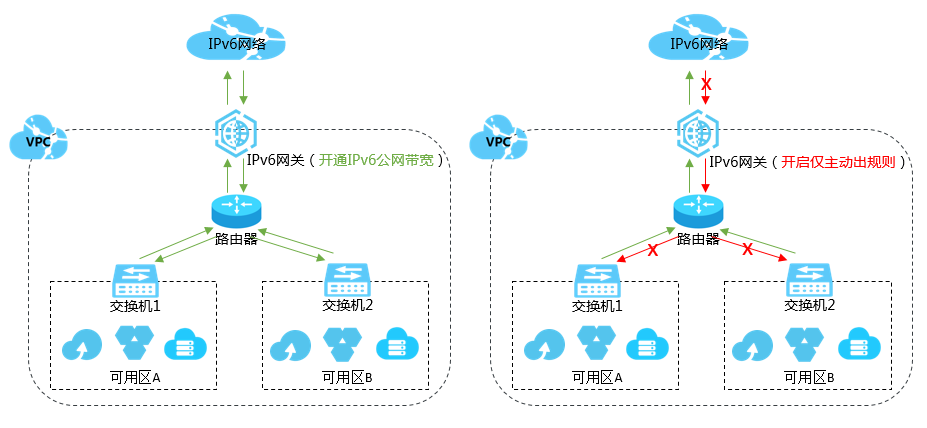
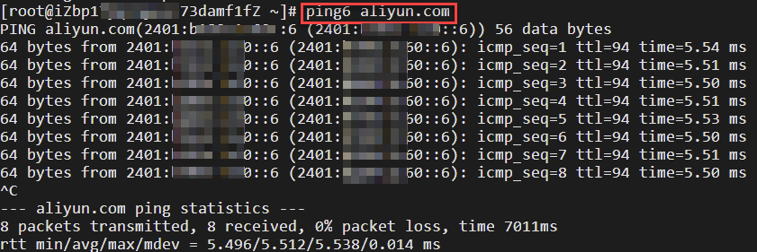
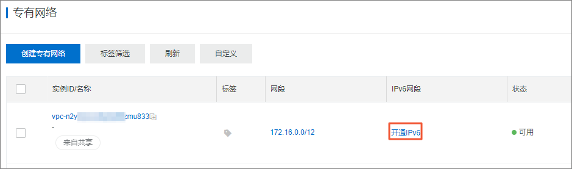
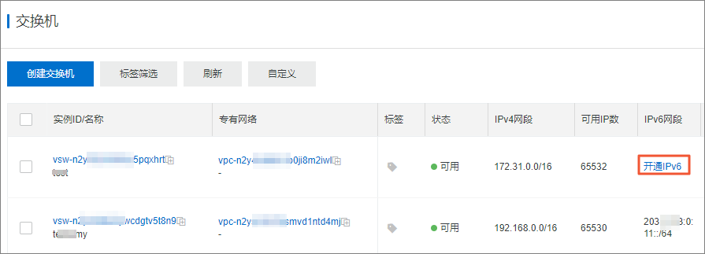

阿里云  
专有云  
IPv6网关  
用户指南  
产品版本：v3.18.2  
文档版本：20240521

**目录**

- [1.什么是IPv6网关](#section-1)
- [2.登录IPv6网关管理控制台](#section-2)
- [3.快速入门](#section-3)
    - [3.1. 搭建IPv6专有网络](#section-3-1)
- [4.VPC开启IPv6](#section-4)
    - [4.1. 新建IPv4和IPv6双栈VPC](#section-4-1)
    - [4.2. 为已有VPC开通IPv6网段](#section-4-2)
- [5.交换机开启IPv6](#section-5)
    - [5.1. 新建IPv4和IPv6双栈VPC](#section-5-1)
    - [5.2. 为已有交换机开通IPv6网段](#section-5-2)
- [6.管理IPv6网关](#section-6)
    - [6.1. 新建IPv6网关](#section-6-1)
    - [6.2. 修改IPv6网关](#section-6-2)
    - [6.3. 删除IPv6网关](#section-6-3)
- [7.管理IPv6公网带宽](#section-7)
    - [7.1. 开通IPv6公网带宽](#section-7-1)
    - [7.2. 修改IPv6网关带宽峰值](#section-7-2)
    - [7.3. 删除IPv6公网带宽](#section-7-3)
- [8.管理仅主动出规则](#section-8)
    - [8.1. 创建仅主动出规则](#section-8-1)
    - [8.2. 删除仅主动出规则](#section-8-2)

# 1.什么是IPv6网关

IPv6网关（IPv6 Gateway）是专有网络VPC（Virtual Private Cloud）的一个IPv6流量网关。您可以通过配置IPv6公网带宽和仅主动出规则，灵活定义IPv6的出流量和入流量。

**功能**

IPv6网关具有以下功能：

- **IPv6私网通信**

  默认申请的专有网络IPv6地址的公网带宽为0Mbps，只具备私网通信能力。VPC网络中的云实例只能通过IPv6地址访问同一个VPC中的其他IPv6地址，不允许通过该IPv6地址访问互联网，也无法被互联网的IPv6终端访问。

- **IPv6公网通信**

  - 您可以为申请的IPv6地址购买公网带宽，使VPC网络中的云实例可以通过该IPv6地址访问互联网，同时也允许IPv6终端通过互联网访问VPC网络中的云实例。

  - 您可以随时将IPv6地址的公网带宽设置为零。设置后，该IPv6地址只拥有私网通信能力。

  - 您可以通过配置仅主动出规则，使IPv6地址可以主动访问互联网，但不允许IPv6终端通过互联网访问VPC网络中的云实例。

  - 您可以随时删除仅主动出规则。删除后，具有公网带宽的IPv6地址不仅可以主动访问互联网，同时也允许IPv6终端通过互联网访问VPC网络中的云实例。

IPv6地址的通信能力与IPv6地址的网络类型、公网带宽和仅主动出规则有关，如下表所示。

<table>
  <tr>
    <th>IPv6网络类型</th>
    <th>是否开通IPv6公网带宽</th>
    <th>是否设置仅主动访问规则</th>
    <th>IPv6地址通信能力</th>
  </tr>
  <tr>
    <td>私网</td>
    <td>否</td>
    <td>否</td>
    <td>私网通信</td>
  </tr>
  <tr>
    <td rowspan="2">公网</td>
    <td rowspan="2">是</td>
    <td>否</td>
    <td>私网通信公网通信</td>
  </tr>
  <tr>
    <td>是</td>
    <td>私网通信仅可主动访问公网</td>
  </tr>
</table>

**优势**

IPv6网关具有以下优势：

- **高可用**

  IPv6网关提供跨可用区级的高可用能力，帮您打造极致稳定的IPv6公网网关服务。

- **高性能**

  单个IPv6网关实例可提供万兆级吞吐量，满足超大业务的IPv6公网需求。

- **灵活管理公网通信**

  您可以通过调整公网带宽和设置仅主动出规则，灵活设置IPv6地址的公网通信能力。

# 2.登录IPv6网关管理控制台

本节以Chrome浏览器为例，介绍IPv6网关（IPv6 Gateway）用户如何登录到Apsara Uni-manager运营控制台。

**前提条件**

- 登录Apsara Uni-manager运营控制台前，确认您已从部署人员处获取Apsara Uni-manager运营控制台的服务域名地址。

- 推荐使用Chrome浏览器。

**操作步骤**

1. 在浏览器地址栏中，输入Apsara Uni-manager运营控制台的访问地址，按回车键。

2. 输入正确的用户名及密码。

   请向运营管理员获取登录控制台的用户名和密码。

   > 首次登录Apsara Uni-manager运营控制台时，需要修改登录用户名的密码，请按照提
   >
   > **说明**
   >
   > 示完成密码修改。为提高安全性，密码长度必须为 8~20 位，且至少包含以下两种类型：
   >
   > - 英文大写或小写字母（A~Z、a~z）
   >
   > - 阿拉伯数字（0~9）
   >
   > - 特殊符号（感叹号（！）、at（@）、井号（#）、美元符号（$）、百分号（%）等）

3. 单击**登录**。

4. 如果账号已激活MFA多因素认证，请根据以下两种情况进行操作：

   - **管理员强制开启MFA后的首次登录**

     <ol type="a">

     <li>

     在绑定虚拟MFA设备页面中，按页面提示步骤绑定MFA设备。

     </li>

     <li>

     按照步骤2重新输入账号和密码，单击**账号登录**。

     </li>

     </ol>

     <ol type="i" start="100">

     <li>

     输入6位MFA码后单击**认证**。

     </li>

     </ol>

   - **您已开启并绑定MFA**

     输入6位MFA码后单击**认证**。

     > **说明**
     >
     > 绑定并开启MFA的操作请参见专有云文档中心《统一云管平台用户指南》文档的**安全中心**>**多因素认证**>**管理多因素认证**。

5. 在页面顶部的菜单栏中，选择**产品 > 网络 > 专有网络**。

6. 在左侧导航栏，选择**公网访问 > IPv6网关**。

# 3.快速入门

## 3.1. 搭建IPv6专有网络

本教程指引您搭建一个具有IPv6地址块的专有网络，然后在该专有网络VPC（Virtual Private Cloud）中创建一个带有IPv6地址的云服务器ECS（Elastic Compute Service）实例，并可以访问IPv6服务。

**步骤一：创建专有网络和交换机**

要在专有网络中使用云资源，您需要先创建专有网络和交换机。

1. 登录专有网络管理控制台。具体操作，请参见<strong>《专有网络VPC用户指南》</strong>手册中的**登录专有网络管理控制台**章节。

2. 在**专有网络**页面，单击**创建专有网络**。

3. 在**创建专有网络VPC**页面，根据以下信息配置专有网络，然后单击**提交**。

   | 配置 | 说明 |
   | --- | --- |
   | 组织 | 选择专有网络所属的组织。 |
   | 资源集 | 选择专有网络所属的资源集。 |
   | 地域 | 选择专有网络所属的地域。 |
   | 共享范围 | 选择VPC的共享范围。 • <strong>本资源集</strong>：本资源集的管理员可以使用共享VPC创建资源。 • <strong>本组织及下级组织</strong>：本组织及下级组织的管理员可以使用共享VPC创建资源。 • <strong>本组织</strong>：本组织的管理员可以使用共享VPC创建资源。本教程选择<strong>本资源集</strong>。 |
   | 专有网络名称 | 输入专有网络的名称。 本教程输入  <code>VPCtest</code>。 |
   | IPv4网段 | 选择IPv4网段，支持以下两种方式选择IPv4网段： • <strong>推荐网段</strong>：您可以使用192.168.0.0/16或172.16.0.0/16两个标准IPv4网段。 • <strong>高级配置网段</strong>：您可以使用192.168.0.0/16或172.16.0.0/16及其子网作为专有网络的网段，网段掩码有效范围为8~28位。填写教程：192.168.0.0/16。本教程选择推荐网段192.168.0.0/16作为VPC的IPv4网段。 说明VPC创建后，不能再修改IPv4网段。 |
   | IPv6网段 | 选择是否分配IPv6网段。 • <strong>不分配</strong>：系统不分配IPv6网段。 • <strong>分配</strong>：系统自动分配IPv6网段。本教程选择<strong>分配</strong>。 |
   | 描述 | 输入专有网络的描述信息。 |

4. 在**专有网络管理控制台**页面，单击左侧导航栏的**交换机**。

5. 在**交换机**页面，单击**创建交换机**。

6. 在**创建虚拟交换机**页面，根据以下信息配置交换机，然后单击**提交**。

   <table>
     <tr>
       <th width="137">配置</th>
       <th>说明</th>
     </tr>
     <tr>
       <td>组织</td>
       <td>选择交换机所属的组织。</td>
     </tr>
     <tr>
       <td>资源集</td>
       <td>选择交换机所属的资源集。</td>
     </tr>
     <tr>
       <td>地域</td>
       <td>选择交换机所属的地域。</td>
     </tr>
     <tr>
       <td>可用区</td>
       <td>选择交换机所属的可用区。在一个专有网络中，每个交换机只能位于一个可用区内，不能跨多个可用区。您可以通过在不同可用区的交换机内部署云资源，实现跨可用区容灾。 说明一个云资源实例只能添加到一个交换机中。</td>
     </tr>
     <tr>
       <td>共享范围</td>
       <td>选择交换机的共享范围。 • <strong>本资源集</strong>：本资源集的管理员可以使用共享交换机创建资源。 • <strong>本组织及下级组织</strong>：本组织及下级组织的管理员可以使用共享交换机创建资源。 • <strong>本组织</strong>：本组织的管理员可以使用共享交换机创建资源。本教程选择<strong>本资源集</strong>。</td>
     </tr>
     <tr>
       <td>VPC</td>
       <td>选择要创建交换机的专有网络。本教程选择<strong>VPCtest</strong>。</td>
     </tr>
     <tr>
       <td>裸机专用</td>
       <td>指定要创建的交换机是否为裸机专用。关于裸机，请参见<strong>《飞天智能运维平台用户指南》</strong>手册中<strong>专有网络裸机特性说明</strong>章节。本教程选择<strong>否</strong>。</td>
     </tr>
     <tr>
       <td>虚拟交换机名称</td>
       <td>输入交换机的名称。</td>
     </tr>
     <tr>
       <td>IPv4网段</td>
       <td>指定交换机的IPv4网段。本教程使用系统默认的IPv4网段。</td>
     </tr>
     <tr>
       <td>IPv6网段</td>
       <td>指定交换机的IPv6网段。本教程使用系统默认的IPv6网段。</td>
     </tr>
     <tr>
       <td>描述</td>
       <td>输入该交换机的描述信息。</td>
     </tr>
   </table>

**步骤二：创建安全组**

1. 在页面顶部的菜单栏中，选择**产品 > 弹性计算 > 云服务器 ECS**。

2. 在左侧导航栏，选择**网络和安全 > 安全组**。

3. 在页面，单击**创建安全组**。

4. 在**创建安全组**页面，根据以下信息配置安全组，然后单击**提交**。

   <table>
     <tr>
       <th width="105">配置</th>
       <th>说明</th>
     </tr>
     <tr>
       <td>组织</td>
       <td>选择安全组的所属组织。</td>
     </tr>
     <tr>
       <td>资源集</td>
       <td>选择安全组的所属资源集。</td>
     </tr>
     <tr>
       <td>地域</td>
       <td>选择安全组的所属地域。确保安全组的地域和VPC的地域相同。</td>
     </tr>
     <tr>
       <td>可用区</td>
       <td>选择安全组的所属可用区。</td>
     </tr>
     <tr>
       <td>共享范围</td>
       <td>选择安全组的共享范围。 • <strong>本资源集</strong>：本资源集的管理员可以使用安全组创建资源。 • <strong>本组织及下级组织</strong>：本组织及下级组织的管理员可以使用安全组创建资源。 • <strong>本组织</strong>：本组织的管理员可以使用安全组创建资源。本教程选择<strong>本资源集</strong>。</td>
     </tr>
     <tr>
       <td>VPC</td>
       <td>选择安全组所属的专有网络。</td>
     </tr>
     <tr>
       <td>安全组名称</td>
       <td>输入安全组的名称。</td>
     </tr>
     <tr>
       <td>描述</td>
       <td>输入安全组的描述信息。</td>
     </tr>
   </table>

**步骤三：创建并配置ECS实例**

创建IPv6专有网络和交换机后，您需要创建一个具有IPv6地址的ECS实例。创建ECS实例后，您还需要将分配的IPv6地址配置到ECS实例的网卡上。

1. 在页面顶部的菜单栏中，选择**产品 > 网络 > 专有网络 VPC**。

2. 在左侧导航栏，单击**交换机**。

3. 在顶部菜单栏处，选择交换机的地域。

4. 在**交换机**页面，找到目标交换机，然后在**操作**列单击**创建ECS实例**。

5. 在**创建云服务器**页面，配置云服务器ECS，然后单击**提交**。本操作中选择**分配**IPv6地址，其他参数配置，请参见<strong>《云服务器ECS用户指南》</strong>手册中**快速入门**下的**使用向导创建实例**章节。

6. 返回**实例列表**页面，单击实例ID，查看分配的IPv6地址。

7. 配置静态IPv6地址。

   - 如果您的ECS实例的镜像支持DHCPv6，您无需手动配置静态IPv6地址。支持DHCPv6镜像的ECS实例可以自动化配置IPv6地址，创建实例后即可使用分配的IPv6地址进行内网通信。以下镜像支持DHCPv6：

     - Linux镜像：

       - CentOS 7.6 IPV6 64Bit

       - CentOS 6.10 64Bit

       - SUSE Linux Enterprise Server 12 SP4 64Bit

     - Windows Server镜像

   - 如果您的ECS实例的镜像不支持DHCPv6，您需要为ECS实例配置IPv6地址。更多信息，请查询各镜像ECS实例配置IPv6地址的方法。

**步骤四：开通IPv6公网带宽**

默认IPv6地址只具备私网通信能力。如果您需要通过该IPv6地址访问互联网或被互联网中的IPv6客户端访问，您需要开通IPv6公网带宽。

1. 在页面顶部的菜单栏中，选择**产品 > 网络 > 专有网络 VPC**。

2. 在左侧导航栏，单击**IPv6网关**。

3. 在顶部菜单栏处，选择IPv6网关的地域。

4. 在**IPv6网关**页面，找到目标IPv6网关，然后在**操作**列单击**管理**。

5. 在IPv6网关页面，单击**IPv6公网带宽**页签。

6. 在**IPv6公网带宽**页签，找到目标IPv6地址，然后在**操作**列单击**开通公网带宽**。

7. 选择要开通的IPv6网关带宽，然后单击**提交**。免费版、企业版和企业增强版IPv6网关，单个IPv6最大公网带宽峰值均为2 Gbps。

**步骤五：配置安全组规则**

IPv4和IPv6通信彼此独立，如果当前的安全组规则不能满足业务需求，您需要为ECS实例单独配置IPv6安全组规则。

关于配置安全组规则的详细信息，请参见<strong>《云服务器ECS用户指南》</strong>手册中**安全组**下的**添加安全组规则**章节。

**步骤六：测试网络连通性**

登录ECS实例，**ping**一个IPv6服务测试通信是否正常。

# 4.VPC开启IPv6

## 4.1. 新建IPv4和IPv6双栈VPC

在创建VPC时，您可以同时配置IPv4和IPv6网段。IPv4网段默认开通且不可取消。您可以选择是否开通IPv6网段。

**操作步骤**

1. 登录专有网络管理控制台。

2. 在顶部菜单栏，选择专有网络的地域。

3. 在**专有网络**页面，单击**创建专有网络**。

4. 在**创建专有网络VPC**页面，根据以下信息配置专有网络，然后单击**提交**。

   | 配置 | 说明 |
   | --- | --- |
   | 组织 | 选择专有网络所属的组织。 |
   | 资源集 | 选择专有网络所属的资源集。 |
   | 地域 | 选择专有网络所属的地域。 |
   | 共享范围 | 选择VPC的共享范围。 • <strong>本资源集</strong>：本资源集的管理员可以使用共享VPC创建资源。 • <strong>本组织及下级组织</strong>：本组织及下级组织的管理员可以使用共享VPC创建资源。 • <strong>本组织</strong>：本组织的管理员可以使用共享VPC创建资源。本示例选择<strong>本资源集</strong>。 |
   | 专有网络名称 | 输入专有网络的名称。名称长度在2~128个字符之间，必须以英文字母和中文字符开头，可包含数字、下划线（_）、短划线（-），但不能以<code> http:// </code>或<code> https:// </code>开头。 |
   | IPv4网段 | 选择IPv4网段，支持以下两种方式选择IPv4网段： • <strong>推荐网段</strong>：您可以使用192.168.0.0/16、172.16.0.0/16。 • <strong>高级配置网段</strong>：您可以使用192.168.0.0/16、172.16.0.0/12、10.0.0.0/8及其子网作为专有网络地址段，网段掩码有效范围为8~24位。填写示例：192.168.0.0/16。 说明VPC创建后，不能再修改IPv4网段。 |
   | IPv6网段 | 选择是否分配IPv6网段。 本示例选择<strong>分配</strong>。 说明VPC创建后，不能再修改IPv6网段。 |
   | 地址池 | 选择地址池类型。目前支持选择：<strong>BGP</strong>。 说明当您选择分配IPv6网段时，配置该参数。 |
   | 描述 | 输入专有网络的描述信息。描述长度在2~256个字符之间，必须以英文字母和中文字符开头，可包含数字、下划线（_）、短划线（-）、全角句号（。）、全角冒号（：）和全角逗号（，），但不能以<code> http:// </code>或<code> https:// </code>开头。 |

## 4.2. 为已有VPC开通IPv6网段

您可以为已创建的VPC开通IPv6网段。开通IPv6网段后，系统将为VPC自动创建一个免费版的IPv6网关。您可以使用IPv6网关管理IPv6公网带宽和IPv6公网仅主动出规则。

**操作步骤**

1. 登录专有网络管理控制台。

2. 在顶部菜单栏，选择专有网络的地域。

3. 在**专有网络**页面，找到目标专有网络，然后在**IPv6网段**列单击**开通IPv6**。

   

4. 在**开通IPv6**对话框中，选中**自动开启VPC内所有交换机IPv6功能**，然后单击**确定**。如果您不选中**自动开启VPC内所有交换机IPv6功能**，您需要为每个交换机单独开通IPv6网段。具体操作，请参见为已有交换机开通IPv6网段。

# 5.交换机开启IPv6

## 5.1. 新建IPv4和IPv6双栈VPC

在创建VPC时，您可以同时配置IPv4和IPv6网段。IPv4网段默认开通且不可取消。您可以选择是否开通IPv6网段。

**操作步骤**

1. 登录专有网络管理控制台。

2. 在顶部菜单栏，选择专有网络的地域。

3. 在**专有网络**页面，单击**创建专有网络**。

4. 在**创建专有网络VPC**页面，根据以下信息配置专有网络，然后单击**提交**。

   | 配置 | 说明 |
   | --- | --- |
   | 组织 | 选择专有网络所属的组织。 |
   | 资源集 | 选择专有网络所属的资源集。 |
   | 地域 | 选择专有网络所属的地域。 |
   | 共享范围 | 选择VPC的共享范围。 • <strong>本资源集</strong>：本资源集的管理员可以使用共享VPC创建资源。 • <strong>本组织及下级组织</strong>：本组织及下级组织的管理员可以使用共享VPC创建资源。 • <strong>本组织</strong>：本组织的管理员可以使用共享VPC创建资源。本示例选择<strong>本资源集</strong>。 |
   | 专有网络名称 | 输入专有网络的名称。名称长度在2~128个字符之间，必须以英文字母和中文字符开头，可包含数字、下划线（_）、短划线（-），但不能以<code> http:// </code>或<code> https:// </code>开头。 |
   | IPv4网段 | 选择IPv4网段，支持以下两种方式选择IPv4网段： • <strong>推荐网段</strong>：您可以使用192.168.0.0/16、172.16.0.0/16。 • <strong>高级配置网段</strong>：您可以使用192.168.0.0/16、172.16.0.0/12、10.0.0.0/8及其子网作为专有网络地址段，网段掩码有效范围为8~24位。填写示例：192.168.0.0/16。 说明VPC创建后，不能再修改IPv4网段。 |
   | IPv6网段 | 选择是否分配IPv6网段。 本示例选择<strong>分配</strong>。 说明VPC创建后，不能再修改IPv6网段。 |
   | 地址池 | 选择地址池类型。目前支持选择：<strong>BGP</strong>。 说明当您选择分配IPv6网段时，配置该参数。 |
   | 描述 | 输入专有网络的描述信息。描述长度在2~256个字符之间，必须以英文字母和中文字符开头，可包含数字、下划线（_）、短划线（-）、全角句号（。）、全角冒号（：）和全角逗号（，），但不能以<code> http:// </code>或<code> https:// </code>开头。 |

## 5.2. 为已有交换机开通IPv6网段

您可以为已创建的交换机开通IPv6网段，开通后，系统会为交换机分配一个IPv6网段。

**操作步骤**

1. 登录专有网络管理控制台。

2. 在左侧导航栏，单击**交换机**。

3. 选择交换机的地域。

4. 在**交换机**页面，找到目标交换机，然后在**IPv6网段**列单击**开通IPv6**。

   

5. 在**开通IPv6**对话框中，单击**确定**。

   > 仅交换机所属的VPC未开通IPv6网段，才需此操作。
   >
   > **说明**

6. 指定IPv6的网段，然后单击**确定**。

   交换机的IPv6网段的掩码默认为/64，您可以输入十进制数字0~255，来自定义交换机IPv6网段的最后8比特位。

   例如VPC的IPv6网段为2XX1:db8::/64，在交换机的IPv6网段输入十进制数字255（对应十六进制为ff），则交换机的IPv6网段将为2XX1:db8::ff/64。

# 6.管理IPv6网关

## 6.1. 新建IPv6网关

IPv6网关是专有网络的一个IPv6互联网流量网关。在为IPv6地址购买IPv6公网带宽和设置仅主动出规则前，您必须先创建一个IPv6网关实例。

**前提条件**

为VPC新建IPv6网关前，请确认VPC是否已开通IPv6网段，如未开通，请先开通IPv6网段。具体操作，请参见新建VPC时开通IPv6网段和为已有VPC开通IPv6网段。

**操作步骤**

1. 登录IPv6网关管理控制台。

2. 在**IPv6网关**页面，单击**创建IPv6网关**。

3. 根据以下信息配置IPv6网关，然后单击**提交**。

   <table>
     <tr>
       <th width="125">配置</th>
       <th>说明</th>
     </tr>
     <tr>
       <td>组织</td>
       <td>选择IPv6网关所属的组织。</td>
     </tr>
     <tr>
       <td>资源集</td>
       <td>选择IPv6网关所属的资源集。</td>
     </tr>
     <tr>
       <td>地域</td>
       <td>选择IPv6网关的地域。确保IPv6网关的地域和要开通IPv6网段的VPC的地域相同。</td>
     </tr>
     <tr>
       <td>名称</td>
       <td>输入IPv6网关的名称。</td>
     </tr>
     <tr>
       <td>专有网络VPC</td>
       <td>选择要创建IPv6网关的VPC。如果要选择的VPC未出现在列表中，可能有以下原因： • 一个VPC仅允许创建一个IPv6网关，该VPC已经存在IPv6网关。 • VPC中存在目标网段为::/0的自定义路由，请先删除该路由。 说明创建IPv6网关后，无法修改IPv6网关关联的VPC。</td>
     </tr>
     <tr>
       <td>共享范围</td>
       <td>选择IPv6网关的共享范围。 • <strong>本资源集</strong>：本资源集的管理员可以共享IPv6网关。 • <strong>本组织及下级组织</strong>：本组织及下级组织的管理员可以共享IPv6网关。 • <strong>本组织</strong>：本组织的管理员可以共享IPv6网关。</td>
     </tr>
     <tr>
       <td>规格</td>
       <td>选择IPv6网关的规格。IPv6网关常见的规格如下所示： • 免费版 • 企业版 • 企业增强版IPv6网关的规格会影响IPv6公网转发能力、单个IPv6地址的最大带宽配额和仅主动出规则的配额。</td>
     </tr>
   </table>

## 6.2. 修改IPv6网关

您可以修改IPv6网关的名称和描述信息。

**操作步骤**

1. 登录IPv6网关管理控制台。

2. 选择IPv6网关的地域。

3. 在**IPv6网关**页面，找到目标IPv6网关，然后在**操作**列单击**管理**。

4. 在**IPv6网关详情**页面，单击**名称**右侧的**编辑**，在弹出的对话框中修改IPv6网关的名称和描述，然后单击**确定**。

## 6.3. 删除IPv6网关

如果您不需要VPC访问IPv6终端或被IPv6终端访问，您可以删除IPv6网关。

**前提条件**

删除企业版和企业增强版IPv6网关前，请先删除仅主动出规则。具体操作，请参见删除仅主动出规则。

**操作步骤**

1. 登录IPv6网关管理控制台。

2. 选择IPv6网关的地域。

3. 在**IPv6网关**页面，找到目标IPv6网关，然后在**操作**列单击**删除**。

4. 在弹出的对话框中，单击**确定**。

# 7.管理IPv6公网带宽

## 7.1. 开通IPv6公网带宽

为IPv6地址开通IPv6公网带宽，使IPv6地址可以进行公网通信。

**前提条件**

专有网络VPC（Virtual Private Cloud）中已经创建了ECS实例，且ECS实例已经配置了IPv6地址。

**操作步骤**

1. 登录IPv6网关管理控制台。

2. 在顶部菜单栏，选择IPv6网关的地域。

3. 在**IPv6网关**页面，找到目标IPv6网关，然后在**操作**列单击**管理**。

4. 在**IPv6网关详情**页面，单击**IPv6公网带宽**。

5. 找到目标IPv6地址，然后在**操作**列单击**开通公网带宽**。

6. 选择带宽，然后单击**提交**。

## 7.2. 修改IPv6网关带宽峰值

您可以随时修改IPv6网关的带宽峰值。修改后，立即生效。

**操作步骤**

1. 登录IPv6网关管理控制台。

2. 在顶部菜单栏，选择IPv6网关的地域。

3. 在**IPv6网关**页面，找到目标IPv6网关，然后在**操作**列单击**管理**。

4. 在**IPv6网关详情**页面，单击**IPv6公网带宽**。

5. 找到目标IPv6地址，然后在**操作**列单击**变配带宽**。

6. 修改带宽，然后单击**提交**。

## 7.3. 删除IPv6公网带宽

当某个IPv6地址不需要公网通信能力时，您可以删除IPv6地址的公网带宽。

**操作步骤**

1. 登录IPv6网关管理控制台。

2. 在顶部菜单栏，选择IPv6网关的地域。

3. 在**IPv6网关**页面，找到目标IPv6网关，然后在**操作**列单击**管理**。

4. 在**IPv6网关详情**页面，单击**IPv6公网带宽**。

5. 找到目标IPv6地址，然后在**操作**列单击**删除公网带宽**。

6. 在弹出的对话框中，单击**确定**。

# 8.管理仅主动出规则

## 8.1. 创建仅主动出规则

如果您希望VPC中的云产品实例仅能通过IPv6地址主动访问互联网，而不希望被IPv6终端主动与VPC中的云产品实例建立连接，您需要创建仅主动出规则。

**前提条件**

您已经为IPv6地址开通了IPv6公网带宽。具体操作，请参见开通IPv6公网带宽。

**背景信息**

免费版的IPv6网关不支持创建仅主动出规则。企业版和企业增强版的IPv6网关分别支持创建50条和200条仅主动出规则。

**操作步骤**

1. 登录IPv6网关管理控制台。

2. 在顶部菜单栏，选择IPv6网关的地域。

3. 在**IPv6网关**页面，找到目标IPv6网关，然后在**操作**列单击**管理**。

4. 在**IPv6网关详情**页面，单击**仅主动出规则 > 创建仅主动出规则**

5. 在**创建仅主动出规则**面板，选择经IPv6地址进行公网通信的ECS实例，然后单击**确定**。

## 8.2. 删除仅主动出规则

您可以删除仅主动出规则。删除后，具有公网带宽的IPv6地址不仅可以主动访问互联网，同时也允许IPv6客户端通过互联网访问VPC网络中的云产品实例。

**操作步骤**

1. 登录IPv6网关管理控制台。

2. 在顶部菜单栏，选择IPv6网关的地域。

3. 在**IPv6网关**页面，找到目标IPv6网关，然后在**操作**列单击**管理**。

4. 在**IPv6网关详情**页面，单击**仅主动出规则**。

5. 找到目标仅主动出规则，然后在**操作**列单击**删除**。

6. 在弹出的对话框中，单击**确定**。
