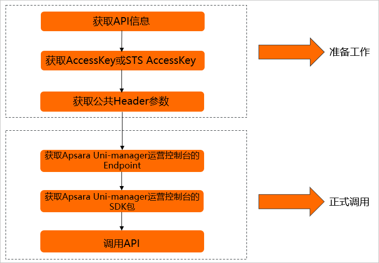
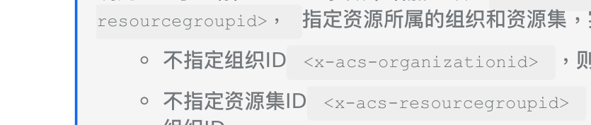

阿里云  
专有云  
NAT网关  
开发指南  
产品版本：V3.18.3  
文档版本：20241028

**目录**

- [1.快速入门](#section-1)
    - [1.1. 开发文档使用说明](#section-1-1)
    - [1.2. API调用流程说明](#section-1-2)
- [2.准备工作](#section-2)
    - [2.1. 登录开发者门户控制台](#section-2-1)
    - [2.2. 获取API信息及其EndPoint](#section-2-2)
    - [2.3. 获取AccessKey](#section-2-3)
    - [2.4. 获取STS AccessKey](#section-2-4)
    - [2.5. 获取公共Header参数](#section-2-5)
    - [2.6. 获取NAT网关的SDK包](#section-2-6)
- [3.Java SDK调用示例](#section-3)
    - [3.1. 快速开始](#section-3-1)
    - [3.2. 使用手册](#section-3-2)
        - [3.2.1. 安装Java SDK](#section-3-2-1)
        - [3.2.2. 设置身份验证凭证](#section-3-2-2)
        - [3.2.3. 请求连接配置](#section-3-2-3)
        - [3.2.4. 发起调用](#section-3-2-4)
        - [3.2.5. 错误处理](#section-3-2-5)
        - [3.2.6. 使用CommonRequest进行调用](#section-3-2-6)
- [4.Python SDK调用示例](#section-4)
    - [4.1. 快速开始](#section-4-1)
    - [4.2. 使用手册](#section-4-2)
        - [4.2.1. 安装Python SDK](#section-4-2-1)
        - [4.2.2. 设置身份验证凭证](#section-4-2-2)
        - [4.2.3. 错误处理](#section-4-2-3)
        - [4.2.4. 设置HTTPS请求](#section-4-2-4)
        - [4.2.5. 发起调用](#section-4-2-5)
        - [4.2.6. 使用CommonRequest进行调用](#section-4-2-6)
- [5.Go SDK调用示例](#section-5)
    - [5.1. 快速开始](#section-5-1)
    - [5.2. 使用手册](#section-5-2)
        - [5.2.1. 安装Go SDK核心包](#section-5-2-1)
        - [5.2.2. 设置身份验证凭证](#section-5-2-2)
        - [5.2.3. 发起调用](#section-5-2-3)
        - [5.2.4. 错误处理](#section-5-2-4)
        - [5.2.5. 使用CommonRequest进行调用](#section-5-2-5)
- [6.API参考](#section-6)
    - [6.1. API概览](#section-6-1)
    - [6.2. 调用API](#section-6-2)
        - [6.2.1. 请求结构](#section-6-2-1)
        - [6.2.2. API授权](#section-6-2-2)
        - [6.2.3. API签名](#section-6-2-3)
    - [6.3. RAM鉴权](#section-6-3)
    - [6.4. 公共参数](#section-6-4)
    - [6.5. NAT网关](#section-6-5)
        - [6.5.1. CreateNatGateway](#section-6-5-1)
        - [6.5.2. ModifyNatGatewayAttribute](#section-6-5-2)
        - [6.5.3. ModifyNatGatewaySpec](#section-6-5-3)
        - [6.5.4. DeleteNatGateway](#section-6-5-4)
        - [6.5.5. DescribeNatGateways](#section-6-5-5)
    - [6.6. DNAT表](#section-6-6)
        - [6.6.1. CreateForwardEntry](#section-6-6-1)
        - [6.6.2. DeleteForwardEntry](#section-6-6-2)
        - [6.6.3. ModifyForwardEntry](#section-6-6-3)
        - [6.6.4. DescribeForwardTableEntries](#section-6-6-4)
    - [6.7. SNAT表](#section-6-7)
        - [6.7.1. CreateSnatEntry](#section-6-7-1)
        - [6.7.2. DeleteSnatEntry](#section-6-7-2)
        - [6.7.3. ModifySnatEntry](#section-6-7-3)
        - [6.7.4. DescribeSnatTableEntries](#section-6-7-4)
    - [6.8. NAT带宽包](#section-6-8)
        - [6.8.1. CreateBandwidthPackage](#section-6-8-1)
        - [6.8.2. ModifyBandwidthPackageSpec](#section-6-8-2)
        - [6.8.3. DescribeBandwidthPackages](#section-6-8-3)
        - [6.8.4. ModifyBandwidthPackageAttribute](#section-6-8-4)
        - [6.8.5. DeleteBandwidthPackage](#section-6-8-5)
        - [6.8.6. RemoveBandwidthPackageIps](#section-6-8-6)
- [7.附录](#section-7)
    - [7.1. STS概要](#section-7-1)
        - [7.1.1. 什么是STS](#section-7-1-1)
        - [7.1.2. AssumeRole](#section-7-1-2)

<a id="section-1"></a>

# 1.快速入门

<a id="section-1-1"></a>

## 1.1. 开发文档使用说明

本文为您介绍在使用专有云API进行开发工作时，如何查看所需要的产品文档。

**使用流程**

您可以按照以下流程图中步骤，判断自己所需要使用的开发文档。


**前提条件**

通过运维人员或运营管理员获取专有云的版本。

**操作步骤**

您可以通过阿里云专有云文档中心，获取需要的产品文档。

1. 通过浏览器打开专有云文档中心。

2. 根据专有云的版本单击**企业版**、**敏捷版**或**一体机**标签。

3. 在下拉列表中，选择对应的专有云版本。

   

4. 在左侧导航栏中，选择目标产品名称。

5. 在单击目标文档区域的**查看详情**或**下载PDF**。

<a id="section-1-2"></a>

## 1.2. API调用流程说明

阿里云专有云支持通过POP网关调用专有云API，为了使您拥有与公有云一致的体验，自企业版V3.16.0开始，专有云API默认使用POP网关方式调用。本文介绍通过POP网关调用专有云API的流程。

**流程图**



**调用步骤**

1. 获取AccessKey。

   获取调用时所需要的AccessKey参数，请参见获取AccessKey或获取STS AccessKey。

   > **说明**
   >
   > 推荐使用个人AccessKey或STS AccessKey调用Apsara Uni-manager运营控制台及云产品接口。

2. 获取RegionID。

   获取调用时所需要的RegionID参数，请参见获取公共Header参数。

3. 获取组织ID与资源集ID。

   组织ID需要通过API进行获取，获取方式请参见*Apsara Uni-manager运营控制台开发指南*中的*GetOrga nizationList章节*。

   资源集ID需要通过API进行获取，获取方式请参见*Apsara Uni-manager运营控制台开发指南*中的*ListRe sourceGroup章节*。

   > **说明**
   >
   > 调用API时，请在Header参数中增加组织ID `<x-acs-organizationid>` 和资源集ID `<x-acs-`



> `resourcegroupid>`， 指定资源所属的组织和资源集，实现实例资源的隔离查询。
>
> - 不指定组织ID `<x-acs-organizationid>` ，则默认获取当前用户所属的组织。
>
> - 不指定资源集ID `<x-acs-resourcegroupid>` ，则默认为空，如果指定资源集需要同时指定组织ID。

4. 获取对应的API参考文档。

   您需要查看目标云产品的开发指南，了解API的功能与使用方式，开发指南的使用流程及获取方法请参见开发文档使用说明。

5. 获取云产品Endpoint。

6. 获取云产品SDK并调用云产品API。

<a id="section-2"></a>

# 2.准备工作

<a id="section-2-1"></a>

## 2.1. 登录开发者门户控制台

您可以通过Apsara Uni-manager运营控制台登录开发者门户。

**前提条件**

- 登录Apsara Uni-manager运营控制台前，确认您已从部署人员处获取Apsara Uni-manager运营控制台的服务域名地址。

- 推荐使用Chrome浏览器。

**操作步骤**

1. 在浏览器地址栏中，输入Apsara Uni-manager运营控制台的服务域名地址，按回车键。

2. 输入正确的用户名及密码。

   请向运营管理员获取登录控制台的用户名和密码。

   > **说明**
   >
   > 首次登录Apsara Uni-manager运营控制台时，需要修改登录用户名的密码，请按照提示完成密码修改。为提高安全性，密码长度必须为10~32位，且至少包含以下两种类型：
   >
   > - 英文大写或小写字母（A~Z、a~z）
   >
   > - 阿拉伯数字（0~9）
   >
   > - 特殊符号（感叹号（!）、at（@）、井号（#）、美元符号（$）、百分号（%）等）

3. 单击**登录**。

4. 如果账号已激活MFA多因素认证，请根据以下两种情况进行操作：

   - 管理员强制开启MFA后的首次登录：

     <ol type="a">

     <li>

     在绑定虚拟MFA设备页面中，按页面提示步骤绑定MFA设备。

     </li>

     <li>

     按照步骤2重新输入账号和密码，单击**登录**。

     </li>

     </ol>

     <ol type="i" start="100">

     <li>

     输入6位MFA码后单击**认证**。

     </li>

     </ol>

   - 您已开启并绑定MFA：

     输入6位MFA码后单击**认证**。

     > **说明**
     >
     > 绑定并开启MFA的操作请参见<strong>《Apsara Uni-manager运营控制台用户指南》</strong>中的<strong>《绑定并开启虚拟MFA设备》</strong>章节。

5. 在页面顶部的菜单栏中，选择**产品 > 应用服务 > 开发者门户**。

<a id="section-2-2"></a>

## 2.2. 获取API信息及其EndPoint

首先，您需要了解产品开放API接口的相关信息，包括产品名称（code）、开放API接口名称、API版本。

**背景信息**

Apsara Uni-manager运营控制台API目录中的API信息仅供调用参考，具体API的使用方式需要参见云产品的开发指南。如果发生不一致情况，以开发指南支持情况为准。

**操作步骤**

1. 登录Apsara Uni-manager运营控制台。

2. 在顶部菜单栏选择**产品** > **应用服务** > **开发者门户**。

3. 在**开发者门户**页面，选择**API集成** > **API调试**。

   

4. 在左侧导航栏中选择目标云产品。

5. 在**版本**下拉列表中，选择目标API版本。

6. 在下方API列表中可浏览当前版本的所有API接口。

7. 选中对应接口，在参数名下获取云产品的POP Endpoint信息。

   

<a id="section-2-3"></a>

## 2.3. 获取AccessKey

AccessKey支持RAM和STS两种授权模式，在发起调用时选择使用其中一种AccessKey即可。本文将为您介绍如何获取通过RAM授权的AccessKey。

**背景信息**

AccessKey通过使用AccessKey ID和AccessKey Secret对称加密，实现验证某个请求发送者的身份的功能。其中AccessKey ID用于标示用户，AccessKey Secret是用户用于加密签名的字符串。

AccessKey的两种授权模式如下：

- 通过RAM授权给第三方请求者的AccessKey ID和AccessKey Secret。

- 通过STS授权给第三方请求者的AccessKey ID、AccessKey Secret和Security Token。具体操作，请参见获取STS AccessKey。

Apsara Uni-manager运营控制台提供了个人AccessKey和组织AccessKey（只有运营管理员和一级组织管理员可以获取组织AccessKey），推荐使用个人账号AccessKey调用Apsara Uni-manager运营控制台及云产品相关接口。如果使用个人账号AccessKey，需要在Header中添加以下限制性参数，否则可能提示权限不足：

> 个人账号AccessKey是由Apsara Uni-manager运营控制台权限体系管控的受限
>
> **警告**
>
> AccessKey，组织AccessKey相对权限较大，需要管理员确认操作的安全性。

<table>
  <tr>
    <th width="206">参数名称</th>
    <th>描述</th>
  </tr>
  <tr>
    <td>x-acs-regionid</td>
    <td>地域ID，如：cn-hangzhou-*。</td>
  </tr>
  <tr>
    <td>x-acs-organizationid</td>
    <td>Apsara Uni-manager运营控制台中对应的组织ID。获取方法可参见<strong>《Apsara Uni-manager运营控制台开</strong><strong>发指南》</strong>中的<strong>《GetOrganizationList》</strong>文档。</td>
  </tr>
  <tr>
    <td>x-acs-resourcegroupid</td>
    <td>Apsara Uni-manager运营控制台中对应的资源集ID。获取方法可参见<strong>《Apsara Uni-manager运营控制台</strong><strong>开发指南》</strong>中的<strong>《ListResourceGroup》</strong>文档。</td>
  </tr>
  <tr>
    <td>x-acs-instanceid</td>
    <td>进行操作的实例ID，例如，ECS的实例ID，您可以从ECS列表中查询到。</td>
  </tr>
</table>

**获取个人账号AccessKey**

获取个人账号AccessKey的方法如下：

1. 登录Apsara Uni-manager运营控制台。

2. 在系统界面右上角，单击当前登录用户头像，单击**个人信息**。

3. 在**阿里云AccessKey**区域，您可以查看个人账户的AccessKey信息。

   

   > Accesskey ID和AccessKey Secret是您访问云资源时的密钥，具有该账号完整的权
   >
   > **说明**
   >
   > 限，请您妥善保管。

**获取组织AccessKey**

获取组织AccessKey的方法如下：

1. 管理员登录Apsara Uni-manager运营控制台。

2. 在顶部菜单栏，单击**企业**。

3. 在左侧导航栏中，选择**资源管理 > 组织管理**。

4. 在组织结构中，单击目标一级组织名称。

5. 单击**管理Accesskey**。

6. 在弹出的对话框中，查看组织AccessKey信息。

<a id="section-2-4"></a>

## 2.4. 获取STS AccessKey

本文为您介绍如何利用STS方式，调用专有云的产品API。

**背景信息**

阿里云临时安全令牌STS（Security Token Service）是阿里云提供的一种临时访问权限管理服务。您可以选择使用STS方式，调用专有云的产品API。

STS AccessKey由AccessKey ID、AccessKey Secret及SecurityToken三元组组成，使用STS方式调用云产品API时，三元组缺一不可。更多STS内容请参见什么是STS。

**操作步骤**

1. 获取用户角色的 `RAM Role` 。

   <ol type="i">

   <li>

   登录Apsara Uni-manager运营控制台。

   </li>

   <li>

   单击页面右上角的用户头像，单击**个人信息**。

   </li>

   <li>

   单击**查看当前角色策略**。

   在**当前选择角色策略**对话框中查看 `RAM Role` 。

   </li>

   </ol>

2. 获取STS Accesskey三元组。

   > **说明**
   >
   > 以下代码示例中可变参数均需替换为您实际的相关信息，尖括号（<>）在最终代码中不保留。
   >
   > 涉及替换的可变参数如下：
   >
   > - &lt;yourRegionID>，请替换为您实际的地域ID。
   >
   > - &lt;yourAccessKeyID>，请替换为您实际的AccessKey ID。
   >
   > - &lt;yourAccessKeySecret>，请替换为您实际的AccessKey Secret。
   >
   > - &lt;yourRoleSessionName>，请替换为您当前实际的会话名称。
   >
   > - &lt;yourRoleArn>，请替换为您实际的RAM Role。
   >
   > - &lt;sts.aliyuns.com> ，请替换为实际的STS Endpoint。

   ```xml
   public static void main(String[] args) {
       // 创建DefaultAcsClient实例并初始化。
       // 请替换为您实际的地域ID、AccessKey ID、AccessKey Secret
       DefaultProfile profile = DefaultProfile.getProfile("<yourRegionID>", "
   <yourAccessKeyID>", "<yourAccessKeySecret>");
       HttpClientConfig clientConfig = HttpClientConfig.getDefault();
       clientConfig.setIgnoreSSLCerts(true);
       clientConfig.setProtocolType(ProtocolType.HTTPS);
       profile.setHttpClientConfig(clientConfig);
       IAcsClient client = new DefaultAcsClient(profile);
       String assumeRole = callAssumeRole(client);
       if (StringUtils.isEmpty(assumeRole)) return;
       JSONObject assumeRoleJson = JSONObject.parseObject(assumeRole);
       JSONObject credentials = assumeRoleJson.getJSONObject("Credentials");
       // 获取到STS三元组
       String stsAK = credentials.getString("AccessKeyId");
       String stsSK = credentials.getString("AccessKeySecret");
       String stsToken = credentials.getString("SecurityToken");
   }

   private static String callAssumeRole(IAcsClient client) {
       CommonRequest request = new CommonRequest();
       // "sts.aliyuns.com" 请替换为实际的STS Endpoint，⼀般格式为sts-
   vpc.${global:region}.${global:internet-domain}
       request.setSysDomain("sts.aliyuns.com");
       request.setSysProduct("Sts");
       request.setSysAction("AssumeRole");
       request.setSysVersion("2015-04-01");
       request.setSysMethod(MethodType.POST);
       request.setHttpContentType(FormatType.FORM);
       // 业务参数，设置本次调⽤Session的别名，"<yourRoleSessionName>"请您替换为实际值
       request.putQueryParameter("RoleSessionName", "<yourRoleSessionName>");
       // 扮演的Role⾓⾊ARN，"<yourRoleArn>"请替换为上⼀步获取到的实际Ram Role ARN
       request.putQueryParameter("RoleArn", "<yourRoleArn>");
       try {
           CommonResponse response = client.getCommonResponse(request);
           return response.getData();
       } catch (ServerException e) {
           System.out.println(e.getErrCode());
           System.out.println(e.getErrMsg());
       } catch (ClientException e) {
           System.out.println(e.getErrCode());
           System.out.println(e.getErrMsg());
       }
       return null;
   }
   ```

3. 通过STS AccessKey三元组调用云产品的接口，下列代码以NAT网关的 `DescribeNatGateways` 接口为示例。

   > **说明**
   >
   > 以下代码示例中可变参数均需替换为您实际的相关信息，尖括号（<>）在最终代码中不保留。
   >
   > 涉及替换的可变参数如下：
   >
   > - &lt;yourRegionID>，请替换为您实际的地域ID。
   >
   > - &lt;yourStsAccesskeyID>，请替换为您实际的STS Accesskey ID。
   >
   > - &lt;yourStsAccessKeySecret>，请替换为您实际的STS Accesskey Secret。
   >
   > - &lt;yourStsToken>，请替换为实际STS三元组中的SecurityToken。
   >
   > - &lt;yourResourceGroupID>，请替换为您实际的资源集ID。
   >
   > - &lt;yourOrganizationID>，请替换为您实际的组织ID。

   ```xml
   public static void main(String[] args) {
       // "<yourRegionID>"请替换为您实际的地域ID
       // "<yourStsAccessKeyID>", "<yourStsAccessKeySecret>"请替换为前⼀步获取到的STS三元组中
   AccessKeyID、AccessKeySecret
       DefaultProfile profile = DefaultProfile.getProfile("<yourRegionID>", "
   <yourStsAccesskey>", "<yourStsAccessSecret>");
       HttpClientConfig clientConfig = HttpClientConfig.getDefault();
       clientConfig.setIgnoreSSLCerts(true);
       clientConfig.setProtocolType(ProtocolType.HTTPS);
       profile.setHttpClientConfig(clientConfig);
       IAcsClient client = new DefaultAcsClient(profile);
       CommonRequest request = new CommonRequest();
       request.setSysDomain("vpc.aliyuns.com");
       request.setSysProduct("Vpc");
       request.setSysAction("DescribeNatGateways");
       request.setSysVersion("2016-04-28");
       request.setSysMethod(MethodType.POST);
       request.setHttpContentType(FormatType.FORM);
       //"<yourRegionID>" 请替换为您实际的地域ID
       request.putHeaderParameter("x-acs-regionid", "<yourRegionID>");
       // "<yourStsToken>" 请替换为您前⼀步获取到的STS三元组中SecurityToken
       request.putQueryParameter("SecurityToken", "<yourStsToken>");
       // 非必填,请替换为您实际的资源集ID
       // request.putHeaderParameter("x-acs-resourcegroupid", "<yourResourceGroupID>");
       // 必填,请替换为您实际的组织ID
       request.putHeaderParameter("x-acs-organizationid", "<yourOrganizationID>");
       try {
           CommonResponse response = client.getCommonResponse(request);
           System.out.println(response.getData());
       } catch (ServerException e) {
           System.out.println(e.getErrCode());
           System.out.println(e.getErrMsg());
       } catch (ClientException e) {
           System.out.println(e.getErrCode());
           System.out.println(e.getErrMsg());
       }
   }
   ```

<a id="section-2-5"></a>

## 2.5. 获取公共Header参数

调用专有云API时需要提供多个Header参数。本文为您介绍这些参数的含义及其获取方式，并对调用后的一些返回值做出解释。

**Header参数描述**

| 名称 | 描述 |
| --- | --- |
| x-acs-regionid | 环境Region。关于如何获取，请参见获取Region ID。 |
| x-acs-organizationid | Apsara Uni-manager运营控制台上的组织ID。关于如何获取，请参见获取组织ID。 |
| x-acs-resourcegroupid | Apsara Uni-manager运营控制台上的资源集ID。关于如何获取，请参见获取资源集ID。 |
| x-acs-instanceid | 进行操作的实例ID。关于如何获取，请参见获取实例ID。 |

**获取Region ID**

1. 管理员登录Apsara Uni-manager运营控制台。

2. 在顶部菜单栏中，单击**企业**。

3. 在左侧导航栏中，选择**资源管理**>**地域管理**。

4. 单击目标组织名称。

5. 在右侧**Region列表**中查看Region ID。

**获取组织ID**

组织ID需要通过API进行获取，获取方式请参见*Apsara Uni-manager运营控制台开发指南*中的*GetOrganizationList章节*。

**获取资源集ID**

资源集ID需要通过API进行获取，获取方式请参见*Apsara Uni-manager运营控制台开发指南*中的*ListResourceGroup章节*。

**获取实例ID**

实例ID可以通过Apsara Uni-manager运营控制台中的云产品实例列表进行获取，本文中以NAT网关为例，获取步骤如下：

1. 登录Apsara Uni-manager运营控制台。

2. 在顶部的菜单栏中，选择**产品**>**网络**>**专有网络 VPC**。

3. 在左侧导航栏中，单击**NAT网关**。

4. 在**NAT网关**列表中查看**实例ID/名称**。

**返回参数**

对于列表类的云产品资源实例接口，调用后会默认增加如下返回值。

| 名称 | 描述 |
| --- | --- |
| ResourceGroupName | 资源集名称。 |
| ResourceGroup | 资源集ID。 |
| DepartmentName | 组织名称。 |
| Department | 组织ID。 |

<a id="section-2-6"></a>

## 2.6. 获取NAT网关的SDK包

通过POP网关调用专有云API时，需使用相应云产品的SDK。本文为您介绍如何获取阿里云开发工具包（SDK）。

**背景介绍**

实现NAT网关功能需要您同时安装VPC SDK（NAT网关使用VPC SDK实现功能）和阿里云核心库。以Java SDK为例，您需要下载 `aliyun-java-sdk-vpc` 以及 `aliyun-java-sdk-core` 。

- VPC SDK封装了2016-04-28版本API，以访问密钥（AccessKey）识别调用者身份，提供自动签名等功能，方便您通过API创建和管理资源。阿里云开发工具包（SDK）包括代码以及示例，您可以自行选择语言来创建云应用。

- SDK核心库推荐您使用阿里云官网的SDK核心库，该内容适用于所有云产品，也同样适用于专有云产品。

**操作指导**

目前SDK的语言支持：Java、Python、Go，您可以前往阿里云开发工具包（SDK）中进行选择。

> **说明**
>
> 推荐使用 Java、Python、Go三种语言的SDK包，使用其他语言的SDK包可能发生不兼容情况。

<a id="section-3"></a>

# 3.Java SDK调用示例

<a id="section-3-1"></a>

## 3.1. 快速开始

本节介绍如何获取VPC Java SDK并开始调用。NAT网关使用VPC SDK实现功能。

**环境准备**

- 使用阿里云专有云Java SDK，您需要一个授权账号以及一对AccessKey ID和AccessKey Secret。具体操作，请参见获取AccessKey。

- 获取NAT网关的Endpoint，具体操作，请参见获取API信息及其EndPoint。

- 阿里云专有云Java SDK需要1.8及以上的JDK。

**安装阿里云专有云 Java SDK**

如果您使用Apache Maven来管理Java项目，只需在项目的pom.xml中加入Maven命令。

要使用VPC的开发工具包，必须安装SDK核心库以及VPC产品的SDK。其中，SDK核心库推荐使用4.5.17及以上版本，SDK的版本为3.2.0。

```xml
<dependencies>
        <dependency>
            <groupId>com.aliyun</groupId>
            <artifactId>aliyun-java-sdk-core</artifactId>
            <version>4.5.17</version>
        </dependency>
        <dependency>
            <groupId>com.aliyun</groupId>
            <artifactId>aliyun-java-sdk-vpc</artifactId>
            <version>3.2.0</version>
        </dependency>
</dependencies>
```

**使用Java SDK**

调用阿里云专有云Java SDK的主要操作步骤如下：

1. 创建并初始化DefaultAcsClient实例。

2. 创建API请求并设置参数。

3. 发起请求并处理应答或异常。

   > **说明**
   >
   > 以下代码示例中可变参数均需替换为您实际的相关信息，尖括号（<>）在最终代码中不保留。
   >
   > 涉及替换的可变参数如下：
   >
   > - &lt;yourRegionID>，请替换为您实际的地域ID。
   >
   > - &lt;yourAccessKeyID>，请替换为您实际的AccessKey ID。
   >
   > - &lt;yourAccessKeySecret>，请替换为您实际的AccessKey Secret。
   >
   > - &lt;Product>，请替换为您实际的产品名称。
   >
   > - &lt;Endpoint>，请替换为您当前产品实际的Endpoint。
   >
   > - &lt;readTimeout>，请您根据实际情况设置读取超时时间，单位为毫秒。
   >
   > - &lt;connectionTimeout>，请您根据实际情况设置连接超时时间，单位为毫秒。
   >
   > - &lt;maxRequestsPerHost>，请您根据实际情况设置每个主机的最大请求数。
   >
   > - &lt;maxRequests>，请您根据实际情况设置最大请求数。
   >
   > - &lt;http://192.168.XX.XX:33XX>，请替换为您实际的代理IP+端口。

   ```java
   import com.aliyuncs.http.HttpClientConfig;
   import com.aliyuncs.http.ProtocolType;
   import com.aliyuncs.profile.DefaultProfile;
   import com.aliyuncs.DefaultAcsClient;
   import com.aliyuncs.IAcsClient;
   import com.aliyuncs.exceptions.ClientException;
   import com.aliyuncs.exceptions.ServerException;
   import com.aliyuncs.vpc.model.v20160428.*;
   import com.google.gson.Gson;
   public class Main {
        public static void main(String[] args) {
           // 创建DefaultAcsClient实例并初始化
           DefaultProfile profile = DefaultProfile.getProfile(
               "<yourRegionID>",          // 请替换为您实际的地域ID
               "<yourAccessKeyID>",      // 请替换为您实际的AccessKey ID
               "<yourAccessKeySecret>"); // 请替换为您实际的AccessKey Secret
           // 设置当前产品的Endpoint，可变参数请替换为您的实际值 
           profile.addEndpoint("<yourRegionID>", "<Product>", "<Endpoint>");
           // 设置请求配置
           HttpClientConfig clientConfig = HttpClientConfig.getDefault();
           clientConfig.setIgnoreSSLCerts(true);// 忽略证书
           clientConfig.setReadTimeoutMillis(<readTimeout>);// 读取超时时间（可选）,单位为毫
   秒（ms）
           clientConfig.setConnectionTimeoutMillis(<connectionTimeout>);// 连接超时时间（可
   选）,单位为毫秒（ms）
           clientConfig.setMaxRequestsPerHost(<maxRequestsPerHost>);// 设置每个主机的最⼤请
   求数（可选）
           clientConfig.setMaxRequests(<maxRequests>);// 设置最⼤请求数（可选）
           clientConfig.setProtocolType(ProtocolType.HTTP); // 设置请求协议,默认HTTP（可选）
           /* 设置代理(可选),替换为代理IP+Port
           clientConfig.setHttpProxy("<http://192.168.XX.XX:33XX>");
           或
           clientConfig.setHttpsProxy("<https://192.168.XX.XX:33XX>");
           */
           profile.setHttpClientConfig(clientConfig);
           IAcsClient client = new DefaultAcsClient(profile);
           // 创建API请求并设置参数
           DescribeNatGatewaysRequest request = new DescribeNatGatewaysRequest();
           // 业务参数
           request.setPageSize(10);
           request.setPageNumber(1);
           // 特殊Header参数,设置组织ID和资源集ID,资源隔离使⽤
           request.putHeaderParameter("x-acs-organizationid", "1");
           request.putHeaderParameter("x-acs-resourcegroupid", "11");
           // 发起请求并处理应答或异常
           DescribeNatGatewaysResponse response;
          try {
               DescribeNatGatewaysResponse response = client.getAcsResponse(request);
               System.out.println(new Gson().toJson(response));
           } catch (ServerException e) {
               e.printStackTrace();
           } catch (ClientException e) {
               System.out.println("ErrCode:" + e.getErrCode());
               System.out.println("ErrMsg:" + e.getErrMsg());
               System.out.println("RequestId:" + e.getRequestId());
           }
        }
    }
   ```

<a id="section-3-2"></a>

## 3.2. 使用手册

<a id="section-3-2-1"></a>

### 3.2.1. 安装Java SDK

本文介绍如何安装及调用VPC Java SDK。NAT网关使用VPC SDK实现功能。

阿里云专有云Java SDK支持1.8及以上版本的JDK，可以通过添加Maven依赖或下载阿里云开发工具包（SDK）的方式安装专有云Java SDK。

要使用VPC的开发工具包，必须安装阿里云Java SDK核心库以及VPC的Java SDK。SDK核心库推荐使用4.5.17及以上版本，Java SDK的版本为3.2.0。

以使用VPC的Java SDK为例，您需要安装阿里云Java SDK核心库和VPC Java SDK，并在pom.xml文件中添加以下依赖即可。准确的SDK版本号，请参见阿里云开发工具包（SDK）。

```xml
<dependencies>
        <dependency>
            <groupId>com.aliyun</groupId>
            <artifactId>aliyun-java-sdk-core</artifactId>
            <version>4.5.17</version>
        </dependency>
        <dependency>
            <groupId>com.aliyun</groupId>
            <artifactId>aliyun-java-sdk-vpc</artifactId>
            <version>3.2.0</version>
        </dependency>
</dependencies>
```

<a id="section-3-2-2"></a>

### 3.2.2. 设置身份验证凭证

当使用阿里云专有云SDK访问阿里云专有云服务时，您需要提供授权的账号进行身份验证。本文介绍了如何设置身份验证凭证。

目前，Java SDK支持通过AccessKey进行身份验证，获取AccessKey的方法请参见获取AccessKey。

使用AccessKey作为访问凭据时，需要在初始化Client时设置凭证。

> **说明**
>
> 确保包含AccessKey的代码不会泄漏（例如提交到外部公开的GitHub项目），否则将会危害您的信息安全。

```text
DefaultProfile profile = DefaultProfile.getProfile(
    "<yourRegionID>",          // 请替换为您实际的地域ID
    "<yourAccessKeyID>",      // 请替换为您实际的AccessKey ID
    "<yourAccessKeySecret>"); // 请替换为您实际的AccessKey Secret
```

> **说明**
>
> 以上代码示例中可变参数均需替换为您实际的相关信息，尖括号（<>）在最终代码中不保留。

<a id="section-3-2-3"></a>

### 3.2.3. 请求连接配置

本文介绍了如何配置请求连接（HttpClientConfig）。

您可通过以下代码配置HttpClientConfig，具体请根据自身服务能力自行选择配置项并做相应配置。

> **说明**
>
> 以下代码示例中可变参数均需替换为您实际的相关信息，尖括号（<>）在最终代码中不保留。
>
> 涉及替换的可变参数如下：
>
> - &lt;readTimeout>，请您根据自身服务的能力，配置读取超时时间，单位为毫秒（ms）。
>
> - &lt;connectionTimeout>，请您根据自身服务的能力，配置连接超时时间，单位为毫秒（ms）。
>
> - &lt;maxRequestsPerHost>，请您根据自身服务的能力，配置每台服务器的最大请求数，数据类型为INT。
>
> - &lt;maxRequests>，请您根据自身服务的能力，配置最大请求数，数据类型为INT。
>
> - &lt;http://192.168.XX.XX:33XX>，请替换为您实际的代理IP+端口。

```text
// 获取HttpClientConfig对象
HttpClientConfig clientConfig = HttpClientConfig.getDefault();
// 设置是否忽略证书
clientConfig.setIgnoreSSLCerts(true);
// (可选)设置读取超时时间，单位毫秒（ms）
clientConfig.setReadTimeoutMillis(<readTimeout>);
// (可选)设置创建连接超时时间，单位毫秒（ms）
clientConfig.setConnectionTimeoutMillis(<connectionTimeout>);
// (可选)设置每个主机的最⼤请求数，数据类型为INT
clientConfig.setMaxRequestsPerHost(<maxRequestsPerHost>);
// (可选)设置最⼤请求数，数据类型为INT
clientConfig.setMaxRequests(<maxRequests>);
// (可选)设置协议类型
clientConfig.setProtocolType(ProtocolType.HTTP);
/** （可选）请根据实际情况判断是否设置代理，设置⽅法如下：
clientConfig.setHttpProxy("<http://192.168.XX.XX:33XX>");
或
clientConfig.setHttpsProxy("<https://192.168.XX.XX:33XX>");
请替换为您实际的代理IP+端⼝
*/
profile.setHttpClientConfig(clientConfig);
```

<a id="section-3-2-4"></a>

### 3.2.4. 发起调用

本文介绍如何使用VPC Java SDK发起请求。NAT网关使用VPC SDK实现功能。

**操作步骤**

1. 新建一个AcsClient。

   ```text
   IAcsClient client = new DefaultAcsClient(profile);
   ```

2. 创建请求。

   请求类的命名规范为 `${apiName}Request` ，其中<strong>${apiName}</strong>为API名称，例如DescribeNatGateways。

   在引入多个产品SDK时，有可能存在Request类同名的情况，请注意按照package区分。

   ```text
   DescribeNatGatewaysRequest request = new DescribeNatGatewaysRequest();
   // 业务参数
   request.setPageSize(10);
   request.setPageNumber(1);
   // 特殊Header参数,设置组织ID和资源集ID,资源隔离使⽤
   request.putHeaderParameter("x-acs-organizationid", "1");
   request.putHeaderParameter("x-acs-resourcegroupid", "");
   ```

3. 发起调用并处理应答或异常。

   ```java
   DescribeNatGatewaysResponse response;
   try {
      DescribeNatGatewaysResponse response = client.getAcsResponse(request);
      System.out.println(new Gson().toJson(response));
   } catch (ServerException e) {
       e.printStackTrace();
   } catch (ClientException e) {
       e.printStackTrace();
   }
   ```

   正常情况下，应答中的所有字段，都会被反序列化到response中，您可以直接调用 `response.getXXX()` 来获得应答中的字段。

   ```text
   instanceStatus := response.getStatus()
   ```

   如果出现了异常，或您需要原始HTTP应答的情况下，您可以通过以使用 `doAction()` 来获取原始应答。

   ```text
   HttpResponse response = client.doAction(request);
   ```

<a id="section-3-2-5"></a>

### 3.2.5. 错误处理

在使用Java SDK时，当服务端或者SDK端出错时，SDK会返回相应的异常信息。这些异常信息中会包含具体的错误信息，包括错误码（Error Code）和错误消息（Error Message）。

一般情况下，您不需要Java SDK返回的错误进行处理。您只需要根据服务端的错误提示处理服务端错误即可。

- `ServerException` 是服务端错误信息。

- `ClientException` 是SDK端错误信息。

例如，当出现如下错误时，您可以根据具体的错误信息，修改AccessKey的ID即可。

```text
com.aliyuncs.exceptions.ClientException: InvalidAccessKeyId.NotFound : Specified accesskey is not found.
```

如果您需要对SDK的错误进行处理，可以参考如下示例编写代码：

```java
try {
    FooResponse response = client.getAcsResponse(request);
    // 处理Response
    // ...
}catch (ServerException e){
    // 这⾥可以添加您⾃⼰的错误处理逻辑
    // 例如，打印具体的错误信息
    System.out.println("ErrorCode=" + e.getErrCode());
    System.out.println("ErrorMessage=" + e.getErrMsg());
    // 如果遇上棘⼿问题，可以提交⼯单，并将RequestId提供给我们
    System.out.println("ResponseId=" + e.getRequestId());
}catch (ClientException e){
    // 这⾥可以添加您⾃⼰的错误处理逻辑
    // 例如，打印具体的错误信息
    System.out.println("ErrorCode=" + e.getErrCode());
    System.out.println("ErrorMessage=" + e.getErrMsg());
}
```

<a id="section-3-2-6"></a>

### 3.2.6. 使用CommonRequest进行调用

通过POP Java SDK访问产品域名，需要了解该产品调用方式(RPC或ROA)。

**前提条件**

目前专有云推荐使用CommonRequest进行调用，可以在Apsara Uni-manager运营控制台**产品**>**应用服务**>**开发者门户**，选择**API集成**>**SDK示例**查看推荐SDK版本以及示例代码。

> **重要**
>
> 不建议直接从SDK中心下载SDK到专有云场景下使用，公有云的SDK不一定支持专有云的API，可能存在兼容性问题，请谨慎使用！

**CommonRequest调用示例**

以下代码为NAT网关的 `DescribeNatGateways` 接口获取实例状态列表的调用示例（NAT网关属于RPC的调用风格)。

> **说明**
>
> 以下代码示例中可变参数均需替换为您实际的相关信息，尖括号（<>）在最终代码中不保留。
>
> 涉及替换的可变参数如下：
>
> - &lt;yourRegionID>，请替换为您实际的地域ID。
>
> - &lt;yourAccessKeyID>，请替换为您实际的AccessKey ID。
>
> - &lt;yourAccessKeySecret>，请替换为您实际的AccessKey Secret。
>
> - &lt;yourSecurityToken>，请替换为您实际的SecurityToken。
>
> - &lt;yourResourceGroupID>，请替换为您实际的资源集ID。
>
> - &lt;yourOrganizationID>，请替换为您实际的组织ID。
>
> - &lt;yourInstanceID>，请替换为您实际的实例ID。
>
> - &lt;http://192.168.XX.XX:33XX>，请替换为您实际的代理IP+端口。

```java
import com.aliyuncs.CommonRequest;
import com.aliyuncs.CommonResponse;
import com.aliyuncs.DefaultAcsClient;
import com.aliyuncs.IAcsClient;
import com.aliyuncs.exceptions.ClientException;
import com.aliyuncs.exceptions.ServerException;
import com.aliyuncs.profile.DefaultProfile;
import com.aliyuncs.http.HttpClientConfig;
import com.aliyuncs.http.ProtocolType;
public class Sample {
    public static void main(String[] args) {
        // 创建DefaultAcsClient实例并初始化
        DefaultProfile profile = DefaultProfile.getProfile(
            "<yourRegionUD>",          // 请替换为您实际的地域ID
            "<yourAccessKeyID>",      // 请替换为您实际的AccessKey ID
            "<yourAccessKeySecret>"); // 请替换为您实际的AccessKey Secret
        HttpClientConfig clientConfig = HttpClientConfig.getDefault();
        clientConfig.setProtocolType(ProtocolType.HTTP);
        /**
        请根据实际情况判断是否需要设置HTTP代理
        设置⽅法如下：
        clientConfig.setHttpProxy("<http://192.168.XX.XX:33XX>");
        请替换为实际代理IP+端⼝
        */
        profile.setHttpClientConfig(clientConfig);
        IAcsClient client = new DefaultAcsClient(profile);
        // 创建API请求并设置参数
        CommonRequest request = new CommonRequest();
        // 替换为真实的产品域名
        request.setSysDomain("vpc.aliyuncs.com");
        request.setSysProduct("Vpc");
        request.setSysVersion("2016-04-28");
        request.setSysAction("DescribeNatGateways");
        request.putQueryParameter("PageNumber", "1");
        request.putQueryParameter("PageSize", "30");
        request.putHeadParameter("x-acs-resourcegroupid", "<yourResourceGroupID>");// 非
必填，请替换为您实际的资源集ID        
        request.putHeadParameter("x-acs-organizationid", "<yourOrganizationID>");// 必填
，请替换为您实际的组织ID        
        request.putHeadParameter("x-acs-regionid", "<yourRegionID>");// 非必填(企业版
V3.15.0及之前历史版本需要),请替换为您实际的地域ID
        // request.putHeadParameter("x-acs-instanceid", "<yourInstanceID>");// 非必填（修
改、删除、查询单实例详情时需要）,请替换为您实际的实例ID
        /** 
        当使⽤STS AccessKey调⽤接⼝时 需要在参数中加上SecurityToken字段
        调⽤⽅法如下：
        request.putQueryParameter("SecurityToken", "<yourSecurityToken>");
        请替换为实际的Token
        */
        try {
            CommonResponse response = client.getCommonResponse(request);
            System.out.println(response.getData());
        } catch (ServerException e) {
            // TODO Auto-generated catch block
            e.printStackTrace();
        } catch (ClientException e) {
            // TODO Auto-generated catch block
            e.printStackTrace();
        }
    }
}
```

> **重要**
>
> 使用HTTPS协议访问OpenAPI时，SDK会默认开启校验SSL/TLS 证书有效性，若您代码环境没有证书环境，则会报错证书校验失败。
>
> 为保障生产环境通信安全，建议您保持开启，若在测试环境必须忽略证书校验，可以通过以下参数设置：
>
> Java
>
> ```text
> HttpClientConfig clientConfig = HttpClientConfig.getDefault();
> // 设置不校验服务端证书
> clientConfig.setIgnoreSSLCerts(true)
> ```

<a id="section-4"></a>

# 4.Python SDK调用示例

<a id="section-4-1"></a>

## 4.1. 快速开始

本节介绍如何获取VPC Python SDK并开始调用。NAT网关使用VPC SDK实现功能。

**环境准备**

- 使用Python SDK前，您需要一个授权账号以及一对AccessKey ID和AccessKey Secret。具体请参见获取AccessKey。

- 获取NAT网关的Endpoint，具体操作参见获取API信息及其EndPoint。

**安装Python SDK**

1. 安装SDK核心库。

   - 如果您使用的是Python 2.x，执行以下命令，安装阿里云SDK核心库：

     ```bash
     pip install aliyun-python-sdk-core
     ```

   - 如果您使用的是Python 3.x，执行以下命令，安装阿里云SDK核心库：

     ```bash
     pip3 install aliyun-python-sdk-core-v3
     ```

2. 安装SDK。

   以下以安装VPC的SDK为例：

   - 如果您使用的是Python 2.x，执行以下命令，安装云服务器ECS的SDK：

     ```bash
     pip install aliyun-python-sdk-vpc
     ```

   - 如果您使用的是Python 3.x，执行以下命令，安装云服务器ECS的SDK：

     ```bash
     pip3 install aliyun-python-sdk-vpc
     ```

**使用Python SDK**

以下示例以NAT网关为例展示调用Python SDK的3个主要步骤：

1. 创建Client实例。在创建Client实例时，您需要获取Region ID、AccessKey ID和AccessKey Secret。

2. 创建API请求并设置参数。

3. 发起请求并处理应答或异常。

   > **说明**
   >
   > 以下代码示例中可变参数均需替换为您实际的相关信息，尖括号（<>）在最终代码中不保留。
   >
   > 涉及替换的可变参数如下：
   >
   > - &lt;yourRegionID>，请替换为您实际的地域ID。
   >
   > - &lt;yourAccessKeyID>，请替换为您实际的AccessKey ID。
   >
   > - &lt;yourAccessKeySecret>，请替换为您实际的AccessKey Secret。
   >
   > - &lt;vpc.aliyuns.com>，请替换为您实际的产品访问地址。

   ```python
   #!/usr/bin/env python
   #coding=utf-8
   from aliyunsdkcore import client
   from aliyunsdkcore.profile import region_provider
   from aliyunsdkvpc.request.v20160428 import DescribeNatGatewaysRequest
   # global config
   region_id = '<yourRegionID>' # 请替换为您实际的地域ID
   access_key = '<yourAccessKeyID>' # 请替换为您实际的的AccessKey ID
   acces_secret = '<yourAccessKeySecret>' # 请替换为您实际的AccessKey Secret
   # product config
   product_name = 'Vpc' # 填写产品名称
   endpoint = '<vpc.aliyuns.com>' # 产品访问域名,当前为示例值,请替换为您实际的产品访问地址
   # create client
   region_provider.modify_point(product_name, region_id, endpoint)
   clt = client.AcsClient(access_key, acces_secret, region_id)
   # setup request
   request = DescribeNatGatewaysRequest.DescribeNatGatewaysRequest()
   request.set_accept_format('json') # 设置返回数据格式
   # get response
   response = clt.do_action_with_exception(request)
   print response # 如果您使⽤的Python 3.x，此处为print (response)
   ```

<a id="section-4-2"></a>

## 4.2. 使用手册

<a id="section-4-2-1"></a>

### 4.2.1. 安装Python SDK

本文档介绍如何安装及调用VPC Python SDK。NAT网关使用VPC SDK实现功能。

阿里云专有云Python SDK支持Python 2.6.x、2.7.x和3.x及以上环境，您可以通过pip安装专有云Python SDK。

> 使用产品的开发工具包，都必须安装阿里云Python SDK核心库。例如，如果要使用VPC
>
> **说明**
>
> 的Python SDK，您需要安装阿里云Python SDK核心库和VPC的Python SDK。

- 如果您使用的是Python 2.x，执行以下命令，安装阿里云SDK核心库：

  ```bash
  pip install aliyun-python-sdk-core
  ```

- 如果您使用的是Python 3.x，执行以下命令，安装阿里云SDK核心库：

  ```bash
  pip3 install aliyun-python-sdk-core-v3
  ```

安装云产品的SDK，以下以安装VPC的SDK为例。

- 如果您使用的是Python 2.x，执行以下命令，安装VPC的SDK：

  ```bash
  pip install aliyun-python-sdk-vpc
  ```

- 如果您使用的是Python 3.x，执行以下命令，安装VPC的SDK：

  ```bash
  pip3 install aliyun-python-sdk-vpc
  ```

<a id="section-4-2-2"></a>

### 4.2.2. 设置身份验证凭证

当使用阿里云SDK访问阿里云专有云服务时，您需要提供授权的账号进行身份验证。

目前Python SDK支持通过AccessKey进行身份验证，获取AccessKey的方法请参见获取AccessKey。

使用AccessKey作为访问凭据时，需要在初始化Client时设置凭证。

> 确保包含AccessKey的代码不会泄漏（例如提交到外部公开的GitHub项目），否则将会危
>
> **重要**
>
> 害您的信息安全。

```text
clt = client.AcsClient(secret_id, secret_key, region_id)
```

<a id="section-4-2-3"></a>

### 4.2.3. 错误处理

在使用Python SDK时，当服务端或者SDK端出错时，SDK会返回相应的异常信息。这些异常信息中会包含具体的错误信息包括错误码（Error Code）和错误消息（Error Message）。

一般情况下，您不需要对Python SDK返回的错误进行处理。您只需要根据服务端的错误提示处理服务端错误即可。

- `ServerException` 是服务端错误信息。

- `ClientException` 是SDK端错误信息。

例如，当出现如下错误时，您可以根据具体的错误信息，修改AccessKey的ID即可。

```text
aliyunsdkcore.acs\_exception.exceptions.ServerException: HTTP Status: 404 
Error:InvalidAccessKeyId.NotFound Specified access key is not found.
```

如果您需要对SDK的错误进行处理，可以参考如下示例编写代码：

```text
try:
    response = client.do_action_with_exception(request)
except ServerException as e:
    # 这⾥可以添加您⾃⼰的错误处理逻辑
    # 例如，打印具体的错误信息
    print e.get_http_status()
    print e.get_error_code()
    print e.get_error_msg()
```

<a id="section-4-2-4"></a>

### 4.2.4. 设置HTTPS请求

Python SDK支持使用HTTP和HTTPS协议发起 API 请求。

使用Python SDK时，您可以为某个请求指定使用HTTP或HTTPS协议，您也可以设置全局默认协议。

> 产品的默认协议（HTTP/HTTPS）优先于设置的全局默认协议。
>
> **说明**

**添加OpenSSL依赖**

Python SDK的HTTPS协议依赖Python的OpenSSL支持。要使用阿里云SDK通过HTTPS协议发送请求，您需要在Python中添加OpenSSL 支持。Open SSL支持TLS1.2及以上版本。

运行 `python -c "import ssl"` 检查Python环境是否支持OpenSSL。运行后，如果没有出现

`ImportError: No module named ssl` 的错误信息，说明已经支持OpenSSL。若没有OpenSSL，运行以下命令安装：

```bash
pip install pyopenssl
```

**设置单个请求的HTTP/HTTPS协议**

参考以下代码示例为一个接口设置HTTPS调用：

```text
request = DescribeInstancesRequest()
request.set_protocol_type("https")
# 取值："https" 或 "http"
```

**设置全局默认协议**

参考以下代码示例设置全局默认协议：

```python
import aliyunsdkcore.request
aliyunsdkcore.request.set_default_protocol_type("https")
# 创建请求并调⽤ client.do_action_with_exception() 来发送请求
```

<a id="section-4-2-5"></a>

### 4.2.5. 发起调用

本节介绍如何使用VPC Python SDK发起请求。NAT网关使用VPC SDK实现功能。

**操作步骤**

1. 导入VPC的SDK。

   ```python
   from aliyunsdkcore import client
   from aliyunsdkcore.profile import region_provider
   from aliyunsdkvpc.request.v20160428 import DescribeNatGatewaysRequest
   ```

2. 新建一个AcsClient。

   ```text
   client.region_provider.modify_point(product_name, region_id, endpoint)
   clt = client.AcsClient(access_key, access_secret, region_id)
   ```

3. 创建Request对象。

   ```text
   request = DescribeNatGatewaysRequest.DescribeNatGatewaysRequest()
   request.set_accept_format('json')
   ```

4. 发起调用并处理返回。

   ```text
   response = clt.do_action_with_exception(request)

   print response
   ```

<a id="section-4-2-6"></a>

### 4.2.6. 使用CommonRequest进行调用

本文为您介绍POP Python SDK调用云产品API的方式。

**前提条件**

目前专有云推荐使用CommonRequest进行调用，可以在Apsara Uni-manager运营控制台**产品** > **应用服务** > **开发者门户**，选择**API集成** > **SDK示例**查看推荐SDK版本以及示例代码。

> **重要**
>
> 不建议直接从SDK中心下载SDK到专有云场景下使用，公有云的SDK不一定支持专有云的API，可能存在兼容性问题，请谨慎使用！

**背景信息**

目前仅支持通过RPC方式调用API。

**CommonRequest调用示例**

以下代码为NAT网关的 `DescribeNatGateways` 接口，获取实例状态列表的调用示例。

> **说明**
>
> 以下代码示例中可变参数均需替换为您实际的相关信息，尖括号（<>）在最终代码中不保留。
>
> 涉及替换的可变参数如下：
>
> - &lt;yourRegionID>，请替换为您实际的地域ID。
>
> - &lt;yourAccessKeyID>，请替换为您实际的AccessKey ID。
>
> - &lt;yourAccessKeySecret>，请替换为您实际的AccessKey Secret。
>
> - &lt;yourSecurityToken>，请替换为您实际的SecurityToken。
>
> - &lt;yourResourceGroupID>，请替换为您实际的资源集ID。
>
> - &lt;yourOrganizationID>，请替换为您实际的组织ID。
>
> - &lt;yourInstanceID>，请替换为您实际的实例ID。
>
> - &lt;vpc.aliyuncs.com>，请替换为您实际的产品访问地址。

```python
from aliyunsdkcore.client import AcsClient
from aliyunsdkcore.request import CommonRequest
# 请替换为您实际的AccessKey ID、AccessKey Secret、地域ID
client = AcsClient('{<yourAccessKeyID>}', '{<yourAccessKeySecret>}', 
'{<yourRegionID>}')
request = CommonRequest()
request.set_product('Vpc')
request.set_action_name('DescribeNatGateways')
request.set_version('2016-04-28')
request.set_domain('<vpc.aliyuncs.com>') #产品访问域名,当前为示例值,请替换为您实际的产品访问地址
# or:
# request = = CommonRequest(product='Vpc', 
action_name='DescribeNatGateways',version='2016-04-28',domain='vpc.aliyuncs.com')
######
request.set_accept_format('json')
request.set_method('POST')
request.add_query_param('PageNumber', '1')
request.add_query_param('PageSize', '30')
######
# 当使⽤STS AccessKey调⽤接⼝时，需要在参数中加上SecurityToken字段
# 调⽤⽅法如下：
# request.add_query_param("SecurityToken", "<yourSecurityToken>");
# 请替换为您实际的SecurityToken
######
# 非必填，请替换为您实际的资源集ID
request.add_header("x-acs-resourcegroupid", "<yourResourceGroupID>")
# 必填，请替换为您实际的组织ID
request.add_header("x-acs-organizationid", "<yourOrganizationID>")
# 必填，调⽤来源说明
request.add_header("x-acs-caller-sdk-source","ApiTestDemo")
# 非必填（企业版V3.15.0及之前历史版本需要），请替换为您实际的地域ID
request.add_header("x-acs-regionid", "<yourRegionID>")
# 非必填（修改、删除、查询单实例详情时需要），请替换为您实际的实例ID
# request.add_header("x-acs-instanceid", "<yourInstanceID>")

response = client.do_action_with_exception(request)
print(str(response, encoding = 'utf-8'))
```

**设置代理**

调用API时您或许需要通过环境变量设置HTTP_PROXY、HTTPS_PROXY。

示例代码如下：

```text
# https的代理
os.environ["HTTPS_PROXY"] = "http://x.x.x.x:xxxx"

# http的代理
os.environ["HTTP_PROXY"] = "https://x.x.x.x:xxxx"
```

**HTTPS配置**

下面介绍使用HTTPS协议进行OpenAPI访问。

**使用HTTPS协议**

SDK默认使用HTTPS协议。

```python
from aliyunsdkecs.request.v20140526.DescribeNatGateways import DescribeNatGateways
from aliyunsdkcore.client import AcsClient
client = AcsClient(
    region_id='<region_id>',  # 地域ID
)

request = DescribeNatGateways()
request.set_protocol_type('https')  # 使⽤https

client.do_action_with_exception(request) 
```

**忽略证书**

> **重要**
>
> - 使用HTTPS协议访问OpenAPI时，SDK会默认开启校验SSL/TLS证书有效性，若您代码环境没有证书环境，则会报错证书校验失败。
>
> - 为保障生产环境通信安全，建议您保持开启，若在测试环境必须忽略证书校验，可以通过参数 `verify` 设置。

```python
from aliyunsdkcore.client import AcsClient
client = AcsClient(
    region_id='<region_id>',  # 地域ID
    verify=False  # 忽略对 SSL 证书的验证
)
```

**指定CA证书文件**

```python
from aliyunsdkcore.client import AcsClient
client = AcsClient(
    region_id='<region_id>',  # 地域ID
    verify='./cacert.pem'  # 证书路径
) 
```

<a id="section-5"></a>

# 5.Go SDK调用示例

<a id="section-5-1"></a>

## 5.1. 快速开始

阿里云Go SDK让您不用复杂编程即可访问。本操作介绍如何获取阿里云VPC Go SDK并开始调用。NAT网关使用VPC SDK实现功能。

**环境准备**

- 使用Go SDK前，您需要一个授权账号以及一对AccessKey ID和AccessKey Secret。 具体操作，请参见获取AccessKey。

- 获取NAT网关的Endpoint。具体操作，请参见获取API信息及其EndPoint。

**安装阿里云Go SDK核心包**

阿里云Go SDK支持Go 1.10.x及更高版本，您可以通过执行以下命令安装Go SDK核心包。您可以在阿里云Go SDK源码库查看已安装的核心包是否为最新版本。

```text
go get -u github.com/aliyun/alibaba-cloud-sdk-go/sdk
```

**使用Go SDK**

以下这个代码示例展示了调用阿里云Go SDK的3个主要步骤：

1. 初始化Client实例。

2. 创建API请求并设置参数。

3. 发起请求并处理应答或异常。

   > **说明**
   >
   > 以下代码示例中可变参数均需替换为您实际的相关信息，尖括号（<>）在最终代码中不保留。
   >
   > 涉及替换的可变参数如下：
   >
   > - &lt;yourRegionID>，请替换为您实际的地域ID。
   >
   > - &lt;yourAccessKeyID>，请替换为您实际的AccessKey ID。
   >
   > - &lt;yourAccessKeySecret>，请替换为您实际的AccessKey Secret。
   >
   > - &lt;Endpoint>，请替换为您实际的Endpoint。

   ```go
   package main
   import (
       "github.com/aliyun/alibaba-cloud-sdk-go/services/vpc"
       "github.com/aliyun/alibaba-cloud-sdk-go/sdk/requests"
       "fmt"
   )
   func main() { 
       // 创建vpcClient实例
       vpcClient, err := vpc.NewClientWithAccessKey(
           "<yourRegionID>",             // 请替换为您实际的地域ID
           "<yourAccessKeyID>",         // 请替换为您实际的AccessKey ID
           "<yourAccessKeySecret>")        // 请替换为您实际的AccessKey Secret
       if err != nil {
           // 异常处理
           panic(err)
       }
       // 创建API请求并设置参数
       request := vpc.CreateDescribeNatGatewaysRequest()
       // 设置当前产品的Endpoint 
       request.Domain = "<Endpoint>"
       // 等价于 request.PageSize = "10"
       request.PageSize = requests.NewInteger(10)
       // 发起请求并处理异常
       response, err := vpcClient.DescribeNatGateways(request)
       if err != nil {
           // 异常处理
           panic(err)
       }
       fmt.Println(response)
   }
   ```

4. （可选）切换HTTP/HTTPS协议。

   ```text
   request.Scheme = "HTTPS"
   ```

<a id="section-5-2"></a>

## 5.2. 使用手册

<a id="section-5-2-1"></a>

### 5.2.1. 安装Go SDK核心包

本文档介绍如何安装 Go SDK核心包。

阿里云Go SDK支持Go 1.10.x及以上版本，您可以通过执行以下命令安装Go SDK核心包。

```text
go get -u github.com/aliyun/alibaba-cloud-sdk-go/sdk
```

<a id="section-5-2-2"></a>

### 5.2.2. 设置身份验证凭证

当使用阿里云专有云SDK访问阿里云专有云服务时，您需要提供授权的账号进行身份验证。

目前Go SDK支持通过AccessKey进行身份验证，获取AccessKey的方法请参见获取AccessKey。

使用AccessKey作为访问凭据，需要在初始化Client时设置凭证。

> 确保包含AccessKey的代码不会泄漏（例如提交到外部公开的GitHub项目），否则将会危
>
> **重要**
>
> 害您的阿里云账号的信息安全。

以下代码以NAT网关为例，展示初始化vpcClient实例。

```text
// 初始化vpcClient实例
vpcClient, err := vpc.NewClientWithAccessKey(
        "<yourRegionID>",                 // 请替换为您实际的地域ID
        "<yourAccessKeyID>",             // 请替换为您实际的的AccessKey ID
        "<yourAccessKeySecret>")        // 请替换为您实际的AccessKey Secret
```

> 以上代码示例中可变参数均需替换为您实际的相关信息，尖括号（<>）在最终代码中不保
>
> **说明**
>
> 留。

<a id="section-5-2-3"></a>

### 5.2.3. 发起调用

本文介绍如何使用阿里云VPC Go SDK发起调用。NAT网关使用VPC SDK实现功能。

以下步骤以NAT网关为例，展示使用VPC Go SDK发起调用。

1. 导入VPC SDK。

   ```text
   import github.com/aliyun/alibaba-cloud-sdk-go/services/vpc
   ```

2. 新建一个VPC Client，该client中包含VPC的所有API。

   > 以下代码示例中可变参数均需替换为您实际的相关信息，尖括号（<>）在最终代码中不
   >
   > **说明**
   >
   > 保留。

   ```text
   vpcClient,err := <vpc>.NewClientWithAccessKey(  //请替换为您实际的产品名称
       "<yourRegionID>",  // 请替换为您实际的RegionID         
       "<yourAccessKeyID>",  // 请替换为您实际的AccessKeyID                
       "<yourAccessKeySecret>")  // 请替换为您实际的AccessKeySecret
   vpcClient.Domain = "vpc.aliyuns.com" //设置请求域名地址，当前为示例值，请求根据实际请求地址替
   换。
   ```

3. 使用 `xxx.CreateXXXRequest` 方法创建一个请求。该方法的命名规范为 `${service}.Create${apiName}Request` ，其中：

   - <strong>${service}</strong>为产品名称(小写)。例如vpc。

   - <strong>${apiName}</strong>为API名称，例如DescribeNatGateways。

   ```text
   request := vpc.CreateDescribeNatGatewaysRequest()
   request.InstanceId = ""
   ```

4. 发起调用。

   ```text
   response, err := vpcClient.DescribeNatGateways(request)
   ```

<a id="section-5-2-4"></a>

### 5.2.4. 错误处理

阿里云Go SDK在服务端或者SDK端出错时，会返回相应的错误信息，即 `sdk.errors` 包下的 `ClientError` 和 `ServerError` 。这些错误是基于Go的标准Error接口实现的，您可以像处理Go标准错误一样来处理阿里云Go SDK返回的错误。

**简单处理异常**

您可以通过以下代码来简单处理错误。

```text
response,err  := vpcClient.DescribeNatGateways(request)
if err != nil {
    //获取异常信息
   err.Error()
}
```

**ClientError**

当SDK内部的任意调用出现error，并无法自动化处理时，SDK会返回一个 `ClientError` 。

以下以NAT网关为例，您可以通过以下代码来判断并获取 `ClientError` 中的错误信息：

> 使用具体异常结构时需要引入异常结构包 `github.com/aliyun/alibaba-cloud-sdk-`
>
> **重要**
>
> `go/sdk/errors` ，引入方法请参考：
>
> ```go
> package main
> import (
>     "github.com/aliyun/alibaba-cloud-sdk-go/services/vpc" //vpc请替换为您实际的产品名称
>     "github.com/aliyun/alibaba-cloud-sdk-go/sdk/requests"
>     // 新增的错误包
>     "github.com/aliyun/alibaba-cloud-sdk-go/sdk/errors"
>     "fmt"
> )
> ```

```text
response, err := vpcClient.DescribeNatGateways(request)
if clientError, ok := err.(*errors.ClientError); ok{
    // 获取错误码
    clientError.ErrorCode()
    // 获取错误描述
    clientError.Message()
    // 获取原始错误(可能为nil)
    clientError.OriginError()
}
```

**ServerError**

当服务端返回错误的应答时，SDK会将该应答封装成 `ServerError` 返回。在这种情况下，您依然可以从Response中获得原始的HTTP应答。

以下以NAT网关为例，您可以通过以下代码来判断并获取ServerError以及Response中的错误信息：

> 使用具体异常结构时需要引入异常结构包 `github.com/aliyun/alibaba-cloud-sdk-`
>
> **重要**
>
> `go/sdk/errors` ，引入方法请参考：
>
> ```go
> package main
> import (
>     "github.com/aliyun/alibaba-cloud-sdk-go/services/vpc" //vpc请替换为您实际的产品名称
>     "github.com/aliyun/alibaba-cloud-sdk-go/sdk/requests"
>     // 新增的错误包
>     "github.com/aliyun/alibaba-cloud-sdk-go/sdk/errors"
>     "fmt"
> )
> ```

```text
response, err := vpcClient.DescribeNatGateways(request)    
if serverError, ok := err.(*errors.ServerError); ok{
    // 获取错误码
    serverError.ErrorCode()
    // 获取错误描述
    serverError.Message()
    // 获取原始http应答
    response.GetOriginHttpResponse()
}
```

<a id="section-5-2-5"></a>

### 5.2.5. 使用CommonRequest进行调用

本文为您介绍POP Go SDK调用的方式

**前提条件**

目前专有云推荐使用CommonRequest进行调用，可以在Apsara Uni-manager运营控制台**产品** > **应用服务** > **开发者门户**，选择**API集成** > **SDK示例**查看推荐SDK版本以及示例代码。

> **重要**
>
> 不建议直接从SDK中心下载SDK到专有云场景下使用，公有云的SDK不一定支持专有云的API，可能存在兼容性问题，请谨慎使用！

**背景信息**

当前支持RPC和ROA的方式调用API。

**CommonRequest调用示例**

以下代码为云产品NAT网关的 `DescribeNatGateways` 接口，获取实例状态列表的调用示例（NAT网关属于RPC的调用风格）：

> **说明**
>
> 以下代码示例中可变参数均需替换为您实际的相关信息，尖括号（<>）在最终代码中不保留。
>
> 涉及替换的可变参数如下：
>
> - &lt;yourRegionID>，请替换为您实际的地域ID。
>
> - &lt;yourAccessKeyID>，请替换为您实际的AccessKey ID。
>
> - &lt;yourAccessKeySecret>，请替换为您实际的AccessKey Secret。
>
> - &lt;vpc.aliyuncs.com>，请替换为您实际的产品访问请求地址。
>
> - &lt;yourSecurityToken>，请替换为您实际的SecurityToken。
>
> - &lt;yourResourceGroupID>，请替换为您实际的资源集ID。
>
> - &lt;yourOrganizationID>，请替换为您实际的组织ID。
>
> - &lt;yourInstanceID>，请替换为您实际的实例ID。

```go
package main
import (
    "github.com/aliyun/alibaba-cloud-sdk-go/sdk/requests"
    "github.com/aliyun/alibaba-cloud-sdk-go/sdk"
    "fmt"
)
func main() {
    client, err := sdk.NewClientWithAccessKey(
        "<yourRegionID>",        //请替换为您实际的地域ID
        "<yourAccessKeyID>",     //请替换为您实际的AccessKey ID
        "<yourAccessKeySecret>") //请替换为您实际的AccessKey Secret
    if err != nil {
        panic(err)
    }
    request := requests.NewCommonRequest()
    request.Method = "POST"
    request.Domain = "<vpc.aliyuncs.com>" // 请求访问地址,当前为示例值,请根据实际请求地址替换
    request.Product = "Vpc"
    request.Version = "2016-04-28"
    // 因为是RPC接⼝，因此需指定APIName(Action)
    request.ApiName = "DescribeNatGateways"
    // 业务参数
    request.QueryParams["PageNumber"] = "1"
    request.QueryParams["PageSize"] = "30"
    /*
     当使⽤STS AccessKey调⽤RPC接⼝时，需要在参数中加上SecurityToken字段
     调⽤⽅式如下：
     request.QueryParams["SecurityToken"]="<yourSecurityToken>"
     请替换为您实际的SecurityToken
     */
    request.Headers["x-acs-regionid"] = "<yourRegionID>" // 非必填（企业版V3.15.0及之前历史
版本需要），请替换为您实际的地域ID
    request.Headers["x-acs-resourcegroupid"] = "<yourResourceGroupID>" // 非必填，请替换为
您实际的资源集ID
    request.Headers["x-acs-organizationid"] = "<yourOrganizationID>" // 必填，请替换为您实
际的组织ID
    // request.Headers["x-acs-instanceid"] = "<yourInstanceID>" // 非必填（修改、删除、查看
单实例详情时需要），请替换为您实际的实例ID
    response, err := client.ProcessCommonRequest(request)
    if err != nil {
        panic(err)
    }
    fmt.Print(response.GetHttpContentString())
}
```

**设置代理**

当您在调用实例时，或许会需要设置代理，您可以通过以下两种方式设置代理。

- 通过环境变量设置。

  环境变量HTTP_PROXY、HTTPS_PROXY或者NO_PROXY。

  设置代码如下：

  ```go
  import (
      "os"
  )
  func main(){
   os.Setenv("HTTP_PROXY", "http://x.x.x.x:xxxx") // 设置 HTTP_PROXY 环境变量
   os.Setenv("HTTPS_PROXY", "https://x.x.x.x:xxxx") // 设置 HTTPS_PROXY 环境变量
  }
  ```

- 通过客户端设置。

  设置代码如下：

  ```text
  // 客户端设置代理优先级比环境变量⾼
  client.SetHttpProxy("http://x.x.x.x:xxxx")   // 设置http代理
  client.GetHttpProxy()                          // 获取http代理

  client.SetHttpsProxy("https://x.x.x.x:xxxx")   // 设置https代理
  client.GetHttpsProxy()                           // 获取https代理

  client.SetNoProxy("127.0.0.1,localhost")     // 设置代理⽩名单
  client.GetNoProxy()                          // 获取代理⽩名单
  ```

**SSL验证**

**摘要**

请求时验证SSL证书行为。

- 设置成 `true` ，禁用证书验证（这是不安全的，请设置证书！）。

- 设置成 `false` ，启用SSL证书验证，默认使用操作系统提供的CA证书。

**默认值**

默认值为 `false` 。

**设置**

> **重要**
>
> 使用HTTPS协议访问OpenAPI时，SDK会默认开启校验SSL证书有效性，若您代码环境没有证书环境，则会报错证书校验失败。为保障生产环境通信安全，建议您保持开启，若在测试环境必须忽略证书校验，可参考如下内容进行设置。

```text
// 设置请求 HTTPSInsecure（只影响当前）
request.SetHTTPSInsecure(true)                           // 设置请求 HTTPSInsecure 为 true
isInsecure := request.GetHTTPSInsecure()                 // 获取请求 HTTPSInsecure
```

当请求未设置时，客户端设置才能生效。

```text
// 设置客户端 HTTPSInsecure（⽤于客户端发送的所有请求）。
client.SetHTTPSInsecure(true)                         // 设置客户端 HTTPSInsecure 为 trueisInsecure := client.GetHTTPSInsecure()               // 获取客户端 HTTPSInsecure
```

<a id="section-6"></a>

# 6.API参考

<a id="section-6-1"></a>

## 6.1. API概览

NAT网关提供以下接口供您使用。

| API | 描述 |
| --- | --- |
| CreateNatGateway | 创建一个NAT网关。 |
| ModifyNatGatewayAttribute | 修改NAT网关的名称和描述。 |
| ModifyNatGatewaySpec | 修改NAT网关的规格。 |
| DeleteNatGateway | 删除指定的NAT网关。 |
| DescribeNatGateways | 查询已创建的NAT网关。 |
| CreateForwardEntry | 在DNAT列表中添加DNAT条目。 |
| DeleteForwardEntry | 删除指定的DNAT条目。 |
| ModifyForwardEntry | 修改指定的DNAT条目。 |
| DescribeForwardTableEntries | 查询指定的DNAT列表中的DNAT条目。 |
| CreateSnatEntry | 在SNAT列表中添加SNAT条目。 |
| DeleteSnatEntry | 删除指定的SNAT条目。 |
| ModifySnatEntry | 修改指定的SNAT条目。 |
| DescribeSnatTableEntries | 查询指定的SNAT列表中的SNAT条目。 |
| CreateBandwidthPackage | 创建NAT带宽包。 |
| ModifyBandwidthPackageSpec | 修改指定NAT带宽包的带宽。 |
| DescribeBandwidthPackages | 查询指定地域的NAT带宽包。 |
| ModifyBandwidthPackageAttribute | 修改指定NAT带宽包的名称和描述。 |
| DeleteBandwidthPackage | 删除指定的NAT带宽包。 |
| AddBandwidthPackageIps | 在NAT带宽包中增加公网IP。 |
| RemoveBandwidthPackageIps | 删除NAT带宽包中的公网IP。 |

<a id="section-6-2"></a>

## 6.2. 调用API

<a id="section-6-2-1"></a>

### 6.2.1. 请求结构

调用NAT网关接口是向NAT网关API的服务端地址发送HTTP GET请求。您需要按照接口描述在请求中加入相应请求参数，调用后系统会返回处理结果。请求及返回结果都使用UTF-8字符集进行编码。

NAT网关的API是RPC风格，您可以通过发送HTTP GET请求调用NAT网关API。

其请求结构如下：

```text
http://Endpoint/?Action=xx&Parameters
```

其中：

- **Endpoint**：NAT网关API的服务接入地址为 `vpc.example.com` 。

- **Action**：要执行的操作，例如使用DescribeNatGateways查询已创建的NAT网关实例。

- **Version**：要使用的API版本，NAT网关的API版本是2016-04-28。

- **Parameters**：请求参数，每个参数之间用and（&）符号分隔。

  请求参数由公共请求参数和API自定义参数组成。公共参数中包含API版本号、身份验证等信息，关于公共参数的更多信息，请参见公共参数。

下面是一个调用DescribeNatGateways接口查询已创建的NAT网关的示例：

> **说明**
>
> 为了便于您查看，本文中的示例都做了格式化处理。

```text
https://vpc.example.com/?Action=DescribeNatGateways
&Format=xml 
&Version=2016-04-28
&Signature=xxxx%xxxx%3D
&SignatureMethod=HMAC-SHA1
&SignatureNonce=15215528852396
&SignatureVersion=1.0
&AccessKeyId=key-test
&Timestamp=2012-06-01T12:00:00Z
```

<a id="section-6-2-2"></a>

### 6.2.2. API授权

为了确保您的账号安全，建议您使用子账号的身份凭证调用API。如果您使用RAM账号调用NAT网关API，您需要为该RAM账号创建、附加相应的授权策略。

NAT网关中可授权的资源和接口列表，参见RAM鉴权。

<a id="section-6-2-3"></a>

### 6.2.3. API签名

NAT网关服务会对每个API请求进行身份验证，无论使用HTTP还是HTTPS协议提交请求，都需要在请求中包含签名（Signature）信息。

NAT网关通过使用AccessKey ID和AccessKey Secret进行对称加密的方法来验证请求的发送者身份。AccessKey是为阿里云账号和RAM用户发布的一种身份凭证（类似于用户的登录密码），其中AccessKey ID 用于标识访问者的身份，AccessKey Secret是用于加密签名字符串和服务器端验证签名字符串的密钥，必须严格保密。关于如何创建AccessKey，请参见获取AccessKey。

RPC API需按如下格式在请求中增加签名（Signature）：

```text
  https://endpoint/?SignatureVersion=1.0&SignatureMethod=HMAC-
SHA1&Signature=xxxx%xxxx%3D&SignatureNonce=3ee8c1b8-83d3-44af-a94f-4e0ad82fd6cf 
```

以DescribeNatGateways为例，假设AccessKey ID是 `testid` ， AccessKey Secret是 `testsecret` ，则签名前的请求URL如下：

```text
http://vpc.example.com/?Action=DescribeNatGateways
&Timestamp=2016-02-23T12:46:24Z
&Format=XML
&AccessKeyId=testid 
&SignatureMethod=HMAC-SHA1
&SignatureNonce=3ee8c1b8-83d3-44af-a94f-4e0ad82fd6cf
&Version=2016-04-28
&SignatureVersion=1.0
```

完成以下步骤计算签名：

1. 使用请求参数创建待签名字符串：

   ```text
   GET&%2F&AccessKeyId%3Dtestid&Action%3DDescribeNatGateways&Format%3DXML&SignatureMethod%
   HMAC-SHA1&SignatureNonce%3D3ee8c1b8-83d3-44af-a94f-
   4e0ad82fd6cf&SignatureVersion%3D1.0&TimeStamp%3D2016-02-
   23T12%253A46%253A24Z&Version%3D2014-05-15
   ```

2. 计算待签名的HMAC的值。

   在AccessKey Secret后添加一个“&”作为计算HMAC值的key。本示例中的key为 `testsecret&` 。

   ```text
   CT9X0VtwR86fNWSnsc6v8YGOjuE=
   ```

3. 将签名加到请求参数中：

   ```text
   http://vpc.example.com/?Action=DescribeNatGateways
   &Timestamp=2016-02-23T12:46:24Z
   &Format=XML
   &AccessKeyId=testid
   &SignatureMethod=HMAC-SHA1
   &SignatureNonce=3ee8c1b8-83d3-44af-a94f-4e0ad82fd6cf
   &Version=2016-04-28
   &SignatureVersion=1.0
   &Signature=xxxx%xxxx%3D
   ```

<a id="section-6-3"></a>

## 6.3. RAM鉴权

在使用RAM账号调用NAT网关API前，需要主账号通过创建授权策略对RAM账号进行授权。在授权策略中，使用资源描述符（Alibaba Cloud Resource Name, ARN）指定授权资源。

**可授权的NAT网关资源类型**

下表列举了NAT网关中可授权的资源及其描述方式。

**资源类型**

**授权策略中的资源描述方法**

```text
 acs:vpc:$regionid:$accountid:natgateway/$natgatewayid  
```

NAT网关（NAT

```text
 acs:vpc:$regionid:$accountid:natgateway/*  
```

Gateway）

```text
 acs:vpc*:$accountid:vpc/* 
```

```text
 acs:vpc:$regionid:$accountid:bandwidthpackage/$bandwidthpackageid 
```

NAT网关带宽包（NAT Gateway Bandwidth Gateway Bandwidth Package）

```text
 acs:vpc:$regionid:$accountid:bandwidthpackage/*  
```

```text
 aacs:vpc:*:$accountid:vpc/* 
```

```text
 acs:vpc:$regionid:$accountid:forwardtable/$forwardtableid  
```

端口转发表（Forward

```text
 acs:vpc:$regionid:$accountid:forwardtable/*  
```

Table）

```text
 acs:vpc:*:$accountid:vpc/* 
```

```text
 acs:vpc:$regionid:$accountid:snattable/$snattableid  
```

SNAT表（SNAT

```text
 acs:vpc:$regionid:$accountid:snattable/*  
```

Table）

```text
 acs:vpc:*:$accountid:vpc/* 
```

```text
 acs:vpc:$regionid:$accountid:*  
```

通用资源

```text
 acs:vpc:*:$accountid:* 
```

其中 `$regionid/accoutid/vrouterid`  为具体的资源ID， `*` 代表对应的所有资源。

**可授权的NAT网关接口**

下表列举了NAT网关中可授权的API及其描述方式。

**资源描述**

**API**

CreateNatGateway

```text
 acs:vpc:$regionid:$accountid:natgateway/* 
```

```text
 acs:vpc:$regionid:$accountid:natgateway/$natgatewayid
```

DescribeNatGateways

```text
 acs:vpc:$regionid:$accountid:natgateway/* 
```

```text
 acs:vpc:$regionid:$accountid:natgateway/$natgatewayid
```

ModifyNatGatewaySpec

```text
 acs:vpc:$regionid:$accountid:natgateway/$natgatewayid
```

ModifyNatGatewayAttribute

```text
 acs:ecs:$regionid:$accountid:instance/$instanceid 
```

```text
 acs:vpc:$regionid:$accountid:natgateway/$natgatewayid
```

DeleteNatGateway

```text
 acs:ecs:$regionid:$accountid:instance/$instanceid 
```

CreateBandwidthPackage

```text
 acs:vpc:$regionid:$accountid:bandwidthpackage/* 
```

```text
  acs:vpc:$regionid:$accountid:bandwidthpackage/$bandwid
thpackageid 
```

DescribeBandwidthPackages

```text
 acs:vpc:$regionid:$accountid:bandwidthpackage/* 
```

```text
 acs:vpc:$regionid:$accountid:bandwidthpackage/$bandwid
```

ModifyBandwidthPackageSpec

```text
thpackageid 
```

```text
 acs:vpc:$regionid:$accountid:bandwidthpackage/$bandwid
```

ModifyBandwidthPackageAttribute

```text
thpackageid 

  acs:vpc:$regionid:$accountid:bandwidthpackage/$bandwid
```

AddBandwidthPackageIps

```text
thpackageid 
```

```text
 acs:vpc:$regionid:$accountid:bandwidthpackage/$bandwid
```

RemoveBandwidthPackageIps

```text
thpackageid 
```

```text
 acs:vpc:$regionid:$accountid:bandwidthpackage/$bandwid
```

DeleteBandwidthPackage

```text
thpackageid 
```

```text
 acs:vpc:$regionid:$accountid:forwardtable/$forwardtabl
```

CreateForwardEntry

```text
eid 
```

```text
 acs:vpc:$regionid:$accountid:forwardtable/$forwardtabl
```

DeleteForwardEntry

```text
eid 
```

```text
 acs:vpc:$regionid:$accountid:forwardtable/$forwardtabl
```

ModifyForwardEntry

```text
eid 
```

```text
 acs:vpc:$regionid:$accountid:forwardtable/$forwardtabl
```

DescribeForwardTableEntries

```text
eid 
```

CreateSnatEntry

```text
 acs:vpc:$regionid:$accountid:snattable/* 
```

```text
 acs:vpc:$regionid:$accountid:snattable/$snattableid
```

ModifySnatEntry

```text
 acs:vpc:$regionid:$accountid:snattable/$snattableid
```

DescribeSnatTableEntries

```text
 acs:vpc:$regionid:$accountid:snattable/$snattableid
```

DeleteSnatEntry

<a id="section-6-4"></a>

## 6.4. 公共参数

公共参数指的是所有接口调用都需要用到的参数，包含公共请求参数和公共返回参数两种。

**公共请求参数**

公共请求参数是每个接口都需要使用到的请求参数。

表 1. 公共请求参数表

| 名称 | 类型 | 是否必须 | 描述 |
| --- | --- | --- | --- |
| Format | Strin g | 否 | 返回消息的格式。取值：JSON（默认值） \| XML |
| Version | Strin g | 是 | API版本号，使用<code> YYYY-MM-DD </code>日期格式。取值：<br>2016-04-28 |
| AccessKeyId | Strin g | 是 | 访问服务使用的密钥ID。 |
| Signature | Strin g | 是 | 签名结果串。 |
| SignatureMe thod | Strin g | 是 | 签名方式，取值：<br>HMAC-SHA1 |
| Timestamp | Strin g | 是 | 请求的时间戳，为日期格式。使用UTC时间按照 ISO8601标准，格式为<code> YYYY-MM-DDThh:mm:ssZ </code>。<br>例如，北京时间2013年1月10日20点0分0秒，表示为2013-01-10T12:00:00Z。 |
| SignatureVer sion | Strin g | 是 | 签名算法版本，取值：<br>1.0 |
| SignatureNo nce | Strin g | 是 | 唯一随机数，用于防止网络重放攻击。在不同请求间要使用不同的随机数值。 |

**示例**

```text
http://vpc.example.com/?Action=DescribeEipAddresses
&Timestamp=2016-02-23T12:46:24Z
&Format=XML
&AccessKeyId=testid 
&SignatureMethod=HMAC-SHA1
&SignatureNonce=3ee8c1b8-83d3-44af-a94f-4e0ad82fd6cf
&Version=2016-04-28
&SignatureVersion=1.0
```

**公共返回参数**

API返回结果采用统一格式，返回2xx HTTP状态码代表调用成功；返回4xx或5xx HTTP状态码代表调用失败。调用成功返回的数据格式有XML和JSON两种，可以在发送请求时指定返回的数据格式，默认为XML格式。

每次接口调用，无论成功与否，系统都会返回一个唯一识别码**RequestId**。

- XML格式

  ```xml
  <?xml version="1.0" encoding="utf-8"?> 
        <!—结果的根结点-->
        <接⼝名称+Response>
        <!—返回请求标签-->
        <RequestId>4C467B38-3910-447D-87BC-AC049166F216</RequestId>
        <!—返回结果数据-->
        </接⼝名称+Response>
       
  ```

- JSON格式

  ```json
  {
        "RequestId":"4C467B38-3910-447D-87BC-AC049166F216",
        /*返回结果数据*/
    }
  ```

<a id="section-6-5"></a>

## 6.5. NAT网关

<a id="section-6-5-1"></a>

### 6.5.1. CreateNatGateway

调用CreateNatGateway接口创建一个NAT网关。

**API描述**

在调用本接口创建NAT网关时，请注意：

- 目前不支持NAT网关与自建SNAT网关（使用一台ECS作为SNAT网关）在VPC中并存。

- NAT网关创建后，系统会在VPC的路由表中自动添加一条目标网段为0.0.0.0/0，下一跳为NAT网关的路由条目，用于将流量路由到NAT网关。

- 如果在创建NAT网关前，VPC的路由表中已经存在一条目标网段为0.0.0.0/0的路由条目，请先删除该路由条目。否则，无法创建NAT网关。

**请求参数**

| 名称 | 类型 | 是否必选 | 示例值 | 描述 |
| --- | --- | --- | --- | --- |
| Action | String | 是 | CreateNatGatew ay | 要执行的操作，取值：<strong>CreateNatGateway</strong>。 |
| RegionId | String | 是 | cn-qingdao-env17-d01 | NAT网关所在的地域ID。您可以通过调用<code> DescribeRegions </code>接口获取地域ID。 |
| VpcId | String | 是 | vpc-bp1di7uewzmtvf uq8\*\*\*\* | VPC的ID。 |
| Name | String | 否 | fortest | NAT网关的名称。名称在2~128个字符之间，必须以英文字母或中文开头，不能以<code> http:// </code>和<code> https:// </code>开头，可包含数字、半角句号（.）、下划线（_）或短划线（-）。如果没有指定该参数，默认使用网关ID。 |
| Description | String | 否 | testnat | NAT网关的描述。描述在2~256个字符之间，不能以<code> http:// </code>和<code> https:// </code>开头。 |
| ClientToken | String | 否 | shefffxxddjehfh\* \*\*\* | 用于保证请求的幂等性。由客户端生成该参数值，要保证在不同请求间唯一，最大值不超过64个ASCII字符。 |
| Spec | String | 否 | Small | NAT网关的规格，取值：<br>• <strong>Small</strong>（默认值）：小型。<br>• <strong>Middle</strong>：中型。<br>• <strong>Large</strong>：大型。<br>• <strong>XLarge.1</strong>：超大型。 |
| BandwidthPacka ge.N.IpCount | Integer | 否 | 5 | NAT带宽包中的公网IP数量，取值范围：<strong>1</strong>~<strong>50</strong>。N是第几个带宽包，取值范围：<strong>1</strong>~<strong>4</strong>。 |
| BandwidthPacka ge.N.Bandwidth | Integer | 否 | 5 | 第N个NAT带宽包的带宽值，单位为Mbps，取值范围：<strong>5</strong>~<strong>5000</strong>。 |
| BandwidthPacka ge.N.Zone | String | 否 | cn-neimeng-env133-d01 | 第n个NAT带宽包的可用区。不指定该参数时，系统将随机分配一个可用区。NAT带宽包的IP与后端ECS不处于同一个可用区，并不影响其连通性；但是位于相同可用区时，可减小延迟。 |
| BandwidthPacka ge.N.ISP | String | 否 | BGP | 第n个NAT带宽包中的线路ISP类型，默认为<strong>BGP</strong>（多线）。 |
| BandwidthPacka ge.N.InternetCh argeType | String | 否 | 95 | 选择带宽包计费类型。 |
| InstanceChargeT ype | String | 否 | PostPaid | 计费方式，取值：<br>• <strong>PrePaid</strong>：包年包月。<br>• <strong>PostPaid</strong>（默认值）：按量计费。 |
| PricingCycle | String | 否 | Month | 包年包月的计费周期，取值：<br>• <strong>Month</strong>（默认值）：按月付费。<br>• <strong>Year</strong>：按年付费。当<strong>InstanceChargeType</strong>参数的值为<strong>PrePaid</strong>时，该参数必选；当<strong>InstanceChargeType</strong>参数的值为<strong>PostPaid</strong>时，该参数可不填。 |
| Duration | String | 否 | 1 | 购买时长。<br>• 当<strong>PricingCycle</strong>取值<strong>Month</strong>时，<strong>Period</strong>取值范围为<strong>1~9</strong>。<br>• 当<strong>PricingCycle</strong>取值<strong>Year</strong>时，<strong>Period</strong>取值范围为<strong>1~3</strong>。<br>• 如果<strong>InstanceChargeType</strong>参数的值为<strong>PrePaid</strong>时，该参数必选。 |
| AutoPay | Boolean | 否 | false | 是否自动付费，取值：<br>• <strong>false</strong>：不开启自动付费，生成订单后需要到订单中心完成支付。<br>• <strong>true</strong>：开启自动付费，自动支付订单。当<strong>InstanceChargeType</strong>参数的值为<strong>PrePaid</strong>时，该参数必选；当<strong>InstanceChargeType</strong>参数的值为<strong>PostPaid</strong>时，该参数可不填。 |
| VSwitchId | String | 否 | vsw-n2yf2tj1k2bfey5 pq\*\*\*\* | 交换机的实例ID。 |
| NatType | String | 否 | Normal | NAT网关的类型。 |
| InternetChargeT ype | String | 否 | PayByLcu | NAT网关的计费类型。 |

**返回数据**

| 名称 | 类型 | 示例值 | 描述 |
| --- | --- | --- | --- |
| NatGatewayId | String | ngw-112za33e4\*\*\*\* | NAT网关ID。由系统生成，全局唯一，是访问实例的唯一标识。 |
| ForwardTableI ds | List | ftb-11tc6xgmv\*\*\*\* | DNAT列表。 |
| BandwidthPac kageIds | List | bwp-11odxu2k7\*\*\*\* | 共享带宽包列表。 |
| RequestId | String | 2315DEB7-5E92-423A-91F7-4C1EC9AD97C3 | 用户请求ID。 |
| SnatTableIds | List | stb-SnatTableIds\*\*\*\* | SNAT列表。 |

**示例**

请求示例

```text
https://vpc.aliyuncs.com/?Action=CreateNatGateway
&RegionId=cn-hangzhou
&VpcId= vpc-bp1di7uewzmtvfuq8****
&<公共请求参数>
```

正常返回示例

`XML` 格式

```xml
<CreateNatGatewayResponse>
    <BandwidthPackageIds>
  </BandwidthPackageIds>
    <RequestId>7C01CA72-73FD-4056-B16A-42E392D47625</RequestId>
    <SnatTableIds>
          <SnatTableId>stb-wz9aq9mec6f843j45****</SnatTableId>
    </SnatTableIds>
    <ForwardTableIds>
          <ForwardTableId>ftb-wz9sl3znmxhy605f8****</ForwardTableId>
    </ForwardTableIds>
    <NatGatewayId>ngw-wz95lh0c2wj9b6r1z****</NatGatewayId>
</CreateNatGatewayResponse>
```

`JSON` 格式

```json
{
 "BandwidthPackageIds": {
  "BandwidthPackageId": []
 },
 "RequestId": "7C01CA72-73FD-4056-B16A-42E392D47625",
 "SnatTableIds": {
  "SnatTableId": [
   "stb-wz9aq9mec6f843j45****"
  ]
 },
 "ForwardTableIds": {
  "ForwardTableId": [
   "ftb-wz9sl3znmxhy605f8****"
  ]
 },
 "NatGatewayId": "ngw-wz95lh0c2wj9b6r1z****"
}
```

**错误码**

| HttpCod e | 错误码 | 错误信息 | 描述 |
| --- | --- | --- | --- |
| 400 | InvalidVPCStatus | vpc incorrect status. | 该 VPC 状态非法，请您检查 VPC状态是否输入正确。 |
| 404 | InvalidRegionId.Not Found | The specified RegionId does not exist in our records. | 指定的regionid不存在。 |
| 400 | InvalidNatGateway Name.MalFormed | NatGateway name is not valid. | 网关名称不合法。 |
| 400 | InvalidNatGateway Description.MalFor med | NatGateway description is not valid. | 网关描述不合法。 |
| 400 | MissingParameter.BandwidthPackage | only support one BandwidthPackage be created with NatGateway. | 必须指定一个共享带宽包。 |
| 404 | InvalidVpcId.NotFo und | Specified value of VpcId is not found in our record. | 该 VPC 不存在，请您检查输入的VPC 是否正确。 |
| 400 | MissingParameter | Miss mandatory parameter. | 缺少必要参数，请您检查必填参数是否都已填后再进行操作。 |
| 404 | InvalidZoneId.NotF ound | Specified value of ZoneId is not exists. | 该可用区不存在。 |
| 404 | InvalidZoneId.NotF ound | Can not find ZoneId for allocated ip. | 该IP的可用区不正确。 |
| 400 | QuotaExceeded.Ba ndwidthPackageIps | The specified ipCount exceeded quota. | IP数量超过上限，可以在配额管理页面申请增加配额。 |
| 400 | InvalidParameter.N ame.Malformed | The specified Name is not valid. | 该名称不合法，请您按照正确的格式书写名称。 |
| 400 | InvalidParameter.D escription.Malform ed | The specified Description is not valid. | 该描述不合法。 |
| 400 | ZONE_NO_AVAILAB LE_IP | The Zone have no available ip. | 该可用区没有可用IP。 |
| 400 | InvalidParameter.B andwidthPackage.n.ISP.ValueNotSuppo rt | The specified ISP of BandwidthPackage is not valid. | 该共享带宽包的ISP不合法。 |
| 400 | InvalidNatGatewayI d.NotFound | The NatGatewayId not exist. | 指定的 NatGatewayId 不存在，请您检查填写的 NatGatewayId是否正确。 |
| 400 | VswitchStatusError | The VSwitch is creating . | 交换机正在创建中。 |
| 400 | VpcStatusError | The Vpc is creating . | 正在创建VPC。 |
| 400 | InvalidParameter.S pec.ValueNotSuppo rted | The specified Spec is not valid. | 该规格不合法。 |
| 400 | Forbidden.CheckEn tryRuleQuota | Route entry quota rule check error. | 检查路由条目配额时发生了错误。 |

<a id="section-6-5-2"></a>

### 6.5.2. ModifyNatGatewayAttribute

调用deModifyNatGatewayAttribute接口修改NAT网关的名称和描述。

**请求参数**

| 名称 | 类型 | 是否必选 | 示例值 | 描述 |
| --- | --- | --- | --- | --- |
| Action | String | 是 | ModifyNatGatew ayAttribute | 要执行的操作，取值：<strong>ModifyNatGatewayAttribute</strong>。 |
| NatGatewayId | String | 是 | ngw-2ze0dcn4mq31q x2jc\*\*\*\* | 要修改的NAT网关的ID。 |
| RegionId | String | 是 | cn-qingdao-env17-d01 | NAT网关所在的地域ID。您可以通过调用<code> DescribeRegions </code>接口获取地域ID。 |
| Name | String | 否 | nat123 | 需要修改的NAT网关的名称。长度为2~128个字符，必须以字母或中文开头，可包含数字、半角句号（.）、下划线（_）和短划线（-）。但不能以<code> http:// </code> 或<code> https:// </code>开头。<br>说明<strong>Name</strong>和<strong>Description</strong>参数必须至少传一个。 |
| Description | String | 否 | fortest | 需要修改的NAT网关的描述信息。长度为2~256个字符，必须以字母或中文开头，但不能以<code> http:// </code>或<code> https:// </code>开头。<br>说明<strong>Name</strong>和<strong>Description</strong>参数必须至少传一个。 |

**返回数据**

| 名称 | 类型 | 示例值 | 描述 |
| --- | --- | --- | --- |
| RequestId | String | AB5F62CF-2B60-4458-A756-42C9DFE108D1 | 请求ID。 |

**示例**

请求示例

```text
http(s)://[Endpoint]/?Action=ModifyNatGatewayAttribute
&NatGatewayId=ngw-2ze0dcn4mq31qx2jc****
&RegionId=cn-qingdao-env17-d01
&<公共请求参数>
```

正常返回示例

`XML` 格式

```xml
<ModifyNatGatewayAttributeResponse>
  <RequestId>AB5F62CF-2B60-4458-A756-42C9DFE108D1</RequestId>
</ModifyNatGatewayAttributeResponse>
```

`JSON` 格式

```json
{"RequestId":"AB5F62CF-2B60-4458-A756-42C9DFE108D1"}
```

**错误码**

| HttpCod e | 错误码 | 错误信息 | 描述 |
| --- | --- | --- | --- |
| 404 | InvalidRegionId.Not Found | The specified RegionId does not exist in our records. | 指定的regionid不存在。 |
| 404 | InvalidNatGatewayI d.NotFound | The specified NatGatewayId does not exist in our records. | 指定的 NatGatewayId 不存在，请您检查填写的 NatGatewayId是否正确。 |
| 400 | InvalidParameter.N ame.Malformed | The specified Name is not valid. | 该名称不合法，请您按照正确的格式书写名称。 |
| 400 | InvalidParameter.D escription.Malform ed | The specified Description is not valid. | 该描述不合法。 |

<a id="section-6-5-3"></a>

### 6.5.3. ModifyNatGatewaySpec

使用ModifyNatGatewaySpec接口修改NAT网关的规格。

**API描述**

NAT网关提供不同的规格。NAT网关的规格会影响SNAT功能的最大连接数和每秒新建连接数，但不会影响数据吞吐量。

NAT网关规格与SNAT性能的关系如下表所示。

| 规格 | 最大连接数 | 每秒新建连接数 |
| --- | --- | --- |
| 小型 | 1万 | 1千 |
| 中型 | 5万 | 5千 |
| 大型 | 20万 | 1万 |

**请求参数**

| 名称 | 类型 | 是否必选 | 示例值 | 描述 |
| --- | --- | --- | --- | --- |
| Action | String | 是 | ModifyNatGatew aySpec | 要执行的操作。取值：<strong>ModifyNatGatewaySpec</strong>。 |
| NatGatewayId | String | 是 | ngw-bp1uewa15k4iy 5770\*\*\*\* | 要修改规格的NAT网关的ID。 |
| RegionId | String | 是 | cn-qingdao-env17-d01 | NAT网关的所属地域ID。 |
| Spec | String | 是 | Small | NAT网关的规格，取值：<br>• <strong>Small</strong>：小型。<br>• <strong>Middle</strong>：中型。<br>• <strong>Large</strong>：大型。 |
| AutoPay | Boolean | 否 | false | 是否自动付费。<br>• <strong>true</strong>：开启自动付费。<br>• <strong>false</strong>（默认值）：不开启自动付费。 |
| ClientToken | String | 否 | SHA234js12122 3\*\*\*\* | 用于保证请求的幂等性。由客户端生成该参数值，要保证在不同请求间唯一，最大值不能超过64个ASCII字符。 |

**返回数据**

| 名称 | 类型 | 示例值 | 描述 |
| --- | --- | --- | --- |
| RequestId | String | DBD4E4A2-786E-4BD2-8EB6-107FFC2B5B7D | 请求ID。 |

**示例**

请求示例

```text
http(s)://[Endpoint]/?Action=ModifyNatGatewaySpec
&NatGatewayId=ngw-bp1uewa15k4iy5770****
&RegionId=cn-qingdao-env17-d01
&Spec=Small
&<公共请求参数>
```

正常返回示例

`XML` 格式

```xml
<ModifyNatGatewaySpecResponse>
      <RequestId>DBD4E4A2-786E-4BD2-8EB6-107FFC2B5B7D</RequestId>
</ModifyNatGatewaySpecResponse>
```

`JSON` 格式

```json
{
    "RequestId":"DBD4E4A2-786E-4BD2-8EB6-107FFC2B5B7D"
}
```

**错误码**

| HttpCod e | 错误码 | 错误信息 | 描述 |
| --- | --- | --- | --- |
| 404 | InvalidRegionId.Not Found | The specified RegionId does not exist in our records. | 指定的regionid不存在。 |
| 404 | InvalidNatGatewayI d.NotFound | The specified NatGatewayId does not exist in our records. | 指定的 NatGatewayId 不存在，请您检查填写的 NatGatewayId是否正确。 |
| 400 | NATGW_MODIFY_S PEC_SAME | The specified Spec is same with now. | 该规格和当前规格一样。 |
| 400 | InvalidParameter.S pec.ValueNotSuppo rted | The specified Spec is not valid. | 该规格不合法。 |

<a id="section-6-5-4"></a>

### 6.5.4. DeleteNatGateway

调用DeleteNatGateway接口删除指定的NAT网关。

> 如果NAT网关尚有未删除的共享带宽包，需要先删除共享带宽包。
>
> **说明**

**请求参数**

| 名称 | 类型 | 是否必选 | 示例值 | 描述 |
| --- | --- | --- | --- | --- |
| Action | String | 是 | DeleteNatGatew ay | 要执行的操作，取值：<strong>DeleteNatGateway</strong>。 |
| NatGatewayId | String | 是 | ngw-bp1uewa15k4iy 5770\*\*\*\* | NAT网关的ID。 |
| RegionId | String | 是 | cn-qingdao-env17-d01 | NAT网关所在的地域ID。您可以通过调用<code> DescribeRegions </code>接口获取地域ID。 |
| Force | Boolean | 否 | false | 是否强制删除NAT网关，取值：<br>• <strong>true</strong>：强制删除。<br>• <strong>false</strong>：不强制删除。 |

**返回数据**

| 名称 | 类型 | 示例值 | 描述 |
| --- | --- | --- | --- |
| RequestId | String | 4EC47282-1B74-4534-BD0E-403F3EE64CAF | 请求ID。 |

**示例**

请求示例

```text
http(s)://[Endpoint]/?Action=DeleteNatGateway
&NatGatewayId=ngw-bp1uewa15k4iy5770****
&RegionId=cn-qingdao-env17-d01
&<公共请求参数>
```

正常返回示例

`XML` 格式

```xml
<DeleteNatGatewayResponse>
  <RequestId>4EC47282-1B74-4534-BD0E-403F3EE64CAF</RequestId>
</DeleteNatGatewayResponse>
```

`JSON` 格式

```json
{
    "RequestId": "4EC47282-1B74-4534-BD0E-403F3EE64CAF"
}
```

**错误码**

| HttpCod e | 错误码 | 错误信息 | 描述 |
| --- | --- | --- | --- |
| 404 | InvalidRegionId.Not Found | The specified RegionId does not exist in our records. | 指定的regionid不存在。 |
| 404 | InvalidNatGatewayI d.NotFound | The specified NatGatewayId does not exist in our records. | 指定的 NatGatewayId 不存在，请您检查填写的 NatGatewayId是否正确。 |
| 400 | DependencyViolati on.BandwidthPacka ges | There are BandwidthPackages on specified NatGateway not deleted. | NAT网关上有尚未删除的带宽包，请删除NAT网关下的所有带宽包后再重新操作。 |

<a id="section-6-5-5"></a>

### 6.5.5. DescribeNatGateways

调用DescribeNatGateways查询已创建的NAT网关。

**请求参数**

| 名称 | 类型 | 是否必选 | 示例值 | 描述 |
| --- | --- | --- | --- | --- |
| Action | String | 是 | DescribeNatGat eways | 要执行的操作，取值：<strong>DescribeNatGateways</strong>。 |
| RegionId | String | 是 | cn-qingdao-env17-d01 | NAT网关所在的地域ID，您可以通过调用<code> DescribeRegions </code>接口获取地域ID。 |
| NatGatewayId | String | 否 | ngw-bp1uewa15k4iy 5770\*\*\*\* | NAT网关的ID。 |
| VpcId | String | 否 | vpc-bp15zckdt37pq7 2z\*\*\*\* | VPC的ID。 |
| Name | String | 否 | test | NAT网关的名称。 |
| InstanceChargeT ype | String | 否 | PostPaid | 实例的付费方式，取值：<br>• <strong>PostPaid</strong>：按量计费。<br>• <strong>PrePaid</strong>：预付费。 |
| Spec | String | 否 | Large | NAT网关的规格，取值：<br>• <strong>Small</strong>：小型。<br>• <strong>Middle</strong>：中型。<br>• <strong>Large</strong>：大型。<br>• <strong>XLarge.1</strong>：超大型。 |
| NatType | String | 否 | Normal | NAT网关的类型，取值为<strong>Normal</strong>，即普通型。 |
| ResourceGroupI d | String | 否 | rg-bp67acfmxazb4 ph\*\*\*\* | 资源组ID。 |
| PageNumber | Integer | 否 | 10 | 列表的页码。 |
| PageSize | Integer | 否 | 1 | 分页查询时每页的行数。 |
| DryRun | Boolean | 否 | true | 是否只预检此次请求，取值：<strong>true</strong>：发送检查请求，不会查询资源状况。检查项包括AccessKey是否有效、RAM用户的授权情况和是否填写了必需参数。如果检查不通过，则返回对应错误。如果检查通过，会返回错误码<code> DryRunOperation </code>。<br><strong>false</strong>（默认值）：发送正常请求，通过检查后返回2xx HTTP状态码并直接查询资源状况。 |

**返回数据**

| 名称 | 类型 | 示例值 | 描述 |
| --- | --- | --- | --- |
| NatGateways | Array of NatGateway |  | NAT网关的详细信息。 |
| NatGateway |  |  |  |
| AutoPay | Boolean | true | 是否自动付费。<br>• <strong>false</strong>：不开启自动付费，生成订单后需要到订单中心完成支付。<br>• <strong>true</strong>：开启自动付费，自动支付订单。 |
| BandwidthPac kageIds | List | bwp-s6lmotmkk\*\*\*\* | NAT网关绑定的带宽包ID。 |
| BusinessStatu s | String | Normal | NAT网关的业务状态。<br>• <strong>Normal</strong>：正常。<br>• <strong>FinancialLocked</strong>：欠费锁定状态。<br>• <strong>SecurityLocked</strong>：安全风控锁定状态。 |
| CreationTime | String | 2017-06-08T12:20:55 | 创建时间。按照ISO8601标准表示，并需要使用UTC时间。格式为：YYYY-MM-DDThh:mm:ssZ。 |
| DeletionProtec tion | Boolean | true | 是否开启了删除保护功能。取值：<br>• <strong>true</strong>：已开启。<br>• <strong>false</strong>：未开启。 |
| Description | String | NAT | NAT网关的描述。 |
| EcsMetricEnab led | Boolean | true | 是否开启了网关流量监控功能。取值：<br>• <strong>true</strong>：开启了网关流量监控功能。<br>• <strong>false</strong>：未开启网关流量监控功能。 |
| ExpiredTime | String | 2017-08-26T16:00Z | NAT网关的过期时间。 |
| ForwardTableI ds | List | ftb-uf6gj3mhsg94qsqs t\*\*\*\* | DNAT列表。 |
| InstanceCharg eType | String | PostPaid | 实例的付费方式。<br>• <strong>PostPaid</strong>：按量计费。<br>• <strong>PrePaid</strong>：预付费。 |
| InternetCharg eType | String | PayBySpec | NAT网关的计费类型。仅返回<strong>PayBySpec</strong>（按规格计费）。 |
| IpLists | Array of IpList |  | NAT网关绑定的弹性公网IP详细信息。 |
| IpList |  |  |  |
| AllocationId | String | eip-n2y6nbm9z7t1l3xf z\*\*\*\* | NAT网关绑定的弹性公网IP的实例ID。 |
| ApAccessEnab led | Boolean | false | 是否接入Ap。取值：<br>• <strong>true</strong>：接入AP。<br>• <strong>false</strong>：未接入AP。 |
| IpAddress | String | 116.62.XX.XX | 弹性公网IP的地址。 |
| SnatEntryEnab led | Boolean | false | 是否被SNAT条目使用。 |
| UsingStatus | String | UsedBySnatTable | 弹性公网IP的使用状态。 |
| Name | String | abc | NAT网关实例名称。 |
| NatGatewayId | String | ngw-bp1047e2d4z7kf2k i\*\*\*\* | NAT网关的ID。 |
| NatGatewayPri vateInfo | Struct |  | NAT网关的私有信息。<strong>NatType</strong>取值为<strong>Normal</strong>时，该列表中返回的参数均为空值。 |
| EniInstanceId | String | 10 | 弹性网卡实例ID。 |
| IzNo | String | cn-hangzhou-b | 可用区。 |
| MaxBandwidth | Integer | 5120 | 最大带宽值，单位为Mbps。 |
| PrivateIpAddre ss | String | 192.168.1.xx | 私网IP地址。 |
| VswitchId | String | vsw-bp1s2laxhdf9ayjbo \*\*\*\* | 交换机ID。 |
| NatType | String | Normal | NAT网关的类型。 |
| RegionId | String | cn-qingdao-env17-d01 | NAT网关的所在地域ID。 |
| ResourceGrou pId | String | rg-bp67acfmxazb4ph\* \*\*\* | 资源组ID。 |
| SnatTableIds | List | stb-uf6dalcdu0krz423p \*\*\*\* | NAT网关的SNAT列表。 |
| Spec | String | Small | NAT网关的规格。 |
| Status | String | Initiating | NAT网关的状态。<br>• <strong>Initiating</strong>：初始化中。<br>• <strong>Available</strong>：可用。<br>• <strong>Pending</strong>：配置中。 |
| VpcId | String | vpc-bp15zckdt37pq72z \*\*\*\* | VPC的ID。 |
| PageNumber | Integer | 10 | 当前页码。 |
| PageSize | Integer | 10 | 每页包含的条目数。 |
| RequestId | String | 4EC47282-1B74-4534-BD0E-403F3EE64CAF | 用户请求ID。 |
| TotalCount | Integer | 10 | 列表条目数。 |

**示例**

请求示例

```text
http(s)://[Endpoint]/?Action=DescribeNatGateways
&RegionId=cn-qingdao-env17-d01
&<公共请求参数>
```

正常返回示例

`XML` 格式

```xml
<DescribeNatGatewaysResponse>
  <TotalCount>10</TotalCount>
  <PageSize>10</PageSize>
  <RequestId>4EC47282-1B74-4534-BD0E-403F3EE64CAF </RequestId>
  <PageNumber>10</PageNumber>
  <NatGateways>
        <Status>Initiating</Status>
        <Description>NAT</Description>
        <ResourceGroupId>rg-bp67acfmxazb4ph****</ResourceGroupId>
        <InstanceChargeType>PostPaid</InstanceChargeType>
        <DeletionProtection>true</DeletionProtection>
        <AutoPay>true</AutoPay>
        <NatType>Normal</NatType>
        <BusinessStatus>Normal</BusinessStatus>
        <InternetChargeType>PayBySpec</InternetChargeType>
        <Name>abc</Name>
        <EcsMetricEnabled>true</EcsMetricEnabled>
        <VpcId>vpc-bp15zckdt37pq72z****</VpcId>
        <ExpiredTime>2017-08-26T16:00Z</ExpiredTime>
        <CreationTime>2017-06-08T12:20:55</CreationTime>
        <RegionId>cn-qingdao-env17-d01</RegionId>
        <Spec>Small</Spec>
        <NatGatewayId>ngw-bp1047e2d4z7kf2ki****</NatGatewayId>
        <IpLists>
              <UsingStatus>UsedBySnatTable</UsingStatus>
              <ApAccessEnabled>false</ApAccessEnabled>
              <SnatEntryEnabled>false</SnatEntryEnabled>
              <AllocationId>eip-n2y6nbm9z7t1l3xfz****</AllocationId>
              <IpAddress>116.62.XX.XX</IpAddress>
        </IpLists>
        <ForwardTableIds>ftb-uf6gj3mhsg94qsqst****</ForwardTableIds>
        <SnatTableIds>stb-uf6dalcdu0krz423p****</SnatTableIds>
        <BandwidthPackageIds>bwp-s6lmotmkk****</BandwidthPackageIds>
        <NatGatewayPrivateInfo>
              <IzNo>cn-hangzhou-b</IzNo>
              <PrivateIpAddress>192.168.1.xx</PrivateIpAddress>
              <MaxBandwidth>5120</MaxBandwidth>
              <EniInstanceId>10</EniInstanceId>
              <VswitchId>vsw-bp1s2laxhdf9ayjbo****</VswitchId>
        </NatGatewayPrivateInfo>
  </NatGateways>
</DescribeNatGatewaysResponse>
```

`JSON` 格式

```json
{
    "TotalCount": 10,
    "PageSize": 10,
    "RequestId": "4EC47282-1B74-4534-BD0E-403F3EE64CAF",
    "PageNumber": 10,
    "NatGateways": {
        "Status": "Initiating",
        "Description": "NAT",
        "ResourceGroupId": "rg-bp67acfmxazb4ph****",
        "InstanceChargeType": "PostPaid",
        "DeletionProtection": true,
        "AutoPay": true,
        "NatType": "Normal",
        "BusinessStatus": "Normal",
        "InternetChargeType": "PayBySpec",
        "Name": "abc",
        "EcsMetricEnabled": true,
        "VpcId": "vpc-bp15zckdt37pq72z****",
        "ExpiredTime": "2017-08-26T16:00Z",
        "CreationTime": "2017-06-08T12:20:55",
        "RegionId": "cn-qingdao-env17-d01",
        "Spec": "Small",
        "NatGatewayId": "ngw-bp1047e2d4z7kf2ki****",
        "IpLists": {
            "UsingStatus": "UsedBySnatTable",
            "ApAccessEnabled": false,
            "SnatEntryEnabled": false,
            "AllocationId": "eip-n2y6nbm9z7t1l3xfz****",
            "IpAddress": "116.62.XX.XX"
        },
        "ForwardTableIds": "ftb-uf6gj3mhsg94qsqst****",
        "SnatTableIds": "stb-uf6dalcdu0krz423p****",
        "BandwidthPackageIds": "bwp-s6lmotmkk****",
        "NatGatewayPrivateInfo": {
            "IzNo": "cn-hangzhou-b",
            "PrivateIpAddress": "192.168.1.xx",
            "MaxBandwidth": 5120,
            "EniInstanceId": 10,
            "VswitchId": "vsw-bp1s2laxhdf9ayjbo****"
        }
    }
}
```

**错误码**

| HttpCod e | 错误码 | 错误信息 | 描述 |
| --- | --- | --- | --- |
| 404 | InvalidRegionId.Not Found | The specified RegionId does not exist in our records. | 指定的regionid不存在。 |

<a id="section-6-6"></a>

## 6.6. DNAT表

<a id="section-6-6-1"></a>

### 6.6.1. CreateForwardEntry

使用CreateForwardEntry在DNAT列表中添加DNAT条目。

**API描述**

每条DNAT条目由五部分组成，包括ExternalIp、ExternalPort、protocol、InternalIp和InternalPort。添加DNAT条目后，NAT网关会将ExternalIp：ExternalPort上收到的指定协议的报文转发给InternalIp:InternalPort，并将回复消息原路返回。

调用本接口添加DNAT条目时，请注意：

- 所有DNAT条目的ExternalIp、ExternalPort和Protocol三个字段组成的组合必须互不重复。即不允许将同一个源IP、同一个端口、同一个协议的消息转发到多个目标。

- 所有DNAT条目的Protocol、InternalIp和InternalPort三个字段组成的组合也必须互不重复。

- 当DNAT表中有DNAT条目的状态处于Pending或Modifying状态时，无法添加DNAT条目。

- DNAT条目中的公网IP（ExternalIp）需满足以下条件：

  - 对于2017年11月03日之前账户下存在NAT带宽包的用户，ExternalIp必须是该NAT网关的NAT带宽包中的公网IP地址。

  - 对于2017年11月03日之前账户下不存在NAT带宽包的用户，ExternalIp必须是绑定了该NAT网关的弹性公网IP。

  - 一个公网IP不能同时用于DNAT条目和SNAT条目。

- DNAT条目中的内网IP（InternalIp）需满足以下条件：

  - InternalIp必需属于NAT网关所在的VPC的网段。

  - 只有当InternalIp被一个ECS实例使用且该实例没有绑定EIP时，DNAT条目才生效。若该InternalIp被HAVIP、SLB或RDS等非ECS资源使用，DNAT条目无效，公网流量无法转发到该IP上。

  - 一个公网IP不能同时用于DNAT条目和SNAT条目。

- 一个DNAT表最多可添加100条DNAT条目。

**请求参数**

| 名称 | 类型 | 是否必选 | 示例值 | 描述 |
| --- | --- | --- | --- | --- |
| Action | String | 是 | CreateForwardE ntry | 要执行的操作，取值：<strong>CreateForwardEntry</strong>。 |
| ExternalIp | String | 是 | 116.XX.XX.28 | 公网IP地址。 |
| ExternalPort | String | 是 | 8080 | 公网端口，取值范围：<strong>1~65535</strong>。 |
| ForwardTableId | String | 是 | ftb-bp1mbjubq34hlc qpa\*\*\*\* | DNAT列表的ID。 |
| InternalIp | String | 是 | 192.XX.XX.1 | 目标私网IP。 |
| InternalPort | String | 是 | 80 | 目标私网端口，取值范围：<strong>1~65535</strong>。 |
| IpProtocol | String | 是 | TCP | 协议类型。取值：<br>• <strong>TCP</strong>：转发TCP协议的报文。<br>• <strong>UDP</strong>：转发UDP协议的报文。<br>• <strong>Any</strong>：转发所有协议的报文。 |
| RegionId | String | 是 | cn-qingdao-env17-d0 | NAT网关所在的地域ID。您可以通过调用<code> DescribeRegions </code>接口获取地域ID。 |
| ForwardEntryNa me | String | 否 | ForwardEntry-1 | DNAT规则的名称。长度为2~128个字符，必须以字母或中文开头，但不能以<code> http:// </code>或<code> https:// </code>开头。 |
| ClientToken | String | 否 | 0c593ea1-3bea-11e9-b96b-88e9fe637\*\*\*\* | 保证请求幂等性。从您的客户端生成一个参数值，确保不同请求间该参数值唯一。ClientToken只支持<strong>ASCII</strong>字符，且不能超过64个字符。 |
| PortBreak | Boolean | 否 | false | 是否开启端口突破，取值：<strong>true</strong>：开启端口突破。<strong>false</strong>（默认值）：不开启端口突破。<br>说明当DNAT条目和SNAT条目使用同一个公网IP地址时，如果您想配置大于1024的端口号，您需要指定<strong>PortBreak</strong>为<strong>true</strong>。 |

**返回数据**

| 名称 | 类型 | 示例值 | 描述 |
| --- | --- | --- | --- |
| ForwardEntryI d | String | fwd-119smw5tkasdf\*\*\* \* | DNAT条目的ID。 |
| RequestId | String | A4AEE536-A97A-40EB-9EBE-53A6948A6928 | 请求ID。 |

**示例**

请求示例

```text
http(s)://[Endpoint]/?Action=CreateForwardEntry
&ExternalIp=116.XX.XX.28
&ExternalPort=8080
&ForwardTableId=ftb-bp1mbjubq34hlcqpa****
&InternalIp=192.XX.XX.1
&InternalPort=80
&IpProtocol=TCP
&RegionId=cn-qingdao-env17-d0
&<公共请求参数>
```

正常返回示例

`XML` 格式

```xml
<CreateForwardEntryResponse>
  <RequestId>A4AEE536-A97A-40EB-9EBE-53A6948A6928</RequestId>
  <ForwardEntryId>fwd-119smw5tkasdf****</ForwardEntryId>
</CreateForwardEntryResponse>
```

`JSON` 格式

```json
{
    "CreateForwardEntryResponse": {
        "RequestId": "A4AEE536-A97A-40EB-9EBE-53A6948A6928",
        "ForwardEntryId": "fwd-119smw5tkasdf****"
    }
}
```

**错误码**

| HttpCod e | 错误码 | 错误信息 | 描述 |
| --- | --- | --- | --- |
| 404 | InvalidRegionId.Not Found | The specified RegionId does not exist in our records. | 指定的regionid不存在。 |
| 400 | InvalidExternalIp.M alformed | The specified ExternalIp is not a valid IP address. | 该公网IP不合法。 |
| 400 | InvalidInternalIp.M alformed | The specified InternalIp is not a valid IP address. | 该目标私网IP不合法。 |
| 400 | InvalidExternalPort.Malformed | The specified ExternalPort is not a valid port. | 该公网端口不合法。 |
| 400 | InvalidInternalPort.Malformed | The specified InternalPort is not a valid port. | 该私网端口不合法。 |
| 400 | Forbidden.Destnati onIpOutOfVpcCIDR | The specified Internal Ip is Out of VPC CIDR. | 该私网IP不在VPC的网段范围内，请您填写在VPC的网段范围内的私网IP。 |
| 400 | InvalidProtocal.Val ueNotSupported | The specified IpProtocol does not support. | 该协议类型不支持。 |
| 400 | IncorretForwardEnt ryStatus | Some Forward entry status blocked this operation.. | 无法执行该操作。DNAT表中有DNAT条目的状态处于Pending或Modifying状态。 |
| 404 | InvalidForwardTabl eId.NotFound | Specified forward table does not exist. | 指定的 DNAT 表不存在，请您检查输入参数是否正确。 |
| 404 | InvalidExternalIp.N otFound | Specified External Ip address does not found on the VRouter | 该公网IP不存在。 |
| 400 | Forbidden.ExternalI p.UsedInSnatTable | The specified ExternalIp is already used in SnatTable | 该公网IP已经被SNAT使用，请更换其他公网IP或将当前公网IP的SNAT规则删除。 |
| 400 | Forbindden | The specified Instance already bind eip | 该实例已经绑定了 EIP，请将 ECS实例与 EIP 解绑后再添加该端口转发规则。 |
| 400 | Forbidden.InternalI pOutOfVpcCIDR | The specified Internal Ip is Out of VPC CIDR. | 该私网IP不在VPC的网段范围内。 |
| 400 | Invalid.natgwNotEx ist | The specified natgateway not exist. | 该NAT网关不存在。 |
| 400 | InvalidIp.NotInNatg w | The specified Ip not belong to natgateway. | 该 IP 地址不属于该 NAT 网关。 |
| 400 | MissingParameter | Missing mandatory parameter | 缺少必要参数，请您检查必填参数是否都已填后再进行操作。 |
| 500 | InternalError | The request processing has failed due to some unknown error. | 请求处理由于某些未知错误失败。 |
| 400 | InvalidParameter.N ame.Malformed | The specified Name is not valid. | 该名称不合法，请您按照正确的格式书写名称。 |

<a id="section-6-6-2"></a>

### 6.6.2. DeleteForwardEntry

调用DeleteForwardEntry接口删除指定的DNAT条目。

> 当DNAT表中有DNAT条目的状态为**Pending**或**Modifying**时，无法删除DNAT条目。
>
> **说明**

**请求参数**

| 名称 | 类型 | 是否必选 | 示例值 | 描述 |
| --- | --- | --- | --- | --- |
| Action | String | 是 | DeleteForwardE ntry | 要执行的操作，取值：<strong>DeleteForwardEntry</strong>。 |
| ForwardEntryId | String | 是 | fwd-8vbn3bc8roygjp 0g\*\*\*\* | DNAT条目ID。 |
| ForwardTableId | String | 是 | ftb-8vbx8xu2lqj9qb 334\*\*\*\* | DNAT列表ID。 |
| RegionId | String | 是 | cn-qingdao-env17-d01 | NAT网关所在的地域ID。您可以通过调用<code> DescribeRegions </code>接口获取地域ID。 |
| ClientToken | String | 否 | 123e4567-e89b-12d3-a456-42665544\*\*\*\* | 保证请求幂等性。从您的客户端生成一个参数值，确保不同请求间该参数值唯一。只支持ASCII字符，且不能超过64个字符。 |

**返回数据**

| 名称 | 类型 | 示例值 | 描述 |
| --- | --- | --- | --- |
| RequestId | String | 0ED8D006-F706-4D23-88ED-E11ED28DCAC0 | 请求ID。 |

**示例**

请求示例

```text
http(s)://[Endpoint]/?Action=DeleteForwardEntry
&ForwardEntryId=fwd-8vbn3bc8roygjp0g****
&ForwardTableId=ftb-8vbx8xu2lqj9qb334****
&RegionId=cn-qingdao-env17-d01
&<公共请求参数>
```

正常返回示例

`XML` 格式

```xml
<DeleteForwardEntryResponse>
  <RequestId>0ED8D006-F706-4D23-88ED-E11ED28DCAC0</RequestId>
</DeleteForwardEntryResponse>
```

`JSON` 格式

```json
{"RequestId":"0ED8D006-F706-4D23-88ED-E11ED28DCAC0"}
```

**错误码**

| HttpCod e | 错误码 | 错误信息 | 描述 |
| --- | --- | --- | --- |
| 404 | InvalidRegionId.Not Found | The specified RegionId does not exist in our records. | 指定的regionid不存在。 |
| 400 | IncorretForwardEnt ryStatus | Some Forward entry status blocked this operation.. | 无法执行该操作。DNAT表中有DNAT条目的状态处于Pending或Modifying状态。 |
| 404 | InvalidForwardEntr yId.NotFound | Specified forward entry ID does not exist | 该DNAT条目不存在。 |
| 404 | InvalidForwardTabl eId.NotFound | Specified forward table does not exist. | 指定的 DNAT 表不存在，请您检查输入参数是否正确。 |
| 400 | IncorretForwardEnt ryStatus | The Specified forwardEntry is not exist | 该DNAT条目不存在。 |
| 400 | MissingParameter | Missing mandatory parameter | 缺少必要参数，请您检查必填参数是否都已填后再进行操作。 |

<a id="section-6-6-3"></a>

### 6.6.3. ModifyForwardEntry

调用ModifyForwardEntry接口修改指定的DNAT条目。

**使用说明**

DNAT表中DNAT条目的状态为**Pending**或**Modifying**时，无法修改DNAT条目。

**请求参数**

| 名称 | 类型 | 是否必选 | 示例值 | 描述 |
| --- | --- | --- | --- | --- |
| Action | String | 是 | ModifyForwardE ntry | 要执行的操作。取值：<strong>ModifyForwardEntry</strong>。 |
| ForwardEntryId | String | 是 | fwd-8vbn3bc8roygjp 0gy\*\*\*\* | DNAT条目的ID。 |
| ForwardTableId | String | 是 | ftb-8vbx8xu2lqj9qb 334\*\*\*\* | DNAT列表的ID。 |
| RegionId | String | 是 | cn-qingdao-env17-d01 | NAT网关所在的地域ID。您可以通过调用<code> DescribeRegions </code>接口获取地域ID。 |
| ExternalIp | String | 否 | 116.28.XX.XX | 公网IP地址。 |
| ExternalPort | String | 否 | 80 | 公网端口。取值范围：<strong>1</strong>~<strong>65535</strong>。 |
| InternalIp | String | 否 | 192.168.XX.XX | 目标私网IP。 |
| InternalPort | String | 否 | 80 | 目标私网端口。取值范围：<strong>1</strong>~<strong>65535</strong>。 |
| IpProtocol | String | 否 | TCP | 协议类型。取值：<br>• <strong>TCP</strong>：转发TCP协议的报文。<br>• <strong>UDP</strong>：转发UDP协议的报文。<br>• <strong>Any</strong>：转发所有协议的报文。 |
| ForwardEntryNa me | String | 否 | ForwardEntry-1 | DNAT条目的名称。长度为2~128个字符，必须以字母或中文开头，但不能以<code> http:// </code>或<code> https:// </code>开头。 |
| ClientToken | String | 否 | 123e4567-e89b-12d3-a456-426655440000 | 客户端Token，用于保证请求的幂等性。由客户端生成该参数值，要保证在不同请求间唯一，最大值不超过64个ASCII字符。<br>说明若您未指定，则系统自动使用API请求的<strong>RequestId</strong>作为<strong>ClientToken</strong>标识。每次API请求的<strong>RequestId</strong>可能不一样。 |

**返回数据**

| 名称 | 类型 | 示例值 | 描述 |
| --- | --- | --- | --- |
| RequestId | String | 24CC85DC-7700-4F09-9624-99E988C7DD03 | 请求ID。 |

**示例**

请求示例

```text
http(s)://[Endpoint]/?Action=ModifyForwardEntry
&ForwardEntryId=fwd-8vbn3bc8roygjp0gy****
&ForwardTableId=ftb-8vbx8xu2lqj9qb334****
&RegionId= cn-qingdao-env17-d01
&<公共请求参数>
```

正常返回示例

`XML` 格式

```xml
<ModifyForwardEntryResponse>
  <RequestId>24CC85DC-7700-4F09-9624-99E988C7DD03</RequestId>
</ModifyForwardEntryResponse>
```

`JSON` 格式

```json
{
    "RequestId": "24CC85DC-7700-4F09-9624-99E988C7DD03"
}
```

**错误码**

| HttpCod e | 错误码 | 错误信息 | 描述 |
| --- | --- | --- | --- |
| 404 | InvalidRegionId.Not Found | The specified RegionId does not exist in our records. | 指定的RegionId不存在。 |
| 400 | InvalidExternalIp.M alformed | The specified ExternalIp is not a valid IP address. | 该公网IP不合法。 |
| 400 | InvalidInternalIp.M alformed | The specified InternalIp is not a valid IP address. | 该目标私网IP不合法。 |
| 400 | InvalidExternalPort.Malformed | The specified ExternalPort is not a valid port. | 该公网端口不合法。 |
| 400 | InvalidInternalPort.Malformed | The specified InternalPort is not a valid port. | 该私网端口不合法。 |
| 400 | Forbidden.Destnati onIpOutOfVpcCIDR | The specified Destination Ip is Out of VPC CIDR. | 该私网IP不在VPC的网段范围内，请您填写在VPC的网段范围内的私网IP。 |
| 400 | InvalidProtocal.Val ueNotSupported | The specified IpProtocol does not support. | 该协议类型不支持。 |
| 400 | IncorretForwardEnt ryStatus | Some Forward entry status blocked this operation.. | 无法执行该操作。DNAT表中有DNAT条目的状态处于Pending或Modifying状态。 |
| 400 | QuotaExceeded | Forward entry quota exceeded in this route table. | 同一个路由表中自定义路由条目不能超过200条，可以在配额管理页面申请调整数量。 |
| 404 | InvalidForwardEntr yId.NotFound | Specified forward entry ID does not exist | 该DNAT条目不存在。 |
| 404 | InvalidExternalIp.N otFound | Specified External Ip address does not found on the VRouter | 该公网IP不存在。 |
| 404 | InvalidForwardTabl eId.NotFound | Specified forward table does not exist. | 指定的 DNAT 表不存在，请您检查输入参数是否正确。 |
| 400 | Forbidden.ExternalI p.UsedInSnatTable | The specified ExternalIp is already used in SnatTable | 该公网IP已经被SNAT使用，请更换其他公网IP或将当前公网IP的SNAT规则删除。 |
| 400 | Forbidden.Already.Bounded | The specified instance already bounded | 实例已经被绑定，请不要重复绑定。 |
| 400 | InvalidParameter.N ame.Malformed | The specified Name is not valid. | 该名称不合法，请您按照正确的格式书写名称。 |

<a id="section-6-6-4"></a>

### 6.6.4. DescribeForwardTableEntries

调用DescribeForwardTableEntries接口查询已创建的DNAT条目。

**请求参数**

| 名称 | 类型 | 是否必选 | 示例值 | 描述 |
| --- | --- | --- | --- | --- |
| Action | String | 是 | DescribeForward TableEntries | 要执行的操作，取值：<strong>DescribeForwardTableEntries</strong>。 |
| ForwardTableId | String | 是 | ftb-bp1mbjubq34hlc qpa\*\*\*\* | DNAT列表的ID。 |
| RegionId | String | 是 | cn-qingdao-env17-d01 | NAT网关所在的地域ID。 您可以通过调用<code> DescribeRegions </code>接口获取地域ID。 |
| ForwardEntryId | String | 否 | fwd-8vbn3bc8roygjp 0gy\*\*\*\* | 系统分配的DNAT条目ID。 |
| ExternalIp | String | 否 | 116.XX.XX.28 | 公网IP地址。 |
| ExternalPort | String | 否 | 8080 | 公网端口。取值范围：<strong>1</strong>~<strong>65535</strong>。 |
| InternalIp | String | 否 | 192.XX.XX.1 | 目标私网IP。 |
| InternalPort | String | 否 | 80 | 目标私网端口。取值范围：<strong>1</strong>~<strong>65535</strong>。 |
| IpProtocol | String | 否 | TCP | 协议类型。取值：<br>• <strong>TCP</strong>：转发TCP协议的报文。<br>• <strong>UDP</strong>：转发UDP协议的报文。<br>• <strong>Any</strong>：转发所有协议的报文。 |
| ForwardEntryNa me | String | 否 | ForwardEntry-1 | DNAT规则的名称。长度为2-128个字符，必须以字母或中文开头，但不能以<code> http:// </code>或<code> https:// </code>开头。 |
| PageNumber | Integer | 否 | 1 | 列表的页码，默认值为<strong>1</strong>。 |
| PageSize | Integer | 否 | 10 | 分页查询时每页的行数，最大值为<strong>50</strong>，默认值为<strong>10</strong>。 |

**返回数据**

| 名称 | 类型 | 示例值 | 描述 |
| --- | --- | --- | --- |
| ForwardTableE ntries | Array of ForwardTableE ntry |  | DNAT列表的详细信息。 |
| ForwardTableE ntry |  |  |  |
| ExternalIp | String | 116.XXX.XX.28 | 公网IP地址。 |
| ExternalPort | String | 80 | 公网端口。 |
| ForwardEntryI d | String | fwd-119smw5tk\*\*\*\* | DNAT条目的ID。 |
| ForwardEntryN ame | String | ForwardEntry-1 | DNAT规则的名称。 |
| ForwardTableI d | String | ftb-11tc6xgmv\*\*\*\* | DNAT条目所属DNAT表的ID。 |
| InternalIp | String | 192.XX.XX.1 | 私网IP地址。 |
| InternalPort | String | 25 | 目标私网端口。取值：<strong>1</strong>~<strong>65535</strong>。 |
| IpProtocol | String | TCP | 协议类型。 |
| Status | String | Available | DNAT条目的状态。 |
| TotalCount | Integer | 5 | 列表条目数。 |
| PageNumber | Integer | 1 | 当前页码。 |
| PageSize | Integer | 10 | 每页包含的条目数。 |
| RequestId | String | A6C4A8B1-7561-4509-949C-20DEB40D71E6 | 请求ID。 |

**示例**

请求示例

```text
http(s)://[Endpoint]/?Action=DescribeForwardTableEntries
&ForwardTableId=ftb-bp1mbjubq34hlcqpa****
&RegionId=cn-qingdao-env17-d01
&<公共请求参数>
```

正常返回示例

`XML` 格式

```xml
<DescribeForwardTableEntriesResponse> 
  <TotalCount>5</TotalCount>
  <PageSize>10</PageSize>
  <RequestId>A6C4A8B1-7561-4509-949C-20DEB40D71E6</RequestId>
  <PageNumber>1</PageNumber>
  <ForwardTableEntries>
        <Status>Available</Status>
        <ExternalPort>80</ExternalPort>
        <ExternalIp>116.XXX.XX.28</ExternalIp>
        <ForwardEntryId>fwd-119smw5tk****</ForwardEntryId>
        <IpProtocol>TCP</IpProtocol>
        <InternalPort>25</InternalPort>
        <ForwardEntryName>ForwardEntry-1</ForwardEntryName>
        <InternalIp>192.XX.XX.1</InternalIp>
        <ForwardTableId>ftb-11tc6xgmv****</ForwardTableId>
  </ForwardTableEntries>
</DescribeForwardTableEntriesResponse>
```

`JSON` 格式

```json
{
    "TotalCount": 5,
    "PageSize": 10,
    "RequestId": "A6C4A8B1-7561-4509-949C-20DEB40D71E6",
    "PageNumber": 1,
    "ForwardTableEntries": {
        "Status": "Available",
        "ExternalPort": 80,
        "ExternalIp": "116.XXX.XX.28",
        "ForwardEntryId": "fwd-119smw5tk****",
        "IpProtocol": "TCP",
        "InternalPort": 25,
        "ForwardEntryName": "ForwardEntry-1",
        "InternalIp": "192.XX.XX.1",
        "ForwardTableId": "ftb-11tc6xgmv****"
    }
}
```

**错误码**

| HttpCod e | 错误码 | 错误信息 | 描述 |
| --- | --- | --- | --- |
| 404 | InvalidRegionId.Not Found | The specified RegionId does not exist in our records. | 指定的regionid不存在。 |
| 400 | IncorretForwardEnt ryStatus | Some Forward entry status blocked this operation.. | 无法执行该操作。DNAT表中有DNAT条目的状态处于Pending或Modifying状态。 |
| 404 | InvalidForwardTabl eId.NotFound | Specified forwardTableId does not exist | 指定的 DNAT 表不存在，请您检查输入参数是否正确。 |

<a id="section-6-7"></a>

## 6.7. SNAT表

<a id="section-6-7-1"></a>

### 6.7.1. CreateSnatEntry

调用CreateSnatEntry接口在SNAT列表中添加SNAT条目。

**API描述**

调用本接口添加SNAT条目时，请注意：

- SNAT条目中指定的交换机和ECS实例必须在NAT网关所属的VPC内。

- 每个交换机和ECS实例只能属于一个SNAT条目。

- 如果交换机中存在HAVIP实例，则无法添加SNAT条目。

- 一个公网IP不能同时用于DNAT条目和SNAT条目。

**请求参数**

| 名称 | 类型 | 是否必选 | 示例值 | 描述 |
| --- | --- | --- | --- | --- |
| Action | String | 是 | CreateSnatEntry | 要执行的操作，取值：<strong>CreateSnatEntry</strong>。 |
| RegionId | String | 是 | cn-qingdao-env17-d01 | NAT网关所在的地域ID。您可以通过调用<code> DescribeRegions </code>接口获取地域ID。 |
| SnatIp | String | 是 | 47.XX.XX.98 | 公网IP地址，多个IP之间用逗号隔开。 |
| SnatTableId | String | 是 | stb-bp190wu8io1vg ev\*\*\*\* | SNAT表ID。 |
| SourceVSwitchId | String | 否 | vsw-bp1nhx2s9ui5o\* \*\*\* | 需要公网访问的交换机的ID。 |

<table>
  <tr>
    <td>SourceCIDR</td>
    <td>String</td>
    <td>否</td>
    <td>10.1.1.0/24</td>
    <td>交换机或ECS实例的网段。<br>• 交换机粒度：指定交换机的网段（如192.168.1.0/24），当交换机下的ECS实例发起互联网访问请求时，NAT网关会为其提供SNAT服务（代理上网服务）。如果<strong>SnatIp</strong>仅指定了一个公网IP，ECS实例使用指定的公网IP访问互联网；如果<strong>SnatIp</strong>指定了多个公网IP，ECS实例随机使用<strong>SnatIp</strong>中的公网IP访问互联网。<br>• ECS粒度：指定ECS实例的地址（如192.168.1.0/32），当ECS实例发起互联网访问请求时，NAT网关会为其提供SNAT服务（代理上网服务）。如果<strong>SnatIp</strong>仅指定了一个公网IP，ECS实例使用指定的公网IP访问互联网；如果<strong>SnatIp</strong>指定了多个公网IP，ECS实例随机使用<strong>SnatIp</strong>中的公网IP访问互联网。此参数和<strong>SourceVSwtichId</strong>参数互斥，不能同时出现。如果指定了<strong>SourceVSwitchId</strong>，则不能指定<strong>SourceCIDR</strong>参数。如果指定了<strong>SourceCIDR</strong>参数，则不能指定<strong>SourceVSwitchId</strong>参数。</td>
  </tr>
  <tr>
    <td>SnatEntryName</td>
    <td>String</td>
    <td>否</td>
    <td>SnatEntry-1</td>
    <td>SNAT条目的名称。长度为2~128个字符，必须以字母或中文开头，但不能以<code> http:// </code>或<code> https:// </code>开头。</td>
  </tr>
  <tr>
    <td>ClientToken</td>
    <td>String</td>
    <td>否</td>
    <td>02fb3da4-130e-11e9-8e44-001****</td>
    <td>保证请求幂等性。从您的客户端生成一个参数值，确保不同请求间该参数值唯一。<code> ClientToken </code>只支持ASCII字符，且不能超过64个字符。</td>
  </tr>
</table>

**返回数据**

| 名称 | 类型 | 示例值 | 描述 |
| --- | --- | --- | --- |
| SnatEntryId | String | snat-kmd6nv8fy\*\*\*\* | SNAT条目ID。 |
| RequestId | String | 2315DEB7-5E92-423A-91F7-4C1EC9AD97C3 | 请求ID。 |

**示例**

请求示例

```text
http(s)://[Endpoint]/?Action=CreateSnatEntry
&RegionId=cn-qingdao-env17-d01
&SnatIp=47.XX.XX.98
&SnatTableId=stb-bp190wu8io1vgev****
&<公共请求参数>
```

正常返回示例

`XML` 格式

```xml
<CreateSnatEntryResponse>
      <RequestId>2315DEB7-5E92-423A-91F7-4C1EC9AD97C3</RequestId>
      <SnatEntryId>snat-119smw5tkx****</SnatEntryId>
</CreateSnatEntryResponse>
```

`JSON` 格式

```json
{
    "SnatEntryId": "snat-kmd6nv8fyx****",
    "RequestId": "2315DEB7-5E92-423A-91F7-4C1EC9AD97C3"
}
```

**错误码**

| HttpCod e | 错误码 | 错误信息 | 描述 |
| --- | --- | --- | --- |
| 404 | InvalidRegionId.Not Found | The specified RegionId does not exist in our records. | 指定的regionid不存在。 |
| 404 | InvalidSnatTableId.NotFound | Specified SNAT table does not exist. | 指定的 SNAT 表不存在，请您检查输入参数是否正确。 |
| 400 | Forbidden.SourceV SwitchId.IncludeHa Vip | There is some HaVips under specified VSwitch | 该交换机下有关联的HAVIP。 |
| 400 | InvalidSnatIp.Malfo rmed | The specified SnatIp is not a valid IP address. | 该公网IP不合法。 |
| 400 | SNAT_IP_POOL_CO UNT_TOO_MANY | The Snat pool ip too many. | SNAT IP池的IP达到配额。 |
| 400 | Forbidden.SnatEntr yCountLimited | SNAT entry in the specified SNAT table reach it?s limit. | SNAT条目数量已达到配额。 |
| 400 | NOT_ALLOW_USE_S OURCECIDR | The User not in nat_scope_unlimited white list.Cannot use SourceCidr param. | 内网IP超出VPC网段范围。 |
| 404 | InvalidVSwitchId.N otFound | The specified virtual switch does not exists. | 该交换机不存在，请您检查输入的交换机是否正确。 |
| 400 | INVALID_PARAMET ER | The parameter invalid. | 参数不合法。 |
| 400 | Forbidden.SourceV SwitchId.Duplicate d | The specified SourceCIDRis duplicated. | 该交换机已配置了 SNAT 规则，请您不要重复设置。 |
| 404 | InvalidSnatIp.NotFo und | Specified SnatIp does not found on the NAT Gateway | 该公网IP不在NAT网关中。 |
| 400 | Forbidden.IpUsedIn ForwardTable | The specified SnatIp already used in forward table | 该公网IP已经被DNAT使用，请更换其他公网IP地址或将当前公网IP的DNAT规则删除。 |
| 400 | Forbindden | The specified Instance already bind eip | 该实例已经绑定了 EIP，请将 ECS实例与 EIP 解绑后再添加该端口转发规则。 |
| 400 | OperationUnsuppor ted.CidrConflict | The specified CIDR block conflicts with an existing SNAT entry. | 您指定的CIDR的网段与已有的SNAT条目冲突。 |
| 400 | InvalidParameter.N ame.Malformed | The specified Name is not valid. | 该名称不合法，请您按照正确的格式书写名称。 |

<a id="section-6-7-2"></a>

### 6.7.2. DeleteSnatEntry

调用DeleteSnatEntry接口删除指定的SNAT条目。

> 当SNAT表中有SNAT条目的状态为**Pending**或**Modifying**时，无法删除SNAT条目。
>
> **说明**

**请求参数**

| 名称 | 类型 | 是否必选 | 示例值 | 描述 |
| --- | --- | --- | --- | --- |
| Action | String | 是 | DeleteSnatEntry | 要执行的操作。取值：<strong>DeleteSnatEntry</strong>。 |
| RegionId | String | 是 | cn-qingdao-env17-d01 | NAT网关所在的地域ID。您可以通过调用<code> DescribeRegions </code>接口获取地域ID。 |
| SnatEntryId | String | 是 | snat-bp1vcgcf8tm0pl qc\*\*\*\* | SNAT条目ID。 |
| SnatTableId | String | 是 | stb-bp190wu8io1vg ev80\*\*\*\* | SNAT表ID。 |
| ClientToken | String | 否 | 123e4567-e89b-12d3-a456-42665544\*\*\*\* | 保证请求幂等性。从您的客户端生成一个参数值，确保不同请求间该参数值唯一。只支持ASCII字符，且不能超过64个字符。 |

**返回数据**

| 名称 | 类型 | 示例值 | 描述 |
| --- | --- | --- | --- |
| RequestId | String | 47B80B6A-759A-479C-A565-76D04BDA29F3 | 请求ID。 |

**示例**

请求示例

```text
http(s)://[Endpoint]/?Action=DeleteSnatEntry
&RegionId=cn-qingdao-env17-d01
&SnatEntryId=snat-bp1vcgcf8tm0plqc****
&SnatTableId=stb-bp190wu8io1vgev80****
&<公共请求参数>
```

正常返回示例

`XML` 格式

```xml
<DeleteSnatEntryResponse>
  <RequestId>47B80B6A-759A-479C-A565-76D04BDA29F3</RequestId>
</DeleteSnatEntryResponse>
```

`JSON` 格式

```json
{"RequestId":"47B80B6A-759A-479C-A565-76D04BDA29F3"}
```

**错误码**

| HttpCod e | 错误码 | 错误信息 | 描述 |
| --- | --- | --- | --- |
| 404 | InvalidRegionId.Not Found | The specified RegionId does not exist in our records. | 指定的regionid不存在。 |
| 400 | IncorretSnatEntrySt atus | Some Snat entry status blocked this operation.. | 无法执行该操作。SNAT表中有SNAT条目的状态处于Pending或Modifying状态。 |
| 404 | InvalidSnatEntryId.NotFound | Specified Snat entry ID does not exist | 指定的 SNAT 条目不存在，请您检查填写的 SNAT 条目是否正确。 |
| 404 | InvalidSnatTableId.NotFound | Specified SNAT table does not exist. | 指定的 SNAT 表不存在，请您检查输入参数是否正确。 |
| 404 | InvalidSnatEntryId.NotFound | Specified SNAT entry does not exist. | 指定的 SNAT 条目不存在，请您检查填写的 SNAT 条目是否正确。 |

<a id="section-6-7-3"></a>

### 6.7.3. ModifySnatEntry

调用ModifySnatEntry接口修改指定的SNAT条目。

> 当SNAT表中有SNAT条目的状态为**Pending**或**Modifying**时，无法修改SNAT条目。
>
> **说明**

**请求参数**

| 名称 | 类型 | 是否必选 | 示例值 | 描述 |
| --- | --- | --- | --- | --- |
| Action | String | 是 | ModifySnatEntry | 要执行的操作，取值：<strong>ModifySnatEntry</strong>。 |
| RegionId | String | 是 | cn-qingdao-env17-d0 | NAT网关所在的地域ID。 |
| SnatEntryId | String | 是 | snat-bp1vcgcf8tm0pl qcg\*\*\*\* | 要修改的SNAT条目的ID。 |
| SnatTableId | String | 是 | stb-8vbczigrhop8x5 u3t\*\*\*\* | SNAT条目所在的SNAT表的ID。 |
| SnatIp | String | 是 | 47.XX.XX.98 | SNAT条目中的公网IP地址。多个IP之间用半角逗号（,）隔开。 |
| SnatEntryName | String | 否 | SnatEntry-1 | SNAT条目的名称。长度为2~128个字符，必须以字母或中文开头，但不能以<code> http:// </code>或<code> https:// </code>开头。 |
| ClientToken | String | 否 | 02fb3da4-130e-11e9-8e44-001\*\*\*\* | 保证请求幂等性。从您的客户端生成一个参数值，确保不同请求间该参数值唯一。ClientToken只支持ASCII字符，且不能超过64个字符。 |

**返回数据**

| 名称 | 类型 | 示例值 | 描述 |
| --- | --- | --- | --- |
| RequestId | String | 2315DEB7-5E92-423A-91F7-4C1EC9AD97C3 | 请求ID。 |

**示例**

请求示例

```text
http(s)://[Endpoint]/?Action=ModifySnatEntry
&RegionId=cn-qingdao-env17-d0
&SnatEntryId=snat-bp1vcgcf8tm0plqcg****
&SnatTableId=stb-8vbczigrhop8x5u3t****
&SnatIp=47.XX.XX.98
&<公共请求参数>
```

正常返回示例

`XML`  格式

```xml
<ModifySnatEntryResponse>
      <RequestId>2315DEB7-5E92-423A-91F7-4C1EC9AD97C3</RequestId>
</ModifySnatEntryResponse>
```

`JSON`  格式

```json
{
  "RequestId": "2315DEB7-5E92-423A-91F7-4C1EC9AD97C3"
}
```

**错误码**

| HttpCod e | 错误码 | 错误信息 | 描述 |
| --- | --- | --- | --- |
| 404 | InvalidRegionId.Not Found | The specified RegionId does not exist in our records. | 指定的 RegionId 不存在，请您检查此产品在该地域是否可用。 |
| 404 | InvalidSnatTableId.NotFound | Specified SNAT table does not exist. | 指定的 SNAT 表不存在，请您检查输入参数是否正确。 |
| 400 | InvalidSnatIp.Malfo rmed | The specified SnatIp is not a valid IP address. | 该公网IP不合法。 |
| 404 | InvalidSnatEntryId.NotFound | Specified SNAT entry does not exist. | 指定的 SNAT 条目不存在，请您检查填写的 SNAT 条目是否正确。 |
| 400 | Forbidden.SourceV SwitchId.Duplicate d | The specified SourceCIDRis duplicated. | 该交换机已配置了 SNAT 规则，请您不要重复设置。 |
| 404 | InvalidSnatIp.NotFo und | Specified SnatIp does not found on the NAT Gateway | 该公网IP不在NAT网关中。 |
| 400 | Forbidden.IpUsedIn ForwardTable | The specified SnatIp already used in forward table | 该公网IP已经被DNAT使用，请更换其他公网IP地址或将当前公网IP的DNAT规则删除。 |
| 400 | InvalidParameter.N ame.Malformed | The specified Name is not valid. | 该名称不合法，请您按照正确的格式书写名称。 |

<a id="section-6-7-4"></a>

### 6.7.4. DescribeSnatTableEntries

调用DescribeSnatTableEntries接口查询已创建的SNAT条目。

**请求参数**

| 名称 | 类型 | 是否必选 | 示例值 | 描述 |
| --- | --- | --- | --- | --- |
| Action | String | 是 | DescribeSnatTa bleEntries | 要执行的操作。取值：<strong>DescribeSnatTableEntries</strong>。 |
| RegionId | String | 是 | cn-qingdao-env17-d01 | NAT网关所在的地域ID。您可以通过调用<code> DescribeRegions </code>接口获取地域ID。 |
| SnatTableId | String | 是 | stb-8vbczigrhop8x5 u3t\*\*\*\* | SNAT表ID。 |
| SnatEntryId | String | 否 | snat-8vbae8uqh7rjpk 7d2\*\*\*\* | SNAT条目ID。 |
| SourceVSwitchId | String | 否 | vsw-3xb\*\*\*\* | 通过SNAT功能进行公网访问的交换机ID。 |
| SourceCIDR | String | 否 | 116.XX.XX.0/28 | SNAT条目的源网段。 |
| SnatIp | String | 否 | 116.XX.XX.28 | SNAT条目的公网IP。 |
| SnatEntryName | String | 否 | SnatEntry-1 | SNAT条目的名称。长度为2-128个字符，必须以字母或中文开头，但不能以<code> http:// </code>或<code> https:// </code>开头。 |
| PageNumber | Integer | 否 | 1 | 列表的页码，默认值为<strong>1</strong>。 |
| PageSize | Integer | 否 | 10 | 分页查询时每页的行数，最大值为<strong>50</strong>，默认值为<strong>10</strong>。 |

**返回数据**

| 名称 | 类型 | 示例值 | 描述 |
| --- | --- | --- | --- |
| SnatTableEntri es | Array of SnatTableEntr y |  | SNAT列表的详细信息。 |
| SnatTableEntr y |  |  |  |
| SnatEntryId | String | snat-8vbae8uqh7rjpk7d 2\*\*\*\* | SNAT条目的ID。 |
| SnatEntryNam e | String | SnatEntry-1 | SNAT条目的名称。 |
| SnatIp | String | 116.XX.XX.28 | SNAT条目的公网IP。 |
| SnatTableId | String | stb-8vbczigrhop8x5u3t \*\*\*\* | SNAT条目所属的SNAT表ID。 |
| SourceCIDR | String | 116.XX.XX.0/28 | SNAT条目的源网段。 |
| SourceVSwitch Id | String | vsw-3xb\*\*\*\* | 通过SNAT功能进行公网访问的交换机ID。 |
| Status | String | Pending | SNAT条目状态。 |
| TotalCount | Integer | 1 | 列表条条目数。 |
| PageNumber | Integer | 1 | 当前页码。 |
| PageSize | Integer | 5 | 每页包含多少条目。 |
| RequestId | String | 6D7E89B1-1C5B-412B-8585-4908E222EED5 | 请求ID。 |

**示例**

请求示例

```text
http(s)://[Endpoint]/?Action=DescribeSnatTableEntries
&RegionId=cn-qingdao-env17-d01
&SnatTableId=stb-8vbczigrhop8x5u3t****
&<公共请求参数>
```

正常返回示例

`XML` 格式

```xml
<DescribeSnatTableEntriesResponse> 
  <TotalCount>1</TotalCount>
  <PageSize>5</PageSize>
  <RequestId>6D7E89B1-1C5B-412B-8585-4908E222EED5</RequestId>
  <PageNumber>1</PageNumber>
  <SnatTableEntries>
        <Status>Pending</Status>
        <SourceVSwitchId>vsw-3xb****</SourceVSwitchId>
        <SnatEntryName>SnatEntry-1</SnatEntryName>
        <SourceCIDR>116.XX.XX.0/28</SourceCIDR>
        <SnatEntryId>snat-8vbae8uqh7rjpk7d2****</SnatEntryId>
        <SnatIp>116.XX.XX.28</SnatIp>
        <SnatTableId>stb-8vbczigrhop8x5u3t****</SnatTableId>
  </SnatTableEntries>
</DescribeSnatTableEntriesResponse>
```

`JSON` 格式

```json
{
    "TotalCount": 1,
    "PageSize": 5,
    "RequestId": "6D7E89B1-1C5B-412B-8585-4908E222EED5",
    "PageNumber": 1,
    "SnatTableEntries": {
        "Status": "Pending",
        "SourceVSwitchId": "vsw-3xb****",
        "SnatEntryName": "SnatEntry-1",
        "SourceCIDR": "116.XX.XX.0/28",
        "SnatEntryId": "snat-8vbae8uqh7rjpk7d2****",
        "SnatIp": "116.XX.XX.28",
        "SnatTableId": "stb-8vbczigrhop8x5u3t****"
    }
}
```

**错误码**

| HttpCod e | 错误码 | 错误信息 | 描述 |
| --- | --- | --- | --- |
| 404 | InvalidRegionId.Not Found | The specified RegionId does not exist in our records. | 指定的regionid不存在。 |
| 404 | InvalidSnatTableId.NotFound | Specified SNAT table does not exist. | 指定的 SNAT 表不存在，请您检查输入参数是否正确。 |

<a id="section-6-8"></a>

## 6.8. NAT带宽包

<a id="section-6-8-1"></a>

### 6.8.1. CreateBandwidthPackage

使用CreateBandwidthPackage接口创建NAT带宽包。

**使用说明**

NAT网关上的公网IP和带宽，被封装为NAT带宽包。一个NAT网关最多可创建四个NAT带宽包。

一个NAT带宽包包含：

- 一份共享带宽

- 一组公网IP

**请求参数**

| 名称 | 类型 | 是否必选 | 示例值 | 描述 |
| --- | --- | --- | --- | --- |
| Action | String | 是 | CreateBandwidt hPackage | 要执行的操作，取值：<strong>CreateBandwidthPackage</strong>。 |
| Bandwidth | Integer | 是 | 5 | NAT带宽包的带宽。取值范围：<strong>5</strong>~<strong>1000</strong>，单位Mbps。 |
| IpCount | Integer | 是 | 2 | NAT带宽包中的公网IP数量，取值范围：<strong>1~50</strong>。 |
| NatGatewayId | String | 是 | ngw-7mwb327j1\*\*\*\* | NAT网关的ID。 |
| RegionId | String | 是 | cn-qingdao-env17-d01 | NAT带宽包所在的地域ID。您可以通过调用<code> DescribeRegions </code>接口获取地域ID。 |
| Name | String | 否 | 带宽包名称 | NAT带宽包的名称。长度为2~128个字符，必须以字母或中文开头，可包含数字、半角句号（.）、下划线（_）和短划线（-）。但不能以<code> http:// </code>或<code> https:// </code>开头。 |
| Description | String | 否 | 带宽包描述 | NAT带宽包的描述信息。长度为2~256个字符，必须以字母或中文开头，但不能以<code> http:// </code>或<code> https:// </code>开头。 |
| ClientToken | String | 否 | 02fb3da4-130e-11e9-8e44-001\*\*\*\* | 客户端Token，用于保证请求的幂等性。由客户端生成该参数值，要保证在不同请求间唯一，最大值不超过64个ASCII字符。<br>说明若您未指定，则系统自动使用API请求的<strong>RequestId</strong>作为<strong>ClientToken</strong>标识。每次API请求的<strong>RequestId</strong>可能不一样。 |
| ISP | String | 否 | BGP | 目前只支持<strong>BGP</strong>。 |
| Zone | String | 否 | cn-qingdao-env17-amtest11001-a | NAT带宽包位于的可用区。不指定该参数时，系统将随机分配一个可用区。<br>NAT带宽包上的IP与后说明端ECS不处于同一个可用区，并不影响其连通性；但是位于相同可用区时，可减小延迟。 |
| InternetChargeT ype | String | 否 | PayByBandwidth | 网络计费类型，取值：<br>• <strong>PayByTraffic</strong>：按流量计费。<br>• <strong>PayByBandwidth</strong>：按带宽计费。 |

**返回数据**

| 名称 | 类型 | 示例值 | 描述 |
| --- | --- | --- | --- |
| BandwidthPac kageId | String | bwp-s6lmotmkk\*\*\*\* | NAT带宽包的ID。 |
| RequestId | String | 54ED4074-3F89-4F11-B166-837DD3E20FE3 | 请求ID。 |

**示例**

请求示例

```text
http(s)://[Endpoint]/?Action=CreateBandwidthPackage
&Bandwidth=5
&IpCount=2
&NatGatewayId=ngw-7mwb327j1****
&RegionId=cn-qingdao-env17-d01
&<公共请求参数>
```

正常返回示例

`XML` 格式

```xml
<CreateBandwidthPackageResponse>
  <RequestId>54ED4074-3F89-4F11-B166-837DD3E20FE3</RequestId>
  <BandwidthPackageId>bwp-s6lmotmkk****</BandwidthPackageId>
</CreateBandwidthPackageResponse>
```

`JSON` 格式

```json
{
    "RequestId": "54ED4074-3F89-4F11-B166-837DD3E20FE3",
    "BandwidthPackageId": "bwp-s6lmotmkk****"
}
```

**错误码**

| HttpCod e | 错误码 | 错误信息 | 描述 |
| --- | --- | --- | --- |
| 404 | InvalidRegionId.Not Found | The specified RegionId does not exist in our records. | 指定的RegionId不存在。 |
| 404 | InvalidVpcId.NotFo und | Specified value of VpcId is not found in our record. | 该 VPC 不存在，请您检查输入的VPC 是否正确。 |
| 400 | MissingParameter | Miss mandatory parameter. | 缺少必要参数，请您检查必填参数是否都已填后再进行操作。 |
| 404 | InvalidZoneId.NotF ound | Specified value of ZoneId is not exists. | 该可用区不存在。 |
| 404 | InvalidZoneId.NotF ound | Can not find ZoneId for allocated ip. | 该IP的可用区不正确。 |
| 400 | QuotaExceeded.Ba ndwidthPackageIps | The specified ipCount exceeded quota. | IP数量超过上限，可以在配额管理页面申请增加配额。 |
| 400 | QuotaExceeded.Ba ndwidthPackageCo untOnNatGateway | BandwidthPackage count limit on one NatGateway exceeded. | 超过了共享带宽包上限，一个NAT网关最多可创建四个共享带宽包。 |
| 400 | InvalidParameter.N ame.Malformed | The specified Name is not valid. | 该名称不合法，请您按照正确的格式书写名称。 |
| 400 | InvalidParameter.D escription.Malform ed | The specified Description is not valid. | 该描述不合法。 |
| 400 | InvalidParameter.B andwidthPackage.n.ISP.ValueNotSuppo rt | The specified ISP of BandwidthPackage is not valid. | 该共享带宽包的ISP不合法。 |
| 400 | ZONE_NO_AVAILAB LE_IP | The Zone have no available ip. | 该可用区没有可用IP。 |

<a id="section-6-8-2"></a>

### 6.8.2. ModifyBandwidthPackageSpec

使用ModifyBandwidthPackageSpec接口修改指定NAT带宽包的带宽。

**请求参数**

| 名称 | 类型 | 是否必选 | 示例值 | 描述 |
| --- | --- | --- | --- | --- |
| Action | String | 是 | ModifyBandwidt hPackageSpec | 要执行的操作。取值：<strong>ModifyBandwidthPackageSpec</strong>。 |
| Bandwidth | String | 是 | 5 | NAT带宽包的带宽。取值范围：<strong>5</strong>~<strong>1000</strong>，单位Mbps。 |
| BandwidthPacka geId | String | 是 | bwp-s6lmotmkk\*\*\*\* | NAT带宽包的ID。 |
| RegionId | String | 是 | cn-qingdao-env17-d01 | NAT带宽包所在的地域ID。您可以通过调用<code> DescribeRegions </code>接口获取地域ID。 |

**返回数据**

| 名称 | 类型 | 示例值 | 描述 |
| --- | --- | --- | --- |
| RequestId | String | 079874CD-AEC1-43E6-AC03-ADD96B6E4907 | 请求ID。 |

**示例**

请求示例

```text
http(s)://[Endpoint]/?Action=ModifyBandwidthPackageSpec
&Bandwidth=5
&BandwidthPackageId=bwp-s6lmotmkk****
&RegionId=cn-qingdao-env17-d01
&<公共请求参数>
```

正常返回示例

`XML` 格式

```xml
<ModifyBandwidthPackageSpecResponse>
  <RequestId>079874CD-AEC1-43E6-AC03-ADD96B6E4907</RequestId>
</ModifyBandwidthPackageSpecResponse>
```

`JSON` 格式

```json
{
    "RequestId": "079874CD-AEC1-43E6-AC03-ADD96B6E4907"
}
```

**错误码**

| HttpCod e | 错误码 | 错误信息 | 描述 |
| --- | --- | --- | --- |
| 404 | InvalidRegionId.Not Found | The specified RegionId does not exist in our records. | 指定的RegionId不存在。 |
| 404 | InvalidBandwidth.V alueNotSupported | The specified value of Bandwidth not supported. | 指定的带宽峰值不支持。 |
| 404 | BandwidthPackage.FinancialLocked | The specified BandwidthPackage has been Financail Lock. | 该带宽包被欠费锁定。 |

<a id="section-6-8-3"></a>

### 6.8.3. DescribeBandwidthPackages

使用DescribeBandwidthPackages接口查询指定地域的NAT带宽包。

**请求参数**

| 名称 | 类型 | 是否必选 | 示例值 | 描述 |
| --- | --- | --- | --- | --- |
| Action | String | 是 | DescribeBandwi dthPackages | 要执行的操作。 取值：<strong>DescribeBandwidthPackages</strong>。 |
| RegionId | String | 是 | cn-qingdao-env17-d01 | NAT网关所在的地域ID。您可以通过调用<code> DescribeRegions </code>接口获取地域ID。 |
| BandwidthPacka geId | String | 否 | bwp-bp1xea10o8qxw dfs\*\*\*\* | NAT网关带宽包的ID。 |
| NatGatewayId | String | 否 | ngw-bp1uewa15k4iy dfre\*\*\*\* | NAT网关的ID。 |
| PageNumber | Integer | 否 | 10 | 列表的页码，默认值为<strong>1</strong>。 |
| PageSize | Integer | 否 | 10 | 分页查询时每页的行数，最大值为<strong>50</strong>，默认值为<strong>10</strong>。 |

**返回数据**

| 名称 | 类型 | 示例值 | 描述 |
| --- | --- | --- | --- |
| BandwidthPac kages | Array of BandwidthPac kage |  | NAT带宽包的详细信息。 |
| BandwidthPac kage |  |  |  |
| Bandwidth | String | 5 | 带宽值，取值范围：<strong>5</strong>~<strong>5000</strong>，单位为Mbps。 |
| BandwidthPac kageId | String | bwp-xxoo123sfwr\*\*\*\* | NAT带宽包的ID。 |
| BusinessStatu s | String | Normal | 带宽包的状态。取值：<br>• <strong>Normal</strong>：正常。<br>• <strong>FinancialLocked</strong>：欠费锁定状态。<br>• <strong>SecurityLocked</strong>：安全风控锁定状态。 |
| CreationTime | String | 2017-06-08T12:20:55 | 创建时间。按照ISO8601标准表示，并需要使用UTC时间。格式为：YYYY-MM-DDThh:mmZ。 |
| Description | String | test123 | 描述信息。描述长度为2~256个字符，实例描述会显示在控制台。不填则为空，默认为空。不能以<code> http:// </code>和<code> https:// </code>开头。 |
| ISP | String | BGP | 目前只支持<strong>BGP</strong>。 |
| InstanceCharg eType | String | PostPaid | 实例的付费方式。目前仅支持<strong>PostPaid</strong>（按量付费）。 |
| InternetCharg eType | String | PayByBandwidth | 网络计费类型。<br>• <strong>PayByTraffic</strong>：按流量计费。<br>• <strong>PayByBandwidth</strong>：按带宽计费。 |
| IpCount | String | 1 | NAT带宽包中的公网IP数量。取值范围：<strong>1</strong>~<strong>50</strong>。 |
| Name | String | abc | NAT带宽包的名称。 |
| NatGatewayId | String | ngw-xxoo123ggtf\*\*\*\* | NAT网关ID。 |
| PublicIpAddres ses | Array of PublicIpAddres se |  | 带宽包中的IP。 |
| PublicIpAddres se |  |  |  |
| AllocationId | String | eip-2zeerraiwb7ujdeds \*\*\*\* | 分配ID。 |
| ApAccessEnab led | Boolean | true | 是否开启Ap接入。 |
| IpAddress | String | 116.52.XX.XX | IP地址。 |
| UsingStatus | String | Available | 使用状态。 |
| RegionId | String | cn-qingdao-env17-d01 | NAT带宽包所在地域ID。 |
| Status | String | Available | 带宽包状态。 |
| ZoneId | String | cn-qingdao-env17-amtest11001-a | NAT带宽包所在的可用区ID。 |
| TotalCount | Integer | 10 | 列表条目数。 |
| PageNumber | Integer | 10 | 当前页码。 |
| PageSize | Integer | 10 | 每页包含的条目数。 |
| RequestId | String | 4EC47282-1B74-4534-BD0E-403F3EE64CAF | 请求ID。 |

**示例**

请求示例

```text
http(s)://[Endpoint]/?Action=DescribeBandwidthPackages
&RegionId=cn-qingdao-env17-d01
&<公共请求参数>
```

正常返回示例

`XML` 格式

```xml
<DescribeBandwidthPackagesResponse>
  <TotalCount>10</TotalCount>
  <PageSize>10</PageSize>
  <RequestId>4EC47282-1B74-4534-BD0E-403F3EE64CAF</RequestId>
  <PageNumber>10</PageNumber>
  <BandwidthPackages>
        <Status>Available</Status>
        <IpCount>1</IpCount>
        <Description>test123</Description>
        <ZoneId>cn-qingdao-env17-amtest11001-a</ZoneId>
        <InstanceChargeType>PostPaid</InstanceChargeType>
        <ISP>BGP</ISP>
        <BusinessStatus>Normal</BusinessStatus>
        <InternetChargeType>PayByBandwidth</InternetChargeType>
        <Name>abc</Name>
        <Bandwidth>5</Bandwidth>
        <CreationTime>2017-06-08T12:20:55</CreationTime>
        <BandwidthPackageId>bwp-xxoo123sfwr****</BandwidthPackageId>
        <RegionId>cn-qingdao-env17-d01</RegionId>
        <NatGatewayId> ngw-xxoo123ggtf****</NatGatewayId>
        <PublicIpAddresses>
              <UsingStatus>Available</UsingStatus>
              <ApAccessEnabled>true</ApAccessEnabled>
              <AllocationId>eip-2zeerraiwb7ujdeds****</AllocationId>
              <IpAddress>116.52.XX.XX</IpAddress>
        </PublicIpAddresses>
  </BandwidthPackages>
</DescribeBandwidthPackagesResponse>
```

`JSON` 格式

```json
{
    "TotalCount": 10,
    "PageSize": 10,
    "RequestId": "4EC47282-1B74-4534-BD0E-403F3EE64CAF",
    "PageNumber": 10,
    "BandwidthPackages": {
        "Status": "Available",
        "IpCount": 1,
        "Description": "test123",
        "ZoneId": "cn-qingdao-env17-amtest11001-a",
        "InstanceChargeType": "PostPaid",
        "ISP": "BGP",
        "BusinessStatus": "Normal",
        "InternetChargeType": "PayByBandwidth",
        "Name": "abc",
        "Bandwidth": 5,
        "CreationTime": "2017-06-08T12:20:55",
        "BandwidthPackageId": "bwp-xxoo123sfwr****",
        "RegionId": "cn-qingdao-env17-d01",
        "NatGatewayId": "ngw-xxoo123ggtf****",
        "PublicIpAddresses": {
            "UsingStatus": "Available",
            "ApAccessEnabled": true,
            "AllocationId": "eip-2zeerraiwb7ujdeds****",
            "IpAddress": "116.52.XX.XX"
        }
    }
}
```

**错误码**

| HttpCod e | 错误码 | 错误信息 | 描述 |
| --- | --- | --- | --- |
| 404 | InvalidRegionId.Not Found | The specified RegionId does not exist in our records. | 指定的RegionId不存在。 |

<a id="section-6-8-4"></a>

### 6.8.4. ModifyBandwidthPackageAttribute

使用ModifyBandwidthPackageAttribute接口修改指定NAT带宽包的名称和描述。

**请求参数**

| 名称 | 类型 | 是否必选 | 示例值 | 描述 |
| --- | --- | --- | --- | --- |
| Action | String | 是 | ModifyBandwidt hPackageAttribu te | 要执行的操作。取值：ModifyBandwidthPackageAttribu <strong>te</strong>。 |
| BandwidthPacka geId | String | 是 | bwp-s6lmotmkk\*\*\*\* | NAT带宽包的ID。 |
| RegionId | String | 是 | cn-qingdao-env17-d01 | NAT带宽包所在的地域ID。您可以通过调用<code> DescribeRegions </code>接口获取地域ID。 |
| Name | String | 否 | NATABC | NAT带宽包的名称。 长度为 2~128个字符，必须以字母或中文开头，可包含数字，半角句号（.），下划线（_）和短划线（-）。但不能以<code> http:// </code>或<code> https:// </code>开头。 |
| Description | String | 否 | This is NAT. | NAT带宽包的描述信息。 长度为 2~256个字符，必须以字母或中文开头，但不能以<code> http://  </code>或<code> https:// </code>开头。 |

**返回数据**

| 名称 | 类型 | 示例值 | 描述 |
| --- | --- | --- | --- |
| RequestId | String | DFDDD35D-3F29-4E15-AA28-53F5341F9599 | 请求ID。 |

**示例**

请求示例

```text
http(s)://[Endpoint]/?Action=ModifyBandwidthPackageAttribute
&BandwidthPackageId=bwp-s6lmotmkk****
&RegionId=cn-qingdao-env17-d01
&<公共请求参数>
```

正常返回示例

`XML` 格式

```xml
<ModifyBandwidthPackageAttributeResponse>
  <RequestId>DFDDD35D-3F29-4E15-AA28-53F5341F9599</RequestId>
</ModifyBandwidthPackageAttributeResponse>
```

`JSON` 格式

```json
{
    "RequestId": "DFDDD35D-3F29-4E15-AA28-53F5341F9599"
}
```

**错误码**

| HttpCod e | 错误码 | 错误信息 | 描述 |
| --- | --- | --- | --- |
| 404 | InvalidRegionId.Not Found | The specified RegionId does not exist in our records. | 指定的RegionId不存在。 |
| 404 | InvalidBandwidthPa ckageId.NotFound | The specified bandwidthPackageId does not exist in our records. | 指定的带宽包ID不存在。 |
| 400 | InvalidParameter.N ame.Malformed | The specified Name is not valid. | 该名称不合法，请您按照正确的格式书写名称。 |
| 400 | InvalidParameter.D escription.Malform ed | The specified Description is not valid. | 该描述不合法。 |

<a id="section-6-8-5"></a>

### 6.8.5. DeleteBandwidthPackage

使用DeleteBandwidthPackage接口删除指定的NAT带宽包。

**请求参数**

| 名称 | 类型 | 是否必选 | 示例值 | 描述 |
| --- | --- | --- | --- | --- |
| Action | String | 是 | DeleteBandwidt hPackage | 要执行的操作。 取值：<strong>DeleteBandwidthPackage </strong>。 |
| BandwidthPacka geId | String | 是 | bwp-bp1arsrmca9kp\* \*\*\* | NAT带宽包的ID。 |
| RegionId | String | 是 | cn-qingdao-env17-d01 | NAT网关所在的地域ID。您可以通过调用<code> DescribeRegions </code>接口获取地域ID。 |
| Force | Boolean | 否 | false | 是否强制删除带宽包。取值：<br>• <strong>false</strong>（默认值）：不强制删除带宽包。<br>• <strong>true</strong>：强制删除带宽包。 |

**返回数据**

| 名称 | 类型 | 示例值 | 描述 |
| --- | --- | --- | --- |
| RequestId | String | 7D275A59-1EB0-4775-8A20-2A47055EAC5C | 请求ID。 |

**示例**

请求示例

```text
http(s)://[Endpoint]/?Action=DeleteBandwidthPackage
&BandwidthPackageId=bwp-bp1arsrmca9kp****
&RegionId=cn-qingdao-env17-d01
&<公共请求参数>
```

正常返回示例

`XML` 格式

```xml
<DeleteBandwidthPackageResponse>
  <RequestId>7D275A59-1EB0-4775-8A20-2A47055EAC5C</RequestId>
</DeleteBandwidthPackageResponse>
```

`JSON` 格式

```json
{
    "RequestId": "7D275A59-1EB0-4775-8A20-2A47055EAC5C"
}
```

**错误码**

| HttpCod e | 错误码 | 错误信息 | 描述 |
| --- | --- | --- | --- |
| 404 | InvalidRegionId.Not Found | The specified RegionId does not exist in our records. | 指定的RegionId不存在。 |
| 400 | DependencyViolati on.ForwardEntry | The specified BandwidthPackageId has dependent resource. | 该共享带宽包有未删除的SNAT或DNAT表项，请您先删除SNAT或DNAT表项再进行操作。 |
| 400 | DependencyViolati on.SnatEntry | The specified BandwidthPackageId has dependent resource. | 该共享带宽包有未删除的SNAT或DNAT表项，请您先删除SNAT或DNAT表项再进行操作。 |

<a id="section-6-8-6"></a>

### 6.8.6. RemoveBandwidthPackageIps

调用RemoveBandwidthPackageIps接口删除NAT带宽包中的公网IP。

删除公网IP时，需要指定要删除公网IP的列表：

- 不允许将全部公网IP删除。如果请求中的IP列表包括了所有IP，删除失败。

- 如果请求中的IP列表包括了不属于NAT带宽包中的IP，删除失败。

- 如果请求中的IP列表中有IP被DNAT或SNAT条目使用，删除失败。

**请求参数**

| 名称 | 类型 | 是否必选 | 示例值 | 描述 |
| --- | --- | --- | --- | --- |
| Action | String | 是 | RemoveBandwid thPackageIps | 系统规定的参数。取值：<strong>RemoveBandwidthPackageIps</strong>。 |
| BandwidthPacka geId | String | 是 | bwp-s6lmotmkk\*\*\*\* | 待删除的公网IP所属的NAT带宽包ID。 |
| RegionId | String | 是 | cn-qingdao-env17-d01 | NAT带宽包所在的地域ID。您可以通过调用<code> DescribeRegions </code>接口获取地域ID。 |
| RemovedIpAddr esses.N | RepeatL ist | 是 | 116.12.XX.XX | 待删除的公网IP的ID。<strong>N</strong>必须从<strong>1</strong>开始，最大为<strong>20</strong>。 |
| ClientToken | String | 否 | 123e4567-e89b-12d3-a456-426655440000 | 客户端Token，用于保证请求的幂等性。由客户端生成该参数值，要保证在不同请求间唯一，最大值不超过64个ASCII字符。<br>说明若您未指定，则系统自动使用API请求的<strong>RequestId</strong>作为<strong>ClientToken</strong>标识。每次API请求的<strong>RequestId</strong>可能不一样。 |

**返回数据**

| 名称 | 类型 | 示例值 | 描述 |
| --- | --- | --- | --- |
| RequestId | String | 7D275A59-1EB0-4775-8A20-2A47055EAC5C | 请求ID。 |

**示例**

请求示例

```text
http(s)://[Endpoint]/?Action=RemoveBandwidthPackageIps
&BandwidthPackageId=bwp-s6lmotmkk****
&RegionId=cn-qingdao-env17-d01
&RemovedIpAddresses.1=116.12.XX.XX
&<公共请求参数>
```

正常返回示例

`XML` 格式

```xml
<RemoveBandwidthPackageIpsResponse>
  <RequestId>7D275A59-1EB0-4775-8A20-2A47055EAC5C</RequestId>
</RemoveBandwidthPackageIpsResponse>
```

`JSON` 格式

```json
{
    "RequestId": "7D275A59-1EB0-4775-8A20-2A47055EAC5C"
}
```

**错误码**

| HttpCod e | 错误码 | 错误信息 | 描述 |
| --- | --- | --- | --- |
| 404 | InvalidRegionId.Not Found | The specified RegionId does not exist in our records. | 指定的RegionId不存在。 |
| 404 | invalidRemovedIpA ddresses.NotFound | Some of the specified value of RemovedIpAddress not found in specified BandwidthPackage. | IP列表中的某个IP不在该共享带宽包中，请您检查该IP列表中的IP。 |
| 400 | InvalidIpCount.Valu eNotSupported | Can not remove all ips of the bandwidthPackage. | 不能移除带宽包里所有的 IP 地址。 |
| 400 | InvalidRemovedIpA ddresses.NotFound | Some of remove ip is not natPublicIp. | 要移除的IP中有不是NAT网关的公网IP。 |
| 400 | DependencyViolati on.ForwardEntry | The ip has been used by ForwardEntry. | IP 地址被端口转发规则引用，请先删除相应规则再进行操作。 |
| 400 | DependencyViolati on.SnatEntry | The ip has been used by SnatEntry. | IP 地址被 SNAT 规则引用，请先删除相应规则再进行操作。 |
| 404 | BandwidthPackage.FinancialLocked | The specified BandwidthPackage has been Financail Lock. | 该带宽包被欠费锁定。 |

<a id="section-7"></a>

# 7.附录

<a id="section-7-1"></a>

## 7.1. STS概要

<a id="section-7-1-1"></a>

### 7.1.1. 什么是STS

阿里云STS（Security Token Service）是阿里云提供的一种临时访问权限管理服务。RAM提供RAM用户和RAM角色两种身份。其中，RAM角色不具备永久身份凭证，而只能通过STS获取可以自定义时效和访问权限的临时身份凭证，即安全令牌（STS Token）。

**使用RAM用户扮演角色时获取STS Token**

有权限的RAM用户可以使用其访问密钥调用AssumeRole接口，以获取某个RAM角色的STS Token，从而使用STS Token访问阿里云资源。

**产品优势**

- 使用STS Token，减少长期访问密钥（Accesskey）泄露的风险。

- STS Token具有时效性，可以自定义有效期，到期后将自动失效，无需定期轮换。

- 可以为STS Token绑定自定义权限策略，提供更加灵活和精细的云资源授权。

<a id="section-7-1-2"></a>

### 7.1.2. AssumeRole

RAM用户调用AssumeRole接口获取一个扮演RAM角色的临时身份凭证STS Token。该接口中RAM用户扮演的是可信实体为阿里云账号类型的RAM角色。

**请求参数**

| 名称 | 类型 | 是否必选 | 示例值 | 描述 |
| --- | --- | --- | --- | --- |
| Action | String | 是 | AssumeRole | 要执行的操作。取值：AssumeRole |
| RoleArn | String | 是 | acs:ram::123456 789012\*\*\*\*:role/adminrole | 要扮演的RAM角色ARN。该角色是可信实体为阿里云账号类型的RAM角色。 |
| RoleSessionNa me | String | 是 | alice | 角色会话名称。该参数为用户自定义参数。通常设置为调用该API的用户身份，例如：用户名。在操作审计日志中，即使是同一个RAM角色执行的操作，也可以根据不同的<strong>RoleSessionName</strong>来区分实际操作者，以实现用户级别的访问审计。长度为2~64个字符，可包含英文字母、数字、半角句号（.）、at（@）、短划线（-）和下划线（_）。 |
| Policy | String | 否 | {"Statement": \[{"Action": \["\*"\],"Effect": "Allow","Resourc e": \["\*"\]}\],"Version":" 1"} | 为STS Token额外添加的一个权限策略，进一步限制STS Token的权限。具体如下：长度为1~1024个字符。 |

**返回结果**

| 名称 | 类型 | 示例值 | 描述 |
| --- | --- | --- | --- |
| RequestId | String | 6894B13B-6D71-4EF5-88FA-F32781734A7F | 请求ID。 |
| Credentials | 无 | 无 | 访问凭证。 |
| AccessKeyId | String | STS.L4aBSCSJVMuK g5U1\*\*\*\* | 访问密钥ID。 |
| AccessKeySecret | String | wyLTSmsyPGP1ohv vw8xYgB29dlGI8KM iH2pK\*\*\*\* | 访问密钥。 |
| SecurityToken | String | \*\*\*\*\*\*\*\* | 安全令牌。 |
| Expiration | String | 2015-04-09T11:52:19Z | 失效时间。 |
| AssumedRoleUser | 无 | 无 | 角色扮演时的临时身份。 |
| Arn | String | acs:ram::12345678 9012\*\*\*\*:role/admi nrole/alice | 临时身份的ARN。 |
| AssumedRoleId | String | 34458433936495\*\* \*\*:alice | 临时身份的ID。 |

**示例**

**引入Pom依赖**

操作需要依赖阿里云核心库来实现，在Pom中引入阿里云核心库包的操作如下:

```xml
    <dependency>
      <groupId>com.aliyun</groupId>
      <artifactId>aliyun-java-sdk-core</artifactId>
      <version>[4.4.9,5.0.0)</version>
    </dependency>
```

**调用API获取STS AccessKey三元组**

以下代码示例为通过调用 `Sts::AssumeRole::2015-04-01` 获取STS AccessKey三元组信息。

```xml
package com.aliyuns.test;

import com.alibaba.fastjson.JSONObject;
import com.aliyuncs.CommonRequest;
import com.aliyuncs.CommonResponse;
import com.aliyuncs.DefaultAcsClient;
import com.aliyuncs.IAcsClient;
import com.aliyuncs.exceptions.ClientException;
import com.aliyuncs.exceptions.ServerException;
import com.aliyuncs.http.FormatType;
import com.aliyuncs.http.HttpClientConfig;
import com.aliyuncs.http.MethodType;
import com.aliyuncs.http.ProtocolType;
import com.aliyuncs.profile.DefaultProfile;
import org.apache.commons.lang3.StringUtils;

public class STSAccessKeyDemo {
    public static void main(String[] args) {
        // 创建DefaultAcsClient实例并初始化。
        DefaultProfile profile = DefaultProfile.getProfile("<yourRegionID>", "
<yourAccessKeyID>", "<yourAccessKeySecret>");
        HttpClientConfig clientConfig = HttpClientConfig.getDefault();
        clientConfig.setIgnoreSSLCerts(true);
        clientConfig.setProtocolType(ProtocolType.HTTPS);
        profile.setHttpClientConfig(clientConfig);
        IAcsClient client = new DefaultAcsClient(profile);
        CommonRequest request = new CommonRequest();
        // "sts.aliyuns.com"要替换为实际的STS Endpoint，⼀般格式为sts-
vpc.${global:region}.${global:internet-domain}
        request.setSysDomain("sts.aliyuns.com");
        request.setSysProduct("Sts");
        request.setSysAction("AssumeRole");
        request.setSysVersion("2015-04-01");
        request.setSysMethod(MethodType.POST);
        request.setHttpContentType(FormatType.FORM);
        // 业务参数，设置本次调⽤Session的别名，"<yourRoleSessionName>"请替换为实际值
        request.putQueryParameter("RoleSessionName", "<yourRoleSessionName>");
        // 扮演的Role⾓⾊ARN，"<yourRoleArn>"请替换为上⼀步获取到的实际Ram Role ARN
        request.putQueryParameter("RoleArn", "<yourRoleArn>");
        try {
            CommonResponse response = client.getCommonResponse(request);
            String assumeRole = response.getData();
            if (StringUtils.isEmpty(assumeRole)) return;
            JSONObject assumeRoleJson = JSONObject.parseObject(assumeRole);
            JSONObject credentials = assumeRoleJson.getJSONObject("Credentials");
            // 获取到STS三元组
            String stsAK = credentials.getString("AccessKeyId");
            String stsSK = credentials.getString("AccessKeySecret");
            String stsToken = credentials.getString("SecurityToken");
            System.out.println("stsAk: " + stsAK +"\nstsSk: " + stsSK + "\nstsToken: " 
+ stsToken);
        } catch (ServerException e) {
            System.out.println(e.getErrCode());
            System.out.println(e.getErrMsg());
        } catch (ClientException e) {
            System.out.println(e.getErrCode());
            System.out.println(e.getErrMsg());
        }
    }
}
```

**调用示例**

下列代码以调用ECS的 `DescribeZones` 接口为示例。

```xml
package com.aliyuns.test;

import com.aliyuncs.CommonRequest;
import com.aliyuncs.CommonResponse;
import com.aliyuncs.DefaultAcsClient;
import com.aliyuncs.IAcsClient;
import com.aliyuncs.exceptions.ClientException;
import com.aliyuncs.exceptions.ServerException;
import com.aliyuncs.http.FormatType;
import com.aliyuncs.http.HttpClientConfig;
import com.aliyuncs.http.MethodType;
import com.aliyuncs.http.ProtocolType;
import com.aliyuncs.profile.DefaultProfile;

public class DescribeZonesDemo {
    public static void main(String[] args) {
        // "<yourRegionID>"替换为真实的RegionID
        // "<yourStsAccesskey>", "<yourStsAccessKeySecret>"替换为上⾯获取到的STS三元组中
stsAk、stsSk
        DefaultProfile profile = DefaultProfile.getProfile("<yourRegionID>", "
<yourStsAccessKey>", "<yourStsAccessKeySecret>");
        HttpClientConfig clientConfig = HttpClientConfig.getDefault();
        clientConfig.setIgnoreSSLCerts(true);
        clientConfig.setProtocolType(ProtocolType.HTTPS);
        profile.setHttpClientConfig(clientConfig);
        IAcsClient client = new DefaultAcsClient(profile);
        CommonRequest request = new CommonRequest();
        request.setSysDomain("ecs.aliyuns.com");
        request.setSysProduct("Ecs");
        request.setSysAction("DescribeZones");
        request.setSysVersion("2014-05-26");
        request.setSysMethod(MethodType.POST);
        request.setHttpContentType(FormatType.FORM);
        //"<yourRegionID>"替换为真实的RegionId
        request.putHeadParameter("x-acs-regionid", "<yourRegionID>");
        // "<yourStsToken>"替换为上⾯获取到的STS三元组中stsToken
        request.putQueryParameter("SecurityToken", "<yourStsToken>");
        // 非必填,资源集id
        // request.putHeadParameter("x-acs-resourcegroupid", "<yourResourceGroupID>");
        // 必填,组织id
        request.putHeadParameter("x-acs-organizationid", "<yourOrganizationID>");
        try {
            CommonResponse response = client.getCommonResponse(request);
            System.out.println(response.getData());
        } catch (ServerException e) {
            System.out.println(e.getErrCode());
            System.out.println(e.getErrMsg());
        } catch (ClientException e) {
            System.out.println(e.getErrCode());
            System.out.println(e.getErrMsg());
        }
    }
}
```

**错误码**

| HttpCode | 错误码 | 错误信息 | 描述 |
| --- | --- | --- | --- |
| 400 | InvalidParameter | The parameter RoleArn is wrongly formed. | 角色ARN格式错误。 |
| 400 | InvalidParameter.Role Arn | The parameter RoleArn is wrongly formed. | 角色ARN格式错误。 |
| 400 | InvalidParameter.Role SessionName | The parameter RoleSessionName is wrongly formed. | <strong>RoleSessionName</strong>格式错误，支持输入2~64个字符，请输入至少2个字符，允许输入英文字母、数字、半角句号（.）、at（@）、短划线（-）和下划线（_）。 |
| 400 | InvalidParameter.Dura tionSeconds | The Min/Max value of DurationSeconds is 15min/1hr. | <strong>DurationSeconds</strong>参数设置错误，过期时间最小值为900秒，最大值为<strong>MaxSessionDurati</strong> <strong>on</strong>设置的时间。 |
| 400 | InvalidParameter.Polic yGrammar | The parameter Policy has not passed grammar check. | 权限策略语法错误。 |
| 400 | InvalidParameter.Polic ySize | The size of Policy must be smaller than 1024 bytes. | 权限策略长度超限，最大不超过1024字符。 |
| 403 | NoPermission | You are not authorized to do this action. You should be authorized by RAM. | STS Token没有权限。 |
| 404 | EntityNotExist.Role | The specified Role not exists. | 指定的RAM角色不存在。 |
| 500 | InternalError | STS Server Internal Error happened. | 服务器内部错误。 |
