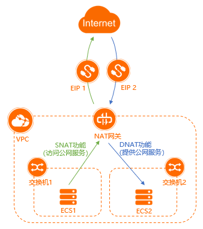
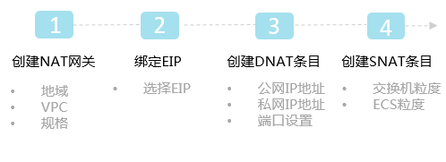

阿里云  
专有云  
NAT网关  
用户指南  
产品版本：V3.18.3  
文档版本：20241028

**目录**

- [1.什么是NAT网关](#section-1)
- [2.登录NAT网关管理控制台](#section-2)
- [3.快速入门](#section-3)
    - [3.1. 入门概述](#section-3-1)
    - [3.2. 创建NAT网关](#section-3-2)
    - [3.3. 绑定弹性公网IP](#section-3-3)
    - [3.4. 创建DNAT条目](#section-3-4)
    - [3.5. 创建SNAT条目](#section-3-5)
- [4.管理NAT网关](#section-4)
    - [4.1. NAT网关实例概述](#section-4-1)
    - [4.2. 创建NAT网关](#section-4-2)
    - [4.3. 查看NAT网关](#section-4-3)
    - [4.4. 管理NAT网关](#section-4-4)
    - [4.5. 删除NAT网关](#section-4-5)
    - [4.6. 管理标签](#section-4-6)
- [5.管理弹性公网IP](#section-5)
    - [5.1. 绑定弹性公网IP](#section-5-1)
    - [5.2. 解绑弹性公网IP](#section-5-2)
- [6.管理DNAT表](#section-6)
    - [6.1. DNAT概述](#section-6-1)
    - [6.2. 创建DNAT条目](#section-6-2)
    - [6.3. 修改DNAT条目](#section-6-3)
    - [6.4. 删除DNAT条目](#section-6-4)
- [7.管理SNAT表](#section-7)
    - [7.1. SNAT表概述](#section-7-1)
    - [7.2. 创建SNAT条目](#section-7-2)
    - [7.3. 修改SNAT条目](#section-7-3)
    - [7.4. 删除SNAT条目](#section-7-4)
- [8.NAT带宽包](#section-8)
    - [8.1. 创建NAT带宽包](#section-8-1)
    - [8.2. 修改NAT带宽包的带宽](#section-8-2)
    - [8.3. 添加IP地址](#section-8-3)
    - [8.4. 释放IP地址](#section-8-4)
    - [8.5. 删除NAT带宽包](#section-8-5)
- [9.DDoS基础防护](#section-9)

# 1.什么是NAT网关

NAT网关（NAT Gateway）是一款企业级的公网网关，提供NAT代理（SNAT和DNAT）功能，具有10 Gbps级别的转发能力和跨可用区的容灾能力。

**功能简介**

NAT网关作为一个网关设备，需要绑定公网IP才能正常工作。创建NAT网关后，您可以为NAT网关绑定弹性公网IP（Elastic IP Address，简称EIP）。

NAT网关支持SNAT和DNAT功能，功能说明如下：

<table>
  <tr>
    <th width="103">功能</th>
    <th>说明</th>
  </tr>
  <tr>
    <td>SNAT功能</td>
    <td>为专有网络VPC（Virtual Private Cloud）内无公网IP的ECS实例提供访问公网的代理服务。</td>
  </tr>
  <tr>
    <td>DNAT功能</td>
    <td>将NAT网关上绑定的EIP映射给ECS实例使用，使ECS实例可以面向公网提供服务。</td>
  </tr>
</table>

# 2.登录NAT网关管理控制台

本节以Chrome浏览器为例，介绍NAT网关（NAT Gateway）用户如何登录到Apsara Uni-manager运营控制台。

**前提条件**

- 登录Apsara Uni-manager运营控制台前，确认您已从部署人员处获取Apsara Uni-manager运营控制台的服务域名地址。

- 推荐使用Chrome浏览器。

**操作步骤**

1. 在浏览器地址栏中，输入Apsara Uni-manager运营控制台的访问地址，按回车键。

2. 输入正确的用户名及密码。

   请向运营管理员获取登录控制台的用户名和密码。

   > 首次登录Apsara Uni-manager运营控制台时，需要修改登录用户名的密码，请按照提
   >
   > **说明**
   >
   > 示完成密码修改。为提高安全性，密码长度必须为 8~20 位，且至少包含以下两种类型：
   >
   > - 英文大写或小写字母（A~Z、a~z）
   >
   > - 阿拉伯数字（0~9）
   >
   > - 特殊符号（感叹号（！）、at（@）、井号（#）、美元符号（$）、百分号（%）等）

3. 单击**登录**。

4. 如果账号已激活MFA多因素认证，请根据以下两种情况进行操作：

   - 管理员强制开启MFA后的首次登录：

     <ol type="a">

     <li>

     在绑定虚拟MFA设备页面中，按页面提示步骤绑定MFA设备。

     </li>

     <li>

     按照步骤2重新输入账号和密码，单击**账号登录**。

     </li>

     </ol>

     <ol type="i" start="100">

     <li>

     输入6位MFA码后单击**认证**。

     </li>

     </ol>

   - 您已开启并绑定MFA：

     输入6位MFA码后单击**认证**。

     > 绑定并开启MFA的操作请参见<strong>《Apsara Uni-manager运营控制台用户指南》</strong>中
     >
     > **说明**
     >
     > 的<strong>《多因素认证》</strong>章节。

5. 在页面顶部的菜单栏中，选择**产品 > 网络 > 专有网络 VPC**。

6. 在左侧导航栏，单击**NAT网关**。

# 3.快速入门

## 3.1. 入门概述

本文提供SNAT和DNAT完整的配置过程，使VPC中的ECS实例可以通过NAT网关与互联网通信。

**前提条件**

在开始之前，请确保满足以下条件：

- 您已经创建了专有网络。更多信息，请参见<strong>《专有网络VPC用户指南》</strong>手册中**快速入门**下的**创建专有网络**章节。

- 您已经创建了专有网络类型的ECS实例。更多信息，请参见<strong>《云服务器ECS用户指南》</strong>手册中**快速入门**下的**创建实例**章节。

- 您已经创建了弹性公网IP（Elastic IP Address，简称EIP）。更多信息，请参见<strong>《弹性公网IP用户指南》</strong>手册中**快速入门**下的**申请EIP**章节。

**配置流程说明**

本文以一台没有绑定任何公网IP的专有网络ECS实例为例。配置流程图如下：

1. 创建NAT网关

   NAT网关是一款企业级的VPC公网网关，提供NAT代理功能。在配置SNAT和DNAT规则前，您需要先创建NAT网关。

   具体操作，请参见创建NAT网关。

2. 绑定EIP

   NAT网关作为一个网关设备，需要绑定公网IP才能正常工作。创建NAT网关后，您可以为NAT网关绑定EIP。

   具体操作，请参见绑定弹性公网IP。

3. 创建DNAT条目

   NAT网关支持DNAT功能，将NAT网关上的公网IP映射给ECS实例使用，使ECS实例能够提供互联网服务。DNAT支持端口映射和IP映射。

   具体操作，请参见创建DNAT条目。

4. 创建SNAT条目

   NAT网关支持SNAT功能，为VPC内无公网IP的ECS实例提供访问互联网的代理服务。

   具体操作，请参见创建SNAT条目。

## 3.2. 创建NAT网关

NAT网关是一款企业级的公网网关，提供NAT代理功能。在配置SNAT和DNAT规则前，您需要先创建一个NAT网关实例。

**前提条件**

您已经创建了专有网络VPC（Virtual Private Cloud）。具体操作，请参见<strong>《专有网络VPC用户指南》</strong>手册中**快速入门**下的**创建专有网络**章节。

**操作步骤**

1. 登录NAT网关管理控制台。

2. 在**NAT网关**页面，单击**创建NAT网关**。

3. 在创建NAT网关页面，配置以下参数信息，然后单击**提交**。

   <table>
     <tr>
       <th>配置</th>
       <th>说明</th>
     </tr>
     <tr>
       <td colspan="2">区域</td>
     </tr>
     <tr>
       <td>组织</td>
       <td>选择NAT网关所属的组织。</td>
     </tr>
     <tr>
       <td>资源集</td>
       <td>选择NAT网关所属的资源集。</td>
     </tr>
     <tr>
       <td>地域</td>
       <td>选择NAT网关所属的地域。</td>
     </tr>
     <tr>
       <td colspan="2">基本配置</td>
     </tr>
     <tr>
       <td>VPC</td>
       <td>选择NAT网关所属的VPC。 如果您没有VPC实例，可单击<strong>创建VPC</strong>，在<strong>创建VPC</strong>对话框配置VPC相关参数，单击<strong>提交</strong>，然后选择创建的VPC。如果在VPC列表中，找不到目标VPC，请从以下方面进行排查： • 查看该VPC是否已经配置NAT网关。一个VPC只能配置一个NAT网关。 • 查看该VPC中是否存在目标网段为0.0.0.0/0的自定义路由。如果存在，请删除该路由条目。</td>
     </tr>
     <tr>
       <td>共享范围</td>
       <td>选择VPC的共享范围。 • <strong>本资源集</strong>：本资源集的管理员可以使用共享VPC创建资源。 • <strong>本组织及下级组织</strong>：本组织及下级组织的管理员可以使用共享VPC创建资源。 • <strong>本组织</strong>：本组织的管理员可以使用共享VPC创建资源。</td>
     </tr>
   </table>

   <table>
     <tr>
       <td>规格</td>
       <td>选择NAT网关规格，支持以下规格： • <strong>小型</strong>：SNAT最大连接数为1万。 • <strong>中型</strong>：SNAT最大连接数为5万。 • <strong>大型</strong>：SNAT最大连接数为20万。 • <strong>超大型-1</strong>：SNAT最大连接数为100万。 • 自定义规格：根据业务需求和环境自定义的NAT网关规格。 说明不同规格的NAT网关会影响SNAT最大连接数，但不会影响DNAT连接数。</td>
     </tr>
     <tr>
       <td>名称</td>
       <td>输入NAT网关的名称。名称长度在2~128个字符之间，必须以英文字母和中文字符开头，可包含数字、下划线（_）、短划线（-）、半角句号（.），但不能以<code> http:// </code>或<code> https:// </code>开头。</td>
     </tr>
   </table>

## 3.3. 绑定弹性公网IP

NAT网关作为一个网关设备，需要绑定弹性公网IP（Elastic IP Address，简称EIP）才能正常工作。创建NAT网关后，您可以为NAT网关绑定EIP。

**前提条件**

EIP绑定NAT网关前，请确保满足以下条件：

- 您已经创建了NAT网关。更多信息，请参见创建NAT网关。

- 您已经申请了EIP。更多信息，请参见<strong>《弹性公网IP用户指南》</strong>手册中**快速入门**下的**申请EIP**章节。

**操作步骤**

1. 登录NAT网关管理控制台。

2. 在顶部菜单栏，选择NAT网关的地域。

3. 在**NAT网关**页面，找到目标NAT网关实例，然后您可以通过以下两种方式绑定弹性公网IP。

   - 在**操作**列选择  **> 绑定弹性公网IP**。

   - 在**弹性公网IP**列单击**立即绑定**。

4. 在**绑定弹性公网IP**对话框，配置以下信息，然后单击**确定**。

   | 配置 | 说明 |
   | --- | --- |
   | 可用EIP列表 | 选择提供互联网访问的EIP。 |

## 3.4. 创建DNAT条目

NAT网关支持DNAT功能，将NAT网关上的公网IP映射给ECS实例使用，使ECS实例能够提供互联网服务。DNAT支持端口映射和IP映射。

**操作步骤**

1. 登录NAT网关管理控制台。

2. 在顶部菜单栏，选择NAT网关的地域。

3. 在**NAT网关**页面，找到目标NAT网关实例，然后在**操作**列单击**设置DNAT**。

4. 在**DNAT管理**页签，单击**创建DNAT条目**。

5. 在**创建DNAT条目**对话框，根据以下信息配置DNAT条目，然后单击**确定**。

   <table>
     <tr>
       <th width="107">配置</th>
       <th>说明</th>
     </tr>
     <tr>
       <td>公网IP地址</td>
       <td>选择一个可用的公网IP。 说明用于创建SNAT条目的公网IP不能再用来创建DNAT条目。</td>
     </tr>
     <tr>
       <td>私网IP地址</td>
       <td>选择要通过DNAT规则进行公网通信的ECS实例。您可以通过以下两种方式指定目标ECS实例的私网IP： • <strong>从ECS或弹性网卡对应IP进行选择</strong>：从ECS实例或弹性网卡列表中选择ECS实例。 • <strong>自填</strong>：输入目标ECS实例的私网IP。 说明自填的私网IP必需属于本VPC的CIDR范围，也可直接输入一个已有的ECS的私网IP。</td>
     </tr>
     <tr>
       <td>端口设置</td>
       <td>选择DNAT映射的方式： • <strong>所有端口</strong>：该方式属于IP映射，任何访问该公网IP的请求都将转发到目标ECS实例上。 • <strong>具体端口</strong>：该方式属于端口映射，NAT网关会将以指定协议和端口访问该公网IP的请求转发到目标ECS实例的指定端口上。选择具体端口后，请根据业务需求输入<strong>公网端口</strong>（进行端口转发的外部端口）、<strong>私</strong><strong>网端口</strong>（进行端口转发的内部端口）和<strong>协议类型</strong>（转发端口的协议类型）。</td>
     </tr>
   </table>

## 3.5. 创建SNAT条目

NAT网关的SNAT功能可以为VPC中无公网IP的ECS实例提供访问互联网的代理服务。

**操作步骤**

1. 登录NAT网关管理控制台。

2. 在顶部菜单栏，选择NAT网关的地域。

3. 在**NAT网关**页面，找到目标NAT网关实例，然后在**操作**列单击**设置SNAT**。

4. 在**SNAT管理**页签，单击**创建SNAT条目**。

5. 在**创建SNAT条目**对话框，根据以下信息配置SNAT条目，然后单击**确定**。

   <table>
     <tr>
       <th width="107">配置</th>
       <th>说明</th>
     </tr>
     <tr>
       <td>粒度设置</td>
       <td>选择SNAT条目的粒度。 • <strong>交换机粒度</strong>：指定交换机下的ECS实例通过配置的公网IP访问互联网。 • <strong>交换机</strong>：选择VPC中的交换机。该交换机下所有ECS实例都将通过SNAT功能进行公网访问。 • <strong>交换机网段</strong>：显示该交换机的网段。 • <strong>ECS粒度</strong>：指定的ECS实例通过配置的公网IP访问互联网。 • <strong>可用ECS列表</strong>：选择VPC中的ECS实例。该ECS实例将通过配置的公网IP访问互联网。请确保ECS实例满足以下条件： • ECS实例的状态处于运行中。 • ECS实例不具备固定公网IP且未绑定其他弹性公网IP。 • <strong>ECS网段</strong>：显示该ECS实例的网段。</td>
     </tr>
     <tr>
       <td>公网IP地址</td>
       <td>选择用来提供互联网访问的公网IP。支持选择1个或多个公网IP，多个公网IP可以构建SNAT IP地址池。 说明用于创建DNAT条目的公网IP不能再用来创建SNAT条目。</td>
     </tr>
     <tr>
       <td>条目名称</td>
       <td>SNAT条目的名称。名称长度为2~128个字符，以大小写字母或中文开头， 可包含数字、下划线（_）和短划线（-）。</td>
     </tr>
   </table>

# 4.管理NAT网关

## 4.1. NAT网关实例概述

NAT网关（NAT Gateway）是一款企业级的公网网关，提供NAT代理（SNAT和DNAT）、高达10 Gbps级别转发能力以及跨可用区的容灾能力。

**实例规格**

NAT网关提供小型、中性、大型和超大型-1规格。不同规格的NAT网关会影响SNAT最大连接数和SNAT每秒新建连接数，但不会影响DNAT性能。不同规格的NAT网关的对比如下表所示。

| 规格 | SNAT最大连接数 | SNAT每秒新建连接数 |
| --- | --- | --- |
| 小型 | 1万 | 1千 |
| 中型 | 5万 | 5千 |
| 大型 | 20万 | 1万 |
| 超大型-1 | 100万 | 5万 |

在选择NAT网关规格时，请注意：

- NAT网关在云监控控制台只提供最大连接数监控，不提供每秒新建连接数监控。

- NAT网关SNAT的连接超时时间为900秒。

- 为避免网络拥塞、公网抖动可能造成的SNAT连接超时，请确保您的业务应用有自动重连机制，这样可以提供更高的可用性。

- NAT网关暂不支持报文分片。

- 对于公网上同一个目的IP和端口，NAT网关配置的EIP数限制NAT网关的最大并发数，绑定单个EIP最大连接数为55000，绑定多个EIP可以提升为N\*55000。

## 4.2. 创建NAT网关

NAT网关是一款企业级的公网网关，提供NAT代理功能。在配置SNAT和DNAT规则前，您需要先创建一个NAT网关实例。

**前提条件**

您已经创建了专有网络VPC（Virtual Private Cloud）。具体操作，请参见<strong>《专有网络VPC用户指南》</strong>手册中**快速入门**下的**创建专有网络**章节。

**操作步骤**

1. 登录NAT网关管理控制台。

2. 在**NAT网关**页面，单击**创建NAT网关**。

3. 在创建NAT网关页面，配置以下参数信息，然后单击**提交**。

   <table>
     <tr>
       <th>配置</th>
       <th>说明</th>
     </tr>
     <tr>
       <td colspan="2">区域</td>
     </tr>
     <tr>
       <td>组织</td>
       <td>选择NAT网关所属的组织。</td>
     </tr>
     <tr>
       <td>资源集</td>
       <td>选择NAT网关所属的资源集。</td>
     </tr>
     <tr>
       <td>地域</td>
       <td>选择NAT网关所属的地域。</td>
     </tr>
     <tr>
       <td colspan="2">基本配置</td>
     </tr>
     <tr>
       <td>VPC</td>
       <td>选择NAT网关所属的VPC。 如果您没有VPC实例，可单击<strong>创建VPC</strong>，在<strong>创建VPC</strong>对话框配置VPC相关参数，单击<strong>提交</strong>，然后选择创建的VPC。如果在VPC列表中，找不到目标VPC，请从以下方面进行排查： • 查看该VPC是否已经配置NAT网关。一个VPC只能配置一个NAT网关。 • 查看该VPC中是否存在目标网段为0.0.0.0/0的自定义路由。如果存在，请删除该路由条目。</td>
     </tr>
     <tr>
       <td>共享范围</td>
       <td>选择VPC的共享范围。 • <strong>本资源集</strong>：本资源集的管理员可以使用共享VPC创建资源。 • <strong>本组织及下级组织</strong>：本组织及下级组织的管理员可以使用共享VPC创建资源。 • <strong>本组织</strong>：本组织的管理员可以使用共享VPC创建资源。</td>
     </tr>
     <tr>
       <td>规格</td>
       <td>选择NAT网关规格，支持以下规格： • <strong>小型</strong>：SNAT最大连接数为1万。 • <strong>中型</strong>：SNAT最大连接数为5万。 • <strong>大型</strong>：SNAT最大连接数为20万。 • <strong>超大型-1</strong>：SNAT最大连接数为100万。 • 自定义规格：根据业务需求和环境自定义的NAT网关规格。 说明不同规格的NAT网关会影响SNAT最大连接数，但不会影响DNAT连接数。</td>
     </tr>
     <tr>
       <td>名称</td>
       <td>输入NAT网关的名称。名称长度在2~128个字符之间，必须以英文字母和中文字符开头，可包含数字、下划线（_）、短划线（-）、半角句号（.），但不能以<code> http:// </code>或<code> https:// </code>开头。</td>
     </tr>
   </table>

## 4.3. 查看NAT网关

您可以查看已创建的NAT网关实例的相关信息。

**查看NAT网关详情**

1. 登录NAT网关管理控制台。

2. 在顶部菜单栏，选择NAT网关的地域。

3. 在**NAT网关**页面，单击**高级筛选**，输入目标NAT网关实例的信息，然后单击**搜索**，您可以查看目标NAT网关实例的**状态**、**标签**信息、**规格/类型**、绑定的**弹性公网IP**、**组织/资源集**、所属**专有网络ID/名称**、**最大带宽**以及**创建时间**。

   - 在**专有网络ID/名称**列单击专有网络ID可查看所属专有网络的详情。

   - 在**弹性公网IP**列单击IP地址可查看绑定弹性公网IP的详情。

4. 在**NAT网关ID/名称**列，单击NAT网关实例ID，可查看更多NAT网关实例信息。

**查看NAT网关操作记录**

1. 登录NAT网关管理控制台。

2. 在顶部菜单栏，选择NAT网关的地域。

3. 在**NAT网关**页面，找到目标NAT网关，然后在**操作**列单击**管理**。

4. 在**操作记录**页签，您可以查看NAT网关的操作记录，找到目标操作名称，在**操作列**单击**操作详情**。

5. 在**操作详情信息**面板，查看操作的详细信息。

## 4.4. 管理NAT网关

您可以修改NAT网关实例的相关信息。

**修改实例名称和描述**

1. 登录NAT网关管理控制台。

2. 在顶部菜单栏，选择NAT网关的地域。

3. 在**NAT网关**页面，找到目标NAT网关，然后在**操作**列单击**管理**。

4. 在**基本信息**页签，在**NAT网关名称**右侧单击  图标，在弹出的对话框输入NAT网关的名称，然后单击**确**

   **定**。

5. 在**描述**右侧单击  图标，在弹出的对话框输入描述信息，然后单击**确定**。

**升降配**

1. 登录NAT网关管理控制台。

2. 在顶部菜单栏，选择NAT网关的地域。

3. 在**NAT网关**页面，找到目标NAT网关，然后在**操作**列单击**管理**。

4. 在**基本信息**页签，在**规格信息**右侧单击**升降配**。

5. 在**NAT网关变配**页面，选择需要变配的规格，然后单击**提交**。

## 4.5. 删除NAT网关

如果您不需要NAT网关服务了，您可以删除NAT网关。

**前提条件**

删除NAT网关前，请确保满足以下条件。

- NAT网关没有绑定EIP，如有绑定请解绑。具体操作，请参见解绑弹性公网IP。

- DNAT列表中没有DNAT条目，如有请删除。具体操作，请参见删除DNAT条目。

- SNAT列表中没有SNAT条目，如有请删除。具体操作，请参见删除SNAT条目。

**操作步骤**

1. 登录NAT网关管理控制台。

2. 在顶部菜单栏，选择NAT网关的地域。

3. 在**NAT网关**页面，找到目标NAT网关，然后在**操作**列选择  **> 删除**。

4. 在弹出的对话框，单击**释放**。

   > **说明**
   >
   > 您也可以在弹出的对话框选中**强制删除**，在删除NAT网关后自动删除NAT网关中的DNAT条目、SNAT条目，并解绑EIP。强制删除NAT网关时，无需提前删除NAT网关中的DNAT条目、SNAT条目及绑定的EIP。

## 4.6. 管理标签

NAT网关支持标签功能，您可以通过标签功能来标记和分类NAT网关实例，以便于您对实例进行搜索和筛选。

**添加标签**

1. 登录NAT网关管理控制台。

2. 在顶部菜单栏，选择NAT网关的地域。

3. 在**NAT网关**页面，执行以下操作，为实例添加标签。

   - 为单个实例添加标签

     <ol type="a">

     <li>

     找到目标NAT网关实例，鼠标悬停在**标签**列下<strong>-</strong>或已有标签右侧，然后单击  图标。

     </li>

     <li>

     在**编辑标签**对话框，单击**添加**，根据以下信息配置标签，然后单击**确定**。

     | 配置 | 说明 |
     | --- | --- |
     | 标签键 | 标签的标签键，支持选择已有标签键或输入新的标签键。标签键最多支持64个字符，不能以<code> aliyun </code>或<code> acs: </code>开头，不能包含<code> http:// </code>和<code> https:// </code>。 |
     | 标签值 | 标签的标签值，支持选择已有标签值或输入新的标签值。 标签值最多支持128个字符，不能以<code> aliyun </code>或<code> acs: </code>开头，不能包含<code> http:// </code>和<code> https:// </code>。 |

     </li>

     </ol>

   - 为多个实例添加标签

     <ol type="a">

     <li>

     选中需要批量添加标签的NAT网关实例，在页面左下方单击**批量绑定标签**。

     </li>

     <li>

     在**批量绑定标签**对话框，配置**标签键**和**标签值**，然后单击确定。

     </li>

     </ol>

4. 返回**NAT网关**页面，单击**标签筛选**，可在**标签筛选**对话框根据标签键和标签值来筛选NAT网关实例。

**删除标签**

1. 登录NAT网关管理控制台。

2. 在顶部菜单栏，选择NAT网关的地域。

3. 在**NAT网关**页面，执行以下操作，为实例删除标签。

   - 为单个实例删除标签

     <ol type="a">

     <li>

     找到目标NAT网关实例，在**标签**列单击  图标。

     </li>

     <li>

     在**编辑标签**对话框，找到需要删除的标签值对，单击右侧的删除图标，然后单击**确定**。

     </li>

     </ol>

   - 为多个实例删除标签

     <ol type="a">

     <li>

     选中需要批量删除标签的NAT网关实例，在页面左下方单击**批量解绑标签**。

     </li>

     <li>

     在**批量解绑标签**对话框，找到需要删除的标签值对，单击右侧的删除图标，然后单击**确定**。

     </li>

     </ol>

# 5.管理弹性公网IP

## 5.1. 绑定弹性公网IP

NAT网关作为一个网关设备，需要绑定弹性公网IP（Elastic IP Address，简称EIP）才能正常工作。创建NAT网关后，您可以为NAT网关绑定EIP。

**前提条件**

EIP绑定NAT网关前，请确保满足以下条件：

- 您已经创建了NAT网关。更多信息，请参见创建NAT网关。

- 您已经申请了EIP。更多信息，请参见<strong>《弹性公网IP用户指南》</strong>手册中**快速入门**下的**申请EIP**章节。

**操作步骤**

1. 登录NAT网关管理控制台。

2. 在顶部菜单栏，选择NAT网关的地域。

3. 在**NAT网关**页面，找到目标NAT网关实例，然后您可以通过以下两种方式绑定弹性公网IP。

   - 在**操作**列选择  **> 绑定弹性公网IP**。

   - 在**弹性公网IP**列单击**立即绑定**。

4. 在**绑定弹性公网IP**对话框，配置以下信息，然后单击**确定**。

   | 配置 | 说明 |
   | --- | --- |
   | 可用EIP列表 | 选择提供互联网访问的EIP。 |

## 5.2. 解绑弹性公网IP

如果您的NAT网关不需要与公网通信，您可以将NAT网关与弹性公网IP（Elastic IP Address，简称EIP）解绑。

**前提条件**

请确保要解绑的EIP没有被任何SNAT或DNAT条目占用。如有占用，请先删除SNAT条目和DNAT条目。具体操作，请参见删除SNAT条目和删除DNAT条目。

**操作步骤**

1. 登录NAT网关管理控制台。

2. 在顶部菜单栏，选择NAT网关的地域。

3. 在**NAT网关**页面，找到目标NAT网关，然后在**操作**列单击  **> 解绑弹性公网IP**。

4. 在**解绑弹性公网IP**对话框，选择要解绑的EIP，然后单击**确定**。

# 6.管理DNAT表

## 6.1. DNAT概述

NAT网关支持目的网络地址转换DNAT（Destination Network Address Translation）功能，将NAT网关上的公网IP映射给专有网络的ECS实例使用，使ECS实例可以面向互联网提供服务。

**DNAT条目**

您可以通过在DNAT表中创建DNAT条目，实现端口转发的功能。创建DNAT条目后，公网IP收到的请求将按照自定义的映射规则，转发给专有网络VPC内的ECS实例。

每个DNAT条目由以下五部分组成：

- **公网IP**：NAT网关绑定的弹性公网IP（EIP）。

- **私网IP**：专有网络中ECS实例的私网IP。

- **公网端口**：进行端口转发的外部端口。

- **私网端口**：进行端口转发的内部端口。

- **协议类型**：转发端口的协议类型。

**端口映射和IP映射**

DNAT功能包括端口映射与IP映射：

- 端口映射配置端口映射后，NAT网关会将指定协议和端口访问该公网IP的请求转发到目标ECS实例的指定端口上。如下表DNAT条目为例：

  - 条目1：NAT网关会将访问1.1.XX.XX的TCP 80端口的请求转发到192.168.1.1的TCP 80端口上。

  - 条目2：NAT网关会将访问2.2.XX.XX的UDP 8080端口的请求转发到192.168.1.2的UDP 8000端口上。

  | 转发条目 | 公网IP | 公网端口 | 私网IP | 私网端口 | 协议 |
  | --- | --- | --- | --- | --- | --- |
  | 条目1 | 1.1.XX.XX | 80 | 192.168.1.1 | 80 | TCP |
  | 条目2 | 2.2.XX.XX | 8080 | 192.168.1.2 | 8000 | UDP |

- IP映射

  配置IP映射后，NAT网关会将任何访问该公网IP的请求都将转发到目标ECS实例上。如下表DNAT条目为例，NAT网关会将任何访问3.3.XX.XX的请求转发到192.168.1.3实例上。

  | 转发条目 | 公网IP | 公网端口 | 私网IP | 私网端口 | 协议 |
  | --- | --- | --- | --- | --- | --- |
  | 条目3 | 3.3.XX.XX | 任意端口 | 192.168.1.3 | 任意端口 | 任意协议 |

## 6.2. 创建DNAT条目

NAT网关支持DNAT功能，将NAT网关上的公网IP映射给ECS实例使用，使ECS实例能够提供互联网服务。DNAT支持端口映射和IP映射。

**操作步骤**

1. 登录NAT网关管理控制台。

2. 在顶部菜单栏，选择NAT网关的地域。

3. 在**NAT网关**页面，找到目标NAT网关实例，然后在**操作**列单击**设置DNAT**。

4. 在**DNAT管理**页签，单击**创建DNAT条目**。

5. 在**创建DNAT条目**对话框，根据以下信息配置DNAT条目，然后单击**确定**。

   <table>
     <tr>
       <th width="107">配置</th>
       <th>说明</th>
     </tr>
     <tr>
       <td>公网IP地址</td>
       <td>选择一个可用的公网IP。 说明用于创建SNAT条目的公网IP不能再用来创建DNAT条目。</td>
     </tr>
     <tr>
       <td>私网IP地址</td>
       <td>选择要通过DNAT规则进行公网通信的ECS实例。您可以通过以下两种方式指定目标ECS实例的私网IP： • <strong>从ECS或弹性网卡对应IP进行选择</strong>：从ECS实例或弹性网卡列表中选择ECS实例。 • <strong>自填</strong>：输入目标ECS实例的私网IP。 说明自填的私网IP必需属于本VPC的CIDR范围，也可直接输入一个已有的ECS的私网IP。</td>
     </tr>
     <tr>
       <td>端口设置</td>
       <td>选择DNAT映射的方式： • <strong>所有端口</strong>：该方式属于IP映射，任何访问该公网IP的请求都将转发到目标ECS实例上。 • <strong>具体端口</strong>：该方式属于端口映射，NAT网关会将以指定协议和端口访问该公网IP的请求转发到目标ECS实例的指定端口上。选择具体端口后，请根据业务需求输入<strong>公网端口</strong>（进行端口转发的外部端口）、<strong>私</strong><strong>网端口</strong>（进行端口转发的内部端口）和<strong>协议类型</strong>（转发端口的协议类型）。</td>
     </tr>
   </table>

## 6.3. 修改DNAT条目

创建DNAT条目后，您可以修改DNAT条目的公网IP、私网IP或端口。

**操作步骤**

1. 登录NAT网关管理控制台。

2. 在顶部状态栏处，选择NAT网关的地域。

3. 在**NAT网关**页面，找到目标NAT网关实例，然后在**操作**列单击**设置DNAT**。

4. 在**DNAT管理**页签，找到目标DNAT条目，然后在**操作**列单击**编辑**。

5. 在**编辑DNAT条目**对话框，修改DNAT条目的公网IP地址、私网IP地址或端口，然后单击**确定**。

## 6.4. 删除DNAT条目

如果您不需要ECS实例面向互联网提供服务，您可以删除DNAT条目。

**操作步骤**

1. 登录NAT网关管理控制台。

2. 在顶部菜单栏，选择NAT网关的地域。

3. 在**NAT网关**页面，找到目标NAT网关实例，然后在**操作**列单击**设置DNAT**。

4. 在**DNAT管理**页签，找到目标DNAT条目，然后在**操作**列单击**删除**。

5. 在弹出的对话框，单击**确定**。

# 7.管理SNAT表

## 7.1. SNAT表概述

NAT网关支持SNAT功能，为VPC内无公网IP的ECS实例提供访问互联网的代理服务。

**SNAT条目**

您可以通过在SNAT表中创建SNAT条目，实现代理上网功能。

每个SNAT条目由以下两部分组成：

- **交换机或ECS实例**：需要使用SNAT代理服务的交换机或ECS实例。

- **公网IP**：用来提供互联网访问的公网IP。

**交换机粒度和ECS粒度**

SNAT功能提供如下两种粒度，以实现VPC内ECS实例访问互联网。

- 交换机粒度

  选择交换机为粒度创建SNAT条目后，当指定交换机下的ECS实例发起互联网访问请求时，NAT网关会为其提供SNAT服务，且使用的公网IP为指定的公网IP。默认情况，交换机下的所有ECS实例都可以使用配置的公网IP访问互联网。

  > 如果ECS实例已经持有了公网IP（如分配了固定公网IP、绑定EIP和设置了DNAT IP映
  >
  > **说明**
  >
  > 射），当该ECS实例发起互联网访问时，会优先通过持有的公网IP访问互联网，而不会使用NAT网关的SNAT功能访问互联网。

- ECS粒度

  选择ECS为粒度创建SNAT条目后，指定的ECS实例通过配置的公网IP访问互联网。当指定的ECS实例发起互联网访问请求时，NAT网关会为其提供SNAT服务，且使用的公网IP为指定的公网IP。

## 7.2. 创建SNAT条目

NAT网关的SNAT功能可以为VPC中无公网IP的ECS实例提供访问互联网的代理服务。

**操作步骤**

1. 登录NAT网关管理控制台。

2. 在顶部菜单栏，选择NAT网关的地域。

3. 在**NAT网关**页面，找到目标NAT网关实例，然后在**操作**列单击**设置SNAT**。

4. 在**SNAT管理**页签，单击**创建SNAT条目**。

5. 在**创建SNAT条目**对话框，根据以下信息配置SNAT条目，然后单击**确定**。

   | 配置 | 说明 |
   | --- | --- |

   <table>
     <tr>
       <td>粒度设置</td>
       <td>选择SNAT条目的粒度。 • <strong>交换机粒度</strong>：指定交换机下的ECS实例通过配置的公网IP访问互联网。 • <strong>交换机</strong>：选择VPC中的交换机。该交换机下所有ECS实例都将通过SNAT功能进行公网访问。 • <strong>交换机网段</strong>：显示该交换机的网段。 • <strong>ECS粒度</strong>：指定的ECS实例通过配置的公网IP访问互联网。 • <strong>可用ECS列表</strong>：选择VPC中的ECS实例。该ECS实例将通过配置的公网IP访问互联网。请确保ECS实例满足以下条件： • ECS实例的状态处于运行中。 • ECS实例不具备固定公网IP且未绑定其他弹性公网IP。 • <strong>ECS网段</strong>：显示该ECS实例的网段。</td>
     </tr>
     <tr>
       <td>公网IP地址</td>
       <td>选择用来提供互联网访问的公网IP。支持选择1个或多个公网IP，多个公网IP可以构建SNAT IP地址池。 说明用于创建DNAT条目的公网IP不能再用来创建SNAT条目。</td>
     </tr>
     <tr>
       <td>条目名称</td>
       <td>SNAT条目的名称。名称长度为2~128个字符，以大小写字母或中文开头， 可包含数字、下划线（_）和短划线（-）。</td>
     </tr>
   </table>

## 7.3. 修改SNAT条目

创建SNAT条目后，您可以修改SNAT条目的公网IP和条目名称。

**操作步骤**

1. 登录NAT网关管理控制台。

2. 在顶部状态栏处，选择NAT网关的地域。

3. 在**NAT网关**页面，找到目标NAT网关实例，然后在**操作**列单击**设置SNAT**。

4. 在**SNAT管理**页签，找到目标SNAT条目，然后在**操作**列单击**编辑**。

5. 在**编辑SNAT条目**对话框，修改SNAT条目的公网IP、条目名称，然后单击**确定**。

## 7.4. 删除SNAT条目

如果您不需要为VPC内无公网IP的ECS实例提供访问互联网的代理服务，您可以删除SNAT条目。

**操作步骤**

1. 登录NAT网关管理控制台。

2. 在顶部菜单栏，选择NAT网关的地域。

3. 在**NAT网关**页面，找到目标NAT网关实例，然后在**操作**列单击**设置SNAT**。

4. 在**SNAT管理**页签，找到要删除的SNAT条目，然后在**操作**列单击**删除**。

5. 在弹出的对话框，单击**确定**。

# 8.NAT带宽包

## 8.1. 创建NAT带宽包

您可以使用弹性公网IP（Elastic IP Address，简称EIP）或NAT带宽包绑定NAT网关，但您只能使用其中一种方式绑定NAT网关。如果您使用NAT带宽包，您需要创建一个NAT带宽包，然后才可以配置DNAT或SNAT功能。NAT带宽包由公网IP和公网带宽组成。

**操作步骤**

1. 登录NAT网关管理控制台。

2. 在**NAT网关**页面，找到目标NAT网关，单击目标NAT网关ID。

3. 在**NAT带宽包**页签，单击**创建**。

4. 在**NAT带宽包**页面，根据以下信息配置NAT带宽包，然后单击**提交**。

   <table>
     <tr>
       <th>配置</th>
       <th>说明</th>
     </tr>
     <tr>
       <td colspan="2">区域</td>
     </tr>
     <tr>
       <td>组织</td>
       <td>显示要创建NAT带宽包的组织。</td>
     </tr>
     <tr>
       <td>资源集</td>
       <td>显示要创建NAT带宽包的资源集。</td>
     </tr>
     <tr>
       <td>地域</td>
       <td>显示要创建NAT带宽包的地域。</td>
     </tr>
     <tr>
       <td>可用区</td>
       <td>选择要创建NAT带宽包的可用区。</td>
     </tr>
     <tr>
       <td colspan="2">基本配置</td>
     </tr>
     <tr>
       <td>NAT网关ID</td>
       <td>显示要创建NAT带宽包的NAT网关实例的ID。</td>
     </tr>
     <tr>
       <td>计费方式</td>
       <td>选择NAT带宽包的计费方式。目前，仅支持<strong>按带宽</strong>计费。</td>
     </tr>
     <tr>
       <td>带宽(Mbps)</td>
       <td>输入要创建的NAT带宽包的带宽。</td>
     </tr>
     <tr>
       <td>名称</td>
       <td>输入NAT带宽包的名称。名称长度在2~128个字符之间，必须以英文字母和中文字符开头，可包含数字、下划线（_）、短划线（-）、半角句号（.）。</td>
     </tr>
     <tr>
       <td>描述</td>
       <td>输入NAT带宽包的描述。描述长度在2~256个字符之间，必须以英文字母和中文字符开头，可包含数字、下划线（_）、短划线（-）、全角句号（。），全角逗号（，），全角冒号（：），但不能以<code> http:// </code>或<code> https:// </code>开头。</td>
     </tr>
     <tr>
       <td>IP数量</td>
       <td>输入要创建NAT带宽包的个数。</td>
     </tr>
   </table>

## 8.2. 修改NAT带宽包的带宽

您可以修改NAT带宽包的带宽。修改后，立即生效。

**操作步骤**

1. 登录NAT网关管理控制台。

2. 在**NAT网关**页面，找到目标NAT网关，单击目标NAT网关实例ID。

3. 在**NAT带宽包**页签的**规格信息**区域，单击**修改带宽**。

4. 在**NAT带宽包带宽变配**页面，修改带宽，然后单击**提交**。

   NAT带宽包最大支持5000 Mbps。

## 8.3. 添加IP地址

您可以向NAT带宽包中添加IP地址，添加的IP地址可以用于创建DNAT和SNAT规则。

**操作步骤**

1. 登录NAT网关管理控制台。

2. 在**NAT网关**页面，找到目标NAT网关，单击目标NAT网关实例ID。

3. 在**NAT带宽包**页签的**公网IP列表**区域，单击**添加IP地址**。

4. 在**NAT带宽包IP变配**页面，输入要添加的IP地址的个数，然后单击**提交**。

## 8.4. 释放IP地址

您可以释放NAT带宽包中的IP地址，但需保证NAT带宽包下至少包含一个IP地址。

**前提条件**

释放IP地址前，请确保该IP地址未被用于DNAT条目和SNAT条目。如有请先删除。具体操作，请参见删除DNAT条目和删除SNAT条目。

**操作步骤**

1. 登录NAT网关管理控制台。

2. 在**NAT网关**页面，找到目标NAT网关，单击目标NAT网关实例ID。

3. 在**NAT带宽包**页签的**公网IP列表**区域，找到目标IP地址，然后在**操作**列单击**释放**。

4. 在**释放IP**对话框，单击**确定**。

## 8.5. 删除NAT带宽包

您可以删除一个不需要的NAT带宽包。

**前提条件**

开始前，请确保满足以下条件：

- NAT带宽包中的IP未被DNAT条目使用，如有请删除。具体操作，请参见删除DNAT条目。

- NAT带宽包中的IP未被SNAT条目使用，如有请删除。具体操作，请参见删除SNAT条目。

**操作步骤**

1. 登录NAT网关管理控制台。

2. 在**NAT网关**页面，找到目标NAT网关，单击目标NAT网关实例ID。

3. 在**带宽包详情**页面，找到目标NAT带宽包，单击**删除**。

4. 在**删除带宽包**对话框，单击**确定**。

# 9.DDoS基础防护

DDoS攻击是一种针对目标系统的恶意网络攻击行为，会导致被攻击者的业务无法正常访问。阿里云免费为NAT网关提供最高5 Gbps的DDoS基础防护，DDoS基础防护服务可以有效防止DDoS攻击。

**DDoS基础防护工作原理**

启用DDoS基础防护功能后，所有来自Internet的流量都将先经过云盾再到达NAT网关，云盾会针对常见的攻击进行清洗过滤。云盾DDoS基础防护可以防御SYN Flood、UDP Flood、ACK Flood、ICMP Flood 和DNS Flood等DDoS攻击。

云盾DDoS基础防护根据NAT网关实例的EIP带宽自动设定清洗阈值和黑洞阈值。当入方向流量达到阈值上限时，触发清洗和黑洞：

- 清洗：当来自Internet的攻击流量超过清洗阈值或符合攻击流量模型特征时，云盾将启动清洗操作，清洗操作包括过滤攻击报文、流量限速、包限速等。

- 黑洞：当来自Internet的攻击流量超过黑洞阈值时，为保护集群安全，流量将会被黑洞处理，即所有入流量全部被丢弃。

**清洗阈值**

NAT网关的清洗阈值计算方式如下表所示：

| EIP带宽 | 最大bps清洗阈值 | 最大pps清洗阈值 | 默认黑洞阈值 |
| --- | --- | --- | --- |
| 小于等于800 Mbps | 800 Mbps | 12万 | 1.5 Gbps |
| 大于800 Mbps | 设定的带宽值 | 设定的带宽值×150 | 设定的带宽值×2 |

例如EIP带宽为1000 Mbps，则最大bps清洗阈值为1000 Mbps，最大pps清洗阈值15万，默认黑洞阈值为2 Gbps。
