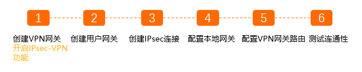
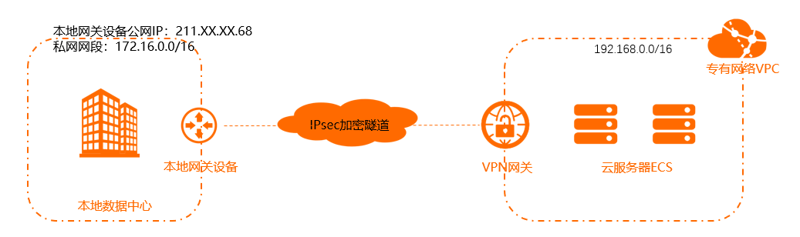
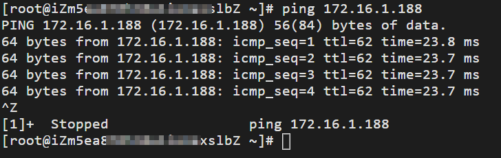
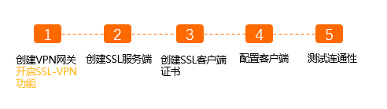
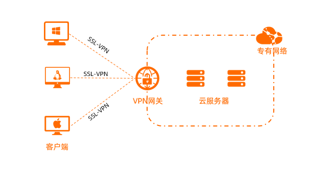
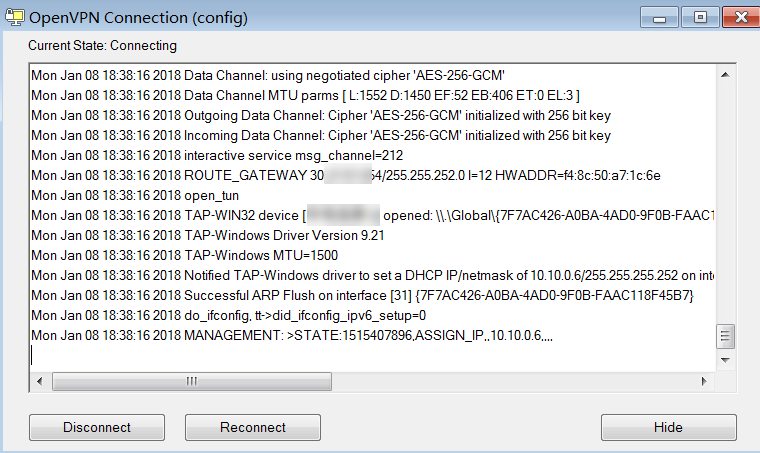

阿里云  
专有云  
VPN网关  
用户指南  
产品版本：V3.18.6  
文档版本：20251028

**目录**

- [1.登录专有网络管理控制台](#section-1)
- [2.快速入门](#section-2)
    - [2.1. IPsec-VPN入门](#section-2-1)
        - [2.1.1. IPsec-VPN入门概述](#section-2-1-1)
        - [2.1.2. 建立VPC到本地数据中心的连接](#section-2-1-2)
    - [2.2. SSL-VPN入门](#section-2-2)
        - [2.2.1. SSL-VPN入门概述](#section-2-2-1)
        - [2.2.2. 客户端远程连接VPC](#section-2-2-2)
    - [2.3. 网关路由概述](#section-2-3)
- [3.VPN网关](#section-3)
    - [3.1. 创建和管理VPN网关](#section-3-1)
    - [3.2. 配置VPN网关路由](#section-3-2)
        - [3.2.1. 使用目的路由](#section-3-2-1)
        - [3.2.2. 使用策略路由](#section-3-2-2)
- [4.用户网关](#section-4)
    - [4.1. 创建和管理用户网关](#section-4-1)
- [5.配置IPsec-VPN](#section-5)
    - [5.1. 创建和管理IPsec连接](#section-5-1)
    - [5.2. 配置路由安全组](#section-5-2)
- [6.配置SSL-VPN](#section-6)
    - [6.1. 创建和管理SSL服务端](#section-6-1)
    - [6.2. 配置路由安全组](#section-6-2)
    - [6.3. 创建和管理SSL客户端证书](#section-6-3)
- [7.管理标签](#section-7)
- [8.监控与运维](#section-8)
    - [8.1. 查看监控](#section-8-1)
    - [8.2. 查看操作日志](#section-8-2)

<a id="section-1"></a>

# 1.登录专有网络管理控制台

本节以Chrome浏览器为例，介绍专有网络VPC（Virtual Private Cloud）用户如何登录到Apsara Uni-manager运营控制台。

**前提条件**

- 登录Apsara Uni-manager运营控制台前，确认您已从部署人员处获取Apsara Uni-manager运营控制台的服务域名地址。

- 推荐使用Chrome浏览器。

**操作步骤**

1. 在浏览器地址栏中，输入Apsara Uni-manager运营控制台的服务域名地址，按回车键。

   

   > **说明**
   >
   > - 单击页面右上角的当前语言可以切换其它语言。

2. 输入正确的用户名及密码。

   请向运营管理员获取登录控制台的用户名和密码。

   > **说明**
   >
   > - **首次登录**
   >
   >   首次Apsara Uni-manager运营控制台时，需要修改登录用户名的密码，请按照提示完成密码修改。为提高安全性，密码长度必须为10~32位，且包含英文字母大小写、阿拉伯数字和特殊符号（感叹号（!）、at（@）、井号（#）、美元符号（$）、百分号（%）等）。
   >
   > - **忘记密码**
   >
   >   用户忘记登录密码时，单击忘记密码，输入账户名（当前账号的用户名）、邮箱（当前用户创建时所录入的邮箱）和验证码后，重置密码的链接将发至邮箱，进入链接后用户可输入新密码。

3. 单击**账号登录**。

4. 如果账号已激活MFA多因素认证，请根据以下两种情况进行操作：

   - 管理员强制开启MFA后的首次登录：

     <ol type="a">

     <li>

     在绑定虚拟MFA设备页面中，按页面提示步骤绑定MFA设备。

     </li>

     <li>

     按照步骤2重新输入账号和密码，单击**账号登录**。

     </li>

     </ol>

     <ol type="i" start="100">

     <li>

     输入6位MFA码后单击**认证**。

     </li>

     </ol>

   - 您已开启并绑定MFA：

     输入6位MFA码后单击**认证**。

     > **说明**
     >
     > 绑定并开启MFA的操作请参见《Apsara Uni-manager运营控制台用户指南》中**安全中心** > **多因素认证** > **管理多因素认证**章节。

5. 在页面顶部的菜单栏中，选择**产品 > 网络 > 专有网络 VPC**。

<a id="section-2"></a>

# 2.快速入门

<a id="section-2-1"></a>

## 2.1. IPsec-VPN入门

<a id="section-2-1-1"></a>

### 2.1.1. IPsec-VPN入门概述

通过IPsec-VPN可建立专有网络VPC（Virtual Private Cloud）与本地数据中心间的VPN连接。本文为您介绍IPsec-VPN的使用流程。

**环境要求**

使用IPsec-VPN功能建立VPC与本地数据中心的VPN连接前，请确保您的环境满足以下条件：

- 本地数据中心的网关设备必须支持IKEv1和IKEv2协议。

  IPsec-VPN支持IKEv1和IKEv2协议，只要支持这两种协议的设备均可以和阿里云VPN网关互连。

- 本地数据中心的网关设备必须配置静态公网IP地址。

- 本地数据中心和VPC间互通的网段没有重叠。

- 您已经了解VPC中的ECS实例所应用的安全组规则，并确保安全组规则允许本地数据中心的网关设备访问云上资源。

**使用流程**



1. 创建VPN网关

   VPN网关开启IPsec-VPN功能，一个VPN网关可以建立多条IPsec连接。

2. 创建用户网关

   通过创建用户网关，您可以将本地数据中心网关设备的信息注册到阿里云上。

3. 创建IPsec连接

   IPsec连接是指VPN网关和本地数据中心网关设备建立连接后的VPN通道。只有建立IPsec连接后，本地数据中心才能使用VPN网关进行加密通信。

4. 配置本地网关

   您需要在本地数据中心的网关设备中加载阿里云上VPN网关的配置。

5. 配置VPN网关路由

   您需要在VPN网关中配置路由，并发布路由到VPC路由表以实现本地数据中心和VPC的通信。更多信息，请参见网关路由概述。

6. 测试连通性

   登录到阿里云VPC内一台无公网IP的ECS实例，通过**ping**命令，**ping**本地数据中心内一台服务器的私网IP地址，验证通信是否正常。

**入门场景**

建立VPC到本地数据中心的连接

<a id="section-2-1-2"></a>

### 2.1.2. 建立VPC到本地数据中心的连接

本文介绍如何使用IPsec-VPN建立专有网络VPC（Virtual Private Cloud）到本地数据中心的VPN连接，实现本地数据中心与VPC的互通。

**前提条件**

- 确保本地数据中心的网关设备支持IKEv1和IKEv2协议，只要支持这两种协议的本地网关设备均可以和云上VPN网关互连。

- 本地数据中心的网关设备已经配置了静态公网IP。

- 本地数据中心和VPC互通的网段没有重叠。

- 您已经了解VPC中的ECS实例所应用的安全组规则，并确保安全组规则允许本地数据中心的网关设备访问云上资源。

**背景信息**

本文以下图场景为例。某公司在阿里云创建了VPC，网段为192.168.0.0/16。本地数据中心的网段为172.16.0.0/16，本地网关设备的公网IP为211.XX.XX.68。公司因业务发展，需要本地数据中心与云上VPC互通。您可以通过IPsec-VPN，建立本地数据中心与云上VPC的连接，实现云上和云下的互通。



**步骤一：创建VPN网关**

1. 登录专有网络管理控制台。

2. 在左侧导航栏，选择**VPN > VPN网关**。

3. 在顶部菜单栏，选择VPN网关实例的地域。

4. 在**VPN网关**页面，单击**创建VPN网关**。

5. 在**创建VPN**页面，根据以下信息进行配置。

   <table>
     <tr>
       <th>配置</th>
       <th>说明</th>
     </tr>
     <tr>
       <td colspan="2">区域</td>
     </tr>
     <tr>
       <td>组织</td>
       <td>选择VPN网关所属的组织。</td>
     </tr>
     <tr>
       <td>资源集</td>
       <td>选择VPN网关所属的资源集。</td>
     </tr>
     <tr>
       <td>地域</td>
       <td>选择VPN网关所属的地域。如果使用VPN网关的IPsec-VPN功能建立VPC到本地数据中心或VPC到VPC的VPN连接，必须确保VPN网关的地域和VPC的地域相同。</td>
     </tr>
     <tr>
       <td>可用区</td>
       <td>选择VPN网关所属的可用区。</td>
     </tr>
     <tr>
       <td colspan="2">计费配置</td>
     </tr>
     <tr>
       <td>计费方式</td>
       <td>云服务根据用户使用其服务的情况来收取费用的方法。默认选择<strong>按量计费</strong>。<strong>按量计费</strong>：适合业务量波动较大、难以预测的用户。</td>
     </tr>
     <tr>
       <td colspan="2">基本配置</td>
     </tr>
     <tr>
       <td>实例名称</td>
       <td>输入VPN网关的实例名称。长度为2~100个字符，以大小写字母或中文开始，可包含数字、下划线（_）和短划线（-），不能以http:// 或https://开头。</td>
     </tr>
     <tr>
       <td>VPC</td>
       <td>选择VPN网关所关联的VPC。<br>说明您也可以单击<strong>创建VPC</strong>，新建关联的VPC。</td>
     </tr>
     <tr>
       <td>VSwitch</td>
       <td>选择VPN网关所关联的交换机。您只能选择VPC实例在当前可用区下的交换机。<br>说明您也可以单击<strong>创建VSwitch</strong>，在VPC下新建一个交换机。</td>
     </tr>
     <tr>
       <td>带宽规格</td>
       <td>选择VPN网关的带宽规格。单位：Mbps。带宽规格是指VPN网关所具备的公网带宽。</td>
     </tr>
     <tr>
       <td colspan="2">高级配置</td>
     </tr>
     <tr>
       <td>IPsec-VPN</td>
       <td>选择是否开启IPsec-VPN功能。 本示例选择<strong>关闭</strong>。</td>
     </tr>
     <tr>
       <td>SSL-VPN</td>
       <td>选择是否开启SSL-VPN功能。 本示例选择<strong>开启</strong>。</td>
     </tr>
     <tr>
       <td>SSL连接数</td>
       <td>根据同时连接的最大客户端数量选择SSL连接数。</td>
     </tr>
   </table>

6. 创建VPN网关。

   - 服务管理中已创建**云资源**为**VPN网关**的服务：确认相关配置参数，单击**确认订单**。

   - 服务管理中未创建**云资源**为**VPN网关**的服务：确认相关配置参数，单击**提交**。

   关于服务管理的更多信息，请参见<strong>《Apsara Uni-manager运营控制台 用户指南》</strong>中的<strong>《服务管理》</strong>章节。

7. 返回VPN网关页面，查看创建的VPN网关。

   刚创建好的VPN网关的状态是**准备中**，约1~5分钟左右会变成**正常**状态。**正常**状态表明VPN网关已经完成了初始化，可以正常使用。

**步骤二：创建用户网关**

1. 登录专有网络管理控制台。

2. 在左侧导航栏，选择**VPN > 用户网关**。

3. 在顶部菜单栏，选择用户网关实例的地域。

4. 在**用户网关**页面，单击**创建用户网关**。

5. 在**创建用户网关**页面，根据以下信息进行配置。

   <table>
     <tr>
       <th>配置</th>
       <th>说明</th>
     </tr>
     <tr>
       <td colspan="2">区域</td>
     </tr>
     <tr>
       <td>组织</td>
       <td>选择用户网关所属的组织。</td>
     </tr>
     <tr>
       <td>资源集</td>
       <td>选择用户网关所属的资源集。</td>
     </tr>
     <tr>
       <td>地域</td>
       <td>选择用户网关所属的地域。<br>说明用户网关的地域必须和要连接的VPN网关的地域相同。</td>
     </tr>
     <tr>
       <td>可用区</td>
       <td>选择用户网关所属的可用区。</td>
     </tr>
     <tr>
       <td colspan="2">基本配置</td>
     </tr>
     <tr>
       <td>名称</td>
       <td>输入用户网关的名称。长度为2~100个字符，以大小写字母或中文开始，可包含数字、下划线（_）和短划线（-），不能以http:// 或https://开头。</td>
     </tr>
     <tr>
       <td>IP地址</td>
       <td>输入本地数据中心网关设备的静态公网IP地址。</td>
     </tr>
     <tr>
       <td>描述</td>
       <td>输入用户网关的描述。长度为2~100个字符，以大小写字母或中文开始，可包含数字、短划线（-）、下划线（_）、全角句号（。）、全角逗号（，）和全角冒号（：），不能以http:// 或https://开头。</td>
     </tr>
   </table>

6. 创建用户网关。

   - 服务管理中已创建**云资源**为**用户网关**的服务：确认相关配置参数，单击**确认订单**。

   - 服务管理中未创建**云资源**为**用户网关**的服务：确认相关配置参数，单击**提交**。

   关于服务管理的更多信息，请参见<strong>《Apsara Uni-manager运营控制台 用户指南》</strong>中的<strong>《服务管理》</strong>章节。

**步骤三：创建IPsec连接**

1. 在左侧导航栏，选择**VPN > IPsec连接**。

2. 在顶部菜单栏，选择IPsec连接的地域。

3. 在**IPsec连接**页面，单击**创建IPsec连接**。

4. 在**创建IPsec连接**页面，根据以下信息进行配置。

   <table>
     <tr>
       <th>配置</th>
       <th>说明</th>
     </tr>
     <tr>
       <td colspan="2">区域</td>
     </tr>
     <tr>
       <td>组织</td>
       <td>选择IPsec连接所属的组织。</td>
     </tr>
     <tr>
       <td>资源集</td>
       <td>选择IPsec连接所属的资源集。</td>
     </tr>
     <tr>
       <td>地域</td>
       <td>选择IPsec连接所属的地域。<br>说明IPsec连接所属的地域需和待连接的VPN网关的地域相同。</td>
     </tr>
     <tr>
       <td>可用区</td>
       <td>选择IPsec连接所属的可用区。</td>
     </tr>
     <tr>
       <td colspan="2">基本配置</td>
     </tr>
     <tr>
       <td>名称</td>
       <td>输入IPsec连接的名称。长度为2~100个字符，以大小写字母或中文开始，可包含数字、下划线（_）和短划线（-），不能以http:// 或https://开头。</td>
     </tr>
     <tr>
       <td>VPN网关</td>
       <td>选择待连接的VPN网关。<br>说明您也可以单击<strong>创建VPN网关</strong>，创建该IPsec连接要连接的VPN网关。</td>
     </tr>
     <tr>
       <td>用户网关</td>
       <td>选择待连接的用户网关。<br>说明您也可以单击<strong>创建用户网关</strong>，创建该IPsec连接要连接的用户网关。</td>
     </tr>
     <tr>
       <td>本端网段</td>
       <td>输入已选VPN网关所属VPC的网段。本示例输入192.168.0.0/16。</td>
     </tr>
     <tr>
       <td>对端网段</td>
       <td>输入本地数据中心的网段。本示例输入172.16.0.0/16。</td>
     </tr>
     <tr>
       <td>立即生效</td>
       <td>选择是否立即生效。<br>• <strong>是</strong>：配置完成后立即进行协商重连。重连有可能导致流量闪断。<br>• <strong>否</strong>（默认值）：当流量进入时触发协商重连。重连有可能导致流量闪断。</td>
     </tr>
     <tr>
       <td colspan="2">分组</td>
     </tr>
     <tr>
       <td>高级配置</td>
       <td>选择高级配置的类型。 使用<strong>默认</strong>高级配置。默认配置下，自动生成预共享密钥。<br>• <strong>默认</strong>（默认值）：使用默认的高级配置。<br>• <strong>配置</strong>：自定义高级配置。</td>
     </tr>
   </table>

**步骤四：在本地网关设备中加载VPN配置**

1. 在左侧导航栏，选择**VPN > IPsec连接**。

2. 在顶部菜单栏，选择IPsec连接的地域。

3. 在**IPsec连接**页面，找到目标IPsec连接，单击**操作**列**下载对端配置**。

4. 在**IPsec连接配置**对话框，复制并保存配置信息。

   > **说明**
   >
   > 下载配置中的RemoteSubnet和LocalSubnet与创建IPsec连接时的本端网段和对端网段正好是相反的。因为从阿里云VPN网关的角度看，对端是本地数据中心的网段，本端是阿里云侧的VPC网段；而从本地数据中心的网关设备角度看，LocalSubnet就是指本地数据中心的网段，RemoteSubnet则是指阿里云VPC的网段。

5. 根据本地网关设备的配置要求，将下载的配置添加到本地网关设备中。详细配置，请咨询本地网关设备的厂家。

**步骤五：配置VPN网关路由**

1. 在左侧导航栏，选择**VPN > VPN网关**。

2. 在顶部菜单栏，选择VPN网关实例的地域。

3. 在**VPN网关**页面，找到目标VPN网关，单击**VPN网关ID/名称**列实例ID。

4. 在**VPN网关详情**页，单击**目的路由表**页签。

5. 单击**添加路由条目**，在**添加路由条目**对话框，根据以下信息进行配置，然后单击**确定**。

   <table>
     <tr>
       <th width="109">配置</th>
       <th>说明</th>
     </tr>
     <tr>
       <td>目标网段</td>
       <td>输入本地数据中心的私网网段。本示例输入172.16.0.0/16。</td>
     </tr>
     <tr>
       <td>下一跳类型</td>
       <td>选择<strong>IPsec连接</strong>。</td>
     </tr>
     <tr>
       <td>下一跳</td>
       <td>选择需要建立VPN连接的IPsec连接实例。</td>
     </tr>
     <tr>
       <td>发布到VPC</td>
       <td>选择是否将新添加的路由发布到VPC路由表。 本示例选择<strong>是</strong>。</td>
     </tr>
     <tr>
       <td>权重</td>
       <td>选择权重值。本示例选择<strong>100</strong>。<br>• <strong>100</strong>：优先级高。<br>• <strong>0</strong>：优先级低。<br>说明相同目标网段的目的路由，不支持同时设置权重值为100。</td>
     </tr>
   </table>

**步骤六：测试连通性**

1. 登录到VPC内一台无公网IP的ECS实例。

2. 通过**ping**命令，访问本地数据中心内的一台服务器，验证通信是否正常。

   

<a id="section-2-2"></a>

## 2.2. SSL-VPN入门

<a id="section-2-2-1"></a>

### 2.2.1. SSL-VPN入门概述

SSL-VPN支持将客户端远程接入专有网络VPC（Virtual Private Cloud），使客户端可以安全地访问VPC中部署的应用或服务。本文为您介绍SSL-VPN的使用流程。

**环境要求**

使用SSL-VPN功能建立客户端与VPC的连接前，请确保满足以下条件：

- 客户端的私网网段和VPC的私网网段没有重叠，否则无法通信。

- 客户端可以访问互联网。

- 您已经了解VPC中的ECS实例所应用的安全组规则，并确保安全组规则允许本地数据中心的网关设备访问云上资源。

**使用流程**



<table>
  <tr>
    <th width="121">配置步骤序号</th>
    <th>步骤说明</th>
  </tr>
  <tr>
    <td>1</td>
    <td>创建VPN网关并开启SSL-VPN功能。</td>
  </tr>
  <tr>
    <td>2</td>
    <td>在SSL服务端中指定客户端要访问的私网网段和客户端访问时使用的网段。</td>
  </tr>
  <tr>
    <td>3</td>
    <td>根据SSL服务端配置，创建并下载客户端证书。</td>
  </tr>
  <tr>
    <td>4</td>
    <td>在客户端中下载安装VPN软件、加载客户端证书，然后发起VPN连接。</td>
  </tr>
  <tr>
    <td>5</td>
    <td>打开客户端的命令行窗口，通过<strong>ping</strong>命令，尝试访问VPC内一台ECS实例，验证通信是否正常。</td>
  </tr>
</table>

**入门场景**

客户端远程连接VPC

<a id="section-2-2-2"></a>

### 2.2.2. 客户端远程连接VPC

本文为您介绍客户端如何通过SSL-VPN连接专有网络VPC（Virtual Private Cloud）。

**前提条件**

- 客户端的私网网段和VPC的私网网段没有重叠，否则无法通信。

- 您的客户端可以访问互联网。

- 您已经了解VPC中的ECS实例所应用的安全组规则，并确保安全组规则允许本地数据中心的网关设备访问云上资源。

**背景信息**

本文以下图场景为例，为您介绍Linux、Windows和Mac客户端如何通过SSL-VPN连接到VPC。



**步骤一：创建VPN网关**

1. 登录专有网络管理控制台。

2. 在左侧导航栏，选择**VPN > VPN网关**。

3. 在顶部菜单栏，选择VPN网关实例的地域。

4. 在**VPN网关**页面，单击**创建VPN网关**。

5. 在**创建VPN**页面，根据以下信息进行配置。

   <table>
     <tr>
       <th>配置</th>
       <th>说明</th>
     </tr>
     <tr>
       <td colspan="2">区域</td>
     </tr>
     <tr>
       <td>组织</td>
       <td>选择VPN网关所属的组织。</td>
     </tr>
     <tr>
       <td>资源集</td>
       <td>选择VPN网关所属的资源集。</td>
     </tr>
     <tr>
       <td>地域</td>
       <td>选择VPN网关所属的地域。如果使用VPN网关的IPsec-VPN功能建立VPC到本地数据中心或VPC到VPC的VPN连接，必须确保VPN网关的地域和VPC的地域相同。</td>
     </tr>
     <tr>
       <td>可用区</td>
       <td>选择VPN网关所属的可用区。</td>
     </tr>
     <tr>
       <td colspan="2">计费配置</td>
     </tr>
     <tr>
       <td>计费方式</td>
       <td>云服务根据用户使用其服务的情况来收取费用的方法。默认选择<strong>按量计费</strong>。<strong>按量计费</strong>：适合业务量波动较大、难以预测的用户。</td>
     </tr>
     <tr>
       <td colspan="2">基本配置</td>
     </tr>
     <tr>
       <td>实例名称</td>
       <td>输入VPN网关的实例名称。长度为2~100个字符，以大小写字母或中文开始，可包含数字、下划线（_）和短划线（-），不能以http:// 或https://开头。</td>
     </tr>
     <tr>
       <td>VPC</td>
       <td>选择VPN网关所关联的VPC。<br>说明您也可以单击<strong>创建VPC</strong>，新建关联的VPC。</td>
     </tr>
     <tr>
       <td>VSwitch</td>
       <td>选择VPN网关所关联的交换机。您只能选择VPC实例在当前可用区下的交换机。<br>说明您也可以单击<strong>创建VSwitch</strong>，在VPC下新建一个交换机。</td>
     </tr>
     <tr>
       <td>带宽规格</td>
       <td>选择VPN网关的带宽规格。单位：Mbps。带宽规格是指VPN网关所具备的公网带宽。</td>
     </tr>
     <tr>
       <td colspan="2">高级配置</td>
     </tr>
     <tr>
       <td>IPsec-VPN</td>
       <td>选择是否开启IPsec-VPN功能。 本示例选择<strong>关闭</strong>。</td>
     </tr>
     <tr>
       <td>SSL-VPN</td>
       <td>选择是否开启SSL-VPN功能。 本示例选择<strong>开启</strong>。</td>
     </tr>
     <tr>
       <td>SSL连接数</td>
       <td>根据同时连接的最大客户端数量选择SSL连接数。</td>
     </tr>
   </table>

6. 创建VPN网关。

   - 服务管理中已创建**云资源**为**VPN网关**的服务：确认相关配置参数，单击**确认订单**。

   - 服务管理中未创建**云资源**为**VPN网关**的服务：确认相关配置参数，单击**提交**。

   关于服务管理的更多信息，请参见<strong>《Apsara Uni-manager运营控制台 用户指南》</strong>中的<strong>《服务管理》</strong>章节。

7. 返回VPN网关页面，查看创建的VPN网关。

   刚创建好的VPN网关的状态是**准备中**，约1~5分钟左右会变成**正常**状态。**正常**状态表明VPN网关已经完成了初始化，可以正常使用。

**步骤二：创建SSL服务端**

1. 在左侧导航栏，选择**VPN > SSL服务端**。

2. 在顶部菜单栏，选择SSL服务端的地域。

   > **说明**
   >
   > 请确保SSL服务端的地域和已创建的VPN网关的地域相同。

3. 在**SSL服务端**页面，单击**创建SSL服务端**。

4. 在**创建SSL服务端**页面，根据以下信息进行配置。

   <table>
     <tr>
       <th>配置</th>
       <th>说明</th>
     </tr>
     <tr>
       <td colspan="2">区域</td>
     </tr>
     <tr>
       <td>组织</td>
       <td>选择SSL服务端所属的组织。</td>
     </tr>
     <tr>
       <td>资源集</td>
       <td>选择SSL服务端所属的资源集。</td>
     </tr>
     <tr>
       <td>地域</td>
       <td>选择SSL服务端所属的地域。</td>
     </tr>
     <tr>
       <td>可用区</td>
       <td>选择SSL服务端所属的可用区。</td>
     </tr>
     <tr>
       <td colspan="2">基础配置</td>
     </tr>
     <tr>
       <td>名称</td>
       <td>输入SSL服务端的名称。长度为2~100个字符，以大小写字母或中文开始，可包含数字、下划线（_）和短划线（-），不能以http:// 或https://开头。</td>
     </tr>
     <tr>
       <td>VPN网关</td>
       <td>选择要关联的VPN网关。<br>说明您也可以单击<strong>创建VPN网关</strong>，创建要关联的VPN网关。</td>
     </tr>
     <tr>
       <td>本端网段</td>
       <td>本端网段是客户端通过SSL-VPN连接要访问的地址段。本端网段可以是VPC的网段、交换机的网段、通过物理专线和VPC互连的IDC的网段、云服务如RDS、OSS等的网段。支持输入多个本端网段，本端网段之间使用半角逗号（,）分隔。<br>说明本端网段的子网掩码在16到29位之间。</td>
     </tr>
     <tr>
       <td>客户端网段</td>
       <td>客户端网段是给客户端虚拟网卡分配访问地址的地址段，不是指客户端已有的内网网段。当客户端通过SSL-VPN连接访问本端时，VPN网关会从指定的客户端网段中分配一个IP地址给客户端使用。<br>说明请确保客户端网段和本端网段不冲突。</td>
     </tr>
     <tr>
       <td colspan="2">高级配置</td>
     </tr>
     <tr>
       <td>高级配置</td>
       <td>选择高级配置的类型。 使用<strong>默认</strong>高级配置。</td>
     </tr>
   </table>

**步骤三：创建并下载SSL客户端证书**

1. 在左侧导航栏，选择**VPN > SSL客户端**。

2. 在顶部菜单栏，选择SSL客户端的地域。

3. 在**SSL客户端**页面，单击**创建SSL客户端**。

4. 在**创建SSL客户端证书**页面，根据以下信息进行配置。

   <table>
     <tr>
       <th>配置</th>
       <th>说明</th>
     </tr>
     <tr>
       <td colspan="2">区域</td>
     </tr>
     <tr>
       <td>组织</td>
       <td>选择SSL客户端所属的组织。</td>
     </tr>
     <tr>
       <td>资源集</td>
       <td>选择SSL客户端所属的资源集。</td>
     </tr>
     <tr>
       <td>地域</td>
       <td>选择SSL客户端所属的地域。</td>
     </tr>
     <tr>
       <td>可用区</td>
       <td>选择SSL客户端所属的可用区。</td>
     </tr>
     <tr>
       <td colspan="2">基础配置</td>
     </tr>
     <tr>
       <td>名称</td>
       <td>输入SSL客户端证书的名称。长度为2~100个字符，以大小写字母或中文开始，可包含数字、下划线（_）和短划线（-），不能以http:// 或https://开头。</td>
     </tr>
     <tr>
       <td>VPN网关</td>
       <td>选择要关联的VPN网关。<br>说明您也可以单击<strong>创建VPN网关</strong>，创建要关联的VPN网关。</td>
     </tr>
     <tr>
       <td>SSL服务端</td>
       <td>选择要关联的SSL服务端。<br>说明您也可以单击<strong>创建SSL服务端</strong>，创建要关联的SSL服务端。</td>
     </tr>
   </table>

5. 在**SSL客户端**页面，找到目标SSL客户端，单击**操作**列**下载**。

6. 在本地查看下载的SSL客户端证书。

**步骤四：配置客户端**

以下内容为您介绍如何配置Linux、Mac和Windows客户端。

- Linux客户端

  <ol type="i">

  <li>

  执行以下命令安装OpenVPN客户端。

  ```bash
  yum install -y openvpn
  ```

  </li>

  <li>

  将已下载的证书解压拷贝到/etc/openvpn/conf/目录。

  </li>

  <li>

  进入到/etc/openvpn/conf/目录下，执行以下命令启动OpenVPN客户端软件。

  ```text
  openvpn --config /etc/openvpn/conf/config.ovpn --daemon
  ```

  </li>

  </ol>

- Windows客户端

  <ol type="i">

  <li>

  下载并安装OpenVPN客户端。

  下载OpenVPN。

  </li>

  <li>

  将已经下载的SSL客户端证书解压拷贝到OpenVPN\\config目录。

  本示例将证书解压拷贝到C:\\Program Files\\OpenVPN\\config目录，请您根据安装路径将证书解压拷贝到实际的目录。

  </li>

  <li>

  启动Openvpn客户端软件，单击**Connect**发起连接。

  

  </li>

  </ol>

- Mac客户端

  <ol type="i">

  <li>

  执行以下命令安装OpenVPN客户端。

  ```text
  brew install openvpn
  ```

  > **说明**
  >
  > 如果尚未安装homebrew，先安装homebrew。

  </li>

  <li>

  将步骤三中下载的证书解压拷贝到配置目录并建立连接：

  <ol type="a">

  <li>

  备份/usr/local/etc/openvpn文件夹下的所有配置文件。

  </li>

  <li>

  执行以下命令删除OpenVPN的配置文件：

  ```text
  rm /usr/local/etc/openvpn/*
  ```

  </li>

  </ol>

  <ol type="i" start="100">

  <li>

  执行以下命令将已经下载的SSL客户端证书拷贝到配置目录：

  ```text
  cp cert_location /usr/local/etc/openvpn/
  ```

  `cert_location` 是步骤三中下载的SSL客户端证书的路径。例如：/Users/example/Downloads/certs6.zip。

  </li>

  <li value="500">

  执行以下命令解压证书：

  ```bash
  cd  /usr/local/etc/openvpn/
  unzip /usr/local/etc/openvpn/certs6.zip
  ```

  </li>

  </ol>

  <ol type="a" start="5">

  <li>

  执行以下命令发起连接：

  ```bash
  sudo /usr/local/opt/openvpn/sbin/openvpn --config 
  /usr/local/etc/openvpn/config.ovpn
  ```

  </li>

  </ol>

  </li>

  </ol>

**步骤五：测试连通性**

1. 打开客户端命令行窗口。

2. 执行**ping**命令，访问VPC内的任意一台ECS实例，测试网络连通性。

<a id="section-2-3"></a>

## 2.3. 网关路由概述

创建IPsec连接后，您需要手动添加VPN网关路由。

基于路由的IPsec-VPN，不仅可以更方便地配置和维护VPN策略，而且还提供了灵活的流量路由方式。

您可以为VPN网关添加如下两种路由：

- 策略路由

- 目的路由

> **说明**
>
> 策略路由比目的路由的优先级高。

**策略路由**

策略路由基于源IP和目的IP进行更精确的路由转发。添加策略路由的详细信息，请参见使用策略路由。

**目的路由**

目的路由仅基于目的IP进行路由转发。添加目的路由的详细信息，请参见使用目的路由。

<a id="section-3"></a>

# 3.VPN网关

<a id="section-3-1"></a>

## 3.1. 创建和管理VPN网关

在使用IPsec-VPN和SSL-VPN功能前，您必须创建一个VPN网关。成功创建VPN网关后，系统会为VPN网关分配一个公网IP地址。

**创建VPN网关**

1. 登录专有网络管理控制台。

2. 在左侧导航栏，选择**VPN > VPN网关**。

3. 在顶部菜单栏，选择VPN网关实例的地域。

4. 在**VPN网关**页面，单击**创建VPN网关**。

5. 在**创建VPN**页面，根据以下信息进行配置。

   <table>
     <tr>
       <th>配置</th>
       <th>说明</th>
     </tr>
     <tr>
       <td colspan="2">区域</td>
     </tr>
     <tr>
       <td>组织</td>
       <td>选择VPN网关所属的组织。</td>
     </tr>
     <tr>
       <td>资源集</td>
       <td>选择VPN网关所属的资源集。</td>
     </tr>
     <tr>
       <td>地域</td>
       <td>选择VPN网关所属的地域。如果使用VPN网关的IPsec-VPN功能建立VPC到本地数据中心或VPC到VPC的VPN连接，必须确保VPN网关的地域和VPC的地域相同。</td>
     </tr>
     <tr>
       <td>可用区</td>
       <td>选择VPN网关所属的可用区。</td>
     </tr>
     <tr>
       <td colspan="2">计费配置</td>
     </tr>
     <tr>
       <td>计费方式</td>
       <td>云服务根据用户使用其服务的情况来收取费用的方法。默认选择<strong>按量计费</strong>。<strong>按量计费</strong>：用户先使用服务，然后根据实际使用的资源量在事后生成费用。这种方式适用于业务用量经常变化的场景，用户可以根据实际需求灵活使用资源，避免浪费。<br>说明仅当您的管理员在运营中心中配置了计费规则时才会展示此选项。关于计费规则的详细说明，请参见<strong>《Apsara Uni-manager运营控制台 用户指南》</strong>中的<strong>《计费规则》</strong>章节。</td>
     </tr>
     <tr>
       <td colspan="2">基本配置</td>
     </tr>
     <tr>
       <td>实例名称</td>
       <td>输入VPN网关的实例名称。长度为2~100个字符，以大小写字母或中文开始，可包含数字、下划线（_）和短划线（-），不能以http:// 或https://开头。</td>
     </tr>
     <tr>
       <td>VPC</td>
       <td>选择VPN网关所关联的VPC。<br>说明您也可以单击<strong>创建VPC</strong>，新建关联的VPC。</td>
     </tr>
     <tr>
       <td>VSwitch</td>
       <td>选择VPN网关所关联的交换机。您只能选择VPC实例在当前可用区下的交换机。<br>说明您也可以单击<strong>创建VSwitch</strong>，在VPC下新建一个交换机。</td>
     </tr>
     <tr>
       <td>带宽规格</td>
       <td>选择VPN网关的带宽规格。单位：Mbps。带宽规格是指VPN网关所具备的公网带宽。</td>
     </tr>
     <tr>
       <td colspan="2">高级配置</td>
     </tr>
     <tr>
       <td>IPsec-VPN</td>
       <td>选择是否开启IPsec-VPN功能。 默认值：<strong>开启</strong>。<br>• <strong>开启</strong>：您可以通过创建IPsec隧道，建立本地数据中心到VPC、VPC到VPC的安全连接。<br>• 关闭</td>
     </tr>
     <tr>
       <td>SSL-VPN</td>
       <td>选择是否开启SSL-VPN功能。 默认值：<strong>关闭</strong>。<br>• <strong>开启</strong>：提供点到站点的VPN连接，不需要配置客户网关，终端直接接入。<br>• 关闭</td>
     </tr>
     <tr>
       <td>SSL连接数</td>
       <td>根据同时连接的最大客户端数量选择SSL连接数。<br>说明仅当<strong>SSL-VPN</strong>选择<strong>开启</strong>时，需要配置此项。</td>
     </tr>
   </table>

6. 创建VPN网关。

   - 服务管理中已创建**云资源**为**VPN网关**的服务：确认相关配置参数，单击**确认订单**。

   - 服务管理中未创建**云资源**为**VPN网关**的服务：确认相关配置参数，单击**提交**。

   关于服务管理的更多信息，请参见<strong>《Apsara Uni-manager运营控制台 用户指南》</strong>中的<strong>《服务管理》</strong>章节。

**更多操作**

**VPN网关列表**

在**VPN网关**页面，可以通过列表查看已创建的实例相关内容。

- 支持通过输入关键字或者高级筛选输入具体筛选条件查看目标实例。

- 支持通过单击指定列表项名称右侧  图标，对列表扩展排序。

- 单击列表右上角  图标，支持自定义显示/隐藏列表项，以及拖拽调整列表项顺序。

- 单击**状态**列右侧  图标，支持通过选择实例状态筛选目标实例。

- 单击**专有网络ID/名称**列实例ID，可以查看目标VPN网关所关联VPC的基本信息。

- 单击**监控**列  ，可以查看目标VPN网关的监控信息。

- 单击**VPN网关ID/名称**列实例名称右侧  图标，可以修改目标VPN网关的名称。

- 单击**创建人**列用户名右侧  图标，可以修改目标VPN网关的创建人。

**标签管理**

在**VPN网关**页面，可以通过标签对实例进行标记和分组管理。更多信息，请参见管理标签。

**删除VPN网关**

支持删除不需要的VPN网关实例。删除后，该VPN网关实例将不再提供IPsec-VPN和SSL-VPN连接服务。

> **说明**
>
> 删除VPN网关实例前，请确保满足以下条件：
>
> - 已经删除了VPN网关实例关联的IPsec连接。具体操作，请参见删除IPsec连接。
>
> - 已经删除了VPN网关实例关联的SSL服务端。具体操作，请参见删除SSL服务端。

1. 在**VPN网关**页面，找到目标VPN网关，单击**操作**列**删除**。

2. 在**删除**对话框，单击**释放**。

3. 在**释放资源**对话框，单击**确认释放**。

4. 在弹出的**操作成功**对话框，单击**确定**。

**管理VPN网关**

1. 在**VPN网关**页面，找到目标VPN网关，单击**VPN网关ID/名称**列实例ID。

2. 在**VPN网关详情**页，可以对目标VPN网关进行管理。

   - 单击**基本信息**页签，可以查看/管理VPN网关的基本信息。

     - 在**VPN网关基本信息**区域，单击**专有网络ID**右侧实例ID，可以查看该VPN网关关联的VPC的基本信息。

     - 在**VPN网关基本信息**区域，单击**VPN网关名称**右侧  图标，可以修改该VPN网关的名称。

       长度为2~100个字符，以大小写字母或中文开始，可包含数字、下划线（_）和短划线（-），不能以http:// 或https://开头。

     - 在**VPN网关基本信息**区域，单击**描述**右侧  图标，可以修改该VPN网关的描述。

       长度为2~100个字符，以大小写字母或中文开始，不能以http:// 或https://开头。

   - 单击**目的路由表**页签，可以管理该VPN网关的目的路由。具体操作，请参见使用目的路由。

   - 单击**策略路由表**页签，可以管理VPN网关的策略路由。具体操作，请参见使用策略路由。

   - 单击**监控**页签，可以查看该VPN网关的监控信息。具体操作，请参见查看监控。

   - 单击**操作日志**页签，可以查看该VPN网关的所有操作日志。具体操作，请参见查看操作日志。

<a id="section-3-2"></a>

## 3.2. 配置VPN网关路由

<a id="section-3-2-1"></a>

### 3.2.1. 使用目的路由

目的路由基于流量的目的IP进行路由转发。本文为您介绍如何添加、发布、修改以及删除目的路由。

**前提条件**

您已经创建了IPsec连接。具体操作，请参见创建和管理IPsec连接。

**添加目的路由**

创建IPsec连接后，您可以为IPsec连接添加目的路由。

1. 登录专有网络管理控制台。

2. 在左侧导航栏，选择**VPN > VPN网关**。

3. 在顶部菜单栏，选择VPN网关实例的地域。

4. 在**VPN网关**页面，找到目标VPN网关，单击**VPN网关ID/名称**列实例ID。

5. 在**VPN网关详情**页，单击**目的路由表**页签。

6. 单击**添加路由条目**，在**添加路由条目**对话框，根据以下信息进行配置，然后单击**确定**。

   <table>
     <tr>
       <th width="109">配置</th>
       <th>说明</th>
     </tr>
     <tr>
       <td>目标网段</td>
       <td>输入要访问的私网网段。</td>
     </tr>
     <tr>
       <td>下一跳类型</td>
       <td>选择IPsec连接。</td>
     </tr>
     <tr>
       <td>下一跳</td>
       <td>选择需要建立VPN连接的IPsec连接实例。</td>
     </tr>
     <tr>
       <td>发布到VPC</td>
       <td>选择是否将新添加的路由发布到VPC路由表。<br>• <strong>是</strong>（默认值）：将新添加的路由发布到VPC路由表。<br>• <strong>否</strong>：不发布新添加的路由到VPC路由表。<br>说明如果选择<strong>否</strong>，添加目的路由后，您还需在目的路由表中发布路由。</td>
     </tr>
     <tr>
       <td>权重</td>
       <td>选择权重值：<br>• <strong>100</strong>：优先级高。<br>• <strong>0</strong>：优先级低。<br>说明如果目的路由表中存在多条目标网段、权重值均相同的路由条目，则系统将随机选择一条路由条目转发流量。</td>
     </tr>
   </table>

**编辑目的路由**

创建目的路由后，您可以修改目的路由的权重值。

1. 在**VPN网关详情**页，单击**目的路由表**页签。

2. 在已添加目的路由列表，找到目标路由条目，单击**操作**列**编辑**。

3. 在**编辑路由条目**对话框中，修改目的路由的**权重**，然后单击**确定**。

**发布/撤销发布目的路由**

您可以发布添加的目的路由，也可以按需撤销已发布的目的路由。

1. 在**VPN网关详情**页，单击**目的路由表**页签。

2. 在已添加目的路由列表，找到目标路由条目，单击**操作**列**发布**/**撤销发布**。

3. 在弹出的对话框中，单击**确定**。

**删除目的路由**

1. 在**VPN网关详情**页，单击**目的路由表**页签。

2. 在已添加目的路由列表，找到目标路由条目，单击**操作**列**删除撤销发布**。

3. 在**删除路由条目**对话框中，单击**确定**。

<a id="section-3-2-2"></a>

### 3.2.2. 使用策略路由

策略路由会基于流量的源IP和目的IP进行更精确的路由转发。本文为您介绍如何添加、发布、修改以及删除策略路由。

**前提条件**

您已经创建了IPsec连接。具体操作，请参见创建和管理IPsec连接。

**添加策略路由**

创建IPsec连接后，您可以为IPsec连接添加策略路由。

1. 登录专有网络管理控制台。

2. 在左侧导航栏，选择**VPN > VPN网关**。

3. 在顶部菜单栏，选择VPN网关实例的地域。

4. 在**VPN网关**页面，找到目标VPN网关，单击**VPN网关ID/名称**列实例ID。

5. 在**VPN网关详情**页，单击**策略路由表**页签。

6. 单击**添加路由条目**，在**添加路由条目**对话框，根据以下信息进行配置，然后单击**确定**。

   <table>
     <tr>
       <th width="109">配置</th>
       <th>说明</th>
     </tr>
     <tr>
       <td>目标网段</td>
       <td>输入要访问的私网网段。</td>
     </tr>
     <tr>
       <td>源网段</td>
       <td>输入VPC侧的私网网段。</td>
     </tr>
     <tr>
       <td>下一跳类型</td>
       <td>选择<strong>IPsec连接</strong>。</td>
     </tr>
     <tr>
       <td>下一跳</td>
       <td>选择需要建立VPN连接的IPsec连接实例。</td>
     </tr>
     <tr>
       <td>发布到VPC</td>
       <td>选择是否将新添加的路由发布到VPC路由表。<br>• <strong>是</strong>（默认值）：将新添加的路由发布到VPC路由表。<br>• <strong>否</strong>：不发布新添加的路由到VPC路由表。<br>说明如果选择<strong>否</strong>，添加策略路由后，您还需在策略路由表中发布路由。</td>
     </tr>
     <tr>
       <td>权重</td>
       <td>选择权重值。<br>• <strong>100</strong>（默认值）：高优先级。<br>• <strong>0</strong>：低优先级。<br>说明如果策略路由表中存在多条源网段、目标网段、权重值均相同的路由条目，则系统将随机选择一条路由条目转发流量。</td>
     </tr>
   </table>

**编辑策略路由**

创建策略路由后，您可以修改策略路由的权重值。

1. 在**VPN网关详情**页，单击**策略路由表**页签。

2. 在已添加策略路由列表，找到目标路由条目，单击**操作**列**编辑撤销发布**。

3. 在**编辑路由条目**对话框中，修改策略路由的**权重**，然后单击**确定**。

**发布/撤销发布策略路由**

您可以发布添加的策略路由，也可以按需撤销已发布的策略路由。

1. 在**VPN网关详情**页，单击**策略路由表**页签。

2. 在已添加策略路由列表，找到目标路由条目，单击**操作**列**发布**/**撤销发布**。

3. 在弹出的**发布路由**对话框中，单击**确定**。

**删除策略路由**

1. 在**VPN网关详情**页，单击**策略路由表**页签。

2. 在已添加策略路由列表，找到目标路由条目，单击**操作**列**删除撤销发布**。

3. 在**删除路由条目**对话框中，单击**确定**。

<a id="section-4"></a>

# 4.用户网关

<a id="section-4-1"></a>

## 4.1. 创建和管理用户网关

当使用IPsec-VPN在本地数据中心与VPC或不同的VPC之间建立连接时，需要创建用户网关。通过创建用户网关，您可以将本地网关的信息注册到云上，然后将用户网关和VPN网关连接起来。一个用户网关可以连接多个VPN网关。

**创建用户网关**

1. 登录专有网络管理控制台。

2. 在左侧导航栏，选择**VPN > 用户网关**。

3. 在顶部菜单栏，选择用户网关实例的地域。

4. 在**用户网关**页面，单击**创建用户网关**。

5. 在**创建用户网关**页面，根据以下信息进行配置。

   <table>
     <tr>
       <th>配置</th>
       <th>说明</th>
     </tr>
     <tr>
       <td colspan="2">区域</td>
     </tr>
     <tr>
       <td>组织</td>
       <td>选择用户网关所属的组织。</td>
     </tr>
     <tr>
       <td>资源集</td>
       <td>选择用户网关所属的资源集。</td>
     </tr>
     <tr>
       <td>地域</td>
       <td>选择用户网关所属的地域。<br>说明用户网关的地域必须和要连接的VPN网关的地域相同。</td>
     </tr>
     <tr>
       <td>可用区</td>
       <td>选择用户网关所属的可用区。</td>
     </tr>
     <tr>
       <td colspan="2">基本配置</td>
     </tr>
     <tr>
       <td>名称</td>
       <td>输入用户网关的名称。长度为2~100个字符，以大小写字母或中文开始，可包含数字、下划线（_）和短划线（-），不能以http:// 或https://开头。</td>
     </tr>
     <tr>
       <td>IP地址</td>
       <td>输入本地数据中心网关设备的静态公网IP地址。</td>
     </tr>
     <tr>
       <td>描述</td>
       <td>输入用户网关的描述。长度为2~100个字符，以大小写字母或中文开始，可包含数字、短划线（-）、下划线（_）、全角句号（。）、全角逗号（，）和全角冒号（：），不能以http:// 或https://开头。</td>
     </tr>
   </table>

6. 创建用户网关。

   - 服务管理中已创建**云资源**为**用户网关**的服务：确认相关配置参数，单击**确认订单**。

   - 服务管理中未创建**云资源**为**用户网关**的服务：确认相关配置参数，单击**提交**。

   关于服务管理的更多信息，请参见<strong>《Apsara Uni-manager运营控制台 用户指南》</strong>中的<strong>《服务管理》</strong>章节。

**更多操作**

**用户网关列表**

在**用户网关**页面，可以通过列表查看已创建的实例相关内容。

- 支持通过输入关键字或者高级筛选输入具体筛选条件查看目标实例。

- 支持通过单击指定列表项名称右侧  图标，对列表扩展排序。

- 单击列表右上角  图标，支持自定义显示/隐藏列表项，以及拖拽调整列表项顺序。

- 单击**用户网关ID/名称**列实例名称右侧  图标，可以修改目标用户网关的名称。

- 单击**描述**列描述内容右侧  图标，可以修改目标用户网关的描述。

- 单击**创建人**列用户名右侧  图标，可以修改目标用户网关的创建人。

**标签管理**

在用户网关页面，可以通过标签对实例进行标记和分组管理。更多信息，请参见管理标签。

**删除用户网关**

支持删除不需要的用户网关实例。

> **说明**
>
> 删除用户网关实例前，请确保已经删除了用户网关实例关联的IPsec连接。具体操作，请参见删除IPsec连接。

1. 在**用户网关**页面，找到目标用户网关，单击**操作**列**删除**。

2. 在**删除**对话框，单击**释放**。

3. 在**释放资源**对话框，单击**确认释放**。

4. 在弹出的**操作成功**对话框中，单击**确定**。

<a id="section-5"></a>

# 5.配置IPsec-VPN

<a id="section-5-1"></a>

## 5.1. 创建和管理IPsec连接

创建VPN网关和用户网关后，您可以创建IPsec连接建立加密通信通道。

**前提条件**

- 已创建VPN网关并开启了IPsec功能。具体操作，请参见创建VPN网关。

- 已创建用户网关实例。具体操作，请参见创建用户网关。

**创建IPsec连接**

1. 登录专有网络管理控制台。

2. 在左侧导航栏，选择**VPN > IPsec连接**。

3. 在顶部菜单栏，选择IPsec连接的地域。

4. 在**IPsec连接**页面，单击**创建IPsec连接**。

5. 在**创建IPsec连接**页面，根据以下信息进行配置。

   <table>
     <tr>
       <th>配置</th>
       <th>说明</th>
     </tr>
     <tr>
       <td colspan="2">区域</td>
     </tr>
     <tr>
       <td>组织</td>
       <td>选择IPsec连接所属的组织。</td>
     </tr>
     <tr>
       <td>资源集</td>
       <td>选择IPsec连接所属的资源集。</td>
     </tr>
     <tr>
       <td>地域</td>
       <td>选择IPsec连接所属的地域。<br>说明IPsec连接所属的地域需和待连接的VPN网关的地域相同。</td>
     </tr>
     <tr>
       <td>可用区</td>
       <td>选择IPsec连接所属的可用区。</td>
     </tr>
     <tr>
       <td colspan="2">基本配置</td>
     </tr>
     <tr>
       <td>名称</td>
       <td>输入IPsec连接的名称。长度为2~100个字符，以大小写字母或中文开始，可包含数字、下划线（_）和短划线（-），不能以http:// 或https://开头。</td>
     </tr>
     <tr>
       <td>VPN网关</td>
       <td>选择待连接的VPN网关。<br>说明您也可以单击<strong>创建VPN网关</strong>，创建该IPsec连接要连接的VPN网关。</td>
     </tr>
     <tr>
       <td>用户网关</td>
       <td>选择待连接的用户网关。<br>说明您也可以单击<strong>创建用户网关</strong>，创建该IPsec连接要连接的用户网关。</td>
     </tr>
     <tr>
       <td>本端网段</td>
       <td>输入需要和本地数据中心互连的VPC侧的网段，用于第二阶段协商。IKEv2版本下支持添加多个本端网段，多个本端网段之间使用半角逗号（,）分隔。</td>
     </tr>
     <tr>
       <td>对端网段</td>
       <td>输入需要和VPC互连的本地数据中心侧的网段，用于第二阶段协商。IKEv2版本下支持添加多个对端网段，多个对端网段之间使用半角逗号（,）分隔。</td>
     </tr>
     <tr>
       <td>立即生效</td>
       <td>选择是否立即生效。<br>• <strong>是</strong>：配置完成后立即进行协商重连。重连有可能导致流量闪断。<br>• <strong>否</strong>（默认值）：当流量进入时触发协商重连。重连有可能导致流量闪断。</td>
     </tr>
     <tr>
       <td colspan="2">分组</td>
     </tr>
     <tr>
       <td>高级配置</td>
       <td>选择高级配置的类型。<br>• <strong>默认</strong>（默认值）：使用默认的高级配置。<br>• <strong>配置</strong>：自定义高级配置。</td>
     </tr>
     <tr>
       <td colspan="2"><strong>IKE配置</strong>（自定义高级配置）</td>
     </tr>
     <tr>
       <td>预共享密钥</td>
       <td>用于VPN网关与用户网关之间的身份认证。默认情况下会随机生成，也可以手动指定密钥。默认会随机生成一个16位的字符串。建立IPsec连接要求本端和对端的密钥必须一致。</td>
     </tr>
     <tr>
       <td>版本</td>
       <td>选择IKE协议的版本。<br>• <strong>ikev1</strong>（默认值）<br>• ikev2<br>目前系统支持IKEv1和IKEv2，相对于IKEv1版本，IKEv2版本简化了SA的协商过程并且对于多网段的场景提供了更好的支持，所以建议选择IKEv2版本。</td>
     </tr>
     <tr>
       <td>协商模式</td>
       <td>选择协商模式。<br>• <strong>main</strong>（默认值）：主模式，协商过程安全性高。<br>• <strong>aggressive</strong>：野蛮模式，协商快速且协商成功率高。如果启用了NAT穿越，建议选择aggressive模式。协商成功后两种模式的信息传输安全性相同。</td>
     </tr>
     <tr>
       <td>加密算法</td>
       <td>选择第一阶段协商使用的加密算法。支持<strong>aes</strong>（默认值）、<strong>aes192</strong>、<strong>aes256</strong>、<strong>des</strong>和<strong>3des</strong>。</td>
     </tr>
     <tr>
       <td>认证算法</td>
       <td>选择第一阶段协商使用的认证算法。支持<strong>sha1</strong>（默认值）和<strong>md5</strong>。</td>
     </tr>
     <tr>
       <td>DH分组</td>
       <td>选择第一阶段协商的Diffie-Hellman密钥交换算法。<br>• <strong>group1</strong>：表示DH分组中的DH1。<br>• <strong>group2</strong>（默认值）：表示DH分组中的DH2。<br>• <strong>group5</strong>：表示DH分组中的DH5。<br>• <strong>group14</strong>：表示DH分组中的DH14。</td>
     </tr>
     <tr>
       <td>SA生存周期（秒）</td>
       <td>设置第一阶段协商的SA的生存周期。取值范围：<strong>0~86400</strong>。默认值：<strong>86400</strong>。</td>
     </tr>
     <tr>
       <td>LocalId</td>
       <td>设置VPN网关的标识，用于第一阶段的协商。支持FQDN和IP格式，默认为VPN网关的公网IP地址。如果手动设置LocalId为FQDN格式，建议将协商模式改为野蛮模式（<strong>aggressive</strong>）。</td>
     </tr>
     <tr>
       <td>RemoteId</td>
       <td>设置用户网关的标识，用于第一阶段的协商。支持FQDN和IP格式，默认为用户网关的公网IP地址。如果手动设置RemoteId为FQDN格式，建议将协商模式改为野蛮模式（<strong>aggressive</strong>）。</td>
     </tr>
     <tr>
       <td colspan="2"><strong>IPsec配置</strong>（自定义高级配置）</td>
     </tr>
     <tr>
       <td>加密算法</td>
       <td>选择第二阶段协商的加密算法。支持<strong>aes</strong>（默认值）、<strong>aes192</strong>、<strong>aes256</strong>、<strong>des</strong>和<strong>3des</strong>。</td>
     </tr>
     <tr>
       <td>认证算法</td>
       <td>选择第二阶段协商的认证算法。支持<strong>sha1</strong>和<strong>md5</strong>（默认值）。</td>
     </tr>
     <tr>
       <td>DH分组</td>
       <td>选择第二阶段协商的Diffie-Hellman密钥交换算法。<br>• <strong>disabled</strong>：表示不使用DH密钥交换算法。<br>• 对于不支持PFS的客户端请选择<strong>disabled</strong>。<br>• 如果选择为非<strong>disabled</strong>的任何一个组，会默认开启PFS功能（完美向前加密），使得每次重协商都要更新密钥，因此，相应的客户端也要开启PFS功能。<br>• <strong>group1</strong>：表示DH分组中的DH1。<br>• <strong>group2</strong>（默认值）：表示DH分组中的DH2。<br>• <strong>group5</strong>：表示DH分组中的DH5。<br>• <strong>group14</strong>：表示DH分组中的DH14。</td>
     </tr>
     <tr>
       <td>SA生存周期（秒）</td>
       <td>设置第二阶段协商的SA的生存周期。取值范围：<strong>0~86400</strong>。默认值：<strong>86400</strong>。</td>
     </tr>
     <tr>
       <td>DPD配置</td>
       <td>选择是否开启对等体存活检测DPD（Dead Peer Detection）功能。默认：<strong>开启</strong>。开启DPD功能后，IPsec发起端会发送DPD报文用来检测对端的设备是否存活，如果在设定时间内未收到正确回应则认为对端已经断线，IPsec将删除ISAKMP SA和相应的IPsec SA，安全隧道同样也会被删除。</td>
     </tr>
     <tr>
       <td>NAT穿越</td>
       <td>选择是否开启NAT（Network Address Translation）穿越功能。默认：<strong>开启</strong>。开启NAT穿越功能后，IKE协商过程会删除对UDP端口号的验证过程，同时能帮您发现加密通信通道中的NAT网关设备。</td>
     </tr>
   </table>

6. 创建IPsec连接。

   - 服务管理中已创建**云资源**为**IPsec连接**的服务：确认相关配置参数，单击**确认订单**。

   - 服务管理中未创建**云资源**为**IPsec连接**的服务：确认相关配置参数，单击**提交**。

   关于服务管理的更多信息，请参见<strong>《Apsara Uni-manager运营控制台 用户指南》</strong>中的<strong>《服务管理》</strong>章节。

**更多操作**

**IPsec连接列表**

在IPsec连接页面，可以通过列表查看已创建的实例相关内容。

- 支持通过输入关键字或者高级筛选输入具体筛选条件查看目标实例。

- 支持通过单击指定列表项名称右侧  图标，对列表扩展排序。

- 单击列表右上角  图标，支持自定义显示/隐藏列表项，以及拖拽调整列表项顺序。

- 单击**连接状态**列右侧  图标，支持通过选择实例连接状态筛选目标实例。

- 单击**VPN网关ID/名称**列实例ID，可以查看目标IPsec连接所连接的VPN网关的基本信息。

- 单击**用户网关ID/名称**列实例ID，可以查看目标IPsec连接所连接的用户网关的基本信息。

- 单击**IPsec连接ID/名称**列实例名称右侧  图标，可以修改目标IPsec连接的名称。

- 单击**创建人**列用户名右侧  图标，可以修改目标IPsec连接的创建人。

**标签管理**

在**IPsec连接**页面，可以通过标签对实例进行标记和分组管理。更多信息，请参见管理标签。

**修改IPsec连接**

创建IPsec连接后，您可以修改IPsec连接的配置。

1. 在**IPsec连接**页面，找到目标IPsec连接，单击**操作**列**编辑**。

2. 在**编辑IPsec连接**对话框，修改IPsec连接的名称、高级配置、互通网段等配置，然后单击**确定**。

**下载IPsec连接配置**

创建IPsec连接后，您可以下载IPsec连接的配置。

1. 在**IPsec连接**页面，找到目标IPsec连接，单击**操作**列**下载对端配置**。

2. 在**IPsec连接配置**对话框，复制并保存配置信息。

   > **说明**
   >
   > 下载配置中的RemoteSubnet和LocalSubnet与创建IPsec连接时的本端网段和对端网段正好是相反的。因为从阿里云VPN网关的角度看，对端是本地数据中心的网段，本端是阿里云侧的VPC网段；而从本地数据中心的网关设备角度看，LocalSubnet就是指本地数据中心的网段，RemoteSubnet则是指阿里云VPC的网段。

**删除IPsec连接**

支持删除不需要的IPsec连接。

1. 在**IPsec连接**页面，找到目标IPsec连接，单击**操作**列**删除**。

2. 在**删除**对话框，确认实例信息，单击**释放**。

3. 在**释放资源**对话框，单击**确认释放**。

<a id="section-5-2"></a>

## 5.2. 配置路由安全组

您可以通过配置路由安全组，来控制安全组内ECS实例的入方向流量和出方向流量。

**操作步骤**

> **重要**
>
> 如果要修改或者删除安全组规则，请前往ECS 安全组配置。

1. 登录专有网络管理控制台。

2. 在左侧导航栏，选择**VPN > IPsec连接**。

3. 在顶部菜单栏，选择IPsec连接的地域。

4. 在**IPsec连接**页面，找到目标IPsec连接，单击**操作**列**配置路由安全组**。

5. 在**配置路由安全组**对话框，根据以下信息进行配置，然后单击**确定**。

   <table>
     <tr>
       <th width="121">配置</th>
       <th>说明</th>
     </tr>
     <tr>
       <td>安全组</td>
       <td>选择要配置安全组规则的安全组。</td>
     </tr>
     <tr>
       <td>规则方向</td>
       <td>选择安全组规则的规则方向。<br>• <strong>出方向</strong>：指ECS实例访问内网中其他ECS实例或者公网上的资源。<br>• <strong>入方向</strong>：指内网中的其他ECS实例或公网上的资源访问ECS实例。</td>
     </tr>
     <tr>
       <td>授权策略</td>
       <td>选择安全组规则的授权策略。<br>• <strong>允许</strong>：放行相应的访问请求。<br>• <strong>拒绝</strong>：直接丢弃数据包，不会返回任何回应信息。如果两个安全组规则其他都相同，只有授权策略不同，则<strong>拒绝</strong>策略生效，<strong>允许</strong>策略不生效。</td>
     </tr>
     <tr>
       <td>协议类型</td>
       <td>选择安全组规则的协议类型。</td>
     </tr>
     <tr>
       <td>端口范围</td>
       <td>输入安全组规则的端口范围。取值范围从1到65535，其中“-1/-1”不能单独设置，代表不限制端口。端口输入格式示例：<br>• 1/200表示端口范围1~200。<br>• 80/80表示单个端口80。</td>
     </tr>
     <tr>
       <td>优先级</td>
       <td>设置优先级。默认值为1，即最高优先级，可设置范围1~100。</td>
     </tr>
     <tr>
       <td>授权类型</td>
       <td>选择安全组规则的授权类型。目前，仅支持<strong>地址段访问</strong>。</td>
     </tr>
     <tr>
       <td>网卡类型</td>
       <td>选择网卡类型。 仅取值：<strong>内网</strong>，表示安全组规则仅对内网生效。</td>
     </tr>
     <tr>
       <td>授权对象</td>
       <td>选择安全组规则的授权对象。 最多支持10组授权对象。</td>
     </tr>
     <tr>
       <td>自动下发路由</td>
       <td>选择打开或关闭自动下发路由。默认为关闭状态。</td>
     </tr>
     <tr>
       <td>描述</td>
       <td>输入安全组规则的描述信息。<br>描述可以为空，或输入2~256个中英文字符，不能以<code> http:// </code>和<code> https:// </code>开始。</td>
     </tr>
   </table>

<a id="section-6"></a>

# 6.配置SSL-VPN

<a id="section-6-1"></a>

## 6.1. 创建和管理SSL服务端

开启SSL-VPN功能建立点到站点连接时，您必须先创建SSL服务端。

**前提条件**

已创建VPN网关并开启了SSL-VPN。具体操作，请参见创建VPN网关。

**创建SSL服务端**

1. 登录专有网络管理控制台。

2. 在左侧导航栏，选择**VPN > SSL服务端**。

3. 在顶部菜单栏，选择SSL服务端的地域。

   > **说明**
   >
   > 请确保SSL服务端的地域和已创建的VPN网关的地域相同。

4. 在**SSL服务端**页面，单击**创建SSL服务端**。

5. 在**创建SSL服务端**页面，根据以下信息进行配置。

   <table>
     <tr>
       <th>配置</th>
       <th>说明</th>
     </tr>
     <tr>
       <td colspan="2">区域</td>
     </tr>
     <tr>
       <td>组织</td>
       <td>选择SSL服务端所属的组织。</td>
     </tr>
     <tr>
       <td>资源集</td>
       <td>选择SSL服务端所属的资源集。</td>
     </tr>
     <tr>
       <td>地域</td>
       <td>选择SSL服务端所属的地域。</td>
     </tr>
     <tr>
       <td>可用区</td>
       <td>选择SSL服务端所属的可用区。</td>
     </tr>
     <tr>
       <td colspan="2">基础配置</td>
     </tr>
     <tr>
       <td>名称</td>
       <td>输入SSL服务端的名称。长度为2~100个字符，以大小写字母或中文开始，可包含数字、下划线（_）和短划线（-），不能以http:// 或https://开头。</td>
     </tr>
     <tr>
       <td>VPN网关</td>
       <td>选择要关联的VPN网关。<br>说明您也可以单击<strong>创建VPN网关</strong>，创建要关联的VPN网关。</td>
     </tr>
     <tr>
       <td>本端网段</td>
       <td>本端网段是客户端通过SSL-VPN连接要访问的地址段。本端网段可以是VPC的网段、交换机的网段、通过物理专线和VPC互连的IDC的网段、云服务如RDS、OSS等的网段。支持输入多个本端网段，本端网段之间使用半角逗号（,）分隔。<br>说明本端网段的子网掩码在16到29位之间。</td>
     </tr>
     <tr>
       <td>客户端网段</td>
       <td>客户端网段是给客户端虚拟网卡分配访问地址的地址段，不是指客户端已有的内网网段。当客户端通过SSL-VPN连接访问本端时，VPN网关会从指定的客户端网段中分配一个IP地址给客户端使用。<br>说明请确保客户端网段和本端网段不冲突。</td>
     </tr>
     <tr>
       <td colspan="2">高级配置</td>
     </tr>
     <tr>
       <td>高级配置</td>
       <td>选择高级配置的类型。<br>• <strong>默认</strong>：使用默认高级配置。<br>• <strong>配置</strong>：自定义高级配置，自定义高级配置包括以下参数：<br>• <strong>协议</strong>：SSL连接使用的协议。支持<strong>UDP</strong>（默认值）或<strong>TCP</strong>。<br>• <strong>端口</strong>：SSL连接使用的端口。不支持使用以下端口：22、2222、22222、9000、9001、9002、7505、80、443、53、68、123、4510、4560、500、4500。<br>• <strong>加密算法</strong>：SSL连接使用的加密算法，支持<strong>AES-128-CBC</strong>（默认值）、<strong>AES-</strong><strong>192-CBC</strong>、<strong>AES-256-CBC</strong>和<strong>none</strong>。<br>• <strong>是否压缩</strong>：是否对传输数据进行压缩处理。默认值：<strong>否</strong>。</td>
     </tr>
   </table>

6. 创建SSL 服务端。

   - 服务管理中已创建**云资源**为**SSL 服务端**的服务：确认相关配置参数，单击**确认订单**。

   - 服务管理中未创建**云资源**为**SSL 服务端**的服务：确认相关配置参数，单击**提交**。

   关于服务管理的更多信息，请参见<strong>《Apsara Uni-manager运营控制台 用户指南》</strong>中的<strong>《服务管理》</strong>章节。

**更多操作**

**SSL服务端列表**

在**SSL服务端**页面，可以通过列表查看已创建的实例相关内容。

- 支持通过输入关键字或者高级筛选输入具体筛选条件查看目标实例。

- 支持通过单击指定列表项名称右侧  图标，对列表扩展排序。

- 单击列表右上角  图标，支持自定义显示/隐藏列表项，以及拖拽调整列表项顺序。

- 单击**VPN网关ID/名称**列实例ID，可以查看目标SSL服务端关联的VPN网关的基本信息。

- 单击**SSL服务端ID/名称**列实例名称右侧  图标，可以修改目标SSL服务端的名称。

- 单击**创建人**列用户名右侧  图标，可以修改目标SSL服务端的创建人。

**标签管理**

在**SSL服务端**页面，可以通过标签对实例进行标记和分组管理。更多信息，请参见管理标签。

**编辑SSL服务端**

创建SSL服务端后，您可以修改SSL服务端的配置。

1. 在**SSL服务端**页面，找到目标SSL服务端，单击**操作**列**编辑**。

2. 在**编辑SSL服务端**对话框中，修改SSL服务端的**名称**、**本端网段**、**客户端网段**、**高级配置**等信息，然后单击**确定**。

**查看详情**

1. 在**SSL服务端**页面，找到目标SSL服务端，单击**操作**列**详情**。

2. 在**详情**面板，查看SSL服务端的配置信息。

**删除SSL服务端**

支持删除不需要的SSL服务端。

1. 在**SSL服务端**页面，找到目标SSL服务端，单击**操作**列**删除**。

2. 在**删除**对话框，确认实例信息，单击**释放**。

3. 在**释放资源**对话框中，单击**确认释放**。

<a id="section-6-2"></a>

## 6.2. 配置路由安全组

创建IPsec连接后，您可以配置路由安全组，来控制安全组内ECS实例的入方向流量和出方向流量。

**操作步骤**

1. 登录专有网络管理控制台。

2. 在左侧导航栏，选择**VPN > SSL服务端**。

3. 在顶部菜单栏，选择SSL服务端的地域。

   > **说明**
   >
   > 请确保SSL服务端的地域和已创建的VPN网关的地域相同。

4. 在**SSL服务端**页面，找到目标SSL服务端，单击**操作**列**配置路由安全组**。

5. 在**配置路由安全组**对话框，根据以下信息进行配置，然后单击**确定**。

   <table>
     <tr>
       <th width="89">配置</th>
       <th>说明</th>
     </tr>
     <tr>
       <td>安全组</td>
       <td>选择要配置安全组规则的安全组。</td>
     </tr>
     <tr>
       <td>规则方向</td>
       <td>选择安全组规则的规则方向。<br>• <strong>出方向</strong>：指ECS实例访问内网中其他ECS实例或者公网上的资源。<br>• <strong>入方向</strong>：指内网中的其他ECS实例或公网上的资源访问ECS实例。</td>
     </tr>
     <tr>
       <td>授权策略</td>
       <td>选择安全组规则的授权策略。<br>• <strong>允许</strong>：放行相应的访问请求。<br>• <strong>拒绝</strong>：直接丢弃数据包，不会返回任何回应信息。如果两个安全组规则其他都相同，只有授权策略不同，则<strong>拒绝</strong>策略生效，<strong>允许</strong>策略不生效。</td>
     </tr>
     <tr>
       <td>协议类型</td>
       <td>选择安全组规则的协议类型。</td>
     </tr>
     <tr>
       <td>端口范围</td>
       <td>输入安全组规则的端口范围。端口取值范围：-1，1~65535，其中-1无法单独设置。端口输入格式示例：<br>• 1/200表示端口范围1~200。<br>• 80/80表示一个端口80。<br>• -1/-1表示不限制端口。</td>
     </tr>
     <tr>
       <td>优先级</td>
       <td>设置优先级。默认值为1，即最高优先级，可设置范围1~100。</td>
     </tr>
     <tr>
       <td>授权类型</td>
       <td>选择安全组规则的授权类型。目前，仅支持<strong>地址段访问</strong>。</td>
     </tr>
     <tr>
       <td>网卡类型</td>
       <td>选择网卡类型。<br>• <strong>内网</strong>：安全组规则仅对内网生效。<br>• <strong>公网</strong>：安全组规则仅对公网生效。</td>
     </tr>
     <tr>
       <td>授权对象</td>
       <td>选择安全组规则的授权对象。支持多组授权对象，最多支持10组授权对象。</td>
     </tr>
     <tr>
       <td>描述</td>
       <td>输入安全组规则的描述信息。<br>描述可以为空，或输入2~256个中英文字符，不能以<code> http:// </code>和<code> https:// </code>开头。</td>
     </tr>
   </table>

<a id="section-6-3"></a>

## 6.3. 创建和管理SSL客户端证书

创建SSL服务端后，您还需根据SSL服务端创建SSL客户端证书。

**前提条件**

您已经创建了SSL服务端。具体操作，请参见创建SSL服务端。

**创建SSL客户端**

1. 登录专有网络管理控制台。

2. 在左侧导航栏，选择**VPN > SSL客户端**。

3. 在顶部菜单栏，选择SSL客户端的地域。

4. 在**SSL客户端**页面，单击**创建SSL客户端**。

5. 在**创建SSL客户端证书**页面，根据以下信息进行配置。

   <table>
     <tr>
       <th>配置</th>
       <th>说明</th>
     </tr>
     <tr>
       <td colspan="2">区域</td>
     </tr>
     <tr>
       <td>组织</td>
       <td>选择SSL客户端所属的组织。</td>
     </tr>
     <tr>
       <td>资源集</td>
       <td>选择SSL客户端所属的资源集。</td>
     </tr>
     <tr>
       <td>地域</td>
       <td>选择SSL客户端所属的地域。</td>
     </tr>
     <tr>
       <td>可用区</td>
       <td>选择SSL客户端所属的可用区。</td>
     </tr>
     <tr>
       <td colspan="2">基础配置</td>
     </tr>
     <tr>
       <td>名称</td>
       <td>输入SSL客户端证书的名称。长度为2~100个字符，以大小写字母或中文开始，可包含数字、下划线（_）和短划线（-），不能以http:// 或https://开头。</td>
     </tr>
     <tr>
       <td>VPN网关</td>
       <td>选择要关联的VPN网关。<br>说明您也可以单击<strong>创建VPN网关</strong>，创建要关联的VPN网关。</td>
     </tr>
     <tr>
       <td>SSL服务端</td>
       <td>选择要关联的SSL服务端。<br>说明您也可以单击<strong>创建SSL服务端</strong>，创建要关联的SSL服务端。</td>
     </tr>
   </table>

6. 创建SSL客户端。

   - 服务管理中已创建**云资源**为**SSL客户端**的服务：确认相关配置参数，单击**确认订单**。

   - 服务管理中未创建**云资源**为**SSL客户端**的服务：确认相关配置参数，单击**提交**。

   关于服务管理的更多信息，请参见<strong>《Apsara Uni-manager运营控制台 用户指南》</strong>中的<strong>《服务管理》</strong>章节。

**更多操作**

**SSL客户端列表**

在**SSL客户端**页面，可以通过列表查看已创建的实例相关内容。

- 支持通过输入关键字或者高级筛选输入具体筛选条件查看目标实例。

- 支持通过单击指定列表项名称右侧  图标，对列表扩展排序。

- 单击列表右上角  图标，支持自定义显示/隐藏列表项，以及拖拽调整列表项顺序。

- 单击**状态**列右侧  图标，支持通过选择实例状态筛选目标实例。

- 单击**SSL服务端IID/名称**列实例ID，可以查看目标SSL客户端关联的SSL服务端的基本信息。

- 单击**SSL客户端ID/名称**列名称右侧  图标，可以修改目标SSL客户端证书的名称。

- 单击**创建人**列用户名右侧  图标，可以修改目标SSL服务端的创建人。

**标签管理**

在**SSL客户端**页面，可以通过标签对实例进行标记和分组管理。更多信息，请参见管理标签。

**下载SSL客户端证书**

SSL客户端连接SSL-VPN，需要加载SSL客户端证书。支持在VPN网关管理控制台下载SSL客户端证书。

1. 在**SSL客户端**页面，找到目标SSL客户端，单击**操作**列**下载**。

2. 在本地查看下载的SSL客户端证书。

**删除SSL客户端证书**

支持删除不需要的SSL客户端证书。

1. 在**SSL客户端**页面，找到目标SSL客户端，单击**操作**列**删除**。

2. 在**删除**对话框，确认实例信息，单击**释放**。

3. 在**释放资源**对话框，单击**确认释放**。

<a id="section-7"></a>

# 7.管理标签

使用VPN网关的过程中，您可以通过标签对VPN网关产品相关资源进行标记和分类，便于资源的搜索和聚合。本文以VPN网关实例为例介绍如何管理及使用标签功能。VPN网关其余相关资源的标签使用方法与VPN网关实例类似。

**标签概述**

随着实例数量的增多，会使实例的管理难度增加，您通过标签将实例进行分组管理，有助于您搜索和筛选实例。

标签是为实例分配的标记，每个标签都由一对键值对（Key-Value）组成。标签的使用说明如下：

- VPN网关实例、用户网关实例、IPsec连接实例、SSL服务端实例、SSL客户端实例支持标签管理。

- 一个实例上的每条标签的标签键（Key）必须唯一。

- 标签的键与值可以修改，也可以随时删除。如果实例被删除，该实例绑定的所有标签也都会被删除，该操作不会影响其他实例的标签绑定功能。

- 一个实例最多可以绑定20个标签，暂不支持提升配额。

**为VPN网关实例绑定标签**

1. 登录专有网络管理控制台。

2. 在左侧导航栏，选择**VPN > VPN网关**。

3. 在顶部菜单栏，选择VPN网关实例的地域。

4. 根据以下信息，在**VPN网关**页面，为VPN网关实例绑定标签。

   - 为单个VPN网关实例添加标签。

     <ol type="a">

     <li>

     在**VPN网关**页面，找到目标VPN网关实例，将鼠标悬停在**标签**列下的  图标上，然后单击气泡框中

     的**编辑**。

     </li>

     <li>

     在**编辑标签**对话框中，根据以下信息配置标签，单击**添加**可绑定多个标签，然后单击**确定**。

     | 配置 | 说明 |
     | --- | --- |
     | 标签键 | 标签的标签键，支持选择已有标签键或输入新的标签键。<br>标签键最多支持64个字符，不能以<code> aliyun </code>或<code> acs: </code>开头，不能包含<code> http:// </code>和<code> https:// </code>。 |
     | 标签值 | 标签的标签值，支持选择已有标签值或输入新的标签值。<br>标签值最多支持128个字符，不能以<code> aliyun </code>或<code> acs: </code>开头，不能包含<code> http:// </code>和<code> https:// </code>。 |

     </li>

     </ol>

     <ol type="i" start="100">

     <li>

     在**标签编辑成功**对话框中，确认标签编辑结果，然后单击**关闭**。

     </li>

     </ol>

   - 为多个VPN网关实例同时添加标签。

     <ol type="a">

     <li>

     在**VPN网关**页面，通过VPN网关实例ID左侧的复选框选中所有需要添加标签的VPN网关实例，在页面左下方单击**批量绑定标签**。

     </li>

     <li>

     在**批量绑定标签**对话框，单击**添加**，添加**标签键**和**标签值**，然后单击**确定**。

     </li>

     </ol>

     <ol type="i" start="100">

     <li>

     在**标签编辑成功**对话框中，确认标签编辑结果，然后单击**关闭**。

     </li>

     </ol>

**使用标签搜索VPN网关实例**

为VPN网关实例绑定标签后，您可以通过标签快速筛选出目标VPN网关实例。

1. 登录专有网络管理控制台。

2. 在左侧导航栏，选择**VPN > VPN网关**。

3. 在顶部菜单栏，选择VPN网关实例的地域。

4. 在**VPN网关**页面，选择**高级筛选 > 标签筛选**。

5. 在弹出的对话框左侧，选择**标签键**和**标签值**，然后单击**搜索**。系统将根据选择的标签键和标签值筛选出VPN网关实例。

**解绑VPN网关实例的标签**

1. 登录专有网络管理控制台。

2. 在左侧导航栏，选择**VPN > VPN网关**。

3. 在顶部菜单栏，选择VPN网关实例的地域。

4. 在**VPN网关**页面，执行以下操作，为VPN网关实例解绑标签。

   - 单个VPN网关实例解绑标签

     <ol type="a">

     <li>

     在**VPN网关**页面，找到目标VPN网关实例，将鼠标悬停在**标签**列下的  图标上，然后单击气泡框中

     的**编辑**。

     </li>

     <li>

     在**编辑标签**对话框，单击目标标签右侧的  图标可删除当前行的标签，然后单击**确定**。

     </li>

     </ol>

     <ol type="i" start="100">

     <li>

     在**标签编辑成功**对话框中，确认标签编辑结果，然后单击**关闭**。

     </li>

     </ol>

   - 多个VPN网关实例批量解绑标签

     <ol type="a">

     <li>

     在**VPN网关**页面，通过VPN网关实例ID左侧的复选框选中所有需要删除标签的VPN网关实例，然后在页面左下方选择**批量解绑标签**。

     </li>

     <li>

     在**批量解绑标签**对话框，在**需要解绑的标签**下选中所有需要解绑的标签，然后单击**确定**。

     </li>

     </ol>

     <ol type="i" start="100">

     <li>

     在**标签编辑成功**对话框中，确认标签编辑结果，然后单击**关闭**。

     </li>

     </ol>

<a id="section-8"></a>

# 8.监控与运维

<a id="section-8-1"></a>

## 8.1. 查看监控

结合阿里云云监控服务，您可以查看VPN网关实例的监控信息，并可以为实例创建阈值报警规则，监控相关实例的流量传输情况，以便在流量传输异常时及时收到报警通知。

**前提条件**

在您查看VPN网关的监控信息前，请确保您已经满足以下条件：

- 您已经开通了日志服务。

- 您已经开通了云监控服务。

**查看监控**

1. 登录专有网络管理控制台。

2. 在左侧导航栏，选择**VPN > VPN网关**。

3. 在顶部菜单栏，选择VPN网关实例的地域。

4. 您可以选择以下任意一种方式查看实例的监控。

   - 在实例列表页查看监控信息。

     <ol type="a">

     <li>

     在**VPN 网关**列表页面，单击目标实例**监控**列  。

     </li>

     <li>

     在弹出的**监控**面板，查看监控信息。

     </li>

     </ol>

   - 在实例详情页查看监控信息。

     <ol type="a">

     <li>

     在**VPN 网关**列表页面，找到目标实例，单击实例D/名称列的实例D。

     </li>

     <li>

     在实例详情页面，单击**监控**页签，即可查看监控信息。

     </li>

     </ol>

   > **说明**
   >
   > 系统默认为您展示最近1小时内的监控信息。您可以调整时间查看3小时内、6小时内、12小时内的监控信息，您也可以**自定义**时间周期查看指定时间段内的监控信息。

   VPN网关为您提供以下监控信息：

   | 监控项 | 说明 |
   | --- | --- |
   | IPSec连接流入包速率 (pps) | VPN网关接收到的数据包的速率。 |
   | IPSec连接流出包速率 (pps) | VPN网关发出的数据包的速率。 |
   | IPSec连接流入带宽 (bits/s) | 发送至VPN网关的流量速率。 |
   | IPSec连接流出带宽 (bits/s) | VPN网关向外发送的流量速率。 |
   | 连接个数 (count) | 通过SSL-VPN连接至阿里云客户端的数量。 |

**相关操作**

**为实例创建阈值报警规则**

在打开的**监控**面板，可以为实例创建阈值报警规则，当实例的监控指标超过指定阈值后，系统会向您发出报警，方便您及时处理问题。

1. 在**监控**页面，单击任意目标监控项后面的  。

2. 在弹出的**创建报警规则**窗口，根据需求配置参数项，单击**确认**。

   > **说明**
   >
   > 此处仅列举和本文强相关的配置。关于其余参数的配置，请参见<strong>《云监控CMS用户指南》</strong>手册中**报警服务**下的**报警规则**>**创建报警规则**章节。

   <table>
     <tr>
       <th width="137">配置</th>
       <th>说明</th>
     </tr>
     <tr>
       <td>规则名称</td>
       <td>阈值报警规则的名称。</td>
     </tr>
     <tr>
       <td>监控指标</td>
       <td>选择当前报警规则所选择的云产品的目标监控指标项。默认选中当前监控项。</td>
     </tr>
     <tr>
       <td>指标维度</td>
       <td>指除实例ID之外的其他维度。仅在<strong>资源范围</strong>选择<strong>实例维度</strong>时才会显示。</td>
     </tr>
     <tr>
       <td>阈值及报警级别</td>
       <td>• 报警级别分为<strong>紧急</strong>、<strong>警告</strong>和<strong>普通</strong>。<br>• 监控数据的聚合值类型可以选择<strong>平均值</strong>、<strong>最小值</strong>和<strong>最大值</strong>。<br>• 监控数据的周期可以选择<strong>连续</strong>、<strong>连续5个周期</strong>、<strong>连续10个周期</strong>、<strong>连续15个周期</strong>、<strong>连</strong><strong>续30个周期</strong>、<strong>连续60个周期</strong>。<br>• 实际监控数据与报警阈值之间的比较关系，支持 “<strong>&gt;</strong>”、“ <strong>&gt;=</strong>”、“<strong>&lt;</strong>”、“<strong>&lt;=</strong> ”、“<strong>=</strong>”、“<strong>!=</strong>”、“<strong>同比昨天同时间上涨</strong>”、“<strong>同比昨天同时间下降</strong>”、“<strong>环比上周期上</strong><strong>涨”</strong>、<strong>“环比上周期下降”</strong>、<strong>“比上周期增量”</strong>、<strong>“比上周期降量”</strong>的选择。还支持设置阈值和触发次数，当监控数据达到设置的阈值的触发次数时，产生报警。</td>
     </tr>
   </table>

<a id="section-8-2"></a>

## 8.2. 查看操作日志

您可以通过查看操作日志，了解您的账号在VPN网关产品内的访问和使用行为，便于对历史操作进行分析和回溯。

**操作步骤**

1. 登录专有网络管理控制台。

2. 在左侧导航栏，选择**VPN > VPN网关**。

3. 在顶部菜单栏，选择VPN网关实例的地域。

4. 在**VPN网关**页面，找到目标VPN网关实例，单击VPN网关实例ID。

5. 在VPN网关实例详情页面，单击**操作记录**页签。

6. 在**操作记录**页签，查看操作记录。

   - 当前操作日志保存时长为7天，如需调整，需管理员在配置-日志转存配置中操作配置。

     若通过转存设置延长保存时长，日志数据不会做前序时间数据补充。

   - 您可以按**操作名称**和**操作人**等过滤条件进一步筛查出关心的操作记录，支持的过滤条件如下表所示。

   | 过滤条件 | 说明 |
   | --- | --- |
   | 操作人 | 输入执行变更操作的操作者。 |
   | 操作名称 | 选择VPN网关实例的变更操作名称，即API名称。 |
   | 执行状态 | 选择执行状态为<strong>成功</strong>或<strong>失败</strong>。 |
   | 操作源IP | 输入操作源IP。 |
   | 操作时间 | 选择需要查看的时间范围。 |

7. <strong>可选：</strong>在目标操作事件的**操作**列，单击**操作详情**，查看操作详情信息。
