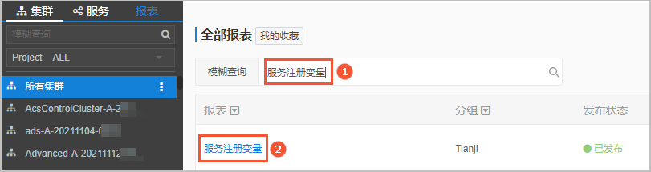
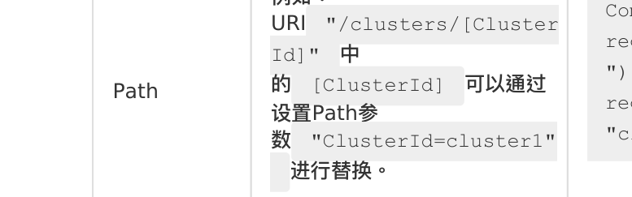
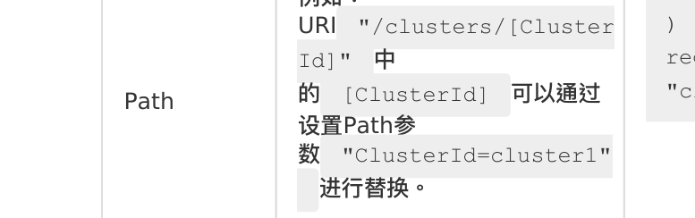
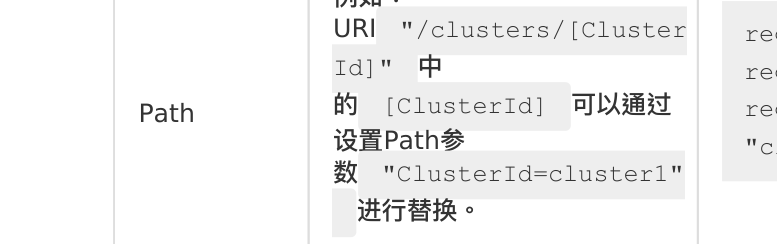

阿里云  
专有云  
专有网络VPC  
开发指南  
产品版本：V3.18.6  
文档版本：20251028

**目录**

- [1.快速入门](#section-1)
    - [1.1. 开发文档使用说明](#section-1-1)
    - [1.2. API调用流程说明](#section-1-2)
- [2.准备工作](#section-2)
    - [2.1. 登录开发者门户](#section-2-1)
    - [2.2. 获取API信息及其EndPoint](#section-2-2)
    - [2.3. 获取AccessKey](#section-2-3)
    - [2.4. 获取STS AccessKey](#section-2-4)
    - [2.5. 获取公共Header参数](#section-2-5)
    - [2.6. 获取VPC的Endpoint](#section-2-6)
    - [2.7. 获取VPC的SDK包](#section-2-7)
- [3.Java SDK调用](#section-3)
    - [3.1. 快速开始](#section-3-1)
    - [3.2. 使用手册](#section-3-2)
        - [3.2.1. 安装Java SDK](#section-3-2-1)
        - [3.2.2. 设置身份验证凭证](#section-3-2-2)
        - [3.2.3. 请求连接配置](#section-3-2-3)
        - [3.2.4. 发起调用](#section-3-2-4)
        - [3.2.5. 错误处理](#section-3-2-5)
        - [3.2.6. 使用CommonRequest进行调用](#section-3-2-6)
- [4.Python SDK调用](#section-4)
    - [4.1. 快速开始](#section-4-1)
    - [4.2. 使用手册](#section-4-2)
        - [4.2.1. 安装Python SDK](#section-4-2-1)
        - [4.2.2. 设置身份验证凭证](#section-4-2-2)
        - [4.2.3. 设置HTTPS请求](#section-4-2-3)
        - [4.2.4. 发起调用](#section-4-2-4)
        - [4.2.5. 错误处理](#section-4-2-5)
        - [4.2.6. 使用CommonRequest进行调用](#section-4-2-6)
- [5.Go SDK调用](#section-5)
    - [5.1. 快速开始](#section-5-1)
    - [5.2. 使用手册](#section-5-2)
        - [5.2.1. 安装Go SDK核心包](#section-5-2-1)
        - [5.2.2. 设置身份验证凭证](#section-5-2-2)
        - [5.2.3. 发起调用](#section-5-2-3)
        - [5.2.4. 错误处理](#section-5-2-4)
        - [5.2.5. 使用CommonRequest进行调用](#section-5-2-5)
- [6.API参考](#section-6)
    - [6.1. API概览](#section-6-1)
    - [6.2. 调用API](#section-6-2)
        - [6.2.1. 请求结构](#section-6-2-1)
        - [6.2.2. API授权](#section-6-2-2)
        - [6.2.3. API签名](#section-6-2-3)
    - [6.3. RAM鉴权](#section-6-3)
    - [6.4. 公共参数](#section-6-4)
    - [6.5. VPC](#section-6-5)
        - [6.5.1. CreateVpc](#section-6-5-1)
        - [6.5.2. DeleteVpc](#section-6-5-2)
        - [6.5.3. ModifyVpcAttribute](#section-6-5-3)
        - [6.5.4. DescribeVpcAttribute](#section-6-5-4)
        - [6.5.5. AssociateVpcCidrBlock](#section-6-5-5)
        - [6.5.6. UnassociateVpcCidrBlock](#section-6-5-6)
        - [6.5.7. MoveResourceGroup](#section-6-5-7)
        - [6.5.8. ListVpcIpv6Isps](#section-6-5-8)
        - [6.5.9. CreateVpcPrefixList](#section-6-5-9)
        - [6.5.10. ModifyVpcPrefixList](#section-6-5-10)
        - [6.5.11. DeleteVpcPrefixList](#section-6-5-11)
        - [6.5.12. GetVpcPrefixListEntries](#section-6-5-12)
        - [6.5.13. ListPrefixLists](#section-6-5-13)
        - [6.5.14. DetailVpc](#section-6-5-14)
        - [6.5.15. DescribeVSwitchGatewayIpService](#section-6-5-15)
        - [6.5.16. DeleteNqa](#section-6-5-16)
        - [6.5.17. DeleteExpressCloudConnection](#section-6-5-17)
    - [6.6. 路由表](#section-6-6)
        - [6.6.1. ModifyRouteTableAttributes](#section-6-6-1)
        - [6.6.2. CreateRouteTable](#section-6-6-2)
        - [6.6.3. CreateRouteEntry](#section-6-6-3)
        - [6.6.4. DeleteRouteEntry](#section-6-6-4)
        - [6.6.5. DescribeRouteEntryList](#section-6-6-5)
        - [6.6.6. ModifyRouteEntry](#section-6-6-6)
        - [6.6.7. AssociateRouteTable](#section-6-6-7)
        - [6.6.8. DeleteRouteTable](#section-6-6-8)
        - [6.6.9. DescribeRouteTableList](#section-6-6-9)
        - [6.6.10. UnassociateRouteTable](#section-6-6-10)
    - [6.7. 交换机](#section-6-7)
        - [6.7.1. CreateVSwitch](#section-6-7-1)
        - [6.7.2. DeleteVSwitch](#section-6-7-2)
        - [6.7.3. ModifyVSwitchAttribute](#section-6-7-3)
        - [6.7.4. DescribeVSwitchAttributes](#section-6-7-4)
    - [6.8. 网络ACL](#section-6-8)
        - [6.8.1. CreateNetworkAcl](#section-6-8-1)
        - [6.8.2. AssociateNetworkAcl](#section-6-8-2)
        - [6.8.3. ModifyNetworkAclAttributes](#section-6-8-3)
        - [6.8.4. UpdateNetworkAclEntries](#section-6-8-4)
        - [6.8.5. UnassociateNetworkAcl](#section-6-8-5)
        - [6.8.6. CopyNetworkAclEntries](#section-6-8-6)
        - [6.8.7. DeleteNetworkAcl](#section-6-8-7)
        - [6.8.8. DescribeNetworkAcls](#section-6-8-8)
        - [6.8.9. DescribeNetworkAclAttributes](#section-6-8-9)
    - [6.9. 弹性公网IP](#section-6-9)
        - [6.9.1. ListEipIsps](#section-6-9-1)
        - [6.9.2. AllocateEipAddress](#section-6-9-2)
        - [6.9.3. AllocateEipAddressPro](#section-6-9-3)
        - [6.9.4. AssociateEipAddress](#section-6-9-4)
        - [6.9.5. ModifyEipAddressAttribute](#section-6-9-5)
        - [6.9.6. DescribeEipAddresses](#section-6-9-6)
        - [6.9.7. UnassociateEipAddress](#section-6-9-7)
        - [6.9.8. ReleaseEipAddress](#section-6-9-8)
        - [6.9.9. DescribeEipGatewayInfo](#section-6-9-9)
        - [6.9.10. DescribeHighDefinitionMonitorLogAttribute](#section-6-9-10)
    - [6.10. NAT网关](#section-6-10)
        - [6.10.1. CreateNatGateway](#section-6-10-1)
        - [6.10.2. ModifyNatGatewayAttribute](#section-6-10-2)
        - [6.10.3. ModifyNatGatewaySpec](#section-6-10-3)
        - [6.10.4. DeleteNatGateway](#section-6-10-4)
        - [6.10.5. DescribeNatGateways](#section-6-10-5)
        - [6.10.6. CreateForwardEntry](#section-6-10-6)
        - [6.10.7. DescribeForwardTableEntries](#section-6-10-7)
        - [6.10.8. ModifyForwardEntry](#section-6-10-8)
        - [6.10.9. DeleteForwardEntry](#section-6-10-9)
        - [6.10.10. CreateSnatEntry](#section-6-10-10)
        - [6.10.11. DescribeSnatTableEntries](#section-6-10-11)
        - [6.10.12. ModifySnatEntry](#section-6-10-12)
        - [6.10.13. DeleteSnatEntry](#section-6-10-13)
        - [6.10.14. ModifyBandwidthPackageSpec](#section-6-10-14)
        - [6.10.15. DeleteBandwidthPackage](#section-6-10-15)
        - [6.10.16. CreateBandwidthPackage](#section-6-10-16)
        - [6.10.17. DescribeBandwidthPackages](#section-6-10-17)
        - [6.10.18. ModifyBandwidthPackageAttribute](#section-6-10-18)
        - [6.10.19. AddBandwidthPackageIps](#section-6-10-19)
    - [6.11. IPv6网关](#section-6-11)
        - [6.11.1. CreateIpv6Gateway](#section-6-11-1)
        - [6.11.2. DeleteIpv6Gateway](#section-6-11-2)
        - [6.11.3. DescribeIpv6Gateways](#section-6-11-3)
        - [6.11.4. ModifyIpv6GatewaySpec](#section-6-11-4)
        - [6.11.5. DescribeIpv6EgressOnlyRules](#section-6-11-5)
        - [6.11.6. CreateIpv6EgressOnlyRule](#section-6-11-6)
        - [6.11.7. DeleteIpv6EgressOnlyRule](#section-6-11-7)
        - [6.11.8. DeleteIpv6InternetBandwidth](#section-6-11-8)
        - [6.11.9. DescribeIpv6GatewayAttribute](#section-6-11-9)
        - [6.11.10. DescribeIpv6Addresses](#section-6-11-10)
        - [6.11.11. ModifyIpv6InternetBandwidth](#section-6-11-11)
        - [6.11.12. AllocateIpv6InternetBandwidth](#section-6-11-12)
        - [6.11.13. ModifyIpv6AddressAttribute](#section-6-11-13)
        - [6.11.14. ModifyIpv6GatewayAttribute](#section-6-11-14)
    - [6.12. 高可用虚拟IP](#section-6-12)
        - [6.12.1. CreateHaVip](#section-6-12-1)
        - [6.12.2. DescribeHaVips](#section-6-12-2)
        - [6.12.3. ModifyHaVipAttribute](#section-6-12-3)
        - [6.12.4. AssociateHaVip](#section-6-12-4)
        - [6.12.5. UnassociateHaVip](#section-6-12-5)
        - [6.12.6. DeleteHaVip](#section-6-12-6)
    - [6.13. DHCP选项集](#section-6-13)
        - [6.13.1. CreateDhcpOptionsSet](#section-6-13-1)
        - [6.13.2. AttachDhcpOptionsSetToVpc](#section-6-13-2)
        - [6.13.3. DetachDhcpOptionsSetFromVpc](#section-6-13-3)
        - [6.13.4. ReplaceVpcDhcpOptionsSet](#section-6-13-4)
        - [6.13.5. GetDhcpOptionsSet](#section-6-13-5)
        - [6.13.6. ListDhcpOptionsSets](#section-6-13-6)
        - [6.13.7. UpdateDhcpOptionsSetAttribute](#section-6-13-7)
        - [6.13.8. DeleteDhcpOptionsSet](#section-6-13-8)
    - [6.14. 路由器](#section-6-14)
        - [6.14.1. ModifyVRouterAttribute](#section-6-14-1)
        - [6.14.2. DescribeVRouters](#section-6-14-2)
    - [6.15. 地域](#section-6-15)
        - [6.15.1. ListGWAzone](#section-6-15-1)
        - [6.15.2. DescribeRegions](#section-6-15-2)
        - [6.15.3. DescribeZones](#section-6-15-3)
    - [6.16. 标签](#section-6-16)
        - [6.16.1. TagResources](#section-6-16-1)
        - [6.16.2. ListTagResources](#section-6-16-2)
        - [6.16.3. UnTagResources](#section-6-16-3)
    - [6.17. VPN网关](#section-6-17)
        - [6.17.1. VPN网关](#section-6-17-1)
            - [6.17.1.1. CreateVpnGateway](#section-6-17-1-1)
            - [6.17.1.2. DescribeVpnGateways](#section-6-17-1-2)
            - [6.17.1.3. DescribeVpnGateway](#section-6-17-1-3)
            - [6.17.1.4. DeleteVpnGateway](#section-6-17-1-4)
            - [6.17.1.5. ModifyVpnGatewayAttribute](#section-6-17-1-5)
            - [6.17.1.6. CreateVbrHa](#section-6-17-1-6)
        - [6.17.2. 用户网关](#section-6-17-2)
            - [6.17.2.1. CreateCustomerGateway](#section-6-17-2-1)
            - [6.17.2.2. DescribeCustomerGateways](#section-6-17-2-2)
            - [6.17.2.3. DescribeCustomerGateway](#section-6-17-2-3)
            - [6.17.2.4. DeleteCustomerGateway](#section-6-17-2-4)
            - [6.17.2.5. ModifyCustomerGatewayAttribute](#section-6-17-2-5)
        - [6.17.3. VPN网关路由](#section-6-17-3)
            - [6.17.3.1. DeleteVpnPbrRouteEntry](#section-6-17-3-1)
            - [6.17.3.2. DeleteVpnRouteEntry](#section-6-17-3-2)
            - [6.17.3.3. DescribeVpnRouteEntries](#section-6-17-3-3)
            - [6.17.3.4. ModifyVpnRouteEntryWeight](#section-6-17-3-4)
            - [6.17.3.5. CreateVpnRouteEntry](#section-6-17-3-5)
            - [6.17.3.6. ModifyVpnPbrRouteEntryWeight](#section-6-17-3-6)
            - [6.17.3.7. DescribeVpnPbrRouteEntries](#section-6-17-3-7)
            - [6.17.3.8. PublishVpnRouteEntry](#section-6-17-3-8)
            - [6.17.3.9. CreateVpnPbrRouteEntry](#section-6-17-3-9)
        - [6.17.4. IPsec-VPN](#section-6-17-4)
            - [6.17.4.1. DescribeVpnConnection](#section-6-17-4-1)
            - [6.17.4.2. DeleteVpnConnection](#section-6-17-4-2)
            - [6.17.4.3. DownloadVpnConnectionConfig](#section-6-17-4-3)
            - [6.17.4.4. CreateVpnConnection](#section-6-17-4-4)
            - [6.17.4.5. DescribeVpnConnections](#section-6-17-4-5)
            - [6.17.4.6. ModifyVpnConnectionAttribute](#section-6-17-4-6)
        - [6.17.5. SSL-VPN](#section-6-17-5)
            - [6.17.5.1. CreateSslVpnServer](#section-6-17-5-1)
            - [6.17.5.2. DeleteSslVpnServer](#section-6-17-5-2)
            - [6.17.5.3. ModifySslVpnServer](#section-6-17-5-3)
            - [6.17.5.4. DeleteSslVpnClientCert](#section-6-17-5-4)
            - [6.17.5.5. ModifySslVpnClientCert](#section-6-17-5-5)
            - [6.17.5.6. CreateSslVpnClientCert](#section-6-17-5-6)
            - [6.17.5.7. DescribeSslVpnClientCerts](#section-6-17-5-7)
            - [6.17.5.8. DescribeSslVpnClientCert](#section-6-17-5-8)
            - [6.17.5.9. DescribeSslVpnServers](#section-6-17-5-9)
            - [6.17.5.10. DescribeVpnSslServerLogs](#section-6-17-5-10)
- [7.附录](#section-7)
    - [7.1. STS概要](#section-7-1)
        - [7.1.1. 什么是STS](#section-7-1-1)
        - [7.1.2. AssumeRole](#section-7-1-2)

<a id="section-1"></a>

# 1.快速入门

<a id="section-1-1"></a>

## 1.1. 开发文档使用说明

本文为您介绍在使用专有云API进行开发工作时，如何查看所需要的产品文档。

**使用流程**

您可以按照以下流程图中步骤，判断自己所需要使用的开发文档。


**前提条件**

通过运维人员或运营管理员已获取专有云的版本。

**操作步骤**

您可以通过阿里云专有云文档中心，获取需要的产品文档。

1. 通过浏览器打开专有云文档中心。

2. 根据专有云的版本，单击**飞天企业版**、**敏捷版&XStack**或**一体机**页签。

3. 在下拉列表中，选择对应的专有云版本。

4. 在左侧导航栏中，选择目标产品名称。

5. 在单击目标文档区域的**查看详情**或**下载PDF**。

<a id="section-1-2"></a>

## 1.2. API调用流程说明

阿里云专有云支持通过POP网关调用专有云API，为了使您拥有与公有云一致的体验，自企业版V3.16.0开始，专有云API默认使用POP网关方式调用。本文介绍通过POP网关调用专有云API的流程。

**流程图**


**调用步骤**

1. 获取AccessKey。

   获取调用时所需要的AccessKey参数，请参见获取AccessKey或获取STS AccessKey。

   > **说明**
   >
   > 推荐使用个人AccessKey或STS AccessKey调用Apsara Uni-manager运营控制台及云产品接口。

2. 获取RegionID。

   获取调用时所需要的RegionID参数，请参见获取公共Header参数。

3. 获取组织ID与资源集ID。

   组织ID需要通过API进行获取，获取方式请参见*Apsara Uni-manager运营控制台开发指南*中的*GetOrga nizationList章节*。

   资源集ID需要通过API进行获取，获取方式请参见*Apsara Uni-manager运营控制台开发指南*中的*ListRe sourceGroup章节*。

   > **说明**
   >
   > 调用API时，请在Header参数中增加组织ID  和资源集ID ， 指定资源所属的组织和资源集，实现实例资源的隔离查询。
   >
   > - 不指定组织ID  ，则默认获取当前用户所属的组织。
   >
   > - 不指定资源集ID  ，则默认为空，如果指定资源集需要同时指定组织ID。

4. 获取对应的API参考文档。

   您需要查看目标云产品的开发指南，了解API的功能与使用方式，开发指南的使用流程及获取方法请参见开发文档使用说明。

5. 获取云产品Endpoint。

6. 获取云产品SDK并调用云产品API。

<a id="section-2"></a>

# 2.准备工作

<a id="section-2-1"></a>

## 2.1. 登录开发者门户

您可以通过Apsara Uni-manager运营控制台登录开发者门户。

**前提条件**

- 登录Apsara Uni-manager运营控制台前，确认您已从部署人员处获取Apsara Uni-manager运营控制台的服务域名地址。

- 推荐使用Chrome浏览器

**操作步骤**

1. 在浏览器地址栏中，输入Apsara Uni-manager运营控制台的服务域名地址，按回车键。

2. 输入正确的用户名及密码。

   请向运营管理员获取登录控制台的用户名和密码。

   > **说明**
   >
   > 首次登录Apsara Uni-manager运营控制台时，需要修改登录用户名的密码，请按照提示完成密码修改。为提高安全性，密码长度必须为10~32位，且至少包含以下两种类型：
   >
   > - 英文大写或小写字母（A~Z、a~z）
   >
   > - 阿拉伯数字（0~9）
   >
   > - 特殊符号（感叹号（!）、at（@）、井号（#）、美元符号（$）、百分号（%）等）

3. 单击**登录**。

4. 如果账号已激活MFA多因素认证，请根据以下两种情况进行操作：

   - 管理员强制开启MFA后的首次登录：

     <ol type="a">

     <li>

     在绑定虚拟MFA设备页面中，按页面提示步骤绑定MFA设备。

     </li>

     <li>

     按照步骤2重新输入账号和密码，单击**登录**。

     </li>

     </ol>

     <ol type="i" start="100">

     <li>

     输入6位MFA码后单击**认证**。

     </li>

     </ol>

   - 您已开启并绑定MFA：

     输入6位MFA码后单击**认证**。

     > **说明**
     >
     > 绑定并开启MFA的操作请参见<strong>《Apsara Uni-manager运营控制台用户指南》</strong>中的<strong>《绑定并开启虚拟MFA设备》</strong>章节。

5. 在页面顶部的菜单栏中，选择**产品 > 应用服务 > 开发者服务**。

<a id="section-2-2"></a>

## 2.2. 获取API信息及其EndPoint

首先，您需要了解产品开放API接口的相关信息，包括产品名称（code）、开放API接口名称、API版本。

**背景信息**

Apsara Uni-manager运营控制台API目录中的API信息仅供调用参考，具体API的使用方式需要参见云产品的开发指南。如果发生不一致情况，以开发指南支持情况为准。

**操作步骤**

1. 登录Apsara Uni-manager运营控制台。

2. 在顶部菜单栏选择**产品** > **开发工具** > **API与工具** > **开发者门户**。

3. 在**开发者门户**页面，选择**API集成** > **API调试**。

   

4. 在左侧导航栏中选择目标云产品。

5. 在**版本**下拉列表中，选择目标API版本。

6. 在下方API列表中可浏览当前版本的所有API接口。

7. 选中对应接口，在参数名下获取云产品的POP Endpoint信息。

   

<a id="section-2-3"></a>

## 2.3. 获取AccessKey

AccessKey支持RAM和STS两种授权模式，在发起调用时选择使用其中一种AccessKey即可。本文将为您介绍如何获取通过RAM授权的AccessKey。

**背景信息**

AccessKey通过使用AccessKey ID和AccessKey Secret对称加密，实现验证某个请求发送者的身份的功能。其中AccessKey ID用于标示用户，AccessKey Secret是用户用于加密签名的字符串。

AccessKey的两种授权模式如下：

- 通过RAM授权给第三方请求者的AccessKey ID和AccessKey Secret。

- 通过STS授权给第三方请求者的AccessKey ID、AccessKey Secret和Security Token。具体操作，请参见获取STS AccessKey。

Apsara Uni-manager运营控制台提供了个人AccessKey和组织AccessKey（只有运营管理员和一级组织管理员可以获取组织AccessKey），推荐使用个人账号AccessKey调用Apsara Uni-manager运营控制台及云产品相关接口。如果使用个人账号AccessKey，需要在Header中添加以下限制性参数，否则可能提示权限不足：

> 个人账号AccessKey是由Apsara Uni-manager运营控制台权限体系管控的受限
>
> **警告**
>
> AccessKey，组织AccessKey相对权限较大，需要管理员确认操作的安全性。

<table>
  <tr>
    <th width="206">参数名称</th>
    <th>描述</th>
  </tr>
  <tr>
    <td>x-acs-regionid</td>
    <td>地域ID，如：cn-hangzhou-*。</td>
  </tr>
  <tr>
    <td>x-acs-organizationid</td>
    <td>Apsara Uni-manager运营控制台中对应的组织ID。获取方法可参见<strong>《Apsara Uni-manager运营控制台开</strong><strong>发指南》</strong>中的<strong>《GetOrganizationList》</strong>文档。</td>
  </tr>
  <tr>
    <td>x-acs-resourcegroupid</td>
    <td>Apsara Uni-manager运营控制台中对应的资源集ID。获取方法可参见<strong>《Apsara Uni-manager运营控制台</strong><strong>开发指南》</strong>中的<strong>《ListResourceGroup》</strong>文档。</td>
  </tr>
  <tr>
    <td>x-acs-instanceid</td>
    <td>进行操作的实例ID，例如，ECS的实例ID可以从ECS列表中查询到。</td>
  </tr>
</table>

**获取个人账号AccessKey**

获取个人账号AccessKey的方法如下：

1. 登录Apsara Uni-manager运营控制台。

2. 在系统界面右上角，单击当前登录用户头像，单击**个人信息**。

3. 在**阿里云AccessKey**区域，您可以查看个人账户的AccessKey信息。

   

   > Accesskey ID和AccessKey Secret是您访问云资源时的密钥，具有该账号完整的权
   >
   > **说明**
   >
   > 限，请您妥善保管。

**获取组织AccessKey**

获取组织AccessKey的方法如下：

1. 管理员登录Apsara Uni-manager运营控制台。

2. 在顶部菜单栏，单击**企业**。

3. 在左侧导航栏中，选择**资源管理 > 组织管理**。

4. 在组织结构中，单击目标一级组织名称。

5. 单击**管理Accesskey**。

6. 在弹出的对话框中，查看组织AccessKey信息。

<a id="section-2-4"></a>

## 2.4. 获取STS AccessKey

本文为您介绍如何利用STS方式，调用专有云的产品API。

**背景信息**

阿里云临时安全令牌STS（Security Token Service）是阿里云提供的一种临时访问权限管理服务。您可以选择使用STS方式，调用专有云的产品API。

STS AccessKey由AccessKey ID、AccessKey Secret及SecurityToken三元组组成，使用STS方式调用云产品API时，三元组缺一不可。更多STS内容请参见什么是STS。

**操作步骤**

1. 获取用户角色的 `RAM Role` 。

   <ol type="i">

   <li>

   登录Apsara Uni-manager运营控制台。

   </li>

   <li>

   单击页面右上角的用户头像，单击**个人信息**。

   </li>

   <li>

   单击**查看当前角色策略**。

   在**当前选择角色策略**对话框中查看 `RAM Role` 。

   </li>

   </ol>

2. 获取STS Accesskey三元组。

   > **说明**
   >
   > 以下代码示例中可变参数均需替换为您实际的相关信息，尖括号（<>）在最终代码中不保留。
   >
   > 涉及替换的可变参数如下：
   >
   > - &lt;yourRegionID>，请替换为您实际的地域ID。
   >
   > - &lt;yourAccessKeyID>，请替换为您实际的AccessKey ID。
   >
   > - &lt;yourAccessKeySecret>，请替换为您实际的AccessKey Secret。
   >
   > - &lt;yourRoleSessionName>，请替换为您当前实际的会话名称。
   >
   > - &lt;yourRoleArn>，请替换为您实际的RAM Role。
   >
   > - "sts.aliyuns.com" ，请替换为实际的STS Endpoint。

   ```xml
   public static void main(String[] args) {
       // 创建DefaultAcsClient实例并初始化。
       // 请替换为您实际的地域ID、AccessKey ID、AccessKey Secret
       DefaultProfile profile = DefaultProfile.getProfile("<yourRegionID>", "
   <yourAccessKeyID>", "<yourAccessKeySecret>");
       HttpClientConfig clientConfig = HttpClientConfig.getDefault();
       clientConfig.setIgnoreSSLCerts(true);
       clientConfig.setProtocolType(ProtocolType.HTTPS);
       profile.setHttpClientConfig(clientConfig);
       IAcsClient client = new DefaultAcsClient(profile);
       String assumeRole = callAssumeRole(client);
       if (StringUtils.isEmpty(assumeRole)) return;
       JSONObject assumeRoleJson = JSONObject.parseObject(assumeRole);
       JSONObject credentials = assumeRoleJson.getJSONObject("Credentials");
       // 获取到STS三元组
       String stsAK = credentials.getString("AccessKeyId");
       String stsSK = credentials.getString("AccessKeySecret");
       String stsToken = credentials.getString("SecurityToken");
   }

   private static String callAssumeRole(IAcsClient client) {
       CommonRequest request = new CommonRequest();
       // "sts.aliyuns.com" 请替换为实际的STS Endpoint，⼀般格式为sts-
   vpc.${global:region}.${global:internet-domain}
       request.setSysDomain("sts.aliyuns.com");
       request.setSysProduct("Sts");
       request.setSysAction("AssumeRole");
       request.setSysVersion("2015-04-01");
       request.setSysMethod(MethodType.POST);
       request.setHttpContentType(FormatType.FORM);
       // 业务参数，设置本次调⽤Session的别名，"<yourRoleSessionName>"请您替换为实际值
       request.putQueryParameter("RoleSessionName", "<yourRoleSessionName>");
       // 扮演的Role⾓⾊ARN，"<yourRoleArn>"请替换为上⼀步获取到的实际Ram Role ARN
       request.putQueryParameter("RoleArn", "<yourRoleArn>");
       try {
           CommonResponse response = client.getCommonResponse(request);
           return response.getData();
       } catch (ServerException e) {
           System.out.println(e.getErrCode());
           System.out.println(e.getErrMsg());
       } catch (ClientException e) {
           System.out.println(e.getErrCode());
           System.out.println(e.getErrMsg());
       }
       return null;
   }
   ```

3. 通过STS AccessKey三元组调用云产品的接口，下列代码以VPC的 `DescribeVpcs` 接口为示例。

   > **说明**
   >
   > 以下代码示例中可变参数均需替换为您实际的相关信息，尖括号（<>）在最终代码中不保留。
   >
   > 涉及替换的可变参数如下：
   >
   > - &lt;yourRegionID>，请替换为您实际的地域ID。
   >
   > - &lt;yourStsAccesskeyID>,请替换为您实际的STS Accesskey ID。
   >
   > - &lt;yourStsAccessKeySecret>，请替换为您实际的STS Accesskey Secret。
   >
   > - &lt;yourStsToken>，请替换为实际STS三元组中的SecurityToken。
   >
   > - &lt;yourResourceGroupID>，请替换为您实际的资源集ID。
   >
   > - &lt;yourOrganizationID>请替换为您实际的组织ID。

   ```xml
   public static void main(String[] args) {
       // "<yourRegionID>"请替换为您实际的地域ID
       // "<yourStsAccessKeyID>", "<yourStsAccessKeySecret>"请替换为前⼀步获取到的STS三元组中
   AccessKeyID、AccessKeySecret
       DefaultProfile profile = DefaultProfile.getProfile("<yourRegionID>", "
   <yourStsAccesskey>", "<yourStsAccessSecret>");
       HttpClientConfig clientConfig = HttpClientConfig.getDefault();
       clientConfig.setIgnoreSSLCerts(true);
       clientConfig.setProtocolType(ProtocolType.HTTPS);
       profile.setHttpClientConfig(clientConfig);
       IAcsClient client = new DefaultAcsClient(profile);
       CommonRequest request = new CommonRequest();
       request.setSysDomain("vpc.aliyuns.com");
       request.setSysProduct("vpc");
       request.setSysAction("DescribeVpcs");
       request.setSysVersion("2016-04-28");
       request.setSysMethod(MethodType.POST);
       request.setHttpContentType(FormatType.FORM);
       //"<yourRegionID>" 请替换为您实际的地域ID
       request.putHeaderParameter("x-acs-regionid", "<yourRegionID>");
       // "<yourStsToken>" 请替换为您前⼀步获取到的STS三元组中SecurityToken
       request.putQueryParameter("SecurityToken", "<yourStsToken>");
       // 非必填,请替换为您实际的资源集ID
       // request.putHeaderParameter("x-acs-resourcegroupid", "<yourResourceGroupID>");
       // 必填,请替换为您实际的组织ID
       request.putHeaderParameter("x-acs-organizationid", "<yourOrganizationID>");
       try {
           CommonResponse response = client.getCommonResponse(request);
           System.out.println(response.getData());
       } catch (ServerException e) {
           System.out.println(e.getErrCode());
           System.out.println(e.getErrMsg());
       } catch (ClientException e) {
           System.out.println(e.getErrCode());
           System.out.println(e.getErrMsg());
       }
   }
   ```

<a id="section-2-5"></a>

## 2.5. 获取公共Header参数

调用专有云API时需要提供多个Header参数。本文为您介绍这些参数的含义及其获取方式，并对调用后的一些返回值做出解释。

**Header参数描述**

| 名称 | 描述 |
| --- | --- |
| x-acs-regionid | 环境Region。具体操作，请参见获取Region ID。 |
| x-acs-organizationid | Apsara Uni-manager运营控制台上的组织ID。具体操作，请参见获取组织ID。 |
| x-acs-resourcegroupid | Apsara Uni-manager运营控制台上的资源集ID。具体操作，请参见获取资源集ID。 |
| x-acs-instanceid | 进行操作的实例ID。具体操作，请参见获取实例ID。 |

**获取Region ID**

1. 管理员登录Apsara Uni-manager运营控制台。

2. 在顶部菜单栏中，单击**企业**。

3. 在左侧导航栏中，选择**资源管理**>**地域管理**。

4. 单击目标组织名称。

5. 在右侧**Region列表**中查看Region ID。

**获取组织ID**

组织ID需要通过API进行获取，获取方式请参见*Apsara Uni-manager运营控制台开发指南*中的*GetOrganizationList章节*。

**获取资源集ID**

资源集ID需要通过API进行获取，获取方式请参见*Apsara Uni-manager运营控制台开发指南*中的*ListResourceGroup章节*。

**获取实例ID**

实例ID可以通过Apsara Uni-manager运营控制台中的云产品实例列表进行获取，本文中以VPC为例，获取步骤如下：

1. 登录Apsara Uni-manager运营控制台。

2. 在顶部的菜单栏中，选择**产品**>**网络**>**专有网络 VPC**。

3. 在左侧导航栏中，单击**专有网络**。

4. 在**专有网络**列表中查看**实例ID/名称**。

**返回参数**

对于列表类的云产品资源实例接口，调用后会默认增加如下返回值。

| 名称 | 描述 |
| --- | --- |
| ResourceGroupName | 资源集名称。 |
| ResourceGroup | 资源集ID。 |
| DepartmentName | 组织名称。 |
| Department | 组织ID。 |

<a id="section-2-6"></a>

## 2.6. 获取VPC的Endpoint

本文介绍了如何获取VPC的Endpoint。

**背景信息**

通过POP网关调用专有云API时需要使用云产品业务域的Endpoint。您可以在阿里云驻场运维工程师处获取。您也可以通过如下方法自行获取Endpoint。

**操作步骤**

1. 登录飞天基础运维平台。

   <ol type="i">

   <li>

   登录Apsara Uni-manager运维控制台。

   </li>

   <li>

   在顶部菜单栏选择**产品运维**>**云平台运维**>**飞天基础运维平台**。

   </li>

   </ol>

2. 在左侧导航栏中单击**报表**。

   

3. 在**全部报表**页面搜索 服务注册变量 ，单击报表名称。

   

4. 在**服务注册变量**页面，单击**Service**旁的  图标，搜索 `VPC` 。

5. 在 `vpc-yaochi` 服务的**Service Registration**列中，单击鼠标右键，选择**显示更多**。

   在**详情**页面，查看**vpc-internal.openapi.endpoint**值，即 `Endpoint` 。

<a id="section-2-7"></a>

## 2.7. 获取VPC的SDK包

通过POP网关调用专有云API时，需使用相应云产品的SDK。本文为您介绍如何获取阿里云开发工具包（SDK）。

**背景介绍**

实现VPC功能需要您同时安装VPC SDK和阿里云核心库。以Java SDK为例，您需要下载 `aliyun-java-sdk-vpc` 以及 `aliyun-java-sdk-core` 。

- VPC SDK封装了2016-04-28版本API，以访问密钥（AccessKey）识别调用者身份，提供自动签名等功能，方便您通过API创建和管理资源。阿里云开发工具包（SDK）包括代码以及示例，您可以自行选择语言来创建云应用。

- SDK核心库推荐您使用阿里云官网的SDK核心库，该内容适用于所有云产品，也同样适用于专有云产品。

**操作指导**

目前SDK的语言支持：Java、Python、Go，您可以前往阿里云开发工具包（SDK）中进行选择。

> **说明**
>
> 推荐使用 Java、Python、Go三种语言的SDK包，使用其他语言的SDK包可能发生不兼容情况。

<a id="section-3"></a>

# 3.Java SDK调用

安装阿里云Java SDK后，您可以编写代码使用阿里云Java SDK访问阿里云POP网关，调用Apsara Uni-manager运营控制台的API接口。

**前提条件**

- 已获取AccessKey或STS Accesskey，获取方式请参见获取AccessKey或STS AccessKey。

- 已获取Apsara Uni-manager运营控制台的Endpoint，获取方式请参见获取Apsara Uni-manager运营控制台的Endpoint。

- 已安装1.8及以上版本的JDK。

**安装Java SDK**

在项目目录下的pom.xml文件中，添加阿里云Java SDK核心库。

```xml
<!-- https://mvnrepository.com/artifact/com.aliyun/aliyun-java-sdk-core -->
<dependency>
    <groupId>com.aliyun</groupId>
    <artifactId>aliyun-java-sdk-core</artifactId>
    <version>4.5.30</version>
</dependency>
```

> **说明**
>
> SDK包更新频繁，建议您前往阿里云开发工具包（SDK）获取最新版本依赖。

**设置身份验证**

使用阿里云专有云SDK访问阿里云专有云服务时，您需要提供授权的账号进行身份验证。Java SDK支持通过AccessKey或STS AccessKey进行身份验证。

> **重要**
>
> 确保包含AccessKey或STS AccessKey的代码不会泄漏（例如提交到外部公开的GitHub项目），否则将会危害您的信息安全。

```text
DefaultProfile profile = DefaultProfile.getProfile(
    "<yourRegionID>",          // 请替换为您实际的地域ID。
    "<yourAccessKeyID>",      // 请替换为您实际的AccessKey ID。
    "<yourAccessKeySecret>",  // 请替换为您实际的AccessKey Secret。
    "<yourSecurityToken>"   
    //在使⽤STS AccessKey进⾏⾝份验证时，<yourSecurityToken>请替换为您实际的SecurityToken。
    //在使⽤AccessKey进⾏⾝份验证时，<yourSecurityToken>为null。
);
```

> **说明**
>
> 以上代码示例中  、  、  、  均为可变参数，需要替换为其实际值，尖括号（<>）在最终代码中不保留。

**创建并配置请求连接**

可通过以下代码配置HttpClientConfig，具体请根据自身服务能力自行选择配置项并做相应配置。

```text
// 获取HttpClientConfig对象。
HttpClientConfig clientConfig = HttpClientConfig.getDefault();
// 设置是否忽略证书。true：忽略；false：不忽略。
clientConfig.setIgnoreSSLCerts(true);
// （可选）设置创建连接超时时间，单位毫秒（ms）。
clientConfig.setConnectionTimeoutMillis(<connectionTimeout>);
// （可选）设置读取超时时间，单位毫秒（ms）。
clientConfig.setReadTimeoutMillis(<readTimeout>);
/** （可选）请根据实际情况判断是否设置代理，设置⽅法如下。若需要设置代理，请替换为您实际的代理IP+端⼝。clientConfig.setHttpProxy("<http://192.168.XX.XX:33XX>");
clientConfig.setHttpsProxy("<https://192.168.XX.XX:33XX>");
*/
profile.setHttpClientConfig(clientConfig);
IAcsClient client = new DefaultAcsClient(profile);
```

> **说明**
>
> 以上代码示例中  、  、  均为可变参数，需要您结合自身服务替换为其实际值，尖括号（<>）在最终代码中不保留。

**创建请求CommonRequest**

使用CommonRequest调用方式可实现任意Open API接口的调用。

```text
// 创建API请求并设置参数。
CommonRequest request = new CommonRequest();
// Apsara Uni-manager运营控制台接⼝信息参数。
request.setSysProduct("ascm");
request.setSysVersion("2019-05-10");
request.setSysUriPattern("<yourCallUriPattern>");
// Apsara Uni-manager运营控制台的Endpoint地址。
request.setSysDomain("<ascmEndpoint>");
// 设置请求⽅式。
request.setSysMethod(MethodType.POST);
// 设置Headers。
// 设置⾝份标识，标识调⽤来源，无实际作⽤，可随意设置，必填项。
request.putHeadParameter("x-acs-caller-sdk-source","<yourCallerSdkSource>");
// 接⼝业务参数设置。
...
// 设置Content-Type。
request.setHttpContentType(FormatType.JSON);
```

> **说明**
>
> 以上代码示例中  、  、  均为可变参数，需要替换为其实际值，尖括号（<>）在最终代码中不保留。

**设置阿里云核心库SDK参数**

在使用阿里云核心库SDK发起API请求时，可以设置四种类型的参数：Path、Query、Body、Header。在调用具体API时，请根据开发文档中标注的参数位置对应设置。

| 参数类型 | 描述 | 代码示例 |
| --- | --- | --- |
| Path | Path参数用于对请求Request中设置的UriPattern进行变量替换。例如：URI<code> "/clusters/[Cluster</code> <code>Id]" </code>中的<code> [ClusterId] </code>可以通过设置Path参数<code> "ClusterId=cluster1"</code><code> </code>进行替换。<br>最终发起HTTP请求的URI则为<code> "/clusters/clusterId</code> <code>01" </code>。 | <code>CommonRequest request = new CommonRequest();</code><br><code>request.setSysUriPattern("/clusters/[ClusterId]</code><br><code>");</code><br><code>request.putPathParameter("ClusterId",</code><br><code>"clusterId01");</code> |
| Query | Query参数用于对请求Request中的URL参数进行设置（一般用于GET请求）。例如：“http://aliyun.com/api/? ClusterId=clusterId01&amp;Clu sterName=clusterName01 ”。 | <code>CommonRequest request = new CommonRequest();</code><br><code>request.putQueryParameter("ClusterId",</code><br><code>"clusterId01");</code><br><code>request.putQueryParameter("ClusterName",</code><br><code>"clusterName01");</code> |



| 参数类型 | 描述 | 代码示例 |
| --- | --- | --- |
| Body | Body参数用于对请求Request中的HTTP Content进行设置（一般用于POST/PUT请求）。目前支持两种格式：<br>• application/json<br>• application/x-www-form-urlencoded<br>说明在设置Body参数时，需要同时设置HTTP Content-Type。 | • key-value形式设置Body参数，并设置HttpContentType。<br><code>CommonRequest request = new</code><br><code>CommonRequest();</code><br><code>request.putBodyParameter("ClusterId",</code><br><code>"clusterId01");</code><br><code>request.putBodyParameter("ClusterName",</code><br><code>"clusterName01");</code><code>// </code>若<code>Content-Type</code>设置为<code>application/x-www-</code><code>form-urlencoded</code>，请求到服务器的<code>Content</code>数据格式为<code>"ClusterId=clusterId01&amp;ClusterName=clusterN</code> <code>ame01"</code>的字符串。<code>request.setHttpContentType(FormatType.FORM);</code><br><code>// </code>或，若<code>Content-Type</code>设置为<code>application/json</code>，请求到服务器的<code>Content</code>数据格式为<code>"</code> <code>{\"ClusterId\":\"clusterId01\",\"ClusterName\</code> <code>":\"clusterName01\"}"</code>的<code>JSON</code>串。<code>request.setHttpContentType(FormatType.JSON);</code><br>• 自行构造HTTP Content并直接设置HttpContent。<br><code>CommonRequest request = new</code><br><code>CommonRequest();</code><code>//</code>设置<code>application/json</code>格式的<code>HTTP Content</code>。<code>String body = "{\"ClusterId\":</code><br><code>\"clusterId01\", \"ClusterName\":</code><br><code>\"clusterName01\"}";</code><br><code>request.setHttpContent(body.getBytes(),</code><br><code>"utf-8", FormatType.JSON);</code><code>//</code>设置<code>application/x-www-form-urlencoded</code>格式的<code>HTTP Content</code>。<code>String body =</code><br><code>"ClusterId=clusterId01&amp;ClusterName=clusterNam</code><br><code>e01";</code><br><code>request.setHttpContent(body.getBytes(),</code><br><code>"utf-8", FormatType.FORM);</code> |
| Header | Header参数用于对请求Request中的HTTP Header进行设置。 | <code>CommonRequest request = new CommonRequest();</code><br><code>request.putHeadParameter("x-acs-</code><br><code>organizationid", "3");</code><br><code>request.putHeadParameter("x-acs-</code><br><code>resourcegroupid", "2");</code> |

**发起调用并处理应答**

可参考以下代码发起请求并处理返回结果。

```java
try {
    // 发起请求，并获取返回。
    CommonResponse response = client.getCommonResponse(request);
    System.out.println(response.getData());
} catch (ServerException e) {
    e.printStackTrace();
} catch (ClientException e) {
    System.out.println("ErrCode:" + e.getErrCode());
    System.out.println("ErrMsg:" + e.getErrMsg());
    System.out.println("RequestId:" + e.getRequestId());
}
```

**错误处理**

在使用Java SDK时，当服务端或者SDK端出错时，SDK会返回相应的异常信息。这些异常信息中会包含具体的错误信息包括错误码（Error Code）和错误消息（Error Message）。

一般情况下，您不需要对Java SDK返回的错误进行处理，只需要根据服务端的错误提示处理服务端错误即可。

- **`ServerException`** 是服务端错误信息。

- **`ClientException`** 是SDK端错误信息。

例如，当出现如下错误时，您可以根据具体的错误信息，修改AccessKey的ID即可。

```text
com.aliyuncs.exceptions.ClientException: InvalidAccessKeyId.NotFound : Specified accesskey is not found.
```

如果您需要对SDK的错误进行处理，可以参考如下示例编写代码：

```java
try {
    AcsResponse response = client.getAcsResponse(request);
    // 处理Response。
    // ...
}catch (ServerException e){
    // 这⾥可以添加您⾃⼰的错误处理逻辑。
    // 例如，打印具体的错误信息。
    System.out.println("ErrorCode=" + e.getErrCode());
    System.out.println("ErrorMessage=" + e.getErrMsg());
    // 如果遇上棘⼿问题，可联系阿⾥云技术⽀持，并提供RequestID。
    System.out.println("ResponseId=" + e.getRequestId());
}catch (ClientException e){
    // 这⾥可以添加您⾃⼰的错误处理逻辑。
    // 例如，打印具体的错误信息。
    System.out.println("ErrorCode=" + e.getErrCode());
    System.out.println("ErrorMessage=" + e.getErrMsg());
}
```

**完整调用示例**

以下代码为通过Apsara Uni-manager运营控制台的 `GetOrganizationList` 接口获取组织列表的调用示例。

```java
import com.aliyuncs.CommonRequest;
import com.aliyuncs.CommonResponse;
import com.aliyuncs.DefaultAcsClient;
import com.aliyuncs.IAcsClient;
import com.aliyuncs.exceptions.ClientException;
import com.aliyuncs.exceptions.ServerException;
import com.aliyuncs.http.FormatType;
import com.aliyuncs.http.HttpClientConfig;
import com.aliyuncs.http.MethodType;
import com.aliyuncs.http.ProtocolType;
import com.aliyuncs.profile.DefaultProfile;

public class Demo {
    /**
     * 本⽂提供的API调⽤样例仅供参考，更多详细API调⽤⽅法可参照开发⽂档中的“快速入⻔”。
     */
    public static void main(String[] args) {
        // 创建DefaultAcsClient实例并初始化。
        DefaultProfile profile = DefaultProfile.getProfile(
                "<yourRegionID>",         // 请替换为您实际的地域ID。
                "<yourAccessKeyID>",      // 请替换为您实际的AccessKeyID。
                "<yourAccessKeySecret>",  // 请替换为您实际的AccessKeySecret。
                null);
        HttpClientConfig clientConfig = HttpClientConfig.getDefault();
        clientConfig.setProtocolType(ProtocolType.HTTP);
        /**
        请根据实际情况判断是否需要设置HTTP代理，设置⽅法如下。请替换为您实际代理IP+端⼝。
        clientConfig.setHttpProxy("<http://192.168.XX.XX:33XX>");
        */
        // 设置连接超时，单位：ms。
        // clientConfig.setConnectionTimeoutMillis(1000L);
        // 设置读取超时，单位：ms。
        // clientConfig.setReadTimeoutMillis(10000L);
        profile.setHttpClientConfig(clientConfig);
        IAcsClient client = new DefaultAcsClient(profile);
        // 创建API请求并设置参数。
        CommonRequest request = new CommonRequest();
        // Apsara Uni-manager运营控制台接⼝信息参数。
        request.setSysProduct("ascm");
        request.setSysVersion("2019-05-10");
        request.setSysUriPattern("/ascm/auth/organization/queryList");
        // Apsara Uni-manager运营控制台的Endpoint地址。
        request.setSysDomain("<ascmEndpoint>");
        // 设置请求⽅式。
        request.setSysMethod(MethodType.POST);
        // 设置Headers。
        // 设置⾝份标识，标识调⽤来源，无实际作⽤，可随意设置，必填项。
        request.putHeadParameter("x-acs-caller-sdk-source","<yourCallerSdkSource>");
        // 调⽤专有云API时，⼀般需要提供多个公共Header参数，包括：x-acs-regionid、x-acs-
organizationid、x-acs-resourcegroupid、x-acs-instanceid。详情可参照开发指南中的“获取公共Header参数"。
        
        // 接⼝业务参数设置。
        request.putBodyParameter("id","1");
        request.setHttpContentType(FormatType.JSON);
        try {
            // 发起请求，并获取返回。
            CommonResponse response = client.getCommonResponse(request);
            System.out.println(response.getData());
        } catch (ServerException e) {
            e.printStackTrace();
        } catch (ClientException e) {
            System.out.println("ErrCode:" + e.getErrCode());
            System.out.println("ErrMsg:" + e.getErrMsg());
            System.out.println("RequestId:" + e.getRequestId());
        }
    }
}
```

> **说明**
>
> 以上代码示例中  、  、  、  、  、  均为可变参数，需要替换为其实际值，尖括号（<>）在最终代码中不保留。

<a id="section-3-1"></a>

## 3.1. 快速开始

本节介绍如何获取VPC Java SDK并开始调用。

**环境准备**

- 使用阿里云专有云Java SDK，您需要一个授权账号以及一对AccessKey ID和AccessKey Secret。具体操作，请参见获取AccessKey。

- 获取VPC的Endpoint。具体操作，请参见获取VPC的Endpoint。

- 阿里云专有云Java SDK需要1.8及以上的JDK。

**安装阿里云专有云 Java SDK**

如果您使用Apache Maven来管理Java项目，只需在项目的pom.xml中加入Maven命令。

要使用VPC的开发工具包，必须安装SDK核心库以及VPC产品的SDK。其中，SDK核心库推荐使用4.5.17及以上版本，SDK的版本为3.2.0。

```xml
<dependencies>
        <dependency>
            <groupId>com.aliyun</groupId>
            <artifactId>aliyun-java-sdk-core</artifactId>
            <version>4.5.17</version>
        </dependency>
        <dependency>
            <groupId>com.aliyun</groupId>
            <artifactId>aliyun-java-sdk-vpc</artifactId>
            <version>3.2.0</version>
        </dependency>
</dependencies>
```

**使用Java SDK**

调用阿里云专有云Java SDK的主要操作步骤如下：

1. 创建并初始化DefaultAcsClient实例。

2. 创建API请求并设置参数。

3. 发起请求并处理应答或异常。

   > **说明**
   >
   > 以下代码示例中可变参数均需替换为您实际的相关信息，尖括号（<>）在最终代码中不保留。
   >
   > 涉及替换的可变参数如下：
   >
   > - &lt;yourRegionID>，请替换为您实际的地域ID。
   >
   > - &lt;yourAccessKeyID>，请替换为您实际的AccessKey ID。
   >
   > - &lt;yourAccessKeySecret>，请替换为您实际的AccessKey Secret。
   >
   > - &lt;Product>，请替换为您实际的产品名称。
   >
   > - &lt;Endpoint>，请替换为您当前产品实际的Endpoint。
   >
   > - &lt;readTimeout>，请您根据实际情况设置读取超时时间，单位为毫秒。
   >
   > - &lt;connectionTimeout>，请您根据实际情况设置连接超时时间，单位为毫秒。
   >
   > - &lt;maxRequestsPerHost>，请您根据实际情况设置每个主机的最大请求数。
   >
   > - &lt;maxRequests>，请您根据实际情况设置最大请求数。
   >
   > - &lt;http://192.168.XX.XX:33XX>，请替换为您实际的代理IP+端口。

   ```java
   import com.aliyuncs.http.HttpClientConfig;
   import com.aliyuncs.http.ProtocolType;
   import com.aliyuncs.profile.DefaultProfile;
   import com.aliyuncs.DefaultAcsClient;
   import com.aliyuncs.IAcsClient;
   import com.aliyuncs.exceptions.ClientException;
   import com.aliyuncs.exceptions.ServerException;
   import com.aliyuncs.vpc.model.v20160428.*;
   import com.google.gson.Gson;
   public class Main {
        public static void main(String[] args) {
           // 创建DefaultAcsClient实例并初始化
           DefaultProfile profile = DefaultProfile.getProfile(
               "<yourRegionID>",          // 请替换为您实际的地域ID
               "<yourAccessKeyID>",      // 请替换为您实际的AccessKey ID
               "<yourAccessKeySecret>"); // 请替换为您实际的AccessKey Secret
           // 设置当前产品的Endpoint，可变参数请替换为您的实际值 
           profile.addEndpoint("<yourRegionID>", "<Product>", "<Endpoint>");
           // 设置请求配置
           HttpClientConfig clientConfig = HttpClientConfig.getDefault();
           clientConfig.setIgnoreSSLCerts(true);// 忽略证书
           clientConfig.setReadTimeoutMillis(<readTimeout>);// 读取超时时间（可选）,单位为毫
   秒（ms）
           clientConfig.setConnectionTimeoutMillis(<connectionTimeout>);// 连接超时时间（可
   选）,单位为毫秒（ms）
           clientConfig.setMaxRequestsPerHost(<maxRequestsPerHost>);// 设置每个主机的最⼤请
   求数（可选）
           clientConfig.setMaxRequests(<maxRequests>);// 设置最⼤请求数（可选）
           clientConfig.setProtocolType(ProtocolType.HTTP); // 设置请求协议,默认HTTP（可选）
           /* 设置代理(可选),替换为代理IP+Port
           clientConfig.setHttpProxy("<http://192.168.XX.XX:33XX>");
           或
           clientConfig.setHttpsProxy("<https://192.168.XX.XX:33XX>");
           */
           profile.setHttpClientConfig(clientConfig);
           IAcsClient client = new DefaultAcsClient(profile);
           // 创建API请求并设置参数
           DescribeVpcsRequest request = new DescribeVpcsRequest();
           // 业务参数
           request.setPageSize(10);
           request.setPageNumber(1);
           // 特殊Header参数,设置组织ID和资源集ID,资源隔离使⽤
           request.putHeaderParameter("x-acs-organizationid", "1");
           request.putHeaderParameter("x-acs-resourcegroupid", "11");
           // 发起请求并处理应答或异常
           DescribeVpcsResponse response;
          try {
               DescribeVpcsResponse response = client.getAcsResponse(request);
               System.out.println(new Gson().toJson(response));
           } catch (ServerException e) {
               e.printStackTrace();
           } catch (ClientException e) {
               System.out.println("ErrCode:" + e.getErrCode());
               System.out.println("ErrMsg:" + e.getErrMsg());
               System.out.println("RequestId:" + e.getRequestId());
           }
        }
    }
   ```

<a id="section-3-2"></a>

## 3.2. 使用手册

<a id="section-3-2-1"></a>

### 3.2.1. 安装Java SDK

本文介绍如何安装及调用VPC Java SDK。

阿里云专有云Java SDK支持1.8及以上版本的JDK，可以通过添加Maven依赖或下载阿里云开发工具包（SDK）的方式安装专有云Java SDK。

要使用VPC的开发工具包，必须安装阿里云Java SDK核心库以及VPC的Java SDK。SDK核心库推荐使用4.5.17及以上版本，Java SDK的版本为3.2.0。

以使用VPC的Java SDK为例，您需要安装阿里云Java SDK核心库和VPC Java SDK，并在pom.xml文件中添加以下依赖即可。准确的SDK版本号，请参见阿里云开发工具包（SDK）。

```xml
<dependencies>
        <dependency>
            <groupId>com.aliyun</groupId>
            <artifactId>aliyun-java-sdk-core</artifactId>
            <version>4.5.17</version>
        </dependency>
        <dependency>
            <groupId>com.aliyun</groupId>
            <artifactId>aliyun-java-sdk-vpc</artifactId>
            <version>3.2.0</version>
        </dependency>
</dependencies>
```

<a id="section-3-2-2"></a>

### 3.2.2. 设置身份验证凭证

当使用阿里云专有云SDK访问阿里云专有云服务时，您需要提供授权的账号进行身份验证。本文介绍了如何设置身份验证凭证。

目前，Java SDK支持通过AccessKey进行身份验证，关于如何获取AccessKey，请参见获取AccessKey。

使用AccessKey作为访问凭据时，需要在初始化Client时设置凭证。

> **说明**
>
> 确保包含AccessKey的代码不会泄漏（例如提交到外部公开的GitHub项目），否则将会危害您的信息安全。

```text
DefaultProfile profile = DefaultProfile.getProfile(
    "<yourRegionID>",          // 请替换为您实际的地域ID
    "<yourAccessKeyID>",      // 请替换为您实际的AccessKey ID
    "<yourAccessKeySecret>"); // 请替换为您实际的AccessKey Secret
```

> **说明**
>
> 以上代码示例中可变参数均需替换为您实际的相关信息，尖括号（<>）在最终代码中不保留。

<a id="section-3-2-3"></a>

### 3.2.3. 请求连接配置

本文介绍了如何配置请求连接（HttpClientConfig）。

您可通过以下代码配置HttpClientConfig，具体请根据自身服务能力自行选择配置项并做相应配置。

> **说明**
>
> 以下代码示例中可变参数均需替换为您实际的相关信息，尖括号（<>）在最终代码中不保留。
>
> 涉及替换的可变参数如下：
>
> - &lt;readTimeout>，请您根据自身服务的能力，配置读取超时时间，单位为毫秒（ms）。
>
> - &lt;connectionTimeout>，请您根据自身服务的能力，配置连接超时时间，单位为毫秒（ms）。
>
> - &lt;maxRequestsPerHost>，请您根据自身服务的能力，配置每台服务器的最大请求数，数据类型为INT。
>
> - &lt;maxRequests>，请您根据自身服务的能力，配置最大请求数，数据类型为INT。
>
> - &lt;http://192.168.XX.XX:33XX>，请替换为您实际的代理IP+端口。

```text
// 获取HttpClientConfig对象
HttpClientConfig clientConfig = HttpClientConfig.getDefault();
// 设置是否忽略证书
clientConfig.setIgnoreSSLCerts(true);
// (可选)设置读取超时时间，单位毫秒（ms）
clientConfig.setReadTimeoutMillis(<readTimeout>);
// (可选)设置创建连接超时时间，单位毫秒（ms）
clientConfig.setConnectionTimeoutMillis(<connectionTimeout>);
// (可选)设置每个主机的最⼤请求数，数据类型为INT
clientConfig.setMaxRequestsPerHost(<maxRequestsPerHost>);
// (可选)设置最⼤请求数，数据类型为INT
clientConfig.setMaxRequests(<maxRequests>);
// (可选)设置协议类型
clientConfig.setProtocolType(ProtocolType.HTTP);
/** （可选）请根据实际情况判断是否设置代理，设置⽅法如下：
clientConfig.setHttpProxy("<http://192.168.XX.XX:33XX>");
或
clientConfig.setHttpsProxy("<https://192.168.XX.XX:33XX>");
请替换为您实际的代理IP+端⼝
*/
profile.setHttpClientConfig(clientConfig);
```

<a id="section-3-2-4"></a>

### 3.2.4. 发起调用

本文介绍如何使用VPC Java SDK发起请求。

**操作步骤**

1. 新建一个AcsClient。

   ```text
   IAcsClient client = new DefaultAcsClient(profile);
   ```

2. 创建请求。

   请求类的命名规范为 `${apiName}Request` ，其中<strong>${apiName}</strong>为API名称，例如DescribeVpcs。

   在引入多个产品SDK时，有可能存在Request类同名的情况，请注意按照package区分。

   ```text
   DescribeVpcsRequest request = new DescribeVpcsRequest();
   // 业务参数
   request.setPageSize(10);
   request.setPageNumber(1);
   // 特殊Header参数,设置组织ID和资源集ID,资源隔离使⽤
   request.putHeaderParameter("x-acs-organizationid", "1");
   request.putHeaderParameter("x-acs-resourcegroupid", "");
   ```

3. 发起调用并处理应答。

   ```java
   DescribeVpcsResponse response;
   try {
     DescribeVpcsResponse response = client.getAcsResponse(request);
     System.out.println(new Gson().toJson(response));
   } catch (ServerException e) {
       e.printStackTrace();
   } catch (ClientException e) {
       e.printStackTrace();
   }
   ```

   正常情况下，应答中的所有字段，都会被反序列化到response中，您可以直接调用 `response.getXXX()` 来获得应答中的字段。

   ```text
   instanceStatus := response.getStatus()
   ```

   如果出现了异常，或您需要原始HTTP应答的情况下，您可以通过以使用 `doAction()` 来获取原始应答。

   ```text
   HttpResponse response = client.doAction(request);
   ```

<a id="section-3-2-5"></a>

### 3.2.5. 错误处理

在使用Java SDK时，当服务端或者SDK端出错时，SDK会返回相应的异常信息。这些异常信息中会包含具体的错误信息，包括错误码（Error Code）和错误消息（Error Message）。

一般情况下，您不需要Java SDK返回的错误进行处理。您只需要根据服务端的错误提示处理服务端错误即可。

- `ServerException` 是服务端错误信息。

- `ClientException` 是SDK端错误信息。

例如，当出现如下错误时，您可以根据具体的错误信息，修改AccessKey的ID即可。

```text
com.aliyuncs.exceptions.ClientException: InvalidAccessKeyId.NotFound : Specified accesskey is not found.
```

如果您需要对SDK的错误进行处理，可以参考如下示例编写代码：

```java
try {
    FooResponse response = client.getAcsResponse(request);
    // 处理Response
    // ...
}catch (ServerException e){
    // 这⾥可以添加您⾃⼰的错误处理逻辑
    // 例如，打印具体的错误信息
    System.out.println("ErrorCode=" + e.getErrCode());
    System.out.println("ErrorMessage=" + e.getErrMsg());
    // 如果遇上棘⼿问题，可以提交⼯单，并将RequestId提供给我们
    System.out.println("ResponseId=" + e.getRequestId());
}catch (ClientException e){
    // 这⾥可以添加您⾃⼰的错误处理逻辑
    // 例如，打印具体的错误信息
    System.out.println("ErrorCode=" + e.getErrCode());
    System.out.println("ErrorMessage=" + e.getErrMsg());
}
```

<a id="section-3-2-6"></a>

### 3.2.6. 使用CommonRequest进行调用

当您要调用的某个产品的API没有提供SDK时，或者提供的SDK中的请求Request参数和返回Response值不符合需求时，可以采用泛用型的API调用方式（CommonRequest）。使用CommonRequest调用方式可实现任意Open API接口的调用。

**CommonRequest调用特点**

CommonRequest的特点如下：

1. 轻量：只需Core包即可发起调用，无需下载安装各产品的SDK。

2. 简便：无需更新SDK即可调用最新发布的API。

3. 快速迭代。

**使用CommonRequest**

发起一次CommonRequest请求，您需要获取以下几个参数的值。您可以在各产品的API文档中获取以下参数的值。

- 域名(domain)：该产品的服务地址。

- API版本(version)：该API的版本号，格式为YYYY-MM-DD。

  您可以在各产品的API文档的公共参数部分获取API版本。

- 接口信息：要调用的接口名称。

  您需要获取**Action**参数，使用 `request.setSysAction("<Action>")` 的方式来指定API名称。

  例如DescribeVpcs接口，在发起CommonRequest请求时，需要使用 `request.setSysAction("DescribeVpcs")` 来指定API名称。

**示例：调用RPC风格的API**

以下代码为VPC的 `DescribeVpcs` 接口获取实例状态列表的调用示例（VPC属于RPC的调用风格)。

> 以下代码示例中可变参数均需替换为您实际的相关信息，尖括号（<>）在最终代码中不保
>
> **说明**
>
> 留。
>
> 涉及替换的可变参数如下：
>
> - &lt;yourRegionID>，请替换为您实际的地域ID。
>
> - &lt;yourAccessKeyID>，请替换为您实际的AccessKey ID。
>
> - &lt;yourAccessKeySecret>，请替换为您实际的AccessKey Secret。
>
> - &lt;yourSecurityToken>，请替换为您实际的SecurityToken。
>
> - &lt;yourResourceGroupID>，请替换为您实际的资源集ID。
>
> - &lt;yourOrganizationID>，请替换为您实际的组织ID。
>
> - &lt;yourInstanceID>，请替换为您实际的实例ID。
>
> - &lt;http://192.168.XX.XX:33XX>，请替换为您实际的代理IP+端口。

```java
import com.aliyuncs.CommonRequest;
import com.aliyuncs.CommonResponse;
import com.aliyuncs.DefaultAcsClient;
import com.aliyuncs.IAcsClient;
import com.aliyuncs.exceptions.ClientException;
import com.aliyuncs.exceptions.ServerException;
import com.aliyuncs.profile.DefaultProfile;
import com.aliyuncs.http.HttpClientConfig;
import com.aliyuncs.http.ProtocolType;
public class Sample {
    public static void main(String[] args) {
        // 创建DefaultAcsClient实例并初始化
        DefaultProfile profile = DefaultProfile.getProfile(
            "<yourRegionUD>",          // 请替换为您实际的地域ID
            "<yourAccessKeyID>",      // 请替换为您实际的AccessKey ID
            "<yourAccessKeySecret>"); // 请替换为您实际的AccessKey Secret
        HttpClientConfig clientConfig = HttpClientConfig.getDefault();
        clientConfig.setProtocolType(ProtocolType.HTTP);
        /**
        请根据实际情况判断是否需要设置HTTP代理
        设置⽅法如下：
        clientConfig.setHttpProxy("<http://192.168.XX.XX:33XX>");
        请替换为实际代理IP+端⼝
        */
        profile.setHttpClientConfig(clientConfig);
        IAcsClient client = new DefaultAcsClient(profile);
        // 创建API请求并设置参数
        CommonRequest request = new CommonRequest();
        // 替换为真实的产品域名
        request.setSysDomain("vpc.aliyuncs.com");
        request.setSysProduct("Vpc");
        request.setSysVersion("2016-04-28");
        request.setSysAction("DescribeVpcs");
        request.putQueryParameter("PageNumber", "1");
        request.putQueryParameter("PageSize", "30");
        request.putHeadParameter("x-acs-resourcegroupid", "<yourResourceGroupID>");// 非
必填，请替换为您实际的资源集ID
        request.putHeadParameter("x-acs-organizationid", "<yourOrganizationID>");// 必填
，请替换为您实际的组织ID
        request.putHeadParameter("x-acs-regionid", "<yourRegionID>");// 非必填(企业版
V3.15.0及之前历史版本需要),请替换为您实际的地域ID
        // request.putHeadParameter("x-acs-instanceid", "<yourInstanceID>");// 非必填（修
改、删除、查询单实例详情时需要）,请替换为您实际的实例ID
        /** 
        当使⽤STS AccessKey调⽤接⼝时 需要在参数中加上SecurityToken字段
        调⽤⽅法如下：
        request.putQueryParameter("SecurityToken", "<yourSecurityToken>");
        请替换为实际的Token
        */
        try {
            CommonResponse response = client.getCommonResponse(request);
            System.out.println(response.getData());
        } catch (ServerException e) {
            // TODO Auto-generated catch block
            e.printStackTrace();
        } catch (ClientException e) {
            // TODO Auto-generated catch block
            e.printStackTrace();
        }
    }
}
```

<a id="section-4"></a>

# 4.Python SDK调用

安装阿里云Python SDK，您就可以编写代码使用阿里云Python SDK访问专有云POP网关，调用Apsara Uni-manager运营控制台的API接口。

**前提条件**

- 已获取AccessKey或STS AccessKey，获取方式请参见获取AccessKey或STS AccessKey。

- 已获取Apsara Uni-manager运营控制台的Endpoint，获取方式请参见获取Apsara Uni-manager运营控制台的Endpoint。

**安装Python SDK及依赖包**

**安装Python SDK**

阿里云Python SDK支持Python 2.6.x、2.7.x和3.x及以上环境，您可以通过pip安装阿里云Python SDK。

> **说明**
>
> 推荐使用python3.x。

- Python 3.x执行：

  ```bash
  #安装阿⾥云SDK核⼼库。
  pip3 install aliyun-python-sdk-core-v3
  ```

- Python 2.x执行：

  ```bash
  #安装阿⾥云SDK核⼼库。
  pip install aliyun-python-sdk-core
  ```

**导入依赖包**

执行以下代码，导入Python SDK的依赖包。

```python
from aliyunsdkcore.client import AcsClient
from aliyunsdkcore.request import CommonRequest
from aliyunsdkcore.auth.credentials import AccessKeyCredential
from aliyunsdkcore.auth.credentials import StsTokenCredential
```

**设置身份验证**

Python SDK支持通过AccessKey或STS AccessKey进行身份验证。

> **重要**
>
> 确保包含AccessKey或STS AccessKey的代码不会泄漏（例如提交到外部公开的GitHub项目），否则将会危害您的信息安全。

```text
credentials = StsTokenCredential(
    '<yourAccessKeyID>', # 请替换为您实际的AccessKey ID。
    '<yourAccessKeySecret>', # 请替换为您实际的AccessKey Secret。
    '<yourSecurityToken>'
    #使⽤STS AccessKey进⾏⾝份验证时，<yourSecurityToken>请替换为您实际的SecurityToken。
    #使⽤AccessKey进⾏⾝份验证时，<yourSecurityToken>为None。
)
```

> **说明**
>
> 以上代码示例中  、  、  均为可变参数，需要替换为其实际值，尖括号（<>）在最终代码中不保留。

**创建并配置请求连接**

可通过以下代码配置HttpClientConfig，具体请根据自身服务能力自行选择配置项并做相应配置。

```text
client = AcsClient(region_id='<your-region-id>',
                   credential=credentials,
                   # （可选）设置创建连接超时时间，单位毫秒（ms）。
                   connect_timeout=<connectionTimeout>,
                   # （可选）设置读取超时时间，单位毫秒（ms）。
                   read_timeout=<readTimeout>,
                   # （可选）请根据实际情况判断是否设置代理，设置⽅法如下：
                   # proxy={
                   #     "http":"<http://192.168.XX.XX:33XX>",
                   #     "https":"<http://192.168.XX.XX:33XX>"
                   # }
                   )
```

> **说明**
>
> 以上代码示例中  、  、  均为可变参数，需要替换为其实际值，尖括号（<>）在最终代码中不保留。

**创建请求CommonRequest**

使用CommonRequest调用方式可实现任意Open API接口的调用。

```text
# 创建API请求并设置参数。
request = CommonRequest()
# 产品接⼝信息参数。
request.set_product("ascm")
request.set_version('2019-05-10')
request.set_uri_pattern("<yourCallUriPattern>")
# Apsara Uni-manager运营控制台的Endpoint地址。
request.set_domain('<ascmEndpoint>')
# 设置请求⽅式。
request.set_method('POST')
# 设置请求协议类型：HTTP/HTTPS。
request.set_protocol_type('https')
# 设置Headers。
# 设置⾝份标识，标识调⽤来源，无实际作⽤，可随意设置，必填项。
request.add_header("x-acs-caller-sdk-source", "<yourCallerSdkSource>")
# 接⼝业务参数设置。
...
# 设置Content-Type。
request.set_content_type('application/json')
```

> **说明**
>
> 以上代码示例中  、  、  均为可变参数，需要您结合自身服务替换为其实际值，尖括号（<>）在最终代码中不保留。

**设置阿里云核心库SDK参数**

在使用阿里云核心库SDK发起API请求时，可以设置四种类型的参数：Path、Query、Body、Header。在调用具体API时，请根据开发文档中标注的参数位置对应设置。

| 参数类型 | 描述 | 示例 |
| --- | --- | --- |
| Path | Path参数用于对请求Request中设置的UriPattern进行变量替换。例如：URI<code> "/clusters/[Cluster</code> <code>Id]" </code>中的<code> [ClusterId] </code>可以通过设置Path参数<code> "ClusterId=cluster1"</code><code> </code>进行替换。<br>最终发起HTTP请求的URI则为<code> "/clusters/clusterId</code> <code>01" </code>。 | <code>request = CommonRequest()</code><br><code>request.set_uri_pattern("/clusters/[ClusterId]"</code><br><code>)</code><br><code>request.add_path_param("ClusterId",</code><br><code>"clusterId01")</code> |



<table>
  <tr>
    <td>Query</td>
    <td>Query参数用于对请求Request中的URL参数进行设置（一般用于GET请求）。例如：“http://aliyun.com/api/? ClusterId=clusterId01&amp;Clu sterName=clusterName01 ”。</td>
    <td><code>request = CommonRequest()</code><br><code>request.add_query_param("ClusterId",</code><br><code>"clusterId01");</code><br><code>request.add_query_param("ClusterName", "");</code></td>
  </tr>
</table>

<table>
  <tr>
    <td>Body</td>
    <td>Body参数用于对请求Request中的HTTP Content进行设置（一般用于POST/PUT请求）。目前支持两种格式：<br>• application/json<br>• application/x-www-form-urlencoded<br>说明在设置Body参数时，需要同时设置HTTP Content-Type。</td>
    <td>• key-value形式设置Body参数，并设置HttpContentType。<br><code>request = CommonRequest()</code><br><code>request.add_body_params("ClusterId",</code><br><code>"clusterId01");</code><br><code>request.add_body_params("ClusterName",</code><br><code>"clusterName01");</code><code>// </code>若<code>Content-Type</code>设置为<code>application/x-www-</code><code>form-urlencoded</code>，请求数据格式为<code>"ClusterId=clusterId01&amp;ClusterName=clusterN</code> <code>ame01"</code>的字符串。<code>request.set_content_type("application/x-</code><br><code>www-form-urlencoded");</code><code>// </code>或，若<code>Content-Type</code>设置为<code>application/json</code>，请求数据格式为<code>"</code> <code>{\"ClusterId\":\"clusterId01\",\"ClusterName\</code> <code>":\"clusterName01\"}"</code>的<code>JSON</code>串。<code>request.set_content_type("application/json");</code><br>• 自行构造请求HTTP Content并设置。<br><code>request = CommonRequest()</code><code>//</code>设置<code>application/json</code>格式的<code>HTTP Content</code>。<code>body = '''{"ClusterId": "clusterId01",</code><br><code>"ClusterName": "clusterName01"}''';</code><br><code>request.set_content(body.encode("utf-8"));</code><br><code>request.set_content_type("application/json");</code><br><code>//</code>设置<code>application/x-www-form-urlencoded</code>格式的<code>HTTP Content</code>。<code>body =</code><br><code>'''ClusterId=clusterId01&amp;ClusterName=clusterN</code><br><code>ame01''';</code><br><code>request.set_content(body.encode("utf-8"));</code><br><code>request.set_content_type("application/x-</code><br><code>www-form-urlencoded");</code></td>
  </tr>
  <tr>
    <td>Header</td>
    <td>Header参数用于对请求Request中的HTTP Header进行设置。</td>
    <td><code>request = CommonRequest()</code><br><code>request.add_header("x-acs-organizationid",</code><br><code>"3")</code><br><code>request.add_header("x-acs-resourcegroupid",</code><br><code>"2")</code></td>
  </tr>
</table>

**发起调用并处理返回**

```text
# 发起请求，并获取返回。
response = client.do_action_with_exception(request)
# python2:  print(response)
print(str(response, encoding='utf-8'))
```

**错误处理**

在使用Python SDK时，当服务端或者SDK端出错时，SDK会返回相应的异常信息。这些异常信息中会包含具体的错误信息包括错误码（Error Code）和错误消息（Error Message）。

一般情况下，您不需要对Python SDK返回的错误进行处理，只需要根据服务端的错误提示处理服务端错误即可。

- `ServerException` 是服务端错误信息。

- `ClientException` 是SDK端错误信息。

例如，当出现如下错误时，您可以根据具体的错误信息，修改AccessKey的ID即可。

```text
aliyunsdkcore.acs\_exception.exceptions.ServerException: HTTP Status: 404 
Error:InvalidAccessKeyId.NotFound Specified access keey is not found.
```

如果您需要对SDK的错误进行处理，可以参考如下示例编写代码：

```text
try:
    response = client.do_action_with_exception(request)
except ServerException as e:
    # 这⾥可以添加您⾃⼰的错误处理逻辑。
    # 例如，打印具体的错误信息。
    print e.get_http_status()
    print e.get_error_code()
    print e.get_error_msg()
```

**完整调用示例**

以下代码为通过ASCM的 `GetOrganizationList` 接口获取组织列表的调用示例。

```python
# coding=utf-8
# 导入依赖包。
from aliyunsdkcore.client import AcsClient
from aliyunsdkcore.request import CommonRequest
from aliyunsdkcore.auth.credentials import AccessKeyCredential
from aliyunsdkcore.auth.credentials import StsTokenCredential

# 本⽂提供的API调⽤样例仅供参考，更多详细API调⽤⽅法可参照开发⽂档中的“快速入⻔”。
credentials = AccessKeyCredential('<yourAccessKeyID>', '<yourAccessKeySecret>')
client = AcsClient(region_id='<yourRegionID>', credential=credentials)
# 创建API请求并设置参数。
request = CommonRequest()
# Apsara Uni-manager运营控制台的接⼝信息参数。
request.set_product("ascm")
request.set_version('2019-05-10')
request.set_uri_pattern("/ascm/auth/organization/queryList")
# Apsara Uni-manager运营控制台的Endpoint地址。
request.set_domain('<ascmEndpoint>')
# 设置请求⽅式。
request.set_method('POST')
# 设置请求协议类型。
request.set_protocol_type('http')
# 设置Headers
# 设置⾝份标识，标识调⽤来源，无实际作⽤，可随意设置，必填项。
request.add_header("x-acs-caller-sdk-source", "<yourCallerSdkSource>")
# 调⽤专有云API时，⼀般需要提供多个公共Header参数，包括：x-acs-regionid、x-acs-organizationid、x-acs-resourcegroupid、x-acs-instanceid。详情可参照开发指南中的“获取公共Header参数"。

# 接⼝业务参数设置。
request.add_body_params("id", "1")
request.set_content_type('application/json')
# 发起请求，并获取返回。
response = client.do_action_with_exception(request)
# python2:  print(response)
print(str(response, encoding='utf-8'))
```

> **说明**
>
> 以上代码示例中  、  、  、  、  均为可变参数，需要替换为其实际值，尖括号（<>）在最终代码中不保留。

<a id="section-4-1"></a>

## 4.1. 快速开始

本节介绍如何获取VPC Python SDK并开始调用。

**环境准备**

- 使用Python SDK前，您需要一个授权账号以及一对AccessKey ID和AccessKey Secret。具体操作，请参见获取AccessKey。

- 获取VPC的Endpoint。具体操作，请参见获取VPC的Endpoint。

**安装Python SDK**

1. 安装SDK核心库。

   - 如果您使用的是Python 2.x，执行以下命令，安装阿里云SDK核心库：

     ```bash
     pip install aliyun-python-sdk-core
     ```

   - 如果您使用的是Python 3.x，执行以下命令，安装阿里云SDK核心库：

     ```bash
     pip3 install aliyun-python-sdk-core-v3
     ```

2. 安装SDK。以下以安装VPC的SDK为例：

   - 如果您使用的是Python 2.x，执行以下命令，安装云服务器VPC的SDK：

     ```bash
     pip install aliyun-python-sdk-vpc
     ```

   - 如果您使用的是Python 3.x，执行以下命令，安装云服务器VPC的SDK：

     ```bash
     pip3 install aliyun-python-sdk-vpc
     ```

**使用Python SDK**

以下示例以VPC为例展示调用Python SDK的3个主要步骤：

1. 创建Client实例。在创建Client实例时，您需要获取Region ID、AccessKey ID和AccessKey Secret。

2. 创建API请求并设置参数。

3. 发起请求并处理应答或异常。

   > 以下代码示例中可变参数均需替换为您实际的相关信息，尖括号（<>）在最终代码中不
   >
   > **说明**
   >
   > 保留。
   >
   > 涉及替换的可变参数如下：
   >
   > - &lt;yourRegionID>，请替换为您实际的地域ID。
   >
   > - &lt;yourAccessKeyID>，请替换为您实际的AccessKey ID。
   >
   > - &lt;yourAccessKeySecret>，请替换为您实际的AccessKey Secret。
   >
   > - &lt;vpc.aliyuns.com>，请替换为您实际的产品访问地址。

   ```python
   #!/usr/bin/env python
   #coding=utf-8
   from aliyunsdkcore import client
   from aliyunsdkcore.profile import region_provider
   from aliyunsdkvpc.request.v20160428 import DescribeVpcsRequest
   # global config
   region_id = '<yourRegionID>' # 请替换为您实际的地域ID
   access_key = '<yourAccessKeyID>' # 请替换为您实际的的AccessKey ID
   acces_secret = '<yourAccessKeySecret>' # 请替换为您实际的AccessKey Secret
   # product config
   product_name = 'Vpc' # 填写产品名称
   endpoint = '<vpc.aliyuns.com>' # 产品访问域名,当前为示例值,请替换为您实际的产品访问地址
   # create client
   region_provider.modify_point(product_name, region_id, endpoint)
   clt = client.AcsClient(access_key, acces_secret, region_id)
   # setup request
   request = DescribeVpcsRequest.DescribeVpcsRequest()
   request.set_accept_format('json') # 设置返回数据格式
   # get response
   response = clt.do_action_with_exception(request)
   print response # 如果您使⽤的Python 3.x，此处为print (response)
   ```

<a id="section-4-2"></a>

## 4.2. 使用手册

<a id="section-4-2-1"></a>

### 4.2.1. 安装Python SDK

本文档介绍如何安装及调用VPC Python SDK。

阿里云专有云Python SDK支持Python 2.6.x、2.7.x和3.x及以上环境，您可以通过pip安装专有云Python SDK。

> 使用产品的开发工具包，都必须安装阿里云Python SDK核心库。例如，如果要使用VPC
>
> **说明**
>
> 的Python SDK，您需要安装阿里云Python SDK核心库和VPC的Python SDK。

- 如果您使用的是Python 2.x，执行以下命令，安装阿里云SDK核心库：

  ```bash
  pip install aliyun-python-sdk-core
  ```

- 如果您使用的是Python 3.x，执行以下命令，安装阿里云SDK核心库：

  ```bash
  pip3 install aliyun-python-sdk-core-v3
  ```

安装云产品的SDK，以下以安装VPC的SDK为例。

- 如果您使用的是Python 2.x，执行以下命令，安装VPC的SDK：

  ```bash
  pip install aliyun-python-sdk-vpc
  ```

- 如果您使用的是Python 3.x，执行以下命令，安装VPC的SDK：

  ```bash
  pip3 install aliyun-python-sdk-vpc
  ```

<a id="section-4-2-2"></a>

### 4.2.2. 设置身份验证凭证

当使用阿里云SDK访问阿里云专有云服务时，您需要提供授权的账号进行身份验证。

目前Python SDK支持通过AccessKey进行身份验证，获取AccessKey的方法请参见获取AccessKey。

使用AccessKey作为访问凭据时，需要在初始化Client时设置凭证。

> 确保包含AccessKey的代码不会泄漏（例如提交到外部公开的GitHub项目），否则将会危
>
> **重要**
>
> 害您的信息安全。

```text
clt = client.AcsClient(secret_id, secret_key, region_id)
```

<a id="section-4-2-3"></a>

### 4.2.3. 设置HTTPS请求

Python SDK支持使用HTTP和HTTPS协议发起 API 请求。

使用Python SDK时，您可以为某个请求指定使用HTTP或HTTPS协议，您也可以设置全局默认协议。

> **说明**
>
> 产品的默认协议（HTTP/HTTPS）优先于设置的全局默认协议。

**添加OpenSSL依赖**

Python SDK的HTTPS协议依赖Python的OpenSSL支持。要使用阿里云SDK通过HTTPS协议发送请求，您需要在Python中添加OpenSSL 支持。Open SSL支持TLS1.2及以上版本。

运行 `python -c "import ssl"` 检查Python环境是否支持OpenSSL。运行后，如果没有出现 `ImportError: No module named ssl` 的错误信息，说明已经支持OpenSSL。

若没有OpenSSL，运行以下命令安装：

```bash
pip install pyopenssl  # Python 2使⽤此命令。
```

> **说明**
>
> 若本地环境为Python 3，则运行 `pip3 install pyopenssl` 命令。

**设置单个请求的HTTP/HTTPS协议**

参考以下代码示例为一个接口设置HTTPS调用：

```python
import DescribeInstancesRequest
request = DescribeInstancesRequest()
request.set_protocol_type("https")
# 取值："https" 或 "http"
```

**设置全局默认协议**

参考以下代码示例设置全局默认协议：

```python
import aliyunsdkcore.request
aliyunsdkcore.request.set_default_protocol_type("https")
# 创建请求并调⽤ client.do_action_with_exception() 来发送请求
```

<a id="section-4-2-4"></a>

### 4.2.4. 发起调用

本节介绍如何使用VPC Python SDK发起请求。

**操作步骤**

1. 导入VPC的SDK。

   ```python
   from aliyunsdkcore import client
   from aliyunsdkcore.profile import region_provider
   from aliyunsdkvpc.request.v20160428 import DescribeVpcsRequest
   ```

2. 新建一个AcsClient。

   ```text
   client.region_provider.modify_point(product_name, region_id, endpoint)
   clt = client.AcsClient(access_key, access_secret, region_id)
   ```

3. 创建Request对象。

   ```text
   request = DescribeVpcsRequest.DescribeVpcsRequest()
   request.set_accept_format('json')
   ```

4. 发起调用并处理返回。

   ```text
   response = clt.do_action_with_exception(request)

   print response # 如果您使⽤的Python 3.x，此处为print (response)
   ```

<a id="section-4-2-5"></a>

### 4.2.5. 错误处理

在使用Python SDK时，当服务端或者SDK端出错时，SDK会返回相应的异常信息。这些异常信息中会包含具体的错误信息包括错误码（Error Code）和错误消息（Error Message）。

一般情况下，您不需要对Python SDK返回的错误进行处理。您只需要根据服务端的错误提示处理服务端错误即可。

- `ServerException` 是服务端错误信息。

- `ClientException` 是SDK端错误信息。

例如，当出现如下错误时，您可以根据具体的错误信息，修改AccessKey的ID即可。

```text
aliyunsdkcore.acs\_exception.exceptions.ServerException: HTTP Status: 404 
Error:InvalidAccessKeyId.NotFound Specified access key is not found.
```

如果您需要对SDK的错误进行处理，可以参考如下示例编写代码：

```text
try:
    response = client.do_action_with_exception(request)
except ServerException as e:
    # 这⾥可以添加您⾃⼰的错误处理逻辑
    # 例如，打印具体的错误信息
    print e.get_http_status()
    print e.get_error_code()
    print e.get_error_msg()
```

<a id="section-4-2-6"></a>

### 4.2.6. 使用CommonRequest进行调用

当您要调用的某个产品的API没有提供SDK时，或者提供的SDK中的请求Request参数和返回Response值不符合需求时，可以采用泛用型的API调用方式（CommonRequest）。使用CommonRequest调用方式可实现任意Open API接口的调用。

**CommonRequest调用特点**

CommonRequest的特点如下：

1. 轻量：只需Core包即可发起调用，无需下载安装各产品的SDK。

2. 简便：无需更新SDK即可调用最新发布的API。

3. 快速迭代。

**使用CommonRequest**

发起一次CommonRequest请求，您需要获取以下几个参数的值。您可以在各产品的API文档中获取以下参数的值。

- 域名(domain)：该产品的服务地址。

- API版本(version)：该API的版本号，格式为YYYY-MM-DD。

  您可以在各产品的API文档的公共参数部分获取API版本。

- 接口信息：要调用的接口名称。

  RPC风格的API：

  您需要获取**Action**参数，使用 `request.set_action_name('Action')` 的方式来指定API名称。

  例如DescribeVpcs接口，在发起CommonRequest请求时，需要使用 `request.set_action_name('DescribeVpcs')` 来指定API名称。

**示例：调用RPC风格的API**

以下代码为VPC的 `DescribeVpcs` 接口，获取实例状态列表的调用示例。

> 以下代码示例中可变参数均需替换为您实际的相关信息，尖括号（<>）在最终代码中不保
>
> **说明**
>
> 留。
>
> 涉及替换的可变参数如下：
>
> - &lt;yourRegionID>，请替换为您实际的地域ID。
>
> - &lt;yourAccessKeyID>，请替换为您实际的AccessKey ID。
>
> - &lt;yourAccessKeySecret>，请替换为您实际的AccessKey Secret。
>
> - &lt;yourSecurityToken>，请替换为您实际的SecurityToken。
>
> - &lt;yourResourceGroupID>，请替换为您实际的资源集ID。
>
> - &lt;yourOrganizationID>，请替换为您实际的组织ID。
>
> - &lt;yourInstanceID>，请替换为您实际的实例ID。
>
> - &lt;vpc.aliyuncs.com>，请替换为您实际的产品访问地址。

```python
from aliyunsdkcore.client import AcsClient
from aliyunsdkcore.request import CommonRequest
# 请替换为您实际的AccessKey ID、AccessKey Secret、地域ID
client = AcsClient('{<yourAccessKeyID>}', '{<yourAccessKeySecret>}', 
'{<yourRegionID>}')
request = CommonRequest()
request.set_product('Vpc')
request.set_action_name('DescribeVpcs')
request.set_version('2016-04-28')
request.set_domain('<vpc.aliyuncs.com>') #产品访问域名,当前为示例值,请替换为您实际的产品访问地址
# or:
# request = = CommonRequest(product='Vpc', action_name='DescribeVpcs',version='2016-04-28',domain='vpc.aliyuncs.com')
######
# 设置请求协议类型,⽀持https或http,默认为http
# 设置https⽅法如下：
# request.set_protocol_type('https') 
######
request.set_accept_format('json')
request.set_method('POST')
request.add_query_param('PageNumber', '1')
request.add_query_param('PageSize', '30')
######
# 当使⽤STS AccessKey调⽤接⼝时，需要在参数中加上SecurityToken字段
# 调⽤⽅法如下：
# request.add_query_param("SecurityToken", "<yourSecurityToken>");
# 请替换为您实际的SecurityToken
######
# 非必填，请替换为您实际的资源集ID
request.add_header("x-acs-resourcegroupid", "<yourResourceGroupID>")
# 必填，请替换为您实际的组织ID
request.add_header("x-acs-caller-sdk-source","ApiTestDemo")
# 非必填（企业版V3.15.0及之前历史版本需要），请替换为您实际的地域ID
request.add_header("x-acs-regionid", "<yourRegionID>")
# 非必填（修改、删除、查询单实例详情时需要），请替换为您实际的实例ID
# request.add_header("x-acs-instanceid", "<yourInstanceID>")
response = client.do_action_with_exception(request)
print(str(response, encoding = 'utf-8'))
```

<a id="section-5"></a>

# 5.Go SDK调用

安装阿里云Go SDK后，您可以编写代码使用阿里云Go SDK访问阿里云POP网关，调用Apsara Uni-manager运营控制台的API接口。

**前提条件**

- 已获取AccessKey或STS AccessKey，获取方式请参见获取AccessKey或STS AccessKey。

- 已获取Apsara Uni-manager运营控制台的Endpoint，获取方式请参见获取Apsara Uni-manager运营控制台的Endpoint。

**安装Go SDK**

阿里云Go SDK支持Go 1.10.x及以上版本，您可以通过执行以下命令下载安装Go SDK核心库。

```text
go get -u github.com/aliyun/alibaba-cloud-sdk-go/sdk
```

若出现网络报错，可尝试使用以下两种方式下载。

- 使用官方提供的下载方式。

  ```text
  GOPROXY=https://goproxy.cn,direct  go get -u github.com/aliyun/alibaba-cloud-sdk-go/sdk
  ```

- 使用代理服务器下载。

  ```text
  go env -W GOPROXY='https://goproxy.cn,direct'
  ```

**设置身份验证**

Go SDK支持通过AccessKey或STS AccessKey进行身份验证。

> **重要**
>
> 确保包含AccessKey或STS AccessKey的代码不会泄漏（例如提交到外部公开的GitHub项目），否则将会危害您的信息安全。

```text
credential := credentials.NewStsTokenCredential(
    "<yourAccessKeyID>",  // 请替换为您实际的AccessKey ID。
    "<yourAccessKeySecret>", // 请替换为您实际的AccessKey Secret。
    "<yourStsToken>", 
    // 在使⽤STS AccessKey进⾏⾝份验证时，<yourStsToken>需替换为您实际的Security Token。
    // 在使⽤AccessKey进⾏⾝份验证时，<yourStsToken>为""。
)
```

> **说明**
>
> 以上代码示例中  、  、  均为可变参数，需要替换为其实际值，尖括号（<>）在最终代码中不保留。

**创建并配置请求连接**

可通过以下代码配置HttpClientConfig，具体请根据自身服务能力自行选择配置项并做相应配置。

```text
client, err := sdk.NewClientWithOptions("<your-region-id>", sdk.NewConfig(), credential
)
if err != nil {
    panic(err)
}
// 设置是否忽略证书。true：忽略；false：不忽略。
client.SetHTTPSInsecure(true)
//（可选）设置创建连接超时时间，单位纳秒。计算公式为：X秒*time.Second=X*1000000000纳秒
client.SetConnectTimeout(1 * time.Second)
// （可选）设置读取超时时间，单位纳秒。计算公式为：X秒*time.Second=X*1000000000纳秒
client.SetReadTimeout(10 * time.Second)
/** （可选）请根据实际情况判断是否设置代理，设置⽅法如下。请替换为您实际的代理IP+端⼝。
client.SetHttpProxy("<http://192.168.XX.XX:33XX>")
client.SetHttpsProxy("<https://192.168.XX.XX:33XX>")
*/
```

> **说明**
>
> 以上代码示例中  、  、  均为可变参数，需要您结合自身服务替换为其实际值，尖括号（<>）在最终代码中不保留。

**创建请求CommonRequest**

使用CommonRequest调用方式可实现任意Open API接口的调用。

```text
// 创建API请求并设置参数。
request := requests.NewCommonRequest()
// Apsara Uni-manager运营控制台接⼝信息参数。
request.Product ="ascm"
request.Version = "2019-05-10"
//被调⽤接⼝的Restful路径，例如GetOrganizationList接⼝的Restful路径
为：/ascm/auth/organization/queryList。其它接⼝请查看对应接⼝⽂档。
request.PathPattern = "<yourCallUriPattern>"
// Apsara Uni-manager运营控制台的Endpoint地址
request.Domain = "<ascmEndpoint>"
// 设置请求⽅式。
request.Method = "POST"
// 设置协议类型，https或http。
request.Scheme = "https"
// 设置Headers。
// 设置⾝份标识，标识调⽤来源，无实际作⽤，可随意设置，必填项。
request.Headers["x-acs-caller-sdk-source"] = "<yourCallerSdkSource>"
// 接⼝业务参数设置。
...
// 设置Content-Type。
request.SetContentType("application/json")
```

> **说明**
>
> 以上代码示例中  、  、  均为可变参数，需要您结合自身服务替换为其实际值，尖括号（<>）在最终代码中不保留。

**设置阿里云核心库SDK参数**

在使用阿里云核心库SDK发起API请求时，可以设置四种类型的参数：Path、Query、Body、Header。在调用具体API时，请根据开发文档中标注的参数位置对应设置。

| 参数类型 | 描述 | 示例 |
| --- | --- | --- |
| Path | Path参数用于对请求Request中设置的UriPattern进行变量替换。例如：URI<code> "/clusters/[Cluster</code> <code>Id]" </code>中的<code> [ClusterId] </code>可以通过设置Path参数<code> "ClusterId=cluster1"</code><code> </code>进行替换。<br>最终发起HTTP请求的URI则为<code> "/clusters/clusterId</code> <code>01" </code>。 | <code>request := requests.NewCommonRequest()</code><br><code>request.PathPattern = "/clusters/[ClusterId]"</code><br><code>request.PathParams["ClusterId"] =</code><br><code>"clusterId01"</code> |
| Query | Query参数用于对请求Request中的URL参数进行设置（一般用于GET请求）。例如：“http://aliyun.com/api/? ClusterId=clusterId01&amp;Clu sterName=clusterName01 ”。 | <code>request := requests.NewCommonRequest()</code><br><code>request.QueryParams["ClusterId"] =</code><br><code>"clusterId01"</code><br><code>request.QueryParams["ClusterName"] =</code><br><code>"clusterName01"</code> |
| Body | Body参数用于对请求Request中的HTTP Content进行设置（一般用于POST/PUT请求）。目前支持两种格式：<br>• application/json<br>• application/x-www-form-urlencoded<br>说明在设置Body参数时，需要同时设置HTTP Content-Type。 | 自行构造HTTP Content并直接设置HttpContent。<br><code>request := requests.NewCommonRequest()</code><code>//</code>设置<code>application/json</code>格式的<code>HTTP Content</code>。<code>body :=</code><br><code>`{"ClusterId":"clusterId01","ClusterName":"clus</code><br><code>terName01"}`</code><br><code>request.Content = []byte(body)</code><br><code>request.SetContentType(requests.Json)</code><code>//</code>设置<code>application/x-www-form-urlencoded</code>格式的<code>HTTP Content</code>。<code>body :=</code><br><code>`ClusterId=clusterId01&amp;ClusterName=clusterName0</code><br><code>1`</code><br><code>request.Content = []byte(body)</code><br><code>request.SetContentType(requests.Form)</code> |



<table>
  <tr>
    <td>Header</td>
    <td>Header参数用于对请求Request中的HTTP Header进行设置。</td>
    <td><code>request := requests.NewCommonRequest()</code><br><code>request.Headers["x-acs-organizationid"] = "3"</code><br><code>request.Headers["x-acs-resourcegroupid"] =</code><br><code>"2"</code></td>
  </tr>
</table>

**发起调用并处理返回**

可参考以下代码发起请求并处理返回结果。

```text
response, err := client.ProcessCommonRequest(request)
if err != nil {
   panic(err)
}
fmt.Print(response.GetHttpContentString())
```

**错误处理**

阿里云Go SDK在服务端或者SDK端出错时，会返回相应的错误信息，即sdk.errors包下的ClientError和ServerError。这些错误是基于Go的标准Error接口实现的，您可以像处理Go标准错误一样来处理阿里云Go SDK返回的错误。

**简单处理异常**

您可以通过以下代码来简单处理错误。

```text
response,err  := ecsClient.DescribeInstances(request)
if err != nil {
    //获取异常信息
   err.Error()
}
```

**ClientError**

当SDK内部的任意调用出现error，并无法自动化处理时，SDK会返回一个ClientError<strong>，</strong>您可以通过以下代码来判断并获取ClientError中的错误信息。

> **重要**
>
> 使用具体异常结构时需要引入异常结构包 `github.com/aliyun/alibaba-cloud-sdk-go/sdk/errors` ，引入方法可参考以下代码。
>
> ```go
> package main
> import (
>     "github.com/aliyun/alibaba-cloud-sdk-go/sdk/requests"
>     // 新增的错误包。
>     "github.com/aliyun/alibaba-cloud-sdk-go/sdk/errors"
>     "fmt"
> )
> ```

```text
response, err := client.ProcessCommonRequest(request)
if clientError, ok := err.(*errors.ClientError); ok{
    // 获取错误码。
    clientError.ErrorCode()
    // 获取错误描述。
    clientError.Message()
    // 获取原始错误（可能为nil）。
    clientError.OriginError()
}
```

**ServerError**

当服务端返回错误的应答时，SDK会将该应答封装成ServerError返回。在这种情况下，您依然可以从Response中获得原始的HTTP应答，，您可以通过以下代码来判断并获取ServerError以及Response中的错误信息。

> **重要**
>
> 使用具体异常结构时需要引入异常结构包 `github.com/aliyun/alibaba-cloud-sdk-go/sdk/errors` ，引入方法可参考以下代码。
>
> ```go
> package main
> import (
>     "github.com/aliyun/alibaba-cloud-sdk-go/sdk/requests"
>     // 新增的错误包。
>     "github.com/aliyun/alibaba-cloud-sdk-go/sdk/errors"
>     "fmt"
> )
> ```

```text
response, err := client.ProcessCommonRequest(request) 
if serverError, ok := err.(*errors.ServerError); ok{
    // 获取错误码。
    serverError.ErrorCode()
    // 获取错误描述。
    serverError.Message()
    // 获取原始HTTP应答。
    response.GetOriginHttpResponse()
}
```

**完整调用示例**

以下代码为通过ASCM的 `GetOrganizationList` 接口获取组织列表的调用示例。

```go
package main

import (
 "fmt"
 "time"
 "github.com/aliyun/alibaba-cloud-sdk-go/sdk"
 "github.com/aliyun/alibaba-cloud-sdk-go/sdk/auth/credentials"
 "github.com/aliyun/alibaba-cloud-sdk-go/sdk/errors"
 "github.com/aliyun/alibaba-cloud-sdk-go/sdk/requests"
)

func main() {
 credential := credentials.NewStsTokenCredential(
  "<yourAccessKeyID>",     // 请替换为您实际的AccessKey ID。
  "<yourAccessKeySecret>", // 请替换为您实际的AccessKey Secret。
  "<yourStsToken>",        // 请替换为您实际的Security Token（非STS调⽤时为""）。
 )
 client, err := sdk.NewClientWithOptions("<yourRegionID>", sdk.NewConfig(), credential)
 if err != nil {
  panic(err)
 }
 // 设置是否忽略证书。
 client.SetHTTPSInsecure(true)
 // （可选）设置创建连接超时时间。
 client.SetConnectTimeout(1 * time.Second)
 // （可选）设置读取超时时间。
 client.SetReadTimeout(10 * time.Second)
 /** （可选）请根据实际情况判断是否设置代理，设置⽅法如下。请替换为您实际的代理IP+端⼝。
 client.SetHttpProxy("<http://192.168.XX.XX:33XX>")
 client.SetHttpsProxy("<https://192.168.XX.XX:33XX>")
 */
 request := requests.NewCommonRequest()
 request.Product = "ascm"
 request.Version = "2019-05-10"
 //被调⽤接⼝的Restful路径，例如GetOrganizationList接⼝的Restful路径
为：/ascm/auth/organization/queryList。其它接⼝请查看对应接⼝⽂档。
 request.PathPattern = "/ascm/auth/organization/queryList"
 request.Domain = "<ascmEndpoint>"
 request.Method = "POST"
 request.Scheme = "https" // https | http
 request.Headers["Content-Type"] = "application/json"
 request.Headers["x-acs-caller-sdk-source"] = "<yourCallerSdkSource>"
 request.SetContentType("application/json")
 body := `{"id": "1"}`
 request.Content = []byte(body)

 response, err := client.ProcessCommonRequest(request)
 if err != nil {
  if clientError, ok := err.(*errors.ClientError); ok {
   // 获取错误码。
   fmt.Println(clientError.ErrorCode())
   // 获取错误描述。
   fmt.Println(clientError.Message())
   // 获取原始错误（可能为nil）。
   fmt.Println(clientError.OriginError())
   return
  } else if serverError, ok := err.(*errors.ServerError); ok {
   // 获取错误码。
   fmt.Println(serverError.ErrorCode())
   // 获取错误描述。
   fmt.Println(serverError.Message())
   // 获取原始HTTP应答。
   fmt.Println(response.GetOriginHttpResponse())
   return
  } else {
   fmt.Println(err.Error())
   return
  }
 }
 fmt.Print(response.GetHttpContentString())
}
```

> **说明**
>
> 以上代码示例中  、  、  、  、  、  均为可变参数，需要替换为其实际值，尖括号（<>）在最终代码中不保留。

<a id="section-5-1"></a>

## 5.1. 快速开始

阿里云Go SDK让您不用复杂编程即可访问。本操作介绍如何获取阿里云VPC Go SDK并开始调用。

**环境准备**

- 使用Go SDK前，您需要一个授权账号以及一对AccessKey ID和AccessKey Secret。 具体操作，请参见获取AccessKey。

- 获取VPC的Endpoint。具体操作，请参见获取VPC的Endpoint。

**安装阿里云Go SDK核心包**

阿里云Go SDK支持Go 1.10.x及更高版本，您可以通过执行以下命令安装Go SDK核心包。您可以在阿里云Go SDK源码库查看已安装的核心包是否为最新版本。

```text
go get -u github.com/aliyun/alibaba-cloud-sdk-go/sdk
```

**使用Go SDK**

以下这个代码示例展示了调用阿里云Go SDK的3个主要步骤：

1. 初始化Client实例。

2. 创建API请求并设置参数。

3. 发起请求并处理应答或异常。

   > 以下代码示例中可变参数均需替换为您实际的相关信息，尖括号（<>）在最终代码中不
   >
   > **说明**
   >
   > 保留。
   >
   > 涉及替换的可变参数如下：
   >
   > - &lt;yourRegionID>，请替换为您实际的地域ID。
   >
   > - &lt;yourAccessKeyID>，请替换为您实际的AccessKey ID。
   >
   > - &lt;yourAccessKeySecret>，请替换为您实际的AccessKey Secret。
   >
   > - &lt;Endpoint>，请替换为您实际的Endpoint。

   ```go
   package main
   import (
       "github.com/aliyun/alibaba-cloud-sdk-go/services/vpc"
       "github.com/aliyun/alibaba-cloud-sdk-go/sdk/requests"
       "fmt"
   )
   func main() { 
       // 创建vpcClient实例
       vpcClient, err := vpc.NewClientWithAccessKey(
           "<yourRegionID>",             // 请替换为您实际的地域ID
           "<yourAccessKeyID>",         // 请替换为您实际的的AccessKey ID
           "<yourAccessKeySecret>")        // 请替换为您实际的AccessKey Secret
       if err != nil {
           // 异常处理
           panic(err)
       }
       // 创建API请求并设置参数
       request := vpc.CreateDescribeVpcsRequest()
       // 设置当前产品的Endpoint 
       request.Domain = "<Endpoint>"
       // 等价于 request.PageSize = "10"
       request.PageSize = requests.NewInteger(10)
       // 发起请求并处理异常
       response, err := vpcClient.DescribeVpcs(request)
       if err != nil {
           // 异常处理
           panic(err)
       }
       fmt.Println(response)
   }
   ```

4. （可选）切换HTTP/HTTPS协议。

   ```text
   request.Scheme = "HTTPS"
   ```

<a id="section-5-2"></a>

## 5.2. 使用手册

<a id="section-5-2-1"></a>

### 5.2.1. 安装Go SDK核心包

本文档介绍如何安装 Go SDK核心包。

阿里云Go SDK支持Go 1.10.x及以上版本，您可以通过执行以下命令安装Go SDK核心包。

```text
go get -u github.com/aliyun/alibaba-cloud-sdk-go/sdk
```

<a id="section-5-2-2"></a>

### 5.2.2. 设置身份验证凭证

当使用阿里云专有云SDK访问阿里云专有云服务时，您需要提供授权的账号进行身份验证。

目前Go SDK支持通过AccessKey进行身份验证，获取AccessKey的方法请参见获取AccessKey。

使用AccessKey作为访问凭据，需要在初始化Client时设置凭证。

> 确保包含AccessKey的代码不会泄漏（例如提交到外部公开的GitHub项目），否则将会危
>
> **重要**
>
> 害您的阿里云账号的信息安全。

以下代码以VPC为例，展示初始化vpcClient实例。

```text
// 初始化vpcClient实例
vpcClient, err := vpc.NewClientWithAccessKey(
        "<yourRegionID>",                 // 请替换为您实际的地域ID
        "<yourAccessKeyID>",             // 请替换为您实际的的AccessKey ID
        "<yourAccessKeySecret>")        // 请替换为您实际的AccessKey Secret
```

> 以上代码示例中可变参数均需替换为您实际的相关信息，尖括号（<>）在最终代码中不保
>
> **说明**
>
> 留。

<a id="section-5-2-3"></a>

### 5.2.3. 发起调用

本文介绍如何使用阿里云VPC Go SDK发起调用。

以下步骤以VPC为例，展示使用VPC Go SDK发起调用。

1. 导入VPC SDK。

   ```text
   import github.com/aliyun/alibaba-cloud-sdk-go/services/vpc
   ```

2. 新建一个VPC Client，该client中包含VPC的所有API。

   > 以下代码示例中可变参数均需替换为您实际的相关信息，尖括号（<>）在最终代码中不
   >
   > **说明**
   >
   > 保留。

   ```text
   vpcClient,err := <vpc>.NewClientWithAccessKey(  //请替换为您实际的产品名称
       "<yourRegionID>",  // 请替换为您实际的RegionID         
       "<yourAccessKeyID>",  // 请替换为您实际的AccessKeyID                
       "<yourAccessKeySecret>")  // 请替换为您实际的AccessKeySecret
   vpcClient.Domain = "vpc.aliyuns.com" //设置请求域名地址，当前为示例值，请求根据实际请求地址替
   换。
   ```

3. 使用 `xxx.CreateXXXRequest` 方法创建一个请求。该方法的命名规范为 `${service}.Create${apiName}Request` ，其中：

   - <strong>${service}</strong>为产品名称(小写)。例如vpc。

   - <strong>${apiName}</strong>为API名称，例如DescribeVpcs。

   ```text
   request := vpc.CreateDescribeVpcsRequest()
   request.InstanceId = ""
   ```

4. 发起调用。

   ```text
   response, err := vpcClient.DescribeVpcs(request)
   ```

<a id="section-5-2-4"></a>

### 5.2.4. 错误处理

阿里云Go SDK在服务端或者SDK端出错时，会返回相应的错误信息，即 `sdk.errors` 包下的 `ClientError` 和 `ServerError` 。这些错误是基于Go的标准Error接口实现的，您可以像处理Go标准错误一样来处理阿里云Go SDK返回的错误。

**简单处理异常**

您可以通过以下代码来简单处理错误。

```text
response,err  := vpcClient.DescribeVpcs(request)
if err != nil {
    //获取异常信息
   err.Error()
}
```

**ClientError**

当SDK内部的任意调用出现error，并无法自动化处理时，SDK会返回一个 `ClientError` 。

以下以VPC为例，您可以通过以下代码来判断并获取 `ClientError` 中的错误信息：

> 使用具体异常结构时需要引入异常结构包 `github.com/aliyun/alibaba-cloud-sdk-`
>
> **重要**
>
> `go/sdk/errors` ，引入方法请参考：
>
> ```go
> package main
> import (
>     "github.com/aliyun/alibaba-cloud-sdk-go/services/vpc" //vpc请替换为您实际的产品名称
>     "github.com/aliyun/alibaba-cloud-sdk-go/sdk/requests"
>     // 新增的错误包
>     "github.com/aliyun/alibaba-cloud-sdk-go/sdk/errors"
>     "fmt"
> )
> ```

```text
response, err := vpcClient.DescribeVpcs(request)
if clientError, ok := err.(*errors.ClientError); ok{
    // 获取错误码
    clientError.ErrorCode()
    // 获取错误描述
    clientError.Message()
    // 获取原始错误(可能为nil)
    clientError.OriginError()
}
```

**ServerError**

当服务端返回错误的应答时，SDK会将该应答封装成 `ServerError` 返回。在这种情况下，您依然可以从Response中获得原始的HTTP应答。

以下以VPC为例，您可以通过以下代码来判断并获取ServerError以及Response中的错误信息：

> 使用具体异常结构时需要引入异常结构包 `github.com/aliyun/alibaba-cloud-sdk-`
>
> **重要**
>
> `go/sdk/errors` ，引入方法请参考：
>
> ```go
> package main
> import (
>     "github.com/aliyun/alibaba-cloud-sdk-go/services/vpc" //vpc请替换为您实际的产品名称
>     "github.com/aliyun/alibaba-cloud-sdk-go/sdk/requests"
>     // 新增的错误包
>     "github.com/aliyun/alibaba-cloud-sdk-go/sdk/errors"
>     "fmt"
> )
> ```

```text
response, err := vpcClient.DescribeVpcs(request)    
if serverError, ok := err.(*errors.ServerError); ok{
    // 获取错误码
    serverError.ErrorCode()
    // 获取错误描述
    serverError.Message()
    // 获取原始http应答
    response.GetOriginHttpResponse()
}
```

<a id="section-5-2-5"></a>

### 5.2.5. 使用CommonRequest进行调用

当您要调用的某个产品的API没有提供SDK时，或者提供的SDK中的请求Request参数和返回Response值不符合需求时，可以采用泛用型的API调用方式（CommonRequest）。使用CommonRequest调用方式可实现任意Open API接口的调用。

**示例：调用RPC风格的API**

以下代码为云产品VPC的 `DescribeVpcs` 接口，获取实例状态列表的调用示例（VPC属于RPC的调用风格）：

> 以下代码示例中可变参数均需替换为您实际的相关信息，尖括号（<>）在最终代码中不保
>
> **说明**
>
> 留。
>
> 涉及替换的可变参数如下：
>
> - &lt;yourRegionID>，请替换为您实际的地域ID。
>
> - &lt;yourAccessKeyID>，请替换为您实际的AccessKey ID。
>
> - &lt;yourAccessKeySecret>，请替换为您实际的AccessKey Secret。
>
> - &lt;vpc.aliyuncs.com>，请替换为您实际的产品访问请求地址。
>
> - &lt;yourSecurityToken>，请替换为您实际的SecurityToken。
>
> - &lt;yourResourceGroupID>，请替换为您实际的资源集ID。
>
> - &lt;yourOrganizationID>，请替换为您实际的组织ID。
>
> - &lt;yourInstanceID>，请替换为您实际的实例ID。

```go
package main
import (
    "github.com/aliyun/alibaba-cloud-sdk-go/sdk/requests"
    "github.com/aliyun/alibaba-cloud-sdk-go/sdk"
    "fmt"
)
func main() {
    client, err := sdk.NewClientWithAccessKey(
        "<yourRegionID>",        //请替换为您实际的地域ID
        "<yourAccessKeyID>",     //请替换为您实际的AccessKey ID
        "<yourAccessKeySecret>") //请替换为您实际的AccessKey Secret
    if err != nil {
        panic(err)
    }
    request := requests.NewCommonRequest()
    request.Method = "POST"
    request.Domain = "<vpc.aliyuncs.com>" // 请求访问地址,当前为示例值,请根据实际请求地址替换
    request.Product = "Vpc"
    request.Version = "2016-04-28"
    // 因为是RPC接⼝，因此需指定APIName(Action)
    request.ApiName = "DescribeVpcs"
    // 业务参数
    request.QueryParams["PageNumber"] = "1"
    request.QueryParams["PageSize"] = "30"
    /* 
     当使⽤STS AccessKey调⽤RPC接⼝时，需要在参数中加上SecurityToken字段
     调⽤⽅式如下：
     request.QueryParams["SecurityToken"]="<yourSecurityToken>"
     请替换为您实际的SecurityToken
     */
    request.Headers["x-acs-caller-sdk-source"] = "ApiTestDemo" // 必填，调⽤来源说明
    request.Headers["x-acs-regionid"] = "<yourRegionID>" // 非必填（企业版V3.15.0及之前历史
版本需要），请替换为您实际的地域ID
    request.Headers["x-acs-resourcegroupid"] = "<yourResourceGroupID>" // 非必填，请替换为
您实际的资源集ID
    request.Headers["x-acs-organizationid"] = "<yourOrganizationID>" // 必填，请替换为您实
际的组织ID
    // request.Headers["x-acs-instanceid"] = "<yourInstanceID>" // 非必填（修改、删除、查看
单实例详情时需要），请替换为您实际的实例ID
    response, err := client.ProcessCommonRequest(request)
    if err != nil {
        panic(err)
    }
    fmt.Print(response.GetHttpContentString())
}
```

<a id="section-6"></a>

# 6.API参考

<a id="section-6-1"></a>

## 6.1. API概览

专有网络提供以下接口供您使用。

**专有网络VPC（Virtual Private Cloud） API**

| API | 描述 |
| --- | --- |
| CreateVpc | 创建一个专有网络。 |
| DeleteVpc | 删除一个专有网络。 |
| ModifyVpcAttribute | 修改指定VPC的名称和描述信息。 |
| DescribeVpcAttribute | 查询指定VPC的配置信息。 |
| AssociateVpcCidrBlock | 为VPC添加附加IPv4网段。 |
| UnassociateVpcCidrBlock | 删除VPC的附加IPv4网段。 |
| MoveResourceGroup | 修改云资源所属的资源组。 |
| ListVpcIpv6Isps | 查询vpc的ipv6线路类型。 |
| CreateVpcPrefixList | 创建前缀列表。 |
| ModifyVpcPrefixList | 修改前缀列表的配置信息。 |
| DeleteVpcPrefixList | 删除前缀列表。 |
| GetVpcPrefixListEntries | 查询指定前缀列表的信息。 |
| ListPrefixLists | 查询前缀列表的列表信息。 |
| DetailVpc | 查询指定vpc的详细信息。 |
| DescribeVSwitchGatewayIpService | 查询交换机网关IP服务。 |
| DeleteNqa | 删除指定的NQA实例。 |
| DeleteExpressCloudConnection | 删除指定的专有云连接实例。 |

**交换机 API**

| API | 描述 |
| --- | --- |
| CreateVSwitch | 创建一个交换机。 |
| DeleteVSwitch | 删除一个交换机。 |
| ModifyVSwitchAttribute | 修改指定交换机的名称和描述信息。 |
| DescribeVSwitches | 查询已创建的交换机。 |

**路由器 API**

| API | 描述 |
| --- | --- |
| ModifyVRouterAttribute | 修改路由器的名称和描述信息。 |
| DescribeVRouters | 查询指定地域的路由器列表。 |

**路由表 API**

| API | 描述 |
| --- | --- |
| CreateRouteTable | 创建自定义路由表。 |
| CreateRouteEntry | 在VPC路由器或边界路由器上创建自定义路由条目。 |
| DeleteRouteEntry | 删除自定义路由条目。 |
| DescribeRouteEntryList | 查询路由条目列表。 |
| ModifyRouteEntry | 修改自定义路由条目的名称和描述。 |
| AssociateRouteTable | 将创建的自定义路由表和同一VPC内的交换机绑定。 |
| DeleteRouteTable | 删除自定义路由表。 |
| DescribeRouteTableList | 查询路由表列表。 |
| UnassociateRouteTable | 将路由表和交换机解绑。 |

**地域**

| API | 描述 |
| --- | --- |
| DescribeRegions | 查询可用的地域。 |
| DescribeZones | 查询指定地域中可用区的列表。 |

**标签 API**

| API | 描述 |
| --- | --- |
| TagResources | 为指定的资源统一创建并绑定标签。 |
| ListTagResources | 查询实例已经绑定的标签列表。 |
| UnTagResources | 为指定的资源列表统一解绑标签。 |

**VPN网关 API**

| API | 描述 |
| --- | --- |
| CreateVpnGateway | 创建VPN网关。 |
| DescribeVpnGateways | 查询已创建的VPN网关。 |
| DescribeVpnGateway | 查询指定VPN网关的详细信息。 |
| DeleteVpnGateway | 删除指定的VPN网关。 |
| ModifyVpnGatewayAttribute | 修改VPN网关的名称和描述信息。 |
| DescribeRegions | 查询可用的地域。 |
| CreateCustomerGateway | 创建用户网关。 |
| DescribeCustomerGateways | 查询已创建的用户网关。 |
| DescribeCustomerGateway | 查询已创建的用户网关的详细信息。 |
| DeleteCustomerGateway | 删除指定的用户网关。 |
| ModifyCustomerGatewayAttribute | 修改用户网关的名称和描述信息。 |
| DeleteVpnPbrRouteEntry | 删除VPN策略路由。 |
| DeleteVpnRouteEntry | 删除VPN目的路由。 |
| DescribeVpnRouteEntries | 查询VPN目的路由。 |
| ModifyVpnRouteEntryWeight | 修改VPN目的路由的权重值。 |
| CreateVpnRouteEntry | 创建VPN目的路由。 |
| ModifyVpnPbrRouteEntryWeight | 修改VPN策略路由的权重值。 |
| DescribeVpnPbrRouteEntries | 查询VPN策略路由。 |
| PublishVpnRouteEntry | 发布VPN路由到VPC。 |
| CreateVpnPbrRouteEntry | 创建VPN策略路由。 |
| DescribeVpnConnection | 查询已创建的IPsec连接的详细信息。 |
| DeleteVpnConnection | 删除指定的IPsec连接。 |
| DownloadVpnConnectionConfig | 获取IPsec连接的配置信息。 |
| CreateVpnConnection | 创建IPsec连接。 |
| DescribeVpnConnections | 查询已创建的IPsec连接。 |
| ModifyVpnConnectionAttribute | 修改IPsec连接的配置信息。 |
| CreateSslVpnServer | 创建SSL-VPN服务端。 |
| DeleteSslVpnServer | 删除SSL-VPN服务端实例。 |
| ModifySslVpnServer | 修改SSL-VPN服务端的配置信息。 |
| DeleteSslVpnClientCert | 删除SSL-VPN客户端证书。 |
| ModifySslVpnClientCert | 修改SSL-VPN客户端证书的名称。 |
| CreateSslVpnClientCert | 创建SSL-VPN客户端证书。 |
| DescribeSslVpnClientCerts | 查询已创建的SSL客户端证书。 |
| DescribeSslVpnClientCert | 查询指定的SSL客户端证书信息。 |
| DescribeSslVpnServers | 查询已创建的SSL-VPN服务端。 |
| DescribeVpnSslServerLogs | 查看SSL服务端的日志。 |

**NAT网关 API**

| API | 描述 |
| --- | --- |
| CreateNatGateway | 创建一个NAT网关。 |
| ModifyNatGatewayAttribute | 修改NAT网关配置。 |
| ModifyNatGatewaySpec | 修改NAT网关的规格。 |
| DeleteNatGateway | 删除指定的NAT网关。 |
| DescribeNatGateways | 查询已创建的NAT网关。 |
| CreateForwardEntry | 在DNAT列表中添加DNAT条目。 |
| DescribeForwardTableEntries | 查询指定的DNAT列表中的DNAT条目。 |
| ModifyForwardEntry | 修改指定的DNAT条目。 |
| DeleteForwardEntry | 删除指定的DNAT条目。 |
| CreateSnatEntry | 在SNAT列表中添加SNAT条目。 |
| DescribeSnatTableEntries | 查询已创建的SNAT条目。 |
| ModifySnatEntry | 修改指定的SNAT条目。 |
| DeleteSnatEntry | 删除指定的SNAT条目。 |
| ModifyBandwidthPackageSpec | 修改指定NAT带宽包的带宽。 |
| DeleteBandwidthPackage | 删除指定的NAT带宽包。 |
| CreateBandwidthPackage | 创建NAT带宽包。 |
| DescribeBandwidthPackages | 查询指定地域的NAT带宽包。 |
| ModifyBandwidthPackageAttribute | 修改指定NAT带宽包的名称和描述。 |
| AddBandwidthPackageIps | 在NAT带宽包中增加公网IP。 |

**弹性公网IP API**

| API | 描述 |
| --- | --- |
| AllocateEipAddress | 申请EIP。 |
| AllocateEipAddressPro | 申请指定的EIP。 |
| AssociateEipAddress | 将EIP绑定到云产品实例上。 |
| AllocateEipSegmentAddress | 申请连续EIP。 |
| DescribeEipSegment | 查询连续EIP组。 |
| ReleaseEipSegmentAddress | 释放连续EIP。 |
| ModifyEipAddressAttribute | 修改指定EIP的名称、描述信息和带宽峰值。 |
| DescribeEipAddresses | 查询指定地域已创建的EIP。 |
| UnassociateEipAddress | 将EIP从绑定的云产品上解绑。 |
| ReleaseEipAddress | 释放指定的EIP。 |
| DescribeEipGatewayInfo | 查询EIP的网关和掩码信息。 |
| DescribeEipMonitorData | 查看EIP的监控信息。 |
| MoveResourceGroup | 修改云资源所属的资源组。 |
| DescribeHighDefinitionMonitorLogAttribute | 查询EIP高精度秒级监控的配置信息。 |

**高可用虚拟IP API**

| API | 描述 |
| --- | --- |
| CreateHaVip | 创建HaVip。 |
| DescribeHaVips | 查询指定地域内的HaVip实例。 |
| ModifyHaVipAttribute | 修改HaVip实例的描述。 |
| AssociateHaVip | 将HaVip绑定到专有网络ECS实例上。 |
| UnassociateHaVip | 将HaVip与专有网络ECS实例解绑。 |
| DeleteHaVip | 删除HaVip。 |

**网络ACL API**

| API | 描述 |
| --- | --- |
| CreateNetworkAcl | 创建网络ACL。 |
| AssociateNetworkAcl | 绑定网络ACL到交换机。 |
| ModifyNetworkAclAttributes | 修改网络ACL的属性。 |
| UpdateNetworkAclEntries | 更新网络ACL规则。 |
| UnassociateNetworkAcl | 解除网络ACL与交换机的绑定。 |
| CopyNetworkAclEntries | 复制网络ACL规则。 |
| DeleteNetworkAcl | 删除网络ACL。 |
| DescribeNetworkAcls | 查看网络ACL列表。 |
| DescribeNetworkAclAttributes | 查询网络ACL的详细信息。 |

**IPv6网关 API**

| API | 描述 |
| --- | --- |
| CreateIpv6Gateway | 创建IPv6网关。 |
| DeleteIpv6Gateway | 删除IPv6网关。 |
| DescribeIpv6Gateways | 查询已创建的IPv6网关。 |
| ModifyIpv6GatewaySpec | 修改IPv6网关的规格。 |
| DescribeIpv6EgressOnlyRules | 查询创建的仅主动出规则。 |
| CreateIpv6EgressOnlyRule | 为IPv6地址添加仅主动出规则。 |
| DeleteIpv6EgressOnlyRule | 删除仅主动出规则。 |
| DeleteIpv6InternetBandwidth | 删除公网带宽。 |
| DescribeIpv6GatewayAttribute | 查询指定IPV6网关的详细信息。 |
| DescribeIpv6Addresses | 查询IPv6地址列表。 |
| ModifyIpv6InternetBandwidth | 修改IPv6地址的公网带宽。 |
| AllocateIpv6InternetBandwidth | 为IPv6地址购买公网带宽。 |
| ModifyIpv6AddressAttribute | 修改IPv6地址的名称和描述。 |
| ModifyIpv6GatewayAttribute | 修改IPv6网关的信息。 |

<a id="section-6-2"></a>

## 6.2. 调用API

<a id="section-6-2-1"></a>

### 6.2.1. 请求结构

专有网络接口调用是向专有网络API的服务端地址发送HTTP GET请求。您需要按照接口描述在请求中加入相应请求参数，调用后系统会返回处理结果。请求及返回结果都使用UTF-8字符集进行编码。

专有网络的API是RPC风格，您可以通过发送HTTP GET请求调用专有网络API。

其请求结构如下：

```text
http://Endpoint/?Action=xx&Parameters
```

其中：

- **Endpoint**：专有网络API的服务接入地址为 `vpc.example.com` 。

  > **说明**
  >
  > `example.com` 是项目自定义的访问域名。

- **Action**：要执行的操作，如使用DescribeVpcs查询已创建的专有网络实例。

- **Version**：要使用的API版本，专有网络的API版本是2016-04-28。

- **Parameters**：请求参数，每个参数之间用and（&）符号分隔。

  请求参数由公共请求参数和API自定义参数组成。公共参数中包含API版本号、身份验证等信息，关于公共参数的更多信息，请参见公共参数。

下面是一个调用DescribeVpcs接口查询已创建的专有网络的示例：

> **说明**
>
> 为了便于用户查看，本文中的示例都做了格式化处理。

```text
https://vpc.example.com/?Action=DescribeVpcs
&Format=xml 
&Version=2016-04-28
&Signature=xxxx%xxxx%3D
&SignatureMethod=HMAC-SHA1
&SignatureNonce=15215528852396
&SignatureVersion=1.0
&AccessKeyId=key-test
&Timestamp=2021-06-01T12:00:00Z
```

<a id="section-6-2-2"></a>

### 6.2.2. API授权

为了确保您的账号安全，建议您使用子账号的身份凭证调用API。如果您使用RAM账号调用专有网络API，您需要为该RAM账号创建、附加相应的授权策略。

专有网络中可授权的资源和接口列表，参见RAM鉴权。

<a id="section-6-2-3"></a>

### 6.2.3. API签名

专有网络服务会对每个API请求进行身份验证，无论使用HTTP还是HTTPS协议提交请求，都需要在请求中包含签名（Signature）信息。

专有网络通过使用AccessKey ID和AccessKey Secret进行对称加密的方法来验证请求的发送者身份。AccessKey是为阿里云账号和RAM用户发布的一种身份凭证(类似于用户的登录密码)，其中AccessKey ID用于标识访问者的身份，AccessKey Secret是用于加密签名字符串和服务器端验证签名字符串的密钥，必须严格保密。关于如何创建AccessKey，请参见获取AccessKey。

RPC API需按如下格式在请求中增加签名（Signature）：

```text
  https://endpoint/?SignatureVersion=1.0&SignatureMethod=HMAC-
SHA1&Signature=xxxx%xxxx%3D&SignatureNonce=3ee8c1b8-83d3-44af-a94f-4e0ad82fd6cf 
```

以DescribeVpcs为例，假设AccessKey ID是 `testid` ， AccessKey Secret是 `testsecret` ，则签名前的请求URL如下：

```text
http://vpc.example.com/?Action=DescribeVpcs
&Timestamp=2016-02-23T12:46:24Z
&Format=XML
&AccessKeyId=testid 
&SignatureMethod=HMAC-SHA1
&SignatureNonce=3ee8c1b8-83d3-44af-a94f-4e0ad82fd6cf
&Version=2016-04-28
&SignatureVersion=1.0
```

完成以下步骤计算签名：

1. 使用请求参数创建待签名字符串：

   ```text
   GET&%2F&AccessKeyId%3Dtestid&Action%3DDescribeVpcs&Format%3DXML&SignatureMethod%3DHMAC-
   SHA1&SignatureNonce%3D3ee8c1b8-83d3-44af-a94f-
   4e0ad82fd6cf&SignatureVersion%3D1.0&TimeStamp%3D2016-02-
   23T12%253A46%253A24Z&Version%3D2014-05-15
   ```

2. 计算待签名的HMAC的值。

   在AccessKey Secret后添加一个“&”作为计算HMAC值的key。本示例中的key为 `testsecret&` 。

   ```text
   CT9X0VtwR86fNWSnsc6v8YGOjuE=
   ```

3. 将签名加到请求参数中：

   ```text
   http://vpc.example.com/?Action=DescribeVpcs
   &Timestamp=2016-02-23T12:46:24Z
   &Format=XML
   &AccessKeyId=testid
   &SignatureMethod=HMAC-SHA1
   &SignatureNonce=3ee8c1b8-83d3-44af-a94f-4e0ad82fd6cf
   &Version=2016-04-28
   &SignatureVersion=1.0
   &Signature=xxxx%xxxx%3D
   ```

<a id="section-6-3"></a>

## 6.3. RAM鉴权

在使用RAM账号调用VPC API前，需要主账号通过创建授权策略对RAM账号进行授权。在授权策略中，使用资源描述符（Alibaba Cloud Resource Name, ARN）指定授权资源。

**可授权的专有网络资源类型**

下表列举了VPC中可授权的资源及其描述方式：

**资源类型**

**授权策略中的资源描述方法**

```text
 acs:vpc:$regionid:$accountid:vpc/$vpcid  
```

专有网络（VPC）

```text
 acs:vpc:$regionid:$accountid:vpc/*  

 acs:vpc:*:$accountid:vpc/* 
```

```text
 acs:vpc:$regionid:$accountid:vrouter/$vrouterid  
```

路由器（VRouter）

```text
 acs:vpc:$regionid:$accountid:vrouter/*  
```

```text
 acs:vpc:*:$accountid:vrouter/* 

 acs:vpc:$regionid:$accountid:vswitch/$vswitchid  
```

交换机（VSwitch）

```text
 acs:vpc:$regionid:$accountid:vswitch/*  

 acs:vpc:*:$accountid:vswitch/* 
```

```text
 acs:vpc:$regionid:$accountid:routetable/$routetableid  
```

路由表（Route

```text
 acs:vpc:$regionid:$accountid:routetable/*  
```

Table）

```text
 acs:vpc:*:$accountid:routetable/* 

 acs:vpc:$regionid:$accountid:eip/$allocationid  
```

弹性公网IP（EIP）

```text
 acs:vpc:$regionid:$accountid:eip/*  
```

```text
 acs:vpc:*:$accountid:eip/* 

 acs:vpc:$regionid:$accountid:natgateway/$natgatewayid  
```

NAT网关（NAT

```text
 acs:vpc:$regionid:$accountid:natgateway/*  
```

Gateway）

```text
 acs:vpc*:$accountid:vpc/* 
```

```text
 acs:vpc:$regionid:$accountid:bandwidthpackage/$bandwidthpackageid 
```

NAT网关带宽包（NAT Gateway Bandwidth

```text
 acs:vpc:$regionid:$accountid:bandwidthpackage/*  
```

Package）

```text
 aacs:vpc:*:$accountid:vpc/* 
```

```text
 acs:vpc:$regionid:$accountid:forwardtable/$forwardtableid  
```

端口转发表（Forward

```text
 acs:vpc:$regionid:$accountid:forwardtable/*  
```

Table）

```text
 acs:vpc:*:$accountid:vpc/* 

 acs:vpc:$regionid:$accountid:snattable/$snattableid  
```

SNAT表（SNAT

```text
 acs:vpc:$regionid:$accountid:snattable/*  
```

Table）

```text
 acs:vpc:*:$accountid:vpc/* 

 acs:vpc:$regionid:$accountid:*  
```

通用资源

```text
 acs:vpc:*:$accountid:* 
```

其中 `$regionid/accoutid/vrouterid`  为具体的资源ID， `*` 代表对应的所有资源。

**可授权的VPC接口**

下表列举了VPC中可授权的API及其描述方式：

**资源描述**

**API**

vpc:CreateVpc

```text
 acs:vpc:$regionid:$accountid:vpc/* 
```

vpc:DeleteVpc

```text
 acs:vpc:$regionid:$accountid:vpc/$vpcid 
```

vpc:DescribeVpcs

```text
 vpc:$regionid:$accountid:vpc/* 
```

vpc:ModifyVpcAttribute

```text
 acs:vpc:$regionid:$accountid:vpc/$vpcid 

 acs:vpc:$regionid:$accountid:vrouter/*  
```

指定要查询的

vpc:DescribeVRouters

VRouterId： `"vpc:Vpc":"acs:vpc:$regionid:$accountid:vpc/`

```text
$vpcid" 
```

未指定要查询的VRouterId： `"vpc:Vpc":"acs:vpc:$regionid:$accountid:vpc/`

```text
*" 
```

vpc:ModifyVRouterAttribute

```text
 acs:vpc:$regionid:$accountid:vrouter/$vrouterid 
```

```text
 acs:vpc:$regionid:$accountid:vswitch/* 
```

vpc:CreateVSwitch

```text
 acs:vpc:$regionid:$accountid:vpc/$vpcid 
```

vpc:DeleteVSwitch

```text
 acs:vpc:$regionid:$accountid:vswitch/$vswitchid 

 acs:vpc:$regionid:$accountid:vswitch/*  
```

vpc:DescribeVSwitches

```text
 "vpc:Vpc":"acs:vpc:$regionid:$accountid:vpc/$vpcid"
```

vpc:ModifyVSwitchAttribute

```text
 acs:vpc:$regionid:$accountid:vswitch/$vswitchid 

 acs:vpc:$regionid:$accountid:routetable/$routetableid
```

vpc:CreateRouteEntry

```text
 acs:vpc:$regionid:$accountid:routetable/$routetableid
```

vpc:DeleteRouteEntry

```text
 acs:vpc:$regionid:$accountid:routetable/*  
```

vpc:DescribeRouteTables

```text
  "vpc:VRouter":"acs:vpc$regionid:$accountid:vrouter/$vr
outerid" 
```

vpc:AllocateEipAddress

```text
 acs:vpc:$regionid:$accountid:eip/* 
```

```text
 acs:vpc:$regionid:$accountid:eip/* 
```

绑定ECS实例

vpc:AssociateEipAddres

```text
 acs:vpc:$regionid:$accountid:eip/$allocationid 
 acs:ecs:$regionid:$accountid:instance/$instanceid  
```

vpc:DescribeEipAddresses

```text
 acs:vpc:$regionid:$accountid:eip/* 
```

绑定ECS实例

```text
 acs:vpc:$regionid:$accountid:eip/$allocationid 
```

vpc:UnassociateEipAddress

```text
 acs:ecs:$regionid:$accountid:instance/$instanceid  
```

vpc:ReleaseEipAddress

```text
 acs:vpc:$regionid:$accountid:eip/$allocationid 
```

<table>
  <tr>
    <td rowspan="2">vpc:DescribeEipMonitorData</td>
    <td><code>acs:vpc:$regionid:$accountid:eip/$allocationid</code></td>
  </tr>
  <tr>
    <td><code>acs:ecs:$regionid:$accountid:instance/$instanceid</code></td>
  </tr>
  <tr>
    <td>vpc:CreateNatGateway</td>
    <td><code>acs:vpc:$regionid:$accountid:natgateway/*</code></td>
  </tr>
  <tr>
    <td rowspan="2">vpc:DescribeNatGateways</td>
    <td><code>acs:vpc:$regionid:$accountid:natgateway/$natgatewayid</code></td>
  </tr>
  <tr>
    <td><code>acs:vpc:$regionid:$accountid:natgateway/*</code></td>
  </tr>
  <tr>
    <td>vpc:ModifyNatGatewaySpec</td>
    <td><code>acs:vpc:$regionid:$accountid:natgateway/$natgatewayid</code></td>
  </tr>
  <tr>
    <td rowspan="2">vpc:ModifyNatGatewayAttribute</td>
    <td><code>acs:vpc:$regionid:$accountid:natgateway/$natgatewayid</code></td>
  </tr>
  <tr>
    <td><code>acs:ecs:$regionid:$accountid:instance/$instanceid</code></td>
  </tr>
  <tr>
    <td rowspan="2">vpc:DeleteNatGateway</td>
    <td><code>acs:vpc:$regionid:$accountid:natgateway/$natgatewayid</code></td>
  </tr>
  <tr>
    <td><code>acs:ecs:$regionid:$accountid:instance/$instanceid</code></td>
  </tr>
  <tr>
    <td>vpc:CreateBandwidthPackage</td>
    <td><code>acs:vpc:$regionid:$accountid:bandwidthpackage/*</code></td>
  </tr>
  <tr>
    <td rowspan="2">vpc:DescribeBandwidthPackages</td>
    <td><code>acs:vpc:$regionid:$accountid:bandwidthpackage/$bandwid</code><br><code>thpackageid</code></td>
  </tr>
  <tr>
    <td><code>acs:vpc:$regionid:$accountid:bandwidthpackage/*</code></td>
  </tr>
  <tr>
    <td>vpc:ModifyBandwidthPackageSpec</td>
    <td><code>acs:vpc:$regionid:$accountid:bandwidthpackage/$bandwid</code><br><code>thpackageid</code></td>
  </tr>
  <tr>
    <td>vpc:ModifyBandwidthPackageAttrib ute</td>
    <td><code>acs:vpc:$regionid:$accountid:bandwidthpackage/$bandwid</code><br><code>thpackageid</code></td>
  </tr>
  <tr>
    <td>vpc:AddBandwidthPackageIps</td>
    <td><code>acs:vpc:$regionid:$accountid:bandwidthpackage/$bandwid</code><br><code>thpackageid</code></td>
  </tr>
  <tr>
    <td>vpc:RemoveBandwidthPackageIps</td>
    <td><code>acs:vpc:$regionid:$accountid:bandwidthpackage/$bandwid</code><br><code>thpackageid</code></td>
  </tr>
  <tr>
    <td>vpc:DeleteBandwidthPackage</td>
    <td><code>acs:vpc:$regionid:$accountid:bandwidthpackage/$bandwid</code><br><code>thpackageid</code></td>
  </tr>
  <tr>
    <td>vpc:CreateForwardEntry</td>
    <td><code>acs:vpc:$regionid:$accountid:forwardtable/$forwardtabl</code><br><code>eid</code></td>
  </tr>
  <tr>
    <td>vpc:DeleteForwardEntry</td>
    <td><code>acs:vpc:$regionid:$accountid:forwardtable/$forwardtabl</code><br><code>eid</code></td>
  </tr>
  <tr>
    <td>vpc:ModifyForwardEntry</td>
    <td><code>acs:vpc:$regionid:$accountid:forwardtable/$forwardtabl</code><br><code>eid</code></td>
  </tr>
  <tr>
    <td>vpc:DescribeForwardTableEntries</td>
    <td><code>acs:vpc:$regionid:$accountid:forwardtable/$forwardtabl</code><br><code>eid</code></td>
  </tr>
  <tr>
    <td>vpc:CreateSnatEntry</td>
    <td><code>acs:vpc:$regionid:$accountid:snattable/*</code></td>
  </tr>
  <tr>
    <td>vpc:ModifySnatEntry</td>
    <td><code>acs:vpc:$regionid:$accountid:snattable/$snattableid</code></td>
  </tr>
  <tr>
    <td>vpc:DescribeSnatTableEntries</td>
    <td><code>acs:vpc:$regionid:$accountid:snattable/$snattableid</code></td>
  </tr>
  <tr>
    <td>vpc:DeleteSnatEntry</td>
    <td><code>acs:vpc:$regionid:$accountid:snattable/$snattableid</code></td>
  </tr>
</table>

<a id="section-6-4"></a>

## 6.4. 公共参数

**公共请求参数**

公共请求参数是每个接口都需要使用到的请求参数。

表 1. 公共请求参数表

| 名称 | 类型 | 是否必须 | 描述 |
| --- | --- | --- | --- |
| Format | Strin g | 否 | 返回消息的格式。取值：JSON (默认值) \| XML |
| Version | Strin g | 是 | API版本号，使用<code> YYYY-MM-DD </code>日期格式。取值：<br>2016-04-28 |
| AccessKeyId | Strin g | 是 | 访问服务使用的密钥ID。 |
| Signature | Strin g | 是 | 签名结果串。 |
| SignatureMe thod | Strin g | 是 | 签名方式，取值：<br>HMAC-SHA1 |
| Timestamp | Strin g | 是 | 请求的时间戳，为日期格式。使用UTC时间按照 ISO8601标准，格式为<code> YYYY-MM-DDThh:mm:ssZ </code>。<br>例如，北京时间2013年1月10日20点0分0秒，表示为2013-01-10T12:00:00Z。 |
| SignatureVer sion | Strin g | 是 | 签名算法版本，取值：<br>1.0 |
| SignatureNo nce | Strin g | 是 | 唯一随机数，用于防止网络重放攻击。在不同请求间要使用不同的随机数值。 |

**示例**

```text
http://vpc.example.com/?Action=DescribeVpcs
&Timestamp=2016-02-23T12:46:24Z
&Format=XML
&AccessKeyId=testid 
&SignatureMethod=HMAC-SHA1
&SignatureNonce=3ee8c1b8-83d3-44af-a94f-4e0ad82fd6cf
&Version=2016-04-28
&SignatureVersion=1.0
```

**公共返回参数**

API返回结果采用统一格式，返回2xx HTTP状态码代表调用成功；返回4xx或5xx HTTP状态码代表调用失败。调用成功返回的数据格式有XML和JSON两种，可以在发送请求时指定返回的数据格式，默认为XML格式。

每次接口调用，无论成功与否，系统都会返回一个唯一识别码**RequestId**。

- XML格式

  ```xml
  <?xml version="1.0" encoding="utf-8"?> 
        <!—结果的根结点-->
        <接⼝名称+Response>
        <!—返回请求标签-->
        <RequestId>4C467B38-3910-447D-87BC-AC049166F216</RequestId>
        <!—返回结果数据-->
        </接⼝名称+Response>
       
  ```

- JSON格式

  ```json
  {
        "RequestId":"4C467B38-3910-447D-87BC-AC049166F216",
        /*返回结果数据*/
    }
  ```

<a id="section-6-5"></a>

## 6.5. VPC

<a id="section-6-5-1"></a>

### 6.5.1. CreateVpc

调用CreateVpc接口创建一个专有网络VPC（Virtual Private Cloud）。

**API描述**

调用该接口创建VPC时，请注意：

- 一个VPC只能指定一个网段，网段的范围包括172.16.0.0/16或192.168.0.0/16以及它们的子网，网段的掩码为8~24位，默认为192.168.0.0/16。

- VPC创建后无法修改网段。

- 每个VPC支持云资源使用的私网网络地址数量为60,000个，且无法提升配额。

- 创建VPC后，会自动创建一个路由器和一个路由表。

- 每个VPC支持三个用户侧网段。如果多个用户侧网段之间存在包含关系，掩码较短的网段实际生效。例如192.168.0.0/16和192.168.0.0/24中，192.168.0.0/16实际生效。

**请求参数**

| 名称 | 类型 | 是否必选 | 示例值 | 描述 |
| --- | --- | --- | --- | --- |
| Action | String | 是 | CreateVpc | 要执行的操作，取值：<strong>CreateVpc</strong>。 |
| RegionId | String | 是 | cn-qingdao-env17-d01 | VPC所在的地域ID。您可以通过调用<code> DescribeRegions </code>接口获取地域ID。 |
| CidrBlock | String | 否 | 172.16.0.0/16 | VPC的网段。您可以使用以下网段或其子集作为VPC的网段：<br>• <strong>172.16.0.0/16</strong>。<br>• <strong>192.168.0.0/16</strong>（默认值）。 |
| Ipv6CidrBlock | String | 否 | 1007:XXXX:0:40::/56 | VPC的IPv6网段。 |
| EnableIpv6 | Boolean | 否 | false | 是否开启IPv6网段，取值：<br>• <strong>false</strong>（默认值）：不开启。<br>• <strong>true</strong>：开启。 |
| VpcName | String | 否 | abc | VPC的名称。长度为2~128个字符，必须以字母或中文开头，可包含数字、半角句号（.）、下划线（_）和短划线（-），但不能以<code> http:// </code>或<code> https:// </code>开头。 |
| Description | String | 否 | This is my first Vpc. | VPC的描述信息。长度为2~256个字符，必须以字母或中文开头，但不能以<code> http:// </code>或<code> https:// </code>开头。 |
| ResourceGroupI d | String | 否 | rg-acfmxazb4ph6ai y\*\*\*\* | 资源组ID。 |

<table>
  <tr>
    <td>DryRun</td>
    <td>Boolean</td>
    <td>否</td>
    <td>false</td>
    <td>是否只预检此次请求，取值：<br>• <strong>true</strong>：发送检查请求，不会创建VPC。检查项包括是否填写了必需参数、请求格式、业务限制。如果检查不通过，则返回对应错误。如果检查通过，则返回错误码<code> DryRunOperation </code>。<br>• <strong>false</strong>（默认值）：发送正常请求，通过检查后返回2xx HTTP状态码并直接创建VPC。</td>
  </tr>
  <tr>
    <td>ClientToken</td>
    <td>String</td>
    <td>否</td>
    <td>123e4567-e89b-12d3-a456-426655440000</td>
    <td>保证请求幂等性。从您的客户端生成一个参数值，确保不同请求间该参数值唯一。<strong>ClientToken</strong>只支持ASCII字符，且不能超过64个字符。</td>
  </tr>
  <tr>
    <td>UserCidr</td>
    <td>String</td>
    <td>否</td>
    <td>189.XX.XX.0/12</td>
    <td>用户网段，如需定义多个网段请使用半角逗号（,）隔开，最多支持3个网段。</td>
  </tr>
</table>

**返回数据**

| 名称 | 类型 | 示例值 | 描述 |
| --- | --- | --- | --- |
| VpcId | String | vpc-bp15zckdt37pq72z v\*\*\*\* | 创建的VPC的ID。 |
| VRouterId | String | vrt-bp1lhl0taikrteen8\* \*\*\* | 创建VPC后，系统自动创建的路由器的ID。 |
| RouteTableId | String | vtb-bp145q7glnuzdv\*\* \*\* | 创建VPC后，系统自动创建的路由表的ID。 |
| RequestId | String | 0ED8D006-F706-4D23-88ED-E11ED28DCAC0 | 请求ID。 |
| ResourceGrou pId | String | rg-acfmxazb4ph6aiy\* \*\*\* | 资源组ID。 |

**示例**

请求示例

```text
http(s)://[Endpoint]/?Action=CreateVpc
&RegionId=cn-qingdao-env17-d01
&<公共请求参数>
```

正常返回示例

`XML` 格式

```xml
<CreateVpcResponse>
      <ResourceGroupId>rg-acfmxazb4ph****</ResourceGroupId>
      <RequestId>8B2F5262-6B57-43F2-97C4-971425462DFE</RequestId>
      <RouteTableId>vtb-bp1krxxzp0c2****</RouteTableId>
      <VRouterId>vrt-bp1jcg5cmxjbl9xgc****</VRouterId>
      <VpcId>vpc-bp1qpo0kug3a20qqe****</VpcId>
</CreateVpcResponse>
```

`JSON` 格式

```json
{
    "CreateVpcResponse": {
        "ResourceGroupId": "rg-acfmxazb4ph****",
        "RequestId": "8B2F5262-6B57-43F2-97C4-971425462DFE",
        "RouteTableId": "vtb-bp1krxxzp0c2****",
        "VRouterId": "vrt-bp1jcg5cmxjbl9xgc****",
        "VpcId": "vpc-bp1qpo0kug3a20qqe****"
    }
}
```

**错误码**

| HttpCod e | 错误码 | 错误信息 | 描述 |
| --- | --- | --- | --- |
| 404 | InvalidRegionId.Not Found | Specified value of "regionId" is not supported. | 指定的 RegionId 不存在，请您检查此产品在该地域是否可用。 |
| 400 | InvalidParameter | Specified CIDR block is not valid | 该网段不合法。 |
| 400 | ResourceNotAvaila ble | Resource you requested is not available in this region or zone. | 当前地域或可用区不支持创建交换机。 |
| 400 | InvalidVpcName.M alformed | Specified VPC name is not valid. | 专有网络VPC名称格式不正确，请您修复VPC的格式后再重试。 |
| 400 | InvalidVpcDiscripti on.Malformed | Specified VPC description is not valid. | 该VPC描述的格式不符合要求。 |
| 403 | Forbbiden | User not authorized to operate on the specified resource. | 您没有权限操作该资源，请您申请操作权限后再试。 |
| 400 | QuotaExceeded.Vp c | VPC quota exceeded. | 用户名下的 VPC 数量达到配额上限，请提交工单申请提高配额。 |
| 400 | ResourceNotAvaila ble.Vpc | Resource you requested is not available in this region or zone. | 您请求的资源在在该地域或可用区中不可用。 |
| 400 | InvalidParameter | Specified UserCidr invalid format. | 该用户侧网段格式不正确。 |
| 400 | InvalidParameter | Specified UserCidr Subnet mask is not valid . | 该用户侧网段的子网掩码不合法。 |
| 400 | InvalidUserCidr.Qu ota | Specified UserCidr number is greater than 3. | Usercidr达到配额限制。 |
| 400 | InvalidUserCidr.Mal formed | Specified UserCidr overlapping in of 100.64.0.0/10. | 该UserCidr和100.64.0.0/10重叠。 |
| 500 | InternalError | The request processing has failed due to some unknown error. | 请求处理由于某些未知错误失败。 |
| 400 | InvalidResourceGro upId | The specified ResourceGroupId does not exist. | 资源组ID不存在。 |
| 400 | OperationUnsuppor ted.ResourceGroup Id | ResourceGroup is not supported in this region. | 资源组功能未打开。 |

<a id="section-6-5-2"></a>

### 6.5.2. DeleteVpc

调用DeleteVpc接口删除一个专有网络VPC（Virtual Private Cloud）。

**API描述**

调用该接口删除VPC时，请注意：

- 删除VPC之前，需要先释放或移走VPC内的所有资源，包括交换机、云产品实例、高可用虚拟IP等。

- 只有处于**Available**状态的VPC才可以被删除。

**请求参数**

| 名称 | 类型 | 是否必选 | 示例值 | 描述 |
| --- | --- | --- | --- | --- |
| Action | String | 是 | DeleteVpc | 要执行的操作，取值： <strong>DeleteVpc</strong>。 |
| VpcId | String | 是 | vpc-bp1m7v25emi1 h5mtc\*\*\*\* | 要删除的VPC ID。 |
| RegionId | String | 是 | cn-qingdao-env17-d01 | 要删除的VPC所在的地域ID。 |

**返回数据**

| 名称 | 类型 | 示例值 | 描述 |
| --- | --- | --- | --- |
| RequestId | String | 0ED8D006-F706-4D23-88ED-E11ED28DCAC0 | 请求ID。 |

**示例**

请求示例

```text
http(s)://[Endpoint]/?Action=DeleteVpc
&VpcId=vpc-bp1m7v25emi1h5mtc****
&<公共请求参数>
```

正常返回示例

`XML` 格式

```xml
<DeleteVpcResponse>
      <RequestId>0ED8D006-F706-4D23-88ED-E11ED28DCAC0</RequestId>
</DeleteVpcResponse>
```

`JSON` 格式

```json
{ 
    "RequestId": "0ED8D006-F706-4D23-88ED-E11ED28DCAC0"
}
```

**错误码**

| HttpCod e | 错误码 | 错误信息 | 描述 |
| --- | --- | --- | --- |
| 403 | OperationDenied | The operation is not supported in this status. | 当前状态无法执行该操作。 |
| 403 | OperationDenied | The snapshot creation for the specified disk is not finished yet. | 指定磁盘的快照创建尚未结束。 |
| 400 | IncorrectVpcStatus | Current VPC status does not support this operation. | 当前VPC的状态无法支持这个操作。 |
| 400 | DependencyViolati on.RouteEntry | Specified object has dependent resources | 当前 VPC 还存在未删除的自定义路由规则，VPC 删除失败。 |
| 400 | DependencyViolati on.Instance | Specified object has dependent resources | 该对象有关联的资源。 |
| 400 | DependencyViolati on.VSwitch | Specified object has dependent resources | 当前 VPC 还存在未删除的交换机，VPC 删除失败，删除 VPC 下的交换机后再尝试删除 VPC。 |
| 400 | DependencyViolati on.SecurityGroup | Specified object has dependent resources | 当前VPC还存在未删除的安全组，VPC删除失败，请先删除该VPC下的安全组后再删除VPC。 |
| 404 | InvalidVpcId.NotFo und | Specified VPC does not exist. | 该VPC不存在。 |
| 400 | DependencyViolati on.RouteInterface | Specified object has dependent route interface . | 指定的虚拟交换机连接了路由器接口，无法删除。 |
| 400 | DependencyViolati on.Tunnel | Specified object has dependent tunnel. | 该对象有关联的隧道。 |
| 500 | InternalError | The request processing has failed due to some unknown error. | 请求处理由于某些未知错误失败。 |
| 400 | DependencyViolati on.NatGateway | Specified object has dependent resources NatGateway. | VPC 中还有 NAT 网关，不能被删除，请先删除该 VPC 中的 NAT 网关再删除 VPC。 |
| 400 | DependencyViolati on.RouterInterface | Specified object has dependent resources RouterInterface. | 该对象有关联的路由器接口。 |
| 400 | DependencyViolati on.SecurityGroup | Specified object has dependent resources SecurityGroup. | 当前VPC还存在未删除的安全组，VPC删除失败，请先删除该VPC下的安全组后再删除VPC。 |
| 400 | Forbidden.VpcNotF ound | Specified VPC can not found. | 指定的 VPC 不存在，请您检查VPC 是否正确。 |
| 400 | Forbbiden | Active custom route in vpc. | 您需要在VPC中添加自定义路由条目。 |
| 400 | DependencyViolati on.DhcpOptionsSet | The VPC cannot be deleted when it is associated with dhcpOptionsSet. | 当前VPC还存在未删除的DHCP选项集实例，不允许删除 |

<a id="section-6-5-3"></a>

### 6.5.3. ModifyVpcAttribute

调用ModifyVpcAttribute接口修改指定VPC的名称和描述信息。

**使用说明**

接口可以为VPC开通IPv6，但是不能给已开通IPv6的VPC修改IPv6网段或IPv6

**ModifyVpcAttribute**地址段类型。

**请求头**

该接口使用公共请求头，无特殊请求头。请参见公共请求参数文档。

**请求参数**

| 参数名称 | 类型 | 位置 | 是否必选 | 示例 | 说明 |
| --- | --- | --- | --- | --- | --- |
| Action | Strin g | Query | 否 | ModifyVpcAttribute | 要执行的操作，取值：<strong>ModifyVpcAttribut</strong> e。 |
| OwnerId | Long | Query | 否 | 123456\*\*\*\* | VPC所以属的账号ID。 |
| Resource OwnerAcc ount | Strin g | Query | 否 | test | 本次API请求访问到的资源拥有者账户，即登录用户名。 |
| Resource OwnerId | Long | Query | 否 | 123456\*\*\*\* | 发生事件的资源归属的阿里云账号ID。 |
| VpcId | Strin g | Query | 是 | vpc-bp1qtbach57ywecf\*\*\*\* | 要修改信息的VPC的ID。 |
| Descriptio n | Strin g | Query | 否 | This is my VPC. | 要修改的VPC描述信息。描述长度为1～256个字符，不能以<code> http:// </code>或<code> https:</code><code>// </code>开头。 |
| VpcName | Strin g | Query | 否 | Vpc-1 | 要修改的VPC名称。名称长度为1～128个字符，不能以<code> http:// </code>或<code> https:</code><code>// </code>开头。 |
| CidrBlock | Strin g | Query | 否 | 192.168.0.0/24 | 要修改的VPC的IPv4网段。您可以在VPC原IPv4网段内放大或缩小网段，且网段支持的掩码为8～28位。当您缩小VPC的IPv4网段时，如果有已经使用的IP地址在目标网段外，则会修改失败。<em>修改VPC的网段，不会</em><em>影响用户的存量业务。</em> |
| RegionId | Strin g | Query | 否 | cn-hangzhou | VPC所属的地域ID。您可以通过调用DescribeRegions接口获取地域ID。 |
| EnableIPv 6 | Boole an | Query | 否 | false | 是否开启了IPv6网段。取值：：开启。<br>• true<br>（默认值）：关<br>• false闭。 |
| OwnerAcc ount | Strin g | Query | 否 | test | 资源拥有者账户，即登录用户名。 |
| Ipv6CidrBl ock | Strin g | Query | 否 | 2408:XXXX:0:6a::/56 | VPC的IPv6网段。 |
| Ipv6Isp | Strin g | Query | 否 | BGP | VPC的IPv6地址段类型，取值：<br>• BGP（默认值）：阿里云BGP IPv6。<br>• ChinaMobile：中国移动（单线）。<br>• ChinaUnicom：中国联通（单线）。<br>• ChinaTelecom：中国电信（单线）。<em>如果是开通了单线带宽</em><em>白名单的用户，该字段</em><em>可以设置</em><em>为</em><strong><em>ChinaTelecom</em></strong><em>（中国电</em><em>信）、</em><strong><em>ChinaUnico</em></strong> <strong><em>m</em></strong><em>（中国联通）</em><em>和</em><strong><em>ChinaMobile</em></strong><em>（</em><em>中国移动）。</em> |

**返回数据**

| 参数名称 | 类型 | 示例 | 说明 |
| --- | --- | --- | --- |
| RequestId | String | 43B72D30-25E1-4FA3-96A8-89374A521D1A | 请求ID。 |

**示例**

请求示例

```text
http(s)://[Endpoint]/?Action=ModifyVpcAttribute
&VpcId=vpc-bp1qtbach57ywecf****
&公共请求参数
```

正常返回示例

`JSON`  格式

```text
HTTP/1.1 200 OK
Content-Type:application/json
{
 "RequestId":"43B72D30-25E1-4FA3-96A8-89374A521D1A"
}
```

**错误码**

| HttpCo de | 错误码 | 错误信息 | 描述 |
| --- | --- | --- | --- |
| 400 | Forbidden.VpcNotF ound | Forbidden.VpcNotFound | Specified VPC does not exist. |
| 400 | Abs.Vpc.InvalidDes cription.Malformed | InvalidDescription.Malformed | description not valid.. |
| 404 | VPC_NOT_EXIST | InvalidVpcId.NotFound | Specified VPC does not exist. |
| 400 | NAME_ILLEGAL | InvalidVpcName.Malformed | Specified VPC name is not valid. |
| 400 | DESCRIPTION_ILLE GAL | InvalidVpcDiscription.Malforme d | Specified VPC description is not valid. |
| 400 | Abs.InvalidDescript ion.Malformed | InvalidVpcDiscription.Malforme d | Specified VPC description is not valid. |
| 400 | InvalidVpcName.M alformed | InvalidVpcName.Malformed | Specified VPC name is not valid. |
| 400 | -1013121 | InvalidParameter | Specified UserCidr invalid format. |
| 400 | -1013122 | InvalidParameter | Specified UserCidr Subnet mask is not valid . |
| 400 | -1013120 | InvalidUserCidr.Quota | Specified UserCidr number is greater than 3. |
| 400 | -1013123 | InvalidUserCidr.Malformed | Specified UserCidr overlapping in of 100.64.0.0/10. |
| 400 | -1013163 | InvalidUserCidr.Malformed | Specified UserCird status is wrong, do not allow operation |
| 400 | -1013022 | InvalidVpcId.NotFound | Specified VPC name is not valid. |
| 400 | -1013009 | IncorrectVpcStatus | Current VPC status does not support this operation. |
| 400 | -1013005 | IllegalCidrBlock | Some subnet cidrBlock is not in the cidrBlock. |
| 400 | VPC_GET_REGION_I D_ERROR | InvalidRegion.Malformed | Specified RegionId is not vaild. |
| 400 | CIDR_BLOCK_INVAL ID | InvalidCidrBlock.Malformed | Specified CIDR block is not valid. |
| 400 | OperationUnsuppor ted.DisableIpv6 | OperationUnsupported.Disable Ipv6 | %s |
| 400 | OperationUnsuppor ted.Ipv6Feature | OperationUnsupported.Ipv6Fe ature | %s |
| 400 | PARAMETER_ILLEG AL | ParamExclusive.EnableIpv6An dCidrBlock | EnableIpv6 and CidrBlock is mutually exclusive. |
| 400 | -1013281 | OperationFailed.ClassicLinkEna bled | Operation failed because classicLink is enabled. |
| 400 | OperationFailed.IpV 6VSwitchInuse | OperationFailed.IpV6VSwitchIn use | %s |

<a id="section-6-5-4"></a>

### 6.5.4. DescribeVpcAttribute

调用DescribeVpcAttribute接口查询指定VPC的配置信息。

**请求参数**

| 名称 | 类型 | 是否必选 | 示例值 | 描述 |
| --- | --- | --- | --- | --- |
| Action | String | 是 | DescribeVpcAttri bute | 要执行的操作，取值：<strong>DescribeVpcAttribute</strong>。 |
| RegionId | String | 是 | cn-qingdao-env17-d01 | VPC所属的地域ID。您可以通过调用<code> DescribeRegions </code>接口获取地域ID。 |
| VpcId | String | 是 | vpc-bp18sth14qii3pn v\*\*\*\* | 要查询的VPC的ID。 |
| DryRun | Boolean | 否 | false | 是否只预检此次请求。<br>• <strong>true</strong>：发送检查请求，不会查询资源状况。检查项包括AccessKey是否有效、RAM用户的授权情况和是否填写了必需参数。如果检查不通过，则返回对应错误。如果检查通过，会返回错误码<code> DryRunOperation </code>。<br>• <strong>false</strong>（默认值）：发送正常请求，通过检查后返回2xx HTTP状态码并直接查询资源状况。 |
| IsDefault | Boolean | 否 | false | 是否为默认VPC，取值：<br>• <strong>false</strong>：不是默认VPC。<br>• <strong>true</strong>（默认值）：是默认VPC。 |

**返回数据**

| 名称 | 类型 | 示例值 | 描述 |
| --- | --- | --- | --- |
| AssociatedCen s | Array of AssociatedCen |  | 绑定的云企业网列表。如果VPC未绑定云企业网，则不返回该参数。 |
| AssociatedCen |  |  |  |
| CenId | String | cen-7qthudw0ll6jmc\*\*\* \* | VPC绑定的云企业网实例ID。 |
| CenOwnerId | Long | 111111111111 | 云企业网所属账号的ID。 |
| CenStatus | String | Attached | VPC绑定云企业网的状态。仅VPC绑定了云企业网时返回<strong>Attached</strong>。 |
| CidrBlock | String | 192.168.0.0/16 | VPC的IPv4网段。 |
| ClassicLinkEna bled | Boolean | false | 是否开启了ClassicLink功能。<br>• <strong>true</strong>：已开启。<br>• <strong>false</strong>：未开启。 |
| CloudResource s | Array of CloudResource SetType |  | VPC下的资源列表。 |
| CloudResource SetType |  |  |  |
| ResourceCoun t | Integer | 1 | VPC下的资源数量。 |
| ResourceType | String | VSwitch | VPC下的资源类型。<br>• <strong>VSwitch</strong>：交换机。<br>• <strong>VRouter</strong>：路由器。<br>• <strong>RouteTable</strong>：路由表。 |
| CreationTime | String | 2018-10-16T07:31:09Z | VPC的创建时间。 |
| Description | String | VPC | VPC的描述。 |
| DhcpOptionsS etId | String | dopt-o6w0df4epg9zo8is y\*\*\*\* | DHCP选项集的ID。 |
| DhcpOptionsS etStatus | String | Available | DHCP选项集的状态。<br>• <strong>Available</strong>：可用。<br>• <strong>InUse</strong>：使用中。<br>• <strong>Deleted</strong>：已删除。<br>• <strong>Pending</strong>：配置中。 |
| Ipv6CidrBlock | String | 2408:XXXX:0:a600::/56 | VPC的IPv6网段。 |
| IsDefault | Boolean | false | 是否是默认VPC。<br>• <strong>true</strong>：是默认VPC。<br>• <strong>false</strong>：非默认VPC。 |
| OwnerId | Long | 3253532535 | 所有者的ID。 |
| RegionId | String | cn-qingdao-env17-d01 | VPC所在的地域ID。<br>您可以通过调用<code> DescribeRegions </code>接口获取地域ID。 |
| RequestId | String | 7486AE4A-129D-43DB-A714-2432C074BA04 | 请求ID。 |
| ResourceGrou pId | String | rg-acfmxazbvgb4ph\*\* \*\* | 资源组ID。 |
| SecondaryCidr Blocks | List | 192.168.20.0/24 | VPC的附加IPv4网段。 |
| Status | String | Available | VPC的状态。<br>• <strong>Available</strong>：可用。<br>• <strong>Pending</strong>：配置中。 |
| UserCidrs | List | 172.16.0.1/24 | 用户侧网络的网段，如需定义多个网段请使用半角逗号（,）隔开，最多支持3个网段。 |
| VRouterId | String | vrt-bp1jso6ng1at0ajsc \*\*\*\* | VPC的路由器ID。 |
| VSwitchIds | List | vsw-bp1nhbnpv2blyz8d l\*\*\*\* | VPC下的交换机列表。 |
| VpcId | String | vpc-bp18sth14qii3pnvo \*\*\*\* | VPC的ID。 |
| VpcName | String | doctest2 | VPC的名称。 |

**示例**

请求示例

```text
http(s)://[Endpoint]/?Action=DescribeVpcAttribute
&RegionId=cn-qingdao-env17-d01
&VpcId=vpc-bp18sth14qii3pnv****
&<公共请求参数>
```

正常返回示例

`XML` 格式

```xml
<DescribeVpcAttributeResponse>
      <VpcName>doctest2</VpcName>
      <Description></Description>
      <IsDefault>false</IsDefault>
      <ResourceGroupId>rg-acfmxazb4ph****</ResourceGroupId>
      <UserCidrs></UserCidrs>
      <ClassicLinkEnabled>false</ClassicLinkEnabled>
      <AssociatedCens>
            <AssociatedCen>
                  <CenStatus>Attached</CenStatus>
                  <CenOwnerId>12315790855****</CenOwnerId>
                  <CenId>cen-7qthudw0ll6jmc****</CenId>
            </AssociatedCen>
      </AssociatedCens>
      <VRouterId>vrt-bp1jso6ng1at0ajs****</VRouterId>
      <VpcId>vpc-bp18sth14qii3pnvo****</VpcId>
      <CreationTime>2018-10-16T07:31:09Z</CreationTime>
      <CidrBlock>192.168.0.0/16</CidrBlock>
      <Status>Available</Status>
      <VSwitchIds>
            <VSwitchId>vsw-bp14cagpfysr29fe****</VSwitchId>
      </VSwitchIds>
      <RequestId>7486AE4A-129D-43DB-A714-2432C074BA04</RequestId>
      <RegionId>cn-hangzhou</RegionId>
      <CloudResources>
            <CloudResourceSetType>
                  <ResourceType>VSwitch</ResourceType>
                  <ResourceCount>1</ResourceCount>
            </CloudResourceSetType>
            <CloudResourceSetType>
                  <ResourceType>VRouter</ResourceType>
                  <ResourceCount>1</ResourceCount>
            </CloudResourceSetType>
            <CloudResourceSetType>
                  <ResourceType>RouteTable</ResourceType>
                  <ResourceCount>1</ResourceCount>
            </CloudResourceSetType>
      </CloudResources>
</DescribeVpcAttributeResponse>
```

`JSON` 格式

```json
{
    "DescribeVpcAttributeResponse": {
        "VpcName": "doctest2",
        "Description": "",
        "IsDefault": false,
        "ResourceGroupId": "rg-acfmxazb4ph****",
        "UserCidrs": "",
        "ClassicLinkEnabled": false,
        "AssociatedCens": {
            "AssociatedCen": {
                "CenStatus": "Attached",
                "CenOwnerId": "12315790855****",
                "CenId": "cen-7qthudw0ll6jmc****"
            }
        },
        "VRouterId": "vrt-bp1jso6ng1at0ajs****",
        "VpcId": "vpc-bp18sth14qii3pnvo****",
        "CreationTime": "2018-10-16T07:31:09Z",
        "CidrBlock": "192.168.0.0/16",
        "Status": "Available",
        "VSwitchIds": {
            "VSwitchId": "vsw-bp14cagpfysr29fe****"
        },
        "RequestId": "7486AE4A-129D-43DB-A714-2432C074BA04",
        "RegionId": "cn-hangzhou",
        "CloudResources": {
            "CloudResourceSetType": [
                {
                    "ResourceType": "VSwitch",
                    "ResourceCount": 1
                },
                {
                    "ResourceType": "VRouter",
                    "ResourceCount": 1
                },
                {
                    "ResourceType": "RouteTable",
                    "ResourceCount": 1
                }
            ]
        }
    }
}
```

**错误码**

| HttpCod e | 错误码 | 错误信息 | 描述 |
| --- | --- | --- | --- |
| 500 | InternalError | The request processing has failed due to some unknown error. | 请求处理由于某些未知错误失败。 |
| 400 | IncorrectVpcStatus | Current VPC status does not support this operation. | 当前VPC的状态无法支持这个操作。 |
| 404 | InvalidVpcId.NotFo und | Specified VPC does not exist. | 该VPC不存在。 |

<a id="section-6-5-5"></a>

### 6.5.5. AssociateVpcCidrBlock

调用AssociateVpcCidrBlock为VPC添加附加IPv4网段。

**请求参数**

| 名称 | 类型 | 是否必选 | 示例值 | 描述 |
| --- | --- | --- | --- | --- |
| Action | String | 是 | AssociateVpcCid rBlock | 要执行的操作，取值：<strong>AssociateVpcCidrBlock</strong>。 |
| RegionId | String | 是 | ch-qingdao-env17-d01 | 要添加附加IPv4网段的VPC所在的地域ID。 您可以通过调用<code> DescribeRegions </code>接口获取地域ID。 |
| VpcId | String | 是 | vpc-o6wrloqsdqc9io 3mg\*\*\*\* | 要添加附加IPv4网段的VPC的ID。 |
| SecondaryCidrBl ock | String | 否 | 192.168.0.0/16 | 要添加的附加IPv4网段。您可以使用192.168.0.0/16、172.16.0.0/12和10.0.0.0/8三个标准网段及其子网作为VPC的附加IPv4网段。如需使用公网地址段作为VPC的附加IPv4网段，请提交工单。添加附加IPv4网段时，应遵循以下原则：<br>• 不能以0开头，掩码长度有效范围为8~24位。<br>• 附加网段不得与VPC主网段及已添加的附加网段重叠。 |

**返回数据**

| 名称 | 类型 | 示例值 | 描述 |
| --- | --- | --- | --- |
| RequestId | String | C1221A1F-2ACD-4592-8F27-474E02883159 | 请求ID。 |

**示例**

请求示例

```text
http(s)://[Endpoint]/?Action=AssociateVpcCidrBlock
&RegionId=ch-qingdao-env17-d01
&VpcId=vpc-o6wrloqsdqc9io3mg****
&<公共请求参数>
```

正常返回示例

`XML` 格式

```xml
<AssociateVpcCidrBlockResponse>
         <RequestId>C1221A1F-2ACD-4592-8F27-474E02883159</RequestId>
</AssociateVpcCidrBlockResponse>
```

`JSON` 格式

```json
{
 "RequestId":"C1221A1F-2ACD-4592-8F27-474E02883159"
}
```

**错误码**

| HttpCod e | 错误码 | 错误信息 | 描述 |
| --- | --- | --- | --- |
| 400 | InvalidCidrBlock.Ma lformed | Specified CIDR block is not valid. | 该CIDR格式不正确。 |
| 403 | Forbbiden | User not authorized to operate on the specified resource. | 您没有权限操作该资源，请您申请操作权限后再试。 |
| 400 | MissingParam.Seco ndaryCidrBlockOrIp v6CidrBlock | Either SecondaryCidrBlock or Ipv6CidrBlock must be specified. | 缺少必填参数附加网段或者Ipv6网段。 |
| 400 | MissingParam.VpcI d | You must specify VpcId. | 缺少必填参数VpcId。 |

<a id="section-6-5-6"></a>

### 6.5.6. UnassociateVpcCidrBlock

调用UnassociateVpcCidrBlock删除VPC的附加IPv4网段。

**API描述**

删除VPC的附加IPv4网段前，请先删除以附加IPv4网段创建的交换机。具体操作，请参见 `DeleteVSwitch` 。

**请求参数**

| 名称 | 类型 | 是否必选 | 示例值 | 描述 |
| --- | --- | --- | --- | --- |
| Action | String | 是 | UnassociateVpc CidrBlock | 要执行的操作，取值：<strong>UnassociateVpcCidrBlock</strong>。 |
| RegionId | String | 是 | ch-qingdao-env17-d01 | 要删除附加IPv4网段的VPC所在的地域ID。 您可以通过调用<code> DescribeRegions </code>接口获取地域ID。 |
| VpcId | String | 是 | vpc-o6wrloqsdqc9io 3mg\*\*\*\* | 要删除附加IPv4网段的VPC的ID。 |
| SecondaryCidrBl ock | String | 否 | 192.XX.XX.0/16 | 要删除的附加IPv4网段。 |

**返回数据**

| 名称 | 类型 | 示例值 | 描述 |
| --- | --- | --- | --- |
| RequestId | String | C1221A1F-2ACD-4592-8F27-474E02883159 | 请求ID。 |

**示例**

请求示例

```text
http(s)://[Endpoint]/?Action=UnassociateVpcCidrBlock
&RegionId=ch-qingdao-env17-d01
&VpcId=vpc-o6wrloqsdqc9io3mg****
&<公共请求参数>
```

正常返回示例

`XML` 格式

```xml
<UnassociateVpcCidrBlockResponse>
         <RequestId>C1221A1F-2ACD-4592-8F27-474E02883159</RequestId>
</UnassociateVpcCidrBlockResponse>
```

`JSON` 格式

```json
{
 "RequestId":"C1221A1F-2ACD-4592-8F27-474E02883159"
}
```

<a id="section-6-5-7"></a>

### 6.5.7. MoveResourceGroup

调用MoveResourceGroup接口修改云资源所属的资源组。

**请求参数**

| 名称 | 类型 | 是否必选 | 示例值 | 描述 |
| --- | --- | --- | --- | --- |
| Action | String | 是 | MoveResourceG roup | 要执行的操作，取值：<strong>MoveResourceGroup</strong>。 |
| NewResourceGr oupId | String | 是 | rg-acfm3peow3k\*\* \*\* | 需要移入云资源实例的资源组ID。<br>说明资源组是在阿里云账号下进行资源分组管理的一种机制，资源组能够帮助您解决单个云账号内的资源分组和授权管理等复杂性问题。 |
| RegionId | String | 是 | cn-qingdao-env17-d01 | 云资源所在的地域ID。您可以通过调用<code> DescribeRegions </code>接口获取地域ID。 |
| ResourceId | String | 是 | vpc-hp31psbg8ec30 23s6\*\*\*\* | 需要修改资源组的云资源的实例ID。 |
| ResourceType | String | 是 | vpc | 需要修改资源组的云资源类型。取值：<br>• <strong>vpc</strong>：专有网络。<br>• <strong>eip</strong>：弹性公网IP。 |

**返回数据**

| 名称 | 类型 | 示例值 | 描述 |
| --- | --- | --- | --- |
| RequestId | String | F84A05B3-7275-4C8B-8AEE-9088C639C271 | 请求ID。 |

**示例**

请求示例

```text
http(s)://[Endpoint]/?Action=MoveResourceGroup
&NewResourceGroupId=rg-acfm3peow3k****
&RegionId=cn-qingdao-env17-d01
&ResourceId=vpc-hp31psbg8ec3023s6****
&ResourceType=vpc
&<公共请求参数>
```

正常返回示例

`XML` 格式

```xml
<MoveResourceGroup>
  <RequestId>F84A05B3-7275-4C8B-8AEE-9088C639C271</RequestId>
</MoveResourceGroup>
```

`JSON` 格式

```json
{
    "RequestId": "F84A05B3-7275-4C8B-8AEE-9088C639C271"
}
```

**错误码**

| HttpCod e | 错误码 | 错误信息 | 描述 |
| --- | --- | --- | --- |
| 400 | InvalidResourceGro upId | The specified ResourceGroupId does not exist. | 资源组ID不存在。 |

<a id="section-6-5-8"></a>

### 6.5.8. ListVpcIpv6Isps

调用接口ListVpcIpv6Isps查询vpc的ipv6线路类型。

**请求头**

该接口使用公共请求头，无特殊请求头。请参见公共请求参数文档。

**请求参数**

| 参数名称 | 类型 | 位置 | 是否必选 | 示例 | 说明 |
| --- | --- | --- | --- | --- | --- |
| RegionId | Strin g | Query | 是 | cn-hangzhou | 资源所在的地域ID。<br>• 您可以通过调用DescribeRegions接口获取地域ID。 |
| AvailableZ oneId | Strin g | Query | 否 | cn-wulan-envxx-amtestxxxxxx-a | 可用区。 |
| Type | Strin g | Query | 否 |  |  |
| Action | Strin g | Query | 否 | ListVpcIpv6Isps | 要执行的操作。 |
| OwnerId | Long | Query | 否 |  | 鉴权相关的系统参数，不填。 |
| Resource OwnerAcc ount | Strin g | Query | 否 |  | 鉴权相关的系统参数，不填。 |
| Resource OwnerId | Long | Query | 否 |  | 鉴权相关的系统参数，不填。 |
| OwnerAcc ount | Strin g | Query | 否 |  | 鉴权相关的系统参数，不填。 |
| ClientToke n | Strin g | Query | 否 | 123e4567-e89b-12d3-a456-426655440000 | 客户端 Token，用于保证请求的幂等性。 |

**返回数据**

| 参数名称 | 类型 | 示例 | 说明 |
| --- | --- | --- | --- |
| VpcIpv6Isps | Array |  |  |
| -ServiceProvide r | String | BGP | 地址池类型。 |
| -AvailableZoneI d | String | cn-wulan-envxx-amtestxxxxxx-a | 可用区。 |
| -Type | String | vpc | 产品类型。 |
| -CidrBlock | String | xx.xxx.x.x/xx | 地址网段。 |
| -AvailableCoun t | String | 10 | 可用总数。 |
| -InUseCount | String | 10 | 使用中的总数。 |
| -TotalCount | String | 100 | 总数。 |
| -LockStatus | String | unlocked | lock状态。 |
| -NeedDeclare | String |  |  |
| -PoolId | String | ispv6-xxxxxxxxxxxxx |  |
| -Ula | Boolean | false |  |
| RequestId | String | 079874CD-AEC1-43E6-AC03-ADD96B6E4907 | 请求id。 |

**错误码**

| HttpCo de | 错误码 | 错误信息 | 描述 |
| --- | --- | --- | --- |
| 404 | -1000003 | InvalidType.NotCorrect | Specified value of Type is not correct. |
| 404 | RAM_FORBIDDEN | RAM_FORBIDDEN | User not authorized to operate on the specified resource. |

<a id="section-6-5-9"></a>

### 6.5.9. CreateVpcPrefixList

调用CreateVpcPrefixList接口创建前缀列表。

**请求头**

该接口使用公共请求头，无特殊请求头。请参见公共请求参数文档。

**请求参数**

| 参数名称 | 类型 | 位置 | 是否必选 | 示例 | 说明 |
| --- | --- | --- | --- | --- | --- |
| Action | Strin g | System | 是 | CreateVpcPrefixList | 系统规定参数。取值：CreateVpcPrefixList |
| PrefixListN ame | Strin g | Query | 否 | name | 前缀列表的名称。名称长度为1～128个字符，不能以<code> http:// </code>或<code> https:</code><code>// </code>开头。 |
| PrefixList Descriptio n | Strin g | Query | 否 | description | 前缀列表的描述信息。描述长度为1～256个字符，不能以<code> http:// </code>或<code> https:</code><code>// </code>开头。 |
| ClientToke n | Strin g | Query | 否 | 123e4567-e89b-12d3-a456-426655440000 | 客户端Token，用于保证请求的幂等性。从您的客户端生成一个参数值，确保不同请求间该参数值唯一。ClientToken只支持ASCII字符。<em>若您未指定，则系统自</em><em>动使用API请求</em><em>的</em><strong><em>RequestId</em></strong><em>作</em><em>为</em><strong><em>ClientToken</em></strong><em>标</em><em>识。每次API请求</em><em>的</em><strong><em>RequestId</em></strong><em>不一</em><em>样。</em> |
| DryRun | Boole an | Query | 否 | false | 是否只预检此次请求。取值：<br>• true：发送检查请求，不会创建前缀列表。检查项包括是否填写了必需参数、请求格式、业务限制。如果检查不通过，则返回对应错误。如果检查通过，则返回错误码<code> DryRunOperation</code><code> </code>。<br>• false（默认值）：发送正常请求，通过检查后返回HTTP 2xx状态码并直接创建前缀列表。 |
| MaxEntrie s | Integ er | Query | 否 | 50 | 前缀列表中CIDR地址块的最大条目数。默认值为50条。 |
| IpVersion | Strin g | Query | 否 | IPv4 | IP版本类型。取值：（默认值）：<br>• IPv4 IPv4类型。：IPv6类型。<br>• IPv6 |
| PrefixListE ntries | Repe atList | Query | 否 | \["10.0.0.0/16", "192.168.1.0/24"\] | 前缀列表的CIDR地址块信息。 |
| -Cidr | Strin g |  | 否 | 192.168.0.0/16 | 前缀列表的CIDR地址块。 |
| -Descriptio n | Strin g |  | 否 | CIDR | 前缀列表CIDR地址块的描述信息。描述长度为1～256个字符，不能以<code> http:// </code>或<code> https:</code><code>// </code>开头。 |
| RegionId | Strin g | Query | 是 | cn-hangzhou | 要创建的前缀列表所在的地域ID。您可以通过调用DescribeRegions接口获取地域ID。 |


**返回数据**

| 参数名称 | 类型 | 示例 | 说明 |
| --- | --- | --- | --- |
| PrefixListId | String | pl-0b700s2ee3\*\*\* | 前缀列表的实例ID。 |
| RequestId | String | 54B48E3D-DF70-471B-AA93-08E683A1B45 | 请求ID。 |
| ResourceGrou pId | String | rg-bp67acfmxazb4ph\* \*\*\* | 前缀列表所属的资源组ID。 |

**示例**

请求示例

```text
http(s)://[Endpoint]/?Action=CreateVpcPrefixList
&RegionId=cn-hangzhou
&公共请求参数
```

正常返回示例

`JSON`  格式

```text
HTTP/1.1 200 OK
Content-Type:application/json
{
 "RequestId":"54B48E3D-DF70-471B-AA93-08E683A1B45",
 "ResourceGroupId":"rg-bp67acfmxazb4ph****",
 "PrefixListId":"pl-0b700s2ee3***"
}
```

**错误码**

| HttpCo de | 错误码 | 错误信息 | 描述 |
| --- | --- | --- | --- |
| 400 | UnsupportedFeatur e.IpVersion | UnsupportedFeature.IpVersion | The ipversion type is not supported. |
| 400 | QuotaExceeded.Pre fixListCidrCount | QuotaExceeded.PrefixListCidrC ount | The quota of prefixListMaxEntry count is exceeded. |
| 400 | OperationFailed.Cid rCountExceedMaxC ount | OperationFailed.CidrCountExce edMaxCount | The operation is failed because of cidrCountExceedMaxCount. |
| 400 | IllegalParam.CidrBl ock | IllegalParam.CidrBlock | The param of cidrBlock is illegal. |
| 400 | IllegalParam.CidrN ame | IllegalParam.CidrName | The param of cidrName is illegal. |
| 400 | DuplicatedParam.C idrBlock | DuplicatedParam.CidrBlock | The param of cidrBlock is duplicated. |
| 400 | QuotaExceeded.Pre fixListCount | QuotaExceeded.PrefixListCoun t | The quota of prefixList count is exceeded. |

<a id="section-6-5-10"></a>

### 6.5.10. ModifyVpcPrefixList

调用ModifyVpcPrefixList接口修改前缀列表的配置信息。

**请求头**

该接口使用公共请求头，无特殊请求头。请参见公共请求参数文档。

**请求参数**

| 参数名称 | 类型 | 位置 | 是否必选 | 示例 | 说明 |
| --- | --- | --- | --- | --- | --- |
| PrefixListI d | Strin g | Query | 是 | pl-0b7hwu67\*\*\*\* | 要修改的前缀列表的实例ID。 |
| PrefixListN ame | Strin g | Query | 否 | newname | 修改后的前缀列表的名称。名称长度为1～128个字符，不能以<code> http:// </code>或<code> https:</code><code>// </code>开头。 |
| ClientToke n | Strin g | Query | 否 | 123e4567-e89b-12d3-a456-426655440000 | 客户端Token，用于保证请求的幂等性。从您的客户端生成一个参数值，确保不同请求间该参数值唯一。ClientToken只支持ASCII字符。<em>若您未指定，则系统自</em><em>动使用API请求</em><em>的</em><strong><em>RequestId</em></strong><em>作</em><em>为</em><strong><em>ClientToken</em></strong><em>标</em><em>识。每次API请求</em><em>的</em><strong><em>RequestId</em></strong><em>可能</em><em>不一样。</em> |
| DryRun | Boole an | Query | 否 | false | 是否只预检此次请求。取值：<br>• true：发送检查请求，不会修改前缀列表的配置信息。检查项包括是否填写了必需参数、请求格式、业务限制。如果检查不通过，则返回对应错误。如果检查通过，则返回错误码<code> DryRunOperation</code><code> </code>。<br>• false（默认值）：发送正常请求，通过检查后返回HTTP 2xx状态码并直接修改前缀列表的配置信息。 |


| 参数名称 | 类型 | 位置 | 是否必选 | 示例 | 说明 |
| --- | --- | --- | --- | --- | --- |
| AddPrefix ListEntry | Repe atList | Query | 否 | 示例值：{"Cidr":"192.168.1.0/24","Description":"Test CIDR"} | 要添加的前缀列表实例的CIDR地址块列表信息。 |
| -Cidr | Strin g |  | 否 | 172.16.0.0/12 | 要添加的前缀列表实例的CIDR地址块。<em>如果要添加的CIDR地</em><em>址块已经在前缀列表中</em><em>存在，则只修</em><em>改</em><strong><em>AddPrefixListEn</em></strong> <strong><em>try.N.Descriptio</em></strong><em>的值，即只修改该</em><strong><em>n</em></strong> <em>CIDR地址块的描述信</em><em>息。</em> |
| -Descriptio n | Strin g |  | 否 | newcidr | 要添加的前缀列表实例的CIDR地址块描述信息。描述长度为1～256个字符，不能以<code> http:// </code>或<code> https:</code><code>// </code>开头。 |
| RemovePr efixListEnt ry | Repe atList | Query | 否 | 示例值：{"Cidr":"192.168.1.0/24","Description":"Test network"} | 要删除的前缀列表实例的CIDR地址块列表信息。 |
| -Cidr | Strin g |  | 否 | 192.168.0.0/16 | 要删除的前缀列表实例的CIDR地址块。 |
| -Descriptio n | Strin g |  | 否 | cidr | 要删除的前缀列表的CIDR地址块的描述信息。 |
| RegionId | Strin g | Query | 是 | cn-hangzhou | 要修改配置信息的前缀列表实例所在的地域ID。 |
| PrefixList Descriptio n | Strin g | Query | 否 | newdescription | 修改后的前缀列表实例的描述信息。描述长度为1～256个字符，不能以<code> http:// </code>或<code> https:</code><code>// </code>开头。 |
| MaxEntrie s | Integ er | Query | 否 | 20 | 修改后的前缀列表实例的最大CIDR地址块条目数。 |

**返回数据**

| 参数名称 | 类型 | 示例 | 说明 |
| --- | --- | --- | --- |
| RequestId | String | 54B48E3D-DF70-471B-AA93-08E683A1B45 | 请求ID。 |
| PrefixListId | String | pl-0b7hwu67\*\*\*\* | 前缀列表的实例ID。 |

**示例**

请求示例

```text
http(s)://[Endpoint]/?Action=ModifyVpcPrefixList
&PrefixListId=pl-0b7hwu67****
&RegionId=cn-hangzhou
&公共请求参数
```

正常返回示例

`JSON`  格式

```text
HTTP/1.1 200 OK
Content-Type:application/json
{
 "RequestId":"54B48E3D-DF70-471B-AA93-08E683A1B45",
 "PrefixListId":"pl-0b7hwu67****"
}
```

**错误码**

| HttpCo de | 错误码 | 错误信息 | 描述 |
| --- | --- | --- | --- |
| 400 | ResourceNotFound.PrefixList | ResourceNotFound.PrefixList | The specified resource of prefixList is not found. |
| 400 | OperationFailed.Cid rCountExceedMaxC ount | OperationFailed.CidrCountExce edMaxCount | The operation is failed because of cidrCountExceedMaxCount. |
| 400 | OperationDenied.R emoveCountExcee dExistCount | OperationDenied.RemoveCoun tExceedExistCount | The operation is not allowed because of remove-count exceed exist-count. |
| 400 | DuplicatedParam.C idrBlock | DuplicatedParam.CidrBlock | The param of cidrBlock is duplicated. |
| 400 | IllegalParam.CidrBl ock | IllegalParam.CidrBlock | The param of cidrBlock is illegal. |
| 400 | IllegalParam.CidrN ame | IllegalParam.CidrName | The param of cidrName is illegal. |
| 400 | OperationDenied.S ystemPrefixList | OperationDenied.SystemPrefix List | This is not allowed to operate system prefixList. |
| 400 | OperationFailed.Op erateShareResourc e | OperationFailed.OperateShare Resource | This is not allowed to operate shared prefixList. |
| 400 | IncorrectStatus.Pre fixList | IncorrectStatus.PrefixList | The status of prefixList is incorrect. |
| 400 | QuotaExceeded.Pre fixListCidrCount | QuotaExceeded.PrefixListCidrC ount | The quota of prefixList entry maxEntry count is exceeded. |
| 400 | VPC_RULE_QUOTA_CHECK_ERROR | QuotaExceeded | Route entry quota exceeded in associated route table. |

<a id="section-6-5-11"></a>

### 6.5.11. DeleteVpcPrefixList

调用DeleteVpcPrefixList接口删除前缀列表。

**请求头**

该接口使用公共请求头，无特殊请求头。请参见公共请求参数文档。

**请求参数**

| 参数名称 | 类型 | 位置 | 是否必选 | 示例 | 说明 |
| --- | --- | --- | --- | --- | --- |
| PrefixListI d | Strin g | Query | 是 | pl-0b78hw45f\*\*\*\* | 要删除的前缀列表的实例ID。 |
| ClientToke n | Strin g | Query | 否 | 123e4567-e89b-12d3-a456-426655440000 | 客户端Token，用于保证请求的幂等性。从您的客户端生成一个参数值，确保不同请求间该参数值唯一。ClientToken只支持ASCII字符。<em>若您未指定，则系统自</em><em>动使用API请求</em><em>的</em><strong><em>RequestId</em></strong><em>作</em><em>为</em><strong><em>ClientToken</em></strong><em>标</em><em>识。每次API请求</em><em>的</em><strong><em>RequestId</em></strong><em>可能</em><em>不一样。</em> |
| DryRun | Boole an | Query | 否 | false | 是否只预检此次请求。取值：<br>• true：发送检查请求，不会删除前缀列表。检查项包括是否填写了必需参数、请求格式、业务限制。如果检查不通过，则返回对应错误。如果检查通过，则返回错误码<code> DryRunOperation</code><code> </code>。<br>• false（默认值）：发送正常请求，通过检查后返回HTTP 2xx状态码并直接删除前缀列表。 |
| RegionId | Strin g | Query | 是 | cn-hangzhou | 要删除的前缀列表所在的地域ID。您可以通过调用DescribeRegions接口获取地域ID。 |


**返回数据**

| 参数名称 | 类型 | 示例 | 说明 |
| --- | --- | --- | --- |
| RequestId | String | 64B48E3D-DF70-471B-AA93-08E683A1B45 | 请求ID。 |

**示例**

请求示例

```text
http(s)://[Endpoint]/?Action=DeleteVpcPrefixList
&PrefixListId=pl-0b78hw45f****
&RegionId=cn-hangzhou
&公共请求参数
```

正常返回示例

`JSON`  格式

```text
HTTP/1.1 200 OK
Content-Type:application/json
{
 "RequestId":"64B48E3D-DF70-471B-AA93-08E683A1B45"
}
```

**错误码**

| HttpCo de | 错误码 | 错误信息 | 描述 |
| --- | --- | --- | --- |
| 400 | ResourceNotFound.PrefixList | ResourceNotFound.PrefixList | The specified resource of prefixList is not found. |
| 400 | OperationDenied.S ystemPrefixList | IncorrectStatus.SystemPrefixLi st | This is not allowed to operate system prefixList. |
| 400 | OperationDenied.D eleteShareResourc e | OperationDenied.DeleteShare Resource | This is not allowed to delete shared prefixList. |
| 400 | IncorrectStatus.Pre fixList | IncorrectStatus.PrefixList | The status of prefixList is incorrect. |
| 400 | DependencyViolati on.PrefixListRelatio n | DependencyViolation.PrefixList Relation | The specified resource of prefixList depends on prefixList relation, so the operation cannot be completed. |
| 400 | DependencyViolati on.ShareResource | DependencyViolation.ShareRe source | The specified resource of prefixList depends on share resource, so the operation cannot be completed. |

<a id="section-6-5-12"></a>

### 6.5.12. GetVpcPrefixListEntries

调用GetVpcPrefixListEntries接口查询指定前缀列表的信息。

**请求头**

该接口使用公共请求头，无特殊请求头。请参见公共请求参数文档。

**请求参数**

| 参数名称 | 类型 | 位置 | 是否必选 | 示例 | 说明 |
| --- | --- | --- | --- | --- | --- |
| PrefixListId | Strin g | Quer y | 是 | pl-0b7hwu67\*\*\*\* | 要查询的前缀列表的实例ID。 |
| RegionId | Strin g | Quer y | 是 | cn-hangzhou | 要查询的前缀列表所在地域ID。您可以通过调用DescribeRegions接口获取地域ID。 |

**返回数据**

| 参数名称 | 类型 | 示例 | 说明 |
| --- | --- | --- | --- |
| TotalCount | Long | 1 | 查询的列表条目数。 |
| RequestId | String | 4EC47282-1B74-4534-BD0E-403F3EE64CAF | 请求ID。 |
| PrefixListEntry | Array |  | 查询的前缀列表的信息。 |
| -PrefixListId | String | pl-0b7hwu67\*\*\*\* | 前缀列表的实例ID。 |
| -Cidr | String | 192.168.0.0/16 | 前缀列表的CIDR地址块。 |
| -Description | String | description | 前缀列表的描述信息。 |
| -RegionId | String | cn-hangzhou | 前缀列表所属的地域ID。 |
| Count | int | 1 | 条目数。 |

**示例**

请求示例

```text
http(s)://[Endpoint]/?Action=GetVpcPrefixListEntries
&PrefixListId=pl-0b7hwu67****
&RegionId=cn-hangzhou
&公共请求参数
```

正常返回示例

`JSON`  格式

```text
HTTP/1.1 200 OK
Content-Type:application/json
{
 "TotalCount":1,
 "RequestId":"4EC47282-1B74-4534-BD0E-403F3EE64CAF",
 "NextToken":"FFmyTO70tTpLG6I3FmYAXGKPd****",
 "PrefixListEntry":[
  {
   "Description":"description",
   "Cidr":"192.168.0.0/16",
   "PrefixListId":"pl-0b7hwu67****",
   "RegionId":"cn-hangzhou"
  }
 ],
 "Count":1
}
```

**错误码**

| HttpCode | 错误码 | 错误信息 | 描述 |
| --- | --- | --- | --- |
| 400 | IllegalParam.NextT oken | IllegalParam.NextToken | The specified NextToken is invalid. |
| 400 | ResourceNotFound.PrefixList | ResourceNotFound.PrefixList | The specified resource of prefixList is not found. |

<a id="section-6-5-13"></a>

### 6.5.13. ListPrefixLists

调用ListPrefixLists接口查询前缀列表的列表信息。

**请求头**

该接口使用公共请求头，无特殊请求头。请参见公共请求参数文档。

**请求参数**

| 参数名称 | 类型 | 位置 | 是否必选 | 示例 | 说明 |
| --- | --- | --- | --- | --- | --- |
| PrefixListId s | Repe atLis t | Quer y | 否 | pl-m5estsqsdqwg88hjf\*\*\*\* | 要查询的前缀列表ID。<strong>N</strong>的取值范围为<strong>1</strong>~<strong>100</strong>，即一次最多查询100个前缀列表。 |
| MaxResult s | Long | Quer y | 否 | 20 | 分批次查询时每次显示的条目数。取值范围：<strong>1</strong>~<strong>100</strong>，默认值为<strong>20</strong>。 |
| RegionId | Strin g | Quer y | 是 | cn-hangzhou | 要查询前缀列表的信息的地域ID。您可以通过调用DescribeRegions接口获取地域ID。 |
| PrefixListN ame | Strin g | Quer y | 否 | name | 要查询的前缀列表的名称。名称长度为1～128个字符，不能以<code> http:// </code>或<code> https:/</code><code>/ </code>开头。 |
| ClientToke n | Strin g | Quer y | 否 | 123e4567-e89b-12d3-a456-426655440000 | 客户端Token，用于保证请求的幂等性。从您的客户端生成一个参数值，确保不同请求间该参数值唯一。ClientToken只支持ASCII字符。若您未指定，则系统自动使用API请求的RequestId作为ClientToken标识。每次API请求的RequestId不一样。 |
| PrefixListD escription | Strin g | Quer y | 否 |  | 要查询的前缀列表的名称。名称长度为1～128个字符，不能以<code> http:// </code>或<code> https:/</code><code>/ </code>开头。 |
| MaxEntries | int | Quer y | 否 | 50 | 显示的最大条目数。默认值为<strong>50</strong>。 |
| DryRun | Bool ean | Quer y | 否 | false | 是否只预检此次请求。取值：true：发送检查请求，不会修改前缀列表的配置信息。检查项包括是否填写了必需参数、请求格式、业务限制。如果检查不通过，则返回对应错误。如果检查通过，则返回错误码DryRunOperation。false（默认值）：发送正常请求，通过检查后返回HTTP 2xx状态码并直接修改前缀列表的配置信息。 |

**返回数据**

| 参数名称 | 类型 | 示例 | 说明 |
| --- | --- | --- | --- |
| TotalCount | Long | 1 | 查询到的列表数目。 |
| RequestId | String | DF72F7BB-5DFA-529C-887E-B0BB70D89C4F | 请求ID。 |
| MaxResults | Long | 20 | 分批次查询时每次显示的条目数。取值范围：<strong>1</strong>~<strong>100</strong>，默认值为<strong>20</strong>。 |
| PrefixLists | Array | 示例值: \["192.168.1.0/24", "10.0.0.0/8", "172.16.0.0/12"\] | 查询到的前缀列表的列表信息。 |
| -PrefixListId | String | pl-m5estsqsdqwg88hj f\*\*\*\* | 查询到的前缀列表ID。 |
| -PrefixListNam e | String | test | 前缀列表的名称。 |
| -PrefixListDescr iption | String | Created with oss service by system. | 前缀列表的描述信息。 |
| -IpVersion | String | IPV4 | 前缀列表的IP版本。取值：<br>• <strong>IPV4</strong>：IPv4版本。<br>• <strong>IPV6</strong>：IPv6版本。 |
| -CreationTime | String | 2022-07-12T14:22:32Z | 前缀列表的创建时间。 |
| -ShareType | String | Shared | 前缀列表的共享类型。取值：<br>• <strong>Shared</strong>：表示该前缀列表为共享的前缀列表。<br>• 空：表示该前缀列表不是共享的前缀列表。 |
| -MaxEntries | Integer | 10 | 前缀列表中CIDR地址块的最大条目数。 |
| -Status | String | Created | 前缀列表的状态。取值：<br>• <strong>Created</strong>：已创建。<br>• <strong>Deleted</strong>：已删除。<br>• <strong>Modifying</strong>：修改中。 |
| -OwnerId | String | 121012345612345 6 | 前缀列表所属的阿里云账号（主账号）。 |
| -PrefixListStatu s | String | Created | 前缀列表的状态。取值：<br>• <strong>Created</strong>：已创建。<br>• <strong>Deleted</strong>：已删除。<br>• <strong>Modifying</strong>：修改中。<em>该参数与</em><strong><em>Status</em></strong><em>含义和取值相同。</em> |
| -RegionId | String | cn-hangzhou | 查询到的前缀列表信息的地域ID。 |
| -ResourceGrou pId | String | rg-bp67acfmxazb4ph\* \*\*\* | 前缀列表所属的资源组ID。 |
| -PrefixListType | String | Custom | 前缀列表类型 |
| -Tags | Array |  | 标签列表。 |
| --Key | String |  |  |
| --Value | String |  |  |
| -CidrBlocks | String |  |  |

**示例**

请求示例

```text
http(s)://[Endpoint]/?Action=ListPrefixLists
&RegionId=cn-hangzhou
&公共请求参数
```

正常返回示例

`JSON`  格式

```text
HTTP/1.1 200 OK
Content-Type:application/json
{
 "TotalCount":1,
 "RequestId":"DF72F7BB-5DFA-529C-887E-B0BB70D89C4F",
 "NextToken":"FFmyTO70tTpLG6I3FmYAXGKPd****",
 "MaxResults":20,
 "PrefixLists":[
  {
   "Status":"Created",
   "MaxEntries":10,
   "ResourceGroupId":"rg-bp67acfmxazb4ph****",
   "PrefixListId":"pl-m5estsqsdqwg88hjf****",
   "IpVersion":"IPV4",
   "PrefixListName":"test",
   "Tags":[
    {
     "Value":"",
     "Key":""
    }
   ],
   "PrefixListType":"Custom",
   "CidrBlocks":"",
   "PrefixListDescription":"Created with oss service by system.",
   "OwnerId":"1210123456123456",
   "CreationTime":"2022-07-12T14:22:32Z",
   "RegionId":"cn-hangzhou",
   "PrefixListStatus":"Created",
   "ShareType":"Shared"
  }
 ]
}
```

**错误码**

| HttpCode | 错误码 | 错误信息 | 描述 |
| --- | --- | --- | --- |
| 400 | IllegalParam.NextT oken | IllegalParam.NextToken | The specified NextToken is invalid. |

<a id="section-6-5-14"></a>

### 6.5.14. DetailVpc

查询指定vpc的详细信息

**请求头**

该接口使用公共请求头，无特殊请求头。请参见公共请求参数文档。

**请求参数**

| 参数名称 | 类型 | 位置 | 是否必选 | 示例 | 说明 |
| --- | --- | --- | --- | --- | --- |
| VpcId | Strin g | Query | 是 | vpc-bp1b1xjllp3ve5yze\*\*\*\* | VPC 的 ID。 |
| RegionId | Strin g | Query | 是 | cn-qingdao-env66-d01 | 所在的地域ID。 您可以通过调用DescribeRegions接口获取地域ID |
| Resource OwnerAcc ount | Strin g | Query | 否 | test | 发生事件的资源归属的阿里云账号。 |
| Resource OwnerId | Long | Query | 否 | 1000000\*\*\*\* | 发生事件的资源归属的阿里云账号ID。 |
| OwnerId | Long | Query | 否 | 123456\*\*\*\* | VPC所属的账号ID。 |
| OwnerAcc ount | Strin g | Query | 否 | test | 资源拥有者账户，即登录用户名。 |

**返回数据**

| 参数名称 | 类型 | 示例 | 说明 |
| --- | --- | --- | --- |
| UserCidrs | List | "UserCidr": \[\] | 用户侧网段的列表。 |
| RequestId | String | 5BE01CD7-5A50-472D-AC14-CA181C5C03BE | 请求 ID。 |
| VpcId | String | vpc-bp1gsk7h12ew7oe gk\*\*\*\* | 关联的VPC的ID。 |
| TunnelId | Integer | 1362851 | 隧道ID。 |
| CidrBlock | String | 47.0.XX.XX/24 | IP地址段。 |
| Status | String | working | VPC的状态 |
| ClassicLinkEna bled | Boolean | false | 是否开启了ClassicLink功能。取值：：已开启。<br>• true<br>（默认值）：未开启。<br>• false |
| ClassicLinkCidr | String | 空 | ClassicLinkCidr |
| VpcForwardMo de | String | forwardByIp | 表示流量转发模式 |

**错误码**

| HttpCo de | 错误码 | 错误信息 | 描述 |
| --- | --- | --- | --- |
| 500 | -96 | -96 | Vpc master system error. |
| 400 | -1013033 | -1013033 | Vpc id and tunnel id must not be both null. |
| 400 | ResourceNotFound.Vpc | ResourceNotFound.Vpc | The specified resource of vpc instance is not found. |
| 400 | VPC_ID_IS_NULL | VPC_ID_IS_NULL | Vpc id can not be null. |

<a id="section-6-5-15"></a>

### 6.5.15. DescribeVSwitchGatewayIpService

调用DescribeVSwitchGatewayIpService接口查询Gateway IP地址的信息。

**请求头**

该接口使用公共请求头，无特殊请求头。请参见公共请求参数文档。

**请求参数**

| 参数名称 | 类型 | 位置 | 是否必选 | 示例 | 说明 |
| --- | --- | --- | --- | --- | --- |
| VSwitchIns tanceId | Strin g | Quer y | 是 | vsw-2ze36seq79n992\*\*\*\* | Vs交换机实例Id。 |
| RegionId | Strin g | Quer y | 是 | cn-qingdao-env66-d01 | IPsec连接所在的地域ID。您可以通过调用DescribeRegions接口获取地域ID。 |
| AliUid | Long | Quer y | 否 | 123456789 | 用户ID。 |
| Action | Strin g | Quer y | 否 | DescribeVSwitchGatewayI pService | 系统规定参数。取值：DescribeVSwitchGatewayI pService |
| OwnerId | Long | Quer y | 否 | 1234567890 | 鉴权相关的系统参数，不填。 |
| ResourceO wnerAccou nt | Strin g | Quer y | 否 | test | 鉴权相关的系统参数，不填。 |
| ResourceO wnerId | Long | Quer y | 否 | 345678912345 | 鉴权相关的系统参数，不填。 |
| OwnerAcc ount | Strin g | Quer y | 否 | test | 鉴权相关的系统参数，不填。 |

**返回数据**

| 参数名称 | 类型 | 示例 | 说明 |
| --- | --- | --- | --- |
| RegionId | String | cn-hangzhou | 地域id。 |
| VSwitchId | String | vsw-25navfgbue4g\*\*\*\* | VPN网关所属交换机的ID。 |
| VpcId | String | vpc-bp1gsk7h12ew7oe gk\*\*\*\* | VPN网关所属VPC的ID。 |
| ZoneId | String | cn-hangzhou-d | 交换机的所属可用区。 |
| SecondaryZon eId | String | cn-hangzhou-i | 容灾站点可用区ID。 |
| CidrBlock | String | 47.0.XX.XX/24 | VPC 的 IPv4 网段。 |
| Ipv6CidrBlock | String | 2408:4002:10c4:4e 03::/64 | VPC 的 IPv6 网段。 |
| Description | String | NAT | VPN网关的描述信息。 |
| VSwitchName | String | test | 交换机名称。 |
| RouteTableId | String | vtb-bp145q7glnuzdvzu 2\*\*\*\* | 路由表的ID。 |
| AliUid | Long | 125012345612345 6 | 共享专线拥有者的阿里云账号（主账号）ID。 |
| Bid | String | 26842 | 请求标识 |
| Type | String | pconnVBR | 标签键的类型。取值：<br>• <strong>Custom</strong>：用户自定义类型。<br>• <strong>System</strong>：系统类型。 |
| ResourceGrou pId | String | rg-acfmzs372yg\*\*\*\* | 流量镜像所属的资源组ID。 |
| IsDefault | Boolean | true | 是否是默认交换机。<br>• <strong>true</strong>：是。<br>• <strong>false</strong>：否。 |
| IsCgw | Boolean | true | 是否为用户网关。取值：<br>• <strong>true</strong>：是用户网关。<br>• <strong>false</strong>（默认值）：不是用户网关。 |
| Status | String | BINDED | VPN网关的状态。<br>• <strong>init</strong> ：初始化。<br>• <strong>provisioning</strong> ：准备中。<br>• <strong>active</strong> ：正常。<br>• <strong>updating</strong> ：更新中。<br>• <strong>deleting</strong> ：删除中。 |
| CreationTime | String | 2021-06-08T12:20:55 | 网关终端节点的创建时间。按照ISO8601标准表示，并需要使用UTC时间。格式为：YYYY-MM-DDThh:mm:ssZ。 |
| OwnerId | Long | 253460731706911 258 | 资源归属的阿里云账号ID。 |
| ShareType | String | Shared | IP地址池的共享类型。<br>• <strong>Shared</strong>：表示该IP地址池为共享的IP地址池。<br>• 空：表示该IP地址池不是共享的IP地址池。 |
| GatewayIP | String | 192.168.1.1 | 局域网中路由器或网关设备的IP地址，用于连接外部网络 |

**示例**

请求示例

```text
http(s)://[Endpoint]/?Action=DescribeVSwitchGatewayIpService
&VSwitchInstanceId=vsw-2ze36seq79n992****
&RegionId=cn-qingdao-env66-d01
&公共请求参数
```

正常返回示例

`JSON`  格式

```text
HTTP/1.1 200 OK
Content-Type:application/json
{
 "IsDefault":true,
 "Status":"BINDED",
 "Description":"NAT",
 "RouteTableId":"vtb-bp145q7glnuzdvzu2****",
 "ZoneId":"cn-hangzhou-d",
 "ResourceGroupId":"rg-acfmzs372yg****",
 "VSwitchId":"vsw-25navfgbue4g****",
 "CidrBlock":"47.0.XX.XX/24",
 "SecondaryZoneId":"cn-hangzhou-i",
 "Type":"pconnVBR",
 "IsCgw":true,
 "VpcId":"vpc-bp1gsk7h12ew7oegk****",
 "OwnerId":253460731706911258,
 "CreationTime":"2021-06-08T12:20:55",
 "GatewayIP":"192.168.1.1",
 "VSwitchName":"test",
 "RegionId":"cn-hangzhou\t",
 "Ipv6CidrBlock":"2408:4002:10c4:4e03::/64",
 "Bid":"26842",
 "AliUid":1250123456123456,
 "ShareType":"Shared"
}
```

**错误码**

| HttpCode | 错误码 | 错误信息 | 描述 |
| --- | --- | --- | --- |
| 400 | VSWITCH_NOT_EXI ST | VSWITCH_NOT_EXIST | vSwitch not exists. |
| 400 | CONTROLLER_VSWI TCH_NOT_EXIST | CONTROLLER_VSWITCH_NOT_EXIST | controller vSwitch not exists. |
| 404 | RAM_FORBIDDEN | RAM_FORBIDDEN | User not authorized to operate on the specified resource. |

<a id="section-6-5-16"></a>

### 6.5.16. DeleteNqa

删除指定的NQA实例。

**请求头**

该接口使用公共请求头，无特殊请求头。请参见公共请求参数文档。

**请求参数**

| 参数名称 | 类型 | 位置 | 是否必选 | 示例 | 说明 |
| --- | --- | --- | --- | --- | --- |
| Action | Strin g | Query | 否 | DeleteNqa | 系统规定参数。取值：DeleteNqa |
| OwnerId | Long | Query | 否 | 1234567890 | 鉴权相关的系统参数，不填。 |
| Resource OwnerAcc ount | Strin g | Query | 否 | test | 鉴权相关的系统参数，不填。 |
| Resource OwnerId | Long | Query | 否 | 345678912345 | 鉴权相关的系统参数，不填。 |
| RegionId | Strin g | Query | 是 | cn-qingdao-env66-d01 | IPsec连接所在的地域ID。您可以通过调用DescribeRegions接口获取地域ID。 |
| NqaId | Strin g | Query | 是 | nqa-xxxxxxxxxxx | nqa资源实例id。 |
| ClientToke n | Strin g | Query | 否 | 02fb3da4-130e-11e9-8e44-0016e04115b | 客户端Token，用于保证请求的幂等性。由客户端生成该参数值，要保证在不同请求间唯一。<em>若您未指定，则系统自</em><em>动使用API请求的</em><em>RequestId作为</em><em>ClientToken标识。每</em><em>次API请求的</em><em>RequestId可能不一</em><em>样。</em> |
| OwnerAcc ount | Strin g | Query | 否 | test | 鉴权相关的系统参数，不填。 |

**返回数据**

| 参数名称 | 类型 | 示例 | 说明 |
| --- | --- | --- | --- |
| RequestId | String | 5BE01CD7-5A50-472D-AC14-CA181C5C03BE | 请求 ID。 |

**示例**

请求示例

```text
http(s)://[Endpoint]/?Action=DeleteNqa
&RegionId=cn-qingdao-env66-d01
&NqaId=nqa-xxxxxxxxxxx
&公共请求参数
```

正常返回示例

`JSON`  格式

```text
HTTP/1.1 200 OK
Content-Type:application/json
{
 "RequestId":"5BE01CD7-5A50-472D-AC14-CA181C5C03BE"
}
```

**错误码**

| HttpCo de | 错误码 | 错误信息 | 描述 |
| --- | --- | --- | --- |
| 404 | REGION_NOT_FOUN D | InvalidRegionId.NotFound | Specified value of "regionId" is not supported. |
| 400 | BGP_PEER_COUNT_PER_VBR_QUOTA_E XCEED | QuotaExceeded.Bgp | bgp peer count per vbr quota exceed. |
| 400 | NQA_COUNT_PER_VBR_QUOTA_EXCE ED | QuotaExceeded.Nqa | nqa count per vbr quota exceed. |
| 400 | BGP_NETWORK_CO UNT_PER_VBR_QUO TA_EXCEED | QuotaExceeded.BgpNetwork | bgp network count per vbr quota exceed. |
| 400 | MULTI_PCONN_PEE R_IP_ADDRESS_CA NNOT_BE_NULL | InvalidPeerIpAddress | multi pconn peer ip can not be null. |
| 400 | VBR_NETWORK_NO T_EXISTS | InvalidVbrNetwork | vbr netowrk not exists |
| 400 | BGP_GROUP_NOT_EXISTS | InvalidBgpGroup | bgp group not exists |
| 400 | NAME_ILLEGAL | InvalidBgpName.Malformed | Specified Bgp Group name is not valid. |
| 400 | DESCRIPTION_ILLE GAL | InvalidBgpDiscription.Malforme d | Specified Bgp Group description is not valid. |
| 400 | AUTH_KEY_ILLEGAL | InvalidBgpAuthkey.Malformed | Specified Bgp Group authkey is not valid. |
| 404 | REGION_NOT_FOUN D | InvalidRegionId.NotFound | The specified RegionId is not found. |
| 400 | IP_MALFORMED | InvalidIP.Malformed | Ip malformed. |
| 400 | PEER_ASN_CANNO T_EQUALS_ALIYUN_PUBLIC_ASN | InvalidPeerAsn.Malformed | invalid peer asn cannot equals aliyun asn:45104 |
| 400 | PARAMETER_MUST _NOT_NULL | InvalidParams.NotNull | invalid peer asn cannot equals aliyun asn:45104 |
| 400 | INSTANCE_NOT_EXI STS | InvalidParams.NotFound | instance not found |
| 400 | VPC_NOT_EXIST | InvalidParams.NotFound | vpc instance not found |
| 400 | BGP_NETWORK_CI DR_EXISTS | InvalidParams.AlreadyExists | bgp network already exists |
| 400 | NOT_STABLE_STAT US_CAN_NOT_OPER ATION | InvalidStatus.CannotOperate | invalid status cannot operate |
| 400 | ERROR_VBR_HAS_0 _OR_MORE_THAN_1 _SUBIF | InvalidParams.PeerIpAddressM ustPointOut | vbr has 0 or more than 1 subif,point out peerIpAddress. |
| 400 | BGP_PEER_IP_ADD RESS_ALREADY_US ED_CANNOT_CREA TE_BGP_PEER | InvalidParams.PeerIpAddressIn Use | peer ip address in use ,cannot create bgp peer. |
| 404 | REGION_NOT_FOUN D | InvalidRegionId.NotFound | The specified RegionId does not exist in our records. |

<a id="section-6-5-17"></a>

### 6.5.17. DeleteExpressCloudConnection

删除指定的专有云连接实例。

**请求头**

该接口使用公共请求头，无特殊请求头。请参见公共请求参数文档。

**请求参数**

| 参数名称 | 类型 | 位置 | 是否必选 | 示例 | 说明 |
| --- | --- | --- | --- | --- | --- |
| Action | Strin g | Query | 否 | DeleteExpressCloudCon nection | 系统规定参数。取值：DeleteExpressCloudCon nection |
| OwnerAcc ount | Strin g | Query | 否 | test | 鉴权相关的系统参数，不填。 |
| OwnerId | Long | Query | 否 | 1234567890 | 鉴权相关的系统参数，不填。 |
| Resource OwnerAcc ount | Strin g | Query | 否 | test | 鉴权相关的系统参数，不填。 |
| Resource OwnerId | Long | Query | 否 | 345678912345 | 鉴权相关的系统参数，不填。 |
| RegionId | Strin g | Query | 是 | cn-qingdao-env66-d01 | IPsec连接所在的地域ID。您可以通过调用DescribeRegions接口获取地域ID。 |
| EccId | Strin g | Query | 是 | ecc-xxxxxxxxx | 高速上云连接实例ID。 |

**返回数据**

| 参数名称 | 类型 | 示例 | 说明 |
| --- | --- | --- | --- |
| RequestId | String | 5BE01CD7-5A50-472D-AC14-CA181C5C03BE | 请求 ID。 |

**示例**

请求示例

```text
http(s)://[Endpoint]/?Action=DeleteExpressCloudConnection
&RegionId=cn-qingdao-env66-d01
&EccId=ecc-xxxxxxxxx
&公共请求参数
```

正常返回示例

`JSON`  格式

```text
HTTP/1.1 200 OK
Content-Type:application/json
{
 "RequestId":"5BE01CD7-5A50-472D-AC14-CA181C5C03BE"
}
```

**错误码**

| HttpCo de | 错误码 | 错误信息 | 描述 |
| --- | --- | --- | --- |
| 400 | InvalidEccId.NotFou nd | InvalidEccId.NotFound | %s |
| 400 | IllegalParam.AliUid | IllegalParam.AliUid | %s |
| 400 | MissingParam.Regi onNo | MissingParam.RegionNo | %s |
| 400 | MissingParam.Insta nceId | MissingParam.InstanceId | %s |
| 400 | MissingParam.AliUi d | MissingParam.AliUid | %s |
| 400 | IllegalParam.EccId | IllegalParam.EccId | %s |
| 400 | InvalidEccApplicati on.NotFound | InvalidEccApplication.NotFoun d | %s |
| 400 | IncorrectStatus.Ecc Application | IncorrectStatus.EccApplication | %s |
| 400 | OperationFailed.Rel easeVirtualBorderR outer | OperationFailed.ReleaseVirtual BorderRouter | %s |

<a id="section-6-6"></a>

## 6.6. 路由表

<a id="section-6-6-1"></a>

### 6.6.1. ModifyRouteTableAttributes

修改路由表属性

**请求头**

该接口使用公共请求头，无特殊请求头。请参见公共请求参数文档。

**请求参数**

| 参数名称 | 类型 | 位置 | 是否必选 | 示例 | 说明 |
| --- | --- | --- | --- | --- | --- |
| RouteTabl eId | Strin g | Query | 是 | vtb-bp145q7glnuzdvzu2\*\*\*\* | 路由表ID。 |
| RouteTabl eName | Strin g | Query | 否 | myRouteTable | 路由表的名称。 |
| Descriptio n | Strin g | Query | 否 | Description | 交换机的描述信息。描述长度为2~256个字符，必须以字母或中文开头，但不能以<code> http:// </code>或<code> https:</code><code>// </code>开头。 |
| Action | Strin g | Query | 否 | ModifyRouteTableAttribu tes | api 信息 |
| OwnerId | Long | Query | 否 | 123456\*\*\*\* | VPC所属的账号ID。 |
| Resource OwnerAcc ount | Strin g | Query | 否 | test | 鉴权相关的系统参数，不填。 |
| Resource OwnerId | Long | Query | 否 | 123456\*\*\*\* | 鉴权相关的系统参数，不填。 |
| Bandwidth | Strin g | Query | 否 | 10240 | 带宽。 |
| KbpsBand width | Strin g | Query | 否 | 50 | kbs带宽。 |
| OwnerAcc ount | Strin g | Query | 否 | test | 鉴权相关的系统参数，不填。 |
| Resource Bid | Strin g | Query | 否 | 26842 | 用户bid。 |
| Resource Uid | Long | Query | 否 | 325432523xxxxx | 用户uid。 |
| RegionId | Strin g | Query | 是 | cn-qingdao-env66-d01 | 所在的地域ID。 您可以通过调用DescribeRegions接口获取地域ID |

**返回数据**

| 参数名称 | 类型 | 示例 | 说明 |
| --- | --- | --- | --- |
| RequestId | String | 5BE01CD7-5A50-472D-AC14-CA181C5C03BE | 返回的请求id。 |
| Code | String | 200 | 返回请求状态码。 |
| Message | String | test | 返回信息。 |
| Success | Boolean | true | 是否调用成功。取值：：调用成功。<br>• true：调用失败。<br>• false |

**错误码**

| HttpCo de | 错误码 | 错误信息 | 描述 |
| --- | --- | --- | --- |
| 403 | Forbbiden | Forbbiden | User not authorized to operate on the specified resource. |
| 400 | Abs.InvaliTableNa me.Malformed | Abs.InvaliTableName.Malforme d | Table name format is invalid. |
| 400 | Abs.InvalidDescript ion.Malformed | Abs.InvalidDescription.Malform ed | Description format is invalid. |
| 400 | VPC_ROUTER_TABL E_NOT_EXIST | Abs.InvalidRouteTableId.NotExi st | The route table id is not exist. |
| 400 | Abs.Vpc.InvalidDes cription.Malformed | InvalidDescription.Malformed | Description format is invalid. |

<a id="section-6-6-2"></a>

### 6.6.2. CreateRouteTable

调用CreateRouteTable接口创建自定义路由表。

**请求参数**

| 名称 | 类型 | 是否必选 | 示例值 | 描述 |
| --- | --- | --- | --- | --- |
| Action | String | 是 | CreateRouteTabl e | 要执行的操作，取值：<strong>CreateRouteTable</strong>。 |
| RegionId | String | 是 | cn-qingdao-env17-d01 | 路由表所属的VPC的地域ID。您可以通过调用<code> DescribeRegions </code>接口获取地域ID。 |
| VpcId | String | 是 | vpc-bp1qpo0kug3a2 0qqe\*\*\*\* | 自定义路由表所属的VPC ID。 |
| RouteTableNam e | String | 否 | myRouteTable | 路由表的名称。名称长度为2~128个字符，必须以字母或中文开头，可包含数字、下划线（_）和短划线（-）。但不能以<code> http:// </code>或<code> https:// </code>开头。 |
| Description | String | 否 | abc | 路由表的描述信息。描述长度为2~256个字符，必须以字母或中文开头，但不能以<code> http:// </code>或<code> https:// </code>开头。 |
| ClientToken | String | 否 | 02fb3da4-130e-11e9-8e44-0016e04\*\*\*\* | 保证请求幂等性。从您的客户端生成一个参数值，确保不同请求间该参数值唯一。<code> ClientToken </code>只支持ASCII字符，且不能超过64个字符。 |

**返回数据**

| 名称 | 类型 | 示例值 | 描述 |
| --- | --- | --- | --- |
| RequestId | String | 62172DD5-6BAC-45DF-8D44-E11ED28DCAC0 | 请求ID。 |
| RouteTableId | String | vtb-bp145q7glnuzdvzu 2\*\*\*\* | 路由表ID。 |

**示例**

请求示例

```text
http(s)://[Endpoint]/?Action=CreateRouteTable
&RegionId=cn-qingdao-env17-d01
&VpcId=vpc-bp1qpo0kug3a20qqe****
&<公共请求参数>
```

正常返回示例

`XML` 格式

```xml
<CreateRouteTableResponse>
      <RequestId>62172DD5-6BAC-45DF-8D44-E11ED28DCAC0</RequestId>
      <RouteTableId>vtb-bp145q7glnuzdvzu2****</RouteTableId>
</CreateRouteTableResponse>
```

`JSON` 格式

```json
{
    "RequestId": "62172DD5-6BAC-45DF-8D44-E11ED28DCAC0",
    "RouteTableId": "vtb-bp145q7glnuzdvzu2****"
}
```

**错误码**

| HttpCod e | 错误码 | 错误信息 | 描述 |
| --- | --- | --- | --- |
| 400 | InvalidParameter.D escription.Malform ed | The specified Description is not valid. | 该描述不合法。 |
| 404 | InvalidVpcId.NotFo und | Specified VPC does not exist. | 该VPC不存在。 |

<a id="section-6-6-3"></a>

### 6.6.3. CreateRouteEntry

调用CreateRouteEntry接口在VPC路由器或边界路由器上创建自定义路由条目。

**API描述**

**使用该接口为VPC路由器的路由表添加自定义路由条目时，请注意：**

- 同一个路由表中自定义路由条目不能超过48条。

- 自定义路由条目的目标网段（**DestinationCidrBlock**）不能和VPC内的交换机的网段相同，也不能包含交换机的网段或者被交换机的网段包含。

- 自定义路由条目的目标网段（**DestinationCidrBlock**）不能指向100.64.0.0/10，也不能被100.64.0.0/10包含。

- 同一路由表下的路由条目的目标网段（**DestinationCidrBlock**）不允许相同。

- 如果指定的目标网段（**DestinationCidrBlock**）是一个IP地址，会按照32位掩码来处理。

- 多条自定义路由条目可以指向同一个下一跳（**NextHopId**）。

- 自定义路由条目的下一跳（**NextHopId**）必须和路由表在同一个VPC。

- 支持通过**NextHopList**参数配置ECMP路由：

  - 添加普通（非 ECMP ）自定义路由时，需指定**DestinationCidrBlock**、**NextHopType**和**NextHopId**参数，且不能指定**NextHopList**参数。

  - 添加ECMP路由时，需指定**DestinationCidrBlock**和**NextHopList**参数，且不能指定**NextHopType** 和**NextHopId**参数。

**使用该接口为边界路由器的路由表创建自定义路由条目时，请注意：**

- 同一个路由表中自定义路由条目不能超过48条。

- 不支持**NextHopList**参数。

- 自定义路由条目的目标网段（**DestinationCidrBlock**）不能指向100.64.0.0/10，也不能被100.64.0.0/10包含。

- 同一路由表下的路由条目的目标网段（**DestinationCidrBlock**）不允许相同。

- 如果指定的目标网段（**DestinationCidrBlock**）是一个IP地址，会按照32位掩码来处理。

- 多条自定义路由条目可以指向同一个下一跳（**NextHopId**）。

- 自定义路由条目的下一跳（**NextHopId**）必须是该VBR关联的路由器接口。

- 只允许在VBR状态是**Active**，而且对应的物理专线状态是**Enabled**的情况下在VBR上新建路由条目。

- 仅支持添加普通路由（非ECMP），需指定**DestinationCidrBlock**、**NextHopType**和**NextHopId**参数，且不能指定**NextHopList**参数。

**请求参数**

| 名称 | 类型 | 是否必选 | 示例值 | 描述 |
| --- | --- | --- | --- | --- |
| Action | String | 是 | CreateRouteEntr y | 要执行的操作，取值：<strong>CreateRouteEntry</strong>。 |
| DestinationCidrB lock | String | 是 | 192.168.0.0/24 | 自定义路由条目的目标网段，支持IPv4和IPv6的目标网段。需满足以下要求：<br>• 目标网段不能指向100.64.0.0/10或被100.64.0.0/10包含。<br>• 同一张路由表内的不同路由条目的目标网段不能相同。<br>• 如果提供的目标网段是一个IPv4地址，掩码将按照32位处理。<br>• 如果提供的目标网段是一个IPv6地址，掩码将按照128位处理。 |
| RouteTableId | String | 是 | vtb-bp145q7glnuzd\* \*\*\* | 要创建自定义路由条目的路由表ID。 |
| RegionId | String | 是 | cn-qingdao-env17-d01 | 路由表所属地域的ID。您可以通过调用<code> DescribeRegions </code>接口获取地域ID。 |
| NextHopId | String | 否 | ri-2zeo3xzyf38r4\*\* \*\* | 自定义路由条目的下一跳实例的ID。 |
| ClientToken | String | 否 | 02fb3da4-130e-11e9-8e44-001\*\*\*\* | 保证请求幂等性。从您的客户端生成一个参数值，确保不同请求间该参数值唯一。<strong>ClientToken</strong>只支持ASCII字符，且不能超过64个字符。 |
| RouteEntryNam e | String | 否 | test | 要创建的自定义路由条目的名称。名称长度为2~128个字符之间，以英文字母或中文开头，可包含数字、短划线（-）和下划线（_）。 |
| Description | String | 否 | abc | 自定义路由条目的描述信息。 |
| NextHopType | String | 否 | RouterInterface | 自定义路由条目的下一跳的类型，取值：<br>• <strong>Instance</strong>（默认值）：ECS实例。<br>• <strong>HaVip</strong>：高可用虚拟IP。<br>• <strong>RouterInterface</strong>：路由器接口。<br>• <strong>NetworkInterface</strong>：弹性网卡。<br>• <strong>VpnGateway</strong>：VPN网关。<br>• <strong>IPv6Gateway</strong>：IPv6网关。<br>• <strong>NatGateway</strong>：NAT网关。 |
| NextHopList.N.N extHopType | String | 否 | RouterInterface | ECMP路由的下一跳的类型，目前只能取值：<strong>RouterInterface</strong>（路由器接口）。 |
| NextHopList.N.N extHopId | String | 否 | ri-2zeo3xzyf3cd8r 4\*\*\*\* | ECMP路由的下一跳实例的ID。 |
| NextHopList.N.W eight | Integer | 否 | 10 | ECMP路由的下一跳的路由权重。取值范围：<strong>0</strong>~<strong>100</strong>。 |

**返回数据**

| 名称 | 类型 | 示例值 | 描述 |
| --- | --- | --- | --- |
| RequestId | String | 0ED8D006-F706-4D23-88ED-E11ED28DCAC0 | 请求ID。 |

**示例**

请求示例

```text
http(s)://[Endpoint]/?Action=CreateRouteEntry
&DestinationCidrBlock=192.168.0.0/24
&RouteTableId=vtb-bp145q7glnuzd****
&<公共请求参数>
```

正常返回示例

`XML` 格式

```xml
<CreateRouteEntryResponse>
<RequestId>0ED8D006-F706-4D23-88ED-E11ED28DCAC0</RequestId>
<CreateRouteEntryResponse>
```

`JSON` 格式

```json
{
    "RequestId": "0ED8D006-F706-4D23-88ED-E11ED28DCAC0"
}
```

**错误码**

| HttpCod e | 错误码 | 错误信息 | 描述 |
| --- | --- | --- | --- |
| 404 | InvalidInstanId.Not Found | Specified instance does not exist. | 指定的实例不存在，请您检查该实例是否正确。 |
| 400 | MissingParameter | Miss mandatory parameter. | 缺少必要参数，请您检查必填参数是否都已填后再进行操作。 |
| 400 | InvalidCidrBlock.Ma lformed | Specified CIDR block is not valid. | 该CIDR格式不正确。 |
| 404 | InvalidNextHopId.N otFound | Specified next hop does not exist. | 该下一跳不存在。 |
| 404 | InvalidRouteTableI d.NotFound | Specified route table does not exist. | 该路由表不存在。 |
| 400 | InvalidCIDRBlock.D uplicate | Specified CIDR block is already exists. | 该网段已经在该路由表中存在。 |
| 400 | IncorrectVpcStatus | Current VPC status does not support this operation. | 当前VPC的状态无法支持这个操作。 |
| 400 | IncorrectInstanceSt atus | Current instance status does not support this operation. | 当前实例的状态不支持该操作。 |
| 400 | QuotaExceeded | Route entry quota exceeded in this route table. | 超过路由条目配额。 |
| 400 | IncorrectRouteEntr yStatus | Some route entry status blocked this operation. | 无法执行该操作，当前路由表中有路由条目的状态为pending或modifying。 |
| 400 | InvalidCidrBlock | Specified CIDR block is not valid. | 可能的报错原因：1.您不在10.0.0.0/8的路由网段的白名单中，不能使用该网段。2.添加的自定义路由目标网段不能从属于同一个VPC下面所有交换机的网段。3.网段不能是100.64.0.0/10。 |
| 400 | InvalidNextHopTyp e | Specified parameter "NextHopType" is not valid | 该下一跳类型不合法。 |
| 400 | InvalidNextHop.Not Found | Specified next hop does not exist. | 该下一跳地址不存在。 |
| 400 | InvalidVRouter.Not Found | vRouter not exists. | 路由器不存在，请您检查输入的路由器是否正确。 |
| 400 | InvalidVPC.NotFoun d | vpc not exists. | 专有网络不存在，请您检查输入的专有网络是否正确。 |
| 400 | InvalidNexthopTyp eAndList.BothNull | both nexthopType and nextHopList are null. | 下一跳类型和下一跳列表都为空。 |
| 400 | InvalidNexthopTyp eAndList.BothNotN ull | both nexthopType and nextHopList are not null. | 下一跳类型和下一跳列表不能同时为空。 |
| 400 | InvalidRouterInterf ace | invalid router interface. | 该路由器接口不存在。 |
| 400 | InvalidOppositeRou terType | nexthop list cannot only contain router interface whose opposite router interface is on vbr. | 下一跳的路由器接口的对端路由器类型必须为边界路由器。 |
| 400 | InvalidNexthopList Size | nexthop size is illegal. Must be between 2 and 4. | 必须指定2~4个路由器接口作为下一跳。 |
| 400 | InvalidEntryRuleQu ota.NotFound | Route entry quota rule not exists. | 路由条目配额规则不存在。 |
| 400 | Forbidden.CheckEn tryRuleQuota | Route entry quota rule check error. | 检查路由条目配额时发生了错误。 |
| 400 | InvalidVBRStatus | invalid virtual border router status. | 边界路由器状态不合法。 |
| 400 | InvalidPhysicalCon nectionBusinessSta tus | invalid physical connection business status. | 物理专线状态不合法。 |
| 404 | InvalidHaVipId.NotF ound | The specified HaVip does not exist in the specified VPC. | 该HAVIP在VPC中不存在。 |
| 400 | IncorrectHaVipStat us | This operation is denied because satus of the specified HaVip is neither Available nor InUse. | 无法执行该操作，因为HAVIP的状态是Available或InUse。 |
| 400 | CountLimitExceed.HaVipRouteEntry | There can be 5 route entry to HaVip at most in one route table. | 指向该 HaVip 实例的路由条目数量已达上限。 |
| 400 | InvalidRouteEntry.Duplicate | The route entry already exist. | 指定的路由条目已存在。 |
| 403 | IncorrectInstanceSt atus | The current status of the resource does not support this operation. | 当前资源的状态不支持该操作。 |
| 400 | IncorrectRouteEntr yStatus | Specified routeEntry status error. | 无法执行该操作，当前路由表中有路由条目的状态为pending或modifying。 |
| 400 | IncorrectRouteEntr yStatus | VBR has NotStable route entry. | 无法执行该操作，边界路由表中有路由条目的状态为pending或modifying。 |
| 400 | InvalidParam | The Ecmp routerEntry with router interfaces local vgw vip not match. | 路由条目与路由器接口本地视频网关VIP不匹配。 |
| 400 | INVALID_WEIGHT_P ARAM | Specified value of weight invalid | 该权重不合法。 |
| 400 | FORBIDDEN_USE_V PC_AS_INTERNET_G ATEWAY | The Specified CIDR must be in vpc CIDR. | 该网段必须是VPC网段的子集。 |
| 400 | INVALID_VPC_ID | The Specified VpcId not match. | 该 VPC 不存在，请您检查输入的VPC 是否正确。 |
| 400 | InvalidRouteEntrySi ze | The Specified routerEntry size not legal. | 等价路由需要选择2~4个路由器接口作为路由下一跳。 |
| 400 | InvalidRouteEntry | Specified routeEntry not exist. | 该路由条目不存在。 |

<a id="section-6-6-4"></a>

### 6.6.4. DeleteRouteEntry

调用DeleteRouteEntry接口删除自定义路由条目。

**API描述**

调用本接口删除自定义路由条目时，请注意：

- 只有处于**Available**

  状态的自定义路由条目可以被删除。

- 路由表所在的VPC正在进行创建交换机、删除交换机时，无法删除自定义路由条目。

- 删除IPv6路由时，如果路由条目包含多个下一跳是ECMP类型，包括实例NextHopList，需要配置**NextHopId**

  参数进行逐条删除。

**请求头**

该接口使用公共请求头，无特殊请求头。请参见公共请求参数文档。

**请求参数**

| 参数名称 | 类型 | 位置 | 是否必选 | 示例 | 说明 |
| --- | --- | --- | --- | --- | --- |
| Action | Strin g | Query | 否 | DeleteRouteEntry | 要执行的操作，取值：<strong>DeleteRouteEntr</strong>。y |
| OwnerId | Long | Query | 否 | 123456\*\*\*\* | VPC所属的账号ID。 |
| Resource OwnerAcc ount | Strin g | Query | 否 | test | 本次API请求访问到的资源拥有者账户，即登录用户名。 |
| Resource OwnerId | Long | Query | 否 | 123456\*\*\*\* | 发生事件的资源归属的阿里云账号ID。 |
| RegionId | Strin g | Query | 否 | cn-qingdao-env17-d01 | 路由表所属地域的ID。您可以通过调用<strong>DescribeRegions</strong>接口获取地域ID。 |
| RouteTabl eId | Strin g | Query | 是 | vtb-hp37isva36oj7839j\*\*\*\* | 路由条目所属的路由表的ID。 |
| RouteEntr yId | Strin g | Query | 否 | rte-bp1mnnr2al0naomn\*\*\*\* | 要删除的路由条目ID。 |
| Destinatio nCidrBloc k | Strin g | Query | 是 | 10.0.0.0/16 | 路由条目的目标网段，支持IPv4和IPv6网段。 |
| NextHopId | Strin g | Query | 否 | ngw-bp1vpo4l2vd7zef8o\*\*\*\* | 下一跳实例的ID。 |
| OwnerAcc ount | Strin g | Query | 否 | test | 资源拥有者账户，即登录用户名。 |
| NextHopLi st | Repe atList | Query | 否 |  | 下一跳实例列表。 |

**返回数据**

| 参数名称 | 类型 | 示例 | 说明 |
| --- | --- | --- | --- |
| RequestId | String | 0ED8D006-F706-4D23-88ED-E11ED28DCAC0 | 请求ID。 |

**示例**

请求示例

```text
http(s)://[Endpoint]/?Action=DeleteRouteEntry
&RouteTableId=vtb-hp37isva36oj7839j****
&DestinationCidrBlock=10.0.0.0/16
&公共请求参数
```

正常返回示例

`JSON`  格式

```text
HTTP/1.1 200 OK
Content-Type:application/json
{
 "RequestId":"0ED8D006-F706-4D23-88ED-E11ED28DCAC0"
}
```

**错误码**

| HttpCo de | 错误码 | 错误信息 | 描述 |
| --- | --- | --- | --- |
| 400 | NEXT_HOP_ID_AND _NEXT_HOP_LIST_B OTH_NULL | MissingParameter | Either nexthopId or nextHopList should be specified |
| 400 | PARAMETER_MUST _NOT_NULL | MissingParameter | Miss mandatory parameter. |
| 400 | VPC_SWTICH_STAT US_ERROR | IncorrcetRouteEntryStatus | Some route entry status blocked this operation. |
| 400 | VPC_ROUTER_ENTR Y_STATUS_ERROR | IncorrcetRouteEntryStatus | Some route entry status blocked this operation. |
| 400 | CIDR_BLOCK_INVAL ID | InvalidCidrBlock.Malformed | Specified CIDR block is not valid. |
| 404 | VPC_ROUTER_TABL E_NOT_EXIST | InvalidRouteTableId.NotFound | Specified route table does not exist. |
| 400 | VPC_SYSTEM_ENTR Y_NOT_SUPPORT_D ELETE | OperationDenied | Specified operation is denied as route entry type is system. |
| 400 | VPC_ROUTER_ENTR Y_NOT_EXIST | InvalidRouteEntry.NotFound | Route entry not exists. |
| 400 | VROUTER_NOT_EXI ST | InvalidVRouter.NotFound | vRouter not exists. |
| 400 | VPC_SWITCH_STAT US_ERROR | IncorrectRouteEntryStatus | Some route entry status blocked this operation. |
| 400 | -1100006 | IncorrectRouteEntryStatus | VBR has NotStable route entry. |
| 404 | -1013022 | InvalidVpcId.NotFound | Specified value of VpcId is not found in our record. |
| 400 | VPC_ROUTE_ENTRY _STATUS_ERROR | IncorrectRouteEntryStatus | Specified routeEntry status error. |
| 400 | CAN_NOT_DELETE_NATGATE_ROUTE | Forbbiden | Specified RouteEntry cannot allowed delete by openApi. |
| 400 | NEXT_HOP_ID_AND _NEXT_HOP_LIST_B OTH_NULL | InvalidNextHop | Specified nexthop and nexthop list cannot both null. |
| 400 | -1013014 | InvalidRouteEntry | Specified routeEntry not exist. |
| 400 | -1013043 | IncorrectRouteEntryStatus | Specified routeEntry status error. |
| 500 | VPC_ERROR | Vpc.Error | error code 500,Internal server error. |
| 400 | Forbidden.VRouter NotFound | Forbidden.VRouterNotFound | pecified virtual switch is not found during access authentication. |
| 500 | INTERNAL_ERROR | Internal.Error | The request processing has failed due to some unknown error, exception or failure. |
| 400 | VPC_TASK_CONFLI CT | TaskConflict | The operation is too frequent, TaskConflict. |
| 400 | INVALID_ROUTE_EN TRY_ID | InvalidRouteEntryId.NotFound | Specified RouteEntryId does not exist. |
| 400 | VPC_INCORRECT_S TATUS | IncorrectVpcStatus | Current VPC status does not support this operation. |
| 400 | InvalidVpnInstanceI d.NotFound | InvalidVpnInstanceId.NotFound | %s |
| 400 | ParamExclusive.Ro uteEntryIdAndRout eTableIdOrDestCidr Block | ParamExclusive.RouteEntryIdA ndRouteTableIdOrDestCidrBloc k | %s |
| 400 | INVALID_NEXT_HOP _LIST_SIZE | InvalidNextHopList.Size | Nexthop list size should be between 2 and 16 |
| 400 | NEXT_HOP_ID_AND _NEXT_HOP_LIST_B OTH_NOT_NULL | ParamExclusive.NextHopIdAnd List | NextHopId and NextHopList cannot both be not null. |
| 400 | -1013611 | OperationFailed.DeleteMultiSc opeEntry | Multi or ecmp scope must delete with force. |
| 400 | -1000006 | OperationFailed.DistibuteLock | Distibute lock fail. |

<a id="section-6-6-5"></a>

### 6.6.5. DescribeRouteEntryList

调用DescribeRouteEntryList查询路由条目列表。

**请求参数**

| 名称 | 类型 | 是否必选 | 示例值 | 描述 |
| --- | --- | --- | --- | --- |
| Action | String | 是 | DescribeRouteE ntryList | 要执行的操作，取值：<strong>DescribeRouteEntryList</strong>。 |
| RegionId | String | 是 | cn-qingdao-env17-d01 | 路由条目所在路由表的地域ID。您可以通过调用<code> DescribeRegions </code>接口获取地域ID。 |
| RouteTableId | String | 是 | vtb-bp1r9pvl4xen8s 9ju\*\*\*\* | 要查询的路由表的ID。 |
| RouteEntryId | String | 否 | rte-bp1mnnr2al0na omnp\*\*\*\* | 要查询的路由条目的ID。 |
| DestinationCidrB lock | String | 否 | 192.168.2.0/24 | 路由条目的目标网段，支持IPv4和IPv6网段。<br>说明仅中国站支持IPv6网段。 |
| RouteEntryNam e | String | 否 | abc | 路由条目的名称。 |
| IpVersion | String | 否 | IPv4 | IP协议的版本，取值：<br>• <strong>IPv4</strong>：IPv4协议。<br>• <strong>IPv6</strong>：IPv6协议。<br>说明仅中国站支持IPv6协议。 |
| RouteEntryType | String | 否 | System | 路由条目的类型，取值：<br>• <strong>Custom</strong>：自定义路由。<br>• <strong>System</strong>：系统路由。 |
| NextHopId | String | 否 | vpn-bp10zyaph5cc8 b7c7\*\*\*\* | 下一跳实例ID。 |
| NextHopType | String | 否 | Instance | 下一跳类型，取值：<br>• <strong>Instance</strong>：ECS实例。<br>• <strong>HaVip</strong>：高可用虚拟IP。<br>• <strong>VpnGateway</strong>：VPN网关。<br>• <strong>NatGateway</strong>：NAT网关。<br>• <strong>NetworkInterface</strong>：辅助弹性网卡。<br>• <strong>RouterInterface</strong>：路由器接口。<br>• <strong>IPv6Gateway</strong>：IPv6网关。 |
| MaxResult | Integer | 否 | 50 | 分页大小，取值范围：<strong>20</strong>~<strong>100</strong>，默认为<strong>50</strong>。 |
| NextToken | String | 否 | caeba0bbb2be0 3f84eb48b699f0 a4\*\*\*\* | 下一个查询开始Token。 |

**返回数据**

| 名称 | 类型 | 示例值 | 描述 |
| --- | --- | --- | --- |
| NextToken | String | caeba0bbb2be03f8 4eb48b699f0a4\*\*\* \* | 下一个查询开始Token。 |
| RequestId | String | 14A07460-EBE7-47CA-9757-12CC4761D47A | 请求ID。 |
| RouteEntrys | Array of RouteEntry |  | 路由条目信息。 |
| RouteEntry |  |  |  |
| Description | String | RouteEntryDescript ion | 路由条目的描述信息。 |
| DestinationCid rBlock | String | 10.0.0.0/24 | 路由条目的目标网段。 |
| IpVersion | String | IPv4 | IP协议的版本。<br>• <strong>IPv4</strong>：IPv4协议。<br>• <strong>IPv6</strong>：IPv6协议。 |
| NextHops | Array of NextHop |  | 下一跳信息。 |
| NextHop |  |  |  |
| Enabled | Integer | 0 | 路由是否可用。<br>• <strong>0</strong>：不可用。<br>• <strong>1</strong>：可用。 |
| NextHopId | String | vpn-bp10zyaph5cc8b7c 7\*\*\*\* | 下一跳实例ID。 |
| NextHopRegio nId | String | cn-qingdao-env17-d01 | 下一跳实例所在的地域ID。 |
| NextHopRelat edInfo | Struct |  | 下一跳相关信息。 |
| InstanceId | String | vpc-bp1t36rn9l53iwbsf \*\*\*\* | 下一跳相关联实例的实例ID。 |
| InstanceType | String | VPC | 下一跳相关联实例的实例类型。<br>• <strong>VPC</strong>：专有网络。<br>• <strong>VBR</strong>：边界路由器。 |
| RegionId | String | ch-qingdao-env17-d01 | 下一跳相关联实例所在的地域ID。 |
| NextHopType | String | Instance | 下一跳类型。<br>• <strong>Instance</strong>：ECS实例。<br>• <strong>HaVip</strong>：高可用虚拟IP。<br>• <strong>VpnGateway</strong>：VPN网关。<br>• <strong>NatGateway</strong>：NAT网关。<br>• <strong>NetworkInterface</strong>：辅助弹性网卡。<br>• <strong>RouterInterface</strong>：路由器接口。<br>• <strong>IPv6Gateway</strong>：IPv6网关。<br>说明仅中国站支持IPv6网关作为下一跳。 |
| Weight | Integer | 100 | 路由条目的权重。 |
| RouteEntryId | String | rte-bp1mnnr2al0naom np\*\*\*\* | 路由条目的ID。 |
| RouteEntryNa me | String | aaa | 路由条目的名称。 |
| RouteTableId | String | vtb-bp15w5q90d2rk3b ww\*\*\*\* | 路由表ID。 |
| Status | String | Available | 路由条目的状态。<br>• <strong>Pending</strong>：配置中。<br>• <strong>Available</strong>：可用。<br>• <strong>Modifying</strong>：修改中。 |
| Type | String | Custom | 路由条目的类型。<br>• <strong>Custom</strong>：自定义路由。<br>• <strong>System</strong>：系统路由。 |

**示例**

请求示例

```text
http(s)://[Endpoint]/?Action=DescribeRouteEntryList
&RegionId=cn-qingdao-env17-d01
&RouteTableId=vtb-bp1r9pvl4xen8s9ju****
&<公共请求参数>
```

正常返回示例

`XML` 格式

```xml
<DescribeRouteEntryListResponse>
  <NextToken>caeba0bbb2be03f84eb48b699f0a4****</NextToken>
  <RequestId>14A07460-EBE7-47CA-9757-12CC4761D47A </RequestId>
  <RouteEntrys>
        <Status>Available</Status>
        <RouteEntryId>rte-bp1mnnr2al0naomnp****</RouteEntryId>
        <Type>Custom</Type>
        <Description>RouteEntryDescription</Description>
        <RouteTableId>vtb-bp15w5q90d2rk3bww****</RouteTableId>
        <IpVersion>IPv4</IpVersion>
        <RouteEntryName>aaa</RouteEntryName>
        <DestinationCidrBlock>10.0.0.0/24</DestinationCidrBlock>
        <NextHops>
              <NextHopRegionId>cn-qingdao-env17-d01</NextHopRegionId>
              <NextHopType>Instance</NextHopType>
              <NextHopId>vpn-bp10zyaph5cc8b7c7****</NextHopId>
              <Enabled>0</Enabled>
              <Weight>100</Weight>
              <NextHopRelatedInfo>
                    <InstanceId>vpc-bp1t36rn9l53iwbsf****</InstanceId>
                    <RegionId>ch-qingdao-env17-d01</RegionId>
                    <InstanceType>VPC</InstanceType>
              </NextHopRelatedInfo>
        </NextHops>
  </RouteEntrys>
</DescribeRouteEntryListResponse>
```

`JSON` 格式

```json
{
    "NextToken": "caeba0bbb2be03f84eb48b699f0a4****",
    "RequestId": "14A07460-EBE7-47CA-9757-12CC4761D47A",
    "RouteEntrys": {
        "Status": "Available",
        "RouteEntryId": "rte-bp1mnnr2al0naomnp****",
        "Type": "Custom",
        "Description": "RouteEntryDescription",
        "RouteTableId": "vtb-bp15w5q90d2rk3bww****",
        "IpVersion": "IPv4",
        "RouteEntryName": "aaa",
        "DestinationCidrBlock": "10.0.0.0/24",
        "NextHops": {
            "NextHopRegionId": "cn-qingdao-env17-d01",
            "NextHopType": "Instance",
            "NextHopId": "vpn-bp10zyaph5cc8b7c7****",
            "Enabled": 0,
            "Weight": 100,
            "NextHopRelatedInfo": {
                "InstanceId": "vpc-bp1t36rn9l53iwbsf****",
                "RegionId": "ch-qingdao-env17-d01",
                "InstanceType": "VPC"
            }
        }
    }
}
```

**错误码**

| HttpCod e | 错误码 | 错误信息 | 描述 |
| --- | --- | --- | --- |
| 400 | OperationFailed.Qu eryCenEntry | Operation is denied because getting CEN route entry has failed. | 由于暂时无法获取云企业网路由导致查询失败。 |

<a id="section-6-6-6"></a>

### 6.6.6. ModifyRouteEntry

调用ModifyRouteEntry修改自定义路由条目的名称和描述。

**请求参数**

| 名称 | 类型 | 是否必选 | 示例值 | 描述 |
| --- | --- | --- | --- | --- |
| Action | String | 是 | ModifyRouteEntr y | 要执行的操作，取值：<strong>ModifyRouteEntry</strong>。 |
| RegionId | String | 是 | cn-qingdao-env17-d01 | 路由条目所在的地域ID。您可以通过调用<code> DescribeRegions </code>接口获取地域ID。 |
| RouteEntryId | String | 是 | rte-acfvgfsghfdd\*\*\* \* | 自定义路由条目ID。 |
| RouteEntryNam e | String | 否 | EntryName | 路由条目的名称。名称长度为2~128个字符，必须以字母或中文开头，包含数字、半角句号（.）、下划线（_）和短划线（-）。但不能以<code> http:// </code>或<code> https:// </code>开头。 |
| Description | String | 否 | EntryDescription | 路由条目的描述。描述长度为2~256个字符，必须以字母或中文开头，但不能以<code> http:// </code>或<code> https:// </code>开头。 |

**返回数据**

| 名称 | 类型 | 示例值 | 描述 |
| --- | --- | --- | --- |
| RequestId | String | 861E6630-AEC0-4B2D-B214-6CB5E44B7F04 | 请求ID。 |

**示例**

请求示例

```text
http(s)://[Endpoint]/?Action=ModifyRouteEntry
&RegionId=cn-qingdao-env17-d01
&RouteEntryId=rte-acfvgfsghfdd****
&<公共请求参数>
```

正常返回示例

`XML` 格式

```xml
<ModifyRouteEntryResponse>
    <RequestId>861E6630-AEC0-4B2D-B214-6CB5E44B7F04</RequestId>
</ModifyRouteEntryResponse>
```

`JSON` 格式

```json
{
 "RequestId": "861E6630-AEC0-4B2D-B214-6CB5E44B7F04"
}
```

**错误码**

| HttpCod e | 错误码 | 错误信息 | 描述 |
| --- | --- | --- | --- |
| 403 | Forbbiden | User not authorized to operate on the specified resource. | 您没有权限操作该资源，请您申请操作权限后再试。 |
| 400 | InvalidRouteEntryId.NotFound | The specified routeEntry does not exist. | 指定的路由条目不存在。 |

<a id="section-6-6-7"></a>

### 6.6.7. AssociateRouteTable

调用AssociateRouteTable接口将创建的自定义路由表和同一VPC内的交换机绑定。

**请求参数**

| 名称 | 类型 | 是否必选 | 示例值 | 描述 |
| --- | --- | --- | --- | --- |
| Action | String | 是 | AssociateRouteT able | 要执行的操作，取值：<strong>AssociateRouteTable</strong>。 |
| RegionId | String | 是 | cn-qingdao-env17-d01 | 要绑定交换机的路由表所属的VPC的地域ID。您可以通过调用<code> DescribeRegions </code>接口获取地域ID。 |
| RouteTableId | String | 是 | vtb-bp145q7glnuzdv zu2\*\*\*\* | 要绑定到交换机的路由表的ID。 |
| VSwitchId | String | 是 | vsw-25ncdvfaue4\*\*\* \* | 要绑定路由表的交换机的ID。 |
| ClientToken | String | 否 | 02fb3da4-130e-11e9-8e44-0016e04115b | 保证请求幂等性。从您的客户端生成一个参数值，确保不同请求间该参数值唯一。<code> ClientToken </code>只支持ASCII字符，且不能超过64个字符。 |

**返回数据**

| 名称 | 类型 | 示例值 | 描述 |
| --- | --- | --- | --- |
| RequestId | String | DC668356-BCB4-42FD-9BC3-FA2B2E04B634 | 请求ID。 |

**示例**

请求示例

```text
http(s)://[Endpoint]/?Action=AssociateRouteTable
&RegionId=cn-qingdao-env17-d01
&RouteTableId=vtb-bp145q7glnuzdvzu2****
&VSwitchId=vsw-25ncdvfaue4****
&<公共请求参数>
```

正常返回示例

`XML` 格式

```xml
<AssociateRouteTableResponse>
  <RequestId>DC668356-BCB4-42FD-9BC3-FA2B2E04B634</RequestId>
</AssociateRouteTableResponse>
```

`JSON` 格式

```json
{"RequestId":"DC668356-BCB4-42FD-9BC3-FA2B2E04B634"}
```

**错误码**

| HttpCod e | 错误码 | 错误信息 | 描述 |
| --- | --- | --- | --- |
| 404 | InvalidRouteTableI d.NotFound | Specified route table does not exist. | 该路由表不存在。 |

<a id="section-6-6-8"></a>

### 6.6.8. DeleteRouteTable

调用DeleteRouteTable接口删除自定义路由表。

**API描述**

删除自定义路由表前，请先将自定义路由表与绑定的交换机解绑。

**请求参数**

| 名称 | 类型 | 是否必选 | 示例值 | 描述 |
| --- | --- | --- | --- | --- |
| Action | String | 是 | DeleteRouteTabl e | 要执行的操作，取值：<strong>DeleteRouteTable</strong>。 |
| RegionId | String | 是 | cn-qingdao-env17-d01 | 要删除的路由表所属的VPC的地域ID。您可以通过调用<code> DescribeRegions </code>接口获取地域ID。 |
| RouteTableId | String | 是 | vtb-bp145q7glnuzdv zu2\*\*\*\* | 要删除的路由表的ID。 |

**返回数据**

| 名称 | 类型 | 示例值 | 描述 |
| --- | --- | --- | --- |
| RequestId | String | DC668356-BCB4-42FD-9BC3-FA2B2E04B634 | 请求ID。 |

**示例**

请求示例

```text
http(s)://[Endpoint]/?Action=DeleteRouteTable
&RegionId=cn-qingdao-env17-d01
&RouteTableId=vtb-bp145q7glnuzdvzu2****
&<公共请求参数>
```

正常返回示例

`XML` 格式

```xml
<DeleteRouteTableResponse>
      <RequestId>DC668356-BCB4-42FD-9BC3-FA2B2E04B634</RequestId>
</DeleteRouteTableResponse>
```

`JSON` 格式

```json
{
  "RequestId": "DC668356-BCB4-42FD-9BC3-FA2B2E04B634"
}
```

**错误码**

| HttpCod e | 错误码 | 错误信息 | 描述 |
| --- | --- | --- | --- |
| 400 | IncorrectVSwitchSt atus | The current virtual switch status does not support this operation. | 该交换机处于配置中状态，无法删除。 |

<a id="section-6-6-9"></a>

### 6.6.9. DescribeRouteTableList

调用DescribeRouteTableList接口查询路由表列表。

**请求参数**

| 名称 | 类型 | 是否必选 | 示例值 | 描述 |
| --- | --- | --- | --- | --- |
| Action | String | 是 | DescribeRouteT ableList | 要执行的操作，取值：<strong>DescribeRouteTableList</strong>。 |
| RegionId | String | 是 | cn-qingdao-env17-d01 | 要查询的路由表所属的VPC的地域ID。您可以通过调用<code> DescribeRegions </code>接口获取地域ID。 |
| RouterType | String | 否 | VBR | 要查询的路由表所属的路由器的类型。取值：<br>• <strong>VRouter</strong>（默认值）：VPC路由器。<br>• <strong>VBR</strong>：边界路由器。 |
| RouterId | String | 否 | vrt-bp1lhl0taikrteen 8\*\*\*\* | 要查询的路由表所属路由器的ID。 |
| VpcId | String | 否 | vpc-bp15zckdt37pq7 2\*\*\*\* | 要查询的路由表所属的VPC路由器的ID。指定该参数后，<strong>RouterType</strong>参数的值自动设置为<strong>VRouter</strong>。 |
| RouteTableId | String | 否 | vtb-bp145q7glnuzdv zu2\*\*\*\* | 要查询的路由表的ID。 |
| RouteTableNam e | String | 否 | doctest | 要查询的路由表的名称。 |
| PageNumber | Integer | 否 | 1 | 列表的页码，默认值为<strong>1</strong>。 |
| PageSize | Integer | 否 | 10 | 分页查询时每页的行数，最大值为<strong>50</strong>，默认值为<strong>10</strong>。 |
| ResourceGroupI d | String | 否 | rg-acfmxazb4ph\*\*\* \* | 要查询的路由表所属资源组的ID。 |
| Tag.N.Key | String | 否 | Key1 | 标签键。 |
| Tag.N.Value | String | 否 | Value1 | 标签值。 |

**返回数据**

| 名称 | 类型 | 示例值 | 描述 |
| --- | --- | --- | --- |
| Code | String | 200 | 状态码。<br>说明200表示成功。 |
| Message | String | successful | 执行结果信息。 |
| PageNumber | Integer | 1 | 当前页码。 |
| PageSize | Integer | 10 | 每页包含的条目数。 |
| RequestId | String | DC668356-BCB4-42FD-9BC3-FA2B2E04B634 | 请求ID。 |
| RouterTableLis t | Array of RouterTableLis tType |  | 路由表列表。 |
| RouterTableLis tType |  |  |  |
| CreationTime | String | 2017-08-22T10:40:25Z | 路由表的创建时间。 |
| Description | String | This is Route Table. | 路由表的描述。 |
| OwnerId | Long | 12345678 | 路由表所属账号ID。 |
| ResourceGrou pId | String | rg-acfmxazb4ph\*\*\*\* | 路由表所属资源组的ID。 |
| RouteTableId | String | vtb-bp145q7glnuzdvzu 2\*\*\*\* | 路由表的ID。 |
| RouteTableNa me | String | doctest | 路由表的名称。 |
| RouteTableTyp e | String | System | 路由表的类型。<br>• <strong>Custom</strong>：自定义路由表。<br>• <strong>System</strong>：系统路由表。 |
| RouterId | String | vrt-bp1lhl0taikrteen8\* \*\*\* | 路由表所属的路由器ID。 |
| RouterType | String | VBR | 路由表所属路由器的类型。<br>• <strong>VRouter</strong>：VPC路由器。<br>• <strong>VBR</strong>：边界路由器。 |
| Status | String | Available | 路由表状态。<br>• <strong>Pending</strong>：配置中。<br>• <strong>Available</strong>：可用。 |
| Tags | Array of Tag |  | 路由表的标签。 |
| Tag |  |  |  |
| Key | String | type | 路由表绑定的标签键。 |
| Value | String | ingress | 路由表绑定的标签键对应的值。 |
| VSwitchIds | List | vsw-bp12mw1f8k3jgyg k9\*\*\*\* | VPC下的交换机列表。 |
| VpcId | String | vpc-bp15zckdt37pq72\* \*\*\* | 路由表所属的VPC的ID。 |
| Success | Boolean | true | 操作是否成功。取值：<br>• <strong>true</strong>：成功。<br>• <strong>false</strong>：失败。 |
| TotalCount | Integer | 1 | 列表条目数。 |

**示例**

请求示例

```text
http(s)://[Endpoint]/?Action=DescribeRouteTableList
&RegionId=cn-qingdao-env17-d01
&<公共请求参数>
```

正常返回示例

`XML` 格式

```xml
<DescribeRouteTableListResponse>
  <TotalCount>1</TotalCount>
  <PageSize>10</PageSize>
  <Message>successful</Message>
  <RequestId>DC668356-BCB4-42FD-9BC3-FA2B2E04B634</RequestId>
  <PageNumber>1</PageNumber>
  <RouterTableList>
        <Status>Available</Status>
        <Description>This is Route Table.</Description>
        <RouteTableId>vtb-bp145q7glnuzdvzu2****</RouteTableId>
        <OwnerId>12345678</OwnerId>
        <ResourceGroupId>rg-acfmxazb4ph****</ResourceGroupId>
        <VpcId>vpc-bp15zckdt37pq72****</VpcId>
        <RouterType>VBR</RouterType>
        <CreationTime>2017-08-22T10:40:25Z</CreationTime>
        <RouterId>vrt-bp1lhl0taikrteen8****</RouterId>
        <RouteTableType>System</RouteTableType>
        <RouteTableName>doctest</RouteTableName>
        <Tags>
              <Value>ingress</Value>
              <Key>type</Key>
        </Tags>
        <VSwitchIds>vsw-bp12mw1f8k3jgygk9****</VSwitchIds>
  </RouterTableList>
  <Code>200</Code>
  <Success>true</Success>
</DescribeRouteTableListResponse>
```

`JSON` 格式

```json
{
    "TotalCount": 1,
    "PageSize": 10,
    "Message": "successful",
    "RequestId": "DC668356-BCB4-42FD-9BC3-FA2B2E04B634",
    "PageNumber": 1,
    "RouterTableList": {
        "Status": "Available",
        "Description": "This is Route Table.",
        "RouteTableId": "vtb-bp145q7glnuzdvzu2****",
        "OwnerId": 12345678,
        "ResourceGroupId": "rg-acfmxazb4ph****",
        "VpcId": "vpc-bp15zckdt37pq72****",
        "RouterType": "VBR",
        "CreationTime": "2017-08-22T10:40:25Z",
        "RouterId": "vrt-bp1lhl0taikrteen8****",
        "RouteTableType": "System",
        "RouteTableName": "doctest",
        "Tags": {
            "Value": "ingress",
            "Key": "type"
        },
        "VSwitchIds": "vsw-bp12mw1f8k3jgygk9****"
    },
    "Code": 200,
    "Success": true
}
```

**错误码**

| HttpCod e | 错误码 | 错误信息 | 描述 |
| --- | --- | --- | --- |
| 403 | Forbbiden | User not authorized to operate on the specified resource. | 您没有权限操作该资源，请您申请操作权限后再试。 |

<a id="section-6-6-10"></a>

### 6.6.10. UnassociateRouteTable

调用UnassociateRouteTable接口将路由表和交换机解绑。

**请求参数**

| 名称 | 类型 | 是否必选 | 示例值 | 描述 |
| --- | --- | --- | --- | --- |
| Action | String | 是 | UnassociateRout eTable | 要执行的操作，取值：<strong>UnassociateRouteTable</strong>。 |
| RegionId | String | 是 | cn-qingdao-env17-d01 | 路由表所属的VPC的地域ID。您可以通过调用<code> DescribeRegions </code>接口获取地域ID。 |
| RouteTableId | String | 是 | vtb-bp145q7glnuzdv zu2\*\*\*\* | 路由表ID。 |
| VSwitchId | String | 是 | vsw-25naucfvfbgte4\* \*\*\* | 要解绑路由表的交换机的ID。 |
| ClientToken | String | 否 | 02fb3da4-130e-11e9-8e44-0016e04115b | 保证请求幂等性。从您的客户端生成一个参数值，确保不同请求间该参数值唯一。<code> ClientToken </code>只支持ASCII字符，且不能超过64个字符。 |

**返回数据**

| 名称 | 类型 | 示例值 | 描述 |
| --- | --- | --- | --- |
| RequestId | String | 62172DD5-6BAC-45DF-8D44-62172DD5 | 请求ID。 |

**示例**

请求示例

```text
http(s)://[Endpoint]/?Action=UnassociateRouteTable
&RegionId=cn-qingdao-env17-d01
&RouteTableId=vtb-bp145q7glnuzdvzu2****
&VSwitchId=vsw-25naucfvfbgte4****
&<公共请求参数>
```

正常返回示例

`XML` 格式

```xml
<UnassociateRouteTableResponse>
      <RequestId>62172DD5-6BAC-45DF-8D44-62172DD5</RequestId>
</UnassociateRouteTableResponse>
```

`JSON` 格式

```json
{
  "RequestId": "62172DD5-6BAC-45DF-8D44-62172DD5"
}
```

**错误码**

| HttpCod e | 错误码 | 错误信息 | 描述 |
| --- | --- | --- | --- |
| 404 | InvalidRouteTableI d.NotFound | Specified route table does not exist. | 该路由表不存在。 |

<a id="section-6-7"></a>

## 6.7. 交换机

<a id="section-6-7-1"></a>

### 6.7.1. CreateVSwitch

调用CreateVSwitch接口创建交换机。

**API描述**

调用该接口创建交换机时，请注意：

- 每个VPC内的交换机数量不能超过200个。

- 每个交换机网段的第1个和最后3个IP地址为系统保留地址。例如192.168.1.0/24的系统保留地址为192.168.1.0、192.168.1.253、192.168.1.254和192.168.1.255。

- 交换机下的云产品实例数量不允许超过VPC剩余的可用云产品实例数量（15000减去当前云产品实例数量）。

- 一个云产品实例只能属于一个交换机。

- 交换机不支持组播和广播。

- 交换机创建成功后，无法修改网段。

**请求头**

该接口使用公共请求头，无特殊请求头。请参见公共请求参数文档。

**请求参数**

| 参数名称 | 类型 | 位置 | 是否必选 | 示例 | 说明 |
| --- | --- | --- | --- | --- | --- |
| Action | Strin g | Query | 否 | CreateVSwitch | 要执行的操作，取值：<strong>CreateVSwitch</strong>。 |
| OwnerId | Long | Query | 否 | 123456\*\*\*\* | VPC所属的账号ID。 |
| Resource OwnerAcc ount | Strin g | Query | 否 | test | 发生事件的资源归属的阿里云账号ID。 |
| Resource OwnerId | Long | Query | 否 | 123456\*\*\*\* | 发生事件的资源归属的阿里云账号ID。 |
| IsCgw | Boole an | Query | 否 | true | 是否为用户网关。取值：<br>• true：是用户网关。（默认值）：不<br>• false是用户网关。 |
| ZoneId | Strin g | Query | 是 | cn-qingdao-env-amtest11001-a | 要创建的交换机所属的可用区ID。您可以通过调用<code> DescribeZones </code>接口获取可用区ID。 |
| RegionId | Strin g | Query | 否 | cn-qingdao-env17-d01 | 要创建的交换机的地域ID。您可以通过调用<code> DescribeRegions </code>接口获取地域ID。 |
| CidrBlock | Strin g | Query | 是 | 172.XX.XX.0/24 | 交换机的网段。交换机网段要求如下：<br>• 交换机的网段的掩码长度范围为16~29位。<br>• 交换机的网段必须从属于所在VPC的网段。<br>• 交换机的网段不能与所在VPC中路由条目的目标网段相同，但可以是目标网段的子集。 |
| Ipv6CidrBl ock | Integ er | Query | 否 | 12 | 交换机IPv6网段的最后8比特位，取值：<strong>0</strong> ~<strong>255</strong>。 |
| VpcIpv6Ci drBlock | Strin g | Query | 否 | 2408:XXXX:0:6a::/56 | 要创建的交换机所属的VPC ID。 |
| VpcId | Strin g | Query | 是 | vpc-257gqcdfvx6n\*\*\*\* | 要创建的交换机所属的VPC ID。 |
| VSwitchN ame | Strin g | Query | 否 | VSwitch-1 | 交换机的名称。名称长度为2~128个字符，必须以字母或中文开头，可包含数字、下划线（_）和短划线（-），但不能以<code> http:// </code>或<code> https:</code><code>// </code>开头。 |
| Descriptio n | Strin g | Query | 否 | This is my vswitch. | 交换机的描述信息。描述长度为2~256个字符，必须以字母或中文开头，但不能以<code> http:// </code>或<code> https:</code><code>// </code>开头。 |
| ClientToke n | Strin g | Query | 否 | 0c593ea1-3bea-11e9-b96b-88e9fe637760 | 保证请求幂等性。从您的客户端生成一个参数值，确保不同请求间该参数值唯一。<strong>ClientToken</strong>只支持ASCII字符，且不能超过64个字符。 |
| OwnerAcc ount | Strin g | Query | 否 | test | 资源拥有者账户，即登录用户名。 |

**返回数据**

| 参数名称 | 类型 | 示例 | 说明 |
| --- | --- | --- | --- |
| RequestId | String | 861E6630-AEC0-4B2D-B214-6CB5E44B7F04 | 请求ID。 |
| VSwitchId | String | vsw-25navfgbue4g\*\*\*\* | 创建的交换机的ID。 |

**示例**

请求示例

```text
http(s)://[Endpoint]/?Action=CreateVSwitch
&ZoneId=cn-qingdao-env-amtest11001-a
&CidrBlock=172.XX.XX.0/24
&VpcId=vpc-257gqcdfvx6n****
&公共请求参数
```

正常返回示例

`JSON`  格式

```text
HTTP/1.1 200 OK
Content-Type:application/json
{
 "RequestId":"861E6630-AEC0-4B2D-B214-6CB5E44B7F04",
 "VSwitchId":"vsw-25navfgbue4g****"
}
```

`XML`  格式

```xml
<RequestId>861E6630-AEC0-4B2D-B214-6CB5E44B7F04</RequestId>
<VSwitchId>vsw-25navfgbue4g****</VSwitchId>
```

**错误码**

| HttpCo de | 错误码 | 错误信息 | 描述 |
| --- | --- | --- | --- |
| 400 | TOKEN_PROCESSIN G | OperationFailed.IdempotentTo kenProcessing | Action is processing. |
| 400 | Abs.Vpc.InvalidDes cription.Malformed | InvalidDescription.Malformed | Invalid description. |
| 404 | VPC_SWITCH_RULE _MASK_NOT_EXIST S | Invalid.NotExist | witch mask rule not exists. |
| 404 | VPC_ROUTE_ENTRY _STATUS_ERROR | InvalidStatus.RouteEntry | RouteEntry status error. |
| 404 | REGION_NOT_FOUN D | InvalidRegionId.NotFound | Specified value of "regionId" is not supported. |
| 404 | VPC_ZONE_NOT_EX ISTS | InvalidZoneId.NotFound | Specified zone does not exist. |
| 404 | VPC_NOT_EXIST | InvalidVpcId.NotFound | Specified VPC does not exist. |
| 400 | NAME_ILLEGAL | InvalidVSwitchName.Malforme d | Specified virtual switch name is not valid. |
| 400 | DESCRIPTION_ILLE GAL | InvalidVSwitchDiscription.Malf ormed | Specified virtual switch description is not valid. |
| 400 | Abs.InvalidVSwitch Name.MalFormed | Abs.Vpc.InvalidDescription.Mal formed | Specified virtual switch name is not valid. |
| 400 | Abs.InvalidDescript ion.Malformed | InvalidVSwitchDiscription.Malf ormed | Specified virtual switch description is not valid. |
| 400 | VPC_ZONE_NOT_SU PPORT_CREATE | ResourceNotAvailable | Resource you requested is not available in this region or zone. |
| 400 | VPC_SWITCH_CIDR _BLOCK_NOT_CONT AIN | InvalidParameter | Specified CIDR block is not valid in VPC. |
| 400 | VPC_SWITCH_CIDR _BLOCK_DUPLICAT E | InvalidCidrBlock.Overlapped | Specified CIDR block overlapped with other subnets. |
| 400 | VPC_ENTRY_CIDR_BLOCK_DUPLICATE | InvalidCidrBlock.Overlapped | Specified CIDR block overlapped with other entry. |
| 400 | VPC_RULE_QUOTA_CHECK_ERROR | QuotaExceeded.VSwitch | Virtual switch quota exceeded. |
| 400 | VPC_ROUTER_ENTR Y_STATUS_ERROR | IncorrectRouteEntryStatus | Some route entry status blocked this operation. |
| 400 | VPC_SWITCH_STAT US_ERROR | IncorrectVSwitchStatus | Some virtual switch is modifying within the same VPC. |
| 400 | VPC_SWITCH_MASK _INVALID | InvalidCirdrBlock.MaskLength | Specified CIDR block is not valid . |
| 400 | VPC_STATUS_ERRO R | IncorrectVpcStatus | Current VPC status does not support this operation. |
| 400 | INCORRECT_STATU S_CBNSTATUS | IncorrectStatus.cbnStatus | Current CBN status does not support this operation. |
| 400 | CIDR_BLOCK_INVAL ID | InvalidCidrBlock.Malformed | Specified CIDR block is not valid. |
| 400 | -1013004 | InvalidCidrBlock.Malformed | Specified CIDR block is not valid. |
| 400 | -1013011 | InvalidCidrBlock.Overlapped | Specified CIDR block overlapped with other subnets. |
| 400 | PARAMETER_MUST _NOT_NULL | MissingParameter | Miss mandatory parameter. |
| 400 | VPC_GET_LOCK_FAI LED | IncorrectVSwitchStatus | VSwitch Creation simultaneously is not supported. |
| 400 | VPC_TASK_CONFLI CT | TaskConflict | The operation is too frequent, TaskConflict. |
| 400 | VPC_SWITCH_RULE _QUOTA_NOT_EXIS TS | VPC.SWITCH.RULE.QUOTA.NOT.EXISTS | vSwitch quota rule not exists. |
| 400 | Forbidden.VpcNotF ound | Forbidden.VpcNotFound | Specified VPC can not found. |
| 400 | VRC_ROUTE_CONF LICT | RouteConflict.AlreadyExist | Route conflict exists in routing table. |
| 400 | -1013278 | OperationFailed.CidrAcross | Classic link instance cidr must not across. |
| 400 | Duplicated.ClientTo ken | Duplicated.ClientToken | %s |
| 400 | OperationFailed.Ipv 6CidrBlockExisted | OperationFailed.Ipv6CidrBlock Existed | %s |
| 400 | IllegalParam.Ipv6Ci drBlock | IllegalParam.Ipv6CidrBlock | %s |
| 400 | OperationFailed.Vp cIpv6Disabled | OperationFailed.VpcIpv6Disabl ed | %s |
| 400 | INCORRECT_STATU S_CBNSTATUS | IncorrectStatus.cbnStatus | Current CBN status does not support this operation. |
| 400 | CREATE_CEN_ROUT E_ENTRY_FAILED | OperationFailed.NotifyCenCrea te | Failed to notify cen when create vswitch. |
| 400 | -1000006 | OperationFailed.DistibuteLock | Distibute lock fail. |
| 400 | -1012902 | ResourceNotAvailable | Resource you requested is not available in this region or zone. |
|  |  |  |  |
| HttpCo de | 错误码 | 错误信息 | 描述 |

<table>
  <tr>
    <td>400</td>
    <td>-1013005</td>
    <td>IllegalParam.Ipv6CidrBlock</td>
    <td>Subnet cidr block must included in vpc cidr.</td>
  </tr>
  <tr>
    <td>400</td>
    <td>MissingParam.Ipv6 CidrBlock</td>
    <td>MissingParam.Ipv6CidrBlock</td>
    <td>The parameter Ipv6CidrBlock is mandatory.</td>
  </tr>
  <tr>
    <td>400</td>
    <td>UnsupportedFeatur e.CloudBoxIpv6</td>
    <td>UnsupportedFeature.CloudBoxI pv6</td>
    <td>The IPv6 feature is not supported by cloud box.</td>
  </tr>
  <tr>
    <td>400</td>
    <td>IllegalParam.VpcIp v6CidrBlock</td>
    <td>IllegalParam.VpcIpv6CidrBlock</td>
    <td>%s</td>
  </tr>
</table>

<a id="section-6-7-2"></a>

### 6.7.2. DeleteVSwitch

调用DeleteVSwitch接口删除交换机。

**API描述**

调用该接口删除交换机时，请注意：

- 删除交换机之前，需要先删除交换机内的所有资源，包括ECS实例、SLB实例和RDS实例等。

- 如果该交换机配置了SNAT条目、HaVip等，确保已经删除了这些关联的资源。

- 只有处于**Available**状态的交换机可以被删除。

- 交换机所在的VPC正在创建交换机、删除交换机或删除路由条目时，无法删除交换机。

**请求参数**

| 名称 | 类型 | 是否必选 | 示例值 | 描述 |
| --- | --- | --- | --- | --- |
| Action | String | 是 | DeleteVSwitch | 要执行的操作，取值：<strong>DeleteVSwitch</strong>。 |
| VSwitchId | String | 是 | vsw-asdfjcdvflna\*\*\*\* | 要删除的交换机的ID。 |
| RegionId | String | 是 | cn-qingdao-env17-d01 | 要删除的交换机的地域ID。您可以通过调用<code> DescribeRegions </code>接口获取地域ID。 |

**返回数据**

| 名称 | 类型 | 示例值 | 描述 |
| --- | --- | --- | --- |
| RequestId | String | 0ED8D006-F706-4D23-88ED-E11ED28DCAC0 | 请求ID。 |

**示例**

请求示例

```text
http(s)://vpc.aliyuncs.com/?Action=DeleteVSwitch
&VSwitchId=vsw-asdfjcdvflna****
&<公共请求参数>
```

正常返回示例

`XML` 格式

```xml
<DeleteVSwitchResponse>
      <RequestId>0ED8D006-F706-4D23-88ED-E11ED28DCAC0</RequestId>
</DeleteVSwitchResponse>
```

`JSON` 格式

```json
{ 
    "RequestId": "0ED8D006-F706-4D23-88ED-E11ED28DCAC0"
}
```

**错误码**

| HttpCod e | 错误码 | 错误信息 | 描述 |
| --- | --- | --- | --- |
| 400 | IncorrectVSwitchSt atus | The current virtual switch status does not support this operation. | 该 VSwitch 处于 pending 状态，无法删除。 |
| 400 | DependencyViolati on | Specified object has dependent resources. | 该交换机下还有资源未释放，无法删除，请释放该 VPC 下的云产品资源后再删除 VPC。 |
| 400 | DependencyViolati on | Some route entry status blocked this operation. | 无法执行该操作，当前路由表中有路由条目的状态为pending或modifying。 |
| 400 | IncorrectRouteEntr yStatus | Some route entry status blocked this operation. | 无法执行该操作，当前路由表中有路由条目的状态为pending或modifying。 |
| 400 | DependencyViolati on.HaVip | VSwitch cannot be deleted when there are some HaVip dependent with it. | 无法删除交换机，该交换机下有关联的HAVIP。 |
| 400 | MissingParameter | Miss mandatory parameter. | 缺少必要参数，请您检查必填参数是否都已填后再进行操作。 |
| 404 | InvalidVSwitchId.N otFound | VSwitch not exist. | 该交换机不存在，请您检查输入的交换机是否正确。 |
| 404 | IncorrectStatus | Vswtich status not stable. | 当前交换机的状态为pending或modifying，请您稍后再试。 |

<a id="section-6-7-3"></a>

### 6.7.3. ModifyVSwitchAttribute

调用ModifyVSwitchAttribute接口修改指定交换机的名称和描述信息。

**请求参数**

| 名称 | 类型 | 是否必选 | 示例值 | 描述 |
| --- | --- | --- | --- | --- |
| Action | String | 是 | ModifyVSwitchAt tribute | 要执行的操作，取值：<strong>ModifyVSwitchAttribute</strong>。 |
| VSwitchId | String | 是 | vsw-25nacdfvue4\*\*\* \* | 交换机的ID。 |
| VSwitchName | String | 否 | VSwitch-1 | 交换机要修改的名称。名称长度为2~128个字符，必须以字母或中文开头，可包含数字、半角句号（.）、下划线（_）和短划线（-）。但不能以<code> http:// </code>或<code> https:// </code>开头。 |
| RegionId | String | 是 | cn-qingdao-env17-d01 | 交换机所属的地域ID。您可以通过调用<code> DescribeRegions </code>接口获取地域ID。 |
| Description | String | 否 | This is my vswitch. | 交换机要修改的描述信息。描述长度为2~256个字符，必须以字母或中文开头，但不能以<code> http:// </code>或<code> https:// </code>开头。 |
| Ipv6CidrBlock | Integer | 否 | 10 | 交换机IPv6网段的最后8比特位，取值：<strong>0</strong>~<strong>255</strong>。该参数仅交换机所属的VPC开启了IPv6功能才支持配置。 |

**返回数据**

| 名称 | 类型 | 示例值 | 描述 |
| --- | --- | --- | --- |
| RequestId | String | 0ED8D006-F706-4D23-88ED-E11ED28DCAC0 | 请求ID。 |

**示例**

请求示例

```text
http(s)://[Endpoint]/?Action=ModifyVSwitchAttribute
&VSwitchId=vsw-25nacdfvue4****
&<公共请求参数>
```

正常返回示例

`XML` 格式

```xml
<ModifyVSwitchAttributeResponse>
      <RequestId>0ED8D006-F706-4D23-88ED-E11ED28DCAC0</RequestId>
</ModifyVSwitchAttributeResponse>
```

`JSON` 格式

```json
{ 
    "RequestId": "0ED8D006-F706-4D23-88ED-E11ED28DCAC0" 
}
```

**错误码**

| HttpCod e | 错误码 | 错误信息 | 描述 |
| --- | --- | --- | --- |
| 404 | InvalidVSwitchId.N otFound | The specified virtual switch does not exists. | 该交换机不存在，请您检查输入的交换机是否正确。 |
| 400 | InvalidVSwitchNam e.Malformed | Specified virtual switch name is not valid. | 该 VSwitch 名字格式不正确，请您确认VSwitch 名字格式。 |
| 400 | InvalidVSwitchDiscr iption.Malformed | Specified virtual switch description is not valid. | 该 VSwitch 描述信息格式不正确。 |
| 400 | InvalidVSwitchDiscr iption.Malformed | Specified virtual switch description is not valid. | 交换机描述不合法。 |

<a id="section-6-7-4"></a>

### 6.7.4. DescribeVSwitchAttributes

调用DescribeVSwitchAttributes接口查询交换机的配置信息。

**请求参数**

| 名称 | 类型 | 是否必选 | 示例值 | 描述 |
| --- | --- | --- | --- | --- |
| Action | String | 是 | DescribeVSwitch Attributes | 要执行的操作，取值：<strong>DescribeVSwitchAttributes</strong>。 |
| VSwitchId | String | 是 | vsw-25naue4g\*\*\*\* | 要查询配置信息的交换机的ID。 |
| RegionId | String | 是 | cn-qingdao-env17-d01 | 要查询配置信息的交换机所属的地域ID。您可以通过调用<code> DescribeRegions </code>接口获取地域ID。 |
| DryRun | Boolean | 否 | false | 是否只预检此次请求，取值：<br>• <strong>true</strong>：发送检查请求，不会查询资源状况。检查项包括AccessKey是否有效、RAM用户的授权情况和是否填写了必需参数。如果检查不通过，则返回对应错误。如果检查通过，会返回错误码<code> DryRunOperation </code>。<br>• <strong>false</strong>（默认值）：发送正常请求，通过检查后返回2xx HTTP状态码并直接查询资源状况。 |

**返回数据**

| 名称 | 类型 | 示例值 | 描述 |
| --- | --- | --- | --- |
| AvailableIpAdd ressCount | Long | 12 | 可用IP数量。 |
| CidrBlock | String | 192.168.0.1/24 | 交换机的IPv4网段。 |
| CloudResource s | Array of CloudResource SetType |  | VPC下的资源列表。 |
| CloudResource SetType |  |  |  |
| ResourceCoun t | Integer | 1 | VPC下的资源数量。 |
| ResourceType | String | VSwitch | VPC下的资源类型。<br>• <strong>VSwitch</strong>：交换机。<br>• <strong>VRouter</strong>：路由器。<br>• <strong>RouteTable</strong>：路由表。 |
| CreationTime | String | 2017-08-22T10:40:25Z | 交换机的创建时间。 |
| Description | String | abc | 交换机的描述。 |
| Ipv6CidrBlock | String | 2408:XXXX:0:2900::/64 | 交换机的IPv6网段。 |
| IsCgw | Boolean | false | 是否是用户网关。<br>• <strong>true</strong>：是用户网关。<br>• <strong>false</strong>（默认值）：非用户网关。 |
| IsDefault | Boolean | false | 是否是默认交换机。<br>• <strong>true</strong>：是默认交换机。<br>• <strong>false</strong>（默认值）：非默认交换机。 |
| NetworkAclId | String | nacl-2zesich96aa37rl29 \*\*\*\* | 绑定到交换机的网络ACL的ID。 |
| OwnerId | Long | 12345678 | 交换机所属账号的ID。 |
| RequestId | String | 7B48B4B9-1EAD-469F-B488-594DAB4B6A1A | 请求ID。 |
| ResourceGrou pId | String | rg-acfmxazb4pbgfh\*\* \*\* | 资源组ID。 |
| RouteTable | Struct |  | 交换机的路由表信息。 |
| RouteTableId | String | vtb-bp145q7glnuzdv\*\* \*\* | 交换机关联的路由表的ID。 |
| RouteTableTyp e | String | System | 交换机关联的路由表的类型：<br>• <strong>System</strong>：系统路由表。<br>• <strong>Custom</strong>：自定义路由表。 |
| Status | String | Pending | 交换机的状态，取值：<br>• <strong>Pending</strong>：配置中。<br>• <strong>Available</strong>：可用。 |
| VSwitchId | String | vsw-25b7pcdfvv15t\*\*\*\* | 交换机的ID。 |
| VSwitchName | String | test | 交换机名称。 |
| VpcId | String | vpc-257gqcfv642n\*\*\*\* | 交换机所属的VPC ID。 |
| ZoneId | String | cn-qingdao-env17-amtest11001-a | 交换机所属的可用区ID。 |

**示例**

请求示例

```text
http(s)://[Endpoint]/?Action=DescribeVSwitchAttributes
&VSwitchId=vsw-25naue4g****
&<公共请求参数>
```

正常返回示例

`XML` 格式

```xml
<DescribeVSwitchAttributesResponse>
  <IsDefault>false</IsDefault>
  <Status>Pending</Status>
  <Description>abc</Description>
  <NetworkAclId>nacl-2zesich96aa37rl29****</NetworkAclId>
  <ResourceGroupId>rg-acfmxazb4pbgfh****</ResourceGroupId>
  <ZoneId>cn-qingdao-env17-amtest11001-a</ZoneId>
  <RequestId>7B48B4B9-1EAD-469F-B488-594DAB4B6A1A</RequestId>
  <AvailableIpAddressCount>12</AvailableIpAddressCount>
  <VSwitchId>vsw-25b7pcdfvv15t****</VSwitchId>
  <CidrBlock>192.168.0.1/24</CidrBlock>
  <RouteTable>
        <RouteTableId>vtb-bp145q7glnuzdv****</RouteTableId>
        <RouteTableType>System</RouteTableType>
  </RouteTable>
  <IsCgw>false</IsCgw>
  <OwnerId>12345678</OwnerId>
  <VpcId>vpc-257gqcfv642n****</VpcId>
  <CreationTime>2017-08-22T10:40:25Z</CreationTime>
  <VSwitchName>test</VSwitchName>
  <Ipv6CidrBlock>2408:XXXX:0:2900::/64</Ipv6CidrBlock>
  <CloudResources>
        <ResourceCount>1</ResourceCount>
        <ResourceType>VSwitch</ResourceType>
  </CloudResources>
</DescribeVSwitchAttributesResponse>
```

`JSON` 格式

```json
{
    "IsDefault": false,
    "Status": "Pending",
    "Description": "abc",
    "NetworkAclId": "nacl-2zesich96aa37rl29****",
    "ResourceGroupId": "rg-acfmxazb4pbgfh****",
    "ZoneId": "cn-qingdao-env17-amtest11001-a",
    "RequestId": "7B48B4B9-1EAD-469F-B488-594DAB4B6A1A",
    "AvailableIpAddressCount": 12,
    "VSwitchId": "vsw-25b7pcdfvv15t****",
    "CidrBlock": "192.168.0.1/24",
    "RouteTable": {
        "RouteTableId": "vtb-bp145q7glnuzdv****",
        "RouteTableType": "System"
    },
    "IsCgw": false,
    "OwnerId": 12345678,
    "VpcId": "vpc-257gqcfv642n****",
    "CreationTime": "2017-08-22T10:40:25Z",
    "VSwitchName": "test",
    "Ipv6CidrBlock": "2408:XXXX:0:2900::/64",
    "CloudResources": {
        "ResourceCount": 1,
        "ResourceType": "VSwitch"
    }
}
```

<a id="section-6-8"></a>

## 6.8. 网络ACL

<a id="section-6-8-1"></a>

### 6.8.1. CreateNetworkAcl

调用CreateNetworkAcl接口创建网络ACL。

**请求参数**

| 名称 | 类型 | 是否必选 | 示例值 | 描述 |
| --- | --- | --- | --- | --- |
| Action | String | 是 | CreateNetworkA cl | 要执行的操作，取值：<strong>CreateNetworkAcl</strong>。 |
| RegionId | String | 是 | cn-qingdao-env17-d01 | 网络ACL所在的地域ID。 您可以通过调用<code> DescribeRegions </code>接口获取地域ID。 |
| VpcId | String | 是 | vpc-dsfd34356vdf\*\*\* \* | 网络ACL所属的VPC的ID。 |
| NetworkAclNam e | String | 否 | acl-1 | 网络ACL的名称。长度为2~128个字符，必须以字母或中文开头，可包含数字、下划线（_）和短横线（-），但不能以<code> http:// </code>或<code> https:// </code>开头。 |
| Description | String | 否 | This is my NetworkAcl. | 网络ACL的描述信息。长度为2~256个字符，必须以字母或中文开头，但不能以<code> http:// </code>或<code> https:// </code>开头。 |
| ClientToken | String | 否 | 0c593ea1-3bea-11e9-b96b-88e9fe637760 | 保证请求幂等性。从您的客户端生成一个参数值，确保不同请求间该参数值唯一。<code> ClientToken </code>只支持ASCII字符，且不能超过64个字符。 |

**返回数据**

| 名称 | 类型 | 示例值 | 描述 |
| --- | --- | --- | --- |
| NetworkAclAtt ribute | Struct |  | 网络ACL的属性。 |
| CreationTime | String | 2019-04-25 11:33:27 | 网络ACL创建的时间。 |
| Description | String | This is my NetworkAcl. | 网络ACL的描述信息。 |
| EgressAclEntri es | Array of EgressAclEntry |  | 出方向规则。 |
| EgressAclEntry |  |  |  |
| Description | String | This is EgressAclEntries. | 出方向规则的描述信息。 |
| DestinationCid rIp | String | 10.0.0.0/24 | 目标地址段。 |
| EntryType | String | custom | 规则类型，取值：<br>• <strong>custom</strong>：自定义。<br>• <strong>system</strong>：系统。 |
| NetworkAclEnt ryId | String | nae-a2d447uw4tillxsdc \*\*\*\* | 出方向规则条目的ID。 |
| NetworkAclEnt ryName | String | acl-2 | 出方向规则条目的名称。 |
| Policy | String | accept | 授权策略，取值：<br>• <strong>accept</strong>：允许。<br>• <strong>drop</strong>：拒绝。 |
| Port | String | -1/-1 | 目的端口范围。 |
| Protocol | String | all | 传输层协议，取值：<br>• icmp<br>• gre<br>• tcp<br>• udp<br>• <strong>all</strong>：支持所有协议 |
| IngressAclEntri es | Array of IngressAclEntr y |  | 入方向规则。 |
| IngressAclEntr y |  |  |  |
| Description | String | This is IngressAclEntries. | 入方向规则的描述信息。 |
| EntryType | String | custom | 规则类型，取值：<br>• <strong>custom</strong>：自定义。<br>• <strong>system</strong>：系统。 |
| NetworkAclEnt ryId | String | nae-a2dk86arlydmexsc d\*\*\*\* | 入方向规则条目的ID。 |
| NetworkAclEnt ryName | String | acl-3 | 入方向规则条目的名称。 |
| Policy | String | accept | 授权策略，取值：<br>• <strong>accept</strong>：允许。<br>• <strong>drop</strong>：拒绝。 |
| Port | String | -1/-1 | 源端口范围。 |
| Protocol | String | all | 传输层协议，取值：<br>• icmp<br>• gre<br>• tcp<br>• udp<br>• <strong>all</strong>：支持所有协议 |
| SourceCidrIp | String | 10.0.0.0/24 | 源地址段。 |
| NetworkAclId | String | nacl-a2do9e413e0spdef r\*\*\*\* | 网络ACL的ID。 |
| NetworkAclNa me | String | acl-1 | 网络ACL的名称。 |
| RegionId | String | cn-qingdao-env17-d01 | 网络ACL所属的地域ID。 |
| Resources | Array of Resource |  | 关联的资源。 |
| Resource |  |  |  |
| ResourceId | String | vsw-bp1de348lntdwgth y\*\*\*\* | 关联资源的实例ID。 |
| ResourceType | String | VSwitch | 关联资源的类型。 |
| Status | String | BINDED | 关联资源的状态。<br>• <strong>BINDED</strong>：已绑定。<br>• <strong>BINDING</strong>：绑定中。<br>• <strong>UNBINDING</strong>：已解绑。 |
| Status | String | Modifying | 网络ACL的状态。<br>• <strong>Available</strong>：可用。<br>• <strong>Modifying</strong>：配置中。 |
| VpcId | String | vpc-a2d33rfpl72k5xssc d\*\*\*\* | 网络ACL关联的VPC的ID。 |
| NetworkAclId | String | nacl-a2do9e413e0spzas x\*\*\*\* | 网络ACL的ID。 |
| RequestId | String | 0ED8D006-F706-4D23-88ED-E11ED28DCAC0 | 请求ID。 |

**示例**

请求示例

```text
http(s)://[Endpoint]/?Action=CreateNetworkAcl
&RegionId=cn-qingdao-env17-d01
&VpcId=vpc-dsfd34356vdf****
&<公共请求参数>
```

正常返回示例

`XML` 格式

```xml
<CreateNetworkAclResponse>
  <NetworkAclId>nacl-a2do9e413e0spzasx****</NetworkAclId>
  <RequestId>0ED8D006-F706-4D23-88ED-E11ED28DCAC0</RequestId>
  <NetworkAclAttribute>
        <Status>Modifying</Status>
        <Description>This is my NetworkAcl.</Description>
        <VpcId>vpc-a2d33rfpl72k5xsscd****</VpcId>
        <NetworkAclId>nacl-a2do9e413e0spdefr****</NetworkAclId>
        <CreationTime>2019-04-25 11:33:27</CreationTime>
        <NetworkAclName>acl-1 </NetworkAclName>
        <RegionId>cn-qingdao-env17-d01</RegionId>
        <IngressAclEntries>
              <Policy>accept</Policy>
              <Description>This is IngressAclEntries. </Description>
              <EntryType>custom</EntryType>
              <Port>-1/-1 </Port>
              <SourceCidrIp>10.0.0.0/24 </SourceCidrIp>
              <NetworkAclEntryName>acl-3 </NetworkAclEntryName>
              <Protocol>all</Protocol>
              <NetworkAclEntryId>nae-a2dk86arlydmexscd****</NetworkAclEntryId>
        </IngressAclEntries>
        <EgressAclEntries>
              <Policy>accept</Policy>
              <Description>This is EgressAclEntries.</Description>
              <EntryType>custom</EntryType>
              <DestinationCidrIp>10.0.0.0/24</DestinationCidrIp>
              <Port>-1/-1 </Port>
              <NetworkAclEntryName>acl-2</NetworkAclEntryName>
              <Protocol>all</Protocol>
              <NetworkAclEntryId>nae-a2d447uw4tillxsdc****</NetworkAclEntryId>
        </EgressAclEntries>
        <Resources>
              <Status>BINDED</Status>
              <ResourceId>vsw-bp1de348lntdwgthy****</ResourceId>
              <ResourceType>VSwitch</ResourceType>
        </Resources>
  </NetworkAclAttribute>
</CreateNetworkAclResponse>
```

`JSON` 格式

```json
{
    "NetworkAclId": "nacl-a2do9e413e0spzasx****",
    "RequestId": "0ED8D006-F706-4D23-88ED-E11ED28DCAC0",
    "NetworkAclAttribute": {
        "Status": "Modifying",
        "Description": "This is my NetworkAcl.",
        "VpcId": "vpc-a2d33rfpl72k5xsscd****",
        "NetworkAclId": "nacl-a2do9e413e0spdefr****",
        "CreationTime": "2019-04-25 11:33:27",
        "NetworkAclName": "acl-1",
        "RegionId": "cn-qingdao-env17-d01",
        "IngressAclEntries": {
            "Policy": "accept",
            "Description": "This is IngressAclEntries.",
            "EntryType": "custom",
            "Port": "-1/-1",
            "SourceCidrIp": "10.0.0.0/24",
            "NetworkAclEntryName": "acl-3",
            "Protocol": "all",
            "NetworkAclEntryId": "nae-a2dk86arlydmexscd****"
        },
        "EgressAclEntries": {
            "Policy": "accept",
            "Description": "This is EgressAclEntries.",
            "EntryType": "custom",
            "DestinationCidrIp": "10.0.0.0/24",
            "Port": "-1/-1",
            "NetworkAclEntryName": "acl-2",
            "Protocol": "all",
            "NetworkAclEntryId": "nae-a2d447uw4tillxsdc****"
        },
        "Resources": {
            "Status": "BINDED",
            "ResourceId": "vsw-bp1de348lntdwgthy****",
            "ResourceType": "VSwitch"
        }
    }
}
```

<a id="section-6-8-2"></a>

### 6.8.2. AssociateNetworkAcl

调用AssociateNetworkAcl接口，绑定网络ACL到交换机。

**请求参数**

| 名称 | 类型 | 是否必选 | 示例值 | 描述 |
| --- | --- | --- | --- | --- |
| Action | String | 是 | AssociateNetwor kAcl | 要执行的操作，取值：<strong>AssociateNetworkAcl</strong>。 |
| NetworkAclId | String | 是 | nacl-a2do9e413e0sp xscd\*\*\*\* | 网络ACL的ID。 |
| RegionId | String | 是 | cn-qingdao-env17-d01 | 网络ACL所在的地域ID。您可以通过调用<code> DescribeRegions </code>接口获取地域ID。 |
| Resource.N.Reso urceType | String | 否 | VSwitch | 关联资源的类型，取值：<strong>VSwitch</strong>（交换机）。 |
| Resource.N.Reso urceId | String | 否 | vsw-bp1de348lntdwb gnh\*\*\*\* | 关联资源的ID。 |
| ClientToken | String | 否 | 123e4567-e89b-12d3-a456-426655440000 | 保证请求幂等性。从您的客户端生成一个参数值，确保不同请求间该参数值唯一。<code> ClientToken </code>只支持ASCII字符，且不能超过64个字符。 |

**返回数据**

| 名称 | 类型 | 示例值 | 描述 |
| --- | --- | --- | --- |
| RequestId | String | 4CF20CC7-D1FC-425B-A15B-DF7C8E2131A7 | 请求ID。 |

**示例**

请求示例

```text
http(s)://[Endpoint]/?Action=AssociateNetworkAcl
&NetworkAclId=nacl-a2do9e413e0spxscd****
&RegionId=cn-qingdao-env17-d01
&<公共请求参数>
```

正常返回示例

`XML` 格式

```xml
<AssociateNetworkAclResponse>
     <RequestId>4CF20CC7-D1FC-425B-A15B-DF7C8E2131A7</RequestId>
</AssociateNetworkAclResponse>
```

`JSON` 格式

```json
{
    "RequestId":"4CF20CC7-D1FC-425B-A15B-DF7C8E2131A7"
}
```

<a id="section-6-8-3"></a>

### 6.8.3. ModifyNetworkAclAttributes

调用ModifyNetworkAclAttributes接口修改网络ACL的属性。

**请求参数**

| 名称 | 类型 | 是否必选 | 示例值 | 描述 |
| --- | --- | --- | --- | --- |
| Action | String | 是 | ModifyNetworkA clAttributes | 要执行的操作，取值：<strong>ModifyNetworkAclAttributes</strong>。 |
| NetworkAclId | String | 是 | acl-bp1lhl0taik\*\*\*\* | 网络ACL的ID。 |
| RegionId | String | 是 | cn-qingdao-env17-d01 | 网络ACL所在的地域ID。您可以通过调用<code> DescribeRegions </code>接口获取地域ID。 |
| NetworkAclNam e | String | 否 | acl-1 | 网络ACL的名称。长度为2~128个字符，必须以字母或中文开头，可包含数字，下划线（_）和短划线（-），但不能以<code> http:// </code>或<code> https:// </code>开头。 |
| Description | String | 否 | This is my NetworkAcl. | 网络ACL的描述信息。长度为2~256个字符，必须以字母或中文开头，但不能以<code> http:// </code>或<code> https:// </code>开头。 |
| ClientToken | String | 否 | 123e4567-e89b-12d3-a456-426655440000 | 保证请求幂等性。从您的客户端生成一个参数值，确保不同请求间该参数值唯一。<code> ClientToken </code>只支持ASCII字符，且不能超过64个字符。 |

**返回数据**

| 名称 | 类型 | 示例值 | 描述 |
| --- | --- | --- | --- |
| RequestId | String | 8F76C3E4-B39F-465D-B8B3-50BAF03CA833 | 请求ID。 |

**示例**

请求示例

```text
http(s)://[Endpoint]/?Action=ModifyNetworkAclAttributes
&NetworkAclId=acl-bp1lhl0taik****
&RegionId=cn-qingdao-env17-d01
&<公共请求参数>
```

正常返回示例

`XML` 格式

```xml
<ModifyNetworkAclAttributesResponse>
     <RequestId>8F76C3E4-B39F-465D-B8B3-50BAF03CA833</RequestId>
</ModifyNetworkAclAttributesResponse>
```

`JSON` 格式

```json
{
    "RequestId": "8F76C3E4-B39F-465D-B8B3-50BAF03CA833"
    }
```

<a id="section-6-8-4"></a>

### 6.8.4. UpdateNetworkAclEntries

调用UpdateNetworkAclEntries接口更新网络ACL规则。

**请求参数**

| 名称 | 类型 | 是否必选 | 示例值 | 描述 |
| --- | --- | --- | --- | --- |
| Action | String | 是 | UpdateNetwork AclEntries | 要执行的操作，取值：<strong>UpdateNetworkAclEntries</strong>。 |
| NetworkAclId | String | 是 | nacl-bp1lhl0taikrzxsc \*\*\*\* | 网络ACL的ID。 |
| RegionId | String | 是 | cn-qingdao-env17-d01 | 网络ACL所在的地域ID。您可以通过调用<strong>DescribeRegions</strong>接口获取地域ID。 |
| IngressAclEntrie s.N.NetworkAclE ntryName | String | 否 | acl-3 | 入方向规则条目的名称。 |
| IngressAclEntrie s.N.NetworkAclE ntryId | String | 否 | nae-2zepn32de59j8 m4\*\*\*\* | 入方向规则条目的ID。 |
| IngressAclEntrie s.N.Policy | String | 否 | accept | 授权策略，取值：<br>• <strong>accept</strong>：允许。<br>• <strong>drop</strong>：拒绝。 |
| IngressAclEntrie s.N.Protocol | String | 否 | all | 传输层协议，取值：<br>• <strong>icmp</strong>：网络控制报文协议。<br>• <strong>gre</strong>：通用路由封装协议。<br>• <strong>tcp</strong>：传输控制协议。<br>• <strong>udp</strong>：用户数据报协议。<br>• <strong>all</strong>：支持所有协议。 |
| IngressAclEntrie s.N.SourceCidrIp | String | 否 | 10.0.0.0/24 | 源地址网段。 |
| IngressAclEntrie s.N.Port | String | 否 | -1/-1 | 源端口范围。 |
| IngressAclEntrie s.N.EntryType | String | 否 | custom | 规则类型，取值：<br>• <strong>custom</strong>（默认值）：自定义。<br>• <strong>system</strong>：系统。 |
| IngressAclEntrie s.N.Description | String | 否 | This is IngressAclEntrie s. | 入方向规则的描述信息。 |
| EgressAclEntries.N.NetworkAclEn tryName | String | 否 | acl-2 | 出方向规则条目的名称。 |
| EgressAclEntries.N.NetworkAclEn tryId | String | 否 | nae-2zecs97e0brcge 46\*\*\*\* | 出方向规则条目的ID。 |
| EgressAclEntries.N.Policy | String | 否 | accept | 授权策略，取值：<br>• <strong>accept</strong>：允许。<br>• <strong>drop</strong>：拒绝。 |
| EgressAclEntries.N.Protocol | String | 否 | all | 传输层协议，取值：<br>• <strong>icmp</strong>：网络控制报文协议。<br>• <strong>gre</strong>：通用路由封装协议。<br>• <strong>tcp</strong>：传输控制协议。<br>• <strong>udp</strong>：用户数据报协议。<br>• <strong>all</strong>：支持所有协议。 |
| EgressAclEntries.N.DestinationCi drIp | String | 否 | 10.0.0.0/24 | 目标地址的网络。 |
| EgressAclEntries.N.Port | String | 否 | -1/-1 | 目的端口范围。 |
| EgressAclEntries.N.EntryType | String | 否 | custom | 规则类型，取值：<br>• <strong>custom</strong>（默认值）：自定义。<br>• <strong>system</strong>：系统。 |
| EgressAclEntries.N.Description | String | 否 | This is EgressAclEntries. | 出方向规则的描述信息。 |
| UpdateIngressAc lEntries | Boolean | 否 | false | 是否更新入方向规则，取值：<br>• <strong>true</strong>：更新。<br>• <strong>false</strong>（默认）：不更新。 |
| UpdateEgressAcl Entries | Boolean | 否 | false | 是否更新出方向规则，取值：<br>• <strong>true</strong>：更新。<br>• <strong>false</strong>（默认）：不更新。 |
| ClientToken | String | 否 | 0c593ea1-3bea-11e9-b96b-88e9fe637760 | 保证请求幂等性。从您的客户端生成一个参数值，确保不同请求间该参数值唯一。<code> ClientToken </code>只支持ASCII字符，且不能超过64个字符。 |

**返回数据**

| 名称 | 类型 | 示例值 | 描述 |
| --- | --- | --- | --- |
| RequestId | String | 1170A5A0-E760-4331-9133-A7D38D973215 | 请求ID。 |

**示例**

请求示例

```text
http(s)://[Endpoint]/?Action=UpdateNetworkAclEntries
&NetworkAclId=nacl-bp1lhl0taikrzxsc****
&RegionId=cn-qingdao-env17-d01
&<公共请求参数>
```

正常返回示例

`XML` 格式

```xml
<UpdateNetworkAclEntriesResponse>
     <RequestId>1170A5A0-E760-4331-9133-A7D38D973215</RequestId>
</UpdateNetworkAclEntriesResponse>
```

`JSON` 格式

```json
{
    "RequestId": "1170A5A0-E760-4331-9133-A7D38D973215"
}
```

<a id="section-6-8-5"></a>

### 6.8.5. UnassociateNetworkAcl

调用UnassociateNetworkAcl接口，解除网络ACL与交换机的绑定。

**请求参数**

| 名称 | 类型 | 是否必选 | 示例值 | 描述 |
| --- | --- | --- | --- | --- |
| Action | String | 是 | UnassociateNet workAcl | 要执行的操作，取值：<strong>UnassociateNetworkAcl</strong>。 |
| NetworkAclId | String | 是 | nacl-a2do9e413e0sp \*\*\*\* | 网络ACL的ID。 |
| RegionId | String | 是 | cn-qingdao-env17-d01 | 网络ACL所在的地域ID。您可以通过调用<code> DescribeRegions </code>接口获取地域ID。 |
| Resource.N.Reso urceType | String | 否 | VSwitch | 关联资源的类型。 |
| Resource.N.Reso urceId | String | 否 | vsw-bp1de348lntdw\* \*\*\* | 关联资源的ID。 |
| ClientToken | String | 否 | 123e4567-e89b-12d3-a456-426655440000 | 保证请求幂等性。从您的客户端生成一个参数值，确保不同请求间该参数值唯一。<code> ClientToken </code>只支持ASCII字符，且不能超过64个字符。 |

**返回数据**

| 名称 | 类型 | 示例值 | 描述 |
| --- | --- | --- | --- |
| RequestId | String | AD024BAA-2D91-48FD-810B-8FB7489B6EE6 | 请求ID。 |

**示例**

请求示例

```text
http(s)://[Endpoint]/?Action=UnassociateNetworkAcl
&NetworkAclId=nacl-a2do9e413e0sp****
&RegionId=cn-qingdao-env17-d01
&<公共请求参数>
```

正常返回示例

`XML` 格式

```xml
<UnassociateNetworkAclResponse>
     <RequestId>AD024BAA-2D91-48FD-810B-8FB7489B6EE6</RequestId>
</UnassociateNetworkAclResponse>
```

`JSON` 格式

```json
{
    "RequestId": "AD024BAA-2D91-48FD-810B-8FB7489B6EE6"
    }
```

<a id="section-6-8-6"></a>

### 6.8.6. CopyNetworkAclEntries

调用CopyNetworkAclEntries接口复制网络ACL规则。

**请求参数**

| 名称 | 类型 | 是否必选 | 示例值 | 描述 |
| --- | --- | --- | --- | --- |
| Action | String | 是 | CopyNetworkAcl Entries | 要执行的操作，取值：<strong>CopyNetworkAclEntries</strong>。 |
| NetworkAclId | String | 是 | nacl-a2do9e413e0sp \*\*\*\* | 网络ACL的ID。 |
| RegionId | String | 是 | cn-qingdao-env17-d01 | 网络ACL所在的地域ID。您可以通过调用<code> DescribeRegions </code>接口获取地域ID。 |
| SourceNetworkA clId | String | 是 | nacl-ghuo9ehg3e0sp \*\*\*\* | 被复制的网络ACL的ID。 |

**返回数据**

| 名称 | 类型 | 示例值 | 描述 |
| --- | --- | --- | --- |
| RequestId | String | 6608E72F-F276-440F-ABEF-419971CEC4D1 | 请求ID。 |

**示例**

请求示例

```text
http(s)://[Endpoint]/?Action=CopyNetworkAclEntries
&NetworkAclId=nacl-a2do9e413e0sp****
&RegionId=cn-qingdao-env17-d01
&SourceNetworkAclId=nacl-ghuo9ehg3e0sp****
&<公共请求参数>
```

正常返回示例

`XML` 格式

```xml
<CopyNetworkAclEntriesResponse>
     <RequestId>6608E72F-F276-440F-ABEF-419971CEC4D1</RequestId>
</CopyNetworkAclEntriesResponse>
```

`JSON` 格式

```json
{
    "RequestId": "6608E72F-F276-440F-ABEF-419971CEC4D1"
    }
```

<a id="section-6-8-7"></a>

### 6.8.7. DeleteNetworkAcl

调用DeleteNetworkAcl接口删除网络ACL。

**请求参数**

| 名称 | 类型 | 是否必选 | 示例值 | 描述 |
| --- | --- | --- | --- | --- |
| Action | String | 是 | DeleteNetworkA cl | 要执行的操作，取值：<strong>DeleteNetworkAcl</strong> 。 |
| NetworkAclId | String | 是 | nacl-bp1q8bgx4xnkm \*\*\*\* | 网络ACL的ID。 |
| RegionId | String | 是 | cn-qingdao-env17-d01 | 网络ACL所属的地域ID。您可以通过调用<code> DescribeRegions </code>接口获取地域ID。 |
| ClientToken | String | 否 | 123e4567-e89b-12d3-a456-426655440000 | 保证请求幂等性。从您的客户端生成一个参数值，确保不同请求间该参数值唯一。<code> ClientToken </code>只支持ASCII字符，且不能超过64个字符。 |

**返回数据**

| 名称 | 类型 | 示例值 | 描述 |
| --- | --- | --- | --- |
| RequestId | String | 34F1206D-04B0-4A05-9D8A-80521E288BD1 | 请求ID。 |

**示例**

请求示例

```text
http(s)://[Endpoint]/?Action=DeleteNetworkAcl
&NetworkAclId=nacl-bp1q8bgx4xnkm****
&RegionId=cn-qingdao-env17-d01
&<公共请求参数>
```

正常返回示例

`XML` 格式

```xml
<DeleteNetworkAclResponse>
     <RequestId>34F1206D-04B0-4A05-9D8A-80521E288BD1</RequestId>
</DeleteNetworkAclResponse>
```

`JSON` 格式

```json
{
    "RequestId": "34F1206D-04B0-4A05-9D8A-80521E288BD1"
    }
```

<a id="section-6-8-8"></a>

### 6.8.8. DescribeNetworkAcls

调用DescribeNetworkAcls接口查看网络ACL列表。

**请求参数**

| 名称 | 类型 | 是否必选 | 示例值 | 描述 |
| --- | --- | --- | --- | --- |
| Action | String | 是 | DescribeNetwor kAcls | 要执行的操作，取值：<strong>DescribeNetworkAcls</strong>。 |
| RegionId | String | 是 | cn-qingdao-env17-d01 | 网络ACL所属的地域ID。您可以通过调用<code> DescribeRegions </code>接口获取地域ID。 |
| NetworkAclId | String | 否 | nacl-bp1lhl0taikrbgn h\*\*\*\* | 网络ACL的ID。 |
| NetworkAclNam e | String | 否 | acl-1 | 网络ACL的名称。长度为2~128个字符，必须以字母或中文开头，可包含数字、下划线（_）和短划线（-），但不能以<code> http:// </code>或<code> https:// </code>开头。 |
| VpcId | String | 否 | vpc-1234\*\*\*\* | 网络ACL关联的VPC的ID。 |
| ResourceType | String | 否 | VSwitch | 关联实例的类型，仅取值为<strong>VSwitch</strong>。<code> ResourceType </code>和<code> ResourceId </code>需要同时指定才生效。 |
| ResourceId | String | 否 | vsw-bp1de348lntdwn hbg\*\*\*\* | 关联实例的ID。<br><code> ResourceType </code>和<code> ResourceId </code>需要同时指定才生效。 |
| PageNumber | Integer | 否 | 1 | 列表的页码，默认值为<strong>1</strong>。 |
| PageSize | Integer | 否 | 10 | 分页查询时每页的行数，最大值为<strong>50</strong>，默认值为<strong>10</strong>。 |
| ClientToken | String | 否 | 0c593ea1-3bea-11e9-b96b-88e9fe63\*\*\*\* | 保证请求幂等性。从您的客户端生成一个参数值，确保不同请求间该参数值唯一。ClientToken只支持ASCII字符，且不能超过64个字符。 |

**返回数据**

| 名称 | 类型 | 示例值 | 描述 |
| --- | --- | --- | --- |
| NetworkAcls | Array of NetworkAcl |  | 网络ACL的详细信息。 |
| NetworkAcl |  |  |  |
| CreationTime | String | 2019-04-25 11:44:17 | 网络ACL的创建时间。 |
| Description | String | This is my NetworkAcl. | 网络ACL的描述信息。 |
| EgressAclEntri es | Array of EgressAclEntry |  | 出方向规则信息。 |
| EgressAclEntry |  |  |  |
| Description | String | This is EgressAclEntries. | 出方向规则的描述信息。 |
| DestinationCid rIp | String | 10.0.0.0/24 | 目的地址段。 |
| EntryType | String | custom | 规则类型，取值：<br>• <strong>custom</strong>：自定义。<br>• <strong>system</strong>：系统。 |
| NetworkAclEnt ryId | String | nae-a2d447uw4tillfvgb\* \*\*\* | 出方向规则条目的ID。 |
| NetworkAclEnt ryName | String | acl-2 | 出方向规则条目的名称。 |
| Policy | String | accept | 授权策略，取值：<br>• <strong>accept</strong>：允许。<br>• <strong>drop</strong>：拒绝。 |
| Port | String | -1/-1 | 目的端口范围。 |
| Protocol | String | all | 传输层协议，取值：<br>• <strong>icmp</strong>：网络控制报文协议。<br>• <strong>gre</strong>：通用路由封装协议。<br>• <strong>tcp</strong>：传输控制协议。<br>• <strong>udp</strong>：用户数据报协议。<br>• <strong>all</strong>：支持所有协议。 |
| IngressAclEntri es | Array of IngressAclEntr y |  | 入方向规则信息。 |
| IngressAclEntr y |  |  |  |
| Description | String | This is IngressAclEntries. | 入方向规则的描述信息。 |
| EntryType | String | custom | 规则类型，取值：<br>• <strong>custom</strong>：自定义。<br>• <strong>system</strong>：系统。 |
| NetworkAclEnt ryId | String | nae-a2dk86arlydmezas w\*\*\*\* | 入方向规则条目的ID。 |
| NetworkAclEnt ryName | String | acl-3 | 入方向规则条目的名称。 |
| Policy | String | accept | 授权策略，取值：<br>• <strong>accept</strong>：允许。<br>• <strong>drop</strong>：拒绝。 |
| Port | String | -1/-1 | 源端口范围。 |
| Protocol | String | all | 传输层协议，取值：<br>• <strong>icmp</strong>：网络控制报文协议。<br>• <strong>gre</strong>：通用路由封装协议。<br>• <strong>tcp</strong>：传输控制协议。<br>• <strong>udp</strong>：用户数据报协议。<br>• <strong>all</strong>：支持所有协议。 |
| SourceCidrIp | String | 10.0.0.0/24 | 源地址段。 |
| NetworkAclId | String | nacl-a2do9e413e0spxsc d\*\*\*\* | 网络ACL的ID。 |
| NetworkAclNa me | String | acl-8 | 网络ACL的名称。 |
| OwnerId | Long | 12345678 | 网络ACL所属账号ID。 |
| RegionId | String | cn-qingdao-env17-d01 | 网络ACL所属的地域ID。 |
| Resources | Array of Resource |  | 关联的资源。 |
| Resource |  |  |  |
| ResourceId | String | vsw-bp1de348lntdwcdf \*\*\*\* | 关联资源的ID。 |
| ResourceType | String | VSwitch | 关联资源的类型。 |
| Status | String | BINDED | 关联资源的状态。<br>• <strong>BINDED</strong>：已绑定。<br>• <strong>BINDING</strong>：绑定中。<br>• <strong>UNBINDING</strong>：已解绑。 |
| Status | String | Available | 网络ACL的状态。<br>• <strong>Available</strong>：可用。<br>• <strong>Modifying</strong>：配置中。 |
| VpcId | String | vpc-a2d33rfpl72k5defr \*\*\*\* | 关联的VPC的ID。 |
| PageNumber | String | 1 | 当前页码。 |
| PageSize | String | 10 | 当前分页包含的条目数。 |
| RequestId | String | F7DDDC17-FA06-4AC2-8F35-59D2470FCFC1 | 请求ID。 |
| TotalCount | String | 2 | 列表条目数。 |

**示例**

请求示例

```text
http(s)://[Endpoint]/?Action=DescribeNetworkAcls
&RegionId=cn-qingdao-env17-d01
&<公共请求参数>
```

正常返回示例

`XML` 格式

```xml
<DescribeNetworkAclsResponse>
  <TotalCount>2</TotalCount>
  <NetworkAcls>
        <Status>Available</Status>
        <Description>This is my NetworkAcl.</Description>
        <OwnerId>12345678</OwnerId>
        <VpcId>vpc-a2d33rfpl72k5defr****</VpcId>
        <NetworkAclId>nacl-a2do9e413e0spxscd****</NetworkAclId>
        <CreationTime>2019-04-25 11:44:17</CreationTime>
        <NetworkAclName>acl-8</NetworkAclName>
        <RegionId>cn-qingdao-env17-d01</RegionId>
        <IngressAclEntries>
              <Policy>accept</Policy>
              <Description>This is IngressAclEntries. </Description>
              <EntryType>custom</EntryType>
              <Port>-1/-1 </Port>
              <SourceCidrIp>10.0.0.0/24 </SourceCidrIp>
              <NetworkAclEntryName>acl-3 </NetworkAclEntryName>
              <Protocol>all</Protocol>
              <NetworkAclEntryId>nae-a2dk86arlydmezasw****</NetworkAclEntryId>
        </IngressAclEntries>
        <EgressAclEntries>
              <Policy>accept</Policy>
              <Description>This is EgressAclEntries. </Description>
              <EntryType>custom</EntryType>
              <DestinationCidrIp>10.0.0.0/24 </DestinationCidrIp>
              <Port>-1/-1 </Port>
              <NetworkAclEntryName>acl-2 </NetworkAclEntryName>
              <Protocol>all</Protocol>
              <NetworkAclEntryId>nae-a2d447uw4tillfvgb****</NetworkAclEntryId>
        </EgressAclEntries>
        <Resources>
              <Status>BINDED</Status>
              <ResourceId>vsw-bp1de348lntdwcdf****</ResourceId>
              <ResourceType>VSwitch</ResourceType>
        </Resources>
  </NetworkAcls>
  <PageSize>10</PageSize>
  <RequestId>F7DDDC17-FA06-4AC2-8F35-59D2470FCFC1</RequestId>
  <PageNumber>1</PageNumber>
</DescribeNetworkAclsResponse>
```

`JSON` 格式

```json
{
    "TotalCount": 2,
    "NetworkAcls": {
        "Status": "Available",
        "Description": "This is my NetworkAcl.",
        "OwnerId": 12345678,
        "VpcId": "vpc-a2d33rfpl72k5defr****",
        "NetworkAclId": "nacl-a2do9e413e0spxscd****",
        "CreationTime": "2019-04-25 11:44:17",
        "NetworkAclName": "acl-8",
        "RegionId": "cn-qingdao-env17-d01",
        "IngressAclEntries": {
            "Policy": "accept",
            "Description": "This is IngressAclEntries.",
            "EntryType": "custom",
            "Port": "-1/-1",
            "SourceCidrIp": "10.0.0.0/24",
            "NetworkAclEntryName": "acl-3",
            "Protocol": "all",
            "NetworkAclEntryId": "nae-a2dk86arlydmezasw****"
        },
        "EgressAclEntries": {
            "Policy": "accept",
            "Description": "This is EgressAclEntries.",
            "EntryType": "custom",
            "DestinationCidrIp": "10.0.0.0/24",
            "Port": "-1/-1",
            "NetworkAclEntryName": "acl-2",
            "Protocol": "all",
            "NetworkAclEntryId": "nae-a2d447uw4tillfvgb****"
        },
        "Resources": {
            "Status": "BINDED",
            "ResourceId": "vsw-bp1de348lntdwcdf****",
            "ResourceType": "VSwitch"
        }
    },
    "PageSize": 10,
    "RequestId": "F7DDDC17-FA06-4AC2-8F35-59D2470FCFC1",
    "PageNumber": 1
}
```

<a id="section-6-8-9"></a>

### 6.8.9. DescribeNetworkAclAttributes

调用DescribeNetworkAclAttributes接口查询网络ACL的详细信息。

**请求参数**

| 名称 | 类型 | 是否必选 | 示例值 | 描述 |
| --- | --- | --- | --- | --- |
| Action | String | 是 | DescribeNetwor kAclAttributes | 要执行的操作，取值：<strong>DescribeNetworkAclAttributes</strong>。 |
| NetworkAclId | String | 是 | nacl-a2do9e413e0sp zasx\*\*\*\* | 网络ACL的ID。 |
| RegionId | String | 是 | cn-qingdao-env17-d01 | 网络ACL所在的地域ID。您可以通过调用<code> DescribeRegions </code>接口获取地域ID。 |
| ClientToken | String | 否 | 0c593ea1-3bea-11e9-b96b-88e9fe\*\*\*\* | 保证请求幂等性。从您的客户端生成一个参数值，确保不同请求间该参数值唯一。ClientToken只支持ASCII字符，且不能超过64个字符。 |

**返回数据**

| 名称 | 类型 | 示例值 | 描述 |
| --- | --- | --- | --- |
| NetworkAclAtt ribute | Struct |  | 网络ACL的详细信息。 |
| CreationTime | String | 2019-04-25 11:33:27 | 网络ACL创建的时间。 |
| Description | String | This is my NetworkAcl. | 网络ACL的描述信息。 |
| EgressAclEntri es | Array of EgressAclEntry |  | 网络ACL出方向规则信息。 |
| EgressAclEntry |  |  |  |
| Description | String | This is EgressAclEntries. | 出方向规则的描述信息。 |
| DestinationCid rIp | String | 10.0.0.0/24 | 目的地址段。 |
| EntryType | String | custom | 规则类型，取值：<br>• <strong>custom</strong>：自定义。<br>• <strong>system</strong>：系统。 |
| NetworkAclEnt ryId | String | nae-a2d447uw4tillxdcv \*\*\*\* | 出方向规则条目的ID。 |
| NetworkAclEnt ryName | String | acl-2 | 出方向规则条目的名称。 |
| Policy | String | accept | 授权策略，取值：<br>• <strong>accept</strong>：允许。<br>• <strong>drop</strong>：拒绝。 |
| Port | String | -1/-1 | 目的端口范围。 |
| Protocol | String | all | 传输层协议，取值：<br>• <strong>icmp</strong>：网络控制报文协议。<br>• <strong>gre</strong>：通用路由封装协议。<br>• <strong>tcp</strong>：传输控制协议。<br>• <strong>udp</strong>：用户数据报协议。<br>• <strong>all</strong>：支持所有协议。 |
| IngressAclEntri es | Array of IngressAclEntr y |  | 网络ACL入方向规则信息。 |
| IngressAclEntr y |  |  |  |
| Description | String | This is IngressAclEntries. | 入方向规则的描述信息。 |
| EntryType | String | custom | 规则类型，取值：<br>• <strong>custom</strong>：自定义。<br>• <strong>system</strong>：系统。 |
| NetworkAclEnt ryId | String | nae-a2dk86arlydmevfb g\*\*\*\* | 入方向规则条目的ID。 |
| NetworkAclEnt ryName | String | acl-3 | 入方向规则条目的名称。 |
| Policy | String | accept | 授权策略，取值：<br>• <strong>accept</strong>：允许。<br>• <strong>drop</strong>：拒绝。 |
| Port | String | -1/-1 | 源端口范围。 |
| Protocol | String | all | 传输层协议，取值：<br>• <strong>icmp</strong>：网络控制报文协议。<br>• <strong>gre</strong>：通用路由封装协议。<br>• <strong>tcp</strong>：传输控制协议。<br>• <strong>udp</strong>：用户数据报协议。<br>• <strong>all</strong>：支持所有协议。 |
| SourceCidrIp | String | 10.0.0.0/24 | 源地址的网段。 |
| NetworkAclId | String | nacl-a2do9e413e0spnh mj\*\*\*\* | 网络ACL的ID。 |
| NetworkAclNa me | String | acl-1 | 网络ACL的名称。 |
| OwnerId | Long | 12345678 | 网络ACL所属的用户账号ID。 |
| RegionId | String | cn-qingdao-env17-d01 | 网络ACL所属的地域ID。 |
| Resources | Array of Resource |  | 关联的资源。 |
| Resource |  |  |  |
| ResourceId | String | vsw-bp1de348lntdwxsc d\*\*\*\* | 关联资源的实例ID。 |
| ResourceType | String | VSwitch | 关联资源的类型。 |
| Status | String | BINDED | 关联资源的状态。<br>• <strong>BINDED</strong>：已绑定。<br>• <strong>BINDING</strong>：绑定中。<br>• <strong>UNBINDING</strong>：已解绑。 |
| Status | String | Available | 关联资源的状态。<br>• <strong>Available</strong>：可用。<br>• <strong>Modifying</strong>：配置中。 |
| VpcId | String | vpc-a2d33rfpl72k5defr \*\*\*\* | 网络ACL关联的VPC的ID。 |
| RequestId | String | F5905F9C-0161-4E72-9CB1-1F3F3CF6268A | 请求ID。 |

**示例**

请求示例

```text
http(s)://[Endpoint]/?Action=DescribeNetworkAclAttributes
&NetworkAclId=nacl-a2do9e413e0spzasx****
&RegionId=cn-qingdao-env17-d01
&<公共请求参数>
```

正常返回示例 `XML` 格式

```xml
<DescribeNetworkAclAttributesResponse>
  <RequestId>F5905F9C-0161-4E72-9CB1-1F3F3CF6268A</RequestId>
  <NetworkAclAttribute>
        <Status>Available</Status>
        <Description>This is my NetworkAcl.</Description>
        <OwnerId>12345678</OwnerId>
        <VpcId>vpc-a2d33rfpl72k5defr****</VpcId>
        <NetworkAclId>nacl-a2do9e413e0spnhmj****</NetworkAclId>
        <CreationTime>2019-04-25 11:33:27</CreationTime>
        <NetworkAclName>acl-1</NetworkAclName>
        <RegionId>cn-qingdao-env17-d01</RegionId>
        <IngressAclEntries>
              <Policy>accept</Policy>
              <Description>This is IngressAclEntries.</Description>
              <EntryType>custom</EntryType>
              <Port>-1/-1</Port>
              <SourceCidrIp>10.0.0.0/24</SourceCidrIp>
              <NetworkAclEntryName>acl-3</NetworkAclEntryName>
              <Protocol>all</Protocol>
              <NetworkAclEntryId>nae-a2dk86arlydmevfbg****</NetworkAclEntryId>
        </IngressAclEntries>
        <EgressAclEntries>
              <Policy>accept</Policy>
              <Description>This is EgressAclEntries.</Description>
              <EntryType>custom</EntryType>
              <DestinationCidrIp>10.0.0.0/24</DestinationCidrIp>
              <Port>-1/-1</Port>
              <NetworkAclEntryName>acl-2</NetworkAclEntryName>
              <Protocol>all</Protocol>
              <NetworkAclEntryId>nae-a2d447uw4tillxdcv****</NetworkAclEntryId>
        </EgressAclEntries>
        <Resources>
              <Status>BINDED</Status>
              <ResourceId>vsw-bp1de348lntdwxscd****</ResourceId>
              <ResourceType>VSwitch</ResourceType>
        </Resources>
  </NetworkAclAttribute>
</DescribeNetworkAclAttributesResponse>
```

`JSON` 格式

```json
{
    "RequestId": "F5905F9C-0161-4E72-9CB1-1F3F3CF6268A",
    "NetworkAclAttribute": {
        "Status": "Available",
        "Description": "This is my NetworkAcl.",
        "OwnerId": 12345678,
        "VpcId": "vpc-a2d33rfpl72k5defr****",
        "NetworkAclId": "nacl-a2do9e413e0spnhmj****",
        "CreationTime": "2019-04-25 11:33:27",
        "NetworkAclName": "acl-1",
        "RegionId": "cn-qingdao-env17-d01",
        "IngressAclEntries": {
            "Policy": "accept",
            "Description": "This is IngressAclEntries.",
            "EntryType": "custom",
            "Port": "-1/-1",
            "SourceCidrIp": "10.0.0.0/24",
            "NetworkAclEntryName": "acl-3",
            "Protocol": "all",
            "NetworkAclEntryId": "nae-a2dk86arlydmevfbg****"
        },
        "EgressAclEntries": {
            "Policy": "accept",
            "Description": "This is EgressAclEntries.",
            "EntryType": "custom",
            "DestinationCidrIp": "10.0.0.0/24",
            "Port": "-1/-1",
            "NetworkAclEntryName": "acl-2",
            "Protocol": "all",
            "NetworkAclEntryId": "nae-a2d447uw4tillxdcv****"
        },
        "Resources": {
            "Status": "BINDED",
            "ResourceId": "vsw-bp1de348lntdwxscd****",
            "ResourceType": "VSwitch"
        }
    }
}
```

**错误码**

| HttpCod e | 错误码 | 错误信息 | 描述 |
| --- | --- | --- | --- |
| 500 | InternalError | The request processing has failed due to some unknown error. | 请求处理由于某些未知错误失败。 |

<a id="section-6-9"></a>

## 6.9. 弹性公网IP

<a id="section-6-9-1"></a>

### 6.9.1. ListEipIsps

调用ListEipIsps接口查询eip地址池

**请求头**

该接口使用公共请求头，无特殊请求头。请参见公共请求参数文档。

**请求参数**

| 参数名称 | 类型 | 位置 | 是否必选 | 示例 | 说明 |
| --- | --- | --- | --- | --- | --- |
| RegionId | Strin g | Query | 是 | cn-hangzhou | VPC所在的地域ID。<br>• 您可以通过调用DescribeRegions接口获取地域ID。 |
| AvailableZ oneId | Strin g | Query | 否 | cn-wulan-envxx-amtestxxxxxx-a | 可用区。 |
| IpType | Strin g | Query | 否 | publicIp | ip类型。 |
| Action | Strin g | Query | 否 |  | 要执行的操作。取值：ListEipIsps。 |
| OwnerId | Long | Query | 否 |  | 鉴权相关的系统参数，不填。 |
| Resource OwnerAcc ount | Strin g | Query | 否 |  | 鉴权相关的系统参数，不填。 |
| Resource OwnerId | Long | Query | 否 |  | 鉴权相关的系统参数，不填。 |
| OwnerAcc ount | Strin g | Query | 否 |  | 鉴权相关的系统参数，不填。 |
| ClientToke n | Strin g | Query | 否 | 123e4567-e89b-12d3-a456-426655440000 | 客户端 Token，用于保证请求的幂等性。 |

**返回数据**

| 参数名称 | 类型 | 示例 | 说明 |
| --- | --- | --- | --- |
| EipIsps | Array |  |  |
| -ServiceProvide r | String | BGP | 地址池类型。 |
| -AvailableZoneI d | String | cn-wulan-envxx-amtestxxxxxx-a | 可用区。 |
| -IpType | String | publicIp | ip类型。 |
| -CidrBlock | String | xx.xxx.x.x/xx | 地址网段。 |
| -AvailableCoun t | String | 50 | 可用总数。 |
| -InUseCount | String | 20 | 使用中的总数。 |
| -TotalCount | String | 50 | 总数。 |
| RequestId | String | 079874CD-AEC1-43E6-AC03-ADD96B6E4907 | 请求 ID。 |

**错误码**

| HttpCo de | 错误码 | 错误信息 | 描述 |
| --- | --- | --- | --- |
| 404 | -1000003 | InvalidIpType.NotCorrect | Specified value of IpType is not correct. |
| 404 | RAM_FORBIDDEN | RAM_FORBIDDEN | User not authorized to operate on the specified resource. |

<a id="section-6-9-2"></a>

### 6.9.2. AllocateEipAddress

调用AllocateEipAddress接口申请弹性公网IP EIP（Elastic IP Address）。

**API描述**

调用本接口后将在指定的地域内随机获取一个状态为**Available**的弹性公网IP。弹性公网IP在传输层目前只支持ICMP、TCP和UDP协议，不支持IGMP和SCTP等协议。

**请求参数**

| 名称 | 类型 | 是否必选 | 示例值 | 描述 |
| --- | --- | --- | --- | --- |
| Action | String | 是 | AllocateEipAddr ess | 要执行的操作，取值：<strong>AllocateEipAddress</strong>。 |
| RegionId | String | 是 | cn-qingdao-env17-d01 | 弹性公网IP所属的地域ID。您可以通过调用<code> DescribeRegions </code>接口获取地域ID。 |
| Bandwidth | String | 否 | 1 | EIP的带宽峰值，取值范围：<strong>1</strong>~<strong>200</strong>，单位为Mbps。默认值为<strong>1</strong>。 |
| Period | Integer | 否 | 1 | 购买时长。当<strong>PricingCycle</strong>取值<strong>Month</strong>时，<strong>Period</strong>取值范围为<strong>1~9</strong>。当<strong>PricingCycle</strong>取值<strong>Year</strong>时，<strong>Period</strong>取值范围为<strong>1~3</strong>。如果<strong>InstanceChargeType</strong>参数的值为<strong>PrePaid</strong>时，该参数必选，如果<strong>InstanceChargeType</strong>参数的值为<strong>PostPaid</strong>时，该参数不填。<br>说明国际站不支持配置该参数。 |
| ISP | String | 否 | BGP | 线路类型，默认值为<strong>BGP</strong>。<br>• 如果是开通了单线带宽白名单的用户，ISP字段可以设置为<strong>ChinaTelecom</strong>（中国电信）、<strong>ChinaUnicom</strong>（中国联通）和<strong>ChinaMobile</strong>（中国移动）。<br>• 如果是杭州金融云用户，该字段必填，取值：<strong>BGP_FinanceCloud</strong>。 |
| ActivityId | Long | 否 | 111111 | 特殊活动ID，无需配置此参数。 |
| Netmode | String | 否 | public | 网络类型，取值为<strong>public</strong>（公网）。 |
| AutoPay | Boolean | 否 | false | 是否自动付费，取值：<strong>false</strong>：不开启自动付费，生成订单后需要到订单中心完成支付。<strong>true</strong>：开启自动付费，自动支付订单。当<strong>InstanceChargeType</strong>参数的值为<strong>PrePaid</strong>时，该参数必选；当<strong>InstanceChargeType</strong>参数的值为<strong>PostPaid</strong>时，该参数可不填。<br>说明国际站不支持配置该参数。 |
| PricingCycle | String | 否 | Month | 包年包月的计费周期，取值：<strong>Month</strong>（默认值）：按月付费。<strong>Year</strong>：按年付费。当<strong>InstanceChargeType</strong>参数的值为<strong>PrePaid</strong>时，该参数必选；当<strong>InstanceChargeType</strong>参数的值为<strong>PostPaid</strong>时，该参数可不填。<br>说明国际站不支持配置该参数。 |
| InstanceChargeT ype | String | 否 | PostPaid | EIP的计费方式，取值：<strong>PrePaid</strong>：包年包月。<strong>PostPaid</strong>（默认值）：按量计费。当<strong>InstanceChargeType</strong>取值为<strong>PrePaid</strong>时，<strong>InternetChargeType</strong>必须取值<strong>PayByBandwidth</strong>；当<strong>InstanceChargeType</strong>取值为<strong>PostPaid</strong>时，<strong>InternetChargeTyp</strong> <strong>e</strong>可取值<strong>PayByBandwidth</strong>或<strong>PayByTraffic</strong>。<br>说明国际站仅支持配置为<strong>PostPaid</strong>（按量计费）。 |
| InternetChargeT ype | String | 否 | PayByTraffic | EIP的计量方式，取值：<strong>PayByBandwidth</strong>（默认值）：按带宽计费。<strong>PayByTraffic</strong>：按流量计费。当<strong>InstanceChargeType</strong>取值为<strong>PrePaid</strong>时，<strong>InternetChargeType</strong>必须取值<strong>PayByBandwidth</strong>。当<strong>InstanceChargeType</strong>取值为<strong>PostPaid</strong>时，<strong>InternetChargeTyp</strong> <strong>e</strong>可取值<strong>PayByBandwidth</strong>或<strong>PayByTraffic</strong>。 |
| ResourceGroupI d | String | 否 | rg-acfmxazffggds\*\* \*\* | 企业资源组ID。 |
| ClientToken | String | 否 | 0c593ea1-3bea-11e9-b96b-88e9fe637760 | 保证请求幂等性。从您的客户端生成一个参数值，确保不同请求间该参数值唯一。<strong>ClientToken</strong>只支持ASCII字符，且不能超过64个字符。 |

**返回数据**

| 名称 | 类型 | 示例值 | 描述 |
| --- | --- | --- | --- |
| EipAddress | String | 10.XX.XX.78 | 分配的EIP。 |
| AllocationId | String | eip-25877c70gddh\*\*\*\* | EIP的ID。 |
| OrderId | Long | 10 | 订单号，仅<strong>InstanceChargeType</strong>取值为<strong>PrePaid</strong>时返回。 |
| RequestId | String | 4EC47282-1B74-4534-BD0E-403F3EE64CAF | 请求ID。 |
| ResourceGrou pId | String | rg-acfmxazfdgdg\*\*\*\* | 企业资源组ID。 |

**示例**

请求示例

```text
http(s)://[Endpoint]/?Action=AllocateEipAddress
&RegionId=cn-qingdao-env17-d01
&<公共请求参数>
```

正常返回示例

`XML` 格式

```xml
<AllocateEipAddressrResponse>
  <ResourceGroupId>rg-acfmxazfdgdg****</ResourceGroupId>
  <RequestId>4EC47282-1B74-4534-BD0E-403F3EE64CAF</RequestId>
  <AllocationId>eip-25877c70gddh****</AllocationId>
  <EipAddress>10.XX.XX.78</EipAddress>
  <OrderId>10</OrderId>
</AllocateEipAddressrResponse>
```

`JSON` 格式

```json
{
    "AllocateEipAddressrResponse": {
        "ResourceGroupId": "rg-acfmxazfdgdg****",
        "RequestId": "4EC47282-1B74-4534-BD0E-403F3EE64CAF",
        "AllocationId": "eip-25877c70gddh****",
        "EipAddress": "10.XX.XX.78",
        "OrderId": 10
    }
}
```

**错误码**

| HttpCod e | 错误码 | 错误信息 | 描述 |
| --- | --- | --- | --- |
| 403 | Forbbiden | User not authorized to operate on the specified resource. | 您没有权限操作该资源，请您申请操作权限后再试。 |
| 400 | QuotaExceeded.Eip | Elastic IP address quota exceeded | 弹性公网 IP 的个数超过额度限制，如果您有更多额度的需求，请提交工单申请增加限额，建议您考虑使用NAT网关。 |
| 400 | InvalidParameter | Specified value of "InternetChargeType" is not valid | 参数InternetChargeType的值不合法。 |
| 400 | InvalidParameter | Specified value of "Bandwidth" is not valid. | 该带宽不合法。 |
| 400 | InsufficientBalance | Your account does not have enough balance. | 账户余额不足，请先充值再操作。 |
| 400 | QuotaExceeded.Eip | Elastic IP address quota exceeded. | 弹性公网 IP 的个数超过额度限制，如果您有更多额度的需求，请提交工单申请增加限额，建议您考虑使用NAT网关。 |
| 400 | ReserveIpFail | Reserve eip failed. | EIP预留失败。 |
| 400 | InvalidRegion.NotS upport | The specified region does not support. | 该 RegionId 不支持此操作。 |
| 400 | InvalidResourceGro upId | The specified ResourceGroupId does not exist. | 资源组ID不存在。 |
| 409 | OperationConflict | Request was denied due to conflict with a previos request. | 请求冲突，稍等一段时间重试，或者提交工单反馈。 |

<a id="section-6-9-3"></a>

### 6.9.3. AllocateEipAddressPro

调用AllocateEipAddressPro申请指定的EIP。

**请求参数**

| 名称 | 类型 | 是否必选 | 示例值 | 描述 |
| --- | --- | --- | --- | --- |
| Action | String | 是 | AllocateEipAddr essPro | 要执行的操作，取值：<strong>AllocateEipAddressPro </strong>。 |
| RegionId | String | 是 | cn-qingdao-env17-d01 | 要指定申请的EIP所在的地域ID。您可以通过调用<code> DescribeRegions </code>接口获取地域ID。 |
| IpAddress | String | 否 | 12.XX.XX.23 | 要指定申请的EIP的IP地址。<strong>IpAddress</strong>和<strong>InstanceId</strong>参数仅需传入一个，如果都不传，系统会随机申请EIP。 |
| InstanceId | String | 否 | eip-25877c70gddh\* \*\*\* | 要指定申请的EIP的IP地址。<strong>IpAddress</strong>和<strong>InstanceId</strong>参数仅需传入一个，如果都不传，系统会随机申请EIP。 |
| Bandwidth | String | 否 | 5 | 要指定申请的EIP的带宽峰值，单位为Mbps。默认为<strong>1</strong>Mbps。 |
| Period | Integer | 否 | 1 | 购买时长。当<strong>PricingCycle</strong>取值<strong>Month</strong>时，Period取值范围为<strong>1</strong>~<strong>9</strong>。当<strong>PricingCycle</strong>取值<strong>Year</strong>时，Period取值范围为<strong>1</strong>~<strong>3</strong>。如果<strong>InstanceChargeType</strong>参数的值为<strong>PrePaid</strong>时，该参数必选。如果<strong>InstanceChargeType</strong>参数的值为<strong>PostPaid</strong>时，该参数不填。 |
| ISP | String | 否 | BGP | 线路类型，默认值为<strong>BGP</strong>。如果是开通了单线带宽白名单的用户，ISP字段可以设置为<strong>ChinaTelecom</strong>（中国电信）、<strong>ChinaUnicom</strong>（中国联通）和<strong>ChinaMobile</strong>（中国移动）。如果是杭州金融云用户，该字段必填，取值：<strong>BGP_FinanceCloud</strong>。 |
| Netmode | String | 否 | public | 网络类型，仅取值为<strong>public</strong>（公网）。默认值为<strong>public</strong>（公网）。 |
| Name | String | 否 | Test123 | EIP名称。长度为2~128个字符，必须以字母或中文开头，可包含数字、半角句号（.）、下划线（_）和短划线（-）。但不能以<code> http:// </code>或<code> https:// </code>开头。 |
| Description | String | 否 | abc | EIP的描述信息。长度为2~256个字符，必须以字母或中文开头，但不能以<code> http:// </code>或<code> https:// </code>开头。 |
| AutoPay | Boolean | 否 | true | 是否自动付费，取值：<strong>false</strong>：不开启自动付费，生成订单后需要到订单中心完成支付。<strong>true</strong>：开启自动付费，自动支付订单。当<strong>InstanceChargeType</strong>参数的值为<strong>PrePaid</strong>时，该参数必选。当<strong>InstanceChargeType</strong>参数的值为<strong>PostPaid</strong>时，该参数可不填。 |
| PricingCycle | String | 否 | Month | 包年包月的计费周期，取值：<br>• <strong>Month</strong>（默认值）：按月付费。<br>• <strong>Year</strong>：按年付费。当<strong>InstanceChargeType</strong>参数的值为<strong>PrePaid</strong>时，该参数必选；当<strong>InstanceChargeType</strong>参数的值为<strong>PostPaid</strong>时，该参数可不填。 |
| InstanceChargeT ype | String | 否 | PostPaid | 要指定申请的EIP的计费方式，取值：<strong>PrePaid</strong>：包年包月。<strong>PostPaid</strong>（默认值）：按量计费。当<strong>InstanceChargeType</strong>取值为<strong>PrePaid</strong>时，<strong>InternetChargeType</strong>必须取值<strong>PayByBandwidth</strong>。当<strong>InstanceChargeType</strong>取值为<strong>PostPaid</strong>时，<strong>InternetChargeTyp</strong> <strong>e</strong>可取值<strong>PayByBandwidth</strong>或<strong>PayByTraffic</strong>。 |
| InternetChargeT ype | String | 否 | PayByBandwidth | 要指定申请的EIP的计量方式，取值：<strong>PayByBandwidth</strong>（默认值）：按带宽计费。<strong>PayByTraffic</strong>：按流量计费。当<strong>InstanceChargeType</strong>取值为<strong>PrePaid</strong>时，<strong>InternetChargeType</strong>必须取值<strong>PayByBandwidth</strong>。当<strong>InstanceChargeType</strong>取值为<strong>PostPaid</strong>时，<strong>InternetChargeTyp</strong> <strong>e</strong>可取值<strong>PayByBandwidth</strong>或<strong>PayByTraffic</strong>。 |
| ResourceGroupI d | String | 否 | rg-resourcegroup\*\* \*\* | 要指定申请的EIP所属的资源组ID。 |
| ClientToken | String | 否 | 0c593ea1-3bea-11e9-b96b-88e9fe637760 | 保证请求幂等性。从您的客户端生成一个参数值，确保不同请求间该参数值唯一。<strong>ClientToken</strong>只支持ASCII字符，且不能超过64个字符。 |

**返回数据**

| 名称 | 类型 | 示例值 | 描述 |
| --- | --- | --- | --- |
| AllocationId | String | eip-25877c70gddh\*\*\*\* | EIP的ID。 |
| EipAddress | String | 12.XX.XX.23 | 指定申请的EIP的IP地址。 |
| OrderId | Long | 20190000 | 订单ID。 |
| RequestId | String | 4EC47282-1B74-4534-BD0E-403F3EE64CAF | 请求ID。 |
| ResourceGrou pId | String | rg-resourcegroup\*\*\*\* | 资源组ID。 |

**示例**

请求示例

```text
http(s)://[Endpoint]/?Action=AllocateEipAddressPro
&RegionId=cn-qingdao-env17-d01
&<公共请求参数>
```

正常返回示例

`XML` 格式

```xml
<AllocateEipAddressProResponse>
  <ResourceGroupId>rg-resourcegroup****</ResourceGroupId>
  <RequestId>4EC47282-1B74-4534-BD0E-403F3EE64CAF</RequestId>
  <AllocationId>eip-25877c70gddh****</AllocationId>
  <EipAddress>12.XX.XX.23</EipAddress>
  <OrderId>20190000</OrderId>
</AllocateEipAddressProResponse>
```

`JSON` 格式

```json
{
    "ResourceGroupId": "rg-resourcegroup****",
    "RequestId": "4EC47282-1B74-4534-BD0E-403F3EE64CAF",
    "AllocationId": "eip-25877c70gddh****",
    "EipAddress": "12.XX.XX.23",
    "OrderId": 20190000
}
```

**错误码**

| HttpCod e | 错误码 | 错误信息 | 描述 |
| --- | --- | --- | --- |
| 403 | Forbbiden | User not authorized to operate on the specified resource. | 您没有权限操作该资源，请您申请操作权限后再试。 |
| 400 | QuotaExceeded.Eip | Elastic IP address quota exceeded | 弹性公网 IP 的个数超过额度限制，如果您有更多额度的需求，请提交工单申请增加限额，建议您考虑使用NAT网关。 |
| 400 | InvalidParameter | Specified value of "InternetChargeType" is not valid | 参数InternetChargeType的值不合法。 |
| 400 | InvalidParameter | Specified value of "Bandwidth" is not valid. | 该带宽不合法。 |
| 400 | InsufficientBalance | Your account does not have enough balance. | 账户余额不足，请先充值再操作。 |
| 400 | QuotaExceeded.Eip | Elastic IP address quota exceeded. | 弹性公网 IP 的个数超过额度限制，如果您有更多额度的需求，请提交工单申请增加限额，建议您考虑使用NAT网关。 |
| 400 | ReserveIpFail | Reserve eip failed. | EIP预留失败。 |
| 400 | InvalidRegion.NotS upport | The specified region does not support. | 该 RegionId 不支持此操作。 |
| 400 | InvalidResourceGro upId | The specified ResourceGroupId does not exist. | 资源组ID不存在。 |

<a id="section-6-9-4"></a>

### 6.9.4. AssociateEipAddress

调用AssociateEipAddress接口将弹性公网IP（Elastic IP Address，简称EIP）绑定到同地域的云产品实例上。

**API描述**

在调用本接口时，请注意：

- EIP可绑定到同地域的专有网络ECS实例、专有网络的SLB实例、专有网络类型的辅助弹性网卡和NAT网关上。

- 如果您需要将EIP绑定到NAT网关上，确保在2017年11月03日之前账号下不存在NAT带宽包。

**请求参数**

| 名称 | 类型 | 是否必选 | 示例值 | 描述 |
| --- | --- | --- | --- | --- |
| Action | String | 是 | AssociateEipAdd ress | 要执行的操作，取值：<strong>AssociateEipAddress</strong>。 |
| AllocationId | String | 是 | eip-2zeerraiwb7ujsx dc\*\*\*\* | 绑定云产品实例的EIP的ID。 |
| InstanceId | String | 是 | i-2zebb08phyczza we\*\*\*\* | 要绑定EIP的实例ID。支持输入NAT网关实例ID、负载均衡SLB实例ID、云服务器ECS实例ID、辅助弹性网卡实例ID、高可用虚拟IP实例ID。 |
| RegionId | String | 是 | cn-qingdao-env17-d01 | 要绑定云产品实例的EIP所属的地域ID。 |
| InstanceType | String | 否 | EcsInstance | 要绑定EIP的实例的类型，取值：<br>• <strong>Nat</strong>：NAT网关。<br>• <strong>SlbInstance</strong>：负载均衡SLB。<br>• <strong>EcsInstance</strong>：云服务器ECS。<br>• <strong>NetworkInterface</strong>：辅助弹性网卡。<br>• <strong>HaVip</strong>：高可用虚拟IP。 |
| InstanceRegionI d | String | 否 | cn-hangzhou | 要绑定EIP的实例所属地域的ID。<br>说明仅在EIP加入到带宽共享性全球加速实例后，才需要填写该参数。 |
| PrivateIpAddress | String | 否 | 192.1.XX.XX | 交换机网段内的一个IP地址。如果不输入该参数，系统根据VPC ID和交换机ID自动分配一个私网IP地址。 |
| Mode | String | 否 | NAT | 绑定模式，取值：<br>• <strong>NAT</strong>：NAT模式（普通模式）。<br>• <strong>MULTI_BINDED</strong>：多EIP网卡可见模式。<br>• <strong>BINDED</strong>：EIP网卡可见模式。仅<strong>InstanceType</strong>配置为<strong>NetworkInterface</strong>时，才需要配置该参数。 |
| ClientToken | String | 否 | 02fb3da4-130e-11e9-8e44-001sdfg | 保证请求幂等性。从您的客户端生成一个参数值，确保不同请求间该参数值唯一。<code> ClientToken </code>只支持ASCII字符，且不能超过64个字符。 |

**返回数据**

| 名称 | 类型 | 示例值 | 描述 |
| --- | --- | --- | --- |
| RequestId | String | C0FD0EED-F90D-4479-803D-DD62335357E5 | 请求ID。 |

**示例**

请求示例

```text
http(s)://[Endpoint]/?Action=AssociateEipAddress
&AllocationId=eip-2zeerraiwb7ujsxdc****
&InstanceId=i-2zebb08phyczzawe****
&<公共请求参数>
```

正常返回示例

`XML` 格式

```xml
<AssociateEipAddressResponse>
  <RequestId>C0FD0EED-F90D-4479-803D-DD62335357E5</RequestId>
</AssociateEipAddressResponse>
```

`JSON` 格式

```json
{
    "RequestId": "C0FD0EED-F90D-4479-803D-DD62335357E5"
}
```

**错误码**

| HttpCod e | 错误码 | 错误信息 | 描述 |
| --- | --- | --- | --- |
| 400 | InvalidAssociation.Duplicated | Specified instance already is associated. | 该实例已绑定EIP或全球加速实例，不能再绑定，如需更换实例绑定的EIP或全球加速实例，请先解绑。 |
| 400 | OperationDenied | Specified instance is not in VPC. | 该实例在VPC中不存在。 |
| 400 | InvalidParameter.M ismatch | Specified elastic IP address and ECS instance are not in the same region. | 该EIP和ECS实例不在同一个地域内。 |
| 400 | IncorrectEipStatus | Current elastic IP status does not support this operation | 当前EIP的状态不支持该操作。 |
| 404 | InvalidInstanId.Not Found | Specified instance does not exist. | 指定的实例不存在，请您检查该实例是否正确。 |
| 400 | IncorrectInstanceSt atus | Current instance status does not support this operation. | 当前实例的状态不支持该操作。 |
| 400 | InvalidInstanceTyp e.ValueNotSupport ed | The specified value of InstanceType is not supported. | 参数InstanceType的值不合法。 |
| 400 | IncorrectHaVipStat us | HaVip can be operated by this action only when it's status is Available or InUse. | 只有当HAVIP的状态是Available或InUse时，才可以执行该操作。 |
| 400 | InvalidParameter | The specified parameter is not valid. | 该参数值不合法。 |
| 400 | OperationDenied | Eip of default vpc not allow this operation | 默认专有网络的EIP不支持该操作。 |
| 400 | Forbbiden | The eip instance owener error | EIP 不属于当前调用者，请您检查该 EIP 是否可被您调用。 |
| 400 | InvalidBindingStatu s | The eip binding status invalid. | EIP绑定状态不正确。 |
| 400 | BIND_INSTANCE_H AVE_PORTMAP_OR_BIND_EIP | The instance may have portMap or already bind eip. | ECS 实例已经存在端口转发规则，请删除相应的端口转发规则再进行操作。 |
| 400 | BIND_INSTANCE_O WENER_ERROR | Cannot operate the eip. | 不能操作这个EIP。 |
| 404 | InvalidAllocationId.NotFound | Specified allocation ID is not found | 指定的公网 IP 不存在，请您检查您填写的参数是否正确。 |
| 400 | InvalidParams.NotF ound | instance not found | 实例不存在。 |
| 503 | ServiceUnavailable | The request has failed due to a temporary failure of the server. | 请求失败，因为临时服务器故障。 |

<a id="section-6-9-5"></a>

### 6.9.5. ModifyEipAddressAttribute

调用ModifyEipAddressAttribute接口修改指定EIP的名称、描述信息和带宽峰值。

**请求参数**

| 名称 | 类型 | 是否必选 | 示例值 | 描述 |
| --- | --- | --- | --- | --- |
| Action | String | 是 | ModifyEipAddres sAttribute | 要执行的操作，取值：<strong>ModifyEipAddressAttribute</strong>。 |
| AllocationId | String | 是 | eip-2zeerraiwb7uj6i 0d\*\*\*\* | 要修改的EIP的ID。 |
| Bandwidth | String | 否 | 100 | EIP的带宽峰值，取值：<strong>1</strong>~<strong>200</strong>，单位为Mbps。 |
| RegionId | String | 是 | cn-qingdao-env17-d01 | EIP所属的地域ID。 |
| Name | String | 否 | Test123 | 需要修改的EIP名称。长度为2~128个字符，必须以字母或中文开头，可包含数字、半角句号（.）、下划线（_）和短划线（-）。但不能以<code> http:// </code>或<code> https:// </code>开头。 |
| Description | String | 否 | abc | 需要修改的EIP的描述信息。长度为2~256个字符，必须以字母或中文开头，但不能以<code> http:// </code>或<code> https:// </code>开头。 |

**返回数据**

| 名称 | 类型 | 示例值 | 描述 |
| --- | --- | --- | --- |
| RequestId | String | 4EC47282-1B74-4534-BD0E-403F3EE64CAF | 请求ID。 |

**示例**

请求示例

```text
http(s)://[Endpoint]/?Action=ModifyEipAddressAttribute
&AllocationId=eip-2zeerraiwb7uj6i0d****
&<公共请求参数>
```

正常返回示例

`XML` 格式

```xml
<ModifyEipAddressAttributeResponse>
      <RequestId>0ED8D006-F706-4D23-88ED-E11ED28DCAC0</RequestId>
</ModifyEipAddressAttributeResponse>
```

`JSON` 格式

```json
{
    "ModifyEipAddressAttributeResponse": {
        "RequestId": "0ED8D006-F706-4D23-88ED-E11ED28DCAC0"
    }
}
```

**错误码**

| HttpCod e | 错误码 | 错误信息 | 描述 |
| --- | --- | --- | --- |
| 400 | InsufficientBalance.Eip | Your account does not have enough balance. | 账户余额不足，请先充值再操作。 |
| 404 | InvalidAllocationId.NotFound | Specified allocation ID is not found | 指定的公网 IP 不存在，请您检查您填写的参数是否正确。 |
| 400 | InvalidParameter | Specified value of "Bandwidth" is not supported. | 该带宽不合法。 |
| 500 | InternalError | The request processing has failed due to some unknown error. | 请求处理由于某些未知错误失败。 |
| 400 | IncorrectEipStatus | Current elastic IP status does not support this operation. | 指定的EIP状态不支持此操作。 |
| 404 | InvalidAllocationId.NotFound | Specified allocation ID is not found.. | 指定的公网 IP 不存在，请您检查填写的公网 IP 是否正确。 |
| 400 | InvalidParameter | The parameter is invalid. | 该参数值不合法。 |
| 404 | Forbidden.RegionN otFound | Specified region is not found during access authentication. | 指定 Region 不存在，请您检查该Region 是否正确。 |

<a id="section-6-9-6"></a>

### 6.9.6. DescribeEipAddresses

调用DescribeEipAddresses接口查询指定地域已创建的EIP。

**请求参数**

| 名称 | 类型 | 是否必选 | 示例值 | 描述 |
| --- | --- | --- | --- | --- |
| Action | String | 是 | DescribeEipAddr esses | 要执行的操作，取值：<strong>DescribeEipAddresses</strong>。 |
| RegionId | String | 是 | cn-qingdao-env17-d01 | EIP所在的地域ID。您可以通过调用<code> DscribeRegions </code>接口获取地域ID。 |
| Tag.N.Key | String | 否 | TestKey | 使用实例标签查询，指定要查询的EIP实例的标签键。N的取值范围：<strong>1</strong>~<strong>20</strong>。 |
| Tag.N.Value | String | 否 | TestValue | 使用实例标签查询，指定要查询的EIP实例的标签值。N的取值范围：<strong>1</strong>~<strong>20</strong>。 |
| IncludeReservati onData | Boolean | 否 | true | 是否包含未生效的订购数据，取值：<br>• <strong>false</strong>（默认）：不包含未生效的订购数据。<br>• <strong>true</strong>：包含未生效的订购数据。 |
| Status | String | 否 | Available | EIP的状态，取值：<br>• <strong>Associating</strong>：绑定中。<br>• <strong>Unassociating</strong>：解绑中。<br>• <strong>InUse</strong>：已分配。<br>• <strong>Available</strong>：可用。 |
| EipAddress | String | 否 | 116.xx.xx.28 | 要查询的EIP的IP地址。最多支持输入50个EIP的IP地址，IP地址之间用半角逗号（,）分隔。<br>说明如果同时传入<strong>EipAddress</strong>和<strong>AllocationId</strong>参数，<strong>EipAddress</strong>可输入50个EIP的IP地址，<strong>AllocationId</strong>也可同时输入50个EIP实例ID。 |
| AllocationId | String | 否 | eip-2zeerraiwb7ujxs cd\*\*\*\* | 要查询的EIP实例的ID。最多支持输入50个EIP实例ID，实例ID之间用半角逗号（,）分隔。<br>说明如果同时传入<strong>EipAddress</strong>和<strong>AllocationId</strong>参数，<strong>AllocationId</strong>可输入50个EIP实例ID，<strong>EipAddress</strong>也可同时输入50个EIP的IP地址。 |
| SegmentInstanc eId | String | 否 | eipsg-t4nr90yik5oy38 xdy\*\*\*\* | 连续EIP的实例ID。 |
| ResourceGroupI d | String | 否 | rg-acfmxazb4pcdvf \*\*\*\* | EIP所属的资源组的ID。 |
| PageNumber | Integer | 否 | 10 | 列表的页码，默认值为<strong>1</strong>。 |
| PageSize | Integer | 否 | 10 | 分页查询时每页的行数，最大值为<strong>100</strong>，默认值为<strong>10</strong>。 |
| ISP | String | 否 | BGP | 服务提供商，取值：<strong>BGP</strong>。 |
| Filter.1.Key | String | 否 | CreationStartTi me | 查询资源时的筛选键，必须取值为<strong>CreationStartTime</strong>（资源创建的开始时间）。 |
| Filter.2.Key | String | 否 | CreationEndTim e | 查询资源时的筛选键，必须取值为<strong>CreationEndTime</strong>（资源创建的结束时间）。 |
| Filter.1.Value | String | 否 | 2018-01-22T09:12Z | 查询资源时的筛选值。使用UTC时间，格式为：<code> YYYY-MM-DDThh:mmZ </code>。 |
| Filter.2.Value | String | 否 | 2018-01-22T09:15Z | 查询资源时的筛选值。使用UTC时间，格式为：<code> YYYY-MM-DDThh:mmZ </code>。 |
| LockReason | String | 否 | financial | 锁定类型，取值：<br>• <strong>financial</strong>：因欠费被锁定。<br>• <strong>security</strong>：因安全原因被锁定。 |
| AssociatedInstan ceType | String | 否 | EcsInstance | 要绑定的云产品实例的类型，取值：<br>• <strong>EcsInstance</strong>（默认值）：VPC类型的ECS实例。<br>• <strong>SlbInstance</strong>：VPC类型的SLB实例。<br>• <strong>Nat</strong>：NAT网关。<br>• <strong>HaVip</strong>：高可用虚拟IP。<br>• <strong>NetworkInterface</strong>：辅助弹性网卡。每个ECS实例、负载均衡实例和HAVIP同时只能绑定一个EIP，NAT网关可以绑定多个EIP。辅助弹性网卡可以绑定EIP的个数受EIP绑定模式影响。 |
| AssociatedInstan ceId | String | 否 | i-2zebb08phyccd vf\*\*\*\* | 绑定的云产品实例ID。 |
| ChargeType | String | 否 | None | 弹性公网IP的计费方式，取值：<br>• <strong>PostPaid</strong>：按量计费。<br>• <strong>PrePaid</strong>：包年包月。 |
| DryRun | Boolean | 否 | false | 是否只预检此次请求，取值：<br>• <strong>true</strong>：发送检查请求，不会查询EIP。检查项包括是否填写了必需参数、请求格式、业务限制。如果检查不通过，则返回对应错误。如果检查通过，则返回错误码<code> DryRunOperation </code>。<br>• <strong>false</strong>（默认值）：发送正常请求，通过检查后返回2xx HTTP状态码并直接查询EIP。 |

**返回数据**

| 名称 | 类型 | 示例值 | 描述 |
| --- | --- | --- | --- |
| EipAddresses | Array of EipAddress |  | EIP的详细信息。 |
| EipAddress |  |  |  |
| AllocationId | String | eip-2zeerraiwb7ujcdvf\* \*\*\* | EIP实例的ID。 |
| AllocationTime | String | 2019-04-23T01:37:38Z | EIP的创建时间。 |
| AvailableRegio ns | List | cn-east-hangzhou-01 | EIP的地域ID。 |
| Bandwidth | String | 5 | EIP的带宽峰值，单位为Mbps。 |
| BandwidthPac kageBandwidt h | String | 50 | EIP加入的共享带宽的带宽值，单位为Mbps。 |
| BandwidthPac kageId | String | cbwp-bp1ego3i4j07ccdvf \*\*\*\* | 加入的共享带宽ID。 |
| BandwidthPac kageType | String | CommonBandwidth Package | 带宽的类型，仅支持返回<strong>CommonBandwidthPackage</strong>（共享带宽）。 |
| ChargeType | String | PostPaid | 弹性公网IP的计费模式。<br>• <strong>PrePaid</strong>：包年包月。<br>• <strong>PostPaid</strong>：按量计费。 |
| DeletionProtec tion | Boolean | true | 是否开启了删除保护功能。<br>• <strong>true</strong>：已开启。<br>• <strong>false</strong>：未开启。 |
| Descritpion | String | abc | 弹性公网IP的描述信息。 |
| EipBandwidth | String | 101 | EIP加入共享带宽之前或退出共享带宽之后的带宽。 |
| ExpiredTime | String | 2019-04-29T02:00Z | 到期时间，按照ISO8601标准表示，并需要使用UTC时间。格式为：<code> YYYY-MM-</code><code>DDThh:mmZ </code>。 |
| HDMonitorStat us | String | false | EIP是否开启了秒级监控。<br>• <strong>false</strong>：未开启。<br>• <strong>true</strong>：已开启。 |
| HasReservatio nData | String | false | 是否有续费数据。只有在入参<strong>IncludeReservationData</strong>为<strong>true</strong>，且有未生效订购数据时才会为<strong>true</strong>。 |
| ISP | String | BGP | 服务提供商。 |
| InstanceId | String | i-bp15zckdt37cdvf\*\* \*\* | 当前绑定的实例的ID。 |
| InstanceRegio nId | String | cn-east-hangzhou-01 | 当前绑定的资源的地域ID。 |
| InstanceType | String | EcsInstance | 当前绑定的实例类型。<br>• <strong>EcsInstance</strong>：VPC类型的ECS实例。<br>• <strong>SlbInstance</strong>：VPC类型的SLB实例。<br>• <strong>Nat</strong>：NAT网关。<br>• <strong>HaVip</strong>：高可用虚拟IP。<br>• <strong>NetworkInterface</strong>：辅助弹性网卡。 |
| InternetCharg eType | String | PayByBandwidth | EIP的计费方式。<br>• <strong>PayByBandwidth</strong>：按带宽计费。<br>• <strong>PayByTraffic</strong>：按流量计费。 |
| IpAddress | String | 101.xx.xx.36 | 弹性公网IP的IP地址。 |
| Mode | String | NAT | 绑定模式，取值：<br>• <strong>NAT</strong>（默认值）：NAT模式（普通模式）。<br>• <strong>MULTI_BINDED</strong>：多EIP网卡可见模式。<br>• <strong>BINDED</strong>：EIP网卡可见模式。仅<strong>InstanceType</strong>配置为<strong>NetworkInterface</strong>时，才返回该参数。 |
| Name | String | test | 弹性公网IP的名称。 |
| Netmode | String | public | 网络类型，取值为<strong>public</strong>（公网）。 |
| OperationLock s | Array of LockReason |  | 锁定详情。 |
| LockReason |  |  |  |
| LockReason | String | financial | 锁定类型。<br>• <strong>financial</strong>：因欠费被锁定。<br>• <strong>security</strong>：因安全原因被锁定。 |
| PrivateIpAddre ss | String | 192.1.XX.XX | 交换机网段内的一个IP地址。 |
| RegionId | String | cn-east-hangzhou-01 | EIP所在的地域。 |
| ReservationAc tiveTime | String | 2019-03-11T16:00:00Z | 续费生效时间。 |
| ReservationBa ndwidth | String | 12 | 续费带宽。 |
| ReservationInt ernetChargeTy pe | String | PayByBandwidth | 续费付费类型。<br>• <strong>PayByBandwidth</strong>：按带宽计费。<br>• <strong>PayByTraffic</strong>：按流量计费。 |
| ReservationOr derType | String | RENEWCHANGE | 续费订单类型。<br>• <strong>RENEWCHANGE</strong>：续费变配。<br>• <strong>TEMP_UPGRADE</strong>：短时升配。<br>• <strong>UPGRADE</strong> ：升级。 |
| ResourceGrou pId | String | rg-acfmxazcdxs\*\*\*\* | 资源组ID。 |
| SecondLimited | Boolean | false | 是否配置了二级限速。<br>• <strong>true</strong>：已配置。<br>• <strong>false</strong>：未配置。 |
| SegmentInsta nceId | String | eipsg-t4nr90yik5oy38xdy jth8 | 连续EIP的实例ID。仅EIP属于连续EIP时才会返回该参数值。 |
| Status | String | Associating | EIP的状态。<br>• <strong>Associating</strong>：绑定中。<br>• <strong>Unassociating</strong>：解绑中。<br>• <strong>InUse</strong>：已分配。<br>• <strong>Available</strong>：可用。 |
| Tags | Array of Tag |  | 查询资源时的标签。 |
| Tag |  |  |  |
| Key | String | testX | 查询资源时的筛选键。 |
| Value | String | testY | 查询资源时的筛选值。 |
| TotalCount | Integer | 10 | 列表条目数。 |
| PageNumber | Integer | 10 | 当前页码。 |
| PageSize | Integer | 10 | 每页包含的条目数。 |
| RequestId | String | 4EC47282-1B74-4534-BD0E-403F3EE64CAF | 请求ID。 |

**示例**

请求示例

```text
http(s)://[Endpoint]/?Action=DescribeEipAddresses
&RegionId=cn-qingdao-env17-d01
&<公共请求参数>
```

正常返回示例

`XML` 格式

```xml
<DescribeEipAddressesResponse>
  <TotalCount>10</TotalCount>
  <PageSize>10</PageSize>
  <RequestId>4EC47282-1B74-4534-BD0E-403F3EE64CAF</RequestId>
  <EipAddresses>
        <HDMonitorStatus>false</HDMonitorStatus>
        <PrivateIpAddress>192.1.XX.XX</PrivateIpAddress>
        <ResourceGroupId>rg-acfmxazcdxs****</ResourceGroupId>
        <AllocationId>eip-2zeerraiwb7ujcdvf****</AllocationId>
        <SecondLimited>false</SecondLimited>
        <Name>test</Name>
        <SegmentInstanceId>eipsg-t4nr90yik5oy38xdyjth8</SegmentInstanceId>
        <ReservationOrderType>RENEWCHANGE</ReservationOrderType>
        <InstanceRegionId>cn-east-hangzhou-01</InstanceRegionId>
        <ExpiredTime>2019-04-29T02:00Z</ExpiredTime>
        <Bandwidth>5</Bandwidth>
        <BandwidthPackageId>cbwp-bp1ego3i4j07ccdvf****</BandwidthPackageId>
        <ReservationActiveTime>2019-03-11T16:00:00Z</ReservationActiveTime>
        <InstanceType>EcsInstance</InstanceType>
        <ReservationBandwidth>12</ReservationBandwidth>
        <Status>Associating</Status>
        <InstanceId>i-bp15zckdt37cdvf****</InstanceId>
        <Mode>NAT</Mode>
        <ISP>BGP</ISP>
        <HasReservationData>false</HasReservationData>
        <DeletionProtection>true</DeletionProtection>
        <BandwidthPackageType>CommonBandwidthPackage</BandwidthPackageType>
        <BandwidthPackageBandwidth>50</BandwidthPackageBandwidth>
        <ReservationInternetChargeType>PayByBandwidth</ReservationInternetChargeType>
        <InternetChargeType>PayByBandwidth</InternetChargeType>
        <AllocationTime>2019-04-23T01:37:38Z</AllocationTime>
        <Descritpion>abc</Descritpion>
        <EipBandwidth>101</EipBandwidth>
        <Netmode>public</Netmode>
        <ChargeType>PostPaid</ChargeType>
        <IpAddress>101.xx.xx.36</IpAddress>
        <RegionId>cn-east-hangzhou-01</RegionId>
        <OperationLocks>
              <LockReason>financial</LockReason>
        </OperationLocks>
        <Tags>
              <Value>testY</Value>
              <Key>testX</Key>
        </Tags>
        <AvailableRegions>cn-east-hangzhou-01</AvailableRegions>
  </EipAddresses>
  <PageNumber>10</PageNumber>
</DescribeEipAddressesResponse>
```

`JSON` 格式

```json
{
    "TotalCount": 10,
    "PageSize": 10,
    "RequestId": "4EC47282-1B74-4534-BD0E-403F3EE64CAF",
    "EipAddresses": {
        "HDMonitorStatus": false,
        "PrivateIpAddress": "192.1.XX.XX",
        "ResourceGroupId": "rg-acfmxazcdxs****",
        "AllocationId": "eip-2zeerraiwb7ujcdvf****",
        "SecondLimited": false,
        "Name": "test",
        "SegmentInstanceId": "eipsg-t4nr90yik5oy38xdyjth8",
        "ReservationOrderType": "RENEWCHANGE",
        "InstanceRegionId": "cn-east-hangzhou-01",
        "ExpiredTime": "2019-04-29T02:00Z",
        "Bandwidth": 5,
        "BandwidthPackageId": "cbwp-bp1ego3i4j07ccdvf****",
        "ReservationActiveTime": "2019-03-11T16:00:00Z",
        "InstanceType": "EcsInstance",
        "ReservationBandwidth": 12,
        "Status": "Associating",
        "InstanceId": "i-bp15zckdt37cdvf****",
        "Mode": "NAT",
        "ISP": "BGP",
        "HasReservationData": false,
        "DeletionProtection": true,
        "BandwidthPackageType": "CommonBandwidthPackage",
        "BandwidthPackageBandwidth": 50,
        "ReservationInternetChargeType": "PayByBandwidth",
        "InternetChargeType": "PayByBandwidth",
        "AllocationTime": "2019-04-23T01:37:38Z",
        "Descritpion": "abc",
        "EipBandwidth": 101,
        "Netmode": "public",
        "ChargeType": "PostPaid",
        "IpAddress": "101.xx.xx.36",
        "RegionId": "cn-east-hangzhou-01",
        "OperationLocks": {
            "LockReason": "financial"
        },
        "Tags": {
            "Value": "testY",
            "Key": "testX"
        },
        "AvailableRegions": "cn-east-hangzhou-01"
    },
    "PageNumber": 10
}
```

**错误码**

| HttpCod e | 错误码 | 错误信息 | 描述 |
| --- | --- | --- | --- |
| 404 | Forbidden.RegionN otFound | Specified region is not found during access authentication. | 指定 Region 不存在，请您检查该Region 是否正确。 |
| 404 | InvalidLockReason.NotFound | The specified LockReason is not found | 锁定原因未找到。 |
| 400 | InvalidIAssociatedI nstanceType.Value NotSupported | The specified value of AssociatedInstanceType is not supported. | AssociatedInstanceType的值不合法，请您检查该参数是否正确。 |
| 400 | InvalidChargeType.ValueNotSupported | The specified ChargeType is not supported. | 该计费方式不支持，请您重新选择计费方式。 |
| 400 | InvalidResourceGro upId | The specified ResourceGroupId does not exist. | 资源组ID不存在。 |
| 400 | OperationUnsuppor ted.ResourceGroup Id | ResourceGroup is not supported in this region. | 资源组功能未打开。 |

<a id="section-6-9-7"></a>

### 6.9.7. UnassociateEipAddress

调用UnassociateEipAddress将弹性公网IP EIP（Elastic IP Address）从绑定的云产品上解绑。

**请求参数**

| 名称 | 类型 | 是否必选 | 示例值 | 描述 |
| --- | --- | --- | --- | --- |
| Action | String | 是 | UnassociateEipA ddress | 要执行的操作，取值：<strong>UnassociateEipAddress</strong>。 |
| AllocationId | String | 是 | eip-2zeerraiwb7uj6i 0d\*\*\*\* | 要解绑的EIP的ID。 |
| InstanceId | String | 是 | i-hp3akk9irtd69ja d\*\*\*\* | 要解绑EIP的云产品实例的ID。 |
| Force | Boolean | 否 | false | 当EIP绑定了NAT网关，且NAT网关添加了DNAT或SNAT条目时，是否强制解绑EIP，取值：<br>• <strong>false</strong>（默认值）：不强制解绑EIP。<br>• <strong>true</strong>：强制解绑EIP。 |
| RegionId | String | 是 | cn-qingdao-env17-d01 | 要解绑的EIP的地域ID。 |
| InstanceType | String | 否 | EcsInstance | 要解绑EIP的云产品类型，取值：<br>• <strong>EcsInstance</strong>：专有网络类型的ECS实例。<br>• <strong>SlbInstance</strong>：专有网络类型的SLB实例。<br>• <strong>NetworkInterface</strong>：专有网络类型的辅助弹性网卡。<br>• <strong>Nat</strong>：NAT网关。<br>• <strong>HaVip</strong>：高可用虚拟IP。 |
| PrivateIpAddress | String | 否 | 192.XX.XX.2 | 要解绑EIP的ECS实例或ENI实例的私网IP地址。 |
| ClientToken | String | 否 | 02fb3da4-130e-11e9-8e44-001\*\*\* | 保证请求幂等性。从您的客户端生成一个参数值，确保不同请求间该参数值唯一。ClientToken只支持ASCII字符，且不能超过64个字符。 |

**返回数据**

| 名称 | 类型 | 示例值 | 描述 |
| --- | --- | --- | --- |
| RequestId | String | 0ED8D006-F706-4D23-88ED-E11ED28DCAC0 | 请求ID。 |

**示例**

请求示例

```text
http(s)://[Endpoint]/?Action=UnassociateEipAddress
&AllocationId=eip-2zeerraiwb7uj6i0d****
&InstanceId=i-hp3akk9irtd69jad****
&<公共请求参数>
```

正常返回示例

`XML` 格式

```xml
<UnassociateEipAddressResponse>
   <RequestId>0ED8D006-F706-4D23-88ED-E11ED28DCAC0</RequestId>
</UnassociateEipAddressResponse>
```

`JSON` 格式

```json
{ 
    "RequestId": "0ED8D006-F706-4D23-88ED-E11ED28DCAC0"
}
```

**错误码**

| HttpCod e | 错误码 | 错误信息 | 描述 |
| --- | --- | --- | --- |
| 404 | InvalidAllocationId.NotFound | Specified allocation ID is not found | 指定的公网 IP 不存在，请您检查您填写的参数是否正确。 |
| 400 | IncorrectEipStatus | Current elastic IP status does not support this operation. | 指定的EIP状态不支持此操作。 |
| 400 | InvalidInstanceId.N otFound | Specified instance does not exist. | 该实例不存在，请您检查填写的实例是否正确。 |
| 400 | IncorrectInstanceSt atus | The current status of instance does not support this operation. | 当前实例的状态不支持该操作。 |
| 400 | InvalidInstanceTyp e.ValueNotSupport ed | The specified value of InstanceType is not supported. | 参数InstanceType的值不合法。 |
| 400 | IncorrectHaVipStat us | This operation is denied because satus of the specified HaVip is neither Available nor InUse. | 无法执行该操作，因为HAVIP的状态是Available或InUse。 |
| 400 | OperationDenied | Eip of default vpc not allow this operation | 默认专有网络的EIP不支持该操作。 |
| 404 | Forbidden.RegionN otFound | Specified region is not found during access authentication. | 指定 Region 不存在，请您检查该Region 是否正确。 |
| 400 | InvalidParameter | The specified parameter is not valid. | 该参数值不合法。 |
| 400 | Forbbiden | The eip instance owener error | EIP 不属于当前调用者，请您检查该 EIP 是否可被您调用。 |
| 400 | InvalidBindingStatu s | The eip binding status invalid. | EIP绑定状态不正确。 |

<a id="section-6-9-8"></a>

### 6.9.8. ReleaseEipAddress

调用ReleaseEipAddress接口释放指定的弹性公网IP EIP（Elastic IP Address）。

**API描述**

释放EIP前，请确保满足以下条件：

- 只有处于**Available**状态的EIP才可以被释放。

- 仅按量计费类型的EIP支持释放，包年包月类型的EIP不支持释放。

**请求参数**

| 名称 | 类型 | 是否必选 | 示例值 | 描述 |
| --- | --- | --- | --- | --- |
| Action | String | 是 | ReleaseEipAddr ess | 要执行的操作，取值：<strong>ReleaseEipAddress</strong>。 |
| AllocationId | String | 是 | eip-2zeerraiwb7uj6i 0d\*\*\*\* | 要释放的EIP的ID。 |
| RegionId | String | 是 | cn-qingdao-env17-d01 | 要释放的EIP所在的地域ID。您可以通过调用<code> DescribeRegions </code>接口获取地域ID。 |

**返回数据**

| 名称 | 类型 | 示例值 | 描述 |
| --- | --- | --- | --- |
| RequestId | String | 748C38F6-9A3D-482E-83FB-DB6C39C68AEA | 请求ID。 |

**示例**

请求示例

```text
http(s)://[Endpoint]/?Action=ReleaseEipAddress
&AllocationId=eip-2zeerraiwb7uj6i0d****
&<公共请求参数>
```

正常返回示例

`XML` 格式

```xml
<ReleaseEipAddressResponse>
      <RequestId>748C38F6-9A3D-482E-83FB-DB6C39C68AEA</RequestId>
</ReleaseEipAddressResponse>
```

`JSON` 格式

```json
{
  "RequestId": "748C38F6-9A3D-482E-83FB-DB6C39C68AEA"
}
```

**错误码**

| HttpCod e | 错误码 | 错误信息 | 描述 |
| --- | --- | --- | --- |
| 404 | InvalidAllocationId.NotFound | Specified allocation ID is not found | 指定的公网 IP 不存在，请您检查您填写的参数是否正确。 |
| 400 | IncorrectEipStatus | Current elastic IP status does not support this operation. | 指定的EIP状态不支持此操作。 |
| 500 | InternalError | The request processing has failed due to some unknown error. | 请求处理由于某些未知错误失败。 |
| 404 | Forbidden.RegionN otFound | Specified region is not found during access authentication. | 指定 Region 不存在，请您检查该Region 是否正确。 |
| 400 | Forbidden.ChargeT ypeIsPrepaid | It's forbidden to release a prepaid EIP | 预付费的 EIP 实例不能释放。 |
| 400 | Forbbiden | The eip instance owener error | EIP 不属于当前调用者，请您检查该 EIP 是否可被您调用。 |
| 400 | TaskConflict.Associ ateGlobalAccelerati onInstance | Operate too frequent. | 操作过于频繁。 |

<a id="section-6-9-9"></a>

### 6.9.9. DescribeEipGatewayInfo

调用DescribeEipGatewayInfo接口查询EIP的网关和掩码信息。

**API描述**

仅支持查询以多EIP网卡可见模式绑定辅助弹性网卡的EIP的网关和掩码信息。

**请求参数**

| 名称 | 类型 | 是否必选 | 示例值 | 描述 |
| --- | --- | --- | --- | --- |
| Action | String | 是 | DescribeEipGate wayInfo | 要执行的操作，取值：<strong>DescribeEipGatewayInfo</strong>。 |
| InstanceId | String | 是 | eni-bp1d66qjxb3qoi n3\*\*\*\* | 要查询的EIP绑定的辅助弹性网卡的ID。 |
| RegionId | String | 是 | cn-qingdao-env17-d01 | 要查询的EIP所属的地域ID。您可以通过调用<code> DescribeRegions </code>接口获取地域ID。 |

**返回数据**

| 名称 | 类型 | 示例值 | 描述 |
| --- | --- | --- | --- |
| Code | String | 200 | 操作状态码。 |
| EipInfos | Array of EipInfo |  | EIP详细信息。 |
| EipInfo |  |  |  |
| Ip | String | 47.XX.XX.236 | EIP的IP地址。 |
| IpGw | String | 47.XX.XX.1 | EIP的网关地址。 |
| IpMask | String | 255.255.255.0 | EIP的子网掩码。 |
| Message | String | successful | 传递的操作信息。 |
| RequestId | String | C0FD0EED-F90D-4479-803D-DD62335357E5 | 请求ID。 |

**示例**

请求示例

```text
http(s)://[Endpoint]/?Action=DescribeEipGatewayInfo
&InstanceId=eni-bp1d66qjxb3qoin3****
&RegionId=cn-qingdao-env17-d01
&<公共请求参数>
```

正常返回示例

`XML` 格式

```xml
<DescribeEipGatewayInfoResponse>
  <Message>successful</Message>
  <RequestId>C0FD0EED-F90D-4479-803D-DD62335357E5 </RequestId>
  <Code>200</Code>
  <EipInfos>
        <IpMask>255.255.255.0</IpMask>
        <IpGw>47.XX.XX.1</IpGw>
        <Ip>47.XX.XX.236</Ip>
  </EipInfos>
</DescribeEipGatewayInfoResponse>
```

`JSON` 格式

```json
{
    "Message": "successful",
    "RequestId": "C0FD0EED-F90D-4479-803D-DD62335357E5",
    "Code": 200,
    "EipInfos": {
        "IpMask": "255.255.255.0",
        "IpGw": "47.XX.XX.1",
        "Ip": "47.XX.XX.236"
    }
}
```

**错误码**

| HttpCod e | 错误码 | 错误信息 | 描述 |
| --- | --- | --- | --- |
| 403 | Forbbiden | User not authorized to operate on the specified resource. | 您没有权限操作该资源，请您申请操作权限后再试。 |

<a id="section-6-9-10"></a>

### 6.9.10. DescribeHighDefinitionMonitorLogAttribute

调用DescribeHighDefinitionMonitorLogAttribute接口查询EIP高精度秒级监控的配置信息。

**请求参数**

| 名称 | 类型 | 是否必选 | 示例值 | 描述 |
| --- | --- | --- | --- | --- |
| Action | String | 是 | DescribeHighDef initionMonitorLo gAttribute | 要执行的操作，取值：<strong>DescribeHighDefinitionMonit</strong> <strong>orLogAttribute</strong>。 |
| InstanceId | String | 是 | eip-wz9fi6qboho9fw gx7\*\*\*\* | 查询高精度秒级监控的实例ID。 |
| RegionId | String | 是 | cn-qingdao-env66-d01 | 实例所在的地域ID。您可以通过调用<code> DescribeRegions </code>接口获取地域ID。 |
| InstanceType | String | 否 | EIP | 实例的类型，仅取值为<strong>EIP</strong>。 |

**返回数据**

| 名称 | 类型 | 示例值 | 描述 |
| --- | --- | --- | --- |
| InstanceId | String | eip-wz9fi6qboho9fwgx 7\*\*\*\* | 要查看高精度秒级监控的实例ID。 |
| InstanceType | String | EIP | 要查看高精度秒级监控的实例类型，仅可以取值为<strong>EIP</strong>。 |
| LogProject | String | hdmonitor-cn-qingdao-165820696\*\*\*\* | 日志服务LogProject的名称。 |
| LogStore | String | hdmonitor | 日志服务LogStore的名称。 |
| RequestId | String | 54B48E3D-DF70-471B-AA93-08E683A1B457 | 请求ID。 |
| Success | String | true | 结果是否调用成功。取值：<br>• <strong>true</strong>：调用成功。<br>• <strong>false</strong>：调用失败。 |

**示例**

请求示例

```text
http(s)://[Endpoint]/?Action=DescribeHighDefinitionMonitorLogAttribute
&InstanceId=eip-wz9fi6qboho9fwgx7****
&RegionId=cn-qingdao-env66-d01
&<公共请求参数>
```

正常返回示例

`XML` 格式

```xml
<DescribeHighDefinitionMonitorLogAttribute>
  <RequestId>54B48E3D-DF70-471B-AA93-08E683A1B457</RequestId>
  <LogStore>hdmonitor</LogStore>
  <InstanceId>eip-wz9fi6qboho9fwgx7****</InstanceId>
  <InstanceType>EIP</InstanceType>
  <LogProject>hdmonitor-cn-qingdao-165820696****</LogProject>
  <Success>true</Success>
</DescribeHighDefinitionMonitorLogAttribute>
```

`JSON` 格式

```json
{
    "DescribeHighDefinitionMonitorLogAttribute": {
        "RequestId": "54B48E3D-DF70-471B-AA93-08E683A1B457",
        "LogStore": "hdmonitor",
        "InstanceId": "eip-wz9fi6qboho9fwgx7****",
        "InstanceType": "EIP",
        "LogProject": "hdmonitor-cn-qingdao-165820696****",
        "Success": true
    }
}
```

<a id="section-6-10"></a>

## 6.10. NAT网关

<a id="section-6-10-1"></a>

### 6.10.1. CreateNatGateway

调用CreateNatGateway接口创建一个NAT网关。

**API描述**

在调用本接口创建NAT网关时，请注意：

- 目前不支持NAT网关与自建SNAT网关（使用一台ECS作为SNAT网关）在VPC中并存。

- NAT网关创建后，系统会在VPC的路由表中自动添加一条目标网段为0.0.0.0/0，下一跳为NAT网关的路由条目，用于将流量路由到NAT网关。

- 如果在创建NAT网关前，VPC的路由表中已经存在一条目标网段为0.0.0.0/0的路由条目，请先删除该路由条目。否则，无法创建NAT网关。

**请求参数**

| 名称 | 类型 | 是否必选 | 示例值 | 描述 |
| --- | --- | --- | --- | --- |
| Action | String | 是 | CreateNatGatew ay | 要执行的操作，取值：<strong>CreateNatGateway</strong>。 |
| RegionId | String | 是 | cn-qingdao-env17-d01 | NAT网关所在的地域ID。您可以通过调用<code> DescribeRegions </code>接口获取地域ID。 |
| VpcId | String | 是 | vpc-bp1di7uewzmtvf uq8\*\*\*\* | VPC的ID。 |
| Name | String | 否 | fortest | NAT网关的名称。名称在2~128个字符之间，必须以英文字母或中文开头，不能以<code> http:// </code>和<code> https:// </code>开头，可包含数字、半角句号（.）、下划线（_）或短划线（-）。如果没有指定该参数，默认使用网关ID。 |
| Description | String | 否 | testnat | NAT网关的描述。描述在2~256个字符之间，不能以<code> http:// </code>和<code> https:// </code>开头。 |
| ClientToken | String | 否 | shefffxxddjehfh\* \*\*\* | 用于保证请求的幂等性。由客户端生成该参数值，要保证在不同请求间唯一，最大值不超过64个ASCII字符。 |
| Spec | String | 否 | Small | NAT网关的规格，取值：<br>• <strong>Small</strong>（默认值）：小型。<br>• <strong>Middle</strong>：中型。<br>• <strong>Large</strong>：大型。<br>• <strong>XLarge.1</strong>：超大型。 |
| BandwidthPacka ge.N.IpCount | Integer | 否 | 5 | NAT带宽包中的公网IP数量，取值范围：<strong>1</strong>~<strong>50</strong>。N是第几个带宽包，取值范围：<strong>1</strong>~<strong>4</strong>。 |
| BandwidthPacka ge.N.Bandwidth | Integer | 否 | 5 | 第N个NAT带宽包的带宽值，单位为Mbps，取值范围：<strong>5</strong>~<strong>5000</strong>。 |
| BandwidthPacka ge.N.Zone | String | 否 | cn-neimeng-env133-d01 | 第n个NAT带宽包的可用区。不指定该参数时，系统将随机分配一个可用区。NAT带宽包的IP与后端ECS不处于同一个可用区，并不影响其连通性；但是位于相同可用区时，可减小延迟。 |
| BandwidthPacka ge.N.ISP | String | 否 | BGP | 第n个NAT带宽包中的线路ISP类型，默认为<strong>BGP</strong>（多线）。 |
| BandwidthPacka ge.N.InternetCh argeType | String | 否 | 95 | 选择带宽包计费类型。 |
| InstanceChargeT ype | String | 否 | PostPaid | 计费方式，取值：<br>• <strong>PrePaid</strong>：包年包月。<br>• <strong>PostPaid</strong>（默认值）：按量计费。 |
| PricingCycle | String | 否 | Month | 包年包月的计费周期，取值：<br>• <strong>Month</strong>（默认值）：按月付费。<br>• <strong>Year</strong>：按年付费。当<strong>InstanceChargeType</strong>参数的值为<strong>PrePaid</strong>时，该参数必选；当<strong>InstanceChargeType</strong>参数的值为<strong>PostPaid</strong>时，该参数可不填。 |
| Duration | String | 否 | 1 | 购买时长。<br>• 当<strong>PricingCycle</strong>取值<strong>Month</strong>时，<strong>Period</strong>取值范围为<strong>1~9</strong>。<br>• 当<strong>PricingCycle</strong>取值<strong>Year</strong>时，<strong>Period</strong>取值范围为<strong>1~3</strong>。<br>• 如果<strong>InstanceChargeType</strong>参数的值为<strong>PrePaid</strong>时，该参数必选。 |
| AutoPay | Boolean | 否 | false | 是否自动付费，取值：<br>• <strong>false</strong>：不开启自动付费，生成订单后需要到订单中心完成支付。<br>• <strong>true</strong>：开启自动付费，自动支付订单。当<strong>InstanceChargeType</strong>参数的值为<strong>PrePaid</strong>时，该参数必选；当<strong>InstanceChargeType</strong>参数的值为<strong>PostPaid</strong>时，该参数可不填。 |
| VSwitchId | String | 否 | vsw-n2yf2tj1k2bfey5 pq\*\*\*\* | 交换机的实例ID。 |
| NatType | String | 否 | Normal | NAT网关的类型。 |
| InternetChargeT ype | String | 否 | PayByLcu | NAT网关的计费类型。 |

**返回数据**

| 名称 | 类型 | 示例值 | 描述 |
| --- | --- | --- | --- |
| NatGatewayId | String | ngw-112za33e4\*\*\*\* | NAT网关ID。由系统生成，全局唯一，是访问实例的唯一标识。 |
| ForwardTableI ds | List | ftb-11tc6xgmv\*\*\*\* | DNAT列表。 |
| BandwidthPac kageIds | List | bwp-11odxu2k7\*\*\*\* | 共享带宽包列表。 |
| RequestId | String | 2315DEB7-5E92-423A-91F7-4C1EC9AD97C3 | 用户请求ID。 |
| SnatTableIds | List | stb-SnatTableIds\*\*\*\* | SNAT列表。 |

**示例**

请求示例

```text
https://vpc.aliyuncs.com/?Action=CreateNatGateway
&RegionId=cn-hangzhou
&VpcId= vpc-bp1di7uewzmtvfuq8****
&<公共请求参数>
```

正常返回示例

`XML` 格式

```xml
<CreateNatGatewayResponse>
    <BandwidthPackageIds>
  </BandwidthPackageIds>
    <RequestId>7C01CA72-73FD-4056-B16A-42E392D47625</RequestId>
    <SnatTableIds>
          <SnatTableId>stb-wz9aq9mec6f843j45****</SnatTableId>
    </SnatTableIds>
    <ForwardTableIds>
          <ForwardTableId>ftb-wz9sl3znmxhy605f8****</ForwardTableId>
    </ForwardTableIds>
    <NatGatewayId>ngw-wz95lh0c2wj9b6r1z****</NatGatewayId>
</CreateNatGatewayResponse>
```

`JSON` 格式

```json
{
 "BandwidthPackageIds": {
  "BandwidthPackageId": []
 },
 "RequestId": "7C01CA72-73FD-4056-B16A-42E392D47625",
 "SnatTableIds": {
  "SnatTableId": [
   "stb-wz9aq9mec6f843j45****"
  ]
 },
 "ForwardTableIds": {
  "ForwardTableId": [
   "ftb-wz9sl3znmxhy605f8****"
  ]
 },
 "NatGatewayId": "ngw-wz95lh0c2wj9b6r1z****"
}
```

**错误码**

| HttpCod e | 错误码 | 错误信息 | 描述 |
| --- | --- | --- | --- |
| 400 | InvalidVPCStatus | vpc incorrect status. | 该 VPC 状态非法，请您检查 VPC状态是否输入正确。 |
| 404 | InvalidRegionId.Not Found | The specified RegionId does not exist in our records. | 指定的regionid不存在。 |
| 400 | InvalidNatGateway Name.MalFormed | NatGateway name is not valid. | 网关名称不合法。 |
| 400 | InvalidNatGateway Description.MalFor med | NatGateway description is not valid. | 网关描述不合法。 |
| 400 | MissingParameter.BandwidthPackage | only support one BandwidthPackage be created with NatGateway. | 必须指定一个共享带宽包。 |
| 404 | InvalidVpcId.NotFo und | Specified value of VpcId is not found in our record. | 该 VPC 不存在，请您检查输入的VPC 是否正确。 |
| 400 | MissingParameter | Miss mandatory parameter. | 缺少必要参数，请您检查必填参数是否都已填后再进行操作。 |
| 404 | InvalidZoneId.NotF ound | Specified value of ZoneId is not exists. | 该可用区不存在。 |
| 404 | InvalidZoneId.NotF ound | Can not find ZoneId for allocated ip. | 该IP的可用区不正确。 |
| 400 | QuotaExceeded.Ba ndwidthPackageIps | The specified ipCount exceeded quota. | IP数量超过上限，可以在配额管理页面申请增加配额。 |
| 400 | InvalidParameter.N ame.Malformed | The specified Name is not valid. | 该名称不合法，请您按照正确的格式书写名称。 |
| 400 | InvalidParameter.D escription.Malform ed | The specified Description is not valid. | 该描述不合法。 |
| 400 | ZONE_NO_AVAILAB LE_IP | The Zone have no available ip. | 该可用区没有可用IP。 |
| 400 | InvalidParameter.B andwidthPackage.n.ISP.ValueNotSuppo rt | The specified ISP of BandwidthPackage is not valid. | 该共享带宽包的ISP不合法。 |
| 400 | InvalidNatGatewayI d.NotFound | The NatGatewayId not exist. | 指定的 NatGatewayId 不存在，请您检查填写的 NatGatewayId是否正确。 |
| 400 | VswitchStatusError | The VSwitch is creating . | 交换机正在创建中。 |
| 400 | VpcStatusError | The Vpc is creating . | 正在创建VPC。 |
| 400 | InvalidParameter.S pec.ValueNotSuppo rted | The specified Spec is not valid. | 该规格不合法。 |
| 400 | Forbidden.CheckEn tryRuleQuota | Route entry quota rule check error. | 检查路由条目配额时发生了错误。 |

<a id="section-6-10-2"></a>

### 6.10.2. ModifyNatGatewayAttribute

调用deModifyNatGatewayAttribute接口修改NAT网关的名称和描述。

**请求参数**

| 名称 | 类型 | 是否必选 | 示例值 | 描述 |
| --- | --- | --- | --- | --- |
| Action | String | 是 | ModifyNatGatew ayAttribute | 要执行的操作，取值：<strong>ModifyNatGatewayAttribute</strong>。 |
| NatGatewayId | String | 是 | ngw-2ze0dcn4mq31q x2jc\*\*\*\* | 要修改的NAT网关的ID。 |
| RegionId | String | 是 | cn-qingdao-env17-d01 | NAT网关所在的地域ID。您可以通过调用<code> DescribeRegions </code>接口获取地域ID。 |
| Name | String | 否 | nat123 | 需要修改的NAT网关的名称。长度为2~128个字符，必须以字母或中文开头，可包含数字、半角句号（.）、下划线（_）和短划线（-）。但不能以<code> http:// </code> 或<code> https:// </code>开头。<br>说明<strong>Name</strong>和<strong>Description</strong>参数必须至少传一个。 |
| Description | String | 否 | fortest | 需要修改的NAT网关的描述信息。长度为2~256个字符，必须以字母或中文开头，但不能以<code> http:// </code>或<code> https:// </code>开头。<br>说明<strong>Name</strong>和<strong>Description</strong>参数必须至少传一个。 |

**返回数据**

| 名称 | 类型 | 示例值 | 描述 |
| --- | --- | --- | --- |
| RequestId | String | AB5F62CF-2B60-4458-A756-42C9DFE108D1 | 请求ID。 |

**示例**

请求示例

```text
http(s)://[Endpoint]/?Action=ModifyNatGatewayAttribute
&NatGatewayId=ngw-2ze0dcn4mq31qx2jc****
&RegionId=cn-qingdao-env17-d01
&<公共请求参数>
```

正常返回示例

`XML` 格式

```xml
<ModifyNatGatewayAttributeResponse>
  <RequestId>AB5F62CF-2B60-4458-A756-42C9DFE108D1</RequestId>
</ModifyNatGatewayAttributeResponse>
```

`JSON` 格式

```json
{"RequestId":"AB5F62CF-2B60-4458-A756-42C9DFE108D1"}
```

**错误码**

| HttpCod e | 错误码 | 错误信息 | 描述 |
| --- | --- | --- | --- |
| 404 | InvalidRegionId.Not Found | The specified RegionId does not exist in our records. | 指定的regionid不存在。 |
| 404 | InvalidNatGatewayI d.NotFound | The specified NatGatewayId does not exist in our records. | 指定的 NatGatewayId 不存在，请您检查填写的 NatGatewayId是否正确。 |
| 400 | InvalidParameter.N ame.Malformed | The specified Name is not valid. | 该名称不合法，请您按照正确的格式书写名称。 |
| 400 | InvalidParameter.D escription.Malform ed | The specified Description is not valid. | 该描述不合法。 |

<a id="section-6-10-3"></a>

### 6.10.3. ModifyNatGatewaySpec

使用ModifyNatGatewaySpec接口修改NAT网关的规格。

**API描述**

NAT网关提供不同的规格。NAT网关的规格会影响SNAT功能的最大连接数和每秒新建连接数，但不会影响数据吞吐量。

NAT网关规格与SNAT性能的关系如下表所示。

| 规格 | 最大连接数 | 每秒新建连接数 |
| --- | --- | --- |
| 小型 | 1万 | 1千 |
| 中型 | 5万 | 5千 |
| 大型 | 20万 | 1万 |

**请求参数**

| 名称 | 类型 | 是否必选 | 示例值 | 描述 |
| --- | --- | --- | --- | --- |
| Action | String | 是 | ModifyNatGatew aySpec | 要执行的操作。取值：<strong>ModifyNatGatewaySpec</strong>。 |
| NatGatewayId | String | 是 | ngw-bp1uewa15k4iy 5770\*\*\*\* | 要修改规格的NAT网关的ID。 |
| RegionId | String | 是 | cn-qingdao-env17-d01 | NAT网关的所属地域ID。 |
| Spec | String | 是 | Small | NAT网关的规格，取值：<br>• <strong>Small</strong>：小型。<br>• <strong>Middle</strong>：中型。<br>• <strong>Large</strong>：大型。 |
| AutoPay | Boolean | 否 | false | 是否自动付费。<br>• <strong>true</strong>：开启自动付费。<br>• <strong>false</strong>（默认值）：不开启自动付费。 |
| ClientToken | String | 否 | SHA234js12122 3\*\*\*\* | 用于保证请求的幂等性。由客户端生成该参数值，要保证在不同请求间唯一，最大值不能超过64个ASCII字符。 |

**返回数据**

| 名称 | 类型 | 示例值 | 描述 |
| --- | --- | --- | --- |
| RequestId | String | DBD4E4A2-786E-4BD2-8EB6-107FFC2B5B7D | 请求ID。 |

**示例**

请求示例

```text
http(s)://[Endpoint]/?Action=ModifyNatGatewaySpec
&NatGatewayId=ngw-bp1uewa15k4iy5770****
&RegionId=cn-qingdao-env17-d01
&Spec=Small
&<公共请求参数>
```

正常返回示例

`XML` 格式

```xml
<ModifyNatGatewaySpecResponse>
      <RequestId>DBD4E4A2-786E-4BD2-8EB6-107FFC2B5B7D</RequestId>
</ModifyNatGatewaySpecResponse>
```

`JSON` 格式

```json
{
    "RequestId":"DBD4E4A2-786E-4BD2-8EB6-107FFC2B5B7D"
}
```

**错误码**

| HttpCod e | 错误码 | 错误信息 | 描述 |
| --- | --- | --- | --- |
| 404 | InvalidRegionId.Not Found | The specified RegionId does not exist in our records. | 指定的regionid不存在。 |
| 404 | InvalidNatGatewayI d.NotFound | The specified NatGatewayId does not exist in our records. | 指定的 NatGatewayId 不存在，请您检查填写的 NatGatewayId是否正确。 |
| 400 | NATGW_MODIFY_S PEC_SAME | The specified Spec is same with now. | 该规格和当前规格一样。 |
| 400 | InvalidParameter.S pec.ValueNotSuppo rted | The specified Spec is not valid. | 该规格不合法。 |

<a id="section-6-10-4"></a>

### 6.10.4. DeleteNatGateway

调用DeleteNatGateway接口删除指定的NAT网关。

> 如果NAT网关尚有未删除的共享带宽包，需要先删除共享带宽包。
>
> **说明**

**请求参数**

| 名称 | 类型 | 是否必选 | 示例值 | 描述 |
| --- | --- | --- | --- | --- |
| Action | String | 是 | DeleteNatGatew ay | 要执行的操作，取值：<strong>DeleteNatGateway</strong>。 |
| NatGatewayId | String | 是 | ngw-bp1uewa15k4iy 5770\*\*\*\* | NAT网关的ID。 |
| RegionId | String | 是 | cn-qingdao-env17-d01 | NAT网关所在的地域ID。您可以通过调用<code> DescribeRegions </code>接口获取地域ID。 |
| Force | Boolean | 否 | false | 是否强制删除NAT网关，取值：<br>• <strong>true</strong>：强制删除。<br>• <strong>false</strong>：不强制删除。 |

**返回数据**

| 名称 | 类型 | 示例值 | 描述 |
| --- | --- | --- | --- |
| RequestId | String | 4EC47282-1B74-4534-BD0E-403F3EE64CAF | 请求ID。 |

**示例**

请求示例

```text
http(s)://[Endpoint]/?Action=DeleteNatGateway
&NatGatewayId=ngw-bp1uewa15k4iy5770****
&RegionId=cn-qingdao-env17-d01
&<公共请求参数>
```

正常返回示例

`XML` 格式

```xml
<DeleteNatGatewayResponse>
  <RequestId>4EC47282-1B74-4534-BD0E-403F3EE64CAF</RequestId>
</DeleteNatGatewayResponse>
```

`JSON` 格式

```json
{
    "RequestId": "4EC47282-1B74-4534-BD0E-403F3EE64CAF"
}
```

**错误码**

| HttpCod e | 错误码 | 错误信息 | 描述 |
| --- | --- | --- | --- |
| 404 | InvalidRegionId.Not Found | The specified RegionId does not exist in our records. | 指定的regionid不存在。 |
| 404 | InvalidNatGatewayI d.NotFound | The specified NatGatewayId does not exist in our records. | 指定的 NatGatewayId 不存在，请您检查填写的 NatGatewayId是否正确。 |
| 400 | DependencyViolati on.BandwidthPacka ges | There are BandwidthPackages on specified NatGateway not deleted. | NAT网关上有尚未删除的带宽包，请删除NAT网关下的所有带宽包后再重新操作。 |

<a id="section-6-10-5"></a>

### 6.10.5. DescribeNatGateways

调用DescribeNatGateways查询已创建的NAT网关。

**请求参数**

| 名称 | 类型 | 是否必选 | 示例值 | 描述 |
| --- | --- | --- | --- | --- |
| Action | String | 是 | DescribeNatGat eways | 要执行的操作，取值：<strong>DescribeNatGateways</strong>。 |
| RegionId | String | 是 | cn-qingdao-env17-d01 | NAT网关所在的地域ID，您可以通过调用<code> DescribeRegions </code>接口获取地域ID。 |
| NatGatewayId | String | 否 | ngw-bp1uewa15k4iy 5770\*\*\*\* | NAT网关的ID。 |
| VpcId | String | 否 | vpc-bp15zckdt37pq7 2z\*\*\*\* | VPC的ID。 |
| Name | String | 否 | test | NAT网关的名称。 |
| InstanceChargeT ype | String | 否 | PostPaid | 实例的付费方式，取值：<br>• <strong>PostPaid</strong>：按量计费。<br>• <strong>PrePaid</strong>：预付费。 |
| Spec | String | 否 | Large | NAT网关的规格，取值：<br>• <strong>Small</strong>：小型。<br>• <strong>Middle</strong>：中型。<br>• <strong>Large</strong>：大型。<br>• <strong>XLarge.1</strong>：超大型。 |
| NatType | String | 否 | Normal | NAT网关的类型，取值为<strong>Normal</strong>，即普通型。 |
| ResourceGroupI d | String | 否 | rg-bp67acfmxazb4 ph\*\*\*\* | 资源组ID。 |
| PageNumber | Integer | 否 | 10 | 列表的页码。 |
| PageSize | Integer | 否 | 1 | 分页查询时每页的行数。 |
| DryRun | Boolean | 否 | true | 是否只预检此次请求，取值：<strong>true</strong>：发送检查请求，不会查询资源状况。检查项包括AccessKey是否有效、RAM用户的授权情况和是否填写了必需参数。如果检查不通过，则返回对应错误。如果检查通过，会返回错误码<code> DryRunOperation </code>。<br><strong>false</strong>（默认值）：发送正常请求，通过检查后返回2xx HTTP状态码并直接查询资源状况。 |

**返回数据**

| 名称 | 类型 | 示例值 | 描述 |
| --- | --- | --- | --- |
| NatGateways | Array of NatGateway |  | NAT网关的详细信息。 |
| NatGateway |  |  |  |
| AutoPay | Boolean | true | 是否自动付费。<br>• <strong>false</strong>：不开启自动付费，生成订单后需要到订单中心完成支付。<br>• <strong>true</strong>：开启自动付费，自动支付订单。 |
| BandwidthPac kageIds | List | bwp-s6lmotmkk\*\*\*\* | NAT网关绑定的带宽包ID。 |
| BusinessStatu s | String | Normal | NAT网关的业务状态。<br>• <strong>Normal</strong>：正常。<br>• <strong>FinancialLocked</strong>：欠费锁定状态。<br>• <strong>SecurityLocked</strong>：安全风控锁定状态。 |
| CreationTime | String | 2017-06-08T12:20:55 | 创建时间。按照ISO8601标准表示，并需要使用UTC时间。格式为：YYYY-MM-DDThh:mm:ssZ。 |
| DeletionProtec tion | Boolean | true | 是否开启了删除保护功能。取值：<br>• <strong>true</strong>：已开启。<br>• <strong>false</strong>：未开启。 |
| Description | String | NAT | NAT网关的描述。 |
| EcsMetricEnab led | Boolean | true | 是否开启了网关流量监控功能。取值：<br>• <strong>true</strong>：开启了网关流量监控功能。<br>• <strong>false</strong>：未开启网关流量监控功能。 |
| ExpiredTime | String | 2017-08-26T16:00Z | NAT网关的过期时间。 |
| ForwardTableI ds | List | ftb-uf6gj3mhsg94qsqs t\*\*\*\* | DNAT列表。 |
| InstanceCharg eType | String | PostPaid | 实例的付费方式。<br>• <strong>PostPaid</strong>：按量计费。<br>• <strong>PrePaid</strong>：预付费。 |
| InternetCharg eType | String | PayBySpec | NAT网关的计费类型。仅返回<strong>PayBySpec</strong>（按规格计费）。 |
| IpLists | Array of IpList |  | NAT网关绑定的弹性公网IP详细信息。 |
| IpList |  |  |  |
| AllocationId | String | eip-n2y6nbm9z7t1l3xf z\*\*\*\* | NAT网关绑定的弹性公网IP的实例ID。 |
| ApAccessEnab led | Boolean | false | 是否接入Ap。取值：<br>• <strong>true</strong>：接入AP。<br>• <strong>false</strong>：未接入AP。 |
| IpAddress | String | 116.62.XX.XX | 弹性公网IP的地址。 |
| SnatEntryEnab led | Boolean | false | 是否被SNAT条目使用。 |
| UsingStatus | String | UsedBySnatTable | 弹性公网IP的使用状态。 |
| Name | String | abc | NAT网关实例名称。 |
| NatGatewayId | String | ngw-bp1047e2d4z7kf2k i\*\*\*\* | NAT网关的ID。 |
| NatGatewayPri vateInfo | Struct |  | NAT网关的私有信息。<strong>NatType</strong>取值为<strong>Normal</strong>时，该列表中返回的参数均为空值。 |
| EniInstanceId | String | 10 | 弹性网卡实例ID。 |
| IzNo | String | cn-hangzhou-b | 可用区。 |
| MaxBandwidth | Integer | 5120 | 最大带宽值，单位为Mbps。 |
| PrivateIpAddre ss | String | 192.168.1.xx | 私网IP地址。 |
| VswitchId | String | vsw-bp1s2laxhdf9ayjbo \*\*\*\* | 交换机ID。 |
| NatType | String | Normal | NAT网关的类型。 |
| RegionId | String | cn-qingdao-env17-d01 | NAT网关的所在地域ID。 |
| ResourceGrou pId | String | rg-bp67acfmxazb4ph\* \*\*\* | 资源组ID。 |
| SnatTableIds | List | stb-uf6dalcdu0krz423p \*\*\*\* | NAT网关的SNAT列表。 |
| Spec | String | Small | NAT网关的规格。 |
| Status | String | Initiating | NAT网关的状态。<br>• <strong>Initiating</strong>：初始化中。<br>• <strong>Available</strong>：可用。<br>• <strong>Pending</strong>：配置中。 |
| VpcId | String | vpc-bp15zckdt37pq72z \*\*\*\* | VPC的ID。 |
| PageNumber | Integer | 10 | 当前页码。 |
| PageSize | Integer | 10 | 每页包含的条目数。 |
| RequestId | String | 4EC47282-1B74-4534-BD0E-403F3EE64CAF | 用户请求ID。 |
| TotalCount | Integer | 10 | 列表条目数。 |

**示例**

请求示例

```text
http(s)://[Endpoint]/?Action=DescribeNatGateways
&RegionId=cn-qingdao-env17-d01
&<公共请求参数>
```

正常返回示例

`XML` 格式

```xml
<DescribeNatGatewaysResponse>
  <TotalCount>10</TotalCount>
  <PageSize>10</PageSize>
  <RequestId>4EC47282-1B74-4534-BD0E-403F3EE64CAF </RequestId>
  <PageNumber>10</PageNumber>
  <NatGateways>
        <Status>Initiating</Status>
        <Description>NAT</Description>
        <ResourceGroupId>rg-bp67acfmxazb4ph****</ResourceGroupId>
        <InstanceChargeType>PostPaid</InstanceChargeType>
        <DeletionProtection>true</DeletionProtection>
        <AutoPay>true</AutoPay>
        <NatType>Normal</NatType>
        <BusinessStatus>Normal</BusinessStatus>
        <InternetChargeType>PayBySpec</InternetChargeType>
        <Name>abc</Name>
        <EcsMetricEnabled>true</EcsMetricEnabled>
        <VpcId>vpc-bp15zckdt37pq72z****</VpcId>
        <ExpiredTime>2017-08-26T16:00Z</ExpiredTime>
        <CreationTime>2017-06-08T12:20:55</CreationTime>
        <RegionId>cn-qingdao-env17-d01</RegionId>
        <Spec>Small</Spec>
        <NatGatewayId>ngw-bp1047e2d4z7kf2ki****</NatGatewayId>
        <IpLists>
              <UsingStatus>UsedBySnatTable</UsingStatus>
              <ApAccessEnabled>false</ApAccessEnabled>
              <SnatEntryEnabled>false</SnatEntryEnabled>
              <AllocationId>eip-n2y6nbm9z7t1l3xfz****</AllocationId>
              <IpAddress>116.62.XX.XX</IpAddress>
        </IpLists>
        <ForwardTableIds>ftb-uf6gj3mhsg94qsqst****</ForwardTableIds>
        <SnatTableIds>stb-uf6dalcdu0krz423p****</SnatTableIds>
        <BandwidthPackageIds>bwp-s6lmotmkk****</BandwidthPackageIds>
        <NatGatewayPrivateInfo>
              <IzNo>cn-hangzhou-b</IzNo>
              <PrivateIpAddress>192.168.1.xx</PrivateIpAddress>
              <MaxBandwidth>5120</MaxBandwidth>
              <EniInstanceId>10</EniInstanceId>
              <VswitchId>vsw-bp1s2laxhdf9ayjbo****</VswitchId>
        </NatGatewayPrivateInfo>
  </NatGateways>
</DescribeNatGatewaysResponse>
```

`JSON` 格式

```json
{
    "TotalCount": 10,
    "PageSize": 10,
    "RequestId": "4EC47282-1B74-4534-BD0E-403F3EE64CAF",
    "PageNumber": 10,
    "NatGateways": {
        "Status": "Initiating",
        "Description": "NAT",
        "ResourceGroupId": "rg-bp67acfmxazb4ph****",
        "InstanceChargeType": "PostPaid",
        "DeletionProtection": true,
        "AutoPay": true,
        "NatType": "Normal",
        "BusinessStatus": "Normal",
        "InternetChargeType": "PayBySpec",
        "Name": "abc",
        "EcsMetricEnabled": true,
        "VpcId": "vpc-bp15zckdt37pq72z****",
        "ExpiredTime": "2017-08-26T16:00Z",
        "CreationTime": "2017-06-08T12:20:55",
        "RegionId": "cn-qingdao-env17-d01",
        "Spec": "Small",
        "NatGatewayId": "ngw-bp1047e2d4z7kf2ki****",
        "IpLists": {
            "UsingStatus": "UsedBySnatTable",
            "ApAccessEnabled": false,
            "SnatEntryEnabled": false,
            "AllocationId": "eip-n2y6nbm9z7t1l3xfz****",
            "IpAddress": "116.62.XX.XX"
        },
        "ForwardTableIds": "ftb-uf6gj3mhsg94qsqst****",
        "SnatTableIds": "stb-uf6dalcdu0krz423p****",
        "BandwidthPackageIds": "bwp-s6lmotmkk****",
        "NatGatewayPrivateInfo": {
            "IzNo": "cn-hangzhou-b",
            "PrivateIpAddress": "192.168.1.xx",
            "MaxBandwidth": 5120,
            "EniInstanceId": 10,
            "VswitchId": "vsw-bp1s2laxhdf9ayjbo****"
        }
    }
}
```

**错误码**

| HttpCod e | 错误码 | 错误信息 | 描述 |
| --- | --- | --- | --- |
| 404 | InvalidRegionId.Not Found | The specified RegionId does not exist in our records. | 指定的regionid不存在。 |

<a id="section-6-10-6"></a>

### 6.10.6. CreateForwardEntry

使用CreateForwardEntry在DNAT列表中添加DNAT条目。

**API描述**

每条DNAT条目由五部分组成，包括ExternalIp、ExternalPort、protocol、InternalIp和InternalPort。添加DNAT条目后，NAT网关会将ExternalIp：ExternalPort上收到的指定协议的报文转发给InternalIp:InternalPort，并将回复消息原路返回。

调用本接口添加DNAT条目时，请注意：

- 所有DNAT条目的ExternalIp、ExternalPort和Protocol三个字段组成的组合必须互不重复。即不允许将同一个源IP、同一个端口、同一个协议的消息转发到多个目标。

- 所有DNAT条目的Protocol、InternalIp和InternalPort三个字段组成的组合也必须互不重复。

- 当DNAT表中有DNAT条目的状态处于Pending或Modifying状态时，无法添加DNAT条目。

- DNAT条目中的公网IP（ExternalIp）需满足以下条件：

  - 对于2017年11月03日之前账户下存在NAT带宽包的用户，ExternalIp必须是该NAT网关的NAT带宽包中的公网IP地址。

  - 对于2017年11月03日之前账户下不存在NAT带宽包的用户，ExternalIp必须是绑定了该NAT网关的弹性公网IP。

  - 一个公网IP不能同时用于DNAT条目和SNAT条目。

- DNAT条目中的内网IP（InternalIp）需满足以下条件：

  - InternalIp必需属于NAT网关所在的VPC的网段。

  - 只有当InternalIp被一个ECS实例使用且该实例没有绑定EIP时，DNAT条目才生效。若该InternalIp被HAVIP、SLB或RDS等非ECS资源使用，DNAT条目无效，公网流量无法转发到该IP上。

  - 一个公网IP不能同时用于DNAT条目和SNAT条目。

- 一个DNAT表最多可添加100条DNAT条目。

**请求参数**

| 名称 | 类型 | 是否必选 | 示例值 | 描述 |
| --- | --- | --- | --- | --- |
| Action | String | 是 | CreateForwardE ntry | 要执行的操作，取值：<strong>CreateForwardEntry</strong>。 |
| ExternalIp | String | 是 | 116.XX.XX.28 | 公网IP地址。 |
| ExternalPort | String | 是 | 8080 | 公网端口，取值范围：<strong>1~65535</strong>。 |
| ForwardTableId | String | 是 | ftb-bp1mbjubq34hlc qpa\*\*\*\* | DNAT列表的ID。 |
| InternalIp | String | 是 | 192.XX.XX.1 | 目标私网IP。 |
| InternalPort | String | 是 | 80 | 目标私网端口，取值范围：<strong>1~65535</strong>。 |
| IpProtocol | String | 是 | TCP | 协议类型。取值：<br>• <strong>TCP</strong>：转发TCP协议的报文。<br>• <strong>UDP</strong>：转发UDP协议的报文。<br>• <strong>Any</strong>：转发所有协议的报文。 |
| RegionId | String | 是 | cn-qingdao-env17-d0 | NAT网关所在的地域ID。您可以通过调用<code> DescribeRegions </code>接口获取地域ID。 |
| ForwardEntryNa me | String | 否 | ForwardEntry-1 | DNAT规则的名称。长度为2~128个字符，必须以字母或中文开头，但不能以<code> http:// </code>或<code> https:// </code>开头。 |
| ClientToken | String | 否 | 0c593ea1-3bea-11e9-b96b-88e9fe637\*\*\*\* | 保证请求幂等性。从您的客户端生成一个参数值，确保不同请求间该参数值唯一。ClientToken只支持<strong>ASCII</strong>字符，且不能超过64个字符。 |
| PortBreak | Boolean | 否 | false | 是否开启端口突破，取值：<strong>true</strong>：开启端口突破。<strong>false</strong>（默认值）：不开启端口突破。<br>说明当DNAT条目和SNAT条目使用同一个公网IP地址时，如果您想配置大于1024的端口号，您需要指定<strong>PortBreak</strong>为<strong>true</strong>。 |

**返回数据**

| 名称 | 类型 | 示例值 | 描述 |
| --- | --- | --- | --- |
| ForwardEntryI d | String | fwd-119smw5tkasdf\*\*\* \* | DNAT条目的ID。 |
| RequestId | String | A4AEE536-A97A-40EB-9EBE-53A6948A6928 | 请求ID。 |

**示例**

请求示例

```text
http(s)://[Endpoint]/?Action=CreateForwardEntry
&ExternalIp=116.XX.XX.28
&ExternalPort=8080
&ForwardTableId=ftb-bp1mbjubq34hlcqpa****
&InternalIp=192.XX.XX.1
&InternalPort=80
&IpProtocol=TCP
&RegionId=cn-qingdao-env17-d0
&<公共请求参数>
```

正常返回示例

`XML` 格式

```xml
<CreateForwardEntryResponse>
  <RequestId>A4AEE536-A97A-40EB-9EBE-53A6948A6928</RequestId>
  <ForwardEntryId>fwd-119smw5tkasdf****</ForwardEntryId>
</CreateForwardEntryResponse>
```

`JSON` 格式

```json
{
    "CreateForwardEntryResponse": {
        "RequestId": "A4AEE536-A97A-40EB-9EBE-53A6948A6928",
        "ForwardEntryId": "fwd-119smw5tkasdf****"
    }
}
```

**错误码**

| HttpCod e | 错误码 | 错误信息 | 描述 |
| --- | --- | --- | --- |
| 404 | InvalidRegionId.Not Found | The specified RegionId does not exist in our records. | 指定的regionid不存在。 |
| 400 | InvalidExternalIp.M alformed | The specified ExternalIp is not a valid IP address. | 该公网IP不合法。 |
| 400 | InvalidInternalIp.M alformed | The specified InternalIp is not a valid IP address. | 该目标私网IP不合法。 |
| 400 | InvalidExternalPort.Malformed | The specified ExternalPort is not a valid port. | 该公网端口不合法。 |
| 400 | InvalidInternalPort.Malformed | The specified InternalPort is not a valid port. | 该私网端口不合法。 |
| 400 | Forbidden.Destnati onIpOutOfVpcCIDR | The specified Internal Ip is Out of VPC CIDR. | 该私网IP不在VPC的网段范围内，请您填写在VPC的网段范围内的私网IP。 |
| 400 | InvalidProtocal.Val ueNotSupported | The specified IpProtocol does not support. | 该协议类型不支持。 |
| 400 | IncorretForwardEnt ryStatus | Some Forward entry status blocked this operation.. | 无法执行该操作。DNAT表中有DNAT条目的状态处于Pending或Modifying状态。 |
| 404 | InvalidForwardTabl eId.NotFound | Specified forward table does not exist. | 指定的 DNAT 表不存在，请您检查输入参数是否正确。 |
| 404 | InvalidExternalIp.N otFound | Specified External Ip address does not found on the VRouter | 该公网IP不存在。 |
| 400 | Forbidden.ExternalI p.UsedInSnatTable | The specified ExternalIp is already used in SnatTable | 该公网IP已经被SNAT使用，请更换其他公网IP或将当前公网IP的SNAT规则删除。 |
| 400 | Forbindden | The specified Instance already bind eip | 该实例已经绑定了 EIP，请将 ECS实例与 EIP 解绑后再添加该端口转发规则。 |
| 400 | Forbidden.InternalI pOutOfVpcCIDR | The specified Internal Ip is Out of VPC CIDR. | 该私网IP不在VPC的网段范围内。 |
| 400 | Invalid.natgwNotEx ist | The specified natgateway not exist. | 该NAT网关不存在。 |
| 400 | InvalidIp.NotInNatg w | The specified Ip not belong to natgateway. | 该 IP 地址不属于该 NAT 网关。 |
| 400 | MissingParameter | Missing mandatory parameter | 缺少必要参数，请您检查必填参数是否都已填后再进行操作。 |
| 500 | InternalError | The request processing has failed due to some unknown error. | 请求处理由于某些未知错误失败。 |
| 400 | InvalidParameter.N ame.Malformed | The specified Name is not valid. | 该名称不合法，请您按照正确的格式书写名称。 |

<a id="section-6-10-7"></a>

### 6.10.7. DescribeForwardTableEntries

调用DescribeForwardTableEntries接口查询已创建的DNAT条目。

**请求参数**

| 名称 | 类型 | 是否必选 | 示例值 | 描述 |
| --- | --- | --- | --- | --- |
| Action | String | 是 | DescribeForward TableEntries | 要执行的操作，取值：<strong>DescribeForwardTableEntries</strong>。 |
| ForwardTableId | String | 是 | ftb-bp1mbjubq34hlc qpa\*\*\*\* | DNAT列表的ID。 |
| RegionId | String | 是 | cn-qingdao-env17-d01 | NAT网关所在的地域ID。 您可以通过调用<code> DescribeRegions </code>接口获取地域ID。 |
| ForwardEntryId | String | 否 | fwd-8vbn3bc8roygjp 0gy\*\*\*\* | 系统分配的DNAT条目ID。 |
| ExternalIp | String | 否 | 116.XX.XX.28 | 公网IP地址。 |
| ExternalPort | String | 否 | 8080 | 公网端口。取值范围：<strong>1</strong>~<strong>65535</strong>。 |
| InternalIp | String | 否 | 192.XX.XX.1 | 目标私网IP。 |
| InternalPort | String | 否 | 80 | 目标私网端口。取值范围：<strong>1</strong>~<strong>65535</strong>。 |
| IpProtocol | String | 否 | TCP | 协议类型。取值：<br>• <strong>TCP</strong>：转发TCP协议的报文。<br>• <strong>UDP</strong>：转发UDP协议的报文。<br>• <strong>Any</strong>：转发所有协议的报文。 |
| ForwardEntryNa me | String | 否 | ForwardEntry-1 | DNAT规则的名称。长度为2-128个字符，必须以字母或中文开头，但不能以<code> http:// </code>或<code> https:// </code>开头。 |
| PageNumber | Integer | 否 | 1 | 列表的页码，默认值为<strong>1</strong>。 |
| PageSize | Integer | 否 | 10 | 分页查询时每页的行数，最大值为<strong>50</strong>，默认值为<strong>10</strong>。 |

**返回数据**

| 名称 | 类型 | 示例值 | 描述 |
| --- | --- | --- | --- |
| ForwardTableE ntries | Array of ForwardTableE ntry |  | DNAT列表的详细信息。 |
| ForwardTableE ntry |  |  |  |
| ExternalIp | String | 116.XXX.XX.28 | 公网IP地址。 |
| ExternalPort | String | 80 | 公网端口。 |
| ForwardEntryI d | String | fwd-119smw5tk\*\*\*\* | DNAT条目的ID。 |
| ForwardEntryN ame | String | ForwardEntry-1 | DNAT规则的名称。 |
| ForwardTableI d | String | ftb-11tc6xgmv\*\*\*\* | DNAT条目所属DNAT表的ID。 |
| InternalIp | String | 192.XX.XX.1 | 私网IP地址。 |
| InternalPort | String | 25 | 目标私网端口。取值：<strong>1</strong>~<strong>65535</strong>。 |
| IpProtocol | String | TCP | 协议类型。 |
| Status | String | Available | DNAT条目的状态。 |
| TotalCount | Integer | 5 | 列表条目数。 |
| PageNumber | Integer | 1 | 当前页码。 |
| PageSize | Integer | 10 | 每页包含的条目数。 |
| RequestId | String | A6C4A8B1-7561-4509-949C-20DEB40D71E6 | 请求ID。 |

**示例**

请求示例

```text
http(s)://[Endpoint]/?Action=DescribeForwardTableEntries
&ForwardTableId=ftb-bp1mbjubq34hlcqpa****
&RegionId=cn-qingdao-env17-d01
&<公共请求参数>
```

正常返回示例

`XML` 格式

```xml
<DescribeForwardTableEntriesResponse> 
  <TotalCount>5</TotalCount>
  <PageSize>10</PageSize>
  <RequestId>A6C4A8B1-7561-4509-949C-20DEB40D71E6</RequestId>
  <PageNumber>1</PageNumber>
  <ForwardTableEntries>
        <Status>Available</Status>
        <ExternalPort>80</ExternalPort>
        <ExternalIp>116.XXX.XX.28</ExternalIp>
        <ForwardEntryId>fwd-119smw5tk****</ForwardEntryId>
        <IpProtocol>TCP</IpProtocol>
        <InternalPort>25</InternalPort>
        <ForwardEntryName>ForwardEntry-1</ForwardEntryName>
        <InternalIp>192.XX.XX.1</InternalIp>
        <ForwardTableId>ftb-11tc6xgmv****</ForwardTableId>
  </ForwardTableEntries>
</DescribeForwardTableEntriesResponse>
```

`JSON` 格式

```json
{
    "TotalCount": 5,
    "PageSize": 10,
    "RequestId": "A6C4A8B1-7561-4509-949C-20DEB40D71E6",
    "PageNumber": 1,
    "ForwardTableEntries": {
        "Status": "Available",
        "ExternalPort": 80,
        "ExternalIp": "116.XXX.XX.28",
        "ForwardEntryId": "fwd-119smw5tk****",
        "IpProtocol": "TCP",
        "InternalPort": 25,
        "ForwardEntryName": "ForwardEntry-1",
        "InternalIp": "192.XX.XX.1",
        "ForwardTableId": "ftb-11tc6xgmv****"
    }
}
```

**错误码**

| HttpCod e | 错误码 | 错误信息 | 描述 |
| --- | --- | --- | --- |
| 404 | InvalidRegionId.Not Found | The specified RegionId does not exist in our records. | 指定的regionid不存在。 |
| 400 | IncorretForwardEnt ryStatus | Some Forward entry status blocked this operation.. | 无法执行该操作。DNAT表中有DNAT条目的状态处于Pending或Modifying状态。 |
| 404 | InvalidForwardTabl eId.NotFound | Specified forwardTableId does not exist | 指定的 DNAT 表不存在，请您检查输入参数是否正确。 |

<a id="section-6-10-8"></a>

### 6.10.8. ModifyForwardEntry

调用ModifyForwardEntry接口修改指定的DNAT条目。

**使用说明**

DNAT表中DNAT条目的状态为**Pending**或**Modifying**时，无法修改DNAT条目。

**请求参数**

| 名称 | 类型 | 是否必选 | 示例值 | 描述 |
| --- | --- | --- | --- | --- |
| Action | String | 是 | ModifyForwardE ntry | 要执行的操作。取值：<strong>ModifyForwardEntry</strong>。 |
| ForwardEntryId | String | 是 | fwd-8vbn3bc8roygjp 0gy\*\*\*\* | DNAT条目的ID。 |
| ForwardTableId | String | 是 | ftb-8vbx8xu2lqj9qb 334\*\*\*\* | DNAT列表的ID。 |
| RegionId | String | 是 | cn-qingdao-env17-d01 | NAT网关所在的地域ID。您可以通过调用<code> DescribeRegions </code>接口获取地域ID。 |
| ExternalIp | String | 否 | 116.28.XX.XX | 公网IP地址。 |
| ExternalPort | String | 否 | 80 | 公网端口。取值范围：<strong>1</strong>~<strong>65535</strong>。 |
| InternalIp | String | 否 | 192.168.XX.XX | 目标私网IP。 |
| InternalPort | String | 否 | 80 | 目标私网端口。取值范围：<strong>1</strong>~<strong>65535</strong>。 |
| IpProtocol | String | 否 | TCP | 协议类型。取值：<br>• <strong>TCP</strong>：转发TCP协议的报文。<br>• <strong>UDP</strong>：转发UDP协议的报文。<br>• <strong>Any</strong>：转发所有协议的报文。 |
| ForwardEntryNa me | String | 否 | ForwardEntry-1 | DNAT条目的名称。长度为2~128个字符，必须以字母或中文开头，但不能以<code> http:// </code>或<code> https:// </code>开头。 |
| ClientToken | String | 否 | 123e4567-e89b-12d3-a456-426655440000 | 客户端Token，用于保证请求的幂等性。由客户端生成该参数值，要保证在不同请求间唯一，最大值不超过64个ASCII字符。<br>说明若您未指定，则系统自动使用API请求的<strong>RequestId</strong>作为<strong>ClientToken</strong>标识。每次API请求的<strong>RequestId</strong>可能不一样。 |

**返回数据**

| 名称 | 类型 | 示例值 | 描述 |
| --- | --- | --- | --- |
| RequestId | String | 24CC85DC-7700-4F09-9624-99E988C7DD03 | 请求ID。 |

**示例**

请求示例

```text
http(s)://[Endpoint]/?Action=ModifyForwardEntry
&ForwardEntryId=fwd-8vbn3bc8roygjp0gy****
&ForwardTableId=ftb-8vbx8xu2lqj9qb334****
&RegionId= cn-qingdao-env17-d01
&<公共请求参数>
```

正常返回示例

`XML` 格式

```xml
<ModifyForwardEntryResponse>
  <RequestId>24CC85DC-7700-4F09-9624-99E988C7DD03</RequestId>
</ModifyForwardEntryResponse>
```

`JSON` 格式

```json
{
    "RequestId": "24CC85DC-7700-4F09-9624-99E988C7DD03"
}
```

**错误码**

| HttpCod e | 错误码 | 错误信息 | 描述 |
| --- | --- | --- | --- |
| 404 | InvalidRegionId.Not Found | The specified RegionId does not exist in our records. | 指定的RegionId不存在。 |
| 400 | InvalidExternalIp.M alformed | The specified ExternalIp is not a valid IP address. | 该公网IP不合法。 |
| 400 | InvalidInternalIp.M alformed | The specified InternalIp is not a valid IP address. | 该目标私网IP不合法。 |
| 400 | InvalidExternalPort.Malformed | The specified ExternalPort is not a valid port. | 该公网端口不合法。 |
| 400 | InvalidInternalPort.Malformed | The specified InternalPort is not a valid port. | 该私网端口不合法。 |
| 400 | Forbidden.Destnati onIpOutOfVpcCIDR | The specified Destination Ip is Out of VPC CIDR. | 该私网IP不在VPC的网段范围内，请您填写在VPC的网段范围内的私网IP。 |
| 400 | InvalidProtocal.Val ueNotSupported | The specified IpProtocol does not support. | 该协议类型不支持。 |
| 400 | IncorretForwardEnt ryStatus | Some Forward entry status blocked this operation.. | 无法执行该操作。DNAT表中有DNAT条目的状态处于Pending或Modifying状态。 |
| 400 | QuotaExceeded | Forward entry quota exceeded in this route table. | 同一个路由表中自定义路由条目不能超过200条，可以在配额管理页面申请调整数量。 |
| 404 | InvalidForwardEntr yId.NotFound | Specified forward entry ID does not exist | 该DNAT条目不存在。 |
| 404 | InvalidExternalIp.N otFound | Specified External Ip address does not found on the VRouter | 该公网IP不存在。 |
| 404 | InvalidForwardTabl eId.NotFound | Specified forward table does not exist. | 指定的 DNAT 表不存在，请您检查输入参数是否正确。 |
| 400 | Forbidden.ExternalI p.UsedInSnatTable | The specified ExternalIp is already used in SnatTable | 该公网IP已经被SNAT使用，请更换其他公网IP或将当前公网IP的SNAT规则删除。 |
| 400 | Forbidden.Already.Bounded | The specified instance already bounded | 实例已经被绑定，请不要重复绑定。 |
| 400 | InvalidParameter.N ame.Malformed | The specified Name is not valid. | 该名称不合法，请您按照正确的格式书写名称。 |

<a id="section-6-10-9"></a>

### 6.10.9. DeleteForwardEntry

调用DeleteForwardEntry接口删除指定的DNAT条目。

> 当DNAT表中有DNAT条目的状态为**Pending**或**Modifying**时，无法删除DNAT条目。
>
> **说明**

**请求参数**

| 名称 | 类型 | 是否必选 | 示例值 | 描述 |
| --- | --- | --- | --- | --- |
| Action | String | 是 | DeleteForwardE ntry | 要执行的操作，取值：<strong>DeleteForwardEntry</strong>。 |
| ForwardEntryId | String | 是 | fwd-8vbn3bc8roygjp 0g\*\*\*\* | DNAT条目ID。 |
| ForwardTableId | String | 是 | ftb-8vbx8xu2lqj9qb 334\*\*\*\* | DNAT列表ID。 |
| RegionId | String | 是 | cn-qingdao-env17-d01 | NAT网关所在的地域ID。您可以通过调用<code> DescribeRegions </code>接口获取地域ID。 |
| ClientToken | String | 否 | 123e4567-e89b-12d3-a456-42665544\*\*\*\* | 保证请求幂等性。从您的客户端生成一个参数值，确保不同请求间该参数值唯一。只支持ASCII字符，且不能超过64个字符。 |

**返回数据**

| 名称 | 类型 | 示例值 | 描述 |
| --- | --- | --- | --- |
| RequestId | String | 0ED8D006-F706-4D23-88ED-E11ED28DCAC0 | 请求ID。 |

**示例**

请求示例

```text
http(s)://[Endpoint]/?Action=DeleteForwardEntry
&ForwardEntryId=fwd-8vbn3bc8roygjp0g****
&ForwardTableId=ftb-8vbx8xu2lqj9qb334****
&RegionId=cn-qingdao-env17-d01
&<公共请求参数>
```

正常返回示例

`XML` 格式

```xml
<DeleteForwardEntryResponse>
  <RequestId>0ED8D006-F706-4D23-88ED-E11ED28DCAC0</RequestId>
</DeleteForwardEntryResponse>
```

`JSON` 格式

```json
{"RequestId":"0ED8D006-F706-4D23-88ED-E11ED28DCAC0"}
```

**错误码**

| HttpCod e | 错误码 | 错误信息 | 描述 |
| --- | --- | --- | --- |
| 404 | InvalidRegionId.Not Found | The specified RegionId does not exist in our records. | 指定的regionid不存在。 |
| 400 | IncorretForwardEnt ryStatus | Some Forward entry status blocked this operation.. | 无法执行该操作。DNAT表中有DNAT条目的状态处于Pending或Modifying状态。 |
| 404 | InvalidForwardEntr yId.NotFound | Specified forward entry ID does not exist | 该DNAT条目不存在。 |
| 404 | InvalidForwardTabl eId.NotFound | Specified forward table does not exist. | 指定的 DNAT 表不存在，请您检查输入参数是否正确。 |
| 400 | IncorretForwardEnt ryStatus | The Specified forwardEntry is not exist | 该DNAT条目不存在。 |
| 400 | MissingParameter | Missing mandatory parameter | 缺少必要参数，请您检查必填参数是否都已填后再进行操作。 |

<a id="section-6-10-10"></a>

### 6.10.10. CreateSnatEntry

调用CreateSnatEntry接口在SNAT列表中添加SNAT条目。

**API描述**

调用本接口添加SNAT条目时，请注意：

- SNAT条目中指定的交换机和ECS实例必须在NAT网关所属的VPC内。

- 每个交换机和ECS实例只能属于一个SNAT条目。

- 如果交换机中存在HAVIP实例，则无法添加SNAT条目。

- 一个公网IP不能同时用于DNAT条目和SNAT条目。

**请求参数**

| 名称 | 类型 | 是否必选 | 示例值 | 描述 |
| --- | --- | --- | --- | --- |
| Action | String | 是 | CreateSnatEntry | 要执行的操作，取值：<strong>CreateSnatEntry</strong>。 |
| RegionId | String | 是 | cn-qingdao-env17-d01 | NAT网关所在的地域ID。您可以通过调用<code> DescribeRegions </code>接口获取地域ID。 |
| SnatIp | String | 是 | 47.XX.XX.98 | 公网IP地址，多个IP之间用逗号隔开。 |
| SnatTableId | String | 是 | stb-bp190wu8io1vg ev\*\*\*\* | SNAT表ID。 |
| SourceVSwitchId | String | 否 | vsw-bp1nhx2s9ui5o\* \*\*\* | 需要公网访问的交换机的ID。 |
| SourceCIDR | String | 否 | 10.1.1.0/24 | 交换机或ECS实例的网段。<br>• 交换机粒度：指定交换机的网段（如192.168.1.0/24），当交换机下的ECS实例发起互联网访问请求时，NAT网关会为其提供SNAT服务（代理上网服务）。如果<strong>SnatIp</strong>仅指定了一个公网IP，ECS实例使用指定的公网IP访问互联网；如果<strong>SnatIp</strong>指定了多个公网IP，ECS实例随机使用<strong>SnatIp</strong>中的公网IP访问互联网。<br>• ECS粒度：指定ECS实例的地址（如192.168.1.0/32），当ECS实例发起互联网访问请求时，NAT网关会为其提供SNAT服务（代理上网服务）。如果<strong>SnatIp</strong>仅指定了一个公网IP，ECS实例使用指定的公网IP访问互联网；如果<strong>SnatIp</strong>指定了多个公网IP，ECS实例随机使用<strong>SnatIp</strong>中的公网IP访问互联网。此参数和<strong>SourceVSwtichId</strong>参数互斥，不能同时出现。如果指定了<strong>SourceVSwitchId</strong>，则不能指定<strong>SourceCIDR</strong>参数。如果指定了<strong>SourceCIDR</strong>参数，则不能指定<strong>SourceVSwitchId</strong>参数。 |
| SnatEntryName | String | 否 | SnatEntry-1 | SNAT条目的名称。长度为2~128个字符，必须以字母或中文开头，但不能以<code> http:// </code>或<code> https:// </code>开头。 |
| ClientToken | String | 否 | 02fb3da4-130e-11e9-8e44-001\*\*\*\* | 保证请求幂等性。从您的客户端生成一个参数值，确保不同请求间该参数值唯一。<code> ClientToken </code>只支持ASCII字符，且不能超过64个字符。 |

**返回数据**

| 名称 | 类型 | 示例值 | 描述 |
| --- | --- | --- | --- |
| SnatEntryId | String | snat-kmd6nv8fy\*\*\*\* | SNAT条目ID。 |
| RequestId | String | 2315DEB7-5E92-423A-91F7-4C1EC9AD97C3 | 请求ID。 |

**示例**

请求示例

```text
http(s)://[Endpoint]/?Action=CreateSnatEntry
&RegionId=cn-qingdao-env17-d01
&SnatIp=47.XX.XX.98
&SnatTableId=stb-bp190wu8io1vgev****
&<公共请求参数>
```

正常返回示例

`XML` 格式

```xml
<CreateSnatEntryResponse>
      <RequestId>2315DEB7-5E92-423A-91F7-4C1EC9AD97C3</RequestId>
      <SnatEntryId>snat-119smw5tkx****</SnatEntryId>
</CreateSnatEntryResponse>
```

`JSON` 格式

```json
{
    "SnatEntryId": "snat-kmd6nv8fyx****",
    "RequestId": "2315DEB7-5E92-423A-91F7-4C1EC9AD97C3"
}
```

**错误码**

| HttpCod e | 错误码 | 错误信息 | 描述 |
| --- | --- | --- | --- |
| 404 | InvalidRegionId.Not Found | The specified RegionId does not exist in our records. | 指定的regionid不存在。 |
| 404 | InvalidSnatTableId.NotFound | Specified SNAT table does not exist. | 指定的 SNAT 表不存在，请您检查输入参数是否正确。 |
| 400 | Forbidden.SourceV SwitchId.IncludeHa Vip | There is some HaVips under specified VSwitch | 该交换机下有关联的HAVIP。 |
| 400 | InvalidSnatIp.Malfo rmed | The specified SnatIp is not a valid IP address. | 该公网IP不合法。 |
| 400 | SNAT_IP_POOL_CO UNT_TOO_MANY | The Snat pool ip too many. | SNAT IP池的IP达到配额。 |
| 400 | Forbidden.SnatEntr yCountLimited | SNAT entry in the specified SNAT table reach it?s limit. | SNAT条目数量已达到配额。 |
| 400 | NOT_ALLOW_USE_S OURCECIDR | The User not in nat_scope_unlimited white list.Cannot use SourceCidr param. | 内网IP超出VPC网段范围。 |
| 404 | InvalidVSwitchId.N otFound | The specified virtual switch does not exists. | 该交换机不存在，请您检查输入的交换机是否正确。 |
| 400 | INVALID_PARAMET ER | The parameter invalid. | 参数不合法。 |
| 400 | Forbidden.SourceV SwitchId.Duplicate d | The specified SourceCIDRis duplicated. | 该交换机已配置了 SNAT 规则，请您不要重复设置。 |
| 404 | InvalidSnatIp.NotFo und | Specified SnatIp does not found on the NAT Gateway | 该公网IP不在NAT网关中。 |
| 400 | Forbidden.IpUsedIn ForwardTable | The specified SnatIp already used in forward table | 该公网IP已经被DNAT使用，请更换其他公网IP地址或将当前公网IP的DNAT规则删除。 |
| 400 | Forbindden | The specified Instance already bind eip | 该实例已经绑定了 EIP，请将 ECS实例与 EIP 解绑后再添加该端口转发规则。 |
| 400 | OperationUnsuppor ted.CidrConflict | The specified CIDR block conflicts with an existing SNAT entry. | 您指定的CIDR的网段与已有的SNAT条目冲突。 |
| 400 | InvalidParameter.N ame.Malformed | The specified Name is not valid. | 该名称不合法，请您按照正确的格式书写名称。 |

<a id="section-6-10-11"></a>

### 6.10.11. DescribeSnatTableEntries

调用DescribeSnatTableEntries接口查询已创建的SNAT条目。

**请求参数**

| 名称 | 类型 | 是否必选 | 示例值 | 描述 |
| --- | --- | --- | --- | --- |
| Action | String | 是 | DescribeSnatTa bleEntries | 要执行的操作。取值：<strong>DescribeSnatTableEntries</strong>。 |
| RegionId | String | 是 | cn-qingdao-env17-d01 | NAT网关所在的地域ID。您可以通过调用<code> DescribeRegions </code>接口获取地域ID。 |
| SnatTableId | String | 是 | stb-8vbczigrhop8x5 u3t\*\*\*\* | SNAT表ID。 |
| SnatEntryId | String | 否 | snat-8vbae8uqh7rjpk 7d2\*\*\*\* | SNAT条目ID。 |
| SourceVSwitchId | String | 否 | vsw-3xb\*\*\*\* | 通过SNAT功能进行公网访问的交换机ID。 |
| SourceCIDR | String | 否 | 116.XX.XX.0/28 | SNAT条目的源网段。 |
| SnatIp | String | 否 | 116.XX.XX.28 | SNAT条目的公网IP。 |
| SnatEntryName | String | 否 | SnatEntry-1 | SNAT条目的名称。长度为2-128个字符，必须以字母或中文开头，但不能以<code> http:// </code>或<code> https:// </code>开头。 |
| PageNumber | Integer | 否 | 1 | 列表的页码，默认值为<strong>1</strong>。 |
| PageSize | Integer | 否 | 10 | 分页查询时每页的行数，最大值为<strong>50</strong>，默认值为<strong>10</strong>。 |

**返回数据**

| 名称 | 类型 | 示例值 | 描述 |
| --- | --- | --- | --- |
| SnatTableEntri es | Array of SnatTableEntr y |  | SNAT列表的详细信息。 |
| SnatTableEntr y |  |  |  |
| SnatEntryId | String | snat-8vbae8uqh7rjpk7d 2\*\*\*\* | SNAT条目的ID。 |
| SnatEntryNam e | String | SnatEntry-1 | SNAT条目的名称。 |
| SnatIp | String | 116.XX.XX.28 | SNAT条目的公网IP。 |
| SnatTableId | String | stb-8vbczigrhop8x5u3t \*\*\*\* | SNAT条目所属的SNAT表ID。 |
| SourceCIDR | String | 116.XX.XX.0/28 | SNAT条目的源网段。 |
| SourceVSwitch Id | String | vsw-3xb\*\*\*\* | 通过SNAT功能进行公网访问的交换机ID。 |
| Status | String | Pending | SNAT条目状态。 |
| TotalCount | Integer | 1 | 列表条条目数。 |
| PageNumber | Integer | 1 | 当前页码。 |
| PageSize | Integer | 5 | 每页包含多少条目。 |
| RequestId | String | 6D7E89B1-1C5B-412B-8585-4908E222EED5 | 请求ID。 |

**示例**

请求示例

```text
http(s)://[Endpoint]/?Action=DescribeSnatTableEntries
&RegionId=cn-qingdao-env17-d01
&SnatTableId=stb-8vbczigrhop8x5u3t****
&<公共请求参数>
```

正常返回示例

`XML` 格式

```xml
<DescribeSnatTableEntriesResponse> 
  <TotalCount>1</TotalCount>
  <PageSize>5</PageSize>
  <RequestId>6D7E89B1-1C5B-412B-8585-4908E222EED5</RequestId>
  <PageNumber>1</PageNumber>
  <SnatTableEntries>
        <Status>Pending</Status>
        <SourceVSwitchId>vsw-3xb****</SourceVSwitchId>
        <SnatEntryName>SnatEntry-1</SnatEntryName>
        <SourceCIDR>116.XX.XX.0/28</SourceCIDR>
        <SnatEntryId>snat-8vbae8uqh7rjpk7d2****</SnatEntryId>
        <SnatIp>116.XX.XX.28</SnatIp>
        <SnatTableId>stb-8vbczigrhop8x5u3t****</SnatTableId>
  </SnatTableEntries>
</DescribeSnatTableEntriesResponse>
```

`JSON` 格式

```json
{
    "TotalCount": 1,
    "PageSize": 5,
    "RequestId": "6D7E89B1-1C5B-412B-8585-4908E222EED5",
    "PageNumber": 1,
    "SnatTableEntries": {
        "Status": "Pending",
        "SourceVSwitchId": "vsw-3xb****",
        "SnatEntryName": "SnatEntry-1",
        "SourceCIDR": "116.XX.XX.0/28",
        "SnatEntryId": "snat-8vbae8uqh7rjpk7d2****",
        "SnatIp": "116.XX.XX.28",
        "SnatTableId": "stb-8vbczigrhop8x5u3t****"
    }
}
```

**错误码**

| HttpCod e | 错误码 | 错误信息 | 描述 |
| --- | --- | --- | --- |
| 404 | InvalidRegionId.Not Found | The specified RegionId does not exist in our records. | 指定的regionid不存在。 |
| 404 | InvalidSnatTableId.NotFound | Specified SNAT table does not exist. | 指定的 SNAT 表不存在，请您检查输入参数是否正确。 |

<a id="section-6-10-12"></a>

### 6.10.12. ModifySnatEntry

调用ModifySnatEntry接口修改指定的SNAT条目。

> 当SNAT表中有SNAT条目的状态为**Pending**或**Modifying**时，无法修改SNAT条目。
>
> **说明**

**请求参数**

| 名称 | 类型 | 是否必选 | 示例值 | 描述 |
| --- | --- | --- | --- | --- |
| Action | String | 是 | ModifySnatEntry | 要执行的操作，取值：<strong>ModifySnatEntry</strong>。 |
| RegionId | String | 是 | cn-qingdao-env17-d0 | NAT网关所在的地域ID。 |
| SnatEntryId | String | 是 | snat-bp1vcgcf8tm0pl qcg\*\*\*\* | 要修改的SNAT条目的ID。 |
| SnatTableId | String | 是 | stb-8vbczigrhop8x5 u3t\*\*\*\* | SNAT条目所在的SNAT表的ID。 |
| SnatIp | String | 是 | 47.XX.XX.98 | SNAT条目中的公网IP地址。多个IP之间用半角逗号（,）隔开。 |
| SnatEntryName | String | 否 | SnatEntry-1 | SNAT条目的名称。长度为2~128个字符，必须以字母或中文开头，但不能以<code> http:// </code>或<code> https:// </code>开头。 |
| ClientToken | String | 否 | 02fb3da4-130e-11e9-8e44-001\*\*\*\* | 保证请求幂等性。从您的客户端生成一个参数值，确保不同请求间该参数值唯一。ClientToken只支持ASCII字符，且不能超过64个字符。 |

**返回数据**

| 名称 | 类型 | 示例值 | 描述 |
| --- | --- | --- | --- |
| RequestId | String | 2315DEB7-5E92-423A-91F7-4C1EC9AD97C3 | 请求ID。 |

**示例**

请求示例

```text
http(s)://[Endpoint]/?Action=ModifySnatEntry
&RegionId=cn-qingdao-env17-d0
&SnatEntryId=snat-bp1vcgcf8tm0plqcg****
&SnatTableId=stb-8vbczigrhop8x5u3t****
&SnatIp=47.XX.XX.98
&<公共请求参数>
```

正常返回示例

`XML`  格式

```xml
<ModifySnatEntryResponse>
      <RequestId>2315DEB7-5E92-423A-91F7-4C1EC9AD97C3</RequestId>
</ModifySnatEntryResponse>
```

`JSON`  格式

```json
{
  "RequestId": "2315DEB7-5E92-423A-91F7-4C1EC9AD97C3"
}
```

**错误码**

| HttpCod e | 错误码 | 错误信息 | 描述 |
| --- | --- | --- | --- |
| 404 | InvalidRegionId.Not Found | The specified RegionId does not exist in our records. | 指定的 RegionId 不存在，请您检查此产品在该地域是否可用。 |
| 404 | InvalidSnatTableId.NotFound | Specified SNAT table does not exist. | 指定的 SNAT 表不存在，请您检查输入参数是否正确。 |
| 400 | InvalidSnatIp.Malfo rmed | The specified SnatIp is not a valid IP address. | 该公网IP不合法。 |
| 404 | InvalidSnatEntryId.NotFound | Specified SNAT entry does not exist. | 指定的 SNAT 条目不存在，请您检查填写的 SNAT 条目是否正确。 |
| 400 | Forbidden.SourceV SwitchId.Duplicate d | The specified SourceCIDRis duplicated. | 该交换机已配置了 SNAT 规则，请您不要重复设置。 |
| 404 | InvalidSnatIp.NotFo und | Specified SnatIp does not found on the NAT Gateway | 该公网IP不在NAT网关中。 |
| 400 | Forbidden.IpUsedIn ForwardTable | The specified SnatIp already used in forward table | 该公网IP已经被DNAT使用，请更换其他公网IP地址或将当前公网IP的DNAT规则删除。 |
| 400 | InvalidParameter.N ame.Malformed | The specified Name is not valid. | 该名称不合法，请您按照正确的格式书写名称。 |

<a id="section-6-10-13"></a>

### 6.10.13. DeleteSnatEntry

调用DeleteSnatEntry接口删除指定的SNAT条目。

> 当SNAT表中有SNAT条目的状态为**Pending**或**Modifying**时，无法删除SNAT条目。
>
> **说明**

**请求参数**

| 名称 | 类型 | 是否必选 | 示例值 | 描述 |
| --- | --- | --- | --- | --- |
| Action | String | 是 | DeleteSnatEntry | 要执行的操作。取值：<strong>DeleteSnatEntry</strong>。 |
| RegionId | String | 是 | cn-qingdao-env17-d01 | NAT网关所在的地域ID。您可以通过调用<code> DescribeRegions </code>接口获取地域ID。 |
| SnatEntryId | String | 是 | snat-bp1vcgcf8tm0pl qc\*\*\*\* | SNAT条目ID。 |
| SnatTableId | String | 是 | stb-bp190wu8io1vg ev80\*\*\*\* | SNAT表ID。 |
| ClientToken | String | 否 | 123e4567-e89b-12d3-a456-42665544\*\*\*\* | 保证请求幂等性。从您的客户端生成一个参数值，确保不同请求间该参数值唯一。只支持ASCII字符，且不能超过64个字符。 |

**返回数据**

| 名称 | 类型 | 示例值 | 描述 |
| --- | --- | --- | --- |
| RequestId | String | 47B80B6A-759A-479C-A565-76D04BDA29F3 | 请求ID。 |

**示例**

请求示例

```text
http(s)://[Endpoint]/?Action=DeleteSnatEntry
&RegionId=cn-qingdao-env17-d01
&SnatEntryId=snat-bp1vcgcf8tm0plqc****
&SnatTableId=stb-bp190wu8io1vgev80****
&<公共请求参数>
```

正常返回示例

`XML` 格式

```xml
<DeleteSnatEntryResponse>
  <RequestId>47B80B6A-759A-479C-A565-76D04BDA29F3</RequestId>
</DeleteSnatEntryResponse>
```

`JSON` 格式

```json
{"RequestId":"47B80B6A-759A-479C-A565-76D04BDA29F3"}
```

**错误码**

| HttpCod e | 错误码 | 错误信息 | 描述 |
| --- | --- | --- | --- |
| 404 | InvalidRegionId.Not Found | The specified RegionId does not exist in our records. | 指定的regionid不存在。 |
| 400 | IncorretSnatEntrySt atus | Some Snat entry status blocked this operation.. | 无法执行该操作。SNAT表中有SNAT条目的状态处于Pending或Modifying状态。 |
| 404 | InvalidSnatEntryId.NotFound | Specified Snat entry ID does not exist | 指定的 SNAT 条目不存在，请您检查填写的 SNAT 条目是否正确。 |
| 404 | InvalidSnatTableId.NotFound | Specified SNAT table does not exist. | 指定的 SNAT 表不存在，请您检查输入参数是否正确。 |
| 404 | InvalidSnatEntryId.NotFound | Specified SNAT entry does not exist. | 指定的 SNAT 条目不存在，请您检查填写的 SNAT 条目是否正确。 |

<a id="section-6-10-14"></a>

### 6.10.14. ModifyBandwidthPackageSpec

使用ModifyBandwidthPackageSpec接口修改指定NAT带宽包的带宽。

**请求参数**

| 名称 | 类型 | 是否必选 | 示例值 | 描述 |
| --- | --- | --- | --- | --- |
| Action | String | 是 | ModifyBandwidt hPackageSpec | 要执行的操作。取值：<strong>ModifyBandwidthPackageSpec</strong>。 |
| Bandwidth | String | 是 | 5 | NAT带宽包的带宽。取值范围：<strong>5</strong>~<strong>1000</strong>，单位Mbps。 |
| BandwidthPacka geId | String | 是 | bwp-s6lmotmkk\*\*\*\* | NAT带宽包的ID。 |
| RegionId | String | 是 | cn-qingdao-env17-d01 | NAT带宽包所在的地域ID。您可以通过调用<code> DescribeRegions </code>接口获取地域ID。 |

**返回数据**

| 名称 | 类型 | 示例值 | 描述 |
| --- | --- | --- | --- |
| RequestId | String | 079874CD-AEC1-43E6-AC03-ADD96B6E4907 | 请求ID。 |

**示例**

请求示例

```text
http(s)://[Endpoint]/?Action=ModifyBandwidthPackageSpec
&Bandwidth=5
&BandwidthPackageId=bwp-s6lmotmkk****
&RegionId=cn-qingdao-env17-d01
&<公共请求参数>
```

正常返回示例

`XML` 格式

```xml
<ModifyBandwidthPackageSpecResponse>
  <RequestId>079874CD-AEC1-43E6-AC03-ADD96B6E4907</RequestId>
</ModifyBandwidthPackageSpecResponse>
```

`JSON` 格式

```json
{
    "RequestId": "079874CD-AEC1-43E6-AC03-ADD96B6E4907"
}
```

**错误码**

| HttpCod e | 错误码 | 错误信息 | 描述 |
| --- | --- | --- | --- |
| 404 | InvalidRegionId.Not Found | The specified RegionId does not exist in our records. | 指定的RegionId不存在。 |
| 404 | InvalidBandwidth.V alueNotSupported | The specified value of Bandwidth not supported. | 指定的带宽峰值不支持。 |
| 404 | BandwidthPackage.FinancialLocked | The specified BandwidthPackage has been Financail Lock. | 该带宽包被欠费锁定。 |

<a id="section-6-10-15"></a>

### 6.10.15. DeleteBandwidthPackage

使用DeleteBandwidthPackage接口删除指定的NAT带宽包。

**请求参数**

| 名称 | 类型 | 是否必选 | 示例值 | 描述 |
| --- | --- | --- | --- | --- |
| Action | String | 是 | DeleteBandwidt hPackage | 要执行的操作。 取值：<strong>DeleteBandwidthPackage </strong>。 |
| BandwidthPacka geId | String | 是 | bwp-bp1arsrmca9kp\* \*\*\* | NAT带宽包的ID。 |
| RegionId | String | 是 | cn-qingdao-env17-d01 | NAT网关所在的地域ID。您可以通过调用<code> DescribeRegions </code>接口获取地域ID。 |
| Force | Boolean | 否 | false | 是否强制删除带宽包。取值：<br>• <strong>false</strong>（默认值）：不强制删除带宽包。<br>• <strong>true</strong>：强制删除带宽包。 |

**返回数据**

| 名称 | 类型 | 示例值 | 描述 |
| --- | --- | --- | --- |
| RequestId | String | 7D275A59-1EB0-4775-8A20-2A47055EAC5C | 请求ID。 |

**示例**

请求示例

```text
http(s)://[Endpoint]/?Action=DeleteBandwidthPackage
&BandwidthPackageId=bwp-bp1arsrmca9kp****
&RegionId=cn-qingdao-env17-d01
&<公共请求参数>
```

正常返回示例

`XML` 格式

```xml
<DeleteBandwidthPackageResponse>
  <RequestId>7D275A59-1EB0-4775-8A20-2A47055EAC5C</RequestId>
</DeleteBandwidthPackageResponse>
```

`JSON` 格式

```json
{
    "RequestId": "7D275A59-1EB0-4775-8A20-2A47055EAC5C"
}
```

**错误码**

| HttpCod e | 错误码 | 错误信息 | 描述 |
| --- | --- | --- | --- |
| 404 | InvalidRegionId.Not Found | The specified RegionId does not exist in our records. | 指定的RegionId不存在。 |
| 400 | DependencyViolati on.ForwardEntry | The specified BandwidthPackageId has dependent resource. | 该共享带宽包有未删除的SNAT或DNAT表项，请您先删除SNAT或DNAT表项再进行操作。 |
| 400 | DependencyViolati on.SnatEntry | The specified BandwidthPackageId has dependent resource. | 该共享带宽包有未删除的SNAT或DNAT表项，请您先删除SNAT或DNAT表项再进行操作。 |

<a id="section-6-10-16"></a>

### 6.10.16. CreateBandwidthPackage

使用CreateBandwidthPackage接口创建NAT带宽包。

**使用说明**

NAT网关上的公网IP和带宽，被封装为NAT带宽包。一个NAT网关最多可创建四个NAT带宽包。

一个NAT带宽包包含：

- 一份共享带宽

- 一组公网IP

**请求参数**

| 名称 | 类型 | 是否必选 | 示例值 | 描述 |
| --- | --- | --- | --- | --- |
| Action | String | 是 | CreateBandwidt hPackage | 要执行的操作，取值：<strong>CreateBandwidthPackage</strong>。 |
| Bandwidth | Integer | 是 | 5 | NAT带宽包的带宽。取值范围：<strong>5</strong>~<strong>1000</strong>，单位Mbps。 |
| IpCount | Integer | 是 | 2 | NAT带宽包中的公网IP数量，取值范围：<strong>1~50</strong>。 |
| NatGatewayId | String | 是 | ngw-7mwb327j1\*\*\*\* | NAT网关的ID。 |
| RegionId | String | 是 | cn-qingdao-env17-d01 | NAT带宽包所在的地域ID。您可以通过调用<code> DescribeRegions </code>接口获取地域ID。 |
| Name | String | 否 | 带宽包名称 | NAT带宽包的名称。长度为2~128个字符，必须以字母或中文开头，可包含数字、半角句号（.）、下划线（_）和短划线（-）。但不能以<code> http:// </code>或<code> https:// </code>开头。 |
| Description | String | 否 | 带宽包描述 | NAT带宽包的描述信息。长度为2~256个字符，必须以字母或中文开头，但不能以<code> http:// </code>或<code> https:// </code>开头。 |
| ClientToken | String | 否 | 02fb3da4-130e-11e9-8e44-001\*\*\*\* | 客户端Token，用于保证请求的幂等性。由客户端生成该参数值，要保证在不同请求间唯一，最大值不超过64个ASCII字符。<br>说明若您未指定，则系统自动使用API请求的<strong>RequestId</strong>作为<strong>ClientToken</strong>标识。每次API请求的<strong>RequestId</strong>可能不一样。 |
| ISP | String | 否 | BGP | 目前只支持<strong>BGP</strong>。 |
| Zone | String | 否 | cn-qingdao-env17-amtest11001-a | NAT带宽包位于的可用区。不指定该参数时，系统将随机分配一个可用区。<br>说明NAT带宽包上的IP与后端ECS不处于同一个可用区，并不影响其连通性；但是位于相同可用区时，可减小延迟。 |
| InternetChargeT ype | String | 否 | PayByBandwidth | 网络计费类型，取值：<br>• <strong>PayByTraffic</strong>：按流量计费。<br>• <strong>PayByBandwidth</strong>：按带宽计费。 |

**返回数据**

| 名称 | 类型 | 示例值 | 描述 |
| --- | --- | --- | --- |
| BandwidthPac kageId | String | bwp-s6lmotmkk\*\*\*\* | NAT带宽包的ID。 |
| RequestId | String | 54ED4074-3F89-4F11-B166-837DD3E20FE3 | 请求ID。 |

**示例**

请求示例

```text
http(s)://[Endpoint]/?Action=CreateBandwidthPackage
&Bandwidth=5
&IpCount=2
&NatGatewayId=ngw-7mwb327j1****
&RegionId=cn-qingdao-env17-d01
&<公共请求参数>
```

正常返回示例

`XML` 格式

```xml
<CreateBandwidthPackageResponse>
  <RequestId>54ED4074-3F89-4F11-B166-837DD3E20FE3</RequestId>
  <BandwidthPackageId>bwp-s6lmotmkk****</BandwidthPackageId>
</CreateBandwidthPackageResponse>
```

`JSON` 格式

```json
{
    "RequestId": "54ED4074-3F89-4F11-B166-837DD3E20FE3",
    "BandwidthPackageId": "bwp-s6lmotmkk****"
}
```

**错误码**

| HttpCod e | 错误码 | 错误信息 | 描述 |
| --- | --- | --- | --- |
| 404 | InvalidRegionId.Not Found | The specified RegionId does not exist in our records. | 指定的RegionId不存在。 |
| 404 | InvalidVpcId.NotFo und | Specified value of VpcId is not found in our record. | 该 VPC 不存在，请您检查输入的VPC 是否正确。 |
| 400 | MissingParameter | Miss mandatory parameter. | 缺少必要参数，请您检查必填参数是否都已填后再进行操作。 |
| 404 | InvalidZoneId.NotF ound | Specified value of ZoneId is not exists. | 该可用区不存在。 |
| 404 | InvalidZoneId.NotF ound | Can not find ZoneId for allocated ip. | 该IP的可用区不正确。 |
| 400 | QuotaExceeded.Ba ndwidthPackageIps | The specified ipCount exceeded quota. | IP数量超过上限，可以在配额管理页面申请增加配额。 |
| 400 | QuotaExceeded.Ba ndwidthPackageCo untOnNatGateway | BandwidthPackage count limit on one NatGateway exceeded. | 超过了共享带宽包上限，一个NAT网关最多可创建四个共享带宽包。 |
| 400 | InvalidParameter.N ame.Malformed | The specified Name is not valid. | 该名称不合法，请您按照正确的格式书写名称。 |
| 400 | InvalidParameter.D escription.Malform ed | The specified Description is not valid. | 该描述不合法。 |
| 400 | InvalidParameter.B andwidthPackage.n.ISP.ValueNotSuppo rt | The specified ISP of BandwidthPackage is not valid. | 该共享带宽包的ISP不合法。 |
| 400 | ZONE_NO_AVAILAB LE_IP | The Zone have no available ip. | 该可用区没有可用IP。 |

<a id="section-6-10-17"></a>

### 6.10.17. DescribeBandwidthPackages

使用DescribeBandwidthPackages接口查询指定地域的NAT带宽包。

**请求参数**

| 名称 | 类型 | 是否必选 | 示例值 | 描述 |
| --- | --- | --- | --- | --- |
| Action | String | 是 | DescribeBandwi dthPackages | 要执行的操作。 取值：<strong>DescribeBandwidthPackages</strong>。 |
| RegionId | String | 是 | cn-qingdao-env17-d01 | NAT网关所在的地域ID。您可以通过调用<code> DescribeRegions </code>接口获取地域ID。 |
| BandwidthPacka geId | String | 否 | bwp-bp1xea10o8qxw dfs\*\*\*\* | NAT网关带宽包的ID。 |
| NatGatewayId | String | 否 | ngw-bp1uewa15k4iy dfre\*\*\*\* | NAT网关的ID。 |
| PageNumber | Integer | 否 | 10 | 列表的页码，默认值为<strong>1</strong>。 |
| PageSize | Integer | 否 | 10 | 分页查询时每页的行数，最大值为<strong>50</strong>，默认值为<strong>10</strong>。 |

**返回数据**

| 名称 | 类型 | 示例值 | 描述 |
| --- | --- | --- | --- |
| BandwidthPac kages | Array of BandwidthPac kage |  | NAT带宽包的详细信息。 |
| BandwidthPac kage |  |  |  |
| Bandwidth | String | 5 | 带宽值，取值范围：<strong>5</strong>~<strong>5000</strong>，单位为Mbps。 |
| BandwidthPac kageId | String | bwp-xxoo123sfwr\*\*\*\* | NAT带宽包的ID。 |
| BusinessStatu s | String | Normal | 带宽包的状态。取值：<br>• <strong>Normal</strong>：正常。<br>• <strong>FinancialLocked</strong>：欠费锁定状态。<br>• <strong>SecurityLocked</strong>：安全风控锁定状态。 |
| CreationTime | String | 2017-06-08T12:20:55 | 创建时间。按照ISO8601标准表示，并需要使用UTC时间。格式为：YYYY-MM-DDThh:mmZ。 |
| Description | String | test123 | 描述信息。描述长度为2~256个字符，实例描述会显示在控制台。不填则为空，默认为空。不能以<code> http:// </code>和<code> https:// </code>开头。 |
| ISP | String | BGP | 目前只支持<strong>BGP</strong>。 |
| InstanceCharg eType | String | PostPaid | 实例的付费方式。目前仅支持<strong>PostPaid</strong>（按量付费）。 |
| InternetCharg eType | String | PayByBandwidth | 网络计费类型。<br>• <strong>PayByTraffic</strong>：按流量计费。<br>• <strong>PayByBandwidth</strong>：按带宽计费。 |
| IpCount | String | 1 | NAT带宽包中的公网IP数量。取值范围：<strong>1</strong>~<strong>50</strong>。 |
| Name | String | abc | NAT带宽包的名称。 |
| NatGatewayId | String | ngw-xxoo123ggtf\*\*\*\* | NAT网关ID。 |
| PublicIpAddres ses | Array of PublicIpAddres se |  | 带宽包中的IP。 |
| PublicIpAddres se |  |  |  |
| AllocationId | String | eip-2zeerraiwb7ujdeds \*\*\*\* | 分配ID。 |
| ApAccessEnab led | Boolean | true | 是否开启Ap接入。 |
| IpAddress | String | 116.52.XX.XX | IP地址。 |
| UsingStatus | String | Available | 使用状态。 |
| RegionId | String | cn-qingdao-env17-d01 | NAT带宽包所在地域ID。 |
| Status | String | Available | 带宽包状态。 |
| ZoneId | String | cn-qingdao-env17-amtest11001-a | NAT带宽包所在的可用区ID。 |
| TotalCount | Integer | 10 | 列表条目数。 |
| PageNumber | Integer | 10 | 当前页码。 |
| PageSize | Integer | 10 | 每页包含的条目数。 |
| RequestId | String | 4EC47282-1B74-4534-BD0E-403F3EE64CAF | 请求ID。 |

**示例**

请求示例

```text
http(s)://[Endpoint]/?Action=DescribeBandwidthPackages
&RegionId=cn-qingdao-env17-d01
&<公共请求参数>
```

正常返回示例

`XML` 格式

```xml
<DescribeBandwidthPackagesResponse>
  <TotalCount>10</TotalCount>
  <PageSize>10</PageSize>
  <RequestId>4EC47282-1B74-4534-BD0E-403F3EE64CAF</RequestId>
  <PageNumber>10</PageNumber>
  <BandwidthPackages>
        <Status>Available</Status>
        <IpCount>1</IpCount>
        <Description>test123</Description>
        <ZoneId>cn-qingdao-env17-amtest11001-a</ZoneId>
        <InstanceChargeType>PostPaid</InstanceChargeType>
        <ISP>BGP</ISP>
        <BusinessStatus>Normal</BusinessStatus>
        <InternetChargeType>PayByBandwidth</InternetChargeType>
        <Name>abc</Name>
        <Bandwidth>5</Bandwidth>
        <CreationTime>2017-06-08T12:20:55</CreationTime>
        <BandwidthPackageId>bwp-xxoo123sfwr****</BandwidthPackageId>
        <RegionId>cn-qingdao-env17-d01</RegionId>
        <NatGatewayId> ngw-xxoo123ggtf****</NatGatewayId>
        <PublicIpAddresses>
              <UsingStatus>Available</UsingStatus>
              <ApAccessEnabled>true</ApAccessEnabled>
              <AllocationId>eip-2zeerraiwb7ujdeds****</AllocationId>
              <IpAddress>116.52.XX.XX</IpAddress>
        </PublicIpAddresses>
  </BandwidthPackages>
</DescribeBandwidthPackagesResponse>
```

`JSON` 格式

```json
{
    "TotalCount": 10,
    "PageSize": 10,
    "RequestId": "4EC47282-1B74-4534-BD0E-403F3EE64CAF",
    "PageNumber": 10,
    "BandwidthPackages": {
        "Status": "Available",
        "IpCount": 1,
        "Description": "test123",
        "ZoneId": "cn-qingdao-env17-amtest11001-a",
        "InstanceChargeType": "PostPaid",
        "ISP": "BGP",
        "BusinessStatus": "Normal",
        "InternetChargeType": "PayByBandwidth",
        "Name": "abc",
        "Bandwidth": 5,
        "CreationTime": "2017-06-08T12:20:55",
        "BandwidthPackageId": "bwp-xxoo123sfwr****",
        "RegionId": "cn-qingdao-env17-d01",
        "NatGatewayId": "ngw-xxoo123ggtf****",
        "PublicIpAddresses": {
            "UsingStatus": "Available",
            "ApAccessEnabled": true,
            "AllocationId": "eip-2zeerraiwb7ujdeds****",
            "IpAddress": "116.52.XX.XX"
        }
    }
}
```

**错误码**

| HttpCod e | 错误码 | 错误信息 | 描述 |
| --- | --- | --- | --- |
| 404 | InvalidRegionId.Not Found | The specified RegionId does not exist in our records. | 指定的RegionId不存在。 |

<a id="section-6-10-18"></a>

### 6.10.18. ModifyBandwidthPackageAttribute

使用ModifyBandwidthPackageAttribute接口修改指定NAT带宽包的名称和描述。

**请求参数**

| 名称 | 类型 | 是否必选 | 示例值 | 描述 |
| --- | --- | --- | --- | --- |
| Action | String | 是 | ModifyBandwidt hPackageAttribu te | 要执行的操作。取值：ModifyBandwidthPackageAttribu <strong>te</strong>。 |
| BandwidthPacka geId | String | 是 | bwp-s6lmotmkk\*\*\*\* | NAT带宽包的ID。 |
| RegionId | String | 是 | cn-qingdao-env17-d01 | NAT带宽包所在的地域ID。您可以通过调用<code> DescribeRegions </code>接口获取地域ID。 |
| Name | String | 否 | NATABC | NAT带宽包的名称。 长度为 2~128个字符，必须以字母或中文开头，可包含数字，半角句号（.），下划线（_）和短划线（-）。但不能以<code> http:// </code>或<code> https:// </code>开头。 |
| Description | String | 否 | This is NAT. | NAT带宽包的描述信息。 长度为 2~256个字符，必须以字母或中文开头，但不能以<code> http://  </code>或<code> https:// </code>开头。 |

**返回数据**

| 名称 | 类型 | 示例值 | 描述 |
| --- | --- | --- | --- |
| RequestId | String | DFDDD35D-3F29-4E15-AA28-53F5341F9599 | 请求ID。 |

**示例**

请求示例

```text
http(s)://[Endpoint]/?Action=ModifyBandwidthPackageAttribute
&BandwidthPackageId=bwp-s6lmotmkk****
&RegionId=cn-qingdao-env17-d01
&<公共请求参数>
```

正常返回示例

`XML` 格式

```xml
<ModifyBandwidthPackageAttributeResponse>
  <RequestId>DFDDD35D-3F29-4E15-AA28-53F5341F9599</RequestId>
</ModifyBandwidthPackageAttributeResponse>
```

`JSON` 格式

```json
{
    "RequestId": "DFDDD35D-3F29-4E15-AA28-53F5341F9599"
}
```

**错误码**

| HttpCod e | 错误码 | 错误信息 | 描述 |
| --- | --- | --- | --- |
| 404 | InvalidRegionId.Not Found | The specified RegionId does not exist in our records. | 指定的RegionId不存在。 |
| 404 | InvalidBandwidthPa ckageId.NotFound | The specified bandwidthPackageId does not exist in our records. | 指定的带宽包ID不存在。 |
| 400 | InvalidParameter.N ame.Malformed | The specified Name is not valid. | 该名称不合法，请您按照正确的格式书写名称。 |
| 400 | InvalidParameter.D escription.Malform ed | The specified Description is not valid. | 该描述不合法。 |

<a id="section-6-10-19"></a>

### 6.10.19. AddBandwidthPackageIps

调用AddBandwidthPackageIps接口在NAT带宽包中增加公网IP。

**请求参数**

| 名称 | 类型 | 是否必选 | 示例值 | 描述 |
| --- | --- | --- | --- | --- |
| Action | String | 是 | AddBandwidthP ackageIps | 要执行的操作。取值：<strong>AddBandwidthPackageIps</strong>。 |
| RegionId | String | 是 | cn-qingdao-env17-d01 | NAT带宽包所在的地域ID。您可以通过调用<code> DescribeRegions </code>接口获取地域ID。 |
| IpCount | String | 是 | 2 | NAT带宽包中的公网IP数量，取值范围：<strong>1</strong>~<strong>50</strong>。 |
| BandwidthPacka geId | String | 是 | bwp-s6lmotmkk\*\*\*\* | NAT带宽包的ID。 |
| ClientToken | String | 否 | 123e4567-e89b-12d3-a456-426655440000 | 客户端Token，用于保证请求的幂等性。由客户端生成该参数值，要保证在不同请求间唯一，最大值不超过64个ASCII字符。<br>说明若您未指定，则系统自动使用API请求的<strong>RequestId</strong>作为<strong>ClientToken</strong>标识。每次API请求的<strong>RequestId</strong>可能不一样。 |

**返回数据**

| 名称 | 类型 | 示例值 | 描述 |
| --- | --- | --- | --- |
| RequestId | String | EC0B5C51-7F40-44D6-A642-1DE764B547EC | 请求ID。 |

**示例**

请求示例

```text
http(s)://[Endpoint]/?Action=AddBandwidthPackageIps
&RegionId=cn-qingdao-env17-d01
&IpCount=2
&BandwidthPackageId=bwp-s6lmotmkk****
&<公共请求参数>
```

正常返回示例

`XML` 格式

```xml
<AddBandwidthPackageIpsResponse>
  <RequestId>EC0B5C51-7F40-44D6-A642-1DE764B547EC</RequestId>
</AddBandwidthPackageIpsResponse>
```

`JSON` 格式

```json
{
    "RequestId": "EC0B5C51-7F40-44D6-A642-1DE764B547EC"
}
```

**错误码**

| HttpCod e | 错误码 | 错误信息 | 描述 |
| --- | --- | --- | --- |
| 404 | InvalidRegionId.Not Found | The specified RegionId does not exist in our records. | 指定的RegionId不存在。 |
| 400 | InvalidIpCount.Valu eNotSupported | The specified value of IpCount not supported. | 参数IpCount的值不合法。 |
| 400 | QuotaExceeded.Ba ndwidthPackageIps | The specified ipCount exceeded quota. | IP数量超过上限，可以在配额管理页面申请增加配额。 |
| 404 | BandwidthPackage.FinancialLocked | The specified BandwidthPackage has been Financail Lock. | 该带宽包被欠费锁定。 |

<a id="section-6-11"></a>

## 6.11. IPv6网关

<a id="section-6-11-1"></a>

### 6.11.1. CreateIpv6Gateway

调用CreateIpv6Gateway接口创建IPv6网关。

**请求参数**

| 名称 | 类型 | 是否必选 | 示例值 | 描述 |
| --- | --- | --- | --- | --- |
| Action | String | 是 | CreateIpv6Gate way | 要执行的操作，取值：<strong>CreateIpv6Gateway</strong>。 |
| RegionId | String | 是 | cn-neimeng-env133-d01 | IPv6网关的地域ID。您可以通过调用<code> DescribeRegions </code>接口获取地域ID。 |
| VpcId | String | 是 | vpc-123sedrfswd23\* \*\*\* | 要开通IPv6网关的VPC ID。 |
| Spec | String | 否 | Small | IPv6网关的规格，取值：<br>• <strong>Small</strong>（默认值）：免费版。<br>• <strong>Medium</strong>：企业版。<br>• <strong>Large</strong>：企业增强版。不同规格的IPv6网关的转发能力不同。 |
| Name | String | 否 | ipv6GW | IPv6网关的名称。长度为2~128个字符，必须以字母或中文开头，可包含数字、下划线（_）和短划线（-），但不能以<code> http:// </code>或<code> https:// </code>开头。 |
| Description | String | 否 | ipv6gatewayfor VPC1 | IPv6网关的描述信息。长度为2~256个字符，不能以<code> http:// </code>或<code> https:// </code>开头。 |
| ClientToken | String | 否 | 123456 | 客户端Token，用于保证请求的幂等性。由客户端生成该参数值，要保证在不同请求间唯一，最大值不超过64个ASCII字符。 |

**返回数据**

| 名称 | 类型 | 示例值 | 描述 |
| --- | --- | --- | --- |
| Ipv6GatewayId | String | ipv6gw-hp3y0l3ln89j8cdvf\* \*\*\* | IPv6网关实例ID。 |
| RequestId | String | 0ED8D006-F706-4D23-88ED-E11ED28DCAC | 请求ID。 |

**示例**

请求示例

```text
http(s)://[Endpoint]/?Action=CreateIpv6Gateway
&RegionId=cn-neimeng-env133-d01
&VpcId=vpc-123sedrfswd23****
&<公共请求参数>
```

正常返回示例

`XML` 格式

```xml
<CreateIpv6GatewayResponse>
        <RequestId>0ED8D006-F706-4D23-88ED-E11ED28DCAC0</RequestId>
        <Ipv6GatewayId>ipv6gw-hp3y0l3ln89j8cdvf****</Ipv6GatewayId>
</CreateIpv6GatewayResponse>
```

`JSON` 格式

```json
{
    "RequestId": "0ED8D006-F706-4D23-88ED-E11ED28DCAC0",
    "Ipv6GatewayId": "ipv6gw-hp3y0l3ln89j8cdvf****"
}
```

**错误码**

| HttpCod e | 错误码 | 错误信息 | 描述 |
| --- | --- | --- | --- |
| 404 | InvalidRegionId.Not Found | The specified RegionId does not exist in our records. | 指定的regionid不存在。 |
| 404 | InvalidVpcId.NotFo und | Specified VPC does not exist. | 该VPC不存在。 |

<a id="section-6-11-2"></a>

### 6.11.2. DeleteIpv6Gateway

调用DeleteIpv6Gateway接口删除IPv6网关。

删除企业版和企业增强版IPv6网关前，请先删除仅主动出规则。

**请求参数**

| 名称 | 类型 | 是否必选 | 示例值 | 描述 |
| --- | --- | --- | --- | --- |
| Action | String | 是 | DeleteIpv6Gate way | 要执行的操作，取值：<strong>DeleteIpv6Gateway</strong>。 |
| Ipv6GatewayId | String | 是 | ipv6gw-hp3y0l3ln89j8\*\* \*\* | 要删除的IPv6网关实例ID。 |
| RegionId | String | 是 | cn-neimeng-env133-d01 | IPv6网关所属的地域ID。您可以通过调用<code> DescribeRegions </code>接口获取地域ID。 |

**返回数据**

| 名称 | 类型 | 示例值 | 描述 |
| --- | --- | --- | --- |
| RequestId | String | E9A8AABE-A84B-4AF2-A68A-8E2EA190E7AE | 请求ID。 |

**示例**

请求示例

```text
http(s)://[Endpoint]/?Action=DeleteIpv6Gateway
&Ipv6GatewayId=ipv6gw-hp3y0l3ln89j8****
&RegionId=cn-neimeng-env133-d01
&<公共请求参数>
```

正常返回示例

`XML` 格式

```xml
<DeleteIpv6GatewayResponse>
      <RequestId>E9A8AABE-A84B-4AF2-A68A-8E2EA190E7AE</RequestId>
</DeleteIpv6GatewayResponse>
```

`JSON` 格式

```json
{
 "RequestId": "E9A8AABE-A84B-4AF2-A68A-8E2EA190E7AE"
}
```

**错误码**

| HttpCod e | 错误码 | 错误信息 | 描述 |
| --- | --- | --- | --- |
| 404 | InvalidRegionId.Not Found | The specified RegionId does not exist in our records. | 指定的regionid不存在。 |

<a id="section-6-11-3"></a>

### 6.11.3. DescribeIpv6Gateways

调用DescribeIpv6Gateways接口查询已创建的IPv6网关。

**请求参数**

| 名称 | 类型 | 是否必选 | 示例值 | 描述 |
| --- | --- | --- | --- | --- |
| Action | String | 是 | DescribeIpv6Gat eways | 要执行的操作，取值：<strong>DescribeIpv6GateWays</strong>。 |
| RegionId | String | 是 | cn-neimeng-env133-d01 | IPv6网关所属的地域ID。您可以通过调用<code> DescribeRegions </code>接口获取地域ID。 |
| Ipv6GatewayId | String | 否 | ipv6gw-123456\*\*\*\* | IPv6网关的ID。 |
| VpcId | String | 否 | vpc-123456\*\*\*\* | IPv6网关关联的VPC ID。 |
| Name | String | 否 | ipv6GW\*\*\*\* | IPv6网关的名称。 |
| PageNumber | Integer | 否 | 1 | 当前页码。 |
| PageSize | Integer | 否 | 10 | 每页包含的条目数。 |

**返回数据**

| 名称 | 类型 | 示例值 | 描述 |
| --- | --- | --- | --- |
| Ipv6Gateways | Array of Ipv6Gateway |  | IPv6网关的详细信息。 |
| Ipv6Gateway |  |  |  |
| BusinessStatu s | String | Normal | IPv6网关的状态，取值：<br>• <strong>Normal</strong>：正常。<br>• <strong>FinancialLocked</strong>：欠费锁定。 |
| CreationTime | String | 2020-12-20T14:51:23Z | IPv6网关的创建时间。 |
| Description | String | descriptionforIPv6 GW | IPv6网关的描述信息。 |
| ExpiredTime | String | 2020-12-21T14:51:23Z | IPv6网关的过期时间。 |
| InstanceCharg eType | String | PostPaid | IPv6网关的计费方式。 |
| Ipv6GatewayId | String | ipv6gw-hp3rwmtmfhgis\*\*\* \* | IPv6网关的ID。 |
| Name | String | name | IPv6网关的名称。 |
| RegionId | String | cn-neimeng-env133-d01 | IPv6网关的地域ID。 |
| Spec | String | Small | IPv6网关的规格。<br>• <strong>Small</strong>：免费版。<br>• <strong>Medium</strong>：企业版。<br>• <strong>Large</strong>：企业增强版。 |
| Status | String | Available | IPv6网关的运行状态。 |
| VpcId | String | vpc-123456\*\*\*\* | IPv6网关关联的VPC ID。 |
| PageNumber | Integer | 1 | 当前页码。 |
| PageSize | Integer | 19 | 每页包含的条目数。 |
| RequestId | String | E3A06196-3E7C-490D-8F39-CB4B5A0CE8AD | 请求ID。 |
| TotalCount | Integer | 2 | 查询到的条目数量。 |

**示例**

请求示例

```text
http(s)://[Endpoint]/?Action=DescribeIpv6Gateways
&RegionId=cn-neimeng-env133-d01
&<公共请求参数>
```

正常返回示例

`XML` 格式

```xml
<DescribeIpv6GatewaysResponse>
   <PageNumber>1</PageNumber>
   <Ipv6Gateways>
      <Ipv6Gateway>
         <Name></Name>
         <CreationTime>2018-12-20T14:51:23Z</CreationTime>
         <Status>Available</Status>
         <Description></Description>
         <BusinessStatus>Normal</BusinessStatus>
         <Spec>Medium</Spec>
         <RegionId>cn-huhehaote</RegionId>
         <InstanceChargeType>PostPaid</InstanceChargeType>
         <ExpiredTime></ExpiredTime>
         <VpcId>vpc-hp3ag7ydchedxxxxxxxxx</VpcId>
         <Ipv6GatewayId>ipv6gw-hp33of4uz4k4kxxxxxxxx</Ipv6GatewayId>
      </Ipv6Gateway>
      <Ipv6Gateway>
         <CreationTime>2018-12-05T09:21:35Z</CreationTime>
         <Name>IPv6⽹关</Name>
         <Status>Available</Status>
         <Description></Description>
         <BusinessStatus>Normal</BusinessStatus>
         <Spec>Medium</Spec>
         <RegionId>cn-huhehaote</RegionId>
         <InstanceChargeType>PostPaid</InstanceChargeType>
         <ExpiredTime></ExpiredTime>
         <VpcId>vpc-hp3kzilwd9yflxxxxxxxx</VpcId>
         <Ipv6GatewayId>ipv6gw-hp33p10bdbt77xxxxxxxx</Ipv6GatewayId>
      </Ipv6Gateway>
   </Ipv6Gateways>
   <TotalCount>2</TotalCount>
   <PageSize>10</PageSize>
   <RequestId>E3A06196-3E7C-490D-8F39-CB4B5A0CE8AD</RequestId>
</DescribeIpv6GatewaysResponse>
```

`JSON` 格式

```json
{
    "PageNumber": 1,
    "Ipv6Gateways": {
        "Ipv6Gateway": [
            {
                "Name": "",
                "CreationTime": "2018-12-20T14:51:23Z",
                "Status": "Available",
                "Description": "",
                "BusinessStatus": "Normal",
                "Spec": "Medium",
                "RegionId": "cn-huhehaote",
                "InstanceChargeType": "PostPaid",
                "ExpiredTime": "",
                "VpcId": "vpc-hp3ag7ydchedxxxxxxxxx",
                "Ipv6GatewayId": "ipv6gw-hp33of4uz4k4kxxxxxxxx"
            },
            {
                "CreationTime": "2018-12-05T09:21:35Z",
                "Name": "IPv6⽹关",
                "Status": "Available",
                "Description": "",
                "BusinessStatus": "Normal",
                "Spec": "Medium",
                "RegionId": "cn-huhehaote",
                "InstanceChargeType": "PostPaid",
                "ExpiredTime": "",
                "VpcId": "vpc-hp3kzilwd9yflxxxxxxxx",
                "Ipv6GatewayId": "ipv6gw-hp33p10bdbt77xxxxxxxx"
            }
        ]
    },
    "TotalCount": 2,
    "PageSize": 10,
    "RequestId": "E3A06196-3E7C-490D-8F39-CB4B5A0CE8AD"
}
```

<a id="section-6-11-4"></a>

### 6.11.4. ModifyIpv6GatewaySpec

调用ModifyIpv6GatewaySpec接口修改IPv6网关的规格。不同的规格的转发能力和带宽都不同。

**请求参数**

| 名称 | 类型 | 是否必选 | 示例值 | 描述 |
| --- | --- | --- | --- | --- |
| Action | String | 是 | ModifyIpv6Gate waySpec | 要执行的操作，取值：<strong>ModifyIpv6GatewaySpec</strong>。 |
| Ipv6GatewayId | String | 是 | ipv6gw-123456\*\*\*\* | IPv6网关实例ID。 |
| RegionId | String | 是 | cn-neimeng-env133-d01 | IPv6网关的地域ID。您可以通过调用<code> DescribeRegions </code>接口获取地域ID。 |
| Spec | String | 是 | Small | IPv6网关的规格，取值：<br>• <strong>Small</strong>（默认值）：免费版。<br>• <strong>Middle</strong>：企业版。<br>• <strong>Large</strong>：企业增强版。 |
| ClientToken | String | 否 | 0c593ea1-3bea-11e9-b96b-88e9fe637760 | 客户端Token，用于保证请求的幂等性。由客户端生成该参数值，要保证在不同请求间唯一，最大值不超过64个ASCII字符。 |

**返回数据**

| 名称 | 类型 | 示例值 | 描述 |
| --- | --- | --- | --- |
| RequestId | String | 9DFEDBEE-E5AB-49E8-A2DC-CC114C67AF75 | 请求ID。 |

**示例**

请求示例

```text
http(s)://[Endpoint]/?Action=ModifyIpv6GatewaySpec
&Ipv6GatewayId=ipv6gw-123456****
&RegionId=cn-neimeng-env133-d01
&Spec=Small
&<公共请求参数>
```

正常返回示例

`XML` 格式

```xml
<ModifyIpv6GatewaySpecResponse>
   <RequestId>9DFEDBEE-E5AB-49E8-A2DC-CC114C67AF75</RequestId>
</ModifyIpv6GatewaySpecResponse>
```

`JSON` 格式

```json
{
 "RequestId": "9DFEDBEE-E5AB-49E8-A2DC-CC114C67AF75"
}
```

**错误码**

| HttpCod e | 错误码 | 错误信息 | 描述 |
| --- | --- | --- | --- |
| 404 | InvalidRegionId.Not Found | The specified RegionId does not exist in our records. | 指定的regionid不存在。 |

<a id="section-6-11-5"></a>

### 6.11.5. DescribeIpv6EgressOnlyRules

调用DescribeIpv6EgressOnlyRules接口查询创建的仅主动出规则。

**请求参数**

| 名称 | 类型 | 是否必选 | 示例值 | 描述 |
| --- | --- | --- | --- | --- |
| Action | String | 是 | DescribeIpv6Egr essOnlyRules | 要执行的操作，取值：<strong>DescribeIpv6EgressOnlyRules</strong>。 |
| Ipv6GatewayId | String | 是 | ipv6gw-123456\*\*\*\* | IPv6网关实例ID。 |
| RegionId | String | 是 | cn-neimeng-env133-d01 | IPv6网关的地域ID。您可以通过调用<code> DescribeRegions </code>接口获取地域ID。 |
| Ipv6EgressOnlyR uleId | String | 否 | ipv6gwpy-123456\*\*\*\* | 要查看的仅主动出规则ID。 |
| Name | String | 否 | rulename | 规则名称。 |
| InstanceType | String | 否 | Ipv6Address | 需要设置仅主动出规则的实例类型，取值：<strong>Ipv6Address</strong>：IPv6地址。 |
| InstanceId | String | 否 | i-123456\*\*\*\* | 设置了仅主动出规则的IPv6地址关联的ECS实例ID。 |
| PageNumber | Integer | 否 | 1 | 列表的页码，默认值为<strong>1</strong>。 |
| PageSize | Integer | 否 | 10 | 分页查询时每页的行数，最大值为<strong>50</strong>，默认值为<strong>10</strong>。 |

**返回数据**

| 名称 | 类型 | 示例值 | 描述 |
| --- | --- | --- | --- |
| Ipv6EgressOnl yRules | Array of Ipv6EgressOnl yRule |  | 仅主动出规则的详细信息。 |
| Ipv6EgressOnl yRule |  |  |  |
| Description | String | ruledescription | 仅主动出规则的描述信息。 |
| InstanceId | String | i-123456\*\*\*\* | 配置了仅主动出规则的实例ID。 |
| InstanceType | String | Ipv6Address | 配置了仅主动出规则的实例类型。 |
| Ipv6EgressOnl yRuleId | String | ipv6gwpy-123456\*\*\*\* | 仅主动出规则的ID。 |
| Name | String | rulename | 仅主动出规则的名称。 |
| Status | String | Available | 仅主动出规则的状态。 |
| PageNumber | Integer | 1 | 列表的页码，默认值为<strong>1</strong>。 |
| PageSize | Integer | 10 | 分页查询时每页的行数，最大值为<strong>50</strong>，默认值为<strong>10</strong>。 |
| RequestId | String | E16671B7-DEA6-48E0-8E9C-41913DAD44DD | 请求ID。 |
| TotalCount | Integer | 1 | 列表条目数。 |

**示例**

请求示例

```text
http(s)://[Endpoint]/?Action=DescribeIpv6EgressOnlyRules
&Ipv6GatewayId=ipv6gw-123456****
&RegionId=cn-neimeng-env133-d01
&<公共请求参数>
```

正常返回示例

`XML` 格式

```xml
<DescribeIpv6EgressOnlyRulesResponse>
  <TotalCount>1</TotalCount>
  <PageSize>10</PageSize>
  <RequestId>E16671B7-DEA6-48E0-8E9C-41913DAD44DD</RequestId>
  <PageNumber>1</PageNumber>
  <Ipv6EgressOnlyRules>
        <Status>Available</Status>
        <Ipv6EgressOnlyRuleId>ipv6gwpy-123456****</Ipv6EgressOnlyRuleId>
        <Description>ruledescription</Description>
        <InstanceId>i-123456****</InstanceId>
        <InstanceType>Ipv6Address</InstanceType>
        <Name>rulename</Name>
  </Ipv6EgressOnlyRules>
</DescribeIpv6EgressOnlyRulesResponse>
```

`JSON` 格式

```json
{
    "TotalCount": 1,
    "PageSize": 10,
    "RequestId": "E16671B7-DEA6-48E0-8E9C-41913DAD44DD",
    "PageNumber": 1,
    "Ipv6EgressOnlyRules": {
        "Status": "Available",
        "Ipv6EgressOnlyRuleId": "ipv6gwpy-123456****",
        "Description": "ruledescription",
        "InstanceId": "i-123456****",
        "InstanceType": "Ipv6Address",
        "Name": "rulename"
    }
}
```

<a id="section-6-11-6"></a>

### 6.11.6. CreateIpv6EgressOnlyRule

调用CreateIpv6EgressOnlyRule为IPv6地址添加仅主动出规则。

**请求参数**

| 名称 | 类型 | 是否必选 | 示例值 | 描述 |
| --- | --- | --- | --- | --- |
| Action | String | 是 | CreateIpv6Egres sOnlyRule | 要执行的操作，取值：<strong>CreateIpv6EgressOnlyRule</strong>。 |
| InstanceId | String | 是 | ipv6-hp3nxjkfxn5pnh gl5\*\*\*\* | 需要设置仅主动出规则的IPv6地址ID。 |
| Ipv6GatewayId | String | 是 | ipv6gw-hp3c2paq0ywau asza\*\*\*\* | IPv6网关实例ID。 |
| RegionId | String | 是 | cn-neimeng-env133-d01 | IPv6网关的地域ID。您可以通过调用<code> DescribeRegions </code>接口获取地域ID。 |
| InstanceType | String | 否 | IPv6Address | 需要设置仅主动出规则的实例类型，取值：<strong>Ipv6Address</strong>（默认值）：IPv6地址。 |
| Name | String | 否 | rulename | 仅主动出规则的名称。长度为2~128个字符，必须以字母或中文开头，可包含数字、下划线（_）和短划线（-），但不能以<code> http:// </code>或<code> https:// </code>开头。 |
| Description | String | 否 | ruledescription | 仅主动出规则的描述。长度为2~256个字符，不能以<code> http:// </code>或<code> https:// </code>开头。 |
| ClientToken | String | 否 | 0c593ea1-3bea-11e9-b96b-88e9fe637760 | 客户端Token，用于保证请求的幂等性。由客户端生成该参数值，要保证在不同请求间唯一，最大值不超过64个ASCII字符。 |

**返回数据**

| 名称 | 类型 | 示例值 | 描述 |
| --- | --- | --- | --- |
| Ipv6EgressRul eId | String | ipv6py-hp3w98rmlbqp012 45\*\*\*\* | 仅主动出规则的ID。 |
| RequestId | String | 9DFEDBEE-E5AB-49E8-A2DC-CC114C67AF75 | 请求ID。 |

**示例**

请求示例

```text
http(s)://[Endpoint]/?Action=CreateIpv6EgressOnlyRule
&InstanceId=ipv6-hp3nxjkfxn5pnhgl5****
&Ipv6GatewayId=ipv6gw-hp3c2paq0ywauasza****
&RegionId=cn-neimeng-env133-d01
&<公共请求参数>
```

正常返回示例

`XML` 格式

```xml
<CreateIpv6EgressOnlyRuleResponse>
   <RequestId>9DFEDBEE-E5AB-49E8-A2DC-CC114C67AF75</RequestId>
   <Ipv6EgressRuleId>ipv6py-hp3w98rmlbqp01245****</Ipv6EgressRuleId>
</CreateIpv6EgressOnlyRuleResponse>
```

`JSON` 格式

```json
{
    "Ipv6EgressRuleId": "ipv6py-hp3w98rmlbqp01245****",
    "RequestId": "9DFEDBEE-E5AB-49E8-A2DC-CC114C67AF75"
}
```

**错误码**

| HttpCod e | 错误码 | 错误信息 | 描述 |
| --- | --- | --- | --- |
| 404 | InvalidRegionId.Not Found | The specified RegionId does not exist in our records. | 指定的regionid不存在。 |

<a id="section-6-11-7"></a>

### 6.11.7. DeleteIpv6EgressOnlyRule

调用DeleteIpv6EgressOnlyRule接口删除仅主动出规则。

**请求参数**

| 名称 | 类型 | 是否必选 | 示例值 | 描述 |
| --- | --- | --- | --- | --- |
| Action | String | 是 | DeleteIpv6Egres sOnlyRule | 要执行的操作，取值：<strong>DeleteIpv6EgressOnlyRule</strong>。 |
| Ipv6EgressOnlyR uleId | String | 是 | ipv6py-hp3w98rmlbqp0 \*\*\*\* | 要删除的仅主动出规则ID。 |
| RegionId | String | 是 | cn-neimeng-env133-d01 | IPv6网关实例ID。 |
| ClientToken | String | 否 | 0c593ea1-3bea-11e9-b96b-88e9fe637760 | 客户端Token，用于保证请求的幂等性。由客户端生成该参数值，要保证在不同请求间唯一，最大值不超过64个ASCII字符。 |

**返回数据**

| 名称 | 类型 | 示例值 | 描述 |
| --- | --- | --- | --- |
| RequestId | String | 9DFEDBEE-E5AB-49E8-A2DC-CC114C67AF75 | 请求ID。 |

**示例**

请求示例

```text
http(s)://[Endpoint]/?Action=DeleteIpv6EgressOnlyRule
&Ipv6EgressOnlyRuleId=ipv6py-hp3w98rmlbqp0****
&RegionId=cn-neimeng-env133-d01
&<公共请求参数>
```

正常返回示例

`XML` 格式

```xml
<DeleteIpv6EgressOnlyRuleResponse>
   <RequestId>9DFEDBEE-E5AB-49E8-A2DC-CC114C67AF75</RequestId>
</DeleteIpv6EgressOnlyRuleResponse>
```

`JSON` 格式

```json
{
 "RequestId": "4E40EAF1-783D-4C05-948D-DA0426C398C1"
    
}
```

<a id="section-6-11-8"></a>

### 6.11.8. DeleteIpv6InternetBandwidth

调用DeleteIpv6InternetBandwidth接口删除公网带宽。

**请求参数**

| 名称 | 类型 | 是否必选 | 示例值 | 描述 |
| --- | --- | --- | --- | --- |
| Action | String | 是 | DeleteIpv6Intern etBandwidth | 要执行的操作，取值：<strong>DeleteIpv6InternetBandwidth</strong>。 |
| RegionId | String | 是 | cn-neimeng-env133-d01 | IPv6网关的地域ID。您可以通过调用<code> DescribeRegions </code>接口获取地域ID。 |
| Ipv6AddressId | String | 否 | ipv6-123456\*\*\*\* | 要删除公网带宽的IPv6地址ID。 |
| Ipv6InternetBan dwidthId | String | 否 | 2 | IPv6地址的公网带宽，单位为Mbps。 |

**返回数据**

| 名称 | 类型 | 示例值 | 描述 |
| --- | --- | --- | --- |
| RequestId | String | E07E0FE6-5C21-405F-AF82-7613AA81EF92 | 请求ID。 |

**示例**

请求示例

```text
http(s)://[Endpoint]/?Action=DeleteIpv6InternetBandwidth
&RegionId=cn-neimeng-env133-d01
&<公共请求参数>
```

正常返回示例

`XML` 格式

```xml
<DeleteIpv6InternetBandwidthResponse>
   <RequestId>6972A26E-99B1-4367-9890-FBDEBB0F5E7D</RequestId>
</DeleteIpv6InternetBandwidthResponse>
```

`JSON` 格式

```json
{
 "RequestId": "E07E0FE6-5C21-405F-AF82-7613AA81EF92"
}
```

**错误码**

| HttpCod e | 错误码 | 错误信息 | 描述 |
| --- | --- | --- | --- |
| 404 | InvalidRegionId.Not Found | The specified RegionId does not exist in our records. | 指定的regionid不存在。 |

<a id="section-6-11-9"></a>

### 6.11.9. DescribeIpv6GatewayAttribute

调用DescribeIpv6GatewayAttribute接口查询指定IPv6网关的详细信息。

**请求参数**

| 名称 | 类型 | 是否必选 | 示例值 | 描述 |
| --- | --- | --- | --- | --- |
| Action | String | 是 | DescribeIpv6Gat ewayAttribute | 要执行的操作，取值：<strong>DescribeIpv6GatewayAttribut</strong> <strong>e</strong>。 |
| Ipv6GatewayId | String | 是 | ipv6gw-123456\*\*\*\* | 要查询的IPv6网关实例ID。 |
| RegionId | String | 是 | cn-neimeng-env133-d01 | IPv6网关的地域ID。您可以通过调用<code> DescribeRegions </code>接口获取地域ID。 |

**返回数据**

| 名称 | 类型 | 示例值 | 描述 |
| --- | --- | --- | --- |
| BusinessStatu s | String | Normal | IPv6网关的状态，取值：<br>• <strong>Normal</strong>：正常。<br>• <strong>FinacialLocked</strong>：欠费锁定。<br>• <strong>SecurityLocked</strong>：安全锁定。 |
| CreationTime | String | 2020-12-05T09:21:35Z | IPv6网关的创建时间。 |
| Description | String | test | IPv6网关的描述信息。 |
| ExpiredTime | String | 2020-12-06T09:21:35Z | IPv6网关的过期时间。 |
| InstanceCharg eType | String | PostPaid | IPv6网关的计费方式。 |
| Ipv6GatewayId | String | ipv6gw-123456\*\*\*\* | IPv6网关的实例ID。 |
| Name | String | test | IPv6网关的名称。 |
| RegionId | String | cn-neimeng-env133-d01 | IPv6网关所在的地域ID。 |
| RequestId | String | E3A06196-3E7C-490D-8F39-CB4B5A0CE8AD | 请求ID。 |
| Spec | String | Small | IPv6网关的规格。<br>• <strong>Small</strong>：免费版。<br>• <strong>Medium</strong>：企业版。<br>• <strong>Large</strong>：企业增强版。 |
| Status | String | Available | IPv6网关的状态。 |
| VpcId | String | vpc-123456\*\*\*\* | IPv6网关所在的VPC ID。 |

**示例**

请求示例

```text
http(s)://[Endpoint]/?Action=DescribeIpv6GatewayAttribute
&Ipv6GatewayId=ipv6gw-123456****
&RegionId=cn-neimeng-env133-d01
&<公共请求参数>
```

正常返回示例

`XML` 格式

```xml
<DescribeIpv6GatewayAttributeResponse>
  <Status>Available</Status>
  <Description>test</Description>
  <RequestId>E3A06196-3E7C-490D-8F39-CB4B5A0CE8AD</RequestId>
  <InstanceChargeType>PostPaid</InstanceChargeType>
  <Ipv6GatewayId>ipv6gw-123456****</Ipv6GatewayId>
  <BusinessStatus>Normal</BusinessStatus>
  <Name>test</Name>
  <VpcId>vpc-123456****</VpcId>
  <ExpiredTime>2020-12-06T09:21:35Z</ExpiredTime>
  <CreationTime>2020-12-05T09:21:35Z</CreationTime>
  <RegionId>cn-neimeng-env133-d01</RegionId>
  <Spec>Small</Spec>
</DescribeIpv6GatewayAttributeResponse>
```

`JSON` 格式

```json
{
    "Status": "Available",
    "Description": "test",
    "RequestId": "E3A06196-3E7C-490D-8F39-CB4B5A0CE8AD",
    "InstanceChargeType": "PostPaid",
    "Ipv6GatewayId": "ipv6gw-123456****",
    "BusinessStatus": "Normal",
    "Name": "test",
    "VpcId": "vpc-123456****",
    "ExpiredTime": "2020-12-06T09:21:35Z",
    "CreationTime": "2020-12-05T09:21:35Z",
    "RegionId": "cn-neimeng-env133-d01",
    "Spec": "Small"
}
```

**错误码**

| HttpCod e | 错误码 | 错误信息 | 描述 |
| --- | --- | --- | --- |
| 404 | InvalidRegionId.Not Found | The specified RegionId does not exist in our records. | 指定的regionid不存在。 |

<a id="section-6-11-10"></a>

### 6.11.10. DescribeIpv6Addresses

调用DescribeIpv6Addresses接口查询IPv6地址列表。

**请求参数**

| 名称 | 类型 | 是否必选 | 示例值 | 描述 |
| --- | --- | --- | --- | --- |
| Action | String | 是 | DescribeIpv6Ad dresses | 要执行的操作，取值：<strong>DescribeIpv6Addresses</strong>。 |
| RegionId | String | 是 | cn-neimeng-env133-d01 | IPv6地址所在的地域ID。您可以通过调用<code> DescribeRegions </code>接口获取地域ID。 |
| Ipv6AddressId | String | 否 | ipv6-n2yrzmwjz2uj3s 7j5\*\*\*\* | IPv6地址ID。每次调用最多可以输入20个实例ID，以半角逗号（,）分隔。 |
| Ipv6Address | String | 否 | 2408:XXXX:180: 1701:94c7:bc38:3bfa:d2c | 要查询的IPv6地址。 |
| Name | String | 否 | test | IPv6地址的名称。 |
| AssociatedInstan ceId | String | 否 | i-123456\*\*\*\* | IPv6地址关联的实例ID。 |
| AssociatedInstan ceType | String | 否 | EcsInstance | IPv6地址所关联的实例类型，取值：<strong>EcsInstance</strong>（默认值）：VPC类型的ECS实例。 |
| NetworkType | String | 否 | Public | IPv6地址的通信能力类型，取值：<br>• <strong>Private</strong>：私网通信类型。<br>• <strong>Public</strong>：公网通信类型。 |
| VpcId | String | 否 | vpc-hp325kt6307\*\*\* \* | IPv6地址所在的VPC ID。 |
| VSwitchId | String | 否 | vsw-123456\*\*\*\* | IPv6地址所在的交换机ID。 |
| Ipv6InternetBan dwidthId | String | 否 | 1 | IPv6地址的公网带宽，单位为Mbps。 |
| PageNumber | Integer | 否 | 1 | 列表的页码，默认值为<strong>1</strong>。 |
| PageSize | Integer | 否 | 10 | 分页查询时每页的行数，最大值为<strong>50</strong>，默认值为<strong>10</strong>。 |

**返回数据**

| 名称 | 类型 | 示例值 | 描述 |
| --- | --- | --- | --- |
| Ipv6Addresses | Array of Ipv6Address |  | IPv6地址的详细信息。 |
| Ipv6Address |  |  |  |
| AllocationTime | String | 2020-12-20T14:56:09Z | IPv6地址的创建时间。 |
| AssociatedInst anceId | String | i-hp325kt6307\*\*\*\* | IPv6地址关联的实例ID。 |
| AssociatedInst anceType | String | EcsInstance | IPv6地址关联的实例类型，取值：<strong>EcsInstance</strong>：VPC类型的ECS实例。 |
| Ipv6Address | String | 2408:XXXX:180:17 01:94c7:bc38:3bfa: d2c | IPv6地址。 |
| Ipv6AddressId | String | ipv6-n2yrzmwjz2uj3s7j5 \*\*\*\* | IPv6地址ID。 |
| Ipv6AddressNa me | String | test | IPv6地址的实例名称。 |
| Ipv6GatewayId | String | ipv6gw-hp38x2x0fz7\*\*\*\* | IPv6地址的所属IPv6网关实例ID。 |
| Ipv6InternetBa ndwidth | Struct |  | IPv6地址的公网带宽信息。 |
| Bandwidth | Integer | 2 | IPv6地址的独享公网带宽，单位Mbps。 |
| BusinessStatu s | String | Normal | IPv6地址的独享带宽的状态，取值：<br>• <strong>Normal</strong>：正常。<br>• <strong>FinacialLocked</strong>：欠费锁定。<br>• <strong>SecurityLocked</strong>：安全锁定。 |
| InstanceCharg eType | String | PostPaid | IPv6网关的付费方式，取值：<strong>PostPaid</strong>：后付费。 |
| InternetCharg eType | String | PayByTraffic | IPv6网关的计费方式，取值：<br>• <strong>PayByTraffic</strong>：按流量计费。<br>• <strong>PayByBandwidth</strong>：按带宽计费。 |
| Ipv6InternetBa ndwidthId | String | ipv6bw-hp3b35oq1fj50kb\*\* \*\* | 公网带宽ID。 |
| NetworkType | String | Public | IPv6地址的通信能力类型，取值：<br>• <strong>Private</strong>：私网通信类型。<br>• <strong>Public</strong>：公网通信类型 。 |
| RealBandwidth | Integer | 2 | IPv6地址的实际带宽峰值，单位为Mbps。 |
| Status | String | Available | IPv6地址的状态，取值：<br>• <strong>Pending</strong>：配置中。<br>• <strong>Available</strong>：可用。 |
| VSwitchId | String | vsw-123456\*\*\*\* | IPv6地址所在的交换机的ID。 |
| VpcId | String | vpc-hp325kt6307\*\*\*\* | IPv6地址所在的VPC ID。 |
| PageNumber | Integer | 1 | 列表的页码，默认值为<strong>1</strong>。 |
| PageSize | Integer | 10 | 分页查询时每页的行数，最大值为<strong>50</strong>，默认值为<strong>10</strong>。 |
| RequestId | String | AA4486A8-B6AE-469E-AB09-820EF8ECFA2B | 请求ID。 |
| TotalCount | Integer | 2 | 列表条目数。 |

**示例**

请求示例

```text
http(s)://[Endpoint]/?Action=DescribeIpv6Addresses
&RegionId=cn-neimeng-env133-d01
&<公共请求参数>
```

正常返回示例

`XML` 格式

```xml
<DescribeIpv6AddressesResponse>
  <TotalCount>2</TotalCount>
  <PageSize>10</PageSize>
  <RequestId>AA4486A8-B6AE-469E-AB09-820EF8ECFA2B</RequestId>
  <PageNumber>1</PageNumber>
  <Ipv6Addresses>
        <AllocationTime>2020-12-20T14:56:09Z</AllocationTime>
        <Status>Available</Status>
        <AssociatedInstanceId>i-hp325kt6307****</AssociatedInstanceId>
        <VpcId>vpc-hp325kt6307****</VpcId>
        <NetworkType>Public</NetworkType>
        <VSwitchId>vsw-123456****</VSwitchId>
        <Ipv6AddressId>ipv6-n2yrzmwjz2uj3s7j5****</Ipv6AddressId>
        <Ipv6GatewayId>ipv6gw-hp38x2x0fz7****</Ipv6GatewayId>
        <RealBandwidth>2</RealBandwidth>
        <AssociatedInstanceType>EcsInstance</AssociatedInstanceType>
        <Ipv6Address>2408:XXXX:180:1701:94c7:bc38:3bfa:d2c</Ipv6Address>
        <Ipv6AddressName>test</Ipv6AddressName>
        <Ipv6InternetBandwidth>
              <InstanceChargeType>PostPaid</InstanceChargeType>
              <Bandwidth>2</Bandwidth>
              <Ipv6InternetBandwidthId>ipv6bw-hp3b35oq1fj50kb****
</Ipv6InternetBandwidthId>
              <BusinessStatus>Normal</BusinessStatus>
              <InternetChargeType>PayByTraffic</InternetChargeType>
        </Ipv6InternetBandwidth>
  </Ipv6Addresses>
</DescribeIpv6AddressesResponse>
```

`JSON` 格式

```json
{
    "TotalCount": 2,
    "PageSize": 10,
    "RequestId": "AA4486A8-B6AE-469E-AB09-820EF8ECFA2B",
    "PageNumber": 1,
    "Ipv6Addresses": {
        "AllocationTime": "2020-12-20T14:56:09Z",
        "Status": "Available",
        "AssociatedInstanceId": "i-hp325kt6307****",
        "VpcId": "vpc-hp325kt6307****",
        "NetworkType": "Public",
        "VSwitchId": "vsw-123456****",
        "Ipv6AddressId": "ipv6-n2yrzmwjz2uj3s7j5****",
        "Ipv6GatewayId": "ipv6gw-hp38x2x0fz7****",
        "RealBandwidth": 2,
        "AssociatedInstanceType": "EcsInstance",
        "Ipv6Address": "2408:XXXX:180:1701:94c7:bc38:3bfa:d2c",
        "Ipv6AddressName": "test",
        "Ipv6InternetBandwidth": {
            "InstanceChargeType": "PostPaid",
            "Bandwidth": 2,
            "Ipv6InternetBandwidthId": "ipv6bw-hp3b35oq1fj50kb****",
            "BusinessStatus": "Normal",
            "InternetChargeType": "PayByTraffic"
        }
    }
}
```

**错误码**

| HttpCod e | 错误码 | 错误信息 | 描述 |
| --- | --- | --- | --- |
| 404 | InvalidRegionId.Not Found | The specified RegionId does not exist in our records. | 指定的regionid不存在。 |

<a id="section-6-11-11"></a>

### 6.11.11. ModifyIpv6InternetBandwidth

调用ModifyIpv6InternetBandwidth接口修改IPv6地址的公网带宽。

**请求参数**

| 名称 | 类型 | 是否必选 | 示例值 | 描述 |
| --- | --- | --- | --- | --- |
| Action | String | 是 | ModifyIpv6Intern etBandwidth | 要执行的操作，取值：<strong>ModifyIpv6InternetBandwidt</strong> <strong>h</strong>。 |
| Bandwidth | Long | 是 | 4 | IPv6地址的公网带宽，单位：Mbps，取值范围：<strong>1</strong>~<strong>5000</strong>。<br>• 当<strong>InternetChargeType</strong>为<strong>PayByB</strong> <strong>andwidth</strong>，IPv6地址的公网带宽为<strong>1</strong>~<strong>5000</strong>。<br>• 当<strong>InternetChargeType</strong>为<strong>PayByT</strong> <strong>raffic</strong>，IPv6地址的公网带宽范围同时受到IPv6网关规格的制约。<br>• <strong>Small</strong>（默认免费版），公网带宽范围为<strong>1</strong>~<strong>500</strong>。<br>• <strong>Medium</strong>（企业版），公网带宽范围为<strong>1</strong>~<strong>1000</strong>。<br>• <strong>Large</strong>（企业增强版），公网带宽范围为<strong>1</strong>~<strong>2000</strong>。 |
| RegionId | String | 是 | cn-neimeng-env133-d01 | IPv6网关的地域ID。您可以通过调用<code> DescribeRegions </code>接口获取地域ID。 |
| Ipv6AddressId | String | 否 | ipv6gw-bp1go67rxgxc8l 7t0\*\*\*\* | 要修改公网带宽的IPv6地址ID。<br>说明<strong>Ipv6BandwidthId</strong>和<strong>Ipv6Addre</strong> <strong>ssId</strong>只能二选一传入。 |
| Ipv6InternetBan dwidthId | String | 否 | ipv6-bp1t5rqb7pbxfx smy\*\*\*\*\* | 要修改的IPv6公网带宽ID。<br>说明<strong>Ipv6BandwidthId</strong>和<strong>Ipv6Addre</strong> <strong>ssId</strong>只能二选一传入。 |
| ClientToken | String | 否 | 0c593ea1-3bea-11e9-b96b-88e9fe637760 | 请求的幂等性。由客户端生成该参数值，要保证在不同请求间唯一，最大值不超过64个ASCII字符。 |

**返回数据**

| 名称 | 类型 | 示例值 | 描述 |
| --- | --- | --- | --- |
| RequestId | String | D560AF68-4CE8-4A5C-B3FE-469F558094D0 | 请求ID。 |

**示例**

请求示例

```text
http(s)://[Endpoint]/?Action=ModifyIpv6InternetBandwidth
&Bandwidth=4
&RegionId=cn-neimeng-env133-d01
&<公共请求参数>
```

正常返回示例

`XML` 格式

```xml
<ModifyIpv6InternetBandwidthResponse>
   <RequestId>D560AF68-4CE8-4A5C-B3FE-469F558094D0</RequestId>
</ModifyIpv6InternetBandwidthResponse>
```

`JSON` 格式

```json
{"RequestId":"D560AF68-4CE8-4A5C-B3FE-469F558094D0"}
```

**错误码**

| HttpCod e | 错误码 | 错误信息 | 描述 |
| --- | --- | --- | --- |
| 404 | InvalidRegionId.Not Found | The specified RegionId does not exist in our records. | 指定的RegionId不存在。 |

<a id="section-6-11-12"></a>

### 6.11.12. AllocateIpv6InternetBandwidth

调用AllocateIpv6InternetBandwidth接口为IPv6地址购买公网带宽。

**请求参数**

| 名称 | 类型 | 是否必选 | 示例值 | 描述 |
| --- | --- | --- | --- | --- |
| Action | String | 是 | AllocateIpv6Inte rnetBandwidth | 要执行的操作，取值：<strong>AllocateIpv6InternetBandwid</strong> <strong>th</strong>。 |
| Bandwidth | Integer | 是 | 2 | IPv6地址的公网带宽，单位：Mbps，取值范围：<strong>1</strong>~<strong>5000</strong>。<br>• 当<strong>InternetChargeType</strong>为<strong>PayByB</strong> <strong>andwidth</strong>，IPv6地址的公网带宽为<strong>1</strong>~<strong>5000</strong>。<br>• 当<strong>InternetChargeType</strong>为<strong>PayByT</strong> <strong>raffic</strong>，IPv6地址的公网带宽范围同时受到IPv6网关规格的制约。<br>• <strong>Small</strong>（默认免费版），公网带宽范围为<strong>1</strong>~<strong>500</strong>。<br>• <strong>Medium</strong>（企业版），公网带宽范围为<strong>1</strong>~<strong>1000</strong>。<br>• <strong>Large</strong>（企业增强版），公网带宽范围为<strong>1</strong>~<strong>2000</strong>。 |
| Ipv6AddressId | String | 是 | ipv6-123456\*\*\*\* | 购买公网带宽的IPv6地址ID。 |
| Ipv6GatewayId | String | 是 | ipv6gw-123456\*\*\*\* | IPv6网关实例ID。 |
| RegionId | String | 是 | cn-neimeng-env133-d01 | IPv6网关的地域ID。您可以通过调用<code> DescribeRegions </code>接口获取地域ID。 |
| InternetChargeT ype | String | 否 | PayByTraffic | IPv6公网带宽的计费方式，取值：<br>• <strong>PayByTraffic</strong>：按使用流量计费。<br>• <strong>PayByBandwidth</strong>（默认值）：按带宽计费。 |
| ClientToken | String | 否 | 0c593ea1-3bea-11e9-b96b-88e9fe637760 | 请求的幂等性。由客户端生成该参数值，要保证在不同请求间唯一，最大值不超过64个ASCII字符。 |

**返回数据**

| 名称 | 类型 | 示例值 | 描述 |
| --- | --- | --- | --- |
| InternetBandw idthId | String | 2 | 购买的公网带宽，单位为Mbps。 |
| Ipv6AddressId | String | ipv6-123456\*\*\*\* | 购买公网带宽的IPv6地址ID。 |
| RequestId | String | 6972A26E-99B1-4367-9890-FBDEBB0F5E7D | 请求ID。 |

**示例**

请求示例

```text
http(s)://[Endpoint]/?Action=AllocateIpv6InternetBandwidth
&Bandwidth=2
&Ipv6AddressId=ipv6-123456****
&Ipv6GatewayId=ipv6gw-123456****
&RegionId=cn-neimeng-env133-d01
&<公共请求参数>
```

正常返回示例

`XML` 格式

```xml
<AllocateIpv6InternetBandwidthResponse>
  <RequestId>6972A26E-99B1-4367-9890-FBDEBB0F5E7D</RequestId>
  <InternetBandwidthId>2</InternetBandwidthId>
  <Ipv6AddressId>ipv6-123456****</Ipv6AddressId>
</AllocateIpv6InternetBandwidthResponse>
```

`JSON` 格式

```json
{
    "RequestId": "6972A26E-99B1-4367-9890-FBDEBB0F5E7D",
    "InternetBandwidthId": 2,
    "Ipv6AddressId": "ipv6-123456****"
}
```

**错误码**

| HttpCod e | 错误码 | 错误信息 | 描述 |
| --- | --- | --- | --- |
| 404 | InvalidRegionId.Not Found | The specified RegionId does not exist in our records. | 指定的regionid不存在。 |

<a id="section-6-11-13"></a>

### 6.11.13. ModifyIpv6AddressAttribute

调用ModifyIpv6AddressAttribute接口修改IPv6地址的名称和描述。

**请求参数**

| 名称 | 类型 | 是否必选 | 示例值 | 描述 |
| --- | --- | --- | --- | --- |
| Action | String | 是 | ModifyIpv6Addre ssAttribute | 要执行的操作，取值：<strong>ModifyIpv6AddressAttribute</strong>。 |
| Ipv6AddressId | String | 是 | ipv6-hp32vv2klzw4ye rdf\*\*\*\* | 要修改的IPv6地址ID。 |
| RegionId | String | 是 | cn-neimeng-env133-d01 | IPv6地址所在的地域ID。您可以通过调用<code> DescribeRegions </code>获取地域ID。 |
| Name | String | 否 | test | 要修改的IPv6地址的名称。长度为2~128个字符，必须以字母或中文开头，可包含数字、下划线（_）和短划线（-）。但不能以<code> http:// </code>或<code> https:// </code>开头。 |
| Description | String | 否 | test | 要修改的IPv6地址的描述信息。长度为2~256个字符，不能以<code> http:// </code>或<code> https:// </code>开头。 |

**返回数据**

| 名称 | 类型 | 示例值 | 描述 |
| --- | --- | --- | --- |
| RequestId | String | D560AF68-4CE8-4A5C-B3FE-469F558094D0 | 请求ID。 |

**示例**

请求示例

```text
http(s)://[Endpoint]/?Action=ModifyIpv6AddressAttribute
&Ipv6AddressId=ipv6-hp32vv2klzw4yerdf****
&RegionId=cn-neimeng-env133-d01
&<公共请求参数>
```

正常返回示例

`XML` 格式

```xml
<ModifyIpv6AddressAttributeResponse>
   <RequestId>D560AF68-4CE8-4A5C-B3FE-469F558094D0</RequestId>
</ModifyIpv6AddressAttributeResponse>
```

`JSON` 格式

```json
{
 "RequestId": "D560AF68-4CE8-4A5C-B3FE-469F558094D0"
}
```

**错误码**

| HttpCod e | 错误码 | 错误信息 | 描述 |
| --- | --- | --- | --- |
| 404 | InvalidRegionId.Not Found | The specified RegionId does not exist in our records. | 指定的regionid不存在。 |

<a id="section-6-11-14"></a>

### 6.11.14. ModifyIpv6GatewayAttribute

调用ModifyIpv6GatewayAttribute修改IPv6网关的信息。

**请求参数**

| 名称 | 类型 | 是否必选 | 示例值 | 描述 |
| --- | --- | --- | --- | --- |
| Action | String | 是 | ModifyIpv6Gate wayAttribute | 要执行的操作，取值：<strong>ModifyIpv6GatewayAttribute</strong>。 |
| Ipv6GatewayId | String | 是 | ipv6gw-hp39kh1ya51yz p2lu\*\*\*\* | 要修改的IPv6网关实例ID。 |
| RegionId | String | 是 | cn-neimeng-env133-d01 | IPv6网关的地域ID。您可以通过调用<code> DescribeRegions </code>接口获取地域ID。 |
| Name | String | 否 | ipv6name | 要修改的IPv6网关名称。 |
| Description | String | 否 | ipv6description | 要修改的IPv6网关的描述信息。 |

**返回数据**

| 名称 | 类型 | 示例值 | 描述 |
| --- | --- | --- | --- |
| RequestId | String | 9DFEDBEE-E5AB-49E8-A2DC-CC114C67AF75 | 请求ID。 |

**示例**

请求示例

```text
http(s)://[Endpoint]/?Action=ModifyIpv6GatewayAttribute
&Ipv6GatewayId=ipv6gw-hp39kh1ya51yzp2lu****
&RegionId=cn-neimeng-env133-d01
&<公共请求参数>
```

正常返回示例

`XML` 格式

```xml
<ModifyIpv6GatewayAttributeResponse>
   <RequestId>9DFEDBEE-E5AB-49E8-A2DC-CC114C67AF75</RequestId>
</ModifyIpv6GatewayAttributeResponse>
```

`JSON` 格式

```json
{
 "RequestId": "9DFEDBEE-E5AB-49E8-A2DC-CC114C67AF75"
}
```

**错误码**

| HttpCod e | 错误码 | 错误信息 | 描述 |
| --- | --- | --- | --- |
| 404 | InvalidRegionId.Not Found | The specified RegionId does not exist in our records. | 指定的regionid不存在。 |

<a id="section-6-12"></a>

## 6.12. 高可用虚拟IP

<a id="section-6-12-1"></a>

### 6.12.1. CreateHaVip

创建高可用虚拟IP HaVip（High-Availability Virtual IP Address）。

**API描述**

在调用本接口创建HaVip时，请注意：

- 一个VPC最多可创建5个HaVip。

- 删除VPC前，需要先删除已创建的HaVip。

**请求参数**

| 名称 | 类型 | 是否必选 | 示例值 | 描述 |
| --- | --- | --- | --- | --- |
| Action | String | 是 | CreateHaVip | 要执行的操作。 取值：<strong>CreateHaVip</strong>。 |
| RegionId | String | 是 | cn-qingdao-env17-d01 | HaVip实例所在的地域ID。您可以通过调用<code> DescribeRegions </code>接口获取地域ID。 |
| VSwitchId | String | 是 | vsw-asdfjlnau\*\*\*\* | HaVip实例所属的交换机ID。 |
| Name | String | 否 | test | HaVip实例的名称。名称长度为2~128个字符之间，以英文字母或中文开头，可包含数字、短划线（-）和下划线（_）。 |
| ClientToken | String | 否 | 02fb3da4-130e-11e9-8e44-001s\*\*\*\* | 保证请求幂等性。从您的客户端生成一个参数值，确保不同请求间该参数值唯一。ClientToken只支持ASCII字符，且不能超过64个字符。 |
| IpAddress | String | 否 | 192.XX.XX.10 | HaVip实例的IP地址。若不指定，则从指定的交换机中随机分配一个未被占用的IP地址。 |
| Description | String | 否 | This is my HaVip. | HaVip实例的描述信息。长度为2~256个字符，必须以英文字母开头，但不能以<code> http:// </code><code> </code>或<code> https:// </code>开头。 |


**返回数据**

| 名称 | 类型 | 示例值 | 描述 |
| --- | --- | --- | --- |
| HaVipId | String | havip-2zeo05qre24nhrqp \*\*\*\* | HaVip实例的ID。 |
| IpAddress | String | 192.XX.XX.10 | HaVip实例的IP地址。 |
| RequestId | String | C44F62BE-9CE7-4277-B117-69243F3988BF | 请求ID。 |

**示例**

请求示例

```text
http(s)://[Endpoint]/?Action=CreateHaVip
&RegionId=cn-qingdao-env17-d01
&VSwitchId=vsw-asdfjlnau****
&<公共请求参数>
```

正常返回示例

`XML` 格式

```xml
<CreateHaVipResponse>
  <RequestId>C44F62BE-9CE7-4277-B117-69243F3988BF</RequestId>
  <IpAddress>192.XX.XX.10</IpAddress>
  <HaVipId>havip-2zeo05qre24nhrqp****</HaVipId>
</CreateHaVipResponse>
```

`JSON` 格式

```json
{
    "RequestId": "C44F62BE-9CE7-4277-B117-69243F3988BF",
    "IpAddress": "192.XX.XX.10",
    "HaVipId": "havip-2zeo05qre24nhrqp****"
}
```

**错误码**

| HttpCod e | 错误码 | 错误信息 | 描述 |
| --- | --- | --- | --- |
| 404 | InvalidRegionId.Not Found | Specified value of "regionId" is not supported. | 指定的 RegionId 不存在，请您检查此产品在该地域是否可用。 |
| 404 | InvalidVSwitchId.N otFound | The specified VSwitch does not exist in the specified region. | 该交换机在该地域内不存在。 |
| 400 | InvalidDescription.Malformed | The specified Description is wrongly formed. | 指定的资源描述格式不合法。长度为2-256个字符，不能以 http:// 和https:// 开头。 |
| 403 | CountLimitExceed.HaVipInVpc | Specified Vpc exceeds the quota of max number of ha-vip count. | 超过指定VPC的HAVIP配额。 |
| 403 | QuotaExceeded.Ha Vip | Living HaVip quota exceeded. | 超过活跃的HAVIP配额。 |
| 400 | InvalidIPAddress.O utOfRange | The specified IPAddress is out of VSwitch CIDR. | 该私网IP不在交换机网段内。 |
| 400 | InvalidIPAddress.N otAvailable | The specified IPAddress is not available because it is a system reserved IPAddress. | 该IP不可用，该IP是系统预留IP。 |
| 400 | InvalidIPAddress.Al readyUsed | The specified IPAddress is already used by other resource. | 该IP已经被占用。 |

<a id="section-6-12-2"></a>

### 6.12.2. DescribeHaVips

查询指定地域内的高可用虚拟IP实例。

**请求参数**

| 名称 | 类型 | 是否必选 | 示例值 | 描述 |
| --- | --- | --- | --- | --- |
| Action | String | 是 | DescribeHaVips | 要执行的操作。 取值：<strong>DescribeHaVips</strong>。 |
| RegionId | String | 是 | cn-qingdao-env17-d01 | HaVip实例所在的地域ID。您可以通过调用<strong>DescribeRegions</strong>接口获取地域ID。 |
| PageNumber | Integer | 否 | 1 | 列表的页码，默认值为<strong>1</strong>。 |
| PageSize | Integer | 否 | 10 | 分页查询时每页的行数，最大值为<strong>50</strong>，默认值为<strong>10</strong>。 |

<table>
  <tr>
    <td>Filter.N.Key</td>
    <td>String</td>
    <td>否</td>
    <td>HaVipId.havip-bp149uyvut73d pldu****</td>
    <td>过滤条件，最多可提供5个过滤条件。<strong>n</strong>的取值范围为<strong>1~5</strong>。每个过滤条件（filter key）可以提供多个值，多个值之间是“or”关系，即只要与其中一个值符合则视为符合参数的过滤条件。各个过滤条件（filter key）之间为“and”逻辑关系，即符合所有参数的过滤条件，才会被查询出来。支持的过滤条件如下：<br>• <strong>VpcId</strong>：专有网络ID。<br>• <strong>VSwitchId</strong>：交换机ID。<br>• <strong>Status</strong>：HaVip实例状态。<br>• <strong>HaVipId</strong>：HaVip实例ID。<br>• <strong>HaVipAddress</strong>：HaVip实例的IP地址。</td>
  </tr>
  <tr>
    <td>Filter.N.Value.N</td>
    <td>RepeatL ist</td>
    <td>否</td>
    <td>1</td>
    <td>指定的过滤条件对应的值。<strong>N</strong>的取值范围为<strong>1~5</strong>。</td>
  </tr>
</table>

**返回数据**

| 名称 | 类型 | 示例值 | 描述 |
| --- | --- | --- | --- |
| HaVips | Array of HaVip |  | HaVip的详细信息。 |
| HaVip |  |  |  |
| AssociatedEip Addresses | List | 121.XX.XX.1 | 绑定在该HaVip上的EIP列表。 |
| AssociatedInst anceType | String | EcsInstance | 与HaVip关联的实例类型。 |
| AssociatedInst ances | List | i-bp145q7glnuzdvzu 21\*\*\*\* | HaVip的绑定的ECS实例。 |
| ChargeType | String | none | 该参数为无效参数，返回值为空。 |
| CreateTime | String | 2018-07-03T14:25:26Z | 创建时间。 |
| Description | String | My HaVip | HaVip实例的描述。 |
| HaVipId | String | havip-bp149uyvut73dpld \*\*\*\* | HaVip实例ID。 |
| IpAddress | String | 192.XX.XX.27 | HaVip的私网IP地址。 |
| MasterInstanc eId | String | i-bp145q7glnuzdvz\* \*\*\* | 当前获得HaVip私网IP的实例ID。 |
| Name | String | test | HaVip实例的名称。 |
| RegionId | String | cn-qingdao-env17-d01 | HaVip实例的地域ID。 |
| Status | String | Available | HaVip实例的状态。 |
| VSwitchId | String | vsw-bp1pkt1fba8e824e z\*\*\*\* | HaVip实例所属的交换机ID。 |
| VpcId | String | vpc-bp1kcm36tevkpms 9\*\*\*\* | HaVip实例所属的VPC ID。 |
| PageNumber | Integer | 1 | 当前页码。 |
| PageSize | Integer | 10 | 每页包含的条目数。 |
| RequestId | String | 33E480C5-B46F-4CA5-B6FD-D77C746E86AB | 请求ID。 |
| TotalCount | Integer | 1 | 列表条目数。 |

**示例**

请求示例

```text
http(s)://[Endpoint]/?Action=DescribeHaVips
&RegionId=cn-qingdao-env17-d01
&<公共请求参数>
```

正常返回示例

`XML` 格式

```xml
<DescribeHaVipsResponse>
  <TotalCount>1</TotalCount>
  <HaVips>
        <Status>Available</Status>
        <Description>My HaVip</Description>
        <VpcId>vpc-bp1kcm36tevkpms9****</VpcId>
        <MasterInstanceId>i-bp145q7glnuzdvz****</MasterInstanceId>
        <ChargeType>none</ChargeType>
        <CreateTime>2018-07-03T14:25:26Z</CreateTime>
        <VSwitchId>vsw-bp1pkt1fba8e824ez****</VSwitchId>
        <IpAddress>192.XX.XX.27</IpAddress>
        <RegionId>cn-qingdao-env17-d01</RegionId>
        <HaVipId>havip-bp149uyvut73dpld****</HaVipId>
        <AssociatedInstanceType>EcsInstance</AssociatedInstanceType>
        <Name>test</Name>
        <AssociatedInstances>i-bp145q7glnuzdvzu21****</AssociatedInstances>
        <AssociatedEipAddresses>121.XX.XX.1</AssociatedEipAddresses>
  </HaVips>
  <PageSize>10</PageSize>
  <RequestId>33E480C5-B46F-4CA5-B6FD-D77C746E86AB</RequestId>
  <PageNumber>1</PageNumber>
</DescribeHaVipsResponse>
```

`JSON` 格式

```json
{
    "DescribeHaVipsResponse": {
        "TotalCount": 1,
        "HaVips": {
            "Status": "Available",
            "Description": "My HaVip",
            "VpcId": "vpc-bp1kcm36tevkpms9****",
            "MasterInstanceId": "i-bp145q7glnuzdvz****",
            "ChargeType": "none",
            "CreateTime": "2018-07-03T14:25:26Z",
            "VSwitchId": "vsw-bp1pkt1fba8e824ez****",
            "IpAddress": "192.XX.XX.27",
            "RegionId": "cn-qingdao-env17-d01",
            "HaVipId": "havip-bp149uyvut73dpld****",
            "AssociatedInstanceType": "EcsInstance",
            "Name": "test",
            "AssociatedInstances": "i-bp145q7glnuzdvzu21****",
            "AssociatedEipAddresses": "121.XX.XX.1"
        },
        "PageSize": 10,
        "RequestId": "33E480C5-B46F-4CA5-B6FD-D77C746E86AB",
        "PageNumber": 1
    }
}
```

**错误码**

| HttpCod e | 错误码 | 错误信息 | 描述 |
| --- | --- | --- | --- |
| 404 | InvalidFilterKey.Val ueNotSupported | Specified filter key is not supported: Filter.X.key | 该过滤器的Key不支持：Filter.X.key |

<a id="section-6-12-3"></a>

### 6.12.3. ModifyHaVipAttribute

调用ModifyHaVipAttribute接口修改HaVip实例的描述。

**请求参数**

| 名称 | 类型 | 是否必选 | 示例值 | 描述 |
| --- | --- | --- | --- | --- |
| Action | String | 是 | ModifyHaVipAttri bute | 要执行的操作。 取值：<strong>ModifyHaVipAttribute</strong>。 |
| HaVipId | String | 是 | havip-2zeo05qre24nhr qp\*\*\*\* | 要修改的的HaVip实例ID。 |
| RegionId | String | 是 | cn-qingdao-env17-d01 | HaVip实例所在的地域ID。您可以通过调用<code> DescribeRegions </code>接口获取地域ID。 |
| ClientToken | String | 否 | 02fb3da4-130e-11e9-8e44-0016e0\*\*\*\* | 客户端token，用于保证请求的幂等性。由客户端生成该参数值，要保证在不同请求间唯一，最大不值过64个 ASCII 字符。 |
| Description | String | 否 | This is my HaVip. | 添加HaVip的描述。 |
| Name | String | 否 | test | HaVip实例的名称。名称长度为2~128个字符之间，以英文字母或中文开头，可包含数字、短划线（-）和下划线（_）。 |

**返回数据**

| 名称 | 类型 | 示例值 | 描述 |
| --- | --- | --- | --- |
| RequestId | String | C44F62BE-9CE7-4277-B117-69243F3988BF | 请求ID。 |

**示例**

请求示例

```text
http(s)://[Endpoint]/?Action=ModifyHaVipAttribute
&HaVipId=havip-2zeo05qre24nhrqp****
&RegionId=cn-qingdao-env17-d01
&<公共请求参数>
```

正常返回示例

`XML` 格式

```xml
<ModifyHaVipAttributeResponse> 
  <RequestId>C44F62BE-9CE7-4277-B117-69243F3988BF</RequestId> 
</ModifyHaVipAttributeResponse>
```

`JSON` 格式

```json
{
"RequestId": "C44F62BE-9CE7-4277-B117-69243F3988BF" 
}
```

**错误码**

| HttpCod e | 错误码 | 错误信息 | 描述 |
| --- | --- | --- | --- |
| 404 | InvalidHaVipId.NotF ound | The specified HaVip does not exist in the specified region. | 指定的 HaVip 不在指定的地域中，请您检查选择的地域是否正确。 |
| 400 | IncorrectStatus | HaVip can be deleted only when it's status is Available or InUse. | 删除HAVIP失败，HAVIP的状态不支持。 |
| 400 | InvalidDescription.Malformed | The specified Description is wrongly formed. | 指定的资源描述格式不合法。长度为2-256个字符，不能以 http:// 和https:// 开头。 |

<a id="section-6-12-4"></a>

### 6.12.4. AssociateHaVip

将HaVip绑定到专有网络ECS实例或弹性网卡上。

**使用说明**

在调用本接口绑定高可用虚拟IP时，请注意：

- HaVip绑定后立即生效，无需重启ECS实例。但需要将HaVip配置到ECS实例的弹性网卡上。

- HaVip和要绑定的ECS实例必须同属于一个交换机。

- 一个HaVip最多可绑定两个ECS实例。

- 要绑定的ECS实例的状态必须为**运行中**或**停止**。

- HaVip实例的状态必须为**Available**或**InUse**。

**请求参数**

| 名称 | 类型 | 是否必选 | 示例值 | 描述 |
| --- | --- | --- | --- | --- |
| Action | String | 是 | AssociateHaVip | 要执行的操作。取值：<strong>AssociateHaVip</strong>。 |
| HaVipId | String | 是 | havip-2zeo05qre24nhr qpyf\*\*\* | HaVip实例ID。 |
| InstanceId | String | 是 | i-faf344422ffsfa\*\* \*\* | • 当<strong>InstanceType</strong>设置为<strong>ecs_instance</strong>时，<strong>InstanceId</strong>为要绑定的ECS实例ID。<br>• 当<strong>InstanceType</strong>设置为<strong>network_interface</strong>时，<strong>Instanc</strong> <strong>eId</strong>为要绑定的弹性网卡实例ID。 |
| RegionId | String | 是 | cn-qingdao-env17-d01 | HaVip实例所在的地域ID。您可以通过调用<code> DescribeRegions </code>接口获取地域ID。 |
| ClientToken | String | 否 | 0c593ea1-3bea-11e9-b96b-88e9fe63\*\*\*\* | 客户端Token，用于保证请求的幂等性。由客户端生成该参数值，要保证在不同请求间唯一，最大值不超过64个ASCII字符。<br>说明若您未指定，则系统自动使用API请求的<strong>RequestId</strong>作为<strong>ClientToken</strong>标识。每次API请求的<strong>RequestId</strong>可能不一样。 |
| InstanceType | String | 否 | EcsInstance | 要绑定HaVip的实例类型，取值：<br>• <strong>ecs_instance</strong>（默认值）：ECS实例。当绑定HaVip的实例为ECS时，该参数设置为<strong>ecs_instance</strong>或者保持为空。<br>• <strong>network_interface</strong>：弹性网卡实例。当绑定HaVip的实例为弹性网卡时，该参数设置为<strong>network_interface </strong>。 |

**返回数据**

| 名称 | 类型 | 示例值 | 描述 |
| --- | --- | --- | --- |
| RequestId | String | C44F62BE-9CE7-4277-B117-69243F3988BF | 请求ID。 |

**示例**

请求示例

```text
http(s)://[Endpoint]/?Action=AssociateHaVip
&HaVipId=havip-2zeo05qre24nhrqpyf***
&InstanceId=i-faf344422ffsfa****
&RegionId=cn-qingdao-env17-d01
&<公共请求参数>
```

正常返回示例

`XML` 格式

```xml
<AssociateHaVipResponse> 
  <RequestId>C44F62BE-9CE7-4277-B117-69243F3988BF</RequestId> 
</AssociateHaVipResponse>
```

`JSON` 格式

```json
{ 
"RequestId": "C44F62BE-9CE7-4277-B117-69243F3988BF" 
}
```

**错误码**

| HttpCod e | 错误码 | 错误信息 | 描述 |
| --- | --- | --- | --- |
| 404 | InvalidHaVipId.NotF ound | The specified HaVip does not exist in the specified region. | 指定的HaVip不在指定的地域中，请您检查选择的地域是否正确。 |
| 404 | InvalidInstanceId.N otFound | The specified Instance does not exist in the specified region. | 该实例在该地域内不存在。 |
| 400 | CountLimitExceed.HaVipOnInstance | The amount of HaVip associated with the specified Instance reach its limits. | 超过实例的HaVip配额。 |
| 400 | CountLimitExceede d.HaVipOnECSInsta nce | The amount of Instance associated with the specified HaVip reach its limits. | 超过HaVip的实例配额。 |
| 400 | InvalidNetworkInter faceId.NotFound | The network interface is not found. | 网卡不存在。 |

<a id="section-6-12-5"></a>

### 6.12.5. UnassociateHaVip

将HaVip与专有网络ECS实例解绑。

**API描述**

在调用本接口创建高可用虚拟IP时，请注意：

- 要解绑的ECS实例的状态必须为运行中或停止。

- HaVip实例的状态必须为**Available**或**InUse**。

**请求参数**

| 名称 | 类型 | 是否必选 | 示例值 | 描述 |
| --- | --- | --- | --- | --- |
| Action | String | 是 | UnassociateHaVi p | 要执行的操作。取值：<strong>UnassociateHaVip</strong>。 |
| HaVipId | String | 是 | havip-2zeo05qre24nhr qpyf\*\*\*\* | HaVip实例ID。 |
| InstanceId | String | 是 | i-faf344422ffsfa\*\* \*\* | 要解绑的ECS实例ID。 |
| RegionId | String | 是 | cn-qingdao-env17-d01 | HaVip实例所在的地域ID。您可以通过调用<code> DescribeRegions </code>接口获取地域ID。 |
| ClientToken | String | 否 | 0c593ea1-3bea-11e9-b96b-88e9fe63\*\*\*\* | 保证请求幂等性。从您的客户端生成一个参数值，确保不同请求间该参数值唯一。ClientToken只支持ASCII字符，且不能超过64个字符。 |
| InstanceType | String | 否 | ecs.g5.large | ECS实例规格。 |
| Force | String | 否 | True | 是否强制解绑，取值：<strong>True</strong>或<strong>False </strong>(默认值)。<br>说明如果该参数的值为<strong>False</strong>，无法解绑master实例。 |

**返回数据**

| 名称 | 类型 | 示例值 | 描述 |
| --- | --- | --- | --- |
| RequestId | String | C44F62BE-9CE7-4277-B117-69243F3988BF | 请求ID。 |

**示例**

请求示例

```text
http(s)://[Endpoint]/?Action=UnassociateHaVip
&HaVipId=havip-2zeo05qre24nhrqpyf****
&InstanceId=i-faf344422ffsfa****
&RegionId=cn-qingdao-env17-d01
&<公共请求参数>
```

正常返回示例

`XML` 格式

```xml
<UnassociateHaVipResponse> 
  <RequestId>C44F62BE-9CE7-4277-B117-69243F3988BF</RequestId> 
</UnassociateHaVipResponse>
```

`JSON` 格式

```json
{
"RequestId": "C44F62BE-9CE7-4277-B117-69243F3988BF" 
}
```

**错误码**

| HttpCod e | 错误码 | 错误信息 | 描述 |
| --- | --- | --- | --- |
| 404 | InvalidHaVipId.NotF ound | The specified HaVip does not exist in the specified region. | 指定的 HaVip 不在指定的地域中，请您检查选择的地域是否正确。 |
| 404 | InvalidInstanceId.N otFound | The specified Instance does not exist in the specified region. | 该实例在该地域内不存在。 |
| 400 | IncorrectHaVipStat us | HaVip can be operated by this action only when it's status is InUse. | 只有当HAVIP的状态是InUse时，才可以执行该操作。 |
| 400 | IncorrectInstanceSt atus | ECS instance can be operated by this action only when it's status is Running or Stopped. | 只有当ECS实例的状态为运行中或者停止状态时，才可执行该操作。 |
| 400 | ResourceNotAssoci ated | The HaVip and ECS instance are not associated. | HAVIP和ECS没有绑定。 |
| 400 | Forbidden.Unassoci ateMaster | Unassociating a master instance is not allowed unless the parameter Force is True. | 非强制解绑时，不允许解绑master实例。 |
| 500 | InternalError | The request processing has failed due to some unknown error. | 请求处理由于某些未知错误失败。 |
| 400 | InvalidNetworkInter faceId.NotFound | The network interface is not found. | 网卡不存在。 |

<a id="section-6-12-6"></a>

### 6.12.6. DeleteHaVip

删除高可用虚拟IP HaVip（High-Availability Virtual IP Address）。

在调用本接口删除高可用虚拟IP时，请注意：

- HaVip必须是**Available**状态才可以删除。

- 确保没有任何路由指向要删除的HaVip。

- 确保要删除的HaVip没有绑定任何EIP。

**请求参数**

| 名称 | 类型 | 是否必选 | 示例值 | 描述 |
| --- | --- | --- | --- | --- |
| Action | String | 是 | DeleteHaVip | 要执行的操作。 取值：<strong>DeleteHaVip</strong>。 |
| HaVipId | String | 是 | havip-2zeo05qre24nhr qpyf\*\*\*\* | 要删除的HaVip实例ID。 |
| RegionId | String | 是 | cn-qingdao-env17-d01 | HaVip实例所在的地域ID。您可以通过调用<code> DescribeRegions </code>接口获取地域ID。 |
| ClientToken | String | 否 | 02fb3da4-130e-11e9-8e44-001\*\*\*\* | 保证请求幂等性。从您的客户端生成一个参数值，确保不同请求间该参数值唯一。ClientToken只支持ASCII字符，且不能超过64个字符。 |

**返回数据**

| 名称 | 类型 | 示例值 | 描述 |
| --- | --- | --- | --- |
| RequestId | String | C44F62BE-9CE7-4277-B117-69243F3988BF | 请求ID。 |

**示例**

请求示例

```text
http(s)://[Endpoint]/?Action=DeleteHaVip
&HaVipId=havip-2zeo05qre24nhrqpyf****
&RegionId=cn-qingdao-env17-d01
&<公共请求参数>
```

正常返回示例

`XML` 格式

```xml
<DeleteHaVipResponse> 
  <RequestId>C44F62BE-9CE7-4277-B117-69243F3988BF</RequestId> 
</DeleteHaVipResponse>
```

`JSON` 格式

```json
{
"RequestId": "C44F62BE-9CE7-4277-B117-69243F3988BF" 
}
```

**错误码**

| HttpCod e | 错误码 | 错误信息 | 描述 |
| --- | --- | --- | --- |
| 404 | InvalidHaVipId.NotF ound | The specified HaVip does not exist in the specified region. | 指定的 HaVip 不在指定的地域中，请您检查选择的地域是否正确。 |
| 400 | IncorrectStatus | HaVip can be deleted only when it is status is Available. | 无法删除HAVIP。只有当HAVIP的状态为Available时才可用。 |
| 400 | DependencyViolati on.HaVipReferedBy RouteEntry | HaVip cannot be deleted when it is refered by a route table entry as next hop. | 作为路由条目下一跳 HaVip 不能被删除，请先删除指向该 HaVip 的路由条目后再进行删除。 |
| 400 | DependencyViolati on.HaVipAssociate dWithEIP | HaVip cannot be deleted when it is associated with EIP. | 无法删除HAVIP，该HAVIP绑定了EIP。 |

<a id="section-6-13"></a>

## 6.13. DHCP选项集

<a id="section-6-13-1"></a>

### 6.13.1. CreateDhcpOptionsSet

调用CreateDhcpOptionsSet接口创建DHCP选项集。

**请求参数**

| 名称 | 类型 | 是否必选 | 示例值 | 描述 |
| --- | --- | --- | --- | --- |
| Action | String | 是 | CreateDhcpOpti onsSet | 系统规定参数。取值：CreateDhcpOptionsSet。 |
| DomainNameSer vers | String | 是 | 192.XX.XX.123 | DNS服务器IP。最多传入4个DNS服务器IP，DNS服务器IP之间用半角逗号（,）隔开。 |
| RegionId | String | 是 | cn-qingdao-env17-d01 | DHCP选项集所在的地域ID。您可以通过调用<code> DescribeRegions </code>接口获取地域ID。 |
| DhcpOptionsSet Name | String | 否 | test | DHCP选项集的名称。名称长度为2~128个字符，以英文大小写字母或中文开头，可包含数字、下划线（_）和短划线（-）。 |
| DhcpOptionsSet Description | String | 否 | test | DHCP选项集的描述。描述长度为2~256个字符，不能以<code> http:// </code>和<code> https:// </code>开头。 |
| DomainName | String | 否 | example.com | 主机名后缀，例如example.com。DHCP选项集关联VPC后，会自动将主机名后缀同步给VPC中ECS实例。 |
| ClientToken | String | 否 | 0c593ea1-3bea-11e9-b96b-88e9fe637760 | 保证请求幂等性。从您的客户端生成一个参数值，确保不同请求间该参数值唯一。<strong>ClientToken</strong>只支持ASCII字符，且不能超过64个字符。 |
| DryRun | Boolean | 否 | false | 是否只预检此次请求，取值：<strong>true</strong>：发送检查请求，不会创建DHCP选项集。检查项包括是否填写了必需参数、请求格式和限制。如果检查不通过，则返回对应错误。如果检查通过，则返回错误码<code> DryRunOperation </code>。<br><strong>false</strong>（默认值）：发送正常请求，通过检查后直接创建DHCP选项集。 |

**返回数据**

| 名称 | 类型 | 示例值 | 描述 |
| --- | --- | --- | --- |
| DhcpOptionsS etId | String | dopt-o6w0df4epg9zo8is y\*\*\*\* | 创建成功的DHCP选项集的ID。 |
| RequestId | String | 0ED8D006-F706-4D23-88ED-E11ED28DCAC0 | 请求ID。 |

**示例**

请求示例

```text
http(s)://[Endpoint]/?Action=CreateDhcpOptionsSet
&DomainNameServers=192.XX.XX.123
&RegionId=cn-qingdao-env17-d01
&<公共请求参数>
```

正常返回示例

`XML` 格式

```xml
<CreateDhcpOptionsSetResponse>
        <RequestId>8B2F5262-6B57-43F2-97C4-971425462DFE</RequestId>
        <DhcpOptionsSetId>dopt-o6w0df4epg9zo8isy****</DhcpOptionsSetId>
</CreateDhcpOptionsSetResponse>
```

`JSON` 格式

```json
{
    "DhcpOptionsSetId": "dopt-o6w0df4epg9zo8isy****",
    "RequestId": "0ED8D006-F706-4D23-88ED-E11ED28DCAC0"
}
```

**错误码**

| HttpCod e | 错误码 | 错误信息 | 描述 |
| --- | --- | --- | --- |
| 404 | InvalidRegionId.Not Found | The specified RegionId does not exist. | 指定的RegionId不存在。请检查该参数是否正确。 |
| 400 | OperationUnsuppor ted.DhcpOptionsSe t | The DHCP options set feature in this region is not supported. | 当前区域暂时不支持DHCP选项集功能。 |
| 400 | InvalidDomainNam eServers.Malforme d | The specified format of DomainNameServers is invalid. | 指定的DomainNameServers参数格式不正确，请检查该参数是否正确。 |
| 400 | QuotaExceeded.Do mainNameServers | The maximum number of domain name servers cannot exceed 4. | 配置的DomainNameServers数量超过4个。 |
| 400 | IllegalParam.Domai nNameServers | The specified DomainNameServers is invalid. | 指定的DomainNameServers参数不合法，请检查该参数是否正确。 |
| 400 | IllegalParam.DhcpO ptionsSetName | The specified DhcpOptionsSetName is invalid. | 指定的DhcpOptionsSetName参数不合法，请检查该参数是否正确。 |
| 400 | IllegalParam.DhcpO ptionsSetDescriptio n | The specified DhcpOptionsSetDescription is invalid. | 指定的DhcpOptionsSetDescription参数不合法，请检查该参数是否正确。 |
| 400 | QuotaExceeded.Re gionDhcpOptionsSe t | The quota of dhcpOptionsSet in the region is exceeded. | 单用户允许创建DHCP选项集实例数量超过配额。 |

<a id="section-6-13-2"></a>

### 6.13.2. AttachDhcpOptionsSetToVpc

调用AttachDhcpOptionsSetToVpc接口将DHCP选项集关联到VPC。

**请求参数**

| 名称 | 类型 | 是否必选 | 示例值 | 描述 |
| --- | --- | --- | --- | --- |
| Action | String | 是 | AttachDhcpOpti onsSetToVpc | 系统规定参数。取值：AttachDhcpOptionsSetToVpc。 |
| DhcpOptionsSetI d | String | 是 | dopt-o6w0df4epg9zo 8isy\*\*\*\* | DHCP选项集的ID。 |
| RegionId | String | 是 | cn-qingdao-env17-d01 | DHCP选项集所在的地域ID。您可以通过调用<code> DescribeRegions </code>接口获取地域ID。 |
| VpcId | String | 是 | vpc-sfdkfdjkdf\*\*\*\* | DHCP选项集关联的VPC的ID。 |
| ClientToken | String | 否 | 0c593ea1-3bea-11e9-b96b-88e9fe637760 | 保证请求幂等性。从您的客户端生成一个参数值，确保不同请求间该参数值唯一。<code> ClientToken </code>只支持ASCII字符，且不能超过64个字符。 |
| DryRun | Boolean | 否 | false | 是否只预检此次请求，取值：<strong>true</strong>：发送检查请求，不会将DHCP选项集关联VPC。检查项包括AccessKey是否有效、RAM用户的授权情况和是否填写了必需参数。如果检查不通过，则返回对应错误。如果检查通过，会返回错误码DryRunOperation。<strong>false</strong>（默认值）：发送正常请求，通过检查后返回2xx HTTP状态码并直接将DHCP选项集关联VPC。 |

**返回数据**

| 名称 | 类型 | 示例值 | 描述 |
| --- | --- | --- | --- |
| RequestId | String | 4DAD3F76-2DB8-4336-B847-D7C0446C7952 | 请求ID。 |

**示例**

请求示例

```text
http(s)://[Endpoint]/?Action=AttachDhcpOptionsSetToVpc
&DhcpOptionsSetId=dopt-o6w0df4epg9zo8isy****
&RegionId=cn-qingdao-env17-d01
&VpcId=vpc-sfdkfdjkdf****
&<公共请求参数>
```

正常返回示例

`XML` 格式

```xml
<AttachDhcpOptionsSetToVpcResponse>    
        <RequestId>4DAD3F76-2DB8-4336-B847-D7C0446C7952</RequestId>
</AttachDhcpOptionsSetToVpcResponse>
```

`JSON` 格式

```json
{
  "RequestId": "4DAD3F76-2DB8-4336-B847-D7C0446C7952"
}
```

**错误码**

| HttpCod e | 错误码 | 错误信息 | 描述 |
| --- | --- | --- | --- |
| 400 | Forbidden.Operate ShareResource | You cannot operate shared resources. | 来自共享的资源不允许操作。 |
| 400 | InvalidDhcpOptions SetId.NotFound | The specified dhcpOptionsSetId does not exist. | DHCP选项集实例不存在，请检查该参数是否正确。 |
| 400 | IncorrectStatus.Dh cpOptionsSet | The DhcpOptionsSet status does not support this operation. | DHCP选项集实例处于中间状态不允许操作，请等待实例状态达到稳态后在操作。 |
| 400 | InvalidVpcId.NotFo und | Specified value of VpcId is not found in our record. | 该 VPC 不存在，请您检查输入的VPC 是否正确。 |
| 400 | IncorrectStatus.Vpc DhcpOptionsSet | The dhcpOptionsSet status of VPC does not support this operation. | 当前VPC绑定的DHCP选项集状态处于中间态不允许操作。 |
| 400 | OperationFailed.Att achmentExist | The current VPC is already attached to a DHCP options set. | 当前VPC已经绑定DHCP选项集实例，不允许再绑定其他实例。 |
| 400 | QuotaExceeded.Att achVpcNumber | The maximum number of VPCs that can be attached to a DHCP options set is exceeded. | 单DHCP选项集实例可绑定的VPC数量已经超过配额。 |
| 400 | TaskConflict | The operation is too frequent.Please wait a moment and try again. | 当前操作太频繁，请稍后重试。 |
| 404 | InvalidRegionId.Not Found | The specified RegionId does not exist. | 指定的RegionId不存在。请检查该参数是否正确。 |

<a id="section-6-13-3"></a>

### 6.13.3. DetachDhcpOptionsSetFromVpc

调用DetachDhcpOptionsSetFromVpc接口将DHCP选项集与VPC取消关联。

**请求参数**

| 名称 | 类型 | 是否必选 | 示例值 | 描述 |
| --- | --- | --- | --- | --- |
| Action | String | 是 | DetachDhcpOpti onsSetFromVpc | 系统规定参数。取值：DetachDhcpOptionsSetFromVpc。 |
| DhcpOptionsSetI d | String | 是 | dopt-o6w0df4epg9zo 8isy\*\*\*\* | 要与VPC取消关联的DHCP选项集的ID。 |
| RegionId | String | 是 | cn-qingdao-env17-d01 | DHCP选项集所在的地域ID。您可以通过调用<code> DescribeRegions </code>接口获取地域ID。 |
| VpcId | String | 是 | vpc-dfdgrgthhy\*\*\*\* | 要与DHCP选项集取消关联的VPC的ID。 |
| ClientToken | String | 否 | 0c593ea1-3bea-11e9-b96b-88e9fe637760 | 保证请求幂等性。从您的客户端生成一个参数值，确保不同请求间该参数值唯一。<code> ClientToken </code>只支持ASCII字符，且不能超过64个字符。 |
| DryRun | Boolean | 否 | false | 是否只预检此次请求，取值：<strong>true</strong>：发送检查请求，不会取消DHCP选项集与VPC的关联。检查项包括AccessKey是否有效、RAM用户的授权情况和是否填写了必需参数。如果检查不通过，则返回对应错误。如果检查通过，会返回错误码<code> DryRunOperation </code>。<br><strong>false</strong>（默认值）：发送正常请求，通过检查后返回2xx HTTP状态码并取消DHCP选项集与VPC的关联。 |

**返回数据**

| 名称 | 类型 | 示例值 | 描述 |
| --- | --- | --- | --- |
| RequestId | String | 4DAD3F76-2DB8-4336-B847-D7C0446C7952 | 请求ID。 |

**示例**

请求示例

```text
http(s)://[Endpoint]/?Action=DetachDhcpOptionsSetFromVpc
&DhcpOptionsSetId=dopt-o6w0df4epg9zo8isy****
&RegionId=cn-qingdao-env17-d01
&VpcId=vpc-dfdgrgthhy****
&<公共请求参数>
```

正常返回示例

`XML` 格式

```xml
<DetachDhcpOptionsSetFromVpcResponse>    
        <RequestId>4DAD3F76-2DB8-4336-B847-D7C0446C7952</RequestId>
</DetachDhcpOptionsSetFromVpcResponse>
```

`JSON` 格式

```json
{
  "RequestId": "4DAD3F76-2DB8-4336-B847-D7C0446C7952"
}
```

**错误码**

| HttpCod e | 错误码 | 错误信息 | 描述 |
| --- | --- | --- | --- |
| 400 | OperationFailed.Att achmentNotExist | The current VPC is not attahced to a DHCP options set. | 当前VPC没有绑定DHCP选项集实例，不允许替换。 |
| 400 | IncorrectStatus.Vpc DhcpOptionsSet | The dhcpOptionsSet status of VPC does not support this operation. | 当前VPC绑定的DHCP选项集状态处于中间态不允许操作。 |
| 400 | AttrMismatching.Vp cDhcpOptionsSetId | The dhcpOptionsSetId does not match the VPC. | DHCP选项集实例ID和VPC不匹配，请检查DHCP和VPC的对应关系是否正确。 |
| 400 | TaskConflict | The operation is too frequent.Please wait a moment and try again. | 当前操作太频繁，请稍后重试。 |
| 400 | InvalidVpcId.NotFo und | Specified value of VpcId is not found in our record. | 该 VPC 不存在，请您检查输入的VPC 是否正确。 |
| 404 | InvalidRegionId.Not Found | The specified RegionId does not exist. | 指定的RegionId不存在。请检查该参数是否正确。 |
| 400 | IncorrectStatus.Dh cpOptionsSet | The DhcpOptionsSet status does not support this operation. | DHCP选项集实例处于中间状态不允许操作，请等待实例状态达到稳态后在操作。 |

<a id="section-6-13-4"></a>

### 6.13.4. ReplaceVpcDhcpOptionsSet

调用ReplaceVpcDhcpOptionsSet接口更改DHCP选项集与VPC的关联。

**请求参数**

| 名称 | 类型 | 是否必选 | 示例值 | 描述 |
| --- | --- | --- | --- | --- |
| Action | String | 是 | ReplaceVpcDhcp OptionsSet | 系统规定参数。取值：ReplaceVpcDhcpOptionsSet。 |
| DhcpOptionsSetI d | String | 是 | dopt-o6w0df4epg9zo 8isy\*\*\*\* | 要更改的DHCP选项集的ID。 |
| RegionId | String | 是 | cn-qingdao-env17-d01 | DHCP选项集所在的地域ID。您可以通过调用<code> DescribeRegions </code>接口获取地域ID。 |
| VpcId | String | 是 | vpc-dsferghthth\*\*\*\* | 要更改关联的VPC的ID。 |
| ClientToken | String | 否 | 0c593ea1-3bea-11e9-b96b-88e9fe637760 | 保证请求幂等性。从您的客户端生成一个参数值，确保不同请求间该参数值唯一。<code> ClientToken </code>只支持ASCII字符，且不能超过64个字符。 |
| DryRun | Boolean | 否 | false | 是否只预检此次请求，取值：<br>• <strong>true</strong>：发送检查请求，不会更改DHCP选项集与VPC的关联。检查项包括AccessKey是否有效、RAM用户的授权情况和是否填写了必需参数。如果检查不通过，则返回对应错误。如果检查通过，会返回错误码DryRunOperation。<br>• <strong>false</strong>（默认值）：发送正常请求，通过检查后返回2xx HTTP状态码并直接更改DHCP选项集与VPC的关联。 |

**返回数据**

| 名称 | 类型 | 示例值 | 描述 |
| --- | --- | --- | --- |
| RequestId | String | 4DAD3F76-2DB8-4336-B847-D7C0446C7952 | 请求ID。 |

**示例**

请求示例

```text
http(s)://[Endpoint]/?Action=ReplaceVpcDhcpOptionsSet
&DhcpOptionsSetId=dopt-o6w0df4epg9zo8isy****
&RegionId=cn-qingdao-env17-d01
&VpcId=vpc-dsferghthth****
&<公共请求参数>
```

正常返回示例

`XML` 格式

```xml
<ReplaceVpcDhcpOptionsSetResponse>    
          <RequestId>4DAD3F76-2DB8-4336-B847-D7C0446C7952</RequestId>
</ReplaceVpcDhcpOptionsSetResponse>
```

`JSON` 格式

```json
{
  "RequestId": "4DAD3F76-2DB8-4336-B847-D7C0446C7952"
}
```

**错误码**

| HttpCod e | 错误码 | 错误信息 | 描述 |
| --- | --- | --- | --- |
| 400 | OperationFailed.Att achmentNotExist | The current VPC is not attahced to a DHCP options set. | 当前VPC没有绑定DHCP选项集实例，不允许替换。 |
| 400 | IncorrectStatus.Vpc DhcpOptionsSet | The dhcpOptionsSet status of VPC does not support this operation. | 当前VPC绑定的DHCP选项集状态处于中间态不允许操作。 |
| 400 | AttrMismatching.Vp cDhcpOptionsSetId | The dhcpOptionsSetId does not match the VPC. | DHCP选项集实例ID和VPC不匹配，请检查DHCP和VPC的对应关系是否正确。 |
| 400 | TaskConflict | The operation is too frequent.Please wait a moment and try again. | 当前操作太频繁，请稍后重试。 |
| 400 | InvalidVpcId.NotFo und | Specified value of VpcId is not found in our record. | 该 VPC 不存在，请您检查输入的VPC 是否正确。 |
| 404 | InvalidRegionId.Not Found | The specified RegionId does not exist. | 指定的RegionId不存在。请检查该参数是否正确。 |
| 400 | InvalidDhcpOptions SetId.NotFound | The specified dhcpOptionsSetId does not exist. | DHCP选项集实例不存在，请检查该参数是否正确。 |

<a id="section-6-13-5"></a>

### 6.13.5. GetDhcpOptionsSet

调用GetDhcpOptionsSet接口查询已创建的DHCP选项集。

**请求参数**

| 名称 | 类型 | 是否必选 | 示例值 | 描述 |
| --- | --- | --- | --- | --- |
| Action | String | 是 | GetDhcpOptions Set | 要执行的操作，取值：<strong>GetDhcpOptionsSet</strong>。 |
| DhcpOptionsSetI d | String | 是 | dopt-o6w0df4epg9zo 8isy\*\*\*\* | 要查询DHCP选项集的ID。 |
| RegionId | String | 是 | cn-qingdao-env17-d01 | 要查询DHCP选项集所在的地域ID。您可以通过调用<code> DescribeRegions </code>接口获取地域ID。 |

**返回数据**

| 名称 | 类型 | 示例值 | 描述 |
| --- | --- | --- | --- |
| AssociateVpcs | Array of AssociateVpc |  | DHCP选项集关联的VPC的信息。 |
| AssociateStatu s | String | InUse | DHCP选项集关联的VPC的状态。<br>• <strong>InUse</strong>：使用中。<br>• <strong>Pending</strong>：配置中。 |
| VpcId | String | vpc-eb3b54r6otues4tjj\* \*\*\* | DHCP选项集关联的VPC的ID。 |
| DhcpOptions | Struct |  | DHCP选项配置信息。 |
| DomainName | String | example.com | 主机名后缀。 |
| DomainNameS ervers | String | 192.XX.XX.123 | DNS服务器IP。 |
| DhcpOptionsS etDescription | String | test | DHCP选项集的描述。 |
| DhcpOptionsS etId | String | dopt-o6w0df4epg9zo8is y\*\*\*\* | DHCP选项集的ID。 |
| DhcpOptionsS etName | String | test | DHCP选项集的名称。 |
| OwnerId | Long | 12345678 | DHCP选项集所属账号ID。 |
| RequestId | String | 0ED8D006-F706-4D23-88ED-E11ED28DCAC0 | 请求ID。 |
| Status | String | Available | DHCP选项集的状态。<br>• <strong>Available</strong>：可用。<br>• <strong>InUse</strong>：使用中。<br>• <strong>Deleted</strong>：已删除。<br>• <strong>Pending</strong>：配置中。 |

**示例**

请求示例

```text
http(s)://[Endpoint]/?Action=GetDhcpOptionsSet
&DhcpOptionsSetId=dopt-o6w0df4epg9zo8isy****
&RegionId=cn-qingdao-env17-d01
&<公共请求参数>
```

正常返回示例

`XML` 格式

```xml
<GetDhcpOptionsSetResponse>
  <Status>Available</Status>
  <DhcpOptionsSetId>dopt-o6w0df4epg9zo8isy****</DhcpOptionsSetId>
  <DhcpOptions>
        <DomainName>example.com</DomainName>
        <DomainNameServers>192.XX.XX.123</DomainNameServers>
  </DhcpOptions>
  <OwnerId>12345678</OwnerId>
  <RequestId>0ED8D006-F706-4D23-88ED-E11ED28DCAC0</RequestId>
  <DhcpOptionsSetName>test</DhcpOptionsSetName>
  <AssociateVpcs>
        <VpcId>vpc-eb3b54r6otues4tjj****</VpcId>
        <AssociateStatus>InUse</AssociateStatus>
  </AssociateVpcs>
  <DhcpOptionsSetDescription>test</DhcpOptionsSetDescription>
</GetDhcpOptionsSetResponse>
```

`JSON` 格式

```json
{
    "Status": "Available",
    "DhcpOptionsSetId": "dopt-o6w0df4epg9zo8isy****",
    "DhcpOptions": {
        "DomainName": "example.com",
        "DomainNameServers": "192.XX.XX.123"
    },
    "OwnerId": 12345678,
    "RequestId": "0ED8D006-F706-4D23-88ED-E11ED28DCAC0",
    "DhcpOptionsSetName": "test",
    "AssociateVpcs": {
        "VpcId": "vpc-eb3b54r6otues4tjj****",
        "AssociateStatus": "InUse"
    },
    "DhcpOptionsSetDescription": "test"
}
```

**错误码**

| HttpCod e | 错误码 | 错误信息 | 描述 |
| --- | --- | --- | --- |
| 404 | InvalidRegionId.Not Found | The specified RegionId does not exist. | 指定的RegionId不存在。请检查该参数是否正确。 |

<a id="section-6-13-6"></a>

### 6.13.6. ListDhcpOptionsSets

调用ListDhcpOptionsSets接口查询已创建的DHCP选项集列表。

**请求参数**

| 名称 | 类型 | 是否必选 | 示例值 | 描述 |
| --- | --- | --- | --- | --- |
| Action | String | 是 | ListDhcpOptions Sets | 要执行的操作，取值：<strong>ListDhcpOptionsSets</strong>。 |
| NextToken | String | 是 | caeba0bbb2be0 3f84eb48b699f0 a4883 | 查询凭证（Token），取值为上一次API调用返回的NextToken参数值。如果没有下一个查询，请不传。 |
| RegionId | String | 是 | cn-qingdao-env17-d01 | 要查询DHCP选项集所在的地域ID。您可以通过调用<code> DescribeRegions </code>接口获取地域ID。 |
| MaxResults | Integer | 否 | 50 | 使用NextToken方式查询时，每次最多返回的结果数。取值范围：<strong>1</strong>~<strong>50</strong>。默认值：<strong>50</strong>。 |
| DomainName | String | 否 | example.com | 主机名后缀，例如example.com。DHCP选项集关联VPC后，会自动将主机名后缀同步给VPC中ECS实例。 |
| DhcpOptionsSetI d.N | RepeatL ist | 否 | dopt-o6w0df4epg9zo 8isy\*\*\*\* | DHCP选项集的ID。最多可以传入20个DHCP选项集的ID。 |
| DhcpOptionsSet Name | String | 否 | test | DHCP选项集的名称。名称长度为2~128个字符，以英文大小写字母或中文开头，可包含数字、下划线（_）和短划线（-）。 |

**返回数据**

| 名称 | 类型 | 示例值 | 描述 |
| --- | --- | --- | --- |
| DhcpOptionsS ets | Array of DhcpOptionsS et |  | DHCP选项集列表。 |
| AssociateVpcC ount | Integer | 2 | DHCP选项集绑定的VPC的数量。 |
| DhcpOptions | Struct |  | DHCP选项配置信息。 |
| DomainName | String | example.comv | 主机名后缀。 |
| DomainNameS ervers | String | 192.XX.XX.123 | DNS服务器IP。 |
| DhcpOptionsS etDescription | String | test | DHCP选项集的描述。 |
| DhcpOptionsS etId | String | dopt-o6w0df4epg9zo8is y\*\*\*\* | DHCP选项集的ID。 |
| DhcpOptionsS etName | String | test | DHCP选项集的名称。 |
| OwnerId | Long | 12345678 | DHCP选项集所属账号ID。 |
| Status | String | Available | DHCP选项集的状态。<br>• <strong>Available</strong>：可用。<br>• <strong>InUse</strong>：使用中。<br>• <strong>Deleted</strong>：已删除。<br>• <strong>Pending</strong>：配置中。 |
| NextToken | String | caeba0bbb2be03f8 4eb48b699f0a488 3 | 下一个查询开始Token，NextToken为空说明没有下一个。 |
| RequestId | String | 0ED8D006-F706-4D23-88ED-E11ED28DCAC0 | 请求ID。 |

**示例**

请求示例

```text
http(s)://[Endpoint]/?Action=ListDhcpOptionsSets
&NextToken=caeba0bbb2be03f84eb48b699f0a4883
&RegionId=cn-qingdao-env17-d01
&<公共请求参数>
```

正常返回示例

`XML` 格式

```xml
<ListDhcpOptionsSetsResponse>
  <DhcpOptionsSets>
        <Status>Available</Status>
        <DhcpOptionsSetId>dopt-o6w0df4epg9zo8isy****</DhcpOptionsSetId>
        <OwnerId>12345678</OwnerId>
        <DhcpOptionsSetName>test</DhcpOptionsSetName>
        <DhcpOptionsSetDescription>test</DhcpOptionsSetDescription>
        <AssociateVpcCount>2</AssociateVpcCount>
        <DhcpOptions>
              <DomainName>example.comv</DomainName>
              <DomainNameServers>192.XX.XX.123</DomainNameServers>
        </DhcpOptions>
  </DhcpOptionsSets>
  <NextToken>caeba0bbb2be03f84eb48b699f0a4883</NextToken>
  <RequestId>0ED8D006-F706-4D23-88ED-E11ED28DCAC0</RequestId>
</ListDhcpOptionsSetsResponse>
```

`JSON` 格式

```json
{
    "DhcpOptionsSets": {
        "Status": "Available",
        "DhcpOptionsSetId": "dopt-o6w0df4epg9zo8isy****",
        "OwnerId": 12345678,
        "DhcpOptionsSetName": "test",
        "DhcpOptionsSetDescription": "test",
        "AssociateVpcCount": 2,
        "DhcpOptions": {
            "DomainName": "example.comv",
            "DomainNameServers": "192.XX.XX.123"
        }
    },
    "NextToken": "caeba0bbb2be03f84eb48b699f0a4883",
    "RequestId": "0ED8D006-F706-4D23-88ED-E11ED28DCAC0"
}
```

**错误码**

| HttpCod e | 错误码 | 错误信息 | 描述 |
| --- | --- | --- | --- |
| 404 | InvalidRegionId.Not Found | The specified RegionId does not exist. | 指定的RegionId不存在。请检查该参数是否正确。 |
| 400 | IllegalParam.NextT oken | The specified NextToken is invalid. | 参数NextToken非法. |

<a id="section-6-13-7"></a>

### 6.13.7. UpdateDhcpOptionsSetAttribute

调用UpdateDhcpOptionsSetAttribute接口修改DHCP选项集配置信息。

**请求参数**

| 名称 | 类型 | 是否必选 | 示例值 | 描述 |
| --- | --- | --- | --- | --- |
| Action | String | 是 | UpdateDhcpOpti onsSetAttribute | 系统规定参数。取值：UpdateDhcpOptionsSetAttribute。 |
| DhcpOptionsSetI d | String | 是 | dopt-o6w0df4epg9zo 8isy\*\*\*\* | 要修改的DHCP选项集的ID。 |
| RegionId | String | 是 | cn-qingdao-env17-d01 | 要修改的DHCP选项集所在的地域ID。您可以通过调用<code> DescribeRegions </code>接口获取地域ID。 |
| DomainNameSer vers | String | 否 | 192.XX.XX.123 | DNS服务器IP。最多传入4个DNS服务器IP，DNS服务器IP之间用半角逗号（,）隔开。 |
| DomainName | String | 否 | example.com | 主机名后缀，例如example.com。DHCP选项集关联VPC后，会自动将主机名后缀同步给VPC中ECS实例。 |
| DhcpOptionsSet Name | String | 否 | test | DHCP选项集的名称。名称长度为2~128个字符，以英文大小写字母或中文开头，可包含数字、下划线（_）和短划线（-）。 |
| DhcpOptionsSet Description | String | 否 | test | 输入DHCP选项集的描述。描述长度为2~256个字符，不能以<code> http:// </code>和<code> https:// </code>开头。 |
| ClientToken | String | 否 | 0c593ea1-3bea-11e9-b96b-88e9fe637760 | 保证请求幂等性。从您的客户端生成一个参数值，确保不同请求间该参数值唯一。<code> ClientToken </code>只支持ASCII字符，且不能超过64个字符。 |
| DryRun | Boolean | 否 | false | 是否只预检此次请求，取值：<strong>true</strong>：发送检查请求，不会修改DHCP选项集的配置信息。检查项包括是否填写了必需参数、请求格式和限制。如果检查不通过，则返回对应错误。如果检查通过，则返回错误码<code> DryRunOperation </code>。<br>f<strong>alse</strong>（默认值）：发送正常请求，通过检查后直接修改DHCP选项集配置信息。 |

**返回数据**

| 名称 | 类型 | 示例值 | 描述 |
| --- | --- | --- | --- |
| RequestId | String | 8B2F5262-6B57-43F2-97C4-971425462DFE | 请求ID。 |

**示例**

请求示例

```text
http(s)://[Endpoint]/?Action=UpdateDhcpOptionsSetAttribute
&DhcpOptionsSetId=dopt-o6w0df4epg9zo8isy****
&RegionId=cn-qingdao-env17-d01
&<公共请求参数>
```

正常返回示例

`XML` 格式

```xml
<UpdateDhcpOptionsSetAttributeResponse>
        <RequestId>8B2F5262-6B57-43F2-97C4-971425462DFE</RequestId>
</UpdateDhcpOptionsSetAttributeResponse>
```

`JSON` 格式

```json
{
    "RequestId": "8B2F5262-6B57-43F2-97C4-971425462DFE"
}
```

**错误码**

| HttpCod e | 错误码 | 错误信息 | 描述 |
| --- | --- | --- | --- |
| 404 | InvalidRegionId.Not Found | The specified RegionId does not exist. | 指定的RegionId不存在。请检查该参数是否正确。 |
| 400 | InvalidDhcpOptions SetId.NotFound | The specified dhcpOptionsSetId does not exist. | DHCP选项集实例不存在，请检查该参数是否正确。 |
| 400 | IncorrectStatus.Dh cpOptionsSet | The DhcpOptionsSet status does not support this operation. | DHCP选项集实例处于中间状态不允许操作，请等待实例状态达到稳态后在操作。 |
| 400 | IllegalParam.Domai nNameServers | The specified DomainNameServers is invalid. | 指定的DomainNameServers参数不合法，请检查该参数是否正确。 |
| 400 | IllegalParam.DhcpO ptionsSetName | The specified DhcpOptionsSetName is invalid. | 指定的DhcpOptionsSetName参数不合法，请检查该参数是否正确。 |
| 400 | IllegalParam.DhcpO ptionsSetDescriptio n | The specified DhcpOptionsSetDescription is invalid. | 指定的DhcpOptionsSetDescription参数不合法，请检查该参数是否正确。 |

<a id="section-6-13-8"></a>

### 6.13.8. DeleteDhcpOptionsSet

调用DeleteDhcpOptionsSet接口删除DHCP选项集。

**请求参数**

| 名称 | 类型 | 是否必选 | 示例值 | 描述 |
| --- | --- | --- | --- | --- |
| Action | String | 是 | DeleteDhcpOpti onsSet | 系统规定参数。取值：DeleteDhcpOptionsSet。 |
| DhcpOptionsSetI d | String | 是 | dopt-o6w0df4epg9zo 8isy\*\*\*\* | 要删除的DHCP选项集的ID。 |
| RegionId | String | 是 | cn-qingdao-env17-d01 | 要删除的DHCP选项集所在的地域ID。您可以通过调用<code> DescribeRegions </code>接口获取地域ID。 |
| ClientToken | String | 否 | 0c593ea1-3bea-11e9-b96b-88e9fe637760 | 保证请求幂等性。从您的客户端生成一个参数值，确保不同请求间该参数值唯一。<code> ClientToken </code>只支持ASCII字符，且不能超过64个字符。 |
| DryRun | Boolean | 否 | false | 是否只预检此次请求，取值：<strong>true</strong>：发送检查请求，不会删除DHCP选项集。检查项包括是否填写了必需参数、请求格式和限制。如果检查不通过，则返回对应错误。如果检查通过，则返回错误码<code> DryRunOperation </code>。<br><strong>false</strong>（默认值）：发送正常请求，通过检查后直接删除DHCP选项集。 |

**返回数据**

| 名称 | 类型 | 示例值 | 描述 |
| --- | --- | --- | --- |
| RequestId | String | 8B2F5262-6B57-43F2-97C4-971425462DFE | 请求ID。 |

**示例**

请求示例

```text
http(s)://[Endpoint]/?Action=DeleteDhcpOptionsSet
&DhcpOptionsSetId=dopt-o6w0df4epg9zo8isy****
&RegionId=cn-qingdao-env17-d01
&<公共请求参数>
```

正常返回示例

`XML` 格式

```xml
<DeleteDhcpOptionsSetResponse>
      <RequestId>8B2F5262-6B57-43F2-97C4-971425462DFE</RequestId>
</DeleteDhcpOptionsSetResponse>
```

`JSON` 格式

```json
{
    "RequestId": "8B2F5262-6B57-43F2-97C4-971425462DFE"
}
```

**错误码**

| HttpCod e | 错误码 | 错误信息 | 描述 |
| --- | --- | --- | --- |
| 404 | InvalidRegionId.Not Found | The specified RegionId does not exist. | 指定的RegionId不存在。请检查该参数是否正确。 |
| 400 | IncorrectStatus.Dh cpOptionsSet | The DhcpOptionsSet status does not support this operation. | DHCP选项集实例处于中间状态不允许操作，请等待实例状态达到稳态后在操作。 |
| 400 | OperationUnsuppor ted.DhcpOptionsSe t | The DHCP options set feature in this region is not supported. | 当前区域暂时不支持DHCP选项集功能。 |
| 400 | DependencyViolati on.VpcAttachment | DhcpOptionsSet cannot be deleted when it is attached to VPC. | DHCP选项集已绑定VPC，不允许删除。 |
| 400 | InvalidDhcpOptions SetId.NotFound | The specified dhcpOptionsSetId does not exist. | DHCP选项集实例不存在，请检查该参数是否正确。 |

<a id="section-6-14"></a>

## 6.14. 路由器

<a id="section-6-14-1"></a>

### 6.14.1. ModifyVRouterAttribute

调用ModifyVRouterAttribute接口修改路由器的名称和描述信息。

**请求参数**

| 名称 | 类型 | 是否必选 | 示例值 | 描述 |
| --- | --- | --- | --- | --- |
| Action | String | 是 | ModifyVRouterAt tribute | 要执行的操作，取值：<strong>ModifyVRouterAttribute</strong>。 |
| VRouterId | String | 是 | vrt-bp1lhl0taikrteen 8\*\*\*\* | 路由器的ID。 |
| RegionId | String | 是 | cn-qingdao-env17-d01 | 要修改的路由器所属的地域ID。 |
| VRouterName | String | 否 | VRouter-1 | 要修改的路由器名称。名称长度为2~128个字符，必须以字母或中文开头，可包含数字、半角句号（.）、下划线（_）和短划线（-）。但不能以<code> http:// </code>或<code> https:// </code>开头。 |
| Description | String | 否 | My VRouter | 要修改的路由器的描述信息。描述长度为2~256个字符，必须以字母或中文开头，但不能以<code> http:// </code>或<code> https:// </code>开头。 |

**返回数据**

| 名称 | 类型 | 示例值 | 描述 |
| --- | --- | --- | --- |
| RequestId | String | 0ED8D006-F706-4D23-88ED-E11ED28DCAC0 | 请求ID。 |

**示例**

请求示例

```text
https://vpc.aliyuncs.com/?Action=ModifyVRouterAttribute
&VRouterId=vrt-bp1lhl0taikrteen8****
&<公共请求参数>
```

正常返回示例

`XML` 格式

```xml
<ModifyVRouterAttributeResponse>
      <RequestId>0ED8D006-F706-4D23-88ED-E11ED28DCAC0</RequestId>
</ModifyVRouterAttributeResponse>
```

`JSON` 格式

```json
{
    "ModifyVRouterAttributeResponse": {
        "RequestId": "0ED8D006-F706-4D23-88ED-E11ED28DCAC0"
    }
}
```

**错误码**

| HttpCod e | 错误码 | 错误信息 | 描述 |
| --- | --- | --- | --- |
| 404 | InvalidVRouterId.N otFound | Specified virtual router does not exist. | 该路由器不存在，请您检查输入的路由器是否正确。 |
| 400 | InvalidVRouterNam e.Malformed | Specified virtual router name is not valid. | 该路由器名字格式不正确。 |
| 400 | InvalidVRouterDiscr iption.Malformed | Specified virtual router description is not valid. | 该路由器描述信息格式不正确。 |
| 400 | MissingParameter | Miss mandatory parameter. | 缺少必要参数，请您检查必填参数是否都已填后再进行操作。 |

<a id="section-6-14-2"></a>

### 6.14.2. DescribeVRouters

调用DescribeVRouters接口查询指定地域的路由器列表。

**请求参数**

| 名称 | 类型 | 是否必选 | 示例值 | 描述 |
| --- | --- | --- | --- | --- |
| Action | String | 是 | DescribeVRouter s | 要执行的操作，取值：<strong>DescribeVRouters</strong>。 |
| RegionId | String | 是 | cn-qingdao-env17-d01 | 要查询的路由器所属地域的ID。您可以通过调用<code> DescribeRegions </code>接口获取地域ID。 |
| VRouterId | String | 否 | vrt-bp1lhl0taikrteen \*\*\*\* | 要查询的路由器的ID。 |
| PageNumber | Integer | 否 | 1 | 列表的页码，默认值为<strong>1</strong>。 |
| PageSize | Integer | 否 | 10 | 分页查询时每页的行数，最大值为<strong>50</strong>，默认值为<strong>10</strong>。 |

**返回数据**

| 名称 | 类型 | 示例值 | 描述 |
| --- | --- | --- | --- |
| VRouters | Array of VRouter |  | 路由器的详细信息。 |
| VRouter |  |  |  |
| CreationTime | String | 2018-03-22T07:46:20Z | 路由器的创建时间。 |
| Description | String | abc | 路由器的描述信息。 |
| RegionId | String | cn-hangzhou | 路由器所属的地域ID。 |
| RouteTableIds | List | { "RouteTableId": \["vtb-rj9ybe3y0u41mmjs p\*\*\*\*"\] } | 路由器中的路由表的ID。 |
| VRouterId | String | vrt-rj98khsezfqpjrxmv\* \*\*\* | 路由器的ID。 |
| VRouterName | String | doctest | 路由器的名称。 |
| VpcId | String | vpc-rj905wotv6y030t1\* \*\*\* | 路由器所属VPC的ID。 |
| TotalCount | Integer | 1 | 列表条目数。 |
| PageNumber | Integer | 1 | 当前页码。 |
| PageSize | Integer | 10 | 每页包含的条目数。 |
| RequestId | String | 0ED8D006-F706-4D23-88ED-E11ED28DCAC0 | 请求ID。 |

**示例**

请求示例

```text
http(s)://[Endpoint]/?Action=DescribeVRouters
&RegionId=cn-qingdao-env17-d01
&<公共请求参数>
```

正常返回示例

`XML` 格式

```xml
<DescribeVRoutersResponse>
    <PageNumber>1</PageNumber>
    <TotalCount>2</TotalCount>
    <VRouters>
        <VRouter>
            <VRouterName></VRouterName>
            <RouteTableIds>
                <RouteTableId>vtb-bp1krxxzp0c29fmo****</RouteTableId>
            </RouteTableIds>
            <CreationTime>2018-12-06T06:11:55Z</CreationTime>
            <Description></Description>
            <RegionId>cn-hangzhou</RegionId>
            <VRouterId>vrt-bp1jcg5cmxjbl9xgc****</VRouterId>
            <VpcId>vpc-bp1qpo0kug3a20qqe****</VpcId>
        </VRouter>
        <VRouter>
            <VRouterName></VRouterName>
            <RouteTableIds>
                <RouteTableId>vtb-bp1blq1oh0ybfnpm****</RouteTableId>
            </RouteTableIds>
            <CreationTime>2018-11-08T08:54:03Z</CreationTime>
            <Description></Description>
            <RegionId>cn-hangzhou</RegionId>
            <VRouterId>vrt-bp149ve7yeyvio4nc****</VRouterId>
            <VpcId>vpc-bp1aevy8sofi8mh1q****</VpcId>
        </VRouter>
    </VRouters>
    <PageSize>10</PageSize>
    <RequestId>EE4C2417-9437-4333-BDEB-8493F7AA7258</RequestId>
</DescribeVRoutersResponse>
```

`JSON` 格式

```json
{
    "PageNumber": 1,
    "TotalCount": 1,
    "VRouters": {
        "VRouter": [
            {
                "VRouterName": "",
                "RouteTableIds": {
                    "RouteTableId": [
                        "vtb-rj9ybe3y0u41mmjsp****"
                    ]
                },
                "CreationTime": "2018-03-22T07:46:20Z",
                "Description": "",
                "RegionId": "us-west-1",
                "VRouterId": "vrt-rj98khsezfqpjrxmv****",
                "VpcId": "vpc-rj905wotv6y030t1z****"
            }
        ]
    },
    "PageSize": 10,
    "RequestId": "CB2793A8-845F-444C-8E93-76F1BBDF9C78"
}
```

<a id="section-6-15"></a>

## 6.15. 地域

<a id="section-6-15-1"></a>

### 6.15.1. ListGWAzone

调用接口ListGWAzone查询az。

**请求头**

该接口使用公共请求头，无特殊请求头。请参见公共请求参数文档。

**请求参数**

| 参数名称 | 类型 | 位置 | 是否必选 | 示例 | 说明 |
| --- | --- | --- | --- | --- | --- |
| RegionId | Strin g | Query | 是 | cn-hangzhou | 资源所在的地域ID。<br>• 您可以通过调用DescribeRegions接口获取地域ID。 |
| AvailableZ oneId | Strin g | Query | 否 | cn-wulan-envxx-amtestxxxxxx-a | 可用区。 |
| Type | Strin g | Query | 否 |  | 非业务字段，可不填。 |
| Action | Strin g | Query | 否 | ListGWAzone | 要执行的操作。 |
| OwnerId | Long | Query | 否 |  | 鉴权相关的系统参数，不填。 |
| Resource OwnerAcc ount | Strin g | Query | 否 |  | 鉴权相关的系统参数，不填。 |
| Resource OwnerId | Long | Query | 否 |  | 鉴权相关的系统参数，不填。 |
| OwnerAcc ount | Strin g | Query | 否 |  | 鉴权相关的系统参数，不填。 |
| ClientToke n | Strin g | Query | 否 | 123e4567-e89b-12d3-a456-426655440000 | 客户端 Token，用于保证请求的幂等性。 |

**返回数据**

| 参数名称 | 类型 | 示例 | 说明 |
| --- | --- | --- | --- |
| CgwAzs | Array |  |  |
| -AvailableZoneI d | String |  |  |
| -LocationAvaila bleZoneId | String |  |  |
| -Tag | String |  |  |
| RequestId | String | 079874CD-AEC1-43E6-AC03-ADD96B6E4907 | 请求id。 |

**错误码**

| HttpCo de | 错误码 | 错误信息 | 描述 |
| --- | --- | --- | --- |
| 404 | RAM_FORBIDDEN | RAM_FORBIDDEN | User not authorized to operate on the specified resource. |

<a id="section-6-15-2"></a>

### 6.15.2. DescribeRegions

调用DescribeRegions接口查询可用的地域。

**请求参数**

| 名称 | 类型 | 是否必选 | 示例值 | 描述 |
| --- | --- | --- | --- | --- |
| Action | String | 是 | DescribeRegions | 要执行的操作，取值：<strong>DescribeRegions</strong>。 |
| ProductType | String | 否 | ECS | 云产品类型。 |
| AcceptLanguage | String | 否 | zh-CN | 返回值语言，取值：<br>• <strong>zh-CN</strong>（默认值）：中文。<br>• <strong>en-US</strong>：英文。 |

**返回数据**

| 名称 | 类型 | 示例值 | 描述 |
| --- | --- | --- | --- |
| Regions | Array of Region |  | 可用地域的集合。 |
| Region |  |  |  |
| LocalName | String | 华北 1 | 地域名称。 |
| RegionEndpoin t | String | vpc.aliyuncs.com | 地域服务的Endpoint。 |
| RegionId | String | cn-qingdao-env17-d01 | 地域ID。 |
| RequestId | String | 611CB80C-B6A9-43DB-9E38-0B0AC3D9B58F | 请求ID。 |

**示例**

请求示例

```text
http(s)://[Endpoint]/?Action=DescribeRegions
&<公共请求参数>
```

正常返回示例

`XML` 格式

```xml
<DescribeRegionsResponse>
  <RequestId>611CB80C-B6A9-43DB-9E38-0B0AC3D9B58F</RequestId>
  <Regions>
        <RegionId>cn-qingdao-env17-d01</RegionId>
        <RegionEndpoint>vpc.aliyuncs.com</RegionEndpoint>
        <LocalName>华北 1</LocalName>
  </Regions>
</DescribeRegionsResponse>
```

`JSON` 格式

```json
{
    "RequestId": "611CB80C-B6A9-43DB-9E38-0B0AC3D9B58F",
    "Regions": {
        "RegionId": "cn-qingdao-env17-d01",
        "RegionEndpoint": "vpc.aliyuncs.com",
        "LocalName": "华北 1"
    }
}
```

<a id="section-6-15-3"></a>

### 6.15.3. DescribeZones

调用DescribeZones接口查询指定地域中可用区的列表。

**请求参数**

| 名称 | 类型 | 是否必选 | 示例值 | 描述 |
| --- | --- | --- | --- | --- |
| Action | String | 是 | DescribeZones | 要执行的操作，取值：<strong>DescribeZones</strong>。 |
| RegionId | String | 是 | cn-qingdao-env17-d01 | 可用区所在的地域ID。您可以通过调用<code> DescribeRegions </code>接口获取地域ID。 |

**返回数据**

| 名称 | 类型 | 示例值 | 描述 |
| --- | --- | --- | --- |
| Zones | Array of Zone |  | 可用区的集合。 |
| Zone |  |  |  |
| LocalName | String | 华东 1 可用区 | 可用区名称。 |
| ZoneId | String | cn-cn-qingdao-env17-amtest11001-a | 可用区ID。 |
| RequestId | String | 6FEA0CF3-D3B9-43E5-A304-D217037876A8 | 请求ID。 |

**示例**

请求示例

```text
http(s)://[Endpoint]/?Action=DescribeZones
&RegionId=cn-qingdao-env17-d01
&<公共请求参数>
```

正常返回示例

`XML` 格式

```xml
<DescribeZonesResponse>
  <RequestId>6FEA0CF3-D3B9-43E5-A304-D217037876A8</RequestId>
  <Zones>
        <ZoneId>cn-cn-qingdao-env17-amtest11001-a</ZoneId>
        <LocalName>华东 1 可⽤区 B</LocalName>
  </Zones>
</DescribeZonesResponse>
```

`JSON` 格式

```json
{
    "RequestId": "6FEA0CF3-D3B9-43E5-A304-D217037876A8",
    "Zones": {
        "ZoneId": "cn-cn-qingdao-env17-amtest11001-a",
        "LocalName": "华东 1 可⽤区 B"
    }
}
```

<a id="section-6-16"></a>

## 6.16. 标签

<a id="section-6-16-1"></a>

### 6.16.1. TagResources

调用TagResources为指定的资源统一创建并绑定标签。

**API描述**

标签是您为实例分配的标记，每个标签都由一对键值对（Key-Value）组成。标签的使用说明如下：

- 一个实例上的每条标签的标签键（Key）必须唯一。

- 不支持未绑定实例的空标签存在，标签必须绑定在实例上。

- 不同地域下的标签信息不互通。

- 同账号同地域下，专有网络、路由表、交换机和弹性公网IP的标签信息互通。

  例如在同账号同地域下，专有网络绑定了某个标签，那么您可以在交换机、路由表或弹性公网IP的编辑标签页面，直接选择将该标签绑定到实例上，而无需手动输入标签的键值信息。您可以修改标签的键和值，也可以随时删除实例的标签。如果删除实例，绑定实例的所有标签也会被删除。

- 单个实例最多可绑定20条标签。绑定标签前，阿里云会校验资源已有标签数量。超过限制值后返回报错信息。

**请求参数**

| 名称 | 类型 | 是否必选 | 示例值 | 描述 |
| --- | --- | --- | --- | --- |
| Action | String | 是 | TagResources | 要执行的操作，取值：<strong>TagResources</strong>。 |
| RegionId | String | 是 | cn-qingdao-env17-d01 | 资源所属的地域ID。 |
| ResourceId.N | RepeatL ist | 是 | vpc-bp16qjewdsunr4 1m1\*\*\*\* | 资源ID，<strong>N</strong>的取值范围为<strong>1</strong>~<strong>20</strong>。 |
| ResourceType | String | 是 | VPC | 资源类型定义，取值：<br>• <strong>VPC</strong>：VPC实例。<br>• <strong>VSWITCH</strong>：交换机实例。<br>• <strong>ROUTETABLE</strong>：路由表实例。<br>• <strong>EIP</strong>：弹性公网IP实例。 |
| Tag.N.Key | String | 否 | FinanceDept | 资源的标签键。N的取值范围：<strong>1</strong>~<strong>20</strong>。一旦传入该值，则不允许为空字符串。最多支持64个字符，必须以字母或中文开头，可包含数字、半角句号（.）、下划线（_）和短划线（-），不能以<code> aliyun </code>和<code> acs: </code>开头，不能包含<code> http:// </code>或者<code> https:// </code>。 |
| Tag.N.Value | String | 否 | FinanceJoshua | 资源的标签值。N的取值范围：<strong>1</strong>~<strong>20</strong>。一旦传入该值，可以为空字符串。最多支持128个字符，必须以字母或中文开头，可包含数字、半角句号（.）、下划线（_）和短划线（-），不能以<code> aliyun </code>和<code> acs: </code>开头，不能包含<code> http:// </code>或者<code> https:// </code>。 |

**返回数据**

| 名称 | 类型 | 示例值 | 描述 |
| --- | --- | --- | --- |
| RequestId | String | C46FF5A8-C5F0-4024-8262-B16B639225A0 | 请求ID。 |

**示例**

请求示例

```text
http(s)://[Endpoint]/?Action=TagResources
&RegionId=cn-qingdao-env17-d01
&ResourceId.1=vpc-bp16qjewdsunr41m1****
&ResourceType=VPC
&<公共请求参数>
```

正常返回示例

`XML` 格式

```xml
<TagResourcesResponse>
      <RequestId>C46FF5A8-C5F0-4024-8262-B16B639225A0</RequestId>
</TagResourcesResponse>
```

`JSON` 格式

```json
{
 "RequestId":"C46FF5A8-C5F0-4024-8262-B16B639225A0"
}
```

**错误码**

| HttpCod e | 错误码 | 错误信息 | 描述 |
| --- | --- | --- | --- |
| 403 | Forbidden | User not authorized to operate on the specified resource. | 您没有权限操作指定资源，请提交工单咨询。 |

<a id="section-6-16-2"></a>

### 6.16.2. ListTagResources

调用ListTagResources查询实例已经绑定的标签列表。

**使用说明**

- 请求中至少指定参数**ResourceId.N**或**Tag.N（Tag.N.Key与Tag.N.Value）**，以确定检索对象。

- **Tag.N**是资源的标签，由一个键值对组成。仅指定**Tag.N.Key**时，则返回该标签键关联的所有标签值。仅指定**Tag.N.Value**会报错。

- 如果您同时指定**Tag.N**和**ResourceId.N**筛选标签，则**ResourceId.N**必须满足所有输入的标签键值对。

- 如果您同时指定多个标签键值对，返回结果为同时包含被指定的多个键值对的资源。

**请求参数**

| 名称 | 类型 | 是否必选 | 示例值 | 描述 |
| --- | --- | --- | --- | --- |
| Action | String | 是 | ListTagResource s | 要执行的操作，取值：<strong>ListTagResources</strong>。 |
| RegionId | String | 是 | cn-qingdao-env17-d01 | 资源所属的地域ID。 |
| ResourceType | String | 是 | VPC | 资源类型定义，取值：<br>• <strong>VPC</strong>：VPC实例。<br>• <strong>VSWITCH</strong>：交换机实例。<br>• <strong>ROUTETABLE</strong>：路由表实例。<br>• <strong>EIP</strong>：弹性公网IP实例。 |
| ResourceId.N | RepeatL ist | 否 | vpc-bp16qjewdsunr4 1m1\*\*\*\* | 资源ID， <strong>N</strong>的取值范围：1~20。 |
| Tag.N.Key | String | 否 | FinanceDept | 资源的标签键。<strong>N</strong>的取值范围：1~20。一旦配置该值，则不允许为空字符串。最多支持64个字符，必须以字母或中文开头，可包含数字、半角句号（.）、下划线（_）和短划线（-），不能以<code> aliyun </code>和<code> acs: </code>开头，不能包含<code> http:// </code>或者<code> https:// </code>。 |

<table>
  <tr>
    <td>Tag.N.Value</td>
    <td>String</td>
    <td>否</td>
    <td>FinanceJoshua</td>
    <td>资源的标签值。<strong>N</strong>的取值范围：1~20。一旦填写该值，可以为空字符串。最多支持128个字符，必须以字母或中文开头，可包含数字、半角句号（.）、下划线（_）和短划线（-），不能以<code> aliyun </code>和<code> acs: </code>开头，不能包含<code> http:// </code>或者<code> https:// </code>。</td>
  </tr>
  <tr>
    <td>NextToken</td>
    <td>String</td>
    <td>否</td>
    <td>FFmyTO70tTpLG 6I3FmYAXGKPd* ***</td>
    <td>是否拥有下一次查询的令牌（Token）。取值：<br>• 第一次查询和没有下一次查询时，均无需填写。<br>• 如果有下一次查询，取值为上一次API调用返回的NextToken值。</td>
  </tr>
  <tr>
    <td>MaxResults</td>
    <td>Integer</td>
    <td>否</td>
    <td>20</td>
    <td>分批次查询时每次显示的条目数。取值范围：<strong>1</strong>~<strong>100</strong>，默认值为<strong>20</strong>。</td>
  </tr>
</table>

**返回数据**

| 名称 | 类型 | 示例值 | 描述 |
| --- | --- | --- | --- |
| NextToken | String | FFmyTO70tTpLG6I 3FmYAXGKPd\*\*\*\* | 是否拥有下一次查询的令牌（Token）。取值：<br>• 如果<strong>NextToken</strong>为空表示没有下一次查询。<br>• 如果<strong>NextToken</strong>有返回值，该取值表示下一次查询开始的令牌。 |
| RequestId | String | DE65F6B7-7566-4802-9007-96F2494AC512 | 请求ID。 |
| TagResources | Array of TagResource |  | 绑定标签的资源信息。 |
| TagResource |  |  |  |
| ResourcId | String | None | 该返回参数无效。 |
| ResourceId | String | vpc-bp16qjewdsunr41 m1\*\*\*\* | 资源ID。 |
| ResourceType | String | VPC | 资源类型。 |
| TagKey | String | FinanceDept | 标签键。 |
| TagValue | String | FinanceJoshua | 标签值。 |

**示例**

请求示例

```text
http(s)://[Endpoint]/?Action=ListTagResources
&RegionId=cn-qingdao-env17-d01
&ResourceType=VPC
&<公共请求参数>
```

正常返回示例

`XML` 格式

```xml
<ListTagResourcesResponse>
  <NextToken>FFmyTO70tTpLG6I3FmYAXGKPd****</NextToken>
  <RequestId>DE65F6B7-7566-4802-9007-96F2494AC512</RequestId>
  <TagResources>
        <ResourceId>vpc-bp16qjewdsunr41m1****</ResourceId>
        <TagKey>FinanceDept</TagKey>
        <ResourceType>VPC</ResourceType>
        <ResourcId>None</ResourcId>
        <TagValue>FinanceJoshua</TagValue>
  </TagResources>
</ListTagResourcesResponse>
```

`JSON` 格式

```json
{
    "NextToken": "FFmyTO70tTpLG6I3FmYAXGKPd****",
    "RequestId": "DE65F6B7-7566-4802-9007-96F2494AC512",
    "TagResources": {
        "ResourceId": "vpc-bp16qjewdsunr41m1****",
        "TagKey": "FinanceDept",
        "ResourceType": "VPC",
        "ResourcId": "None",
        "TagValue": "FinanceJoshua"
    }
}
```

**错误码**

| HttpCod e | 错误码 | 错误信息 | 描述 |
| --- | --- | --- | --- |
| 403 | Forbidden | User not authorized to operate on the specified resource. | 您没有权限操作指定资源，请申请权限后再操作。 |

<a id="section-6-16-3"></a>

### 6.16.3. UnTagResources

调用UntagResources为指定的资源列表统一解绑标签。

**请求参数**

| 名称 | 类型 | 是否必选 | 示例值 | 描述 |
| --- | --- | --- | --- | --- |
| Action | String | 是 | UnTagResources | 要执行的操作，取值：<strong>UntagResources</strong>。 |
| RegionId | String | 是 | cn-qingdao-env17-d01 | 资源所属的地域ID。 |
| ResourceId.N | RepeatL ist | 是 | vpc-bp16qjewdsunr4 1m1\*\*\*\* | 资源ID，N的取值范围为<strong>1</strong>~<strong>20</strong>。 |
| ResourceType | String | 是 | VPC | 资源类型定义，取值：<br>• <strong>VPC</strong>：VPC实例。<br>• <strong>VSWITCH</strong>：交换机实例。<br>• <strong>ROUTETABLE</strong>：路由表实例。<br>• <strong>EIP</strong>：弹性公网IP实例。 |
| TagKey.N | RepeatL ist | 否 | FinanceDept | 要解绑的标签键。N的取值范围：<strong>1</strong>~<strong>20</strong>。一旦传入该值，可以为空字符串。最多支持64个字符，必须以字母或中文开头，可包含数字、半角句号（.）、下划线（_）和短划线（-），不能以<code> aliyun </code>和<code> acs: </code>开头，不能包含<code> http:// </code>或者<code> https:// </code>。 |
| All | Boolean | 否 | false | 是否解绑资源上全部的标签。当请求中未设置<strong>TagKey.N</strong>时，该参数才有效。取值范围：<br>• <strong>true</strong>：解绑资源上的全部标签。<br>• <strong>false</strong>（默认值）：不解绑标签。 |

**返回数据**

| 名称 | 类型 | 示例值 | 描述 |
| --- | --- | --- | --- |
| RequestId | String | C46FF5A8-C5F0-4024-8262-B16B639225A0 | 请求ID。 |

**示例**

请求示例

```text
http(s)://[Endpoint]/?Action=UnTagResources
&RegionId=cn-qingdao-env17-d01
&ResourceId.1=vpc-bp16qjewdsunr41m1****
&ResourceType=VPC
&<公共请求参数>
```

正常返回示例

`XML` 格式

```xml
<UntagResourcesResponse>
      <RequestId>C46FF5A8-C5F0-4024-8262-B16B639225A0</RequestId>
</UntagResourcesResponse>
```

`JSON` 格式

```json
{
 "RequestId":"C46FF5A8-C5F0-4024-8262-B16B639225A0"
}
```

**错误码**

| HttpCod e | 错误码 | 错误信息 | 描述 |
| --- | --- | --- | --- |
| 403 | Forbidden | User not authorized to operate on the specified resource. | 您没有权限操作指定资源，请提交工单咨询。 |

<a id="section-6-17"></a>

## 6.17. VPN网关

<a id="section-6-17-1"></a>

### 6.17.1. VPN网关

<a id="section-6-17-1-1"></a>

#### 6.17.1.1. CreateVpnGateway

调用CreateVpnGateway接口创建VPN网关。

**请求参数**

| 名称 | 类型 | 是否必选 | 示例值 | 描述 |
| --- | --- | --- | --- | --- |
| Action | String | 是 | CreateVpnGate way | 要执行的操作，取值：<strong>CreateVpnGateway</strong>。 |
| Bandwidth | Integer | 是 | 5 | VPN网关的公网带宽，单位Mbps。取值：<strong>5、10、20、50、100</strong>。 |
| RegionId | String | 是 | cn-qingdao-env66-d01 | VPN网关所在的地域ID。您可以通过调用DescribeRegions接口获取地域ID。 |
| VpcId | String | 是 | vpc-bp1ub1yt9cvako elj\*\*\*\* | VPN网关所属的VPC的ID。 |
| EnableIpsec | Boolean | 否 | true | 是否开启IPsec-VPN功能，取值：<br>• <strong>true</strong>：开启IPsec-VPN功能。<br>• <strong>false</strong>（默认值）：不开启IPsec-VPN功能。 |
| EnableSsl | Boolean | 否 | true | 是否开启SSL-VPN功能，取值：<br>• <strong>true</strong>：开启SSL-VPN功能。<br>• <strong>false</strong>（默认值）：不开启SSL-VPN功能。 |
| Name | String | 否 | MYVPN | VPN网关的名称，默认值为VPN网关的ID。长度为2~128个英文或中文字符，必须以大小字母或中文开头，可包含数字、下划线（_）和短划线（-），不能以<code> http:// </code>或<code> https:// </code>开头。 |
| SslConnection s | Integer | 否 | 5 | 允许同时连接的最大客户端数量，取值：<strong>5</strong>、<strong>10</strong>、<strong>20</strong>。 |
| VSwitchId | String | 否 | vsw-bp1j5miw2bae9 s2vt\*\*\*\* | VPN网关所属的交换机的ID。 |

**返回数据**

| 名称 | 类型 | 示例值 | 描述 |
| --- | --- | --- | --- |
| Name | String | myVpn | VPN网关的名称。 |
| RequestId | String | 54B48E3D-DF70-471B-AA93-08E683A1B457 | 请求ID。 |
| VpnGatewayId | String | vpn-bp1q8bgx4xnkm2o gj\*\*\*\* | VPN网关的ID。 |

**示例**

请求示例

```text
http(s)://vpc.example.com/?Action=CreateVpnGateway
&Bandwidth=5
&RegionId=cn-qingdao-env66-d01
&VpcId=vpc-bp1ub1yt9cvakoelj****
&<公共请求参数>
```

正常返回示例

`XML`  格式

```xml
<CreateVpnGatewayResponse>
      <Name>myVpn</Name>
      <VpnGatewayId>vpn-bp1q8bgx4xnkm2ogj****</VpnGatewayId>
      <RequestId>54B48E3D-DF70-471B-AA93-08E683A1B457</RequestId>
</CreateVpnGatewayResponse>
```

`JSON`  格式

```json
{
 "CreateVpnGatewayResponse":{
  "Name":"myVpn",
  "VpnGatewayId":"vpn-bp1q8bgx4xnkm2ogj****",
  "RequestId":"54B48E3D-DF70-471B-AA93-08E683A1B457"
 }
}
```

<a id="section-6-17-1-2"></a>

#### 6.17.1.2. DescribeVpnGateways

调用DescribeVpnGateways接口查询已创建的VPN网关。

**请求参数**

| 名称 | 类型 | 是否必选 | 示例值 | 描述 |
| --- | --- | --- | --- | --- |
| Action | String | 是 | DescribeVpnGat eways | 要执行的操作。取值：<strong>DescribeVpnGateways</strong>。 |
| RegionId | String | 是 | cn-qingdao-env66-d01 | VPN网关所在的地域ID。您可以通过调用<code> DescribeRegions </code>接口获取地域ID。 |
| VpcId | String | 否 | vpc-bp1ub1yt9cvako elj\*\*\*\* | VPN网关所属VPC的ID。 |
| VpnGatewayId | String | 否 | vpn-bp1q8bgx4xnkm 2ogj\*\*\*\* | VPN网关的ID。 |
| Status | String | 否 | init | VPN网关的状态，取值：<br>• <strong>init</strong> ：初始化。<br>• <strong>provisioning</strong>：准备中。<br>• <strong>active</strong> ：正常。<br>• <strong>updating</strong> ：更新中。<br>• <strong>deleting</strong> ：删除中。 |
| BusinessStatus | String | 否 | Normal | VPN网关的付费状态。取值：<br>• <strong>Normal </strong>：正常。<br>• <strong>FinancialLocked</strong>：欠费锁定。 |
| PageNumber | Integer | 否 | 1 | 列表的页码，默认值为<strong>1</strong>。 |
| PageSize | Integer | 否 | 10 | 分页查询时每页的行数，最大值为<strong>50</strong>，默认值为<strong>10</strong>。 |

**返回数据**

| 名称 | 类型 | 示例值 | 描述 |
| --- | --- | --- | --- |
| VpnGateways | Array of VpnGateway |  | VPN网关的详细信息。 |
| VpnGateway |  |  |  |
| VpnGatewayId | String | vpn-bp1q8bgx4xnkm2o gj\*\*\*\* | VPN网关的ID。 |
| VpcId | String | vpc-bp1ub1yt9cvakoelj \*\*\*\* | VPN网关所属VPC的ID。 |
| VSwitchId | String | vsw-bp1y9ovl1cu9ou4t v\*\*\*\* | VPN网关所属交换机的ID。 |
| InternetIp | String | 116.XX.XX.69 | VPN网关的公网IP地址。 |
| CreateTime | Long | 1515383700000 | VPN网关的创建时间戳。 |
| EndTime | Long | 1518105600000 | VPN网关的到期时间戳。 |
| Spec | String | 5 Mbps | VPN网关的带宽峰值。 |
| Name | String | test | VPN网关的名称。 |
| Description | String | test | VPN网关的描述。 |
| Status | String | active | VPN网关的状态。 |
| BusinessStatu s | String | Normal | VPN网关的付费状态。 |
| ChargeType | String | Prepay | 计费类型。取值：<strong>PostpayByFlow</strong>。 |
| IpsecVpn | String | enable | 是否开启了IPSec-VPN功能。<br>• <strong>enable</strong>：已开启。<br>• <strong>disable</strong>：未开启。 |
| SslMaxConnec tions | Long | 5 | 允许连接的最大SSL-VPN客户端。 |
| SslVpn | String | enable | 是否开启了SSL-VPN功能。<br>• <strong>enable</strong>：已开启。<br>• <strong>disable</strong>：未开启。 |
| Tag | String | 1 | 标签。 |
| TotalCount | Integer | 1 | 列表条目数。 |
| PageNumber | Integer | 1 | 当前页码。 |
| PageSize | Integer | 10 | 当前分页包含的条目数。 |
| RequestId | String | DF11D6F6-E35A-41C3-9B20-6FC8A901FE65 | 请求ID。 |

**示例**

请求示例

```text
http(s)://[Endpoint]/?Action=DescribeVpnGateways
&RegionId=cn-qingdao-env66-d01
&<公共请求参数>
```

正常返回示例

`XML` 格式

```xml
<DescribeVpnGatewaysResponse>
      <PageNumber>1</PageNumber>
      <TotalCount>1</TotalCount>
      <PageSize>10</PageSize>
      <VpnGateways>
            <VpnGateway>
                  <Status>active</Status>
                  <VpnGatewayId>vpn-bp1q8bgx4xnkm2ogj****</VpnGatewayId>
                  <BusinessStatus>Normal</BusinessStatus>
                  <Spec>5M</Spec>
                  <CreateTime>1492753580000</CreateTime>
                  <InternetIp>116.XX.XX.69</InternetIp>
                  <EndTime>1495382400000</EndTime>
                  <VSwitchId>vsw-bp1y9ovl1cu9ou4tv****</VSwitchId>
                  <VpcId>vpc-bp1ub1yt9cvakoelj****</VpcId>
            </VpnGateway>
      </VpnGateways>
      <RequestId>DF11D6F6-E35A-41C3-9B20-6FC8A901FE65</RequestId>
</DescribeVpnGatewaysResponse>
```

`JSON` 格式

```json
{
    "PageNumber": 1,
    "TotalCount": 1,
    "VpnGateways": {
        "VpnGateway": [
            {
                "Status": "active",
                "VpnGatewayId": "vpn-bp1q8bgx4xnkm2ogj****",
                "BusinessStatus": "Normal",
                "Spec": "5M",
                "CreateTime": 1492753580000,
                "InternetIp": "116.XX.XX.69",
                "EndTime": 1495382400000,
                "VSwitchId": "vsw-bp1y9ovl1cu9ou4tv****",
                "VpcId": "vpc-bp1ub1yt9cvakoelj****"
            }
        ]
    },
    "PageSize": 10,
    "RequestId": "B2CD1315-CA2B-47B1-9DA5-8F1D69C48E82"
}
```

**错误码**

| HttpCod e | 错误码 | 错误信息 | 描述 |
| --- | --- | --- | --- |
| 403 | Forbbiden.SubUser | User not authorized to operate on the specified resource as your account is created by another user. | 您没有权限操作该资源，请您申请操作权限后再试。 |
| 403 | Forbidden | User not authorized to operate on the specified resource. | 您没有权限操作指定资源，请提交工单咨询。 |

<a id="section-6-17-1-3"></a>

#### 6.17.1.3. DescribeVpnGateway

调用DescribeVpnGateway接口查询指定VPN网关的详细信息。

**请求参数**

| 名称 | 类型 | 是否必选 | 示例值 | 描述 |
| --- | --- | --- | --- | --- |
| Action | String | 是 | DescribeVpnGat eway | 要执行的操作，取值：<strong>DescribeVpnGateway</strong>。 |
| RegionId | String | 是 | cn-qingdao-env66-d01 | VPN网关所在的地域ID。您可以通过调用<code> DescribeRegions </code>接口获取地域ID。 |
| VpnGatewayId | String | 是 | vpn-bp1q8bgx4xnkm 2ogj\*\*\*\* | VPN网关的ID。 |

**返回数据**

| 名称 | 类型 | 示例值 | 描述 |
| --- | --- | --- | --- |
| VpnGatewayId | String | vpn-bp1q8bgx4xnkm2o gj\*\*\*\* | VPN网关的ID。 |
| VpcId | String | vpc-bp1ub1yt9cvakoelj \*\*\*\* | VPN网关所属VPC的ID。 |
| VSwitchId | String | vsw-bp1y9ovl1cu9ou4t v\*\*\*\* | VPN网关所属交换机的ID。 |
| InternetIp | String | 116.XX.XX.222 | 公网IP地址。 |
| CreateTime | Long | 1495382400000 | VPN网关的创建时间戳。 |
| EndTime | Long | 1495382400000 | VPN网关的到期时间戳。 |
| Spec | String | 5M | VPN网关的带宽规格。单位：Mbps。 |
| Name | String | vpngatewayname | VPN网关的名称。 |
| Description | String | vpngatewaydescrip tion | VPN网关的描述信息。 |
| Status | String | init | VPN网关的状态。<br>• <strong>init </strong>：初始化。<br>• <strong>provisioning </strong>：准备中。<br>• <strong>active </strong>：正常。<br>• <strong>updating </strong>：更新中。<br>• <strong>deleting </strong>：删除中。 |
| BusinessStatu s | String | Normal | VPN网关的付费状态。<br>• <strong>Normal</strong>：正常。<br>• <strong>FinancialLocked</strong>：欠费锁定。 |
| ChargeType | String | PostpayByFlow | 付费类型。取值：<strong>PostpayByFlow</strong>。 |
| IpsecVpn | String | enable | 是否开启了IPsec-VPN功能。<br>• <strong>enable</strong>：已开启。<br>• <strong>disable</strong>：未开启。 |
| RequestId | String | E98A9651-7098-40C7-8F85-C818D1EBBA85 | 请求ID。 |
| SslMaxConnec tions | Long | 5 | 最大SSL-VPN并发连接用户数的规格。 |
| SslVpn | String | enable | 是否开启了SSL-VPN功能。<br>• <strong>enable</strong>：已开启。<br>• <strong>disable</strong>：未开启。 |
| Tag | String | tag1 | VPN网关标签。 |

**示例**

请求示例

```text
http(s)://[Endpoint]/?Action=DescribeVpnGateway
&RegionId=cn-qingdao-env66-d01
&VpnGatewayId=vpn-bp1q8bgx4xnkm2ogj****
&<公共请求参数>
```

正常返回示例

`XML` 格式

```xml
<DescribeVpnGatewayResponse>
      <Status>active</Status>
      <VpnGatewayId>vpn-bp1q8bgx4xnkm2ogj****</VpnGatewayId>
      <Spec>5M</Spec>
      <BusinessStatus>Normal</BusinessStatus>
      <RequestId>E98A9651-7098-40C7-8F85-C818D1EBBA85</RequestId>
      <CreateTime>1492753580000</CreateTime>
      <InternetIp>116.XX.XX.222</InternetIp>
      <EndTime>1495382400000</EndTime>
      <VSwitchId>vsw-bp1y9ovl1cu9ou4tv****</VSwitchId>
      <VpcId>vpc-bp1ub1yt9cvakoelj****</VpcId>
</DescribeVpnGatewayResponse>
```

`JSON` 格式

```json
{
    "Status": "active",
    "VpnGatewayId": "vpn-bp1q8bgx4xnkm2ogj****",
    "BusinessStatus": "Normal",
    "Spec": "5M",
    "CreateTime": 1492753580000,
    "RequestId": "E98A9651-7098-40C7-8F85-C818D1EBBA85",
    "InternetIp": "116.XX.XX.222",
    "EndTime": 1495382400000,
    "VSwitchId": "vsw-bp1y9ovl1cu9ou4tv****",
    "VpcId": "vpc-bp1ub1yt9cvakoelj****"
}
```

**错误码**

| HttpCod e | 错误码 | 错误信息 | 描述 |
| --- | --- | --- | --- |
| 403 | Forbbiden.SubUser | User not authorized to operate on the specified resource as your account is created by another user. | 您没有权限操作该资源，请您申请操作权限后再试。 |
| 403 | Forbidden | User not authorized to operate on the specified resource. | 您没有权限操作指定资源，请提交工单咨询。 |
| 404 | InvalidVpnGateway InstanceId.NotFoun d | The specified vpn gateway instance id does not exist. | 指定的 VPN 网关不存在，请您检查VPN 网关是否正确。 |

<a id="section-6-17-1-4"></a>

#### 6.17.1.4. DeleteVpnGateway

调用DeleteVpnGateway接口删除指定的VPN网关。

> 无法删除已有IPsec连接的VPN网关。
>
> **说明**

**请求参数**

| 名称 | 类型 | 是否必选 | 示例值 | 描述 |
| --- | --- | --- | --- | --- |
| Action | String | 是 | DeleteVpnGatew ay | 要执行的操作。取值：<strong>DeleteVpnGateway</strong>。 |
| RegionId | String | 是 | cn-qingdao-env66-d01 | VPN网关实例所在的地域ID。您可以通过调用<code> DescribeRegions </code>接口获取地域ID。 |
| VpnGatewayId | String | 是 | vpn-bp1q8bgx4xnkm 2ogj\*\*\*\* | VPN网关实例的ID。 |
| ClientToken | String | 否 | 02fb3da4-130e-11e9-8e44-0016e04115b | 客户端token，用于保证请求的幂等性。由客户端生成该参数值，要保证在不同请求间唯一，最大不值过64个ASCII字符。 |

**返回数据**

| 名称 | 类型 | 示例值 | 描述 |
| --- | --- | --- | --- |
| RequestId | String | 0ED8D006-F706-4D23-88ED-E11ED28DCAC0 | 请求ID。 |

**示例**

请求示例

```text
http(s)://[Endpoint]/?Action=DeleteVpnGateway
&RegionId=cn-qingdao-env66-d01
&VpnGatewayId=vpn-bp1q8bgx4xnkm2ogj****
&<公共请求参数>
```

正常返回示例

`XML` 格式

```xml
<DeleteNatGatewayResponse>
      <RequestId>0ED8D006-F706-4D23-88ED-E11ED28DCAC0</RequestId>
</DeleteNatGatewayResponse>
```

`JSON` 格式

```json
{ 
    "RequestId": "0ED8D006-F706-4D23-88ED-E11ED28DCAC0"
}
```

**错误码**

| HttpCod e | 错误码 | 错误信息 | 描述 |
| --- | --- | --- | --- |
| 403 | Forbbiden.SubUser | User not authorized to operate on the specified resource as your account is created by another user. | 您没有权限操作该资源，请您申请操作权限后再试。 |
| 403 | Forbidden | User not authorized to operate on the specified resource. | 您没有权限操作指定资源，请提交工单咨询。 |
| 404 | InvalidVpnGateway InstanceId.NotFoun d | The specified vpn gateway instance id does not exist. | 指定的 VPN 网关不存在，请您检查VPN 网关是否正确。 |
| 403 | ForbiddenRelease | Forbidden to release a prepaid instance within validity period | 不允许在合同期内释放预付费实例。 |
| 400 | VpnGateway.Config uring | The specified service is configuring. | 服务正在配置中，请您稍后再试。 |
| 400 | VpnGateway.Config uring | The specified VPN gateway is being configured. | VPN网关正在配置中。 |

<a id="section-6-17-1-5"></a>

#### 6.17.1.5. ModifyVpnGatewayAttribute

调用ModifyVpnGatewayAttribute接口修改VPN网关的名称和描述信息。

**请求参数**

| 名称 | 类型 | 是否必选 | 示例值 | 描述 |
| --- | --- | --- | --- | --- |
| Action | String | 是 | ModifyVpnGate wayAttribute | 要执行的操作。取值：<strong>ModifyVpnGatewayAttribute</strong>。 |
| RegionId | String | 是 | cn-qingdao-env66-d01 | VPN网关实例所在的地域ID。 您可以通过调用DescribeRegions接口获取地域ID。 |
| VpnGatewayId | String | 是 | vpn-bp1q8bgx4xnkm 2ogj\*\*\*\* | VPN网关实例的ID。 |
| ClientToken | String | 否 | 02fb3da4-130e-11e9-8e44-0016e04115b | 客户端token，用于保证请求的幂等性。由客户端生成该参数值，要保证在不同请求间唯一，最大不值过64个ASCII字符。 |
| Description | String | 否 | vpn网关 | VPN网关的描述信息。长度为2~256个字符，必须以字母或中文开头，但不能以<code> http:// </code><code> </code>或<code> https:// </code>开头。 |


<table>
  <tr>
    <td>Name</td>
    <td>String</td>
    <td>否</td>
    <td>myvpn</td>
    <td>VPN网关的名称。长度为2~128个字符，必须以字母或中文开头，可包含数字、半角句号（.）、下划线（_）和短划线（-）。但不能以<code> http:// </code> 或<code> https:// </code>开头。</td>
  </tr>
</table>

**返回数据**

| 名称 | 类型 | 示例值 | 描述 |
| --- | --- | --- | --- |
| VpnGatewayId | String | vpn-bp1q8bgx4xnkm2o gj\*\*\*\* | VPN网关实例的ID。 |
| VpcId | String | vpc-bp1ub1yt9cvakoel\* \*\*\* | VPN网关实例所属VPC的ID。 |
| VSwitchId | String | vsw-bp1y9ovl1cu9ou4t v\*\*\*\* | VPN网关实例所属交换机的ID。 |
| InternetIp | String | 116.XX.XX.69 | VP网关实例的公网IP地址。 |
| CreateTime | Long | 1492753580000 | VPN网关实例的创建时间戳。 |
| EndTime | Long | 1495382400000 | VPN网关实例的到期时间戳。 |
| Spec | String | 5 Mbps | VPN网关实例的规格。 |
| Name | String | test | VPN网关实例的名称。 |
| Description | String | test | VPN网关实例的描述信息。 |
| Status | String | active | VPN网关的状态。 |
| IntranetIp | String | 172.XX.XX.104 | VPN网关的私网IP。 |
| RequestId | String | 54B48E3D-DF70-471B-AA93-08E683A1B457 | 请求ID。 |

**示例**

请求示例

```text
https://vpc.example.com/?Action=ModifyVpnGatewayAttribute
&RegionId=cn-qingdao-env66-d01
&VpnGatewayId=vpn-bp1q8bgx4xnkm2ogj****
&<公共请求参数>
```

正常返回示例

`XML`  格式

```xml
<ModifyVpnGatewayAttributeResponse>
      <Name>aaa</Name>
      <Status>active</Status>
      <VpnGatewayId>vpn-bp1q8bgx4xnkm2ogj****</VpnGatewayId>
      <Spec>5M</Spec>
      <CreateTime>1492753580000</CreateTime>
      <IntranetIp>172.XX.XX.104</IntranetIp>
      <RequestId>54B48E3D-DF70-471B-AA93-08E683A1B457</RequestId>
      <InternetIp>116.XX.XX.69</InternetIp>
      <EndTime>1495382400000</EndTime>
      <VSwitchId>vsw-bp1y9ovl1cu9ou4tv****</VSwitchId>
      <VpcId>vpc-bp1ub1yt9cvakoelj****</VpcId>
</ModifyVpnGatewayAttributeResponse>
```

`JSON`  格式

```json
{
 "Name":"aaa",
 "Status":"active",
 "VpnGatewayId":"vpn-bp1q8bgx4xnkm2ogj****",
 "Spec":"5M",
 "RequestId":"BA56EAF8-E3A9-4BE6-8511-8F03512153E2",
 "IntranetIp":"172.XX.XX.104",
 "CreateTime":1492753580000,
 "InternetIp":"116.XX.XX.69",
 "EndTime":1495382400000,
 "VSwitchId":"vsw-bp1y9ovl1cu9ou4tv****",
 "VpcId":"vpc-bp1ub1yt9cvakoelj****"
}
```

<a id="section-6-17-1-6"></a>

#### 6.17.1.6. CreateVbrHa

创建VBR倒换组

**请求头**

该接口使用公共请求头，无特殊请求头。请参见公共请求参数文档。

**请求参数**

| 参数名称 | 类型 | 位置 | 是否必选 | 示例 | 说明 |
| --- | --- | --- | --- | --- | --- |
| Descriptio n | Strin g | Query | 否 | This is my vswitch. | 交换机的描述信息。描述长度为2~256个字符，必须以字母或中文开头，但不能以<code> http:// </code>或<code> https:</code><code>// </code>开头。 |
| Name | Strin g | Query | 否 | test123 | 交换机的名称。名称长度为2~128个字符，必须以字母或中文开头，可包含数字、下划线（_）和短划线（-），但不能以<code> http:// </code>或<code> https:</code><code>// </code>开头。 |
| ClientToke n | Strin g | Query | 否 | 02fb3da4-130e-11e9-8e44-0016e04115b | 客户端Token，用于保证请求的幂等性。由客户端生成该参数值，要保证在不同请求间唯一。<em>若您未指定，则系统自</em><em>动使用API请求的</em><em>RequestId作为</em><em>ClientToken标识。每</em><em>次API请求的</em><em>RequestId可能不一</em><em>样。</em> |
| DryRun | Boole an | Query | 否 | true | 是否检测此次请求。取值：：发送检查请<br>• true求。（默认值）：发<br>• false送正常请求。 |
| VbrId | Strin g | Query | 是 | vbr-bp1lhl0taikrte\*\*\*\* | VBR实例ID。 |
| PeerVbrId | Strin g | Query | 是 | vbr-bp12mw1f8k3jgygk9\*\*\*\* | VBR倒换组中另一个VBR的实例ID。 |
| RegionId | Strin g | Query | 是 | cn-qingdao-env66-d01 | IPsec连接所在的地域ID。您可以通过调用DescribeRegions接口获取地域ID。 |
| OwnerId | Long | Query | 否 | 1234567890 | 鉴权相关的系统参数，不填。 |
| Resource OwnerAcc ount | Strin g | Query | 否 | test | 鉴权相关的系统参数，不填。 |
| Resource OwnerId | Long | Query | 否 | 345678912345 | 鉴权相关的系统参数，不填。 |
| OwnerAcc ount | Strin g | Query | 否 | test | 鉴权相关的系统参数，不填。 |

**返回数据**

| 参数名称 | 类型 | 示例 | 说明 |
| --- | --- | --- | --- |
| VbrHaId | String | vbrha-sa1sxheuxtd98\*\*\*\* | VBR倒换组实例ID。 |
| RequestId | String | 5BE01CD7-5A50-472D-AC14-CA181C5C03BE | 请求 ID。 |

**示例**

请求示例

```text
http(s)://[Endpoint]/?Action=CreateVbrHa
&VbrId=vbr-bp1lhl0taikrte****
&PeerVbrId=vbr-bp12mw1f8k3jgygk9****
&RegionId=cn-qingdao-env66-d01
&公共请求参数
```

正常返回示例

`JSON`  格式

```text
HTTP/1.1 200 OK
Content-Type:application/json
{
 "VbrHaId":"vbrha-sa1sxheuxtd98****",
 "RequestId":"5BE01CD7-5A50-472D-AC14-CA181C5C03BE"
}
```

**错误码**

| HttpCo de | 错误码 | 错误信息 | 描述 |
| --- | --- | --- | --- |
| 400 | OperationFailed.Vb rCenNotConsistent | OperationFailed.VbrCenNotCon sistent | The VBR and the peer VBR are attached to different CENs. |
| 400 | OperationFailed.Vb rAliUidNotConsiste nt | OperationFailed.VbrAliUidNotC onsistent | The VBR and the peer VBR belong to different AliUids. |
| 400 | OperationFailed.Vb rAccessDeviceSam e | OperationFailed.VbrAccessDev iceSame | The VBR and the peer VBR are in the same device. |
| 400 | OperationFailed.Vb rBandWidthExceed | OperationFailed.VbrBandWidth Exceed | The VBR bandwidth exceeds the limit. |
| 400 | OperationFailed.Vb rInUsedByOtherHa | OperationFailed.VbrInUsedByO therHa | The VBR is used by another VBR HA. |
| 400 | OperationFailed.Vb rBgpPeerNotEnable Bfd | OperationFailed.VbrBgpPeerNo tEnableBfd | The VBR BGP has not enabled BFD. |
| 400 | OperationFailed.Vb rCenNotRelation | OperationFailed.VbrCenNotRel ation | The VBR is not attached to any CEN. |
| 404 | ResourceNotFound.Vbr | ResourceNotFound.Vbr | The VBR resource is not found. |

<a id="section-6-17-2"></a>

### 6.17.2. 用户网关

<a id="section-6-17-2-1"></a>

#### 6.17.2.1. CreateCustomerGateway

调用CreateCustomerGateway接口创建用户网关。

**请求参数**

| 名称 | 类型 | 是否必选 | 示例值 | 描述 |
| --- | --- | --- | --- | --- |
| Action | String | 是 | CreateCustomer Gateway | 要执行的操作。取值：<strong>CreateCustomerGateway</strong>。 |
| IpAddress | String | 是 | 116.XX.XX.222 | 用户网关的IP地址。 |
| RegionId | String | 是 | cn-qingdao-env66-d01 | 用户网关所在的地域ID。您可以通过调用<code> DescribeRegions </code>接口获取地域ID。 |
| ClientToken | String | 否 | 02fb3da4-130e-11e9-8e44-0016e04115b | 用于保证请求的幂等性。由客户端生成该参数值，要保证在不同请求间唯一，最大值不超过64个ASCII字符。 |
| Name | String | 否 | Gateway | 用户网关的名称。长度为2~128个字符，必须以字母或中文开头，可包含数字、半角句号（.）、下划线（_）和短划线（-）。但不能以<code> http:// </code> 或<code> https:// </code>开头。 |
| Description | String | 否 | Gateway | 用户网关的描述信息。描述在2~256个字符之间，以大小写字母或中文开始，可包含数字、短划线（-）、下划线（_）、全角句号（。）、全角逗号（，）和全角冒号（：），但不能以<code> http:// </code> 或<code> https:// </code>开头。 |

**返回数据**

| 名称 | 类型 | 示例值 | 描述 |
| --- | --- | --- | --- |
| CustomerGate wayId | String | cgw-bp1aw0a5nfff03xp 1\*\*\*\* | 用户网关的ID。 |
| IpAddress | String | 100.XX.XX.1 | 用户网关的IP地址。 |
| Name | String | test | 用户网关的名称。 |
| Description | String | test | 用户网关的描述信息。 |
| CreateTime | Long | 1493363486000 | 创建用户网关的时间戳。 |
| RequestId | String | cgw-bp1aw0a5nfff03xp 1pcqc | 请求ID。 |

**示例**

请求示例

```text
http(s)://[Endpoint]/?Action=CreateCustomerGateway
&IpAddress=116.XX.XX.222
&RegionId=cn-qingdao-env66-d01
&<公共请求参数>
```

正常返回示例

`XML` 格式

```xml
<CreateCustomerGatewayResponse>
      <CustomerGatewayId>cgw-bp1aw0a5nfff03xp****</CustomerGatewayId>
      <RequestId>185E81B1-3916-4667-B48F-C52409B33F2B</RequestId>
      <CreateTime>1493363486000</CreateTime>
      <IpAddress>100.XX.XX.1</IpAddress>
</CreateCustomerGatewayResponse>
```

`JSON` 格式

```json
{
    "CustomerGatewayId": "cgw-bp1jrawp82av6bws9****",
    "CreateTime": 1493363599000,
    "RequestId": "D32B3C26-6C6C-4988-93E9-D2A6444CE6AE",
    "IpAddress": "100.XX.XX.1"
}
```

**错误码**

| HttpCod e | 错误码 | 错误信息 | 描述 |
| --- | --- | --- | --- |
| 403 | Forbbiden.SubUser | User not authorized to operate on the specified resource as your account is created by another user. | 您没有权限操作该资源，请您申请操作权限后再试。 |
| 403 | Forbidden | User not authorized to operate on the specified resource. | 您没有权限操作指定资源，请提交工单咨询。 |
| 400 | InvalidIpAddress.Al readyExist | Specified IpAddress is already exist. | 该IP已经存在，原因是同一个用户在同一个region内，IP不可重复。 |
| 400 | InvalidIpAddress.W rongFormat | Specified IpAddress is invalid. | 该IP不合法。 |
| 400 | InvalidName | The name is not valid | 该名称格式不合法。 |
| 400 | InvalidDescription | The description is not valid | 描述格式不合法。 |
| 400 | Resource.QuotaFull | The quota of resource is full | 资源配额已达上限。 |

<a id="section-6-17-2-2"></a>

#### 6.17.2.2. DescribeCustomerGateways

调用DescribeCustomerGateways接口查询已创建的用户网关。

**请求参数**

| 名称 | 类型 | 是否必选 | 示例值 | 描述 |
| --- | --- | --- | --- | --- |
| Action | String | 是 | DescribeCustom erGateways | 系统规定参数。取值：<strong>DescribeCustomerGateways</strong>。 |
| RegionId | String | 是 | cn-qingdao-env66-d01 | 用户网关所在的地域ID。您可以通过调用<code> DescribeRegions </code>接口获取地域ID。 |
| CustomerGatew ayId | String | 否 | cgw-bp1pvpl9r9adju 6l5\*\*\*\* | 用户网关的ID。 |
| PageNumber | Integer | 否 | 1 | 列表的页码，默认值为<strong>1</strong>。 |
| PageSize | Integer | 否 | 10 | 分页查询时每页的行数，最大值为<strong>50</strong>，默认值为<strong>10</strong>。 |

**返回数据**

| 名称 | 类型 | 示例值 | 描述 |
| --- | --- | --- | --- |
| CustomerGate ways | Array of CustomerGate way |  | 用户网关的详细信息。 |
| CustomerGate way |  |  |  |
| CustomerGate wayId | String | cgw-bp1pvpl9r9adju6l5 \*\*\*\* | 用户网关的ID。 |
| Name | String | test | 用户网关的名称。 |
| Description | String | test | 用户网关的描述信息。 |
| IpAddress | String | 139.XX.XX.55 | 用户网关的IP地址。 |
| CreateTime | Long | 1492747187000 | 创建用户网关的时间戳。 |
| TotalCount | Integer | 1 | 列表条目数。 |
| PageNumber | Integer | 1 | 列表的页码。 |
| PageSize | Integer | 10 | 分页查询时每页的条目数。 |
| RequestId | String | 5BE01CD7-5A50-472D-AC14-CA181C5C03BE | 请求ID。 |

**示例**

请求示例

```text
http(s)://[Endpoint]/?Action=DescribeCustomerGateways
&RegionId=cn-qingdao-env66-d01
&<公共请求参数>
```

正常返回示例

`XML` 格式

```xml
<DescribeCustomerGatewaysResponse>
      <PageNumber>1</PageNumber>
      <TotalCount>1</TotalCount>
      <PageSize>10</PageSize>
      <RequestId>5BE01CD7-5A50-472D-AC14-CA181C5C03BE</RequestId>
      <CustomerGateways>
            <CustomerGateway>
                  <Name>test</Name>
                  <CustomerGatewayId>cgw-bp1pvpl9r9adju6l5****</CustomerGatewayId>
                  <CreateTime>1492747187000</CreateTime>
                  <IpAddress>139.XX.XX.55</IpAddress>
            </CustomerGateway>
      </CustomerGateways>
</DescribeCustomerGatewaysResponse>
```

`JSON` 格式

```json
{
    "PageNumber": 1,
    "TotalCount": 1,
    "PageSize": 10,
    "RequestId": "E82612A9-CB90-4D7E-B394-1DB7F6509B29",
    "CustomerGateways": {
        "CustomerGateway": [
            {
                "Name": "test",
                "CustomerGatewayId": "cgw-bp1pvpl9r9adju6l5****",
                "CreateTime": 1492747187000,
                "IpAddress": "139.XX.XX.55"
            }
        ]
    }
}
```

**错误码**

| HttpCod e | 错误码 | 错误信息 | 描述 |
| --- | --- | --- | --- |
| 403 | Forbbiden.SubUser | User not authorized to operate on the specified resource as your account is created by another user. | 您没有权限操作该资源，请您申请操作权限后再试。 |
| 403 | Forbidden | User not authorized to operate on the specified resource. | 您没有权限操作指定资源，请申请权限后再操作。 |

<a id="section-6-17-2-3"></a>

#### 6.17.2.3. DescribeCustomerGateway

调用DescribeCustomerGateway接口查询已创建的用户网关的详细信息。

**请求参数**

| 名称 | 类型 | 是否必选 | 示例值 | 描述 |
| --- | --- | --- | --- | --- |
| Action | String | 是 | DescribeCustom erGateway | 系统规定参数。 取值：<strong>DescribeCustomerGateway</strong>。 |
| CustomerGatew ayId | String | 是 | cgw-bp1pvpl9r9adju 6l5\*\*\*\* | 用户网关的ID。 |
| RegionId | String | 是 | cn-qingdao-env66-d01 | 用户网关所在的地域ID。您可以通过调用<code> DescribeRegions </code>接口获取地域ID。 |

**返回数据**

| 名称 | 类型 | 示例值 | 描述 |
| --- | --- | --- | --- |
| CustomerGate wayId | String | cgw-bp1pvpl9r9adju6l5 \*\*\*\* | 用户网关的ID。 |
| Name | String | test | 用户网关的名称。 |
| Description | String | test | 用户网关的描述信息。 |
| IpAddress | String | 139.XX.XX.32 | 用户网关的IP地址。 |
| RequestId | String | 99506ECB-218F-45A5-AE8E-79518451F615 | 请求ID。 |
| CreateTime | Long | 1492747187000 | 创建用户网关的时间戳。 |

**示例**

请求示例

```text
http(s)://[Endpoint]/?Action=DescribeCustomerGateway
&CustomerGatewayId=vpn-bp1q8bgx4xnkm2ogj****
&RegionId=cn-qingdao-env66-d01
&<公共请求参数>
```

正常返回示例

`XML` 格式

```xml
<DescribeCustomerGatewayResponse>
      <Name>test</Name>
      <CustomerGatewayId>cgw-bp1pvpl9r9adju6l5****</CustomerGatewayId>
      <CreateTime>1492747187000</CreateTime>
      <RequestId>99506ECB-218F-45A5-AE8E-79518451F615</RequestId>
      <IpAddress>139.XX.XX.32</IpAddress>
</DescribeCustomerGatewayResponse>
```

`JSON` 格式

```json
{
    "CustomerGatewayId": "cgw-bp1pvpl9r9adju6l5****",
    "Name": "test",
    "RequestId": "A0457BC9-6C0F-4437-AB9D-FB2EABC1D6A2",
    "CreateTime": 1492747187000,
    "IpAddress": "139.XX.XX.32"
}
```

**错误码**

| HttpCod e | 错误码 | 错误信息 | 描述 |
| --- | --- | --- | --- |
| 403 | Forbbiden.SubUser | User not authorized to operate on the specified resource as your account is created by another user. | 您没有权限操作该资源，请您申请操作权限后再试。 |
| 403 | Forbidden | User not authorized to operate on the specified resource. | 您没有权限操作指定资源，请申请权限后再操作。 |
| 404 | InvalidCustomerGa tewayInstanceId.No tFound | The specified customer gateway instance id does not exist. | 指定的用户网关实例不存在，请您检查用户网关实例ID是否正确。 |

<a id="section-6-17-2-4"></a>

#### 6.17.2.4. DeleteCustomerGateway

调用DeleteCustomerGateway接口删除指定的用户网关。

**请求参数**

| 名称 | 类型 | 是否必选 | 示例值 | 描述 |
| --- | --- | --- | --- | --- |
| Action | String | 是 | DeleteCustomer Gateway | 要执行的操作，取值：<strong>DeleteCustomerGateway</strong>。 |
| CustomerGatew ayId | String | 是 | cgw-2zllmw9lqrcdis3 bd\*\*\*\* | 用户网关的ID。 |
| RegionId | String | 是 | cn-qingdao-env66-d01 | 用户网关所在的地域ID。您可以通过调用<code> DescribeRegions </code>接口获取地域ID。 |
| ClientToken | String | 否 | 02fb3da4-130e-11e9-8e44-0016e04115b | 用于保证请求的幂等性。由客户端生成该参数值，要保证在不同请求间唯一，最大值不超过64个ASCII字符。 |

**返回数据**

| 名称 | 类型 | 示例值 | 描述 |
| --- | --- | --- | --- |
| RequestId | String | 606998F0-B94D-48FE-8316-ACA81BB230DA | 请求ID。 |

**示例**

请求示例

```text
http(s)://[Endpoint]/?Action=DeleteCustomerGateway
&CustomerGatewayId=vpn-bp1q8bgx4xnkm2ogj****
&RegionId=cn-qingdao-env66-d01
&<公共请求参数>
```

正常返回示例

`XML` 格式

```xml
<DeleteCustomerGatewayResesponse>
      <RequestId>606998F0-B94D-48FE-8316-ACA81BB230DA</RequestId>
</DeleteCustomerGatewayResesponse>
```

`JSON` 格式

```json
{
  "RequestId":"606998F0-B94D-48FE-8316-ACA81BB230DA"
}
```

**错误码**

| HttpCod e | 错误码 | 错误信息 | 描述 |
| --- | --- | --- | --- |
| 403 | Forbbiden.SubUser | User not authorized to operate on the specified resource as your account is created by another user. | 您没有权限操作该资源，请您申请操作权限后再试。 |
| 403 | Forbidden | User not authorized to operate on the specified resource. | 您没有权限操作指定资源，请提交工单咨询。 |
| 404 | InvalidCustomerGa tewayInstanceId.No tFound | The specified customer gateway instance id does not exist. | 指定的 Instance 不存在，请您检查 Instance 是否正确。 |

<a id="section-6-17-2-5"></a>

#### 6.17.2.5. ModifyCustomerGatewayAttribute

调用ModifyCustomerGatewayAttribute接口修改用户网关的名称和描述信息。

**请求参数**

| 名称 | 类型 | 是否必选 | 示例值 | 描述 |
| --- | --- | --- | --- | --- |
| Action | String | 是 | ModifyCustomer GatewayAttribut e | 要执行的操作。取值：ModifyCustomerGatewayAttribut <strong>e</strong>。 |
| CustomerGatew ayId | String | 是 | vpn-bp1q8bgx4xnkm 2ogj\*\*\*\* | 用户网关的ID。 |
| RegionId | String | 是 | cn-qingdao-env66-d01 | 用户网关所在的地域ID。您可以通过调用<code> DescribeRegions </code>接口获取地域ID。 |
| ClientToken | String | 否 | 02fb3da4-130e-11e9-8e44-0016e04115b | 用于保证请求的幂等性。由客户端生成该参数值，要保证在不同请求间唯一，最大值不超过64个ASCII字符。 |
| Name | String | 否 | test | 用户网关的名称。长度为2~128个字符，必须以大小写字母或中文开头，可包含数字、半角句号（.）、下划线（_）和短划线（-）。但不能以<code> http://  </code>或<code> https:// </code>开头。 |
| Description | String | 否 | test | 用户网关的描述信息。描述在2~256个字符之间，以大小写字母或中文开始，可包含数字、短划线（-）、下划线（_）、全角句号（。）、全角逗号（，）和全角冒号（：），但不能以<code> http:// </code> 或<code> https:// </code>开头。 |

**返回数据**

| 名称 | 类型 | 示例值 | 描述 |
| --- | --- | --- | --- |
| CustomerGate wayId | String | cgw-bp1pvpl9r9adju6l5 \*\*\*\* | 用户网关的ID。 |
| Name | String | test | 用户网关的名称。 |
| Description | String | test | 用户网关的描述信息。 |
| IpAddress | String | 139.XX.XX.55 | 用户网关的IP地址。 |
| CreateTime | Long | 1492747187000 | 创建用户网关的时间戳。 |
| RequestId | String | E61293C8-AF07-4E87-A272-542680038F93 | 请求ID。 |

**示例**

请求示例

```text
http(s)://[Endpoint]/?Action=ModifyCustomerGatewayAttribute
&CustomerGatewayId=vpn-bp1q8bgx4xnkm2ogj****
&RegionId=cn-qingdao-env66-d01
&<公共请求参数>
```

正常返回示例

`XML` 格式

```xml
<ModifyCustomerGatewayAttributeResponse>
      <CustomerGatewayId>cgw-bp1pvpl9r9adju6l5****</CustomerGatewayId>
      <RequestId>E61293C8-AF07-4E87-A272-542680038F93</RequestId>
      <CreateTime>1492747187000</CreateTime>
      <IpAddress>139.XX.XX.55</IpAddress>
      <Description>modify</Description>
</ModifyCustomerGatewayAttributeResponse>
```

`JSON` 格式

```json
{
    "CustomerGatewayId": "cgw-bp1pvpl9r9adju6l5****",
    "RequestId": "8AA5CE21-2E6A-4530-BDF5-F055849476E6",
    "CreateTime": 1492747187000,
    "IpAddress": "139.XX.XX.55",
    "Description": "modify"
    }
```

**错误码**

| HttpCod e | 错误码 | 错误信息 | 描述 |
| --- | --- | --- | --- |
| 403 | Forbbiden.SubUser | User not authorized to operate on the specified resource as your account is created by another user. | 您没有权限操作该资源，请您申请操作权限后再试。 |
| 403 | Forbidden | User not authorized to operate on the specified resource. | 您没有权限操作指定资源，请提交工单咨询。 |
| 404 | InvalidCustomerGa tewayInstanceId.No tFound | The specified customer gateway instance id does not exist. | 指定的 Instance 不存在，请您检查 Instance 是否正确。 |
| 400 | InvalidName | The name is not valid | 该名称格式不合法。 |
| 400 | InvalidDescription | The description is not valid | 描述格式不合法。 |

<a id="section-6-17-3"></a>

### 6.17.3. VPN网关路由

<a id="section-6-17-3-1"></a>

#### 6.17.3.1. DeleteVpnPbrRouteEntry

调用DeleteVpnPbrRouteEntry删除VPN策略路由。

**请求参数**

| 名称 | 类型 | 是否必选 | 示例值 | 描述 |
| --- | --- | --- | --- | --- |
| Action | String | 是 | DeleteVpnPbrRo uteEntry | 要执行的操作，取值：<strong>DeleteVpnPbrRouteEntry</strong>。 |
| NextHop | String | 是 | vco-bp15oes1py4i66 rmd\*\*\*\* | 策略路由的下一跳。 |
| RegionId | String | 是 | cn-qingdao-env66-d01 | VPN策略路由所在的地域ID。您可以通过调用<code> DescribeRegions </code>接口获取地域ID。 |
| RouteDest | String | 是 | 10.0.0.0/24 | 策略路由的目标网段。 |
| RouteSource | String | 是 | 192.168.1.0/24 | 策略路由的源网段。 |
| VpnGatewayId | String | 是 | vpn-bp1a3kqjiiq9legf x\*\*\*\* | VPN网关的ID。 |
| Weight | Integer | 是 | 0 | 策略路由的权重值，取值：<br>• <strong>0</strong>：低优先级。<br>• <strong>100</strong>：高优先级。<br>说明相同目的网段的策略路由，不支持同时设置权重值为100。 |
| ClientToken | String | 否 | d7d24a21-f4ba-4454-9173-b3828dae492b | 客户端token，用于保证请求的幂等性。由客户端生成该参数值，要保证在不同请求间唯一，最大值不超过64个ASCII字符。 |
| OverlayMode | String | 否 | Ipsec | 覆盖模式，取值：<strong>Ipsec</strong>（IPsec隧道协议）。 |

**返回数据**

| 名称 | 类型 | 示例值 | 描述 |
| --- | --- | --- | --- |
| RequestId | String | 5BE01CD7-5A50-472D-AC14-CA181C5C03BE | 请求ID。 |

**示例**

请求示例

```text
http(s)://[Endpoint]/?Action=DeleteVpnPbrRouteEntry
&NextHop=vco-bp15oes1py4i66rmd****
&RegionId=cn-qingdao-env66-d01
&RouteDest=10.0.0.0/24
&RouteSource=192.168.1.0/24
&VpnGatewayId=vpn-bp1a3kqjiiq9legfx****
&Weight=0
&<公共请求参数>
```

正常返回示例

`XML` 格式

```xml
<DeleteVpnPbrRouteEntryResponse>
      <RequestId>5BE01CD7-5A50-472D-AC14-CA181C5C03BE</RequestId>
</DeleteVpnPbrRouteEntryResponse>
```

`JSON` 格式

```json
{
 "RequestId":"E82612A9-CB90-4D7E-B394-1DB7F6509B29"
}
```

**错误码**

| HttpCod e | 错误码 | 错误信息 | 描述 |
| --- | --- | --- | --- |
| 403 | Forbbiden.SubUser | User not authorized to operate on the specified resource as your account is created by another user. | 您没有权限操作该资源，请您申请操作权限后再试。 |
| 403 | Forbidden | User not authorized to operate on the specified resource. | 您没有权限操作指定资源，请提交工单咨询。 |
| 400 | Resource.QuotaFull | The quota of resource is full | 资源配额已达上限。 |
| 404 | InvalidVpnGateway InstanceId.NotFoun d | The specified vpn gateway instance id does not exist. | 指定的 VPN 网关不存在，请您检查VPN 网关是否正确。 |
| 400 | VpnGateway.Config uring | The specified service is configuring. | 服务正在配置中，请您稍后再试。 |
| 400 | VpnGateway.Finan cialLocked | The specified service is financial locked. | 该服务已欠费，请您先充值再操作。 |

<a id="section-6-17-3-2"></a>

#### 6.17.3.2. DeleteVpnRouteEntry

调用DeleteVpnRouteEntry删除VPN目的路由。

**请求参数**

| 名称 | 类型 | 是否必选 | 示例值 | 描述 |
| --- | --- | --- | --- | --- |
| Action | String | 是 | DeleteVpnRoute Entry | 要执行的操作，取值：<strong>DeleteVpnRouteEntry</strong>。 |
| NextHop | String | 是 | vco-bp15oes1py4i66 rmd\*\*\*\* | 目的路由的下一跳。 |
| RegionId | String | 是 | cn-qingdao-env66-d01 | VPN目的路由所在的地域ID。您可以通过调用<code> DescribeRegions </code>接口获取地域ID。 |
| RouteDest | String | 是 | 10.0.0.0/24 | 目的路由的目标网段。 |
| VpnGatewayId | String | 是 | vpn-bp1a3kqjiiq9legf x\*\*\*\* | VPN网关的ID。 |
| Weight | Integer | 是 | 0 | 目的路由的权重值，取值：<br>• <strong>0</strong>：低优先级。<br>• <strong>100</strong>：高优先级。<br>说明相同目标网段的目的路由，不支持同时设置权重值为100。 |
| ClientToken | String | 否 | d7d24a21-f4ba-4454-9173-b3828dae492b | 客户端token，用于保证请求的幂等性。由客户端生成该参数值，要保证在不同请求间唯一，最大值不超过64个ASCII字符。 |
| OverlayMode | String | 否 | Ipsec | 覆盖模式，取值：<strong>Ipsec</strong>（IPsec隧道协议）。 |

**返回数据**

| 名称 | 类型 | 示例值 | 描述 |
| --- | --- | --- | --- |
| RequestId | String | 5BE01CD7-5A50-472D-AC14-CA181C5C03BE | 请求ID。 |

**示例**

请求示例

```text
http(s)://[Endpoint]/?Action=DeleteVpnRouteEntry
&NextHop=vco-bp15oes1py4i66rmd****
&RegionId=cn-qingdao-env66-d01
&RouteDest=10.0.0.0/24 
&VpnGatewayId=vpn-bp1a3kqjiiq9legfx****
&Weight=0
&<公共请求参数>
```

正常返回示例

`XML` 格式

```xml
<DeleteVpnRouteEntryResponse>
        <RequestId>5BE01CD7-5A50-472D-AC14-CA181C5C03BE</RequestId>
</DeleteVpnRouteEntryResponse>
```

`JSON` 格式

```json
{
 "RequestId":"E82612A9-CB90-4D7E-B394-1DB7F6509B29"
}
```

**错误码**

| HttpCod e | 错误码 | 错误信息 | 描述 |
| --- | --- | --- | --- |
| 403 | Forbbiden.SubUser | User not authorized to operate on the specified resource as your account is created by another user. | 您没有权限操作该资源，请您申请操作权限后再试。 |
| 403 | Forbidden | User not authorized to operate on the specified resource. | 您没有权限操作指定资源，请提交工单咨询。 |
| 400 | Resource.QuotaFull | The quota of resource is full | 资源配额已达上限。 |
| 404 | InvalidVpnGateway InstanceId.NotFoun d | The specified vpn gateway instance id does not exist. | 指定的 VPN 网关不存在，请您检查VPN 网关是否正确。 |
| 400 | VpnGateway.Config uring | The specified service is configuring. | 服务正在配置中，请您稍后再试。 |
| 400 | VpnGateway.Finan cialLocked | The specified service is financial locked. | 该服务已欠费，请您先充值再操作。 |

<a id="section-6-17-3-3"></a>

#### 6.17.3.3. DescribeVpnRouteEntries

调用DescribeVpnRouteEntries查询VPN目的路由。

**请求参数**

| 名称 | 类型 | 是否必选 | 示例值 | 描述 |
| --- | --- | --- | --- | --- |
| Action | String | 是 | DescribeVpnRou teEntries | 要执行的操作，取值：<strong>DescribeVpnRouteEntries</strong>。 |
| RegionId | String | 是 | cn-qingdao-env66-d01 | VPN目的路由所在的地域ID。您可以通过调用<code> DescribeRegions </code>接口获取地域ID。 |
| VpnGatewayId | String | 是 | vpn-bp1a3kqjiiq9legf x\*\*\*\* | VPN网关的ID。 |
| PageNumber | Integer | 否 | 1 | 列表的页码，默认值为<strong>1</strong>。 |
| PageSize | Integer | 否 | 10 | 分页查询时每页的行数，最大值为<strong>50</strong>，默认值为<strong>10</strong>。 |

**返回数据**

| 名称 | 类型 | 示例值 | 描述 |
| --- | --- | --- | --- |
| PageNumber | Integer | 10 | 当前页码。 |
| PageSize | Integer | 10 | 每页包含的条目数。 |
| RequestId | String | 0ED8D006-F706-4D23-88ED-E11ED28DCAC0 | 请求ID。 |
| TotalCount | Integer | 10 | 列表条目数。 |
| VpnRouteEntri es | Array of VpnRouteEntr y |  | VPN目的路由的详细信息。 |
| VpnRouteEntr y |  |  |  |
| CreateTime | Long | 1492747187000 | 创建VPN目的路由的时间戳。 |
| NextHop | String | vco-bp15oes1py4i66rm d\*\*\*\* | 目的路由的下一跳。 |
| RouteDest | String | 10.0.0.0/24 | 目的路由的目标网段。 |
| State | String | published | VPN目的路由的状态。<br>• <strong>published</strong>：已发布。<br>• <strong>normal</strong>：未发布。 |
| VpnInstanceId | String | vpn-bp1cmw7jh1nfe43 m9\*\*\*\* | VPN网关的ID。 |
| Weight | Integer | 0 | 目的路由的权重值，取值：<br>• <strong>0</strong>：低优先级。<br>• <strong>100</strong>：高优先级。 |

**示例**

请求示例

```text
http(s)://[Endpoint]/?Action=DescribeVpnRouteEntries
&RegionId=cn-qingdao-env66-d01
&VpnGatewayId=vpn-bp1a3kqjiiq9legfx****
&<公共请求参数>
```

正常返回示例

`XML` 格式

```xml
<DescribeVpnRouteEntriesResponse>
   <PageNumber>1</PageNumber>
   <TotalCount>1</TotalCount>
   <VpnRouteEntries>
      <VpnRouteEntry>
         <RouteDest>10.0.0.0/24</RouteDest>
         <VpnInstanceId>vpn-bp1cmw7jh1nfe43m9****</VpnInstanceId>
         <State>normal</State>
         <Weight>100</Weight>
         <CreateTime>1563874074000</CreateTime>
         <NextHop>vco-bp1tui07ob10fmuro****</NextHop>
      </VpnRouteEntry>
   </VpnRouteEntries>
   <PageSize>10</PageSize>
   <RequestId>BF3995A6-FA4F-4C74-B90F-89ECF4BFF4D5</RequestId>
</DescribeVpnRouteEntriesResponse>
```

`JSON` 格式

```json
{
 "PageNumber": 1,
 "TotalCount": 1,
 "VpnRouteEntries": {
  "VpnRouteEntry": [
   {
    "RouteDest": "10.0.0.0/24",
    "VpnInstanceId": "vpn-bp1cmw7jh1nfe43m9****",
    "State": "normal",
    "Weight": 100,
    "CreateTime": 1563874074000,
    "NextHop": "vco-bp1tui07ob10fmuro****"
   }
  ]
 },
 "PageSize": 10,
 "RequestId": "BF3995A6-FA4F-4C74-B90F-89ECF4BFF4D5"
}
```

**错误码**

| HttpCod e | 错误码 | 错误信息 | 描述 |
| --- | --- | --- | --- |
| 403 | Forbbiden.SubUser | User not authorized to operate on the specified resource as your account is created by another user. | 您没有权限操作该资源，请您申请操作权限后再试。 |
| 403 | Forbidden | User not authorized to operate on the specified resource. | 您没有权限操作指定资源，请提交工单咨询。 |

<a id="section-6-17-3-4"></a>

#### 6.17.3.4. ModifyVpnRouteEntryWeight

调用ModifyVpnRouteEntryWeight修改VPN目的路由的权重值。

**请求参数**

| 名称 | 类型 | 是否必选 | 示例值 | 描述 |
| --- | --- | --- | --- | --- |
| Action | String | 是 | ModifyVpnRoute EntryWeight | 要执行的操作，取值：<strong>ModifyVpnRouteEntryWeight</strong>。 |
| NewWeight | Integer | 是 | 100 | 要设置的权重值，取值：<br>• <strong>0</strong>：低优先级。<br>• <strong>100</strong>：高优先级。<br>说明相同目标网段的目的路由，不支持同时设置权重值为100。 |
| NextHop | String | 是 | vco-bp15oes1py4i66 rmd\*\*\*\* | 目的路由的下一跳。 |
| RegionId | String | 是 | cn-qingdao-env66-d01 | VPN目的路由所在的地域ID。您可以通过调用<code> DescribeRegions </code>接口获取地域ID。 |
| RouteDest | String | 是 | 10.0.0.0/24 | 目的路由的目标网段。 |
| VpnGatewayId | String | 是 | vpn-bp1a3kqjiiq9legf x\*\*\*\* | VPN网关的ID。 |
| Weight | Integer | 是 | 0 | VPN目的路由在修改之前设置的权重值，取值：<strong>0</strong>或<strong>100</strong>。 |
| ClientToken | String | 否 | d7d24a21-f4ba-4454-9173-b3828dae492b | 客户端token，用于保证请求的幂等性。由客户端生成该参数值，要保证在不同请求间唯一，最大值不超过64个ASCII字符。 |
| OverlayMode | String | 否 | Ipsec | 覆盖模式，取值：<strong>Ipsec</strong>（IPsec隧道协议）。 |

**返回数据**

| 名称 | 类型 | 示例值 | 描述 |
| --- | --- | --- | --- |
| RequestId | String | 5BE01CD7-5A50-472D-AC14-CA181C5C03BE | 请求ID。 |

**示例**

请求示例

```text
http(s)://[Endpoint]/?Action=ModifyVpnRouteEntryWeight
&NewWeight=100
&NextHop=vco-bp15oes1py4i66rmd**** 
&RegionId=cn-qingdao-env66-d01
&RouteDest=10.0.0.0/24
&VpnGatewayId=vpn-bp1a3kqjiiq9legfx****
&Weight=0
&<公共请求参数>
```

正常返回示例

`XML` 格式

```xml
<ModifyVpnRouteEntryWeightResponse>
        <RequestId>5BE01CD7-5A50-472D-AC14-CA181C5C03BE</RequestId>
</ModifyVpnRouteEntryWeightResponse>
```

`JSON` 格式

```json
{
    "RequestId": "E82612A9-CB90-4D7E-B394-1DB7F6509B29"
}
```

**错误码**

| HttpCod e | 错误码 | 错误信息 | 描述 |
| --- | --- | --- | --- |
| 403 | Forbbiden.SubUser | User not authorized to operate on the specified resource as your account is created by another user. | 您没有权限操作该资源，请您申请操作权限后再试。 |
| 403 | Forbidden | User not authorized to operate on the specified resource. | 您没有权限操作指定资源，请提交工单咨询。 |
| 400 | Resource.QuotaFull | The quota of resource is full | 资源配额已达上限。 |
| 404 | InvalidVpnGateway InstanceId.NotFoun d | The specified vpn gateway instance id does not exist. | 指定的 VPN 网关不存在，请您检查VPN 网关是否正确。 |
| 400 | VpnGateway.Config uring | The specified service is configuring. | 服务正在配置中，请您稍后再试。 |
| 400 | VpnGateway.Finan cialLocked | The specified service is financial locked. | 该服务已欠费，请您先充值再操作。 |

<a id="section-6-17-3-5"></a>

#### 6.17.3.5. CreateVpnRouteEntry

调用CreateVpnRouteEntry创建VPN目的路由。

**请求参数**

| 名称 | 类型 | 是否必选 | 示例值 | 描述 |
| --- | --- | --- | --- | --- |
| Action | String | 是 | CreateVpnRoute Entry | 要执行的操作，取值：<strong>CreateVpnRouteEntry</strong>。 |
| NextHop | String | 是 | vco-bp15oes1py4i66 rmd\*\*\*\* | 目的路由的下一跳。 |
| PublishVpc | Boolean | 是 | true | 是否发布目的路由到VPC，取值：<br>• <strong>true</strong>：发布目的路由到VPC。<br>• <strong>false</strong>：不发布目的路由到VPC。 |
| RegionId | String | 是 | cn-qingdao-env66-d01 | VPN目的路由所在的地域ID。您可以通过调用<code> DescribeRegions </code>接口获取地域ID。 |
| RouteDest | String | 是 | 10.0.0.0/24 | 目的路由的目标网段。 |
| VpnGatewayId | String | 是 | vpn-bp1a3kqjiiq9legf x\*\*\*\* | VPN网关的ID。 |
| Weight | Integer | 是 | 0 | 目的路由的权重值，取值：<br>• <strong>0</strong>：低优先级。<br>• <strong>100</strong>：高优先级。<br>说明相同目标网段的目的路由，不支持同时设置权重值为100。 |
| ClientToken | String | 否 | d7d24a21-f4ba-4454-9173-b3828dae492b | 客户端token，用于保证请求的幂等性。由客户端生成该参数值，要保证在不同请求间唯一，最大值不超过64个ASCII字符。 |
| Description | String | 否 | mytest | VPN目的路由的描述信息。 |
| OverlayMode | String | 否 | Ipsec | 覆盖模式。 |

**返回数据**

| 名称 | 类型 | 示例值 | 描述 |
| --- | --- | --- | --- |
| CreateTime | Long | 1492747187000 | 创建VPN目的路由的时间戳。 |
| Description | String | mytest | VPN目的路由的描述信息。 |
| NextHop | String | vco-bp15oes1py4i66rm d\*\*\*\* | 目的路由的下一跳。 |
| OverlayMode | String | Ipsec | 覆盖模式。 |
| RequestId | String | 5BE01CD7-5A50-472D-AC14-CA181C5C03BE | 请求ID。 |
| RouteDest | String | 10.0.0.0/24 | 目的路由的目标网段。 |
| State | String | published | VPN目的路由的状态。<br>• <strong>published</strong>：已发布。<br>• <strong>normal</strong>：未发布。 |
| VpnInstanceId | String | vpn-bp1cmw7jh1nfe43 m9\*\*\*\* | VPN网关的ID。 |
| Weight | Integer | 0 | 目的路由的权重值，取值：<strong>0</strong>或<strong>100</strong>。 |

**示例**

请求示例

```text
http(s)://[Endpoint]/?Action=CreateVpnRouteEntry
&NextHop=vco-bp15oes1py4i66rmd**** 
&PublishVpc=true
&RegionId=cn-qingdao-env66-d01
&RouteDest=10.0.0.0/24
&VpnGatewayId=vpn-bp1a3kqjiiq9legfx****
&Weight=0
&<公共请求参数>
```

正常返回示例

`XML` 格式

```xml
<CreateVpnRouteEntryResponse>
   <RouteDest>10.0.0.0/24</RouteDest>
   <VpnInstanceId>vpn-bp1cmw7jh1nfe43m9****</VpnInstanceId>
   <OverlayMode>Ipsec</OverlayMode>
   <State>published</State>
   <Weight>100</Weight>
   <CreateTime>1563873294331</CreateTime>
   <NextHop>vco-bp1tui07ob10fmuro****</NextHop>
      <RequestId>EE4C2417-9437-4333-BDEB-8493F7AA7258</RequestId>
</CreateVpnRouteEntryResponse>
```

`JSON` 格式

```json
{
    "RouteDest": "10.0.0.0/24",
    "VpnInstanceId": "vpn-bp1cmw7jh1nfe43m9****",
    "OverlayMode": "Ipsec",
    "State": "published",
    "Weight": 100,
    "CreateTime": 1563873294331,
    "NextHop": "vco-bp1tui07ob10fmuro****",
    "RequestId":"CB2793A8-845F-444C-8E93-76F1BBDF9C78"
}
```

**错误码**

| HttpCod e | 错误码 | 错误信息 | 描述 |
| --- | --- | --- | --- |
| 403 | Forbbiden.SubUser | User not authorized to operate on the specified resource as your account is created by another user. | 您没有权限操作该资源，请您申请操作权限后再试。 |
| 403 | Forbidden | User not authorized to operate on the specified resource. | 您没有权限操作指定资源，请提交工单咨询。 |
| 400 | Resource.QuotaFull | The quota of resource is full | 资源配额已达上限。 |
| 404 | InvalidVpnGateway InstanceId.NotFoun d | The specified vpn gateway instance id does not exist. | 指定的 VPN 网关不存在，请您检查VPN 网关是否正确。 |
| 400 | VpnGateway.Config uring | The specified service is configuring. | 服务正在配置中，请您稍后再试。 |
| 400 | VpnGateway.Finan cialLocked | The specified service is financial locked. | 该服务已欠费，请您先充值再操作。 |

<a id="section-6-17-3-6"></a>

#### 6.17.3.6. ModifyVpnPbrRouteEntryWeight

调用ModifyVpnPbrRouteEntryWeight接口修改VPN策略路由的权重值。

**请求参数**

| 名称 | 类型 | 是否必选 | 示例值 | 描述 |
| --- | --- | --- | --- | --- |
| Action | String | 是 | ModifyVpnPbrRo uteEntryWeight | 要执行的操作，取值：<strong>ModifyVpnPbrRouteEntryWei</strong> <strong>ght</strong>。 |
| NewWeight | Integer | 是 | 100 | 要设置的权重值，取值：<br>• <strong>0</strong>：低优先级。<br>• <strong>100</strong>：高优先级。<br>说明相同目标网段的策略路由，不支持同时设置权重值为100。 |
| NextHop | String | 是 | vco-bp15oes1py4i66 rmd\*\*\*\* | 策略路由的下一跳。 |
| RegionId | String | 是 | cn-qingdao-env66-d01 | VPN策略路由所在的地域ID。您可以通过调用<code> DescribeRegions </code>接口获取地域ID。 |
| RouteDest | String | 是 | 10.0.0.0/24 | 策略路由的目标网段。 |
| RouteSource | String | 是 | 192.168.1.0/24 | 策略路由的源网段。 |
| VpnGatewayId | String | 是 | vpn-bp1a3kqjiiq9legf x\*\*\*\* | VPN网关的ID。 |
| Weight | Integer | 是 | 0 | VPN策略路由在修改之前设置的权重值，取值：<strong>0</strong>或<strong>100</strong>。 |
| ClientToken | String | 否 | d7d24a21-f4ba-4454-9173-b3828dae492b | 客户端token，用于保证请求的幂等性。由客户端生成该参数值，要保证在不同请求间唯一，最大值不超过64个ASCII字符。 |
| OverlayMode | String | 否 | Ipsec | 覆盖模式，取值：<strong>Ipsec</strong>（IPsec隧道协议）。 |

**返回数据**

| 名称 | 类型 | 示例值 | 描述 |
| --- | --- | --- | --- |
| RequestId | String | 5BE01CD7-5A50-472D-AC14-CA181C5C03BE | 请求ID。 |

**示例**

请求示例

```text
http(s)://[Endpoint]/?Action=ModifyVpnPbrRouteEntryWeight
&NewWeight=100
&NextHop=vco-bp15oes1py4i66rmd**** 
&RegionId=cn-qingdao-env66-d01
&RouteDest=10.0.0.0/24
&RouteSource=192.168.1.0/24
&VpnGatewayId=vpn-bp1a3kqjiiq9legfx****
&Weight=0
&<公共请求参数>
```

正常返回示例

`XML` 格式

```xml
<ModifyVpnPbrRouteEntryWeightResponse>
        <RequestId>5BE01CD7-5A50-472D-AC14-CA181C5C03BE</RequestId>
</ModifyVpnPbrRouteEntryWeightResponse>
```

`JSON` 格式

```json
{
 "RequestId":"E82612A9-CB90-4D7E-B394-1DB7F6509B29"
}
```

**错误码**

| HttpCod e | 错误码 | 错误信息 | 描述 |
| --- | --- | --- | --- |
| 403 | Forbbiden.SubUser | User not authorized to operate on the specified resource as your account is created by another user. | 您没有权限操作该资源，请您申请操作权限后再试。 |
| 403 | Forbidden | User not authorized to operate on the specified resource. | 您没有权限操作指定资源，请提交工单咨询。 |
| 400 | Resource.QuotaFull | The quota of resource is full | 资源配额已达上限。 |
| 404 | InvalidVpnGateway InstanceId.NotFoun d | The specified vpn gateway instance id does not exist. | 指定的 VPN 网关不存在，请您检查VPN 网关是否正确。 |
| 400 | VpnGateway.Config uring | The specified service is configuring. | 服务正在配置中，请您稍后再试。 |
| 400 | VpnGateway.Finan cialLocked | The specified service is financial locked. | 该服务已欠费，请您先充值再操作。 |

<a id="section-6-17-3-7"></a>

#### 6.17.3.7. DescribeVpnPbrRouteEntries

调用DescribeVpnPbrRouteEntries查询VPN策略路由。

**请求参数**

| 名称 | 类型 | 是否必选 | 示例值 | 描述 |
| --- | --- | --- | --- | --- |
| Action | String | 是 | DescribeVpnPbr RouteEntries | 要执行的操作，取值：<strong>DescribeVpnPbrRouteEntries</strong>。 |
| RegionId | String | 是 | cn-qingdao-env66-d01 | VPN策略路由所在的地域ID。您可以通过调用<code> DescribeRegions </code>接口获取地域ID。 |
| VpnGatewayId | String | 是 | vpn-bp1a3kqjiiq9legf x\*\*\*\* | VPN网关的ID。 |
| PageNumber | Integer | 否 | 10 | 列表的页码，默认值为<strong>1</strong>。 |
| PageSize | Integer | 否 | 10 | 分页查询时每页的行数，最大值为<strong>50</strong>，默认值为<strong>10</strong>。 |

**返回数据**

| 名称 | 类型 | 示例值 | 描述 |
| --- | --- | --- | --- |
| PageNumber | Integer | 1 | 当前页码。 |
| PageSize | Integer | 10 | 每页包含的条目数。 |
| RequestId | String | 5BE01CD7-5A50-472D-AC14-CA181C5C03BE | 请求ID。 |
| TotalCount | Integer | 12 | 列表条目数。 |
| VpnPbrRouteE ntries | Array of VpnPbrRouteE ntry |  | VPN策略路由的详细信息。 |
| VpnPbrRouteE ntry |  |  |  |
| CreateTime | Long | 1492747187000 | 创建VPN策略路由的时间戳。 |
| NextHop | String | vco-bp15oes1py4i66rm d\*\*\*\* | 策略路由的下一跳。 |
| RouteDest | String | 10.0.0.0/24 | 策略路由的目标网段。 |
| RouteSource | String | 192.xx.0.0/24 | 策略路由的源网段。 |
| State | String | published | VPN策略路由的状态，取值：<br>• <strong>published</strong>：已发布。<br>• <strong>normal</strong>：未发布。 |
| VpnInstanceId | String | vpn-bp1cmw7jh1nfe43 m9\*\*\*\* | VPN网关的ID。 |
| Weight | Integer | 0 | 策略路由的权重值，取值：<br>• <strong>0</strong>：低优先级。<br>• <strong>100</strong>：高优先级。 |

**示例**

请求示例

```text
http(s)://[Endpoint]/?Action=DescribeVpnPbrRouteEntries
&RegionId=cn-qingdao-env66-d01
&VpnGatewayId=vpn-bp1a3kqjiiq9legfx****
&<公共请求参数>
```

正常返回示例

`XML` 格式

```xml
<DescribeVpnPbrRouteEntriesResponse>
   <PageNumber>1</PageNumber>
   <TotalCount>1</TotalCount>
   <RequestId>E5D94DC7-AEC7-4E73-A203-61B04D1F1160</RequestId>
   <PageSize>10</PageSize>
   <VpnPbrRouteEntries>
      <VpnPbrRouteEntry>
         <RouteDest>10.0.0.0/32</RouteDest>
         <VpnInstanceId>vpn-bp1cmw7jh1nfe43m9****</VpnInstanceId>
         <State>published</State>
         <Weight>100</Weight>
         <CreateTime>1563881012000</CreateTime>
         <NextHop>vco-bp1tui07ob10fmuro****</NextHop>
         <RouteSource>11.0.0.0/32</RouteSource>
      </VpnPbrRouteEntry>
   </VpnPbrRouteEntries>
</DescribeVpnPbrRouteEntriesResponse>
```

`JSON` 格式

```json
{
    "PageNumber": 1,
    "TotalCount": 1,
    "RequestId": "E5D94DC7-AEC7-4E73-A203-61B04D1F1160",
    "PageSize": 10,
    "VpnPbrRouteEntries": {
        "VpnPbrRouteEntry": [
            {
                "RouteDest": "10.0.0.0/32",
                "VpnInstanceId": "vpn-bp1cmw7jh1nfe43m9****",
                "State": "published",
                "Weight": 100,
                "CreateTime": 1563881012000,
                "NextHop": "vco-bp1tui07ob10fmuro****",
                "RouteSource": "11.0.0.0/32"
            }
        ]
    }
}
```

**错误码**

| HttpCod e | 错误码 | 错误信息 | 描述 |
| --- | --- | --- | --- |
| 403 | Forbbiden.SubUser | User not authorized to operate on the specified resource as your account is created by another user. | 您没有权限操作该资源，请您申请操作权限后再试。 |
| 403 | Forbidden | User not authorized to operate on the specified resource. | 您没有权限操作指定资源，请提交工单咨询。 |

<a id="section-6-17-3-8"></a>

#### 6.17.3.8. PublishVpnRouteEntry

调用PublishVpnRouteEntry发布VPN路由到VPC。

**请求参数**

| 名称 | 类型 | 是否必选 | 示例值 | 描述 |
| --- | --- | --- | --- | --- |
| Action | String | 是 | PublishVpnRout eEntry | 要执行的操作，取值：<strong>PublishVpnRouteEntry</strong>。 |
| NextHop | String | 是 | vco-bp15oes1py4i66 rmd\*\*\*\* | VPN路由的下一跳。 |
| PublishVpc | Boolean | 是 | true | 是否发布VPN路由到VPC，取值：<br>• <strong>true</strong>：发布VPN路由到VPC。<br>• <strong>false</strong>：不发布VPN路由到VPC。 |
| RegionId | String | 是 | cn-qingdao-env66-d01 | VPN路由所在的地域ID。您可以通过调用<code> DescribeRegions </code>接口获取地域ID。 |
| RouteDest | String | 是 | 10.0.0.0/24 | VPN路由的目标网段。 |
| RouteType | String | 是 | pbr | VPN路由类型，取值：<br>• <strong>pbr</strong>：策略路由。<br>• <strong>dbr</strong>：目的路由。 |
| VpnGatewayId | String | 是 | vpn-bp1a3kqjiiq9legf x\*\*\*\* | VPN网关的ID。 |
| ClientToken | String | 否 | d7d24a21-f4ba-4454-9173-b3828dae492b | 客户端token，用于保证请求的幂等性。由客户端生成该参数值，要保证在不同请求间唯一，最大值不超过64个ASCII字符。 |

**返回数据**

| 名称 | 类型 | 示例值 | 描述 |
| --- | --- | --- | --- |
| RequestId | String | 5BE01CD7-5A50-472D-AC14-CA181C5C03BE | 请求ID。 |

**示例**

请求示例

```text
http(s)://[Endpoint]/?Action=PublishVpnRouteEntry
&NextHop=vco-bp15oes1py4i66rmd****
&PublishVpc=true
&RegionId=cn-qingdao-env66-d01
&RouteDest=10.0.0.0/24
&RouteType=pbr
&VpnGatewayId=vpn-bp1a3kqjiiq9legfx****
&<公共请求参数>
```

正常返回示例

`XML` 格式

```xml
<PublishVpnRouteEntryResponse>
      <RequestId>EE4C2417-9437-4333-BDEB-8493F7AA7258</RequestId>
</PublishVpnRouteEntryResponse>
```

`JSON` 格式

```json
{
    "RequestId":"CB2793A8-845F-444C-8E93-76F1BBDF9C78"
}
```

**错误码**

| HttpCod e | 错误码 | 错误信息 | 描述 |
| --- | --- | --- | --- |
| 403 | Forbbiden.SubUser | User not authorized to operate on the specified resource as your account is created by another user. | 您没有权限操作该资源，请您申请操作权限后再试。 |
| 403 | Forbidden | User not authorized to operate on the specified resource. | 您没有权限操作指定资源，请提交工单咨询。 |
| 400 | Resource.QuotaFull | The quota of resource is full | 资源配额已达上限。 |
| 404 | InvalidVpnGateway InstanceId.NotFoun d | The specified vpn gateway instance id does not exist. | 指定的 VPN 网关不存在，请您检查VPN 网关是否正确。 |
| 400 | VpnGateway.Config uring | The specified service is configuring. | 服务正在配置中，请您稍后再试。 |
| 400 | VpnGateway.Finan cialLocked | The specified service is financial locked. | 该服务已欠费，请您先充值再操作。 |

<a id="section-6-17-3-9"></a>

#### 6.17.3.9. CreateVpnPbrRouteEntry

调用CreateVpnPbrRouteEntry创建VPN策略路由。

**请求参数**

| 名称 | 类型 | 是否必选 | 示例值 | 描述 |
| --- | --- | --- | --- | --- |
| Action | String | 是 | CreateVpnPbrRo uteEntry | 要执行的操作，取值：<strong>CreateVpnPbrRouteEntry</strong>。 |
| NextHop | String | 是 | vco-bp15oes1py4i66 rmd\*\*\*\* | 策略路由的下一跳。 |
| PublishVpc | Boolean | 是 | true | 是否发布策略路由到VPC，取值：<br>• <strong>true</strong>：发布策略路由到VPC。<br>• <strong>false</strong>：不发布策略路由到VPC。 |
| RegionId | String | 是 | cn-qingdao-env66-d01 | VPN策略路由所在的地域ID。您可以通过调用<code> DescribeRegions </code>接口获取地域ID。 |
| RouteDest | String | 是 | 10.0.0.0/24 | 策略路由的目标网段。 |
| RouteSource | String | 是 | 192.168.1.0/24 | 策略路由的源网段。 |
| VpnGatewayId | String | 是 | vpn-bp1a3kqjiiq9legf x\*\*\*\* | VPN网关的ID。 |
| Weight | Integer | 是 | 0 | 策略路由的权重值，取值：<br>• <strong>0</strong>：低优先级。<br>• <strong>100</strong>：高优先级。<br>说明相同目标网段的策略路由，不支持同时设置权重值为100。 |
| ClientToken | String | 否 | d7d24a21-f4ba-4454-9173-b3828dae492b | 客户端token，用于保证请求的幂等性。由客户端生成该参数值，要保证在不同请求间唯一，最大值不超过64个ASCII字符。 |
| Description | String | 否 | vpnroute1 | 策略路由的描述信息。 |
| OverlayMode | String | 否 | Ipsec | 覆盖模式。 |

**返回数据**

| 名称 | 类型 | 示例值 | 描述 |
| --- | --- | --- | --- |
| CreateTime | Long | 1492747187000 | 创建VPN策略路由的时间戳。 |
| Description | String | vpnroute1 | 策略路由的描述信息。 |
| NextHop | String | vco-bp15oes1py4i66rm d\*\*\*\* | 策略路由的下一跳。 |
| OverlayMode | String | Ipsec | 覆盖模式。 |
| RequestId | String | 5BE01CD7-5A50-472D-AC14-CA181C5C03BE | 请求ID。 |
| RouteDest | String | 10.0.0.0/24 | 策略路由的目标网段。 |
| RouteSource | String | 192.168.1.0/24 | 策略路由的源网段。 |
| State | String | normal | 策略路由的状态，取值：<br>• <strong>published</strong>：已发布。<br>• <strong>normal</strong>：未发布。 |
| VpnInstanceId | String | vpn-bp1cmw7jh1nfe43 m9\*\*\*\* | VPN网关的ID。 |
| Weight | Integer | 0 | 策略路由的权重值，取值：<strong>0</strong>或<strong>100</strong>。 |

**示例**

请求示例

```text
http(s)://[Endpoint]/?Action=CreateVpnPbrRouteEntry
&NextHop=vco-bp15oes1py4i66rmd****
&PublishVpc=true
&RegionId=cn-qingdao-env66-d01
&RouteDest=10.0.0.0/24
&RouteSource=192.168.1.0/24
&VpnGatewayId=vpn-bp1a3kqjiiq9legfx****
&Weight=0
&<公共请求参数>
```

正常返回示例

`XML` 格式

```xml
<CreateVpnPbrRouteEntryResponse>
   <RouteDest>10.0.0.0/24</RouteDest>
   <RouteSource>192.168.1.0/24</RouteSource>
   <VpnInstanceId>vpn-bp1cmw7jh1nfe43m9****</VpnInstanceId>
   <OverlayMode>Ipsec</OverlayMode>
   <State>published</State>
   <Weight>100</Weight>
   <CreateTime>1563873294331</CreateTime>
   <NextHop>vco-bp1tui07ob10fmuro****</NextHop>
</CreateVpnPbrRouteEntryResponse>
```

`JSON` 格式

```json
{
    "RouteDest": "10.0.0.0/24",
    "RouteSource": "192.168.1.0/24",
    "VpnInstanceId": "vpn-bp1cmw7jh1nfe43m9****",
    "OverlayMode": "Ipsec",
    "State": "published",
    "Weight": 100,
    "CreateTime": 1563873294331,
    "NextHop": "vco-bp1tui07ob10fmuro****"
}
```

**错误码**

| HttpCod e | 错误码 | 错误信息 | 描述 |
| --- | --- | --- | --- |
| 403 | Forbbiden.SubUser | User not authorized to operate on the specified resource as your account is created by another user. | 您没有权限操作该资源，请您申请操作权限后再试。 |
| 403 | Forbidden | User not authorized to operate on the specified resource. | 您没有权限操作指定资源，请提交工单咨询。 |
| 400 | Resource.QuotaFull | The quota of resource is full | 资源配额已达上限。 |
| 404 | InvalidVpnGateway InstanceId.NotFoun d | The specified vpn gateway instance id does not exist. | 指定的 VPN 网关不存在，请您检查VPN 网关是否正确。 |
| 400 | VpnGateway.Config uring | The specified service is configuring. | 服务正在配置中，请您稍后再试。 |
| 400 | VpnGateway.Finan cialLocked | The specified service is financial locked. | 该服务已欠费，请您先充值再操作。 |

<a id="section-6-17-4"></a>

### 6.17.4. IPsec-VPN

<a id="section-6-17-4-1"></a>

#### 6.17.4.1. DescribeVpnConnection

调用DescribeVpnConnection接口查询已创建的IPsec连接的详细信息。

**请求参数**

| 名称 | 类型 | 是否必选 | 示例值 | 描述 |
| --- | --- | --- | --- | --- |
| Action | String | 是 | DescribeVpnCon nection | 要执行的操作，取值：<strong>DescribeVpnConnection</strong>。 |
| RegionId | String | 是 | cn-qingdao-env66-d01 | IPsec连接所在的地域ID。您可以通过调用<code> DescribeRegions </code>接口获取地域ID。 |
| VpnConnectionId | String | 是 | vco-bp1bbi27hojx80 nck\*\*\*\* | IPsec连接的ID。 |

**返回数据**

| 名称 | 类型 | 示例值 | 描述 |
| --- | --- | --- | --- |
| VpnConnectio nId | String | vco-bp1bbi27hojx80nc k\*\*\*\* | IPsec连接的ID。 |
| CustomerGate wayId | String | cgw-bp1mvj4g9kogwwc xk\*\*\*\* | 用户网关的ID。 |
| VpnGatewayId | String | vpn-bp1q8bgx4xnkm2o gj\*\*\*\* | VPN网关的ID。 |
| Name | String | ipsec1 | IPsec连接的名称。 |
| LocalSubnet | String | 10.1.1.0/24,10.1.2.0/24 | VPC侧的网段。 |
| RemoteSubnet | String | 10.10.1.0/24,10.10.2.0/24 | 本地IDC侧的网段。 |
| CreateTime | Long | 1492753817000 | IPsec连接的创建时间。 |
| Status | String | ike_sa_not_establis hed | 连接状态。<br>• <strong>ike_sa_not_established</strong>表示第一阶段协商失败。<br>• <strong>ike_sa_established</strong>表示第一阶段协商成功。<br>• <strong>ipsec_sa_not_established</strong>表示第二阶段协商失败。<br>• <strong>ipsec_sa_established</strong>表示第二阶段协商成功。 |
| EffectImmedia tely | Boolean | true | IPsec连接是否立即生效。<br>• <strong>true</strong>：配置变更时触发重连。<br>• <strong>false</strong>：有流量时触发重连。重连有可能导致流量闪断。 |
| IkeConfig | Struct |  | 第一阶段协商的配置。 |
| IkeAuthAlg | String | sha1 | IKE认证算法。 |
| IkeEncAlg | String | aes | IKE加密算法。 |
| IkeLifetime | Long | 86400 | IKE生存时间。 |
| IkeMode | String | main | IKE模式，支持<strong>main</strong>和<strong>aggressive</strong>模式。<strong>main</strong>模式安全性高，如果启用了NAT穿越，建议使用<strong>aggressive</strong>模式。 |
| IkePfs | String | group2 | DH分组。 |
| IkeVersion | String | ikev1 | IKE版本。 |
| LocalId | String | 116.XX.XX.69 | 本端ID，支持FQDN和IP格式，默认为当前选取的VPN网关IP地址。 |
| Psk | String | pgw6dy7d1i8in7x5 | 预共享密钥。 |
| RemoteId | String | 139.XX.XX.32 | 对端ID，支持FQDN和IP格式，默认为当前选取的用户网关IP地址。 |
| IpsecConfig | Struct |  | 第二阶段协商的配置。 |
| IpsecAuthAlg | String | sha1 | IPsec认证算法。 |
| IpsecEncAlg | String | aes | IPsec加密算法。 |
| IpsecLifetime | Long | 86400 | IPsec生存时间。 |
| IpsecPfs | String | group2 | DH分组。 |
| RequestId | String | F2310D45-BCF6-4E2E-9082-B4503844BA4C | 请求ID。 |
| VcoHealthChe ck | Struct |  | 健康检查信息。 |
| Dip | String | 10.XX.XX.1 | 目标IP。 |
| Enable | String | true | 是否已开启健康检查。<br>• <strong>false</strong>：未开启。<br>• <strong>true</strong>：已开启。 |
| Interval | Integer | 3 | 健康检查的重试间隔时间，单位是秒。 |
| Retry | Integer | 3 | 健康检查的重试发包次数。 |
| Sip | String | 192.XX.XX.2 | 源IP。 |
| Status | String | failed | 健康检查的状态。 |

**示例**

请求示例

```text
http(s)://[Endpoint]/?Action=DescribeVpnConnection
&RegionId=cn-qingdao-env66-d01
&VpnConnectionId=vco-bp1bbi27hojx80nck****
&<公共请求参数>
```

正常返回示例

`XML` 格式

```xml
<DescribeVpnConnectionResponse>
      <PageNumber>1</PageNumber>
      <VpnConnections>
            <VpnConnection>
                  <Name>c2</Name>
                  <CustomerGatewayId>cgw-bp1wl8dtz3auwlav****</CustomerGatewayId>
                  <Status>ike_sa_not_established</Status>
                  <RemoteSubnet>192.168.0.0/16</RemoteSubnet>
                  <IpsecConfig>
                        <IpsecLifetime>86400</IpsecLifetime>
                        <IpsecAuthAlg>md5</IpsecAuthAlg>
                        <IpsecPfs>group2</IpsecPfs>
                        <IpsecEncAlg>aes</IpsecEncAlg>
                  </IpsecConfig>
                  <EffectImmediately>false</EffectImmediately>
                  <VpnGatewayId>vpn-bp1yfrjxn4d5t63tb****</VpnGatewayId>
                  <CreateTime>1519391420000</CreateTime>
                  <VpnConnectionId>vco-bp1w3m1p23iftycvs****</VpnConnectionId>
                  <LocalSubnet>172.16.0.0/12</LocalSubnet>
                  <IkeConfig>
                        <IkeEncAlg>aes</IkeEncAlg>
                        <RemoteId>47.XX.XX.176</RemoteId>
                        <IkePfs>group2</IkePfs>
                        <IkeAuthAlg>sha1</IkeAuthAlg>
                        <Psk>1234567</Psk>
                        <IkeMode>aggressive</IkeMode>
                        <IkeLifetime>86400</IkeLifetime>
                        <IkeVersion>ikev1</IkeVersion>
                        <LocalId>116.XX.XX.119</LocalId>
                  </IkeConfig>
            </VpnConnection>
      </VpnConnections>
      <TotalCount>1</TotalCount>
      <PageSize>10</PageSize>
      <RequestId>7D598A10-26EF-44F2-9F47-E417842F3CEA</RequestId>
</DescribeVpnConnectionResponse>
```

`JSON` 格式

```json
{
    "PageNumber": 1,
    "VpnConnections": {
        "VpnConnection": [
            {
                "Name": "c2",
                "CustomerGatewayId": "cgw-bp1wl8dtz3auwlavw****",
                "Status": "ike_sa_not_established",
                "RemoteSubnet": "192.168.0.0/16",
                "IpsecConfig": {
                    "IpsecLifetime": 86400,
                    "IpsecAuthAlg": "md5",
                    "IpsecPfs": "group2",
                    "IpsecEncAlg": "aes"
                },
                "EffectImmediately": false,
                "VpnGatewayId": "vpn-bp1yfrjxn4d5t63t****",
                "CreateTime": 1519391420000,
                "VpnConnectionId": "vco-bp1w3m1p23iftycv****",
                "LocalSubnet": "172.16.0.0/12",
                "IkeConfig": {
                    "IkeEncAlg": "aes",
                    "RemoteId": "47.XX.XX.176",
                    "IkePfs": "group2",
                    "IkeAuthAlg": "sha1",
                    "Psk": "1234567",
                    "IkeMode": "aggressive",
                    "IkeLifetime": 86400,
                    "IkeVersion": "ikev1",
                    "LocalId": "116.XX.XX.119"
                }
            }
        ]
    },
    "TotalCount": 1,
    "PageSize": 10,
    "RequestId": "7D598A10-26EF-44F2-9F47-E417842F3CEA"
}
```

**错误码**

| HttpCod e | 错误码 | 错误信息 | 描述 |
| --- | --- | --- | --- |
| 403 | Forbbiden.SubUser | User not authorized to operate on the specified resource as your account is created by another user. | 您没有权限操作该资源，请您申请操作权限后再试。 |
| 403 | Forbidden | User not authorized to operate on the specified resource. | 您没有权限操作指定资源，请提交工单咨询。 |
| 404 | InvalidVpnConnecti onInstanceId.NotFo und | The specified vpn connection instance id does not exist. | 指定的 VPN 连接不存在，请您检查该 VPN 链接是否正确。 |

<a id="section-6-17-4-2"></a>

#### 6.17.4.2. DeleteVpnConnection

调用DeleteVpnConnection接口删除指定的IPsec连接。

> 删除IPSec连接后，VPC与本地IDC之间的连接将中断。
>
> **说明**

**请求参数**

| 名称 | 类型 | 是否必选 | 示例值 | 描述 |
| --- | --- | --- | --- | --- |
| Action | String | 是 | DeleteVpnConne ction | 要执行的操作。取值： <strong>DeleteVpnConnection</strong>。 |
| RegionId | String | 是 | cn-qingdao-env66-d01 | IPsec连接所在的地域ID。您可以通过调用<code> DescribeRegions </code>接口获取地域ID。 |
| VpnConnectionId | String | 是 | vco-bp1bbi27hojx80 nck\*\*\*\* | IPsec连接的ID。 |
| ClientToken | String | 否 | 02fb3da4-130e-11e9-8e44-0016e04115b | 用于保证请求的幂等性。由客户端生成该参数值，要保证在不同请求间唯一，最大值不超过64个ASCII字符。 |

**返回数据**

| 名称 | 类型 | 示例值 | 描述 |
| --- | --- | --- | --- |
| RequestId | String | 606998F0-B94D-48FE-8316-ACA81BB230DA | 请求ID。 |

**示例**

请求示例

```text
http(s)://[Endpoint]/?Action=DeleteVpnConnection
&RegionId=cn-qingdao-env66-d01
&VpnConnectionId=vco-bp1bbi27hojx80nck****
&<公共请求参数>
```

正常返回示例 `XML` 格式

```xml
<DeleteVpnConnectionResponse>
      <RequestId>606998F0-B94D-48FE-8316-ACA81BB230DA</RequestId>
</DeleteVpnConnectionResponse>
```

`JSON` 格式

```json
{
  "RequestId":"606998F0-B94D-48FE-8316-ACA81BB230DA"
}
```

**错误码**

| HttpCod e | 错误码 | 错误信息 | 描述 |
| --- | --- | --- | --- |
| 403 | Forbbiden.SubUser | User not authorized to operate on the specified resource as your account is created by another user. | 您没有权限操作该资源，请您申请操作权限后再试。 |
| 403 | Forbidden | User not authorized to operate on the specified resource. | 您没有权限操作指定资源，请提交工单咨询。 |
| 404 | InvalidVpnConnecti onInstanceId.NotFo und | The specified vpn connection instance id does not exist. | 指定的 VPN 连接不存在，请您检查该 VPN 链接是否正确。 |
| 400 | VpnGateway.Config uring | The specified service is configuring. | 服务正在配置中，请您稍后再试。 |

<a id="section-6-17-4-3"></a>

#### 6.17.4.3. DownloadVpnConnectionConfig

调用DownloadVpnConnectionConfig接口获取IPsec连接的配置信息。

**请求参数**

| 名称 | 类型 | 是否必选 | 示例值 | 描述 |
| --- | --- | --- | --- | --- |
| Action | String | 是 | DownloadVpnCo nnectionConfig | 要执行的操作，取值：<strong>DownloadVpnConnectionConfig</strong>。 |
| RegionId | String | 是 | cn-qingdao-env66-d01 | IPsec连接所在的地域ID。您可以通过调用<code> DescribeRegions </code>接口获取地域ID。 |
| VpnConnectionId | String | 是 | vco-bp1bbi27hojx80 nck\*\*\*\* | IPsec连接的ID。 |

**返回数据**

| 名称 | 类型 | 示例值 | 描述 |
| --- | --- | --- | --- |
| RequestId | String | 0C68048B-0F70-40DA-B8AE-1B79B5CF62E3 | 请求ID。 |
| VpnConnectio nConfig | Struct |  | IPsec连接的配置信息。 |
| IkeConfig | Struct |  | IKE配置相关配置信息。 |
| IkeAuthAlg | String | sha1 | IKE认证算法，支持<strong>sha1</strong>和<strong>md5</strong>。 |
| IkeEncAlg | String | aes | IKE加密算法。 |
| IkeLifetime | Long | 86400 | IKE生存时间。单位为秒。 |
| IkeMode | String | main | IKE模式，支持<strong>main</strong>和<strong>aggressive</strong>模式。<strong>main</strong>模式安全性高，如果启用了NAT穿越，建议使用<strong>aggressive</strong>模式。 |
| IkePfs | String | group2 | DH分组。 |
| IkeVersion | String | ikev1 | IKE版本。 |
| LocalId | String | 116.XX.XX.69 | 本端ID，支持FQDN和IP格式，默认为当前选取的VPN网关IP地址。 |
| Psk | String | pgw6dy7d1i8i\*\*\*\* | 预共享密钥。 |
| RemoteId | String | 139.XX.XX.32 | 对端ID，支持FQDN和IP格式，默认为当前选取的用户网关IP地址。 |
| IpsecConfig | Struct |  | IPsec配置信息。 |
| IpsecAuthAlg | String | sha1 | IPsec认证算法，支持<strong>sha1</strong>和<strong>md5</strong>。 |
| IpsecEncAlg | String | aes | IPsec加密算法。 |
| IpsecLifetime | Long | 86400 | IPsec生存时间。单位为秒。 |
| IpsecPfs | String | group2 | DH分组。 |
| Local | String | 139.XX.XX.32 | IPsec VPN网关的标识。 |
| LocalSubnet | String | 10.1.1.0/24,10.1.2.0/24 | VPC侧的网段。 |
| Remote | String | 116.XX.XX.69 | 用户网关的标识。 |
| RemoteSubnet | String | 10.10.1.0/24,10.10.2.0/24 | 本地IDC侧的网段。 |

**示例**

请求示例

```text
http(s)://[Endpoint]/?Action=DownloadVpnConnectionConfig
&RegionId=cn-qingdao-env66-d01
&VpnConnectionId=vco-bp1bbi27hojx80nck****
&<公共请求参数>
```

正常返回示例

`XML` 格式

```xml
<DownloadVpnConnectionConfigResponse>
      <RequestId>0C68048B-0F70-40DA-B8AE-1B79B5CF62E3</RequestId>
      <VpnConnectionConfig>
            <RemoteSubnet>10.10.1.0/24,10.10.2.0/24</RemoteSubnet>
            <Local>139.XX.XX.32</Local>
            <IpsecConfig>
                  <IpsecLifetime>86400</IpsecLifetime>
                  <IpsecAuthAlg>sha1</IpsecAuthAlg>
                  <IpsecPfs>group2</IpsecPfs>
                  <IpsecEncAlg>aes</IpsecEncAlg>
            </IpsecConfig>
            <Remote>116.XX.XX.69x</Remote>
            <LocalSubnet>172.16.2.0/24</LocalSubnet>
            <IkeConfig>
                  <IkeEncAlg>aes</IkeEncAlg>
                  <IkePfs>group2</IkePfs>
                  <RemoteId>116.XX.XX.69</RemoteId>
                  <IkeAuthAlg>sha1</IkeAuthAlg>
                  <Psk>pgw6dy7d1i8i****</Psk>
                  <IkeMode>main</IkeMode>
                  <IkeLifetime>86400</IkeLifetime>
                  <IkeVersion>ikev1</IkeVersion>
                  <LocalId>139.XX.XX.32</LocalId>
            </IkeConfig>
      </VpnConnectionConfig>
</DownloadVpnConnectionConfigResponse>
```

`JSON` 格式

```json
{
    "RequestId": "0C68048B-0F70-40DA-B8AE-1B79B5CF62E3",
    "VpnConnectionConfig": {
        "RemoteSubnet": "10.10.1.0/24,10.10.2.0/24",
        "Local": "139.XX.XX.32",
        "IpsecConfig": {
            "IpsecLifetime": 86400,
            "IpsecAuthAlg": "sha1",
            "IpsecPfs": "group2",
            "IpsecEncAlg": "aes"
        },
        "Remote": "116.XX.XX.69",
        "LocalSubnet": "172.16.2.0/24",
        "IkeConfig": {
            "IkeEncAlg": "aes",
            "IkePfs": "group2",
            "RemoteId": "116.XX.XX.69",
            "IkeAuthAlg": "sha1",
            "Psk": "pgw6dy7d1i8i****",
            "IkeMode": "main",
            "IkeLifetime": 86400,
            "IkeVersion": "ikev1",
            "LocalId": "139.XX.XX.32"
        }
    }
}
```

**错误码**

| HttpCod e | 错误码 | 错误信息 | 描述 |
| --- | --- | --- | --- |
| 403 | Forbbiden.SubUser | User not authorized to operate on the specified resource as your account is created by another user. | 您没有权限操作该资源，请您申请操作权限后再试。 |
| 403 | Forbidden | User not authorized to operate on the specified resource. | 您没有权限操作指定资源，请提交工单咨询。 |
| 404 | InvalidVpnConnecti onInstanceId.NotFo und | The specified vpn connection instance id does not exist. | 指定的 VPN 连接不存在，请您检查该 VPN 链接是否正确。 |

<a id="section-6-17-4-4"></a>

#### 6.17.4.4. CreateVpnConnection

调用CreateVpnConnection接口创建IPsec连接。

**请求参数**

| 名称 | 类型 | 是否必选 | 示例值 | 描述 |
| --- | --- | --- | --- | --- |
| Action | String | 是 | CreateVpnConn ection | 要执行的操作，取值：<strong>CreateVpnConnection</strong>。 |
| CustomerGatew ayId | String | 是 | vpn-bp1q8bgx4xnk\* \*\*\* | 用户网关的ID。 |
| LocalSubnet | String | 是 | 10.1.1.0/24,10.1.2.0/24 | 需要和本地IDC互连的VPC侧的网段，用于第二阶段协商。多个网段之间用逗号（,）分隔，例如：192.168.1.0/24,192.168.2.0/24。 |
| RegionId | String | 是 | cn-qingdao-env66-d01 | IPsec连接所在的地域ID。您可以通过调用<code> DescribeRegions </code>接口获取地域ID。 |
| RemoteSubnet | String | 是 | 10.10.1.0/24,10.10.2.0/24 | 本地IDC的网段，用于第二阶段协商。多个网段之间用逗号（,）分隔，例如：192.168.3.0/24,192.168.4.0/24。 |
| VpnGatewayId | String | 是 | vpn-bp1q8bgx4xnkm \*\*\*\* | VPN网关的ID。 |
| ClientToken | String | 否 | 02fb3da4-130e-11e9-8e44-001\*\*\*\* | 客户端token，用于保证请求的幂等性。由客户端生成该参数值，要保证在不同请求间唯一，最大值不超过64个ASCII字符。 |
| Name | String | 否 | IPsec | IPsec连接的名称。长度为2~128个字符，必须以字母或中文开头，可包含数字、半角句号（.）、下划线（_）和短划线（-），但不能以<code> http:// </code>或<code> https:// </code>开头。 |
| EffectImmediate ly | Boolean | 否 | false | 是否删除当前已协商成功的IPsec隧道并重新发起协商。取值：<br>• <strong>true</strong>：配置完成后立即进行协商。<br>• <strong>false</strong>（默认值）：当有流量进入时进行协商。 |
| IkeConfig | String | 否 | {"IkeVersion":"ik ev1","IkeMode": "main","IkeEncAl g":"aes","IkeAut hAlg":"sha1","Ik ePfs":"group2","I keLifetime":864 00} | 第一阶段协商的配置信息：<br>• <strong>IkeConfig.Psk</strong>：用于IPsec VPN网关与用户网关之间的身份认证。默认情况下会随机生成，也可以手动指定密钥。长度限制为100个字符。<br>• <strong>IkeConfig.IkeVersion</strong>：IKE协议的版本。取值：<strong>ikev1</strong>或<strong>ikev2</strong>，默认值：<strong>ikev1</strong>。<br>• <strong>IkeConfig.IkeMode</strong>：IKE V1版本的协商模式。取值：<strong>main</strong>或<strong>aggressive</strong>，默认值：<strong>main</strong>。<br>• <strong>IkeConfig.IkeEncAlg</strong>：第一阶段协商的加密算法，取值：<strong>aes</strong>、<strong>aes192</strong>、<strong>aes256</strong>、<strong>des</strong>或<strong>3des</strong>，默认值：<strong>aes</strong>。<br>• <strong>IkeConfig.IkeAuthAlg</strong>：第一阶段协商的认证算法，取值：<strong>md5</strong>或<strong>sha1</strong>，默认值：<strong>md5</strong>。<br>• <strong>IkeConfig.IkePfs</strong>：第一阶段协商使用的Diffie-Hellman密钥交换算法，取值：<strong>group1</strong>、<strong>group2</strong>、<strong>group5</strong>、<strong>group14</strong>或<strong>group24</strong>，默认值：<strong>group2</strong>。<br>• <strong>IkeConfig.IkeLifetime</strong>：第一阶段协商出的SA的生存周期。取值范围为<strong>0~86400</strong>，单位为秒，默认值：<strong>86400</strong>。<br>• <strong>IkeConfig.LocalIdIPsec</strong>：VPN网关的标识，长度限制为100个字符，默认值为VPN网关的公网IP地址。<br>• <strong>IkeConfig.RemoteId</strong>：用户网关的标识，长度限制为100个字符，默认值为用户网关的公网IP地址。 |
| IpsecConfig | String | 否 | {"IpsecEncAlg":" aes","IpsecAuth Alg":"sha1","Ips ecPfs":"group2", "IpsecLifetime": 86400} | 第二阶段协商的配置信息：<br>• <strong>IpsecConfig.IpsecEncAlg</strong>：第二阶段协商的加密算法，取值：<strong>aes</strong>、<strong>aes192</strong>、<strong>aes256</strong>、<strong>des</strong>或<strong>3des</strong>，默认值：<strong>aes</strong>。<br>• <strong>IpsecConfig. IpsecAuthAlg</strong>：第二阶段协商的认证算法，取值：<strong>md5</strong>或<strong>sha1</strong>，默认值：<strong>md5</strong>。<br>• <strong>IpsecConfig. IpsecPfs</strong>：转发所有协议的报文。第二阶段协商使用的Diffie-Hellman密钥交换算法，取值：<strong>group1</strong>、<strong>group2</strong>、<strong>group5</strong>、<strong>group14</strong>或<strong>group24</strong>，默认值：<strong>group2</strong>。<br>• <strong>IpsecConfig. IpsecLifetime</strong>：第二阶段协商出的SA的生存周期。取值范围为<strong>0~86400</strong>，单位为秒，默认值：<strong>86400</strong>。 |
| HealthCheckCon fig | String | 否 | {"enable":"true","dip":"192.168.xx.2","sip":"192.168.xx.2","interv al":"3","retry":"3 "} | 健康检查配置信息：<br>• <strong>HealthCheckConfig.enable</strong>：是否开启健康检查，取值：<strong>true或</strong><strong>false</strong>（默认值）。<br>• <strong>HealthCheckConfig.dip</strong>：健康检查的目的IP地址。<br>• <strong>HealthCheckConfig.sip</strong>：健康检查的源IP地址。<br>• <strong>HealthCheckConfig.interval</strong>：健康检查的重试间隔时间，单位是秒。<br>• <strong>HealthCheckConfig.retry</strong>：健康检查的重试发包次数。 |
| AutoConfigRoute | Boolean | 否 | true | 是否自动配置路由，取值：<br>• <strong>true</strong>：自动配置路由。<br>• <strong>false</strong>（默认值）：不自动配置路由。 |

**返回数据**

| 名称 | 类型 | 示例值 | 描述 |
| --- | --- | --- | --- |
| VpnConnectio nId | String | vco-bp15oes1py4i6\*\*\*\* | IPsec连接的ID。 |
| CreateTime | Long | 1544666102000 | 创建IPsec连接的时间戳。 |
| Name | String | test | IPsec连接的名称。 |
| RequestId | String | 082AD562-B8DB-4BB2-861F-DA1FCA01FD76 | 请求ID。 |

**示例**

请求示例

```text
http(s)://[Endpoint]/?Action=CreateVpnConnection
&CustomerGatewayId=vpn-bp1q8bgx4xnk****
&LocalSubnet=10.1.1.0/24,10.1.2.0/24
&RegionId=cn-qingdao-env66-d01
&RemoteSubnet=10.10.1.0/24,10.10.2.0/24
&VpnGatewayId=vpn-bp1q8bgx4xnkm****
&<公共请求参数>
```

正常返回示例

`XML` 格式

```xml
<CreateVpnConnectionResponse>
      <VpnConnectionId>vco-bp1bbi27hojx8****</VpnConnectionId>
      <CreateTime>1493363928000</CreateTime>
</CreateVpnConnectionResponse>
```

`JSON` 格式

```json
{
    "CreateTime": 1544666102000,
    "VpnConnectionId": "vco-bp15oes1py4i6****"
}
```

**错误码**

| HttpCod e | 错误码 | 错误信息 | 描述 |
| --- | --- | --- | --- |
| 403 | Forbbiden.SubUser | User not authorized to operate on the specified resource as your account is created by another user. | 您没有权限操作该资源，请您申请操作权限后再试。 |
| 403 | Forbidden | User not authorized to operate on the specified resource. | 您没有权限操作指定资源，请提交工单咨询。 |
| 400 | Resource.QuotaFull | The quota of resource is full | 资源配额已达上限。 |
| 404 | InvalidCustomerGa tewayInstanceId.No tFound | The specified customer gateway instance id does not exist. | 指定的 Instance 不存在，请您检查 Instance 是否正确。 |
| 404 | InvalidVpnGateway InstanceId.NotFoun d | The specified vpn gateway instance id does not exist. | 指定的 VPN 网关不存在，请您检查VPN 网关是否正确。 |
| 400 | InvalidVpnConnecti on.AlreadyExists | Vpn connection already exists. | VPN 连接已经存在，不用再次添加。 |
| 400 | VpnGateway.Config uring | The specified service is configuring. | 服务正在配置中，请您稍后再试。 |
| 400 | VpnGateway.Finan cialLocked | The specified service is financial locked. | 该服务已欠费，请您先充值再操作。 |

<a id="section-6-17-4-5"></a>

#### 6.17.4.5. DescribeVpnConnections

调用DescribeVpnConnections接口查询已创建的IPsec连接。

**请求参数**

| 名称 | 类型 | 是否必选 | 示例值 | 描述 |
| --- | --- | --- | --- | --- |
| Action | String | 是 | DescribeVpnCon nections | 要执行的操作，取值：<strong>DescribeVpnConnections</strong>。 |
| RegionId | String | 是 | cn-qingdao-env66-d01 | IPsec连接所在的地域ID。您可以通过调用<code> DescribeRegions </code>接口获取地域ID。 |
| VpnGatewayId | String | 否 | vpn-bp1q8bgx4xnkx \*\*\*\* | VPN网关的ID。 |
| CustomerGatew ayId | String | 否 | cgw-bp1mvj4g9kogw \*\*\*\* | 用户网关的ID。 |
| PageNumber | Integer | 否 | 1 | 列表的页码，默认值为<strong>1</strong>。 |
| PageSize | Integer | 否 | 10 | 分页查询时每页的行数，最大值为<strong>50</strong>，默认值为<strong>10</strong>。 |
| VpnConnectionId | String | 否 | vco-bp15oes1py4i6\* \*\*\* | IPsec连接的ID。 |

**返回数据**

| 名称 | 类型 | 示例值 | 描述 |
| --- | --- | --- | --- |
| VpnConnectio ns | Array of VpnConnectio n |  | IPsec连接列表的详细信息。 |
| VpnConnectio n |  |  |  |
| IkeConfig | Struct |  | 第一阶段协商的配置。 |
| IkeAuthAlg | String | sha1 | IKE认证算法，取值：<strong>sha1</strong>和<strong>MD5</strong>。 |
| IkeEncAlg | String | aes | IKE加密算法。 |
| IkeLifetime | Long | 86400 | IKE生存时间。单位：秒。 |
| IkeMode | String | main | IKE模式，取值：<strong>main</strong>和<strong>aggressive</strong>模式。<strong>main</strong>模式安全性高，如果启用了NAT穿越，建议选择<strong>aggressive</strong>模式。 |
| IkePfs | String | group2 | DH分组，取值：<strong>group1、group2、</strong><strong>group5、group14</strong>和<strong>group24</strong>。 |
| IkeVersion | String | ikev1 | IKE版本。 |
| LocalId | String | 116.XX.XX.64 | 本端ID，支持FQDN和IP格式，默认为当前选取的VPN网关IP地址。 |
| Psk | String | pgw6dy7d\*\*\*\* | 预共享密钥。 |
| RemoteId | String | 139.XX.XX.167 | 对端ID，支持FQDN和IP格式，默认为当前选取的用户网关IP地址。 |
| IpsecConfig | Struct |  | 第二阶段协商的配置。 |
| IpsecAuthAlg | String | sha1 | IPsec认证算法，取值：<strong>sha1</strong>和<strong>md5</strong>。 |
| IpsecEncAlg | String | aes | IPsec加密算法。 |
| IpsecLifetime | Long | 86400 | IPsec生存时间。 |
| IpsecPfs | String | group2 | DH分组。 |
| VpnConnectio nId | String | vco-bp10lz7aejumd\*\*\*\* | IPsec连接的ID。 |
| CustomerGate wayId | String | cgw-bp1mvj4g9kogw\*\*\* \* | 用户网关的ID。 |
| VpnGatewayId | String | vpn-bp1q8bgx4xnkm\*\* \*\* | VPN网关的ID。 |
| Name | String | name | IPsec连接的名称。 |
| LocalSubnet | String | 10.1.1.0/24,10.1.2.0/24 | VPC侧的网段。 |
| RemoteSubnet | String | 10.10.1.0/24,10.10.2.0/24 | 本地IDC侧的网段。 |
| CreateTime | Long | 1492753817000 | IPsec连接的创建时间戳。 |
| Status | String | ipsec_sa_establish ed | 连接状态。分别为：<br>• <strong>ike_sa_not_established</strong>表示第一阶段协商失败。<br>• <strong>ike_sa_established</strong>表示第一阶段协商成功。<br>• <strong>ipsec_sa_not_established</strong>表示第二阶段协商失败。<br>• <strong>ipsec_sa_established</strong>表示第二阶段协商成功。 |
| EffectImmedia tely | Boolean | true | 是否立即生效：<br>• <strong>true</strong>：配置变更时触发重连。<br>• <strong>false</strong>：有流量时触发重连。重连有可能导致流量闪断。 |
| VcoHealthChe ck | Struct |  | 健康检查。 |
| Dip | String | 8.XX.XX.8 | 目的IP地址。 |
| Enable | String | true | 健康检查的开启状态。<br>• <strong>true</strong>：已开启。<br>• <strong>false</strong>：未开启。 |
| Interval | Integer | 2 | 健康检查的时间间隔。单位：秒。 |
| Retry | Integer | 1 | 健康检查的重试发包次数。 |
| Sip | String | 192.XX.XX.66 | 源IP地址。 |
| Status | String | failed | 健康检查状态。<br>• <strong>failed</strong>：异常。<br>• <strong>success</strong>：正常。 |
| TotalCount | Integer | 10 | 列表条条目数。 |
| PageNumber | Integer | 1 | 当前页码。 |
| PageSize | Integer | 10 | 每页包含多少条目。 |
| RequestId | String | 54A4B3D0-DF4D-4C54-B8DC-5DC8DD49C939 | 请求ID。 |

**示例**

请求示例

```text
http(s)://[Endpoint]/?Action=DescribeVpnConnections
&RegionId=cn-qingdao-env66-d01
&<公共请求参数>
```

正常返回示例

`XML` 格式

```xml
<DescribeVpnConnections>
   <PageNumber>1</PageNumber>
   <VpnConnections>
      <VpnConnection>
         <Name>vpn连接测试</Name>
         <CustomerGatewayId>cgw-bp1pvpl9r9adjxxxxxxxx</CustomerGatewayId>
         <RemoteSubnet>172.16.2.0/24</RemoteSubnet>
         <IpsecConfig>
            <IpsecLifetime>86400</IpsecLifetime>
            <IpsecAuthAlg>sha1</IpsecAuthAlg>
            <IpsecPfs>group2</IpsecPfs>
            <IpsecEncAlg>aes</IpsecEncAlg>
         </IpsecConfig>
         <EffectImmediately>true</EffectImmediately>
         <VpnGatewayId>vpn-bp1q8bgx4xnkmxxxxxxxx</VpnGatewayId>
         <CreateTime>1492753817000</CreateTime>
         <VpnConnectionId>vco-bp10lz7aejumdxxxxxxxx</VpnConnectionId>
         <status>ipsec_sa_established</status>
         <LocalSubnet>10.1.1.0/24,10.1.2.0/24</LocalSubnet>
         <IkeConfig>
            <IkeEncAlg>aes</IkeEncAlg>
            <RemoteId>139.XX.XX.167</RemoteId>
            <IkePfs>group2</IkePfs>
            <IkeAuthAlg>sha1</IkeAuthAlg>
            <Psk>pgw6dy****</Psk>
            <IkeMode>main</IkeMode>
            <IkeLifetime>86400</IkeLifetime>
            <IkeVersion>ikev1</IkeVersion>
            <LocalId>116.XX.XX.64</LocalId>
         </IkeConfig>
      </VpnConnection>
   </VpnConnections>
   <TotalCount>1</TotalCount>
   <PageSize>10</PageSize>
   <RequestId>54A4B3D0-DF4D-4C54-B8DC-5DC8DD49C939</RequestId>
</DescribeVpnConnections>
```

`JSON` 格式

```json
{
    "PageNumber": 1,
    "VpnConnections": {
        "VpnConnection": [
            {
                "Name": "vpn连接测试",
                "CustomerGatewayId": "cgw-bp1pvpl9r9adjxxxxxxxx",
                "RemoteSubnet": "172.16.2.0/24",
                "IpsecConfig": {
                    "IpsecLifetime": 86400,
                    "IpsecAuthAlg": "sha1",
                    "IpsecPfs": "group2",
                    "IpsecEncAlg": "aes"
                },
                "EffectImmediately": true,
                "VpnGatewayId": "vpn-bp1q8bgx4xnkmxxxxxxxx",
                "CreateTime": 1492753817000,
                "VpnConnectionId": "vco-bp10lz7aejumdxxxxxxxx",
                "status": "ipsec_sa_established",
                "LocalSubnet": "10.1.1.0/24,10.1.2.0/24",
                "IkeConfig": {
                    "IkeEncAlg": "aes",
                    "RemoteId": "139.XX.XX.167",
                    "IkePfs": "group2",
                    "IkeAuthAlg": "sha1",
                    "Psk": "pgw6dy****",
                    "IkeMode": "main",
                    "IkeLifetime": 86400,
                    "IkeVersion": "ikev1",
                    "LocalId": "116.XX.XX.64"
                }
            }
        ]
    },
    "TotalCount": 1,
    "PageSize": 10,
    "RequestId": "54A4B3D0-DF4D-4C54-B8DC-5DC8DD49C939"
}
```

**错误码**

| HttpCod e | 错误码 | 错误信息 | 描述 |
| --- | --- | --- | --- |
| 403 | Forbbiden.SubUser | User not authorized to operate on the specified resource as your account is created by another user. | 您没有权限操作该资源，请您申请操作权限后再试。 |
| 403 | Forbidden | User not authorized to operate on the specified resource. | 您没有权限操作指定资源，请提交工单咨询。 |

<a id="section-6-17-4-6"></a>

#### 6.17.4.6. ModifyVpnConnectionAttribute

调用ModifyVpnConnectionAttribute接口修改IPsec连接的配置信息。

**请求参数**

| 名称 | 类型 | 是否必选 | 示例值 | 描述 |
| --- | --- | --- | --- | --- |
| Action | String | 是 | ModifyVpnConn ectionAttribute | 要执行的操作，取值：<strong>ModifyVpnConnectionAttribu</strong> <strong>te</strong>。 |
| RegionId | String | 是 | cn-qingdao-env66-d01 | IPsec连接所在的地域ID。您可以通过调用<code> DescribeRegions </code>接口获取地域ID。 |
| VpnConnectionId | String | 是 | vco-bp1bbi27hojx80 nck\*\*\*\* | IPsec连接的ID。 |
| ClientToken | String | 否 | 02fb3da4-130e-11e9-8e44-0016e04115b | 用于保证请求的幂等性。由客户端生成该参数值，要保证在不同请求间唯一，最大值不超过64个ASCII字符。 |
| Name | String | 否 | IPsec | IPsec连接的名称。长度为2~128个字符，必须以字母或中文开头，可包含数字、半角句号（.）、下划线（_）和短划线（-）。但不能以<code> http://  </code>或<code> https:// </code>开头。 |
| LocalSubnet | String | 否 | 10.1.1.0/24,10.1.2.0/24 | 需要和本地IDC互连的VPC侧的网段，用于第二阶段协商。多个网段之间用逗号（,）分隔，例如：192.168.1.0/24,192.168.2.0/24。 |
| RemoteSubnet | String | 否 | 10.10.1.0/24,10.10.2.0/24 | 本地IDC的网段，用于第二阶段协商。多个网段之间用逗号（,）分隔，例如：192.168.3.0/24,192.168.4.0/24。 |
| EffectImmediate ly | Boolean | 否 | false | 是否删除当前已协商成功的IPsec隧道并重新发起协商。取值：<br>• <strong>true</strong>：配置完成后立即进行协商。<br>• <strong>false</strong>（默认值）：当有流量进入时进行协商。 |
| IkeConfig | String | 否 | {"IkeVersion":"ik ev1","IkeMode": "main","IkeEncAl g":"aes","IkeAut hAlg":"sha1","Ik ePfs":"group2","I keLifetime":864 00} | 第一阶段协商的配置信息：<br>• <strong>IkeConfig.Psk</strong>：用于IPsec VPN网关与用户网关之间的身份认证。默认情况下会随机生成，也可以手动指定密钥。长度限制为100个字符。<br>• <strong>IkeConfig.IkeVersion</strong>：IKE协议的版本。取值：<strong>ikev1</strong>或<strong>ikev2</strong>，默认值：<strong>ikev1</strong>。<br>• <strong>IkeConfig.IkeMode</strong>：IKE V1版本的协商模式。取值：<strong>main</strong>（主模式）或<strong>aggressive</strong>（野蛮模式），默认值：<strong>main</strong>。<br>• <strong>IkeConfig.IkeEncAlg</strong>：第一阶段协商的加密算法，取值：<strong>aes</strong>、<strong>aes192</strong>、<strong>aes256</strong>、<strong>des</strong>或<strong>3des</strong>，默认值：<strong>aes</strong>。<br>• <strong>IkeConfig.IkeAuthAlg</strong>：第一阶段协商的认证算法，取值：<strong>md5</strong>或<strong>sha1</strong>，默认值：<strong>sha</strong>。IkeConfig.IkePfs：第一阶段协商使用的Diffie-Hellman密钥交换算法，取值：<strong>group1</strong>、<strong>group2</strong>、<strong>group5</strong>、<strong>group14</strong>或<strong>group24</strong>，默认值：<strong>group2</strong>。<br>• <strong>IkeConfig.IkeLifetime</strong>：第一阶段协商出的SA的生存周期。取值范围为<strong>0</strong>~<strong>86400</strong>，单位为秒，默认值：<strong>86400</strong>。<br>• <strong>IkeConfig.LocalIdIPsec</strong>：VPN网关的标识，长度限制为100个字符，默认值为VPN网关的公网IP地址。<br>• <strong>IkeConfig.RemoteId</strong>：用户网关的标识，长度限制为100个字符，默认值为用户网关的公网IP地址。 |
| IpsecConfig | String | 否 | {"IpsecEncAlg":" aes","IpsecAuth Alg":"sha1","Ips ecPfs":"group2", "IpsecLifetime": 86400} | 第二阶段协商的配置信息：<br>• <strong>IpsecConfig.IpsecEncAlg</strong>：第二阶段协商的加密算法，取值：<strong>aes</strong>、<strong>aes192</strong>、<strong>aes256</strong>、<strong>des</strong>或<strong>3des</strong>，默认值：<strong>aes</strong>。<br>• <strong>IpsecConfig. IpsecAuthAlg</strong>：第二阶段协商的认证算法，取值：<strong>md5</strong>或<strong>sha1</strong>，默认值：<strong>sha1</strong>。<br>• <strong>IpsecConfig. IpsecPfs</strong>：转发所有协议的报文。第一阶段协商使用的Diffie-Hellman密钥交换算法，取值：<strong>group1</strong>、<strong>group2</strong>、<strong>group5</strong>、<strong>group14</strong>或<strong>group24</strong>，默认值：<strong>group2</strong>。<br>• <strong>IpsecConfig. IpsecLifetime</strong>：第二阶段协商出的SA的生存周期。取值范围为<strong>0</strong>~<strong>86400</strong>，单位为秒，默认值：<strong>86400</strong>。 |
| HealthCheckCon fig | String | 否 | {"enable":"true","dip":"192.168.xx.2","sip":"192.168.xx.2","interv al":"3","retry":"3 "} | 健康检查配置信息：<br>• <strong>HealthCheckConfig.enable</strong>：是否开启健康检查，取值：<strong>true或</strong><strong>false</strong>（默认值）。<br>• <strong>HealthCheckConfig.dip</strong>：健康检查的目的IP地址。<br>• <strong>HealthCheckConfig.sip</strong>：健康检查的源IP地址。<br>• <strong>HealthCheckConfig.interval</strong>：健康检查的重试间隔时间，单位是秒。<br>• <strong>HealthCheckConfig.retry</strong>：健康检查的重试发包次数。 |
| AutoConfigRoute | Boolean | 否 | true | 是否自动发布路由，取值：<br>• <strong>true</strong>：自动发布。<br>• <strong>false</strong>（默认值）：不自动发布。 |

**返回数据**

| 名称 | 类型 | 示例值 | 描述 |
| --- | --- | --- | --- |
| VpnConnectio nId | String | vco-bp1bbi27hojx80nc k\*\*\*\* | IPsec连接的ID。 |
| CustomerGate wayId | String | vpn-bp1q8bgx4xnkm2o gj\*\*\*\* | 用户网关的ID。 |
| VpnGatewayId | String | vpn-bp1q8bgx4xnkm2o gj\*\*\*\* | VPN网关的ID。 |
| Name | String | test | IPsec连接的名称。 |
| LocalSubnet | String | 10.1.1.0/24,10.1.2.0/24 | VPC侧的网段。 |
| RemoteSubnet | String | 10.10.1.0/24,10.10.2.0/24 | 本地IDC侧的网段。 |
| CreateTime | Long | 1492753817000 | IPsec连接的创建时间戳。 |
| Description | String | description | IPsec描述信息。 |
| EffectImmedia tely | Boolean | false | IPsec连接是否立即生效。<br>• <strong>true</strong>：配置完成后立即进行协商。<br>• <strong>false</strong>：当有流量进入时进行协商。 |
| IkeConfig | Struct |  | 第一阶段协商的配置。 |
| IkeAuthAlg | String | sha1 | IKE认证算法。 |
| IkeEncAlg | String | aes | IKE加密算法。 |
| IkeLifetime | Long | 86400 | IKE生存时间。 |
| IkeMode | String | main | IKE模式。 |
| IkePfs | String | group2 | DH分组。 |
| IkeVersion | String | ikev1 | IKE版本。 |
| LocalId | String | 116.XX.XX.64 | 本端ID，支持FQDN和IP格式，默认为当前选取的VPN网关IP地址。 |
| Psk | String | pgw6dy7d1i8i\*\*\*\* | 预共享密钥。 |
| RemoteId | String | 139.XX.XX.167 | 对端ID，支持FQDN和IP格式，默认为当前选取的用户网关IP地址。 |
| IpsecConfig | Struct |  | 第二阶段协商的配置。 |
| IpsecAuthAlg | String | sha1 | IPsec认证算法。 |
| IpsecEncAlg | String | aes | IPsec加密算法。 |
| IpsecLifetime | Long | 86400 | IPsec生存时间。 |
| IpsecPfs | String | group2 | DH分组。 |
| RequestId | String | 7DB79D0C-5F27-4AB5-995B-79BE55102F90 | 请求ID。 |
| VcoHealthChe ck | Struct |  | 健康检查配置。 |
| Dip | String | 1.XX.XX.1 | 目标IP。 |
| Enable | String | true | 是否开启健康检查。<br>• <strong>true</strong>：已开启。<br>• <strong>false</strong>：未开启。 |
| Interval | Integer | 3 | 健康检查的重试间隔时间，单位是秒。 |
| Retry | Integer | 1 | 健康检查的重试发包次数。 |
| Sip | String | 2.XX.XX.2 | 源IP。 |

**示例**

请求示例

```text
http(s)://[Endpoint]/?Action=ModifyVpnConnectionAttribute
&RegionId=cn-qingdao-env66-d01
&VpnConnectionId=vco-bp1bbi27hojx80nck****
&<公共请求参数>
```

正常返回示例

`XML` 格式

```xml
<ModifyVpnConnectionAttributeResponse>
      <Name>vpn</Name>
      <CustomerGatewayId>cgw-bp1pvpl9r9adju6l5****</CustomerGatewayId>
      <RemoteSubnet>172.16.2.0/24</RemoteSubnet>
      <IpsecConfig>
            <IpsecLifetime>86400</IpsecLifetime>
            <IpsecAuthAlg>sha1</IpsecAuthAlg>
            <IpsecPfs>group2</IpsecPfs>
            <IpsecEncAlg>aes</IpsecEncAlg>
      </IpsecConfig>
      <EffectImmediately>false</EffectImmediately>
      <VpnGatewayId>vpn-bp1q8bgx4xnkm2ogj****</VpnGatewayId>
      <CreateTime>1492753817000</CreateTime>
      <VpnConnectionId>vco-bp10lz7aejumd2vxo****</VpnConnectionId>
      <RequestId>57070A3D-38F2-40A6-A1C9-DB14542EF54D</RequestId>
      <LocalSubnet>10.1.1.0/24,10.1.2.0/24</LocalSubnet>
      <IkeConfig>
            <IkeEncAlg>aes</IkeEncAlg>
            <RemoteId>139.XX.XX.32</RemoteId>
            <IkePfs>group2</IkePfs>
            <IkeAuthAlg>sha1</IkeAuthAlg>
            <Psk>pgw6dy7d1i8i****</Psk>
            <IkeMode>main</IkeMode>
            <IkeLifetime>86400</IkeLifetime>
            <IkeVersion>ikev1</IkeVersion>
            <LocalId>116.XX.XX.69</LocalId>
      </IkeConfig>
</ModifyVpnConnectionAttributeResponse>
```

`JSON` 格式

```json
{
    "Name": "vpn",
    "CustomerGatewayId": "cgw-bp1pvpl9r9adju6l5****",
    "RemoteSubnet": "172.16.2.0/24",
    "IpsecConfig": {
        "IpsecLifetime": 86400,
        "IpsecAuthAlg": "sha1",
        "IpsecPfs": "group2",
        "IpsecEncAlg": "aes"
    },
    "EffectImmediately": false,
    "VpnGatewayId": "vpn-bp1q8bgx4xnkm2ogj****",
    "CreateTime": 1492753817000,
    "VpnConnectionId": "vco-bp10lz7aejumd2vxo****",
    "RequestId": "7DB79D0C-5F27-4AB5-995B-79BE55102F90",
    "LocalSubnet": "10.1.1.0/24,10.1.2.0/24",
    "IkeConfig": {
        "IkeEncAlg": "aes",
        "RemoteId": "139.XX.XX.32",
        "IkePfs": "group2",
        "IkeAuthAlg": "sha1",
        "Psk": "pgw6dy7d1i8i****",
        "IkeMode": "main",
        "IkeLifetime": 86400,
        "IkeVersion": "ikev1",
        "LocalId": "116.XX.XX.69"
    }
}
```

**错误码**

| HttpCod e | 错误码 | 错误信息 | 描述 |
| --- | --- | --- | --- |
| 403 | Forbbiden.SubUser | User not authorized to operate on the specified resource as your account is created by another user. | 您没有权限操作该资源，请您申请操作权限后再试。 |
| 403 | Forbidden | User not authorized to operate on the specified resource. | 您没有权限操作指定资源，请提交工单咨询。 |
| 404 | InvalidVpnConnecti onInstanceId.NotFo und | The specified vpn connection instance id does not exist. | 指定的 VPN 连接不存在，请您检查该 VPN 链接是否正确。 |
| 400 | VpnGateway.Config uring | The specified service is configuring. | 服务正在配置中，请您稍后再试。 |
| 400 | VpnGateway.Finan cialLocked | The specified service is financial locked. | 该服务已欠费，请您先充值再操作。 |
| 400 | InvalidName | The name is not valid | 该名称格式不合法。 |

<a id="section-6-17-5"></a>

### 6.17.5. SSL-VPN

<a id="section-6-17-5-1"></a>

#### 6.17.5.1. CreateSslVpnServer

调用CreateSslVpnServer接口创建SSL-VPN服务端。

**请求参数**

| 名称 | 类型 | 是否必选 | 示例值 | 描述 |
| --- | --- | --- | --- | --- |
| Action | String | 是 | CreateSslVpnSer ver | 要执行的操作，取值：<strong>CreateSslVpnServer</strong>。 |
| ClientIpPool | String | 是 | 192.168.1.0/24 | 是给客户端虚拟网卡分配访问地址的地址段，不是指客户端已有的内网网段。当客户端通过SSL-VPN连接访问本端时，VPN网关会从指定的客户端网段中分配一个IP地址给客户端使用。该网段不能与<strong>LocalSubnet</strong>地址段冲突。 |
| LocalSubnet | String | 是 | 10.0.0.0/8 | 是客户端通过SSL-VPN连接要访问的地址段。本端网段可以是VPC的网段、交换机的网段、通过专线和VPC互连的IDC的网段、云服务如RDS/OSS等的网段。 |
| RegionId | String | 是 | cn-qingdao-env66-d01 | VPN网关所在的地域ID。您可以通过调用<code> DescribeRegions </code>接口获取地域ID。 |
| VpnGatewayId | String | 是 | vpn-bp1hgim8by0kc 9nga\*\*\*\* | VPN网关的ID。 |
| ClientToken | String | 否 | 02fb3da4-130e-11e9-8e44-0016e04115b | 客户端token，用于保证请求的幂等性。由客户端生成该参数值，要保证在不同请求间唯一，最大不值过64个ASCII字符。 |
| Name | String | 否 | sslvpnname | SSL-VPN服务端的名称。长度为2~128个字符，必须以字母或中文开头，可包含数字、半角句号（.）、下划线（_）和短划线（-）。但不能以<code> http:// </code> 或<code> https:// </code>开头。 |
| Proto | String | 否 | UDP | SSL-VPN服务端所使用的协议，取值：<br>• <strong>TCP</strong>：TCP协议。<br>• <strong>UDP</strong>（默认值）：UDP协议。 |
| Cipher | String | 否 | AES-128-CBC | SSL-VPN使用的加密算法，取值：<br>• <strong>AES-128-CBC</strong>（默认值）：AES-128-CBC算法。<br>• <strong>AES-192-CBC</strong>：AES-192-CBC算法。<br>• <strong>AES-256-CBC</strong>：AES-256-CBC算法。<br>• <strong>none</strong>：不使用加密算法。 |
| Port | Integer | 否 | 1194 | SSL-VPN服务端所使用的端口，默认值为<strong>1194</strong>。 不能用使用以下端口：22、2222、22222、9000、9001、9002、7505、80、443、53、68、<strong>123、4510、4560、500、4500</strong>。 |
| Compress | Boolean | 否 | false | 指定是否对通信进行压缩， 取值：<br>• <strong>true</strong>：对通信进行压缩。<br>• <strong>false</strong>（默认值）：对通信不进行压缩。 |

**返回数据**

| 名称 | 类型 | 示例值 | 描述 |
| --- | --- | --- | --- |
| Name | String | test | SSL-VPN服务端的名称。 |
| RequestId | String | E98A9651-7098-40C7-8F85-C818D1EBBA85 | 请求ID。 |
| SslVpnServerI d | String | vss-bp18q7hzj6largv4v \*\*\*\* | SSL-VPN服务端的ID。 |

**示例**

请求示例

```text
http(s)://[Endpoint]/?Action=CreateSslVpnServer
&ClientIpPool=192.168.1.0/24
&LocalSubnet=10.0.0.0/8
&RegionId=cn-qingdao-env66-d01
&VpnGatewayId=vpn-bp1hgim8by0kc9nga****
&<公共请求参数>
```

正常返回示例 `XML` 格式

```xml
<CreateSslVpnServerResponse>
      <RequestId>E98A9651-7098-40C7-8F85-C818D1EBBA85</RequestId>
      <SslVpnServerId>vss-bp18q7hzj6largv4v****</SslVpnServerId>
      <Name>test</Name>
</CreateSslVpnServerResponse>
```

`JSON` 格式

```json
{
    "RequestId": "E98A9651-7098-40C7-8F85-C818D1EBBA85",
    "SslVpnServerId": "vss-bp18q7hzj6largv4v****",
    "Name": "test"
}
```

**错误码**

| HttpCod e | 错误码 | 错误信息 | 描述 |
| --- | --- | --- | --- |
| 403 | Forbbiden.SubUser | User not authorized to operate on the specified resource as your account is created by another user. | 您没有权限操作该资源，请您申请操作权限后再试。 |
| 403 | Forbidden | User not authorized to operate on the specified resource. | 您没有权限操作指定资源，请提交工单咨询。 |
| 400 | Resource.QuotaFull | The quota of resource is full | 资源配额已达上限。 |
| 400 | InvalidName | The name is not valid | 该名称格式不合法。 |
| 404 | InvalidVpnGateway InstanceId.NotFoun d | The specified vpn gateway instance id does not exist. | 指定的 VPN 网关不存在，请您检查VPN 网关是否正确。 |
| 400 | VpnGateway.Config uring | The specified service is configuring. | 服务正在配置中，请您稍后再试。 |
| 400 | VpnGateway.Finan cialLocked | The specified service is financial locked. | 该服务已欠费，请您先充值再操作。 |

<a id="section-6-17-5-2"></a>

#### 6.17.5.2. DeleteSslVpnServer

调用DeleteSslVpnServer接口删除SSL-VPN服务端实例。

**请求参数**

| 名称 | 类型 | 是否必选 | 示例值 | 描述 |
| --- | --- | --- | --- | --- |
| Action | String | 是 | DeleteSslVpnSer ver | 要执行的操作。取值： <strong>DeleteSslVpnServer</strong>。 |
| RegionId | String | 是 | cn-qingdao-env66-d01 | SSL-VPN服务端所在的地域。您可以通过调用<code> DescribeRegions </code>接口获取地域ID。 |
| SslVpnServerId | String | 是 | vss-bp18q7hzj6largv 4v\*\*\*\* | SSL-VPN服务端的ID。 |
| ClientToken | String | 否 | 02fb3da4-130e-11e9-8e44-0016e04115b | 客户端token，用于保证请求的幂等性。由客户端生成该参数值，要保证在不同请求间唯一，最大不值过64个 ASCII 字符。 |

**返回数据**

| 名称 | 类型 | 示例值 | 描述 |
| --- | --- | --- | --- |
| RequestId | String | 606998F0-B94D-48FE-8316-ACA81BB230DA | 请求ID。 |

**示例**

请求示例

```text
http(s)://[Endpoint]/?Action=DeleteSslVpnServer
&RegionId=cn-qingdao-env66-d01
&SslVpnServerId=vss-bp18q7hzj6largv4v****
&<公共请求参数>
```

正常返回示例

`XML` 格式

```xml
<DeleteSslVpnServerResponse>
      <RequestId>606998F0-B94D-48FE-8316-ACA81BB230DA</RequestId>
</DeleteSslVpnServerResponse>
```

`JSON` 格式

```json
{
  "RequestId":"606998F0-B94D-48FE-8316-ACA81BB230DA"
}
```

**错误码**

| HttpCod e | 错误码 | 错误信息 | 描述 |
| --- | --- | --- | --- |
| 403 | Forbbiden.SubUser | User not authorized to operate on the specified resource as your account is created by another user. | 您没有权限操作该资源，请您申请操作权限后再试。 |
| 403 | Forbidden | User not authorized to operate on the specified resource. | 您没有权限操作指定资源，请提交工单咨询。 |
| 400 | VpnGateway.Config uring | The specified service is configuring. | 服务正在配置中，请您稍后再试。 |
| 400 | VpnGateway.Finan cialLocked | The specified service is financial locked. | 该服务已欠费，请您先充值再操作。 |

<a id="section-6-17-5-3"></a>

#### 6.17.5.3. ModifySslVpnServer

调用ModifySslVpnServer接口修改SSL-VPN服务端的配置信息。

**请求参数**

| 名称 | 类型 | 是否必选 | 示例值 | 描述 |
| --- | --- | --- | --- | --- |
| Action | String | 是 | ModifySslVpnSer ver | 要执行的操作，取值：<strong>ModifySslVpnServer</strong>。 |
| RegionId | String | 是 | cn-qingdao-env66-d01 | VPN网关所在的地域ID。您可以通过调用<code> DescribeRegions </code>接口获取地域ID。 |
| SslVpnServerId | String | 是 | vss-bp18q7hzj6largv 4v\*\*\*\* | SSL-VPN服务端实例ID。 |
| ClientToken | String | 否 | 02fb3da4-130e-11e9-8e44-0016e04115b | 客户端token，用于保证请求的幂等性。由客户端生成该参数值，要保证在不同请求间唯一，最大不值过64个ASCII字符。 |
| Name | String | 否 | test | SSL-VPN服务端的名称。长度为2~128个字符，必须以字母或中文开头，可包含数字、半角句号（.）、下划线（_）和短划线（-）。但不能以<code> http:// </code> 或<code> https:// </code>开头。 |
| ClientIpPool | String | 否 | 10.30.30.0/24 | 客户端IP地址池。 |
| LocalSubnet | String | 否 | 10.20.20.0/24 | 本地客户端的网段。 |
| Proto | String | 否 | UDP | SSL-VPN服务端所使用的协议，取值：<br>• <strong>TCP</strong>：TCP协议。<br>• <strong>UDP</strong>（默认值）：UDP协议。 |
| Cipher | String | 否 | AES-128-CBC | SSL-VPN使用的加密算法，取值：<br>• <strong>AES-128-CBC</strong>（默认值）：AES-128-CBC算法。<br>• <strong>AES-192-CBC</strong>：AES-192-CBC算法。<br>• <strong>AES-256-CBC</strong>：AES-256-CBC算法。<br>• <strong>none</strong>：不使用加密算法。 |
| Port | Integer | 否 | 1194 | SSL-VPN服务端所使用的端口，默认值为<strong>1194</strong>。 不能用使用以下端口：22、2222、22222、9000、9001、9002、7505、80、443、53、68、<strong>123、4510、4560、500、4500</strong>。 |
| Compress | Boolean | 否 | false | 指定是否对通信进行压缩， 取值：<br>• <strong>true</strong>：对通信进行压缩。<br>• <strong>false</strong>（默认值）：对通信不进行压缩。 |

**返回数据**

| 名称 | 类型 | 示例值 | 描述 |
| --- | --- | --- | --- |
| Cipher | String | AES-128-CBC | 使用的加密算法。 |
| ClientIpPool | String | 10.30.30.0/24 | 客户端IP地址池。 |
| Compress | Boolean | false | 是否压缩通信。 |
| Connections | Integer | 0 | 当前连接数。 |
| CreateTime | Long | 1492753580000 | SSL-VPN服务端的创建时间。 |
| InternetIp | String | 47.XX.XX.98 | 公网IP。 |
| LocalSubnet | String | 10.20.20.0/24 | 本地客户端地址段。 |
| MaxConnectio ns | Integer | 5 | 最大连接数。 |
| Name | String | test | SSL-VPN服务端的名称。 |
| Port | Integer | 1194 | SSL-VPN服务端的端口。 |
| Proto | String | UDP | SSL-VPN服务端使用的协议。 |
| RegionId | String | cn-qingdao-env66-d01 | SSL-VPN服务端的地域。 |
| RequestId | String | DF11D6F6-E35A-41C3-9B20-6FC8A901FE65 | 请求ID。 |
| SslVpnServerI d | String | vss-bp18q7hzj6largv4v \*\*\*\* | SSL-VPN服务端的ID。 |
| VpnGatewayId | String | vpn-bp1q8bgx4xnkm2o gj\*\*\*\* | VPN网关实例ID。 |

**示例**

请求示例

```text
http(s)://[Endpoint]/?Action=ModifySslVpnServer
&RegionId=cn-qingdao-env66-d01
&SslVpnServerId=vss-bp18q7hzj6largv4v****
&<公共请求参数>
```

正常返回示例

`XML` 格式

```xml
<ModifySslVpnServerResponse>
      <PageNumber>1</PageNumber>
      <TotalCount>1</TotalCount>
      <PageSize>10</PageSize>
      <SslVpnServers>
            <SslVpnServer>
                  <RegionId>cn-qingdao-env66-d01</RegionId>
                  <SslVpnServerId>vss-bp18q7hzj6largv4v****</SslVpnServerId>
                  <VpnGatewayId>vpn-bp1q8bgx4xnkm2ogj****</VpnGatewayId>
                  <Name>test</Name>
                  <CLientIpPool>10.30.30.0/24</CLientIpPool>
                  <LocalSubnet>10.20.20.0/24</LocalSubnet>
                  <Proto>UDP</Proto>
                  <Port>1194</Port>
                  <Cipher>AES-128-CBC</Cipher>
                  <Compress>true</Compress>
                  <CreateTime>1492753580000</CreateTime>
                  <Connections>0</Connections>
                  <MaxConnections>5</MaxConnections>
                  <InternetIp>47.XX.XX.98</InternetIp>
            </SslVpnServer>
      </SslVpnServers>
      <RequestId>DF11D6F6-E35A-41C3-9B20-6FC8A901FE65</RequestId>
</ModifySslVpnServerResponse>
```

`JSON` 格式

```json
{
    "PageNumber": "1",
    "TotalCount": "1",
    "PageSize": "10",
    "SslVpnServers": {
        "SslVpnServer": {
            "RegionId": "cn-qingdao-env66-d01",
            "SslVpnServerId": "vss-bp18q7hzj6largv4v****",
            "VpnGatewayId": "vpn-bp1q8bgx4xnkm2ogj****",
            "Name": "test",
            "CLientIpPool": "10.30.30.0/24",
            "LocalSubnet": "10.20.20.0/24",
            "Proto": "UDP",
            "Port": "1194",
            "Cipher": "AES-128-CBC",
            "Compress": "true",
            "CreateTime": "1492753580000",
            "Connections": "0",
            "MaxConnections": "5",
            "InternetIp": "47.XX.XX.98"
        }
    },
    "RequestId": "DF11D6F6-E35A-41C3-9B20-6FC8A901FE65"
}
```

**错误码**

| HttpCod e | 错误码 | 错误信息 | 描述 |
| --- | --- | --- | --- |
| 403 | Forbbiden.SubUser | User not authorized to operate on the specified resource as your account is created by another user. | 您没有权限操作该资源，请您申请操作权限后再试。 |
| 403 | Forbidden | User not authorized to operate on the specified resource. | 您没有权限操作指定资源，请提交工单咨询。 |
| 400 | InvalidName | The name is not valid | 该名称格式不合法。 |
| 400 | VpnGateway.Config uring | The specified service is configuring. | 服务正在配置中，请您稍后再试。 |
| 400 | VpnGateway.Finan cialLocked | The specified service is financial locked. | 该服务已欠费，请您先充值再操作。 |

<a id="section-6-17-5-4"></a>

#### 6.17.5.4. DeleteSslVpnClientCert

调用DeleteSslVpnClientCert接口删除SSL-VPN客户端证书。

**请求参数**

| 名称 | 类型 | 是否必选 | 示例值 | 描述 |
| --- | --- | --- | --- | --- |
| Action | String | 是 | DeleteSslVpnCli entCert | 要执行的操作。取值： <strong>DeleteSslVpnClientCert</strong>。 |
| RegionId | String | 是 | cn-qingdao-env66-d01 | SSL-VPN客户端证书所在的地域ID。您可以通过调用<code> DescribeRegions </code>接口获取地域ID。 |
| SslVpnClientCert Id | String | 是 | vsc-bp1n8wcf134yl0 osr\*\*\*\* | SSL-VPN客户端证书的ID。 |
| ClientToken | String | 否 | 02fb3da4-130e-11e9-8e44-0016e04115b | 客户端token，用于保证请求的幂等性。由客户端生成该参数值，要保证在不同请求间唯一，最大不值过64个ASCII字符。 |

**返回数据**

| 名称 | 类型 | 示例值 | 描述 |
| --- | --- | --- | --- |
| RequestId | String | 606998F0-B94D-48FE-8316-ACA81BB230DA | 请求ID。 |

**示例**

请求示例

```text
http(s)://[Endpoint]/?Action=DeleteSslVpnClientCert
&RegionId=cn-qingdao-env66-d01
&SslVpnClientCertId=vsc-bp1n8wcf134yl0osr****
&<公共请求参数>
```

正常返回示例

`XML` 格式

```xml
<DeleteSslVpnClientCertResponse>
      <RequestId>606998F0-B94D-48FE-8316-ACA81BB230DA</RequestId>
</DeleteSslVpnClientCertResponse>
```

`JSON` 格式

```json
{
  "RequestId":"606998F0-B94D-48FE-8316-ACA81BB230DA"
}
```

**错误码**

| HttpCod e | 错误码 | 错误信息 | 描述 |
| --- | --- | --- | --- |
| 403 | Forbbiden.SubUser | User not authorized to operate on the specified resource as your account is created by another user. | 您没有权限操作该资源，请您申请操作权限后再试。 |
| 403 | Forbidden | User not authorized to operate on the specified resource. | 您没有权限操作指定资源，请提交工单咨询。 |
| 400 | VpnGateway.Config uring | The specified service is configuring. | 服务正在配置中，请您稍后再试。 |

<a id="section-6-17-5-5"></a>

#### 6.17.5.5. ModifySslVpnClientCert

调用ModifySslVpnClientCert接口修改SSL-VPN客户端证书的名称。

**请求参数**

| 名称 | 类型 | 是否必选 | 示例值 | 描述 |
| --- | --- | --- | --- | --- |
| Action | String | 是 | ModifySslVpnCli entCert | 要执行的操作。取值：<strong>ModifySslVpnClientCert</strong>。 |
| RegionId | String | 是 | cn-qingdao-env66-d01 | SSL-VPN客户端证书所在的地域ID。您可以通过调用<code> DescribeRegions </code>接口获取地域ID。 |
| SslVpnClientCert Id | String | 是 | vsc-bp1n8wcf134yl0 osrc\*\*\*\* | SSL-VPN客户端证书的ID。 |
| ClientToken | String | 否 | 02fb3da4-130e-11e9-8e44-0016e04115b | 客户端token，用于保证请求的幂等性。由客户端生成该参数值，要保证在不同请求间唯一，最大不值过64个 ASCII 字符。 |
| Name | String | 否 | cert2 | SSL-VPN客户端证书的名称。长度为2~128个字符，必须以字母或中文开头，可包含数字、半角句号（.）、下划线（_）和短划线（-）。但不能以<code> http:// </code> 或<code> https:// </code>开头。 |

**返回数据**

| 名称 | 类型 | 示例值 | 描述 |
| --- | --- | --- | --- |
| Name | String | cert2 | 客户端证书的名称。 |
| RequestId | String | 606998F0-B94D-48FE-8316-ACA81BB230DA | 请求ID。 |
| SslVpnClientC ertId | String | vsc-bp1n8wcf134yl0os r\*\*\*\* | SSL-VPN客户端证书的ID。 |

**示例**

请求示例

```text
http(s)://[Endpoint]/?Action=ModifySslVpnClientCert
&RegionId=cn-qingdao-env66-d01
&SslVpnClientCertId=vsc-bp1n8wcf134yl0osrc****
&<公共请求参数>
```

正常返回示例

`XML` 格式

```xml
<ModifySslVpnClientCertResponse>
      <SslVpnClientCertId>vsc-bp1n8wcf134yl0osr****</SslVpnClientCertId>
      <Name>cert2</Name>
      <RequestId>606998F0-B94D-48FE-8316-ACA81BB230DA</RequestId>
</ModifySslVpnClientCertResponse>
```

`JSON` 格式

```json
{
    "SslVpnClientCertId": "vsc-bp1n8wcf134yl0osr****",
    "Name": "cert2",
    "RequestId": "606998F0-B94D-48FE-8316-ACA81BB230DA"
}
```

**错误码**

| HttpCod e | 错误码 | 错误信息 | 描述 |
| --- | --- | --- | --- |
| 403 | Forbbiden.SubUser | User not authorized to operate on the specified resource as your account is created by another user. | 您没有权限操作该资源，请您申请操作权限后再试。 |
| 403 | Forbidden | User not authorized to operate on the specified resource. | 您没有权限操作指定资源，请提交工单咨询。 |
| 400 | InvalidName | The name is not valid | 该名称格式不合法。 |

<a id="section-6-17-5-6"></a>

#### 6.17.5.6. CreateSslVpnClientCert

调用CreateSslVpnClientCert接口创建SSL-VPN客户端证书。

**请求参数**

| 名称 | 类型 | 是否必选 | 示例值 | 描述 |
| --- | --- | --- | --- | --- |
| Action | String | 是 | CreateSslVpnCli entCert | 要执行的操作。取值： <strong>CreateSslVpnClientCert</strong>。 |
| RegionId | String | 是 | cn-qingdao-env66-d01 | VPN网关所在的地域ID。您可以通过调用<code> DescribeRegions </code>接口获取地域ID。 |
| SslVpnServerId | String | 是 | vss-m5et0q3iy1qex 328w\*\*\*\* | SSL-VPN服务端的ID。 |
| ClientToken | String | 否 | 02fb3da4-130e-11e9-8e44-0016e04115b | 客户端token，用于保证请求的幂等性。由客户端生成该参数值，要保证在不同请求间唯一，最大不值过64个ASCII字符。 |
| Name | String | 否 | SslVpnClientCert 1 | 客户端证书的名称。长度为2~128个字符，必须以字母或中文开头，可包含数字、半角句号（.）、下划线（_）和短划线（-）。但不能以<code> http://  </code>或<code> https:// </code>开头。 |

**返回数据**

| 名称 | 类型 | 示例值 | 描述 |
| --- | --- | --- | --- |
| Name | String | SslVpnClientCert | 客户端证书的名称。 |
| RequestId | String | 079874CD-AEC1-43E6-AC03-ADD96B6E4907 | 请求ID。 |
| SslVpnClientC ertId | String | vsc-m5euof6s5jy8vs5k d\*\*\*\* | 客户端证书的ID。 |

**示例**

请求示例

```text
http(s)://[Endpoint]/?Action=CreateSslVpnClientCert
&RegionId=cn-qingdao-env66-d01
&SslVpnServerId=vss-m5et0q3iy1qex328w****
&<公共请求参数>
```

正常返回示例

`XML` 格式

```xml
<CreateSslVpnClientCertResponse>
      <SslVpnClientCertId>vsc-bp1n8wcf134yl0osr****</SslVpnClientCertId>
      <RequestId>606998F0-B94D-48FE-8316-ACA81BB230DA</RequestId>
</CreateSslVpnClientCertResponse>
```

`JSON` 格式

```json
{
    "SslVpnClientCertId": "vsc-bp1n8wcf134yl0osr****",
    "RequestId": "606998F0-B94D-48FE-8316-ACA81BB230DA"
}
```

**错误码**

| HttpCod e | 错误码 | 错误信息 | 描述 |
| --- | --- | --- | --- |
| 403 | Forbbiden.SubUser | User not authorized to operate on the specified resource as your account is created by another user. | 您没有权限操作该资源，请您申请操作权限后再试。 |
| 403 | Forbidden | User not authorized to operate on the specified resource. | 您没有权限操作指定资源，请提交工单咨询。 |
| 400 | Resource.QuotaFull | The quota of resource is full | 资源配额已达上限。 |
| 400 | VpnGateway.Config uring | The specified service is configuring. | 服务正在配置中，请您稍后再试。 |
| 400 | VpnGateway.Finan cialLocked | The specified service is financial locked. | 该服务已欠费，请您先充值再操作。 |
| 400 | InvalidName | The name is not valid | 该名称格式不合法。 |

<a id="section-6-17-5-7"></a>

#### 6.17.5.7. DescribeSslVpnClientCerts

调用DescribeSslVpnClientCerts接口查询已创建的SSL客户端证书。

**请求参数**

| 名称 | 类型 | 是否必选 | 示例值 | 描述 |
| --- | --- | --- | --- | --- |
| Action | String | 是 | DescribeSslVpn ClientCerts | 要执行的操作，取值：<strong>DescribeSslVpnClientCerts</strong>。 |
| RegionId | String | 是 | cn-qingdao-env66-d01 | 要查询的SSL客户端证书所在的地域ID。您可以通过调用<code> DescribeRegions </code>接口获取地域ID。 |
| SslVpnServerId | String | 否 | vss-bp18q7hzj6largv 4v\*\*\*\* | SSL服务端ID。 |
| SslVpnClientCert Id | String | 否 | vsc-bp1n8wcf134yl0 osr\*\*\*\* | SSL客户端证书ID。 |
| Name | String | 否 | cert1 | SSL客户端证书的名称。 |
| PageNumber | Integer | 否 | 1 | 列表的页码，默认值为<strong>1</strong>。 |
| PageSize | Integer | 否 | 10 | 分页查询时每页的行数，最大值为<strong>50</strong>，默认值为<strong>10</strong>。 |

**返回数据**

| 名称 | 类型 | 示例值 | 描述 |
| --- | --- | --- | --- |
| PageNumber | Integer | 1 | 当前页码。 |
| PageSize | Integer | 10 | 每页包含的条目数。 |
| RequestId | String | 5BE01CD7-5A50-472D-AC14-CA181C5C03BE | 请求ID。 |
| SslVpnClientC ertKeys | Array of SslVpnClientC ertKey |  | SSL客户端证书的详细信息。 |
| SslVpnClientC ertKey |  |  |  |
| CreateTime | Long | 1492747187000 | SSL客户端证书的创建时间戳。 |
| EndTime | Long | 1494966335000 | SSL客户端证书的到期时间戳。 |
| Name | String | cert1 | SSL客户端证书的名称。 |
| RegionId | String | cn-qingdao-env66-d01 | SSL客户端证书的地域ID。 |
| SslVpnClientC ertId | String | vsc-bp1n8wcf134yl0os r\*\*\*\* | SSL客户端证书的ID。 |
| SslVpnServerI d | String | vss-bp18q7hzj6largv4v \*\*\*\* | SSL服务端ID。 |
| Status | String | normal | 客户端证书的状态。<br>• <strong>expiring-soon</strong>：证书将在1周后过期。<br>• <strong>normal</strong>：正常。<br>• <strong>expired</strong>：已过期。 |
| TotalCount | Integer | 1 | 列表条目数。 |

**示例**

请求示例

```text
http(s)://[Endpoint]/?Action=DescribeSslVpnClientCerts
&RegionId=cn-qingdao-env66-d01
&<公共请求参数>
```

正常返回示例

`XML` 格式

```xml
<DescribeSslVpnServersResponse>
      <PageNumber>1</PageNumber>
      <TotalCount>1</TotalCount>
      <PageSize>10</PageSize>
      <SslVpnServers>
            <SslVpnServer>
                  <RegionId>cn-qingdao-env66-d01</RegionId>
                  <SslVpnServerId>vss-bp18q7hzj6largv4v****</SslVpnServerId>
                  <VpnGatewayId>vpn-bp1q8bgx4xnkm2ogj****</VpnGatewayId>
                  <Name>test</Name>
                  <CLientIpPool>10.10.20.0/24</CLientIpPool>
                  <LocalSubnet>10.10.10.0/24</LocalSubnet>
                  <Proto>UDP</Proto>
                  <Port>1194</Port>
                  <Cipher>AES-128-CBC</Cipher>
                  <Compress>true</Compress>
                  <CreateTime>1492753580000</CreateTime>
                  <Connections>0</Connections>
                  <MaxConnections>5</MaxConnections>
                  <InternetIp>47.XX.XX.98</InternetIp>
            </SslVpnServer>
      </SslVpnServers>
      <RequestId>DF11D6F6-E35A-41C3-9B20-6FC8A901FE65</RequestId>
</DescribeSslVpnServersResponse>
```

`JSON` 格式

```json
{
    "DescribeSslVpnServersResponse": {
        "PageNumber": "1",
        "TotalCount": "1",
        "PageSize": "10",
        "SslVpnServers": {
            "SslVpnServer": {
                "RegionId": "cn-qingdao-env66-d01",
                "SslVpnServerId": "vss-bp18q7hzj6largv4v****",
                "VpnGatewayId": "vpn-bp1q8bgx4xnkm2ogj****",
                "Name": "test",
                "CLientIpPool": "10.10.20.0/24",
                "LocalSubnet": "10.10.10.0/24",
                "Proto": "UDP",
                "Port": "1194",
                "Cipher": "AES-128-CBC",
                "Compress": "true",
                "CreateTime": "1492753580000",
                "Connections": "0",
                "MaxConnections": "5",
                "InternetIp": "47.XX.XX.98"
            }
        },
        "RequestId": "DF11D6F6-E35A-41C3-9B20-6FC8A901FE65"
    }
}
```

**错误码**

| HttpCod e | 错误码 | 错误信息 | 描述 |
| --- | --- | --- | --- |
| 403 | Forbbiden.SubUser | User not authorized to operate on the specified resource as your account is created by another user. | 您没有权限操作该资源，请您申请操作权限后再试。 |
| 403 | Forbidden | User not authorized to operate on the specified resource. | 您没有权限操作指定资源，请提交工单咨询。 |

<a id="section-6-17-5-8"></a>

#### 6.17.5.8. DescribeSslVpnClientCert

调用DescribeSslVpnClientCert接口查询指定的的SSL客户端证书信息。

**请求参数**

| 名称 | 类型 | 是否必选 | 示例值 | 描述 |
| --- | --- | --- | --- | --- |
| Action | String | 是 | DescribeSslVpn ClientCert | 要执行的操作，取值：<strong>DescribeSslVpnClientCert</strong>。 |
| RegionId | String | 是 | cn-qingdao-env66-d01 | 要查询的SSL客户端证书所在的地域ID。您可以通过调用<code> DescribeRegions </code>接口获取地域ID。 |
| SslVpnClientCert Id | String | 是 | vsc-bp17r58rjf5r1gjy r\*\*\*\* | 要查询的SSL客户端证书的ID。 |

**返回数据**

| 名称 | 类型 | 示例值 | 描述 |
| --- | --- | --- | --- |
| CaCert | String | Ca证书 | CA证书。 |
| ClientCert | String | 客户端证书 | 客户端证书。 |
| ClientConfig | String | 客户端配置 | 客户端配置。 |
| ClientKey | String | 客户端密钥 | 客户端密钥。 |
| CreateTime | Long | 1552550980000 | SSL客户端证书的创建时间戳。 |
| EndTime | Long | 1647158980000 | SSL客户端证书的到期时间戳。 |
| Name | String | abc | 客户端证书的名称。 |
| RegionId | String | cn-qingdao-env66-d01 | SSL客户端证书所在的地域ID。 |
| RequestId | String | 5BE01CD7-5A50-472D-AC14-CA181C5C03BE | 请求ID。 |
| SslVpnClientC ertId | String | vsc-bp13k5mp4tg8v3z 9b\*\*\*\* | SSL客户端证书的ID。 |
| SslVpnServerI d | String | vss-bp155e9yclsg1xgq 4\*\*\*\* | SSL服务端ID。 |
| Status | String | normal | 客户端证书的状态。<br>• <strong>expiring-soon</strong>：证书将在1周后过期。<br>• <strong>normal</strong>：正常。<br>• <strong>expired</strong>：已过期。 |

**示例**

请求示例

```text
http(s)://[Endpoint]/?Action=DescribeSslVpnClientCert
&RegionId=cn-qingdao-env66-d01
&SslVpnClientCertId=vsc-bp17r58rjf5r1gjyr****
&<公共请求参数>
```

正常返回示例

`XML` 格式

```xml
<DescribeSslVpnServersResponse>
      <Name>df</Name>
      <Status>normal</Status>
      <ClientConfig>****</ClientConfig>
      <ClientCert>****</ClientCert>
      <CreateTime>1552550980000</CreateTime>
      <RegionId>cn-qingdao-env66-d01</RegionId>
      <RequestId>49D54005-6E0E-4132-B305-F3A24DEDDDC9</RequestId>
      <EndTime>1647158980000</EndTime>
      <SslVpnClientCertId>vsc-bp13k5mp4tg8v3z9b****</SslVpnClientCertId>
      <ClientKey>****</ClientKey>
      <CaCert>****</CaCert>
      <SslVpnServerId>vss-bp155e9yclsg1xgq4****</SslVpnServerId>
</DescribeSslVpnServersResponse>
```

`JSON` 格式

```json
{
 "Name": "df",
 "Status": "normal",
 "ClientConfig": "****",
 "ClientCert": "****",
 "CreateTime": 1552550980000,
 "RegionId": "cn-qingdao-env66-d01",
 "RequestId": "49D54005-6E0E-4132-B305-F3A24DEDDDC9",
 "EndTime": 1647158980000,
 "SslVpnClientCertId": "vsc-bp13k5mp4tg8v3z9b****",
 "ClientKey": "****",
 "CaCert": "****",
 "SslVpnServerId": "vss-bp155e9yclsg1xgq4****"
}
```

**错误码**

| HttpCod e | 错误码 | 错误信息 | 描述 |
| --- | --- | --- | --- |
| 403 | Forbbiden.SubUser | User not authorized to operate on the specified resource as your account is created by another user. | 您没有权限操作该资源，请您申请操作权限后再试。 |
| 403 | Forbidden | User not authorized to operate on the specified resource. | 您没有权限操作指定资源，请提交工单咨询。 |

<a id="section-6-17-5-9"></a>

#### 6.17.5.9. DescribeSslVpnServers

调用DescribeSslVpnServers接口查询已创建的SSL-VPN服务端。

**请求参数**

| 名称 | 类型 | 是否必选 | 示例值 | 描述 |
| --- | --- | --- | --- | --- |
| Action | String | 是 | DescribeSslVpnS ervers | 要执行的操作。取值： <strong>DescribeSslVpnServers</strong>。 |
| RegionId | String | 是 | cn-qingdao-env66-d01 | SSL-VPN服务端所在的地域ID。您可以通过调用<code> DescribeRegions </code>接口获取地域ID。 |
| SslVpnServerId | String | 否 | vss-bp15j3du13gq1 dgey\*\*\*\* | SSL-VPN服务端的ID。 |
| VpnGatewayId | String | 否 | vpn-bp1on0xae9d77 1ggi\*\*\*\* | VPN网关的ID。 |
| Name | String | 否 | test | SSL-VPN服务端的名称。 |
| PageNumber | Integer | 否 | 1 | 列表的页码，默认值为<strong>1</strong>。 |
| PageSize | Integer | 否 | 10 | 分页查询时每页的行数，最大值为<strong>50</strong>，默认值为<strong>10</strong>。 |

**返回数据**

| 名称 | 类型 | 示例值 | 描述 |
| --- | --- | --- | --- |
| PageNumber | Integer | 1 | 当前页码。 |
| PageSize | Integer | 10 | 每页包含多少条目。 |
| RequestId | String | 085CA5EA-1E76-43A8-981B-E0208DECA0CB | 请求ID。 |
| SslVpnServers | Array of SslVpnServer |  | SSL-VPN服务端的详细信息。 |
| SslVpnServer |  |  |  |
| Cipher | String | AES-128-CBC | 使用的加密算法。 |
| ClientIpPool | String | 10.10.1.0/24 | 客户端IP地址池。 |
| Compress | Boolean | false | 是否压缩。 |
| Connections | Integer | 0 | 当前连接数。 |
| CreateTime | Long | 1544668844000 | 创建时间戳。 |
| InternetIp | String | 47.XX.XX.167 | 公网IP。 |
| LocalSubnet | String | 192.168.0.0/24 | 本地客户端网段。 |
| MaxConnectio ns | Integer | 5 | 最大连接数。 |
| Name | String | test | SSL VPN服务端名称。 |
| Port | Integer | 1194 | SSL-VPN服务端所使用的端口。 |
| Proto | String | UDP | SSL-VPN服务端所使用的协议。 |
| RegionId | String | cn-qingdao-env66-d01 | SSL-VPN服务端的地域。 |
| SslVpnServerI d | String | vss-bp15j3du13gq1dge y\*\*\*\* | SSL-VPN服务端的ID。 |
| VpnGatewayId | String | vpn-bp1on0xae9d771g gi\*\*\*\* | VPN网关ID。 |
| TotalCount | Integer | 1 | 列表条条目数。 |

**示例**

请求示例

```text
http(s)://[Endpoint]/?Action=DescribeSslVpnServers
&RegionId=cn-qingdao-env66-d01
&<公共请求参数>
```

正常返回示例

`XML` 格式

```xml
<DescribeSslVpnServersResponse>
      <PageNumber>1</PageNumber>
      <TotalCount>1</TotalCount>
      <PageSize>10</PageSize>
      <SslVpnServers>
            <SslVpnServer>
                  <RegionId>cn-qingdao-env66-d01</RegionId>
                  <SslVpnServerId>vss-bp18q7hzj6largv4v****</SslVpnServerId>
                  <VpnGatewayId>vpn-bp1q8bgx4xnkm2ogj****</VpnGatewayId>
                  <Name>test</Name>
                  <CLientIpPool>10.10.10.0/24</CLientIpPool>
                  <LocalSubnet>10.10.20.0/24</LocalSubnet>
                  <Proto>UDP</Proto>
                  <Port>1194</Port>
                  <Cipher>AES-128-CBC</Cipher>
                  <Compress>true</Compress>
                  <CreateTime>1492753580000</CreateTime>
                  <Connections>0</Connections>
                  <MaxConnections>5</MaxConnections>
                  <InternetIp>47.XX.XX.167</InternetIp>
            </SslVpnServer>
      </SslVpnServers>
      <RequestId>DF11D6F6-E35A-41C3-9B20-6FC8A901FE65</RequestId>
</DescribeSslVpnServersResponse>
```

`JSON` 格式

```json
{
    "PageNumber": "1",
    "TotalCount": "1",
    "PageSize": "10",
    "SslVpnServers": {
        "SslVpnServer": {
            "RegionId": "cn-qingdao-env66-d01",
            "SslVpnServerId": "vss-bp18q7hzj6largv4v****",
            "VpnGatewayId": "vpn-bp1q8bgx4xnkm2ogj****",
            "Name": "test",
            "CLientIpPool": "10.10.10.0/24",
            "LocalSubnet": "10.10.20.0/24",
            "Proto": "UDP",
            "Port": "1194",
            "Cipher": "AES-128-CBC",
            "Compress": "true",
            "CreateTime": "1492753580000",
            "Connections": "0",
            "MaxConnections": "5",
            "InternetIp": "47.XX.XX.167"
        }
    },
    "RequestId": "DF11D6F6-E35A-41C3-9B20-6FC8A901FE65"
}
```

**错误码**

| HttpCod e | 错误码 | 错误信息 | 描述 |
| --- | --- | --- | --- |
| 403 | Forbbiden.SubUser | User not authorized to operate on the specified resource as your account is created by another user. | 您没有权限操作该资源，请您申请操作权限后再试。 |
| 403 | Forbidden | User not authorized to operate on the specified resource. | 您没有权限操作指定资源，请提交工单咨询。 |

<a id="section-6-17-5-10"></a>

#### 6.17.5.10. DescribeVpnSslServerLogs

调用DescribeVpnSslServerLogs查看SSL服务端的日志。

**请求参数**

| 名称 | 类型 | 是否必选 | 示例值 | 描述 |
| --- | --- | --- | --- | --- |
| Action | String | 是 | DescribeVpnSslS erverLogs | 要执行的操作，取值：<strong>DescribeVpnSslServerLogs</strong>。 |
| RegionId | String | 是 | cn-qingdao-env66-d01 | SSL服务端所在的地域ID。您可以通过调用<code> DescribeRegions </code>接口获取地域ID。 |
| VpnSslServerId | String | 是 | vss-bp155e9yclsg1x gq4\*\*\*\* | SSL服务端的ID。 |
| From | Integer | 否 | 2018020201 | 日志起始时间，时间格式为yyyymmddhh。如果指定<strong>From</strong>，则必须指定<strong>To</strong>或<strong>MinutePeriod</strong>。 |
| To | Integer | 否 | 2018020206 | 日志结束时间，时间格式为yyyymmddhh。如果指定<strong>To</strong>，则必须指定<strong>From</strong>或<strong>MinutePeriod</strong>。 |
| MinutePeriod | Integer | 否 | 10 | 日志周期。如果不指定<strong>From</strong>和<strong>To</strong>，则必须指定或<strong>MinutePeriod</strong>。 |
| PageNumber | Integer | 否 | 1 | 列表的页码，默认值为<strong>1</strong>。 |
| PageSize | Integer | 否 | 10 | 分页查询时每页的行数，最大值为<strong>50</strong>，默认值为<strong>10</strong>。 |

**返回数据**

| 名称 | 类型 | 示例值 | 描述 |
| --- | --- | --- | --- |
| Count | Integer | 10 | 日志条目数。 |
| Data | List | test | 数组，数组中的每一项都为一条日志。 |
| IsCompleted | Boolean | true | 查询的日志是否精确，取值：<br>• <strong>true</strong>：精确。<br>• <strong>false</strong>：不精确。 |
| PageNumber | Integer | 1 | 当前页码。 |
| PageSize | Integer | 1 | 每页包含的条目数。 |
| RequestId | String | 5BE01CD7-5A50-472D-AC14-CA181C5C03BE | 请求ID。 |

**示例**

请求示例

```text
http(s)://[Endpoint]/?Action=DescribeVpnSslServerLogs
&RegionId=cn-qingdao-env66-d01
&VpnSslServerId=vss-bp155e9yclsg1xgq4****
&<公共请求参数>
```

正常返回示例

`XML` 格式

```xml
<DescribeVpnSslServerLogsResponse>
   <Data></Data>
   <PageNumber>1</PageNumber>
   <Count>0</Count>
   <PageSize>10</PageSize>
   <IsCompleted>true</IsCompleted>
   <RequestId>26641E42-66C7-4942-9FEC-F99213914F8F</RequestId>
</DescribeVpnSslServerLogsResponse>
```

`JSON` 格式

```json
{
 "Data": {
  "Logs": []
 },
 "PageNumber": 1,
 "Count": 0,
 "PageSize": 10,
 "IsCompleted": true,
 "RequestId": "26641E42-66C7-4942-9FEC-F99213914F8F"
}
```

**错误码**

| HttpCod e | 错误码 | 错误信息 | 描述 |
| --- | --- | --- | --- |
| 403 | Forbbiden.SubUser | User not authorized to operate on the specified resource as your account is created by another user. | 您没有权限操作该资源，请您申请操作权限后再试。 |
| 403 | Forbidden | User not authorized to operate on the specified resource. | 您没有权限操作指定资源，请提交工单咨询。 |

<a id="section-7"></a>

# 7.附录

<a id="section-7-1"></a>

## 7.1. STS概要

<a id="section-7-1-1"></a>

### 7.1.1. 什么是STS

阿里云STS（Security Token Service）是阿里云提供的一种临时访问权限管理服务。RAM提供RAM用户和RAM角色两种身份。其中，RAM角色不具备永久身份凭证，而只能通过STS获取可以自定义时效和访问权限的临时身份凭证，即安全令牌（STS Token）。

**使用RAM用户扮演角色时获取STS Token**

有权限的RAM用户可以使用其访问密钥调用AssumeRole接口，以获取某个RAM角色的STS Token，从而使用STS Token访问阿里云资源。

**产品优势**

- 使用STS Token，减少长期访问密钥（Accesskey）泄露的风险。

- STS Token具有时效性，可以自定义有效期，到期后将自动失效，无需定期轮换。

- 可以为STS Token绑定自定义权限策略，提供更加灵活和精细的云资源授权。

<a id="section-7-1-2"></a>

### 7.1.2. AssumeRole

RAM用户调用AssumeRole接口获取一个扮演RAM角色的临时身份凭证STS Token。该接口中RAM用户扮演的是可信实体为阿里云账号类型的RAM角色。

**请求参数**

| 名称 | 类型 | 是否必选 | 示例值 | 描述 |
| --- | --- | --- | --- | --- |
| Action | String | 是 | AssumeRole | 要执行的操作。取值：AssumeRole |
| RoleArn | String | 是 | acs:ram::123456 789012\*\*\*\*:role/adminrole | 要扮演的RAM角色ARN。该角色是可信实体为阿里云账号类型的RAM角色。 |
| RoleSessionNa me | String | 是 | alice | 角色会话名称。该参数为用户自定义参数。通常设置为调用该API的用户身份，例如：用户名。在操作审计日志中，即使是同一个RAM角色执行的操作，也可以根据不同的<strong>RoleSessionName</strong>来区分实际操作者，以实现用户级别的访问审计。长度为2~64个字符，可包含英文字母、数字、半角句号（.）、at（@）、短划线（-）和下划线（_）。 |
| Policy | String | 否 | {"Statement": \[{"Action": \["\*"\],"Effect": "Allow","Resourc e": \["\*"\]}\],"Version":" 1"} | 为STS Token额外添加的一个权限策略，进一步限制STS Token的权限。具体如下：<br>• 如果指定该权限策略，则STS Token最终的权限策略取RAM角色权限策略与该权限策略的交集。<br>• 如果不指定该权限策略，则STS Token最终的权限策略取RAM角色的权限策略。长度为1~1024个字符。 |

**返回结果**

| 名称 | 类型 | 示例值 | 描述 |
| --- | --- | --- | --- |
| RequestId | String | 6894B13B-6D71-4EF5-88FA-F32781734A7F | 请求ID。 |
| Credentials | 无 | 无 | 访问凭证。 |
| AccessKeyId | String | STS.L4aBSCSJVMuK g5U1\*\*\*\* | 访问密钥ID。 |
| AccessKeySecret | String | wyLTSmsyPGP1ohv vw8xYgB29dlGI8KM iH2pK\*\*\*\* | 访问密钥。 |
| SecurityToken | String | \*\*\*\*\*\*\*\* | 安全令牌。 |
| Expiration | String | 2015-04-09T11:52:19Z | 失效时间。 |
| AssumedRoleUser | 无 | 无 | 角色扮演时的临时身份。 |
| Arn | String | acs:ram::12345678 9012\*\*\*\*:role/admi nrole/alice | 临时身份的ARN。 |
| AssumedRoleId | String | 34458433936495\*\* \*\*:alice | 临时身份的ID。 |

**示例**

**引入Pom依赖**

操作需要依赖阿里云核心库来实现，在Pom中引入阿里云核心库包的操作如下：

```xml
    <dependency>
      <groupId>com.aliyun</groupId>
      <artifactId>aliyun-java-sdk-core</artifactId>
      <version>[4.4.9,5.0.0)</version>
    </dependency>
```

**调用API获取STS AccessKey三元组**

以下代码示例为通过调用 `Sts::AssumeRole::2015-04-01` 获取STS AccessKey三元组信息。

```xml
package com.aliyuns.test;

import com.alibaba.fastjson.JSONObject;
import com.aliyuncs.CommonRequest;
import com.aliyuncs.CommonResponse;
import com.aliyuncs.DefaultAcsClient;
import com.aliyuncs.IAcsClient;
import com.aliyuncs.exceptions.ClientException;
import com.aliyuncs.exceptions.ServerException;
import com.aliyuncs.http.FormatType;
import com.aliyuncs.http.HttpClientConfig;
import com.aliyuncs.http.MethodType;
import com.aliyuncs.http.ProtocolType;
import com.aliyuncs.profile.DefaultProfile;
import org.apache.commons.lang3.StringUtils;

public class STSAccessKeyDemo {
    public static void main(String[] args) {
        // 创建DefaultAcsClient实例并初始化。
        DefaultProfile profile = DefaultProfile.getProfile("<yourRegionID>", "
<yourAccessKeyID>", "<yourAccessKeySecret>");
        HttpClientConfig clientConfig = HttpClientConfig.getDefault();
        clientConfig.setIgnoreSSLCerts(true);
        clientConfig.setProtocolType(ProtocolType.HTTPS);
        profile.setHttpClientConfig(clientConfig);
        IAcsClient client = new DefaultAcsClient(profile);
        CommonRequest request = new CommonRequest();
        // "sts.aliyuns.com"要替换为实际的STS Endpoint，⼀般格式为sts-
vpc.${global:region}.${global:internet-domain}
        request.setSysDomain("sts.aliyuns.com");
        request.setSysProduct("Sts");
        request.setSysAction("AssumeRole");
        request.setSysVersion("2015-04-01");
        request.setSysMethod(MethodType.POST);
        request.setHttpContentType(FormatType.FORM);
        // 业务参数，设置本次调⽤Session的别名，"<yourRoleSessionName>"请替换为实际值
        request.putQueryParameter("RoleSessionName", "<yourRoleSessionName>");
        // 扮演的Role⾓⾊ARN，"<yourRoleArn>"请替换为上⼀步获取到的实际Ram Role ARN
        request.putQueryParameter("RoleArn", "<yourRoleArn>");
        try {
            CommonResponse response = client.getCommonResponse(request);
            String assumeRole = response.getData();
            if (StringUtils.isEmpty(assumeRole)) return;
            JSONObjectassumeRoleJson=JSONObject.parseObject(assumeRole);
            JSONObject credentials = assumeRoleJson.getJSONObject("Credentials");
            // 获取到STS三元组
            String stsAK = credentials.getString("AccessKeyId");
            String stsSK = credentials.getString("AccessKeySecret");
            String stsToken = credentials.getString("SecurityToken");
            System.out.println("stsAk: " + stsAK +"\nstsSk: " + stsSK + "\nstsToken: " 
+ stsToken);
        } catch (ServerException e) {
            System.out.println(e.getErrCode());
            System.out.println(e.getErrMsg());
        } catch (ClientException e) {
            System.out.println(e.getErrCode());
            System.out.println(e.getErrMsg());
        }
    }
}
```

**调用示例**

下列代码以调用ECS的 `DescribeZones` 接口为示例。

```xml
package com.aliyuns.test;

import com.aliyuncs.CommonRequest;
import com.aliyuncs.CommonResponse;
import com.aliyuncs.DefaultAcsClient;
import com.aliyuncs.IAcsClient;
import com.aliyuncs.exceptions.ClientException;
import com.aliyuncs.exceptions.ServerException;
import com.aliyuncs.http.FormatType;
import com.aliyuncs.http.HttpClientConfig;
import com.aliyuncs.http.MethodType;
import com.aliyuncs.http.ProtocolType;
import com.aliyuncs.profile.DefaultProfile;

public class DescribeZonesDemo {
    public static void main(String[] args) {
        // "<yourRegionID>"替换为真实的RegionID
        // "<yourStsAccesskey>", "<yourStsAccessKeySecret>"替换为上⾯获取到的STS三元组中
stsAk、stsSk
        DefaultProfile profile = DefaultProfile.getProfile("<yourRegionID>", "
<yourStsAccessKey>", "<yourStsAccessKeySecret>");
        HttpClientConfig clientConfig = HttpClientConfig.getDefault();
        clientConfig.setIgnoreSSLCerts(true);
        clientConfig.setProtocolType(ProtocolType.HTTPS);
        profile.setHttpClientConfig(clientConfig);
        IAcsClient client = new DefaultAcsClient(profile);
        CommonRequest request = new CommonRequest();
        request.setSysDomain("ecs.aliyuns.com");
        request.setSysProduct("Ecs");
        request.setSysAction("DescribeZones");
        request.setSysVersion("2014-05-26");
        request.setSysMethod(MethodType.POST);
        request.setHttpContentType(FormatType.FORM);
        //"<yourRegionID>"替换为真实的RegionId
        request.putHeadParameter("x-acs-regionid", "<yourRegionID>");
        // "<yourStsToken>"替换为上⾯获取到的STS三元组中stsToken
        request.putQueryParameter("SecurityToken", "<yourStsToken>");
        // 非必填,资源集id
        // request.putHeadParameter("x-acs-resourcegroupid", "<yourResourceGroupID>");
        // 必填,组织id
        request.putHeadParameter("x-acs-organizationid", "<yourOrganizationID>");
        try {
            CommonResponse response = client.getCommonResponse(request);
            System.out.println(response.getData());
        } catch (ServerException e) {
            System.out.println(e.getErrCode());
            System.out.println(e.getErrMsg());
        } catch (ClientException e) {
            System.out.println(e.getErrCode());
            System.out.println(e.getErrMsg());
        }
    }
}
```

**错误码**

| HttpCode | 错误码 | 错误信息 | 描述 |
| --- | --- | --- | --- |
| 400 | InvalidParameter | The parameter RoleArn is wrongly formed. | 角色ARN格式错误。 |
| 400 | InvalidParameter.Role Arn | The parameter RoleArn is wrongly formed. | 角色ARN格式错误。 |
| 400 | InvalidParameter.Role SessionName | The parameter RoleSessionName is wrongly formed. | <strong>RoleSessionName</strong>格式错误，支持输入2~64个字符，请输入至少2个字符，允许输入英文字母、数字、半角句号（.）、at（@）、短划线（-）和下划线（_）。 |
| 400 | InvalidParameter.Dura tionSeconds | The Min/Max value of DurationSeconds is 15min/1hr. | <strong>DurationSeconds</strong>参数设置错误，过期时间最小值为900秒，最大值为<strong>MaxSessionDurati</strong> <strong>on</strong>设置的时间。 |
| 400 | InvalidParameter.Polic yGrammar | The parameter Policy has not passed grammar check. | 权限策略语法错误。 |
| 400 | InvalidParameter.Polic ySize | The size of Policy must be smaller than 1024 bytes. | 权限策略长度超限，最大不超过1024字符。 |
| 403 | NoPermission | You are not authorized to do this action. You should be authorized by RAM. | STS Token没有权限。 |
| 404 | EntityNotExist.Role | The specified Role not exists. | 指定的RAM角色不存在。 |
| 500 | InternalError | STS Server Internal Error happened. | 服务器内部错误。 |
