阿里云  
专有云  
专有网络VPC  
运维指南  
产品版本：V3.18.6  
文档版本：20251120

**目录**

- [1.登录Apsara Uni-manager运维控制台](#section-1)
- [2.网络大盘](#section-2)
    - [2.1. 概览](#section-2-1)
    - [2.2. 网络拓扑](#section-2-2)
    - [2.3. 自定义视图](#section-2-3)
- [3.基础网络](#section-3)
    - [3.1. 网元管理](#section-3-1)
    - [3.2. SYSLOG日志](#section-3-2)
- [4.网络产品](#section-4)
    - [4.1. XGW运维](#section-4-1)
        - [4.1.1. XGW集群管理](#section-4-1-1)
        - [4.1.2. XGW管理](#section-4-1-2)
        - [4.1.3. NAT网关监控](#section-4-1-3)
        - [4.1.4. RI实例](#section-4-1-4)
    - [4.2. AVS运维](#section-4-2)
        - [4.2.1. AVS管理](#section-4-2-1)
    - [4.3. VPC运维](#section-4-3)
        - [4.3.1. 天宫VPC](#section-4-3-1)
        - [4.3.2. VPC工作流](#section-4-3-2)
- [5.网络监控告警](#section-5)
    - [5.1. 网络事件中心](#section-5-1)
    - [5.2. 网络事件配置](#section-5-2)
- [6.智能诊断](#section-6)
    - [6.1. 网络巡检](#section-6-1)
    - [6.2. 智能路径分析](#section-6-2)
    - [6.3. 网络实例诊断](#section-6-3)
    - [6.4. 容器网络诊断](#section-6-4)
    - [6.5. 网络健康评估](#section-6-5)
    - [6.6. 光模块异常分析](#section-6-6)
- [7.网络资源](#section-7)
    - [7.1. 网络资产管理](#section-7-1)
    - [7.2. IP地址池管理](#section-7-2)
        - [7.2.1. IP地址池](#section-7-2-1)
        - [7.2.2. 采集设置](#section-7-2-2)
    - [7.3. 反向访问](#section-7-3)
    - [7.4. 云实例管理](#section-7-4)
- [8.云服务联通](#section-8)
    - [8.1. 动态VIP](#section-8-1)
    - [8.2. 动态DNS](#section-8-2)
- [9.网络变更](#section-9)
    - [9.1. 变更方案列表](#section-9-1)
    - [9.2. 方案执行历史](#section-9-2)

# 1.登录Apsara Uni-manager运维控制台

本文介绍运维工程师等相关用户如何登录到Apsara Uni-manager运维控制台。

**前提条件**

- 已从部署人员或管理员处获取Apsara Uni-manager运维控制台的访问地址、用户名和密码。

  Apsara Uni-manager运维控制台访问地址格式为*region-id*.ops.console.*intranet-domain-id*。

- 推荐使用Chrome浏览器。

**操作步骤**

1. 打开浏览器。

2. 在地址栏中，输入Apsara Uni-manager运维控制台的访问地址，按回车键。

   

   > **说明**
   >
   > 您可以单击右上角的当前语言切换其它语言。当前支持简体中文、英文、繁体中文三种语言切换。

3. 输入正确的用户名及密码。

   > **说明**
   >
   > - 登录Apsara Uni-manager运维控制台的用户名和密码请从部署人员或管理员处获取。
   >
   > - 若连续输入密码错误三次，系统将启动图片验证码登录功能；若连续输入错误五次，账户将被锁定，请联系管理员进行激活。

   首次登录Apsara Uni-manager运维控制台时，需要修改登录用户名的密码，请按照提示完成密码修改。

   为提高安全性，密码必须满足以下要求：

   - 必须包含英文大小写字母。

   - 必须包含阿拉伯数字（0~9）。

   - 必须包含特殊符号，包括感叹号（!）、at（@）、井号（#）、美元符号（$）、百分号（%）等。

   - 密码长度为10~20个字符。

4. 单击**账号登录**。

# 2.网络大盘

## 2.1. 概览

网络大盘概览展示网络产品的核心指标，帮助用户及时掌控产品及设备状态。

**操作步骤**

1. 登录Apsara Uni-manager运维控制台。

2. 在顶部菜单栏，选择**产品运维** > **网络运维** > **网络运维控制台**。

3. 在左侧导航栏，选择**网络大盘** > **概览**。

4. 查看网络大盘信息。

   - **告警水位概览**

     <table>
       <tr>
         <th width="89">区域</th>
         <th>描述</th>
       </tr>
       <tr>
         <td>告警概览</td>
         <td>• <strong>告警分布</strong>：展示网络设备产生告警的总数量以及告警事件来源类型分布情况。 • <strong>告警列表</strong>：默认展示事件中心的<strong>P1</strong>、<strong>P2</strong>等级的告警信息列表。包括<strong>名称/事件</strong><strong>code</strong>、<strong>描述</strong>、<strong>告警关联对象、来源类型</strong>、<strong>告警来源</strong>、<strong>告警类型</strong>、<strong>告警等级</strong>、<strong>告警</strong><strong>次数</strong>、<strong>是否恢复</strong>、<strong>发生时间</strong>、<strong>恢复时间</strong>、<strong>自动恢复事件周期</strong>、<strong>自动恢复时间</strong>等详细信息。单击右上角<strong>查看详情</strong>，支持打开弹出框查看<strong>告警列表</strong>。 • <strong>高级筛选</strong>：根据<strong>名称</strong>、<strong>关联对象、告警等级</strong>、<strong>来源类型、告警触发源、关联事</strong><strong>件CODE</strong>、<strong>告警类型</strong>组合筛选，进行精准查找。 • 单击目标告警对应<strong>详情</strong>列<strong>详情</strong>，在<strong>事件详情</strong>弹出框中可以查看具体的告警信息。</td>
       </tr>
     </table>

     <table>
       <tr>
         <td>端口概览</td>
         <td>• <strong>端口使用率</strong>：展示各网络设备的端口使用率。单击右上角<strong>查看详情</strong>，可以获取各网络设备的详细信息，包括<strong>设备角色</strong>、<strong>设备名</strong><strong>称</strong>、<strong>IP地址</strong>、<strong>使用率</strong>、<strong>设备状态</strong>、<strong>端口总计</strong>和<strong>已使用</strong>。 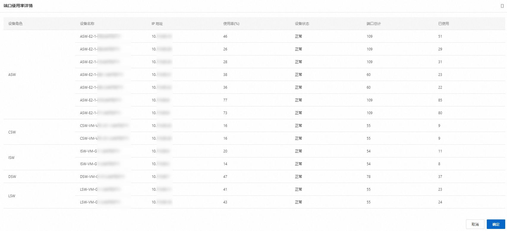 • <strong>光模块健康比例分布：</strong>展示系统中光模块当天状态分布情况。 • <strong>异常光模块列表</strong>：默认展示<strong>异常</strong>状态光模块列表。包括<strong>主机名</strong>、<strong>接口名称</strong>、<strong>归属</strong><strong>类型</strong>、<strong>厂商</strong>、<strong>型号</strong>、<strong>状态</strong>、<strong>故障概率</strong>、<strong>预期剩余寿命</strong>、<strong>智能分析结果</strong>等详细信息。单击右上角<strong>查看详情</strong>，支持打开弹出框查看<strong>异常光模块列表</strong>。 • <strong>高级筛选</strong>：可以根据<strong>光模块型号</strong>、<strong>光模块厂商、光模块状态、主机名</strong>、<strong>接口名</strong><strong>称</strong>、<strong>所属设备类型</strong>组合筛选，进行精准查找。 • 单击目标光模块<strong>操作</strong>列的<strong>详情</strong>，页面跳转至<strong>智能诊断</strong> &gt; <strong>光模块异常分析</strong>，查看目标光模块预测详情内容。具体可参考光模块异常分析。</td>
       </tr>
       <tr>
         <td>流量大盘</td>
         <td>选择目标时间段后，展示SLB集群和XGW集群的历史收发水位趋势图。</td>
       </tr>
     </table>

     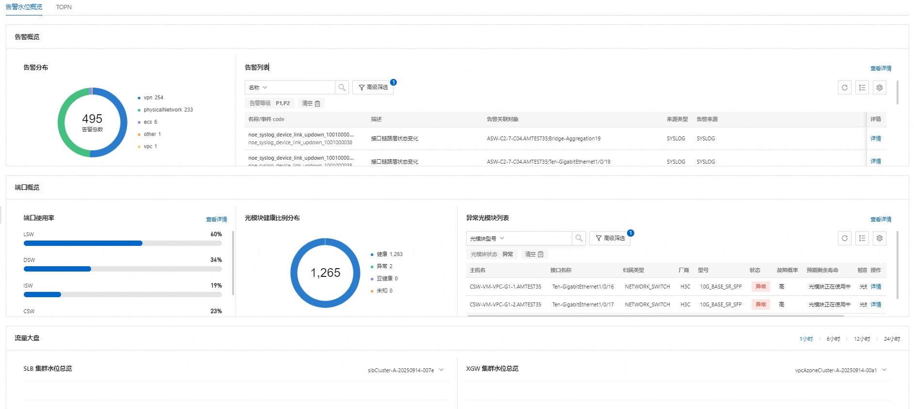

   - **TOPN**：按照各项数据的数量值排序，默认展示top5指标。支持各区域根据topn个数、目标时间段等条件筛选展示。

     | 区域 | 描述 |
     | --- | --- |

     | 物理网络 | • 交换机 CPU • 交换机内存 • 交换机端口 • <strong>交换机端口带宽</strong>（入方向、出方向） • <strong>交换机端口包速率</strong>（入方向、出方向） • <strong>交换机端口错包</strong>（入方向、出方向） • <strong>交换机端口丢包</strong>（入方向、出方向） |
     | --- | --- |

     | 网元设备 | • XGW • XGW CPU 使用率 • XGW 大页内存使用率 • <strong>XGW 端口带宽</strong>（入方向、出方向） • <strong>XGW 端口包速率</strong>（入方向、出方向） • <strong>XGW 端口丢包率</strong>（入方向、出方向） • LVS • LVS 新建连接数 • LVS 关闭连接数 • LVS 失败连接数 • LVS 并发连接数 • <strong>LVS 带宽</strong>（入方向、出方向） • <strong>LVS 包速率</strong>（入方向、出方向） • <strong>LVS 丢包</strong>（入方向、出方向） • SLB_PROXY • PROXY 请求数 • PROXY qps • PROXY 平均响应时间 • PROXY 接收连接数 • PROXY 处理连接数 • PROXY 并发连接数 • AVS • AVS CPU 使用率 • AVS 入方向丢包 • AVS 入方向缓冲丢包 • AVS 新建连接数 • AVS 并发连接数 • <strong>AVS 带宽</strong>（入方向、出方向） • <strong>AVS 包速率</strong>（入方向、出方向） • <strong>AVS 错包</strong>（入方向、出方向） |
     | --- | --- |

     | 网络资源 | • EIP • EIP 带宽 • <strong>EIP 包速率</strong>（入方向、出方向） • 反向访问 • <strong>反向访问带宽</strong>（入方向、出方向） • <strong>反向访问包速率</strong>（入方向、出方向） • <strong>反向访问限速丢包</strong>（入方向、出方向） • <strong>反向访问丢包</strong>（入方向、出方向） • NATGW • NATGW 并发连接数 • NATGW 丢弃连接数 • NATGW 限速丢弃连接数 • vlink • <strong>VLINK 带宽</strong>（入方向、出方向） • <strong>VLINK包速率</strong>（入方向、出方向） • 4层VIP • SLB 监听新建连接数/SLB 后端新建连接数 • SLB 监听并发连接数/SLB 后端并发连接数 • SLB 监听丢弃连接数/SLB 后端丢弃连接数 • <strong>SLB 监听包速率</strong>（入方向、出方向）/<strong>SLB后端包速率</strong>（入方向、出方向） • <strong>SLB 监听带宽</strong>（入方向、出方向）/<strong>SLB 后端带宽</strong>（入方向、出方向） • <strong>SLB 监听丢包</strong>（入方向、出方向）/<strong>SLB 后端丢包</strong>（入方向、出方向） • 7层VIP • PROXY 监听新建连接数 • PROXY 监听每秒请求数 • PROXY 监听处理延迟 • PROXY 监听并发连接数 • vport • AVS vport 新建连接数 • AVS vport 并发连接数 • <strong>AVS vport 包速率</strong>（入方向、出方向） • <strong>AVS vport 带宽</strong>（入方向、出方向） • <strong>AVS vport 丢包</strong>（入方向、出方向） |
     | --- | --- |

## 2.2. 网络拓扑

可以通过此页面查看物理网络的拓扑关系。

**前提条件**

产品BaseServiceAll的NetworkBaseServiceCluster集群已部署且已到终态。

**操作步骤**

1. 登录Apsara Uni-manager运维控制台。

2. 在顶部菜单栏，选择**产品运维** > **网络运维** > **网络运维控制台**。

3. 在左侧导航栏，选择**网络大盘** > **网络拓扑**。

4. 选择目标**机房**后，可以查看目标物理机房的物理网络拓扑结构。

   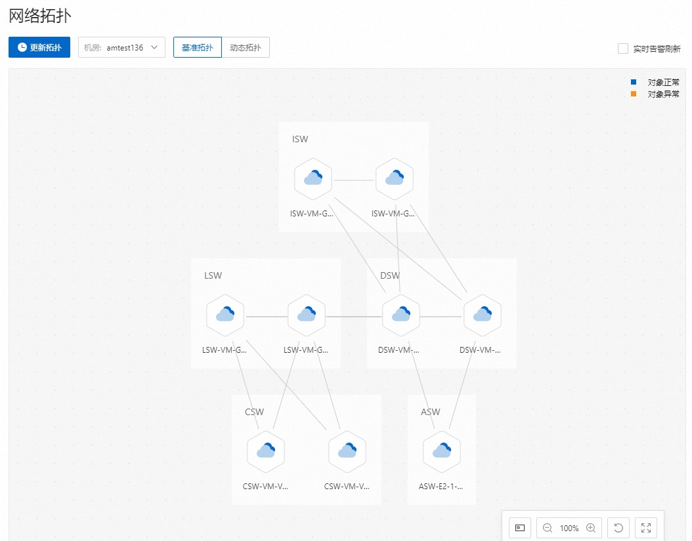

   - 单击**基准拓扑**或**动态拓扑**可以查看对应类型的网络拓扑图。

   - 若**动态拓扑**或**基准拓扑**存在偏移，可以单击**更新拓扑**来更新。

   - 网络设备不同颜色代表了网络设备的状态。

     - 蓝色：表示对象正常。

     - 橙色：表示对象异常。

   - 当拓扑类型为**基准拓扑**时，可以选择开启或关闭**实时告警刷新**功能。关闭后，如果后续产生新的告警，拓扑图上的设备或链路状态将不再更新。

   - 当拓扑类型为**动态拓扑**时，**实时告警刷新**功能会自动关闭。

5. 在网络拓扑图中，可以查看各网络设备信息和互联链路状态。

   - 单击网络设备图标，查看网络设备信息，包括**设备基本信息**和**告警列表**。

     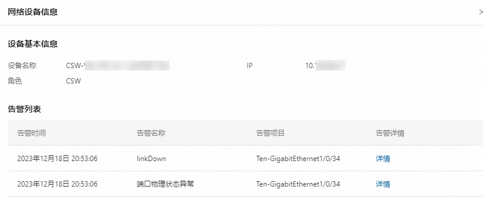

   - 单击网络设备间的连线，查看设备间的互联链路状态，包括**链路信息列表**和**告警列表**。

     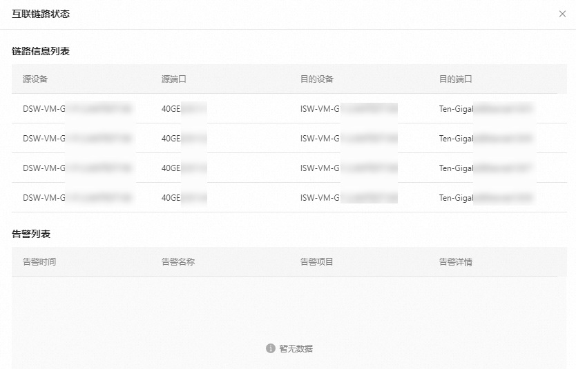

## 2.3. 自定义视图

通过此页面可以新建自定义视图，按需设置视图的展示内容和规则，集中汇总并展示感兴趣的监控数据和图表信息。

**前提条件**

产品BaseServiceAll的NetworkBaseServiceCluster集群已部署且已到终态。

**新建视图**

1. 登录Apsara Uni-manager运维控制台。

2. 在顶部菜单栏，选择**产品运维** > **网络运维** > **网络运维控制台**。

3. 在左侧导航栏，选择**网络大盘** > **自定义视图**。

4. 单击**新建视图**。

5. 在弹出的对话框中输入**视图名称**及**视图描述**后，单击**确定**。

   待视图添加成功后，系统自动跳转到该视图所在的页面。

   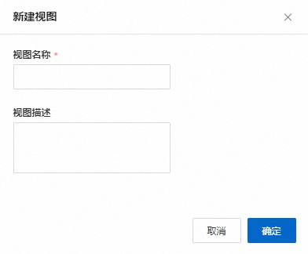

   > **说明**
   >
   > **视图名称**具有唯一性，如果出现**视图已存在**的提示时，请修改视图名称直到不出现重名后，再单击**确定**。

6. 新建子视图。

   <ol type="i">

   <li>

   单击视图下方的  图标。

   </li>

   <li>

   在弹出的面板中，配置如下参数后单击**确定**。

   子视图添加成功后，系统会自动跳转到该视图所在的页面，并显示子视图。

   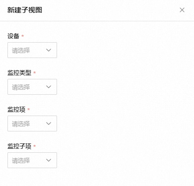

   <table>
     <tr>
       <th width="90">参数</th>
       <th>参数说明</th>
     </tr>
     <tr>
       <td>设备</td>
       <td>选择待监控的设备。</td>
     </tr>
     <tr>
       <td>监控类型</td>
       <td>选择监控的类型： • <strong>interface</strong>：交换机接口，包含接口的水位、错包和丢包等。 • <strong>hardware</strong>：交换机硬件，包含内存和CPU使用率等。 • <strong>capacity</strong>：其他容量，目前暂不支持。</td>
     </tr>
     <tr>
       <td>监控项</td>
       <td>根据所选的监控类型，在列表中选择对应的监控项。</td>
     </tr>
     <tr>
       <td>监控子项</td>
       <td>根据所选的监控项，选择对应的监控子项。</td>
     </tr>
   </table>

   </li>

   <li>

   根据需求，可以重复步骤6继续新建子视图。

   </li>

   </ol>

**查看视图**

1. 在页面上方的下拉列表中选择视图名称，选择起始时间和结束时间，单击**搜索**。

2. 页面展示目标视图下所有子视图的监控数据图表。

   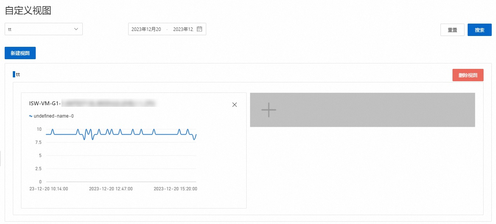

**删除视图**

**删除子视图**

1. 根据查看视图获取目标视图。

2. 单击目标子视图的右上角  图标。

3. 在弹出的确认框中，单击**确定**。

**删除视图**

> **重要**
>
> 删除视图会同时删除内部关联的子视图，请谨慎操作。

1. 根据查看视图获取目标视图。

2. 在视图右上角，单击**删除视图**。

3. 在弹出的确认框中，单击**确定**。

# 3.基础网络

## 3.1. 网元管理

网元即网络设备，包括交换机、路由器等。网元管理页面主要展示了物理网络设备的基础信息和运行状态，同时，还提供了对物理网络设备相关的配置管理操作，包含设备管理、密码管理以及配置一致性比对等。NOE适配各厂商的功能可参考ASO-NOE（网络运维控制台）支持交换机监控能力说明。

**设备管理**

设备管理主要展示了物理网元设备的监控信息，同时还提供了对网络设备的采集设置操作。

**网络监控**

**背景说明**

在**网络监控**页面，查看专有云内物理网络设备的基础信息、运行状态及流量监控等信息，及时了解全网设备的健康状态。

**前提条件**

产品BaseServiceAll的NetworkBaseServiceCluster集群已部署且已到终态。

**操作步骤**

1. 登录Apsara Uni-manager运维控制台。

2. 在顶部菜单栏，选择**产品运维** > **网络运维** > **网络运维控制台**。

3. 在左侧导航栏，选择**基础网络** > **网元管理**。

4. 在**设备管理**页签下的**网络监控**子页签，选择**IDC**机房后，可以查看专有云内物理网络设备列表。

   列表包括**设备名称**、**管理IP**、**SN**、**业务域**、**厂商**、**型号**、**角色**、**在线时间**、**Ping状态**、**Snmp状态**以及**最近更新**。

   > **说明**
   >
   > - 单击列表右上角的**导出**，将网络设备信息导出到本地。
   >
   > - 当**Ping状态**、**Snmp状态**出现异常时，对应状态变为红色。
   >
   > - 在列表右上角的搜索框中，输入设备名称或管理IP，查找指定设备的监控信息。
   >
   > - **管理IP**、**Ping状态**和**Snmp状态**支持排序，**角色**支持过滤。

   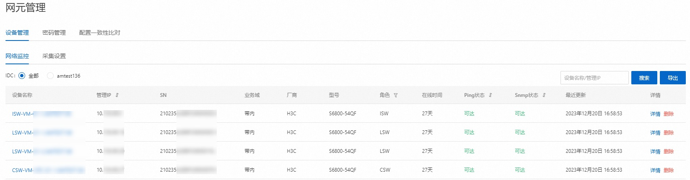

5. 单击目标**设备名称**，或者单击目标设备对应**详情**列的**详情**，可以查看物理网络设备详情。具体内容如下：

   <table>
     <tr>
       <th width="90">区域</th>
       <th>说明</th>
     </tr>
     <tr>
       <td>基本信息</td>
       <td>查看<strong>设备名称</strong>、<strong>IP</strong>、<strong>SN</strong>、<strong>厂商</strong>、<strong>型号</strong>、<strong>角色</strong>、<strong>在线时间</strong>、<strong>Ping状态</strong>、<strong>Snmp状态</strong>、<strong>最</strong><strong>近更新</strong>、<strong>发行版本</strong>和<strong>软件版本</strong>。 </td>
     </tr>
     <tr>
       <td>端口</td>
       <td>• 查看该设备的端口列表，包括<strong>端口名称</strong>、<strong>端口速率</strong>、<strong>端口描述</strong>、<strong>管理状态</strong>、<strong>操作状</strong><strong>态</strong>、<strong>对端设备</strong>、<strong>对端接口</strong>、<strong>对端描述</strong>以及<strong>最近更新</strong>。 说明<strong>管理状态</strong>和<strong>操作状态</strong>支持排序；并且出现异常时，对应状态变为红色。 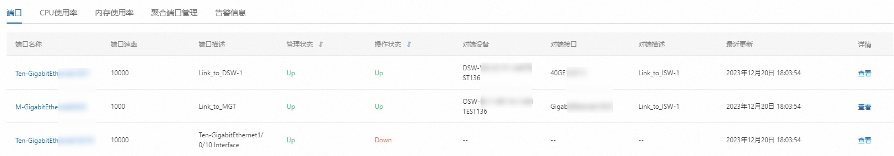 • 查看端口详情。 a. 单击目标<strong>端口名称</strong>，或者单击目标端口对应<strong>详情</strong>列中的<strong>查看</strong>。 b. 获取端口基本信息和水位数据。在水位数据区域，可以根据<strong>快速查询</strong>选择时间段，也可以在右上角自定义时间段，获取目标时间内的流量数据。 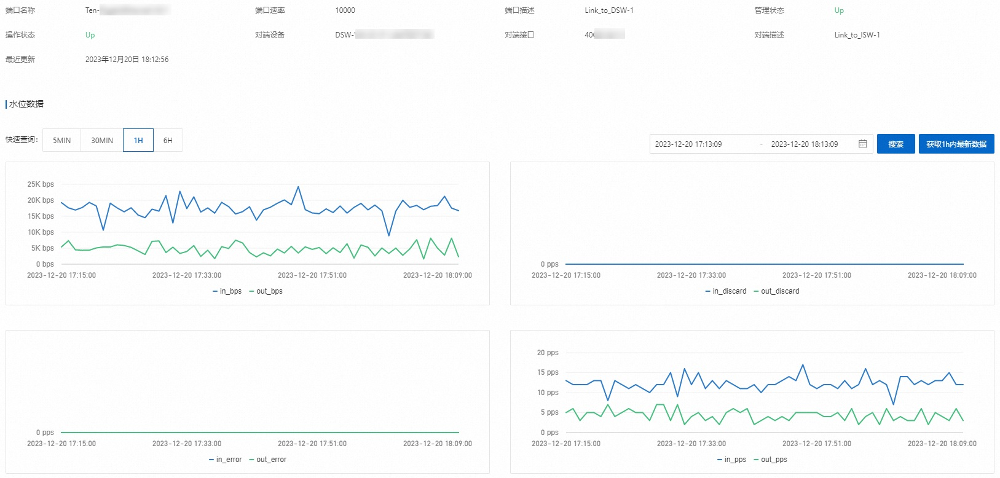</td>
     </tr>
   </table>

   <table>
     <tr>
       <td>CPU使用率</td>
       <td>查看该设备的CPU使用率信息。 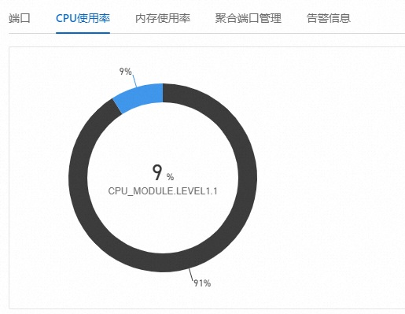</td>
     </tr>
     <tr>
       <td>内存使用率</td>
       <td>查看该设备的内存使用率信息。 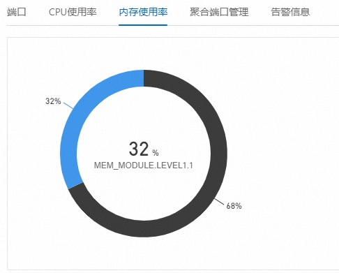</td>
     </tr>
   </table>

   <table>
     <tr>
       <td>聚合端口管理</td>
       <td>• 查看该设备的所有聚合端口信息。 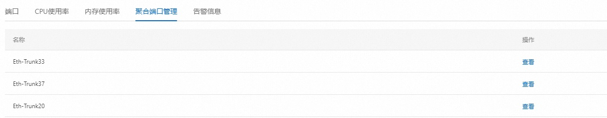 • 单击目标聚合端口对应<strong>操作</strong>列的<strong>查看</strong>，可获取该聚合端口的水位信息。 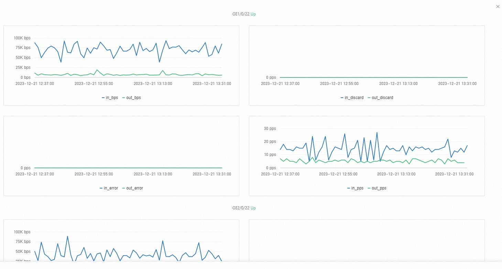</td>
     </tr>
     <tr>
       <td>告警信息</td>
       <td>查看该设备的告警信息。 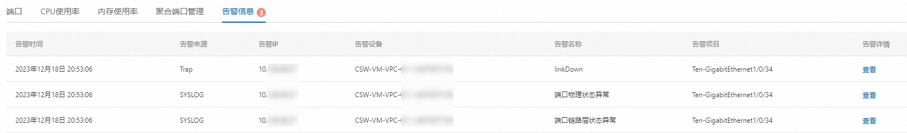 说明日常运维过程中，需要及时关注设备的告警信息。<strong>告警信息</strong>页签无数据，表示设备运行正常；若出现告警事件，系统会显示当前未恢复的告警事件，请及时处理。</td>
     </tr>
   </table>

6. （可选）删除网络设备监控信息。

   <ol type="i">

   <li>

   单击目标设备对应**详情**列的**删除**。

   </li>

   <li>

   在弹出来的提示框中单击**删除**。

   </li>

   </ol>

**采集设置**

**功能介绍**

采集设置功能主要提供对物理网元设备采集周期的设置和OOB网段的管理。

- 采集网络设备信息前，需要根据业务需求设置网络设备信息的采集周期。

- OOB网段管理主要用于对物理网元设备管理范围的设置，通常需要由运维工程师添加当前待管理的网络设备所在的纳管网段。

**前提条件**

产品BaseServiceAll的NetworkBaseServiceCluster集群已部署且已到终态。

**背景说明**

首次使用网络运维控制台的网元管理功能时，需要添加当前专有云网络设备规划好的设备loopback IP地址段，一般为IP规划表中的netdev.loopback字段对应的地址段。当网络进行扩容，同时伴随loopback IP地址段的扩容时，也需要将扩容涉及的IP地址网段添加至管理范围，扩容IP地址段的添加方式与首次录入的方法相同。录入完成后，即可在页面查询当前管理的设备的网段信息。

**操作步骤**

1. 登录Apsara Uni-manager运维控制台。

2. 在顶部菜单栏，选择**产品运维** > **网络运维** > **网络运维控制台**。

3. 在左侧导航栏，选择**基础网络** > **网元管理**。

4. 在**设备管理**页签下的**采集设置**子页签，可以进行如下配置：

   <table>
     <tr>
       <th width="122">区域</th>
       <th>配置说明</th>
     </tr>
     <tr>
       <td>采集周期设置</td>
       <td>i. 分别设置<strong>自动扫描周期</strong>、<strong>设备扫描周期</strong>、<strong>端口扫描周期</strong>以及<strong>链路扫描周期</strong>。  说明如果无特殊需求，建议使用初始默认值即可。 ii. 单击<strong>提交</strong>。提交后，系统将会根据该配置来采集设备信息。</td>
     </tr>
   </table>

   <table>
     <tr>
       <td>OOB网段管理</td>
       <td>• 新增网段 a. 单击<strong>新增网段</strong>。 b. 在弹出的对话框中，配置如下信息后单击<strong>确定</strong>。 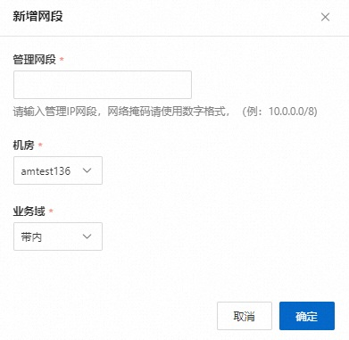 • <strong>管理网段</strong>：输入含掩码信息的IP地址段和掩码，例10.0.0.0/8。 • <strong>机房</strong>：选择机房。 • <strong>业务域</strong>：选择<strong>带内</strong>或<strong>带外</strong>。 • 查看网段列表 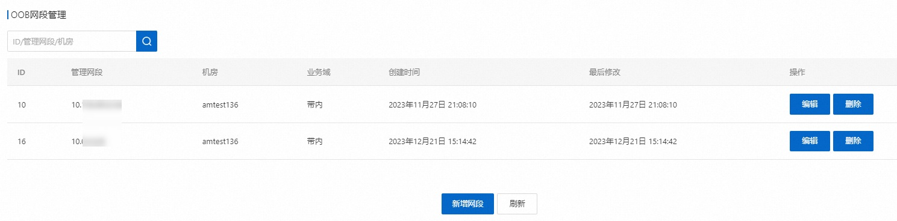 a. 在列表上方搜索框中，输入<strong>ID/管理网段/机房</strong>，单击图标可以查看目标网段的相 关信息。 b. 网段列表包括<strong>ID</strong>、<strong>管理网段</strong>、<strong>机房</strong>、<strong>业务域</strong>、<strong>创建时间</strong>和<strong>最后修改</strong>。 • 编辑网段 a. 单击目标网段对应<strong>操作</strong>列的<strong>编辑</strong>。 b. 修改参数后单击<strong>确定</strong>。 • 删除网络 a. 单击目标网段对应<strong>操作</strong>列的<strong>删除</strong>。 b. 在弹出的对话框中单击<strong>确定</strong>。</td>
     </tr>
   </table>

**密码管理**

修改物理网络设备的密码。

**操作步骤**

1. 登录Apsara Uni-manager运维控制台。

2. 在顶部菜单栏，选择**产品运维** > **网络运维** > **网络运维控制台**。

3. 在左侧导航栏，选择**基础网络** > **网元管理**。

4. 在**密码管理**页签下，获取所有的现网设备。

   > **说明**
   >
   > 在搜索框中输入设备名称可以进行精确查找。

5. 勾选待修改密码的设备，单击**加入实施**，待修改密码的设备会出现在右侧**实施设备**中。

   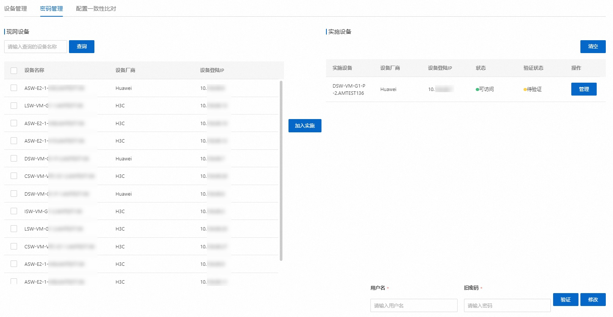

   > **说明**
   >
   > 加入**实施设备**后，如果需要移出设备，可以在目标设备对应**操作**列中单击**管理** > **删除**，移出单个设备，或者单击右侧的**清空**按钮，移出所有加入实施的物理设备。

6. 在修改密码前，系统需要对旧密码进行验证。在页面右下角输入**用户名**和**旧密码**，然后单击**验证**。

   > **说明**
   >
   > - 如果添加了多个实施设备且旧密码不一致，请分开进行验证。
   >
   > - 验证通过后，实施设备列表的验证状态为**验证通过**。

7. 验证通过后，可以选择对一台或者所有设备进行密码修改。

   - 修改一台设备的密码

     

     <ol type="a">

     <li>

     在目标设备对应**操作**列中，单击**管理** > **设置账号密码**。

     </li>

     <li>

     在弹出的对话框中输入**用户名**和**密码**，然后单击**确定**。

     </li>

     </ol>

   - 修改所有设备的密码

     <ol type="a">

     <li>

     在**实施设备**区域下方，单击**修改**。

     </li>

     <li>

     在弹出的对话框中输入**用户名**和**密码**，然后单击**确定**。

     </li>

     </ol>

**配置一致性比对**

可以将设备上当前运行的配置与启动时的配置进行一致性比对。

**前提条件**

产品BaseServiceAll的NetworkBaseServiceCluster集群已部署且已到终态。

**操作步骤**

1. 登录Apsara Uni-manager运维控制台。

2. 在顶部菜单栏，选择**产品运维** > **网络运维** > **网络运维控制台**。

3. 在左侧导航栏，选择**基础网络** > **网元管理**。

4. 在**配置一致性比对**页签下，获取网络设备列表，包括**设备名称**、**设备厂商**、**设备登陆IP**以及**结果**。

   > **说明**
   >
   > 在搜索框中输入设备名称可以进行精确查找。

   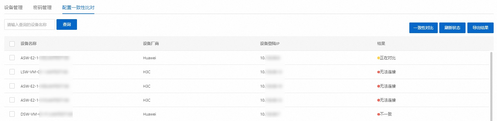

5. 勾选待比对配置的设备，单击**一致性比对**。

   - 单击**刷新状态**可以获取比对结果。

   - 单击**导出结果**，可以将对比差异结果导出到本地进行查看。

## 3.2. SYSLOG日志

Syslog日志基于时间、日志等级、模块等维度，将系统内网络硬件设备产生的日志信息进行记录和存储，方便后续的分析和管理，以快速发现和解决问题，提高设备的可用性和稳定性。

**查看日志**

1. 登录Apsara Uni-manager运维控制台。

2. 在顶部菜单栏，选择**产品运维** > **网络运维** > **网络运维控制台**。

3. 在左侧导航栏，选择**基础网络** > **SYSLOG日志**。

4. 单击**高级筛选**，通过**机房**、**来源设备**、**记录时间**、**日志内容**、**解析状态**、**日志级别**、**厂商**以及**告警模块**组合筛选目标日志信息。

5. 在日志列表中，查看日志数据信息。

   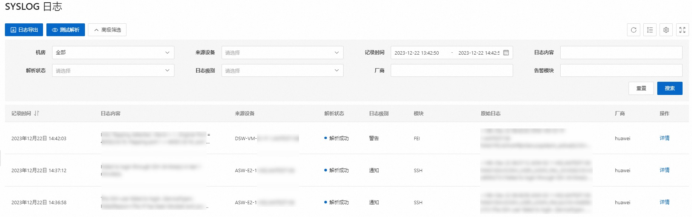

   <table>
     <tr>
       <th width="90">列表项</th>
       <th>列表项说明</th>
     </tr>
     <tr>
       <td>记录时间</td>
       <td>日志记录的时间，支持排序。</td>
     </tr>
     <tr>
       <td>日志内容</td>
       <td>解析后的日志数据，即原始日志中的content部分。</td>
     </tr>
     <tr>
       <td>来源设备</td>
       <td>日志数据的来源设备。</td>
     </tr>
     <tr>
       <td>解析状态</td>
       <td>日志数据解析的状态，包括<strong>解析成功</strong>、<strong>解析失败</strong>。 说明日志解析失败可能的原因如下： • 日志格式不满足RFC 3164规范。 • 网络设备非专有云支持的重资产厂商。</td>
     </tr>
     <tr>
       <td>日志级别</td>
       <td>日志数据的级别，包括<strong>紧急</strong>、<strong>告警</strong>、<strong>严重</strong>、<strong>错误</strong>、<strong>警告</strong>、<strong>通知</strong>、<strong>信息</strong>、<strong>调试</strong>。</td>
     </tr>
     <tr>
       <td>模块</td>
       <td>日志数据所属模块。</td>
     </tr>
     <tr>
       <td>原始日志</td>
       <td>日志数据的原始文本，即未解析的日志信息。</td>
     </tr>
     <tr>
       <td>厂商</td>
       <td>设备所属厂商。</td>
     </tr>
   </table>

6. 单击操作列的**详情**，可查看更详细的日志信息，如告警匹配结果、模块详情、Location信息等。

   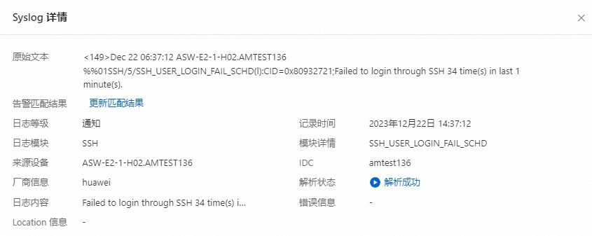

**更多操作**

**日志导出**

在日志列表上方，单击**日志导出**，即可将日志信息导出至本地进行查看。

> **说明**
>
> 默认导出全部日志信息。

**测试解析**

1. 在日志列表上方，单击**测试解析**。

2. 输入**原始文本**，单击**提交**。

   > **说明**
   >
   > 单击**重置**，会将原始文本中的内容清空。

3. 在解析结果区域，查看Description、Hostname、LogLevel等解析结果信息。

# 4.网络产品

## 4.1. XGW运维

### 4.1.1. XGW集群管理

**操作步骤**

1. 登录Apsara Uni-manager运维控制台。

2. 在顶部菜单栏，选择**产品运维** > **网络运维** > **网络运维控制台**。

3. 在左侧导航栏，选择**网络产品** > **XGW运维** > **XGW集群管理**。

4. 选择**地域**后，可查看目标地域的**可用区列表**以及**集群拓扑关系**图。

   > **说明**
   >
   > 仅支持x86物理机形态管理。

   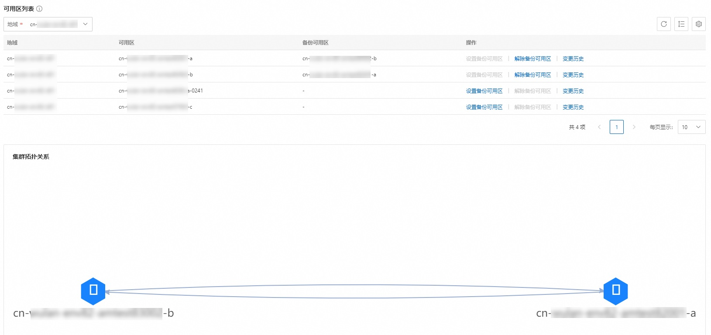

5. 单击目标可用区对应**操作**列的**设置备份可用区**。

   > **说明**
   >
   > 未配置备份可用区的可用区支持此操作。

6. 配置**选择备份可用区**后，单击**确定**。

   > **说明**
   >
   > - 备份可用区只支持相同Region、相同架构的集群。
   >
   > - 选择备份可用区时，该备份可用区不能已被其他可用区指定为备份。

   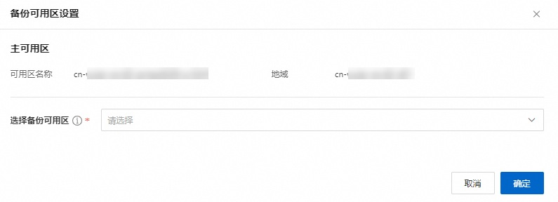

**相关操作**

**解除备份可用区**

> **说明**
>
> 已配置备份可用区的可用区支持此操作。

1. 单击目标可用区对应**操作**列的**解除备份可用区**。

2. 在弹出的对话框中单击**确定**。

**查看变更历史**

1. 单击目标可用区对应**操作**列的**变更历史**。

2. 在变更历史对话框中查看可用区的历史变更记录。

   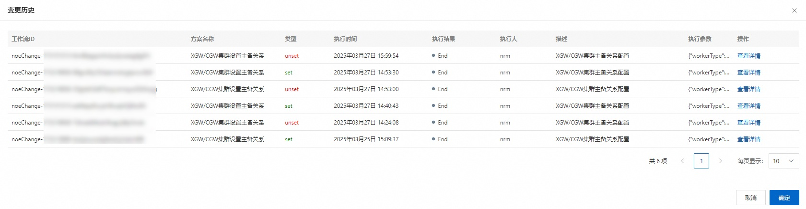

3. 单击目标变更记录对应**操作**列的**查看详情**，页面跳转至**方案执行详情**页，查看更详细的信息，具体可参考方案执行历史。

### 4.1.2. XGW管理

XGW管理就是对VPC网关的管理，可以查看设备节点和服务实例相关的水位信息。

**XGW集群**

在XGW管理页面查看XGW网络产品的基本信息、运行状态、聚合流量及各设备节点的水位情况。

**前提条件**

产品BaseServiceAll的NetworkBaseServiceCluster集群已部署且已到终态。

**操作步骤**

1. 登录Apsara Uni-manager运维控制台。

2. 在顶部菜单栏，选择**产品运维** > **网络运维** > **网络运维控制台**。

3. 在左侧导航栏，选择**网络产品** > **XGW运维** > **XGW管理**。

4. 在**XGW集群**页签下，选择需要查看的**集群**，系统显示当前集群中的所有设备**节点信息**和**聚合流量**水位情况。

5. 在**节点信息**区域。

   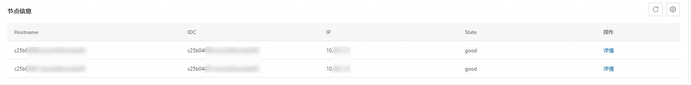

   - 查看节点列表：包括**Hostname**、**IDC**、**IP**和**State**。

   - 查看节点详情：在节点对应的的**操作**列中，单击**详情**进入到节点详情页面，查看节点水位数据，相关指标含义参考指标含义表。

6. 在**聚合流量**区域，查看当前的设备节点水位流量信息。相关指标含义如下表所示。

   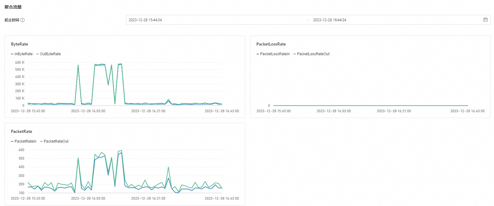

   > **说明**
   >
   > - 起始时间与结束时间的范围不得超过24小时。
   >
   > - 单击**最近1小时**、**最近3小时**、**最近6小时**、**最近1天**快速查询对应时间范围内的水位数据信息。
   >
   > - 将鼠标悬停于图中任意一个时间节点，系统会显示该时间节点的所有指标的数值。

   **分类**

   **名称**

   **描述**

   入方向字节速率（比特/秒）

   **InByteRate**

   **ByteRate**

   出方向字节速率（比特/秒）

   **OutByteRate**

   入方向报文丢弃速率（个/秒）

   **PacketLossRateIn**

   **PacketLossRate**

   出方向报文丢弃速率（个/秒）

   **PacketLossRateOut**

   <table>
     <tr>
       <td rowspan="2">PacketRate</td>
       <td>PacketRateIn</td>
       <td>入方向报文速率（个/秒）</td>
     </tr>
     <tr>
       <td>PacketRateOut</td>
       <td>出方向报文速率（个/秒）</td>
     </tr>
   </table>

**实例监控**

在实例监控页面查看某个实例的水位情况。

**前提条件**

产品BaseServiceAll的NetworkBaseServiceCluster集群已部署且已到终态。

**操作步骤**

1. 登录Apsara Uni-manager运维控制台。

2. 在顶部菜单栏，选择**产品运维** > **网络运维** > **网络运维控制台**。

3. 在左侧导航栏，选择**网络产品** > **XGW运维** > **XGW管理**。

4. 在**实例监控**页签下，选择需要查看的实例所在的**集群**，输入需要查询的**实例IP地址**，然后单击**搜索**，查看该实例运行的水位图。相关指标含义如下表所示。

   > **说明**
   >
   > - 起始时间与结束时间的范围不得超过12小时。
   >
   > - 单击**最近5分钟**、**最近30分钟**、**最近1小时**、**最近6小时**快速查询对应时间范围内的水位数据信息。
   >
   > - 将鼠标悬停于图中任意一个时间节点，系统会显示该时间节点的所有指标的数值。

   | 名称 | 描述 |
   | --- | --- |
   | InBps | 入方向字节速率（比特/秒） |
   | InDropSpeed | 入方向丢包速率（个/秒） |
   | InFinSpeed | 入方向fin包速率（个/秒） |
   | InPps | 入方向数据包速率（个/秒） |
   | InRateLimitDropSpeed | 入方向限速丢包速率（个/秒） |
   | InRstSpeed | 入方向rst 包速率（个/秒） |
   | InSynAckSpeed | 入方向syn_ack包速率（个/秒） |
   | OutBps | 出方向字节速率（比特/秒） |
   | OutDropSpeed | 出方向丢包速率（个/秒） |
   | OutFinSpeed | 出方向fin包速率（个/秒） |
   | OutPps | 出方向数据包速率（个/秒） |
   | OutRateLimitDropSpeed | 出方向限速丢包速率（个/秒） |
   | OutRstSpeed | 出方向rst包速率（个/秒） |
   | OutSynAckSpeed | 出方向syn_ack包速率（个/秒） |

### 4.1.3. NAT网关监控

在多云异地容灾、混合云等场景下，可以根据tunnel ID查询NAT网关实例监控数据。

**操作步骤**

1. 登录Apsara Uni-manager运维控制台。

2. 在顶部菜单栏，选择**产品运维** > **网络运维** > **网络运维控制台**。

3. 在左侧导航栏，选择**网络产品** > **XGW运维** > **NAT网关监控**。

4. 选择**集群**、**起始日期**和**结束日期**，输入**Tunnel ID**，单击**查询**查看实例监控趋势图。

   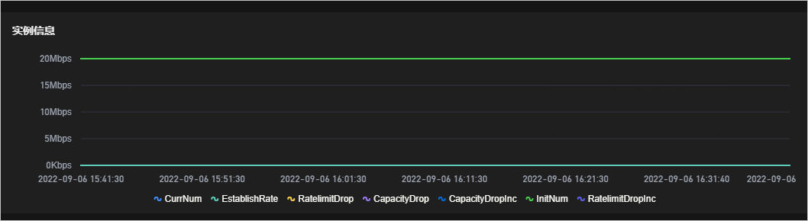

   > **说明**
   >
   > 将鼠标悬停于图上任意时间点，可查看该时间点的监控数据。

   指标含义如下表所示。

   | 指标 | 描述 |
   | --- | --- |
   | CurrNum | 当前实例数（个） |
   | EstablishRate | Establish建联速率（连接个数/秒） |
   | RatelimitDrop | 限速丢包数（个） |
   | CapacityDropInc | Inc容量丢包数（个） |
   | CapacityDrop | 容量丢包数（个） |
   | IninNum | 初始化实例数（个） |
   | RatelimitDropInc | Inc限速丢包数（个） |

### 4.1.4. RI实例

本文介绍了如何查看路由器接口的实例列表以及实例详情的运维信息。

**操作步骤**

1. 登录Apsara Uni-manager运维控制台。

2. 在顶部菜单栏，选择**产品运维** > **网络运维** > **网络运维控制台**。

3. 在左侧导航栏，选择**网络产品** > **XGW运维** > **RI实例**。

4. 在高级筛选下，在**查询条件**中选择**VPC ID**或**UID**，然后输入对应查询参数。

5. （可选）根据**连接类型**、**RI ID**、**路由器类型**、**路由器ID**、**实例状态**、**实例名称**、**对端RI ID**、**对端路由器ID**、**对端路由器类型**、**对端Region ID**组合筛选进行查询。

   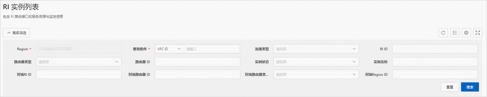

6. 单击**搜索**，页面展示目标UID的所有RI实例列表。

   > **说明**
   >
   > 当**查询条件**选择**VPC ID**，则会自动查询所属UID的所有RI实例列表。

7. 在目标实例对应**操作**列，单击**详情**，查看实例详细运维信息，若存在水位信息，则页面同时展示水位数据。

   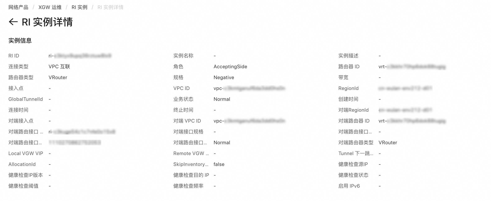

## 4.2. AVS运维

### 4.2.1. AVS管理

通过此页面可以获取AVS基本信息以及AVS水位大盘信息。

**操作步骤**

1. 登录Apsara Uni-manager运维控制台。

2. 在顶部菜单栏，选择**产品运维** > **网络运维** > **网络运维控制台**。

3. 在左侧导航栏，选择**网络产品** > **AVS运维** > **AVS管理**。

4. 通过此页面可以获取AVS列表，包括**主机名**、**NC IP**、**内核版本**、**pync版本**、**rpm版本**、**mvssSDK版本**、**vtools版本**。

   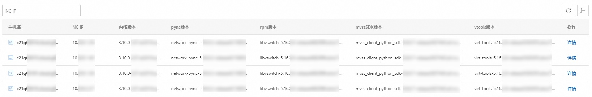

5. 单击目标AVS对应**操作**列的**详情**，获取节点的监控数据，包括**netdev流量**、**CPU使用率**、**vport总流量**、**vxlanVport总流量**、**物理网卡流量**在目标时间段的趋势图。

   关键指标含义如下表所示。

   **分类**

   **指标**

   **含义**

   netdev网卡入方向报文数

   if_ipackets_sum

   netdev网卡出方向报文数

   if_opackets_sum

   Flow

   netdev网卡入方向丢弃报文数

   if_idrop_sum

   **netdev流量**

   netdev网卡出方向丢弃报文数

   if_odrop_sum

   netdev网卡入方向字节数

   if_ibytes_sum

   BandWidth

   netdev网卡出方向字节数

   if_obytes_sum

   CPU平均使用率

   usage_avg

   CPU最小使用率

   **CPU使用率**

   usage_min

   CPU最大使用率

   usage_max

   rx_packets_sum

   入向报文数

   入向丢弃报文数

   rx_dropped_sum

   出向报文数

   tx_packets_sum

   出向丢弃报文数

   tx_dropped_sum

   SLB方向出向报文数

   slb_tx_packets_sum

   SLB方向出向丢弃报文数

   slb_tx_dropped_sum

   SLB方向入向报文数

   slb_rx_packets_sum

   SLB方向入向丢弃报文数

   slb_rx_dropped_sum

   Flow

   入向限速丢包数

   rx_pps_limit_error_sum

   出向限速丢包数

   tx_pps_limit_error_sum

   入向安全组丢包数

   rx_acl_error_sum

   出向安全组丢包数

   tx_acl_error_sum

   出向IPv6报文数

   ipv6_tx_packets_sum

   出向IPv6安全组丢弃报文数

   ipv6_tx_acl_error_sum

   入向IPv6报文数

   ipv6_rx_packets_sum

   入向IPv6安全组丢弃报文数

   ipv6_rx_acl_error_sum

   入向字节数

   rx_bytes_sum

   入向丢弃报文字节数

   rx_dropped_bytes_sum

   出向字节数

   tx_bytes_sum

   出向丢弃报文字节数

   tx_dropped_bytes_sum

   SLB方向出向字节数

   slb_tx_bytes_sum

   BandWidth

   SLB方向出向丢弃报文字节数

   slb_tx_dropped_bytes_sum

   SLB方向入向字节数

   slb_rx_bytes_sum

   SLB方向入向丢弃报文字节数

   slb_rx_dropped_bytes_sum

   出向IPv6字节数

   ipv6_tx_bytes_sum

   入向IPv6字节数

   ipv6_rx_bytes_sum

   IGW方向出向报文数

   tx_igw_packets_avg

   **vport总流量**

   IGW方向入向报文数

   rx_igw_packets_avg

   NorthSouthFlow

   IGW方向出向IPv6报文数

   ipv6_tx_igw_packets_avg

   IGW方向入向IPv6报文数

   ipv6_rx_igw_packets_avg

   IGW方向出向字节数

   tx_igw_bytes_avg

   IGW方向入向字节数

   rx_igw_bytes_avg

   NorthSouthBandWi dth

   IGW方向出向IPv6字节数

   ipv6_tx_igw_bytes_avg

   IGW方向入向IPv6字节数

   ipv6_rx_igw_bytes_avg

   快转会话总数

   session_count_sum

   SLB类型会话数

   slb_session_count_sum

   UDP\\ICMP类型会话数

   noconn_flows_num_sum

   Connecting状态会话数（新建连

   tcp_connecting_flows_num

   接数）

   _sum

   Established状态会话数（并发连

   tcp_established_flows_num

   接数）

   _sum

   Connect

   tcp_closing_flows_num_su

   Closing状态会话数

   m

   Closed状态会话数

   tcp_closed_flows_num_sum

   入向新建会话失败数

   rx_session_new_fail_sum

   入向更新会话失败数

   rx_session_update_fail_sum

   tx_session_new_fail_sum

   出向新建会话失败数

   出向更新会话失败数

   tx_session_update_fail_sum

   出向报文重传率

   tx_retrans_avg

   入向报文重传率

   rx_retrans_avg

   IGW方向出向报文重传率

   tx_igw_retrans_avg

   IGW方向入向报文重传率

   rx_igw_retrans_avg

   RetransmissionRat

   出向IPv6报文重传率

   ipv6_rx_retrans_avg

   e

   入向IPv6报文重传率

   ipv6_tx_retrans_avg

   IGW方向出向IPv6报文重传率

   ipv6_tx_igw_retrans_avg

   IGW方向入向IPv6报文重传率

   ipv6_rx_igw_retrans_avg

   入向报文数

   rx_packets_avg

   出向报文数

   tx_packets_avg

   入向丢弃报文数

   rx_dropped_avg

   出向丢弃报文数

   tx_dropped_avg

   入向pps限速丢包数

   rx_pps_limit_error_avg

   入向快转丢包数

   rx_fastpath_error_avg

   出向pps限速丢包数

   tx_pps_limit_error_avg

   Flow

   出向快转丢包数

   tx_fastpath_error_avg

   入向cpu限速丢包数

   rx_cpu_limit_error_avg

   出向cpu限速丢包数

   tx_cpu_limit_error_avg

   **vxlanVport总流量**

   relay错误报文数

   relay_packet_err_avg

   relay报文数

   relay_packet_avg

   入向位置表匹配错误数

   rx_loc_route_error_avg

   入向位置表IPv6匹配错误数

   ipv6_rx_loc_error_avg

   入向bps限速丢包数

   rx_bps_limit_error_avg

   出向bps限速丢包数

   tx_bps_limit_error_avg

   入向字节数

   rx_bytes_avg

   BandWidth

   入向丢弃报文字节数

   rx_dropped_bytes_avg

   出向字节数

   tx_bytes_avg

   出向丢弃报文字节数

   tx_dropped_bytes_avg

   入向丢弃报文数

   rx_drop_packets_avg

   入向错误报文数

   rx_error_packets_avg

   入向缓冲丢包数

   rx_missed_errors_avg

   Flow

   入向报文数

   rx_packets_avg

   **物理网卡流量**

   出向错误报文数

   tx_error_packets_avg

   出向报文数

   tx_packets_avg

   入向字节数

   rx_bytes_avg

   BandWidth

   出向字节数

   tx_bytes_avg

## 4.3. VPC运维

### 4.3.1. 天宫VPC

**操作步骤**

1. 登录Apsara Uni-manager运维控制台。

2. 在顶部菜单栏，选择**产品运维** > **网络运维** > **网络运维控制台**。

3. 在左侧导航栏，选择**网络产品** > **VPC运维** > **天宫VPC**。

4. 单击**高级筛选**，可以根据**VPC ID**、**状态**以及**创建时间**组合筛选获取目标VPC及相关信息。

   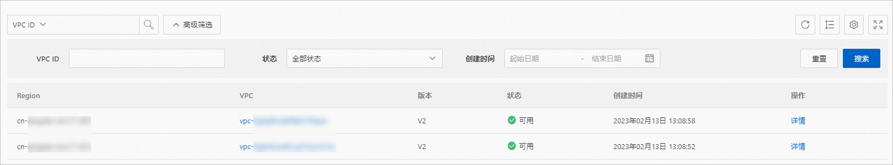

5. 单击目标VPC名称或对应**操作**列的**详情**，进入VPC详情页获取详细信息，包括**VPC实例信息**、**VRouter信息**以及**VSwitch列表**。

   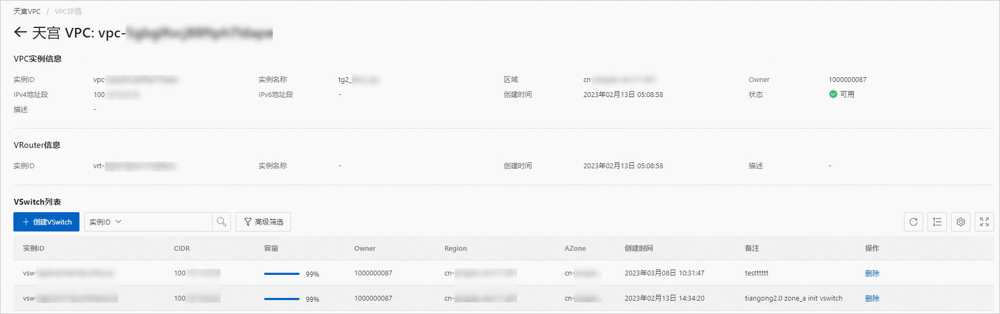

6. 在**VSwitch列表**区域，可以执行如下操作：

   - 创建VSwitch：单击创建**创建VSwitch**，配置如下参数后单击**确定**。

     | 参数 | 参数说明 |
     | --- | --- |
     | AZone | 输入创建VSwitch关联的可用区ID。 |
     | CIDR | 输入VSwitch配置所属的IPv4网段。 |
     | 用途 | 选择VSwitch的业务用途，支持以下两种用途： • 云产品 • 容器网络 |
     | 描述 | 输入VSwitch相关的描述信息。 |

     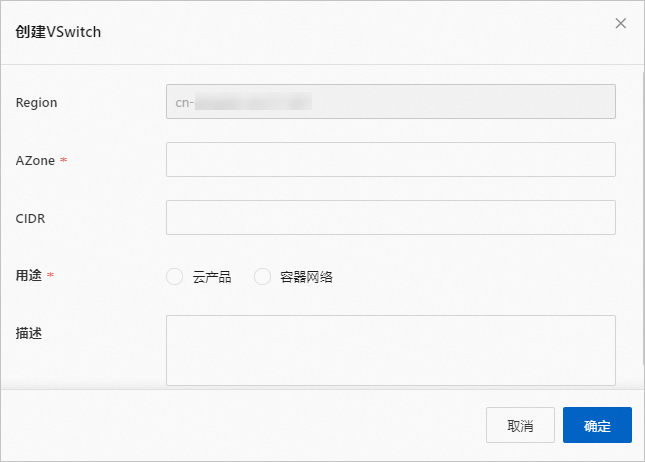

   - 查看VSwitch：单击**高级筛选**，可以根据**实例ID**、**Owner**、**AZone**以及**创建时间**组合筛选获取目标VSwitch信息。

   - 删除VSwitch：单击目标VSwitch对应**操作**列的**删除**，在弹出的对话框中单击**确定**。

     > **重要**
     >
     > 删除后无法恢复，请谨慎操作。

### 4.3.2. VPC工作流

您可以查看和管理VPC瑶池工作流。

**操作步骤**

1. 登录Apsara Uni-manager运维控制台。

2. 在顶部菜单栏，选择**产品运维** > **网络运维** > **网络运维控制台**。

3. 在左侧导航栏，选择**网络产品** > **VPC运维** > **VPC工作流**。

4. 在**VPC工作流**页面，配置以下参数，查询要查看的进程任务，然后单击**确定**。

   <table>
     <tr>
       <th width="125">参数</th>
       <th>说明</th>
     </tr>
     <tr>
       <td>工作流名称</td>
       <td>输入自定义工作流名称。</td>
     </tr>
     <tr>
       <td>执行状态</td>
       <td>选择任务的执行状态。 • <strong>ALL</strong>：所有状态。 • <strong>SCHEDULABLE</strong>：可调度。 • <strong>RUNNING</strong>：执行中。 • <strong>PAUSED</strong>：暂停。 • <strong>HUMAN_PROCESSING</strong>：人工介入。 • <strong>COMPLETED</strong>：已完成。 • <strong>FAILED</strong>：失败。 • <strong>TIMEOUT</strong>：超时。</td>
     </tr>
     <tr>
       <td>Request ID</td>
       <td>输入任务的Request ID。</td>
     </tr>
     <tr>
       <td>AliUid</td>
       <td>输入阿里云账户ID。</td>
     </tr>
     <tr>
       <td>InstanceId</td>
       <td>输入当前工作流操作的实例iID。</td>
     </tr>
   </table>

   您可以在**列表**区域看到根据以上参数筛选的进程任务。

5. 在**工作流列表**区域，找到目标进程任务，在**操作**列单击**详情**，在**工作流详情页**，您可以看到该进程任务的活动名称、方法、失败原因等信息。

6. （可选）在**工作流列表**区域，找到目标进程任务，在**操作**列单击**终止**或**重试**，可以终止进行中的工作流或重新执行该工作流。

# 5.网络监控告警

## 5.1. 网络事件中心

查询当前网络平台内记录的所有事件，包括巡检、Syslog、NOE Ping等。

**操作步骤**

1. 登录Apsara Uni-manager运维控制台。

2. 在顶部菜单栏，选择**产品运维** > **网络运维** > **网络运维控制台**。

3. 在左侧导航栏，选择**网络监控告警** > **网络事件中心**。

4. 在网络事件中心列表查看事件内容，包括**名称**、**描述**、**关联对象**、**事件源类型**、**事件源关联任务**、**类型**、**等级**、**已转化告警**、**自动恢复时间、发生时间**等。

   单击**高级筛选**，支持根据**时间**、**名称**、**关联对象**、**等级**、**事件源类型**、**事件类型**、**事件 code**组合筛选获取目标事件内容。

   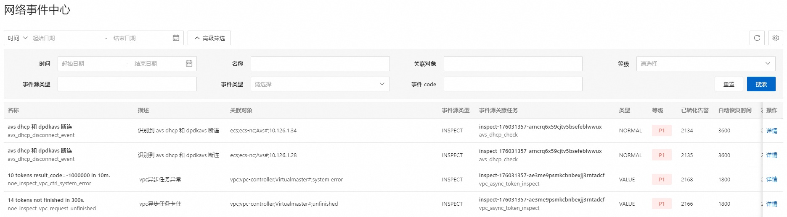

5. 单击目标事件对应**操作**列的**详情**，在弹出框中获取事件详情。（RECOVER类型的事件不展示详情信息）

   不同的类型的事件有不同详情信息，具体以界面展示为准。

## 5.2. 网络事件配置

专有云网络事件配置中心，对事件的产生逻辑进行编辑管理。支持新建、克隆、更新、删除导入事件配置。

**操作步骤**

1. 登录Apsara Uni-manager运维控制台。

2. 在顶部菜单栏，选择**产品运维** > **网络运维** > **网络运维控制台**。

3. 在左侧导航栏，选择**网络监控告警** > **网络事件配置**。

4. 在网络事件配置列表查看事件配置信息，包括**事件名称**、**描述**、**事件等级**、**类型**、**事件源、事件code**、**事件维度**、**自动恢复时间、事件组**等。

   单击**高级筛选**，支持根据**名称**、**事件等级**、**事件源**、**事件code**、**启用状态**、**转化告警**组合筛选获取目标事件配置。

   **事件源**包括如下类型：

   - **INSPECT**：NOE 巡检平台

   - **SYSLOG**：交换机 Syslog

   - **NOEPING**：NOE Ping 连通性检查

   - **EVENT_CENTER**：NOE 事件中心，二次生成事件

   - **NOE_TSDB**：NOE TSDB 时序数据库

   - **NOE_GRPC**：NOE grpc链路

   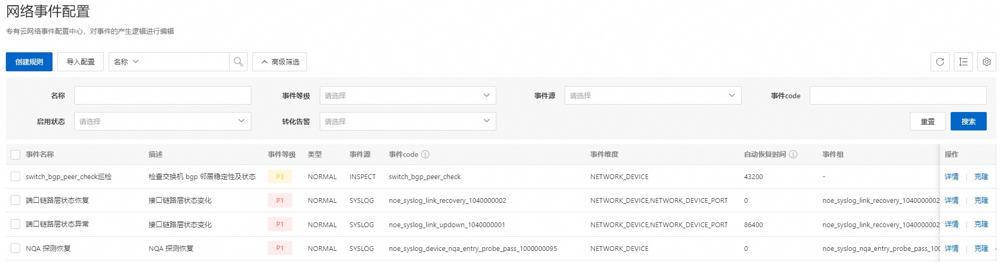

5. 在网络事件配置中心还支持如下操作。

   - **新建事件配置**

     单击网络事件配置列表左上角**创建规则**，在**新建事件**页面，根据下面参数完成配置，单击**创建**。

     <table>
       <tr>
         <th>配置参数</th>
         <th>说明</th>
       </tr>
       <tr>
         <td colspan="2">基础设置</td>
       </tr>
       <tr>
         <td>事件code</td>
         <td>输入事件的唯一标识。</td>
       </tr>
       <tr>
         <td>事件名称</td>
         <td>输入事件默认展示名称。可以用正则表达式表示。</td>
       </tr>
       <tr>
         <td>启用</td>
         <td>选择是否启用该事件配置规则。默认开启。</td>
       </tr>
       <tr>
         <td>描述</td>
         <td>输入事件说明，展示事件相关静态信息。</td>
       </tr>
       <tr>
         <td>关联维度</td>
         <td>选择事件关联对象所处维度，按自顶向下逻辑顺序，用于事件聚合和定位。作为事件的唯一关联信息，支持多选。 • <strong>PRODUCT</strong>：产品名称 • <strong>CLUSTER</strong>：集群名称 • <strong>SERVICE</strong>：服务名称 • <strong>SERVER_ROLE</strong>：服务角色名称 • <strong>HOST</strong>：主机名 • <strong>HOST_PORT</strong>：主机端口 • <strong>INSTANCE_ID</strong>：实例名称 • <strong>DOMAIN_NAME</strong>：域名 • <strong>IP</strong>：IP 地址 • <strong>PAIR</strong>：NOEPING 模块专用，源目的对 • <strong>IDC</strong>：机房 • <strong>NETWORK_DEVICE</strong>：网络设备 • <strong>NETWORK_DEVICE_COMPONENT</strong>：网络设备组件 • <strong>NETWORK_DEVICE_PORT</strong>：网络设备端口</td>
       </tr>
     </table>

     <table>
       <tr>
         <th>事件等级</th>
         <th>选择事件等级，分为<strong>P1</strong>、<strong>P2</strong>、<strong>P3</strong>、<strong>P4</strong>、<strong>P5</strong>、<strong>P6</strong>、<strong>P7</strong>。</th>
       </tr>
       <tr>
         <td colspan="2">告警配置</td>
       </tr>
       <tr>
         <td>关联告警</td>
         <td>选择是否转化为告警，默认开启。</td>
       </tr>
       <tr>
         <td>自动恢复时间</td>
         <td>设置自动恢复时间。超过设定时间后没有上报事件视为已恢复，默认为1小时。设置为0则采用平台内默认恢复事件。</td>
       </tr>
       <tr>
         <td>存在恢复事件</td>
         <td>选择数据源是否可推送异常恢复事件，默认关闭。 • 当数据源可推送恢复事件时，平台接收到恢复事件后将恢复最近一次异常事件关联的告警。 • 当数据源不推送恢复事件时，平台按“事件自动恢复时间”进行事件关联告警恢复。</td>
       </tr>
       <tr>
         <td>事件聚合时间</td>
         <td>设置事件聚合时间<strong>。</strong>通过事件聚合时间减少告警频率。聚合时间内相同事件源和关联对象上报的相同事件将会被聚合，默认为600 s。</td>
       </tr>
       <tr>
         <td>事件组</td>
         <td>事件组用于一个恢复事件恢复多个异常事件，相关联的一系列事件为一个组，一个事件可以是多个组的成员。</td>
       </tr>
       <tr>
         <td colspan="2">规则设置</td>
       </tr>
       <tr>
         <td>事件源</td>
         <td>选择事件源。不同事件来源在事件关联维度，告警上报等逻辑的处理上有所不同。自定义创建事件支持选择<strong>SYSLOG</strong>、<strong>NOE_TSDB</strong>两种事件源。SYSLOG 监控交换机运行状态，TSDB 监控网络指标运行状态。 • <strong>SYSLOG</strong>：交换机 Syslog • <strong>NOE_TSDB</strong>：NOE TSDB 时序数据库</td>
       </tr>
       <tr>
         <td>事件类型</td>
         <td>选择事件类型。 • <strong>VALUE</strong>：指标异常事件，表示指标不在预期值范围内。 • <strong>CONFIG</strong>：配置对账异常事件，表示底层机器配置和预期不符。 • <strong>NORMAL</strong>：未定义事件详情格式，通过纯字符串形式表示事件详情。 • <strong>RECOVER</strong>：恢复事件，表示异常状态的消失，用于取消最近一次异常事件产生的告警。</td>
       </tr>
       <tr>
         <td>存在下游告警规则</td>
         <td>选择开启/关闭存在下游告警规则开关<strong>。</strong>如果开启开关，需要根据选择的事件源配置以下内容： • SYSLOG匹配规则 说明当<strong>事件源</strong>选择<strong>SYSLOG</strong>时，需要配置此项参数。 • <strong>设备制造商</strong>：选择网元设备的制造商。包括<strong>H3C</strong>、<strong>Huawei</strong>、<strong>Ruijie</strong>。 • <strong>告警关联</strong>：输入告警关联对象，最终上报到事件中心，和事件关联维度一一对应。 • <strong>正则模板</strong>：输入syslog对应正则表达式。 • <strong>正则关键字</strong>：输入正则表达式中提取出来的字段。 • <strong>日志等级</strong>：输入等级 。 单击<strong>自动识别</strong>，在<strong>一键识别</strong>弹出框中输入<strong>原始文本</strong>，然后单击<strong>提交</strong>，支持快速解析<strong>一键填入</strong>解析结果到文本框。 • <strong>日志模块</strong>：输入模块，一般为厂商私有定义。 • <strong>助记词</strong>：输入告警助记词，一般为厂商私有定义。 • 指标异常检测规则 说明当<strong>事件源</strong>选择<strong>NOE_TSDB</strong>时，需要配置此项参数。 • <strong>PromQL语句</strong>：输入PromQL语句。 • 单击<strong>测试</strong>，可以查看输入语句的检测结果。 • 单击<strong>检索支持指标</strong>，支持输入<strong>查询指标</strong>模糊搜索TSDB指标列表，并展示指标关联标签。 • <strong>告警对象</strong>：输入告警关联对象，最终上报到事件中心，和事件关联维度一一对应。 • <strong>告警描述</strong>：输入告警描述。 • <strong>检测周期</strong>：设置检测周期，默认60s。 • <strong>自定义标签</strong>：添加自定义标签键值对，可在告警描述中使用。</td>
       </tr>
     </table>

   - **克隆事件配置**

     单击目标事件配置对应**操作**列的**克隆**，在**复制告警规则**弹出框中，输入**新事件名称**、**新事件code**，单击**确定**。克隆提示成功后，会跳转到事件详情页面，可执行更新事件配置操作。

     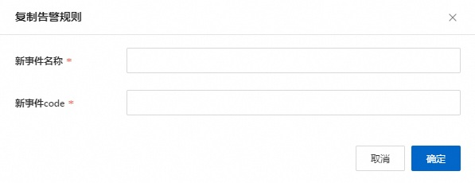

   - **更新事件配置**

     单击目标事件配置对应**操作**列的**详情**，在**事件详情**页查看并修改事件配置相关参数，然后单击**更新**。

     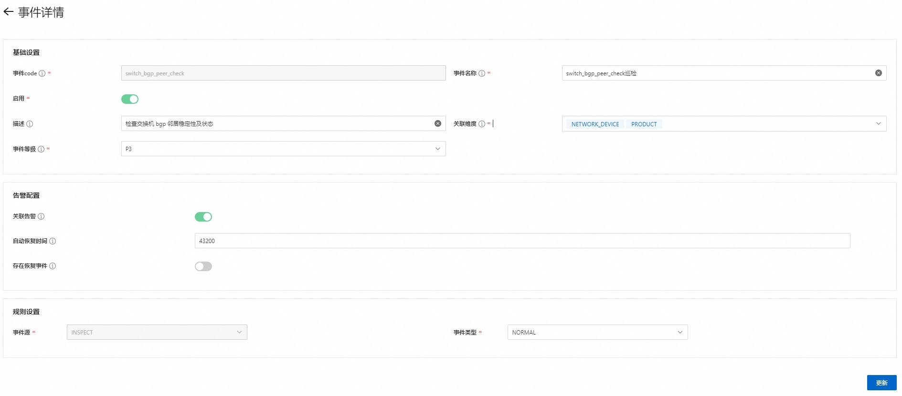

   - **删除事件配置**

     勾选目标事件配置，单击网络事件配置列表左下角**删除**，在弹出框中确认内容，单击**确定**。

   - **导入配置**

     单击网络事件配置列表左上角**导入配置**，在弹出框中选择本地配置文件，单击**打开**，完成事件配置的导入。

# 6.智能诊断

## 6.1. 网络巡检

周期调度网络巡检任务并转化结果为巡检事件或告警。

**操作步骤**

1. 登录Apsara Uni-manager运维控制台。

2. 在顶部菜单栏，选择**产品运维** > **网络运维** > **网络运维控制台**。

3. 在左侧导航栏，选择**智能诊断** > **网络巡检**。

4. 在网络巡检列表查看巡检配置，包括**名称**、**描述**、**执行周期**、**启用状态**、**执行次数**、**归属产品**、**归属服务**、**归属角色**。

   单击**高级筛选**，支持根据**名称**、**归属产品**、**归属服务**、**归属角色**、启用状态组合筛选获取目标巡检配置。

   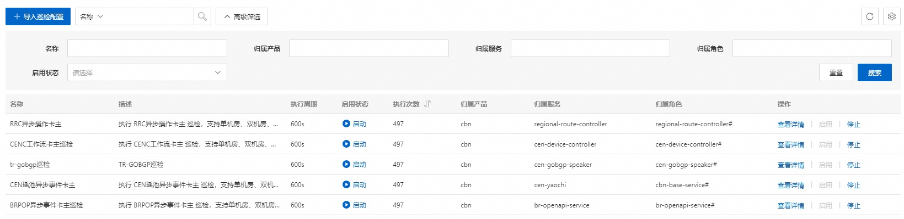

   > **说明**
   >
   > 单击**执行次数**列，列表可以按照升序或降序进行排序。

5. 单击目标巡检配置对应**操作**列的**查看详情**，在弹出的面板中获取巡检项详情，包括**执行信息**和**相关事件**。

   - 在**执行信息**页签下，获取**基本信息**、**执行信息**。在**执行信息**区域，支持如下操作：

     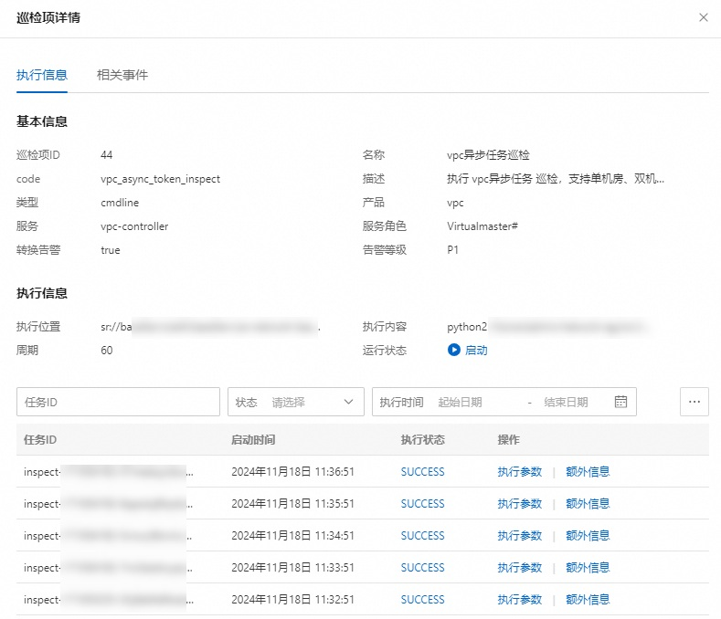

     - 根据**任务ID**、**状态**、**执行时间**组合筛选获取目标执行任务。

     - 将鼠标悬浮于目标执行任务对应**执行状态**列的状态，或者**操作**列的**执行参数**、**额外信息**，将获取执行结果信息、执行参数信息、额外信息。

       > **说明**
       >
       > 执行状态的含义如下：
       >
       > - waiting：巡检任务等待触发
       >
       > - running：巡检任务运行中
       >
       > - success：巡检任务执行成功
       >
       > - failed：巡检任务执行失败
       >
       > - timeout：巡检任务结果等待超时
       >
       > - cleaned：上一次平台运行残留任务将在平台初始化时被清理

   - 在**相关事件**页签下，获取事件列表。

     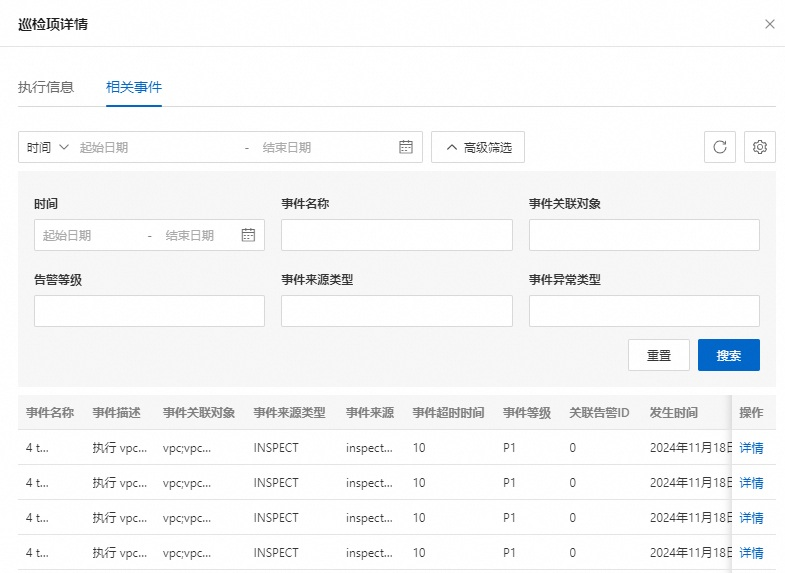

     - 事件列表包括**事件名称**、**事件描述**、**事件关联对象**、**事件来源类型**、**事件来源**、**事件超时时间**、**事件等级**、**关联告警ID**、**发生时间**。

     - 单击**高级筛选**，支持根据**时间**、**事件名称**、**事件关联对象**、**告警等级**、**事件来源类型**、**事件异常类型**组合筛选获取目标事件。

     - 单击目标事件对应**操作**列的**详情**，在弹出的对话框中获取事件详情。

**更多操作**

<table>
  <tr>
    <th width="122">操作</th>
    <th>操作说明</th>
  </tr>
  <tr>
    <td>导入巡检配置</td>
    <td>1. 单击<strong>导入巡检配置</strong>。 2. 选择需要导入的巡检配置文件，单击<strong>打开</strong>。</td>
  </tr>
  <tr>
    <td>启用巡检配置</td>
    <td>说明网络巡检配置的<strong>启用状态</strong>为<strong>停止</strong>时支持启用。 1. 单击目标巡检配置对应<strong>操作</strong>列的<strong>启用</strong>。 2. 在弹出的对话框中单击<strong>确定</strong>。</td>
  </tr>
  <tr>
    <td>停止巡检配置</td>
    <td>说明网络巡检配置的<strong>启用状态</strong>为<strong>启动</strong>时支持停止。 1. 单击目标巡检配置对应<strong>操作</strong>列的<strong>停止</strong>。 2. 在弹出的对话框中单击<strong>确定</strong>。</td>
  </tr>
</table>

## 6.2. 智能路径分析

智能路径分析转发功能提供路径诊断能力，通过快速建立IP路径，建立端到端的路径分析，助力故障界定，缩短故障界定时间。

**前提条件**

产品BaseServiceAll的NetworkBaseServiceCluster集群已部署且已到达终态。

**操作步骤**

1. 登录Apsara Uni-manager运维控制台。

2. 在顶部菜单栏，选择**产品运维** > **网络运维** > **网络运维控制台**。

3. 在左侧导航栏，选择**智能诊断** > **智能路径分析**。

4. 单击**创建路径分析**，配置如下参数后单击**分析**。

   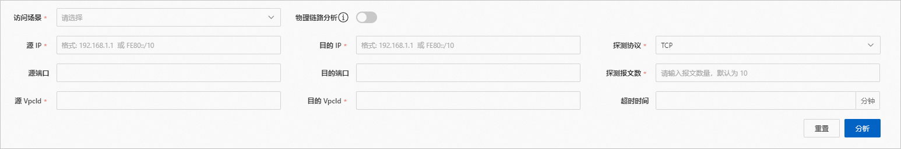

   | 参数 | 参数说明 | 示例 |
   | --- | --- | --- |

   <table>
     <tr>
       <td>访问场景</td>
       <td>选择路径分析的场景，包含如下场景： • <strong>ECS互访</strong>：业务VPC内ECS相互访问的场景。 • <strong>ECS访问负载均衡</strong>：业务VPC内ECS主动请求负载均衡实例的场景。 • <strong>ECS访问AnyTunnel</strong>：业务VPC内ECS主动访问AnyTunnel VIP的场景。 • <strong>ECS访问SingleTunnel</strong>：业务VPC内ECS主动访问SingleTunnel VIP的场景。 • <strong>ECS访问IDC</strong>：业务VPC内ECS与客户IDC主机并网后相互访问的场景。 • <strong>ECS访问互联网</strong>：业务VPC内ECS访问互联网服务的场景。 • <strong>天基容器互访</strong>：云平台管控容器Docker相互访问的场景。 • <strong>天基容器访问负载均衡</strong>：云平台管控容器Docker主动访问平台侧负载均衡实例的场景。 • <strong>天基容器访问NC</strong>：云平台管控容器Docker主动访问云平台物理机的场景。 • <strong>NC互访</strong>：云平台物理机相互访问的场景。 • <strong>NC访问天基容器</strong>：云平台物理机主动访问云平台管控容器Docker的场景。 • <strong>NC访问负载均衡</strong>：云平台物理机主动访问平台侧负载均衡实例的场景。</td>
       <td>ECS互访</td>
     </tr>
     <tr>
       <td>物理链路分析</td>
       <td>开启或关闭物理链路分析功能。 • 开启时需要对交换机设备下发配置，将会显著延长分析时间。 • 关闭时可以缩短分析时间，但将不会有物理设备的抓包数据。</td>
       <td>/</td>
     </tr>
     <tr>
       <td>源IP</td>
       <td>源节点IP，支持IPv4和IPv6格式。</td>
       <td>192.168.1.1或FE80::/10</td>
     </tr>
     <tr>
       <td>目的IP</td>
       <td>目的节点IP，支持IPv4和IPv6格式。</td>
       <td>192.168.1.1或FE80::/10</td>
     </tr>
     <tr>
       <td>探测协议</td>
       <td>路径分析探测报文的协议类型，包含如下协议： • TCP • UDP • ICMP</td>
       <td>TCP</td>
     </tr>
     <tr>
       <td>源端口</td>
       <td>源节点端口，未填写默认全部端口。</td>
       <td>80</td>
     </tr>
     <tr>
       <td>目的端口</td>
       <td>目的节点端口，未填写默认全部端口。</td>
       <td>8080</td>
     </tr>
     <tr>
       <td>探测报文数</td>
       <td>路径分析总的探测报文数量。</td>
       <td>10</td>
     </tr>
     <tr>
       <td>源VpcId</td>
       <td>源节点在VPC内时必须存在源节点所在VpcId。</td>
       <td>vpc-**fczvaczv</td>
     </tr>
     <tr>
       <td>目的VpcId</td>
       <td>目的节点在VPC内时必须存在源节点所在VpcId。</td>
       <td>vpc-**fczvaczv</td>
     </tr>
     <tr>
       <td>超时时间</td>
       <td>分析任务抓包的总时间超过该时间，将停止抓包。单位：分钟。</td>
       <td>5</td>
     </tr>
   </table>

5. 在**路径分析**区域：将展示分析任务的状态时间轴，并给出每个阶段预估需要的时间。时间轴下方展示路径的拓扑图。分析完成后，将展示分析结果。

   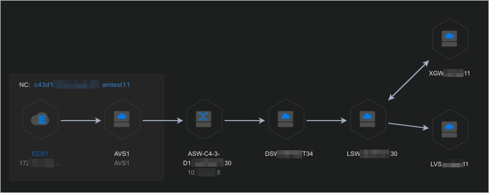

   > **说明**
   >
   > - 对于ECS类型或NC类型的路径节点，可以单击拓扑图中的蓝色链接字样打开详情页面。
   >
   > - 选中拓扑图后，可以通过拖动鼠标改变整个拓扑图所在位置。

6. 在**诊断详情**区域：将展示本次任务相关详细信息。

   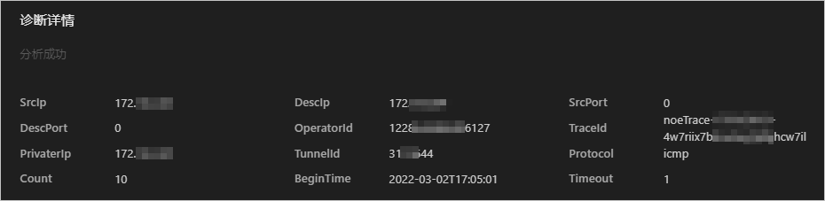

7. 在**逐条分析**区域：如果分析任务执行成功，将展示本次任务所抓取报文的分析详情。可以逐条展开查看报文的分析详情。

**相关操作**

<table>
  <tr>
    <th width="186">操作</th>
    <th>操作说明</th>
  </tr>
  <tr>
    <td>查看历史分析任务详情</td>
    <td>1. 选择时间范围，查看目标时间段内的智能路径分析任务信息。 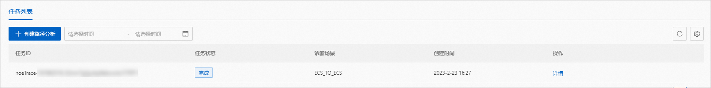 2. 在目标分析任务的<strong>操作</strong>列，单击<strong>详情</strong>。可查看分析结果，包括路径分析、诊断详情以及逐条分析内容。</td>
  </tr>
  <tr>
    <td>终止分析任务</td>
    <td>在目标分析任务的<strong>操作</strong>列，单击<strong>终止</strong>。 说明当分析任务状态为<strong>完成</strong>时不支持终止分析任务。</td>
  </tr>
</table>

## 6.3. 网络实例诊断

网络实例诊断功能提供便捷的一键分析网络实例运行状态的能力。

**使用场景**

该功能能够一键分析网络实例，判断其是否有非预期的运行状态，提供可视化、自动化的诊断能力，能够提高网络运维工程师的运维效率、降低运维风险，有效提升专有云网络运维质量。

**限制条件**

- 产品BaseServiceAll的NetworkBaseServiceCluster集群已部署且已到达终态。

- 一次诊断任务启动后，直至诊断结束才会停止，不能执行暂停或终止操作。

**操作步骤**

1. 登录Apsara Uni-manager运维控制台。

2. 在顶部菜单栏，选择**产品运维** > **网络运维** > **网络运维控制台**。

3. 在左侧导航栏，选择**智能诊断** > **网络实例诊断**。

4. 在**一键分析网络实例运行状态**区域，选择以下任意一种诊断类型并输入对应的实例ID，然后单击**立即诊断**。

   - SLB

   - DNS

   - 弹性公网IP

   - 边界路由器

   - 物理专线

   - NAT网关

   - DCI专线

   - 互联专线

5. 系统将进入实例诊断结果页面，在此页面可以查看**实例详情**、**实例拓扑**、**诊断详情**。

   > **说明**
   >
   > - **实例详情**仅在诊断类型为SLB时生效。
   >
   > - 在诊断结果页面上方的文本框中，默认显示当前诊断的实例ID。也可以输入其他实例ID，单击**诊断**，再次进行诊断。

   此处以SLB实例诊断结果为例进行详细介绍。

   - 实例详情：

     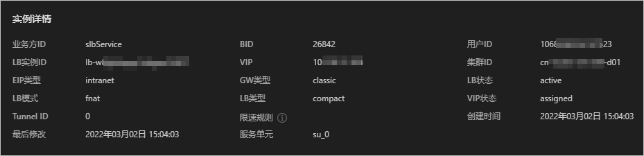

   - 实例拓扑：

     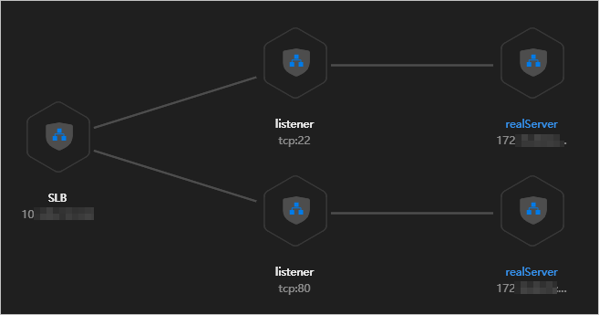

     - 在以上拓扑图示例中，第一列表示SLB实例，第二列表示SLB实例对应的监听实例，第三列表示监听实例对应的后端服务器。

     - 如果后端服务器是ECS类型或飞天基础运维平台机器类型，单击拓扑图中的realServer，系统将弹出面板展示服务器详情。

     - 选中拓扑图后，可以通过拖动鼠标改变整个拓扑图的位置。

   - 诊断详情：包括**诊断项名称**、**诊断项描述**、**诊断结果**以及**诊断详情**。

     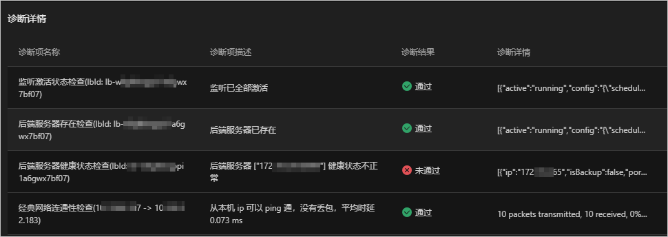

6. 也可以在**任务列表**区域查看实例的历史诊断结果。

   选择时间范围，在目标诊断任务的**操作**列，单击**详情**，可查看诊断结果，包括**实例详情**（仅SLB实例诊断包含）、**实例拓扑**和**诊断详情**。

## 6.4. 容器网络诊断

基于互访场景提供容器网络的一键智能诊断能力。

**使用场景**

该功能能够一键分析容器网络，判断其是否有非预期的运行状态，提供可视化、自动化的诊断能力，能够提高网络运维工程师的运维效率、降低运维风险，有效提升专有云网络运维质量。

**操作步骤**

1. 登录Apsara Uni-manager运维控制台。

2. 在顶部菜单栏，选择**产品运维** > **网络运维** > **网络运维控制台**。

3. 在左侧导航栏，选择**智能诊断** > **容器网络诊断**。

4. 单击**创建诊断任务**，配置如下参数后单击**提交**。

   | 参数 | 参数说明 |
   | --- | --- |
   | 源IP | 输入源IP地址。 |
   | 目的节点信息 | 选择目的IP或者目的域名并输入对应信息。 |
   | 目的端口 | 输入目的端口号。 |
   | 协议 | 选择协议类型： • tcp • udp |
   | 开启全局检查 | 选择是否开启全局检查，开启后无拓扑图信息。 |

   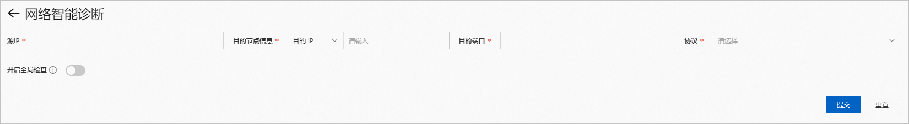

5. 待诊断任务运行结束，在页面下方可以获取**路径分析**拓扑图以及**配置诊断报告**。

   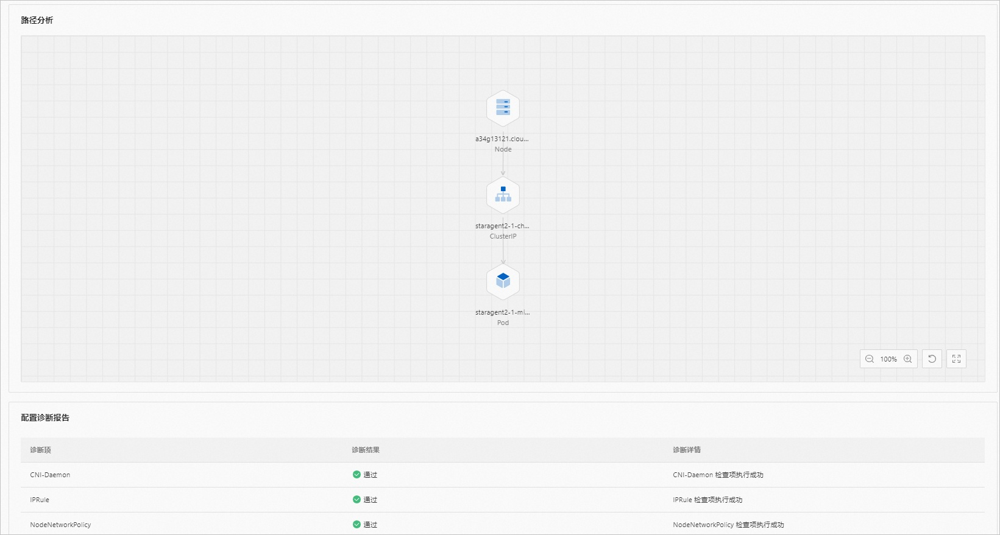

**相关操作**

<table>
  <tr>
    <th width="154">操作</th>
    <th>操作说明</th>
  </tr>
  <tr>
    <td>查看历史诊断任务</td>
    <td>1. 在目标诊断任务的<strong>操作</strong>列，单击<strong>详情</strong>。 2. 页面进入诊断任务详情页，可以获取路径分析拓扑图和配置诊断报告等相关内容。</td>
  </tr>
  <tr>
    <td>终止诊断任务</td>
    <td>当诊断任务在运行中状态时才支持终止操作。 1. 在目标诊断任务的<strong>操作</strong>列，单击<strong>终止</strong>。 2. 在弹出的对话框中单击<strong>确定</strong>。</td>
  </tr>
</table>

## 6.5. 网络健康评估

网络健康评估，是通过检查网络每一层的健康状态，对不同层次网络的性能、容量、功能、状态等健康度进行评估诊断，以整体的评估的视角查看网络健康状态的全貌，实时发现网络中各个层次的问题和风险，保障网络正常运行。

**操作步骤**

1. 登录Apsara Uni-manager运维控制台。

2. 在顶部菜单栏，选择**产品运维** > **网络运维** > **网络运维控制台**。

3. 在左侧导航栏，选择**智能诊断** > **网络健康评估**。

4. 在健康度概览列表，查看各网络层次的健康度评估情况。

   

   | 评估层次名称 | 说明 | 维度 |
   | --- | --- | --- |
   | 网络服务接入 | 通过对服务实例的功能及配置检查，及时发现网络服务实例接入及配置方面的问题。 | 功能健康评估得分、正常诊断项和诊断项总数、该层整体得分（百分制） |
   | overlay网络层 | 检查XGW、AVS、CSW、CGW、SNA、HSW等服务的物理服务器本身的监控结果、网元节点的监控结果以及水位错包监控结果，综合判断服务健康状态。 | 状态健康评估得分、正常诊断项和诊断项总数、该层整体得分（百分制） |
   | 网络产品管控 | 检查VPC、SLB、DNS、NSP等产品控制面告警，依赖产品自身监控数据，及时发现问题。 | 状态健康评估得分、正常诊断项和诊断项总数、该层整体得分（百分制） |
   | 设备层 | 通过对设备关键指标的监控判断设备的健康状态。 | 性能健康评估得分、容量健康评估得分、状态健康评估得分、正常诊断项和诊断项总数、该层整体得分（百分制） |
   | 协议层 | 主要检查路由协议状态，如OSPF/BGP状态检测等。 | 容量健康评估得分、正常诊断项和诊断项总数、该层整体得分（百分制） |
   | 网络层 | 主要检查设备互联状态、网络物理接口、光模块智能预测、NC网卡的监控数据，从而进行综合判断。 | 性能健康评估得分、状态健康评估得分、正常诊断项和诊断项总数、该层整体得分（百分制） |

5. 单击目标评估层次操作列的**详情**，进入**健康度详情**页面。

   <ol type="i">

   <li>

   在**KPI详情**区域，可通过KPI名称、状态、网络评估层次类型快速查找KPI信息。

   

   <table>
     <tr>
       <th width="202">参数</th>
       <th>说明</th>
     </tr>
     <tr>
       <td>KPI名称</td>
       <td>评估层次下的KPI名称。不同评估层次的KPI会不同。</td>
     </tr>
     <tr>
       <td>层次类型</td>
       <td>评估层次类型，不同评估层次有所不同。 • 网络服务接入：仅支持<strong>功能</strong>类型。 • overlay网络层：仅支持<strong>状态</strong>类型。 • 网络产品管控：仅支持<strong>状态</strong>类型。 • 设备层：仅支持<strong>性能</strong>、<strong>容量</strong>和<strong>状态</strong>类型。 • 协议层：仅支持<strong>容量</strong>类型。 • 网络层：仅支持<strong>性能</strong>和<strong>状态</strong>类型。</td>
     </tr>
     <tr>
       <td>状态</td>
       <td>KPI的状态，包括严重、异常、亚健康、健康四种。</td>
     </tr>
     <tr>
       <td>诊断项总数</td>
       <td>KPI的总诊断项数量。</td>
     </tr>
     <tr>
       <td>诊断项通过数</td>
       <td>KPI诊断项中通过的数量。</td>
     </tr>
     <tr>
       <td>诊断项异常数</td>
       <td>KPI诊断项中异常的数量，单击数字，可将下方异常事件按当前KPI进行过滤。</td>
     </tr>
     <tr>
       <td>健康评估得分（百分制）</td>
       <td>KPI的健康评估分数，即诊断项通过数/诊断项总数。</td>
     </tr>
     <tr>
       <td>更新时间</td>
       <td>KPI诊断的更新时间。</td>
     </tr>
   </table>

   </li>

   <li>

   在**异常事件**区域，可通过KPI名称、起始时间、清除时间、展示已清除问题、等级、关联实例、事件类型快速查找异常事件。

   列表信息如下所示。

   <table>
     <tr>
       <th width="90">参数</th>
       <th>说明</th>
     </tr>
     <tr>
       <td>名称</td>
       <td>异常事件的名称。</td>
     </tr>
     <tr>
       <td>KPI名称</td>
       <td>异常事件所属的KPI名称。</td>
     </tr>
     <tr>
       <td>问题描述</td>
       <td>异常事件的问题描述。</td>
     </tr>
     <tr>
       <td>关联实例</td>
       <td>异常事件关联的实例信息。</td>
     </tr>
     <tr>
       <td>危险等级</td>
       <td>异常事件的危险等级信息，严重程度关系为P1&gt;P2&gt;P3&gt;P4&gt;P5&gt;P6&gt;P7。</td>
     </tr>
     <tr>
       <td>类型</td>
       <td>异常事件的所属类型，包括状态、功能、容量、性能等。</td>
     </tr>
     <tr>
       <td>清除标记</td>
       <td>异常事件的<strong>清除标记</strong>默认显示<strong>否</strong>，单击操作列<strong>清除</strong>后，显示为<strong>是</strong>。</td>
     </tr>
     <tr>
       <td>确认标记</td>
       <td>异常事件的<strong>确认标记</strong>默认显示<strong>否</strong>，单击操作列<strong>确认</strong>后，显示为<strong>是</strong>。</td>
     </tr>
     <tr>
       <td>起始时间</td>
       <td>异常事件发生的起始时间。</td>
     </tr>
     <tr>
       <td>清除时间</td>
       <td>异常事件清除的时间。</td>
     </tr>
   </table>

   <ol type="a">

   <li>

   单击目标异常事件操作列的**详情**，查看异常事件详情。

   </li>

   <li>

   单击目标异常事件操作列的**确认**，对该事件标记，表示该事件确实属于异常事件。

   </li>

   </ol>

   <ol type="i" start="100">

   <li>

   根据异常事件的名称、问题描述、危险等级和关联实例等信息，及时处理解决后，单击操作列的**清除**。

   > **说明**
   >
   > 仅进行**确认**操作后，才会显示**清除**。

   </li>

   </ol>

   </li>

   </ol>

## 6.6. 光模块异常分析

基于AI智能算法，对光模块异常情况进行分析以及预测，辅助运维人员定位故障。

**操作步骤**

1. 登录Apsara Uni-manager运维控制台。

2. 在顶部菜单栏，选择**产品运维** > **网络运维** > **网络运维控制台**。

3. 在左侧导航栏，选择**智能诊断** > **光模块异常分析**。

4. 在页面上方区域，查看系统中光模块当天状态分布和时间区间内光模块状态分布情况。

   > **说明**
   >
   > 光模块分为四种状态（健康、亚健康、异常、未知），折线图展示健康光模块占比变化趋势。

   

5. 在页面下方列表，查看光模块基本信息和分析结果等，也可以单击**高级筛选**，根据**光模块型号**、**光模块厂商**、**光模块状态**、**主机名**、**接口名称**以及**所属设备类型**组合筛选获取目标光模块。

   <table>
     <tr>
       <th width="122">参数</th>
       <th>说明</th>
     </tr>
     <tr>
       <td>主机名</td>
       <td>光模块所属设备的名称。</td>
     </tr>
     <tr>
       <td>接口名称</td>
       <td>光模块所属设备的接口名称。</td>
     </tr>
     <tr>
       <td>归属类型</td>
       <td>光模块所属设备类型，包括NETWORK_SWITCH(网络交换机)和NC（数字输入模块）两种类型。</td>
     </tr>
     <tr>
       <td>厂商</td>
       <td>光模块厂商。</td>
     </tr>
     <tr>
       <td>型号</td>
       <td>光模块型号。</td>
     </tr>
     <tr>
       <td>状态</td>
       <td>光模块的状态。</td>
     </tr>
     <tr>
       <td>故障概率</td>
       <td>光模块的故障概率。故障概率通过发射功率、接受功率、偏置电流变化幅度（方差）进行预测。</td>
     </tr>
     <tr>
       <td>预期剩余寿命</td>
       <td>光模预期剩余寿命。 说明剩余寿命基于偏置电流监控数据和阈值进行计算，当偏置电流阈值数据或当前数值无法采集时显示为unknown。</td>
     </tr>
     <tr>
       <td>智能分析结果</td>
       <td>光模块的智能分析结果。基于当前预测故障概率和剩余寿命等数据，可以得出三类异常分析结果： • 故障概率过高 • 剩余寿命不足 • 光模块接触不良</td>
     </tr>
   </table>

6. 单击目标光模块操作列的**详情**，进入**光模块预测详情**页面。

   <ol type="i">

   <li>

   在页面上方区域，查看光模块的基本信息和预测信息。

   </li>

   <li>

   在页面下方区域，选择时间区间，查看光模块指标图示，包括**温度**、**偏置电流**、**电压**、**发射功率**、**接收功率**等。

   <table>
     <tr>
       <th width="90">指标</th>
       <th>说明</th>
     </tr>
     <tr>
       <td>温度</td>
       <td>光模块的温度会影响光模块的性能和寿命，温度过高或者过低，可能会导致光模块的性能受损，缩短光模块的使用寿命。 • 温度过高可能会影响光模块的传输距离和传输速率，还会导致发光器和探测器的性能下降，导致光模块故障。 • 温度过低会导致影响光模块的性能，缩短使用寿命。</td>
     </tr>
     <tr>
       <td>偏置电流</td>
       <td>光模块的偏置电流是用来激励激光器发射光信号的电流，偏置电流的大小会影响激光器的输出功率和光模块的传输距离。 • 偏置电流过大，可能会导致激光器的老化和损坏，缩短光模块的使用寿命。 • 偏置电流过小，可能会导致激光器输出功率不足，使传输距离受限。</td>
     </tr>
     <tr>
       <td>电压</td>
       <td>光模块的电压是指用来激励激光器发射光信号和接收器接收光信号的电压。当电压不稳定或偏离规定范围，会导致光模块的性能下降或故障。 • 电压偏低时，可能会导致光模块发射功率降低。 • 电压偏高时，可能会导致光模块故障。</td>
     </tr>
     <tr>
       <td>发射功率</td>
       <td>光模块的发射功率是指激光器输出的光信号的功率大小。光模块发射功率的大小会影响光模块的传输距离和书传输速率。 • 过高的发射功率可能会损坏光模块。 • 过低的发射功率可能会导致传输距离受限。</td>
     </tr>
     <tr>
       <td>接收功率</td>
       <td>光模块的接收功率是指接收器接收光信号的功率大小。光模块接收功率的大小会影响光模块的接收灵敏度和传输性能。当接收功率超出规定范围，会导致信号传输中断、错误增多、降低传输距离等问题，所以可以通过监控接收功率及时发现并处理问题。 • 当接收功率偏高时，可以减小发射功率或检查连接光纤的长度。 • 当接收功率偏低时，可以增加发射功率或检查连接光纤的质量。</td>
     </tr>
   </table>

   </li>

   </ol>

# 7.网络资源

## 7.1. 网络资产管理

支持展示专有云网络的网络资产，可以通过资产类型、IP地址、实例ID等属性进行过滤查询。

**前提条件**

产品BaseServiceAll的NetworkBaseServiceCluster集群已部署且已到达终态。

**背景信息**

- VPC内资源仅展示部分实例，特定实例需通过实例IP、ID单独查询。

- 过滤属性包括资产类型、IP地址、IP版本、网络类型、实例ID、所属AZone、Product、ClusterName、Service、ServerRole、IP地址池ID、为底座资源、为带外资源、VPCID。

- 过滤查询时，选择Service需先选择Product、ClusterName。

- 过滤查询时，选择ServiceRole需先选择Product、ClusterName、Service。

**操作步骤**

1. 登录Apsara Uni-manager运维控制台。

2. 在顶部菜单栏，选择**产品运维** > **网络运维** > **网络运维控制台**。

3. 在左侧导航栏，选择**网络资源** > **网络资产管理**。

4. 单击**高级筛选**，可以通过**资产类型**、**IP地址**、**IP版本**、**网络类型**、**实例ID**、**所属AZone**、**Product**、**ClusterName**、**Service**、**ServerRole**、**IP地址池ID**、**为底座资源**、**为带内资源**以及**vpcId**组合筛选获取专有云网络的网络资产信息。

   

5. 单击**重载IP数据**，可以刷新IP地址信息。

6. 在目标资产的**操作**列，单击**查看详情**可以查看实例详情。

## 7.2. IP地址池管理

### 7.2.1. IP地址池

基于云平台视角查看全量云产品声明的IP地址段信息。支持用户按运维需求新增扩容IP网段、查询IP网段详情或删除IP网段等常规运维操作。冲突校验功能为IP网段扩容场景提供了工具化的地址冲突检查能力，支持同时检查、分析地址段包含与被包含两种场景。

**背景信息**

适用于多云异地容灾、混合云等场景，支持以下功能：

一个云实例中会部署多个云产品，在网络变更、安全审核等运维场景中，需要按需查看特定云产品声明的IP网段信息，用于分析变更范围及安全规则策略等。本功能支持查看云实例中各个云产品申请的IP地址网段信息，同时支持用户自定义网段的录入功能。

**操作步骤**

1. 登录Apsara Uni-manager运维控制台。

2. 在顶部菜单栏，选择**产品运维** > **网络运维** > **网络运维控制台**。

3. 在左侧导航栏，选择**网络资源** > **IP地址池管理** > **IP地址池**。

   可以查看网段类别、协议、IPv4前缀、IPv6前缀的分布情况以及网段列表信息。

   

4. 在网段列表区域，还可以执行如下操作。

   - 查询网段

     <ol type="a">

     <li>

     单击**高级筛选**。

     </li>

     <li>

     通过**ID**、**IPResourceName**、**网段信息**、**协议**、**产品**、**ClusterName**、**Service**、**ServerRole**、**启用状态**以及**网段类别**等组合设置筛选条件。

     </li>

     </ol>

     <ol type="i" start="100">

     <li>

     单击**搜索**。

     </li>

     </ol>

   - 查看网段详情：单击目标网段**操作**列的**详情**，在弹出的面板中查看实例的详细信息。

   - 增加网段：单击**人工录入**，配置如下参数后单击**确定**。

     

     | 参数 | 描述 |
     | --- | --- |
     | 网段名称 | 输入需要录入的网段名称。 |
     | 网段信息 | 输入需要录入的网段信息。 |
     | 协议类型 | 选择录入的网段所属的协议类型。 • IPv4 • IPv6 |
     | 网段归属 | 选择网段的归属。 • 网络设备 • 云产品 • 其他 |
     | 网络类型layer | 选择录入网段所属网络类型。 • 平台网络 • 租户网络 |
     | Region | 选择录入的网段所属的Region信息。 |
     | 可用区 | 选择可用区域。 |
     | 网段类别 | 选择网段的类别。 • 私网网段 • 公网网段 • 公网私用 • 其他 |
     | 产品名称 | 选择录入网段所属产品名称。 |
     | 集群名称 | 选择录入网段所属集群名称。 |
     | 服务名称 | 选择录入网段所属服务名称。 |
     | 服务角色 | 选择录入网段所属服务角色。 |
     | IDC | 选择录入网段机房信息。 |
     | 关联网络设备 | 选择录入网段来源设备。 |
     | 关联网络接口 | 选择录入网段关联端口名称。 |
     | 备注 | 输入录入网段备注信息。 |
     | 启用 | 设置是否启用录入网段。 |
     | 过期时间 | 选择网段的过期时间。 |

   - 删除网段：单击目标网段**操作**列的**删除**，在弹出的对话框中单击确定将删除该网段。

5. 单击**冲突验证**，在弹出的对话框中输入目标IP网段信息 ，单击**检测**，系统将显示网段冲突校验结果。

### 7.2.2. 采集设置

提供基于平台全局视角查看云产品地址池的采集配置信息，同时支持触发单一地址池数据的刷新。

**背景信息**

适用于多云异地容灾、混合云等场景，支持以下功能：

- 查看云平台所有云产品IP地址池采集规则列表信息。

- 按需触发单一地址池数据刷新操作。

**操作步骤**

1. 登录Apsara Uni-manager运维控制台。

2. 在顶部菜单栏，选择**产品运维** > **网络运维** > **网络运维控制台**。

3. 在左侧导航栏，选择**网络资源** > **IP地址池管理** > **采集设置**。

4. 根据**地址池名称**查询目标地址池的网段采集配置信息。

   

5. 单击目标地址池对应**操作**列的**详情**，可以查看实例的详情。

   

6. 单击目标地址池对应**操作**列的**单次触发**，在弹出的对话框中单击**确定**，系统将展示触发结果。

   

## 7.3. 反向访问

反向访问通过建立NAT映射实现底座云服务主动访问VPC服务。

**创建反向访问实例**

1. 登录Apsara Uni-manager运维控制台。

2. 在顶部菜单栏，选择**产品运维** > **网络运维** > **网络运维控制台**。

3. 在左侧导航栏，选择**网络资源** > **反向访问**。

4. 单击**创建反向接入**，配置如下参数后单击**创建app**。

   创建成功后页面显示系统自动分配标识反向访问云服务的AppID。

   | 参数 | 参数说明 |
   | --- | --- |
   | app名称 | 输入创建app的名称。 |
   | app描述 | 输入创建app的相关描述。 |
   | uid | 用户标识，用于资源纳管，必选。 |

   

5. 在**Server地址池设置**区域，配置如下参数后单击**创建**。

   <table>
     <tr>
       <th width="122">参数</th>
       <th>参数说明</th>
     </tr>
     <tr>
       <td>地址池ID</td>
       <td>输入新增App Server的地址池ID，不输入则创建新的地址池ID。</td>
     </tr>
     <tr>
       <td>地址池名字</td>
       <td>输入地址池名称。</td>
     </tr>
     <tr>
       <td>地址池描述</td>
       <td>输入地址池相关的描述信息。</td>
     </tr>
     <tr>
       <td>创建类型</td>
       <td>选择新增App Server的创建类型。 • VPC内 • 非VPC内 说明当添加类型为<strong>VPC内</strong>的App Server时，仅支持批量添加同一VPC内实例，使用逗号分隔instanceId/instanceIp。</td>
     </tr>
     <tr>
       <td>vpcId</td>
       <td>当<strong>创建类型</strong>选择<strong>VPC内</strong>时生效。输入App Server所在的vpc id。</td>
     </tr>
     <tr>
       <td>serverIds</td>
       <td>当<strong>创建类型</strong>选择<strong>VPC内</strong>时生效。输入需要添加的App Server的实例id，支持批量创建，用英文逗号进行分隔。</td>
     </tr>
     <tr>
       <td>vswitchId</td>
       <td>当<strong>创建类型</strong>选择<strong>VPC内</strong>时生效。输入App Server实例所在的vswitch id。</td>
     </tr>
     <tr>
       <td>mappingIp</td>
       <td>当<strong>创建类型</strong>选择<strong>VPC内</strong>时生效。为上述指定的vswitch创建mappingIp资源，该资源用于App Server的IP地址映射。 说明当vswitch中存在未使用完的mappingIp，则当前创建的资源不一定被使用，如果该vswitch中目前没有mappingIp，不在这里指定创建的话后续流程将会报错。</td>
     </tr>
     <tr>
       <td>serverIps</td>
       <td>当<strong>创建类型</strong>选择<strong>非VPC内</strong>时生效。输入需要添加的App Server的经典网络IP。</td>
     </tr>
   </table>

   

6. 继续配置如下参数后单击**创建ECS授权**。

   | 参数 | 参数说明 |
   | --- | --- |
   | VPC ID | 需要授权访问的ECS所在的VPC ID。 |
   | 创建类型 | 选择创建ECS授权的创建类型。 • 实例ID • 实例IP |
   | instanceId | 当<strong>创建类型</strong>选择<strong>实例ID</strong>时生效。输入创建ECS授权的实例ID。 |
   | instanceIp | 当<strong>创建类型</strong>选择<strong>实例IP</strong>时生效。输入创建ECS授权的私网IP。 |
   | instancePort | 输入指定用于授权反向访问的映射端口。 |

   

7. 查看反向访问实例详情。

   <ol type="i">

   <li>

   单击目标反向访问实例对应**操作**列的**详情**。

   </li>

   <li>

   进入到**反向访问实例详情**页面，获取**基本信息**、**Server地址池**以及**ECS反向授权**。

   

   </li>

   <li>

   在**Server地址池**页签下，可以执行如下操作。

   | 操作 | 操作步骤 |
   | --- | --- |
   | 新增地址池 | a. 单击<strong>新增地址池</strong>。 b. 参考步骤5配置参数后单击<strong>创建</strong>。 |

   <table>
     <tr>
       <td>查看server详情</td>
       <td>a. 单击目标地址池对应<strong>操作</strong>列的<strong>server详情</strong>。 b. 获取server详情列表，包括<strong>VPC ID</strong>、<strong>Server ID</strong>、<strong>Server IP</strong>、<strong>Server</strong> <strong>Mapping IP</strong>、<strong>server类型</strong>以及<strong>状态</strong>。  说明 • 单击<strong>新增App Server</strong>可以新增App Server。 • 单击目标App Server对应<strong>操作</strong>列的<strong>删除</strong>，可以删除App Server。</td>
     </tr>
     <tr>
       <td>修改地址池</td>
       <td>a. 单击目标地址池对应<strong>操作</strong>列的<strong>修改</strong>。 b. 在弹出的对话框中修改地址池属性，完成后单击<strong>修改</strong>。 说明仅支持修改地址池<strong>名称</strong>以及<strong>描述</strong>。</td>
     </tr>
     <tr>
       <td>删除地址池</td>
       <td>a. 单击目标地址池对应<strong>操作</strong>列的<strong>删除</strong>。 b. 在弹出的对话框中单击<strong>删除</strong>。 说明在删除地址池之前，先删除与它相关的所有App Server，否则删除失败！提交后将立即删除，请谨慎操作！</td>
     </tr>
   </table>

   </li>

   <li>

   在**ECS反向授权**页签下，可以执行如下操作。

   <table>
     <tr>
       <th width="90">操作</th>
       <th>操作步骤</th>
     </tr>
     <tr>
       <td>新增授权</td>
       <td>a. 单击<strong>新增授权</strong>。 b. 参考步骤6配置参数后单击<strong>创建ECS授权</strong>。</td>
     </tr>
     <tr>
       <td>删除授权</td>
       <td>a. 单击目标App Server对应<strong>操作</strong>列的<strong>删除</strong>。 b. 在弹出的对话框中单击<strong>删除</strong>。 说明提交后将立即删除，请谨慎操作！</td>
     </tr>
   </table>

   </li>

   </ol>

**更多操作**

**修改反向访问实例**

1. 单击目标反向访问实例对应**操作**列的**修改**。

2. 在弹出的对话框中修改实例属性，完后后单击**修改**。

   > **说明**
   >
   > 仅支持修改**实例名称**以及**描述**。

**删除反向访问实例**

1. 单击目标反向访问实例对应**操作**列的**详情**。

2. 进入到**反向访问实例详情**页面，单击右上角的**删除实例**。

3. 在弹出的对话框中单击**删除**。

   > **说明**
   >
   > 在删除反向访问实例之前，先删除与它相关的所有App Server与地址池，否则删除失败！

## 7.4. 云实例管理

云服务实例的生命周期管理，包括创建，删除以及状态查询。

**创建云服务实例**

1. 登录Apsara Uni-manager运维控制台。

2. 在顶部菜单栏，选择**产品运维** > **网络运维** > **网络运维控制台**。

3. 在左侧导航栏，选择**网络资源** > **云实例管理**。

4. 在**CloudInstance管理**页面，单击**创建云服务实例** > **创建云服务实例**。

5. 在**创建云服务实例**页面，根据如下操作，完成实例创建。

   **步骤一：创建VPC 云服务实例**

   在**创建VPC 云服务实例**向导，配置如下参数，单击**创建**。

   <table>
     <tr>
       <th width="178">参数</th>
       <th>参数说明</th>
     </tr>
     <tr>
       <td>RegionID</td>
       <td>实例的地域ID。</td>
     </tr>
     <tr>
       <td>云服务实例ID</td>
       <td>选择云产品实例的ID。</td>
     </tr>
     <tr>
       <td>Tunnel类型</td>
       <td>• <strong>SingleTunnel</strong>：申请SingleTunnel VIP后，使单个VPC内的ECS可以访问外部的云服务。 • <strong>AnyTunnel</strong>：申请AnyTunnel VIP后，所有VPC内的ECS都可访问该云服务。</td>
     </tr>
     <tr>
       <td>IpVersion</td>
       <td>选择协议类型。默认为<strong>Ipv4</strong>。 • Ipv4 • Ipv6</td>
     </tr>
     <tr>
       <td>CloudInstance IP</td>
       <td>为该实例分配VIP。如果不指定，则系统自动分配一个VIP。</td>
     </tr>
     <tr>
       <td>Vswitch ID</td>
       <td>当<strong>Tunnel类型</strong>为<strong>SingleTunnel</strong>时生效。需要访问外部云服务的ecs所在的VPC内的任意一个VSwitch ID。</td>
     </tr>
     <tr>
       <td>UID</td>
       <td>当<strong>Tunnel类型</strong>为<strong>SingleTunnel</strong>时生效。VSwitch创建者的UID，Vswitch创建者不是API调用者的情况下必填。</td>
     </tr>
     <tr>
       <td>BID</td>
       <td>当<strong>Tunnel类型</strong>为<strong>SingleTunnel</strong>时生效。VSwitch创建者的BID，Vswitch创建者不是API调用者的情况下必填。</td>
     </tr>
     <tr>
       <td>CIDR Type</td>
       <td>当<strong>Tunnel类型</strong>为<strong>AnyTunnel</strong>时生效。 • <strong>link_local（普通云服务）</strong>：选择该CIDR类型后，ALB VIP需要从除过100.100.100.0/24以外的掩码分配anyTunnel地址。 • <strong>特殊inner（特殊服务：ECS META Server）服务</strong>：选择该CIDR类型后，ALB VIP需要从100.100.100.0/24掩码分配anyTunnel地址。</td>
     </tr>
   </table>

   

   **步骤二：添加Real Server到LB实例**

   在**添加Real Server到LB实例**向导，完成如下配置，单击**创建**。

   <table>
     <tr>
       <th width="87">参数</th>
       <th>参数说明</th>
     </tr>
     <tr>
       <td>VPC ID</td>
       <td>若要添加专有网络类型的ECS实例，则输入所属VPC的ID。</td>
     </tr>
     <tr>
       <td>RS列表</td>
       <td>要添加的后端服务器列表。 • <strong>IP</strong>：Real Server的IP。 • <strong>weight</strong>：Real Server的权重。范围为0-1000，若留空，默认值为100。 说明 • 单击<strong>添加RS机器</strong>，支持添加多个RS。 • 单击目标RS机器对应<strong>操作</strong>列的<strong>删除</strong>，可以删除RS机器。</td>
     </tr>
   </table>

   

   **步骤三：创建监听**

   在**创建监听**向导，根据以下参数完成配置，单击**创建**。

   | 参数 | 参数说明 |
   | --- | --- |
   | 协议 | 选择监听协议。 • Tcp • Udp |
   | 前端端口 | 输入VIP的前端端口。 |
   | 后端端口 | 输入Real Server的服务端口。 |
   | 配置 | 单击<strong>配置</strong>，可以配置<strong>调度策略</strong>、<strong>会话保持时间(秒)</strong>、<strong>健康检查方式</strong>等。 |

   > **说明**
   >
   > - 单击**添加监听**，支持添加多个监听配置。
   >
   > - 单击**删除**，可以删除不需要的监听配置。

   

6. （可选）云服务实例创建成功后，**状态**为**工作中**，可返回至**CloudInstance管理**页面，在实例列表查看。

**创建Direct Any Tunnel**

1. 在**CloudInstance管理**页面，单击创建云服务实例 > **创建Direct Any Tunnel**。

2. 在**创建云服务实例**页面，配置如下参数，单击**创建**。

   <table>
     <tr>
       <th width="178">参数</th>
       <th>参数说明</th>
     </tr>
     <tr>
       <td>RegionID</td>
       <td>显示实例的地域ID。</td>
     </tr>
     <tr>
       <td>云服务实例ID</td>
       <td>输入云产品实例的ID。默认随机显示任意云产品实例ID。</td>
     </tr>
     <tr>
       <td>Tunnel类型</td>
       <td>仅支持选择<strong>Direct Any Tunnel</strong>。申请Direct Any Tunnel VIP后，所有VPC内的ECS实例都可以通过申请的VIP访问该云服务。</td>
     </tr>
     <tr>
       <td>CloudInstance IP</td>
       <td>输入CloudInstance IP。如果不指定，则系统自动分配一个VIP。</td>
     </tr>
     <tr>
       <td>CIDR Type</td>
       <td>• <strong>link_local（普通云服务）</strong>：选择该CIDR类型后，Direct Any Tunnel VIP需要从除过100.100.100.0/24以外的掩码分配anyTunnel地址。 • <strong>特殊inner（特殊服务：ECS META Server）服务</strong>：选择该CIDR类型后，Direct Any Tunnel VIP需要从100.100.100.0/24掩码分配anyTunnel地址。</td>
     </tr>
   </table>

   

3. （可选）Direct Any Tunnel创建成功后，**状态**为**工作中**，可返回至**CloudInstance管理**页面，在实例列表查看。

**存量资源纳管**

**前提条件**

当前未执行过存量资源纳管操作。

**操作步骤**

> **重要**
>
> - 存量资源纳管操作会尝试纳管原齐天界面创建的**SingleTunnel**、**AnyTunnel**、**DirectAnyTunnel**资源。执行该动作后，一旦所有资源均成功纳管，则不允许重复执行。
>
> - 存量资源纳管执行后，若列表出现**Tunnel类型**为**InvalidResource**的实例，则表示该实例为原齐天平台的异常资源（创建中止、无效资源等）。
>
>   此类实例**状态**显示为**Invalid**，只支持用户查看和删除，不支持管理（编辑RS、编辑监听），后续如有使用需求推荐删除后重新创建。

1. 在**CloudInstance管理**页面，单击云服务实例列表上方的**存量资源纳管**。

2. 在弹出框中确认信息，单击**确定**，资源纳管启动成功。

3. 刷新**CloudInstance管理**页面，若云服务实例列表出现非noe开头的云服务实例ID，则表示存量资源纳管执行完成。

   - 若所有资源均成功纳管，**存量资源纳管**功能将被置灰。

   - 若存在部分资源纳管失败，功能显示为**部分资源纳管失败**。支持对失败的资源再次尝试纳管。

     <ol type="a">

     <li>

     单击实例列表上方的**部分资源纳管失败**。

     </li>

     <li>

     在弹出框中，单击**确定**进行重试，再次启动资源纳管。

     </li>

     </ol>

**相关操作**

<table>
  <tr>
    <th width="138">操作</th>
    <th>操作说明</th>
  </tr>
  <tr>
    <td>编辑RS</td>
    <td>说明 • <strong>Tunnel类型</strong>为<strong>DirectAnyTunnel</strong>的实例不支持编辑RS。 • <strong>状态</strong>为<strong>创建失败</strong>或<strong>Invalid</strong>的实例不支持编辑RS。 1. 单击目标云服务实例对应<strong>操作</strong>列的<strong>编辑RS</strong>。 2. 在弹出的对话框中，编辑RS列表参数，单击<strong>确定</strong>。具体参数配置，请参考步骤二：添加Real Server到LB实例。 3. （可选）若编辑RS操作失败，目标实例<strong>状态</strong>变更为<strong>更新失败</strong>，单击<strong>编辑RS</strong>可再次更新RS列表。</td>
  </tr>
  <tr>
    <td>编辑监听</td>
    <td>说明 • <strong>Tunnel类型</strong>为<strong>DirectAnyTunnel</strong>的实例不支持编辑监听。 • <strong>状态</strong>为<strong>创建失败</strong>或<strong>Invalid</strong>的实例不支持编辑监听。 1. 单击目标云服务实例对应<strong>操作</strong>列的编辑监听。 2. 在弹出的对话框中，编辑监听列表参数，单击<strong>确定</strong>。具体参数配置，请参考步骤三：创建监听。 3. （可选）若编辑监听操作失败，目标实例<strong>状态</strong>变更为<strong>更新失败</strong>，单击<strong>编辑监听</strong>可再次更新监听列表。</td>
  </tr>
  <tr>
    <td>删除云服务实例</td>
    <td>1. 单击目标云服务实例对应<strong>操作</strong>列的<strong>删除</strong>。 2. 在弹出的对话框中，单击<strong>确定</strong>。</td>
  </tr>
</table>

# 8.云服务联通

提供云产品网络访问及VIP、DNS配置功能，实现多朵云、IDC（Internet Data Center）与专有云之间云服务互访。

> **说明**
>
> 此功能默认不展示，如果需要使用本功能，在**用户权限** > **菜单管理**下编辑菜单项，进行**展示**操作。

## 8.1. 动态VIP

动态VIP功能扩展了云服务联通网络能力，支持以云产品通过飞天基础运维平台申请的VIP资源为模板创建动态VIP，创建时支持修改**type**、**tunnel_type**、**ipprotocol**属性，其他属性与产品中定义的模板VIP资源一致。在产品扩容、缩容、升级、降级过程中，将通过与飞天基础运维平台联动实现动态VIP资源与模板VIP资源的同步更新。

**背景信息**

- 在大容量场景下，通过动态VIP功能扩容多个OSS Intranet VIP资源，解决单VIP网速被限制在5 Gbps的问题。

- 混合云场景下，用户需从互联网访问Apsara Uni-manager运营控制台，通过动态VIP功能为Apsara Uni-manager运营控制台创建Internet VIP资源。

- 目前动态VIP tunnel类型仅支持classic_to_any_tyunnel。

**创建动态VIP**

1. 登录Apsara Uni-manager运维控制台。

2. 在顶部菜单栏，选择**产品运维** > **网络运维** > **网络运维控制台**。

3. 在左侧导航栏，选择**云服务联通** > **动态VIP**。

4. 单击**创建动态VIP**，配置如下参数后单击**确定**完成动态VIP的创建。

   

   | 参数 | 描述 |
   | --- | --- |
   | 云名称 | 云实例名称 |
   | Region | 所属地域的ID |
   | Project | 产品名称 |
   | Cluster | 集群名称 |
   | Service | 服务名称 |
   | ServiceRole | 服务角色名称 |
   | Application | 应用名称 |
   | 模板VIP名称 | 模板VIP名称 |
   | DynVipType | 负载均衡实例的类型 |
   | DynVipTunnelType | tunnel类型 |
   | Ipprotocol | VIP资源类型 |
   | SuName | 服务单元 |

**更多操作**

**查看动态VIP**

1. 在**高级筛选**下可以根据**VIP地址**和**模板VIP名称**组合筛选获取目标动态VIP记录。

2. 单击动态VIP记录，右侧的**详情**，查看详细的动态VIP信息。

**更新动态VIP**

当动态VIP基础属性与模板VIP基础属性值不一致，或动态VIP操作失败时，动态VIP的**状态**列会显示为**异常**。当系统检测到动态VIP状态异常时，为减少业务影响，会自动检查并删除与异常动态VIP关联的DNS记录。

运维人员需要确认动态VIP异常是否因为产品升级或扩缩容时资源变更导致：

- 是：单击动态VIP记录右侧的**更新**，系统会再次通过飞天基础运维平台API查询模板VIP参数，与动态VIP可变属性组合后更新动态VIP资源。

- 否：请联系阿里云技术支持。

**删除动态VIP**

1. 单击动态VIP记录右侧的**删除**。

2. 在弹出的对话框中单击**确定**，删除对应的动态VIP。

   > **重要**
   >
   > 删除VIP为高危操作，请谨慎执行。删除前请确保该VIP无存量会话，确保DNS记录不再解析到该VIP。

## 8.2. 动态DNS

动态DNS与动态VIP功能配合使用，通过将云产品中申请的DNS资源解析到多个VIP（1个产品申请的静态VIP和多个动态VIP）实现网络横向扩展。

**背景信息**

适用于多云异地容灾、混合云等场景，支持以下功能：

- 支持为ops-dns intranet-domain、 internet-domain对应的zone添加域名。ops-dns默认采用轮转方式返回解析记录。

- 支持在租户DNS下添加转发记录，将指定zone的域名解析请求转发到外部DNS服务器，例如其他专有云、异构云、阿里公共云DNS服务器。

> **警告**
>
> 在飞天基础运维平台解析DNS域名之前请确保动态VIP与静态VIP参数完全一致，并且VIP监听访问正常，否则可能导致网络异常。

**创建动态DNS信息**

1. 登录Apsara Uni-manager运维控制台。

2. 在顶部菜单栏，选择**产品运维** > **网络运维** > **网络运维控制台**。

3. 在左侧导航栏，选择**云服务联通** > **动态DNS**。

4. 单击**添加DNS记录**，配置如下参数后单击**确定**完成动态DNS的创建。

   

   <table>
     <tr>
       <th width="129">参数</th>
       <th>描述</th>
     </tr>
     <tr>
       <td>云名称</td>
       <td>云实例名称。</td>
     </tr>
     <tr>
       <td>所在地域</td>
       <td>所属地域的ID。</td>
     </tr>
     <tr>
       <td>DNS类型</td>
       <td>DNS类型，可选值：dns product、ops dns。</td>
     </tr>
     <tr>
       <td>DNS记录类型</td>
       <td>记录类型。当<strong>DNS类型</strong>为<strong>dns product</strong>时可选<strong>Forward-Zone</strong>；当<strong>DNS类型</strong>为<strong>ops dns</strong>时可选<strong>A</strong>。</td>
     </tr>
     <tr>
       <td>远端云ID</td>
       <td>当<strong>DNS类型</strong>为<strong>dns product</strong>时生效。当前云所纳管的云示例ID。</td>
     </tr>
     <tr>
       <td>DnsZone</td>
       <td>当<strong>DNS类型</strong>为<strong>dns product</strong>时生效。DNS区域，多个地址用英文逗号（,）分隔。</td>
     </tr>
     <tr>
       <td>Forwarders</td>
       <td>当<strong>DNS类型</strong>为<strong>dns product</strong>时生效。转发的IP地址，多个地址用英文逗号（,）分隔。</td>
     </tr>
     <tr>
       <td>DnsDomain</td>
       <td>当<strong>DNS类型</strong>为<strong>ops dns</strong>时生效。DNS域地址。</td>
     </tr>
     <tr>
       <td>DnsRecord</td>
       <td>当<strong>DNS类型</strong>为<strong>ops dns</strong>时生效。DNS记录的IP地址。</td>
     </tr>
   </table>

**更多操作**

**查看动态DNS**

在**高级筛选**下可以根据**远端云ID**、**记录类型**、**Zone**、**DnsDomain**、**Forwarders/records**组合筛选获取目标动态DNS信息。

**更新动态DNS**

1. 单击DNS记录右侧的**更新**。

2. 在窗口中修改**远端云ID**和**DnsRecord**参数信息，修改完成后单击**确定**。

**删除动态DNS**

1. 单击DNS记录右侧的**删除**。

2. 在弹出的**删除**对话框中单击**确定**删除对应的动态DNS。

> **警告**
>
> 高危操作，请谨慎执行。删除DNS记录前请确保同一域名存在备用解析记录，或无其他客户端访问该域名。

# 9.网络变更

网络变更提供了主流场景下交换机配置的简化流程，包括RAMA扩容、KVM地址扩容、SLB VIP扩容、ASW扩容等。

## 9.1. 变更方案列表

变更方案列表展示了当前变更平台可用方案列表。

**前提条件**

- 朱雀增量规划已经完成，并且已获取到终态文件。

- 按照朱雀增量规划完成交换机上架、连线部署。

- 完成新增交换机加电、版本补丁更新操作。

- 完成DSW关联配置新增操作。

**变更方案**

平台预置的变更方案如下表所示。

| 方案名称 | 风险等级 | 描述 |
| --- | --- | --- |
| 交换机账号密码变更 | 高风险 | 因特殊需求或密码策略等原因，需要修改交换机的密码。请牢记修改后的密码。 |
| ACL规则配置 | 高风险 | 为交换机配置acl规则，可以同时配置多条acl规则，一次变更配置的端口共用一套acl规则。不可用于已有acl组的规则添加，回滚时会删除整个acl组。 |
| 专有云企业版云平台ASW增量部署 | 低风险 | 专有云企业版云平台ASW增量部署。 |
| CGW设置3AZ容灾关系 | 高风险 | 只能针对当前三AZ+单集群采用，后续如果支持更多AZ，或者CGW更多集群，该方案不适用。 |
| 经典网络和IDC并网 | 高风险 | 客户需要通过ISW或CSW打通IDC网络和云上经典网络。本方案将通过物理接口或子接口的方式，配置云侧交换机nqa和静态路由，支持云侧交换机单机房、主备和双活三种形态。输入参数通过逗号分割一一对应。 |
| eip网段扩容 | 低风险 | 在专有云V3环境中，当EIP资源不足或已使用完时，需要通过本方案进行EIP网段的扩容。 |
| kvm_docker网段新增 | 低风险 | kvm_docker网段新增。 |
| kvm_docker网段扩容 | 低风险 | kvm_docker网段扩容。 |
| VPC存量专线新增路由并网环境检查 | 低风险 | VPC存量专线新增路由并网方案执行前进行环境检查。 |
| 新增rama网段 | 低风险 | 新增rama网段。 |
| rama网段扩容 | 低风险 | rama网段扩容。 |
| XGW/CGW集群设置主备关系 | 高风险 | XGW/CGW集群主备关系配置。 |
| SLB VIP地址段扩容 | 低风险 | VIP资源池的IP不足，或平台部署中规划的网段资源不足，可以通过此方案进行VIP网段的扩容。 |
| snmp配置 | 高风险 | 在配置网络监控时，对网络设备进行网管配置snmp。 |
| 公网私用增加vpc网段 | 高风险 | 专有云环境，VPC的私网地址受key_value_config_info中的private_cidr控制，绑定EIP后ECS会根据管控从该表下发的私网配置进行路由判断，以决定数据的转发路径，在一些场景下，客户需要将一些公网或者伪公网（公网私用）地址当做私网地址处理，因此需要将这些公网地址以私网网段的形式下发给AVS，调整方式为直接修改key_value_config_info中的vpc_default_private_cidr，或者调整vpc的User_cidr表，使用客户自定义的私网配置。 |
| VPC mapping_server地址段扩容 | 低风险 | 对于专有云而言，反向访问用来提供经典网络单向访问VPC的能力。交付时会规划一定数量的反向访问用地址。随着环境的使用，可能出现反向访问地址用尽的情况。此时，必须要扩容反向访问地址，才能继续提供反向访问能力。 |

**查看变更方案信息**

1. 登录Apsara Uni-manager运维控制台。

2. 在顶部菜单栏，选择**产品运维** > **网络运维** > **网络运维控制台**。

3. 在左侧导航栏，选择**网络变更** > **变更方案列表**。

4. 在**变更方案列表**页面，展示**方案名称**、**风险等级**、**影响产品**、**执行次数**以及**描述**等信息。

   单击**高级筛选**，支持根据**方案名称**、**风险等级**、**影响产品**组合筛选获取目标变更方案信息。

   > **说明**
   >
   > 单击**执行次数**列的数据，可以跳转至**方案执行历史**页面查看对应的执行历史信息，具体可参考方案执行历史。

   

5. 单击目标变更方案对应**操作**列的**详情**，在**变更方案详情页**可以查看**基本信息**和**方案流程图**。

   > **说明**
   >
   > 在**方案流程图**中，单击步骤图标，可以查看**步骤详情**，包括**步骤信息**和**执行信息**。

   

**创建变更工作流**

1. 在**变更方案列表**下，单击目标变更方案对应**操作**列的**发起执行**，配置相关参数。

   > **说明**
   >
   > - 同时支持在**变更方案详情页**中，单击右上角**发起执行**，配置相关参数。
   >
   > - 根据变更方案的不同，需要配置的参数也不同，此处以界面为准。

2. 单击**确定**，页面跳转至**方案执行详情**页。

   - 在**基本信息**区域，查看变更方案的基本信息，包括工作流状态等。

     - 当**执行状态**为ParamVerifying时，表示工作流已暂停，处于参数检查结果确认状态，需要变更执行人进一步确认。

     - 当**执行状态**为W_Running，需等待状态转变为ParamVerifying。

     - 当**执行状态**为Failed或者W_MaxRetries等异常状态时，则中断本次变更，并检查日志排除问题，待问题排查完成后继续或重新执行变更。

     - 等待最终**执行状态**进入了End状态，即代表工作流结束。

   - 在**执行进度**区域，支持**继续执行**、**暂停**、**终止**等操作变更方案。

     - 单击**确认参数**，查看本次检查项的检查结果，并根据实际情况，判断该检查结果是否正常。

     - 单击**审批通过**，将继续执行工作流。

     - 单击**终止工作流**，将结束工作流。

     - 当工作流处于W_MaxRetries状态时，单击**重试**支持对工作流进行重试操作。

     - 单击**查看详情**，获取**步骤详情**，包括**基本信息**、**执行信息**以及**参数信息**。

   - 在**执行信息**区域，查看**事件记录**、**参数检查**以及**执行日志**。

**更多操作**

**导入方案**

在**变更方案列表**下，单击列表上方的**导入方案**，选择需要导入的变更方案。

## 9.2. 方案执行历史

通过此页面查看变更方案执行的历史信息。

**操作步骤**

1. 登录Apsara Uni-manager运维控制台。

2. 在顶部菜单栏，选择**产品运维** > **网络运维** > **网络运维控制台**。

3. 在左侧导航栏，选择**网络变更** > **方案执行历史**。

4. 在方案执行历史列表，展示**工作流ID**、**方案名称**、**描述**、**执行时间**、**执行结果**以及**执行人**等信息。

   单击**高级筛选**，支持根据**方案名称**、**执行结果**、**执行时间**、**提交人**、**工作流ID**组合筛选获取目标方案执行信息。

   

   > **说明**
   >
   > **执行结果**的含义可参考参考信息。

5. 单击目标方案执行历史对应**操作**列的**查看详情**，页面跳转至**方案执行详情**页，详细内容请参考创建变更工作流。

**参考信息**

变更方案**执行结果**的含义及运行状态如下表所示。

| 执行结果 | 说明 | 运行状态 |
| --- | --- | --- |
| Pending | 待执行 | Launching（启动中） |
| Preparing | 环境准备中 | Launching（启动中） |
| ParamParsing | 参数预处理 | Launching（启动中） |
| TransformBuilding | 工作流配置编排 | Launching（启动中） |
| ContextBuilding | 工作流上下文生成 | Launching（启动中） |
| WardenLaunching | 工作流引擎启动 | Launching（启动中） |
| TaskRunning | 工作流运行中 | Running（运行中） |
| ParamVerifying | 待审批参数 | Interrupted（中断） |
| End | 工作流完成 | Closed（停止） |
| Cleaned | 工作流作为残留数据被清理 | Closed（停止） |
| Failed | 工作流执行异常 | Closed（停止） |
| W_Init | 工作流引擎初始化工作流 | Running（运行中） |
| W_New | 工作流引擎新建工作流 | Running（运行中） |
| W_Adopting | 工作流引擎分发工作流 | Running（运行中） |
| W_Start | 工作流引擎启动工作流 | Running（运行中） |
| W_Running | 工作流引擎工作流运行中 | Running（运行中） |
| W_Done | 工作流引擎工作流收尾 | Interrupted（中断） |
| W_Closed | 工作流引擎工作流关闭 | Closed（停止） |
| W_Cancelled | 工作流引擎工作流取消 | Closed（停止） |
| W_StepError | 工作流引擎工作流步骤异常 | Closed（停止） |
| W_MaxRetries | 工作流引擎工作流达最大重试次数 | Closed（停止） |
| W_Paused | 工作流引擎工作流暂停 | Interrupted（中断） |
| W_Rollback | 工作流引擎工作流回滚 | Running（运行中） |
| W_Misfired | 工作流引擎触发工作流过时终止 | Closed（停止） |
| W_Escaping | 工作流引擎工作流逃逸 | Running（运行中） |
| W_EscapeFail | 工作流引擎工作流逃逸失败 | Closed（停止） |
| W_EscapeSuccess | 工作流引擎工作流逃逸成功 | Closed（停止） |
| W_QuotaReached | 工作流引擎达最大工作流限额 | Closed（停止） |
