阿里云  
专有云  
云接入网关  
用户指南  
产品版本：V3.18.6  
文档版本：20250924

**目录**

- [1.云接入网关](#section-1)
- [2.登录Apsara Uni-manager运营控制台](#section-2)
- [3.开放网络服务平台](#section-3)
    - [3.1. 概述](#section-3-1)
    - [3.2. 服务集群部署](#section-3-2)
        - [3.2.1. 准备工作](#section-3-2-1)
        - [3.2.2. 制作自定义ECS镜像](#section-3-2-2)
        - [3.2.3. 部署和激活服务集群](#section-3-2-3)
        - [3.2.4. 应用概览](#section-3-2-4)
    - [3.3. 使用开放网络服务](#section-3-3)
        - [3.3.1. 账号授权](#section-3-3-1)
        - [3.3.2. 业务引流](#section-3-3-2)
        - [3.3.3. 创建网络服务实例](#section-3-3-3)
        - [3.3.4. 服务监控](#section-3-3-4)
        - [3.3.5. 共享设置](#section-3-3-5)
    - [3.4. CIDR管理](#section-3-4)
    - [3.5. 专有宿主机组管理](#section-3-5)
    - [3.6. 系统管理](#section-3-6)

# 1.云接入网关

云接入网关为企业客户快速上云、灵活构建混合云提供基于场景的网络接入服务。

**开放网络服务平台**

基于NFV的三方虚拟网络服务（如负载均衡、防火墙、网络性能管理等）提供遵循ETSI标准的生命周期管理平台，实现了三方虚拟网络服务产品的标准接入、高可用、快速伸缩以及高效运维支撑，为客户提供生态合作伙伴的虚拟网络及安全服务。主要的功能有：

- 虚拟网络服务集初始化

- 虚拟网络服务集群管理

- 网络引流策略管理

- 虚拟网元健康检测、故障隔离

# 2.登录Apsara Uni-manager运营控制台

本文主要向您介绍如何登录Apsara Uni-manager运营控制台。

**前提条件**

- 登录Apsara Uni-manager运营控制台前，确认您已从部署人员处获取Apsara Uni-manager运营控制台的服务域名地址。

- 推荐使用Chrome浏览器。

**操作步骤**

1. 在浏览器地址栏中，输入Apsara Uni-manager运营控制台的服务域名地址，按回车键。

   

   > **说明**
   >
   > - 单击页面右上角的当前语言可以切换其它语言。

2. 输入正确的用户名及密码。

   请向运营管理员获取登录控制台的用户名和密码。

   > **说明**
   >
   > - **首次登录**
   >
   >   首次Apsara Uni-manager运营控制台时，需要修改登录用户名的密码，请按照提示完成密码修改。为提高安全性，密码长度必须为10~32位，且包含英文字母大小写、阿拉伯数字和特殊符号（感叹号（!）、at（@）、井号（#）、美元符号（$）、百分号（%）等）。
   >
   > - **忘记密码**
   >
   >   用户忘记登录密码时，单击忘记密码，输入账户名（当前账号的用户名）、邮箱（当前用户创建时所录入的邮箱）和验证码后，重置密码的链接将发至邮箱，进入链接后用户可输入新密码。

3. 单击**账号登录**。

4. 如果账号已激活MFA多因素认证，请根据以下两种情况进行操作：

   - 管理员强制开启MFA后的首次登录：

     <ol type="a">

     <li>

     在绑定虚拟MFA设备页面中，按页面提示步骤绑定MFA设备。

     </li>

     <li>

     按照步骤2重新输入账号和密码，单击**账号登录**。

     </li>

     </ol>

     <ol type="i" start="100">

     <li>

     输入6位MFA码后单击**认证**。

     </li>

     </ol>

   - 您已开启并绑定MFA：

     输入6位MFA码后单击**认证**。

     > **说明**
     >
     > 绑定并开启MFA的操作请参见《Apsara Uni-manager运营控制台用户指南》中**安全中心** > **多因素认证** > **管理多因素认证**章节。

# 3.开放网络服务平台

本文将介绍开放网络服务平台及如何在平台上部署服务集群和使用开放网络服务。

## 3.1. 概述

**背景信息**

开放网络服务平台通过标准化、模型化将合作伙伴虚拟网络设备自动化集中部署在独立的VPC中，实现集中式管理并降低部署成本，为生态网元提供标准接入、快速部署、高效运维支撑，优化企业客户采购生态服务的体验。

- 集中部署：集群化部署的三方虚拟网元部署在独立的VPC中，实现集中式管理。

- 私有连接接入：业务流量通过用户创建的ENI进入三方网元服务集群。

- 故障隔离：支持A/A、A/S集群类型，快速感知集群成员的故障，将流量绕过故障成员，转发至正常成员进行处理。

**支持的厂商**

开放网络服务平台已支持的服务和供应商列表请参考专有云_ApsaraStack_云平台底部<strong>合作伙伴 > 系统集成/兼容性认证 > 网络设备，</strong>设备类型为**软件**类型。

> **重要**
>
> - **标准正式厂商**：山石网科。
>
> - **非标准正式厂商**：其他均为非标准正式厂商，阿里云侧不能保证性能、高可靠等能力，仅支持测试报告中体现的场景。

**操作流程**

开放网络服务平台的操作分为如下两个部分：

- 服务集群部署：该部分主要完成开放网络服务的集群部署，包括准备工作、制作自定义ECS镜像、部署和激活服务集群。部署完成后还可以通过概览及时发现异常集群，快速进行定位处理。

  

- 使用开放网络服务：该部分包含了账号授权、业务引流、创建网络服务实例、服务监控以及共享设置等操作。

  

## 3.2. 服务集群部署

本文介绍如何部署服务集群。

### 3.2.1. 准备工作

部署服务集群前，进行网络规划、确认依赖产品服务状态、获取产品元数据。

- 网络规划：结合选用的开放网络服务类型和实际使用方式规划整体网络架构。

- 确认依赖产品服务状态：开放网络服务依赖其他产品服务，在开始部署前必须通过飞天基础运维平台检查以下产品的版本和集群状态，仅当版本符合且集群全部终态时才能继续。

  | 产品中文名称 | 规格 | Product名称 | 集群类型 | 版本 | 功能说明 |
  | --- | --- | --- | --- | --- | --- |
  | 云接入网关 | 开放网络服务平台 | nsp | onpCluster | v3.18.3r | 开放网络服务平台后端服务 |
  | 混合云应用中心 |  |  |  | v3.18.3r | 开放网络服务平台前端页面 |
  | 统一云管平台 | 网络功能虚拟化 | nfv | nfv_controller_Cl uster_thirdNet | v3.18.3r | 支持引流ENI |

- 获取产品元数据：元数据包括原始镜像文件、服务配置文件、用户指南、运维指南。

  原始镜像文件需要联系阿里云技术服务团队获取。阿里云技术支持人员登录专有云镜像中心后，在虚拟机镜像中心搜索image_info中的镜像名称并申请下载，审批通过后使用wget工具访问生成的镜像链接进行下载。

### 3.2.2. 制作自定义ECS镜像

通过阿里云技术支持人员获取开放网络服务产品的原始镜像文件后，在云平台中调用云服务器ECS提供的创建镜像接口（CreateImage）制作自定义镜像，以供后续创建开放网络服务集群使用。

**操作步骤**

1. 从专有云镜像中心获取对应的镜像。

   > **说明**
   >
   > 专有云镜像中心为阿里云内部的镜像中心，因此请联系阿里云技术支持人员进行获取。

2. 将获取的镜像上传至onp-openapi服务所在机器的 `/home/admin/onp_openapi/images` 目录中。

3. 调用CreateImage接口制作镜像。调用接口的具体操作请参见《云服务器ECS开发指南》中的“CreateImage"。

### 3.2.3. 部署和激活服务集群

根据自身需求和网络规划，将获取的网络服务配置文件在应用中心导入，并完成服务集群的部署和激活，以使用集群提供的网络服务能力。

**打开开放网络服务管控台**

在应用中心中，打开开放网络服务管控台。

1. 登录ApsaraUni-manager运营控制台。

2. 单击主菜单**产品** > **应用** > **应用管理** > **应用中心AHM**。

3. 单击左侧导航栏**插件中心**> **我的插件**。

4. 单击**onsp**应用卡片，进入**插件详情**页面。

5. 单击页面右侧**访问入口**下的**开放网络服务管控台**，进入开放网络服务管控台。

**导入服务配置**

在开放网络服务管控台中，导入开放网络服务产品的服务配置信息。

1. 在**开放网络服务管控台**，单击左侧导航栏**应用商店**。

2. 单击**导入应用**，选择服务配置文件文件并上传。

   > **说明**
   >
   > 开放网络服务产品的服务配置文件请联系阿里云技术支持人员获取。

   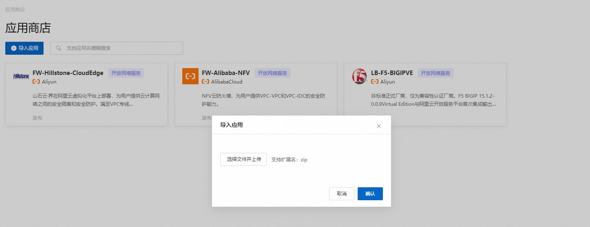

3. 服务配置文件导入成功后，单击服务卡片，进入开放网络服务**应用详情**。

   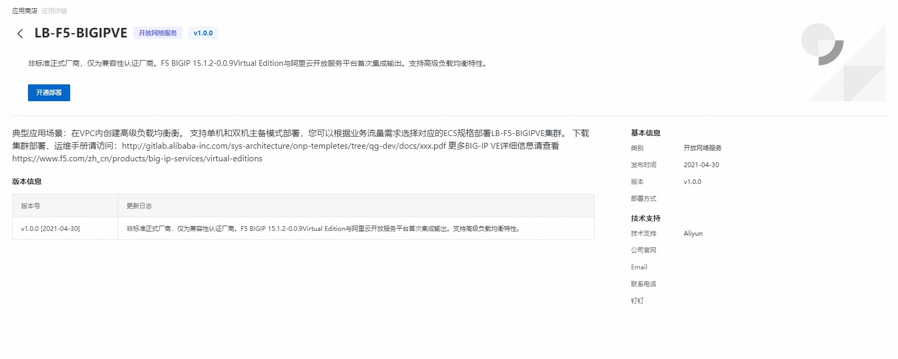

**部署服务集群**

导入开放网络服务配置文件后，部署对应的网络服务集群。

1. 在开放网络服务**应用详情**页面，单击**开通部署**，创建正式集群。

   <table>
     <tr>
       <th width="137">名称</th>
       <th>说明</th>
     </tr>
     <tr>
       <td>集群名称</td>
       <td>自定义集群名称。</td>
     </tr>
     <tr>
       <td>地域</td>
       <td>选择集群ECS所在地域。</td>
     </tr>
     <tr>
       <td>部署类型</td>
       <td>选择<strong>地域</strong>后选择集群形态，如<strong>Standalone</strong>或<strong>Active-Standby</strong>。 • <strong>Standalone</strong>：表示独立部署，仅会创建一个ECS实例。 • <strong>Active-Standby</strong>：表示主备部署，会创建两个ECS实例。</td>
     </tr>
     <tr>
       <td>可用区</td>
       <td>选择集群ECS所在可用区，集群仅可属于单可用区。</td>
     </tr>
     <tr>
       <td>cidr</td>
       <td>选择集群ECS所在的VPC，在部署的时候会根据这里指定的网段自动创建VPC、交换机和安全组等信息。单击后面的<strong>添加cidr</strong>可自定义创建VPC的CIDR网段，具体参见CIDR管理。 说明为保证网络服务能够正常创建，建议VPC的CIDR使用私有网段且掩码位数需小于26。</td>
     </tr>
     <tr>
       <td>专有宿主机部署</td>
       <td>专有宿主机部署是指将集群部署在用户独享的物理服务器上的部署方式，可选择<strong>否</strong>或<strong>是</strong>。选择<strong>是</strong>后，需要指定集群部署的宿主机组和宿主机。 • 在<strong>宿主机组</strong>下拉列表指定具体部署的宿主机组，可单击后面的<strong>添加宿主机组</strong>自定义宿主机组。具体参见专有宿主机组管理。 • 在宿主机下拉列表指定具体部署的宿主机。 说明 • 当<strong>部署类型</strong>选择<strong>Standalone</strong>时，只需要指定一个宿主机。 • 当<strong>部署类型</strong>选择<strong>Active-Standby</strong>时，需要指定两个宿主机。</td>
     </tr>
     <tr>
       <td>ECS规格</td>
       <td>选择集群ECS使用的规格。NFV网络服务对ECS规格有特殊需求，仅支持从下拉列表选项中选择，规格越高集群的处理性能越好。</td>
     </tr>
     <tr>
       <td>ECS镜像ID</td>
       <td>选择创建网络服务ECS使用的特定镜像，即制作自定义ECS镜像中创建的自定义镜像ID。</td>
     </tr>
     <tr>
       <td>集群描述</td>
       <td>集群其他说明。</td>
     </tr>
   </table>

2. 单击**开启部署**。

3. 部署成功后，在开放网络服务管控台左侧导航栏单击**我的应用**，查看已创建的应用。

   > **说明**
   >
   > 单击目标应用卡片右侧的  ，选择**修改应用名**，可修改应用的名称。

   

4. （可选）单击目标应用，进入**应用详情**。

   - **创建容灾集群**

     单击页面右上方的**创建容灾集群**，可为主集群创建容灾集群，配置的参数说明可参见开通部署创建正式集群中的参数说明。

     > **重要**
     >
     > 容灾集群的可用区应与主集群不同，当主集群所在可用区断网（断电）时，流量将会自动切换至备集群。

   - **查看集群信息**

     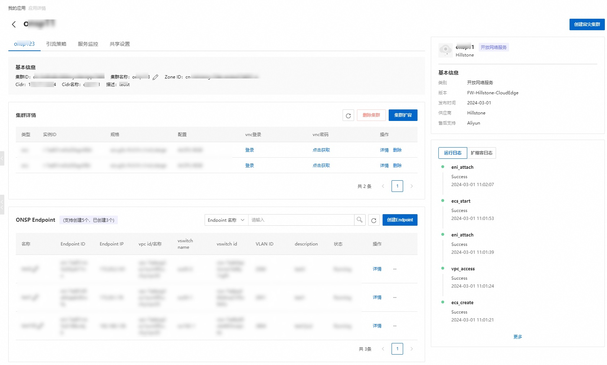

     - 在集群页签的左侧区域，可以查看集群的**基本信息**、**集群详情**、**ONSP Endpoint**等。

       - 在**基本信息**区域，可以查看集群ID、集群名称、Zone ID、Cidr、Cidr名称和描述等。

         > **说明**
         >
         > 单击集群名称右侧的
         >
         > 可以修改集群的名称。
         >
         > 

       - 在**集群详情**区域，可以进行**删除集群**、**集群扩容**、登录VNC、获取NVC密码、查看集群实例详情、删除集群实例等操作。

         > **警告**
         >
         > - 删除集群操作可能影响业务联通性，请谨慎操作。
         >
         > - 必须删除所有指向该集群的引流条目后才能删除集群。

       - 在**ONSP Endpoint**区域，可以**创建Endpoint**、查看Endpoint详情、删除Endpoint、查看Endpont日志等。

     - 在集群页签的右侧区域，可以查看应用的名称、**基本信息**、**运行日志、扩缩容日志**等。

   - **查看引流策略**

     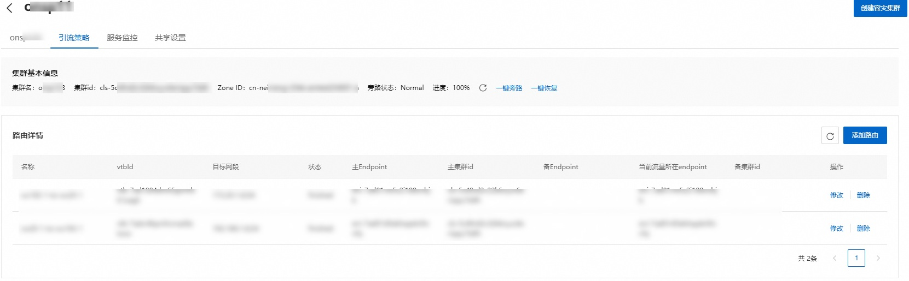

     - 在**引流策略**页签的**集群基本信息**区域，可以查看**集群名、集群id、Zone ID**、**旁路状态**、**进度**等。

       > **警告**
       >
       > - 当业务VPC路由配置完成后，如果网元出现故障，可通过一键旁路撤销去往目的集群的全部路由，设置如高速通道等备用方案实现流量直接到达目的集群。当故障恢复，可通过一**键恢复**将已撤销的路由全部恢复。
       >
       > - 一键旁路和一键恢复属于高危操作，在执行时请联系阿里云技术支持。

     - 在**引流策略**页签的**路由详情**区域，可以添加、修改和删除路由。具体请参考配置业务VPC路由。

   - **查看服务监控**

     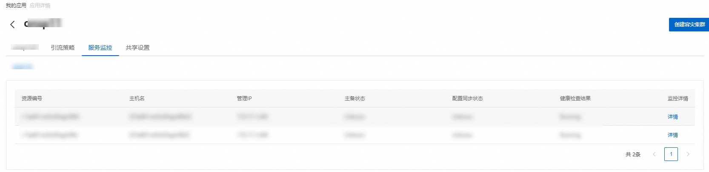

     在**服务监控**页签，可以监控网元实例的状态以及业务口流量。具体可参见服务监控。

   - **查看共享设置**

     在**共享设置**页签，可以通过共享功能，让共享名单中的用户看到本应用，并授权用户相关操作权限。具体操作可参见共享设置。

**激活集群**

> **说明**
>
> 网络服务集群部署完成后，需要完成产品激活才能使用。

根据所需的网络服务，联系提供商的技术支持，按需提供集群ECS相关信息获取License文件，登录到对应的网络服务页面完成产品激活。

### 3.2.4. 应用概览

服务集群部署和激活完成之后，在概览页面查看应用资源总览和异常集群监控概览。当集群中的ECS实例运行异常，健康检查结果为非Running时集群状态表现为error。并展示在异常集群监控概览列表，帮助用户及时发现异常集群，进行快速定位。

**操作步骤**

1. 打开开放网络服务管控台。

2. 在左侧导航栏，单击**概览**。

3. 在**资源总览**区域，查看您创建的应用信息（**应用名称**、**创建时间**）。

   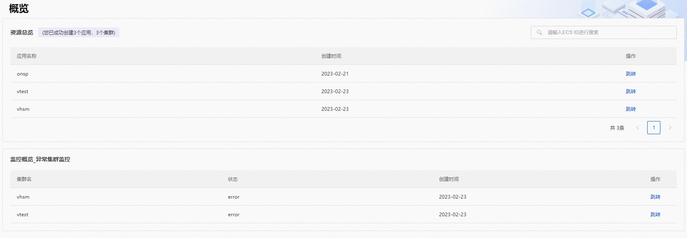

   - 在右上角搜索框中输入部署应用的ECS实例 ID，可快速查找对应的应用。

   - 单击目标应用**操作**列的**跳转**，进入应用详情，查看更多详细的信息。

     <table>
       <tr>
         <th width="90">应用详情</th>
         <th>描述</th>
       </tr>
       <tr>
         <td>应用页签</td>
         <td>在应用页签，查看应用的基本信息，配置集群、ONSP Endpoint。相关操作可参见部署和激活服务集群和业务引流。</td>
       </tr>
       <tr>
         <td>引流策略</td>
         <td>在引流策略页签，配置和查看路由，相关操作可参见业务引流。</td>
       </tr>
       <tr>
         <td>服务监控</td>
         <td>在服务监控页签，监控集群实例的状态以及业务口流量。具体操作可参见服务监控</td>
       </tr>
       <tr>
         <td>共享设置</td>
         <td>在共享设置页签，进行共享名单配置将应用共享给其他用户。具体操作可参见共享设置。</td>
       </tr>
     </table>

4. 在**监控概览_异常集群监控**区域，查看状态异常的集群，及时发现异常集群并进行定位处理。

   <ol type="i">

   <li>

   单击目标集群**操作**列的**跳转**，进入到应用详情。

   </li>

   <li>

   单击**服务监控**页签，在服务监控列表查看资源实例的**健康检查结果**。

   健康检查结果为非Running时则表示该实例运行异常。

   </li>

   <li>

   单击应用名称页签，进入应用页面。在**集群详情**区域获取运行异常实例的**VNC密码**，并进行**VNC登录**。

   </li>

   <li>

   使用VNC登录连接实例后，检查实例的实时状态，了解实例情况并解决问题。

   </li>

   </ol>

## 3.3. 使用开放网络服务

本文介绍如何使用开放网络服务。

### 3.3.1. 账号授权

第一次使用开放网络服务产品时，需要完成对云账号的授权，赋予云接入网关产品操作业务VPC中弹性网卡（ENI）资源的相关权限。

**前提条件**

资源账号作为云账号已导入，并且用户是第一次使用开放网络服务。

**操作步骤**

1. 打开开放网络服务管控台。

2. 在**授权申请书**弹窗中单击**确认授权**。

### 3.3.2. 业务引流

根据业务规划，通过将业务流量牵引至开放网络服务集群，以使用开放网络服务提供的产品能力。

**操作流程**

**创建业务VPC及交换机**

根据业务规划，创建业务VPC及交换机。

1. 登录专有网络管理控制台，创建业务VPC。具体操作请参见《专有网络VPC用户指南》中的”管理专有网络“。

2. 登录专有网络管理控制台，创建业务ECS所在交换机。具体操作请参见《专有网络VPC用户指南》中的”管理交换机“。

3. 按需创建网络服务所需交换机。

   > **说明**
   >
   > 如果您使用了VLB类型的网络服务，需要在业务VPC内创建额外的VIP vSwitch，以预占对外提供VPC私网负载均衡服务的IP地址。

**创建ONSP Endpoint**

业务流量需要通过ENI资源进入开放网络服务集群，所以要先创建ENI资源，ENI创建完成后自动绑定到开放网络服务集群。

1. 打开开放网络服务管控台。

2. 在左侧导航栏选择**我的应用**，单击目标应用。

3. 在**应用详情**页面，选择集群名称页签。

4. 在**ONSP Endpoint**区域，单击右侧**创建Endpoint**。

5. 在**endpoint**对话框中，配置网络引流信息，单击**执行**。

   <table>
     <tr>
       <th width="169">名称</th>
       <th>说明</th>
     </tr>
     <tr>
       <td>集群ID</td>
       <td>集群的ID，默认值。</td>
     </tr>
     <tr>
       <td>endpoint名称</td>
       <td>自定义endpoint名称。</td>
     </tr>
     <tr>
       <td>所属一级组织的UID</td>
       <td>指定引流ENI所归属的一级组织，可在Apsara Uni-manager运营控制台的<strong>组织管</strong><strong>理</strong>页面查看组织UID。</td>
     </tr>
     <tr>
       <td>源vSwitch ID</td>
       <td>指定引流ENI所属的交换机，即业vSwitch ID。可在专有网络管理控制台的<strong>交换</strong><strong>机</strong>页面查看交换机ID。 说明 • 该vSwitch的CIDR应与开放网络服务集群所在的CIDR无冲突。 • 该vSwitch所属zone须与当前集群zone保持一致。</td>
     </tr>
     <tr>
       <td>描述</td>
       <td>对引流操作的详细说明。</td>
     </tr>
   </table>

6. 创建完成后，在**ONSP Endpoint**区域，可以查看引流资源信息，并记录**Endpoint ID**、**Endpoint IP**、**VLAN ID**。

7. （可选）当该Endpoint变更或不需要时，单击**操作**列的**删除**，可以删除目标Endpoint。

   > **警告**
   >
   > - 删除之前需要确保指向该ENI的路由条目已经删除。
   >
   > - 该操作会影响网络联通性，请谨慎操作，必须确保该ONSP Endponit不再承载任何流量。

**执行结果**

Endpoint创建成功后，系统会自动创建ENI实例和为ENI创建安全组。

登录Apsara Uni-manager运营控制台，进入**产品** > **弹性计算 > 云服务器ECS**可以查看。

- 在**网络和安全** > **弹性网卡**页面查看ENI详情。

  > **重要**
  >
  > 该网卡是通过系统创建，请避免修改ENI。

- 在**网络和安全** > **安全组**页面查看安全组详情，按需修改引流ENI安全组规则。

  系统自动为引流ENI创建安全组，默认规则：允许入向全部流量，出向无规则默认放行所有流量。

**配置业务VPC路由**

ENI资源创建完成后，根据路由配置方案，为业务VPC添加相关路由条目指向ENI资源，将流量牵引至开放网络服务集群处理。

1. 确定路由目的地址段。

   > **说明**
   >
   > - VLB场景需要将VIP地址段拆分为1/2 CIDR作为目的地址段。
   >
   > - VFW场景，按需配置防护的目的CIDR，如VPC-VPC防护场景下可填写对端VPC CIDR，VPC-IDC防护场景下可填写IDC CIDR。

2. 查询下一跳ENI ID。

   在**应用详情**页面，根据业务VPC、vSwitch信息查找到对应的引流Endpoint ID。

   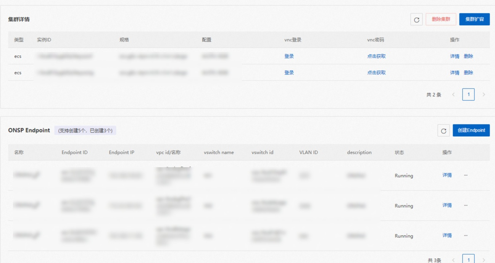

3. 在**引流策略**页签，单击**添加路由**。

   同城容灾配置：填写备Endpoint及备Endpoint集群，且在备集群网元上配置相同的配置，即可起到同城容灾的作用。

   | 名称 | 说明 |
   | --- | --- |
   | 名称 | 自定义的路由名称。 |
   | 目标网段 | 目的地址网段。 |
   | 路由表ID | 需发放至哪个账号的路由表中，即业务VPC的路由表ID。 |
   | 主Endpoint集群 | 需要指定的主endpoint所在的集群。 |
   | 主Endpoint | 默认情况下流量经过的endpoint。 |
   | 备Endpoint集群 | 需要指定的备endpoint所在的集群。 |
   | 备Endpoint | 默认情况下主集群故障时，默认会将流量切换至备集群的备endpoint上。 |

4. 单击**提交**。

5. （可选）业务VPC路由配置完成后，如果网元出现故障，可通过一键旁路撤销去往目的集群的全部路由，设置如高速通道等备用方案实现流量直接到达目的集群。当故障恢复，可通过一**键恢复**将已撤销的路由全部恢复。

   - **一键旁路**：单击**集群基本信息**区域的**一键旁路**，填写**验证码**后，单击**提交**。

   - **一键恢复**：单击**集群基本信息**区域的**一键恢复**，填写**验证码**后，单击**提交**。

   > **警告**
   >
   > 一键旁路和一键恢复属于高危操作，在执行时请联系阿里云技术支持。

**配置集群网络**

登录到集群ECS的Web访问页面，配置端口和指向引流源地址段来接收来自业务VPC的流量。

1. 在**集群详情**区域，单击ECS实例所在行**操作列**的**详情**。

2. 单击**经典网络访问**区域右侧的**创建**，创建经典网络访问方式。

   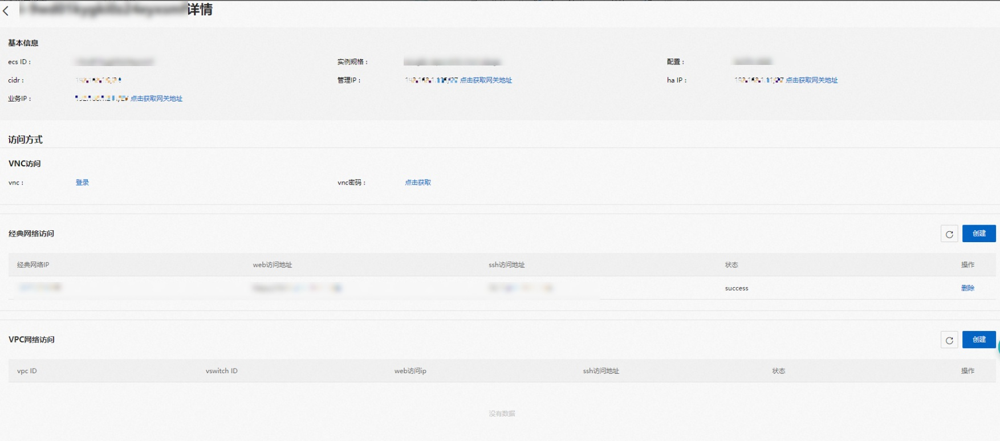

3. 创建完成后，单击经典网络访问区域**web访问地址**列的地址，登录集群ECS。

   根据6记录的**Endpoint ID**、**Endpoint IP**、**VLAN ID**等信息配置端口和指向引流源VPC地址段的路由。

   > **说明**
   >
   > 配置过程中遇到问题，请联系应用提供商的技术支持。

4. 登录开放网络服务portal，在相应页面探测网关地址，验证配置结果。

### 3.3.3. 创建网络服务实例

创建业务相关的网络服务实例，如负载均衡virtual server，防火墙安全策略等。

根据所需的网络服务，参考合作伙伴提供的LB-F5-BIGIPVE配置指导、FW-Hillstone-CloudEdge配置指导创建网络服务实例。

如果遇到问题可选择具体的网络服务，查看联系方式，联系合作伙伴技术支持。具体操作：

1. 打开开放网络服务管控台。

2. 单击左侧导航栏**应用商店**。

3. 在**应用商店**页面，选择具体的网络服务，查看联系方式，联系合作伙伴技术支持。

### 3.3.4. 服务监控

通过服务监控，监控网元实例的状态以及业务口流量。

**操作步骤**

1. 打开开放网络服务管控台。

2. 单击左侧导航栏**我的应用**。

3. 在**我的应用**页面，选择对应的应用。

4. 单击**服务监控**页签，查看资源信息和状态。

   

5. 单击**详情**，查看实例的业务口网卡流量情况。

   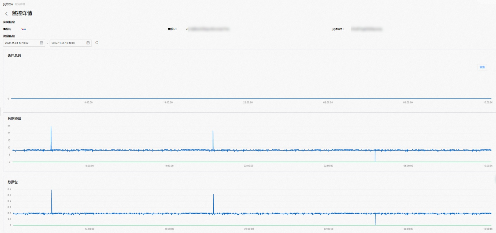

### 3.3.5. 共享设置

通过共享设置，可以让共享名单中的用户看到本应用，并授权用户相关操作权限。

**约束限制**

共享管理权限时，仅支持在同一个一级组织内共享。

**操作步骤**

1. 打开开放网络服务管控台。

2. 单击左侧导航栏**我的应用**。

3. 在**我的应用**页面，单击目标应用，进入应用详情。

4. 单击**共享设置**页签。

5. 单击**添加共享账号**，填写**名字**、**用户的Aliuid**，选择共享的**操作权限**。

   <table>
     <tr>
       <th width="125">名称</th>
       <th>说明</th>
     </tr>
     <tr>
       <td>名字</td>
       <td>授权的用户账号。</td>
     </tr>
     <tr>
       <td>用户的Aliuid</td>
       <td>用户的UID。</td>
     </tr>
     <tr>
       <td>操作权限</td>
       <td>可选择为用户授权的操作权限。 • <strong>管理权限</strong>：共享应用的所有权限。 • <strong>接入权限</strong>：仅共享应用的查看、集群Endpoint配置和引流策略配置权限。 重要由于共享接入权限的人员没有配置集群网络的权限，因此需要在创建Endpoint后，联系开放网络服务的创建者登录对应的集群ECS页面配置集群网络，以接收业务流量。</td>
     </tr>
   </table>

6. 单击**添加**。添加成功后，在共享名单列表中新增一条用户记录。

   在共享名单列表中，单击对应用户所在行的**删除**，即可从共享名单中删除。

## 3.4. CIDR管理

CIDR (Classless Inter-Domain Routing) 是一种IP地址分配和路由的方法，通过灵活的划分IP地址空间，可以更有效地分配和利用IP地址。

**背景信息**

CIDR允许将一个IP地址划分为多个子网，每个子网可以根据需要分配不同数量的IP地址。

CIDR的表示方法是将IP地址和前缀长度以斜杠（/）分隔开，前缀长度用于表示一个IP地址中网络部分的位数。例如192.168.0.0/24，其中192.168.0.0是网络的起始地址，而/24表示网络部分由24位组成。

**约束限制**

无法删除已使用的CIDR。

**操作步骤**

1. 打开开放网络服务管控台。

2. 单击左侧导航栏**cidr管理**，管理CIDR。

   <table>
     <tr>
       <th width="98">操作任务</th>
       <th>操作说明</th>
     </tr>
     <tr>
       <td>创建CIDR</td>
       <td>i. 单击页面上方的<strong>创建cidr</strong>。ii. 在创建cidr对话框，填写<strong>cidr名称</strong>和<strong>cidr</strong>。 说明<strong>cidr名称</strong>：2~128个字符，以字母或中文开头，支持数字和"_"、"-"特殊字符，不能以"http://" 或"https://"开头。 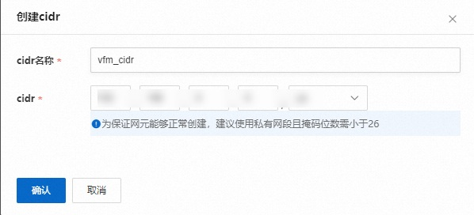 iii. 单击<strong>确认</strong>。</td>
     </tr>
     <tr>
       <td>删除CIDR</td>
       <td>i. 在<strong>我的cidr列表</strong>，单击<strong>操作</strong>列的<strong>删除</strong>。ii. 单击<strong>确定</strong>。</td>
     </tr>
   </table>

## 3.5. 专有宿主机组管理

专有宿主机组管理是指对专有宿主机组进行创建、删除以及添加专有宿主机的过程。宿主机组和宿主机资源创建完成后，您可以在开通部署服务时选择将服务集群部署在专有宿主机上。

**背景信息**

专有宿主机组（Dedicated Host Group）用于管理和组织专有宿主机资源。

申请专有宿主机后，您可以独享该台物理服务器，并在该服务器上创建ECS实例，满足资源隔离及不同业务的部署诉求。

**约束限制**

- 无法删除已使用的专有宿主机组。

- 删除宿主机组前，请先清空宿主机组中的宿主机资源。

- 无法删除已使用的专有宿主机。

**创建宿主机组**

1. 打开开放网络服务管控台。

2. 在左侧导航栏，单击**专有宿主机组管理**。

3. 在**专有宿主机组管理**页面，单击上方的**创建宿主机组**。

4. 在**创建宿主机组**对话框，填写**宿主机组名称**、**描述**，选择**地域**、**可用区**和**宿主机实例规格**。

   > **说明**
   >
   > 选择宿主机实例规格时，可联系阿里云技术支持确认规格参数。

   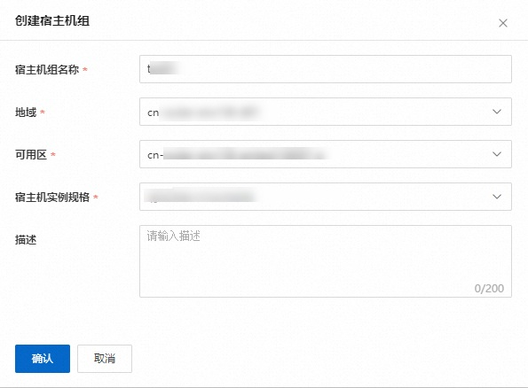

5. 单击**确认**，宿主机组创建完成。

**查看宿主机组详情**

在**专有宿主机组详情**页面，查看宿主机组的**基本信息**、**宿主机列表**和**应用列表**。

1. 在**专有宿主机组管理**页面，单击宿主机组名称/ID，进入**专有宿主机组详情**页面。

   - **基本信息**：展示**宿主机组名称**、**宿主机组ID**、**状态**、**可用区**、**实例规格**、**vcpu可用量/总量**、**内存可用量/总量**。

   - **宿主机列表**：展示宿主机组中的宿主机资源，宿主机的管理具体参见管理宿主机组中的宿主机。

   - **应用列表**：展示已使用该宿主机组的应用。单击应用操作列**详情**，可打开应用详情，查看应用详细信息。

**管理宿主机组中的宿主机**

宿主机组创建完成后，可以为宿主机组添加宿主机，当该宿主机不需要时，可以从宿主机组中删除。

1. 添加宿主机。

   - 在**专有宿主机组管理**页面，单击宿主机组操作列的**添加宿主机**。

   - 在**专有宿主机组管理**页面，单击宿主机组名称/ID，进入**专有宿主机组详情**页面，单击**宿主机列表**的**创建宿主机**。

2. 在**创建添加宿主机**对话框，填写**宿主机名称**和**描述**。

3. 单击**确认**，创建成功后可以在**专有宿主机组详情**页面查看/管理宿主机资源。

   - 在**宿主机列表**，查看创建的宿主机资源，包括**宿主机名称**、宿主机ID、**宿主机实例规格**、**vcpu可用量/总量**、**内存可用量/总量**、**状态**。

   - 当宿主机资源不需要时，单击**宿主机列表**操作列的**删除**，将宿主机资源删除。

**删除宿主机组**

当宿主机组不需要时可以删除。

1. 在**专有宿主机组管理**页面，单击宿主机组操作列的**删除**。

2. 单击**确定**。

## 3.6. 系统管理

您可以根据业务需求的变化，对资源进行迁移和刷新ECS实例规格，以满足不断变化的业务需求和系统性能要求。

**资源迁移**

企业人员或业务需求变更，可以将当前用户下创建的应用及相关资源全部迁移到其他用户。

> **警告**
>
> 资源迁移属于高危操作，请务必在操作前联系阿里云技术支持确认！

1. 打开开放网络服务管控台。

2. 单击左侧导航栏**系统管理**。

3. 在**系统管理**页面，选择**资源迁移**。

4. 在**资源迁移**对话框，填写**目的用户aliuid**和**授权码**后，单击**提交**。

   - **目的用户aliuid**：目的用户的UID，可在Apsara Uni-manager运营控制台的**用户管理**页面获取。

   - **授权码**：请联系阿里云技术支持获取。

   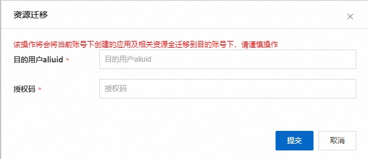

**一键刷新ECS实例规格**

一键刷新ECS实例规格会全量同步系统中的ECS实例规格，以便用户在进行服务集群部署时能够选择到最新的ECS实例规格。

1. 打开开放网络服务管控台。

2. 单击左侧导航栏**系统管理**。

3. 在**系统管理**页面，选择**一键刷新ecs实例规格**。

4. 在**一键刷新ecs实例规格**对话框，输入**授权码**后，单击**提交**。

   > **说明**
   >
   > 刷新ECS实例规格时请联系阿里云技术支持获取授权码。

   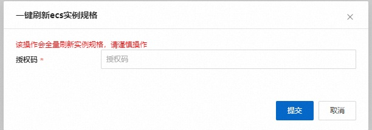
