阿里云  
专有云  
云接入网关  
运维指南  
产品版本：V3.18.6  
文档版本：20251031

**目录**

- [1.登录Apsara Uni-manager运维控制台](#section-1)
- [2.基础网络](#section-2)
    - [2.1. HPN管理](#section-2-1)
        - [2.1.1. HPN网元](#section-2-1-1)
        - [2.1.2. RDMA网卡运维](#section-2-1-2)
        - [2.1.3. HPN性能分析](#section-2-1-3)
        - [2.1.4. HPN即时诊断](#section-2-1-4)
    - [2.2. 算力平台网络](#section-2-2)
        - [2.2.1. CPN一键诊断](#section-2-2-1)
        - [2.2.2. CPN性能分析](#section-2-2-2)
        - [2.2.3. CPN接入网关](#section-2-2-3)
            - [2.2.3.1. RDMA设备管理](#section-2-2-3-1)
            - [2.2.3.2. RDMA设备策略管理](#section-2-2-3-2)
            - [2.2.3.3. RDMA设备接口策略管理](#section-2-2-3-3)
        - [2.2.4. RDMA网卡运维](#section-2-2-4)
        - [2.2.5. CPN网络管理](#section-2-2-5)
            - [2.2.5.1. CPN拓扑](#section-2-2-5-1)
            - [2.2.5.2. CPN网元](#section-2-2-5-2)
        - [2.2.6. CPN网络监控](#section-2-2-6)
            - [2.2.6.1. CPN主机监控大盘](#section-2-2-6-1)
            - [2.2.6.2. CPN交换机大盘](#section-2-2-6-2)
            - [2.2.6.3. NAK报文分析工具](#section-2-2-6-3)
            - [2.2.6.4. 高精度监控大盘](#section-2-2-6-4)
            - [2.2.6.5. 交换机高精度大盘](#section-2-2-6-5)
            - [2.2.6.6. job维度监控](#section-2-2-6-6)
            - [2.2.6.7. CPN流监控](#section-2-2-6-7)
    - [2.3. 云接入网关](#section-2-3)
    - [2.4. 智算服务器接入VPC](#section-2-4)
        - [2.4.1. 实例管理](#section-2-4-1)
        - [2.4.2. 操作历史记录](#section-2-4-2)
        - [2.4.3. 裸机网络管理](#section-2-4-3)
        - [2.4.4. 运维配置](#section-2-4-4)
            - [2.4.4.1. VPC内申请裸机](#section-2-4-4-1)
            - [2.4.4.2. VPC内释放裸机](#section-2-4-4-2)
            - [2.4.4.3. 删除路由表项](#section-2-4-4-3)
            - [2.4.4.4. 删除路由器接口](#section-2-4-4-4)
            - [2.4.4.5. 删除VBR](#section-2-4-4-5)
            - [2.4.4.6. 删除物理专线](#section-2-4-4-6)
            - [2.4.4.7. 一键清除资源](#section-2-4-4-7)
            - [2.4.4.8. 查看专线带宽](#section-2-4-4-8)
            - [2.4.4.9. 查看Trunk使用情况](#section-2-4-4-9)
            - [2.4.4.10. 查看BM VPN使用情况](#section-2-4-4-10)
            - [2.4.4.11. 显示BD使用情况](#section-2-4-4-11)
            - [2.4.4.12. 检查初始化配置](#section-2-4-4-12)
            - [2.4.4.13. 检查路由配置](#section-2-4-4-13)
            - [2.4.4.14. 显示裸机网络网关信息](#section-2-4-4-14)
- [3.网络产品](#section-3)
    - [3.1. CGW运维](#section-3-1)
        - [3.1.1. CGW集群管理](#section-3-1-1)
        - [3.1.2. CGW管理](#section-3-1-2)
- [4.流量可视化](#section-4)
    - [4.1. 可视化设置](#section-4-1)
        - [4.1.1. 分析设备管理](#section-4-1-1)
        - [4.1.2. 采集规则管理](#section-4-1-2)
        - [4.1.3. 场景管理](#section-4-1-3)
    - [4.2. 可视化概览](#section-4-2)
    - [4.3. 流搜索与调度](#section-4-3)

<a id="section-1"></a>

# 1.登录Apsara Uni-manager运维控制台

本文介绍运维工程师等相关用户如何登录到Apsara Uni-manager运维控制台。

**前提条件**

- 已从部署人员或管理员处获取Apsara Uni-manager运维控制台的访问地址、用户名和密码。

  Apsara Uni-manager运维控制台访问地址格式为*region-id*.ops.console.*intranet-domain-id*。

- 推荐使用Chrome浏览器。

**操作步骤**

1. 打开浏览器。

2. 在地址栏中，输入Apsara Uni-manager运维控制台的访问地址，按回车键。

   

   > **说明**
   >
   > 您可以单击右上角的当前语言切换其它语言。当前支持简体中文、英文、繁体中文三种语言切换。

3. 输入正确的用户名及密码。

   > **说明**
   >
   > - 登录Apsara Uni-manager运维控制台的用户名和密码请从部署人员或管理员处获取。
   >
   > - 若连续输入密码错误三次，系统将启动图片验证码登录功能；若连续输入错误五次，账户将被锁定，请联系管理员进行激活。

   首次登录Apsara Uni-manager运维控制台时，需要修改登录用户名的密码，请按照提示完成密码修改。

   为提高安全性，密码必须满足以下要求：

   - 必须包含英文大小写字母。

   - 必须包含阿拉伯数字（0~9）。

   - 必须包含特殊符号，包括感叹号（!）、at（@）、井号（#）、美元符号（$）、百分号（%）等。

   - 密码长度为10~20个字符。

4. 单击**账号登录**。

<a id="section-2"></a>

# 2.基础网络

<a id="section-2-1"></a>

## 2.1. HPN管理

> **说明**
>
> 此功能默认不展示，如果需要使用本功能，在**用户权限** > **菜单管理**下编辑菜单项，进行**展示**操作。

<a id="section-2-1-1"></a>

### 2.1.1. HPN网元

展示云平台中HPN网络设备资产与监控运维信息。

**操作步骤**

1. 登录Apsara Uni-manager运维控制台。

2. 在顶部菜单栏，选择**产品运维** > **网络运维** > **网络运维控制台**。

3. 在左侧导航栏，选择**基础网络** > **HPN管理** > **HPN网元**。

4. 在页面上方可以根据**机房**和**网元名称**组合筛选获取目标网元的相关信息。

   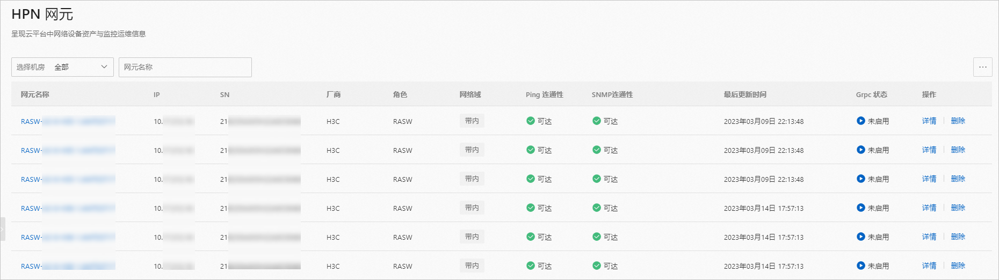

5. 单击目标网元名称，或者单击目标网元对应**操作**列的**详情**，进入设备详情页，可以获取如下信息：

   - 设备基本信息。

     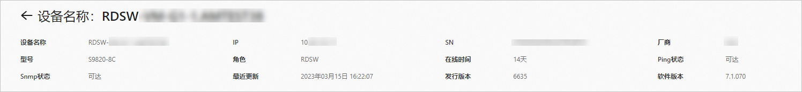

   - 在**端口**页签下，获取端口相关信息。

     单击目标**端口名称**或者对应**操作**列的**查看**，可进入端口详情页获取端口详细信息。

     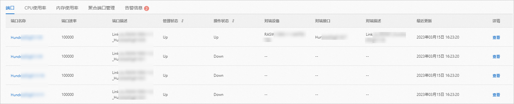

   - 在**CPU使用率**页签下，查看CPU的使用情况。

     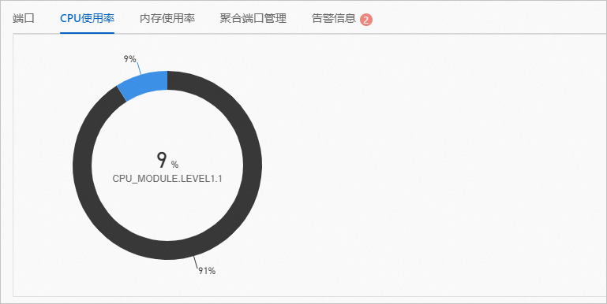

   - 在**内存使用率**页签下，查看内存的使用情况。

     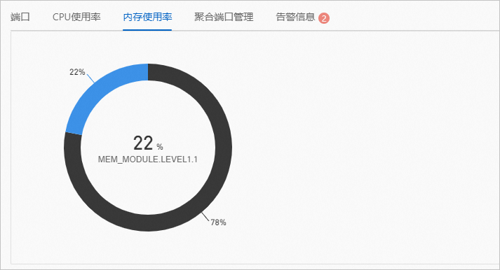

   - 在**聚合端口管理**页签下，获取聚合端口列表信息。

     单击目标聚合端口对应**操作**列的**查看**，查看聚合端口的水位图。

     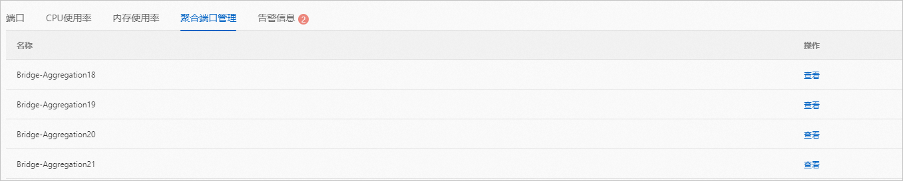

   - 在**告警信息**页签下，获取设备相关的告警信息。

     在**告警详情**列，单击**查看**可以获取告警详细信息。

     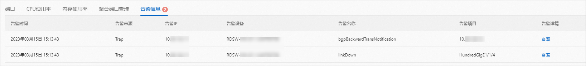

**删除网元设备**

1. 在目标网元设备的**操作**列，单击**删除**。

2. 在弹出的对话框中单击**确定**。

   > **说明**
   >
   > 删除操作无法恢复，请谨慎操作。

<a id="section-2-1-2"></a>

### 2.1.2. RDMA网卡运维

RDMA网卡运维是通过性能监控，定期检查RDMA网卡的性能指标，以便及时发现问题，快速排查并解决问题，保证网络稳定性和可靠性。

**相关概念**

<strong>RDMA（</strong>Remote Direct Memory Access<strong>）</strong>：全称远程直接数据存取，是一种高速网络技术，为了解决网络传输中服务器端数据处理的延迟而产生的。RDMA通过网络将资料直接传入计算机的存储区，把数据从一个系统快速移动到远程系统存储器中，实现了主机之间直接访问内存，但不对操作系统造成任何的影响，提高了数据传输速度、降低了CPU负载。

**操作步骤**

1. 登录Apsara Uni-manager运维控制台。

2. 在顶部菜单栏，选择**产品运维** > **网络运维** > **网络运维控制台**。

3. 在左侧导航栏，选择**基础网络** > **HPN管理** > **RDMA网卡运维**。

4. 在页面右上角选择**数据源**，数据源支持如下类型。

   - **BMS**（Bare Metal Server）：指数据来源于裸金属服务器。

   - **PAI**（Platform of Artificial Intelligence）：指数据来源于机器学习。

   - **CPFS**（Cloud Paralleled File System）: 指数据来源于文件存储。

   - **SCC**（Super Computing Cluster）: 指数据来源于超级计算集群。

   > **说明**
   >
   > - 选择**PAI**类型数据源，还需要继续选择**集群**和**ViewType**。
   >
   > - 选择**CPFS**、**SCC**类型数据源，还需要继续选择**集群**。

5. 在**集群**页签，查看集群维度的监控信息。

   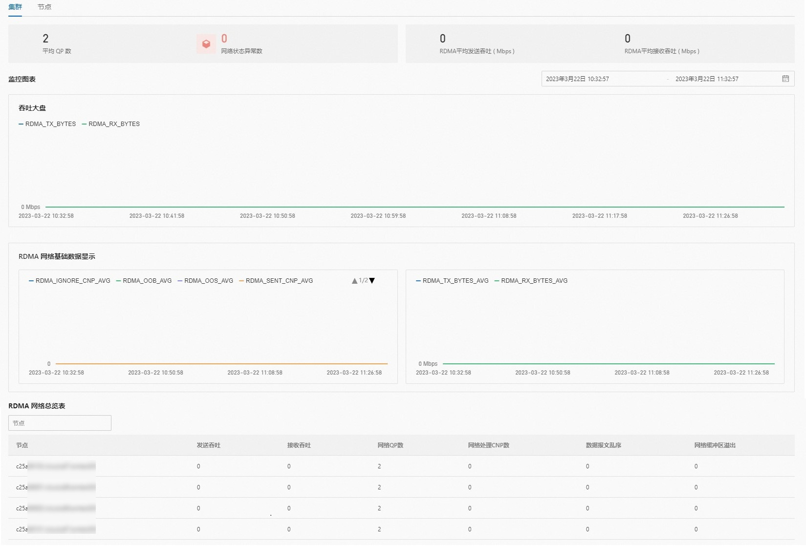

   | 区域 | 说明 |
   | --- | --- |
   | 平均QP数 | 在RDMA网络中，平均拥有的QP数量。当数据源选择PAI时，无此参数项。<br>• 当QP数不足时，会导致通信队列拥塞，影响数据传输效率和稳定性。<br>• 当QP数过多时，会增加系统的开销、复杂性，以及增加系统的故障率。<br>说明QP即Queue Pair，是RDMA网络中的关键概念，用于描述一对端点之间的通信队列。 |
   | 网络状态异常数 | 在RDMA网络中，网络设备或流量出现异常的次数。 |
   | RDMA平均发送吞吐（Mbps） | 在RDMA网络中，单位时间内网络中所有节点的平均发送数据吞吐量。 |
   | RDMA平均接受吞吐（Mbps） | 在RDMA网络中，单位时间内网络中所有节点的平均接收数据吞吐量。 |
   | 监控图表 | i. 在监控图表右侧选择起止时间，查看时间区间内的监控数据。ii. 在<strong>吞吐大盘</strong>区域，查看时间区间内RDMA_TX_BYTES和RDMA_RX_BYTES数据。<br>• RDMA_TX_BYTES是指RDMA网络中发送数据时所传输的字节数量。<br>• RDMA_RX_BYTES是指RDMA网络中接收数据时所接收的字节数量。iii. 在<strong>RDMA网络基础数据</strong>显示区域，查看时间区间内以下数据。<br>• <strong>RDMA_IGNORE_CNP_AVG</strong>指RDMA网络中平均忽略CNP数据包的数量。<br>说明CNP（Congestion Notification Packet）数据包是用于网络拥塞控制的数据包。当网络出现拥塞时会发送CNP数据包通知发送方减少发送速率，避免网络拥塞和数据包丢失。<br>• <strong>RDMA_OOB_AVG</strong>指RDMA网络中处理OOB数据的平均个数。<br>说明OOB（Out-of-Band）数据是RDMA网络中传输的一种特殊类型的数据。<br>• <strong>RDMA_OOS_AVG</strong>指RDMA网络中处理OOS数据的平均个数。<br>说明OOS（ Out-of-Order）数据是RDMA网络中传输的一种特殊类型的数据。当数据包在传输时发生丢失、延迟等情况就会出现OOS数据。<br>• <strong>RDMA_SENT_CNP_AVG</strong>指RDMA网络中发送CNP数据包的平均个数。<br>• <strong>RDMA_HANDLE_CNP_AVG</strong>指RDMA网络中处理CNP数据包的平均个数。<br>• <strong>RDMA_TX_BYTES_AVG</strong>指RDMA网络中发送数据的平均字节数。<br>• <strong>RDMA_RX_BYTES_AVG</strong>指RDMA网络中接收数据的平均字节数。 |
   | RDMA网络总览表 | 查看RDMA网络中节点列表，包括<strong>节点</strong>、<strong>发送吞吐</strong>、<strong>接收吞吐</strong>、<strong>网络QP数</strong>、<strong>网络处理</strong><strong>CNP数</strong>、<strong>数据报文乱序</strong>、<strong>网络缓冲区溢出</strong>等数据。 |

6. 在**节点**页签，查看节点维度的监控信息。

   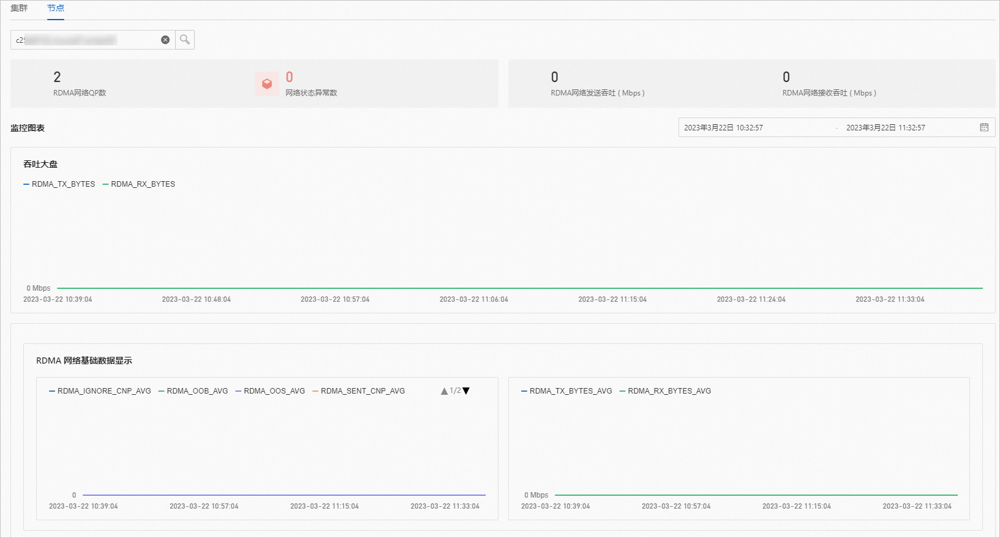

   <table>
     <tr>
       <th>参数</th>
       <th>说明</th>
     </tr>
     <tr>
       <td>RDMA网络QP数</td>
       <td rowspan="5">以节点的维度，展示相关监控数据信息，具体参数说明请参见集群维度描述。</td>
     </tr>
     <tr>
       <td>网络状态异常数</td>
     </tr>
     <tr>
       <td>RDMA网络发送吞吐 ( Mbps )</td>
     </tr>
     <tr>
       <td>RDMA网络接收吞吐 ( Mbps )</td>
     </tr>
     <tr>
       <td>监控图表</td>
     </tr>
   </table>

<a id="section-2-1-3"></a>

### 2.1.3. HPN性能分析

HPN性能分析，是指对HPN（High Performance Network）网络性能的分析。通过测试机器在压力情况下性能的表现，考察当前软硬件所能承受的最大负荷和抗压能力，帮助用户找出机器的压力极限，为运维提供充分的数据依据，以提高网络的性能。

**操作步骤**

1. 登录Apsara Uni-manager运维控制台。

2. 在顶部菜单栏，选择**产品运维** > **网络运维** > **网络运维控制台**。

3. 在左侧导航栏，选择**基础网络** > **HPN管理** > **HPN性能分析**。

4. 单击**新建测试**，创建分析任务。

   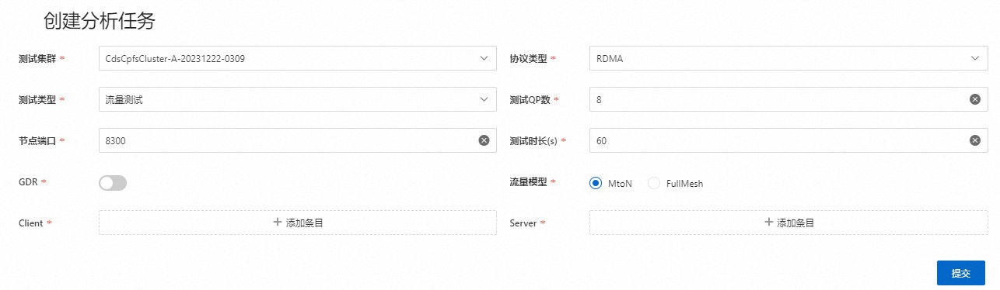

   创建任务参数的动态组合如下表所示。

   <table>
     <tr>
       <th>测试集群</th>
       <th>协议类型</th>
       <th>测试类型</th>
       <th>需要输入的参数</th>
       <th>流量模型选中值</th>
       <th>节点列表</th>
     </tr>
     <tr>
       <td rowspan="5">任意</td>
       <td rowspan="3">RDMA</td>
       <td rowspan="2">流量测试</td>
       <td rowspan="2">• 测试QP数<br>• 节点端口<br>• 测试时长<br>• GDR</td>
       <td>MtoN</td>
       <td>• Server<br>• Client</td>
     </tr>
     <tr>
       <td>FullMesh</td>
       <td>• Server</td>
     </tr>
     <tr>
       <td>时延测试</td>
       <td>• 节点端口</td>
       <td>无此参数</td>
       <td>• Server</td>
     </tr>
     <tr>
       <td rowspan="2">TCP</td>
       <td rowspan="2">流量测试</td>
       <td rowspan="2">• 节点端口<br>• 测试时长<br>• 并发连接数</td>
       <td>MtoN</td>
       <td>• Server<br>• Client</td>
     </tr>
     <tr>
       <td>FullMesh</td>
       <td>• Server</td>
     </tr>
   </table>

   创建任务的参数说明如下表所示。

   <table>
     <tr>
       <th width="106">参数</th>
       <th>参数说明</th>
     </tr>
     <tr>
       <td>测试QP数</td>
       <td>测试进程流的数量，影响测试带宽的大小。</td>
     </tr>
     <tr>
       <td>节点端口</td>
       <td>测试所使用的端口号。</td>
     </tr>
     <tr>
       <td>测试时长</td>
       <td>本次测试的时长，单位为秒。</td>
     </tr>
     <tr>
       <td>GDR</td>
       <td>是否开启GDR。如果开启GDR，会绑定RDMA网卡与对应的GPU进行流量测试。开启前请先确认机器是否支持，如果不支持请不要开启该选项。</td>
     </tr>
     <tr>
       <td>并发连接数</td>
       <td>同一时间内，可以同时处理的连接数。</td>
     </tr>
     <tr>
       <td>MtoN</td>
       <td>全称Many to Many，是指多对多的关系模型。即测试<strong>Clients</strong>节点到<strong>Servers</strong>节点的单向连通性，包括单个<strong>Client</strong>节点到单个<strong>Server</strong>节点、多个<strong>Clients</strong>节点到多个<strong>Servers</strong>节点等情况。</td>
     </tr>
     <tr>
       <td>FullMesh</td>
       <td>指网络拓扑结构中所有节点之间互相连接的情况，即测试所有目标节点两两之间的连通性。</td>
     </tr>
     <tr>
       <td>Client</td>
       <td>流量测试的发送方。</td>
     </tr>
     <tr>
       <td>Server</td>
       <td>流量测试的接收方。</td>
     </tr>
   </table>

5. 单击**提交**，弹出创建成功的弹窗。

   - 单击**取消**：返回创建分析任务页面，可重新修改参数创建新的分析任务。

   - 单击**查看任务详情**：跳转到**分析任务详情**页面。

**更多操作**

**查看任务详情**

1. 在**HPN性能分析**页面，单击高级筛选，可以根据**起止时间**、**任务ID**、**测试类型**、**协议类型**、**流量模型**和**任务状态**组合筛选获取目标任务列表。

2. 在分析任务列表，单击目标任务操作列的**详情**。

3. 在**分析任务详情**页面，查看任务的基本信息和分析结果。

**刷新任务**

在分析任务列表，单击目标任务操作列的**刷新**，更新任务。

<a id="section-2-1-4"></a>

### 2.1.4. HPN即时诊断

HPN即时诊断，是指对HPN（High Performance Network）网络中节点的诊断，包括系统软件检查、网络检查、GPU检查等，并提供诊断结果和详情，以帮助管理员更好的理解和管理网络性能与故障问题。

**操作步骤**

1. 登录Apsara Uni-manager运维控制台。

2. 在顶部菜单栏，选择**产品运维** > **网络运维** > **网络运维控制台**。

3. 在左侧导航栏，选择**基础网络** > **HPN管理** > **HPN即时诊断**。

4. 选择**测试集群**和**节点**，单击**诊断**。

   > **说明**
   >
   > 节点支持选择多个。

5. 查看诊断结果。

   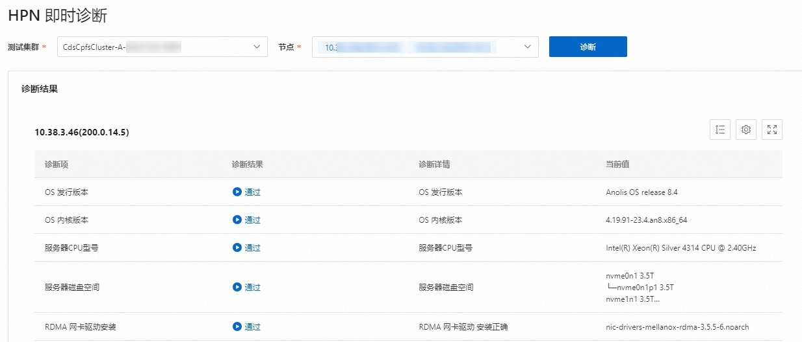

   <table>
     <tr>
       <th width="90">诊断结果</th>
       <th>说明</th>
     </tr>
     <tr>
       <td>诊断项</td>
       <td>展示诊断项信息，包括<strong>OS发型版本</strong>、<strong>OS内核版本</strong>、<strong>服务器CPU型号</strong>、<strong>服务器磁盘空</strong><strong>间</strong>、<strong>RDMA网卡驱动安装</strong>、<strong>RDMA网卡驱动加载</strong>、<strong>bonding模块安装</strong>、<strong>GDR模块安</strong><strong>装</strong>、<strong>GDR模块加载</strong>、<strong>RDMA设备的数量</strong>、<strong>RDMA设备固件版本</strong>、<strong>RDMA设备聚合模</strong><strong>式</strong>、<strong>RDMA设备聚合状态</strong>、<strong>RDMA设备HASH策略</strong>、<strong>RDMA设备端口速率</strong>、<strong>RDMA设备</strong><strong>MTU设置</strong>、<strong>PCIe MRR配置</strong>、<strong>PCIe链路详情</strong>、<strong>PCIe链路速率</strong>、<strong>PCIe链路宽度</strong>、<strong>GPU在线</strong><strong>检查</strong>等。</td>
     </tr>
     <tr>
       <td>诊断结果</td>
       <td>展示诊断项对应的诊断结果，包括<strong>通过</strong>和<strong>失败</strong>两种结果。</td>
     </tr>
     <tr>
       <td>诊断详情</td>
       <td>展示诊断项对应的诊断详情。例如：RDMA设备端口速率一致。</td>
     </tr>
     <tr>
       <td>当前值</td>
       <td>展示诊断项对应的诊断值信息。</td>
     </tr>
   </table>

<a id="section-2-2"></a>

## 2.2. 算力平台网络

<a id="section-2-2-1"></a>

### 2.2.1. CPN一键诊断

指对CPN网络中节点的诊断，展示诊断项、诊断详情以及诊断结果等内容，以帮助管理员更好的理解和管理网络性能与故障问题。

**操作步骤**

1. 登录Apsara Uni-manager运维控制台。

2. 在顶部菜单栏，选择**产品运维** > **网络运维** > **网络运维控制台**。

3. 在左侧导航栏，选择**基础网络 > CPN管理 > CPN一键诊断**。

4. 单击**新建诊断**，创建诊断任务。

   创建诊断任务的参数说明如下表所示。

   <table>
     <tr>
       <th width="89">参数</th>
       <th>参数说明</th>
     </tr>
     <tr>
       <td>任务名称</td>
       <td>诊断任务的任务名称。</td>
     </tr>
     <tr>
       <td>资源池</td>
       <td>默认值为否。指未加入计算集群的裸金属服务器的资源集合。</td>
     </tr>
     <tr>
       <td>集群</td>
       <td>指执行诊断任务的集群。</td>
     </tr>
     <tr>
       <td>组别</td>
       <td>指集群内，根据上联的交换机的segment，对主机进行分组。每个组别上限为100台主机。</td>
     </tr>
     <tr>
       <td>诊断节点</td>
       <td>执行诊断任务的主机节点。</td>
     </tr>
   </table>

   > **说明**
   >
   > 诊断节点支持选择多个。

5. 在弹出的提示框上确认选择参数无误后，单击**确定**。诊断任务会立即开始运行。

**查看诊断分析结果**

1. 登录Apsara Uni-manager运维控制台。

2. 在顶部菜单栏，选择**产品运维** > **网络运维** > **网络运维控制台**。

3. 在左侧导航栏，选择**基础网络 > CPN管理 > CPN一键诊断**。

4. 单击诊断任务**操作**列**详情**。

   | 诊断分析结果 | 说明 |
   | --- | --- |
   | 诊断结果 | 展示该诊断任务所包含的节点的诊断结果。 |
   | 概览视图 | 展示该诊断任务所包含的集群、用例总数、正常数和异常数。 |
   | 详情视图 | 支持按<strong>节点</strong>或<strong>诊断项</strong>维度查询诊断详情。 |

5. 单击**诊断结果**页签，在列表内对应异常列单击**详情**，支持查看**诊断结果详情**。在右侧弹窗**异常项**对应列单击**详情**，支持查看**异常诊断结果详情**。

6. 单击**概览视图**页签，可查看该诊断任务所包含的集群、IP以及用例执行的总数、正常数和异常数。

7. 单击**详情视图**页签，支持按**节点**或**诊断项**维度查询诊断详情，可查看诊断结果、诊断详情、错误信息等内容。

**相关操作**

在**CPN 一键诊断**页面，您还可以进行如下操作。

<table>
  <tr>
    <th width="122">任务名称</th>
    <th>操作步骤</th>
  </tr>
  <tr>
    <td>筛选诊断任务</td>
    <td>• 基础筛选<br>i. 下拉选择<strong>起止时间</strong>或<strong>状态</strong>。ii. 在搜索框中选择时间或状态，会自动筛选出符合条件的诊断任务。<br>• 高级筛选<br>i. 单击<strong>高级筛选</strong>。ii. 设置<strong>起止时间</strong>和<strong>状态</strong>，单击<strong>搜索</strong>。</td>
  </tr>
  <tr>
    <td>重试</td>
    <td>1. 单击诊断任务<strong>操作</strong>列<strong>重试</strong>。<br>2. 在弹出的提示框上单击<strong>确定</strong>。</td>
  </tr>
  <tr>
    <td>删除</td>
    <td>1. 单击诊断任务<strong>操作</strong>列<strong>删除</strong>。<br>2. 在弹出的提示框上单击<strong>确定</strong>。</td>
  </tr>
</table>

<a id="section-2-2-2"></a>

### 2.2.2. CPN性能分析

CPN性能分析是通过测试机器在压力情况下性能的表现，考察当前软硬件所能承受的最大负荷和抗压能力，帮助用户找出机器的压力极限，为运维提供充分的数据依据，以提高网络的性能。

**操作步骤**

1. 登录Apsara Uni-manager运维控制台。

2. 在顶部菜单栏，选择**产品运维** > **网络运维** > **网络运维控制台**。

3. 在左侧导航栏，选择**基础网络 > CPN管理 > CPN性能分析**。

4. 单击**新建测试**，创建分析任务。

   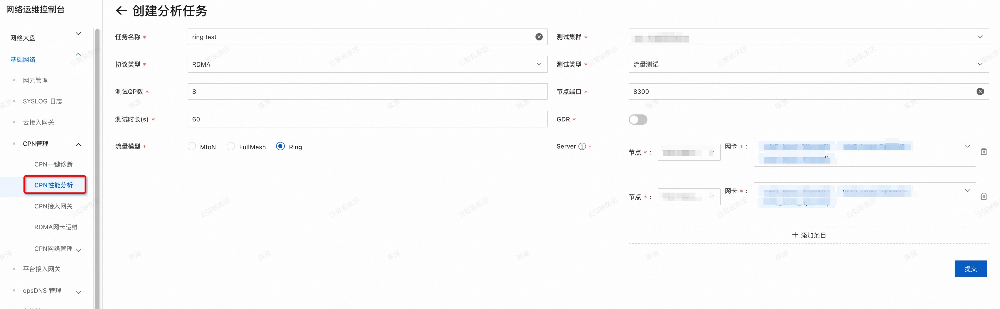

   RDMA创建任务参数的动态组合如下表所示。

   **测试集群**

   **协议类型**

   **测试类型**

   **需要输入的参数**

   **流量模型选中值**

   **节点列表**

   - **Server**

   **MtoN**

   - **Client**

   - **测试QP数**

   - **节点端口**

   **流量测试**

   **FullMesh**

   **Server**

   - **测试时长**

   - **GDR**

   *任意*

   **RDMA**

   **Ring**

   **Server**

   - **节点端口**

     无此参数

   **时延测试**

   **Server**

   - **测试时长**

   RDMA创建任务的参数说明如下表所示。

   <table>
     <tr>
       <th width="107">参数</th>
       <th>参数说明</th>
     </tr>
     <tr>
       <td>测试QP数</td>
       <td>测试进程流的数量，影响测试带宽的大小。<br>• 当QP数不足时，会导致通信队列拥塞，影响数据传输效率和稳定性。<br>• 当QP数过多时，会增加系统的开销、复杂性，以及增加系统故障率。<br>说明QP即Queue Pair，是RDMA网络中的关键概念，用于描述一对端点之间的通信队列。</td>
     </tr>
     <tr>
       <td>节点端口</td>
       <td>测试所使用的端口号。</td>
     </tr>
     <tr>
       <td>测试时长</td>
       <td>本次测试的时长，单位为秒。</td>
     </tr>
     <tr>
       <td>GDR</td>
       <td>是否开启GDR。如果开启GDR，会绑定RDMA网卡与对应的GPU进行流量测试。开启前请先确认机器是否支持，如果不支持请不要开启该选项。</td>
     </tr>
     <tr>
       <td>MtoN</td>
       <td>全称Many to Many，是指多对多的关系模型。即测试<strong>Clients</strong>节点到<strong>Servers</strong>节点的单向连通性，包括单个<strong>Client</strong>节点到单个<strong>Server</strong>节点、多个<strong>Clients</strong>节点到多个<strong>Servers</strong>节点等情况。</td>
     </tr>
     <tr>
       <td>FullMesh</td>
       <td>指网络拓扑结构中所有节点之间互相连接的情况，即测试所有目标节点两两之间的连通性。</td>
     </tr>
     <tr>
       <td>Ring</td>
       <td>指网络中多个节点之间形成一个闭环，数据包从一个节点发送到下一个节点，依次传递，最终回到起始节点，用来检测网络中实际可用带宽。</td>
     </tr>
     <tr>
       <td>Client</td>
       <td>流量测试的发送方。</td>
     </tr>
     <tr>
       <td>Server</td>
       <td>流量测试的接收方。</td>
     </tr>
   </table>

   通讯库创建任务的参数说明如下表所示。

   | 测试集群 | 协议类型 | 测试类型 | 通信库 | 需要输入的参数 |
   | --- | --- | --- | --- | --- |
   | <em>任意</em> | 通讯库 | 通讯库测试 | • NCCL<br>• CPN-CCL<br>• RCCL<br>• PCCL | • <strong>算法</strong>：通信库任务执行的时候选择的算法，不同的算法执行的时候，算法带宽、总线带宽和执行时间都会有区别。<br>• <strong>通信原语</strong>：不同的通信源语数据传输和处理的方式也不同，直接下拉选择。<br>• <strong>超时时间</strong>：如果性能测试的时间大于设置的超时时间加一分钟，则测试任务失败。<br>• <strong>数据类型</strong>：性能分析测试时的数据类型，直接下拉选择。<br>• <strong>迭代次数</strong>：当前任务执行的次数。<br>• <strong>起始字节数</strong>：设置任务开始最小数据量。<br>• <strong>截止字节数</strong>：任务结束的最大数据量。<br>• <strong>步长因子</strong>：一般是大于1的整数，当指定为2的时候，数据规格会按照两倍的关系递增，依次类推，第一行和最后一行分别对应起始字节数和截止字节数。<br>• <strong>主机列表</strong>：单击<strong>添加条目</strong>设置。<br>• <strong>mpirun自定义参数</strong>：用户自定义参数，格式：<code> --mca ... --mca ... </code>，例如：<code> -</code><code>-mca pml ob1 --mca coll ^hcoll --</code><br><code>mca btl tcp,self --mca</code><br><code>btl_tcp_if_include bond0 --mca</code><br><code>oob_tcp_if_include bond0 --bind-to</code> <code>none </code>。<br>• <strong>NCCL参数</strong>：用户自定义设置属性和值。 |

5. 单击**提交**，弹出创建成功的提示。

**相关操作**

在**CPN 性能分析**页面，您还可以执行如下操作。

<table>
  <tr>
    <th width="154">任务名称</th>
    <th>操作步骤</th>
  </tr>
  <tr>
    <td>查询测试任务</td>
    <td>• 基础筛选设置起止时间后，系统自动筛选符合条件的测试任务。<br>• 高级筛选<br>i. 单击<strong>高级筛选</strong>。ii. 设置起止时间，选择测试类型、协议类型和状态。iii. 单击<strong>搜索</strong>。</td>
  </tr>
  <tr>
    <td>查看性能分析详情</td>
    <td>1. 单击任务<strong>操作</strong>列<strong>详情</strong>。<br>2. 支持查看分析任务的基本信息、分析结果和设备信息。</td>
  </tr>
  <tr>
    <td>导出性能分析详情</td>
    <td>说明<strong>测试类型</strong>为<strong>流量测试</strong>和<strong>时延测试</strong>两类的分析任务支持导出功能。<br>1. 单击目标任务<strong>操作</strong>列<strong>详情</strong>。<br>2. 在<strong>分析任务详情</strong>页面，单击<strong>分析结果</strong>右侧<strong>导出</strong>。<br>3. 在本地查看导出的excel文件。</td>
  </tr>
  <tr>
    <td>重试测试任务</td>
    <td>1. 单击任务<strong>操作</strong>列<strong>重试</strong>。<br>2. 在弹出的提示框上单击<strong>确定</strong>，<strong>任务状态</strong>会变成<strong>进行</strong><strong>中</strong>。</td>
  </tr>
  <tr>
    <td>删除测试任务</td>
    <td>1. 单击任务<strong>操作</strong>列<strong>删除</strong>。<br>2. 在弹出的提示框上单击<strong>确定</strong>。</td>
  </tr>
  <tr>
    <td>终止测试任务</td>
    <td>1. 单击任务<strong>操作</strong>列<strong>终止</strong>。<br>2. 在弹出的提示框上单击<strong>确定</strong>，<strong>任务状态</strong>会马上变成<strong>终</strong><strong>止中</strong>。最后<strong>任务状态</strong>变成<strong>已终止</strong>，表示终止成功。</td>
  </tr>
</table>

<a id="section-2-2-3"></a>

### 2.2.3. CPN接入网关

<a id="section-2-2-3-1"></a>

#### 2.2.3.1. RDMA设备管理

本文介绍如何管理RDMA设备，包括扫描、删除等操作。

**操作步骤**

1. 登录Apsara Uni-manager运维控制台。

2. 在顶部菜单栏，选择**产品运维** > **网络运维** > **网络运维控制台**。

3. 在左侧导航栏，选择**基础网络 > CPN管理 > CPN接入网关**。

4. 选择**RDMA设备管理**页签。

5. 管理RDMA设备。

   - 扫描新设备

     单击**扫描新设备**，系统会将新增的RDMA设备录入到系统中。

   - 查询新设备

     - 基础筛选

       <ol type="a">

       <li>

       下拉选择**设备名称**、**设备厂商**、**设备型号**、**设备角色**、**设备管理IP**、**序列号**或**设备状态**。

       </li>

       <li>

       在搜索框中输入对应的设备名称、设备厂商等内容或选择设备状态，单击  。

       </li>

       </ol>

     - 高级筛选

       <ol type="a">

       <li>

       单击**高级筛选**。

       </li>

       <li>

       输入设备名称、设备厂商、设备型号、设备角色、设备管理IP和序列号，选择设备状态。

       </li>

       </ol>

       <ol type="i" start="100">

       <li>

       单击**搜索**。

       </li>

       </ol>

   - 删除新设备

     <ol type="a">

     <li>

     单击**操作**列**删除**。

     </li>

     <li>

     在弹出的提示框上单击**确定**。

     </li>

     </ol>

<a id="section-2-2-3-2"></a>

#### 2.2.3.2. RDMA设备策略管理

本文介绍如何设置RDMA设备的策略，用于统一管理RDMA设备。

**操作步骤**

1. 登录Apsara Uni-manager运维控制台。

2. 在顶部菜单栏，选择**产品运维** > **网络运维** > **网络运维控制台**。

3. 在左侧导航栏，选择**基础网络 > CPN管理 > CPN接入网关**。

4. 选择**RDMA设备策略管理**页签。

5. 单击**创建RDMA设备策略**，参考下表填写参数值。

   <table>
     <tr>
       <th width="119">参数名称</th>
       <th>说明</th>
     </tr>
     <tr>
       <td>策略名称</td>
       <td>设置该策略的名称，用户自定义。</td>
     </tr>
     <tr>
       <td>描述</td>
       <td>非必填，输入该策略的其他描述。</td>
     </tr>
     <tr>
       <td>设备厂商</td>
       <td>下拉选择，系统会自动将<strong>RDMA设备管理</strong>页面的设备厂商统计，然后供用户选择。</td>
     </tr>
     <tr>
       <td>设备角色</td>
       <td>下拉选择适用该策略的设备角色：<br>• <strong>RASW</strong>：是RDMA网络场景下数据交换模块的接入交换机。<br>• <strong>RDSW</strong>：是RDMA网络场景下数据交换模块的核心交换机，用于连接各个接入交换机。<br>• <strong>EHSW</strong>：是RDMA场景下存管网接入交换机。</td>
     </tr>
     <tr>
       <td>设备型号</td>
       <td>系统会自动统计<strong>RDMA设备管理</strong>页面的设备型号，下拉选择适用该策略的设备型号。</td>
     </tr>
     <tr>
       <td>设备列表</td>
       <td>系统会自动统计<strong>RDMA设备管理</strong>页面的设备型号下的所有设备，下拉选择适用该策略的具体设备。</td>
     </tr>
     <tr>
       <td>Headroom</td>
       <td>roce队列数据缓冲区大小，Headroom最大可用的cell资源；请输入全局数据缓冲区的大小。</td>
     </tr>
   </table>

6. 单击**确定**。

**相关操作**

在**RDMA设备策略管理**页面，您还可以执行如下操作。

| 任务名称 | 操作步骤 |
| --- | --- |
| 查询RDMA设备策略 | 1. 下拉选择<strong>设备名称</strong>、<strong>设备厂商</strong>、<strong>设备型号</strong>、<strong>设备角色</strong>、<strong>设备管理IP</strong>、<strong>序列号</strong>或<strong>设备状</strong><strong>态</strong>。<br>2. 在搜索框中输入设备名称、设备厂商、设备型号、设备角色、设备管理IP、序列号或设<br>备状态，单击。 |
| 查看RDMA设备策略详情 | 1. 单击<strong>操作</strong>列<strong>详情</strong>。<br>2. 查看完成后单击<strong>确定</strong>或<strong>取消</strong>。 |
| 重试RDMA设备策略 | 1. 单击<strong>操作</strong>列<strong>重试</strong>。<br>2. 在弹出的提示框上单击<strong>确定</strong>。 |

<a id="section-2-2-3-3"></a>

#### 2.2.3.3. RDMA设备接口策略管理

本文介绍如何配置接口的策略，包括查询、重试等操作。

**操作步骤**

1. 登录Apsara Uni-manager运维控制台。

2. 在顶部菜单栏，选择**产品运维** > **网络运维** > **网络运维控制台**。

3. 在左侧导航栏，选择**基础网络 > CPN管理 > CPN接入网关**。

4. 选择**RDMA设备接口策略管理**页签。

5. 单击**创建RDMA设备接口策略**，参考下表填写参数值。

   | 参数名称 | 说明 |
   | --- | --- |
   | 策略名称 | 设置该策略的名称，用户自定义。 |
   | 描述 | 非必填，输入该策略的其他描述。 |
   | 设备厂商 | 下拉选择，系统会自动将<strong>RDMA设备管理</strong>页面的设备厂商统计，然后供用户选择。 |
   | 设备角色 | 下拉选择适用该策略的设备角色：<br>• <strong>RASW</strong>：是RDMA网络场景下数据交换模块的接入交换机。<br>• <strong>RDSW</strong>：是RDMA网络场景下数据交换模块的核心交换机，用于连接各个接入交换机。<br>• <strong>EHSW</strong>：是RDMA场景下存管网接入交换机。 |
   | 设备型号 | 系统会自动统计<strong>RDMA设备管理</strong>页面的设备型号，下拉选择适用该策略的设备型号。 |
   | 设备列表 | 系统会自动统计<strong>RDMA设备管理</strong>页面的设备型号下的所有设备，下拉选择适用该策略的具体设备。 |
   | RoCE队列PFC配<strong>置</strong>（RDMA over Converged Ethernet） | • <strong>Headroom 缓存门限</strong>：roce队列数据缓冲区大小，Headroom最大可用的cell资源。<br>• <strong>反压帧触发门限</strong>：分析网络流量模型，确保所有入接口的反压帧触发门限之和不大于出接口的尾丢弃门限值。<br>• <strong>反压帧停止门限与触发门限间的偏移量</strong>：当某802.1p优先级报文使用的cell资源减少了一个固定值时，停止发送PFC PAUSE帧，使对端设备恢复流量发送。<br>• <strong>PFC 预留门限</strong>：Guaranteed存储空间中为某802.1p优先级报文预留的cell资源。<br>• <strong>PFC功能</strong>：通过使用PFC功能，使得某种类型的流量拥塞不会影响其他类型流量的正常转发，从而达到同一链路上不同类型的报文互不影响。<br>• <strong>死锁监测功能</strong>：当发生链路故障或设备故障时，路由重新收敛期间可能会出现短暂环路。此时 ，设备间反复发送和接收PFC帧，报文无法转发，接口缓冲区的cell资源一直被占用无法释放，设备进入PFC死锁状态。 |

   <table>
     <tr>
       <td>RoCE队列WRED配置</td>
       <td>• <strong>ECN功能</strong>：ECN功能利用IP报文头中的DS域来标记报文传输路径上的拥塞状态。支持该功能的终端设备可以通过报文内容判断出传输路径上发生了拥塞，从而调整报文的发送方式，避免拥塞加剧。<br>• <strong>队列平均长度的下限</strong>：当转发设备的报文在出方向进入队列排队，该队列的长度下限（也称为ECN门限）。<br>• <strong>队列平均长度的上限</strong>：当转发设备的报文在出方向进入队列排队，该队列的长度上限（也称为ECN门限）。<br>• <strong>丢弃概率</strong>：在使用了ECN后，代表的是标记概率，该值越大，表示在上下限门限之间被标记的报文数越多。<br>说明<br>• 当转发设备的报文在出方向进入队列排队，该队列的长度小于下限（也称为ECN门限）时，不对报文进行任何处理，转发设备直接将报文从出接口转发。<br>• 当转发设备的报文在出方向进入队列排队，该队列的长度大于下限但小于上限时：<br>• 如果设备接收到的报文中ECN域取值为00，表示报文发送端不支持ECN功能，转发设备按照丢弃概率计算是否丢弃该接收的报文。<br>• 如果设备接收到的报文中ECN域取值为01或者10，表示报文发送端支持ECN功能， 将按照丢弃概率来修改部分入方向报文的ECN域为11后继续转发该报文，所有入方向接收到的报文均不丢弃。<br>• 如果设备接收到的报文中ECN域取值为11，表示该报文在之前的转发设备上已经出现拥塞，此时转发设备不处理报文，直接将报文从出接口转发。<br>• 当转发设备的报文在出方向进入队列排队，该队列的长度大于上限时：<br>• 如果设备接收到的报文中ECN域取值为00，表示报文发送端不支持ECN功能，转发设备丢弃接收的报文。<br>• 如果设备接收到的报文中ECN域取值为01或者10，表示报文发送端支持ECN功能，将入方向报文的ECN域修改为11后继续转发该报文，所有入方向接收到的报文均不丢弃。<br>• 如果设备接收到的报文中ECN域取值为11，表示该报文在之前的转发设备上已经出现拥塞，此时转发设备不处理报文，直接将报文从出接口转发。</td>
     </tr>
   </table>

6. 单击**确定**。

**相关操作**

在**RDMA设备接口策略管理**页面，您还可以执行如下操作。

| 任务名称 | 操作步骤 |
| --- | --- |
| 查询RDMA设备接口策略 | 1. 下拉选择<strong>策略名称</strong>、<strong>设备厂商</strong>、<strong>设备型号</strong>、<strong>设备角色</strong>或<strong>设备管理IP</strong>。<br>2. 在搜索框中输入策略名称、设备厂商、设备型号、设备角色或设备管理IP，单击。 |
| 查看RDMA设备接口策略详情 | 1. 单击<strong>操作</strong>列<strong>详情</strong>。<br>2. 查看完成后单击<strong>确定</strong>或<strong>取消</strong>。 |
| 重试RDMA设备接口策略 | 1. 单击<strong>操作</strong>列<strong>重试</strong>。<br>2. 在弹出的提示框上单击<strong>确定</strong>。 |

<a id="section-2-2-4"></a>

### 2.2.4. RDMA网卡运维

RDMA网卡运维是通过性能监控，定期检查RDMA网卡的性能指标，以便及时发现问题，快速排查并解决问题，保证网络稳定性和可靠性。

**相关概念**

<strong>RDMA（</strong>Remote Direct Memory Access<strong>）</strong>：全称远程直接数据存取，是一种高速网络技术，为了解决网络传输中服务器端数据处理的延迟而产生的。RDMA通过网络将资料直接传入计算机的存储区，把数据从一个系统快速移动到远程系统存储器中，实现了主机之间直接访问内存，但不对操作系统造成任何的影响，提高了数据传输速度、降低了CPU负载。

**操作步骤**

1. 登录Apsara Uni-manager运维控制台。

2. 在顶部菜单栏，选择**产品运维** > **网络运维** > **网络运维控制台**。

3. 在左侧导航栏，选择**基础网络 > CPN管理 > RDMA网卡运维**。

4. 在页面右上角选择**数据源**和**集群**，目前数据源仅支持CPN。

5. 在**集群**页签，查看集群维度的监控信息。

   

   | 区域 | 说明 |
   | --- | --- |
   | 平均QP数 | 在RDMA网络中，平均拥有的QP数量。当数据源选择PAI时，无此参数项。<br>• 当QP数不足时，会导致通信队列拥塞，影响数据传输效率和稳定性。<br>• 当QP数过多时，会增加系统的开销、复杂性，以及增加系统的故障率。<br>说明QP即Queue Pair，是RDMA网络中的关键概念，用于描述一对端点之间的通信队列。 |
   | 网络状态异常数 | 在RDMA网络中，网络设备或流量出现异常的次数。 |
   | RDMA平均发送吞吐（Mbps） | 在RDMA网络中，单位时间内网络中所有节点的平均发送数据吞吐量。 |
   | RDMA平均接受吞吐（Mbps） | 在RDMA网络中，单位时间内网络中所有节点的平均接收数据吞吐量。 |
   | 监控图表 | i. 在监控图表右侧选择起止时间，查看时间区间内的监控数据。ii. 在<strong>吞吐大盘</strong>区域，查看时间区间内RDMA_TX_BYTES和RDMA_RX_BYTES数据。<br>• RDMA_TX_BYTES是指RDMA网络中发送数据时所传输的字节数量。<br>• RDMA_RX_BYTES是指RDMA网络中接收数据时所接收的字节数量。iii. 在<strong>RDMA网络基础数据</strong>显示区域，查看时间区间内以下数据。<br>• <strong>RDMA_IGNORE_CNP_AVG</strong>：指RDMA网络中平均忽略CNP数据包的数量。<br>说明CNP（Congestion Notification Packet）数据包是用于网络拥塞控制的数据包。当网络出现拥塞时会发送CNP数据包通知发送方减少发送速率，避免网络拥塞和数据包丢失。<br>• <strong>RDMA_TX_PFC_PAUSE_AVG</strong>：指RDMA网络中发送数据时平均PFC数据包的数量。<br>• <strong>RDMA_RX_PFC_PAUSE_AVG</strong>：指RDMA网络中接收数据时平均PFC数据包的数量。<br>• <strong>RDMA_OOB_AVG</strong>：指RDMA网络中处理OOB数据的平均个数。<br>说明OOB（Out-of-Band）数据是RDMA网络中传输的一种特殊类型的数据。<br>• <strong>RDMA_OOS_AVG</strong>：指RDMA网络中处理OOS数据的平均个数。<br>说明OOS（ Out-of-Order）数据是RDMA网络中传输的一种特殊类型的数据。当数据包在传输时发生丢失、延迟等情况就会出现OOS数据。<br>• <strong>RDMA_SENT_CNP_AVG</strong>：指RDMA网络中发送CNP数据包的平均个数。<br>• <strong>RDMA_MARKED_ECN_AVG</strong>：指RDMA网络中标记平均ECN数据包的数量。<br>• <strong>RDMA_HANDLE_CNP_AVG</strong>：指RDMA网络中处理CNP数据包的平均个数。<br>• <strong>RDMA_TX_PFC_TRANS_AVG</strong>：指RDMA网络中发送数据时平均切换PFC数据包的数量。<br>• <strong>RDMA_QP_CNT_AVG</strong>：指RDMA网络中QP平均个数。<br>• <strong>RDMA_TX_BYTES_AVG</strong>：指RDMA网络中发送数据的平均字节数。<br>• <strong>RDMA_RX_BYTES_AVG</strong>：指RDMA网络中接收数据的平均字节数。 |
   | RDMA网络总览表 | 查看RDMA网络中节点列表，包括<strong>节点</strong>、<strong>发送吞吐</strong>、<strong>接收吞吐</strong>、<strong>网络QP数</strong>、<strong>网络处理</strong><strong>CNP数</strong>、<strong>数据报文乱序</strong>、<strong>网络缓冲区溢出</strong>等数据。 |

6. 在**节点**页签，查看节点维度的监控信息。

   

   <table>
     <tr>
       <th>参数</th>
       <th>说明</th>
     </tr>
     <tr>
       <td>RDMA网络QP数</td>
       <td rowspan="5">以节点的维度，展示相关监控数据信息，具体参数说明请参见集群维度描述。</td>
     </tr>
     <tr>
       <td>网络状态异常数</td>
     </tr>
     <tr>
       <td>RDMA网络发送吞吐 ( Mbps )</td>
     </tr>
     <tr>
       <td>RDMA网络接收吞吐 ( Mbps )</td>
     </tr>
     <tr>
       <td>监控图表</td>
     </tr>
   </table>

<a id="section-2-2-5"></a>

### 2.2.5. CPN网络管理

<a id="section-2-2-5-1"></a>

#### 2.2.5.1. CPN拓扑

以集群和节点的维度查询并展示拓扑信息。

**操作步骤**

1. 登录Apsara Uni-manager运维控制台。

2. 在顶部菜单栏，选择**产品运维** > **网络运维** > **网络运维控制台**。

3. 在左侧导航栏，选择**基础网络 > CPN管理 > CPN网络管理 > CPN拓扑**。

4. 在页面左上角选择**集群**和**节点**。

5. 单击**查询**，即可查看拓扑信息。

   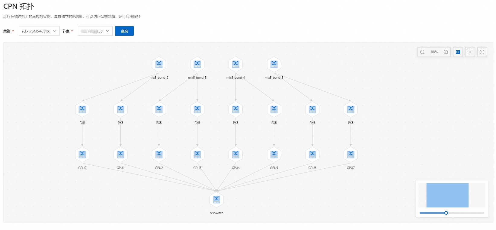

**相关操作**

拓扑图展示成功后，您还可以执行如下操作。

| 任务名称 | 操作步骤 |
| --- | --- |
| 放大/缩小拓扑图 | 单击拓扑图右上角或，可放大或缩小拓扑图。 |
| 重置拓扑图画布 | 单击拓扑图右上角，可重置画布。 |
| 全屏显示拓扑图 | 1. 单击拓扑图右上角，可全屏显示拓扑图。<br>2. 单击右上角，退出全屏显示。 |

<a id="section-2-2-5-2"></a>

#### 2.2.5.2. CPN网元

本文介绍如何查看云平台中网络设备资产与监控运维信息。

**操作步骤**

1. 登录Apsara Uni-manager运维控制台。

2. 在顶部菜单栏，选择**产品运维** > **网络运维** > **网络运维控制台**。

3. 在左侧导航栏，选择**基础网络 > CPN管理 > CPN网络管理 > CPN网元**。

4. 下拉选择机房后，在**网元名称**搜索框中输入网元名称。

5. 单击网元名称或**操作**列**详情**，进入到网元详情页面。

   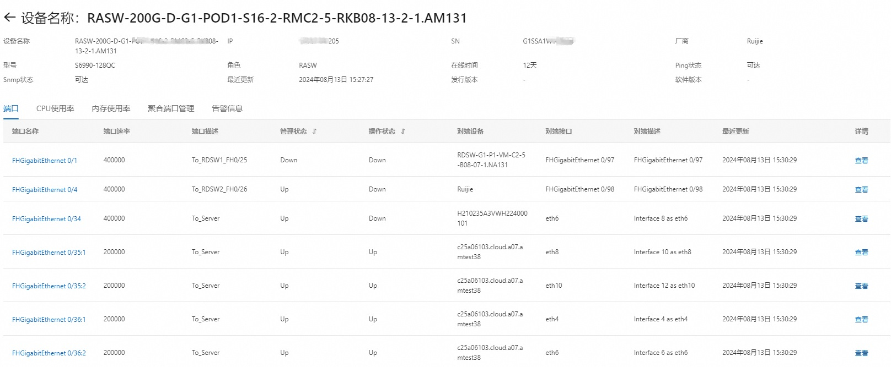

   <table>
     <tr>
       <th width="121">页签名称</th>
       <th>说明</th>
     </tr>
     <tr>
       <td>端口</td>
       <td>展示该网元设备的端口信息，单击端口名称或<strong>操作</strong>列<strong>查看</strong>，可以查看该端口的水位数据。</td>
     </tr>
     <tr>
       <td>CPU使用率</td>
       <td>展示该网元设备的CPU使用率。</td>
     </tr>
     <tr>
       <td>内存使用率</td>
       <td>展示该网元设备的内存使用率。</td>
     </tr>
     <tr>
       <td>聚合端口管理</td>
       <td>展示该网元设备的聚合端口信息，单击<strong>操作</strong>列<strong>查看</strong>，可以查看对应端口的流量。</td>
     </tr>
     <tr>
       <td>告警信息</td>
       <td>展示该网元设备的告警信息。</td>
     </tr>
   </table>

**相关操作**

在**CPN 网元**页面，您还可以执行如下操作。

| 任务名称 | 操作步骤 |
| --- | --- |
| 删除CPN网元 | 1. 单击<strong>操作</strong>列<strong>删除</strong>。<br>2. 在弹出的提示框上单击<strong>确定</strong>。 |

<a id="section-2-2-6"></a>

### 2.2.6. CPN网络监控

<a id="section-2-2-6-1"></a>

#### 2.2.6.1. CPN主机监控大盘

主要用于监控智能计算网络服务器端的RDMA网络相关关键指标，包括带宽、丢包率及流量控制等。

**操作步骤**

1. 登录Apsara Uni-manager运维控制台。

2. 在顶部菜单栏，选择**产品运维** > **网络运维** > **网络运维控制台**。

3. 在左侧导航栏，选择**基础网络 > CPN管理 > CPN网络监控 > CPN主机监控大盘**。

4. 在页面右上角单击**变量筛选**，选择相应的**Cluster**和**Host**，单击**确定**。

5. 在**CPN主机监控大盘**页面，可监控包括**网络情况概览**、**端侧拥塞丢包**、**网卡RDMA丢包**、**网卡RDMA通信QP数量&网卡状态**、**网络拥塞指标**、**网络物理吞吐**、**网卡队列吞吐**在内的性能指标，单击每条指标前

   的  可查看其详情。

   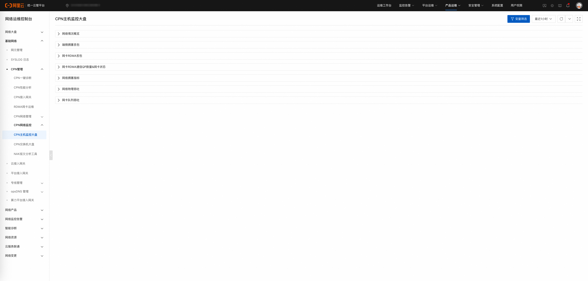

<a id="section-2-2-6-2"></a>

#### 2.2.6.2. CPN交换机大盘

主要用于监控智能计算相关交换机的运行状态，包括带宽、丢包和流量控制等指标。

**操作步骤**

1. 登录Apsara Uni-manager运维控制台。

2. 在顶部菜单栏，选择**产品运维** > **网络运维** > **网络运维控制台**。

3. 在左侧导航栏，选择**基础网络 > CPN管理 > CPN网络监控 > CPN交换机大盘**。

4. 在页面右上角单击**变量筛选**，选择相应的**idc**和**host**，单击**确定**。

5. 在**CPN交换机大盘**页面，可监控包括**网络情况概览**、**锐捷异常指标Top50**、**华三异常指标Top50**、**队**

   **列指标**、**端口指标**、**告警情况**、**日志**在内的性能指标，单击每条指标前的  可查看其详情。

   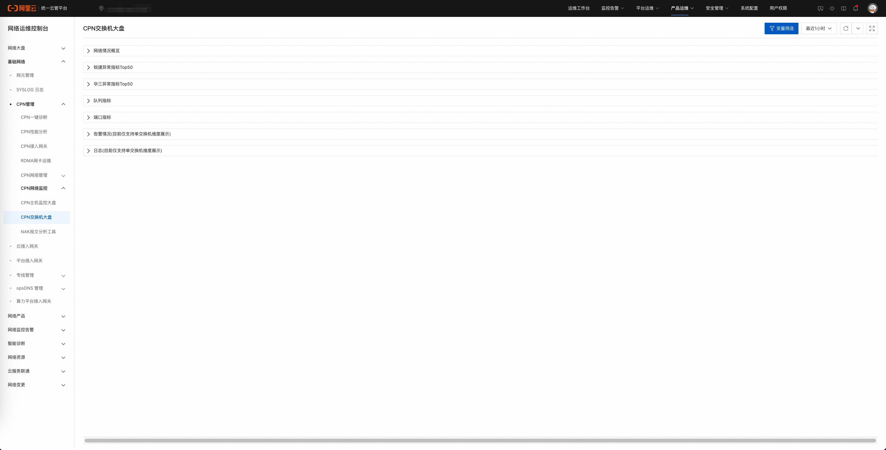

<a id="section-2-2-6-3"></a>

#### 2.2.6.3. NAK报文分析工具

NAK报文分析工具：该工具通过实时采集网络中的NAK报文，经过聚合分析，生成矩阵图，快速识别异常节点。

**操作步骤**

1. 登录Apsara Uni-manager运维控制台。

2. 在顶部菜单栏，选择**产品运维** > **网络运维** > **网络运维控制台**。

3. 在左侧导航栏，选择**基础网络 > CPN管理 > CPN网络监控 > NAK报文分析工具**。

4. 在页面右上角单击**变量筛选**，选择相应的**网络集群**、**源设备组**和**目的设备组**，单击**确定**。

5. 在**NAK报文分析工具**界面，可选择查看相应的**网络集群级别NAK大盘**、**设备组级别NAK大盘**，单击每条

   指标前的  可查看其详情。

   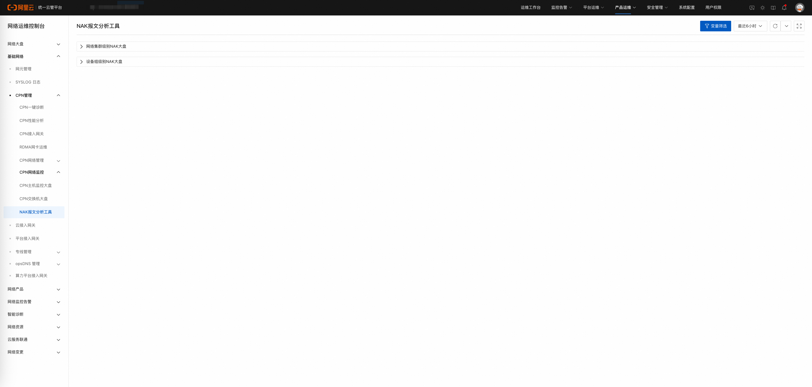

<a id="section-2-2-6-4"></a>

#### 2.2.6.4. 高精度监控大盘

CPN主机侧秒级指标高精度监控大盘，提供网卡设备和bond设备的流量监控。

**操作步骤**

1. 登录Apsara Uni-manager运维控制台。

2. 在顶部菜单栏，选择**产品运维** > **网络运维** > **网络运维控制台**。

3. 在左侧导航栏，选择**基础网络 > CPN管理 > CPN网络监控 > 高精度监控大盘**。

4. 在页面上方选择**高精度监控集群**和**节点**，点击开启高精度任务。

5. 在弹窗内设置任务**持续时长(s)**（范围1-600，默认值为300），单击**确认**。

6. 在页面右上方下拉列表选择监控起止时间，单击**确认**。

7. 在页面右上方单击刷新按钮或设置自动刷新时间，查看最新的监控数据。

> **说明**
>
> 当已选节点中，任意一个处于开启状态时，禁止再次开启任务，直到任务持续时间结束。

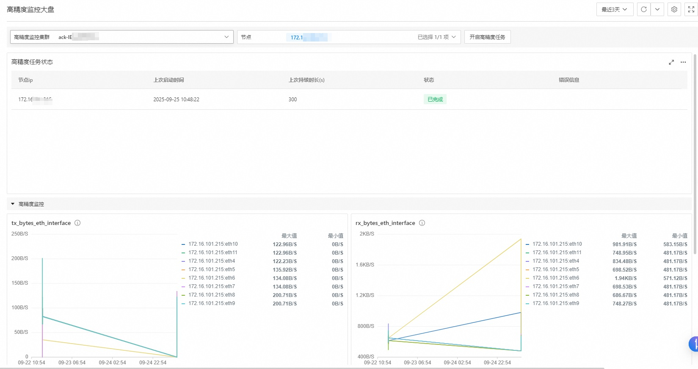

<a id="section-2-2-6-5"></a>

#### 2.2.6.5. 交换机高精度大盘

CPN交换机侧秒级指标高精度监控大盘，提供交换机设备的流量监控。

**操作步骤**

1. 登录Apsara Uni-manager运维控制台。

2. 在顶部菜单栏，选择**产品运维** > **网络运维** > **网络运维控制台**。

3. 在左侧导航栏，选择**基础网络 > CPN管理 > CPN网络监控 > 交换机高精度监控大盘**。

4. 在页面上方选择相关参数，点击**开启高精度任务**。

   创建高精度监控任务的参数说明如下表所示。

   | 参数 | 参数说明 |
   | --- | --- |
   | idc | 进行高精度监控任务的idc。 |
   | 交换机 | 进行高精度监控任务的交换机。 |
   | 端口 | 指执行诊断任务的端口。 |
   | 队列 | 交换机端口的队列，0~7。 |

5. 在弹窗内设置任务**持续时长(s)**（范围1-600，默认值为300）和**任务类型**，单击**确认**。

   > **说明**
   >
   > 任务类型为选择监控任务的监控对象。如未选择相应的监控对象，在下方卡片中将不显示相关数据。

6. 在页面右上方下拉列表选择监控起止时间，单击**确认**。

7. 在页面右上方单击刷新按钮或设置自动刷新时间，查看最新的监控数据。

> **说明**
>
> 当已选节点中，任意一个处于开启状态时，禁止再次开启任务，直到任务持续时间结束。

<a id="section-2-2-6-6"></a>

#### 2.2.6.6. job维度监控

CPN提供基于job维度的监控功能，包括主机TopN指标、端侧拥塞丢包、网卡RDMA丢包等指标的监控。

**前提条件**

查看job维度监控前，请确认已经在AI Studio的任务建模中创建相关任务。

**操作步骤**

1. 登录Apsara Uni-manager运维控制台。

2. 在顶部菜单栏，选择**产品运维** > **网络运维** > **网络运维控制台**。

3. 在左侧导航栏，选择**基础网络 > CPN管理 > CPN网络监控 > job维度监控**。

4. 在**job维度监控**页面顶部，单击右上角的**展开更多**，点击下拉菜单来选择指定的**idc**、**Cluster**、**JobType**、 **TrainJobId**、**Tips**、 **hostIps**、 **swNames**。

5. 选择完成后，下方面板会加载相应监控数据，可查看监控指标包括**主机TopN指标**、**端侧拥塞丢包**、**网卡RDMA丢包**、**网卡RDMA通信QP数量&网卡状态**、**网络拥塞指标**、**网络物理吞吐**、**网卡队列吞吐**、**交换机TopN指标**、**锐捷异常指标Top50**、**华三异常指标Top50**、**交换机队列指标**、**交换机端口指标**。点击

   每个面板前  ，可折叠或展开相应面板。

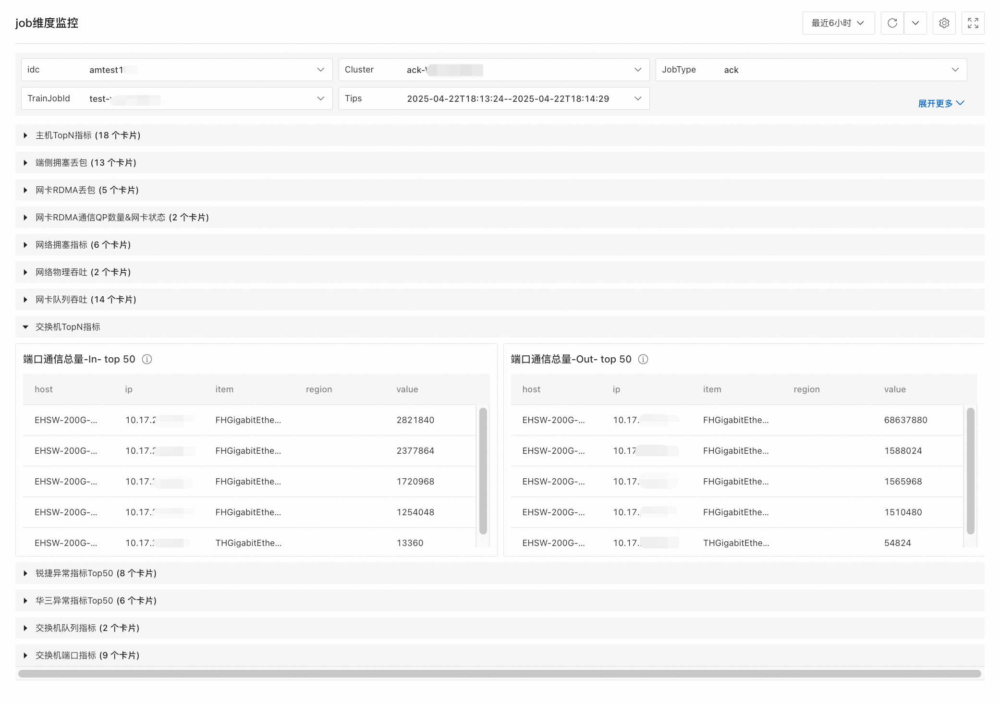

<a id="section-2-2-6-7"></a>

#### 2.2.6.7. CPN流监控

CPN支持全局流量可观测功能，包括通信关系可视化、通信路径可视化、通信质量可视化、拥塞发生时影响的流可视化。

**前提条件**

CPN基于流的可视化功能默认关闭，使用前需确保cpn-lsgo数据库开关已打开。具体操作如下：

```sql
update config_detail_info set config_value='on' where config_key in 
('tracing_open','cpn_gtp','cpn_gto','cpn_gts','asnet-cpn-lsgo-agent');
```

数据库开关打开后，需要重启服务。

**操作步骤**

1. 登录Apsara Uni-manager运维控制台。

2. 在顶部菜单栏，选择**产品运维** > **网络运维** > **网络运维控制台**。

3. 在左侧导航栏，选择**基础网络 > CPN管理 > CPN网络监控 > CPN流监控**。

4. 在**主机**页签，查看主机维度的流量监控信息。

   - 高级筛选：支持根据**集群名**、**源NC管理口ip**、**源nic**、**目的NC管理口ip**、**目的nic**、**时间**进行筛选查看流列表。

   - 查看流详情：单击**操作**列**详情**，可以查看**流变化事件**、**路径变化事件**、**RTT趋势**等详情信息。

   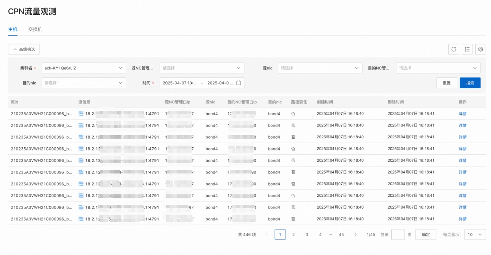

   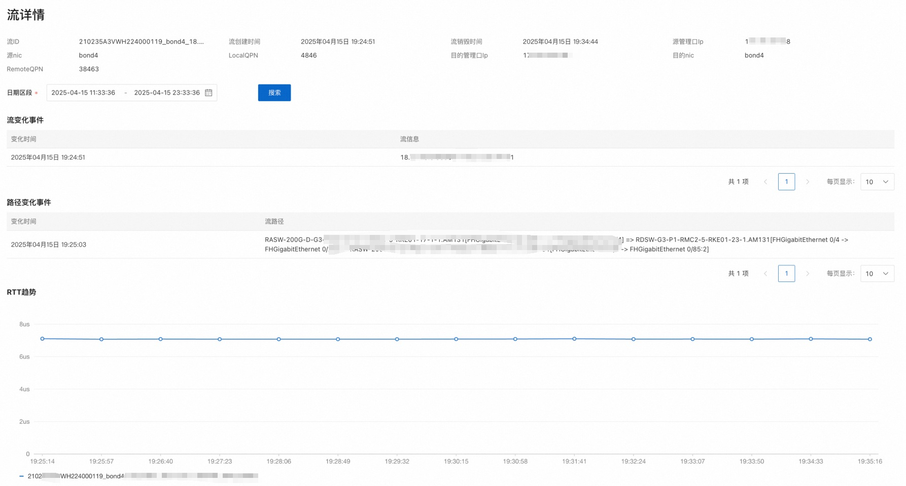

5. 在**交换机**页签，查看交换机维度的流量监控信息。

   - 高级筛选：支持根据**本端设备**、**类型**、**本端设备端口**、**对端设备**、**时间**进行筛选查看流列表。

   - 查看流详情

     <ol type="a">

     <li>

     单击**操作**列**详情**，可以查看端口负载的流列表。

     </li>

     <li>

     在**流列表**界面，单击**操作**列**详情**，可以查看指定流的**流变化事件**、**路径变化事件**、**RTT趋势**等详情信息。

     </li>

     </ol>

   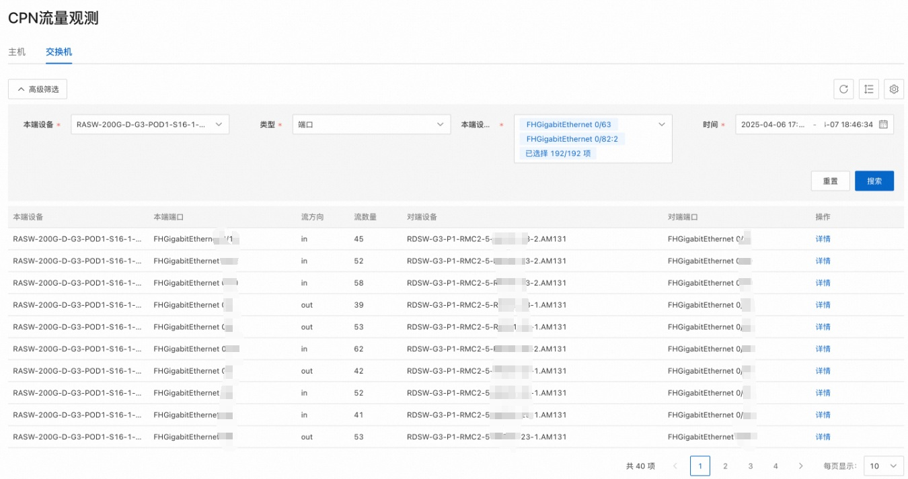

   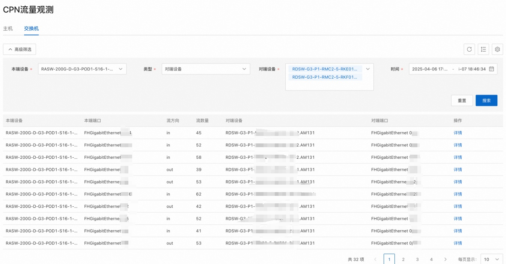

   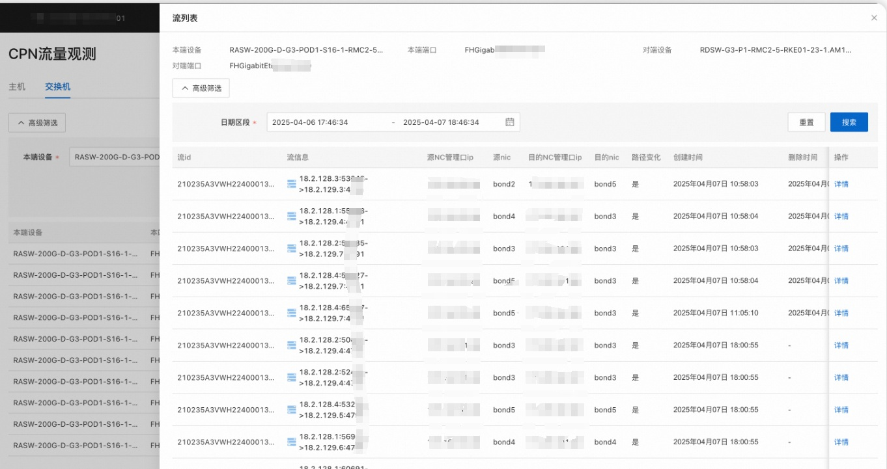

   

<a id="section-2-3"></a>

## 2.3. 云接入网关

客户裸机是通过云接入网关（专用HSW设备）接入VPC，实现客户裸机资源的统一管理的。系统提供实例管理、操作历史记录、裸机VPC网络管理、裸机专线网络管理、运维配置等操作，以完成云接入网关的日常运维工作。

> **说明**
>
> 此功能默认不展示，如果需要使用本功能，在**用户权限** > **菜单管理**下编辑菜单项，进行**展示**操作。

**实例管理**

在实例管理页面，将新增云接入网关设备纳管到云平台进行统一管理。并查看当前系统中云接入网关实例的汇总信息。

**显示设备列表**

1. 登录Apsara Uni-manager运维控制台。

2. 在顶部菜单栏，选择**产品运维** > **网络运维** > **网络运维控制台**。

3. 在左侧导航栏，选择**基础网络** > **云接入网关**。

4. 单击**实例管理**页签下的**显示设备列表**，查看实例详情。

   <table>
     <tr>
       <th width="137">名称</th>
       <th>说明</th>
     </tr>
     <tr>
       <td>云接入网关名称</td>
       <td>云接入网关的名称。</td>
     </tr>
     <tr>
       <td>IBGP角色</td>
       <td>云接入网关在环境中担任的角色。</td>
     </tr>
     <tr>
       <td>管理IP</td>
       <td>云接入网关的IP地址。</td>
     </tr>
     <tr>
       <td>厂商</td>
       <td>云接入网关设备的厂商。</td>
     </tr>
     <tr>
       <td>型号</td>
       <td>云接入网关设备的型号。</td>
     </tr>
     <tr>
       <td>管理状态</td>
       <td>云接入网关的初始化状态。<br>• 未初始化<br>• 初始化中<br>• 初始化成功</td>
     </tr>
     <tr>
       <td>授权状态</td>
       <td>云接入网关的授权状态。<br>• 未授权<br>• 已授权<br>说明使用云接入网关设备，需要在朱雀规划中规划云接入网关licnese数量。如果朱雀规划云接入网关license数量比实际云接入网关少的时候，缺少license授权，设备状态则为未授权状态，需要扩容云接入网关license数量。</td>
     </tr>
     <tr>
       <td>创建时间</td>
       <td>云接入网关创建的时间。</td>
     </tr>
   </table>

**扫描新设备**

1. 登录Apsara Uni-manager运维控制台。

2. 在顶部菜单栏，选择**产品运维** > **网络运维** > **网络运维控制台**。

3. 在左侧导航栏，选择**基础网络** > **云接入网关**。

4. 单击**实例管理**页签下**扫描新设备**。

   - 选择**扫描堆叠组网设备**页签，列表显示**云接入网关名称**、**管理IP**、**IBGP角色**、**厂商**、**型号**等。执行以下步骤可以通过纳管设置设备对应的IBGP角色。

     <ol type="a">

     <li>

     单击目标设备**操作**列的**纳管**。

     或者勾选多个目标设备，单击列表下方的**批量纳管**。

     </li>

     <li>

     在**IBGP角色**列的下拉列表中选择需要设置的IBGP角色。

     IBGP角色表示云接入网关在环境中担任的角色。支持Client、Client和RR合一、独立RR。

     - **Client**：表示当前云接入网关做为IBGP邻居的客户端角色，只做服务器接入。

     - **Client和RR合一**：表示当前云接入网关既做为IBGP邻居的RR角色反射路由，也做服务器接入。

     - **独立RR**：表示当前云接入网关只做IBGP邻居的RR角色反射路由，不做服务器接入。

     > **重要**
     >
     > IBGP角色组网配置要求如下所示：
     >
     > - 单机房部署：至少部署一组云接入网关IBGP角色为RR角色，其余设备IBGP角色为Client。
     >
     > - 多机房部署：至少有两个机房各部署一组云接入网关角色为RR角色，其余设备IBGP角色为Client。
     >
     > - RR角色推荐如下所示：
     >
     >   - 默认RR角色推荐：Client和RR合一。
     >
     >   - 对于网络稳定性要求特别高的需求推荐RR角色选择独立RR。

     </li>

     </ol>

     <ol type="i" start="100">

     <li>

     单击**确定**。

     </li>

     </ol>

   - 选择**扫描去堆叠组网设备**页签，列表显示**云接入网关名称1**、**管理IP1**、**云接入网关名称2**、**管理IP2**、**IBGP角色**、**厂商**、**型号**等。执行以下步骤可以通过纳管设置设备对应的IBGP角色。

     <ol type="a">

     <li>

     单击目标设备**操作**列的**纳管**。

     或者勾选多个目标设备，单击列表下方的**批量纳管**。

     </li>

     <li>

     在**IBGP角色**列的下拉列表中选择需要设置的IBGP角色。

     IBGP角色表示云接入网关在环境中担任的角色。支持Client、Client和RR合一、独立RR。

     - **Client**：表示当前云接入网关做为IBGP邻居的客户端角色，只做服务器接入。

     - **Client和RR合一**：表示当前云接入网关既做为IBGP邻居的RR角色反射路由，也做服务器接入。

     - **独立RR**：表示当前云接入网关只做IBGP邻居的RR角色反射路由，不做服务器接入。

     > **重要**
     >
     > IBGP角色组网配置要求如下所示：
     >
     > - 单机房部署：至少部署一组云接入网关IBGP角色为RR角色，其余设备IBGP角色为Client。
     >
     > - 多机房部署：至少有两个机房各部署一组云接入网关角色为RR角色，其余设备IBGP角色为Client。
     >
     > - RR角色推荐如下所示：
     >
     >   - 默认RR角色推荐：Client和RR合一。
     >
     >   - 对于网络稳定性要求特别高的需求推荐RR角色选择独立RR。

     </li>

     </ol>

     <ol type="i" start="100">

     <li>

     单击**确定**。

     </li>

     </ol>

**操作历史记录**

根据运维需要，查看云接入网关提供的被裸机管控和运维控制台调用的API记录和结果。

1. 登录Apsara Uni-manager运维控制台。

2. 在顶部菜单栏，选择**产品运维** > **网络运维** > **网络运维控制台**。

3. 在左侧导航栏，选择**基础网络** > **云接入网关**。

4. 单击**操作历史记录**页签，查看操作历史记录。

   单击**高级筛选**，可以根据**起止时间**、**裸机名称**、**VPC ID**、**vSwitch ID**、**VBR ID**、**BD ID**以及**云接入网关名称**组合筛选获取目标操作历史纪律。

   <table>
     <tr>
       <th width="137">字段</th>
       <th>说明</th>
     </tr>
     <tr>
       <td>ID</td>
       <td>当前API操作的操作记录索引。</td>
     </tr>
     <tr>
       <td>裸机名称</td>
       <td>VPC内申请或者释放裸机时的裸机名称。</td>
     </tr>
     <tr>
       <td>创建时间</td>
       <td>当前API操作发生的时间。</td>
     </tr>
     <tr>
       <td>API操作</td>
       <td>API操作的类别。例如：VPC内申请裸机、VPC内释放裸机等。<br>• <strong>add</strong>：表示VPC内申请裸机。<br>• <strong>del</strong>：表示VPC内释放裸机。<br>• <strong>del_pc </strong>：表示删除物理专线。<br>• <strong>del_vbr</strong>：表示删除虚拟路由器接口。<br>• <strong>del_router_intf </strong>：表示删除路由器接口。<br>• <strong>del_route_entry </strong>：表示删除路由表项。</td>
     </tr>
     <tr>
       <td>vSwitch ID</td>
       <td>VPC内申请或者释放裸机时专用的Vswitch ID。</td>
     </tr>
     <tr>
       <td>云接入网关名称</td>
       <td>当前API操作涉及的云接入网关的名称。</td>
     </tr>
     <tr>
       <td>端口</td>
       <td>裸机所属的端口信息。</td>
     </tr>
     <tr>
       <td>状态</td>
       <td>API操作的状态。<br>• <strong>success</strong>表示操作成功。<br>• 如果当前API正在执行，则该值表示为当前的API状态实时值。<br>• 如果当前API已完成但不是<strong>success</strong>，则该值表示API失败的信息。如create vpc connection fail。</td>
     </tr>
   </table>

5. 单击目标操作历史记录对应**操作**列的**详情**，查看更多详细信息。如地域ID、发起方、返回码等。

   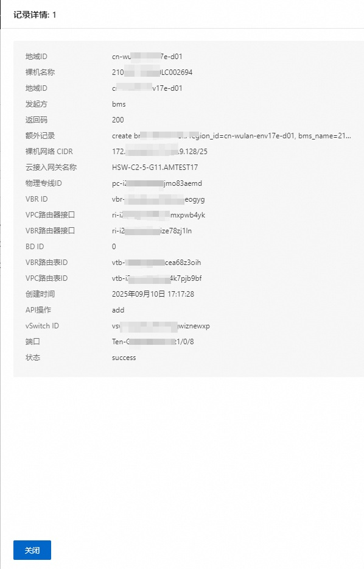

**裸机VPC网络管理**

**查看VPC内裸机的网络信息**

1. 在**裸机VPC网络管理**页签下，单击**高级筛选**，可以通过**裸机名称**、**VPC ID**、**vSwitch ID**和**云接入网关名称**组合筛选获取目标裸机信息。

2. 查看符合筛选条件的裸机VPC网络信息。

   <table>
     <tr>
       <th width="137">名称</th>
       <th>描述</th>
     </tr>
     <tr>
       <td>裸机名称</td>
       <td>裸机的名称。</td>
     </tr>
     <tr>
       <td>SN</td>
       <td>裸机的序列号。</td>
     </tr>
     <tr>
       <td>状态</td>
       <td>裸机的状态。</td>
     </tr>
     <tr>
       <td>VPC ID</td>
       <td>裸机所属的VPC ID。</td>
     </tr>
     <tr>
       <td>vSwitch ID</td>
       <td>裸机所属的专用Vswitch ID。</td>
     </tr>
     <tr>
       <td>云接入网关名称</td>
       <td>裸机所属的云接入网关的名称。根据云接入网关名称可以区分堆叠和解堆叠组网设备进行相关操作。</td>
     </tr>
     <tr>
       <td>端口</td>
       <td>裸机所属云接入网关的端口。</td>
     </tr>
     <tr>
       <td>创建时间</td>
       <td>裸机网络的创建时间。</td>
     </tr>
     <tr>
       <td>裸机IP</td>
       <td>单击<strong>管理</strong>为裸机分配IP，帮助用户对裸机进行网络配置。具体可参见裸机IP管理。</td>
     </tr>
   </table>

3. 单击裸机对应**操作**列的**详情**，查看该裸机的其他详细信息（如物理专线ID、VPC路由器接口、VBR路由器接口等）。

   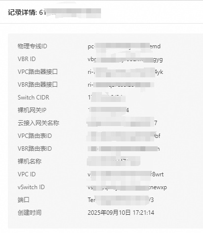

**创建裸机实例**

根据运维需要，创建裸机实例并接入VPC，裸机接入VPC后即具备VPC内私网访问能力。

**操作步骤**

1. 登录Apsara Uni-manager运维控制台。

2. 在顶部菜单栏，选择**产品运维** > **网络运维** > **网络运维控制台**。

3. 在左侧导航栏，选择**基础网络** > **云接入网关**。

4. 单击**裸机VPC网络管理**页签。

5. 单击**创建裸机实例**，输入**裸机名称**、**SN**和**描述**，然后单击**确定**。

   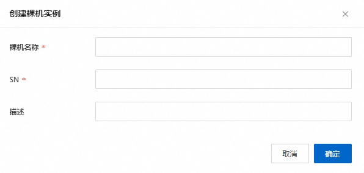

**裸机接入VPC操作步骤**

在创建好的裸机实例对应的**操作**列，单击**接入VPC**，配置如下参数，然后单击**确定**。

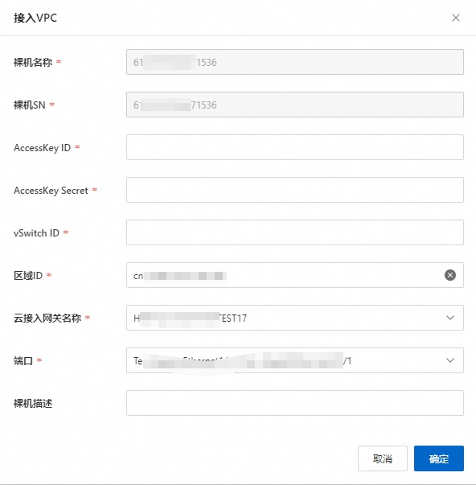

<table>
  <tr>
    <th>名称</th>
    <th>说明</th>
  </tr>
  <tr>
    <td>裸机名称</td>
    <td>显示裸机的名称，无需设置。</td>
  </tr>
  <tr>
    <td>裸机SN</td>
    <td>显示裸机的序列号，无需设置。</td>
  </tr>
  <tr>
    <td>AccessKey ID</td>
    <td rowspan="2">可在专有云运营控制台上根据VPC所属的组织，在<strong>组织管理</strong>页面中获取。具体可参见《Apsara Uni-manager运营控制台 用户指南》中的<strong>管理组织AccessKey</strong>章节。</td>
  </tr>
  <tr>
    <td>AccessKey Secret</td>
  </tr>
  <tr>
    <td>vSwitch ID</td>
    <td>裸机所属的专用虚拟交换机。</td>
  </tr>
  <tr>
    <td>区域ID</td>
    <td>默认当前环境的地域名称。</td>
  </tr>
  <tr>
    <td>云接入网关名称</td>
    <td>裸机所属的物理机网关。根据云接入网关名称可以区分堆叠和解堆叠组网设备进行相关操作。</td>
  </tr>
  <tr>
    <td>端口</td>
    <td>裸机物理机网关的端口。</td>
  </tr>
  <tr>
    <td>裸机描述</td>
    <td>裸机相关描述信息。</td>
  </tr>
</table>

**裸机离开VPC**

裸机离开VPC后，即断开裸机VPC网络连接，实现了资源的访问隔离。

**操作步骤**

在裸机实例所在行，执行**离开VPC**或**删除实例**操作。

- 单击**操作**列的<strong>离开VPC，</strong>将裸机移除VPC。

  > **说明**
  >
  > 裸机成功接入VPC后才会显示。

- 单击**操作**列的**删除实例**，将裸机移除VPC并删除该裸机实例。

  > **说明**
  >
  > 通过裸机网络管理页面创建的裸机实例才会显示删除实例。

**裸机IP管理**

通过裸机IP管理为裸机分配IP，帮助用户对裸机进行网络配置。

**背景信息**

云接入网关与裸机管理服务配合，由裸机服务完成裸机装机、IP分配和网络配置，云接入网关实现裸机接入专有网络VPC。

但在一些场景下，无法使用裸机服务完成裸机装机和网络配置，可是仍然需要借助云接入网关将裸机接入到专有网络VPC中。在这样的这些场景，缺失裸机IP分配的能力，用户只能手工维护IP分配结果，容易出现IP冲突，易用性差。因此在云接入网关运维页面扩展裸机网络管理，增加裸机IP管理功能。

**前提条件**

裸机已接入VPC。

**操作步骤**

1. 在裸机实例对应的**裸机IP**列，单击**管理**。

2. 在**裸机IP管理**面板，单击**申请裸机IP**。

3. 在**申请裸机IP**面板，填写**裸机网卡**、**IP**和**IP描述**，然后单击**确定。**

   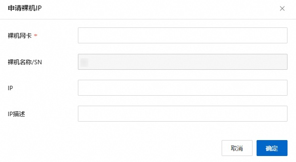

   > **说明**
   >
   > IP为空则自动生成。

4. 裸机IP申请成功后，可以在**裸机IP管理**面板查看/管理IP信息。

   - 单击裸机IP所在行的**编辑**，可修改IP地址信息。

   - 单击裸机IP所在行的**释放**，可释放该IP地址信息。

**裸机专线网络管理**

在裸机专线网络管理页面，查看绑定专线网关的裸机网络。

**查看裸机专线详情**

1. 在**裸机专线网络管理**页签下，单击**高级筛选**，可以通过**vSwitch ID**、**VPC ID**和**专线网关名称**组合筛选获取目标裸机信息。

2. 查看符合筛选条件的裸机专线网络信息。

   | 名称 | 描述 |
   | --- | --- |
   | VPC ID | 裸机所属的VPC ID。 |
   | vSwitch ID | 裸机所属的专用Vswitch ID。 |
   | 状态 | 裸机的状态。 |
   | 专线网关设备1名称 | 裸机所属的专线网关设备1的名称。 |
   | 云上探测专线网关1的源地址 | 专线网关设备1的源地址。 |
   | 专线网关设备2名称 | 裸机所属的专线网关设备2的名称。 |
   | 云上探测专线网关2的源地址 | 专线网关设备2的源地址。 |
   | 创建时间 | 裸机网络的创建时间。 |

3. 单击裸机对应**操作**列的**详情**，查看该裸机专线网络的详细信息。

**删除裸机专线网络**

**操作步骤**

在裸机实例所在行，单击对应**操作**列的**删除**，即可删除该裸机实例。

**运维配置**

**VPC内申请裸机**

在运维应急场景下，可以使用该功能将裸机所属的云接入网关的物理端口加入到VPC网络。

> **警告**
>
> - 该操作必须在研发人员的指导下进行，切勿自行操作，以免影响业务的正常运行。
>
> - 该操作仅会操作裸机连接到云接入网关的端口，不会对裸机进行任何操作，如果需要配置裸机的业务网口IP、路由等信息，请咨询对应的产品团队进行配置指导。
>
> - 一般情况下，不能使用此操作在VPC内申请裸机，而是应当由裸机管控调用API来开通裸机网络。

**操作步骤**

1. 登录Apsara Uni-manager运维控制台。

2. 在顶部菜单栏，选择**产品运维** > **网络运维** > **网络运维控制台**。

3. 在左侧导航栏，选择**基础网络** > **云接入网关**。

4. 单击**运维配置**页签。

5. 在下拉列表中，选择**VPC内申请裸机**。

   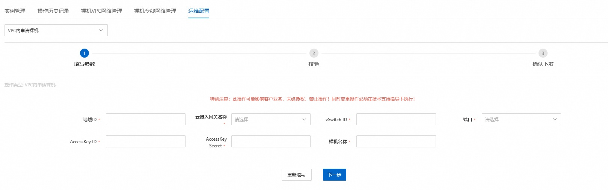

6. 参考下表，填写配置参数，单击**下一步**。

   <table>
     <tr>
       <th>名称</th>
       <th>描述</th>
     </tr>
     <tr>
       <td>地域ID</td>
       <td>当前环境的地域名称。</td>
     </tr>
     <tr>
       <td>云接入网关名称</td>
       <td>选择裸机连接到的云接入网关的名称。根据云接入网关名称可以区分堆叠和解堆叠组网设备进行相关操作。</td>
     </tr>
     <tr>
       <td>vSwitch ID</td>
       <td>填写裸机待加入的vSwitch ID值，可从专有云运营控制台中的专有网络VPC上获取。</td>
     </tr>
     <tr>
       <td>端口</td>
       <td>选择裸机连接到云接入网关的端口。</td>
     </tr>
     <tr>
       <td>AccessKey ID</td>
       <td rowspan="2">可在专有云运营控制台上根据VPC所属的组织，在<strong>组织管理</strong>页面中获取。具体可参见《Apsara Uni-manager运营控制台 用户指南》中的<strong>管理组织</strong><strong>AccessKey</strong>章节。</td>
     </tr>
     <tr>
       <td>AccessKey Secret</td>
     </tr>
     <tr>
       <td>裸机名称</td>
       <td>待申请的裸机名称，不同裸机的裸机名称不能相同。</td>
     </tr>
   </table>

   > **说明**
   >
   > 如果输入错误，可在页面下方单击**重新填写**后，重新输入配置信息。

7. 参数校验，检查参数填写是否正确。

   - 参数正确，单击**确认下发**，系统开始下发配置。

     待配置下发成功后，页面会显示**下发结果：成功**。

   - 参数有误，单击**返回修改**，重新填写参数。

8. （可选）配置下发成功后，可以在**裸机VPC网络管理**页签根据裸机名称查询到该裸机已加入到VPC网络中。

**VPC内释放裸机**

在运维应急场景下，可以使用该功能将裸机所属的云接入网关的物理端口与VPC网络断开。

> **警告**
>
> - 该操作必须在研发人员的指导下进行，切勿自行操作，以免影响业务的正常运行。
>
> - 该操作仅会操作裸机连接到云接入网关的端口，不会对裸机进行任何操作，如果需要配置裸机的业务网口IP、路由等信息，请咨询对应的产品团队进行配置指导。
>
> - 一般情况下，不能使用此操作在VPC内释放裸机，而是应当由裸机管控调用API来删除裸机网络。

**操作步骤**

1. 登录Apsara Uni-manager运维控制台。

2. 在顶部菜单栏，选择**产品运维** > **网络运维** > **网络运维控制台**。

3. 在左侧导航栏，选择**基础网络** > **云接入网关**。

4. 单击**运维配置**页签。

5. 在下拉列表中，选择**VPC内释放裸机**。

   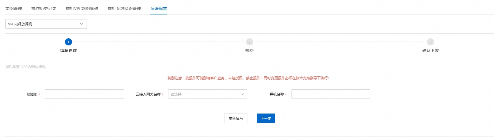

6. 参考下表，填写配置参数，单击**下一步**。

   <table>
     <tr>
       <th width="137">名称</th>
       <th>描述</th>
     </tr>
     <tr>
       <td>地域ID</td>
       <td>当前环境的地域名称。</td>
     </tr>
     <tr>
       <td>云接入网关名称</td>
       <td>选择裸机连接到的云接入网关的名称。根据云接入网关名称可以区分堆叠和解堆叠组网设备进行相关操作。</td>
     </tr>
     <tr>
       <td>裸机名称</td>
       <td>待释放的裸机名称。可在<strong>裸机VPC网络管理</strong>页签获取裸机名称。</td>
     </tr>
   </table>

   > **说明**
   >
   > 如果输入错误，可在页面下方单击**重新填写**后，重新输入配置信息。

7. 参数校验，检查参数填写是否正确。

   - 参数正确，单击**确认下发**，系统开始下发配置。

     待配置下发成功后，页面会显示**下发结果：成功**。

   - 参数有误，单击**返回修改**，重新填写参数。

8. （可选）配置下发成功后，可以在**裸机VPC网络管理**页签根据裸机名称查询，发现VPC网络中已经没有该裸机。

**删除路由表项**

在运维应急场景下，可以使用此功能删除VPC内指向裸机子网的路由表项和VBR上默认的路由表项。

> **警告**
>
> - 该操作为应急处理操作，非常规操作，且所有操作必须在研发人员的指导下进行，切勿自行操作，以免影响业务的正常运行。
>
> - 一般情况下，不能使用此操作来删除VPC路由表项，本操作仅作为应急处理操作。
>
> - 一次只能删除一条路由表项，如果需要删除多条路由表项，则需要多次执行本操作。

**操作步骤**

1. 登录Apsara Uni-manager运维控制台。

2. 在顶部菜单栏，选择**产品运维** > **网络运维** > **网络运维控制台**。

3. 在左侧导航栏，选择**基础网络** > **云接入网关**。

4. 单击**运维配置**页签。

5. 在下拉列表中，选择**删除路由表项**。

   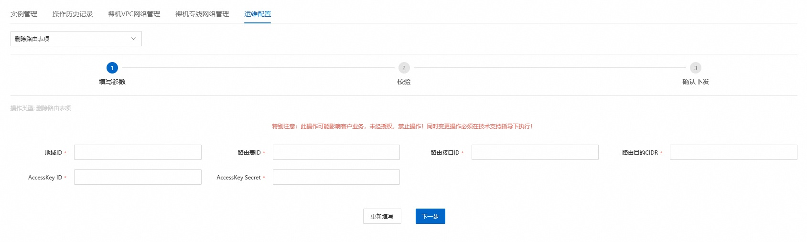

6. 参考下表，填写配置信息，单击**下一步**。

   <table>
     <tr>
       <th>参数</th>
       <th>删除VPC路由表项</th>
       <th>删除VBR路由表项</th>
     </tr>
     <tr>
       <td>地域ID</td>
       <td>当前环境的地域名称。</td>
       <td>当前环境的地域名称。</td>
     </tr>
     <tr>
       <td>路由表ID</td>
       <td>VPC路由表ID，可从专有云的VPC控制台上获取，详细获取操作请参考 <strong>《专有网络VPC用</strong><strong>户指南》</strong>文档。</td>
       <td>VBR路由表ID。如果该VBR所涉及的裸机已经成功地加入到VPC网络，可在<strong>裸机VPC网络管理</strong>页签根据裸机名称查询后，在详细信息中获取该值，即VBR路由表ID对应的值。如果该VBR所涉及的裸机未成功加入到VPC网络，可在<strong>操作历史记录</strong>页签，根据裸机名称查询后，再根据<strong>API操作</strong>为<strong>add</strong>以及操作时间，找到对应的操作记录并查看详细信息，详细信息中的<strong>VBR路由表ID</strong>即为该值。</td>
     </tr>
     <tr>
       <td>路由接口ID</td>
       <td>VPC路由接口ID，可从专有云的VPC控制台上获取，详细获取操作请参考 <strong>《专有网络VPC</strong><strong>用户指南》</strong>文档。</td>
       <td>VBR路由接口ID。如果该VBR所涉及的裸机已经成功地加入到VPC网络，可在<strong>裸机VPC网络管理</strong>页签根据裸机名称查询后，在详细信息中获取该值，即VBR RI对应的值。如果该VBR所涉及的裸机未成功加入到VPC网络，可在<strong>操作历史记录</strong>页签，根据裸机名称查询后，再根据<strong>API操作</strong>为<strong>add</strong>以及操作时间，找到对应的操作记录并查看详细信息，详细信息中的VBR RI即为该值。</td>
     </tr>
     <tr>
       <td>路由目的CIDR</td>
       <td>VPC指向的目标网段，可从专有云的VPC控制台上获取，详细获取操作请参考 <strong>《专有网络</strong><strong>VPC用户指南》</strong>文档。</td>
       <td>固定值0.0.0.0/0。</td>
     </tr>
     <tr>
       <td>AccessKey ID</td>
       <td rowspan="2">可在专有云运营控制台上根据VPC所属的组织，在<strong>组织管理</strong>页面中获取。具体可参见《Apsara Uni-manager运营控制台 用户指南》中的<strong>管理组织AccessKey</strong>章节。</td>
       <td rowspan="2">可在专有云运营控制台上根据VBR所属的组织，在<strong>组织管理</strong>页面中获取。具体可参见《Apsara Uni-manager运营控制台 用户指南》中的<strong>管理组织AccessKey</strong>章节。</td>
     </tr>
     <tr>
       <td>AccessKey Secret</td>
     </tr>
   </table>

   > **说明**
   >
   > 如果输入错误，可在页面下方单击**重新填写**后，重新输入配置信息。

7. 参数校验，检查参数填写是否正确。

   - 参数正确，单击**确认下发**，系统开始下发配置。

     待配置下发成功后，页面会显示**下发结果：成功**。

   - 参数有误，单击**返回修改**，重新填写参数。

8. （可选）根据实际故障场景，如果路由表中有多条路由表项，需要重复步骤5~步骤8，删除其他路由表项。

**删除路由器接口**

在运维应急场景下，可以使用此功能删除VPC的路由器接口和VBR路由器接口。

> **警告**
>
> 该操作为应急处理操作，非常规操作，且所有操作必须在研发人员的指导下进行，切勿自行操作，以免影响业务的正常运行。

**操作步骤**

1. 登录Apsara Uni-manager运维控制台。

2. 在顶部菜单栏，选择**产品运维** > **网络运维** > **网络运维控制台**。

3. 在左侧导航栏，选择**基础网络** > **云接入网关**。

4. 单击**运维配置**页签。

5. 在下拉列表中，选择**删除路由器接口**。

   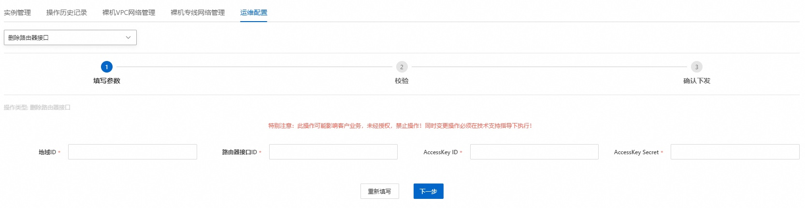

6. 参考下表，填写配置信息，单击**下一步**。

   <table>
     <tr>
       <th>名称</th>
       <th>删除VPC路由器接口</th>
       <th>删除VBR路由器接口</th>
     </tr>
     <tr>
       <td>地域ID</td>
       <td>当前环境的地域名称。</td>
       <td>当前环境的地域名称。</td>
     </tr>
     <tr>
       <td>路由器接口ID</td>
       <td>VPC路由接口ID，可在<strong>操作历史记录</strong>页签，根据裸机名称查询后，再根据<strong>API操</strong><strong>作</strong>为<strong>add</strong>以及操作时间，找到对应的操作记录并查看详细信息，详细信息中的<strong>VPC</strong> <strong>RI</strong>即为该值。</td>
       <td>VBR路由器接口ID。如果该VBR所涉及的裸机已经成功地加入到VPC网络，可在<strong>裸机VPC网络管理</strong>页签根据裸机名称查询后，在详细信息中获取该值，即VBR RI对应的值。如果该VBR所涉及的裸机未成功加入到VPC网络，可在<strong>操作历史记录</strong>页签，根据裸机名称查询后，再根据<strong>API操作</strong>为<strong>add</strong>以及操作时间，找到对应的操作记录并查看详细信息，详细信息中的VBR RI即为该值。</td>
     </tr>
     <tr>
       <td>AccessKey ID</td>
       <td rowspan="2">可在专有云运营控制台上根据VPC所属的组织，在<strong>组织管理</strong>页面中获取。具体可参见《Apsara Uni-manager运营控制台 用户指南》中的<strong>管理组织AccessKey</strong>章节。</td>
       <td rowspan="2">可在专有云运营控制台上根据VBR所属的组织，在<strong>组织管理</strong>页面中获取。具体可参见《Apsara Uni-manager运营控制台 用户指南》中的<strong>管理组织AccessKey</strong>章节。</td>
     </tr>
     <tr>
       <td>AccessKey Secret</td>
     </tr>
   </table>

   > **说明**
   >
   > 如果输入错误，可在页面下方单击**重新填写**后，重新输入配置信息。

7. 参数校验，检查参数填写是否正确。

   - 参数正确，单击**确认下发**，系统开始下发配置。

     待配置下发成功后，页面会显示**下发结果：成功**。

   - 参数有误，单击**返回修改**，重新填写参数。

8. （可选）配置下发成功后，可以选择**产品运维** > **网络运维** > **虚拟网络管理2.0·齐天**，跳转到齐天首页，输入该路由接口ID信息搜索，若无法找到该路由器接口，说明删除成功。

**删除VBR**

在运维应急场景下，可以使用此功能删除VBR。

> **警告**
>
> 该操作为应急处理操作，非常规操作，且所有操作必须在研发人员的指导下进行，切勿自行操作，以免影响业务的正常运行。

**操作步骤**

1. 登录Apsara Uni-manager运维控制台。

2. 在顶部菜单栏，选择**产品运维** > **网络运维** > **网络运维控制台**。

3. 在左侧导航栏，选择**基础网络** > **云接入网关**。

4. 单击**运维配置**页签。

5. 在下拉列表中，选择**删除VBR**。

   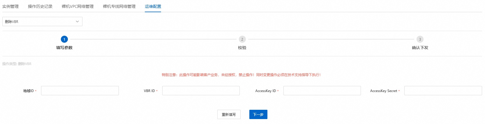

6. 参考下表，填写配置信息，单击**下一步**。

   <table>
     <tr>
       <th>名称</th>
       <th>描述</th>
     </tr>
     <tr>
       <td>地域ID</td>
       <td>当前环境的地域名称。</td>
     </tr>
     <tr>
       <td>VBR ID</td>
       <td>待删除的VBR ID，可在<strong>操作历史记录</strong>页签，根据裸机名称查询后，再根据<strong>API操</strong><strong>作</strong>为<strong>add</strong>以及操作时间，找到对应的操作记录并查看详细信息，详细信息中的VBR ID即为该值。</td>
     </tr>
     <tr>
       <td>AccessKey ID</td>
       <td rowspan="2">可在专有云运营控制台上根据VBR所属的组织，在<strong>组织管理</strong>页面中获取。具体可参见《Apsara Uni-manager运营控制台 用户指南》中的<strong>管理组织AccessKey</strong>章节。</td>
     </tr>
     <tr>
       <td>AccessKey Secret</td>
     </tr>
   </table>

   > **说明**
   >
   > 如果输入错误，可在页面下方单击**重新填写**后，重新输入配置信息。

7. 参数校验，检查参数填写是否正确。

   - 参数正确，单击**确认下发**，系统开始下发配置。

     待配置下发成功后，页面会显示**下发结果：成功**。

   - 参数有误，单击**返回修改**，重新填写参数。

8. （可选）配置下发成功后，可以选择**产品运维** > **网络运维** > **虚拟网络管理2.0·齐天**，跳转到齐天首页，输入该VBR ID信息搜索，若无法找到该VBR，说明删除成功。

**删除物理专线**

在运维应急场景下，可以使用此功能删除物理专线。

> **警告**
>
> 该操作为应急处理操作，非常规操作，且所有操作必须在研发人员的指导下进行，切勿自行操作，以免影响业务的正常运行。

**操作步骤**

1. 登录Apsara Uni-manager运维控制台。

2. 在顶部菜单栏，选择**产品运维** > **网络运维** > **网络运维控制台**。

3. 在左侧导航栏，选择**基础网络** > **云接入网关**。

4. 单击**运维配置**页签。

5. 在下拉列表中，选择**删除物理专线**。

   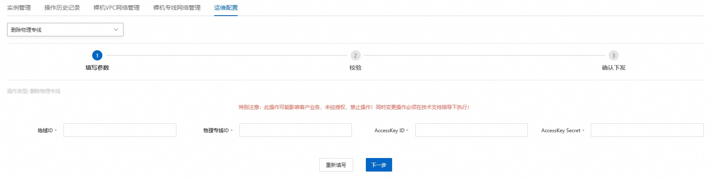

6. 参考下表，填写配置信息，单击**下一步**。

   <table>
     <tr>
       <th>名称</th>
       <th>描述</th>
     </tr>
     <tr>
       <td>地域ID</td>
       <td>当前环境的地域名称。</td>
     </tr>
     <tr>
       <td>物理专线ID</td>
       <td>待删除的物理专线ID，可在<strong>操作历史记录</strong>页签，根据裸机名称查询后，再根据<strong>API操</strong><strong>作</strong>为<strong>add</strong>以及操作时间，找到对应的操作记录并查看详细信息，详细信息中的<strong>物理</strong><strong>专线ID</strong>即为该值。</td>
     </tr>
     <tr>
       <td>AccessKey ID</td>
       <td rowspan="2">可在专有云运营控制台上根据VPC所属的组织，在<strong>组织管理</strong>页面中获取。具体可参见《Apsara Uni-manager运营控制台 用户指南》中的<strong>管理组织AccessKey</strong>章节。</td>
     </tr>
     <tr>
       <td>AccessKey Secret</td>
     </tr>
   </table>

   > **说明**
   >
   > 如果输入错误，可在页面下方单击**重新填写**后，重新输入配置信息。

7. 参数校验，检查参数填写是否正确。

   - 参数正确，单击**确认下发**，系统开始下发配置。

     待配置下发成功后，页面会显示**下发结果：成功**。

   - 参数有误，单击**返回修改**，重新填写参数。

8. （可选）配置下发成功后，可以选择**产品运维** > **网络运维** > **虚拟网络管理2.0·齐天**，跳转到齐天首页，输入该物理专线ID搜索，若无法找到该物理专线，说明删除成功。

**一键清除资源**

在运维应急场景下，可以使用此功能一键清除资源。清除的资源包括VPC路由表项、VBR路由表项、VPC路由器接口、VBR路由器接口、VBR以及物理专线。

> **警告**
>
> 该操作为应急处理操作，非常规操作，且所有操作必须在研发人员的指导下进行，切勿自行操作，以免影响业务的正常运行。

**操作步骤**

1. 登录Apsara Uni-manager运维控制台。

2. 在顶部菜单栏，选择**产品运维** > **网络运维** > **网络运维控制台**。

3. 在左侧导航栏，选择**基础网络** > **云接入网关**。

4. 单击**运维配置**页签。

5. 在下拉列表中，选择**一键清除资源**。

   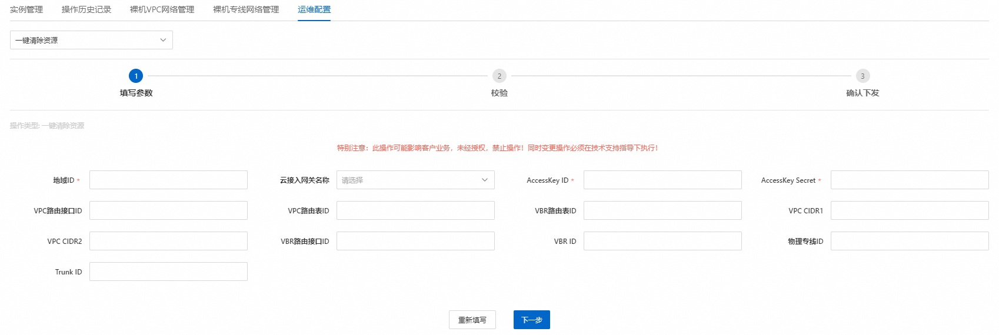

6. 参考下表，填写参数信息，单击**下一步**。

   <table>
     <tr>
       <th>名称</th>
       <th>描述</th>
     </tr>
     <tr>
       <td>地域ID</td>
       <td>当前环境的地域ID名称。</td>
     </tr>
     <tr>
       <td>云接入网关名称</td>
       <td>选择裸机连接到的云接入网关的名称。</td>
     </tr>
     <tr>
       <td>AccessKey ID</td>
       <td rowspan="2">可在专有云运营控制台上根据VPC所属的组织，在<strong>组织管理</strong>页面中获取。具体可参见《Apsara Uni-manager运营控制台 用户指南》中的<strong>管理组织</strong><strong>AccessKey</strong>章节。</td>
     </tr>
     <tr>
       <td>AccessKey Secret</td>
     </tr>
     <tr>
       <td>VPC路由接口ID</td>
       <td>VPC路由接口ID，可从专有云的VPC控制台上获取，详细获取操作请参考 <strong>《专有</strong><strong>网络VPC用户指南》</strong>文档。</td>
     </tr>
     <tr>
       <td>VPC路由表ID</td>
       <td>VPC路由表ID，可从专有云的VPC控制台上获取，详细获取操作请参考 <strong>《专有网</strong><strong>络VPC用户指南》</strong>文档。</td>
     </tr>
     <tr>
       <td>VBR路由表ID</td>
       <td>VBR路由表ID。如果该VBR所涉及的裸机已经成功地加入到VPC网络，可在<strong>裸机VPC网络管理</strong>页签根据裸机名称查询后，在详细信息中获取，详细信息中的<strong>VBR路由表ID</strong>即为该值。如果该VBR所涉及的裸机未成功加入到VPC网络，可在<strong>操作历史记录</strong>页签，根据裸机名称查询后，再根据<strong>API操作</strong>为<strong>add</strong>以及操作时间，找到对应的操作记录并查看详细信息，详细信息中的<strong>VBR路由表ID</strong>即为该值。</td>
     </tr>
     <tr>
       <td>VPC CIDR1</td>
       <td>VPC指向的目标网段1，可从专有云的VPC控制台上获取，详细获取操作请参考<strong>《专有网络VPC用户指南》</strong>文档。</td>
     </tr>
     <tr>
       <td>VPC CIDR2</td>
       <td>VPC指向的目标网段2，可从专有云的VPC控制台上获取，详细获取操作请参考<strong>《专有网络VPC用户指南》</strong>文档。</td>
     </tr>
     <tr>
       <td>VBR路由接口ID</td>
       <td>VBR路由接口ID。如果该VBR所涉及的裸机已经成功地加入到VPC网络，可在<strong>裸机VPC网络管理</strong>页签根据裸机名称查询后，在详细信息中获取该值，详细信息中的<strong>VBR RI</strong>即为该值。如果该VBR所涉及的裸机未成功加入到VPC网络，可在<strong>操作历史记录</strong>页签，根据裸机名称查询后，再根据<strong>API操作</strong>为<strong>add</strong>以及操作时间，找到对应的操作记录并查看详细信息，详细信息中的<strong>VBR RI</strong>即为该值。</td>
     </tr>
     <tr>
       <td>VBR ID</td>
       <td>待删除的VBR ID，可在<strong>操作历史记录</strong>页签，根据裸机名称查询后，再根据<strong>API操</strong><strong>作</strong>为<strong>add</strong>以及操作时间，找到对应的操作记录并查看详细信息，详细信息中的<strong>VBR ID</strong>即为该值。</td>
     </tr>
     <tr>
       <td>物理专线ID</td>
       <td>待删除的物理专线 ID，可在<strong>操作历史记录</strong>页签，根据裸机名称查询后，再根据<strong>API操作</strong>为<strong>add</strong>以及操作时间，找到对应的操作记录并查看详细信息，详细信息中的<strong>物理专线ID</strong>即为该值。</td>
     </tr>
     <tr>
       <td>Trunk ID</td>
       <td>无需填写。</td>
     </tr>
   </table>

   > **说明**
   >
   > 如果输入错误，可在页面下方单击**重新填写**后，重新输入配置信息。

7. 参数校验，检查参数填写是否正确。

   - 参数正确，单击**确认下发**，系统开始下发配置。

     待配置下发成功后，页面会显示**下发结果：成功**。

   - 参数有误，单击**返回修改**，重新填写参数。

**查看专线带宽**

根据运维需要，查看系统中云接入网关实例连接VPC时路由接口对应的专线带宽值。

**操作步骤**

1. 登录Apsara Uni-manager运维控制台。

2. 在顶部菜单栏，选择**产品运维** > **网络运维** > **网络运维控制台**。

3. 在左侧导航栏，选择**基础网络** > **云接入网关**。

4. 单击**运维配置**页签。

5. 在下拉列表中，选择**查看专线带宽**。

   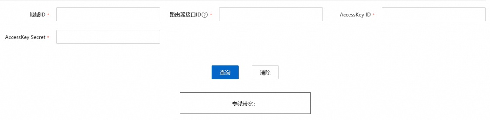

6. 输入如下表的过滤条件，单击**查询**。系统显示符合条件的专线带宽信息。

   <table>
     <tr>
       <th>名称</th>
       <th>描述</th>
     </tr>
     <tr>
       <td>地域ID</td>
       <td>当前环境的地域名称。</td>
     </tr>
     <tr>
       <td>路由器接口ID</td>
       <td>即VBR RI，可在<strong>裸机VPC网络管理</strong>页签中根据指定VPC ID和云接入网关名称查询后，单击操作列<strong>详情</strong>获取。</td>
     </tr>
     <tr>
       <td>AccessKey ID</td>
       <td rowspan="2">可在专有云运营控制台上根据VPC所属的组织，在<strong>组织管理</strong>页面中获取。具体可参见《Apsara Uni-manager运营控制台 用户指南》中的<strong>管理组织AccessKey</strong>章节。</td>
     </tr>
     <tr>
       <td>AccessKey Secret</td>
     </tr>
   </table>

7. 获取的带宽信息即为当前VPC在HSW上的专线带宽的规格字符串，再根据规格字符串和带宽对照表，得到以bit/s为单位的带宽值。

   | 规格字符串 | 带宽（单位bit/s） |
   | --- | --- |
   | Large.1 | 1G |
   | Large.2 | 2G |
   | Large.4 | 4G |
   | Large.5 | 5G |
   | Xlarge.1 | 10G |
   | Xlarge.2 | 20G |
   | Xlarge.4 | 40G |
   | Xlarge.5 | 50G |
   | Xlarge.8 | 80G |
   | Xlarge.10 | 100G |
   | Xlarge.16 | 160G |
   | Xlarge.20 | 200G |
   | Xlarge.50 | 500G |
   | Xlarge.320 | 3200G |

**修改专线带宽**

在运维应急场景下，可使用此功能修改专线带宽。

> **警告**
>
> 该操作可能影响客户业务，未经授权，禁止操作！同时变更操作必须在技术支持指导下执行！

**操作步骤**

1. 登录Apsara Uni-manager运维控制台。

2. 在顶部菜单栏，选择**产品运维** > **网络运维** > **网络运维控制台**。

3. 在左侧导航栏，选择**基础网络** > **云接入网关**。

4. 单击**运维配置**页签。

5. 在下拉列表中，选择**修改专线带宽**。

   

6. 参考下表，填写参数信息，单击**下一步**。

   <table>
     <tr>
       <th width="137">名称</th>
       <th>说明</th>
     </tr>
     <tr>
       <td>地域ID</td>
       <td>当前环境的地域名称。</td>
     </tr>
     <tr>
       <td>路由器接口ID</td>
       <td>即VBR RI，可在<strong>裸机VPC网络管理</strong>页签中根据指定VPC ID和云接入网关名称查询后，单击操作列<strong>详情</strong>获取。</td>
     </tr>
     <tr>
       <td>路由器接口规格</td>
       <td>选择新的专线带宽规格。</td>
     </tr>
   </table>

   <table>
     <tr>
       <th>AccessKey ID</th>
       <th rowspan="2">可在专有云运营控制台上根据VPC所属的组织，在<strong>组织管理</strong>页面中获取。具体可参见《Apsara Uni-manager运营控制台 用户指南》中的<strong>管理组织AccessKey</strong>章节。</th>
     </tr>
     <tr>
       <td>AccessKey Secret</td>
     </tr>
   </table>

7. 参数校验，检查参数填写是否正确。

   - 参数正确，单击**确认下发**，系统开始下发配置。

     待配置下发成功后，页面会显示**下发结果：成功**。

   - 参数有误，单击**返回修改**，重新填写参数。

8. （可选）配置下发成功后，可参考查看专线带宽确认是否已修改。

**查看trunk使用情况**

可以通过查看trunk的使用情况，及时了解硬件端口的使用情况。

**操作步骤**

1. 登录Apsara Uni-manager运维控制台。

2. 在顶部菜单栏，选择**产品运维** > **网络运维** > **网络运维控制台**。

3. 在左侧导航栏，选择**基础网络** > **云接入网关**。

4. 单击**运维配置**页签。

5. 在下拉列表中，选择**查看trunk使用情况**。

6. 输入**Trunk ID**、**云接入网关名称**，选择Trunk的**状态**（**空闲**、**已使用**、**创建中**或**删除中**），单击**搜索**，查看符合条件的trunk的使用情况。

   > **说明**
   >
   > **Trunk ID**为**裸机VPC网络管理**页签中查到的**端口**末尾的整数。如端口号为10GE1/0/40，则**Trunk ID**为40。

**查看BM VPN使用情况**

通过查看BM VPN使用情况，可以查看系统中云接入网关实例已经分配的BM VPN信息。

**操作步骤**

1. 登录Apsara Uni-manager运维控制台。

2. 在顶部菜单栏，选择**产品运维** > **网络运维** > **网络运维控制台**。

3. 在左侧导航栏，选择**基础网络** > **云接入网关**。

4. 单击**运维配置**页签。

5. 在下拉列表中，选择**查看BMVPN使用情况**。

6. 输入**云接入网关名称**、**vxlan id**、**BM VPN名称**，选择**状态**（**成功**或**创建中**），单击**搜索**，查看当前所有的HSW交换机已分配的BM VPN的情况。

**显示BD使用情况**

通过查看BD使用情况，及时了解BD配置的下发情况。

**操作步骤**

1. 登录Apsara Uni-manager运维控制台。

2. 在顶部菜单栏，选择**产品运维** > **网络运维** > **网络运维控制台**。

3. 在左侧导航栏，选择**基础网络** > **云接入网关**。

4. 单击**运维配置**页签。

5. 在下拉列表中，选择**显示BD使用情况**。

6. 输入**云接入网关名称**、**BD ID**、**vSwitch ID**，选择**状态**（**成功**、**创建中**或**删除中**），单击**搜索**，查看BD使用情况。

**检查初始化配置**

在运维应急场景下，可以使用该功能检查HSW交换机初始化配置是否成功。

> **说明**
>
> 该操作仅限于检查平台接入网关交换机初始化状态及初始化配置是否成功，不会对裸机进行任何操作。

**操作步骤**

1. 登录Apsara Uni-manager运维控制台。

2. 在顶部菜单栏，选择**产品运维** > **网络运维** > **网络运维控制台**。

3. 在左侧导航栏，选择**基础网络** > **云接入网关**。

4. 单击**运维配置**页签。

5. 在下拉列表中，选择**检查初始化配置**。

   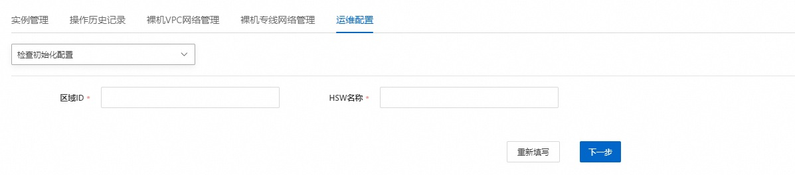

6. 参考下表，填写参数信息，单击**下一步**。

   | 名称 | 描述 |
   | --- | --- |
   | 区域ID | 当前环境的地域名称。 |
   | HSW名称 | 实例管理中的待检查交换机的名称。 |

   > **说明**
   >
   > 如果输入错误，可在页面下方单击**重新填写**后，重新输入配置信息。

7. 参单击**检查**，检查交换机的初始化配置信息。

**检查路由配置**

在运维应急场景下，可以使用该功能定位异常操作检查裸机路由配置是否正确。

**背景说明**

在添加裸机失败后，通过该操作定位异常操作，对HSW设备进行扫描。该操作仅限于检查裸机路由配置是否正常，不会对裸机进行任何操作。

**操作步骤**

1. 登录Apsara Uni-manager运维控制台。

2. 在顶部菜单栏，选择**产品运维** > **网络运维** > **网络运维控制台**。

3. 在左侧导航栏，选择**基础网络** > **云接入网关**。

4. 单击**运维配置**页签。

5. 在下拉列表中，选择**检查路由配置**。

   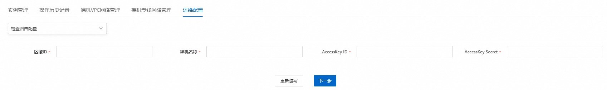

6. 参考下表，填写参数信息，单击**下一步**。

   <table>
     <tr>
       <th>名称</th>
       <th>描述</th>
     </tr>
     <tr>
       <td>区域ID</td>
       <td>当前环境的地域名称。</td>
     </tr>
     <tr>
       <td>裸机名称</td>
       <td>VPC内申请或者释放裸机时的裸机名称，在一个地域内唯一标识裸机。</td>
     </tr>
     <tr>
       <td>AccessKey ID</td>
       <td rowspan="2">可在专有云运营控制台上根据VPC所属的组织，在<strong>组织管理</strong>页面中获取。具体可参见《Apsara Uni-manager运营控制台 用户指南》中的<strong>管理组织AccessKey</strong>章节。</td>
     </tr>
     <tr>
       <td>AccessKey Secret</td>
     </tr>
   </table>

   > **说明**
   >
   > 如果输入错误，可在页面下方单击**重新填写**后，重新输入配置信息。

7. 单击**检查**，检查路由配置信息。

**显示裸机网络网关信息**

在运维应急场景下，可以使用该功能检查虚拟交换机的网关。

**背景说明**

该操作是应急处理操作，在裸机网络不通的情况下可以通过该操作查看。该操作仅限于检查vswitch网关信息，不会对裸机进行任何操作。

**操作步骤**

1. 登录Apsara Uni-manager运维控制台。

2. 在顶部菜单栏，选择**产品运维** > **网络运维** > **网络运维控制台**。

3. 在左侧导航栏，选择**基础网络** > **云接入网关**。

4. 单击**运维配置**页签。

5. 在下拉列表中，选择**显示裸机网络网关信息**。

   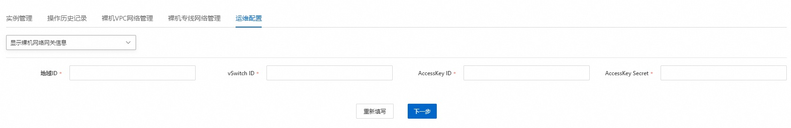

6. 参考下表，填写参数信息，单击**下一步**。

   <table>
     <tr>
       <th>名称</th>
       <th>描述</th>
     </tr>
     <tr>
       <td>地域ID</td>
       <td>当前环境的地域名称。</td>
     </tr>
     <tr>
       <td>vSwitch ID</td>
       <td>vSwitch ID值，可从专有云VPC的控制台上获取。</td>
     </tr>
     <tr>
       <td>AccessKey ID</td>
       <td rowspan="2">可在专有云运营控制台上根据VPC所属的组织，在<strong>组织管理</strong>页面中获取。具体可参见《Apsara Uni-manager运营控制台 用户指南》中的<strong>管理组织AccessKey</strong>章节。</td>
     </tr>
     <tr>
       <td>AccessKey Secret</td>
     </tr>
   </table>

   > **说明**
   >
   > 如果输入错误，可在页面下方单击**重新填写**后，重新输入配置信息。

7. 单击**检查**，检查裸机网络网关信息。

**单RR升级双RR**

在运维应急场景下，可使用此功能升级双RR。

> **警告**
>
> 该操作可能影响客户业务，未经授权，禁止操作！同时变更操作必须在技术支持指导下执行！

**操作步骤**

1. 登录Apsara Uni-manager运维控制台。

2. 在顶部菜单栏，选择**产品运维** > **网络运维** > **网络运维控制台**。

3. 在左侧导航栏，选择**基础网络** > **云接入网关**。

4. 单击**运维配置**页签。

5. 在下拉列表中，选择**单RR升级双RR**。

   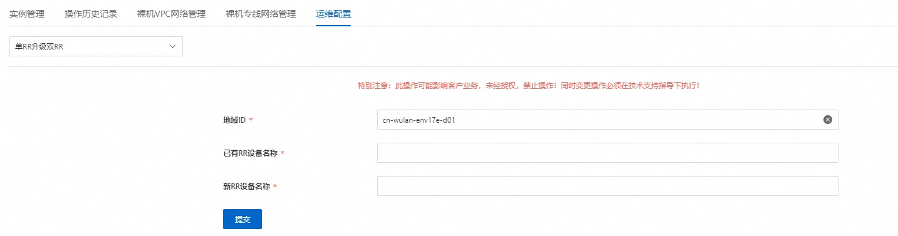

6. 参考下表，填写参数信息，单击**提交**。

   | 名称 | 说明 |
   | --- | --- |
   | 地域ID | 当前环境的地域名称。 |
   | 已有RR设备名称 | 当前需要升级的RR设备名称。 |
   | 新RR设备名称 | 输入新的RR设备名称。 |

**单RR升级双RR操作记录**

通过查看单RR升级双RR操作记录，及时了解RR设备状态。

**操作步骤**

1. 登录Apsara Uni-manager运维控制台。

2. 在顶部菜单栏，选择**产品运维** > **网络运维** > **网络运维控制台**。

3. 在左侧导航栏，选择**基础网络** > **云接入网关**。

4. 单击**运维配置**页签。

5. 在下拉列表中，选择**单RR升级双RR操作记录**。

6. 输入**已有RR设备名称**、**新RR设备名称**、**请求 id**，查看符合条件的单RR升级双RR操作记录。

7. 单击对应记录**操作**列**详情**，可以查看额外信息、HttpCode响应码等操作记录详情。

**Switch绑定专线网关**

> **警告**
>
> 该操作为应急处理操作，非常规操作，且所有操作必须在研发人员的指导下进行，切勿自行操作，以免影响业务的正常运行。

**操作步骤**

1. 登录Apsara Uni-manager运维控制台。

2. 在顶部菜单栏，选择**产品运维** > **网络运维** > **网络运维控制台**。

3. 在左侧导航栏，选择**基础网络** > **云接入网关**。

4. 单击**运维配置**页签。

5. 在下拉列表中，选择**Switch绑定专线网关**。

   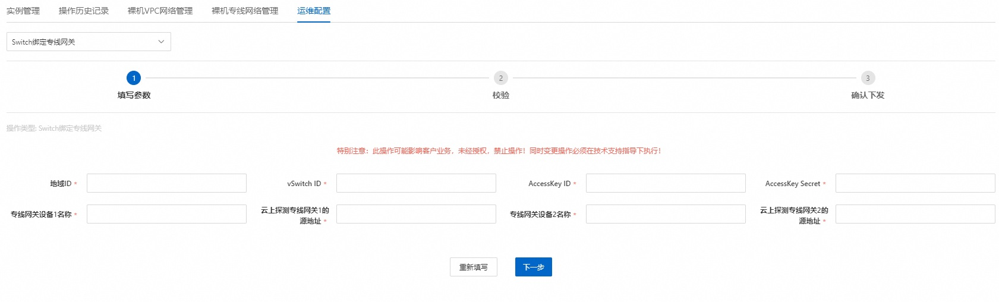

6. 参考下表，填写配置参数，单击**下一步**。

   <table>
     <tr>
       <th>名称</th>
       <th>描述</th>
     </tr>
     <tr>
       <td>地域ID</td>
       <td>当前环境的地域名称。</td>
     </tr>
     <tr>
       <td>vSwitch ID</td>
       <td>vSwitch ID值，可从专有云VPC的控制台上获取。</td>
     </tr>
     <tr>
       <td>AccessKey ID</td>
       <td rowspan="2">可在专有云运营控制台上根据VPC所属的组织，在<strong>组织管理</strong>页面中获取。具体可参见《Apsara Uni-manager运营控制台 用户指南》中的<strong>管理组织AccessKey</strong>章节。</td>
     </tr>
     <tr>
       <td>AccessKey Secret</td>
     </tr>
     <tr>
       <td>专线网关设备1名称</td>
       <td>裸机所属的专线网关设备1的名称。可在<strong>裸机专线网络管理</strong>页签中根据指定VPC ID和云接入网关名称查询后，单击操作列<strong>详情</strong>获取。</td>
     </tr>
     <tr>
       <td>云上探测专线网关1的源地址</td>
       <td>专线网关设备1的源地址。可在<strong>裸机专线网络管理</strong>页签中根据指定VPC ID和云接入网关名称查询后，单击操作列<strong>详情</strong>获取。</td>
     </tr>
     <tr>
       <td>专线网关设备2名称</td>
       <td>裸机所属的专线网关设备2的名称。可在<strong>裸机专线网络管理</strong>页签中根据指定VPC ID和云接入网关名称查询后，单击操作列<strong>详情</strong>获取。</td>
     </tr>
     <tr>
       <td>云上探测专线网关2的源地址</td>
       <td>专线网关设备2的源地址。可在<strong>裸机专线网络管理</strong>页签中根据指定VPC ID和云接入网关名称查询后，单击操作列<strong>详情</strong>获取。</td>
     </tr>
   </table>

   > **说明**
   >
   > 如果输入错误，可在页面下方单击**重新填写**后，重新输入配置信息。

7. 参数校验，检查参数填写是否正确。

   - 参数正确，单击**确认下发**，系统开始下发配置。

     待配置下发成功后，页面会显示**下发结果：成功**。

   - 参数有误，单击**返回修改**，重新填写参数。

**Switch解绑专线网关**

> **警告**
>
> 该操作为应急处理操作，非常规操作，且所有操作必须在研发人员的指导下进行，切勿自行操作，以免影响业务的正常运行。

**操作步骤**

1. 登录Apsara Uni-manager运维控制台。

2. 在顶部菜单栏，选择**产品运维** > **网络运维** > **网络运维控制台**。

3. 在左侧导航栏，选择**基础网络** > **云接入网关**。

4. 单击**运维配置**页签。

5. 在下拉列表中，选择**Switch解绑专线网关**。

   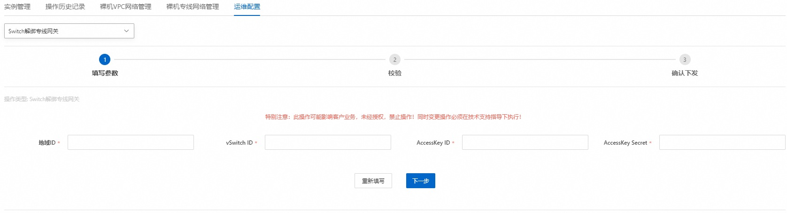

6. 参考下表，填写配置参数，单击**下一步**。

   <table>
     <tr>
       <th>名称</th>
       <th>描述</th>
     </tr>
     <tr>
       <td>地域ID</td>
       <td>当前环境的地域名称。</td>
     </tr>
     <tr>
       <td>vSwitch ID</td>
       <td>vSwitch ID值，可从专有云VPC的控制台上获取。</td>
     </tr>
     <tr>
       <td>AccessKey ID</td>
       <td rowspan="2">可在专有云运营控制台上根据VPC所属的组织，在<strong>组织管理</strong>页面中获取。具体可参见《Apsara Uni-manager运营控制台 用户指南》中的<strong>管理组织AccessKey</strong>章节。</td>
     </tr>
     <tr>
       <td>AccessKey Secret</td>
     </tr>
   </table>

   > **说明**
   >
   > 如果输入错误，可在页面下方单击**重新填写**后，重新输入配置信息。

7. 参数校验，检查参数填写是否正确。

   - 参数正确，单击**确认下发**，系统开始下发配置。

     待配置下发成功后，页面会显示**下发结果：成功**。

   - 参数有误，单击**返回修改**，重新填写参数。

<a id="section-2-4"></a>

## 2.4. 智算服务器接入VPC

智算服务器通过算力平台接入网关（专用CHSW设备）接入VPC，实现智算服务器资源的统一管理的。系统提供实例管理、操作历史记录、裸机网络管理、运维配置等操作，以完成算力平台接入网关的日常运维工作。

<a id="section-2-4-1"></a>

### 2.4.1. 实例管理

在实例管理页面，查看当前系统中算力平台接入网关实例的汇总信息，包括算力平台接入网关名称、IBGP角色和创建时间等。

**操作步骤**

1. 登录Apsara Uni-manager运维控制台。

2. 在顶部菜单栏中选择**产品运维**> **网络运维**> **网络运维控制台**。

3. 在左侧导航栏上，单击**基础网络 > 算力平台接入网关**。

4. 单击**实例管理**页签，选择**扫描新设备**页签。

   <ol type="i">

   <li>

   单击目标设备**操作**列的**纳管**。

   或者勾选多个目标设备，单击列表下方的**批量纳管**。

   </li>

   <li>

   设置设备对应的**IBGP角色**。

   IBGP角色表示算力平台接入网关在环境中担任的角色。支持Client、Client和RR合一、独立RR。

   - **Client**：表示当前算力平台接入网关做为IBGP邻居的客户端角色，只做服务器接入。

   - **Client和RR合一**：表示当前算力平台接入网关既做为IBGP邻居的RR角色反射路由，也做服务器接入。

   - **独立RR**：表示当前算力平台接入网关只做IBGP邻居的RR角色反射路由，不做服务器接入。

   > **重要**
   >
   > IBGP角色组网配置要求如下所示：
   >
   > - 单机房部署：至少部署一组算力平台接入网关IBGP角色为RR角色，其余设备IBGP角色为Client。
   >
   > - 多机房部署：至少有两个机房各部署一组算力平台接入网关角色为RR角色，其余设备IBGP角色为Client。
   >
   > - RR角色推荐如下所示：
   >
   >   - 默认RR角色推荐：Client和RR合一。
   >
   >   - 对于网络稳定性要求特别高的需求推荐RR角色选择独立RR。

   </li>

   <li>

   单击**确定**。

   </li>

   </ol>

**查看算力平台接入网关实例**

在**实例管理**页签下单击**显示设备列表**，查看实例详情。

<table>
  <tr>
    <th width="184">名称</th>
    <th>说明</th>
  </tr>
  <tr>
    <td>算力平台接入网关名称</td>
    <td>算力平台接入网关的名称。</td>
  </tr>
  <tr>
    <td>IBGP角色</td>
    <td>算力平台接入网关在环境中担任的角色。<br>• <strong>Client</strong>：表示当前算力平台接入网关做为IBGP邻居的客户端角色，只做服务器接入。<br>• <strong>Client和RR合一</strong>：表示当前算力平台接入网关既做为IBGP邻居的RR角色反射路由，也做服务器接入。<br>• <strong>独立RR</strong>：表示当前算力平台接入网关只做IBGP邻居的RR角色反射路由，不做服务器接入。</td>
  </tr>
  <tr>
    <td>管理IP</td>
    <td>算力平台接入网关的IP地址。</td>
  </tr>
  <tr>
    <td>管理状态</td>
    <td>算力平台接入网关的初始化状态。<br>• 未初始化<br>• 初始化中<br>• 初始化成功</td>
  </tr>
  <tr>
    <td>创建时间</td>
    <td>算力平台接入网关创建的时间。</td>
  </tr>
</table>

<a id="section-2-4-2"></a>

### 2.4.2. 操作历史记录

根据运维需要，查看算力平台接入网关提供的被裸机管控和运维控制台调用的API记录和结果。

**操作步骤**

1. 登录Apsara Uni-manager运维控制台。

2. 在顶部菜单栏中选择**产品运维** > **网络运维** > **网络运维控制台**。

3. 在左侧导航栏上，单击**基础网络** > **算力平台接入网关**。

4. 单击**操作历史记录**页签。

5. （可选）在时间区间选择需要查看的**起始日期**和**结束日期。**

6. 查看操作历史记录。

   | 字段 | 说明 |
   | --- | --- |
   | ID | 当前API操作的操作记录索引。 |
   | 创建时间 | 当前API操作发生的时间。 |
   | 裸机名称 | VPC内申请或者释放裸机时的裸机名称。 |
   | API操作 | API操作的类别。例如：VPC内申请裸机、VPC内释放裸机等。<br>• <strong>add</strong>：表示VPC内申请裸机。<br>• <strong>del</strong>：表示VPC内释放裸机。<br>• <strong>del_pc </strong>：表示删除物理专线。<br>• <strong>del_vbr</strong>：表示删除虚拟路由器接口。<br>• <strong>del_router_intf </strong>：表示删除路由器接口。<br>• <strong>del_route_entry </strong>：表示删除路由表项。 |
   | Vswitch ID | VPC内申请或者释放裸机时的Vswitch ID。 |
   | 算力平台接入网关名称 | 当前API操作涉及的算力平台接入网关的名称。 |
   | 端口 | 裸机所属的端口信息。 |
   | 状态 | API操作的状态。<br>• <strong>success</strong>表示操作成功。<br>• 如果当前API正在执行，则该值表示为当前的API状态实时值。<br>• 如果当前API已完成但不是<strong>success</strong>，则该值表示API失败的信息。如create vpc connection fail。 |
   | 操作 | 单击目标<strong>操作</strong>列的<strong>详情</strong>，查看更多详细信息。如地域ID、发起方、返回码等。 |

<a id="section-2-4-3"></a>

### 2.4.3. 裸机网络管理

在裸机网络管理页面，查看通过算力平台接入网关已成功接入到VPC网络的裸机信息。

**操作步骤**

1. 登录Apsara Uni-manager运维控制台。

2. 在顶部菜单栏中选择**产品运维**> **网络运维**> **网络运维控制台**。

3. 在左侧导航栏上，单击**基础网络** > **算力平台接入网关**。

4. 单击**裸机网络管理**页签。

5. 创建裸机实例并接入VPC。

   <ol type="i">

   <li>

   单击**创建裸机实例**，输入**裸机名称**、**SN**和**描述**，单击**确定**。

   </li>

   <li>

   在创建好的裸机实例所在行，单击**接入VPC**。

   <table>
     <tr>
       <th width="152">名称</th>
       <th>说明</th>
     </tr>
     <tr>
       <td>裸机名称</td>
       <td>显示裸机的名称，无需设置。</td>
     </tr>
     <tr>
       <td>裸机SN</td>
       <td>显示裸机的序列号，无需设置。</td>
     </tr>
     <tr>
       <td>AK、SK</td>
       <td>可在专有云运营控制台上根据VPC所属的组织，在<strong>组织管理</strong>页面中获取。具体可参见《Apsara Uni-manager运营控制台 用户指南》中的<strong>管理组织</strong>章节。</td>
     </tr>
     <tr>
       <td>区域ID</td>
       <td>默认当前环境的地域名称。</td>
     </tr>
     <tr>
       <td>Vswitch ID</td>
       <td>裸机所属的专用虚拟交换机。</td>
     </tr>
     <tr>
       <td>算力接入网关名称</td>
       <td>裸机所属的物理机网关。</td>
     </tr>
     <tr>
       <td>端口</td>
       <td>裸机物理机网关的端口。</td>
     </tr>
     <tr>
       <td>裸机描述</td>
       <td>裸机相关描述信息。</td>
     </tr>
   </table>

   </li>

   <li>

   单击**确定**。

   </li>

   </ol>

**相关操作**

创建成功裸机实例后，您还可以执行如下操作。

<table>
  <tr>
    <th width="154">任务名称</th>
    <th>操作步骤</th>
  </tr>
  <tr>
    <td>查询裸机实例</td>
    <td>1. 下拉选择起止时间、裸机名称、VPC ID、Vswitch ID、VBR ID、BD ID或算力平台接入网关名称。<br>2. 设置查询条件后，系统自动筛选出符合条件的实例。</td>
  </tr>
  <tr>
    <td>查看裸机实例详情</td>
    <td>1. 单击<strong>操作</strong>列<strong>详情</strong>，查看物理专线ID、VBR ID、逻辑名称等信息。<br>2. 单击<strong>关闭</strong>，关闭详情页。</td>
  </tr>
  <tr>
    <td>离开VPC</td>
    <td>1. 单击已接入VPC实例的<strong>操作</strong>列<strong>离开VPC</strong>。<br>2. 在弹出的警告提示框上单击<strong>离开</strong>。</td>
  </tr>
  <tr>
    <td>删除裸机实例</td>
    <td>1. 单击<strong>操作</strong>列<strong>删除VPC</strong>。<br>2. 在弹出的警告提示框上单击<strong>离开</strong>。</td>
  </tr>
</table>

<a id="section-2-4-4"></a>

### 2.4.4. 运维配置

<a id="section-2-4-4-1"></a>

#### 2.4.4.1. VPC内申请裸机

在运维应急场景下，使用该功能将裸机所属的算力平台接入网关的物理端口加入到VPC网络。

**前提条件**

> **警告**
>
> - 该操作必须在研发人员的指导下进行，切勿自行操作，以免影响业务的正常运行。
>
> - 此操作仅会操作裸机连接到算力平台接入网关的端口，不会对裸机进行任何操作，如果需要配置裸机的业务网口IP、路由等信息，请咨询对应的产品团队进行配置指导。
>
> - 一般情况下，不能使用此操作在VPC内申请裸机，而是应当由裸机管控调用API来开通裸机网络。

- **操作步骤**

  <ol type="i">

  <li>

  登录Apsara Uni-manager运维控制台。

  </li>

  <li>

  在顶部菜单栏中选择**产品运维**> **网络运维**>**网络运维控制台**。

  </li>

  <li>

  在左侧导航栏上，单击**基础网络** > **算力平台接入网关**。

  </li>

  <li>

  单击**运维配置**页签。

  </li>

  <li>

  在页面左侧列表中，选择**VPC内申请裸机**。

  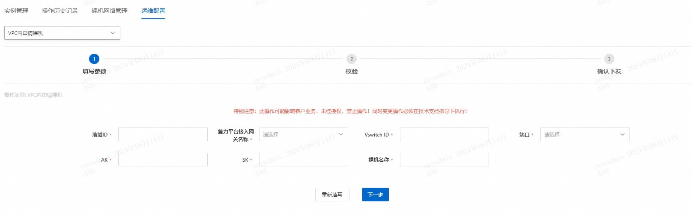

  </li>

  <li>

  参考下表，填写配置信息。

  | 名称 | 描述 |
  | --- | --- |
  | 地域ID | 当前环境的地域名称。 |
  | 算力平台接入网关名称 | 选择裸机连接到的算力平台接入网关的名称。 |
  | Vswitch ID | 填写裸机待加入的Vswitch ID值，可从专有云运营控制台中的专有网络VPC中获取。 |
  | 端口 | 选择裸机连接到算力平台接入网关的端口。 |
  | <strong>AK</strong>、<strong>SK</strong> | 可在专有云运营控制台上根据VPC所属的组织，在<strong>组织管理</strong>页面中获取。具体可参见《Apsara Uni-manager运营控制台 用户指南》中的<strong>管理组织</strong>章节。 |
  | 裸机名称 | 待申请加入VPC的裸机名称，不同裸机的裸机名称不能相同。 |

  </li>

  <li>

  完成后，单击**下一步**，验证信息。

  </li>

  <li>

  确认填写的内容无误后，单击**确认下发**。

  待配置下发成功后，页面会显示下发结果**成功**。配置下发成功后，您可在**裸机网络管理**页面根据裸机名称查询到该裸机已加入到VPC网络中。

  </li>

  </ol>

<a id="section-2-4-4-2"></a>

#### 2.4.4.2. VPC内释放裸机

在运维应急场景，使用该功能将裸机所属的算力平台接入网关的物理端口与VPC网络断开。

**背景信息**

> **警告**
>
> - 该操作必须在研发人员的指导下进行，切勿自行操作，以免影响业务的正常运行。
>
> - 此操作仅会操作裸机连接到算力平台接入网关的端口，不会对裸机进行任何操作，如果需要配置裸机的业务网口IP、路由等信息，请咨询对应的产品团队进行配置指导。
>
> - 一般情况下，不能使用此操作在VPC内释放裸机，而是应当由裸机管控调用API来删除裸机网络。

**操作步骤**

1. 登录Apsara Uni-manager运维控制台。

2. 在顶部菜单栏中选择**产品运维**>**网络运维**>**网络运维控制台**。

3. 在左侧导航栏上，单击**基础网络** > **算力平台接入网关**。

4. 单击**运维配置**页签。

5. 在页面左侧列表中，选择**VPC内释放裸机**。

   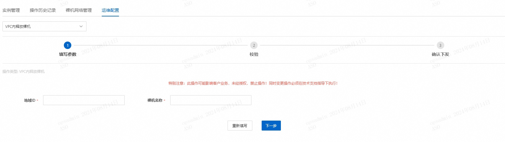

6. 参考下表，填写配置信息。

   | 名称 | 描述 |
   | --- | --- |
   | 地域ID | 当前环境的地域名称。 |
   | 裸机名称 | 待释放的裸机名称。可在<strong>裸机网络管理</strong>页面中获取裸机名称。 |

   > **说明**
   >
   > 如果输入错误，可在页面下方单击**重新填写**后，重新输入配置信息。

7. 完成后，单击**下一步**，验证信息。

8. 确认填写内容无误后，单击**确认下发**。

   待配置下发成功后，页面会显示下发结果**成功**。 配置下发成功后，您可在**裸机网络管理**页面根据裸机名称查询，发现VPC网络中已经没有该裸机。

<a id="section-2-4-4-3"></a>

#### 2.4.4.3. 删除路由表项

在运维应急场景下，您可以使用此功能删除VPC内指向裸机子网的路由表项和VBR上默认的路由表项。

> **警告**
>
> - 该操作必须在研发人员的指导下进行，切勿自行操作，以免影响业务的正常运行。
>
> - 一般情况下，不能使用此操作来删除VPC路由表项，本操作仅作为应急处理操作。
>
> - 本操作一次只能删除一条路由表项，如果需要删除多条路由表项，则需要多次执行本操作。

**操作步骤**

1. 登录Apsara Uni-manager运维控制台。

2. 在顶部菜单栏，选择**产品运维**>**网络运维**>**网络运维控制台**。

3. 在左侧导航栏上，单击**基础网络** > **算力平台接入网关**。

4. 单击**运维配置**页签。

5. 在页面左侧下拉列表中，选择**删除路由表项**。

   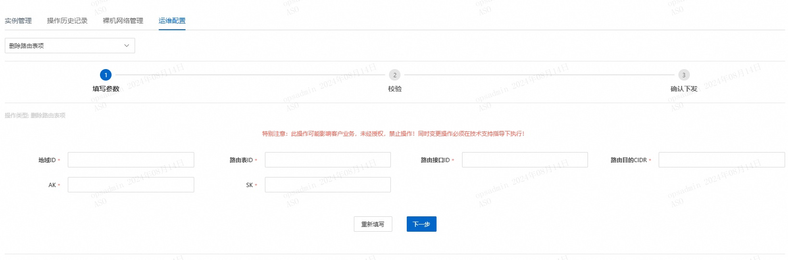

   <table>
     <tr>
       <th width="133">名称</th>
       <th>描述</th>
     </tr>
     <tr>
       <td>地域ID</td>
       <td>当前环境的地域名称。</td>
     </tr>
     <tr>
       <td>路由表ID</td>
       <td>可在<strong>裸机网络管理</strong>页面根据裸机名称查询后，获取详情中的<strong>VPC路由表ID</strong>或<strong>VBR路由表</strong><strong>ID</strong>值。</td>
     </tr>
     <tr>
       <td>路由器接口ID</td>
       <td>可在<strong>裸机网络管理</strong>页面根据裸机名称查询后，获取详情中的<strong>VPC路由器接口</strong>或<strong>VBR路由器</strong><strong>接口</strong>值。</td>
     </tr>
     <tr>
       <td>路由目的CIDR</td>
       <td>裸机子网的目标网段。可在<strong>裸机网络管理</strong>页面根据裸机名称查询后，获取详情中的<strong>裸机网络 CIDR</strong>。</td>
     </tr>
     <tr>
       <td><strong>AK</strong>、<strong>SK</strong></td>
       <td>裸机所属的组织AK和SK信息。可在专有云运营控制台上根据所属的组织，在<strong>组织管理</strong>页面中获取。具体可参见《Apsara Uni-manager运营控制台 用户指南》中的<strong>管理组织</strong>章节。</td>
     </tr>
   </table>

6. 完成后，单击**下一步**，验证信息。

7. 确认填写的内容无误后，单击**确认下发**。待配置下发成功后，页面会显示下发结果**成功**。

<a id="section-2-4-4-4"></a>

#### 2.4.4.4. 删除路由器接口

在运维应急场景下，可以使用此功能删除VPC的路由器接口和VBR路由器接口。

> **警告**
>
> 该操作必须在研发人员的指导下进行，切勿自行操作，以免影响业务的正常运行。

**操作步骤**

1. 登录Apsara Uni-manager运维控制台。

2. 在顶部菜单栏中选择**产品运维**> **网络运维**>**网络运维控制台**。

3. 在左侧导航栏上，单击**基础网络** > **算力平台接入网关**。

4. 单击**运维配置**页签。

5. 在页面左侧列表中，选择**删除路由器接口**。

6. 参考下表，填写配置信息。

   <table>
     <tr>
       <th width="124">名称</th>
       <th>描述</th>
     </tr>
     <tr>
       <td>地域ID</td>
       <td>当前环境的地域名称。</td>
     </tr>
     <tr>
       <td>路由器接口ID</td>
       <td>可在<strong>裸机网络管理</strong>页面根据裸机名称查询后，获取详情中<strong>VPC路由器接口</strong>或<strong>VBR路由器接</strong><strong>口</strong>值。</td>
     </tr>
     <tr>
       <td><strong>AK</strong>、<strong>SK</strong></td>
       <td>裸机所属的组织的AK和SK信息。可在专有云运营控制台上根据所属的组织，在<strong>组织管理</strong>页面中获取。具体可参见《Apsara Uni-manager运营控制台 用户指南》中的<strong>管理组织</strong>章节。</td>
     </tr>
   </table>

7. 完成后，单击**下一步**，验证信息。

8. 确认填写的内容无误后，单击**确认下发**。待配置下发成功后，页面会显示下发结果**成功**。

<a id="section-2-4-4-5"></a>

#### 2.4.4.5. 删除VBR

在运维应急场景下，可以使用此功能删除VBR。

> **警告**
>
> 该操作必须在研发人员的指导下进行，切勿自行操作，以免影响业务的正常运行。

**操作步骤**

1. 登录Apsara Uni-manager运维控制台。

2. 在顶部菜单栏中选择**产品运维**> **网络运维**>**网络运维控制台**。

3. 在左侧导航栏上，单击**基础网络** > **算力平台接入网关**。

4. 单击**运维配置**页签。

5. 在页面左侧列表中，选择**删除VBR**。

6. 参考下表，填写配置信息。

   <table>
     <tr>
       <th width="91">名称</th>
       <th>描述</th>
     </tr>
     <tr>
       <td>地域ID</td>
       <td>当前环境的地域名称。</td>
     </tr>
     <tr>
       <td>VBR ID</td>
       <td>待删除的VBR ID。可在<strong>裸机网络管理</strong>页面根据裸机名称查询后，获取详情中<strong>VBR ID</strong>值。</td>
     </tr>
     <tr>
       <td><strong>AK</strong>、<strong>SK</strong></td>
       <td>裸机所属VBR的组织的AK和SK信息。可在专有云运营控制台上根据VBR所属的组织，在<strong>组</strong><strong>织管理</strong>页面中获取。具体可参见《Apsara Uni-manager运营控制台 用户指南》中的<strong>管理组织</strong>章节。</td>
     </tr>
   </table>

7. 完成后，单击**下一步**，验证信息。

8. 确认填写的内容无误后，单击**确认下发**。

<a id="section-2-4-4-6"></a>

#### 2.4.4.6. 删除物理专线

在运维应急场景下，可以使用此功能删除物理专线。

> **警告**
>
> 该操作必须在研发人员的指导下进行，切勿自行操作，以免影响业务的正常运行。

**操作步骤**

1. 登录Apsara Uni-manager运维控制台。

2. 在顶部菜单栏中选择**产品运维**> **网络运维**>**网络运维控制台**。

3. 在左侧导航栏上，单击**基础网络** > **算力平台接入网关**。

4. 单击**运维配置**页签。

5. 在页面左侧列表中，选择**删除物理专线**。

6. 参考下表，填写配置信息。

   <table>
     <tr>
       <th width="109">名称</th>
       <th>描述</th>
     </tr>
     <tr>
       <td>地域ID</td>
       <td>当前环境的地域名称。</td>
     </tr>
     <tr>
       <td>物理专线ID</td>
       <td>待删除的物理专线ID。可在<strong>裸机网络管理</strong>页面根据裸机名称查询后，获取详情中<strong>物理专线ID</strong>值。</td>
     </tr>
     <tr>
       <td><strong>AK</strong>、<strong>SK</strong></td>
       <td>裸机所属VPC的组织的AK和SK信息。可在专有云运营控制台上根据VPC所属的组织，在<strong>组</strong><strong>织管理</strong>页面中获取。具体可参见《Apsara Uni-manager运营控制台 用户指南》中的<strong>管理组织</strong>章节。</td>
     </tr>
   </table>

7. 完成后，单击**下一步**，验证信息。

8. 确认填写的内容无误后，单击**确认下发**。

<a id="section-2-4-4-7"></a>

#### 2.4.4.7. 一键清除资源

在运维应急场景下，可以使用此功能一键清除资源。清除的资源包括VPC路由表项、VBR路由表项、VPC路由器接口、VBR路由器接口、VBR以及物理专线。

> **警告**
>
> 该操作必须在研发人员的指导下进行，切勿自行操作，以免影响业务的正常运行。

**操作步骤**

1. 登录Apsara Uni-manager运维控制台。

2. 在顶部菜单栏中选择**产品运维**> **网络运维**>**网络运维控制台**。

3. 在左侧导航栏上，单击**基础网络** > **算力平台接入网关**。

4. 单击**运维配置**页签。

5. 在页面左侧列表中，选择**一键清除资源**。

6. 参考下表，填写配置信息。

   | 名称 | 描述 |
   | --- | --- |
   | 地域ID | 当前环境的地域名称。 |
   | 算力平台接入网关名称 | 选择裸机连接到的算力平台接入网关的名称。 |
   | <strong>AK</strong>、<strong>SK</strong> | VPC所属组织的AK和SK信息，可在专有云控制台上根据VPC所属的组织，在<strong>组织管理</strong>页面中获取。具体可参见《Apsara Uni-manager运营控制台 用户指南》中的<strong>管理组织</strong>章节。 |
   | VPC路由接口ID | VPC路由接口ID。可在<strong>裸机网络管理</strong>页面根据裸机名称查询后，获取详情中的<strong>VPC路由接口</strong>值。 |
   | VPC路由表ID | VPC路由表ID。可在<strong>裸机网络管理</strong>页面根据裸机名称查询后，获取详情中的<strong>VPC路由表ID</strong>值。 |
   | VBR路由表ID | VBR路由表ID。可在<strong>裸机网络管理</strong>页面根据裸机名称查询后，获取详情中的<strong>VBR路由表ID</strong>值。 |
   | VPC CIDR1 | VPC内指向裸机子网的目标网段1。可在<strong>裸机网络管理</strong>页面根据裸机名称查询后，获取详情中的<strong>裸机网络 CIDR</strong>。 |
   | VPC CIDR2 | VPC内指向裸机子网的目标网段2。可在<strong>裸机网络管理</strong>页面根据裸机名称查询后，获取详情中的<strong>裸机网络 CIDR</strong>。 |
   | VBR路由接口ID | VBR路由接口ID。可在<strong>裸机网络管理</strong>页面根据裸机名称查询后，获取详情中的<strong>VBR路由器接口</strong>值。 |
   | VBR ID | 待删除的VBR ID。可在<strong>裸机网络管理</strong>页面根据裸机名称查询后，获取详情中的<strong>VBR ID</strong>值。 |
   | 物理专线ID | 待删除的物理专线 ID。可在<strong>裸机网络管理</strong>页面根据裸机名称查询后，获取详情中的<strong>物理专线ID</strong>值。 |
   | Trunk ID | Trunk ID为<strong>裸机网络管理</strong>页面中查看到的<strong>端口</strong>末尾的整数。如端口为10GE1/0/40，则Trunk ID为40。可以不填写。 |

7. 完成后，单击**下一步**，验证信息。

8. 确认填写的内容无误后，单击**确认下发**。

<a id="section-2-4-4-8"></a>

#### 2.4.4.8. 查看专线带宽

根据运维需要，查看系统中算力平台接入网关实例连接VPC时路由接口对应的专线带宽值。

**操作步骤**

1. 登录Apsara Uni-manager运维控制台。

2. 在顶部菜单中选择**产品运维** > **网络运维**> **网络运维控制台**。

3. 在左侧导航栏上，单击**基础网络** > **算力平台接入网关**。

4. 单击**运维配置**页签。

5. 在页面左侧下拉列表中，选择**查看专线带宽**。

6. 输入过滤条件，单击**查询**。系统显示符合条件的专线带宽信息。

   获取的带宽信息即为当前VPC在PHSW交换机上的专线带宽的规格字符串，再根据规格字符串和带宽对照表，得到以bit/s为单位的带宽值。

   **过滤条件表**

   <table>
     <tr>
       <th width="124">名称</th>
       <th>描述</th>
     </tr>
     <tr>
       <td>地域ID</td>
       <td>当前环境的地域名称。</td>
     </tr>
     <tr>
       <td>路由器接口ID</td>
       <td>即<strong>VBR路由器接口</strong>，可在<strong>裸机网络管理</strong>页签中根据指定VPC ID和算力平台接入网关名称查询后，单击操作列<strong>详情</strong>获取。</td>
     </tr>
     <tr>
       <td><strong>AK</strong>、<strong>SK</strong></td>
       <td>可在专有云运营控制台上根据VBR所属的组织，在<strong>组织管理</strong>页面中获取。具体可参见《Apsara Uni-manager运营控制台 用户指南》中的<strong>管理组织</strong>章节。</td>
     </tr>
   </table>

   **带宽对照表**

   | 规格字符串 | 带宽（单位bit/s） |
   | --- | --- |
   | Large.1 | 1G |
   | Large.2 | 2G |
   | Large.5 | 5G |
   | Xlarge.1 | 10G |
   | Xlarge.2 | 20G |
   | Xlarge.4 | 40G |
   | Xlarge.5 | 50G |
   | Xlarge.8 | 80G |
   | Xlarge.10 | 100G |
   | Xlarge.16 | 160G |
   | Xlarge.20 | 200G |

<a id="section-2-4-4-9"></a>

#### 2.4.4.9. 查看Trunk使用情况

通过查看Trunk的使用情况，可以及时了解硬件端口的使用情况。

**操作步骤**

1. 登录Apsara Uni-manager运维控制台。

2. 在顶部菜单栏中选择**产品运维**> **网络运维**>**网络运维控制台**。

3. 在左侧导航栏上，单击**基础网络** > **算力平台接入网关**。

4. 单击**运维配置**页签。

5. 在页面左侧列表中，选择**查看trunk使用情况**。

6. 输入Trunk ID、算力平台接入网关名称，并选择Trunk的状态（空闲、已使用、创建中、删除中），单击**搜索**。

   > **说明**
   >
   > Trunk ID为**裸机网络管理**页面中查到的**端口**末尾的整数。如端口号为10GE1/0/40，则Trunk ID为40。

7. 在列表中，查看符合筛选条件的Trunk。

<a id="section-2-4-4-10"></a>

#### 2.4.4.10. 查看BM VPN使用情况

通过显示BM VPN使用情况，可以查看系统中算力平台接入网关实例已经分配的BM VPN信息。

**操作步骤**

1. 登录Apsara Uni-manager运维控制台。

2. 在顶部菜单栏，选择**产品运维 > 网络运维 > 网络运维控制台**。

3. 在左侧导航栏上，单击**基础网络** > **算力平台接入网关**。

4. 单击**运维配置**页签。

5. 在页面左侧下拉列表中，选择**查看BMVPN使用情况**。

6. 输入**算力平台接入网关名称**、**vxlan id**、**BM VPN名称**，并选择状态（成功、创建中），单击**搜索**。

7. 在列表中，查看当前系统中符合查询条件的算力平台接入网关实例已经分配的BM VPN信息。

<a id="section-2-4-4-11"></a>

#### 2.4.4.11. 显示BD使用情况

通过查看BD使用情况，可以及时了解BD配置的下发情况。

**操作步骤**

1. 登录Apsara Uni-manager运维控制台。

2. 在顶部菜单栏中选择**产品运维**> **网络运维**>**网络运维控制台**。

3. 在左侧导航栏上，单击**基础网络** > **算力平台接入网关**。

4. 单击**运维配置**页签。

5. 在页面左侧列表中，选择**显示BD使用情况**。

6. 输入算力平台接入网关名称、BD ID、Vswitch ID，并选择状态（成功、创建中、删除中），单击**搜索**。

7. 在列表中，查看符合查询条件的BD。

<a id="section-2-4-4-12"></a>

#### 2.4.4.12. 检查初始化配置

使用该功能检查算力平台接入网关交换机的初始化配置是否完整。

> **说明**
>
> 该操作仅限于检查算力平台接入网关交换机初始化状态及初始化配置是否成功，不会对裸机进行任何操作。

**操作步骤**

1. 登录Apsara Uni-manager运维控制台。

2. 在顶部菜单栏中选择**产品运维**> **网络运维**>**网络运维控制台**。

3. 在左侧导航栏上，单击**基础网络** > **算力平台接入网关**。

4. 单击**运维配置**页签。

5. 在页面左侧列表中，选择**检查初始化配置**。

6. 参考下表，填写参数信息。

   <table>
     <tr>
       <th width="100">名称</th>
       <th>说明</th>
     </tr>
     <tr>
       <td>区域ID</td>
       <td>当前环境的地域名称。</td>
     </tr>
     <tr>
       <td>HSW名称</td>
       <td>待检查算力平台接入网关交换机的名称，即实例管理中的算力平台接入网关名称。</td>
     </tr>
   </table>

7. 参数填写完成后，单击**下一步**。

8. 确认参数无误后，单击**检查**，检查HSW交换机的初始化配置信息。

<a id="section-2-4-4-13"></a>

#### 2.4.4.13. 检查路由配置

使用该功能定位异常操作，对算力平台接入网关交换机进行扫描，检查裸机路由配置是否正确。

> **说明**
>
> 该操作仅限于检查裸机路由配置是否正常，不会对裸机进行任何操作。

**操作步骤**

1. 登录Apsara Uni-manager运维控制台。

2. 在顶部菜单栏中选择**产品运维**> **网络运维**>**网络运维控制台**。

3. 在左侧导航栏上，单击**基础网络** > **算力平台接入网关**。

4. 单击**运维配置**页签。

5. 在页面左侧列表中，选择**检查路由配置**。

6. 参考下表，填写参数信息。

   <table>
     <tr>
       <th width="91">名称</th>
       <th>描述</th>
     </tr>
     <tr>
       <td>区域ID</td>
       <td>当前环境的地域名称。</td>
     </tr>
     <tr>
       <td>裸机名称</td>
       <td>待检测裸机网络路由的裸机名称。可从<strong>裸机网络管理</strong>页面获取裸机名称。</td>
     </tr>
     <tr>
       <td><strong>AK</strong>、<strong>SK</strong></td>
       <td>裸机所属的组织的AK和SK信息。可在专有云运营控制台上根据所属的组织，在<strong>组织管</strong><strong>理</strong>页面中获取。具体可参见《Apsara Uni-manager运营控制台 用户指南》中的<strong>管理组织</strong>章节。</td>
     </tr>
   </table>

7. 参数填写完成后，单击**下一步**。

8. 参数确认无误后，单击**检查**，检查路由配置信息。

<a id="section-2-4-4-14"></a>

#### 2.4.4.14. 显示裸机网络网关信息

在裸机网络不通的运维应急场景下，可以使用该功能检查虚拟交换机的网关。

> **说明**
>
> 该操作仅限于检查Vswitch网关信息，不会对裸机进行任何操作。

**操作步骤**

1. 登录Apsara Uni-manager运维控制台。

2. 在顶部菜单栏中选择**产品运维**> **网络运维**>**网络运维控制台**。

3. 在左侧导航栏上，单击**基础网络** > **算力平台接入网关**。

4. 单击**运维配置**页签。

5. 在页面左侧列表中，选择**显示裸机网络网关信息**。

6. 参考下表，填写参数信息。

   <table>
     <tr>
       <th width="122">名称</th>
       <th>描述</th>
     </tr>
     <tr>
       <td>地域ID</td>
       <td>当前环境的地域名称。</td>
     </tr>
     <tr>
       <td>Vswitch ID</td>
       <td>裸机专用Vswitch ID值，可从专有云运营控制台中的专有网络VPC上获取。</td>
     </tr>
     <tr>
       <td>AK、SK</td>
       <td>可在专有云运营控制台上根据VPC所属的组织，在<strong>组织管理</strong>页面中获取。具体可参见《Apsara Uni-manager运营控制台 用户指南》中的<strong>管理组织</strong>章节。</td>
     </tr>
   </table>

7. 参数填写完成后，单击**下一步**。

8. 参数确认无误后，单击**检查**，检查虚拟交换机网关信息。

<a id="section-3"></a>

# 3.网络产品

<a id="section-3-1"></a>

## 3.1. CGW运维

> **说明**
>
> **CGW运维**菜单栏默认隐藏，如有**CGW运维**需求，请参考手册《Apsara Uni-manager运维控制台 用户指南》中**用户权限** > **菜单管理**章节，修改对应菜单配置，显示**CGW运维**菜单栏。

<a id="section-3-1-1"></a>

### 3.1.1. CGW集群管理

**操作步骤**

1. 登录Apsara Uni-manager运维控制台。

2. 在顶部菜单栏，选择**产品运维** > **网络运维** > **网络运维控制台**。

3. 在左侧导航栏，选择**网络产品** > **CGW运维** > **CGW集群管理**。

4. 选择**地域**后，可查看目标地域的**可用区列表**以及**集群拓扑关系**图。

   > **说明**
   >
   > 仅支持x86物理机形态管理。

   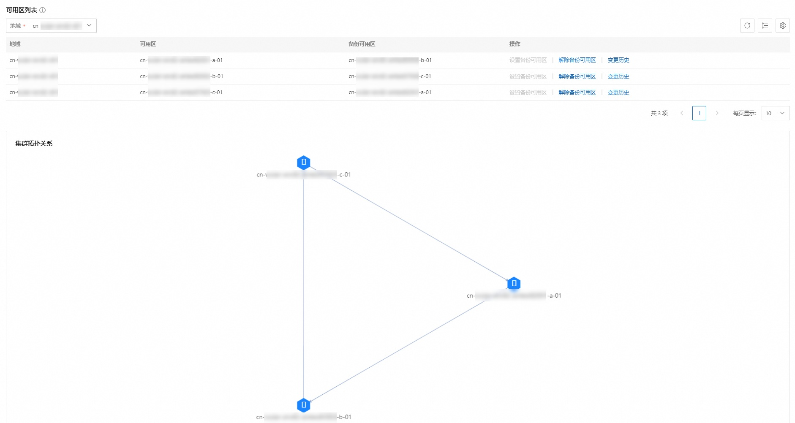

5. 单击目标可用区对应**操作**列的**设置备份可用区**。

   > **说明**
   >
   > 未配置备份可用区的可用区支持此操作。

6. 配置**选择备份可用区**后，单击**确定**。

   > **说明**
   >
   > - 备份可用区只支持相同Region、相同架构的集群。
   >
   > - 选择备份可用区时，该备份可用区不能已被其他可用区指定为备份。

   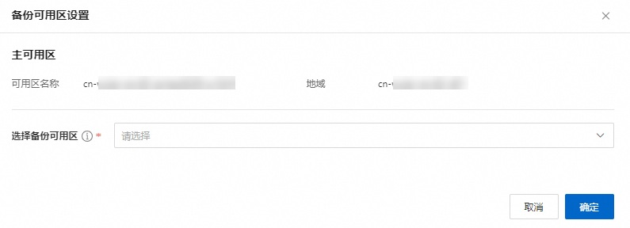

**相关操作**

**解除备份可用区**

> **说明**
>
> 已配置备份可用区的可用区支持此操作。

1. 单击目标可用区对应**操作**列的**解除备份可用区**。

2. 在弹出的对话框中单击**确定**。

**查看变更历史**

1. 单击目标可用区对应**操作**列的**变更历史**。

2. 在变更历史对话框中查看可用区的历史变更记录。

   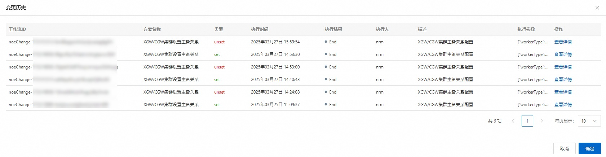

3. 单击目标变更记录对应**操作**列的**查看详情**，页面跳转至**方案执行详情**页，查看更详细的信息，具体可参考方案执行历史。

<a id="section-3-1-2"></a>

### 3.1.2. CGW管理

查看CGW网络产品的基本信息、运行状态、聚合流量及各设备节点的水位情况。

**前提条件**

BaseServiceAll产品的NetworkBaseServiceCluster集群已部署且已到达终态。

**操作步骤**

1. 登录Apsara Uni-manager运维控制台。

2. 在顶部菜单栏，选择**产品运维** > **网络运维** > **网络运维控制台**。

3. 在左侧导航栏，选择**网络产品** > **CGW运维** > **CGW管理**。

4. 在**CGW集群**页签下，选择需要查看的**集群**，系统将显示当前集群中的设备**节点信息**和**聚合流量**水位信息。

5. 在**节点信息**区域。

   - 查看节点列表：包括**Hostname**、**IDC**、**IP**和**State**。

   - 查看节点详情：在节点对应的的**操作**列中，单击**详情**进入到节点详情页面，查看节点水位数据，相关指标含义参考指标含义表。

     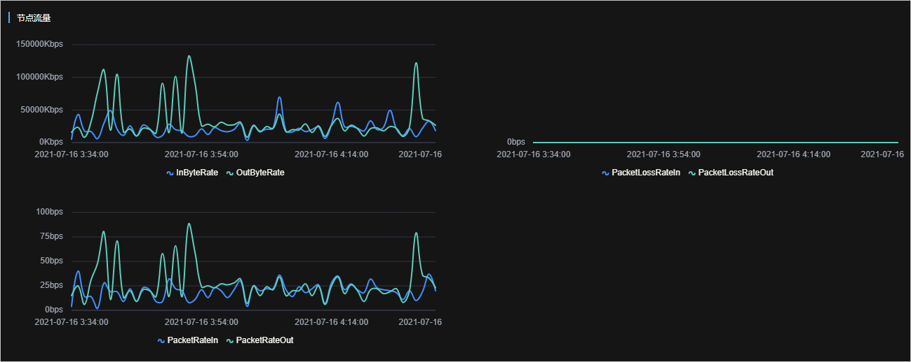

6. 在**聚合流量**区域，查看当前的设备节点水位流量信息。相关指标含义如下表所示。

   > **说明**
   >
   > - 起始时间与结束时间的范围不得超过24小时。
   >
   > - 单击**最近1小时**、**最近3小时**、**最近6小时**、**最近1天**快速查询对应时间范围内的水位数据信息。
   >
   > - 将鼠标悬停于图中任意一个时间节点，系统会显示该时间节点的所有指标的数值。

   **分类**

   **参数**

   **描述**

   入方向字节速率（比特/秒）

   **InByteRate**

   **ByteRate**

   出方向字节速率（比特/秒）

   **OutByteRate**

   入方向报文丢弃速率（个/秒）

   **PacketLossRateIn**

   **PacketLossRate**

   出方向报文丢弃速率（个/秒）

   **PacketLossRateOut**

   入方向报文速率（个/秒）

   **PacketRateIn**

   **PacketRate**

   出方向报文速率（个/秒）

   **PacketRateOut**

<a id="section-4"></a>

# 4.流量可视化

流量可视化可以对云平台中物理网络和虚拟网络进行监控，并对网络中的实时流量以及历史流量进行分析。还会按虚拟网络、公网访问、边界物理网络类型分析流量并生成可视化图表，您也可以根据流量数据或者流量监控指标排查并解决问题。

<a id="section-4-1"></a>

## 4.1. 可视化设置

在查看流量可视化前，需要先完成分析设备管理、采集规则管理、场景管理等初始化配置工作，以按照用户业务需求实现流量收集、处理、分析展示。

**操作流程**

流量可视化的初始化配置操作流程如下所示。


1. 新增分析器和新增分析口具体操作请参见分析设备管理。

2. 新增采集规则具体操作请参见采集规则管理。

3. 新增分析场景具体操作请参见场景管理。

<a id="section-4-1-1"></a>

### 4.1.1. 分析设备管理

分析设备包括分析器和分析口，流量的采集和分析依赖于分析设备。在进行流量采集和分析之前，需要先完成相关分析设备的创建。

- **分析器**是指进行流量分析的设备，也称为NPM。包括NPM物理机和NPM中控机2种服务器。

- **分析口**是指NPM设备的流量采集端口，作为采集分析指定场景流量的接收端口。

**管理分析器**

1. 登录Apsara Uni-manager运维控制台。

2. 在顶部菜单栏中选择**产品运维** > **网络运维** > **网络运维控制台**。

3. 在左侧导航栏，单击**流量可视化** > **可视化设置**。

4. 单击**分析设备管理**页签。

   | 操作任务 | 操作步骤 |
   | --- | --- |

   <table>
     <tr>
       <td>新增分析器</td>
       <td>i. 在<strong>分析器管理</strong>区域，单击列表上方的<strong>新增分析器</strong>。ii. 在<strong>新增分析器</strong>面板，填写分析器信息。<br>• <strong>可用区</strong>：选择分析器所在的可用区。<br>• <strong>分析器名称</strong>：自定义分析器的名称。<br>• <strong>分析器角色</strong>：NPM设备担任的角色。<br>• <strong>NPM物理机</strong>：流量收集、处理的作用。<br>• <strong>NPM中控机</strong>：流量分析展示的作用。<br>• <strong>银河安全网关</strong>：如果选择了<strong>银河安全网关</strong>，则配置VPC镜像规则的时候优先引流至<strong>银河流量网关</strong>，无需经过NPM设备。<br>• <strong>管理IP：</strong>NPM设备的IP地址<strong>。</strong><br>• <strong>用户名</strong>：NPM设备的用户名。<br>• <strong>密码</strong>：NPM设备的密码。<br>• <strong>序列号</strong>：NPM设备的序列号信息。<br>• <strong>Portal</strong>：指厂商NPM中控设备的Web页面地址，用于日常运维和管理NPM设备。该Portal由系统自动生成，在分析器创建完成后，可列表中查看。<br>• <strong>分析器说明</strong>：自定义分析器描述信息。iii. 单击<strong>确定</strong>。</td>
     </tr>
     <tr>
       <td>编辑分析器</td>
       <td>分析器名称和说明信息变更时可以进行修改。分析器角色和管理IP不支持修改。<br>i. 在<strong>分析器管理</strong>区域，单击目标分析器<strong>操作</strong>列的<strong>编辑</strong>。ii. 在<strong>编辑分析器</strong>面板，修改分析器名称和分析器说明。iii. 单击<strong>确定</strong>。</td>
     </tr>
     <tr>
       <td>删除分析器</td>
       <td>分析器不再需要时可以删除。<br>重要如果采集规则有关联该分析器，则分析器不支持删除。<br>i. 在<strong>分析器管理</strong>区域，单击目标分析器<strong>操作</strong>列的<strong>删除</strong>。ii. 单击<strong>确定</strong>。</td>
     </tr>
     <tr>
       <td>查看分析器</td>
       <td>i. 在<strong>分析器管理</strong>区域的列表中，查看<strong>设备ID</strong>、<strong>分析器名称</strong>、<strong>可用区</strong>、<strong>管理IP</strong>、<strong>授权状</strong><strong>态</strong>、<strong>运行状态</strong>、<strong>角色</strong>、<strong>说明</strong>、<strong>序列号</strong>、<strong>Portal</strong>、<strong>创建日期</strong>和<strong>修改时间</strong>。ii. 单击目标分析器<strong>操作</strong>列的<strong>详情</strong>。iii. 在<strong>详情</strong>面板，查看分析器详情信息。</td>
     </tr>
   </table>

**管理分析口**

1. 登录Apsara Uni-manager运维控制台。

2. 在顶部菜单栏中选择**产品运维**> **网络运维**>**网络运维控制台**。

3. 在左侧导航栏，单击**流量可视化**> **可视化设置**。

4. 单击**分析设备管理**页签。

   <table>
     <tr>
       <th width="138">操作任务</th>
       <th>操作步骤</th>
     </tr>
     <tr>
       <td>新增分析口</td>
       <td>i. 在<strong>分析口管理</strong>区域，单击列表上方的<strong>新增分析口</strong>。ii. 在<strong>新增分析口</strong>面板，填写分析口信息。<br>• <strong>分析口名称：</strong>自定义分析口的名称。<br>• <strong>分析器名称：</strong>选择对应的分析器。<br>• <strong>分析器物理接口名称：</strong>选择分析器对应的物理接口。<br>• <strong>分析口类型</strong>：选择分析口对应的类型。<br>• <strong>分析口IP</strong>：填写分析口的IP地址。<br>• <strong>说明</strong>：自定义分析口描述信息。iii. 单击<strong>确定</strong>。</td>
     </tr>
     <tr>
       <td>编辑分析口</td>
       <td>分析口名称、IP和说明信息变更时可以进行修改。<br>i. 在<strong>分析口管理</strong>区域，单击目标分析口<strong>操作</strong>列的<strong>编辑</strong>。ii. 在<strong>编辑分析口</strong>面板，修改分析口名称、分析口IP和说明。iii. 单击<strong>确定</strong>。</td>
     </tr>
     <tr>
       <td>删除分析口</td>
       <td>分析口不再需要时可以删除。<br>重要如果采集规则有关联该分析口，则分析口不支持删除。<br>i. 在<strong>分析口管理</strong>区域，单击目标分析口<strong>操作</strong>列的<strong>删除</strong>。ii. 单击<strong>确定</strong>。</td>
     </tr>
     <tr>
       <td>查看分析口详情</td>
       <td>i. 在<strong>分析口管理</strong>区域，单击目标分析口<strong>操作</strong>列的<strong>详情</strong>。ii. 在<strong>详情</strong>面板，查看分析口详情信息。</td>
     </tr>
   </table>

<a id="section-4-1-2"></a>

### 4.1.2. 采集规则管理

采集规则定义了流量的数据来源、分析模式等，以供分析设备按定义的采集规则进行流量采集和分析。

**前提条件**

新建采集规则前，请确保已完成分析器和分析口的新增。新增分析器和分析口具体参见分析设备管理。

**操作步骤**

1. 登录Apsara Uni-manager运维控制台。

2. 在顶部菜单栏，选择**产品运维** > **网络运维** > **网络运维控制台**。

3. 在左侧导航栏，选择**流量可视化**> **可视化设置**。

4. 在**采集规则管理**页签下，可以执行如下操作。

   <table>
     <tr>
       <th width="122">操作任务</th>
       <th>操作说明</th>
     </tr>
     <tr>
       <td>新增采集规则</td>
       <td>i. 在采集规则列表上方，单击<strong>新增采集规则</strong>。ii. 在<strong>新增采集规则</strong>面板，填写采集规则信息。具体参数可参见采集规则管理。iii. 单击<strong>确定</strong>。</td>
     </tr>
     <tr>
       <td>编辑采集规则</td>
       <td>i. 单击目标采集规则<strong>操作</strong>列的<strong>编辑</strong>。ii. 在编辑采集规则面板，修改<strong>规则名称</strong>和<strong>说明</strong>。iii. 单击<strong>确定</strong>。</td>
     </tr>
     <tr>
       <td>删除采集规则</td>
       <td>重要如果分析场景有关联该采集规则，则采集规则不支持删除。<br>i. 单击目标采集规则<strong>操作</strong>列的<strong>删除</strong>。ii. 单击<strong>确定</strong>。</td>
     </tr>
   </table>

   **采集规则表**

   | 名称 | 说明 |
   | --- | --- |
   | 可用区 | 选择采集规则所属的可用区。 |
   | 规则名称 | 自定义采集规则的名称。 |
   | 数据源类型 | 数据源的类型。<br>• <strong>弹性网卡</strong>：从弹性网卡进行流量采集。<br>• <strong>物理交换机</strong>：从物理交换机进行流量采集。<br>• <strong>ACK容器</strong>：从ACK容器进行流量采集。 |
   | 流量分析模式 | 流量分析的模式。数据源类型为<strong>弹性网卡</strong>或<strong>物理交换机</strong>时显示。<strong>流量镜像</strong>：指将流量完整地复制到分析口。 |
   | AliUid | 填写云接入网关对应一级组织在Apsara Uni-manager运营控制台上的AliUid，用于进行授权。数据源类型为<strong>弹性网卡</strong>或<strong>ACK容器</strong>时显示。<br>说明只有经授权后，本产品将会为该一级组织租户：创建VPC镜像、创建SLB资源、SLB后端挂接NPM服务器或流量网关。 |
   | ACK集群ID | 选择具体的ACK集群。数据源类型为<strong>ACK容器</strong>时显示。 |
   | 选择VPC | 选择弹性网卡或ACK集群所属的VPC。数据源类型为<strong>弹性网卡</strong>或<strong>ACK容器</strong>时显示。 |
   | 选择Vswitch | 选择相应的Vswitch。数据源类型为<strong>ACK容器</strong>时显示。 |
   | 选择ENI | 选择具体的弹性网卡。数据源类型为<strong>弹性网卡</strong>时显示。 |
   | 显示VPC镜像过滤规则 | 选择<strong>显示</strong>或<strong>隐藏</strong>。数据源类型为<strong>弹性网卡</strong>时显示。 |
   | 入方向规则的采集策略 | 可选择<strong>采集网络流量</strong>或<strong>不采集网络流量</strong>。<strong>当显示VPC镜像过滤规则为显示时参数</strong>可见。 |
   | 入方向规则网络流量的源地址网段 | 指定<strong>入方向规则网络流量的源地址网段</strong>。当<strong>显示VPC镜像过滤规则</strong>为<strong>显示</strong>时参数可见。 |
   | 入方向规则网络流量的源端口范围 | 端口范围为1~65535，使用正斜线（/）隔开起始端口和终止端口，格式为1/200、80/80。当协议类型取值为<strong>ALL</strong>或<strong>ICMP</strong>时，该参数无需设置，表示不限制端口。当<strong>显示VPC镜像过滤规则</strong>为<strong>显示</strong>时参数可见。 |
   | 入方向需要镜像的网络流量使用的协议类型 | 可选择<strong>ALL</strong>、<strong>ICMP</strong>、<strong>TCP</strong>、<strong>UDP</strong>。当<strong>显示VPC镜像过滤规则</strong>为<strong>显示</strong>时参数可见。 |
   | 入方向规则网络流量的目的地址网段 | 指定<strong>入方向规则网络流量的目的地址网段</strong>。当<strong>显示VPC镜像过滤规则</strong>为<strong>显示</strong>时参数可见。 |
   | 入方向规则网络流量的目的端口范围 | 端口范围为1~65535，使用正斜线（/）隔开起始端口和终止端口，格式为1/200、80/80。当协议类型取值为<strong>ALL</strong>或<strong>ICMP</strong>时，该参数无需设置，表示不限制端口。当<strong>显示VPC镜像过滤规则</strong>为<strong>显示</strong>时参数可见。 |
   | 出方向规则的采集策略 | 可选择<strong>采集网络流量</strong>或<strong>不采集网络流量</strong>。当<strong>显示VPC镜像过滤规则</strong>为<strong>显示</strong>时参数可见。 |
   | 出方向规则网络流量的源地址网段 | 指定<strong>出方向规则网络流量的源地址网段</strong>。当<strong>显示VPC镜像过滤规则</strong>为<strong>显示</strong>时参数可见。 |
   | 出方向规则网络流量的源端口范围 | 端口范围为1~65535，使用正斜线（/）隔开起始端口和终止端口，格式为1/200、80/80。当协议类型取值为<strong>ALL</strong>或<strong>ICMP</strong>时，该参数无需设置，表示不限制端口。当<strong>显示VPC镜像过滤规则</strong>为<strong>显示</strong>时参数可见。 |
   | 出方向需要镜像的网络流量使用的协议类型 | 可选择<strong>ALL</strong>、<strong>ICMP</strong>、<strong>TCP</strong>、<strong>UDP</strong>。当<strong>显示VPC镜像过滤规则</strong>为<strong>显示</strong>时参数可见。 |
   | 出方向规则网络流量的目的地址网段 | 指定<strong>出方向规则网络流量的目的地址网段</strong>。当<strong>显示VPC镜像过滤规则</strong>为<strong>显示</strong>时参数可见。 |
   | 出方向规则网络流量的目的端口范围 | 端口范围为1~65535，使用正斜线（/）隔开起始端口和终止端口，格式为1/200、80/80。当协议类型取值为<strong>ALL</strong>或<strong>ICMP</strong>时，该参数无需设置，表示不限制端口。当<strong>显示VPC镜像过滤规则</strong>为<strong>显示</strong>时参数可见。 |
   | SLB类型 | 数据源类型为弹性网卡时可选择<strong>使用已有SLB实例</strong>或<strong>创建新SLB实例</strong>，为ACK容器时可选择<strong>数据通道</strong>或<strong>信令通道</strong>。数据源类型为<strong>弹性网卡</strong>或<strong>ACK容器</strong>时显示。<br>说明选择<strong>创建新SLB实例</strong>时，系统自动创建一个新的SLB实例。 |
   | SLB实例 | 选择已有的SLB实例资源。数据源类型为<strong>弹性网卡</strong>，并且SLB类型选择<strong>使用已有</strong><strong>SLB实例</strong>时显示。 |
   | SLB后端设备名称 | 指定SLB后端采集的分析器。数据源类型为<strong>弹性网卡时</strong>或<strong>ACK容器</strong>时显示。 |
   | SLB后端设备分析口名称 | 指定SLB后端采集的分析口。数据源类型为<strong>弹性网卡</strong>或<strong>ACK容器</strong>时显示。 |
   | 数据源宿主设备 | 选择物理交换机的宿主设备。数据源类型为<strong>物理交换机</strong>时显示。 |
   | 数据源宿主设备端口名称 | 选择物理交换宿主设备的端口。数据源类型为<strong>物理交换机</strong>时显示。 |
   | 数据源端口ID | 根据选择的数据源宿主设备和数据源宿主设备端口名称自动匹配。数据源类型为<strong>物理交换机</strong>时显示。 |
   | 分析器名称 | 指定采集的分析器。数据源类型为<strong>物理交换机</strong>时显示。 |
   | 分析口名称 | 指定采集的分析口。数据源类型为<strong>物理交换机</strong>时显示。 |
   | 分析口VLANID | 填写分析口的VLANID。数据源类型为<strong>物理交换机</strong>时显示。 |
   | 说明 | 采集规则的描述信息。 |

<a id="section-4-1-3"></a>

### 4.1.3. 场景管理

根据实际业务，可以关联不同的采集规则，以满足不同流量分析场景的需求。

**前提条件**

新建分析场景前，请确保已完成采集规则的新增。新增采集规则具体参见采集规则管理。

**操作步骤**

1. 登录Apsara Uni-manager运维控制台。

2. 在顶部菜单栏中选择**产品运维** > **网络运维** > **网络运维控制台**。

3. 在左侧导航栏，单击**流量可视化** > **可视化设置**。

4. 单击**场景管理**页签。

   <table>
     <tr>
       <th width="122">操作任务</th>
       <th>操作说明</th>
     </tr>
     <tr>
       <td>新增分析场景</td>
       <td>i. 在分析场景列表上方，单击<strong>新建分析场景</strong>。ii. 在<strong>新增场景</strong>面板，填写场景信息。<br>• <strong>可用区</strong>：选择场景所属可用区。<br>• <strong>场景名称</strong>：自定义场景名称。<br>• <strong>网络类型</strong>：选择分析场景的网络类型。<br>• <strong>VPC</strong>：虚拟网络类型。<br>• <strong>BORDER</strong>：边界物理网络类型。<br>• <strong>采集规则</strong>：选择分析场景需要关联的采集规则，支持多选。<br>• <strong>说明</strong>：自定义场景描述信息。iii. 单击<strong>确定</strong>。</td>
     </tr>
     <tr>
       <td>编辑分析场景</td>
       <td>分析场景信息有变更时，可以进行修改。<br>i. 单击目标场景<strong>操作</strong>列的<strong>编辑</strong>。ii. 在<strong>编辑场景</strong>面板，修改场景信息。iii. 单击<strong>确定</strong>。</td>
     </tr>
     <tr>
       <td>删除分析场景</td>
       <td>分析场景不需要时，可以进行删除。<br>i. 单击目标场景<strong>操作</strong>列的<strong>删除</strong>。ii. 单击<strong>确定</strong>。</td>
     </tr>
   </table>

<a id="section-4-2"></a>

## 4.2. 可视化概览

可视化概览以趋势图和饼图的形式展示虚拟网络、边界物理网络类型流量情况。便于用户查看历史和实时流量，并根据业务场景进行统计分析。

**前提条件**

已完成流量可视化初始配置，具体操作请参见可视化设置。

**操作步骤**

1. 登录Apsara Uni-manager运维控制台。

2. 在顶部菜单栏中选择**产品运维** > **网络运维** > **网络运维控制台**。

3. 在左侧导航栏，单击**流量可视化** > **可视化概览**。

4. 在页面右上方选择起止时间，查看该时间段内的流量情况。

   <table>
     <tr>
       <th>统计项</th>
       <th>描述</th>
       <th>更多操作</th>
     </tr>
     <tr>
       <td>网络流数量</td>
       <td>展示在选择时间段内<strong>虚拟网络</strong>、<strong>边界物理网络</strong>类型全部场景流量的流数目。</td>
       <td>单击数字可跳转到<strong>流搜索与调度</strong>页面。</td>
     </tr>
     <tr>
       <td>资源统计</td>
       <td>展示在选择时间段内的<strong>VPC数量、EIP数量</strong>、<strong>ECS数</strong><strong>量</strong>。</td>
       <td>无。</td>
     </tr>
     <tr>
       <td>虚拟网络</td>
       <td>展示在选择时间段内<strong>虚拟网络</strong>类型不同指标的<strong>流量趋</strong><strong>势</strong>、<strong>占比分布</strong>和<strong>排行概览</strong>情况。</td>
       <td rowspan="2">• 单击<strong>查看详情</strong>跳转到详情对话框，在详情对话框选择<strong>网络类型</strong>、<strong>场</strong><strong>景</strong>、<strong>起止时间</strong>，然后<strong>选择指标</strong>查看不同场景下的<strong>流量趋势</strong>、<strong>占比分</strong><strong>布</strong>、<strong>排行概览</strong>。<br>• 单击<strong>选择指标</strong>选择需要查看的指标。</td>
     </tr>
     <tr>
       <td>边界物理网络</td>
       <td>展示在选择时间段内<strong>边界物理网络</strong>类型不同指标的<strong>流</strong><strong>量趋势</strong>、<strong>占比分布</strong>和<strong>排行概览</strong>情况。</td>
     </tr>
   </table>

   

<a id="section-4-3"></a>

## 4.3. 流搜索与调度

通过流搜索与调度可以查看更详细的流数据并进行流量调度，以均衡的处理系统中的任务，高效地利用系统资源。

**操作步骤**

1. 登录Apsara Uni-manager运维控制台。

2. 在顶部菜单栏中选择**产品运维** > **网络运维** > **网络运维控制台**。

3. 在左侧导航栏，单击**流量可视化** > **流搜索与调度**。

4. 单击**二元组**或**五元组**，展开**高级筛选**设置筛选条件后，单击**搜索**。

   | 类型 | 高级筛选条件 |
   | --- | --- |
   | 二元组 | 二元组指通过<strong>源IP</strong>和<strong>目的IP</strong>来确定网络流量。<br>• <strong>起止时间</strong>：选择开始时间和结束时间。<br>• <strong>网络类型</strong>：选择<strong>VPC</strong>或<strong>BORDER</strong>。<br>• <strong>场景</strong>：选择需要查询的具体场景。<br>• <strong>源VPC ID</strong>：仅网络类型为<strong>VPC</strong>时支持填写。<br>• <strong>目的VPC ID</strong>：仅网络类型为<strong>VPC</strong>时支持填写。<br>• <strong>源Vswitch ID</strong>：仅网络类型为<strong>VPC</strong>时支持填写。<br>• <strong>目的Vswitch ID</strong>：仅网络类型为<strong>VPC</strong>时支持填写。<br>• <strong>源云产品</strong>：仅网络类型为<strong>BORDER</strong>时支持选择。<br>• <strong>目的云产品</strong>：仅网络类型为<strong>BORDER</strong>时支持选择。<br>• <strong>源IP</strong>：源IP地址，同时支持按网段搜索。<br>• <strong>目的IP</strong>：目的IP地址，同时支持按网段搜索。<br>• <strong>关键指标</strong>：支持选择多个指标。<br>• <strong>排序依据指标</strong>：选择依据哪个指标进行排序。<br>• <strong>排序规则</strong>：选择升序、降序。<br> |

   | 五元组 | 五元组指通过<strong>源IP</strong>、<strong>源端口</strong>、<strong>目的IP</strong>、<strong>目的端口</strong>、<strong>协议类型</strong>来确定网络流量。<br>• <strong>起止时间</strong>：选择开始时间和结束时间。<br>• <strong>网络类型</strong>：选择<strong>VPC</strong>或<strong>BORDER</strong>。<br>• <strong>场景</strong>：选择需要查询的具体场景。<br>• <strong>源VPC ID</strong>：仅网络类型为<strong>VPC</strong>时支持填写。<br>• <strong>目的VPC ID</strong>：仅网络类型为<strong>VPC</strong>时支持填写。<br>• <strong>源Vswitch ID</strong>：仅网络类型为<strong>VPC</strong>时支持填写。<br>• <strong>目的Vswitch ID</strong>：仅网络类型为<strong>VPC</strong>时支持填写。<br>• <strong>源云产品</strong>：仅网络类型为<strong>BORDER</strong>时支持选择。<br>• <strong>目的云产品</strong>：仅网络类型为<strong>BORDER</strong>时支持选择。<br>• <strong>协议类型</strong>：选择<strong>只显示TCP流量</strong>、<strong>只显示UDP流量</strong>或<strong>其他类型流量</strong>。<br>• <strong>源IP</strong>：源IP地址，同时支持按网段搜索。<br>• <strong>目的IP</strong>：目的IP地址，同时支持按网段搜索。<br>• <strong>源端口</strong>：源端口号。<br>• <strong>目的端口</strong>：目的端口号。<br>• <strong>关键指标</strong>：支持选择多个指标。<br>• <strong>排序依据指标</strong>：选择依据哪个指标进行排序。<br>• <strong>排序规则</strong>：选择升序、降序。<br> |
   | --- | --- |

5. 在列表中，查看符合筛选条件的流量信息。

   - **查看二元组流量详情**

     <ol type="a">

     <li>

     单击二元组目标流量**操作**列的**详情**。

     </li>

     <li>

     在**流量详情**面板，查看**云网络关联信息**和**流量趋势**。

     

     </li>

     </ol>

     <ol type="i" start="100">

     <li>

     （可选）单击二元组目标流量**操作**列的**五元组展开**，自动跳转到五元组列表。

     </li>

     </ol>

   - **查看五元组流量详情**

     五元组列表中可以查看更详细（协议类型、源IP、目的IP、源端口、目的端口确定的网络流量）的流量信息。

     <ol type="a">

     <li>

     单击五元组目标流量**操作**列的**详情**。

     </li>

     <li>

     在**流量详情**面板，查看**云网络关联信息**和**流量趋势**。

     

     </li>

     </ol>
