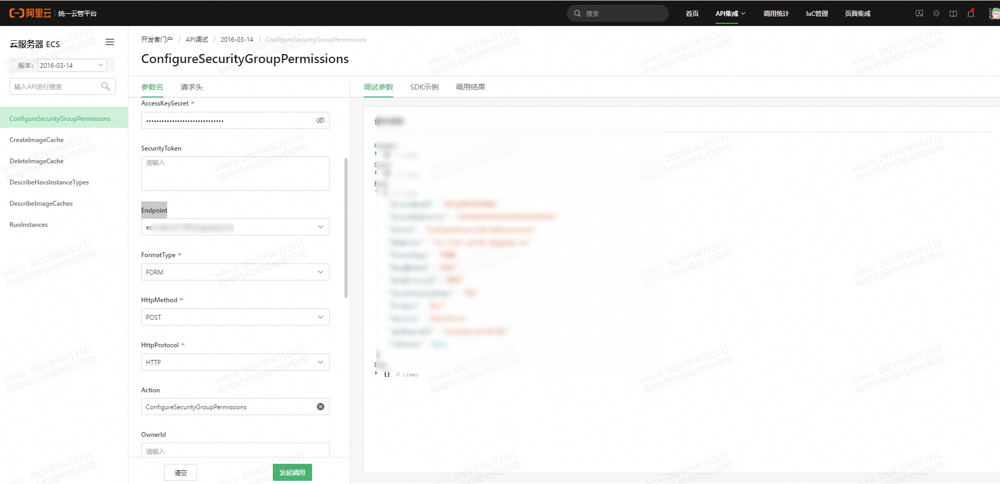

阿里云  
专有云  
弹性公网IP  
开发指南  
产品版本：V3.18.3  
文档版本：20241025

**目录**

- [1.准备工作](#section-1)
    - [1.1. 登录开发者门户](#section-1-1)
    - [1.2. 获取API信息及其EndPoint](#section-1-2)
    - [1.3. 获取AccessKey](#section-1-3)
    - [1.4. 获取STS AccessKey](#section-1-4)
    - [1.5. 获取公共Header参数](#section-1-5)
    - [1.6. 获取EIP的SDK包](#section-1-6)
- [2.Java SDK调用示例](#section-2)
    - [2.1. 快速开始](#section-2-1)
    - [2.2. 使用手册](#section-2-2)
        - [2.2.1. 安装Java SDK](#section-2-2-1)
        - [2.2.2. 设置身份验证凭证](#section-2-2-2)
        - [2.2.3. 请求连接配置](#section-2-2-3)
        - [2.2.4. 发起调用](#section-2-2-4)
        - [2.2.5. 错误处理](#section-2-2-5)
        - [2.2.6. 使用CommonRequest进行调用](#section-2-2-6)
- [3.Python SDK调用示例](#section-3)
    - [3.1. 快速开始](#section-3-1)
    - [3.2. 使用手册](#section-3-2)
        - [3.2.1. 安装Python SDK](#section-3-2-1)
        - [3.2.2. 设置身份验证凭证](#section-3-2-2)
        - [3.2.3. 设置HTTPS请求](#section-3-2-3)
        - [3.2.4. 发起调用](#section-3-2-4)
        - [3.2.5. 错误处理](#section-3-2-5)
        - [3.2.6. 使用CommonRequest进行调用](#section-3-2-6)
- [4.Go SDK调用示例](#section-4)
    - [4.1. 快速开始](#section-4-1)
    - [4.2. 使用手册](#section-4-2)
        - [4.2.1. 安装Go SDK核心包](#section-4-2-1)
        - [4.2.2. 设置身份验证凭证](#section-4-2-2)
        - [4.2.3. 发起调用](#section-4-2-3)
        - [4.2.4. 错误处理](#section-4-2-4)
        - [4.2.5. 使用CommonRequest进行调用](#section-4-2-5)
- [5.API参考](#section-5)
    - [5.1. API概览](#section-5-1)
    - [5.2. 调用API](#section-5-2)
        - [5.2.1. 请求结构](#section-5-2-1)
        - [5.2.2. API授权](#section-5-2-2)
        - [5.2.3. API签名](#section-5-2-3)
    - [5.3. RAM鉴权](#section-5-3)
    - [5.4. 公共参数](#section-5-4)
    - [5.5. 弹性公网IP](#section-5-5)
        - [5.5.1. AllocateEipAddress](#section-5-5-1)
        - [5.5.2. AllocateEipAddressPro](#section-5-5-2)
        - [5.5.3. AssociateEipAddress](#section-5-5-3)
        - [5.5.4. AllocateEipSegmentAddress](#section-5-5-4)
        - [5.5.5. DescribeEipSegment](#section-5-5-5)
        - [5.5.6. ReleaseEipSegmentAddress](#section-5-5-6)
        - [5.5.7. ModifyEipAddressAttribute](#section-5-5-7)
        - [5.5.8. DescribeEipAddresses](#section-5-5-8)
        - [5.5.9. UnassociateEipAddress](#section-5-5-9)
        - [5.5.10. ReleaseEipAddress](#section-5-5-10)
        - [5.5.11. DescribeEipGatewayInfo](#section-5-5-11)
        - [5.5.12. DescribeEipMonitorData](#section-5-5-12)
        - [5.5.13. MoveResourceGroup](#section-5-5-13)
        - [5.5.14. DescribeHighDefinitionMonitorLogAttribute](#section-5-5-14)
- [6.附录](#section-6)
    - [6.1. STS概要](#section-6-1)
        - [6.1.1. 什么是STS](#section-6-1-1)
        - [6.1.2. AssumeRole](#section-6-1-2)

<a id="section-1"></a>

# 1.准备工作

<a id="section-1-1"></a>

## 1.1. 登录开发者门户

您可以通过Apsara Uni-manager运营控制台登录开发者门户。

**前提条件**

- 登录Apsara Uni-manager运营控制台前，确认您已从部署人员处获取Apsara Uni-manager运营控制台的服务域名地址。

- 推荐使用Chrome浏览器。

**操作步骤**

1. 在浏览器地址栏中，输入Apsara Uni-manager运营控制台的服务域名地址，按回车键。

2. 输入正确的用户名及密码。

   请向运营管理员获取登录控制台的用户名和密码。

   > **说明**
   >
   > 首次登录Apsara Uni-manager运营控制台时，需要修改登录用户名的密码，请按照提示完成密码修改。为提高安全性，密码长度必须为10~32位，且至少包含以下两种类型：
   >
   > - 英文大写或小写字母（A~Z、a~z）
   >
   > - 阿拉伯数字（0~9）
   >
   > - 特殊符号（感叹号（!）、at（@）、井号（#）、美元符号（$）、百分号（%）等）

3. 单击**登录**。

4. 如果账号已激活MFA多因素认证，请根据以下两种情况进行操作：

   - 管理员强制开启MFA后的首次登录：

     <ol type="a">

     <li>

     在绑定虚拟MFA设备页面中，按页面提示步骤绑定MFA设备。

     </li>

     <li>

     按照步骤2重新输入账号和密码，单击**登录**。

     </li>

     </ol>

     <ol type="i" start="100">

     <li>

     输入6位MFA码后单击**认证**。

     </li>

     </ol>

   - 您已开启并绑定MFA：

     输入6位MFA码后单击**认证**。

     > **说明**
     >
     > 绑定并开启MFA的操作请参见<strong>《Apsara Uni-manager运营控制台用户指南》</strong>中的<strong>《绑定并开启虚拟MFA设备》</strong>章节。

5. 在页面顶部的菜单栏中，选择**产品 > 应用服务 > 开发者门户**。

<a id="section-1-2"></a>

## 1.2. 获取API信息及其EndPoint

首先，您需要了解产品开放API接口的相关信息，包括产品名称（code）、开放API接口名称、API版本。

**背景信息**

Apsara Uni-manager运营控制台API目录中的API信息仅供调用参考，具体API的使用方式需要参见云产品的开发指南。如果发生不一致情况，以开发指南支持情况为准。

**操作步骤**

1. 登录Apsara Uni-manager运营控制台。

2. 在顶部菜单栏选择**产品** > **应用服务** > **开发者门户**。

3. 在**开发者门户**页面，选择**API集成** > **API调试**。

   

4. 在左侧导航栏中选择目标云产品。

5. 在**版本**下拉列表中，选择目标API版本。

6. 在下方API列表中可浏览当前版本的所有API接口。

7. 选中对应接口，在参数名下获取云产品的POP Endpoint信息。

   

<a id="section-1-3"></a>

## 1.3. 获取AccessKey

AccessKey支持RAM和STS两种授权模式，在发起调用时选择使用其中一种AccessKey即可。本文将为您介绍如何获取通过RAM授权的AccessKey。

**背景信息**

AccessKey通过使用AccessKey ID和AccessKey Secret对称加密，实现验证某个请求发送者的身份的功能。其中AccessKey ID用于标识用户，AccessKey Secret是用户用于加密签名的字符串。

AccessKey的两种授权模式如下：

- 通过RAM授权给第三方请求者的AccessKey ID和AccessKey Secret。

- 通过STS授权给第三方请求者的AccessKey ID、AccessKey Secret和Security Token。获取方式请参见获取STS AccessKey。

Apsara Uni-manager运营控制台提供了个人AccessKey和组织AccessKey（只有运营管理员和一级组织管理员可以获取组织AccessKey），推荐使用个人账号AccessKey调用Apsara Uni-manager运营控制台及云产品相关接口。如果使用个人账号AccessKey，需要在Header中添加以下限制性参数，否则可能提示权限不足：

> **警告**
>
> 个人账号AccessKey是由Apsara Uni-manager运营控制台权限体系管控的受限AccessKey，组织AccessKey相对权限较大，需要管理员确认操作的安全性。

<table>
  <tr>
    <th width="206">参数名称</th>
    <th>描述</th>
  </tr>
  <tr>
    <td>x-acs-regionid</td>
    <td>地域，如：cn-hangzhou-*。</td>
  </tr>
  <tr>
    <td>x-acs-organizationid</td>
    <td>Apsara Uni-manager运营控制台中对应的组织ID。获取方法可参见<strong>《Apsara Uni-manager运营控制台开</strong><strong>发指南》</strong>中的<strong>《GetOrganizationList》</strong>章节。</td>
  </tr>
  <tr>
    <td>x-acs-resourcegroupid</td>
    <td>Apsara Uni-manager运营控制台中对应的资源集ID。获取方法可参见<strong>《Apsara Uni-manager运营控制台</strong><strong>开发指南》</strong>中的<strong>《ListResourceGroup》</strong>章节。</td>
  </tr>
  <tr>
    <td>x-acs-instanceid</td>
    <td>进行操作的实例ID，例如，ECS的实例ID可以从ECS列表中查询到。</td>
  </tr>
</table>

**获取个人账号AccessKey**

获取个人账号AccessKey的方法如下：

1. 登录Apsara Uni-manager运营控制台。

2. 在系统界面右上角，单击当前登录用户头像，单击**个人信息**。

3. 在**阿里云AccessKey**区域，您可以查看个人账户的AccessKey信息。

   

   > **说明**
   >
   > Accesskey ID和AccessKey Secret是您访问云资源时的密钥，具有该账号完整的权限，请您妥善保管。

**获取组织AccessKey**

获取组织AccessKey的方法如下：

1. 管理员登录Apsara Uni-manager运营控制台。

2. 在顶部菜单栏，单击**企业**。

3. 在左侧导航栏中，选择**资源管理 > 组织管理**。

4. 在组织结构中，单击目标一级组织名称。

5. 单击**管理Accesskey**。

6. 在弹出的对话框中，查看组织AccessKey信息。

<a id="section-1-4"></a>

## 1.4. 获取STS AccessKey

本文为您介绍如何利用STS方式，调用专有云的产品API。

**背景信息**

阿里云临时安全令牌STS（Security Token Service）是阿里云提供的一种临时访问权限管理服务。您可以选择使用STS方式，调用专有云的产品API。

STS AccessKey由AccessKey ID、AccessKey Secret及SecurityToken三元组组成，使用STS方式调用云产品API时，三元组缺一不可。更多STS内容请参见什么是STS。

**操作步骤**

1. 获取用户角色的 `RAM Role` 。

   <ol type="i">

   <li>

   登录Apsara Uni-manager运营控制台。

   </li>

   <li>

   单击页面右上角的用户头像，单击**个人信息**。

   </li>

   <li>

   单击**查看当前角色策略**。

   在**当前选择角色策略**对话框中查看 `RAM Role` 。

   </li>

   </ol>

2. 获取STS Accesskey三元组。

   > **说明**
   >
   > 以下代码示例中可变参数均需替换为您实际的相关信息，尖括号（<>）在最终代码中不保留。
   >
   > 涉及替换的可变参数如下：
   >
   > - &lt;yourRegionID>，请替换为您实际的地域ID。
   >
   > - &lt;yourAccessKeyID>，请替换为您实际的AccessKey ID。
   >
   > - &lt;yourAccessKeySecret>，请替换为您实际的AccessKey Secret。
   >
   > - &lt;yourRoleSessionName>，请替换为您当前实际的会话名称。
   >
   > - &lt;yourRoleArn>，请替换为您实际的RAM Role。
   >
   > - "sts.aliyuns.com" ，请替换为实际的STS Endpoint。

   ```xml
   public static void main(String[] args) {
       // 创建DefaultAcsClient实例并初始化。
       // 请替换为您实际的地域ID、AccessKey ID、AccessKey Secret
       DefaultProfile profile = DefaultProfile.getProfile("<yourRegionID>", "
   <yourAccessKeyID>", "<yourAccessKeySecret>");
       HttpClientConfig clientConfig = HttpClientConfig.getDefault();
       clientConfig.setIgnoreSSLCerts(true);
       clientConfig.setProtocolType(ProtocolType.HTTPS);
       profile.setHttpClientConfig(clientConfig);
       IAcsClient client = new DefaultAcsClient(profile);
       String assumeRole = callAssumeRole(client);
       if (StringUtils.isEmpty(assumeRole)) return;
       JSONObject assumeRoleJson = JSONObject.parseObject(assumeRole);
       JSONObject credentials = assumeRoleJson.getJSONObject("Credentials");
       // 获取到STS三元组
       String stsAK = credentials.getString("AccessKeyId");
       String stsSK = credentials.getString("AccessKeySecret");
       String stsToken = credentials.getString("SecurityToken");
   }

   private static String callAssumeRole(IAcsClient client) {
       CommonRequest request = new CommonRequest();
       // "sts.aliyuns.com" 请替换为实际的STS Endpoint，⼀般格式为sts-
   vpc.${global:region}.${global:internet-domain}
       request.setSysDomain("sts.aliyuns.com");
       request.setSysProduct("Sts");
       request.setSysAction("AssumeRole");
       request.setSysVersion("2015-04-01");
       request.setSysMethod(MethodType.POST);
       request.setHttpContentType(FormatType.FORM);
       // 业务参数，设置本次调⽤Session的别名，"<yourRoleSessionName>"请您替换为实际值
       request.putQueryParameter("RoleSessionName", "<yourRoleSessionName>");
       // 扮演的Role⾓⾊ARN，"<yourRoleArn>"请替换为上⼀步获取到的实际Ram Role ARN
       request.putQueryParameter("RoleArn", "<yourRoleArn>");
       try {
           CommonResponse response = client.getCommonResponse(request);
           return response.getData();
       } catch (ServerException e) {
           System.out.println(e.getErrCode());
           System.out.println(e.getErrMsg());
       } catch (ClientException e) {
           System.out.println(e.getErrCode());
           System.out.println(e.getErrMsg());
       }
       return null;
   }
   ```

3. 通过STS AccessKey三元组调用云产品的接口，下列代码以EIP的 `DescribeEipAddresses` 接口为示例。

   > **说明**
   >
   > 以下代码示例中可变参数均需替换为您实际的相关信息，尖括号（<>）在最终代码中不保留。
   >
   > 涉及替换的可变参数如下：
   >
   > - &lt;yourRegionID>，请替换为您实际的地域ID。
   >
   > - &lt;yourStsAccesskeyID>,请替换为您实际的STS Accesskey ID。
   >
   > - &lt;yourStsAccessKeySecret>，请替换为您实际的STS Accesskey Secret。
   >
   > - &lt;yourStsToken>，请替换为实际STS三元组中的SecurityToken。
   >
   > - &lt;yourResourceGroupID>，请替换为您实际的资源集ID。
   >
   > - &lt;yourOrganizationID>请替换为您实际的组织ID。

   ```xml
   public static void main(String[] args) {
       // "<yourRegionID>"请替换为您实际的地域ID
       // "<yourStsAccessKeyID>", "<yourStsAccessKeySecret>"请替换为前⼀步获取到的STS三元组中
   AccessKeyID、AccessKeySecret
       DefaultProfile profile = DefaultProfile.getProfile("<yourRegionID>", "
   <yourStsAccesskey>", "<yourStsAccessSecret>");
       HttpClientConfig clientConfig = HttpClientConfig.getDefault();
       clientConfig.setIgnoreSSLCerts(true);
       clientConfig.setProtocolType(ProtocolType.HTTPS);
       profile.setHttpClientConfig(clientConfig);
       IAcsClient client = new DefaultAcsClient(profile);
       CommonRequest request = new CommonRequest();
       request.setSysDomain("vpc.aliyuns.com");
       request.setSysProduct("Vpc");
       request.setSysAction("DescribeEipAddresses");
       request.setSysVersion("2016-04-28");
       request.setSysMethod(MethodType.POST);
       request.setHttpContentType(FormatType.FORM);
       //"<yourRegionID>" 请替换为您实际的地域ID
       request.putHeadParameter("x-acs-regionid", "<yourRegionID>");
       // "<yourStsToken>" 请替换为您前⼀步获取到的STS三元组中SecurityToken
       request.putQueryParameter("SecurityToken", "<yourStsToken>");
       // 非必填,请替换为您实际的资源集ID
       // request.putHeadParameter("x-acs-resourcegroupid", "<yourResourceGroupID>");
       // 必填,请替换为您实际的组织ID
       request.putHeadParameter("x-acs-organizationid", "<yourOrganizationID>");
       try {
           CommonResponse response = client.getCommonResponse(request);
           System.out.println(response.getData());
       } catch (ServerException e) {
           System.out.println(e.getErrCode());
           System.out.println(e.getErrMsg());
       } catch (ClientException e) {
           System.out.println(e.getErrCode());
           System.out.println(e.getErrMsg());
       }
   }
   ```

<a id="section-1-5"></a>

## 1.5. 获取公共Header参数

调用专有云API时需要提供多个Header参数。本文为您介绍这些参数的含义及其获取方式，并对调用后的一些返回值做出解释。

**Header参数描述**

| 名称 | 描述 |
| --- | --- |
| x-acs-regionid | 环境Region，获取方式请参见获取Region ID。 |
| x-acs-organizationid | Apsara Uni-manager运营控制台上的组织ID，获取方式请参见获取组织ID。 |
| x-acs-resourcegroupid | Apsara Uni-manager运营控制台上的资源集ID，获取方式请参见获取资源集ID。 |
| x-acs-instanceid | 进行操作的实例ID，获取方式请参见获取实例ID。 |

**获取Region ID**

1. 管理员登录Apsara Uni-manager运营控制台。

2. 在顶部菜单栏中，单击**企业**。

3. 在左侧导航栏中，选择**资源管理**>**地域管理**。

4. 单击目标组织名称。

5. 在右侧**Region列表**中查看Region ID。

**获取组织ID**

组织ID需要通过API进行获取，获取方式请参见*Apsara Uni-manager运营控制台开发指南*中的*GetOrganizationList章节*。

**获取资源集ID**

资源集ID需要通过API进行获取，获取方式请参见*Apsara Uni-manager运营控制台开发指南*中的*ListResourceGroup章节*。

**获取实例ID**

实例ID可以通过Apsara Uni-manager运营控制台中的云产品实例列表进行获取，本文中以EIP为例，获取步骤如下：

1. 登录Apsara Uni-manager运营控制台。

2. 在顶部的菜单栏中，选择**产品**>**网络**>**弹性公网 IP**。

3. 在左侧导航栏中，单击**弹性公网IP**。

4. 在**弹性公网IP**列表中查看**实例ID/名称**。

**返回参数**

对于列表类的云产品资源实例接口，调用后会默认增加如下返回值。

| 名称 | 描述 |
| --- | --- |
| ResourceGroupName | 资源集名称。 |
| ResourceGroup | 资源集ID。 |
| DepartmentName | 组织名称。 |
| Department | 组织ID。 |

<a id="section-1-6"></a>

## 1.6. 获取EIP的SDK包

通过POP网关调用专有云API时，需使用相应云产品的SDK。本文为您介绍如何获取阿里云开发工具包（SDK）。

**背景介绍**

实现EIP功能需要您同时安装VPC SDK（EIP使用VPC SDK实现功能）和阿里云核心库。以Java SDK为例，您需要下载 `aliyun-java-sdk-vpc` 以及 `aliyun-java-sdk-core` 。

- VPC SDK封装了2016-04-28版本API，以访问密钥（AccessKey）识别调用者身份，提供自动签名等功能，方便您通过API创建和管理资源。阿里云开发工具包（SDK）包括代码以及示例，您可以自行选择语言来创建云应用。

- SDK核心库推荐您使用阿里云官网的SDK核心库，该内容适用于所有云产品，也同样适用于专有云产品。

**操作指导**

目前SDK的语言支持：Java、Python、Go，您可以前往阿里云开发工具包（SDK）中进行选择。

> **说明**
>
> 推荐使用 Java、Python、Go三种语言的SDK包，使用其他语言的SDK包可能发生不兼容情况。

<a id="section-2"></a>

# 2.Java SDK调用示例

<a id="section-2-1"></a>

## 2.1. 快速开始

本节介绍如何获取VPC Java SDK并开始调用。 EIP使用VPC SDK实现功能。

**环境准备**

- 使用阿里云专有云Java SDK，您需要一个授权账号以及一对AccessKey ID和AccessKey Secret。具体操作，请参见获取AccessKey。

- 获取EIP的Endpoint，具体操作参获取API信息及其EndPoint。

- 阿里云专有云Java SDK需要1.8及以上的JDK。

**安装阿里云专有云 Java SDK**

如果您使用Apache Maven来管理Java项目，只需在项目的pom.xml中导入JAR文件。

要使用VPC的开发工具包，必须安装SDK核心库以及VPC产品的SDK。其中，SDK核心库推荐使用4.5.17及以上版本，SDK的版本为3.2.0。

```xml
<dependencies>
        <dependency>
            <groupId>com.aliyun</groupId>
            <artifactId>aliyun-java-sdk-core</artifactId>
            <version>4.5.17</version>
        </dependency>
        <dependency>
            <groupId>com.aliyun</groupId>
            <artifactId>aliyun-java-sdk-vpc</artifactId>
            <version>3.2.0</version>
        </dependency>
</dependencies>
```

**使用Java SDK**

调用阿里云专有云Java SDK的主要操作步骤如下：

1. 创建并初始化DefaultAcsClient实例。

2. 创建API请求并设置参数。

3. 发起请求并处理应答或异常。

   > **说明**
   >
   > 以下代码示例中可变参数均需替换为您实际的相关信息，尖括号（<>）在最终代码中不保留。
   >
   > 涉及替换的可变参数如下：
   >
   > - &lt;yourRegionID>，请替换为您实际的地域ID。
   >
   > - &lt;yourAccessKeyID>，请替换为您实际的AccessKey ID。
   >
   > - &lt;yourAccessKeySecret>，请替换为您实际的AccessKey Secret。
   >
   > - &lt;Product>，请替换为您实际的产品名称。
   >
   > - &lt;Endpoint>，请替换为您当前产品实际的Endpoint。
   >
   > - &lt;readTimeout>，请您根据实际情况设置读取超时时间，单位为毫秒。
   >
   > - &lt;connectionTimeout>，请您根据实际情况设置连接超时时间，单位为毫秒。
   >
   > - &lt;maxRequestsPerHost>，请您根据实际情况设置每个主机的最大请求数。
   >
   > - &lt;maxRequests>，请您根据实际情况设置最大请求数。
   >
   > - &lt;http://192.168.XX.XX:33XX>，请替换为您实际的代理IP+端口。

   ```java
    import com.aliyuncs.http.HttpClientConfig;
    import com.aliyuncs.http.ProtocolType;
    import com.aliyuncs.profile.DefaultProfile;
    import com.aliyuncs.DefaultAcsClient;
    import com.aliyuncs.IAcsClient;
    import com.aliyuncs.exceptions.ClientException;
    import com.aliyuncs.exceptions.ServerException;
    import com.aliyuncs.vpc.model.v20160428.*;
    import com.google.gson.Gson;
    public class Main {
        public static void main(String[] args) {
           // 创建DefaultAcsClient实例并初始化
           DefaultProfile profile = DefaultProfile.getProfile(
               "<yourRegionID>",          // 请替换为您实际的地域ID
               "<yourAccessKeyID>",      // 请替换为您实际的AccessKey ID
               "<yourAccessKeySecret>"); // 请替换为您实际的AccessKey Secret
           // 设置当前产品的Endpoint，可变参数请替换为您的实际值 
           profile.addEndpoint("<yourRegionID>", "<Product>", "<Endpoint>");
           // 设置请求配置
           HttpClientConfig clientConfig = HttpClientConfig.getDefault();
           clientConfig.setIgnoreSSLCerts(true);// 忽略证书
           clientConfig.setReadTimeoutMillis(<readTimeout>);// 读取超时时间（可选）,单位为毫
   秒（ms）
           clientConfig.setConnectionTimeoutMillis(<connectionTimeout>);// 连接超时时间（可
   选）,单位为毫秒（ms）
           clientConfig.setMaxRequestsPerHost(<maxRequestsPerHost>);// 设置每个主机的最⼤请
   求数（可选）
           clientConfig.setMaxRequests(<maxRequests>);// 设置最⼤请求数（可选）
           clientConfig.setProtocolType(ProtocolType.HTTP); // 设置请求协议,默认HTTP（可选）
           /* 设置代理(可选),替换为代理IP+Port
           clientConfig.setHttpProxy("<http://192.168.XX.XX:33XX>");
           或
           clientConfig.setHttpsProxy("<https://192.168.XX.XX:33XX>");
           */
           profile.setHttpClientConfig(clientConfig);
           IAcsClient client = new DefaultAcsClient(profile);
           // 创建API请求并设置参数
           DescribeEipAddressesRequest request = new DescribeEipAddressesRequest();
           // 业务参数
           request.setPageSize(10);
           request.setPageNumber(1);
           // 特殊Header参数,设置组织ID和资源集ID,资源隔离使⽤
           request.putHeaderParameter("x-acs-organizationid", "1");
           request.putHeaderParameter("x-acs-resourcegroupid", "11");
           // 发起请求并处理应答或异常
           DescribeEipAddressesResponse response;
           try {
               DescribeEipAddressesResponse response = client.getAcsResponse(request);
               System.out.println(new Gson().toJson(response));
           } catch (ServerException e) {
               e.printStackTrace();
           } catch (ClientException e) {
               System.out.println("ErrCode:" + e.getErrCode());
               System.out.println("ErrMsg:" + e.getErrMsg());
               System.out.println("RequestId:" + e.getRequestId());
           }
        }
    }
   ```

<a id="section-2-2"></a>

## 2.2. 使用手册

<a id="section-2-2-1"></a>

### 2.2.1. 安装Java SDK

本文介绍如何安装及调用VPC Java SDK。EIP使用VPC SDK实现功能。

阿里云专有云Java SDK支持1.8及以上版本的JDK，可以通过添加Maven依赖或下载阿里云开发工具包（SDK）的方式安装专有云Java SDK。

要使用VPC的开发工具包，必须安装阿里云Java SDK核心库以及VPC的Java SDK。SDK核心库推荐使用4.5.17及以上版本，Java SDK的版本为3.2.0。

以使用VPC的Java SDK为例，您需要安装阿里云Java SDK核心库和VPC Java SDK，并在pom.xml文件中添加以下依赖即可。准确的SDK版本号，请参见阿里云开发工具包（SDK）。

```xml
<dependencies>
        <dependency>
            <groupId>com.aliyun</groupId>
            <artifactId>aliyun-java-sdk-core</artifactId>
            <version>4.5.17</version>
        </dependency>
        <dependency>
            <groupId>com.aliyun</groupId>
            <artifactId>aliyun-java-sdk-vpc</artifactId>
            <version>3.2.0</version>
        </dependency>
</dependencies>
```

<a id="section-2-2-2"></a>

### 2.2.2. 设置身份验证凭证

当使用阿里云专有云SDK访问阿里云专有云服务时，您需要提供授权的账号进行身份验证。本文介绍了如何设置身份验证凭证。

目前，Java SDK支持通过AccessKey进行身份验证，获取AccessKey的方法请参见获取AccessKey。

使用AccessKey作为访问凭据时，需要在初始化Client时设置凭证。

> **说明**
>
> 确保包含AccessKey的代码不会泄漏（例如提交到外部公开的GitHub项目），否则将会危害您的信息安全。

```text
DefaultProfile profile = DefaultProfile.getProfile(
    "<yourRegionID>",          // 请替换为您实际的地域ID
    "<yourAccessKeyID>",      // 请替换为您实际的AccessKey ID
    "<yourAccessKeySecret>"); // 请替换为您实际的AccessKey Secret
```

> **说明**
>
> 以上代码示例中可变参数均需替换为您实际的相关信息，尖括号（<>）在最终代码中不保留。

<a id="section-2-2-3"></a>

### 2.2.3. 请求连接配置

本文介绍了如何配置请求连接（HttpClientConfig）。

您可通过以下代码配置HttpClientConfig，具体请根据自身服务能力自行选择配置项并做相应配置。

> **说明**
>
> 以下代码示例中可变参数均需替换为您实际的相关信息，尖括号（<>）在最终代码中不保留。
>
> 涉及替换的可变参数如下：
>
> - &lt;readTimeout>，请您根据自身服务的能力，配置读取超时时间，单位为毫秒（ms）。
>
> - &lt;connectionTimeout>，请您根据自身服务的能力，配置连接超时时间，单位为毫秒（ms）。
>
> - &lt;maxRequestsPerHost>，请您根据自身服务的能力，配置每台服务器的最大请求数，数据类型为INT。
>
> - &lt;maxRequests>，请您根据自身服务的能力，配置最大请求数，数据类型为INT。
>
> - &lt;http://192.168.XX.XX:33XX>，请替换为您实际的代理IP+端口。

```text
// 获取HttpClientConfig对象
HttpClientConfig clientConfig = HttpClientConfig.getDefault();
// 设置是否忽略证书
clientConfig.setIgnoreSSLCerts(true);
// (可选)设置读取超时时间，单位毫秒（ms）
clientConfig.setReadTimeoutMillis(<readTimeout>);
// (可选)设置创建连接超时时间，单位毫秒（ms）
clientConfig.setConnectionTimeoutMillis(<connectionTimeout>);
// (可选)设置每个主机的最⼤请求数，数据类型为INT
clientConfig.setMaxRequestsPerHost(<maxRequestsPerHost>);
// (可选)设置最⼤请求数，数据类型为INT
clientConfig.setMaxRequests(<maxRequests>);
// (可选)设置协议类型
clientConfig.setProtocolType(ProtocolType.HTTP);
/** （可选）请根据实际情况判断是否设置代理，设置⽅法如下：
clientConfig.setHttpProxy("<http://192.168.XX.XX:33XX>");
或
clientConfig.setHttpsProxy("<https://192.168.XX.XX:33XX>");
请替换为您实际的代理IP+端⼝
*/
profile.setHttpClientConfig(clientConfig);
```

<a id="section-2-2-4"></a>

### 2.2.4. 发起调用

本文介绍如何使用VPC Java SDK发起请求。EIP使用VPC SDK实现功能。

**操作步骤**

1. 新建一个AcsClient。

   ```text
   IAcsClient client = new DefaultAcsClient(profile);
   ```

2. 创建请求。

   请求类的命名规范为 `${apiName}Request` ，其中<strong>${apiName}</strong>为API名称，例如DescribeEipAddresses。

   在引入多个产品SDK时，有可能存在Request类同名的情况，请注意按照package区分。

   ```text
   DescribeEipAddressesRequest request = new DescribeEipAddressesRequest();
   // 业务参数
   request.setPageSize(10);
   request.setPageNumber(1);
   // 特殊Header参数,设置组织ID和资源集ID,资源隔离使⽤
   request.putHeaderParameter("x-acs-organizationid", "1");
   request.putHeaderParameter("x-acs-resourcegroupid", "");
   ```

3. 发起调用并处理应答。

   ```java
   DescribeEipAddressesResponse response;
   try {
       DescribeEipAddressesResponse response = client.getAcsResponse(request);
       System.out.println(new Gson().toJson(response));
   } catch (ServerException e) {
       e.printStackTrace();
   } catch (ClientException e) {
       e.printStackTrace();
   }
   ```

   正常情况下，应答中的所有字段，都会被反序列化到response中，您可以直接调用 `response.getXXX()` 来获得应答中的字段。

   ```text
   instanceStatus := response.getStatus();
   ```

   如果出现了异常，或您需要原始HTTP应答的情况下，您可以通过使用 `doAction()` 来获取原始应答。

   ```text
   HttpResponse response = client.doAction(request);
   ```

<a id="section-2-2-5"></a>

### 2.2.5. 错误处理

在使用Java SDK时，当服务端或者SDK端出错时，SDK会返回相应的异常信息。这些异常信息中会包含具体的错误信息，包括错误码（Error Code）和错误消息（Error Message）。

一般情况下，您不需要Java SDK返回的错误进行处理。您只需要根据服务端的错误提示处理服务端错误即可。

- `ServerException` 是服务端错误信息。

- `ClientException` 是SDK端错误信息。

例如，当出现如下错误时，您可以根据具体的错误信息，修改AccessKey的ID即可。

```text
com.aliyuncs.exceptions.ClientException: InvalidAccessKeyId.NotFound : Specified accesskey is not found.
```

如果您需要对SDK的错误进行处理，可以参考如下示例编写代码：

```java
try {
    FooResponse response = client.getAcsResponse(request);
    // 处理Response
    // ...
}catch (ServerException e){
    // 这⾥可以添加您⾃⼰的错误处理逻辑
    // 例如，打印具体的错误信息
    System.out.println("ErrorCode=" + e.getErrCode());
    System.out.println("ErrorMessage=" + e.getErrMsg());
    // 如果遇上棘⼿问题，可以提交⼯单，并将RequestId提供给我们
    System.out.println("ResponseId=" + e.getRequestId());
}catch (ClientException e){
    // 这⾥可以添加您⾃⼰的错误处理逻辑
    // 例如，打印具体的错误信息
    System.out.println("ErrorCode=" + e.getErrCode());
    System.out.println("ErrorMessage=" + e.getErrMsg());
}
```

<a id="section-2-2-6"></a>

### 2.2.6. 使用CommonRequest进行调用

当您要调用的某个产品的API没有提供SDK时，或者提供的SDK中的请求Request参数和返回Response值不符合需求时，可以采用泛用型的API调用方式（CommonRequest）。使用CommonRequest调用方式可实现任意Open API接口的调用。

**CommonRequest调用特点**

CommonRequest的特点如下：

1. 轻量：只需Core包即可发起调用，无需下载安装各产品的SDK。

2. 简便：无需更新SDK即可调用最新发布的API。

3. 快速迭代。

**使用CommonRequest**

发起一次CommonRequest请求，您需要获取以下几个参数的值。您可以在各产品的API文档中获取以下参数的值。

- 域名(domain)：该产品的服务地址。

- API版本(version)：该API的版本号，格式为YYYY-MM-DD。

  您可以在各产品的API文档的公共参数部分获取API版本。

- 接口信息：要调用的接口名称。

  您需要获取**Action**参数，使用 `request.setSysAction("<Action>")` 的方式来指定API名称。

  例如DescribeEipAddresses接口，在发起CommonRequest请求时，需要使用 `request.setSysAction("DescribeEipAddresses")` 来指定API名称。

**示例：调用RPC风格的API**

以下代码为EIP的DescribeEipAddresses获取实例状态列表的调用示例（EIP属于RPC的调用风格)。

> 以下代码示例中可变参数均需替换为您实际的相关信息，尖括号（<>）在最终代码中不保
>
> **说明**
>
> 留。
>
> 涉及替换的可变参数如下：
>
> - &lt;yourRegionID>，请替换为您实际的地域ID。
>
> - &lt;yourAccessKeyID>，请替换为您实际的AccessKey ID。
>
> - &lt;yourAccessKeySecret>，请替换为您实际的AccessKey Secret。
>
> - &lt;yourSecurityToken>，请替换为您实际的SecurityToken。
>
> - &lt;yourResourceGroupID>，请替换为您实际的资源集ID。
>
> - &lt;yourOrganizationID>，请替换为您实际的组织ID。
>
> - &lt;yourInstanceID>，请替换为您实际的实例ID。
>
> - &lt;http://192.168.XX.XX:33XX>，请替换为您实际的代理IP+端口。

```java
import com.aliyuncs.CommonRequest;
import com.aliyuncs.CommonResponse;
import com.aliyuncs.DefaultAcsClient;
import com.aliyuncs.IAcsClient;
import com.aliyuncs.exceptions.ClientException;
import com.aliyuncs.exceptions.ServerException;
import com.aliyuncs.profile.DefaultProfile;
import com.aliyuncs.http.HttpClientConfig;
import com.aliyuncs.http.ProtocolType;
public class Sample {
    public static void main(String[] args) {
        // 创建DefaultAcsClient实例并初始化
        DefaultProfile profile = DefaultProfile.getProfile(
            "<yourRegionUD>",          // 请替换为您实际的地域ID
            "<yourAccessKeyID>",      // 请替换为您实际的AccessKey ID
            "<yourAccessKeySecret>"); // 请替换为您实际的AccessKey Secret
        HttpClientConfig clientConfig = HttpClientConfig.getDefault();
        clientConfig.setProtocolType(ProtocolType.HTTP);
        /**
        请根据实际情况判断是否需要设置HTTP代理
        设置⽅法如下：
        clientConfig.setHttpProxy("<http://192.168.XX.XX:33XX>");
        请替换为实际代理IP+端⼝
        */
        profile.setHttpClientConfig(clientConfig);
        IAcsClient client = new DefaultAcsClient(profile);
        // 创建API请求并设置参数
        CommonRequest request = new CommonRequest();
        // 替换为真实的产品域名
        request.setSysDomain("vpc.aliyuncs.com");
        request.setSysProduct("Vpc");
        request.setSysVersion("2016-04-28");
        request.setSysAction("DescribeEipAddresses");
        request.putQueryParameter("PageNumber", "1");
        request.putQueryParameter("PageSize", "30");
        request.putHeadParameter("x-acs-resourcegroupid", "<yourResourceGroupID>");// 非
必填，请替换为您实际的资源集ID
        request.putHeadParameter("x-acs-organizationid", "<yourOrganizationID>");// 必填
，请替换为您实际的组织ID
        request.putHeadParameter("x-acs-regionid", "<yourRegionID>");// 非必填(企业版
V3.15.0及之前历史版本需要),请替换为您实际的地域ID
        // request.putHeadParameter("x-acs-instanceid", "<yourInstanceID>");// 非必填（修
改、删除、查询单实例详情时需要）,请替换为您实际的实例ID
        /** 
        当使⽤STS AccessKey调⽤接⼝时 需要在参数中加上SecurityToken字段
        调⽤⽅法如下：
        request.putQueryParameter("SecurityToken", "<yourSecurityToken>");
        请替换为实际的Token
        */
        try {
            CommonResponse response = client.getCommonResponse(request);
            System.out.println(response.getData());
        } catch (ServerException e) {
            // TODO Auto-generated catch block
            e.printStackTrace();
        } catch (ClientException e) {
            // TODO Auto-generated catch block
            e.printStackTrace();
        }
    }
}
```

<a id="section-3"></a>

# 3.Python SDK调用示例

<a id="section-3-1"></a>

## 3.1. 快速开始

本节介绍如何获取VPC Python SDK并开始调用。EIP使用VPC SDK实现功能。

**环境准备**

- 使用Python SDK前，您需要一个授权账号以及一对AccessKey ID和AccessKey Secret。具体操作，请参见获取AccessKey。

- 获取EIP的Endpoint，具体操作，请参见获取API信息及其EndPoint。

**安装Python SDK**

1. 安装SDK核心库。

   - 如果您使用的是Python 2.x，执行以下命令，安装阿里云SDK核心库：

     ```bash
     pip install aliyun-python-sdk-core
     ```

   - 如果您使用的是Python 3.x，执行以下命令，安装阿里云SDK核心库：

     ```bash
     pip3 install aliyun-python-sdk-core-v3
     ```

2. 安装SDK。

   以下以安装VPC的SDK为例：

   - 如果您使用的是Python 2.x，执行以下命令，安装VPC的SDK：

     ```bash
     pip install aliyun-python-sdk-vpc
     ```

   - 如果您使用的是Python 3.x，执行以下命令，安装VPC的SDK：

     ```bash
     pip3 install aliyun-python-sdk-vpc
     ```

**使用Python SDK**

以下示例以VPC为例展示调用Python SDK的3个主要步骤：

1. 创建Client实例。在创建Client实例时，您需要获取Region ID、AccessKey ID和AccessKey Secret。

2. 创建API请求并设置参数。

3. 发起请求并处理应答或异常。

   > **说明**
   >
   > 以下代码示例中可变参数均需替换为您实际的相关信息，尖括号（<>）在最终代码中不保留。
   >
   > 涉及替换的可变参数如下：
   >
   > - &lt;yourRegionID>，请替换为您实际的地域ID。
   >
   > - &lt;yourAccessKeyID>，请替换为您实际的AccessKey ID。
   >
   > - &lt;yourAccessKeySecret>，请替换为您实际的AccessKey Secret。
   >
   > - &lt;vpc.aliyuns.com>，请替换为您实际的产品访问地址。

   ```python
   #!/usr/bin/env python
   #coding=utf-8
   from aliyunsdkcore import client
   from aliyunsdkcore.profile import region_provider
   from aliyunsdkvpc.request.v20160428 import DescribeEipAddressesRequest
   # global config
   region_id = '<yourRegionID>' # 请替换为您实际的地域ID
   access_key = '<yourAccessKeyID>' # 请替换为您实际的AccessKey ID
   acces_secret = '<yourAccessKeySecret>' # 请替换为您实际的AccessKey Secret
   # product config
   product_name = 'Vpc' # 填写产品名称
   endpoint = '<vpc.aliyuns.com>' # 产品访问域名,当前为示例值,请替换为您实际的产品访问地址
   # create client
   region_provider.modify_point(product_name, region_id, endpoint)
   clt = client.AcsClient(access_key, acces_secret, region_id)
   # setup request
   request = DescribeEipAddressesRequest.DescribeEipAddressesRequest()
   request.set_accept_format('json') # 设置返回数据格式
   # get response
   response = clt.do_action_with_exception(request)
   print response# 如果您使⽤的Python 3.x，此处为print (response)
   ```

<a id="section-3-2"></a>

## 3.2. 使用手册

<a id="section-3-2-1"></a>

### 3.2.1. 安装Python SDK

本文档介绍如何安装及调用VPC Python SDK。EIP使用VPC SDK实现功能。

阿里云专有云Python SDK支持Python 2.6.x、2.7.x和3.x及以上环境，您可以通过pip安装专有云Python SDK。

> 使用产品的开发工具包，都必须安装阿里云Python SDK核心库。例如，如果要使用VPC
>
> **说明**
>
> 的Python SDK，您需要安装阿里云Python SDK核心库和VPC的Python SDK。

- 如果您使用的是Python 2.x，执行以下命令，安装阿里云SDK核心库：

  ```bash
  pip install aliyun-python-sdk-core
  ```

- 如果您使用的是Python 3.x，执行以下命令，安装阿里云SDK核心库：

  ```bash
  pip3 install aliyun-python-sdk-core-v3
  ```

安装云产品的SDK，以下以安装VPC的SDK为例。

- 如果您使用的是Python 2.x，执行以下命令，安装VPC的SDK：

  ```bash
  pip install aliyun-python-sdk-vpc
  ```

- 如果您使用的是Python 3.x，执行以下命令，安装VPC的SDK：

  ```bash
  pip3 install aliyun-python-sdk-vpc
  ```

<a id="section-3-2-2"></a>

### 3.2.2. 设置身份验证凭证

当使用阿里云SDK访问阿里云专有云服务时，您需要提供授权的账号进行身份验证。

目前Python SDK支持通过AccessKey进行身份验证，获取AccessKey的方法请参见获取AccessKey。

使用AccessKey作为访问凭据时，需要在初始化Client时设置凭证。

> 确保包含AccessKey的代码不会泄漏（例如提交到外部公开的GitHub项目），否则将会危
>
> **重要**
>
> 害您的信息安全。

```text
clt = client.AcsClient(secret_id, secret_key, region_id)
```

<a id="section-3-2-3"></a>

### 3.2.3. 设置HTTPS请求

Python SDK支持使用HTTP和HTTPS协议发起 API 请求。

使用Python SDK时，您可以为某个请求指定使用HTTP或HTTPS协议，您也可以设置全局默认协议。

> 产品的默认协议（HTTP/HTTPS）优先于设置的全局默认协议。
>
> **说明**

**添加OpenSSL依赖**

Python SDK的HTTPS协议依赖Python的OpenSSL支持。要使用阿里云SDK通过HTTPS协议发送请求，您需要在Python中添加OpenSSL 支持。Open SSL支持TLS1.2及以上版本。

运行 `python -c "import ssl"` 检查Python环境是否支持OpenSSL。运行后，如果没有出现 `ImportError: No module named ssl` 的错误信息，说明已经支持OpenSSL。

若没有OpenSSL，运行以下命令安装：

```bash
pip install pyopenssl  #Python2使⽤此命令。
```

> 若本地环境为Python3，则运行 `pip3 install pyopenssl` 命令。
>
> **说明**

**设置单个请求的HTTP/HTTPS协议**

参考以下代码示例为一个接口设置HTTPS调用：

```text
request = DescribeInstancesRequest()
request.set_protocol_type("https")
# 取值："https" 或 "http"
```

**设置全局默认协议**

参考以下代码示例设置全局默认协议：

```python
import aliyunsdkcore.request
aliyunsdkcore.request.set_default_protocol_type("https")
# 创建请求并调⽤ client.do_action_with_exception() 来发送请求
```

<a id="section-3-2-4"></a>

### 3.2.4. 发起调用

本节介绍如何使用VPC Python SDK发起请求。EIP使用VPC SDK实现功能。

**操作步骤**

1. 导入VPC的SDK。

   ```python
   from aliyunsdkcore import client
   from aliyunsdkcore.profile import region_provider
   from aliyunsdkvpc.request.v20160428 import DescribeEipAddressesRequest
   ```

2. 新建一个AcsClient。

   ```text
   client.region_provider.modify_point(product_name, region_id, endpoint)
   clt = client.AcsClient(access_key, access_secret, region_id)
   ```

3. 创建Request对象。

   ```text
   request = DescribeEipAddressesRequest.DescribeEipAddressesRequest()
   request.set_accept_format('json')
   ```

4. 发起调用并处理返回。

   ```text
   response = clt.do_action_with_exception(request)

   print response
   ```

<a id="section-3-2-5"></a>

### 3.2.5. 错误处理

在使用Python SDK时，当服务端或者SDK端出错时，SDK会返回相应的异常信息。这些异常信息中会包含具体的错误信息包括错误码（Error Code）和错误消息（Error Message）。

一般情况下，您不需要对Python SDK返回的错误进行处理。您只需要根据服务端的错误提示处理服务端错误即可。

- `ServerException` 是服务端错误信息。

- `ClientException` 是SDK端错误信息。

例如，当出现如下错误时，您可以根据具体的错误信息，修改AccessKey的ID即可。

```text
aliyunsdkcore.acs\_exception.exceptions.ServerException: HTTP Status: 404 
Error:InvalidAccessKeyId.NotFound Specified access key is not found.
```

如果您需要对SDK的错误进行处理，可以参考如下示例编写代码：

```text
try:
    response = client.do_action_with_exception(request)
except ServerException as e:
    # 这⾥可以添加您⾃⼰的错误处理逻辑
    # 例如，打印具体的错误信息
    print e.get_http_status()
    print e.get_error_code()
    print e.get_error_msg()
```

<a id="section-3-2-6"></a>

### 3.2.6. 使用CommonRequest进行调用

当您要调用的某个产品的API没有提供SDK时，或者提供的SDK中的请求Request参数和返回Response值不符合需求时，可以采用泛用型的API调用方式（CommonRequest）。使用CommonRequest调用方式可实现任意Open API接口的调用。

**CommonRequest调用特点**

CommonRequest的特点如下：

1. 轻量：只需Core包即可发起调用，无需下载安装各产品的SDK。

2. 简便：无需更新SDK即可调用最新发布的API。

3. 快速迭代。

**使用CommonRequest**

发起一次CommonRequest请求，您需要获取以下几个参数的值。您可以在各产品的API文档中获取以下参数的值。

- 域名(domain)：该产品的服务地址。

- API版本(version)：该API的版本号，格式为YYYY-MM-DD。

  您可以在各产品的API文档的公共参数部分获取API版本。

- 接口信息：要调用的接口名称。

  RPC风格的API：您需要获取**Action**参数，使用 `request.set_action_name('Action')` 的方式来指定API名称。

  例如DescribeEipAddresses接口，在发起CommonRequest请求时，需要使用 `request.set_action_name('DescribeEipAddresses')` 来指定API名称。

**示例：调用RPC风格的API**

以下代码为EIP的DescribeEipAddresses接口，获取实例状态列表的调用示例：

> 以下代码示例中可变参数均需替换为您实际的相关信息，尖括号（<>）在最终代码中不保
>
> **说明**
>
> 留。
>
> 涉及替换的可变参数如下：
>
> - &lt;yourRegionID>，请替换为您实际的地域ID。
>
> - &lt;yourAccessKeyID>，请替换为您实际的AccessKey ID。
>
> - &lt;yourAccessKeySecret>，请替换为您实际的AccessKey Secret。
>
> - &lt;yourSecurityToken>，请替换为您实际的SecurityToken。
>
> - &lt;yourResourceGroupID>，请替换为您实际的资源集ID。
>
> - &lt;yourOrganizationID>，请替换为您实际的组织ID。
>
> - &lt;yourInstanceID>，请替换为您实际的实例ID。
>
> - &lt;vpc.aliyuncs.com>，请替换为您实际的产品访问地址。

```python
from aliyunsdkcore.client import AcsClient
from aliyunsdkcore.request import CommonRequest
# 请替换为您实际的AccessKey ID、AccessKey Secret、地域ID
client = AcsClient('{<yourAccessKeyID>}', '{<yourAccessKeySecret>}', 
'{<yourRegionID>}')
request = CommonRequest()
request.set_product('Vpc')
request.set_action_name('DescribeEipAddresses')
request.set_version('2016-04-28')
request.set_domain('<vpc.aliyuncs.com>') #产品访问域名,当前为示例值,请替换为您实际的产品访问地址
# or:
# request = = CommonRequest(product='Vpc', 
action_name='DescribeEipAddresses',version='2016-04-28',domain='vpc.aliyuncs.com')
######
# 设置请求协议类型,⽀持https或http,默认为http
# 设置https⽅法如下：
# request.set_protocol_type('https') 
######
request.set_accept_format('json')
request.set_method('POST')
request.add_query_param('PageNumber', '1')
request.add_query_param('PageSize', '30')
######
# 当使⽤STS AccessKey调⽤接⼝时，需要在参数中加上SecurityToken字段
# 调⽤⽅法如下：
# request.add_query_param("SecurityToken", "<yourSecurityToken>");
# 请替换为您实际的SecurityToken
######
# 非必填，请替换为您实际的资源集ID
request.add_header("x-acs-resourcegroupid", "<yourResourceGroupID>")
# 必填，请替换为您实际的组织ID
request.add_header("x-acs-organizationid", "<yourOrganizationID>")
# 必填，调⽤来源说明
request.add_header("x-acs-caller-sdk-source","ApiTestDemo")
# 非必填（企业版V3.15.0及之前历史版本需要），请替换为您实际的地域ID
request.add_header("x-acs-regionid", "<yourRegionID>")
# 非必填（修改、删除、查询单实例详情时需要），请替换为您实际的实例ID
# request.add_header("x-acs-instanceid", "<yourInstanceID>")

response = client.do_action_with_exception(request)
print(str(response, encoding = 'utf-8'))
```

<a id="section-4"></a>

# 4.Go SDK调用示例

<a id="section-4-1"></a>

## 4.1. 快速开始

阿里云Go SDK让您不用复杂编程即可访问。本操作介绍如何获取阿里云VPC Go SDK并开始调用。EIP使用VPC SDK实现功能。

**环境准备**

- 使用Go SDK前，您需要一个授权账号以及一对AccessKey ID和AccessKey Secret。 具体操作，请参见获取AccessKey。

- 获取EIP的Endpoint，具体操作，请参见获取API信息及其EndPoint。

**安装阿里云Go SDK核心包**

阿里云Go SDK支持Go 1.10.x及更高版本，您可以通过执行以下命令安装Go SDK核心包。您可以在阿里云Go SDK源码库查看已安装的核心包是否为最新版本。

```text
go get -u github.com/aliyun/alibaba-cloud-sdk-go/sdk
```

**使用Go SDK**

以下这个代码示例展示了调用阿里云Go SDK的3个主要步骤：

1. 初始化Client实例。

2. 创建API请求并设置参数。

3. 发起请求并处理应答或异常。

   > **说明**
   >
   > 以下代码示例中可变参数均需替换为您实际的相关信息，尖括号（<>）在最终代码中不保留。
   >
   > 涉及替换的可变参数如下：
   >
   > - &lt;yourRegionID>，请替换为您实际的地域ID。
   >
   > - &lt;yourAccessKeyID>，请替换为您实际的AccessKey ID。
   >
   > - &lt;yourAccessKeySecret>，请替换为您实际的AccessKey Secret。
   >
   > - &lt;Endpoint>，请替换为您实际的Endpoint。

   ```go
   package main
   import (
       "github.com/aliyun/alibaba-cloud-sdk-go/services/vpc"
       "github.com/aliyun/alibaba-cloud-sdk-go/sdk/requests"
       "fmt"
   )
   func main() { 
       // 创建vpcClient实例
       vpcClient, err := vpc.NewClientWithAccessKey(
           "<yourRegionID>",             // 请替换为您实际的地域ID
           "<yourAccessKeyID>",         // 请替换为您实际的AccessKey ID
           "<yourAccessKeySecret>")        // 请替换为您实际的AccessKey Secret
       if err != nil {
           // 异常处理
           panic(err)
       }
       // 创建API请求并设置参数
       request := vpc.CreateDescribeEipAddressesRequest()
       // 设置当前产品的Endpoint 
       request.Domain = "<Endpoint>"
       // 等价于 request.PageSize = "10"
       request.PageSize = requests.NewInteger(10)
       // 发起请求并处理异常
       response, err := vpcClient.DescribeEipAddresses(request)
       if err != nil {
           // 异常处理
           panic(err)
       }
       fmt.Println(response)
   }
   ```

4. （可选）切换HTTP/HTTPS协议。

   ```text
   request.Scheme = "HTTPS"
   ```

<a id="section-4-2"></a>

## 4.2. 使用手册

<a id="section-4-2-1"></a>

### 4.2.1. 安装Go SDK核心包

本文档介绍如何安装 Go SDK核心包。

阿里云Go SDK支持Go 1.10.x及以上版本，您可以通过执行以下命令安装Go SDK核心包。

```text
go get -u github.com/aliyun/alibaba-cloud-sdk-go/sdk
```

<a id="section-4-2-2"></a>

### 4.2.2. 设置身份验证凭证

当使用阿里云专有云SDK访问阿里云专有云服务时，您需要提供授权的账号进行身份验证。

目前Go SDK支持通过AccessKey进行身份验证，获取AccessKey的方法请参见获取AccessKey。

使用AccessKey作为访问凭据，需要在初始化Client时设置凭证。

> 确保包含AccessKey的代码不会泄漏（例如提交到外部公开的GitHub项目），否则将会危
>
> **重要**
>
> 害您的阿里云账号的信息安全。

以下代码以EIP为例，展示初始化vpcClient实例。

```text
// 初始化vpcClient实例
vpcClient, err := vpc.NewClientWithAccessKey(
        "<yourRegionID>",                 // 请替换为您实际的地域ID
        "<yourAccessKeyID>",             // 请替换为您实际的的AccessKey ID
        "<yourAccessKeySecret>")        // 请替换为您实际的AccessKey Secret
```

> 以上代码示例中可变参数均需替换为您实际的相关信息，尖括号（<>）在最终代码中不保
>
> **说明**
>
> 留。

<a id="section-4-2-3"></a>

### 4.2.3. 发起调用

本文介绍如何使用阿里云VPC Go SDK发起调用。EIP使用VPC SDK实现功能。

以下步骤以VPC为例，展示使用VPC Go SDK发起调用。

1. 导入VPC SDK。

   ```text
   import github.com/aliyun/alibaba-cloud-sdk-go/services/vpc
   ```

2. 新建一个VPC Client，该Client中包含VPC的所有API。

   > 以下代码示例中可变参数均需替换为您实际的相关信息，尖括号（<>）在最终代码中不
   >
   > **说明**
   >
   > 保留。

   ```text
   vpcClient,err := <vpc>.NewClientWithAccessKey(  //请替换为您实际的产品名称
       "<yourRegionID>",  // 请替换为您实际的RegionID         
       "<yourAccessKeyID>",  // 请替换为您实际的AccessKeyID                
       "<yourAccessKeySecret>")  // 请替换为您实际的AccessKeySecret
   vpcClient.Domain = "vpc.aliyuns.com" //设置请求域名地址，当前为示例值，请求根据实际请求地址替
   换
   ```

3. 使用 `xxx.CreateXXXRequest` 方法创建一个请求。该方法的命名规范为 `${service}.Create${apiName}Request` ，其中：

   - <strong>${service}</strong>为产品名称(小写)。例如vpc。

   - <strong>${apiName}</strong>为API名称，例如DescribeEipAddresses。

   ```text
   request := vpc.CreateDescribeEipAddressesRequest()
   request.InstanceId = ""
   ```

4. 发起调用。

   ```text
   response, err := vpcClient.DescribeEipAddresses(request)
   ```

<a id="section-4-2-4"></a>

### 4.2.4. 错误处理

阿里云Go SDK在服务端或者SDK端出错时，会返回相应的错误信息，即 `sdk.errors` 包下的 `ClientError` 和 `ServerError` 。这些错误是基于Go的标准Error接口实现的，您可以像处理Go标准错误一样来处理阿里云Go SDK返回的错误。

**简单处理异常**

您可以通过以下代码来简单处理错误。

```text
response,err  := vpcClient.DescribeEipAddresses(request)
if err != nil {
    //获取异常信息
   err.Error()
}
```

**ClientError**

当SDK内部的任意调用出现error，并无法自动化处理时，SDK会返回一个 `ClientError` 。

以下以VPC为例，您可以通过以下代码来判断并获取 `ClientError` 中的错误信息：

> 使用具体异常结构时需要引入异常结构包 `github.com/aliyun/alibaba-cloud-sdk-`
>
> **重要**
>
> `go/sdk/errors` ，引入方法请参考：
>
> ```go
> package main
> import (
>     "github.com/aliyun/alibaba-cloud-sdk-go/services/vpc" //vpc请替换为您实际的产品名称
>     "github.com/aliyun/alibaba-cloud-sdk-go/sdk/requests"
>     // 新增的错误包
>     "github.com/aliyun/alibaba-cloud-sdk-go/sdk/errors"
>     "fmt"
> )
> ```

```text
response, err := vpcClient.DescribeEipAddresses(request)
if clientError, ok := err.(*errors.ClientError); ok{
    // 获取错误码
    clientError.ErrorCode()
    // 获取错误描述
    clientError.Message()
    // 获取原始错误(可能为nil)
    clientError.OriginError()
}
```

**ServerError**

当服务端返回错误的应答时，SDK会将该应答封装成 `ServerError` 返回。在这种情况下，您依然可以从Response中获得原始的HTTP应答。

以下以VPC为例，您可以通过以下代码来判断并获取ServerError以及Response中的错误信息：

> 使用具体异常结构时需要引入异常结构包 `github.com/aliyun/alibaba-cloud-sdk-`
>
> **重要**
>
> `go/sdk/errors` ，引入方法请参考：
>
> ```go
> package main
> import (
>     "github.com/aliyun/alibaba-cloud-sdk-go/services/vpc" //vpc请替换为您实际的产品名称
>     "github.com/aliyun/alibaba-cloud-sdk-go/sdk/requests"
>     // 新增的错误包
>     "github.com/aliyun/alibaba-cloud-sdk-go/sdk/errors"
>     "fmt"
> )
> ```

```text
response, err := vpcClient.DescribeEipAddresses(request)    
if serverError, ok := err.(*errors.ServerError); ok{
    // 获取错误码
    serverError.ErrorCode()
    // 获取错误描述
    serverError.Message()
    // 获取原始http应答
    response.GetOriginHttpResponse()
}
```

<a id="section-4-2-5"></a>

### 4.2.5. 使用CommonRequest进行调用

当您要调用的某个产品的API没有提供SDK时，或者提供的SDK中的请求Request参数和返回Response值不符合需求时，可以采用泛用型的API调用方式（CommonRequest）。使用CommonRequest调用方式可实现任意Open API接口的调用。

**示例：调用RPC风格的API**

以下代码为云产品EIP的DescribeEipAddresses接口，获取实例状态列表的调用示例（EIP属于RPC的调用风格）：

> 以下代码示例中可变参数均需替换为您实际的相关信息，尖括号（<>）在最终代码中不保
>
> **说明**
>
> 留。
>
> 涉及替换的可变参数如下：
>
> - &lt;yourRegionID>，请替换为您实际的地域ID。
>
> - &lt;yourAccessKeyID>，请替换为您实际的AccessKey ID。
>
> - &lt;yourAccessKeySecret>，请替换为您实际的AccessKey Secret。
>
> - &lt;vpc.aliyuncs.com>，请替换为您实际的产品访问请求地址。
>
> - &lt;yourSecurityToken>，请替换为您实际的SecurityToken。
>
> - &lt;yourResourceGroupID>，请替换为您实际的资源集ID。
>
> - &lt;yourOrganizationID>，请替换为您实际的组织ID。
>
> - &lt;yourInstanceID>，请替换为您实际的实例ID。

```go
package main
import (
    "github.com/aliyun/alibaba-cloud-sdk-go/sdk/requests"
    "github.com/aliyun/alibaba-cloud-sdk-go/sdk"
    "fmt"
)
func main() {
    client, err := sdk.NewClientWithAccessKey(
        "<yourRegionID>",        //请替换为您实际的地域ID
        "<yourAccessKeyID>",     //请替换为您实际的AccessKey ID
        "<yourAccessKeySecret>") //请替换为您实际的AccessKey Secret
    if err != nil {
        panic(err)
    }
    request := requests.NewCommonRequest()
    request.Method = "POST"
    request.Domain = "<vpc.aliyuncs.com>" // 请求访问地址,当前为示例值,请根据实际请求地址替换
    request.Product = "Vpc"
    request.Version = "2016-04-28"
    // 因为是RPC接⼝，因此需指定APIName(Action)
    request.ApiName = "DescribeEipAddresses"
    // 业务参数
    request.QueryParams["PageNumber"] = "1"
    request.QueryParams["PageSize"] = "30"
    /* 
     当使⽤STS AccessKey调⽤RPC接⼝时，需要在参数中加上SecurityToken字段
     调⽤⽅式如下：
     request.QueryParams["SecurityToken"]="<yourSecurityToken>"
     请替换为您实际的SecurityToken
     */
    request.Headers["x-acs-regionid"] = "<yourRegionID>" // 非必填（企业版V3.15.0及之前历史
版本需要），请替换为您实际的地域ID
    request.Headers["x-acs-resourcegroupid"] = "<yourResourceGroupID>" // 非必填，请替换为
您实际的资源集ID
    request.Headers["x-acs-organizationid"] = "<yourOrganizationID>" // 必填，请替换为您实
际的组织ID
    // request.Headers["x-acs-instanceid"] = "<yourInstanceID>" // 非必填（修改、删除、查看
单实例详情时需要），请替换为您实际的实例ID
    response, err := client.ProcessCommonRequest(request)
    if err != nil {
        panic(err)
    }
    fmt.Print(response.GetHttpContentString())
}
```

<a id="section-5"></a>

# 5.API参考

<a id="section-5-1"></a>

## 5.1. API概览

弹性公网IP（Elastic IP Address，简称EIP）提供以下接口供您使用。

| API | 描述 |
| --- | --- |
| AllocateEipAddress | 申请EIP。 |
| AllocateEipAddressPro | 申请指定的EIP。 |
| AssociateEipAddress | 将EIP绑定到云产品实例上。 |
| AllocateEipSegmentAddress | 申请连续EIP。 |
| DescribeEipSegment | 查询连续EIP组。 |
| ReleaseEipSegmentAddress | 释放连续EIP。 |
| ModifyEipAddressAttribute | 修改指定EIP的名称、描述信息和带宽峰值。 |
| DescribeEipAddresses | 查询指定地域已创建的EIP。 |
| UnassociateEipAddress | 将EIP从绑定的云产品上解绑。 |
| ReleaseEipAddress | 释放指定的EIP。 |
| DescribeEipGatewayInfo | 查询EIP的网关和掩码信息。 |
| DescribeEipMonitorData | 查看EIP的监控信息。 |
| MoveResourceGroup | 修改云资源所属的资源组。 |
| DescribeHighDefinitionMonitorLogAttribute | 查询EIP高精度秒级监控的配置信息。 |

<a id="section-5-2"></a>

## 5.2. 调用API

<a id="section-5-2-1"></a>

### 5.2.1. 请求结构

调用弹性公网IP（EIP）接口是向EIP API的服务端地址发送HTTP GET请求。您需要按照接口描述在请求中加入相应请求参数，调用后系统会返回处理结果。请求及返回结果都使用UTF-8字符集进行编码。

EIP的API是RPC风格，您可以通过发送HTTP GET请求调用EIP API。

其请求结构如下：

```text
http://Endpoint/?Action=xx&Parameters
```

其中：

- **Endpoint**：EIP API的服务接入地址为 `vpc.example.com` 。

  > **说明**
  >
  > `example.com` 是项目自定义的访问域名。获取Endpoint具体操作，请参见获取API信息及其EndPoint。

- **Action**：要执行的操作，例如使用DescribeEipAddresses查询已创建的EIP实例。

- **Version**：要使用的API版本，EIP的API版本是2016-04-28。

- **Parameters**：请求参数，每个参数之间用and（&）符号分隔。

  请求参数由公共请求参数和API自定义参数组成。公共参数中包含API版本号、身份验证等信息，关于公共参数的更多信息，请参见公共参数。

下面是一个调用DescribeEipAddresses接口查询已创建的EIP的示例：

> **说明**
>
> 为了便于您查看，本文中的示例都做了格式化处理。

```text
https://vpc.example.com/?Action=DescribeEipAddresses
&Format=xml 
&Version=2016-04-28
&Signature=xxxx%xxxx%3D
&SignatureMethod=HMAC-SHA1
&SignatureNonce=15215528852396
&SignatureVersion=1.0
&AccessKeyId=key-test
&Timestamp=2012-06-01T12:00:00Z
```

<a id="section-5-2-2"></a>

### 5.2.2. API授权

为了确保您的账号安全，建议您使用子账号的身份凭证调用API。如果您使用RAM账号调用EIP API，您需要为该RAM账号创建、附加相应的授权策略。

弹性公网IP中可授权的资源和接口列表，参见RAM鉴权。

<a id="section-5-2-3"></a>

### 5.2.3. API签名

弹性公网IP（EIP）服务会对每个API请求进行身份验证，无论使用HTTP还是HTTPS协议提交请求，都需要在请求中包含签名（Signature）信息。

EIP通过使用AccessKey ID和AccessKey Secret进行对称加密的方法来验证请求的发送者身份。AccessKey是为阿里云账号和RAM用户发布的一种身份凭证（类似于用户的登录密码），其中AccessKey ID 用于标识访问者的身份，AccessKey Secret是用于加密签名字符串和服务器端验证签名字符串的密钥，必须严格保密。关于如何创建AccessKey，请参见获取AccessKey。

RPC API需按如下格式在请求中增加签名（Signature）：

```text
  https://endpoint/?SignatureVersion=1.0&SignatureMethod=HMAC-
SHA1&Signature=xxxx%xxxx%3D&SignatureNonce=3ee8c1b8-83d3-44af-a94f-4e0ad82fd6cf 
```

以DescribeEipAddresses为例，假设AccessKey ID是 `testid` ， AccessKey Secret是 `testsecret` ，则签名前的请求URL如下：

```text
http://vpc.example.com/?Action=DescribeEipAddresses
&Timestamp=2016-02-23T12:46:24Z
&Format=XML
&AccessKeyId=testid 
&SignatureMethod=HMAC-SHA1
&SignatureNonce=3ee8c1b8-83d3-44af-a94f-4e0ad82fd6cf
&Version=2016-04-28
&SignatureVersion=1.0
```

完成以下步骤计算签名：

1. 使用请求参数创建待签名字符串：

   ```text
   GET&%2F&AccessKeyId%3Dtestid&Action%3DDescribeEipAddresses&Format%3DXML&SignatureMethod
   DHMAC-SHA1&SignatureNonce%3D3ee8c1b8-83d3-44af-a94f-
   4e0ad82fd6cf&SignatureVersion%3D1.0&TimeStamp%3D2016-02-
   23T12%253A46%253A24Z&Version%3D2014-05-15
   ```

2. 计算待签名的HMAC的值。

   在AccessKey Secret后添加一个“&”作为计算HMAC值的key。本示例中的key为 `testsecret&` 。

   ```text
   CT9X0VtwR86fNWSnsc6v8YGOjuE=
   ```

3. 将签名加到请求参数中：

   ```text
   http://vpc.example.com/?Action=DescribeEipAddresses
   &Timestamp=2016-02-23T12:46:24Z
   &Format=XML
   &AccessKeyId=testid
   &SignatureMethod=HMAC-SHA1
   &SignatureNonce=3ee8c1b8-83d3-44af-a94f-4e0ad82fd6cf
   &Version=2016-04-28
   &SignatureVersion=1.0
   &Signature=xxxx%xxxx%3D
   ```

<a id="section-5-3"></a>

## 5.3. RAM鉴权

在使用RAM账号调用弹性公网IP（EIP）API前，需要主账号通过创建授权策略对RAM账号进行授权。在授权策略中，使用资源描述符（Alibaba Cloud Resource Name, ARN）指定授权资源。

**可授权的EIP资源类型**

下表列举了EIP中可授权的资源及其描述方式。

**资源类型**

**授权策略中的资源描述方法**

```text
  acs:vpc:$regionid:$accountid:eip/$allocati
onid  
```

弹性公网IP

```text
 acs:vpc:$regionid:$accountid:eip/*  
```

```text
 acs:vpc:*:$accountid:eip/* 
```

```text
 acs:vpc:$regionid:$accountid:*  
```

通用资源

```text
 acs:vpc:*:$accountid:* 
```

其中 `$regionid/accoutid/vrouterid`  为具体的资源ID， `*` 代表对应的所有资源。

**可授权的EIP接口**

下表列举了EIP中可授权的API及其描述方式。

<table>
  <tr>
    <th>API</th>
    <th>资源描述</th>
  </tr>
  <tr>
    <td>AllocateEipAddress</td>
    <td><code>acs:vpc:$regionid:$accountid:eip/*</code></td>
  </tr>
  <tr>
    <td>AllocateEipAddressPro</td>
    <td><code>acs:vpc:$regionid:$accountid:eip/*</code></td>
  </tr>
  <tr>
    <td rowspan="2">AssociateEipAddres</td>
    <td><code>acs:vpc:$regionid:$accountid:eip/*</code></td>
  </tr>
  <tr>
    <td>绑定ECS实例<br><code>acs:vpc:$regionid:$accountid:eip/$allocationid</code><br><code>acs:ecs:$regionid:$accountid:instance/$instanceid</code></td>
  </tr>
  <tr>
    <td>DescribeEipAddresses</td>
    <td><code>acs:vpc:$regionid:$accountid:eip/*</code></td>
  </tr>
  <tr>
    <td>UnassociateEipAddres s</td>
    <td>绑定ECS实例<br><code>acs:vpc:$regionid:$accountid:eip/$allocationid</code><br><code>acs:ecs:$regionid:$accountid:instance/$instanceid</code></td>
  </tr>
  <tr>
    <td>ReleaseEipAddress</td>
    <td><code>acs:vpc:$regionid:$accountid:eip/$allocationid</code></td>
  </tr>
  <tr>
    <td rowspan="2">DescribeEipMonitorDat a</td>
    <td><code>acs:vpc:$regionid:$accountid:eip/$allocationid</code></td>
  </tr>
  <tr>
    <td><code>acs:ecs:$regionid:$accountid:instance/$instanceid</code></td>
  </tr>
</table>

<a id="section-5-4"></a>

## 5.4. 公共参数

公共参数指的是所有接口调用都需要用到的参数，包含公共请求参数和公共返回参数两种。

**公共请求参数**

公共请求参数是每个接口都需要使用到的请求参数。

表 1. 公共请求参数表

| 名称 | 类型 | 是否必须 | 描述 |
| --- | --- | --- | --- |
| Format | Strin g | 否 | 返回消息的格式。取值：JSON（默认值） \| XML |
| Version | Strin g | 是 | API版本号，使用<code> YYYY-MM-DD </code>日期格式。取值：<br>2016-04-28 |
| AccessKeyId | Strin g | 是 | 访问服务使用的密钥ID。 |
| Signature | Strin g | 是 | 签名结果串。 |
| SignatureMe thod | Strin g | 是 | 签名方式，取值：<br>HMAC-SHA1 |
| Timestamp | Strin g | 是 | 请求的时间戳，为日期格式。使用UTC时间按照 ISO8601标准，格式为<code> YYYY-MM-DDThh:mm:ssZ </code>。<br>例如，北京时间2013年1月10日20点0分0秒，表示为2013-01-10T12:00:00Z。 |
| SignatureVer sion | Strin g | 是 | 签名算法版本，取值：<br>1.0 |
| SignatureNo nce | Strin g | 是 | 唯一随机数，用于防止网络重放攻击。在不同请求间要使用不同的随机数值。 |

**示例**

```text
http://vpc.example.com/?Action=DescribeEipAddresses
&Timestamp=2016-02-23T12:46:24Z
&Format=XML
&AccessKeyId=testid 
&SignatureMethod=HMAC-SHA1
&SignatureNonce=3ee8c1b8-83d3-44af-a94f-4e0ad82fd6cf
&Version=2016-04-28
&SignatureVersion=1.0
```

**公共返回参数**

API返回结果采用统一格式，返回2xx HTTP状态码代表调用成功；返回4xx或5xx HTTP状态码代表调用失败。调用成功返回的数据格式有XML和JSON两种，可以在发送请求时指定返回的数据格式，默认为XML格式。

每次接口调用，无论成功与否，系统都会返回一个唯一识别码**RequestId**。

- XML格式

  ```xml
  <?xml version="1.0" encoding="utf-8"?> 
        <!—结果的根结点-->
        <接⼝名称+Response>
        <!—返回请求标签-->
        <RequestId>4C467B38-3910-447D-87BC-AC049166F216</RequestId>
        <!—返回结果数据-->
        </接⼝名称+Response>
       
  ```

- JSON格式

  ```json
  {
        "RequestId":"4C467B38-3910-447D-87BC-AC049166F216",
        /*返回结果数据*/
    }
  ```

<a id="section-5-5"></a>

## 5.5. 弹性公网IP

<a id="section-5-5-1"></a>

### 5.5.1. AllocateEipAddress

调用AllocateEipAddress接口申请弹性公网IP EIP（Elastic IP Address）。

**API描述**

调用本接口后将在指定的地域内随机获取一个状态为**Available**的弹性公网IP。弹性公网IP在传输层目前只支持ICMP、TCP和UDP协议，不支持IGMP和SCTP等协议。

**请求参数**

| 名称 | 类型 | 是否必选 | 示例值 | 描述 |
| --- | --- | --- | --- | --- |
| Action | String | 是 | AllocateEipAddr ess | 要执行的操作，取值：<strong>AllocateEipAddress</strong>。 |
| RegionId | String | 是 | cn-qingdao-env17-d01 | 弹性公网IP所属的地域ID。您可以通过调用<code> DescribeRegions </code>接口获取地域ID。 |
| Bandwidth | String | 否 | 1 | EIP的带宽峰值，取值范围：<strong>1</strong>~<strong>200</strong>，单位为Mbps。默认值为<strong>1</strong>。 |
| Period | Integer | 否 | 1 | 购买时长。当<strong>PricingCycle</strong>取值<strong>Month</strong>时，<strong>Period</strong>取值范围为<strong>1~9</strong>。当<strong>PricingCycle</strong>取值<strong>Year</strong>时，<strong>Period</strong>取值范围为<strong>1~3</strong>。如果<strong>InstanceChargeType</strong>参数的值为<strong>PrePaid</strong>时，该参数必选，如果<strong>InstanceChargeType</strong>参数的值为<strong>PostPaid</strong>时，该参数不填。<br>说明国际站不支持配置该参数。 |
| ISP | String | 否 | BGP | 线路类型，默认值为<strong>BGP</strong>。<br>• 如果是开通了单线带宽白名单的用户，ISP字段可以设置为<strong>ChinaTelecom</strong>（中国电信）、<strong>ChinaUnicom</strong>（中国联通）和<strong>ChinaMobile</strong>（中国移动）。<br>• 如果是杭州金融云用户，该字段必填，取值：<strong>BGP_FinanceCloud</strong>。 |
| ActivityId | Long | 否 | 111111 | 特殊活动ID，无需配置此参数。 |
| Netmode | String | 否 | public | 网络类型，取值为<strong>public</strong>（公网）。 |
| AutoPay | Boolean | 否 | false | 是否自动付费，取值：<strong>false</strong>：不开启自动付费，生成订单后需要到订单中心完成支付。<strong>true</strong>：开启自动付费，自动支付订单。当<strong>InstanceChargeType</strong>参数的值为<strong>PrePaid</strong>时，该参数必选；当<strong>InstanceChargeType</strong>参数的值为<strong>PostPaid</strong>时，该参数可不填。<br>说明国际站不支持配置该参数。 |
| PricingCycle | String | 否 | Month | 包年包月的计费周期，取值：<strong>Month</strong>（默认值）：按月付费。<strong>Year</strong>：按年付费。当<strong>InstanceChargeType</strong>参数的值为<strong>PrePaid</strong>时，该参数必选；当<strong>InstanceChargeType</strong>参数的值为<strong>PostPaid</strong>时，该参数可不填。<br>说明国际站不支持配置该参数。 |

<table>
  <tr>
    <td>InstanceChargeT ype</td>
    <td>String</td>
    <td>否</td>
    <td>PostPaid</td>
    <td>EIP的计费方式，取值：<strong>PrePaid</strong>：包年包月。<strong>PostPaid</strong>（默认值）：按量计费。当<strong>InstanceChargeType</strong>取值为<strong>PrePaid</strong>时，<strong>InternetChargeType</strong>必须取值<strong>PayByBandwidth</strong>；当<strong>InstanceChargeType</strong>取值为<strong>PostPaid</strong>时，<strong>InternetChargeTyp</strong> <strong>e</strong>可取值<strong>PayByBandwidth</strong>或<strong>PayByTraffic</strong>。<br>说明国际站仅支持配置为<strong>PostPaid</strong>（按量计费）。</td>
  </tr>
  <tr>
    <td>InternetChargeT ype</td>
    <td>String</td>
    <td>否</td>
    <td>PayByTraffic</td>
    <td>EIP的计量方式，取值：<strong>PayByBandwidth</strong>（默认值）：按带宽计费。<strong>PayByTraffic</strong>：按流量计费。当<strong>InstanceChargeType</strong>取值为<strong>PrePaid</strong>时，<strong>InternetChargeType</strong>必须取值<strong>PayByBandwidth</strong>。当<strong>InstanceChargeType</strong>取值为<strong>PostPaid</strong>时，<strong>InternetChargeTyp</strong> <strong>e</strong>可取值<strong>PayByBandwidth</strong>或<strong>PayByTraffic</strong>。</td>
  </tr>
  <tr>
    <td>ResourceGroupI d</td>
    <td>String</td>
    <td>否</td>
    <td>rg-acfmxazffggds** **</td>
    <td>企业资源组ID。</td>
  </tr>
  <tr>
    <td>ClientToken</td>
    <td>String</td>
    <td>否</td>
    <td>0c593ea1-3bea-11e9-b96b-88e9fe637760</td>
    <td>保证请求幂等性。从您的客户端生成一个参数值，确保不同请求间该参数值唯一。<strong>ClientToken</strong>只支持ASCII字符，且不能超过64个字符。</td>
  </tr>
</table>

**返回数据**

| 名称 | 类型 | 示例值 | 描述 |
| --- | --- | --- | --- |
| EipAddress | String | 10.XX.XX.78 | 分配的EIP。 |
| AllocationId | String | eip-25877c70gddh\*\*\*\* | EIP的ID。 |
| OrderId | Long | 10 | 订单号，仅<strong>InstanceChargeType</strong>取值为<strong>PrePaid</strong>时返回。 |
| RequestId | String | 4EC47282-1B74-4534-BD0E-403F3EE64CAF | 请求ID。 |
| ResourceGrou pId | String | rg-acfmxazfdgdg\*\*\*\* | 企业资源组ID。 |

**示例**

请求示例

```text
http(s)://[Endpoint]/?Action=AllocateEipAddress
&RegionId=cn-qingdao-env17-d01
&<公共请求参数>
```

正常返回示例

`XML` 格式

```xml
<AllocateEipAddressrResponse>
  <ResourceGroupId>rg-acfmxazfdgdg****</ResourceGroupId>
  <RequestId>4EC47282-1B74-4534-BD0E-403F3EE64CAF</RequestId>
  <AllocationId>eip-25877c70gddh****</AllocationId>
  <EipAddress>10.XX.XX.78</EipAddress>
  <OrderId>10</OrderId>
</AllocateEipAddressrResponse>
```

`JSON` 格式

```json
{
    "AllocateEipAddressrResponse": {
        "ResourceGroupId": "rg-acfmxazfdgdg****",
        "RequestId": "4EC47282-1B74-4534-BD0E-403F3EE64CAF",
        "AllocationId": "eip-25877c70gddh****",
        "EipAddress": "10.XX.XX.78",
        "OrderId": 10
    }
}
```

**错误码**

| HttpCod e | 错误码 | 错误信息 | 描述 |
| --- | --- | --- | --- |
| 403 | Forbbiden | User not authorized to operate on the specified resource. | 您没有权限操作该资源，请您申请操作权限后再试。 |
| 400 | QuotaExceeded.Eip | Elastic IP address quota exceeded | 弹性公网 IP 的个数超过额度限制，如果您有更多额度的需求，请提交工单申请增加限额，建议您考虑使用NAT网关。 |
| 400 | InvalidParameter | Specified value of "InternetChargeType" is not valid | 参数InternetChargeType的值不合法。 |
| 400 | InvalidParameter | Specified value of "Bandwidth" is not valid. | 该带宽不合法。 |
| 400 | InsufficientBalance | Your account does not have enough balance. | 账户余额不足，请先充值再操作。 |
| 400 | QuotaExceeded.Eip | Elastic IP address quota exceeded. | 弹性公网 IP 的个数超过额度限制，如果您有更多额度的需求，请提交工单申请增加限额，建议您考虑使用NAT网关。 |
| 400 | ReserveIpFail | Reserve eip failed. | EIP预留失败。 |
| 400 | InvalidRegion.NotS upport | The specified region does not support. | 该 RegionId 不支持此操作。 |
| 400 | InvalidResourceGro upId | The specified ResourceGroupId does not exist. | 资源组ID不存在。 |
| 409 | OperationConflict | Request was denied due to conflict with a previos request. | 请求冲突，稍等一段时间重试，或者提交工单反馈。 |

<a id="section-5-5-2"></a>

### 5.5.2. AllocateEipAddressPro

调用AllocateEipAddressPro申请指定的EIP。

**请求参数**

| 名称 | 类型 | 是否必选 | 示例值 | 描述 |
| --- | --- | --- | --- | --- |
| Action | String | 是 | AllocateEipAddr essPro | 要执行的操作，取值：<strong>AllocateEipAddressPro </strong>。 |
| RegionId | String | 是 | cn-qingdao-env17-d01 | 要指定申请的EIP所在的地域ID。您可以通过调用<code> DescribeRegions </code>接口获取地域ID。 |
| IpAddress | String | 否 | 12.XX.XX.23 | 要指定申请的EIP的IP地址。<strong>IpAddress</strong>和<strong>InstanceId</strong>参数仅需传入一个，如果都不传，系统会随机申请EIP。 |
| InstanceId | String | 否 | eip-25877c70gddh\* \*\*\* | 要指定申请的EIP的IP地址。<strong>IpAddress</strong>和<strong>InstanceId</strong>参数仅需传入一个，如果都不传，系统会随机申请EIP。 |
| Bandwidth | String | 否 | 5 | 要指定申请的EIP的带宽峰值，单位为Mbps。默认为<strong>1</strong>Mbps。 |
| Period | Integer | 否 | 1 | 购买时长。当<strong>PricingCycle</strong>取值<strong>Month</strong>时，Period取值范围为<strong>1</strong>~<strong>9</strong>。当<strong>PricingCycle</strong>取值<strong>Year</strong>时，Period取值范围为<strong>1</strong>~<strong>3</strong>。如果<strong>InstanceChargeType</strong>参数的值为<strong>PrePaid</strong>时，该参数必选。如果<strong>InstanceChargeType</strong>参数的值为<strong>PostPaid</strong>时，该参数不填。 |
| ISP | String | 否 | BGP | 线路类型，默认值为<strong>BGP</strong>。如果是开通了单线带宽白名单的用户，ISP字段可以设置为<strong>ChinaTelecom</strong>（中国电信）、<strong>ChinaUnicom</strong>（中国联通）和<strong>ChinaMobile</strong>（中国移动）。如果是杭州金融云用户，该字段必填，取值：<strong>BGP_FinanceCloud</strong>。 |
| Netmode | String | 否 | public | 网络类型，仅取值为<strong>public</strong>（公网）。默认值为<strong>public</strong>（公网）。 |
| Name | String | 否 | Test123 | EIP名称。长度为2~128个字符，必须以字母或中文开头，可包含数字、半角句号（.）、下划线（_）和短划线（-）。但不能以<code> http:// </code>或<code> https:// </code>开头。 |
| Description | String | 否 | abc | EIP的描述信息。长度为2~256个字符，必须以字母或中文开头，但不能以<code> http:// </code>或<code> https:// </code>开头。 |
| AutoPay | Boolean | 否 | true | 是否自动付费，取值：<strong>false</strong>：不开启自动付费，生成订单后需要到订单中心完成支付。<strong>true</strong>：开启自动付费，自动支付订单。当<strong>InstanceChargeType</strong>参数的值为<strong>PrePaid</strong>时，该参数必选。当<strong>InstanceChargeType</strong>参数的值为<strong>PostPaid</strong>时，该参数可不填。 |
| PricingCycle | String | 否 | Month | 包年包月的计费周期，取值：<br>• <strong>Month</strong>（默认值）：按月付费。<br>• <strong>Year</strong>：按年付费。当<strong>InstanceChargeType</strong>参数的值为<strong>PrePaid</strong>时，该参数必选；当<strong>InstanceChargeType</strong>参数的值为<strong>PostPaid</strong>时，该参数可不填。 |
| InstanceChargeT ype | String | 否 | PostPaid | 要指定申请的EIP的计费方式，取值：<strong>PrePaid</strong>：包年包月。<strong>PostPaid</strong>（默认值）：按量计费。当<strong>InstanceChargeType</strong>取值为<strong>PrePaid</strong>时，<strong>InternetChargeType</strong>必须取值<strong>PayByBandwidth</strong>。当<strong>InstanceChargeType</strong>取值为<strong>PostPaid</strong>时，<strong>InternetChargeTyp</strong> <strong>e</strong>可取值<strong>PayByBandwidth</strong>或<strong>PayByTraffic</strong>。 |
| InternetChargeT ype | String | 否 | PayByBandwidth | 要指定申请的EIP的计量方式，取值：<strong>PayByBandwidth</strong>（默认值）：按带宽计费。<strong>PayByTraffic</strong>：按流量计费。当<strong>InstanceChargeType</strong>取值为<strong>PrePaid</strong>时，<strong>InternetChargeType</strong>必须取值<strong>PayByBandwidth</strong>。当<strong>InstanceChargeType</strong>取值为<strong>PostPaid</strong>时，<strong>InternetChargeTyp</strong> <strong>e</strong>可取值<strong>PayByBandwidth</strong>或<strong>PayByTraffic</strong>。 |
| ResourceGroupI d | String | 否 | rg-resourcegroup\*\* \*\* | 要指定申请的EIP所属的资源组ID。 |
| ClientToken | String | 否 | 0c593ea1-3bea-11e9-b96b-88e9fe637760 | 保证请求幂等性。从您的客户端生成一个参数值，确保不同请求间该参数值唯一。<strong>ClientToken</strong>只支持ASCII字符，且不能超过64个字符。 |

**返回数据**

| 名称 | 类型 | 示例值 | 描述 |
| --- | --- | --- | --- |
| AllocationId | String | eip-25877c70gddh\*\*\*\* | EIP的ID。 |
| EipAddress | String | 12.XX.XX.23 | 指定申请的EIP的IP地址。 |
| OrderId | Long | 20190000 | 订单ID。 |
| RequestId | String | 4EC47282-1B74-4534-BD0E-403F3EE64CAF | 请求ID。 |
| ResourceGrou pId | String | rg-resourcegroup\*\*\*\* | 资源组ID。 |

**示例**

请求示例

```text
http(s)://[Endpoint]/?Action=AllocateEipAddressPro
&RegionId=cn-qingdao-env17-d01
&<公共请求参数>
```

正常返回示例

`XML` 格式

```xml
<AllocateEipAddressProResponse>
  <ResourceGroupId>rg-resourcegroup****</ResourceGroupId>
  <RequestId>4EC47282-1B74-4534-BD0E-403F3EE64CAF</RequestId>
  <AllocationId>eip-25877c70gddh****</AllocationId>
  <EipAddress>12.XX.XX.23</EipAddress>
  <OrderId>20190000</OrderId>
</AllocateEipAddressProResponse>
```

`JSON` 格式

```json
{
    "ResourceGroupId": "rg-resourcegroup****",
    "RequestId": "4EC47282-1B74-4534-BD0E-403F3EE64CAF",
    "AllocationId": "eip-25877c70gddh****",
    "EipAddress": "12.XX.XX.23",
    "OrderId": 20190000
}
```

**错误码**

| HttpCod e | 错误码 | 错误信息 | 描述 |
| --- | --- | --- | --- |
| 403 | Forbbiden | User not authorized to operate on the specified resource. | 您没有权限操作该资源，请您申请操作权限后再试。 |
| 400 | QuotaExceeded.Eip | Elastic IP address quota exceeded | 弹性公网 IP 的个数超过额度限制，如果您有更多额度的需求，请提交工单申请增加限额，建议您考虑使用NAT网关。 |
| 400 | InvalidParameter | Specified value of "InternetChargeType" is not valid | 参数InternetChargeType的值不合法。 |
| 400 | InvalidParameter | Specified value of "Bandwidth" is not valid. | 该带宽不合法。 |
| 400 | InsufficientBalance | Your account does not have enough balance. | 账户余额不足，请先充值再操作。 |
| 400 | QuotaExceeded.Eip | Elastic IP address quota exceeded. | 弹性公网 IP 的个数超过额度限制，如果您有更多额度的需求，请提交工单申请增加限额，建议您考虑使用NAT网关。 |
| 400 | ReserveIpFail | Reserve eip failed. | EIP预留失败。 |
| 400 | InvalidRegion.NotS upport | The specified region does not support. | 该 RegionId 不支持此操作。 |
| 400 | InvalidResourceGro upId | The specified ResourceGroupId does not exist. | 资源组ID不存在。 |

<a id="section-5-5-3"></a>

### 5.5.3. AssociateEipAddress

调用AssociateEipAddress接口将弹性公网IP（Elastic IP Address，简称EIP）绑定到同地域的云产品实例上。

**API描述**

在调用本接口时，请注意：

- EIP可绑定到同地域的专有网络ECS实例、专有网络的SLB实例、专有网络类型的辅助弹性网卡和NAT网关上。

- 如果您需要将EIP绑定到NAT网关上，确保在2017年11月03日之前账号下不存在NAT带宽包。

**请求参数**

| 名称 | 类型 | 是否必选 | 示例值 | 描述 |
| --- | --- | --- | --- | --- |
| Action | String | 是 | AssociateEipAdd ress | 要执行的操作，取值：<strong>AssociateEipAddress</strong>。 |
| AllocationId | String | 是 | eip-2zeerraiwb7ujsx dc\*\*\*\* | 绑定云产品实例的EIP的ID。 |
| InstanceId | String | 是 | i-2zebb08phyczza we\*\*\*\* | 要绑定EIP的实例ID。支持输入NAT网关实例ID、负载均衡SLB实例ID、云服务器ECS实例ID、辅助弹性网卡实例ID、高可用虚拟IP实例ID。 |
| RegionId | String | 是 | cn-qingdao-env17-d01 | 要绑定云产品实例的EIP所属的地域ID。 |
| InstanceType | String | 否 | EcsInstance | 要绑定EIP的实例的类型，取值：<br>• <strong>Nat</strong>：NAT网关。<br>• <strong>SlbInstance</strong>：负载均衡SLB。<br>• <strong>EcsInstance</strong>：云服务器ECS。<br>• <strong>NetworkInterface</strong>：辅助弹性网卡。<br>• <strong>HaVip</strong>：高可用虚拟IP。 |
| InstanceRegionI d | String | 否 | cn-hangzhou | 要绑定EIP的实例所属地域的ID。<br>说明仅在EIP加入到带宽共享性全球加速实例后，才需要填写该参数。 |
| PrivateIpAddress | String | 否 | 192.1.XX.XX | 交换机网段内的一个IP地址。如果不输入该参数，系统根据VPC ID和交换机ID自动分配一个私网IP地址。 |
| Mode | String | 否 | NAT | 绑定模式，取值：<br>• <strong>NAT</strong>：NAT模式（普通模式）。<br>• <strong>MULTI_BINDED</strong>：多EIP网卡可见模式。<br>• <strong>BINDED</strong>：EIP网卡可见模式。仅<strong>InstanceType</strong>配置为<strong>NetworkInterface</strong>时，才需要配置该参数。 |
| ClientToken | String | 否 | 02fb3da4-130e-11e9-8e44-001sdfg | 保证请求幂等性。从您的客户端生成一个参数值，确保不同请求间该参数值唯一。<code> ClientToken </code>只支持ASCII字符，且不能超过64个字符。 |

**返回数据**

| 名称 | 类型 | 示例值 | 描述 |
| --- | --- | --- | --- |
| RequestId | String | C0FD0EED-F90D-4479-803D-DD62335357E5 | 请求ID。 |

**示例**

请求示例

```text
http(s)://[Endpoint]/?Action=AssociateEipAddress
&AllocationId=eip-2zeerraiwb7ujsxdc****
&InstanceId=i-2zebb08phyczzawe****
&<公共请求参数>
```

正常返回示例

`XML` 格式

```xml
<AssociateEipAddressResponse>
  <RequestId>C0FD0EED-F90D-4479-803D-DD62335357E5</RequestId>
</AssociateEipAddressResponse>
```

`JSON` 格式

```json
{
    "RequestId": "C0FD0EED-F90D-4479-803D-DD62335357E5"
}
```

**错误码**

| HttpCod e | 错误码 | 错误信息 | 描述 |
| --- | --- | --- | --- |
| 400 | InvalidAssociation.Duplicated | Specified instance already is associated. | 该实例已绑定EIP或全球加速实例，不能再绑定，如需更换实例绑定的EIP或全球加速实例，请先解绑。 |
| 400 | OperationDenied | Specified instance is not in VPC. | 该实例在VPC中不存在。 |
| 400 | InvalidParameter.M ismatch | Specified elastic IP address and ECS instance are not in the same region. | 该EIP和ECS实例不在同一个地域内。 |
| 400 | IncorrectEipStatus | Current elastic IP status does not support this operation | 当前EIP的状态不支持该操作。 |
| 404 | InvalidInstanId.Not Found | Specified instance does not exist. | 指定的实例不存在，请您检查该实例是否正确。 |
| 400 | IncorrectInstanceSt atus | Current instance status does not support this operation. | 当前实例的状态不支持该操作。 |
| 400 | InvalidInstanceTyp e.ValueNotSupport ed | The specified value of InstanceType is not supported. | 参数InstanceType的值不合法。 |
| 400 | IncorrectHaVipStat us | HaVip can be operated by this action only when it's status is Available or InUse. | 只有当HAVIP的状态是Available或InUse时，才可以执行该操作。 |
| 400 | InvalidParameter | The specified parameter is not valid. | 该参数值不合法。 |
| 400 | OperationDenied | Eip of default vpc not allow this operation | 默认专有网络的EIP不支持该操作。 |
| 400 | Forbbiden | The eip instance owener error | EIP 不属于当前调用者，请您检查该 EIP 是否可被您调用。 |
| 400 | InvalidBindingStatu s | The eip binding status invalid. | EIP绑定状态不正确。 |
| 400 | BIND_INSTANCE_H AVE_PORTMAP_OR_BIND_EIP | The instance may have portMap or already bind eip. | ECS 实例已经存在端口转发规则，请删除相应的端口转发规则再进行操作。 |
| 400 | BIND_INSTANCE_O WENER_ERROR | Cannot operate the eip. | 不能操作这个EIP。 |
| 404 | InvalidAllocationId.NotFound | Specified allocation ID is not found | 指定的公网 IP 不存在，请您检查您填写的参数是否正确。 |
| 400 | InvalidParams.NotF ound | instance not found | 实例不存在。 |
| 503 | ServiceUnavailable | The request has failed due to a temporary failure of the server. | 请求失败，因为临时服务器故障。 |

<a id="section-5-5-4"></a>

### 5.5.4. AllocateEipSegmentAddress

调用AllocateEipSegmentAddress申请连续EIP。

**请求参数**

| 名称 | 类型 | 是否必选 | 示例值 | 描述 |
| --- | --- | --- | --- | --- |
| Action | String | 是 | AllocateEipSegm entAddress | 要执行的操作，取值：<strong>AllocateEipSegmentAddress</strong>。 |
| EipMask | String | 是 | 28 | 连续EIP的掩码，取值：<br>• <strong>28</strong>：单次调用，系统将分配16个连续EIP。<br>• <strong>27</strong>：单次调用，系统将分配32个连续EIP。<br>• <strong>26</strong>：单次调用，系统将分配64个连续EIP。<br>• <strong>25</strong>：单次调用，系统将分配128个连续EIP。<br>• <strong>24</strong>：单次调用，系统将分配256个连续EIP。<br>说明由于IP地址保留，实际申请到的连续EIP可能缺少1、3或者4个EIP。 |
| RegionId | String | 是 | cn-qingdao-env17-d01 | 连续EIP所在的地域ID。您可以通过调用<strong>DescribeRegions</strong>接口获取地域ID。 |
| ClientToken | String | 否 | 02fb3da4-130e-11e9-8e44-001sdfg | 客户端Token，用于保证请求的幂等性。由客户端生成该参数值，要保证在不同请求间唯一，最大值不超过64个ASCII字符。<br>说明若您未指定，则系统自动使用API请求的<strong>RequestId</strong>作为<strong>ClientToken</strong>标识。每次API请求的<strong>RequestId</strong>可能不一样。 |
| Bandwidth | String | 否 | 5 | EIP的带宽峰值。单位：Mbps。默认值：<strong>5</strong>。 |
| Netmode | String | 否 | public | 网络类型，取值：<br>• <strong>public</strong>（默认）：公网。连续EIP和云资源绑定后，云资源可以通过EIP与公网通信。<br>• <strong>hybrid</strong>：混合云。连续EIP和云资源绑定后，云资源可以通过EIP进行混合云通信。<br>说明仅具有混合云白名单的用户支持选择混合云类型，如需使用，请联系您的客户经理。 |
| InternetChargeT ype | String | 否 | PayByBandwidth | 连续EIP的计费方式，取值：<br>• <strong>PayByBandwidth</strong>（默认值）：按带宽计费。<br>• <strong>PayByTraffic</strong>：按流量计费。<br>说明如果<strong>Netmode</strong>取值为<strong>hybrid</strong>时，<strong>InternetChargeTy</strong> <strong>pe</strong>仅支持取值为<strong>PayByBandwidth</strong>。 |
| ResourceGroupI d | String | 否 | rg-bp67acfmxazb4 ph\*\*\*\* | 资源组ID。 |
| Isp | String | 否 | BGP | 线路类型，取值：<br>• <strong>BGP</strong>：BGP（多线）线路。<br>• <strong>BGP_PRO</strong>：BGP（多线）精品线路。 |

**返回数据**

| 名称 | 类型 | 示例值 | 描述 |
| --- | --- | --- | --- |
| EipSegmentIns tanceId | String | eipsg-2zett8ba055tbsxm e\*\*\*\* | 连续EIP组的实例ID。 |
| OrderId | Long | 20190000 | 订单ID。 |
| RequestId | String | F7A6301A-64BA-41EC-8284-8F4838C15D1F | 请求ID。 |

**示例**

请求示例

```text
http(s)://[Endpoint]/?Action=AllocateEipSegmentAddress
&EipMask=28
&RegionId=cn-qingdao-env17-d01
&<公共请求参数>
```

正常返回示例

`XML` 格式

```xml
<AllocateEipSegmentAddress>
  <EipSegmentInstanceId>eipsg-2zett8ba055tbsxme****</EipSegmentInstanceId>
  <RequestId>F7A6301A-64BA-41EC-8284-8F4838C15D1F</RequestId>
  <OrderId>20190000</OrderId>
</AllocateEipSegmentAddress>
```

`JSON` 格式

```json
{
    "EipSegmentInstanceId": "eipsg-2zett8ba055tbsxme****",
    "RequestId": "F7A6301A-64BA-41EC-8284-8F4838C15D1F",
    "OrderId": 20190000
}
```

**错误码**

| HttpCod e | 错误码 | 错误信息 | 描述 |
| --- | --- | --- | --- |
| 403 | Forbbiden | User not authorized to operate on the specified resource. | 您没有权限操作该资源，请您申请操作权限后再试。 |
| 400 | InvalidParameter | Specified value of "Bandwidth" is not valid. | 该带宽不合法。 |
| 400 | InsufficientBalance | Your account does not have enough balance. | 账户余额不足，请先充值再操作。 |
| 400 | QuotaExceeded.Eip | Elastic IP address quota exceeded. | 弹性公网IP的个数超过额度限制，如果您有更多额度的需求，建议您考虑使用NAT网关。 |
| 400 | ReserveIpFail | Reserve eip failed. | EIP预留失败。 |
| 400 | InvalidRegion.NotS upport | The specified region does not support. | 该 RegionId 不支持此操作。 |
| 400 | InvalidResourceGro upId | The specified ResourceGroupId does not exist. | 资源组ID不存在。 |
| 409 | OperationConflict | Request was denied due to conflict with a previos request. | 请求冲突，请稍后重试。 |
| 400 | ORDER.QUANTITY_I NVALID | User quota has exceeded the limit. | 您当前保有的EIP数量已达上限，可前往配额管理提升EIP数量配额 |
| 500 | OrderError.EIP | The Account failed to create order. | 下单失败 |

<a id="section-5-5-5"></a>

### 5.5.5. DescribeEipSegment

调用DescribeEipSegment查询连续EIP组。

**请求参数**

| 名称 | 类型 | 是否必选 | 示例值 | 描述 |
| --- | --- | --- | --- | --- |
| Action | String | 是 | DescribeEipSeg ment | 要执行的操作，取值：<strong>DescribeEipSegment</strong>。 |
| RegionId | String | 是 | cn-qingdao-env66-d01 | 连续EIP组所属的地域ID。您可以通过调用<strong>DescribeRegions</strong>接口获取地域ID。 |
| ClientToken | String | 否 | 02fb3da4-130e-11e9-8e44-00\*\*\*\* | 客户端Token，用于保证请求的幂等性。由客户端生成该参数值，要保证在不同请求间唯一，最大值不超过64个ASCII字符。<br>说明若您未指定，则系统自动使用API请求的<strong>RequestId</strong>作为<strong>ClientToken</strong>标识。每次API请求的<strong>RequestId</strong>可能不一样。 |
| SegmentInstanc eId | String | 否 | eipsg-2zett8ba055tbsx me\*\*\*\* | 要查询的连续EIP组的实例ID。 |
| PageNumber | Integer | 否 | 1 | 列表的页码。默认值：<strong>1</strong>。 |
| PageSize | Integer | 否 | 10 | 分页查询时每页的行数。最大值：<strong>50</strong>。默认值：<strong>10</strong>。 |

**返回数据**

| 名称 | 类型 | 示例值 | 描述 |
| --- | --- | --- | --- |
| EipSegments | Array of EipSegment |  | 连续EIP组详情。 |
| EipSegment |  |  |  |
| CreationTime | String | 2021-03-06T12:30:07Z | 连续EIP组的创建时间。按照ISO8601标准表示，并需要使用UTC+0时间，格式为<code> yyyy-</code><code>MM-ddTHH:mm:ssZ </code>。 |
| Descritpion | String | MyEipSegment | 连续EIP组的描述。 |
| InstanceId | String | eipsg-2zett8ba055tbsxm e\*\*\*\* | 连续EIP组的实例ID。 |
| IpCount | String | 28 | 连续EIP组中包含的IP个数。 |
| Name | String | MyEipSegment | 连续EIP组名称。 |
| RegionId | String | cn-qingdao-env66-d01 | 连续EIP组所属的地域ID。 |
| Segment | String | 161.XX.XX.0/28 | 连续EIP组的网段与掩码。 |
| Status | String | Allocated | 连续EIP组的状态。取值：<br>• <strong>Allocating</strong>：分配中。<br>• <strong>Allocated</strong>：已分配。<br>• <strong>Releasing</strong>：释放中。<br>• <strong>Released</strong>：已释放。 |
| PageNumber | Integer | 2 | 列表的页码。 |
| PageSize | Integer | 10 | 分页查询时每页的行数。 |
| RequestId | String | F7A6301A-64BA-41EC-8284-8F4838C15D1F | 请求ID。 |
| TotalCount | Integer | 1 | 列表条目数。 |

**示例**

请求示例

```text
http(s)://[Endpoint]/?Action=DescribeEipSegment
&RegionId=cn-qingdao-env17-d01
&<公共请求参数>
```

正常返回示例

`XML` 格式

```xml
<DescribeEipSegmentResponse>
  <EipSegments>
        <Status>Allocated</Status>
        <Descritpion>MyEipSegment</Descritpion>
        <IpCount>28</IpCount>
        <InstanceId>eipsg-2zett8ba055tbsxme****</InstanceId>
        <CreationTime>2021-03-06T12:30:07Z</CreationTime>
        <RegionId>cn-qingdao-env66-d01</RegionId>
        <Segment>161.XX.XX.0/28</Segment>
        <Name>MyEipSegment</Name>
  </EipSegments>
  <TotalCount>1</TotalCount>
  <PageSize>10</PageSize>
  <RequestId>F7A6301A-64BA-41EC-8284-8F4838C15D1F</RequestId>
  <PageNumber>2</PageNumber>
</DescribeEipSegmentResponse>
```

`JSON` 格式

```json
{
    "EipSegments": {
        "Status": "Allocated",
        "Descritpion": "MyEipSegment",
        "IpCount": 28,
        "InstanceId": "eipsg-2zett8ba055tbsxme****",
        "CreationTime": "2021-03-06T12:30:07Z",
        "RegionId": "cn-qingdao-env66-d01",
        "Segment": "161.XX.XX.0/28",
        "Name": "MyEipSegment"
    },
    "TotalCount": 1,
    "PageSize": 10,
    "RequestId": "F7A6301A-64BA-41EC-8284-8F4838C15D1F",
    "PageNumber": 2
}
```

<a id="section-5-5-6"></a>

### 5.5.6. ReleaseEipSegmentAddress

调用ReleaseEipSegmentAddress释放连续EIP。

**API描述**

该接口会释放连续EIP组内的所有EIP。

**请求参数**

| 名称 | 类型 | 是否必选 | 示例值 | 描述 |
| --- | --- | --- | --- | --- |
| Action | String | 是 | ReleaseEipSegm entAddress | 要执行的操作，取值：<strong>ReleaseEipSegmentAddress</strong>。 |
| RegionId | String | 是 | cn-qingdao-env17-d01 | 连续EIP所在的地域ID。您可以通过调用<strong>DescribeRegions</strong>接口获取地域ID。 |
| SegmentInstanc eId | String | 是 | eipsg-2zett8ba055tbsx me\*\*\*\* | 要释放的连续EIP组的实例ID。系统会释放该连续EIP组内的所有EIP。 |
| ClientToken | String | 否 | 02fb3da4-130e-11e9-8e44-00\*\*\*\* | 客户端Token，用于保证请求的幂等性。由客户端生成该参数值，要保证在不同请求间唯一，最大值不超过64个ASCII字符。<br>说明若您未指定，则系统自动使用API请求的<strong>RequestId</strong>作为<strong>ClientToken</strong>标识。每次API请求的<strong>RequestId</strong>可能不一样。 |

**返回数据**

| 名称 | 类型 | 示例值 | 描述 |
| --- | --- | --- | --- |
| RequestId | String | F7A6301A-64BA-41EC-8284-8F4838C15D1F | 请求ID。 |

**示例**

请求示例

```text
http(s)://[Endpoint]/?Action=ReleaseEipSegmentAddress
&RegionId=cn-qingdao-env17-d01
&SegmentInstanceId=eipsg-2zett8ba055tbsxme****
&<公共请求参数>
```

正常返回示例

`XML` 格式

```xml
<ReleaseEipSegmentAddressResponse> 
  <RequestId>F7A6301A-64BA-41EC-8284-8F4838C15D1F</RequestId>
</ReleaseEipSegmentAddressResponse>
```

`JSON` 格式

```json
{
    "RequestId": "F7A6301A-64BA-41EC-8284-8F4838C15D1F"
}
```

**错误码**

| HttpCod e | 错误码 | 错误信息 | 描述 |
| --- | --- | --- | --- |
| 400 | IncorrectEipStatus | Current elastic IP status does not support this operation. | 指定的EIP状态不支持此操作。 |
| 500 | InternalError | The request processing has failed due to some unknown error. | 请求处理由于某些未知错误失败。 |
| 404 | Forbidden.RegionN otFound | Specified region is not found during access authentication. | 指定 Region 不存在，请您检查该Region 是否正确。 |
| 400 | Forbidden.ChargeT ypeIsPrepaid | It's forbidden to release a prepaid EIP | 预付费的 EIP 实例不能释放。 |
| 400 | Forbbiden | The eip instance owener error | EIP 不属于当前调用者，请您检查该 EIP 是否可被您调用。 |
| 400 | TaskConflict.Associ ateGlobalAccelerati onInstance | Operate too frequent. | 操作过于频繁。 |

<a id="section-5-5-7"></a>

### 5.5.7. ModifyEipAddressAttribute

调用ModifyEipAddressAttribute接口修改指定EIP的名称、描述信息和带宽峰值。

**请求参数**

| 名称 | 类型 | 是否必选 | 示例值 | 描述 |
| --- | --- | --- | --- | --- |
| Action | String | 是 | ModifyEipAddres sAttribute | 要执行的操作，取值：<strong>ModifyEipAddressAttribute</strong>。 |
| AllocationId | String | 是 | eip-2zeerraiwb7uj6i 0d\*\*\*\* | 要修改的EIP的ID。 |
| Bandwidth | String | 否 | 100 | EIP的带宽峰值，取值：<strong>1</strong>~<strong>200</strong>，单位为Mbps。 |
| RegionId | String | 是 | cn-qingdao-env17-d01 | EIP所属的地域ID。 |
| Name | String | 否 | Test123 | 需要修改的EIP名称。长度为2~128个字符，必须以字母或中文开头，可包含数字、半角句号（.）、下划线（_）和短划线（-）。但不能以<code> http:// </code>或<code> https:// </code>开头。 |
| Description | String | 否 | abc | 需要修改的EIP的描述信息。长度为2~256个字符，必须以字母或中文开头，但不能以<code> http:// </code>或<code> https:// </code>开头。 |

**返回数据**

| 名称 | 类型 | 示例值 | 描述 |
| --- | --- | --- | --- |
| RequestId | String | 4EC47282-1B74-4534-BD0E-403F3EE64CAF | 请求ID。 |

**示例**

请求示例

```text
http(s)://[Endpoint]/?Action=ModifyEipAddressAttribute
&AllocationId=eip-2zeerraiwb7uj6i0d****
&<公共请求参数>
```

正常返回示例

`XML` 格式

```xml
<ModifyEipAddressAttributeResponse>
      <RequestId>0ED8D006-F706-4D23-88ED-E11ED28DCAC0</RequestId>
</ModifyEipAddressAttributeResponse>
```

`JSON` 格式

```json
{
    "ModifyEipAddressAttributeResponse": {
        "RequestId": "0ED8D006-F706-4D23-88ED-E11ED28DCAC0"
    }
}
```

**错误码**

| HttpCod e | 错误码 | 错误信息 | 描述 |
| --- | --- | --- | --- |
| 400 | InsufficientBalance.Eip | Your account does not have enough balance. | 账户余额不足，请先充值再操作。 |
| 404 | InvalidAllocationId.NotFound | Specified allocation ID is not found | 指定的公网 IP 不存在，请您检查您填写的参数是否正确。 |
| 400 | InvalidParameter | Specified value of "Bandwidth" is not supported. | 该带宽不合法。 |
| 500 | InternalError | The request processing has failed due to some unknown error. | 请求处理由于某些未知错误失败。 |
| 400 | IncorrectEipStatus | Current elastic IP status does not support this operation. | 指定的EIP状态不支持此操作。 |
| 404 | InvalidAllocationId.NotFound | Specified allocation ID is not found.. | 指定的公网 IP 不存在，请您检查填写的公网 IP 是否正确。 |
| 400 | InvalidParameter | The parameter is invalid. | 该参数值不合法。 |
| 404 | Forbidden.RegionN otFound | Specified region is not found during access authentication. | 指定 Region 不存在，请您检查该Region 是否正确。 |

<a id="section-5-5-8"></a>

### 5.5.8. DescribeEipAddresses

调用DescribeEipAddresses接口查询指定地域已创建的EIP。

**请求参数**

| 名称 | 类型 | 是否必选 | 示例值 | 描述 |
| --- | --- | --- | --- | --- |
| Action | String | 是 | DescribeEipAddr esses | 要执行的操作，取值：<strong>DescribeEipAddresses</strong>。 |
| RegionId | String | 是 | cn-qingdao-env17-d01 | EIP所在的地域ID。您可以通过调用<code> DscribeRegions </code>接口获取地域ID。 |
| Tag.N.Key | String | 否 | TestKey | 使用实例标签查询，指定要查询的EIP实例的标签键。N的取值范围：<strong>1</strong>~<strong>20</strong>。 |
| Tag.N.Value | String | 否 | TestValue | 使用实例标签查询，指定要查询的EIP实例的标签值。N的取值范围：<strong>1</strong>~<strong>20</strong>。 |
| IncludeReservati onData | Boolean | 否 | true | 是否包含未生效的订购数据，取值：<br>• <strong>false</strong>（默认）：不包含未生效的订购数据。<br>• <strong>true</strong>：包含未生效的订购数据。 |
| Status | String | 否 | Available | EIP的状态，取值：<br>• <strong>Associating</strong>：绑定中。<br>• <strong>Unassociating</strong>：解绑中。<br>• <strong>InUse</strong>：已分配。<br>• <strong>Available</strong>：可用。 |
| EipAddress | String | 否 | 116.xx.xx.28 | 要查询的EIP的IP地址。最多支持输入50个EIP的IP地址，IP地址之间用半角逗号（,）分隔。<br>说明如果同时传入<strong>EipAddress</strong>和<strong>AllocationId</strong>参数，<strong>EipAddress</strong>可输入50个EIP的IP地址，<strong>AllocationId</strong>也可同时输入50个EIP实例ID。 |
| AllocationId | String | 否 | eip-2zeerraiwb7ujxs cd\*\*\*\* | 要查询的EIP实例的ID。最多支持输入50个EIP实例ID，实例ID之间用半角逗号（,）分隔。<br>说明如果同时传入<strong>EipAddress</strong>和<strong>AllocationId</strong>参数，<strong>AllocationId</strong>可输入50个EIP实例ID，<strong>EipAddress</strong>也可同时输入50个EIP的IP地址。 |
| SegmentInstanc eId | String | 否 | eipsg-t4nr90yik5oy38 xdy\*\*\*\* | 连续EIP的实例ID。 |
| ResourceGroupI d | String | 否 | rg-acfmxazb4pcdvf \*\*\*\* | EIP所属的资源组的ID。 |
| PageNumber | Integer | 否 | 10 | 列表的页码，默认值为<strong>1</strong>。 |
| PageSize | Integer | 否 | 10 | 分页查询时每页的行数，最大值为<strong>100</strong>，默认值为<strong>10</strong>。 |
| ISP | String | 否 | BGP | 服务提供商，取值：<strong>BGP</strong>。 |
| Filter.1.Key | String | 否 | CreationStartTi me | 查询资源时的筛选键，必须取值为<strong>CreationStartTime</strong>（资源创建的开始时间）。 |
| Filter.2.Key | String | 否 | CreationEndTim e | 查询资源时的筛选键，必须取值为<strong>CreationEndTime</strong>（资源创建的结束时间）。 |
| Filter.1.Value | String | 否 | 2018-01-22T09:12Z | 查询资源时的筛选值。使用UTC时间，格式为：<code> YYYY-MM-DDThh:mmZ </code>。 |
| Filter.2.Value | String | 否 | 2018-01-22T09:15Z | 查询资源时的筛选值。使用UTC时间，格式为：<code> YYYY-MM-DDThh:mmZ </code>。 |
| LockReason | String | 否 | financial | 锁定类型，取值：<br>• <strong>financial</strong>：因欠费被锁定。<br>• <strong>security</strong>：因安全原因被锁定。 |
| AssociatedInstan ceType | String | 否 | EcsInstance | 要绑定的云产品实例的类型，取值：<br>• <strong>EcsInstance</strong>（默认值）：VPC类型的ECS实例。<br>• <strong>SlbInstance</strong>：VPC类型的SLB实例。<br>• <strong>Nat</strong>：NAT网关。<br>• <strong>HaVip</strong>：高可用虚拟IP。<br>• <strong>NetworkInterface</strong>：辅助弹性网卡。每个ECS实例、负载均衡实例和HAVIP同时只能绑定一个EIP，NAT网关可以绑定多个EIP。辅助弹性网卡可以绑定EIP的个数受EIP绑定模式影响。 |
| AssociatedInstan ceId | String | 否 | i-2zebb08phyccd vf\*\*\*\* | 绑定的云产品实例ID。 |
| ChargeType | String | 否 | None | 弹性公网IP的计费方式，取值：<br>• <strong>PostPaid</strong>：按量计费。<br>• <strong>PrePaid</strong>：包年包月。 |
| DryRun | Boolean | 否 | false | 是否只预检此次请求，取值：<br>• <strong>true</strong>：发送检查请求，不会查询EIP。检查项包括是否填写了必需参数、请求格式、业务限制。如果检查不通过，则返回对应错误。如果检查通过，则返回错误码<code> DryRunOperation </code>。<br>• <strong>false</strong>（默认值）：发送正常请求，通过检查后返回2xx HTTP状态码并直接查询EIP。 |

**返回数据**

| 名称 | 类型 | 示例值 | 描述 |
| --- | --- | --- | --- |
| EipAddresses | Array of EipAddress |  | EIP的详细信息。 |
| EipAddress |  |  |  |
| AllocationId | String | eip-2zeerraiwb7ujcdvf\* \*\*\* | EIP实例的ID。 |
| AllocationTime | String | 2019-04-23T01:37:38Z | EIP的创建时间。 |
| AvailableRegio ns | List | cn-east-hangzhou-01 | EIP的地域ID。 |
| Bandwidth | String | 5 | EIP的带宽峰值，单位为Mbps。 |
| BandwidthPac kageBandwidt h | String | 50 | EIP加入的共享带宽的带宽值，单位为Mbps。 |
| BandwidthPac kageId | String | cbwp-bp1ego3i4j07ccdvf \*\*\*\* | 加入的共享带宽ID。 |
| BandwidthPac kageType | String | CommonBandwidth Package | 带宽的类型，仅支持返回<strong>CommonBandwidthPackage</strong>（共享带宽）。 |
| ChargeType | String | PostPaid | 弹性公网IP的计费模式。<br>• <strong>PrePaid</strong>：包年包月。<br>• <strong>PostPaid</strong>：按量计费。 |
| DeletionProtec tion | Boolean | true | 是否开启了删除保护功能。<br>• <strong>true</strong>：已开启。<br>• <strong>false</strong>：未开启。 |
| Descritpion | String | abc | 弹性公网IP的描述信息。 |
| EipBandwidth | String | 101 | EIP加入共享带宽之前或退出共享带宽之后的带宽。 |
| ExpiredTime | String | 2019-04-29T02:00Z | 到期时间，按照ISO8601标准表示，并需要使用UTC时间。格式为：<code> YYYY-MM-</code><code>DDThh:mmZ </code>。 |
| HDMonitorStat us | String | false | EIP是否开启了秒级监控。<br>• <strong>false</strong>：未开启。<br>• <strong>true</strong>：已开启。 |
| HasReservatio nData | String | false | 是否有续费数据。只有在入参<strong>IncludeReservationData</strong>为<strong>true</strong>，且有未生效订购数据时才会为<strong>true</strong>。 |
| ISP | String | BGP | 服务提供商。 |
| InstanceId | String | i-bp15zckdt37cdvf\*\* \*\* | 当前绑定的实例的ID。 |
| InstanceRegio nId | String | cn-east-hangzhou-01 | 当前绑定的资源的地域ID。 |
| InstanceType | String | EcsInstance | 当前绑定的实例类型。<br>• <strong>EcsInstance</strong>：VPC类型的ECS实例。<br>• <strong>SlbInstance</strong>：VPC类型的SLB实例。<br>• <strong>Nat</strong>：NAT网关。<br>• <strong>HaVip</strong>：高可用虚拟IP。<br>• <strong>NetworkInterface</strong>：辅助弹性网卡。 |
| InternetCharg eType | String | PayByBandwidth | EIP的计费方式。<br>• <strong>PayByBandwidth</strong>：按带宽计费。<br>• <strong>PayByTraffic</strong>：按流量计费。 |
| IpAddress | String | 101.xx.xx.36 | 弹性公网IP的IP地址。 |
| Mode | String | NAT | 绑定模式，取值：<br>• <strong>NAT</strong>（默认值）：NAT模式（普通模式）。<br>• <strong>MULTI_BINDED</strong>：多EIP网卡可见模式。<br>• <strong>BINDED</strong>：EIP网卡可见模式。仅<strong>InstanceType</strong>配置为<strong>NetworkInterface</strong>时，才返回该参数。 |
| Name | String | test | 弹性公网IP的名称。 |
| Netmode | String | public | 网络类型，取值为<strong>public</strong>（公网）。 |
| OperationLock s | Array of LockReason |  | 锁定详情。 |
| LockReason |  |  |  |
| LockReason | String | financial | 锁定类型。<br>• <strong>financial</strong>：因欠费被锁定。<br>• <strong>security</strong>：因安全原因被锁定。 |
| PrivateIpAddre ss | String | 192.1.XX.XX | 交换机网段内的一个IP地址。 |
| RegionId | String | cn-east-hangzhou-01 | EIP所在的地域。 |
| ReservationAc tiveTime | String | 2019-03-11T16:00:00Z | 续费生效时间。 |
| ReservationBa ndwidth | String | 12 | 续费带宽。 |
| ReservationInt ernetChargeTy pe | String | PayByBandwidth | 续费付费类型。<br>• <strong>PayByBandwidth</strong>：按带宽计费。<br>• <strong>PayByTraffic</strong>：按流量计费。 |
| ReservationOr derType | String | RENEWCHANGE | 续费订单类型。<br>• <strong>RENEWCHANGE</strong>：续费变配。<br>• <strong>TEMP_UPGRADE</strong>：短时升配。<br>• <strong>UPGRADE</strong> ：升级。 |
| ResourceGrou pId | String | rg-acfmxazcdxs\*\*\*\* | 资源组ID。 |
| SecondLimited | Boolean | false | 是否配置了二级限速。<br>• <strong>true</strong>：已配置。<br>• <strong>false</strong>：未配置。 |
| SegmentInsta nceId | String | eipsg-t4nr90yik5oy38xdy jth8 | 连续EIP的实例ID。仅EIP属于连续EIP时才会返回该参数值。 |
| Status | String | Associating | EIP的状态。<br>• <strong>Associating</strong>：绑定中。<br>• <strong>Unassociating</strong>：解绑中。<br>• <strong>InUse</strong>：已分配。<br>• <strong>Available</strong>：可用。 |
| Tags | Array of Tag |  | 查询资源时的标签。 |
| Tag |  |  |  |
| Key | String | testX | 查询资源时的筛选键。 |
| Value | String | testY | 查询资源时的筛选值。 |
| TotalCount | Integer | 10 | 列表条目数。 |
| PageNumber | Integer | 10 | 当前页码。 |
| PageSize | Integer | 10 | 每页包含的条目数。 |
| RequestId | String | 4EC47282-1B74-4534-BD0E-403F3EE64CAF | 请求ID。 |

**示例**

请求示例

```text
http(s)://[Endpoint]/?Action=DescribeEipAddresses
&RegionId=cn-qingdao-env17-d01
&<公共请求参数>
```

正常返回示例

`XML` 格式

```xml
<DescribeEipAddressesResponse>
  <TotalCount>10</TotalCount>
  <PageSize>10</PageSize>
  <RequestId>4EC47282-1B74-4534-BD0E-403F3EE64CAF</RequestId>
  <EipAddresses>
        <HDMonitorStatus>false</HDMonitorStatus>
        <PrivateIpAddress>192.1.XX.XX</PrivateIpAddress>
        <ResourceGroupId>rg-acfmxazcdxs****</ResourceGroupId>
        <AllocationId>eip-2zeerraiwb7ujcdvf****</AllocationId>
        <SecondLimited>false</SecondLimited>
        <Name>test</Name>
        <SegmentInstanceId>eipsg-t4nr90yik5oy38xdyjth8</SegmentInstanceId>
        <ReservationOrderType>RENEWCHANGE</ReservationOrderType>
        <InstanceRegionId>cn-east-hangzhou-01</InstanceRegionId>
        <ExpiredTime>2019-04-29T02:00Z</ExpiredTime>
        <Bandwidth>5</Bandwidth>
        <BandwidthPackageId>cbwp-bp1ego3i4j07ccdvf****</BandwidthPackageId>
        <ReservationActiveTime>2019-03-11T16:00:00Z</ReservationActiveTime>
        <InstanceType>EcsInstance</InstanceType>
        <ReservationBandwidth>12</ReservationBandwidth>
        <Status>Associating</Status>
        <InstanceId>i-bp15zckdt37cdvf****</InstanceId>
        <Mode>NAT</Mode>
        <ISP>BGP</ISP>
        <HasReservationData>false</HasReservationData>
        <DeletionProtection>true</DeletionProtection>
        <BandwidthPackageType>CommonBandwidthPackage</BandwidthPackageType>
        <BandwidthPackageBandwidth>50</BandwidthPackageBandwidth>
        <ReservationInternetChargeType>PayByBandwidth</ReservationInternetChargeType>
        <InternetChargeType>PayByBandwidth</InternetChargeType>
        <AllocationTime>2019-04-23T01:37:38Z</AllocationTime>
        <Descritpion>abc</Descritpion>
        <EipBandwidth>101</EipBandwidth>
        <Netmode>public</Netmode>
        <ChargeType>PostPaid</ChargeType>
        <IpAddress>101.xx.xx.36</IpAddress>
        <RegionId>cn-east-hangzhou-01</RegionId>
        <OperationLocks>
              <LockReason>financial</LockReason>
        </OperationLocks>
        <Tags>
              <Value>testY</Value>
              <Key>testX</Key>
        </Tags>
        <AvailableRegions>cn-east-hangzhou-01</AvailableRegions>
  </EipAddresses>
  <PageNumber>10</PageNumber>
</DescribeEipAddressesResponse>
```

`JSON` 格式

```json
{
    "TotalCount": 10,
    "PageSize": 10,
    "RequestId": "4EC47282-1B74-4534-BD0E-403F3EE64CAF",
    "EipAddresses": {
        "HDMonitorStatus": false,
        "PrivateIpAddress": "192.1.XX.XX",
        "ResourceGroupId": "rg-acfmxazcdxs****",
        "AllocationId": "eip-2zeerraiwb7ujcdvf****",
        "SecondLimited": false,
        "Name": "test",
        "SegmentInstanceId": "eipsg-t4nr90yik5oy38xdyjth8",
        "ReservationOrderType": "RENEWCHANGE",
        "InstanceRegionId": "cn-east-hangzhou-01",
        "ExpiredTime": "2019-04-29T02:00Z",
        "Bandwidth": 5,
        "BandwidthPackageId": "cbwp-bp1ego3i4j07ccdvf****",
        "ReservationActiveTime": "2019-03-11T16:00:00Z",
        "InstanceType": "EcsInstance",
        "ReservationBandwidth": 12,
        "Status": "Associating",
        "InstanceId": "i-bp15zckdt37cdvf****",
        "Mode": "NAT",
        "ISP": "BGP",
        "HasReservationData": false,
        "DeletionProtection": true,
        "BandwidthPackageType": "CommonBandwidthPackage",
        "BandwidthPackageBandwidth": 50,
        "ReservationInternetChargeType": "PayByBandwidth",
        "InternetChargeType": "PayByBandwidth",
        "AllocationTime": "2019-04-23T01:37:38Z",
        "Descritpion": "abc",
        "EipBandwidth": 101,
        "Netmode": "public",
        "ChargeType": "PostPaid",
        "IpAddress": "101.xx.xx.36",
        "RegionId": "cn-east-hangzhou-01",
        "OperationLocks": {
            "LockReason": "financial"
        },
        "Tags": {
            "Value": "testY",
            "Key": "testX"
        },
        "AvailableRegions": "cn-east-hangzhou-01"
    },
    "PageNumber": 10
}
```

**错误码**

| HttpCod e | 错误码 | 错误信息 | 描述 |
| --- | --- | --- | --- |
| 404 | Forbidden.RegionN otFound | Specified region is not found during access authentication. | 指定 Region 不存在，请您检查该Region 是否正确。 |
| 404 | InvalidLockReason.NotFound | The specified LockReason is not found | 锁定原因未找到。 |
| 400 | InvalidIAssociatedI nstanceType.Value NotSupported | The specified value of AssociatedInstanceType is not supported. | AssociatedInstanceType的值不合法，请您检查该参数是否正确。 |
| 400 | InvalidChargeType.ValueNotSupported | The specified ChargeType is not supported. | 该计费方式不支持，请您重新选择计费方式。 |
| 400 | InvalidResourceGro upId | The specified ResourceGroupId does not exist. | 资源组ID不存在。 |
| 400 | OperationUnsuppor ted.ResourceGroup Id | ResourceGroup is not supported in this region. | 资源组功能未打开。 |

<a id="section-5-5-9"></a>

### 5.5.9. UnassociateEipAddress

调用UnassociateEipAddress将弹性公网IP EIP（Elastic IP Address）从绑定的云产品上解绑。

**请求参数**

| 名称 | 类型 | 是否必选 | 示例值 | 描述 |
| --- | --- | --- | --- | --- |
| Action | String | 是 | UnassociateEipA ddress | 要执行的操作，取值：<strong>UnassociateEipAddress</strong>。 |
| AllocationId | String | 是 | eip-2zeerraiwb7uj6i 0d\*\*\*\* | 要解绑的EIP的ID。 |
| InstanceId | String | 是 | i-hp3akk9irtd69ja d\*\*\*\* | 要解绑EIP的云产品实例的ID。 |
| Force | Boolean | 否 | false | 当EIP绑定了NAT网关，且NAT网关添加了DNAT或SNAT条目时，是否强制解绑EIP，取值：<br>• <strong>false</strong>（默认值）：不强制解绑EIP。<br>• <strong>true</strong>：强制解绑EIP。 |
| RegionId | String | 是 | cn-qingdao-env17-d01 | 要解绑的EIP的地域ID。 |
| InstanceType | String | 否 | EcsInstance | 要解绑EIP的云产品类型，取值：<br>• <strong>EcsInstance</strong>：专有网络类型的ECS实例。<br>• <strong>SlbInstance</strong>：专有网络类型的SLB实例。<br>• <strong>NetworkInterface</strong>：专有网络类型的辅助弹性网卡。<br>• <strong>Nat</strong>：NAT网关。<br>• <strong>HaVip</strong>：高可用虚拟IP。 |
| PrivateIpAddress | String | 否 | 192.XX.XX.2 | 要解绑EIP的ECS实例或ENI实例的私网IP地址。 |
| ClientToken | String | 否 | 02fb3da4-130e-11e9-8e44-001\*\*\* | 保证请求幂等性。从您的客户端生成一个参数值，确保不同请求间该参数值唯一。ClientToken只支持ASCII字符，且不能超过64个字符。 |

**返回数据**

| 名称 | 类型 | 示例值 | 描述 |
| --- | --- | --- | --- |
| RequestId | String | 0ED8D006-F706-4D23-88ED-E11ED28DCAC0 | 请求ID。 |

**示例**

请求示例

```text
http(s)://[Endpoint]/?Action=UnassociateEipAddress
&AllocationId=eip-2zeerraiwb7uj6i0d****
&InstanceId=i-hp3akk9irtd69jad****
&<公共请求参数>
```

正常返回示例

`XML` 格式

```xml
<UnassociateEipAddressResponse>
   <RequestId>0ED8D006-F706-4D23-88ED-E11ED28DCAC0</RequestId>
</UnassociateEipAddressResponse>
```

`JSON` 格式

```json
{ 
    "RequestId": "0ED8D006-F706-4D23-88ED-E11ED28DCAC0"
}
```

**错误码**

| HttpCod e | 错误码 | 错误信息 | 描述 |
| --- | --- | --- | --- |
| 404 | InvalidAllocationId.NotFound | Specified allocation ID is not found | 指定的公网 IP 不存在，请您检查您填写的参数是否正确。 |
| 400 | IncorrectEipStatus | Current elastic IP status does not support this operation. | 指定的EIP状态不支持此操作。 |
| 400 | InvalidInstanceId.N otFound | Specified instance does not exist. | 该实例不存在，请您检查填写的实例是否正确。 |
| 400 | IncorrectInstanceSt atus | The current status of instance does not support this operation. | 当前实例的状态不支持该操作。 |
| 400 | InvalidInstanceTyp e.ValueNotSupport ed | The specified value of InstanceType is not supported. | 参数InstanceType的值不合法。 |
| 400 | IncorrectHaVipStat us | This operation is denied because satus of the specified HaVip is neither Available nor InUse. | 无法执行该操作，因为HAVIP的状态是Available或InUse。 |
| 400 | OperationDenied | Eip of default vpc not allow this operation | 默认专有网络的EIP不支持该操作。 |
| 404 | Forbidden.RegionN otFound | Specified region is not found during access authentication. | 指定 Region 不存在，请您检查该Region 是否正确。 |
| 400 | InvalidParameter | The specified parameter is not valid. | 该参数值不合法。 |
| 400 | Forbbiden | The eip instance owener error | EIP 不属于当前调用者，请您检查该 EIP 是否可被您调用。 |
| 400 | InvalidBindingStatu s | The eip binding status invalid. | EIP绑定状态不正确。 |

<a id="section-5-5-10"></a>

### 5.5.10. ReleaseEipAddress

调用ReleaseEipAddress接口释放指定的弹性公网IP EIP（Elastic IP Address）。

**API描述**

释放EIP前，请确保满足以下条件：

- 只有处于**Available**状态的EIP才可以被释放。

- 仅按量计费类型的EIP支持释放，包年包月类型的EIP不支持释放。

**请求参数**

| 名称 | 类型 | 是否必选 | 示例值 | 描述 |
| --- | --- | --- | --- | --- |
| Action | String | 是 | ReleaseEipAddr ess | 要执行的操作，取值：<strong>ReleaseEipAddress</strong>。 |
| AllocationId | String | 是 | eip-2zeerraiwb7uj6i 0d\*\*\*\* | 要释放的EIP的ID。 |
| RegionId | String | 是 | cn-qingdao-env17-d01 | 要释放的EIP所在的地域ID。您可以通过调用<code> DescribeRegions </code>接口获取地域ID。 |

**返回数据**

| 名称 | 类型 | 示例值 | 描述 |
| --- | --- | --- | --- |
| RequestId | String | 748C38F6-9A3D-482E-83FB-DB6C39C68AEA | 请求ID。 |

**示例**

请求示例

```text
http(s)://[Endpoint]/?Action=ReleaseEipAddress
&AllocationId=eip-2zeerraiwb7uj6i0d****
&<公共请求参数>
```

正常返回示例

`XML` 格式

```xml
<ReleaseEipAddressResponse>
      <RequestId>748C38F6-9A3D-482E-83FB-DB6C39C68AEA</RequestId>
</ReleaseEipAddressResponse>
```

`JSON` 格式

```json
{
  "RequestId": "748C38F6-9A3D-482E-83FB-DB6C39C68AEA"
}
```

**错误码**

| HttpCod e | 错误码 | 错误信息 | 描述 |
| --- | --- | --- | --- |
| 404 | InvalidAllocationId.NotFound | Specified allocation ID is not found | 指定的公网 IP 不存在，请您检查您填写的参数是否正确。 |
| 400 | IncorrectEipStatus | Current elastic IP status does not support this operation. | 指定的EIP状态不支持此操作。 |
| 500 | InternalError | The request processing has failed due to some unknown error. | 请求处理由于某些未知错误失败。 |
| 404 | Forbidden.RegionN otFound | Specified region is not found during access authentication. | 指定 Region 不存在，请您检查该Region 是否正确。 |
| 400 | Forbidden.ChargeT ypeIsPrepaid | It's forbidden to release a prepaid EIP | 预付费的 EIP 实例不能释放。 |
| 400 | Forbbiden | The eip instance owener error | EIP 不属于当前调用者，请您检查该 EIP 是否可被您调用。 |
| 400 | TaskConflict.Associ ateGlobalAccelerati onInstance | Operate too frequent. | 操作过于频繁。 |

<a id="section-5-5-11"></a>

### 5.5.11. DescribeEipGatewayInfo

调用DescribeEipGatewayInfo接口查询EIP的网关和掩码信息。

**API描述**

仅支持查询以多EIP网卡可见模式绑定辅助弹性网卡的EIP的网关和掩码信息。

**请求参数**

| 名称 | 类型 | 是否必选 | 示例值 | 描述 |
| --- | --- | --- | --- | --- |
| Action | String | 是 | DescribeEipGate wayInfo | 要执行的操作，取值：<strong>DescribeEipGatewayInfo</strong>。 |
| InstanceId | String | 是 | eni-bp1d66qjxb3qoi n3\*\*\*\* | 要查询的EIP绑定的辅助弹性网卡的ID。 |
| RegionId | String | 是 | cn-qingdao-env17-d01 | 要查询的EIP所属的地域ID。您可以通过调用<code> DescribeRegions </code>接口获取地域ID。 |

**返回数据**

| 名称 | 类型 | 示例值 | 描述 |
| --- | --- | --- | --- |
| Code | String | 200 | 操作状态码。 |
| EipInfos | Array of EipInfo |  | EIP详细信息。 |
| EipInfo |  |  |  |
| Ip | String | 47.XX.XX.236 | EIP的IP地址。 |
| IpGw | String | 47.XX.XX.1 | EIP的网关地址。 |
| IpMask | String | 255.255.255.0 | EIP的子网掩码。 |
| Message | String | successful | 传递的操作信息。 |
| RequestId | String | C0FD0EED-F90D-4479-803D-DD62335357E5 | 请求ID。 |

**示例**

请求示例

```text
http(s)://[Endpoint]/?Action=DescribeEipGatewayInfo
&InstanceId=eni-bp1d66qjxb3qoin3****
&RegionId=cn-qingdao-env17-d01
&<公共请求参数>
```

正常返回示例

`XML` 格式

```xml
<DescribeEipGatewayInfoResponse>
  <Message>successful</Message>
  <RequestId>C0FD0EED-F90D-4479-803D-DD62335357E5 </RequestId>
  <Code>200</Code>
  <EipInfos>
        <IpMask>255.255.255.0</IpMask>
        <IpGw>47.XX.XX.1</IpGw>
        <Ip>47.XX.XX.236</Ip>
  </EipInfos>
</DescribeEipGatewayInfoResponse>
```

`JSON` 格式

```json
{
    "Message": "successful",
    "RequestId": "C0FD0EED-F90D-4479-803D-DD62335357E5",
    "Code": 200,
    "EipInfos": {
        "IpMask": "255.255.255.0",
        "IpGw": "47.XX.XX.1",
        "Ip": "47.XX.XX.236"
    }
}
```

**错误码**

| HttpCod e | 错误码 | 错误信息 | 描述 |
| --- | --- | --- | --- |
| 403 | Forbbiden | User not authorized to operate on the specified resource. | 您没有权限操作该资源，请您申请操作权限后再试。 |

<a id="section-5-5-12"></a>

### 5.5.12. DescribeEipMonitorData

调用DescribeEipMonitorData接口查看EIP的监控信息。

**请求参数**

| 名称 | 类型 | 是否必选 | 示例值 | 描述 |
| --- | --- | --- | --- | --- |
| Action | String | 是 | DescribeEipMoni torData | 要执行的操作，取值：<strong>DescribeEipMonitorData</strong>。 |
| AllocationId | String | 是 | eip-2zeerraiwb7uj6i dcfv\*\*\*\* | EIP的实例ID。 |
| EndTime | String | 是 | 2021-01-05T01:05:10Z | 获取数据的结束时间。使用UTC时间。按照ISO8601标准，格式为<code> YYYY-MM-</code><code>DDThh:mm:ssZ </code>。例如，北京时间2013年1月10日20点0分0秒，表示为<code> 2013-</code><code>01-10T12:00:00Z </code>。<br>如果不是整分，则自动取下一分钟为结束时间点。 |
| StartTime | String | 是 | 2021-01-05T02:05:05Z | 获取数据的起始时间。使用UTC时间。按照ISO8601标准，格式为<code> YYYY-MM-</code><code>DDThh:mm:ssZ </code>。例如，北京时间2013年1月10日20点0分0秒，表示为<code> 2013-</code><code>01-10T12:00:00Z </code>。<br>如果不是整分，则自动取下一分钟为起始时间点。 |
| RegionId | String | 是 | cn-qingdao-env66-d01 | EIP所在的地域ID。您可以通过调用<code> DescribeRegions </code>接口获取地域ID。 |
| Period | Integer | 否 | 60 | 每条监控数据的时间长度.单位：秒。取值：<strong>60</strong>（默认值）、<strong>300</strong>、<strong>900</strong>、<strong>3600</strong>。<br>• 如果(<strong>EndTime</strong>-<strong>StartTime</strong>)/<strong>Peroid</strong>大于200，则最多返回200条监控数据。<br>• 如果(<strong>EndTime</strong>-<strong>StartTime</strong>)/<strong>Peroid</strong>小于等于200，则只返回起始时间点到结束时间点的监控数据。 |

**返回数据**

| 名称 | 类型 | 示例值 | 描述 |
| --- | --- | --- | --- |
| EipMonitorDat as | Array of EipMonitorDat a |  | EIP监控数据的详细信息。 |
| EipMonitorDat a |  |  |  |
| EipBandwidth | Integer | 10 | 带宽值，该值等于<strong>EipFlow</strong>/<strong>Period</strong>，单位：Byte/s。 |
| EipFlow | Integer | 675 | 流入和流出的带宽总和。 |
| EipPackets | Integer | 3434 | 包数量。 |
| EipRX | Long | 122 | 流入的带宽。单位：Byte。 |
| EipTX | Long | 343 | 流出的带宽。单位：Byte。 |
| TimeStamp | String | 2021-01-21T09:50:23Z | 查询监控信息的时间戳。ISO8601格式，如<code> 2018-12-20T03:14:00Z </code>。 |
| RequestId | String | C8B26B44-0189-443E-9816-D951F59623A9 | 请求ID。 |

**示例**

请求示例

```text
http(s)://[Endpoint]/?Action=DescribeEipMonitorData
&AllocationId=eip-2zeerraiwb7uj6idcfv****
&EndTime=2021-01-05T01:05:10Z
&StartTime=2021-01-05T02:05:05Z
&<公共请求参数>
```

正常返回示例

`XML` 格式

```xml
<DescribeEipMonitorDataResponse>
  <RequestId>C8B26B44-0189-443E-9816-D951F59623A9</RequestId>
  <EipMonitorDatas>
        <EipPackets>3434</EipPackets>
        <EipBandwidth>10</EipBandwidth>
        <EipFlow>675</EipFlow>
        <EipTX>343</EipTX>
        <TimeStamp>2021-01-21T09:50:23Z</TimeStamp>
        <EipRX>122</EipRX>
  </EipMonitorDatas>
</DescribeEipMonitorDataResponse>
```

`JSON` 格式

```json
{
    "RequestId": "C8B26B44-0189-443E-9816-D951F59623A9",
    "EipMonitorDatas": {
        "EipPackets": 3434,
        "EipBandwidth": 10,
        "EipFlow": 675,
        "EipTX": 343,
        "TimeStamp": "2021-01-21T09:50:23Z",
        "EipRX": 122
    }
}
```

**错误码**

| HttpCod e | 错误码 | 错误信息 | 描述 |
| --- | --- | --- | --- |
| 404 | InvalidIpInstanceId.NotFound | The specified Eip InstanceId does not exist in our records. | 指定的eip实例不存在。 |
| 404 | InvalidInstanceId.N otFound | The InstanceId provided does not exist in our records. | 该 ECS 实例不存在（实例不在该VPC 下）。 |
| 400 | InvalidStartTime.M alformed | The specified parameter "StartTime" is not valid. | 开始时间不合法。 |
| 400 | InvalidEndTime.Mal formed | The specified parameter "EndTime" is not valid. | 该结束时间不合法。 |
| 400 | InvalidPeriod.Value NotSupported | The specified parameter "Period" is not valid. | 参数Period的值不合法。 |
| 400 | InvalidStartTime.To oEarly | The specified parameter "StartTime" is too early. | 开始时间不合法。 |
| 400 | InvalidAllocationId.NotFound | Specified allocation id is not found. | 指定的公网 IP 不存在，请您检查填写的公网 IP 是否正确。 |
| 400 | OperationDenied.T ooManyDataQuerie d | Specified operation is denied as too many data to return. | 一次查询返回的数据量过多。 |
| 404 | Forbidden.RegionN otFound | Specified region is not found during access authentication. | 指定 Region 不存在，请您检查该Region 是否正确。 |

<a id="section-5-5-13"></a>

### 5.5.13. MoveResourceGroup

调用MoveResourceGroup接口修改云资源所属的资源组。

**请求参数**

| 名称 | 类型 | 是否必选 | 示例值 | 描述 |
| --- | --- | --- | --- | --- |
| Action | String | 是 | MoveResourceG roup | 要执行的操作，取值：<strong>MoveResourceGroup</strong>。 |
| NewResourceGr oupId | String | 是 | rg-acfm3peow3k\*\* \*\* | 需要移入云资源实例的资源组ID。<br>说明资源组是在阿里云账号下进行资源分组管理的一种机制，资源组能够帮助您解决单个云账号内的资源分组和授权管理等复杂性问题。 |
| RegionId | String | 是 | cn-qingdao-env17-d01 | 云资源所在的地域ID。您可以通过调用<code> DescribeRegions </code>接口获取地域ID。 |
| ResourceId | String | 是 | vpc-hp31psbg8ec30 23s6\*\*\*\* | 需要修改资源组的云资源的实例ID。 |
| ResourceType | String | 是 | vpc | 需要修改资源组的云资源类型。取值：<br>• <strong>vpc</strong>：专有网络。<br>• <strong>eip</strong>：弹性公网IP。 |

**返回数据**

| 名称 | 类型 | 示例值 | 描述 |
| --- | --- | --- | --- |
| RequestId | String | F84A05B3-7275-4C8B-8AEE-9088C639C271 | 请求ID。 |

**示例**

请求示例

```text
http(s)://[Endpoint]/?Action=MoveResourceGroup
&NewResourceGroupId=rg-acfm3peow3k****
&RegionId=cn-qingdao-env17-d01
&ResourceId=vpc-hp31psbg8ec3023s6****
&ResourceType=vpc
&<公共请求参数>
```

正常返回示例

`XML` 格式

```xml
<MoveResourceGroup>
  <RequestId>F84A05B3-7275-4C8B-8AEE-9088C639C271</RequestId>
</MoveResourceGroup>
```

`JSON` 格式

```json
{
    "RequestId": "F84A05B3-7275-4C8B-8AEE-9088C639C271"
}
```

**错误码**

| HttpCod e | 错误码 | 错误信息 | 描述 |
| --- | --- | --- | --- |
| 400 | InvalidResourceGro upId | The specified ResourceGroupId does not exist. | 资源组ID不存在。 |

<a id="section-5-5-14"></a>

### 5.5.14. DescribeHighDefinitionMonitorLogAttribute

调用DescribeHighDefinitionMonitorLogAttribute接口查询EIP高精度秒级监控的配置信息。

**请求参数**

| 名称 | 类型 | 是否必选 | 示例值 | 描述 |
| --- | --- | --- | --- | --- |
| Action | String | 是 | DescribeHighDef initionMonitorLo gAttribute | 要执行的操作，取值：<strong>DescribeHighDefinitionMonit</strong> <strong>orLogAttribute</strong>。 |
| InstanceId | String | 是 | eip-wz9fi6qboho9fw gx7\*\*\*\* | 查询高精度秒级监控的实例ID。 |
| RegionId | String | 是 | cn-qingdao-env66-d01 | 实例所在的地域ID。您可以通过调用<code> DescribeRegions </code>接口获取地域ID。 |
| InstanceType | String | 否 | EIP | 实例的类型，仅取值为<strong>EIP</strong>。 |

**返回数据**

| 名称 | 类型 | 示例值 | 描述 |
| --- | --- | --- | --- |
| InstanceId | String | eip-wz9fi6qboho9fwgx 7\*\*\*\* | 要查看高精度秒级监控的实例ID。 |
| InstanceType | String | EIP | 要查看高精度秒级监控的实例类型，仅可以取值为<strong>EIP</strong>。 |
| LogProject | String | hdmonitor-cn-qingdao-165820696\*\*\*\* | 日志服务LogProject的名称。 |
| LogStore | String | hdmonitor | 日志服务LogStore的名称。 |
| RequestId | String | 54B48E3D-DF70-471B-AA93-08E683A1B457 | 请求ID。 |
| Success | String | true | 结果是否调用成功。取值：<br>• <strong>true</strong>：调用成功。<br>• <strong>false</strong>：调用失败。 |

**示例**

请求示例

```text
http(s)://[Endpoint]/?Action=DescribeHighDefinitionMonitorLogAttribute
&InstanceId=eip-wz9fi6qboho9fwgx7****
&RegionId=cn-qingdao-env66-d01
&<公共请求参数>
```

正常返回示例

`XML` 格式

```xml
<DescribeHighDefinitionMonitorLogAttribute>
  <RequestId>54B48E3D-DF70-471B-AA93-08E683A1B457</RequestId>
  <LogStore>hdmonitor</LogStore>
  <InstanceId>eip-wz9fi6qboho9fwgx7****</InstanceId>
  <InstanceType>EIP</InstanceType>
  <LogProject>hdmonitor-cn-qingdao-165820696****</LogProject>
  <Success>true</Success>
</DescribeHighDefinitionMonitorLogAttribute>
```

`JSON` 格式

```json
{
    "DescribeHighDefinitionMonitorLogAttribute": {
        "RequestId": "54B48E3D-DF70-471B-AA93-08E683A1B457",
        "LogStore": "hdmonitor",
        "InstanceId": "eip-wz9fi6qboho9fwgx7****",
        "InstanceType": "EIP",
        "LogProject": "hdmonitor-cn-qingdao-165820696****",
        "Success": true
    }
}
```

<a id="section-6"></a>

# 6.附录

<a id="section-6-1"></a>

## 6.1. STS概要

<a id="section-6-1-1"></a>

### 6.1.1. 什么是STS

阿里云STS（Security Token Service）是阿里云提供的一种临时访问权限管理服务。RAM提供RAM用户和RAM角色两种身份。其中，RAM角色不具备永久身份凭证，而只能通过STS获取可以自定义时效和访问权限的临时身份凭证，即安全令牌（STS Token）。

**使用RAM用户扮演角色时获取STS Token**

有权限的RAM用户可以使用其访问密钥调用AssumeRole接口，以获取某个RAM角色的STS Token，从而使用STS Token访问阿里云资源。

**产品优势**

- 使用STS Token，减少长期访问密钥（Accesskey）泄露的风险。

- STS Token具有时效性，可以自定义有效期，到期后将自动失效，无需定期轮换。

- 可以为STS Token绑定自定义权限策略，提供更加灵活和精细的云资源授权。

<a id="section-6-1-2"></a>

### 6.1.2. AssumeRole

RAM用户调用AssumeRole接口获取一个扮演RAM角色的临时身份凭证STS Token。该接口中RAM用户扮演的是可信实体为阿里云账号类型的RAM角色。

**请求参数**

| 名称 | 类型 | 是否必选 | 示例值 | 描述 |
| --- | --- | --- | --- | --- |
| Action | String | 是 | AssumeRole | 要执行的操作。取值：AssumeRole |
| RoleArn | String | 是 | acs:ram::123456 789012\*\*\*\*:role/adminrole | 要扮演的RAM角色ARN。该角色是可信实体为阿里云账号类型的RAM角色。 |
| RoleSessionNa me | String | 是 | alice | 角色会话名称。该参数为用户自定义参数。通常设置为调用该API的用户身份，例如：用户名。在操作审计日志中，即使是同一个RAM角色执行的操作，也可以根据不同的<strong>RoleSessionName</strong>来区分实际操作者，以实现用户级别的访问审计。长度为2~64个字符，可包含英文字母、数字、半角句号（.）、at（@）、短划线（-）和下划线（_）。 |
| Policy | String | 否 | {"Statement": \[{"Action": \["\*"\],"Effect": "Allow","Resourc e": \["\*"\]}\],"Version":" 1"} | 为STS Token额外添加的一个权限策略，进一步限制STS Token的权限。具体如下：<br>• 如果指定该权限策略，则STS Token最终的权限策略取RAM角色权限策略与该权限策略的交集。<br>• 如果不指定该权限策略，则STS Token最终的权限策略取RAM角色的权限策略。长度为1~1024个字符。 |

**返回结果**

| 名称 | 类型 | 示例值 | 描述 |
| --- | --- | --- | --- |
| RequestId | String | 6894B13B-6D71-4EF5-88FA-F32781734A7F | 请求ID。 |
| Credentials | 无 | 无 | 访问凭证。 |
| AccessKeyId | String | STS.L4aBSCSJVMuK g5U1\*\*\*\* | 访问密钥ID。 |
| AccessKeySecret | String | wyLTSmsyPGP1ohv vw8xYgB29dlGI8KM iH2pK\*\*\*\* | 访问密钥。 |
| SecurityToken | String | \*\*\*\*\*\*\*\* | 安全令牌。 |
| Expiration | String | 2015-04-09T11:52:19Z | 失效时间。 |
| AssumedRoleUser | 无 | 无 | 角色扮演时的临时身份。 |
| Arn | String | acs:ram::12345678 9012\*\*\*\*:role/admi nrole/alice | 临时身份的ARN。 |
| AssumedRoleId | String | 34458433936495\*\* \*\*:alice | 临时身份的ID。 |

**示例**

**引入Pom依赖**

操作需要依赖阿里云核心库来实现，在Pom中引入阿里云核心库包的操作如下：

```xml
    <dependency>
      <groupId>com.aliyun</groupId>
      <artifactId>aliyun-java-sdk-core</artifactId>
      <version>[4.4.9,5.0.0)</version>
    </dependency>
```

**调用API获取STS AccessKey三元组**

以下代码示例为通过调用 `Sts::AssumeRole::2015-04-01` 获取STS AccessKey三元组信息。

```xml
package com.aliyuns.test;

import com.alibaba.fastjson.JSONObject;
import com.aliyuncs.CommonRequest;
import com.aliyuncs.CommonResponse;
import com.aliyuncs.DefaultAcsClient;
import com.aliyuncs.IAcsClient;
import com.aliyuncs.exceptions.ClientException;
import com.aliyuncs.exceptions.ServerException;
import com.aliyuncs.http.FormatType;
import com.aliyuncs.http.HttpClientConfig;
import com.aliyuncs.http.MethodType;
import com.aliyuncs.http.ProtocolType;
import com.aliyuncs.profile.DefaultProfile;
import org.apache.commons.lang3.StringUtils;

public class STSAccessKeyDemo {
    public static void main(String[] args) {
        // 创建DefaultAcsClient实例并初始化。
        DefaultProfile profile = DefaultProfile.getProfile("<yourRegionID>", "
<yourAccessKeyID>", "<yourAccessKeySecret>");
        HttpClientConfig clientConfig = HttpClientConfig.getDefault();
        clientConfig.setIgnoreSSLCerts(true);
        clientConfig.setProtocolType(ProtocolType.HTTPS);
        profile.setHttpClientConfig(clientConfig);
        IAcsClient client = new DefaultAcsClient(profile);
        CommonRequest request = new CommonRequest();
        // "sts.aliyuns.com"要替换为实际的STS Endpoint，⼀般格式为sts-
vpc.${global:region}.${global:internet-domain}
        request.setSysDomain("sts.aliyuns.com");
        request.setSysProduct("Sts");
        request.setSysAction("AssumeRole");
        request.setSysVersion("2015-04-01");
        request.setSysMethod(MethodType.POST);
        request.setHttpContentType(FormatType.FORM);
        // 业务参数，设置本次调⽤Session的别名，"<yourRoleSessionName>"请替换为实际值
        request.putQueryParameter("RoleSessionName", "<yourRoleSessionName>");
        // 扮演的Role⾓⾊ARN，"<yourRoleArn>"请替换为上⼀步获取到的实际Ram Role ARN
        request.putQueryParameter("RoleArn", "<yourRoleArn>");
        try {
            CommonResponse response = client.getCommonResponse(request);
            String assumeRole = response.getData();
            if (StringUtils.isEmpty(assumeRole)) return;
            JSONObject assumeRoleJson = JSONObject.parseObject(assumeRole);
            JSONObject credentials = assumeRoleJson.getJSONObject("Credentials");
            // 获取到STS三元组
            String stsAK = credentials.getString("AccessKeyId");
            String stsSK = credentials.getString("AccessKeySecret");
            String stsToken = credentials.getString("SecurityToken");
            System.out.println("stsAk: " + stsAK +"\nstsSk: " + stsSK + "\nstsToken: " 
+ stsToken);
        } catch (ServerException e) {
            System.out.println(e.getErrCode());
            System.out.println(e.getErrMsg());
        } catch (ClientException e) {
            System.out.println(e.getErrCode());
            System.out.println(e.getErrMsg());
        }
    }
}
```

**调用示例**

下列代码以调用ECS的 `DescribeZones` 接口为示例。

```xml
package com.aliyuns.test;

import com.aliyuncs.CommonRequest;
import com.aliyuncs.CommonResponse;
import com.aliyuncs.DefaultAcsClient;
import com.aliyuncs.IAcsClient;
import com.aliyuncs.exceptions.ClientException;
import com.aliyuncs.exceptions.ServerException;
import com.aliyuncs.http.FormatType;
import com.aliyuncs.http.HttpClientConfig;
import com.aliyuncs.http.MethodType;
import com.aliyuncs.http.ProtocolType;
import com.aliyuncs.profile.DefaultProfile;

public class DescribeZonesDemo {
    public static void main(String[] args) {
        // "<yourRegionID>"替换为真实的RegionID
        // "<yourStsAccesskey>", "<yourStsAccessKeySecret>"替换为上⾯获取到的STS三元组中
stsAk、stsSk
        DefaultProfile profile = DefaultProfile.getProfile("<yourRegionID>", "
<yourStsAccessKey>", "<yourStsAccessKeySecret>");
        HttpClientConfig clientConfig = HttpClientConfig.getDefault();
        clientConfig.setIgnoreSSLCerts(true);
        clientConfig.setProtocolType(ProtocolType.HTTPS);
        profile.setHttpClientConfig(clientConfig);
        IAcsClient client = new DefaultAcsClient(profile);
        CommonRequest request = new CommonRequest();
        request.setSysDomain("ecs.aliyuns.com");
        request.setSysProduct("Ecs");
        request.setSysAction("DescribeZones");
        request.setSysVersion("2014-05-26");
        request.setSysMethod(MethodType.POST);
        request.setHttpContentType(FormatType.FORM);
        //"<yourRegionID>"替换为真实的RegionId
        request.putHeadParameter("x-acs-regionid", "<yourRegionID>");
        // "<yourStsToken>"替换为上⾯获取到的STS三元组中stsToken
        request.putQueryParameter("SecurityToken", "<yourStsToken>");
        // 非必填,资源集id
        // request.putHeadParameter("x-acs-resourcegroupid", "<yourResourceGroupID>");
        // 必填,组织id
        request.putHeadParameter("x-acs-organizationid", "<yourOrganizationID>");
        try {
            CommonResponse response = client.getCommonResponse(request);
            System.out.println(response.getData());
        } catch (ServerException e) {
            System.out.println(e.getErrCode());
            System.out.println(e.getErrMsg());
        } catch (ClientException e) {
            System.out.println(e.getErrCode());
            System.out.println(e.getErrMsg());
        }
    }
}
```

**错误码**

| HttpCode | 错误码 | 错误信息 | 描述 |
| --- | --- | --- | --- |
| 400 | InvalidParameter | The parameter RoleArn is wrongly formed. | 角色ARN格式错误。 |
| 400 | InvalidParameter.Role Arn | The parameter RoleArn is wrongly formed. | 角色ARN格式错误。 |
| 400 | InvalidParameter.Role SessionName | The parameter RoleSessionName is wrongly formed. | <strong>RoleSessionName</strong>格式错误，支持输入2~64个字符，请输入至少2个字符，允许输入英文字母、数字、半角句号（.）、at（@）、短划线（-）和下划线（_）。 |
| 400 | InvalidParameter.Dura tionSeconds | The Min/Max value of DurationSeconds is 15min/1hr. | <strong>DurationSeconds</strong>参数设置错误，过期时间最小值为900秒，最大值为<strong>MaxSessionDurati</strong> <strong>on</strong>设置的时间。 |
| 400 | InvalidParameter.Polic yGrammar | The parameter Policy has not passed grammar check. | 权限策略语法错误。 |
| 400 | InvalidParameter.Polic ySize | The size of Policy must be smaller than 1024 bytes. | 权限策略长度超限，最大不超过1024字符。 |
| 403 | NoPermission | You are not authorized to do this action. You should be authorized by RAM. | STS Token没有权限。 |
| 404 | EntityNotExist.Role | The specified Role not exists. | 指定的RAM角色不存在。 |
| 500 | InternalError | STS Server Internal Error happened. | 服务器内部错误。 |
