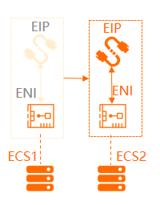
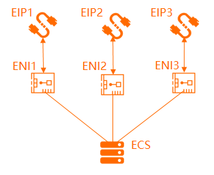

阿里云  
专有云企业版  
弹性公网IP  
用户指南  
产品版本：v3.18.1  
文档版本：20240424

**目录**

- [1.什么是弹性公网IP](#section-1)
- [2.登录EIP管理控制台](#section-2)
- [3.快速入门](#section-3)
    - [3.1. 入门概述](#section-3-1)
    - [3.2. 申请EIP](#section-3-2)
    - [3.3. 绑定ECS实例](#section-3-3)
    - [3.4. 解绑ECS](#section-3-4)
    - [3.5. 释放EIP](#section-3-5)
- [4.管理EIP](#section-4)
    - [4.1. 申请EIP](#section-4-1)
    - [4.2. 绑定云资源](#section-4-2)
        - [4.2.1. 绑定ECS实例](#section-4-2-1)
        - [4.2.2. 绑定SLB实例](#section-4-2-2)
        - [4.2.3. 绑定NAT网关](#section-4-2-3)
        - [4.2.4. 绑定辅助弹性网卡](#section-4-2-4)
            - [4.2.4.1. 概述](#section-4-2-4-1)
            - [4.2.4.2. 设置EIP普通模式](#section-4-2-4-2)
    - [4.3. 变配](#section-4-3)
    - [4.4. 解绑云资源](#section-4-4)
    - [4.5. 释放EIP](#section-4-5)
    - [4.6. 管理标签](#section-4-6)

# 1.什么是弹性公网IP

弹性公网IP（Elastic IP Address，简称EIP）是可以独立购买和持有的公网IP地址资源。目前，EIP可绑定到专有网络类型的ECS实例、专有网络类型的私网SLB实例、专有网络类型的辅助弹性网卡、NAT网关和高可用虚拟IP上。

EIP是一种NAT IP。它实际位于阿里云的公网网关上，通过NAT方式映射到了被绑定的云资源上。和云资源绑定后，云资源可以通过EIP与公网通信。

**EIP与ECS固定公网IP的区别**

下表描述了EIP与ECS固定公网IP的区别。

| 比较点 | EIP | ECS固定公网IP |
| --- | --- | --- |
| 支持的网络环境 | 专有网络 | 专有网络 |
| 是否支持单独持有 | 支持 | 不支持 |
| 是否支持在ECS实例上的弹性插拔 | 支持 | 不支持 |
| ECS实例网卡上是否可见该IP | 不可见 | 不可见 |

**优势**

EIP的优势如下：

- 独立购买与持有

  您可以单独持有一个EIP，作为您账号下一个独立的资源存在，无需与其它计算资源或存储资源绑定购买。

- 弹性绑定

  您可以在需要时将EIP绑定到需要的资源上，在不需要时将之解绑并释放。

- 可配置的网络能力

  您可以根据业务需要随时调整EIP的带宽峰值，带宽峰值的修改即时生效。

# 2.登录EIP管理控制台

本节以Chrome浏览器为例，介绍弹性公网IP（Elastic IP Address，简称EIP）用户如何登录到Apsara Uni-manager运营控制台。

**前提条件**

- 登录Apsara Uni-manager运营控制台前，确认您已从部署人员处获取Apsara Uni-manager运营控制台的服务域名地址。

- 推荐使用Chrome浏览器。

**操作步骤**

1. 在浏览器地址栏中，输入Apsara Uni-manager运营控制台的访问地址，按回车键。

2. 输入正确的用户名及密码。

   请向运营管理员获取登录控制台的用户名和密码。

   > **说明**
   >
   > 首次登录Apsara Uni-manager运营控制台时，需要修改登录用户名的密码，请按照提
   >
   > 示完成密码修改。为提高安全性，密码长度必须为 8~20 位，且至少包含以下两种类型：
   >
   > - 英文大写或小写字母（A~Z、a~z）
   >
   > - 阿拉伯数字（0~9）
   >
   > - 特殊符号（感叹号（！）、at（@）、井号（#）、美元符号（$）、百分号（%）等）

3. 单击**登录**。

4. 如果使用MFA多因素认证，还需要根据以下两种情况进行操作：

   - **管理员强制开启MFA后的首次登录**：

     <ol type="a">

     <li>

     在绑定虚拟MFA设备页面中，按页面提示步骤绑定MFA设备。

     </li>

     <li>

     按照步骤2重新输入账号和密码，单击**账号登录**。

     </li>

     </ol>

     <ol type="i" start="100">

     <li>

     输入6位MFA码后单击**认证**。

     </li>

     </ol>

   - **您已开启并绑定MFA**：

     输入6位MFA码后单击**认证**。

5. 在页面顶部的菜单栏中，选择**产品 > 网络 > 弹性公网 IP**。

# 3.快速入门

## 3.1. 入门概述

本教程指引您快速创建一个弹性公网IP（Elastic IP Address，简称EIP），并将EIP绑定到ECS实例，使ECS实例可以访问公网。

本教程包含以下操作：

1. 申请EIP

   EIP是可以独立购买和持有的公网IP地址资源。使用EIP前，您需要先申请EIP。

2. 绑定ECS实例

   您可以将EIP绑定到专有网络类型的ECS实例上。ECS实例绑定EIP后，ECS实例可以和公网通信。

3. 解绑ECS

   当您的ECS实例不需要公网通信时，您可以将ECS实例与EIP解绑。

4. 释放EIP

   如果您不需要EIP服务了，您可以释放EIP。

## 3.2. 申请EIP

您可以申请弹性公网IP（Elastic IP Address，简称EIP），EIP是可以独立创建和持有的公网IP地址资源。

**操作步骤**

1. 登录EIP管理控制台。

2. 在**弹性公网IP**页面，单击**创建弹性公网IP**。

3. 在**创建弹性公网IP**页面，根据以下信息配置EIP，然后单击**提交**。

   <table>
     <tr>
       <th width="89">配置</th>
       <th>说明</th>
     </tr>
     <tr>
       <td>组织</td>
       <td>选择EIP所属的组织。</td>
     </tr>
     <tr>
       <td>资源集</td>
       <td>选择EIP所属的资源集。</td>
     </tr>
     <tr>
       <td>地域</td>
       <td>选择EIP的地域。确保EIP的地域和要绑定的云资源的地域相同。</td>
     </tr>
     <tr>
       <td>创建数量</td>
       <td>输入需要创建的EIP的数量。</td>
     </tr>
     <tr>
       <td>名称</td>
       <td>输入需要创建的EIP的名称。</td>
     </tr>
     <tr>
       <td>线路类型</td>
       <td>选择需要创建的EIP的线路类型。</td>
     </tr>
     <tr>
       <td>网络类型</td>
       <td>选择EIP的网络类型。 • <strong>公网</strong>：EIP用于互联网通信。 • <strong>混合云</strong>：EIP用于混合云通信。例如本地数据中心服务器通过SNAT和DNAT访问互联网时，必须选择该类型的EIP。</td>
     </tr>
     <tr>
       <td>服务IP</td>
       <td>输入要指定申请的EIP。仅支持指定IPv4地址，请确保指定申请的EIP未被占用，否则无法申请指定的EIP。 说明如果您不指定要申请的EIP，系统将随机分配EIP。</td>
     </tr>
     <tr>
       <td>带宽峰值</td>
       <td>指定EIP的带宽，单位为Mbps。</td>
     </tr>
   </table>

4. （可选）创建完EIP实例后，您可以在**弹性公网IP**页面右上角单击  图标，根据需要选择实例ID、组织、

   资源集等数据列，然后单击**确定**下载已创建的EIP实例列表。

## 3.3. 绑定ECS实例

您可以将EIP绑定到专有网络类型的ECS实例上。ECS实例绑定EIP后，ECS实例可以和公网通信。

**前提条件**

您已经创建了ECS实例。具体操作，请参见<strong>《云服务器ECS用户指南》</strong>手册中**快速入门**下的**使用向导创建实例**章节。

**操作步骤**

1. 登录EIP管理控制台。

2. 在顶部菜单栏处，选择EIP的地域。

3. 在**弹性公网IP**页面，找到目标EIP，在**操作**列单击**绑定资源**。

4. 在**绑定弹性公网IP至资源**对话框，完成以下配置，然后单击**确定**。

   <table>
     <tr>
       <th width="121">配置</th>
       <th>说明</th>
     </tr>
     <tr>
       <td>实例类型</td>
       <td>选择<strong>云服务器ECS实例</strong>。</td>
     </tr>
     <tr>
       <td>绑定模式</td>
       <td>选择EIP绑定ECS实例的绑定模式。目前，仅支持<strong>普通模式</strong>。在普通模式下： • EIP以NAT模式和ECS实例绑定，ECS实例的私网IP地址和公网IP地址同时可用。 • EIP在操作系统内部不可见，需要通过DescribeInstances接口查询ECS实例绑定的公网IP地址。 • 不支持做NAT ALG的协议，例如H.323、SIP、DNS、RTSP、TFTP等协议。</td>
     </tr>
     <tr>
       <td>选择要绑定的</td>
       <td>选择要绑定的ECS实例。要绑定的ECS实例必须满足以下条件： • ECS实例的网络类型必须是专有网络。 • ECS实例必须处于运行中或停止状态。 • 一个ECS实例只能绑定一个EIP。 • ECS实例的地域必须和要绑定的EIP的地域相同。 • ECS实例没有配置固定公网IP且没有绑定其他EIP。</td>
     </tr>
   </table>

## 3.4. 解绑ECS

如果您的云资源不需要公网通信，您可以将云资源与弹性公网IP（Elastic IP Address，简称EIP）解绑。

**操作步骤**

1. 登录EIP管理控制台。

2. 在顶部菜单栏处，选择EIP的地域。

3. 在**弹性公网IP**页面，找到目标EIP，在**操作**列单击**解除绑定**。

4. 在弹出的对话框，单击**确定**。

## 3.5. 释放EIP

如果您不需要弹性公网IP（Elastic IP Address，简称EIP）服务了，您可以释放EIP。

**前提条件**

您已经解除了EIP与云资源的绑定关系。具体操作，请参见解绑EIP。

**操作步骤**

1. 登录EIP管理控制台。

2. 在顶部菜单栏处，选择EIP的地域。

3. 在**弹性公网IP**页面，找到目标EIP，在**操作**列单击**释放**。

4. 在**释放弹性公网IP**对话框中，单击**确定**。

# 4.管理EIP

## 4.1. 申请EIP

您可以申请弹性公网IP（Elastic IP Address，简称EIP），EIP是可以独立创建和持有的公网IP地址资源。

**操作步骤**

1. 登录EIP管理控制台。

2. 在**弹性公网IP**页面，单击**创建弹性公网IP**。

3. 在**创建弹性公网IP**页面，根据以下信息配置EIP，然后单击**提交**。

   <table>
     <tr>
       <th width="89">配置</th>
       <th>说明</th>
     </tr>
     <tr>
       <td>组织</td>
       <td>选择EIP所属的组织。</td>
     </tr>
     <tr>
       <td>资源集</td>
       <td>选择EIP所属的资源集。</td>
     </tr>
     <tr>
       <td>地域</td>
       <td>选择EIP的地域。确保EIP的地域和要绑定的云资源的地域相同。</td>
     </tr>
     <tr>
       <td>创建数量</td>
       <td>输入需要创建的EIP的数量。</td>
     </tr>
     <tr>
       <td>名称</td>
       <td>输入需要创建的EIP的名称。</td>
     </tr>
     <tr>
       <td>线路类型</td>
       <td>选择需要创建的EIP的线路类型。</td>
     </tr>
     <tr>
       <td>网络类型</td>
       <td>选择EIP的网络类型。 • <strong>公网</strong>：EIP用于互联网通信。 • <strong>混合云</strong>：EIP用于混合云通信。例如本地数据中心服务器通过SNAT和DNAT访问互联网时，必须选择该类型的EIP。</td>
     </tr>
     <tr>
       <td>服务IP</td>
       <td>输入要指定申请的EIP。仅支持指定IPv4地址，请确保指定申请的EIP未被占用，否则无法申请指定的EIP。 说明如果您不指定要申请的EIP，系统将随机分配EIP。</td>
     </tr>
     <tr>
       <td>带宽峰值</td>
       <td>指定EIP的带宽，单位为Mbps。</td>
     </tr>
   </table>

4. （可选）创建完EIP实例后，您可以在**弹性公网IP**页面右上角单击  图标，根据需要选择实例ID、组织、

   资源集等数据列，然后单击**确定**下载已创建的EIP实例列表。

## 4.2. 绑定云资源

### 4.2.1. 绑定ECS实例

您可以将EIP绑定到专有网络类型的ECS实例上。ECS实例绑定EIP后，ECS实例可以和公网通信。

**前提条件**

您已经创建了ECS实例。具体操作，请参见<strong>《云服务器ECS用户指南》</strong>手册中**快速入门**下的**使用向导创建实例**章节。

**操作步骤**

1. 登录EIP管理控制台。

2. 在顶部菜单栏处，选择EIP的地域。

3. 在**弹性公网IP**页面，找到目标EIP，在**操作**列单击**绑定资源**。

4. 在**绑定弹性公网IP至资源**对话框，完成以下配置，然后单击**确定**。

   <table>
     <tr>
       <th width="121">配置</th>
       <th>说明</th>
     </tr>
     <tr>
       <td>实例类型</td>
       <td>选择<strong>云服务器ECS实例</strong>。</td>
     </tr>
     <tr>
       <td>绑定模式</td>
       <td>选择EIP绑定ECS实例的绑定模式。目前，仅支持<strong>普通模式</strong>。在普通模式下： • EIP以NAT模式和ECS实例绑定，ECS实例的私网IP地址和公网IP地址同时可用。 • EIP在操作系统内部不可见，需要通过DescribeInstances接口查询ECS实例绑定的公网IP地址。 • 不支持做NAT ALG的协议，例如H.323、SIP、DNS、RTSP、TFTP等协议。</td>
     </tr>
     <tr>
       <td>选择要绑定的</td>
       <td>选择要绑定的ECS实例。要绑定的ECS实例必须满足以下条件： • ECS实例的网络类型必须是专有网络。 • ECS实例必须处于运行中或停止状态。 • 一个ECS实例只能绑定一个EIP。 • ECS实例的地域必须和要绑定的EIP的地域相同。 • ECS实例没有配置固定公网IP且没有绑定其他EIP。</td>
     </tr>
   </table>

### 4.2.2. 绑定SLB实例

您可以将EIP绑定到负载均衡SLB（Server Load Balancer）实例。SLB实例绑定EIP后，SLB实例可以转发来自公网的请求。

**前提条件**

您已经创建了SLB实例。具体操作，请参见<strong>《负载均衡用户指南》</strong>手册中**快速入门**下的**创建负载均衡实例**章节。

**操作步骤**

1. 登录EIP管理控制台。

2. 在顶部菜单栏处，选择EIP的地域。

3. 在**弹性公网IP**页面，找到目标EIP，单击**操作**列下的**绑定资源**。

4. 在**绑定弹性公网IP至资源**对话框，完成以下配置，然后单击**确定**。

   <table>
     <tr>
       <th width="121">配置</th>
       <th>说明</th>
     </tr>
     <tr>
       <td>实例类型</td>
       <td>选择<strong>负载均衡SLB实例</strong>。</td>
     </tr>
     <tr>
       <td>选择要绑定的</td>
       <td>选择要绑定的SLB实例。要绑定的SLB实例必须满足以下条件： • SLB实例的网络类型必须是专有网络。 • SLB实例的地域必须和EIP的地域相同。 • 一个SLB实例仅支持绑定一个EIP。</td>
     </tr>
   </table>

### 4.2.3. 绑定NAT网关

您可以将EIP绑定到NAT网关上。NAT网关绑定EIP后，可以使用EIP配置DNAT和SNAT条目。

**前提条件**

您已经创建了NAT网关。具体操作，请参见<strong>《NAT网关用户指南》</strong>手册中**快速入门**下的**创建NAT网关**章节。

**操作步骤**

1. 登录EIP管理控制台。

2. 在顶部菜单栏处，选择EIP的地域。

3. 在**弹性公网IP**页面，找到目标EIP，单击**操作**列下的**绑定资源**。

4. 在**绑定弹性公网IP至资源**对话框，完成以下配置，然后单击**确定**。

   <table>
     <tr>
       <th width="121">配置</th>
       <th>说明</th>
     </tr>
     <tr>
       <td>实例类型</td>
       <td>选择<strong>NAT网关</strong>。</td>
     </tr>
     <tr>
       <td>选择要绑定的</td>
       <td>选择要绑定的NAT网关实例。要绑定的NAT网关的地域必须和EIP的地域相同。</td>
     </tr>
   </table>

### 4.2.4. 绑定辅助弹性网卡

#### 4.2.4.1. 概述

EIP支持绑定弹性网卡ENI（Elastic Network Interface）。通过绑定弹性网卡，您可以构造出更健壮、更灵活、扩展性更强的IT解决方案，同时让单台服务器具备多个公网IP的能力。

弹性网卡本身提供一个私网IP，在绑定EIP后，弹性网卡相当于同时具备了私网IP和公网IP。在将绑定了EIP的弹性网卡从ECS实例上迁移时，也同时完成了私网IP和公网IP的迁移，为同时使用公网IP和私网IP的ECS实例提供了高可靠和高可用的IP迁移解决方案。

一个ECS实例支持绑定多个弹性网卡。您可以为每个弹性网卡绑定一个EIP，这样该ECS实例就拥有了多个公网IP。配合安全组规则，您可以灵活的使用这些公网IP对外提供服务。

**绑定模式**

EIP绑定弹性网卡为普通模式。普通模式的特点如下表所示：

| 特点 | 普通模式 |
| --- | --- |
| EIP在操作系统内部的弹性网卡上是否可见 | 否 |
| EIP支持绑定弹性网卡的类型 | 主弹性网卡和辅助弹性网卡 |
| 主弹性网卡允许绑定的EIP数量 | 1个 |
| 辅助弹性网卡允许绑定的EIP数量 | 取决于辅助弹性网卡的私网IP数量 说明EIP和辅助弹性网卡的私网IP地址一一映射，如辅助弹性网卡上共有10个私网IP地址，最多可为此弹性网卡绑定10个EIP。 |
| EIP绑定辅助弹性网卡，辅助弹性网卡的私网功能是否可用 | 是 |
| 支持的协议类型 | EIP作为NAT ALG（NAT应用层网关）部署时，不支持如H.323、SIP、DNS、RTSP等协议 |

#### 4.2.4.2. 设置EIP普通模式

弹性公网IP（Elastic IP Address，简称EIP）以普通模式绑定辅助弹性网卡，辅助弹性网卡的私网IP和公网IP同时可用，EIP在辅助弹性网卡上不可见。

**前提条件**

设置EIP普通模式前，请确保满足以下条件：

- 您已经创建了专有网络类型的辅助弹性网卡，且辅助弹性网卡的地域与EIP的地域相同。具体操作，请参见<strong>《云服务器ECS用户指南》</strong>手册中**弹性网卡**下的**创建弹性网卡**章节。

- 要绑定的辅助弹性网卡未绑定任何ECS实例。如果已经绑定ECS实例，请先解绑，在设置EIP普通模式后，再绑定到ECS实例上。具体操作，请参见<strong>《云服务器ECS用户指南》</strong>手册中**弹性网卡**下的**从实例解绑辅助弹性网卡**章节。

**操作步骤**

1. 登录EIP管理控制台。

2. 在顶部菜单栏处，选择EIP的地域。

3. 在**弹性公网IP**页面，找到目标EIP，在**操作**列单击**绑定资源**。

4. 在**绑定弹性公网IP至资源**对话框，完成以下配置，然后单击**确定**。

   <table>
     <tr>
       <th width="121">配置</th>
       <th>说明</th>
     </tr>
     <tr>
       <td>实例类型</td>
       <td>选择<strong>辅助弹性网卡</strong>。</td>
     </tr>
     <tr>
       <td>绑定模式</td>
       <td>选择<strong>普通模式</strong>。在普通模式下： • 辅助弹性网卡支持绑定的EIP数量取决于辅助弹性网卡的私网IP数量。 • EIP以NAT模式和辅助弹性网卡绑定，辅助弹性网卡的私网IP和公网IP同时可用。 • EIP在操作系统内部不可见，需要通过DescribeEipAddresses接口查询出具体网卡上绑定的公网IP地址。 • EIP不支持做NAT ALG的协议，例如H.323、SIP、DNS、RTSP、TFTP等协议。</td>
     </tr>
     <tr>
       <td>选择要绑定的</td>
       <td>选择要绑定的辅助弹性网卡。要绑定的辅助弹性网卡必须满足以下条件： • 辅助弹性网卡的网络类型必须是专有网络。 • 辅助弹性网卡实例的地域必须和EIP的地域相同。</td>
     </tr>
   </table>

## 4.3. 变配

弹性公网IP（Elastic IP Address，简称EIP）支持升级带宽峰值。升级带宽峰值后，立即生效。

**操作步骤**

1. 登录EIP管理控制台。

2. 在顶部菜单栏处，选择EIP的地域。

3. 在**弹性公网IP**页面，找到目标EIP，在**操作**列单击**变配**。

4. 在**EIP变配**页面，设置新的带宽峰值，然后单击**提交**。

## 4.4. 解绑云资源

如果您的云资源不需要公网通信，您可以将云资源与弹性公网IP（Elastic IP Address，简称EIP）解绑。

**操作步骤**

1. 登录EIP管理控制台。

2. 在顶部菜单栏处，选择EIP的地域。

3. 在**弹性公网IP**页面，找到目标EIP，在**操作**列单击**解除绑定**。

   > **说明**
   >
   > 当您需要解绑NAT网关时，请确保已移除关联了该EIP的SNAT或DNAT条目。您也可以
   >
   > 在**操作**列单击**强制解绑NAT**，系统将自动删除该EIP所关联的SNAT或DNAT条目，然后解绑NAT网关。

4. 在弹出的对话框，单击**确定**。

## 4.5. 释放EIP

如果您不需要弹性公网IP（Elastic IP Address，简称EIP）服务了，您可以释放EIP。

**前提条件**

您已经解除了EIP与云资源的绑定关系。具体操作，请参见解绑云资源。

**操作步骤**

1. 登录EIP管理控制台。

2. 在顶部菜单栏处，选择EIP的地域。

3. 在**弹性公网IP**页面，找到目标EIP，在**操作**列单击**释放**。

4. 在**释放弹性公网IP**对话框中，单击**确定**。

## 4.6. 管理标签

弹性公网IP（Elastic IP Address，简称EIP）支持标签管理功能，您可以通过标签对EIP进行标记、分类，便于资源的搜索和聚合。

**功能简介**

随着EIP实例数量的增多，对EIP的管理难度也会随之增加。通过标签将实例进行分组管理，有助于您搜索和筛选实例。

标签是您为实例分配的标记，每个标签都由一对键值对（Key-Value）组成。标签的使用说明如下：

- 一个实例上的每条标签的标签键（Key）必须唯一。

- 不支持未绑定实例的空标签存在，标签必须绑定在实例上。

- 不同地域中的标签信息不互通。

- 一个EIP最多可以绑定20条标签。

**添加标签**

**为单个EIP添加标签**

1. 登录EIP管理控制台。

2. 在顶部菜单栏处，选择EIP的地域。

3. 在**弹性公网IP**页面，找到目标EIP，将鼠标悬停在**标签**列下<strong>-</strong>或已有标签右侧，单击出现的铅笔图标。

4. 在**编辑标签**对话框中，单击**添加**，根据以下信息配置标签，然后单击**确定**。

   | 配置 | 说明 |
   | --- | --- |
   | 标签键 | 标签的标签键，支持选择已有标签键或输入新的标签键。 标签键最多支持64个字符，不能以<code> aliyun </code>或<code> acs: </code>开头，不能包含<code> http:// </code>和<code> https:// </code>。 |
   | 标签值 | 标签的标签值，支持选择已有标签值或输入新的标签值。 标签值最多支持128个字符，不能以<code> aliyun </code>或<code> acs: </code>开头，不能包含<code> http:// </code>和<code> https:// </code>。 |

   您还可以在**编辑标签**对话框中，多次单击**添加**，为该EIP一次添加多个标签。

5. 在**标签操作成功**对话框，确认EIP和绑定的标签信息，并单击**确定**。

**为多个EIP批量添加标签**

1. 登录EIP管理控制台。

2. 在顶部菜单栏处，选择EIP的地域。

3. 在**弹性公网IP**页面，选中需要批量添加标签的EIP，然后在页面下方单击**批量绑定标签**。

4. 在**批量编辑标签**对话框中，根据以下信息配置标签，然后单击**确定**。

   | 配置 | 说明 |
   | --- | --- |
   | 标签键 | 标签的标签键，支持选择已有标签键或输入新的标签键。 标签键最多支持64个字符，不能以<code> aliyun </code>或<code> acs: </code>开头，不能包含<code> http:// </code>和<code> https:// </code>。 |
   | 标签值 | 标签的标签值，支持选择已有标签值或输入新的标签值。 标签值最多支持128个字符，不能以<code> aliyun </code>或<code> acs: </code>开头，不能包含<code> http:// </code>和<code> https:// </code>。 |

   您还可以在**批量编辑标签**对话框中，多次单击**添加**，为选中的EIP一次添加多个标签。

5. 在**标签操作成功**对话框，确认EIP和绑定的标签信息，并单击**确定**。

**通过标签搜索实例**

为实例添加标签后，您可以使用标签搜索实例。

1. 登录EIP管理控制台。

2. 在顶部菜单栏处，选择EIP的地域。

3. 在**弹性公网IP**页面，单击**标签筛选**。

4. 在弹出的复选框中，选中或输入完整的标签键和值。此操作中，您可以选择或输入一对完整的标签键值对，也可以只选中或输入标签键，最多可以使用20条标签搜索实例。

**解绑标签**

如果EIP不再需要某个标签，您可以解绑该标签。解绑标签前，请了解以下注意事项：

- 单次最多可以解绑20条标签。

- 如果您将一个标签添加到多个EIP上，解绑其中一个EIP上的标签不会影响其他添加了该标签的EIP。

为单个实例解绑标签

1. 登录EIP管理控制台。

2. 在顶部菜单栏处，选择EIP的地域。

3. 在**弹性公网IP**页面，找到目标EIP，将鼠标悬停在**标签**列下已有标签右侧，然后单击出现的铅笔图标。

4. 在**编辑标签**对话框中，找到需要解绑的标签键值对，单击其右侧的

   图标，然后单击**确定**。

   

   在该对话框中，您不仅可以解绑标签，还可以为EIP添加标签。

5. 在**标签操作成功**对话框，确认EIP和解绑的标签信息，并单击**确定**。

**为多个EIP批量解绑标签**

1. 登录EIP管理控制台。

2. 在顶部菜单栏处，选择EIP的地域。

3. 在**弹性公网IP**页面，选中需要批量解绑标签的EIP，然后在页面下方单击**批量解绑标签**。

4. 在**批量解绑标签**对话框中，找到需要解绑的标签键值对，单击其右侧的

   图标，然后单击**确定**。

   

5. 在**标签操作成功**对话框，确认EIP和解绑的标签信息，并单击**确定**。
