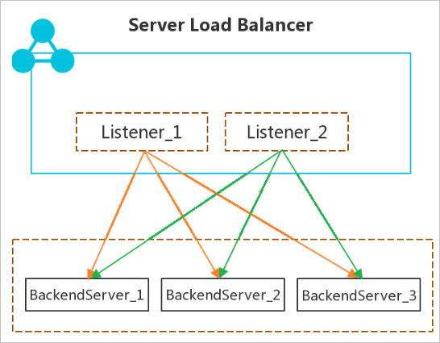

阿里云  
专有云  
负载均衡  
产品简介  
产品版本：V3.18.6  
文档版本：20250731

**目录**

- [1.负载均衡](#section-1)
    - [1.1. 产品详情](#section-1-1)
    - [1.2. 产品价值](#section-1-2)
    - [1.3. 应用场景](#section-1-3)
    - [1.4. 功能特性](#section-1-4)

# 1.负载均衡

负载均衡SLB（Server Load Balancer）是将访问流量根据转发策略分发到后端多台云服务器（ECS实例）的流量分发控制服务。负载均衡扩展了应用的服务能力，增强了应用的可用性。

## 1.1. 产品详情

负载均衡由负载均衡实例、监听和后端服务器三部分组成。

**负载均衡实例 （Instances）**

一个负载均衡实例是一个运行的负载均衡服务，用来接收流量并将其分配给后端服务器。要使用负载均衡服务，用户需要创建一个负载均衡实例，并至少添加一个监听和两台ECS实例。

负载均衡提供支持列举、查询、创建、更新、删除负载均衡器的功能及接口；提供在负载均衡实例上追加、移除云主机的功能及接口。

**监听 （Listeners）**

监听用来检查客户端请求并将请求转发给后端一台或多台服务器，支持TCP、UDP、HTTP、HTTPS协议；监听可对后端服务器进行健康检查，支持自动检测并隔离不可用的主机。

**后端服务器（Backend Servers）**

后端服务器是一组接收前端请求的ECS实例。用户可以单独添加ECS实例到后端服务器池，也可以通过虚拟服务器组或主备服务器组来批量添加和管理。

## 1.2. 产品价值

负载均衡具有高可用、可扩展、低成本、安全和高并发的优势。同时，本文从负载均衡、单负载均衡实例、多负载均衡实例和后端ECS实例四个方面阐述了高可用优势。

**高可用**

采用全冗余设计，无单点，支持同城容灾。根据应用负载进行弹性扩容，在流量波动情况下不中断对外服务。

<table>
  <tr>
    <th width="202">对象</th>
    <th>高可用优势说明</th>
  </tr>
  <tr>
    <td>负载均衡</td>
    <td>负载均衡实例采用集群部署，可实现会话同步，以消除服务器单点故障，提升冗余，保证服务的稳定性。其中四层负载均衡通过LVS（Linux Virtual Server）联合keepalived的方式实现，七层负载均衡通过Tengine（淘宝网发起的Web服务器项目，在Nginx的基础上，针对有大访问量的网站需求进行了优化）实现。来自公网的请求通过等价多路径路由ECMP（Equal-Cost Multipath Routing）到达LVS集群。LVS集群内的每台LVS通过组播报文将会话同步到该集群内的其它LVS机器上，从而实现LVS集群内各台机器间的会话同步。同时，LVS集群会对Tengine集群进行健康检查。负载均衡将状态异常的设备从Tengine集群移除，保证七层负载均衡的可用性。</td>
  </tr>
  <tr>
    <td>单负载均衡实例</td>
    <td>阿里云允许用户在多个地域创建多可用区来实现单负载均衡实例的高可用。当主可用区出现故障或不可用时，负载均衡有能力在非常短的时间内（约30秒）切换到备可用区并恢复服务；当主可用区恢复时，负载均衡同样会自动切换到主可用区提供服务。</td>
  </tr>
  <tr>
    <td>多负载均衡实例的高可用</td>
    <td>如果用户对可用性的要求特别高，负载均衡实例自身的可用性保障机制可能无法满足用户的需求。例如当网络攻击或配置错误等情况导致负载均衡实例不可用时，由于未出现可用区级故障，不会触发负载均衡实例的可用区切换。此时，用户可以创建多个负载均衡实例，通过云解析DNS对访问进行调度，或通过全球负载均衡解决方案实现跨地域容灾备份。</td>
  </tr>
  <tr>
    <td>后端ECS实例的高可用</td>
    <td>负载均衡通过健康检查来判断后端ECS实例的可用性。健康检查机制提高了前端业务整体可用性，避免了后端ECS异常对总体服务的影响。开启健康检查功能后，当后端某个ECS实例健康检查出现异常时，负载均衡会自动将新的请求分发到其他健康检查正常的ECS实例上，而当该ECS实例恢复正常运行时，负载均衡会将其自动恢复到负载均衡服务中。关于健康检查的详细机制的更多信息，请参见用户指南中的健康检查概述。</td>
  </tr>
</table>

**可扩展**

根据业务的需要，用户可以随时增加或减少后端服务器的数量，扩展应用的服务能力。

**低成本**

与传统硬件负载均衡系统高投入相比，成本可下降60%。

**安全**

结合云盾安全产品，可提供DDoS攻击防护能力。

**高并发**

集群支持亿级并发连接，单实例提供千万级并发能力。

## 1.3. 应用场景

负载均衡SLB（Server Load Balancer）产品适用于高访问量、扩展应用程序、消除单点故障、同城和跨地域容灾的场景。

**应用于高访问量的业务**

如果应用访问量很高，用户可以通过配置监听规则将流量分发到不同的ECS实例上。此外，用户可以使用会话保持功能将同一客户端的请求转发到同一台后端ECS，提高访问效率。

**扩展应用程序**

用户可以根据业务发展的需要，随时添加和移除ECS实例来扩展应用系统的服务能力，适用于各种Web服务器和App服务器。

**消除单点故障**

用户可以在负载均衡实例下添加多台ECS实例。当其中一部分ECS实例发生故障后，负载均衡会自动屏蔽故障的ECS实例，将请求分发给正常运行的ECS实例，保证应用系统仍能正常工作。

**同城容灾 （多可用区容灾）**

为了提供更加稳定可靠的负载均衡服务，用户可以在多个地域创建多可用区以实现同地域容灾。当某一个地域的主可用区出现机房故障或不可用时，负载均衡仍然有能力在非常短的时间内（大约30s中断）切换到同一地域的另外一个备可用区恢复服务能力；当主可用区恢复时，负载均衡同样会自动切换到主可用区提供服务。建议用户结合自身的应用需要，综合考虑后端服务器的部署。如果每个可用区均至少添加了一台ECS实例，那么此种部署模式下的负载均衡服务的效率是比较高的。

在负载均衡实例下绑定不同可用区的ECS实例。正常情况下，用户访问流量将同时转发至主、备可用区内的ECS实例；当可用区A发生故障时，用户访问流量将只转发至备可用区内的ECS实例。此种部署既可以避免因为单个可用区的故障而导致对外服务的不可用，也可以通过不同产品间可用区的选择来降低延迟。

**跨地域容灾**

用户可以在不同地域下部署负载均衡实例，并分别挂载相应地域内不同可用区的ECS。上层利用云解析做智能DNS，将域名解析到不同地域的负载均衡实例服务地址下，可实现全局负载均衡。当某个地域出现不可用时，暂停对应解析即可实现所有用户访问不受影响。

## 1.4. 功能特性

本章节介绍阿里云负载均衡提供的功能和功能概述，负载均衡支持四层和七层负载均衡，并提供健康检查、会话保持和域名转发等功能，保证后端服务的高可用。

**SLB实例**

**功能**

**说明**

编辑负载均衡实例的名称和描述信

修改实例属性

息。

创建实例

创建负载均衡实例，指定调度算法。

删除实例

删除已经创建的负载均衡实例。

启动或停止实例

启动或停止指定的负载均衡实例。

SLB实例管理

查看指定的负载均衡实例的详细配置

查看实例详情

信息。

SLB配置详情

SLB配置详情导入导出。

<table>
  <tr>
    <td rowspan="8">SLB实例规格</td>
    <td>标准型I slb.s2.small</td>
    <td>最大连接数：50K新建连接数（CPS）：5K每秒查询数（QPS）：5K</td>
  </tr>
  <tr>
    <td>简约型I slb.s1.small</td>
    <td>最大连接数：5K新建连接数（CPS）：3K每秒查询数（QPS）：1K</td>
  </tr>
  <tr>
    <td>高阶型I slb.s3.small</td>
    <td>最大连接数：200K新建连接数（CPS）：50K每秒查询数（QPS）：30K</td>
  </tr>
  <tr>
    <td>高阶型II slb.s3.medium</td>
    <td>最大连接数：500K新建连接数（CPS）：20K每秒查询数（QPS）：20K</td>
  </tr>
  <tr>
    <td>超强型I slb.s3.large</td>
    <td>最大连接数：1000K新建连接数（CPS）：100K每秒查询数（QPS）：50K</td>
  </tr>
  <tr>
    <td>标准型II slb.s2.medium</td>
    <td>最大连接数：100K新建连接数（CPS）：10K每秒查询数（QPS）：10K</td>
  </tr>
  <tr>
    <td>slb.i40g.large</td>
    <td>最大连接数：5020K新建连接数（CPS）：500K每秒查询数（QPS）：100K</td>
  </tr>
  <tr>
    <td>slb.i20g.large</td>
    <td>最大连接数：5020K新建连接数（CPS）：500K每秒查询数（QPS）：100K</td>
  </tr>
  <tr>
    <td rowspan="4">IPv6</td>
    <td>支持6to4</td>
    <td>支持6to4。</td>
  </tr>
  <tr>
    <td>支持6to6</td>
    <td>支持6to6。</td>
  </tr>
  <tr>
    <td>SLB IPv6支持同城容灾</td>
    <td>SLB IPv6支持同城容灾。</td>
  </tr>
  <tr>
    <td>SLB支持公网挂载经典IPv6网络</td>
    <td>SLB支持公网挂载经典IPv6网络。</td>
  </tr>
</table>

**监听**

**功能**

**说明**

创建一个四层或七层监听，并配置必

创建监听

要的健康检查以确保后端服务器的可用性。

从负载均衡器上删除指定的监听，停

删除监听

止该端口接收和分发请求。

监听

启动或停止一个监听，以控制其接收

启动或停止监听

和分发请求的行为。

修改现有监听的配置，例如改变端

编辑监听

口、协议或高级设置。

使用 Cookie 实现会话保持，确保用

会话保持

户请求在同一会话期间分配到相同的后端服务器。

自动监测后端服务器的健康状态，确保仅将请求转发到可用的服务器。

- HTTP 健康检查：通过 HTTP 请

健康检查

求来确认服务器状态。

- TCP 健康检查：通过 TCP 握手来确认服务器状态。

支持设置监听的协议。

- HTTP：根据需求设置监听端口和

监听支持

协议类型。

- HTTPS：根据需求设置监听端口和协议类型。

支持多种协议，包括 HTTP

应用协议支持

1.0/1.1/2.0 和 WebSocket(S)。

在传输过程中对数据进行 gzip 压

支持gzip压缩

缩，以减少带宽使用并提高传输效率。

七层监听

可配置从 HTTP 到 HTTPS 的自动重

支持http重定向

定向，确保用户数据的安全性，同时保持对使用旧链接用户的兼容性。

支持通过IPv6访问后端服务器

提供对 IPv6 协议的支持。

基于域名或 URL 的转发策略，控制

基于7层内容的负载均衡

请求流向不同的后端服务器。

提供证书的托管服务，支持证书的卸

证书管理

载，帮助节省证书许可证成本。

七层负载均衡支持配置域名或者URL

转发策略

转发策略，将来自不同域名或者URL的请求转发给不同的ECS处理。

支持多种负载均衡调度算法，以优化流量分发。

- 轮询算法RR（Round Robin）：

调度算法

依次将请求分发到后端服务器。

- 加权轮询算法WRR（Weighted Round Robin）：根据服务器权重分配请求。

基于源 IP 地址的会话保持，确保同

会话保持

一客户端的请求在同一会话期间始终被转发到相同的后端服务器。

自动监测后端服务器的健康状态，确保仅将请求转发到可用的服务器。

- HTTP 健康检查：通过 HTTP 请

健康检查

求来确认服务器状态。

- TCP 健康检查：通过 TCP 握手来确认服务器状态。

支持设置监听的协议。

- TCP：根据需求设置监听端口和

监听支持

协议类型。

- UDP：根据需求设置监听端口和协议类型。

提供对 IPv6 协议的支持。

支持通过IPv6访问后端服务器

四层监听

支持多种负载均衡调度算法，以优化流量分发。

- 轮询算法RR（Round Robin）：依次将请求分发到后端服务器。

- 加权轮询算法WRR（Weighted

调度算法

Round Robin）：根据服务器权重分配请求。

- 一致性哈希CH（Consistent Hashing）：基于源 IP 地址的哈希算法，每个唯一客户端请求总是分配到同一个后端服务器。

七层负载均衡支持配置域名或者URL

配置转发策略

转发策略，将来自不同域名或者URL的请求转发给不同的ECS处理。

转发策略

SLB4层支持优雅中断，即移除后端服务器或者健康检查失败后，使现有连接在一定时间内正常传输。

SLB四层支持优雅中断

优雅中断时间支持900s。

支持基于源地址、cookie等会话保

支持基于源地址、cookie等会话保

持

持。

会话保持

应用热迁移长链接不中断

SLB支持后端热迁移长链接不中断。

**后端服务器**

**功能**

**说明**

修改添加的ECS实例的权重。权重越高的ECS实例将被分配到更多的访问

修改ECS实例的权重

请求。您可以根据后端ECS实例的对外服务能力和情况来区别设定。

添加ECS实例用来处理前端转发的连

添加后端服务器

后端服务器

接请求。

移除ECS实例

将ECS实例从负载均衡实例中移除。

后端服务器支持description

后端服务器支持description。

添加ECS实例用来处理前端转发的连

添加后端服务器

接请求。

查看服务组中添加的ECS实例状态、

查看默认服务器组

配置的端口等信息。

默认服务器组

修改添加的ECS实例的权重。权重越高的ECS实例将被分配到更多的访问

编辑后端服务器

请求。您可以根据后端ECS实例的对外服务能力和情况来区别设定。

移除后端服务器

将ECS实例从负载均衡实例中移除。

创建一个服务器组。服务器组是一组ECS实例。通过使用服务器组（不

创建虚拟服务器组

同的监听关联不同的服务器组），负载均衡可以将不同的请求转发到不同的ECS实例上。

查看服务组中添加的ECS实例状态、

查看虚拟服务器组

配置的端口等信息。

虚拟服务器组

修改服务组的名称、修改服务器组

编辑虚拟服务器组

中ECS实例的权重，添加新的ECS实例或从服务器组中移除ECS实例。

删除指定的服务器组。将ECS实例从

删除虚拟服务器组

负载均衡实例中移除。

虚拟服务器组支持显示关联监听信

SLB虚拟服务器组

息。

后端服务器中有一台主机和一台备机。当主机工作正常时，流量将直

创建主备服务器组

接转发至主机；当主机宕机时，流量将切换至备机服务组。

主备服务器组

删除主备服务器组

删除指定的主备服务器组。

主备服务器组后端挂载RS自定义配

支持主备服务器组/主备地址池

置：主服务器后端RS个数和备服务器后端RS个数可以自定义配置。

**访问控制**

| 功能 | 说明 |
| --- | --- |

<table>
  <tr>
    <td rowspan="2">访问控制</td>
    <td>创建和管理控制策略组</td>
    <td>通过提供监听级别的访问控制策略组，指定哪些IP可以访问负载均衡服务。</td>
  </tr>
  <tr>
    <td>修改访问控制配额上限</td>
    <td>提供新增访问控制配额上限的页面。</td>
  </tr>
</table>

**证书管理**

<table>
  <tr>
    <th colspan="2">功能</th>
    <th>说明</th>
  </tr>
  <tr>
    <td>证书</td>
    <td>上传证书</td>
    <td>将证书存储到负载均衡证书管理系统，而不需要将证书直接部署到后端ECS服务器上，上传到证书管理系统的私钥都会加密存储。</td>
  </tr>
  <tr>
    <td>国密</td>
    <td>支持国密算法</td>
    <td>客户端通过国密算法加密后（需要客户端支持），负载均衡（SLB）端可以对加密报文进行解密。</td>
  </tr>
</table>

**监控与告警**

<table>
  <tr>
    <th colspan="2">功能</th>
    <th>说明</th>
  </tr>
  <tr>
    <td rowspan="4">监控</td>
    <td>监控支持多维度查看和对比</td>
    <td>监控支持多维度。</td>
  </tr>
  <tr>
    <td>监控支持SLB到后端RS的连接数监控</td>
    <td>监控支持SLB到后端RS的连接数监控。</td>
  </tr>
  <tr>
    <td>操作日志</td>
    <td>支持查看实例操作日志。</td>
  </tr>
  <tr>
    <td>高精度秒级监控</td>
    <td>依赖日志服务的SLSpub组件，SLB提供高精度秒级监控。</td>
  </tr>
  <tr>
    <td>告警</td>
    <td>提供告警</td>
    <td>提供告警。</td>
  </tr>
</table>

**安全**

**功能**

**说明**

访问控制ACL

支持访问控制ACL。

SLB负载均衡器的访问控制，访问控

SLB支持黑白名单

制黑名单可有效阻断恶意地址对负载均衡业务的访问。

安全

SLB白名单规格

SLB白名单数量。

通过添加白名单，指定哪些IP可以访问负载均衡服务。

设置监听白名单

**组网互连**

<table>
  <tr>
    <th colspan="2">功能</th>
    <th>说明</th>
  </tr>
  <tr>
    <td rowspan="5">组网互联</td>
    <td>前端组网能力</td>
    <td>将弹性公网IP（EIP）挂载到负载均衡实例（SLB），使专有网络负载均衡能够接收来自公网的流量。</td>
  </tr>
  <tr>
    <td rowspan="4">后端组网能力</td>
    <td>将负载均衡器直接挂载到弹性网卡（ENI），提供更灵活的网络配置。</td>
  </tr>
  <tr>
    <td>为弹性网卡（ENI）配置多个辅助IP地址，并将这些辅助IP地址作为负载均衡的后端服务器。</td>
  </tr>
  <tr>
    <td>通过专线连接到云下IDC。通过公网连接到云下IDC。</td>
  </tr>
  <tr>
    <td>在不同的可用区内挂载ECS实例，提高系统的可用性和容灾能力。</td>
  </tr>
</table>

**集群可扩展**

**功能**

**说明**

多集群模式下，支持同城容灾，在

多集群支持同城容灾

主集群宕机时，切换到备集群。

支持指定集群创建负载均衡实例。

SLB物理机支持多集群

支持基于租户的多集群隔离。

集群可扩展性

支持集群内横向扩容。

支持集群内横向扩容

支持扩容的最大节点数。

**高可用与高性能**

<table>
  <tr>
    <th colspan="2">功能</th>
    <th>说明</th>
  </tr>
  <tr>
    <td rowspan="2">高可用</td>
    <td>跨可用区容灾</td>
    <td>VIP跨可用区容灾。</td>
  </tr>
  <tr>
    <td>支持多Region</td>
    <td>支持多Region。</td>
  </tr>
  <tr>
    <td rowspan="2">高性能</td>
    <td>SLB支持100G网络架构接入</td>
    <td>物理机支持100G网络架构接入。</td>
  </tr>
  <tr>
    <td>SLB支持100G网络架构接入</td>
    <td>虚拟化网关支持100G网络架构接入。</td>
  </tr>
  <tr>
    <td rowspan="2">多机房</td>
    <td>SLB支持多Region2.0</td>
    <td>瑶池单元化下沉：物理机。</td>
  </tr>
  <tr>
    <td>SLB支持3AZ</td>
    <td>支持物理机形态。</td>
  </tr>
  <tr>
    <td>RS热迁移</td>
    <td>SLB Client或RS端ECS热迁移长链接会话保持不中断</td>
    <td>云主机热迁移长链接不中断，基础设施稳定性和应用解耦。ECS作为Client和RS热迁移，TCP连接不中断，需要LVS支持内层RSS(40G机型)。</td>
  </tr>
</table>

**硬件适配与产品形态**

**功能**

**说明**

英特尔

支持物理机形态。

海光

支持物理机形态。

鲲鹏

支持物理机形态。

飞腾

支持物理机形态。

支持V8

支持物理机形态。

信创

支持8U

支持物理机形态。

虚拟化网关SLB支持

支持虚拟化网关。

英特尔

虚拟化网关SLB支持

支持虚拟化网关。

海光

虚拟化网关SLB支持

支持虚拟化网关。

V8

虚拟化网关SLB支持

支持虚拟化网关。

8U

支持CX5网卡

支持物理机形态。

支持单卡双口CX6网

支持物理机形态。

卡

网卡

虚拟化SLB支持CX5

支持虚拟化网关。

网卡

虚拟化SLB支持单卡

支持虚拟化网关。

双口CX6网卡

支持容器化部署。

LVS on Docker

LVS on docker支持

支持同城容灾方案。

同城容灾

Proxy on NFV

支持 NFV on ECS部署。

Proxy on NFV支持

支持同城容灾方案。

同城容灾

支持 NFV on ECS部署。

KeyServer on NFV

虚拟化网关

KeyServer on NFV

支持同城容灾方案。

支持同城容灾SLB on NFV支持国

支持国密算法。

密

虚拟化网关SLB支持

支持4层挂载IDC。

挂载线下IDC

支持多Region架构

单元化下沉。
