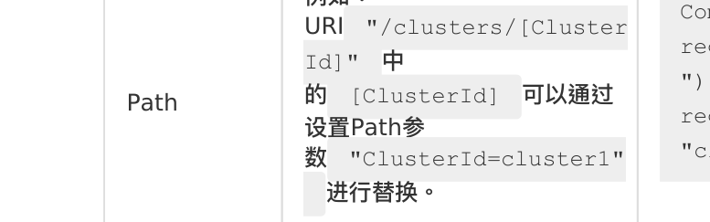
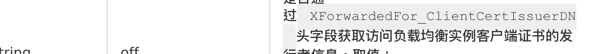
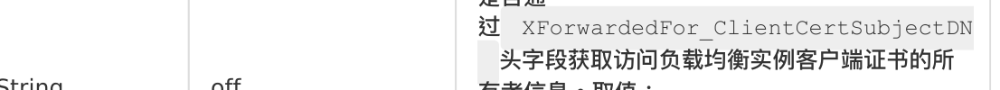
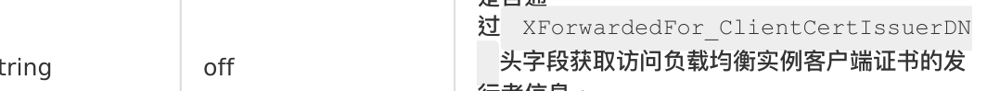
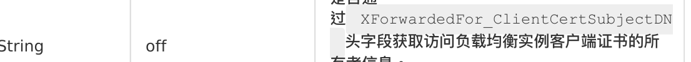

阿里云  
专有云  
负载均衡  
开发指南  
产品版本：V3.18.6  
文档版本：20251028

**目录**

- [1.快速入门](#section-1)
    - [1.1. 开发文档使用说明](#section-1-1)
    - [1.2. API调用流程说明](#section-1-2)
- [2.准备工作](#section-2)
    - [2.1. 登录开发者门户](#section-2-1)
    - [2.2. 获取API信息及其EndPoint](#section-2-2)
    - [2.3. 获取AccessKey](#section-2-3)
    - [2.4. 获取STS AccessKey](#section-2-4)
    - [2.5. 获取公共Header参数](#section-2-5)
    - [2.6. 获取负载均衡 SLB的SDK包](#section-2-6)
- [3.通过POP网关调用专有云API](#section-3)
    - [3.1. 调用前置](#section-3-1)
    - [3.2. Java版](#section-3-2)
    - [3.3. Go版](#section-3-3)
    - [3.4. Python版](#section-3-4)
- [4.Java SDK调用](#section-4)
    - [4.1. 快速开始](#section-4-1)
    - [4.2. 使用手册](#section-4-2)
        - [4.2.1. 安装Java SDK](#section-4-2-1)
        - [4.2.2. 设置身份验证凭证](#section-4-2-2)
        - [4.2.3. 发起调用](#section-4-2-3)
        - [4.2.4. 错误处理](#section-4-2-4)
- [5.Python SDK调用示例](#section-5)
    - [5.1. 快速开始](#section-5-1)
    - [5.2. 使用手册](#section-5-2)
        - [5.2.1. 安装Python SDK](#section-5-2-1)
        - [5.2.2. 设置身份验证凭证](#section-5-2-2)
        - [5.2.3. 设置HTTPS请求](#section-5-2-3)
        - [5.2.4. 发起调用](#section-5-2-4)
        - [5.2.5. 错误处理](#section-5-2-5)
- [6.Go SDK调用示例](#section-6)
    - [6.1. 快速开始](#section-6-1)
    - [6.2. 使用手册](#section-6-2)
        - [6.2.1. 安装Go SDK核心包](#section-6-2-1)
        - [6.2.2. 设置身份验证凭证](#section-6-2-2)
        - [6.2.3. 发起调用](#section-6-2-3)
        - [6.2.4. 错误处理](#section-6-2-4)
- [7.API参考](#section-7)
    - [7.1. 调用方式](#section-7-1)
    - [7.2. RAM鉴权](#section-7-2)
    - [7.3. 公共参数](#section-7-3)
    - [7.4. 负载均衡实例](#section-7-4)
        - [7.4.1. DescribeLoadBalancerListeners](#section-7-4-1)
        - [7.4.2. DeleteLoadBalancerListener](#section-7-4-2)
        - [7.4.3. StopLoadBalancerListener](#section-7-4-3)
        - [7.4.4. StartLoadBalancerListener](#section-7-4-4)
        - [7.4.5. SetLoadBalancerModificationProtection](#section-7-4-5)
        - [7.4.6. SetLoadBalancerDeleteProtection](#section-7-4-6)
        - [7.4.7. SwitchMasterSlaveServerGroup](#section-7-4-7)
        - [7.4.8. SetLoadBalancerListenerAttributeEx](#section-7-4-8)
        - [7.4.9. ModifyHighDefinationMonitor](#section-7-4-9)
        - [7.4.10. EnableHighDefinationMonitor](#section-7-4-10)
        - [7.4.11. CreateLoadBalancer](#section-7-4-11)
        - [7.4.12. DeleteLoadBalancer](#section-7-4-12)
        - [7.4.13. ModifyLoadBalancerInstanceSpec](#section-7-4-13)
        - [7.4.14. ModifyLoadBalancerInternetSpec](#section-7-4-14)
        - [7.4.15. SetLoadBalancerName](#section-7-4-15)
        - [7.4.16. SetLoadBalancerStatus](#section-7-4-16)
        - [7.4.17. DescribeLoadBalancerAttribute](#section-7-4-17)
        - [7.4.18. DescribeLoadBalancers](#section-7-4-18)
        - [7.4.19. DescribeRegions](#section-7-4-19)
        - [7.4.20. DescribeZones](#section-7-4-20)
    - [7.5. 监听](#section-7-5)
        - [7.5.1. TCP监听](#section-7-5-1)
            - [7.5.1.1. CreateLoadBalancerTCPListener](#section-7-5-1-1)
            - [7.5.1.2. SetLoadBalancerTCPListenerAttribute](#section-7-5-1-2)
            - [7.5.1.3. DescribeLoadBalancerTCPListenerAttribute](#section-7-5-1-3)
        - [7.5.2. UDP监听](#section-7-5-2)
            - [7.5.2.1. CreateLoadBalancerUDPListener](#section-7-5-2-1)
            - [7.5.2.2. SetLoadBalancerUDPListenerAttribute](#section-7-5-2-2)
            - [7.5.2.3. DescribeLoadBalancerUDPListenerAttribute](#section-7-5-2-3)
        - [7.5.3. HTTP监听](#section-7-5-3)
            - [7.5.3.1. CreateLoadBalancerHTTPListener](#section-7-5-3-1)
            - [7.5.3.2. SetLoadBalancerHTTPListenerAttribute](#section-7-5-3-2)
            - [7.5.3.3. DescribeLoadBalancerHTTPListenerAttribute](#section-7-5-3-3)
        - [7.5.4. HTTPS监听](#section-7-5-4)
            - [7.5.4.1. CreateLoadBalancerHTTPSListener](#section-7-5-4-1)
            - [7.5.4.2. SetLoadBalancerHTTPSListenerAttribute](#section-7-5-4-2)
            - [7.5.4.3. DescribeLoadBalancerHTTPSListenerAttribute](#section-7-5-4-3)
            - [7.5.4.4. DescribeHealthStatus](#section-7-5-4-4)
        - [7.5.5. 访问控制](#section-7-5-5)
            - [7.5.5.1. SetListenerAccessControlStatus](#section-7-5-5-1)
            - [7.5.5.2. DescribeListenerAccessControlAttribute](#section-7-5-5-2)
            - [7.5.5.3. AddListenerWhiteListItem](#section-7-5-5-3)
            - [7.5.5.4. RemoveListenerWhiteListItem](#section-7-5-5-4)
            - [7.5.5.5. CreateAccessControlList](#section-7-5-5-5)
            - [7.5.5.6. DeleteAccessControlList](#section-7-5-5-6)
            - [7.5.5.7. DescribeAccessControlLists](#section-7-5-5-7)
            - [7.5.5.8. DescribeAccessControlListAttribute](#section-7-5-5-8)
            - [7.5.5.9. SetAccessControlListAttribute](#section-7-5-5-9)
            - [7.5.5.10. AddAccessControlListEntry](#section-7-5-5-10)
            - [7.5.5.11. RemoveAccessControlListEntry](#section-7-5-5-11)
    - [7.6. 转发规则](#section-7-6)
    - [7.7. 访问日志](#section-7-7)
    - [7.8. 服务器证书](#section-7-8)
        - [7.8.1. UploadServerCertificate](#section-7-8-1)
        - [7.8.2. DeleteServerCertificate](#section-7-8-2)
        - [7.8.3. DescribeServerCertificates](#section-7-8-3)
        - [7.8.4. SetServerCertificateName](#section-7-8-4)
        - [7.8.5. UploadCACertificate](#section-7-8-5)
        - [7.8.6. DeleteCACertificate](#section-7-8-6)
        - [7.8.7. DescribeCACertificates](#section-7-8-7)
        - [7.8.8. SetCACertificateName](#section-7-8-8)
        - [7.8.9. DescribeCertificateRelations](#section-7-8-9)
    - [7.9. 后端服务器](#section-7-9)
        - [7.9.1. AddBackendServers](#section-7-9-1)
        - [7.9.2. RemoveBackendServers](#section-7-9-2)
        - [7.9.3. SetBackendServers](#section-7-9-3)
    - [7.10. 虚拟服务器组](#section-7-10)
        - [7.10.1. CreateVServerGroup](#section-7-10-1)
        - [7.10.2. SetVServerGroupAttribute](#section-7-10-2)
        - [7.10.3. AddVServerGroupBackendServers](#section-7-10-3)
        - [7.10.4. RemoveVServerGroupBackendServers](#section-7-10-4)
        - [7.10.5. ModifyVServerGroupBackendServers](#section-7-10-5)
        - [7.10.6. DeleteVServerGroup](#section-7-10-6)
        - [7.10.7. DescribeVServerGroups](#section-7-10-7)
        - [7.10.8. DescribeVServerGroupAttribute](#section-7-10-8)
    - [7.11. 主备服务器组](#section-7-11)
        - [7.11.1. CreateMasterSlaveServerGroup](#section-7-11-1)
        - [7.11.2. DeleteMasterSlaveServerGroup](#section-7-11-2)
        - [7.11.3. DescribeMasterSlaveServerGroups](#section-7-11-3)
        - [7.11.4. DescribeMasterSlaveServerGroupAttribute](#section-7-11-4)
    - [7.12. 标签](#section-7-12)
        - [7.12.1. AddTags](#section-7-12-1)
        - [7.12.2. DescribeTags](#section-7-12-2)
        - [7.12.3. RemoveTags](#section-7-12-3)
        - [7.12.4. UntagResources](#section-7-12-4)
        - [7.12.5. TagResources](#section-7-12-5)
        - [7.12.6. ListTagResources](#section-7-12-6)
    - [7.13. 错误码列表](#section-7-13)
- [8.附录](#section-8)
    - [8.1. STS概要](#section-8-1)
        - [8.1.1. 什么是STS](#section-8-1-1)
        - [8.1.2. AssumeRole](#section-8-1-2)

<a id="section-1"></a>

# 1.快速入门

<a id="section-1-1"></a>

## 1.1. 开发文档使用说明

本文为您介绍在使用专有云API进行开发工作时，如何查看所需要的产品文档。

**使用流程**

您可以按照以下流程图中步骤，判断自己所需要使用的开发文档。


**前提条件**

通过运维人员或运营管理员获取专有云的版本。

**操作步骤**

您可以通过阿里云专有云文档中心，获取需要的产品文档。

1. 通过浏览器打开专有云文档中心。

2. 根据专有云的版本单击**企业版**、**敏捷版**或**一体机**标签。

3. 在下拉列表中，选择对应的专有云版本。

   

4. 在左侧导航栏中，选择目标产品名称。

5. 在单击目标文档区域的**查看详情**或**下载PDF**。

<a id="section-1-2"></a>

## 1.2. API调用流程说明

阿里云专有云支持通过POP网关调用专有云API，为了使您拥有与公有云一致的体验，自企业版V3.16.0开始，专有云API默认使用POP网关方式调用。本文介绍通过POP网关调用专有云API的流程。

**流程图**


**调用步骤**

1. 获取AccessKey。

   获取调用时所需要的AccessKey参数，请参见获取AccessKey或获取STS AccessKey。

   > **说明**
   >
   > 推荐使用个人AccessKey或STS AccessKey调用Apsara Uni-manager运营控制台及云产品接口。

2. 获取RegionID。

   获取调用时所需要的RegionID参数，请参见获取公共Header参数。

3. 获取组织ID与资源集ID。

   组织ID需要通过API进行获取，获取方式请参见*Apsara Uni-manager运营控制台开发指南*中的*GetOrga nizationList章节*。

   资源集ID需要通过API进行获取，获取方式请参见*Apsara Uni-manager运营控制台开发指南*中的*ListRe sourceGroup章节*。

   > **说明**
   >
   > 调用API时，请在Header参数中增加组织ID  和资源集ID ， 指定资源所属的组织和资源集，实现实例资源的隔离查询。
   >
   > - 不指定组织ID  ，则默认获取当前用户所属的组织。
   >
   > - 不指定资源集ID  ，则默认为空，如果指定资源集需要同时指定组织ID。

4. 获取对应的API参考文档。

   您需要查看目标云产品的开发指南，了解API的功能与使用方式，开发指南的使用流程及获取方法请参见开发文档使用说明。

5. 获取云产品Endpoint。

6. 获取云产品SDK并调用云产品API。

<a id="section-2"></a>

# 2.准备工作

<a id="section-2-1"></a>

## 2.1. 登录开发者门户

您可以通过Apsara Uni-manager运营控制台登录开发者门户。

**前提条件**

- 登录Apsara Uni-manager运营控制台前，确认您已从部署人员处获取Apsara Uni-manager运营控制台的服务域名地址。

- 推荐使用Chrome浏览器。

**操作步骤**

1. 在浏览器地址栏中，输入Apsara Uni-manager运营控制台的服务域名地址，按回车键。

2. 输入正确的用户名及密码。

   请向运营管理员获取登录控制台的用户名和密码。

   > **说明**
   >
   > 首次登录Apsara Uni-manager运营控制台时，需要修改登录用户名的密码，请按照提示完成密码修改。为提高安全性，密码长度必须为10~32位，且至少包含以下两种类型：
   >
   > - 英文大写或小写字母（A~Z、a~z）
   >
   > - 阿拉伯数字（0~9）
   >
   > - 特殊符号（感叹号（!）、at（@）、井号（#）、美元符号（$）、百分号（%）等）

3. 单击**登录**。

4. 如果账号已激活MFA多因素认证，请根据以下两种情况进行操作：

   - 管理员强制开启MFA后的首次登录：

     <ol type="a">

     <li>

     在绑定虚拟MFA设备页面中，按页面提示步骤绑定MFA设备。

     </li>

     <li>

     按照步骤2重新输入账号和密码，单击**登录**。

     </li>

     </ol>

     <ol type="i" start="100">

     <li>

     输入6位MFA码后单击**认证**。

     </li>

     </ol>

   - 您已开启并绑定MFA：

     输入6位MFA码后单击**认证**。

     > **说明**
     >
     > 绑定并开启MFA的操作请参见<strong>《Apsara Uni-manager运营控制台用户指南》</strong>中的<strong>《绑定并开启虚拟MFA设备》</strong>章节。

5. 在页面顶部的菜单栏中，选择**产品 > 应用服务 > 开发者门户**。

<a id="section-2-2"></a>

## 2.2. 获取API信息及其EndPoint

首先，您需要了解产品开放API接口的相关信息，包括产品名称（code）、开放API接口名称、API版本。

**背景信息**

Apsara Uni-manager运营控制台API目录中的API信息仅供调用参考，具体API的使用方式需要参见云产品的开发指南。如果发生不一致情况，以开发指南支持情况为准。

**操作步骤**

1. 登录Apsara Uni-manager运营控制台。

2. 在顶部菜单栏选择**产品** > **开发工具** > **API与工具** > **开发者门户**。

3. 在**开发者门户**页面，选择**API集成** > **API调试**。

   

4. 在左侧导航栏中选择目标云产品。

5. 在**版本**下拉列表中，选择目标API版本。

6. 在下方API列表中可浏览当前版本的所有API接口。

7. 选中对应接口，在参数名下获取云产品的POP Endpoint信息。

   

<a id="section-2-3"></a>

## 2.3. 获取AccessKey

AccessKey支持RAM和STS两种授权模式，在发起调用时选择使用其中一种AccessKey即可。本文将为您介绍如何获取通过RAM授权的AccessKey。

**背景信息**

AccessKey通过使用AccessKey ID和AccessKey Secret对称加密，实现验证某个请求发送者的身份的功能。其中AccessKey ID用于标示用户，AccessKey Secret是用户用于加密签名的字符串。

AccessKey的两种授权模式如下：

- 通过RAM授权给第三方请求者的AccessKey ID和AccessKey Secret。

- 通过STS授权给第三方请求者的AccessKey ID、AccessKey Secret和Security Token。获取方式请参见获取STS AccessKey。

Apsara Uni-manager运营控制台提供了个人AccessKey和组织AccessKey（只有运营管理员和一级组织管理员可以获取组织AccessKey），推荐使用个人账号AccessKey调用Apsara Uni-manager运营控制台及云产品相关接口。如果使用个人账号AccessKey，需要在Header中添加以下限制性参数，否则可能提示权限不足：

> 个人账号AccessKey是由Apsara Uni-manager运营控制台权限体系管控的受限
>
> **警告**
>
> AccessKey，组织AccessKey相对权限较大，需要管理员确认操作的安全性。

<table>
  <tr>
    <th width="206">参数名称</th>
    <th>描述</th>
  </tr>
  <tr>
    <td>x-acs-regionid</td>
    <td>地域，如：cn-hangzhou-*。</td>
  </tr>
  <tr>
    <td>x-acs-organizationid</td>
    <td>Apsara Uni-manager运营控制台中对应的组织ID。获取方法可参见<strong>《Apsara Uni-manager运营控制台开</strong><strong>发指南》</strong>中的<strong>《GetOrganizationList》</strong>文档。</td>
  </tr>
  <tr>
    <td>x-acs-resourcegroupid</td>
    <td>Apsara Uni-manager运营控制台中对应的资源集ID。获取方法可参见<strong>《Apsara Uni-manager运营控制台</strong><strong>开发指南》</strong>中的<strong>《ListResourceGroup》</strong>文档。</td>
  </tr>
  <tr>
    <td>x-acs-instanceid</td>
    <td>进行操作的实例ID，例如，ECS的实例ID可以从ECS列表中查询到。</td>
  </tr>
</table>

**获取个人账号AccessKey**

获取个人账号AccessKey的方法如下：

1. 登录Apsara Uni-manager运营控制台。

2. 在系统界面右上角，单击当前登录用户头像，单击**个人信息**。

3. 在**阿里云AccessKey**区域，您可以查看个人账户的AccessKey信息。

   

   > Accesskey ID和AccessKey Secret是您访问云资源时的密钥，具有该账号完整的权
   >
   > **说明**
   >
   > 限，请您妥善保管。

**获取组织AccessKey**

获取组织AccessKey的方法如下：

1. 管理员登录Apsara Uni-manager运营控制台。

2. 在顶部菜单栏，单击**企业**。

3. 在左侧导航栏中，选择**资源管理 > 组织管理**。

4. 在组织结构中，单击目标一级组织名称。

5. 单击**管理Accesskey**。

6. 在弹出的对话框中，查看组织AccessKey信息。

<a id="section-2-4"></a>

## 2.4. 获取STS AccessKey

本文为您介绍如何利用STS方式，调用专有云的产品API。

**背景信息**

阿里云临时安全令牌STS（Security Token Service）是阿里云提供的一种临时访问权限管理服务。您可以选择使用STS方式，调用专有云的产品API。

STS AccessKey由AccessKey ID、AccessKey Secret及SecurityToken三元组组成，使用STS方式调用云产品API时，三元组缺一不可。更多STS内容请参见什么是STS。

**操作步骤**

1. 获取用户角色的 `RAM Role` 。

   <ol type="i">

   <li>

   登录Apsara Uni-manager运营控制台。

   </li>

   <li>

   单击页面右上角的用户头像，单击**个人信息**。

   </li>

   <li>

   单击**查看当前角色策略**。

   在**当前选择角色策略**对话框中查看 `RAM Role` 。

   </li>

   </ol>

2. 获取STS Accesskey三元组。

   > **说明**
   >
   > 以下代码示例中可变参数均需替换为您实际的相关信息，尖括号（<>）在最终代码中不保留。
   >
   > 涉及替换的可变参数如下：
   >
   > - &lt;yourRegionID>，请替换为您实际的地域ID。
   >
   > - &lt;yourAccessKeyID>，请替换为您实际的AccessKey ID。
   >
   > - &lt;yourAccessKeySecret>，请替换为您实际的AccessKey Secret。
   >
   > - &lt;yourRoleSessionName>，请替换为您当前实际的会话名称。
   >
   > - &lt;yourRoleArn>，请替换为您实际的RAM Role。
   >
   > - "sts.aliyuns.com" ，请替换为实际的STS Endpoint。

   ```xml
   public static void main(String[] args) {
       // 创建DefaultAcsClient实例并初始化。
       // 请替换为您实际的地域ID、AccessKey ID、AccessKey Secret
       DefaultProfile profile = DefaultProfile.getProfile("<yourRegionID>", "
   <yourAccessKeyID>", "<yourAccessKeySecret>");
       HttpClientConfig clientConfig = HttpClientConfig.getDefault();
       clientConfig.setIgnoreSSLCerts(true);
       clientConfig.setProtocolType(ProtocolType.HTTPS);
       profile.setHttpClientConfig(clientConfig);
       IAcsClient client = new DefaultAcsClient(profile);
       String assumeRole = callAssumeRole(client);
       if (StringUtils.isEmpty(assumeRole)) return;
       JSONObject assumeRoleJson = JSONObject.parseObject(assumeRole);
       JSONObject credentials = assumeRoleJson.getJSONObject("Credentials");
       // 获取到STS三元组
       String stsAK = credentials.getString("AccessKeyId");
       String stsSK = credentials.getString("AccessKeySecret");
       String stsToken = credentials.getString("SecurityToken");
   }

   private static String callAssumeRole(IAcsClient client) {
       CommonRequest request = new CommonRequest();
       // "sts.aliyuns.com" 请替换为实际的STS Endpoint，⼀般格式为sts-
   vpc.${global:region}.${global:internet-domain}
       request.setSysDomain("sts.aliyuns.com");
       request.setSysProduct("Sts");
       request.setSysAction("AssumeRole");
       request.setSysVersion("2015-04-01");
       request.setSysMethod(MethodType.POST);
       request.setHttpContentType(FormatType.FORM);
       // 业务参数，设置本次调⽤Session的别名，"<yourRoleSessionName>"请您替换为实际值
       request.putQueryParameter("RoleSessionName", "<yourRoleSessionName>");
       // 扮演的Role⾓⾊ARN，"<yourRoleArn>"请替换为上⼀步获取到的实际Ram Role ARN
       request.putQueryParameter("RoleArn", "<yourRoleArn>");
        try {
               CommonResponse response = client.getCommonResponse(request);
               return response.getData();
           } catch (ServerException e) {
               System.out.println(e.getErrCode());
               System.out.println(e.getErrMsg());
           } catch (ClientException e) {
               System.out.println(e.getErrCode());
               System.out.println(e.getErrMsg());
           } catch (com.aliyuncs.exceptions.ServerException e) {
               e.printStackTrace();
           } catch (ClientException e) {
               e.printStackTrace();
           }
       return null;
   }
   ```

3. 通过STS AccessKey三元组调用云产品的接口，下列代码以SLB的DescribeLoadBalancers接口为示例。

   > **说明**
   >
   > 以下代码示例中可变参数均需替换为您实际的相关信息，尖括号（<>）在最终代码中不保留。
   >
   > 涉及替换的可变参数如下：
   >
   > - &lt;yourRegionID>，请替换为您实际的地域ID。
   >
   > - &lt;yourStsAccesskeyID>,请替换为您实际的STS Accesskey ID。
   >
   > - &lt;yourStsAccessKeySecret>，请替换为您实际的STS Accesskey Secret。
   >
   > - &lt;yourStsToken>，请替换为实际STS三元组中的SecurityToken。
   >
   > - &lt;yourResourceGroupID>，请替换为您实际的资源集ID。
   >
   > - &lt;yourOrganizationID>请替换为您实际的组织ID。

   ```xml
   public static void main(String[] args) {
       // "<yourRegionID>"请替换为您实际的地域ID
       // "<yourStsAccessKeyID>", "<yourStsAccessKeySecret>"请替换为前⼀步获取到的STS三元组中
   AccessKeyID、AccessKeySecret
       DefaultProfile profile = DefaultProfile.getProfile("<yourRegionID>", "
   <yourStsAccesskey>", "<yourStsAccessSecret>");
       HttpClientConfig clientConfig = HttpClientConfig.getDefault();
       clientConfig.setIgnoreSSLCerts(true);
       clientConfig.setProtocolType(ProtocolType.HTTPS);
       profile.setHttpClientConfig(clientConfig);
       IAcsClient client = new DefaultAcsClient(profile);
       CommonRequest request = new CommonRequest();
       request.setSysDomain("ecs.aliyuns.com");
       request.setSysProduct("Slb");
       request.setSysAction("DescribeLoadBalancers");
       request.setSysVersion("2014-05-15");
       request.setSysMethod(MethodType.POST);
       request.setHttpContentType(FormatType.FORM);
       //"<yourRegionID>" 请替换为您实际的地域ID
       request.putHeadParameter("x-acs-regionid", "<yourRegionID>");
       // "<yourStsToken>" 请替换为您前⼀步获取到的STS三元组中SecurityToken
       request.putQueryParameter("SecurityToken", "<yourStsToken>");
       // 非必填,请替换为您实际的资源集ID
       // request.putHeadParameter("x-acs-resourcegroupid", "<yourResourceGroupID>");
       // 必填,请替换为您实际的组织ID
       request.putHeadParameter("x-acs-organizationid", "<yourOrganizationID>");
       try {
           CommonResponse response = client.getCommonResponse(request);
           System.out.println(response.getData());
       } catch (ServerException e) {
           System.out.println(e.getErrCode());
           System.out.println(e.getErrMsg());
       } catch (ClientException e) {
           System.out.println(e.getErrCode());
           System.out.println(e.getErrMsg());
       }
   }
   ```

<a id="section-2-5"></a>

## 2.5. 获取公共Header参数

调用专有云API时需要提供多个Header参数。本文为您介绍这些参数的含义及其获取方式，并对调用后的一些返回值做出解释。

**Header参数描述**

| 名称 | 描述 |
| --- | --- |
| x-acs-regionid | 环境Region，获取方式请参见获取Region ID。 |
| x-acs-organizationid | Apsara Uni-manager运营控制台上的组织ID，获取方式请参见获取组织ID。 |
| x-acs-resourcegroupid | Apsara Uni-manager运营控制台上的资源集ID，获取方式请参见获取资源集ID。 |
| x-acs-instanceid | 进行操作的实例ID，获取方式请参见获取实例ID。 |

**获取Region ID**

1. 管理员登录Apsara Uni-manager运营控制台。

2. 在顶部菜单栏中，单击**企业**。

3. 在左侧导航栏中，选择**资源管理**>**地域管理**。

4. 单击目标组织名称。

5. 在右侧**Region列表**中查看Region ID。

**获取组织ID**

组织ID需要通过API进行获取，获取方式请参见*Apsara Uni-manager运营控制台开发指南*中的*GetOrganizationList章节*。

**获取资源集ID**

资源集ID需要通过API进行获取，获取方式请参见*Apsara Uni-manager运营控制台开发指南*中的*ListResourceGroup章节*。

**获取实例ID**

实例ID可以通过Apsara Uni-manager运营控制台中的云产品实例列表进行获取，本文中以SLB为例，获取步骤如下：

1. 登录Apsara Uni-manager运营控制台。

2. 在顶部的菜单栏中，选择**产品**>**网络**>**负载均衡 SLB**。

3. 在左侧导航栏中，单击**实例**。

4. 在实例列表中查看**实例ID**。

**返回参数**

对于列表类的云产品资源实例接口，调用后会默认增加如下返回值。

| 名称 | 描述 |
| --- | --- |
| ResourceGroupName | 资源集名称。 |
| ResourceGroup | 资源集ID。 |
| DepartmentName | 组织名称。 |
| Department | 组织ID。 |

<a id="section-2-6"></a>

## 2.6. 获取负载均衡 SLB的SDK包

通过POP网关调用专有云API时，需使用负载均衡 SLB的SDK。本文为您介绍如何获取阿里云开发工具包（SDK）。

**背景介绍**

实现SLB功能需要您同时安装SLB SDK和阿里云核心库。以Java SDK为例，您需要下载 `aliyun-java-sdk-slb` 以及 `aliyun-java-sdk-core` 。

- 负载均衡 SDK封装了2014-05-15版本API，以访问密钥（AccessKey）识别调用者身份，提供自动签名等功能，方便您通过API创建和管理资源。阿里云开发工具包（SDK）包括代码以及示例，您可以自行选择语言来创建云应用。

- SDK核心库推荐您使用阿里云官网的SDK核心库，该内容适用于所有云产品，也同样适用于专有云产品。

**操作指导**

目前SDK的语言支持：Java、Python、Go，您可以前往阿里云开发工具包（SDK）中进行选择。

> **说明**
>
> 推荐使用 Java、Python、Go三种语言的SDK包，使用其他语言的SDK包可能发生不兼容情况。

<a id="section-3"></a>

# 3.通过POP网关调用专有云API

<a id="section-3-1"></a>

## 3.1. 调用前置

阿里云专有云与公共云一样，可通过POP网关的方式进行API调用。本文为您介绍调用前需要进行的准备工作。

**背景信息**

为了使专有云保持与公共云相同的使用方式，使您拥有更方便，更一致的体验，建议通过POP网关调用专有云API。

**获取云产品的Endpoint**

**通过开发者门户获取**

1. 登录Apsara Uni-manager运营控制台。

2. 在顶部菜单栏选择**产品** > **开发工具** > **API与工具** > **开发者门户**。

3. 在**开发者门户**页面，选择**API集成** > **API调试**。

   

4. 在左侧导航栏中选择目标云产品。

5. 在**版本**下拉列表中，选择目标API版本。

6. 在下方API列表中可浏览当前版本的所有API接口。

7. 选中对应接口，在参数名下获取云产品的POP Endpoint信息。

   

**通过飞天基础运维平台获取**

通过POP网关调用专有云API时需要使用云产品业务域的Endpoint。您可以在阿里云驻场运维工程师处获取。

您也可以自行获取Endpoint，本文以API网关为例为您介绍获取云产品业务域Endpoint的方法。

1. 登录Apsara Uni-manager运维控制台。

2. 顶部菜单栏选择**平台运维** > **飞天基础运维平台** > **运维工具**。

3. 在左侧导航栏，选择**运维工具** > **服务注册变量大盘**。

4. 在服务注册变量大盘页面，单击**高级筛选**。

5. 在Service Registration文本框中输入 `apigateway` ，单击**搜索**。

   

6. 在 `apigateway` 服务的**Service Registration**列中，单击  图标。

7. 单击 `apigateway` 服务**Service Registration**列的文本信息，在弹出的**注册变量**对话框中，查看apigateway.openapi.endpoint值，即 `Endpoint` 。

**获取公共参数**

通过POP网关调用专有云API过程中所使用的参数，如组织ID、资源集ID、RegionID和实例ID，获取方式请参见本手册**准备工作**下的**获取公共Header参数**章节。

<a id="section-3-2"></a>

## 3.2. Java版

通过POP Java SDK访问产品域名，需要了解该产品调用方式(RPC或ROA)。

**前提条件**

目前专有云推荐使用CommonRequest进行调用，可以在Apsara Uni-manager运营控制台**产品** > **开发工具** > **API与工具** > **开发者门户**，选择**API集成** > **SDK示例**查看推荐SDK版本以及示例代码。

> **重要**
>
> 不建议直接从SDK中心下载SDK到专有云场景下使用，公有云的SDK不一定支持专有云的API，可能存在兼容性问题，请谨慎使用！

**CommonRequest调用示例**

RPC调用，示例接口信息：产品（apigateway）、接口（DescribeApiGroups）、版本（2016-07-14）。

调用示例如下：

```xml
import com.aliyuncs.CommonRequest;
import com.aliyuncs.CommonResponse;
import com.aliyuncs.DefaultAcsClient;
import com.aliyuncs.IAcsClient;
import com.aliyuncs.exceptions.ClientException;
import com.aliyuncs.exceptions.ServerException;
import com.aliyuncs.http.MethodType;
import com.aliyuncs.profile.DefaultProfile;

public class DescribeApiGroups {

    public static void main(String[] args) {
        // 创建DefaultAcsClient实例并初始化。
        DefaultProfile profile = DefaultProfile.getProfile("<your-regionid>", "
<yourAccessKeyId>", "<yourAccessSecret>");

        // 忽略SSL
        // HttpClientConfig clientConfig = HttpClientConfig.getDefault();
        // clientConfig.setIgnoreSSLCerts(true);
        // 设置连接超时
        // clientConfig.setConnectionTimeoutMillis(3000L);
        // 设置读取超时
        // clientConfig.setReadTimeoutMillis(10000L);
        // profile.setHttpClientConfig(clientConfig);
        
        IAcsClient client = new DefaultAcsClient(profile);
        // 创建API请求并设置参数。
        CommonRequest request = new CommonRequest();
        // 设置请求⽅式
        request.setSysMethod(MethodType.POST);
        // 设置云产品Endpoint
        request.setSysDomain("<apigatewayEndpoint>");
        // 设置访问接⼝版本
        request.setSysVersion("2016-07-14");
        // 设置LocationProduct
        request.setSysLocationProduct("apigateway");
        // 设置访问接⼝的名称
        request.setSysAction("DescribeApiGroups");
        
        // 当使⽤sts ak调⽤RPC接⼝时需要在参数中加上SecurityToken字段
        // request.putBodyParameter("SecurityToken", "<your-SecurityToken>");

        // 业务参数
        request.putQueryParameter("PageSize", "10");
        request.putQueryParameter("PageNumber", "1");

        // 必填值，调⽤来源说明
        request.putHeadParameter("x-acs-caller-sdk-source", "ApiTestDemo");
        // 非必填，企业版V3.15.0之前历史版本需要
        request.putHeadParameter("x-acs-regionid", "<your-regionid>");
        // 非必填，资源集ID
        request.putHeadParameter("x-acs-resourcegroupid", "<your-resourcegroupid>");
        // 必填, 组织ID
        request.putHeadParameter("x-acs-organizationid", "<your-organizationid>");
        // 非必填，修改&删除操作需要
        // request.putHeadParameter("x-acs-instanceid", "<your-instanceid>");

        try {
            // 发起请求并处理应答或异常。
            CommonResponse response = client.getCommonResponse(request);
            System.out.println(response.getData());
        } catch (ServerException e) {
            e.printStackTrace();
        } catch (ClientException e) {
            System.out.println("ErrCode:" + e.getErrCode());
            System.out.println("ErrMsg:" + e.getErrMsg());
            System.out.println("RequestId:" + e.getRequestId());
        }

    }
}
```

ROA调用，示例接口信息：产品（CR）接口（GetNamespaceList）版本（2016-06-07）。

调用示例如下：

```xml
import com.aliyuncs.CommonRequest;
import com.aliyuncs.CommonResponse;
import com.aliyuncs.DefaultAcsClient;
import com.aliyuncs.IAcsClient;
import com.aliyuncs.exceptions.ClientException;
import com.aliyuncs.exceptions.ServerException;
import com.aliyuncs.http.MethodType;
import com.aliyuncs.profile.DefaultProfile;

public class GetNamespaceList {

    public static void main(String[] args) {
        // 创建DefaultAcsClient实例并初始化。
        DefaultProfile profile = DefaultProfile.getProfile("<your-regionid>", "
<yourAccessKeyId>", "<yourAccessSecret>");

        // 忽略SSL
        // HttpClientConfig clientConfig = HttpClientConfig.getDefault();
        // clientConfig.setIgnoreSSLCerts(true);
        // 设置连接超时
        // clientConfig.setConnectionTimeoutMillis(3000L);
        // 设置读取超时
        // clientConfig.setReadTimeoutMillis(10000L);
        // profile.setHttpClientConfig(clientConfig);
        
        IAcsClient client = new DefaultAcsClient(profile);
        // 创建API请求并设置参数。
        CommonRequest request = new CommonRequest();

        // 设置HTTPS访问
        request.setSysProtocol(ProtocolType.HTTP);
        // 设置请求⽅式
        request.setSysMethod(MethodType.GET);
        // 设置云产品endpoint
        request.setSysDomain("<crEndpoint>");
        // 设置访问接⼝版本
        request.setSysVersion("2016-06-07");
        // 设置uriPattern 只有roa调⽤需要传递此字段
        request.setSysUriPattern("/namespace");
        // 设置LocationProduct
        request.setSysLocationProduct("cr");
        // 设置访问接⼝的名称
        request.setSysAction("GetNamespaceList");

        // 必填值，调⽤来源说明
        request.putHeadParameter("x-acs-caller-sdk-source", "ApiTestDemo");
        // 非必填，企业版V3.15.0之前历史版本需要
        request.putHeadParameter("x-acs-regionid", "<your-regionid>");
        // 非必填,资源集ID
        request.putHeadParameter("x-acs-resourcegroupid", "<your-resourcegroupid>");
        // 必填,组织ID
        request.putHeadParameter("x-acs-organizationid", "<your-organizationid>");
        // 非必填，修改&删除操作需要
        // request.putHeadParameter("x-acs-instanceid", "<your-instanceid>");


        // 当使⽤STS AK调⽤ROA接⼝时需要在Header加上x-acs-security-token字段
        // request.putHeadParameter("x-acs-security-token", "<your-securitytoken>");

        try {
            // 发起请求并处理应答或异常。
            CommonResponse response = client.getCommonResponse(request);
            System.out.println(response.getData());
        } catch (ServerException e) {
            e.printStackTrace();
        } catch (ClientException e) {
            System.out.println("ErrCode:" + e.getErrCode());
            System.out.println("ErrMsg:" + e.getErrMsg());
            System.out.println("RequestId:" + e.getRequestId());
        }

    }
}
```

> **重要**
>
> 使用HTTPS协议访问OpenAPI时，SDK会默认开启校验SSL/TLS 证书有效性，若您代码环境没有证书环境，则会报错证书校验失败。
>
> 为保障生产环境通信安全，建议您保持开启，若在测试环境必须忽略证书校验，可以通过以下参数设置：
>
> Java
>
> ```text
> HttpClientConfig clientConfig = HttpClientConfig.getDefault();
> // 设置不校验服务端证书
> clientConfig.setIgnoreSSLCerts(true)
> ```

<a id="section-3-3"></a>

## 3.3. Go版

本文为您介绍POP Go SDK调用的方式。

**前提条件**

目前专有云推荐使用CommonRequest进行调用，可以在Apsara Uni-manager运营控制台**产品** > **开发工具** > **API与工具** > **开发者门户**，选择**API集成** > **SDK示例**查看推荐SDK版本以及示例代码。

> **重要**
>
> 不建议直接从SDK中心下载SDK到专有云场景下使用，公有云的SDK不一定支持专有云的API，可能存在兼容性问题，请谨慎使用！

**背景信息**

当前支持RPC和ROA的方式调用API。

**CommonRequest调用示例**

RPC方式调用示例接口信息：产品（apigateway）、接口（DescribeApiGroups）、版本（2016-07-14）。

示例代码如下：

```go
package main

import (
    "fmt"
    "github.com/aliyun/alibaba-cloud-sdk-go/sdk"
    "github.com/aliyun/alibaba-cloud-sdk-go/sdk/requests"
  
)

func main() {
    client, err := sdk.NewClientWithAccessKey("<your-RegionID>", "<AccessKey ID>", "<AccessKey Secret>")

    request := requests.NewCommonRequest()
    
    request.Method = "POST"
    request.Domain = "<ApigatewayEndpoint>"
    request.Version = "2016-07-14"
    request.ApiName = "DescribeApiGroups"
    request.Product = "apigateway"
    // 当使⽤sts ak调⽤rpc接⼝时需要在参数中加上SecurityToken字段
    // request.QueryParams["SecurityToken"]="<your-SecurityToken>"

    // 必填值，调⽤来源说明
    request.Headers["x-acs-caller-sdk-source"] = "ApiTestDemo"
    // 非必填，企业版V3.15.0之前历史版本需要
    request.Headers["x-acs-regionid"] = "<your-RegionID>"
    // 非必填，资源集ID
    request.Headers["x-acs-resourcegroupid"] = "<your-ResourceGroupID>"
    // 必填，组织ID
    request.Headers["x-acs-organizationid"] = "<your-OrganizationID>"
    // 非必填，修改&删除操作需要
    // request.Headers["x-acs-instanceid"] = "<your-InstanceID>"

    response, err := client.ProcessCommonRequest(request)
    if err != nil {
        panic(err)
    }
    fmt.Print(response.GetHttpContentString())
}
```

ROA调用示例接口信息：产品（CR）接口（GetNamespaceList）版本（2016-06-07）。

调用示例如下：

```xml
package main

import (
 "fmt"
 "github.com/aliyun/alibaba-cloud-sdk-go/sdk"
 "github.com/aliyun/alibaba-cloud-sdk-go/sdk/requests"
 "os"
)


func main() {
    client, err := sdk.NewClientWithAccessKey("<your-regionid>", "<yourAccessKeyId>", "
<yourAccessSecret>")
 request := requests.NewCommonRequest()

 request.Method = "GET"
 request.Domain = "<crEndpoint>"
 request.Version = "2016-06-07"
 request.ApiName = "GetNamespaceList"
 request.Product = "cr"

 request.PathPattern = "/namespace"
 // 当使⽤sts ak调⽤ROA接⼝时需要在header中加上x-acs-security-token字段
 // request.Headers["x-acs-security-token"] = "<your-SecurityToken>"
 // 必填值，调⽤来源说明
 request.Headers["x-acs-caller-sdk-source"] = "ApiTestDemo"
    // 非必填，企业版V3.15.0之前历史版本需要
    request.Headers["x-acs-regionid"] = "<your-RegionID>"
    // 非必填，资源集ID
    request.Headers["x-acs-resourcegroupid"] = "<your-ResourceGroupID>"
    // 必填，组织ID
    request.Headers["x-acs-organizationid"] = "<your-OrganizationID>"
 // 非必填，修改&删除操作需要
 // request.Headers["x-acs-instanceid"] = "<your-InstanceID>"

 response, err := client.ProcessCommonRequest(request)
 if err != nil {
  panic(err)
 }
 fmt.Print(response.GetHttpContentString())
}
```

**设置代理**

当您在调用实例时，或许会需要设置代理，您可以通过以下两种方式设置代理。

- 通过环境变量设置。

  环境变量HTTP_PROXY、HTTPS_PROXY或者NO_PROXY。

  设置代码如下：

  ```go
  import (
      "os"
  )
  func main(){
   os.Setenv("HTTP_PROXY", "http://x.x.x.x:xxxx") // 设置 HTTP_PROXY 环境变量
   os.Setenv("HTTPS_PROXY", "https://x.x.x.x:xxxx") // 设置 HTTPS_PROXY 环境变量
  }
  ```

- 通过客户端设置。

  设置代码如下：

  ```text
  // 客户端设置代理优先级比环境变量⾼
  client.SetHttpProxy("http://x.x.x.x:xxxx")   // 设置http代理
  client.GetHttpProxy()                          // 获取http代理

  client.SetHttpsProxy("https://x.x.x.x:xxxx")   // 设置https代理
  client.GetHttpsProxy()                           // 获取https代理

  client.SetNoProxy("127.0.0.1,localhost")     // 设置代理⽩名单
  client.GetNoProxy()                          // 获取代理⽩名单
  ```

**SSL验证**

**摘要**

请求时验证SSL证书行为。

- 设置成 `true` ，禁用证书验证（这是不安全的，请设置证书！）。

- 设置成 `false` ，启用SSL证书验证，默认使用操作系统提供的CA证书。

**默认值**

默认值为 `false` 。

**设置**

> **重要**
>
> 使用HTTPS协议访问OpenAPI时，SDK会默认开启校验SSL证书有效性，若您代码环境没有证书环境，则会报错证书校验失败。为保障生产环境通信安全，建议您保持开启，若在测试环境必须忽略证书校验，可参考如下内容进行设置。

```text
// 设置请求 HTTPSInsecure（只影响当前）
request.SetHTTPSInsecure(true)                           // 设置请求 HTTPSInsecure 为 true
isInsecure := request.GetHTTPSInsecure()                 // 获取请求 HTTPSInsecure
```

当请求未设置时，客户端设置才能生效。

```text
// 设置客户端 HTTPSInsecure（⽤于客户端发送的所有请求）。
client.SetHTTPSInsecure(true)                         // 设置客户端 HTTPSInsecure 为 trueisInsecure := client.GetHTTPSInsecure()               // 获取客户端 HTTPSInsecure
```

<a id="section-3-4"></a>

## 3.4. Python版

本文为您介绍POP Python SDK调用云产品API的方式。

**前提条件**

目前专有云推荐使用CommonRequest进行调用，可以在Apsara Uni-manager运营控制台**产品** > **开发工具** > **API与工具** > **开发者门户**，选择**API集成** > **SDK示例**查看推荐SDK版本以及示例代码。

> **重要**
>
> 不建议直接从SDK中心下载SDK到专有云场景下使用，公有云的SDK不一定支持专有云的API，可能存在兼容性问题，请谨慎使用！

**背景信息**

目前仅支持通过RPC方式调用API。

**CommonRequest调用示例**

调用示例接口信息：产品（ECS）、接口（DescribeInstances）、版本（2014-05-26）。

示例代码如下：

```python
from aliyunsdkcore.client import AcsClient
import os
from aliyunsdkcore.request import CommonRequest

# 创建AcsClient实例
client = AcsClient(
    "<AccessKey ID>",
    "<AccessKey Secret>",
    "<your-RegionID>",
    timeout=1000,  # 设置超时时间
    verify=False, # 忽略证书或者verify='<证书位置>'
);
# 和https⼀起使⽤
# client.set_verify(False)
# os.environ["HTTPS_PROXY"] = "http://127.0.0.1:8080"

# os.environ["HTTP_PROXY"] = "http://127.0.0.1:8080"
def describe_api_groups():
    # 创建request，并设置参数
    request = CommonRequest()

    # 当使⽤sts ak调⽤rpc接⼝时需要在参数中加上SecurityToken字段
    # params = {"PageSize":"10","PageNumber":"1","SecurityToken":"<your-
SecurityToken>"};
    params = {"PageSize":"10","PageNumber":"1"};
    request.set_query_params(params)

    headers = {
        # 必填值，调⽤来源说明
        "x-acs-caller-sdk-source":"ApiTestDemo",
        # 非必填，企业版V3.15.0之前历史版本需要
        "x-acs-regionid":"<your-RegionID>",
        # 非必填，资源集ID
        "x-acs-resourcegroupid":"<your-ResourceGroupID>",
        # 必填，组织ID
        "x-acs-organizationid":"<your-OrganizationID>"
        # 非必填，修改&删除操作需要
        # "x-acs-instanceid":"<your-InstanceID>"

    }
    request.set_headers(headers)
    request.set_version("2016-07-14")
    request.set_action_name("DescribeApiGroups")
    request.set_endpoint("<ApigatewayEndpoint>")   //Endpoint请替换为真实地址
    request.set_product("apigateway")
    request.set_method("POST")

    # 发起API请求并显示返回值
    response = client.do_action_with_exception(request)
    print(response)


if __name__ == '__main__':
    print("Hello Aliyun OpenApi!")
    describe_api_groups()
```

**设置代理**

调用API时您或许需要通过环境变量设置HTTP_PROXY、HTTPS_PROXY。

示例代码如下：

```text
# https的代理 
os.environ["HTTPS_PROXY"] = "http://x.x.x.x:xxxx"

# http的代理
os.environ["HTTP_PROXY"] = "https://x.x.x.x:xxxx"
```

**HTTPS配置**

下面介绍使用HTTPS协议进行OpenAPI访问。

**使用HTTPS协议**

SDK默认使用HTTPS协议。

```python
from aliyunsdkecs.request.v20140526.DescribeInstancesRequest import 
DescribeInstancesRequest
from aliyunsdkcore.client import AcsClient
client = AcsClient(
    region_id='<region_id>',  # 地域ID
)

request = DescribeInstancesRequest()
request.set_protocol_type('https')  # 使⽤https

client.do_action_with_exception(request)   
```

**忽略证书**

> **重要**
>
> - 使用HTTPS协议访问OpenAPI时，SDK会默认开启校验SSL/TLS证书有效性，若您代码环境没有证书环境，则会报错证书校验失败。
>
> - 为保障生产环境通信安全，建议您保持开启，若在测试环境必须忽略证书校验，可以通过参数 `verify` 设置。

```python
from aliyunsdkcore.client import AcsClient
client = AcsClient(
    region_id='<region_id>',  # 地域ID
    verify=False  # 忽略对 SSL 证书的验证
)
```

**指定CA证书文件**

```python
from aliyunsdkcore.client import AcsClient
client = AcsClient(
    region_id='<region_id>',  # 地域ID
    verify='./cacert.pem'  # 证书路径
)
```

<a id="section-4"></a>

# 4.Java SDK调用

安装阿里云Java SDK后，您可以编写代码使用阿里云Java SDK访问阿里云POP网关，调用Apsara Uni-manager运营控制台的API接口。

**前提条件**

- 已获取AccessKey或STS Accesskey，获取方式请参见获取AccessKey或STS AccessKey。

- 已获取Apsara Uni-manager运营控制台的Endpoint，获取方式请参见获取Apsara Uni-manager运营控制台的Endpoint。

- 已安装1.8及以上版本的JDK。

**安装Java SDK**

在项目目录下的pom.xml文件中，添加阿里云Java SDK核心库。

```xml
<!-- https://mvnrepository.com/artifact/com.aliyun/aliyun-java-sdk-core -->
<dependency>
    <groupId>com.aliyun</groupId>
    <artifactId>aliyun-java-sdk-core</artifactId>
    <version>4.5.30</version>
</dependency>
```

> **说明**
>
> SDK包更新频繁，建议您前往阿里云开发工具包（SDK）获取最新版本依赖。

**设置身份验证**

使用阿里云专有云SDK访问阿里云专有云服务时，您需要提供授权的账号进行身份验证。Java SDK支持通过AccessKey或STS AccessKey进行身份验证。

> **重要**
>
> 确保包含AccessKey或STS AccessKey的代码不会泄漏（例如提交到外部公开的GitHub项目），否则将会危害您的信息安全。

```text
DefaultProfile profile = DefaultProfile.getProfile(
    "<yourRegionID>",          // 请替换为您实际的地域ID。
    "<yourAccessKeyID>",      // 请替换为您实际的AccessKey ID。
    "<yourAccessKeySecret>",  // 请替换为您实际的AccessKey Secret。
    "<yourSecurityToken>"   
    //在使⽤STS AccessKey进⾏⾝份验证时，<yourSecurityToken>请替换为您实际的SecurityToken。
    //在使⽤AccessKey进⾏⾝份验证时，<yourSecurityToken>为null。
);
```

> **说明**
>
> 以上代码示例中  、  、  、  均为可变参数，需要替换为其实际值，尖括号（<>）在最终代码中不保留。

**创建并配置请求连接**

可通过以下代码配置HttpClientConfig，具体请根据自身服务能力自行选择配置项并做相应配置。

```text
// 获取HttpClientConfig对象。
HttpClientConfig clientConfig = HttpClientConfig.getDefault();
// 设置是否忽略证书。true：忽略；false：不忽略。
clientConfig.setIgnoreSSLCerts(true);
// （可选）设置创建连接超时时间，单位毫秒（ms）。
clientConfig.setConnectionTimeoutMillis(<connectionTimeout>);
// （可选）设置读取超时时间，单位毫秒（ms）。
clientConfig.setReadTimeoutMillis(<readTimeout>);
/** （可选）请根据实际情况判断是否设置代理，设置⽅法如下。若需要设置代理，请替换为您实际的代理IP+端⼝。clientConfig.setHttpProxy("<http://192.168.XX.XX:33XX>");
clientConfig.setHttpsProxy("<https://192.168.XX.XX:33XX>");
*/
profile.setHttpClientConfig(clientConfig);
IAcsClient client = new DefaultAcsClient(profile);
```

> **说明**
>
> 以上代码示例中  、  、  均为可变参数，需要您结合自身服务替换为其实际值，尖括号（<>）在最终代码中不保留。

**创建请求CommonRequest**

使用CommonRequest调用方式可实现任意Open API接口的调用。

```text
// 创建API请求并设置参数。
CommonRequest request = new CommonRequest();
// Apsara Uni-manager运营控制台接⼝信息参数。
request.setSysProduct("ascm");
request.setSysVersion("2019-05-10");
request.setSysUriPattern("<yourCallUriPattern>");
// Apsara Uni-manager运营控制台的Endpoint地址。
request.setSysDomain("<ascmEndpoint>");
// 设置请求⽅式。
request.setSysMethod(MethodType.POST);
// 设置Headers。
// 设置⾝份标识，标识调⽤来源，无实际作⽤，可随意设置，必填项。
request.putHeadParameter("x-acs-caller-sdk-source","<yourCallerSdkSource>");
// 接⼝业务参数设置。
...
// 设置Content-Type。
request.setHttpContentType(FormatType.JSON);
```

> **说明**
>
> 以上代码示例中  、  、  均为可变参数，需要替换为其实际值，尖括号（<>）在最终代码中不保留。

**设置阿里云核心库SDK参数**

在使用阿里云核心库SDK发起API请求时，可以设置四种类型的参数：Path、Query、Body、Header。在调用具体API时，请根据开发文档中标注的参数位置对应设置。

| 参数类型 | 描述 | 代码示例 |
| --- | --- | --- |
| Path | Path参数用于对请求Request中设置的UriPattern进行变量替换。例如：URI<code> "/clusters/[Cluster</code> <code>Id]" </code>中的<code> [ClusterId] </code>可以通过设置Path参数<code> "ClusterId=cluster1"</code><code> </code>进行替换。<br>最终发起HTTP请求的URI则为<code> "/clusters/clusterId</code> <code>01" </code>。 | <code>CommonRequest request = new CommonRequest();</code><br><code>request.setSysUriPattern("/clusters/[ClusterId]</code><br><code>");</code><br><code>request.putPathParameter("ClusterId",</code><br><code>"clusterId01");</code> |
| Query | Query参数用于对请求Request中的URL参数进行设置（一般用于GET请求）。例如：“http://aliyun.com/api/? ClusterId=clusterId01&amp;Clu sterName=clusterName01 ”。 | <code>CommonRequest request = new CommonRequest();</code><br><code>request.putQueryParameter("ClusterId",</code><br><code>"clusterId01");</code><br><code>request.putQueryParameter("ClusterName",</code><br><code>"clusterName01");</code> |



| 参数类型 | 描述 | 代码示例 |
| --- | --- | --- |
| Body | Body参数用于对请求Request中的HTTP Content进行设置（一般用于POST/PUT请求）。目前支持两种格式：<br>• application/json<br>• application/x-www-form-urlencoded<br>说明在设置Body参数时，需要同时设置HTTP Content-Type。 | • key-value形式设置Body参数，并设置HttpContentType。<br><code>CommonRequest request = new</code><br><code>CommonRequest();</code><br><code>request.putBodyParameter("ClusterId",</code><br><code>"clusterId01");</code><br><code>request.putBodyParameter("ClusterName",</code><br><code>"clusterName01");</code><code>// </code>若<code>Content-Type</code>设置为<code>application/x-www-</code><code>form-urlencoded</code>，请求到服务器的<code>Content</code>数据格式为<code>"ClusterId=clusterId01&amp;ClusterName=clusterN</code> <code>ame01"</code>的字符串。<code>request.setHttpContentType(FormatType.FORM);</code><br><code>// </code>或，若<code>Content-Type</code>设置为<code>application/json</code>，请求到服务器的<code>Content</code>数据格式为<code>"</code> <code>{\"ClusterId\":\"clusterId01\",\"ClusterName\</code> <code>":\"clusterName01\"}"</code>的<code>JSON</code>串。<code>request.setHttpContentType(FormatType.JSON);</code><br>• 自行构造HTTP Content并直接设置HttpContent。<br><code>CommonRequest request = new</code><br><code>CommonRequest();</code><code>//</code>设置<code>application/json</code>格式的<code>HTTP Content</code>。<code>String body = "{\"ClusterId\":</code><br><code>\"clusterId01\", \"ClusterName\":</code><br><code>\"clusterName01\"}";</code><br><code>request.setHttpContent(body.getBytes(),</code><br><code>"utf-8", FormatType.JSON);</code><code>//</code>设置<code>application/x-www-form-urlencoded</code>格式的<code>HTTP Content</code>。<code>String body =</code><br><code>"ClusterId=clusterId01&amp;ClusterName=clusterNam</code><br><code>e01";</code><br><code>request.setHttpContent(body.getBytes(),</code><br><code>"utf-8", FormatType.FORM);</code> |
| Header | Header参数用于对请求Request中的HTTP Header进行设置。 | <code>CommonRequest request = new CommonRequest();</code><br><code>request.putHeadParameter("x-acs-</code><br><code>organizationid", "3");</code><br><code>request.putHeadParameter("x-acs-</code><br><code>resourcegroupid", "2");</code> |

**发起调用并处理应答**

可参考以下代码发起请求并处理返回结果。

```java
try {
    // 发起请求，并获取返回。
    CommonResponse response = client.getCommonResponse(request);
    System.out.println(response.getData());
} catch (ServerException e) {
    e.printStackTrace();
} catch (ClientException e) {
    System.out.println("ErrCode:" + e.getErrCode());
    System.out.println("ErrMsg:" + e.getErrMsg());
    System.out.println("RequestId:" + e.getRequestId());
}
```

**错误处理**

在使用Java SDK时，当服务端或者SDK端出错时，SDK会返回相应的异常信息。这些异常信息中会包含具体的错误信息包括错误码（Error Code）和错误消息（Error Message）。

一般情况下，您不需要对Java SDK返回的错误进行处理，只需要根据服务端的错误提示处理服务端错误即可。

- **`ServerException`** 是服务端错误信息。

- **`ClientException`** 是SDK端错误信息。

例如，当出现如下错误时，您可以根据具体的错误信息，修改AccessKey的ID即可。

```text
com.aliyuncs.exceptions.ClientException: InvalidAccessKeyId.NotFound : Specified accesskey is not found.
```

如果您需要对SDK的错误进行处理，可以参考如下示例编写代码：

```java
try {
    AcsResponse response = client.getAcsResponse(request);
    // 处理Response。
    // ...
}catch (ServerException e){
    // 这⾥可以添加您⾃⼰的错误处理逻辑。
    // 例如，打印具体的错误信息。
    System.out.println("ErrorCode=" + e.getErrCode());
    System.out.println("ErrorMessage=" + e.getErrMsg());
    // 如果遇上棘⼿问题，可联系阿⾥云技术⽀持，并提供RequestID。
    System.out.println("ResponseId=" + e.getRequestId());
}catch (ClientException e){
    // 这⾥可以添加您⾃⼰的错误处理逻辑。
    // 例如，打印具体的错误信息。
    System.out.println("ErrorCode=" + e.getErrCode());
    System.out.println("ErrorMessage=" + e.getErrMsg());
}
```

**完整调用示例**

以下代码为通过Apsara Uni-manager运营控制台的 `GetOrganizationList` 接口获取组织列表的调用示例。

```java
import com.aliyuncs.CommonRequest;
import com.aliyuncs.CommonResponse;
import com.aliyuncs.DefaultAcsClient;
import com.aliyuncs.IAcsClient;
import com.aliyuncs.exceptions.ClientException;
import com.aliyuncs.exceptions.ServerException;
import com.aliyuncs.http.FormatType;
import com.aliyuncs.http.HttpClientConfig;
import com.aliyuncs.http.MethodType;
import com.aliyuncs.http.ProtocolType;
import com.aliyuncs.profile.DefaultProfile;

public class Demo {
    /**
     * 本⽂提供的API调⽤样例仅供参考，更多详细API调⽤⽅法可参照开发⽂档中的“快速入⻔”。
     */
    public static void main(String[] args) {
        // 创建DefaultAcsClient实例并初始化。
        DefaultProfile profile = DefaultProfile.getProfile(
                "<yourRegionID>",         // 请替换为您实际的地域ID。
                "<yourAccessKeyID>",      // 请替换为您实际的AccessKeyID。
                "<yourAccessKeySecret>",  // 请替换为您实际的AccessKeySecret。
                null);
        HttpClientConfig clientConfig = HttpClientConfig.getDefault();
        clientConfig.setProtocolType(ProtocolType.HTTP);
        /**
        请根据实际情况判断是否需要设置HTTP代理，设置⽅法如下。请替换为您实际代理IP+端⼝。
        clientConfig.setHttpProxy("<http://192.168.XX.XX:33XX>");
        */
        // 设置连接超时，单位：ms。
        // clientConfig.setConnectionTimeoutMillis(1000L);
        // 设置读取超时，单位：ms。
        // clientConfig.setReadTimeoutMillis(10000L);
        profile.setHttpClientConfig(clientConfig);
        IAcsClient client = new DefaultAcsClient(profile);
        // 创建API请求并设置参数。
        CommonRequest request = new CommonRequest();
        // Apsara Uni-manager运营控制台接⼝信息参数。
        request.setSysProduct("ascm");
        request.setSysVersion("2019-05-10");
        request.setSysUriPattern("/ascm/auth/organization/queryList");
        // Apsara Uni-manager运营控制台的Endpoint地址。
        request.setSysDomain("<ascmEndpoint>");
        // 设置请求⽅式。
        request.setSysMethod(MethodType.POST);
        // 设置Headers。
        // 设置⾝份标识，标识调⽤来源，无实际作⽤，可随意设置，必填项。
        request.putHeadParameter("x-acs-caller-sdk-source","<yourCallerSdkSource>");
        // 调⽤专有云API时，⼀般需要提供多个公共Header参数，包括：x-acs-regionid、x-acs-
organizationid、x-acs-resourcegroupid、x-acs-instanceid。详情可参照开发指南中的“获取公共Header参数"。
        
        // 接⼝业务参数设置。
        request.putBodyParameter("id","1");
        request.setHttpContentType(FormatType.JSON);
        try {
            // 发起请求，并获取返回。
            CommonResponse response = client.getCommonResponse(request);
            System.out.println(response.getData());
        } catch (ServerException e) {
            e.printStackTrace();
        } catch (ClientException e) {
            System.out.println("ErrCode:" + e.getErrCode());
            System.out.println("ErrMsg:" + e.getErrMsg());
            System.out.println("RequestId:" + e.getRequestId());
        }
    }
}
```

> **说明**
>
> 以上代码示例中  、  、  、  、  、  均为可变参数，需要替换为其实际值，尖括号（<>）在最终代码中不保留。

<a id="section-4-1"></a>

## 4.1. 快速开始

本节介绍如何获取负载均衡 SLB的Java SDK并开始调用。

**环境准备**

- 使用阿里云专有云Java SDK，您需要一个授权账号以及一对AccessKey ID和AccessKey Secret。参见获取AccessKey在Apsara Uni-manager运营控制台上获取和查看您的AccessKey。

- 获取负载均衡 SLB的Endpoint，具体操作参见获取负载均衡 SLB的Endpoint。

- 阿里云专有云Java SDK需要1.8及以上的JDK。

**安装阿里云专有云 Java SDK**

如果您使用Apache Maven来管理Java项目，只需在项目的pom.xml中导入JAR文件。

要使用负载均衡 SLB的开发工具包，必须安装SDK核心库以及产品的SDK。其中，SDK核心库推荐使用4.5.17及以上版本，SDK的版本为3.3.8。

**使用Java SDK**

调用阿里云专有云Java SDK的主要操作步骤如下：

1. 创建并初始化DefaultAcsClient实例。

2. 创建API请求并设置参数。

3. 发起请求并处理应答或异常。

   > **说明**
   >
   > 以下代码示例中可变参数均需替换为您实际的相关信息，尖括号（<>）在最终代码中不保留。
   >
   > 涉及替换的可变参数如下：
   >
   > - &lt;yourRegionID>，请替换为您实际的地域ID。
   >
   > - &lt;yourAccessKeyID>，请替换为您实际的AccessKey ID。
   >
   > - &lt;yourAccessKeySecret>，请替换为您实际的AccessKey Secret。

   ```java
   import com.aliyuncs.DefaultAcsClient;
   import com.aliyuncs.IAcsClient;
   import com.aliyuncs.exceptions.ClientException;
   import com.aliyuncs.exceptions.ServerException;
   import com.aliyuncs.profile.DefaultProfile;
   import com.alibaba.fastjson.JSON;
   import java.util.*;
   import com.aliyuncs.slb.model.v20140515.*;
   public class DescribeImages {

       public static void main(String[] args) {
           DefaultProfile profile = DefaultProfile.getProfile(
               "<yourRegionID>",
               "<yourAccessKeyID>",
               "<yourAccessKeySecret>");
           IAcsClient client = new DefaultAcsClient(profile);

           // 创建API请求并设置参数
           DescribeLoadBalancersRequest request = new DescribeLoadBalancersRequest();
           
           request.setResourceOwnerAccount("test"); // 该参数值为假设值，请您根据实际情况进⾏填
   写
           
           request.setResourceOwnerId("1"); // 该参数值为假设值，请您根据实际情况进⾏填写
           
           request.setRegionId("test"); // 该参数值为假设值，请您根据实际情况进⾏填写
           
           request.setServerId("test"); // 该参数值为假设值，请您根据实际情况进⾏填写
           
           request.setAddressIPVersion("test"); // 该参数值为假设值，请您根据实际情况进⾏填写
           
           request.setLoadBalancerStatus("test"); // 该参数值为假设值，请您根据实际情况进⾏填写
           
           request.setLoadBalancerId("test"); // 该参数值为假设值，请您根据实际情况进⾏填写
           
           request.setLoadBalancerName("test"); // 该参数值为假设值，请您根据实际情况进⾏填写
           
           request.setServerIntranetAddress("test"); // 该参数值为假设值，请您根据实际情况进⾏
   填写
           
           request.setAddressType("test"); // 该参数值为假设值，请您根据实际情况进⾏填写
           
           request.setInternetChargeType("test"); // 该参数值为假设值，请您根据实际情况进⾏填写
           
           request.setVpcId("test"); // 该参数值为假设值，请您根据实际情况进⾏填写
           
           request.setVSwitchId("test"); // 该参数值为假设值，请您根据实际情况进⾏填写
           
           request.setNetworkType("test"); // 该参数值为假设值，请您根据实际情况进⾏填写
           
           request.setAddress("test"); // 该参数值为假设值，请您根据实际情况进⾏填写
           
           request.setMasterZoneId("test"); // 该参数值为假设值，请您根据实际情况进⾏填写
           
           request.setSlaveZoneId("test"); // 该参数值为假设值，请您根据实际情况进⾏填写
           
           request.setOwnerAccount("test"); // 该参数值为假设值，请您根据实际情况进⾏填写
           
           request.setTags("test"); // 该参数值为假设值，请您根据实际情况进⾏填写
           
           request.setPayType("test"); // 该参数值为假设值，请您根据实际情况进⾏填写
           
           request.setResourceGroupId("test"); // 该参数值为假设值，请您根据实际情况进⾏填写
           

           try {
               DescribeLoadBalancersResponse response = client.getAcsResponse(request);
               System.out.println(JSON.toJSONString(response));
               // 打印您需要的返回值，此处打印的是此次请求的 RequestId
               System.out.println(response.getRequestId());
           } catch (ServerException e) {
               e.printStackTrace();
           } catch (ClientException e) {
               // 打印错误码
               System.out.println("ErrCode:" + e.getErrCode());
               System.out.println("ErrMsg:" + e.getErrMsg());
               System.out.println("RequestId:" + e.getRequestId());
           }

       }
   }
   ```

<a id="section-4-2"></a>

## 4.2. 使用手册

<a id="section-4-2-1"></a>

### 4.2.1. 安装Java SDK

本文介绍如何安装及调用负载均衡 SLB的Java SDK。

阿里云专有云Java SDK支持1.8及以上版本的JDK，可以通过添加Maven依赖或下载阿里云开发工具包（SDK）的方式安装专有云Java SDK。

要使用SLB的开发工具包，必须安装阿里云Java SDK核心库以及SLB的Java SDK。SDK核心库推荐使用4.5.17及以上版本，Java SDK的版本为3.3.9。

以使用SLB的Java SDK为例，您需要安装阿里云Java SDK核心库和SLB Java SDK，并在pom.xml文件中添加以下依赖即可。准确的SDK版本号，请参见阿里云开发工具包（SDK）。

```xml
<dependencies>
        <dependency>
            <groupId>com.aliyun</groupId>
            <artifactId>aliyun-java-sdk-core</artifactId>
            <version>4.5.17</version>
        </dependency>
        <dependency>
            <groupId>com.aliyun</groupId>
            <artifactId>aliyun-java-sdk-slb</artifactId>
            <version>3.3.9</version>
        </dependency>
</dependencies>
```

<a id="section-4-2-2"></a>

### 4.2.2. 设置身份验证凭证

当使用阿里云专有云SDK访问阿里云专有云服务时，您需要提供授权的账号进行身份验证。本文介绍了如何设置身份验证凭证。

目前，Java SDK支持通过AccessKey进行身份验证，获取AccessKey的方法请参见获取AccessKey。

使用AccessKey作为访问凭据时，需要在初始化Client时设置凭证。

> **说明**
>
> 确保包含AccessKey的代码不会泄漏（例如提交到外部公开的GitHub项目），否则将会危害您的信息安全。

```text
DefaultProfile profile = DefaultProfile.getProfile(
    "<yourRegionID>",          // 请替换为您实际的地域ID
    "<yourAccessKeyID>",      // 请替换为您实际的AccessKey ID
    "<yourAccessKeySecret>"); // 请替换为您实际的AccessKey Secret
```

> **说明**
>
> 以上代码示例中可变参数均需替换为您实际的相关信息，尖括号（<>）在最终代码中不保留。

<a id="section-4-2-3"></a>

### 4.2.3. 发起调用

本文介绍如何使用负载均衡 SLB的Java SDK发起请求。

**操作步骤**

1. 新建一个AcsClient。

   ```text
   IAcsClient client = new DefaultAcsClient(profile);
   ```

2. 创建请求。

   请求类的命名规范为 `${apiName}Request` ，其中<strong>${apiName}</strong>为API名称，例如DescribeLoadBalancers。

   在引入多个产品SDK时，有可能存在Request类同名的情况，请注意按照package区分。

   ```text
   DescribeLoadBalancersRequest request = new DescribeLoadBalancersRequest();
   // 业务参数
   request.setResourceOwnerAccount("test"); // 该参数值为假设值，请您根据实际情况进⾏填写

   request.setResourceOwnerId("1"); // 该参数值为假设值，请您根据实际情况进⾏填写

   request.setRegionId("test"); // 该参数值为假设值，请您根据实际情况进⾏填写

   request.setServerId("test"); // 该参数值为假设值，请您根据实际情况进⾏填写

   request.setAddressIPVersion("test"); // 该参数值为假设值，请您根据实际情况进⾏填写

   request.setLoadBalancerStatus("test"); // 该参数值为假设值，请您根据实际情况进⾏填写

   request.setLoadBalancerId("test"); // 该参数值为假设值，请您根据实际情况进⾏填写

   request.setLoadBalancerName("test"); // 该参数值为假设值，请您根据实际情况进⾏填写

   request.setServerIntranetAddress("test"); // 该参数值为假设值，请您根据实际情况进⾏填写

   request.setAddressType("test"); // 该参数值为假设值，请您根据实际情况进⾏填写

   request.setInternetChargeType("test"); // 该参数值为假设值，请您根据实际情况进⾏填写

   request.setVpcId("test"); // 该参数值为假设值，请您根据实际情况进⾏填写

   request.setVSwitchId("test"); // 该参数值为假设值，请您根据实际情况进⾏填写

   request.setNetworkType("test"); // 该参数值为假设值，请您根据实际情况进⾏填写

   request.setAddress("test"); // 该参数值为假设值，请您根据实际情况进⾏填写

   request.setMasterZoneId("test"); // 该参数值为假设值，请您根据实际情况进⾏填写

   request.setSlaveZoneId("test"); // 该参数值为假设值，请您根据实际情况进⾏填写

   request.setOwnerAccount("test"); // 该参数值为假设值，请您根据实际情况进⾏填写

   request.setTags("test"); // 该参数值为假设值，请您根据实际情况进⾏填写

   request.setPayType("test"); // 该参数值为假设值，请您根据实际情况进⾏填写

   request.setResourceGroupId("test"); // 该参数值为假设值，请您根据实际情况进⾏填写
   ```

3. 发起调用并处理应答。

   ```java
   DescribeLoadBalancersResponse response = client.getAcsResponse(request);
   System.out.println(JSON.toJSONString(response));
   ```

<a id="section-4-2-4"></a>

### 4.2.4. 错误处理

在使用Java SDK时，当服务端或者SDK端出错时，SDK会返回相应的异常信息。这些异常信息中会包含具体的错误信息包括错误码（Error Code）和错误消息（Error Message）。

一般情况下，您不需要Java SDK返回的错误进行处理。您只需要根据服务端的错误提示处理服务端错误即可。

- `ServerException` 是服务端错误信息。

- `ClientException` 是SDK端错误信息。

例如，当出现以下错误时，您可以根据具体的错误信息，修改AccessKey的ID即可。

```text
com.aliyuncs.exceptions.ClientException: InvalidAccessKeyId.NotFound : Specified accesskey is not found.
```

如果您需要对SDK的错误进行处理，可以参考以下示例编写代码：

```java
try {
    FooResponse response = client.getAcsResponse(request);
    // 处理Response
    // ...
}catch (ServerException e){
    // 这⾥可以添加您⾃⼰的错误处理逻辑
    // 例如，打印具体的错误信息
    System.out.println("ErrorCode=" + e.getErrCode());
    System.out.println("ErrorMessage=" + e.getErrMsg());
    // 如果遇上棘⼿问题，可以提交⼯单，并将RequestId提供给我们
    System.out.println("ResponseId=" + e.getRequestId());
}catch (ClientException e){
    // 这⾥可以添加您⾃⼰的错误处理逻辑
    // 例如，打印具体的错误信息
    System.out.println("ErrorCode=" + e.getErrCode());
    System.out.println("ErrorMessage=" + e.getErrMsg());
}
```

<a id="section-5"></a>

# 5.Python SDK调用示例

<a id="section-5-1"></a>

## 5.1. 快速开始

本节介绍如何获取负载均衡 SLB的Python SDK并开始调用。

**环境准备**

- 使用Python SDK前，您需要一个授权账号以及一对AccessKey ID和AccessKey Secret。具体请参见获取AccessKey。

- 获取负载均衡 SLB的Endpoint，具体操作参见获取负载均衡 SLB的Endpoint。

**安装Python SDK**

1. 安装SDK核心库。

   - 如果您使用的是Python 2.x，执行以下命令，安装阿里云SDK核心库：

     ```bash
     pip install aliyun-python-sdk-core
     ```

   - 如果您使用的是Python 3.x，执行以下命令，安装阿里云SDK核心库：

     ```bash
     pip3 install aliyun-python-sdk-core-v3
     ```

2. 安装SDK。以下以安装负载均衡 SLB的SDK为例：

   - 如果您使用的是Python 2.x，执行以下命令，安装负载均衡 SLB的SDK：

     ```bash
     pip install aliyun-python-sdk-slb==3.3.8
     ```

   - 如果您使用的是Python 3.x，执行以下命令，安装负载均衡 SLB的SDK：

     ```bash
     pip3 install aliyun-python-sdk-slb==3.3.8
     ```

**使用Python SDK**

以下示例以ECS为例展示调用Python SDK的3个主要步骤：

1. 创建Client实例。在创建Client实例时，您需要获取Region ID、AccessKey ID和AccessKey Secret。

2. 创建API请求并设置参数。

3. 发起请求并处理应答或异常。

   > 以下代码示例中可变参数均需替换为您实际的相关信息，尖括号（<>）在最终代码中不
   >
   > **说明**
   >
   > 保留。
   >
   > 涉及替换的可变参数如下：
   >
   > - &lt;yourRegionID>，请替换为您实际的地域ID。
   >
   > - &lt;yourAccessKeyID>，请替换为您实际的AccessKey ID。
   >
   > - &lt;yourAccessKeySecret>，请替换为您实际的AccessKey Secret。
   >
   > - &lt;ecs.aliyuns.com>，请替换为您实际的产品访问地址。

   ```python
   #!/usr/bin/env python
   #coding=utf-8

   from aliyunsdkcore.client import AcsClient
   from aliyunsdkcore.acs_exception.exceptions import ClientException
   from aliyunsdkcore.acs_exception.exceptions import ServerException
   from aliyunsdkslb.request.v20140515.DescribeLoadBalancersRequest import 
   DescribeLoadBalancersRequest

   client = AcsClient('<yourAccessKeyID>', '<yourAccessKeySecret>', '<yourRegionID>')
   // 创建API请求并设置参数
   request = DescribeLoadBalancersRequest()

   // 该参数值为假设值，请您根据实际情况进⾏填写
   request.set_ResourceOwnerAccount("test")

   // 该参数值为假设值，请您根据实际情况进⾏填写
   request.set_ResourceOwnerId("1")

   // 该参数值为假设值，请您根据实际情况进⾏填写
   request.set_RegionId("test")

   // 该参数值为假设值，请您根据实际情况进⾏填写
   request.set_ServerId("test")

   // 该参数值为假设值，请您根据实际情况进⾏填写
   request.set_AddressIPVersion("test")

   // 该参数值为假设值，请您根据实际情况进⾏填写
   request.set_LoadBalancerStatus("test")

   // 该参数值为假设值，请您根据实际情况进⾏填写
   request.set_LoadBalancerId("test")

   // 该参数值为假设值，请您根据实际情况进⾏填写
   request.set_LoadBalancerName("test")

   // 该参数值为假设值，请您根据实际情况进⾏填写
   request.set_ServerIntranetAddress("test")

   // 该参数值为假设值，请您根据实际情况进⾏填写
   request.set_AddressType("test")

   // 该参数值为假设值，请您根据实际情况进⾏填写
   request.set_InternetChargeType("test")

   // 该参数值为假设值，请您根据实际情况进⾏填写
   request.set_VpcId("test")

   // 该参数值为假设值，请您根据实际情况进⾏填写
   request.set_VSwitchId("test")

   // 该参数值为假设值，请您根据实际情况进⾏填写
   request.set_NetworkType("test")

   // 该参数值为假设值，请您根据实际情况进⾏填写
   request.set_Address("test")

   // 该参数值为假设值，请您根据实际情况进⾏填写
   request.set_MasterZoneId("test")

   // 该参数值为假设值，请您根据实际情况进⾏填写
   request.set_SlaveZoneId("test")

   // 该参数值为假设值，请您根据实际情况进⾏填写
   request.set_OwnerAccount("test")

   // 该参数值为假设值，请您根据实际情况进⾏填写
   request.set_Tags("test")

   // 该参数值为假设值，请您根据实际情况进⾏填写
   request.set_PayType("test")

   // 该参数值为假设值，请您根据实际情况进⾏填写
   request.set_ResourceGroupId("test")


   response = client.do_action_with_exception(request)
   // 打印您需要的返回值
   # python2:  print(response) 
   print(str(response, encoding='utf-8'))
   ```

<a id="section-5-2"></a>

## 5.2. 使用手册

<a id="section-5-2-1"></a>

### 5.2.1. 安装Python SDK

本文档介绍如何安装及调用负载均衡SLB的Python SDK。

阿里云专有云Python SDK支持Python 2.6.x、2.7.x和3.x及以上环境，您可以通过pip安装专有云Python SDK。

> 使用产品的开发工具包，都必须安装阿里云Python SDK核心库。例如，如果要使用SLB的
>
> **说明**
>
> Python SDK，您需要安装阿里云Python SDK核心库和SLB的Python SDK。

- 如果您使用的是Python 2.x，执行以下命令，安装阿里云SDK核心库：

  ```bash
  pip install aliyun-python-sdk-core
  ```

- 如果您使用的是Python 3.x，执行以下命令，安装阿里云SDK核心库：

  ```bash
  pip3 install aliyun-python-sdk-core-v3
  ```

安装云产品的SDK，以下以安装SLB的SDK为例。

- 如果您使用的是Python 2.x，执行以下命令，安装SLB的SDK：

  ```bash
  pip install aliyun-python-sdk-slb==3.3.8
  ```

- 如果您使用的是Python 3.x，执行以下命令，安装SLB的SDK：

  ```bash
  pip3 install aliyun-python-sdk-slb==3.3.8
  ```

<a id="section-5-2-2"></a>

### 5.2.2. 设置身份验证凭证

当使用阿里云SDK访问阿里云专有云服务时，您需要提供授权的账号进行身份验证。

目前Python SDK支持通过AccessKey进行身份验证，获取AccessKey的方法请参见获取AccessKey。

使用AccessKey作为访问凭据时，需要在初始化Client时设置凭证。

> 确保包含AccessKey的代码不会泄漏（例如提交到外部公开的GitHub项目），否则将会危
>
> **重要**
>
> 害您的信息安全。

```text
clt = client.AcsClient(secret_id, secret_key, region_id)
```

<a id="section-5-2-3"></a>

### 5.2.3. 设置HTTPS请求

Python SDK支持使用HTTP和HTTPS协议发起 API 请求。

使用Python SDK时，您可以为某个请求指定使用HTTP或HTTPS协议，您也可以设置全局默认协议。

> 产品的默认协议（HTTP/HTTPS）优先于设置的全局默认协议。
>
> **说明**

**添加OpenSSL依赖**

Python SDK的HTTPS协议依赖Python的OpenSSL支持。要使用阿里云SDK通过HTTPS协议发送请求，您需要在Python中添加OpenSSL 支持。Open SSL支持TLS1.2及以上版本。

运行 `python -c "import ssl"` 检查Python环境是否支持OpenSSL。运行后，如果没有出现

`ImportError: No module named ssl` 的错误信息，说明已经支持OpenSSL。若没有OpenSSL，运行以下命令安装：

```bash
pip install pyopenssl
```

**设置单个请求的HTTP/HTTPS协议**

参考以下代码示例为一个接口设置HTTPS调用：

```text
request = DescribeLoadBalancersRequest()
request.set_protocol_type("https")
# 取值："https" 或 "http"
```

**设置全局默认协议**

参考以下代码示例设置全局默认协议：

```python
import aliyunsdkcore.request
aliyunsdkcore.request.set_default_protocol_type("https")
# 创建请求并调⽤ client.do_action_with_exception() 来发送请求
```

<a id="section-5-2-4"></a>

### 5.2.4. 发起调用

本节介绍如何使用负载均衡 SLB的Python SDK发起请求。

**操作步骤**

1. 导入相关产品的SDK。

   ```python
   from aliyunsdkcore.client import AcsClient
   from aliyunsdkcore.acs_exception.exceptions import ClientException
   from aliyunsdkcore.acs_exception.exceptions import ServerException
   from aliyunsdkslb.request.v20140515.DescribeLoadBalancersRequest import 
   DescribeLoadBalancersRequest
   ```

2. 新建一个AcsClient。

   ```text
   client = AcsClient('<yourAccessKeyId>', '<yourAccessKeySecret>', '<yourRegionID>')
   ```

3. 创建Request对象。

   ```text
   request = DescribeLoadBalancersRequest()
   // 该参数值为假设值，请您根据实际情况进⾏填写
   request.set_ResourceOwnerAccount("test")

   // 该参数值为假设值，请您根据实际情况进⾏填写
   request.set_ResourceOwnerId("1")

   // 该参数值为假设值，请您根据实际情况进⾏填写
   request.set_RegionId("test")

   // 该参数值为假设值，请您根据实际情况进⾏填写
   request.set_ServerId("test")

   // 该参数值为假设值，请您根据实际情况进⾏填写
   request.set_AddressIPVersion("test")

   // 该参数值为假设值，请您根据实际情况进⾏填写
   request.set_LoadBalancerStatus("test")

   // 该参数值为假设值，请您根据实际情况进⾏填写
   request.set_LoadBalancerId("test")

   // 该参数值为假设值，请您根据实际情况进⾏填写
   request.set_LoadBalancerName("test")

   // 该参数值为假设值，请您根据实际情况进⾏填写
   request.set_ServerIntranetAddress("test")

   // 该参数值为假设值，请您根据实际情况进⾏填写
   request.set_AddressType("test")

   // 该参数值为假设值，请您根据实际情况进⾏填写
   request.set_InternetChargeType("test")

   // 该参数值为假设值，请您根据实际情况进⾏填写
   request.set_VpcId("test")

   // 该参数值为假设值，请您根据实际情况进⾏填写
   request.set_VSwitchId("test")

   // 该参数值为假设值，请您根据实际情况进⾏填写
   request.set_NetworkType("test")

   // 该参数值为假设值，请您根据实际情况进⾏填写
   request.set_Address("test")

   // 该参数值为假设值，请您根据实际情况进⾏填写
   request.set_MasterZoneId("test")

   // 该参数值为假设值，请您根据实际情况进⾏填写
   request.set_SlaveZoneId("test")

   // 该参数值为假设值，请您根据实际情况进⾏填写
   request.set_OwnerAccount("test")

   // 该参数值为假设值，请您根据实际情况进⾏填写
   request.set_Tags("test")

   // 该参数值为假设值，请您根据实际情况进⾏填写
   request.set_PayType("test")

   // 该参数值为假设值，请您根据实际情况进⾏填写
   request.set_ResourceGroupId("test")
   ```

4. 发起调用并处理返回。

   ```text
   response = client.do_action_with_exception(request)
   // 打印您需要的返回值
   # python2:  print(response) 
   print(str(response, encoding='utf-8'))
   ```

<a id="section-5-2-5"></a>

### 5.2.5. 错误处理

在使用Python SDK时，当服务端或者SDK端出错时，SDK会返回相应的异常信息。这些异常信息中会包含具体的错误信息包括错误码（Error Code）和错误消息（Error Message）。

一般情况下，您不需要对Python SDK返回的错误进行处理。您只需要根据服务端的错误提示处理服务端错误即可。

- `ServerException` 是服务端错误信息。

- `ClientException` 是SDK端错误信息。

例如，当出现如下错误时，您可以根据具体的错误信息，修改AccessKey的ID即可。

```text
aliyunsdkcore.acs\_exception.exceptions.ServerException: HTTP Status: 404 
Error:InvalidAccessKeyId.NotFound Specified access key is not found.
```

如果您需要对SDK的错误进行处理，可以参考如下示例编写代码：

```text
try:
    response = client.do_action_with_exception(request)
except ServerException as e:
    # 这⾥可以添加您⾃⼰的错误处理逻辑
    # 例如，打印具体的错误信息
    print e.get_http_status()
    print e.get_error_code()
    print e.get_error_msg()
```

<a id="section-6"></a>

# 6.Go SDK调用示例

<a id="section-6-1"></a>

## 6.1. 快速开始

阿里云Go SDK让您不用复杂编程即可访问。本操作介绍如何获取阿里云负载均衡 SLB的Go SDK并开始调用。

**环境准备**

- 使用Go SDK前，您需要一个授权账号以及一对AccessKey ID和AccessKey Secret。 参见获取AccessKey在Apsara Uni-manager运营控制台上获取和查看您的AccessKey。

- 获取负载均衡 SLB的Endpoint，具体操作参见获取负载均衡 SLB的Endpoint。

**安装阿里云Go SDK核心包**

阿里云Go SDK支持Go 1.10.x及更高版本，您可以通过执行以下命令安装Go SDK核心包。

```text
go get -u github.com/aliyun/alibaba-cloud-sdk-go/sdk
```

**使用Go SDK**

以下这个代码示例展示了调用阿里云Go SDK的3个主要步骤：

1. 初始化Client实例。

2. 创建API请求并设置参数。

3. 发起请求并处理应答或异常。

   > 以下代码示例中可变参数均需替换为您实际的相关信息，尖括号（<>）在最终代码中不
   >
   > **说明**
   >
   > 保留。
   >
   > 涉及替换的可变参数如下：
   >
   > - &lt;yourRegionID>，请替换为您实际的地域ID。
   >
   > - &lt;yourAccessKeyID>，请替换为您实际的AccessKey ID。
   >
   > - &lt;yourAccessKeySecret>，请替换为您实际的AccessKey Secret。
   >
   > - &lt;Endpoint>，请替换为您实际的Endpoint。

   ```go
   package main

   import (
     "fmt"
     slb "github.com/aliyun/alibaba-cloud-sdk-go/services/slb"
   )

   func main() {
     client, err := slb.NewClientWithAccessKey("cn-hangzhou", "<yourAccessKeyID>", "<yourAccessKeySecret>")
     // 创建API请求并设置参数
     request := ecs.CreateDescribeLoadBalancersRequest()
     
     // 该参数值为假设值，请您根据实际情况进⾏填写
     request.ResourceOwnerAccount = "test"
     
     // 该参数值为假设值，请您根据实际情况进⾏填写
     request.ResourceOwnerId = 1
     
     // 该参数值为假设值，请您根据实际情况进⾏填写
     request.RegionId = "test"
     
     // 该参数值为假设值，请您根据实际情况进⾏填写
     request.ServerId = "test"
     
     // 该参数值为假设值，请您根据实际情况进⾏填写
     request.AddressIPVersion = "test"
     
     // 该参数值为假设值，请您根据实际情况进⾏填写
     request.LoadBalancerStatus = "test"
     
     // 该参数值为假设值，请您根据实际情况进⾏填写
     request.LoadBalancerId = "test"
     
     // 该参数值为假设值，请您根据实际情况进⾏填写
     request.LoadBalancerName = "test"
     
     // 该参数值为假设值，请您根据实际情况进⾏填写
     request.ServerIntranetAddress = "test"
     
     // 该参数值为假设值，请您根据实际情况进⾏填写
     request.AddressType = "test"
     
     // 该参数值为假设值，请您根据实际情况进⾏填写
     request.InternetChargeType = "test"
     
     // 该参数值为假设值，请您根据实际情况进⾏填写
     request.VpcId = "test"
     
     // 该参数值为假设值，请您根据实际情况进⾏填写
     request.VSwitchId = "test"
     
     // 该参数值为假设值，请您根据实际情况进⾏填写
     request.NetworkType = "test"
     
     // 该参数值为假设值，请您根据实际情况进⾏填写
     request.Address = "test"
     
     // 该参数值为假设值，请您根据实际情况进⾏填写
     request.MasterZoneId = "test"
     
     // 该参数值为假设值，请您根据实际情况进⾏填写
     request.SlaveZoneId = "test"
     
     // 该参数值为假设值，请您根据实际情况进⾏填写
     request.OwnerAccount = "test"
     
     // 该参数值为假设值，请您根据实际情况进⾏填写
     request.Tags = "test"
     
     // 该参数值为假设值，请您根据实际情况进⾏填写
     request.PayType = "test"
     
     // 该参数值为假设值，请您根据实际情况进⾏填写
     request.ResourceGroupId = "test"
     

     response, err := client.DescribeLoadBalancers(request)
     if err != nil {
       fmt.Println(err)
       return
     }
     // 打印您需要的返回值，此处打印的是此次请求的 RequestId
     fmt.Println(response.RequestId)
   }
   ```

4. （可选）切换HTTP/HTTPS协议。

   ```text
   request.Scheme = "HTTPS"
   ```

<a id="section-6-2"></a>

## 6.2. 使用手册

<a id="section-6-2-1"></a>

### 6.2.1. 安装Go SDK核心包

本文档介绍如何安装 Go SDK核心包。

阿里云Go SDK支持Go 1.10.x及以上版本，您可以通过执行以下命令安装Go SDK核心包。

```text
go get -u github.com/aliyun/alibaba-cloud-sdk-go/sdk
```

<a id="section-6-2-2"></a>

### 6.2.2. 设置身份验证凭证

当使用阿里云专有云SDK访问阿里云专有云服务时，您需要提供授权的账号进行身份验证。

目前Go SDK支持通过AccessKey进行身份验证，获取AccessKey的方法请参见获取AccessKey。

使用AccessKey作为访问凭据，需要在初始化Client时设置凭证。

> 确保包含AccessKey的代码不会泄漏（例如提交到外部公开的GitHub项目），否则将会危
>
> **重要**
>
> 害您的阿里云账号的信息安全。

```text
client, err := slb.NewClientWithAccessKey("<yourRegionID>", "<yourAccessKeyID>", "<your
AccessKeySecret>")
```

> 以上代码示例中可变参数均需替换为您实际的相关信息，尖括号（<>）在最终代码中不保
>
> **说明**
>
> 留。

<a id="section-6-2-3"></a>

### 6.2.3. 发起调用

本文介绍如何使用负载均衡 SLB的Go SDK发起调用。

1. 导入云产品SDK。

   ```text
   import (
     "fmt"
     slb "github.com/aliyun/alibaba-cloud-sdk-go/services/slb"
   )
   ```

2. 新建一个产品名Client，该client中包含产品名的所有API。

   > 以下代码示例中可变参数均需替换为您实际的相关信息，尖括号（<>）在最终代码中不
   >
   > **说明**
   >
   > 保留。

   ```text
   client, err := slb.NewClientWithAccessKey("<yourRegionID>", "<yourAccessKeyID>", "<yourAccessKeySecret>")
   ```

3. 使用 `xxx.CreateXXXRequest` 方法创建一个请求。该方法的命名规范为 `${service}.Create${apiName}Request` ，其中：

   - <strong>${service}</strong>为产品名称(小写)。例如slb。

   - <strong>${apiName}</strong>为API名称，例如DescribeLoadBalancers。

   ```text
   request := slb.CreateDescribeLoadBalancersRequest()
    // 该参数值为假设值，请您根据实际情况进⾏填写
     request.ResourceOwnerAccount = "test"
     
     // 该参数值为假设值，请您根据实际情况进⾏填写
     request.ResourceOwnerId = "1"
     
     // 该参数值为假设值，请您根据实际情况进⾏填写
     request.RegionId = "test"
     
     // 该参数值为假设值，请您根据实际情况进⾏填写
     request.ServerId = "test"
     
     // 该参数值为假设值，请您根据实际情况进⾏填写
     request.AddressIPVersion = "test"
     
     // 该参数值为假设值，请您根据实际情况进⾏填写
     request.LoadBalancerStatus = "test"
     
     // 该参数值为假设值，请您根据实际情况进⾏填写
     request.LoadBalancerId = "test"
     
     // 该参数值为假设值，请您根据实际情况进⾏填写
     request.LoadBalancerName = "test"
     
     // 该参数值为假设值，请您根据实际情况进⾏填写
     request.ServerIntranetAddress = "test"
     
     // 该参数值为假设值，请您根据实际情况进⾏填写
     request.AddressType = "test"
     
     // 该参数值为假设值，请您根据实际情况进⾏填写
     request.InternetChargeType = "test"
     
     // 该参数值为假设值，请您根据实际情况进⾏填写
     request.VpcId = "test"
     
     // 该参数值为假设值，请您根据实际情况进⾏填写
     request.VSwitchId = "test"
     
     // 该参数值为假设值，请您根据实际情况进⾏填写
     request.NetworkType = "test"
     
     // 该参数值为假设值，请您根据实际情况进⾏填写
     request.Address = "test"
     
     // 该参数值为假设值，请您根据实际情况进⾏填写
     request.MasterZoneId = "test"
     
     // 该参数值为假设值，请您根据实际情况进⾏填写
     request.SlaveZoneId = "test"
     
     // 该参数值为假设值，请您根据实际情况进⾏填写
     request.OwnerAccount = "test"
     
     // 该参数值为假设值，请您根据实际情况进⾏填写
     request.Tags = "test"
     
     // 该参数值为假设值，请您根据实际情况进⾏填写
     request.PayType = "test"
     
     // 该参数值为假设值，请您根据实际情况进⾏填写
     request.ResourceGroupId = "test"
   ```

4. 发起调用。

   ```text
   response, err := client.DescribeLoadBalancers(request)
   ```

<a id="section-6-2-4"></a>

### 6.2.4. 错误处理

阿里云Go SDK在服务端或者SDK端出错时，会返回相应的错误信息，即 `sdk.errors` 包下的 `ClientError` 和 `ServerError` 。这些错误是基于Go的标准Error接口实现的，您可以像处理Go标准错误一样来处理阿里云Go SDK返回的错误。

**简单处理异常**

您可以通过以下代码来简单处理错误。

```text
  response, err := client.DescribeLoadBalancers(request)
  if err != nil {
    fmt.Println(err)
    return
  }
```

**ClientError**

当SDK内部的任意调用出现error，并无法自动化处理时，SDK会返回一个 `ClientError` 。

您可以通过以下代码来判断并获取 `ClientError` 中的错误信息：

> 使用具体异常结构时需要引入异常结构包 `github.com/aliyun/alibaba-cloud-sdk-`
>
> **重要**
>
> `go/sdk/errors` ，引入方法请参考：
>
> ```go
> package main
> import (
> "github.com/aliyun/alibaba-cloud-sdk-go/sdk"
> "github.com/aliyun/alibaba-cloud-sdk-go/sdk/requests"
>     // 新增的错误包
>     "github.com/aliyun/alibaba-cloud-sdk-go/sdk/errors"
>     "fmt"
> )
> ```

```text
response, err := client.DescribeLoadBalancers(request)
if clientError, ok := err.(*errors.ClientError); ok{
    // 获取错误码
    clientError.ErrorCode()
    // 获取错误描述
    clientError.Message()
    // 获取原始错误(可能为nil)
    clientError.OriginError()
}
```

**ServerError**

当服务端返回错误的应答时，SDK会将该应答封装成 `ServerError` 返回。在这种情况下，您依然可以从Response中获得原始的HTTP应答。

您可以通过以下代码来判断并获取ServerError以及Response中的错误信息：

> 使用具体异常结构时需要引入异常结构包 `github.com/aliyun/alibaba-cloud-sdk-`
>
> **重要**
>
> `go/sdk/errors` ，引入方法请参考：
>
> ```go
> package main
> import (
> "github.com/aliyun/alibaba-cloud-sdk-go/sdk"
> "github.com/aliyun/alibaba-cloud-sdk-go/sdk/requests"
>     // 新增的错误包
>     "github.com/aliyun/alibaba-cloud-sdk-go/sdk/errors"
>     "fmt"
> )
> ```

```text
response, err := client.DescribeLoadBalancers(request)    
if serverError, ok := err.(*errors.ServerError); ok{
    // 获取错误码
    serverError.ErrorCode()
    // 获取错误描述
    serverError.Message()
    // 获取原始http应答
    response.GetOriginHttpResponse()
}
```

<a id="section-7"></a>

# 7.API参考

<a id="section-7-1"></a>

## 7.1. 调用方式

负载均衡接口调用是向负载均衡API的服务端地址发送HTTP GET请求，并按照接口说明在请求中加入相应请求参数，调用后系统会返回处理结果。请求及返回结果都使用UTF-8字符集进行编码。

**请求结构**

负载均衡的API是RPC风格，您可以通过发送HTTP GET请求调用负载均衡API。

其请求结构如下：

```text
http://Endpoint/?Action=xx&Parameters
```

其中：

- **Endpoint**：负载均衡 API 的服务接入地址为 `slb.example.com` 。

  > **说明**
  >
  > `example.com` 是项目自定义的访问域名，请联系管理员获取该域名，具体操作，请参见获取负载均衡SLB的Endpoint。

- **Action**：要执行的操作，如使用DescribeLoadBalancers查询已创建的负载均衡实例。

- **Version**：要使用的API版本，负载均衡的API版本是2014-05-15。

- **Parameters**：请求参数，每个参数之间用“&”分隔。

  请求参数由公共请求参数和API自定义参数组成。公共参数中包含API版本号、身份验证等信息，更多信息，请参见公共参数。

下面是一个调用DescribeLoadBalancers接口查询已创建的负载均衡实例的示例：

> **说明**
>
> 为了便于用户查看，本文档中的示例都做了格式化处理。

```text
https://slb.example.com/?Action=DescribeLoadBalancers
&Format=xml
&Version=2014-05-15
&Signature=xxxx%xxxx%3D
&SignatureMethod=HMAC-SHA1
&SignatureNonce=15215528852396
&SignatureVersion=1.0
&AccessKeyId=key-test
&TimeStamp=2016-02-23T12:46:24Z
…
```

**API授权**

为了确保您的账号安全，建议您使用RAM用户的身份凭证调用API。如果您使用RAM用户调用负载均衡API，您需要为该RAM用户创建、附加相应的授权策略。

负载均衡中可授权的资源和接口列表，更多信息，请参见RAM鉴权。

**API签名**

负载均衡服务会对每个API请求进行身份验证，无论使用HTTP还是HTTPS协议提交请求，都需要在请求中包含签名（Signature）信息。

负载均衡通过使用AccessKey ID和AccessKey Secret进行对称加密的方法来验证请求的发送者身份。AccessKey是为阿里云账号和RAM用户发布的一种身份凭证(类似于用户的登录密码)，其中AccessKey ID用于标识访问者的身份，AccessKey Secret是用于加密签名字符串和服务器端验证签名字符串的密钥，必须严格保密，具体操作，请参见获取AccessKey。

RPC API需按如下格式在请求中增加签名（Signature）：

```text
  https://endpoint/?SignatureVersion=1.0&SignatureMethod=HMAC-
SHA1&Signature=xxxx%xxxx%3D&SignatureNonce=3ee8c1b8-83d3-44af-a94f-4e0ad82fd6cf 
```

以DescribeLoadBalancers为例，假设AccessKey ID是 `testid` ， AccessKey Secret是 `testsecret` ，则签名前的请求URL如下：

```text
http://slb.example.com/?Action=DescribeLoadBalancers
&TimeStamp=2016-02-23T12:46:24Z
&Format=XML
&AccessKeyId=testid
&SignatureMethod=HMAC-SHA1
&SignatureNonce=3ee8c1b8-83d3-44af-a94f-4e0ad82fd6cf
&Version=2014-05-26
&SignatureVersion=1.0
```

完成以下步骤计算签名：

1. 使用请求参数创建待签名字符串：

   ```text
   GET&%2F&AccessKeyId%3Dtestid&Action%3DDescribeLoadBalancers&Format%3DXML&SignatureMetho
   3DHMAC-SHA1&SignatureNonce%3D3ee8c1b8-83d3-44af-a94f-
   4e0ad82fd6cf&SignatureVersion%3D1.0&TimeStamp%3D2016-02-
   23T12%253A46%253A24Z&Version%3D2014-05-15
   ```

2. 计算待签名的HMAC的值。

   在AccessKey Secret后添加一个and（&）符号作为计算HMAC值的key。本示例中的key为 `testsecret&` 。

   ```text
   CT9X0VtwR86fNWSnsc6v8YG****E=
   ```

3. 将签名加到请求参数中：

   ```text
   http://slb.example.com/?Action=DescribeLoadBalancers
   &TimeStamp=2016-02-23T12:46:24Z
   &Format=XML
   &AccessKeyId=testid
   &SignatureMethod=HMAC-SHA1
   &SignatureNonce=3ee8c1b8-83d3-44af-a94f-4e0ad82fd6cf
   &Version=2014-05-15
   &SignatureVersion=1.0
   &Signature=xxxx%xxxx%3D
   ```

<a id="section-7-2"></a>

## 7.2. RAM鉴权

在使用RAM账号调用SLB API前，需要主账号通过创建授权策略对RAM账号进行授权。在授权策略中，使用资源描述符（Alibaba Cloud Resource Name, ARN）指定授权资源。

**可授权的负载均衡资源类型**

在进行RAM子账号授权时，SLB资源的描述方式如下：

<table>
  <tr>
    <th>资源类型</th>
    <th>授权策略中的资源描述方法</th>
  </tr>
  <tr>
    <td rowspan="4">LoadBalancer</td>
    <td><code>acs:slb:$regionid:$accountid:loadbalancer/$loadbalancerid</code></td>
  </tr>
  <tr>
    <td><code>acs:slb:$regionid:$accountid:loadbalancer/*</code></td>
  </tr>
  <tr>
    <td><code>acs:slb:*:$accountid:loadbalancer/*</code></td>
  </tr>
  <tr>
    <td><code>acs:slb:*:*:loadbalancer/*</code></td>
  </tr>
  <tr>
    <td rowspan="2">Certificate</td>
    <td><code>acs:slb:$regionid:$accountid:certificate/$servercertificateId</code></td>
  </tr>
  <tr>
    <td><code>acs:slb:$regionid:$accountid:certificate/*</code></td>
  </tr>
</table>

其中 `$regionid/accoutid/servercertificateId` ... 为具体的资源ID， `*` 代表对应的所有资源。

**可授权的SLB接口**

下表列举了SLB中可授权的API及其描述方式：

<table>
  <tr>
    <th>API</th>
    <th>资源描述</th>
  </tr>
  <tr>
    <td>CreateLoadBalancer</td>
    <td><code>acs:slb:$regionid:$accountid:loadbalancer/*</code></td>
  </tr>
  <tr>
    <td>ModifyLoadBalancerInternetSpec</td>
    <td><code>acs:slb:$regionid:$accountid:loadbalancer/$loadbalance</code><br><code>rid</code></td>
  </tr>
  <tr>
    <td>DeleteLoadBalancer</td>
    <td><code>acs:slb:$regionid:$accountid:loadbalancer/$loadbalance</code><br><code>rid</code></td>
  </tr>
  <tr>
    <td>SetLoadBalancerStatus</td>
    <td><code>acs:slb:$regionid:$accountid:loadbalancer/$loadbalance</code><br><code>rid</code></td>
  </tr>
  <tr>
    <td>SetLoadBalancerName</td>
    <td><code>acs:slb:$regionid:$accountid:loadbalancer/$loadbalance</code><br><code>rid</code></td>
  </tr>
  <tr>
    <td>DescribeLoadBalancers</td>
    <td><code>acs:slb:$regionid:$accountid:loadbalancer/*</code></td>
  </tr>
  <tr>
    <td>DescribeLoadBalancerAttribute</td>
    <td><code>acs:slb:$regionid:$accountid:loadbalancer/$loadbalance</code><br><code>rid</code></td>
  </tr>
  <tr>
    <td>DescribeRegions</td>
    <td><code>acs:slb:*:$accountid:*</code></td>
  </tr>
  <tr>
    <td>UploadServerCertificate</td>
    <td><code>acs:slb:%s:%s:certificate/*</code></td>
  </tr>
  <tr>
    <td>DeleteServerCertificate</td>
    <td><code>acs:slb:%s:%s:certificate/%</code></td>
  </tr>
  <tr>
    <td>DescribeServerCertificate</td>
    <td><code>acs:slb:%s:%s:certificate/%</code></td>
  </tr>
  <tr>
    <td>SetServerCertificateName</td>
    <td><code>acs:slb:%s:%s:certificate/%</code></td>
  </tr>
  <tr>
    <td>DescribeServerCertificates</td>
    <td><code>acs:slb:%s:%s:certificate/*</code></td>
  </tr>
  <tr>
    <td>CreateLoadBalancerHTTPListener</td>
    <td><code>acs:slb:$regionid:$accountid:loadbalancer/$loadbalance</code><br><code>rid</code></td>
  </tr>
  <tr>
    <td rowspan="2">CreateLoadBalancerHTTPSListener</td>
    <td><code>acs:slb:$regionid:$accountid:loadbalancer/$loadbalance</code><br><code>rid</code></td>
  </tr>
  <tr>
    <td><code>acs:slb:%s:%s:certificate/%</code></td>
  </tr>
  <tr>
    <td>CreateLoadBalancerTCPListener</td>
    <td><code>acs:slb:$regionid:$accountid:loadbalancer/$loadbalance</code><br><code>rid</code></td>
  </tr>
  <tr>
    <td>CreateLoadBalancerUDPListener</td>
    <td><code>acs:slb:$regionid:$accountid:loadbalancer/$loadbalance</code><br><code>rid</code></td>
  </tr>
  <tr>
    <td>DeleteLoadBalancerListener</td>
    <td><code>acs:slb:$regionid:$accountid:loadbalancer/$loadbalance</code><br><code>rid</code></td>
  </tr>
  <tr>
    <td>StartLoadBalancerListener</td>
    <td><code>acs:slb:$regionid:$accountid:loadbalancer/$loadbalance</code><br><code>rid</code></td>
  </tr>
  <tr>
    <td>StopLoadBalancerListener</td>
    <td><code>acs:slb:$regionid:$accountid:loadbalancer/$loadbalance</code><br><code>rid</code></td>
  </tr>
  <tr>
    <td>SetLoadBalancerHTTPListenerAttrib ute</td>
    <td><code>acs:slb:$regionid:$accountid:loadbalancer/$loadbalance</code><br><code>rid</code></td>
  </tr>
  <tr>
    <td rowspan="2">SetLoadBalancerHTTPSListenerAttri bute</td>
    <td><code>acs:slb:$regionid:$accountid:loadbalancer/$loadbalance</code><br><code>rid</code></td>
  </tr>
  <tr>
    <td><code>acs:slb:%s:%s:certificate/%</code></td>
  </tr>
  <tr>
    <td>SetLoadBalancerTCPListenerAttribu te</td>
    <td><code>acs:slb:$regionid:$accountid:loadbalancer/$loadbalance</code><br><code>rid</code></td>
  </tr>
  <tr>
    <td>SetLoadBalancerUDPListenerAttrib ute</td>
    <td><code>acs:slb:$regionid:$accountid:loadbalancer/$loadbalance</code><br><code>rid</code></td>
  </tr>
  <tr>
    <td>DescribeLoadBalancerHTTPListener Attribute</td>
    <td><code>acs:slb:$regionid:$accountid:loadbalancer/$loadbalance</code><br><code>rid</code></td>
  </tr>
  <tr>
    <td>DescribeLoadBalancerHTTPSListen erAttribute</td>
    <td><code>acs:slb:$regionid:$accountid:loadbalancer/$loadbalance</code><br><code>rid</code></td>
  </tr>
  <tr>
    <td>DescribeLoadBalancerTCPListenerA ttribute</td>
    <td><code>acs:slb:$regionid:$accountid:loadbalancer/$loadbalance</code><br><code>rid</code></td>
  </tr>
  <tr>
    <td>DescribeLoadBalancerUDPListener Attribute</td>
    <td><code>acs:slb:$regionid:$accountid:loadbalancer/$loadbalance</code><br><code>rid</code></td>
  </tr>
  <tr>
    <td rowspan="2">AddBackendServers</td>
    <td><code>acs:slb:$regionid:$accountid:loadbalancer/$loadbalance</code><br><code>rid</code></td>
  </tr>
  <tr>
    <td><code>acs:ecs:$regionid:$accountid:instance/$instanceid</code></td>
  </tr>
  <tr>
    <td rowspan="2">RemoveBackendServers</td>
    <td><code>acs:slb:$regionid:$accountid:loadbalancer/$loadbalance</code><br><code>rid</code></td>
  </tr>
  <tr>
    <td><code>acs:ecs:$regionid:$accountid:instance/$instanceid</code></td>
  </tr>
  <tr>
    <td rowspan="2">SetBackendServers</td>
    <td><code>acs:slb:$regionid:$accountid:loadbalancer/$loadbalance</code><br><code>rid</code></td>
  </tr>
  <tr>
    <td><code>acs:ecs:$regionid:$accountid:instance/$instanceid</code></td>
  </tr>
  <tr>
    <td>DescribeHealthStatus</td>
    <td><code>acs:slb:$regionid:$accountid:loadbalancer/$loadbalance</code><br><code>rid</code></td>
  </tr>
  <tr>
    <td rowspan="2">CreateVServerGroup</td>
    <td><code>acs:slb:$regionid:$accountid:loadbalancer/$loadbalance</code><br><code>rid</code></td>
  </tr>
  <tr>
    <td><code>acs:ecs:$regionid:$accountid:instance/$instanceid</code></td>
  </tr>
  <tr>
    <td>SetVServerGroupAttribute</td>
    <td><code>acs:slb:$regionid:$accountid:loadbalancer/$loadbalance</code><br><code>rid</code></td>
  </tr>
  <tr>
    <td>DeleteVServerGroup</td>
    <td><code>acs:slb:$regionid:$accountid:loadbalancer/$loadbalance</code><br><code>rid</code></td>
  </tr>
  <tr>
    <td>DescribeVServerGroups</td>
    <td><code>acs:slb:$regionid:$accountid:loadbalancer/$loadbalance</code><br><code>rid</code></td>
  </tr>
  <tr>
    <td>DescribeVServerGroupAttribute</td>
    <td><code>acs:slb:$regionid:$accountid:loadbalancer/$loadbalance</code><br><code>rid</code></td>
  </tr>
  <tr>
    <td rowspan="2">AddVServerGroupBackendServers</td>
    <td><code>acs:slb:$regionid:$accountid:loadbalancer/$loadbalance</code><br><code>rid</code></td>
  </tr>
  <tr>
    <td><code>acs:ecs:$regionid:$accountid:instance/$instanceid</code></td>
  </tr>
  <tr>
    <td rowspan="2">RemoveVServerGroupBackendServ ers</td>
    <td><code>acs:slb:$regionid:$accountid:loadbalancer/$loadbalance</code><br><code>rid</code></td>
  </tr>
  <tr>
    <td><code>acs:ecs:$regionid:$accountid:instance/$instanceid</code></td>
  </tr>
  <tr>
    <td rowspan="2">ModifyVServerGroupBackendServe rs</td>
    <td><code>acs:slb:$regionid:$accountid:loadbalancer/$loadbalance</code><br><code>rid</code></td>
  </tr>
  <tr>
    <td><code>acs:ecs:$regionid:$accountid:instance/$instanceid</code></td>
  </tr>
</table>

<a id="section-7-3"></a>

## 7.3. 公共参数

**公共请求参数**

公共请求参数是每个接口都需要使用到的请求参数。

表 1. 公共请求参数表

| 名称 | 类型 | 是否必须 | 描述 |
| --- | --- | --- | --- |
| Format | Strin g | 否 | 返回消息的格式。取值：JSON (默认值) \| XML |
| Version | Strin g | 是 | API版本号，使用<code> YYYY-MM-DD </code>日期格式。取值：<br>2014-05-15 |
| AccessKeyId | Strin g | 是 | 访问服务使用的密钥ID。 |
| Signature | Strin g | 是 | 签名结果串。 |
| SignatureMeth od | Strin g | 是 | 签名方式，取值：<br>HMAC-SHA1 |
| Timestamp | Strin g | 是 | 请求的时间戳，为日期格式。使用UTC时间按照 ISO8601标，格式为<code> YYYY-MM-DDThh:mm:ssZ </code>。<br>例如，北京时间2013年1月10日20点0分0秒，表示为2013-01-10T12:00:00Z。 |
| SignatureVersi on | Strin g | 是 | 签名算法版本，取值：<br>1.0 |
| SignatureNonc e | Strin g | 是 | 唯一随机数，用于防止网络重放攻击。在不同请求间要使用不同的随机数值。 |

**示例**

```text
http://slb.example.com/?Action=DescribeLoadBalancers
&TimeStamp=2014-05-19T10%3A33%3A56Z
&Format=xml
&AccessKeyId=testid
&Action=DescribeLoadBalancerAttribute
&SignatureMethod=Hmac-SHA1
&LoadBalancerId=loadBalancerID
&SignatureNonce=NwDAxvLU6tFE0DVb
&Version=2014-05-15
&SignatureVersion=1.0
&Signature=Signature
```

**公共返回参数**

API返回结果采用统一格式，返回2xx HTTP状态码代表调用成功；返回4xx或5xx HTTP状态码代表调用失败。调用成功返回的数据格式有XML和JSON两种，可以在发送请求时指定返回的数据格式，默认是JSON格式。

每次接口调用，无论成功与否，系统都会返回一个唯一识别码**RequestId**。

- XML格式

  ```xml
  <?xml version="1.0" encoding="utf-8"?> 
      <!—结果的根结点-->
      <接⼝名称+Response>
          <!—返回请求标签-->
          <RequestId>4C467B38-3910-447D-87BC-AC049166F216</RequestId>
          <!—返回结果数据-->
      </接⼝名称+Response>
       
  ```

- JSON格式

  ```json
  {
      "RequestId":"4C467B38-3910-447D-87BC-AC049166F216",
      /*返回结果数据*/
      }
  ```

<a id="section-7-4"></a>

## 7.4. 负载均衡实例

<a id="section-7-4-1"></a>

### 7.4.1. DescribeLoadBalancerListeners

调用DescribeLoadBalancerListeners接口查询负载均衡实例监听列表。

**前提条件**

- 您已安装v3.16.2r-slb-SP009。

- 您已经创建了负载均衡实例。具体操作，请参见 `CreateLoadBalancer` 。

- 您已经为创建的负载均衡实例配置了监听。具体操作，请参见：

  ```text
   CreateLoadBalancerUDPListener 

   CreateLoadBalancerTCPListener 

   CreateLoadBalancerHTTPListener 

   CreateLoadBalancerHTTPSListener 
  ```

**使用说明**


公共请求参数请参考本手册中 公共参数 章节。

**请求头**

该接口使用公共请求头，无特殊请求头。请参见公共请求参数文档。

**请求参数**

| 参数名称 | 类型 | 位置 | 是否必选 | 示例 | 说明 |
| --- | --- | --- | --- | --- | --- |
| RegionId | Strin g | Query | 否 | cn-hangzhou | 负载均衡实例所在的地域ID。您可以通过调用<code> DescribeRegions </code>接口获取地域ID。<em>当您所选地域的</em><em>Enpoint（服务地址）</em><em>为slb.aliyuncs.com</em><em>时，</em><em><code> RegionId </code></em><em>必</em><em>填。</em> |
| Action | Strin g | Query | 否 | DescribeLoadBalancerLi steners | 系统规定参数。取值：<strong>DescribeLoadBala</strong> ncerListeners。 |
| OwnerId | Long | Query | 否 |  |  |
| Resource OwnerAcc ount | Strin g | Query | 否 |  |  |
| Resource OwnerId | Long | Query | 否 |  |  |
| OwnerAcc ount | Strin g | Query | 否 |  |  |
| NextToke n | Strin g | Query | 否 | FFmyTO70tTpLG6I3FmY AXGKPd\*\*\*\* | 是否拥有下一次查询的令牌（Token）。取值：<br>• 第一次查询和没有下一次查询时，均无需填写。<br>• 如果有下一次查询，取值为上一次API调用返回的NextToken值。 |
| MaxResult s | Integ er | Query | 否 | 50 | 分批次查询时每次显示的条目数。取值范围：<strong>1</strong> ~<strong>100</strong>，入参为空时，默认值：<strong>20</strong>。 |
| ListenerPr otocol | Strin g | Query | 否 | http | 负载均衡监听协议。取值：<br>• tcp<br>• udp<br>• http<br>• https |
| LoadBalan cerId | Repe atList | Query | 否 | LoadBalancerId.1=lb-uf6so8u4g35prnvsw\*\*\*\*, LoadBalancerId.2=lb-uf6s1l1kukqv4u5nt\*\*\*\* | 负载均衡实例的ID列表，最多支持10个实例ID。 |

**返回数据**

| 参数名称 | 类型 | 示例 | 说明 |
| --- | --- | --- | --- |
| Listeners | Array |  | 返回负载均衡的监听列表。<em>实例未配置监听时，不会返回该参数。</em> |
| -AclId | String | nacl-a2do9e413e0spzas x\*\*\*\* | 访问控制策略组ID。 |
| -AclStatus | String | off | 是否开启访问控制功能。取值：<br>• on：是<br>• off：否 |
| -AclType | String | white | 访问控制类型。取值：：仅转发来自所选访问控制策略组中<br>• white设置的IP地址或地址段的请求，白名单适用于只允许特定IP访问的场景。设置白名单存在一定业务风险。一旦设置白名单，就只有白名单中的IP可以访问负载均衡监听。如果开启了白名单访问，但访问策略组中没有添加任何IP，则负载均衡监听会转发全部请求。：来自所选访问控制策略组中设置的<br>• black IP地址或地址段的所有请求都不会转发，黑名单适用于只限制某些特定IP访问的场景。如果开启了黑名单访问，但访问策略组中没有添加任何IP，则负载均衡监听会转发全部请求。 |
| -BackendServe rPort | Integer | 80 | 后端服务器的端口。<br><em><code> VServerGroupId </code></em><em>和</em><em><code> MasterSlaveS</code></em> <em><code>erverGroupId </code></em><em>均为空时，此参数有</em><em>效。</em> |
| -Bandwidth | Integer | -1 | 监听的带宽峰值。单位：Mbps。取值：：不限制带宽峰值。<br>• -1<br>• 1~5120：监听的带宽峰值，所有监听的带宽峰值之和不能超过实例的带宽峰值。 |
| -Description | String | test | 监听描述。 |
| -ListenerPort | Integer | 80 | 监听端口。 |
| -ListenerProtoc ol | String | http | 负载均衡监听协议。 |
| -LoadBalancerI d | String | lb-bp1b6c719dfa\*\*\*\* | 负载均衡实例的ID。 |
| -Scheduler | String | wrr | 调度算法。取值：<br>• wrr：权重值越高的后端服务器，被轮询到的次数（概率）也越高。<br>• rr：按照访问顺序依次将外部请求依序分发到后端服务器。 |
| -Status | String | running | 监听的状态。取值：<br>• running：表示监听正常运行。<br>• stopped：表示监听运行停止。 |
| -VServerGroupI d | String | rsp-cige6j\*\*\*\* | 监听绑定的虚拟服务器组ID。 |
| -HTTPListenerC onfig | Struct |  | HTTP监听配置。 |
| --Cookie | String | B490B5EBF6F3CD4 02E515D22BCDA\*\* \*\* | 服务器上配置的Cookie。 |
| --CookieTimeout | Integer | 500 | Cookie超时时间。单位：秒。取值：<strong>1</strong>。~<strong>86400</strong> |
| --ForwardPort | Integer | 80 | HTTP转发至HTTPS的监听端口。<em>如果</em><strong><em>ListenerForward</em></strong><em>的值为</em><strong><em>off</em></strong><em>，</em><em>该参数不显示。</em> |
| --Gzip | String | on | 是否开启Gzip压缩。取值：：是<br>• on<br>：否<br>• off |
| --HealthCheck | String | on | 是否开启健康检查。取值：<br>• on：是<br>• off：否 |
| --HealthCheckC onnectPort | Integer | 8080 | 健康检查的端口。<em>当</em><strong><em>HealthCheck</em></strong><em>值为</em><strong><em>on</em></strong><em>时该参数有</em><em>效。</em> |
| --HealthCheckD omain | String | www.example.com | 健康检查的域名。 |
| --HealthCheckHt tpCode | String | http_2xx,http_3xx | 健康检查正常的HTTP状态码。 |
| --HealthCheckHt tpVersion | String | HTTP 1.0 | 健康检查HTTP协议版本。 |
| --HealthCheckIn terval | Integer | 5 | 健康检查的时间间隔，单位：秒。 |
| --HealthCheckM ethod | String | get | 健康检查方式。取值：<strong>head</strong>或<strong>get</strong>。 |
| --HealthCheckTi meout | Integer | 3 | 每次健康检查响应的最大超时间，单位：秒。 |
| --HealthCheckT ype | String | tcp | 健康检查协议。 |
| --HealthCheckU RI | String | /test/index.html | 健康检查的URI。 |
| --HealthyThresh old | Integer | 4 | 健康检查连续成功多少次后，将后端服务器的健康检查状态由<strong>失败</strong>判定为<strong>成功</strong>。取值范围：<strong>2</strong>。~<strong>10</strong> |
| --IdleTimeout | Integer | 15 | 指定连接空闲超时时间。单位：秒。取值范围：<strong>1</strong>。~<strong>60</strong><br>在超时时间内一直没有访问请求，负载均衡会暂时中断当前连接，直到下一次请求来临时重新建立连接。 |
| --ListenerForwar d | String | on | 是否开启HTTP至HTTPS监听转发。取值：<br>• on：是<br>• off：否 |
| --RequestTimeo ut | Integer | 60 | 指定请求超时时间。单位：秒。取值范围：<strong>1</strong>。~<strong>180</strong><br>在超时时间内后端服务器一直没有响应，负载均衡将放弃等待，给客户端返回<code> HTTP 504 </code>错误码。 |
| --StickySession | String | on | 是否开启会话保持。取值：：是<br>• on<br>：否<br>• off |
| --StickySessionT ype | String | insert | Cookie的处理方式。取值：<br>• insert：植入Cookie。客户端第一次访问时，负载均衡会在返回请求中植入Cookie（即在HTTP和HTTPS响应报文中插入SERVERID），下次客户端携带此Cookie访问，负载均衡服务会将请求定向转发给之前记录到的后端服务器上。<br>• server：重写Cookie。负载均衡发现用户自定义了Cookie，将会对原来的Cookie进行重写，下次客户端携带新的Cookie访问，负载均衡服务会将请求定向转发给之前记录到的后端服务器。 |
| --UnhealthyThre shold | Integer | 4 | 健康检查连续失败多少次后，将后端服务器的健康检查状态由<strong>成功</strong>判定为<strong>失败</strong>。取值范围：<strong>2</strong> ~<strong>10</strong>。 |
| --XForwardedFo r | String | on | 是否通过<code> XForwardedFor </code>的方式获取来访者真实IP。取值：：是。<br>• on<br>• off：否。 |
| --XForwardedFo r_ClientSrcPort | String | on | 是否通过<code> XForwardedFor_ClientSrcPort </code>头字段获取访问负载均衡实例客户端的端口。取值：：是<br>• on：否<br>• off |
| --XForwardedFo r_SLBID | String | on | 是否通过<code> SLB-ID </code>头字段获取负载均衡实例ID。取值：<br>• on：是：否<br>• off |
| --XForwardedFo r_SLBIP | String | on | 是否通过<code> SLB-IP </code>头字段获取客户端请求的VIP（Virtual IP address）。取值：<br>• on：是<br>• off：否 |
| --XForwardedFo r_SLBPORT | String | on | 是否通过<code> XForwardedFor_SLBPORT </code>头字段获取负载均衡实例的监听端口。取值：<br>• on：是<br>• off：否 |
| --XForwardedFo r_proto | String | on | 是否通过<code> X-Forwarded-Proto </code>头字段获取负载均衡实例的监听协议。取值：：是<br>• on<br>• off：否 |
| -HTTPSListener Config | Struct |  | HTTPS监听配置。 |
| --CACertificateId | String | idkp-234-cn-test-0\*\*\*\* | CA证书ID。 |
| --Cookie | String | B490B5EBF6F3CD4 02E515D22BCDA\*\* \*\* | 服务器上配置的Cookie。 |
| --CookieTimeout | Integer | 500 | Cookie超时时间。单位：秒。取值：<strong>1</strong> ~<strong>86400</strong>。 |
| --EnableHttp2 | String | off | 是否开启<code> HTTP 2.0 </code>特性。取值：<br>：是<br>• on<br>：否<br>• off |
| --Gzip | String | on | 是否开启Gzip压缩。取值：：是<br>• on<br>：否<br>• off |
| --HealthCheck | String | on | 是否开启健康检查。取值：<br>• on：是。<br>• off：否。 |
| --HealthCheckC onnectPort | Integer | 8080 | 健康检查的端口。 |
| --HealthCheckD omain | String | www.example.com | 健康检查的域名。 |
| --HealthCheckHt tpCode | String | http_2xx,http_3xx | 健康检查正常的HTTP状态码。 |
| --HealthCheckHt tpVersion | String | HTTP 1.0 | 健康检查HTTP协议版本。 |
| --HealthCheckIn terval | Integer | 5 | 健康检查的时间间隔。单位：秒。 |
| --HealthCheckM ethod | String | get | 健康检查方式。 |
| --HealthCheckTi meout | Integer | 3 | 每次健康检查响应的最大超时间。单位：秒。 |
| --HealthCheckT ype | String | tcp | 健康检查协议。 |
| --HealthCheckU RI | String | /test/index.html | 健康检查的URI。 |
| --HealthyThresh old | Integer | 4 | 健康检查连续成功多少次后，将后端服务器的健康检查状态由<strong>失败</strong>判定为<strong>成功</strong>。取值范围：<strong>2</strong> ~<strong>10</strong>。 |
| --IdleTimeout | Integer | 15 | 指定连接空闲超时时间。单位：秒。取值范围：<strong>1</strong>。~<strong>60</strong><br>在超时时间内一直没有访问请求，负载均衡会暂时中断当前连接，直到下一次请求来临时重新建立连接。 |
| --RequestTimeo ut | Integer | 60 | 指定请求超时时间，单位：秒。取值范围：<strong>1</strong> ~<strong>180</strong>。在超时时间内后端服务器一直没有响应，负载均衡将放弃等待，给客户端返回<code> HTTP 504 </code>错误码。 |
| --ServerCertifica teId | String | idkp-123-cn-test-0\*\*\*\* | 服务器证书的ID。 |
| --StickySession | String | on | 是否开启会话保持。取值：：是<br>• on<br>：否<br>• off |
| --StickySessionT ype | String | insert | Cookie的处理方式。<br>• insert：植入Cookie。客户端第一次访问时，负载均衡会在返回请求中植入Cookie（即在HTTP和HTTPS响应报文中插入SERVERID），下次客户端携带此Cookie访问，负载均衡服务会将请求定向转发给之前记录到的后端服务器上。<br>• server：重写Cookie。负载均衡发现用户自定义了Cookie，将会对原来的Cookie进行重写，下次客户端携带新的Cookie访问，负载均衡服务会将请求定向转发给之前记录到的后端服务器。 |
|  |  |  | 安全策略包含HTTPS可选的TLS协议版本和配套的加密算法套件。<br>• tls_cipher_policy_1_0：支持TLS版本： TLSv1.0、TLSv1.1和TLSv1.2。支持加密算法套件：ECDHE-RSA-AES128-GCM-SHA256、ECDHE-RSA-AES256-GCM-SHA384、ECDHE-RSA-AES128-SHA256、ECDHE-RSA-AES256-SHA384、AES128-GCM-SHA256、AES256-GCM-SHA384、AES128-SHA256、AES256-SHA256、ECDHE-RSA-AES128-SHA、ECDHE-RSA-AES256-SHA、AES128-SHA、AES256-SHA和DES-CBC3-SHA。：<br>• tls_cipher_policy_1_1<br>支持TLS版本： TLSv1.1和TLSv1.2。 |
|  |  |  |  |
| 参数名称 | 类型 | 示例 | 支持加密算法套件：ECDHE-RSA-AES128-说明GCM-SHA256、ECDHE-RSA-AES256- |
| --TLSCipherPolic y | String | tls_cipher_policy_1 _0 | GCM-SHA384、ECDHE-RSA-AES128-SHA256、ECDHE-RSA-AES256-SHA384、AES128-GCM-SHA256、AES256-GCM-SHA384、AES128-SHA256、AES256-SHA256、ECDHE-RSA-AES128-SHA、ECDHE-RSA-AES256-SHA、AES128-SHA、AES256-SHA和DES-CBC3-SHA。<br>• tls_cipher_policy_1_2<br>支持TLS版本：TLSv1.2。支持加密算法套件：ECDHE-RSA-AES128-GCM-SHA256、ECDHE-RSA-AES256-GCM-SHA384、ECDHE-RSA-AES128-SHA256、ECDHE-RSA-AES256-SHA384、AES128-GCM-SHA256、AES256-GCM-SHA384、AES128-SHA256、AES256-SHA256、ECDHE-RSA-AES128-SHA、ECDHE-RSA-AES256-SHA、AES128-SHA、AES256-SHA和DES-CBC3-SHA。<br>• tls_cipher_policy_1_2_strict<br>支持TLS版本：TLSv1.2。支持加密算法套件：ECDHE-RSA-AES128-GCM-SHA256、ECDHE-RSA-AES256-GCM-SHA384、ECDHE-RSA-AES128-SHA256、ECDHE-RSA-AES256-SHA384、ECDHE-RSA-AES128-SHA和ECDHE-RSA-AES256-SHA。<br>• tls_cipher_policy_1_2_strict_with_1_3<br>支持TLS版本：TLSv1.2及TLSv1.3。支持的加密算法套件：TLS_AES_128_GCM_SHA256、TLS_AES_256_GCM_SHA384、TLS_CHACHA20_POLY1305_SHA256、TLS_AES_128_CCM_SHA256、TLS_AES_128_CCM_8_SHA256、ECDHE-ECDSA-AES128-GCM-SHA256、ECDHE-ECDSA-AES256-GCM-SHA384、ECDHE-ECDSA-AES128-SHA256、ECDHE-ECDSA-AES256-SHA384、ECDHE-RSA- |
| --UnhealthyThre shold | Integer | 4 | AES128-GCM-SHA256、ECDHE-RSA-健康检查连续失败多少次后，将后端服务器的健AES256-GCM-SHA384、ECDHE-RSA-康检查状态由<strong>成功</strong>AES128-SHA256、ECDHE-RSA-AES256-判定为<strong>失败</strong>。SHA384、ECDHE-ECDSA-AES128-SHA、取值范围：<strong>2</strong>。~<strong>10</strong> ECDHE-ECDSA-AES256-SHA、ECDHE-RSA-AES128-SHA、ECDHE-RSA-AES256- |
| --XForwardedFo r | String | on | SHA。否开启通过<code> XForwardedFor </code>的方式获取来访者真实IP。取值：<br>• on：是：否<br>• off |
| --XForwardedFo r_ClientCertCli entVerify | String | off | 是否通过<code> XForwardedFor_ClientCertClientVeri</code> <code>fy </code>头字段获取对访问负载均衡实例客户端证书的校验结果。取值：：是<br>• on<br>：否<br>• off |
| --XForwardedFo r_ClientCertFin gerprint | String | off | 是否通过<code> XForwardedFor_ClientCertFingerprin</code> <code>t </code>头字段获取访问负载均衡实例客户端证书的指纹。取值：<br>• on：是<br>• off：否 |
| --XForwardedFo r_ClientCertIss uerDN | String | off | 是否通过<code> XForwardedFor_ClientCertIssuerDN</code><code> </code>头字段获取访问负载均衡实例客户端证书的发行者信息。取值：：是<br>• on<br>：否<br>• off |
| --XForwardedFo r_ClientCertSu bjectDN | String | off | 是否通过<code> XForwardedFor_ClientCertSubjectDN</code><code> </code>头字段获取访问负载均衡实例客户端证书的所有者信息。取值：：是。<br>• on<br>：否。<br>• off |
| --XForwardedFo r_ClientSrcPort | String | off | 是否通过<code> XForwardedFor_ClientSrcPort </code>头字段获取访问负载均衡实例客户端的端口。取值：：是<br>• on<br>• off：否 |
| --XForwardedFo r_SLBID | String | on | 是否通过<code> SLB-ID </code>头字段获取负载均衡实例ID。取值：：是<br>• on<br>：否<br>• off |





| 参数名称 | 类型 | 示例 | 说明 |
| --- | --- | --- | --- |
| --XForwardedFo r_SLBIP | String | on | 是否通过<code> SLB-IP </code>头字段获取客户端请求的VIP（Virtual IP address）。取值：<br>• on：是：否<br>• off |
| --XForwardedFo r_SLBPORT | String | off | 是否通过<code> XForwardedFor_SLBPORT </code>头字段获取负载均衡实例的监听端口。取值：<br>• on：是<br>• off：否 |
| --XForwardedFo r_proto | String | on | 是否通过<code> X-Forwarded-Proto </code>头字段获取负载均衡实例的监听协议。取值：<br>• on：是<br>• off：否 |
| -TCPListenerCo nfig | Struct |  | TCP监听配置。 |
| --ConnectionDra in | String | off | 是否开启连接优雅中断。取值：<br>• on：是<br>• off：否 |
| --ConnectionDra inTimeout | Integer | 300 | 设置连接优雅中断超时时间。单位：秒。取值范围：<strong>10~900</strong>。 |
| --EstablishedTi meout | Integer | 500 | 连接超时时间。单位：秒。 |
| --HealthCheck | String | on | 是否开启健康检查。取值：<br>• on：是<br>• off：否 |
| --HealthCheckC onnectPort | Integer | 8080 | 健康检查使用的端口。 |
| --HealthCheckC onnectTimeou t | Integer | 100 | 健康检查超时时间。单位：秒。取值范围：<strong>1</strong>。~<strong>300</strong> |
| --HealthCheckD omain | String | www.example.com | 健康检查的域名。 |
| --HealthCheckHt tpCode | String | http_2xx,http_3xx | 健康检查正常的HTTP状态码。 |
| --HealthCheckIn terval | Integer | 5 | 健康检查的时间间隔，单位为秒。 |
| --HealthCheckM ethod | String | get | 健康检查方式。 |
| --HealthCheckT ype | String | tcp | 健康检查协议。 |
| --HealthCheckU RI | String | /test/index.html | 健康检查的URI。 |
| --HealthyThresh old | Integer | 4 | 健康检查连续成功多少次后，将后端服务器的健康检查状态由<strong>失败</strong>判定为<strong>成功</strong>。取值范围：<strong>2</strong> ~<strong>10</strong>。 |
| --MasterSlaveSe rverGroupId | String | rsp-0bfucw\*\*\*\*\* | 监听绑定的主备服务器组ID。 |
| --PersistenceTi meout | Integer | 0 | 是否开启了会话保持。单位：秒。取值范围：<strong>0</strong>。~<strong>3600</strong><br>取值为<strong>0</strong>时，表示未开启。 |
| --UnhealthyThre shold | Integer | 4 | 健康检查连续失败多少次后，将后端服务器的健康检查状态由<strong>成功</strong>判定为<strong>失败</strong>。取值范围：<strong>2</strong> ~<strong>10</strong>。 |
| -UDPListenerCo nfig | Struct |  | UDP监听配置。 |
| --ConnectionDra in | String | off | 是否开启连接优雅中断。取值：<br>• on：是：否<br>• off |
| --ConnectionDra inTimeout | Integer | 300 | 设置连接优雅中断超时时间。单位：秒。取值范围：<strong>10</strong>。~<strong>900</strong> |
| --HealthCheck | String | on | 是否开启健康检查。取值：<br>• on：是<br>• off：否 |
| --HealthCheckC onnectPort | Integer | 8080 | 健康检查的端口。 |
| --HealthCheckC onnectTimeou t | Integer | 100 | 健康检查响应超时时间。 |
| --HealthCheckE xp | String | ok | UDP监听健康检查的响应串。 |
| --HealthCheckIn terval | Integer | 5 | 健康检查的时间间隔，单位为秒。 |
| --HealthCheckR eq | String | hello | UDP监听健康检查的请求串。 |
| --HealthyThresh old | Integer | 4 | 健康检查阈值。 |
| --MasterSlaveSe rverGroupId | String | rsp-0bfucw\*\*\*\* | 绑定的主备服务器组ID。 |
| --UnhealthyThre shold | Integer | 4 | 不健康检查阈值。 |
| MaxResults | Integer | 50 | 分批次查询时每次显示的条目数。取值范围：<strong>1</strong> ~<strong>100</strong>，入参为空时，默认值：<strong>20</strong>。 |
| NextToken | String | FFmyTO70tTpLG6I 3FmYAXGKPd\*\*\*\* | 是否拥有下一次查询的令牌（Token）。取值：<br>• 如果<strong>NextToken</strong>为空表示没有下一次查询。<br>• 如果<strong>NextToken</strong>有返回值，该取值表示下一次查询开始的令牌。 |
| RequestId | String | 365F4154-92F6-4AE4-92F8-7FF34B540710 | 请求ID。 |
| TotalCount | Integer | 10 | 本次请求条件下的数据总量。 |

**示例**

请求示例

```text
http(s)://[Endpoint]/?Action=DescribeLoadBalancerListeners
&公共请求参数
```

正常返回示例

`JSON`  格式

```text
HTTP/1.1 200 OK
Content-Type:application/json
{
 "Listeners":{
  "Status":"running",
  "ListenerPort":80,
  "VServerGroupId":"rsp-cige6j****",
  "Description":"test",
  "Scheduler":"wrr",
  "AclId":"nacl-a2do9e413e0spzasx****",
  "-HTTPListenerConfig":{
   "CookieTimeout":500,
   "UnhealthyThreshold":4,
   "HealthCheckURI":"/test/index.html",
   "HealthCheck":"on",
   "IdleTimeout":15,
   "XForwardedFor_SLBID":"on",
   "HealthCheckConnectPort":8080,
   "XForwardedFor_SLBPORT":"on",
   "HealthCheckMethod":"get",
   "Gzip":"on",
   "StickySessionType":"insert",
   "XForwardedFor_SLBIP":"on",
   "HealthCheckHttpCode":"http_2xx,http_3xx",
   "Cookie":"B490B5EBF6F3CD402E515D22BCDA****",
   "RequestTimeout":60,
   "HealthCheckInterval":5,
   "HealthCheckHttpVersion":"HTTP 1.0",
   "HealthCheckTimeout":3,
   "ListenerForward":"on",
   "StickySession":"on",
   "ForwardPort":80,
   "HealthyThreshold":4,
   "XForwardedFor":"on",
   "XForwardedFor_ClientSrcPort":"on",
   "HealthCheckDomain":"www.example.com",
   "XForwardedFor_proto":"on",
   "HealthCheckType":"tcp"
  },
  "-UDPListenerConfig":{
   "ConnectionDrainTimeout":300,
   "HealthCheckInterval":5,
   "HealthCheckConnectPort":8080,
   "HealthCheckReq":"hello",
   "UnhealthyThreshold":4,
   "HealthCheckExp":"ok",
   "HealthyThreshold":4,
   "HealthCheck":"on",
   "HealthCheckConnectTimeout":100,
   "MasterSlaveServerGroupId":"rsp-0bfucw****",
   "ConnectionDrain":"off"
  },
  "LoadBalancerId":"lb-bp1b6c719dfa****",
  "BackendServerPort":80,
  "ListenerProtocol":"http",
  "-HTTPSListenerConfig":{
   "CookieTimeout":500,
   "UnhealthyThreshold":4,
   "HealthCheckURI":"/test/index.html",
   "HealthCheck":"on",
   "IdleTimeout":15,
   "XForwardedFor_SLBID":"on",
   "HealthCheckConnectPort":8080,
   "XForwardedFor_SLBPORT":"off",
   "HealthCheckMethod":"get",
   "Gzip":"on",
   "ServerCertificateId":"idkp-123-cn-test-0****",
   "StickySessionType":"insert",
   "XForwardedFor_SLBIP":"on",
   "HealthCheckHttpCode":"http_2xx,http_3xx",
   "Cookie":"B490B5EBF6F3CD402E515D22BCDA****",
   "RequestTimeout":60,
   "HealthCheckInterval":5,
   "TLSCipherPolicy":"tls_cipher_policy_1_0",
   "CACertificateId":"idkp-234-cn-test-0****",
   "XForwardedFor_ClientCertSubjectDN":"off",
   "HealthCheckHttpVersion":"HTTP 1.0",
   "HealthCheckTimeout":3,
   "XForwardedFor_ClientCertIssuerDN":"off",
   "StickySession":"on",
   "HealthyThreshold":4,
   "XForwardedFor":"on",
   "XForwardedFor_ClientSrcPort":"off",
   "HealthCheckDomain":"www.example.com",
   "XForwardedFor_proto":"on",
   "EnableHttp2":"off",
   "XForwardedFor_ClientCertClientVerify":"off",
   "XForwardedFor_ClientCertFingerprint":"off",
   "HealthCheckType":"tcp"
  },
  "-TCPListenerConfig":{
   "HealthCheckInterval":5,
   "UnhealthyThreshold":4,
   "HealthCheckURI":"/test/index.html",
   "HealthCheck":"on",
   "HealthCheckConnectTimeout":100,
   "ConnectionDrain":"off",
   "ConnectionDrainTimeout":300,
   "PersistenceTimeout":0,
   "HealthCheckConnectPort":8080,
   "HealthCheckMethod":"get",
   "HealthyThreshold":4,
   "HealthCheckDomain":"www.example.com",
   "MasterSlaveServerGroupId":"rsp-0bfucw*****",
   "HealthCheckHttpCode":"http_2xx,http_3xx",
   "HealthCheckType":"tcp",
   "EstablishedTimeout":500
  },
  "AclStatus":"off",
  "Bandwidth":-1,
  "AclType":"white"
 },
 "TotalCount":10,
 "NextToken":"FFmyTO70tTpLG6I3FmYAXGKPd****",
 "RequestId":"365F4154-92F6-4AE4-92F8-7FF34B540710",
 "MaxResults":50
}
```

`XML`  格式

```xml
<Listeners>
 <Status>running</Status>
 <ListenerPort>80</ListenerPort>
 <VServerGroupId>rsp-cige6j****</VServerGroupId>
 <Description>test</Description>
 <Scheduler>wrr</Scheduler>
 <AclId>nacl-a2do9e413e0spzasx****</AclId>
 <-HTTPListenerConfig>
  <CookieTimeout>500</CookieTimeout>
  <UnhealthyThreshold>4</UnhealthyThreshold>
  <HealthCheckURI>/test/index.html</HealthCheckURI>
  <HealthCheck>on</HealthCheck>
  <IdleTimeout>15</IdleTimeout>
  <XForwardedFor_SLBID>on</XForwardedFor_SLBID>
  <HealthCheckConnectPort>8080</HealthCheckConnectPort>
  <XForwardedFor_SLBPORT>on</XForwardedFor_SLBPORT>
  <HealthCheckMethod>get</HealthCheckMethod>
  <Gzip>on</Gzip>
  <StickySessionType>insert</StickySessionType>
  <XForwardedFor_SLBIP>on</XForwardedFor_SLBIP>
  <HealthCheckHttpCode>http_2xx,http_3xx</HealthCheckHttpCode>
  <Cookie>B490B5EBF6F3CD402E515D22BCDA****</Cookie>
  <RequestTimeout>60</RequestTimeout>
  <HealthCheckInterval>5</HealthCheckInterval>
  <HealthCheckHttpVersion>HTTP 1.0</HealthCheckHttpVersion>
  <HealthCheckTimeout>3</HealthCheckTimeout>
  <ListenerForward>on</ListenerForward>
  <StickySession>on</StickySession>
  <ForwardPort>80</ForwardPort>
  <HealthyThreshold>4</HealthyThreshold>
  <XForwardedFor>on</XForwardedFor>
  <XForwardedFor_ClientSrcPort>on</XForwardedFor_ClientSrcPort>
  <HealthCheckDomain>www.example.com</HealthCheckDomain>
  <XForwardedFor_proto>on</XForwardedFor_proto>
  <HealthCheckType>tcp</HealthCheckType>
 </-HTTPListenerConfig>
 <-UDPListenerConfig>
  <ConnectionDrainTimeout>300</ConnectionDrainTimeout>
  <HealthCheckInterval>5</HealthCheckInterval>
  <HealthCheckConnectPort>8080</HealthCheckConnectPort>
  <HealthCheckReq>hello</HealthCheckReq>
  <UnhealthyThreshold>4</UnhealthyThreshold>
  <HealthCheckExp>ok</HealthCheckExp>
  <HealthyThreshold>4</HealthyThreshold>
  <HealthCheck>on</HealthCheck>
  <HealthCheckConnectTimeout>100</HealthCheckConnectTimeout>
  <MasterSlaveServerGroupId>rsp-0bfucw****</MasterSlaveServerGroupId>
  <ConnectionDrain>off</ConnectionDrain>
 </-UDPListenerConfig>
 <LoadBalancerId>lb-bp1b6c719dfa****</LoadBalancerId>
 <BackendServerPort>80</BackendServerPort>
 <ListenerProtocol>http</ListenerProtocol>
 <-HTTPSListenerConfig>
  <CookieTimeout>500</CookieTimeout>
  <UnhealthyThreshold>4</UnhealthyThreshold>
  <HealthCheckURI>/test/index.html</HealthCheckURI>
  <HealthCheck>on</HealthCheck>
  <IdleTimeout>15</IdleTimeout>
  <XForwardedFor_SLBID>on</XForwardedFor_SLBID>
  <HealthCheckConnectPort>8080</HealthCheckConnectPort>
  <XForwardedFor_SLBPORT>off</XForwardedFor_SLBPORT>
  <HealthCheckMethod>get</HealthCheckMethod>
  <Gzip>on</Gzip>
  <ServerCertificateId>idkp-123-cn-test-0****</ServerCertificateId>
  <StickySessionType>insert</StickySessionType>
  <XForwardedFor_SLBIP>on</XForwardedFor_SLBIP>
  <HealthCheckHttpCode>http_2xx,http_3xx</HealthCheckHttpCode>
  <Cookie>B490B5EBF6F3CD402E515D22BCDA****</Cookie>
  <RequestTimeout>60</RequestTimeout>
  <HealthCheckInterval>5</HealthCheckInterval>
  <TLSCipherPolicy>tls_cipher_policy_1_0</TLSCipherPolicy>
  <CACertificateId>idkp-234-cn-test-0****</CACertificateId>
  <XForwardedFor_ClientCertSubjectDN>off</XForwardedFor_ClientCertSubjectDN>
  <HealthCheckHttpVersion>HTTP 1.0</HealthCheckHttpVersion>
  <HealthCheckTimeout>3</HealthCheckTimeout>
  <XForwardedFor_ClientCertIssuerDN>off</XForwardedFor_ClientCertIssuerDN>
  <StickySession>on</StickySession>
  <HealthyThreshold>4</HealthyThreshold>
  <XForwardedFor>on</XForwardedFor>
  <XForwardedFor_ClientSrcPort>off</XForwardedFor_ClientSrcPort>
  <HealthCheckDomain>www.example.com</HealthCheckDomain>
  <XForwardedFor_proto>on</XForwardedFor_proto>
  <EnableHttp2>off</EnableHttp2>
  <XForwardedFor_ClientCertClientVerify>off</XForwardedFor_ClientCertClientVerify>
  <XForwardedFor_ClientCertFingerprint>off</XForwardedFor_ClientCertFingerprint>
  <HealthCheckType>tcp</HealthCheckType>
 </-HTTPSListenerConfig>
 <-TCPListenerConfig>
  <HealthCheckInterval>5</HealthCheckInterval>
  <UnhealthyThreshold>4</UnhealthyThreshold>
  <HealthCheckURI>/test/index.html</HealthCheckURI>
  <HealthCheck>on</HealthCheck>
  <HealthCheckConnectTimeout>100</HealthCheckConnectTimeout>
  <ConnectionDrain>off</ConnectionDrain>
  <ConnectionDrainTimeout>300</ConnectionDrainTimeout>
  <PersistenceTimeout>0</PersistenceTimeout>
  <HealthCheckConnectPort>8080</HealthCheckConnectPort>
  <HealthCheckMethod>get</HealthCheckMethod>
  <HealthyThreshold>4</HealthyThreshold>
  <HealthCheckDomain>www.example.com</HealthCheckDomain>
  <MasterSlaveServerGroupId>rsp-0bfucw*****</MasterSlaveServerGroupId>
  <HealthCheckHttpCode>http_2xx,http_3xx</HealthCheckHttpCode>
  <HealthCheckType>tcp</HealthCheckType>
  <EstablishedTimeout>500</EstablishedTimeout>
 </-TCPListenerConfig>
 <AclStatus>off</AclStatus>
 <Bandwidth>-1</Bandwidth>
 <AclType>white</AclType>
</Listeners>
<TotalCount>10</TotalCount>
<NextToken>FFmyTO70tTpLG6I3FmYAXGKPd****</NextToken>
<RequestId>365F4154-92F6-4AE4-92F8-7FF34B540710</RequestId>
<MaxResults>50</MaxResults>
```

**错误码**

| HttpCo de | 错误码 | 错误信息 | 描述 |
| --- | --- | --- | --- |
| 400 | InvalidParam.Listen erProtocol | IllegalParam.ListenerProtocol | The param of ListenerProtocol is illegal. |
| 400 | InvalidParam.Page Size | IllegalParam.MaxResults | The param of MaxResults is illegal. |
| 400 | QueryTokenInvalid | IllegalParam.NextToken | The param of NextToken is illegal. |
| 400 | InvalidParamSize.L oadBalancerId | IllegalParamSize.LoadBalancerI d | The param size of LoadBalancerId is illegal. |

<a id="section-7-4-2"></a>

### 7.4.2. DeleteLoadBalancerListener

调用DeleteLoadBalancerListener删除监听。

> 只有当监听的状态为**stopped**或者**running**时，才可以删除。
>
> **说明**

**请求参数**

| 名称 | 类型 | 是否必选 | 示例值 | 描述 |
| --- | --- | --- | --- | --- |
| Action | String | 是 | DeleteLoadBala ncerListener | 要执行的操作。取值：<strong>DeleteLoadBalancerListener</strong>。 |
| ListenerPort | Integer | 是 | 80 | 负载均衡实例前端使用的端口。取值：<strong>1~65535</strong>。 |
| LoadBalancerId | String | 是 | lb-bp13jaf5qli5xm\* \*\*\* | 负载均衡实例ID。 |

**返回数据**

| 名称 | 类型 | 示例值 | 描述 |
| --- | --- | --- | --- |
| RequestId | String | CEF72CEB-54B6-4AE8-B225-F876FF7BA984 | 请求ID。 |

**示例**

请求示例

```text
http(s)://[Endpoint]/?Action=DeleteLoadBalancerListener
&ListenerPort=80
&LoadBalancerId=lb-bp13jaf5qli5xm****
&<公共请求参数>
```

正常返回示例

`XML` 格式

```xml
<DeleteLoadBalancerListenerResponse>
     <RequestId>791D8B68-AE0F-4174-AF54-088C8B3C5D54</RequestId>
  </DeleteLoadBalancerListenerResponse>
```

`JSON` 格式

```json
{
    "RequestId": "791D8B68-AE0F-4174-AF54-088C8B3C5D54"
}
```

<a id="section-7-4-3"></a>

### 7.4.3. StopLoadBalancerListener

调用StopLoadBalancerListener停止监听。

在调用该接口时，注意：

- 接口调用成功后，监听进入stopped状态。

- 当监听所属负载均衡实例的状态为locked时，调用此接口会失败。

> 停止监听会使访问中断，请谨慎操作。
>
> **说明**

**请求参数**

| 名称 | 类型 | 是否必选 | 示例值 | 描述 |
| --- | --- | --- | --- | --- |
| Action | String | 是 | StopLoadBalanc erListener | 要执行的操作。取值：<strong>StopLoadBalancerListener</strong>。 |
| ListenerPort | Integer | 是 | 80 | 负载均衡实例前端使用的端口。取值：<strong>1</strong>~<strong>65535</strong>。 |
| LoadBalancerId | String | 是 | lb-bp13jaf5qli5xmg l\*\*\*\* | 负载均衡实例ID。 |
| Tags | String | 否 | {"tagKey":"Key1 ","tagValue":"Va lue1"} | 标签键和值。 |

**返回数据**

| 名称 | 类型 | 示例值 | 描述 |
| --- | --- | --- | --- |
| RequestId | String | CEF72CEB-54B6-4AE8-B225-F876FF7BA984 | 请求ID。 |

**示例**

请求示例

```text
http(s)://[Endpoint]/?Action=StopLoadBalancerListener
&ListenerPort=80
&LoadBalancerId=lb-bp13jaf5qli5xmgl****
&<公共请求参数>
```

正常返回示例

`XML` 格式

```xml
<StopLoadBalancerListenerResponse>
     <RequestId>21D2B318-650E-4B0B-A3B5-693D462247B3</RequestId>
  </StopLoadBalancerListenerResponse>
```

`JSON` 格式

```json
{
    "RequestId": "21D2B318-650E-4B0B-A3B5-693D462247B3"
}
```

<a id="section-7-4-4"></a>

### 7.4.4. StartLoadBalancerListener

调用StartLoadBalancerListener启动监听。

在调用该接口时，注意：

- 监听状态必须为stopped时，才可以调用该接口。

- 接口调用成功后，监听进入starting状态。

- 当监听所属负载均衡实例的状态为locked时，调用此接口会失败。

**请求参数**

| 名称 | 类型 | 是否必选 | 示例值 | 描述 |
| --- | --- | --- | --- | --- |
| Action | String | 是 | StartLoadBalanc erListener | 要执行的操作。取值：<strong>StartLoadBalancerListener</strong>。 |
| ListenerPort | Integer | 是 | 80 | 负载均衡实例前端使用的端口。取值：<strong>1</strong>~<strong>65535</strong>。 |
| LoadBalancerId | String | 是 | lb-bp13jaf5qli5\*\*\*\* | 负载均衡实例ID。 |
| Tags | String | 否 | {"tagKey":"Key1 ","tagValue":"Va lue1"} | 标签键和值。 |

**返回数据**

| 名称 | 类型 | 示例值 | 描述 |
| --- | --- | --- | --- |
| RequestId | String | CEF72CEB-54B6-4AE8-B225-F876FF7BA984 | 请求ID。 |

**示例**

请求示例

```text
http(s)://[Endpoint]/?Action=StartLoadBalancerListener
&ListenerPort=80
&LoadBalancerId=lb-bp13jaf5qli5****
&<公共请求参数>
```

正常返回示例

`XML` 格式

```xml
<StartLoadBalancerListenerResponse>
     <RequestId>CC000321-00F2-49B8-9BCA-60D822414960</RequestId>
  </StartLoadBalancerListenerResponse>
```

`JSON` 格式

```json
{
    "RequestId": "CC000321-00F2-49B8-9BCA-60D822414960"
}
```

<a id="section-7-4-5"></a>

### 7.4.5. SetLoadBalancerModificationProtection

调用SetLoadBalancerModificationProtection设置负载均衡实例的修改保护属性。

**前提条件**

您已安装v3.16.2r-slb-hotfeature-SP006。

**请求参数**

| 名称 | 类型 | 是否必选 | 示例值 | 描述 |
| --- | --- | --- | --- | --- |
| Action | String | 是 | SetLoadBalancer ModificationProt ection | 系统规定的参数：<br>SetLoadBalancerModifyProtectio <strong>n</strong>。 |
| LoadBalancerId | String | 是 | lb-bp1b6c719dfa0 8e\*\*\*\*\* | 负载均衡实例ID。 |
| ModificationProt ectionStatus | String | 是 | ConsoleProtectio n | 负载均衡修改保护状态：<br>• <strong>NonProtection</strong>：不限制修改保护，设置后会清空之前设置的<code> ModificationProtectionReaso</code> <code>n </code>。<br>• <strong>ConsoleProtection</strong>：实例控制台修改保护状态。 |
| LoadBalancerNa me | String | 否 | test1 | 传统型负载均衡实例的名称。 |
| access_key_id | String | 否 | acc-hp34s2h0xx1ht4 nwo\*\*\*\* | 访问密钥ID。 |
| Tags | String | 否 | \[{"tagKey":"Key 1","tagValue":"V alue1"}\] | 传统型负载均衡实例绑定的标签列表，其结构是一个JSON dictionary，包含标签键和标签值。一次请求中，绑定的标签列表中最多支持10个标签。 |
| ModificationProt ectionReason | String | 否 | 配置变更 | 设置修改保护状态的原因，长度为1~80个字符，必须以字母或中文开头，支持数字、英文句点（.）、下划线（_）和短划线（-）。<br>说明仅在<code> ModificationProtectionSta</code> <code>tus </code>为<strong>ConsoleProtection</strong>时有效。 |

**返回数据**

| 名称 | 类型 | 示例值 | 描述 |
| --- | --- | --- | --- |
| RequestId | String | 791D8B68-AE0F-4174-AF54-088C8B3C5D54 | 请求ID。 |

**示例**

请求示例

```text
http(s)://[Endpoint]/?Action=SetLoadBalancerModificationProtection
&LoadBalancerId=lb-bp1b6c719dfa08e***** 
&ModificationProtectionStatus=ConsoleProtection
&<公共请求参数>
```

正常返回示例

`XML` 格式

```xml
<RequestId>791D8B68-AE0F-4174-AF54-088C8B3C5D54</RequestId>
```

`JSON` 格式

```json
{
    "RequestId": "791D8B68-AE0F-4174-AF54-088C8B3C5D54"
}
```

**错误码**

| HttpCod e | 错误码 | 错误信息 | 描述 |
| --- | --- | --- | --- |
| 400 | OperationUnsuppor ted.SetLoadBalanc erStatus | The zone of the loadBalancer does not support this operation. | 当前负载均衡实例不支持此操作。 |
| 400 | InvalidParam.Modifi cationProtectionSta tus | The param ModificationProtectionStatus is invalid. | 指定的ModificationProtectionStatus无效。请检查参数约束，并在修改后重试。 |
| 400 | InvalidParam.Modifi cationProtectionRe ason | The param ModificationProtectionReason is invalid. | 指定的ModificationProtectionReason无效。请检查参数约束，并在修改后重试。 |

<a id="section-7-4-6"></a>

### 7.4.6. SetLoadBalancerDeleteProtection

调用SetLoadBalancerDeleteProtection设置实例删除保护状态。

**前提条件**

您已安装v3.16.2r-slb-hotfeature-SP006。

**请求参数**

| 名称 | 类型 | 是否必选 | 示例值 | 描述 |
| --- | --- | --- | --- | --- |
| Action | String | 是 | SetLoadBalancer DeleteProtection | 要执行的操作。取值：<strong>SetLoadBalancerDeleteProtec</strong> <strong>tion</strong>。 |
| DeleteProtection | String | 是 | off | 是否开启负载均衡删除保护状态，取值：<br>• <strong>on</strong>：是。<br>• <strong>off</strong>：否。 |
| LoadBalancerId | String | 是 | lb-bp1b6c719dfa0 8e\*\*\*\*\* | 负载均衡实例的ID。 |
| LoadBalancerNa me | String | 否 | test1 | 传统型负载均衡实例的名称。 |
| access_key_id | String | 否 | acc-hp34s2h0xx1ht4 nwo\*\*\*\* | 访问密钥ID。 |
| Tags | String | 否 | \[{"tagKey":"Key 1","tagValue":"V alue1"}\] | 传统型负载均衡实例绑定的标签列表，其结构是一个JSON dictionary，包含标签键和标签值。一次请求中，绑定的标签列表中最多支持10个标签。 |

**返回数据**

| 名称 | 类型 | 示例值 | 描述 |
| --- | --- | --- | --- |
| RequestId | String | 791D8B68-AE0F-4174-AF54-088C8B3C5D54 | 请求ID。 |

**示例**

请求示例

```text
http(s)://[Endpoint]/?Action=SetLoadBalancerDeleteProtection
&DeleteProtection=off
&LoadBalancerId=lb-bp1b6c719dfa08e*****
&<公共请求参数>
```

正常返回示例

`XML` 格式

```xml
<RequestId>791D8B68-AE0F-4174-AF54-088C8B3C5D54</RequestId>
```

`JSON` 格式

```json
{
    "RequestId": "791D8B68-AE0F-4174-AF54-088C8B3C5D54"
}
```

**错误码**

| HttpCod e | 错误码 | 错误信息 | 描述 |
| --- | --- | --- | --- |
| 400 | OperationUnsuppor ted.DeleteProtectio nForPrePayInstanc e | The operation failed because prepay instance does not support delete protection. | 操作失败，预付费负载均衡实例不支持开启删除保护。 |

<a id="section-7-4-7"></a>

### 7.4.7. SwitchMasterSlaveServerGroup

切换负载均衡SLB的主备服务器组。

**请求头**

该接口使用公共请求头，无特殊请求头。请参见公共请求参数文档。

**请求参数**

| 参数名称 | 类型 | 位置 | 是否必选 | 示例 | 说明 |
| --- | --- | --- | --- | --- | --- |
| Action | Strin g | Query | 否 | SwitchMasterSlaveServe rGroup | 系统规定参数。取值：SwitchMasterSlaveServe rGroup |
| AccessKey Id | Strin g | Query | 否 | acc-hp34s2h0xx1ht4nwo\*\*\*\* | 访问密钥ID。 |
| access_ke y_id | Strin g | Query | 否 | LTAI5tPmFGUpmyWwD8 gp\*\*\*\* | 阿里云颁发给用户的访问服务所用的密钥ID。 |
| OwnerId | Long | Query | 否 | 1234567890 | 鉴权相关的系统参数，不填。 |
| Resource OwnerAcc ount | Strin g | Query | 否 | test | 鉴权相关的系统参数，不填。 |
| Resource OwnerId | Long | Query | 否 | 345678912345 | 鉴权相关的系统参数，不填。 |
| RegionId | Strin g | Query | 是 | cn-east-hangzhou-01 | 传统型负载均衡实例的地域ID。 |
| OwnerAcc ount | Strin g | Query | 否 | test | 鉴权相关的系统参数，不填。 |
| LoadBalan cerId | Strin g | Query | 是 | lb-8vb86hxixo8lvsja8\*\*\*\* | 传统型负载均衡实例的ID。 |
| TargetSer verGroupI d | Strin g | Query | 是 | 1234567890 | 需要切换为工作服务器组的服务器组ID。 |
| ListenerPr otocol | Strin g | Query | 是 | https | 负载均衡实例前端使用的协议。<em>相同端口存在不同协议</em><em>监听时，此字段必填。</em> |
| ListenerPo rt | Integ er | Query | 是 | 443 | 监听端口。 |

**返回数据**

| 参数名称 | 类型 | 示例 | 说明 |
| --- | --- | --- | --- |
| RequestId | String | CEF72CEB-54B6-4AE8-B225-F876FF7BA984 | 请求的ID。 |

**示例**

请求示例

```text
http(s)://[Endpoint]/?Action=SwitchMasterSlaveServerGroup
&RegionId=cn-east-hangzhou-01
&LoadBalancerId=lb-8vb86hxixo8lvsja8****
&TargetServerGroupId=1234567890
&ListenerProtocol=https
&ListenerPort=443
&公共请求参数
```

正常返回示例 `JSON`  格式

```text
HTTP/1.1 200 OK
Content-Type:application/json
{
 "RequestId":"CEF72CEB-54B6-4AE8-B225-F876FF7BA984"
}
```

**错误码**

| HttpCo de | 错误码 | 错误信息 | 描述 |
| --- | --- | --- | --- |
| 400 | ListenerNotSupport SuchAction | ListenerNotSupportSuchAction | The specified listener doesn't support such action for FailoverStrategy. |

<a id="section-7-4-8"></a>

### 7.4.8. SetLoadBalancerListenerAttributeEx

用于修改负载均衡监听器的高级属性配置。

**请求头**

该接口使用公共请求头，无特殊请求头。请参见公共请求参数文档。

**请求参数**

| 参数名称 | 类型 | 位置 | 是否必选 | 示例 | 说明 |
| --- | --- | --- | --- | --- | --- |
| ListenerPo rt | Integ er | Query | 是 | 443 | 监听端口。 |
| LoadBalan cerId | Strin g | Query | 是 | lb-8vb86hxixo8lvsja8\*\*\*\* | 传统型负载均衡实例的ID。 |
| Protocol | Strin g | Query | 是 | https | 负载均衡实例前端使用的协议。<em>相同端口存在不同协议</em><em>监听时，此字段必选。</em> |
| RegionId | Strin g | Query | 是 | cn-east-hangzhou-01 | 传统型负载均衡实例的地域ID。 |
| KvAttribut e | Repe atList | Query | 否 | role | 用户偏好的货币类型，如CNY、USD等 |
| -Key | Strin g |  | 否 | TestKey | 资源的标签键。N的取值范围：<strong>1~20</strong>。一旦输入该值，则不允许为空字符串。最多支持64个字符，不能以<code> aliyun </code>和<code> acs: </code>开头，不能包含<code> http:// </code>或者<code> https:// </code>。 |
| -Value | Strin g |  | 否 | TestValue | 资源的标签值。N的取值范围：<strong>1~20</strong>。一旦输入该值，可以为空字符串。 最多支持128个字符，不能以<code> aliyun </code>和<code> acs: </code>开头，不能包含<code> http:// </code>或者<code> https:// </code>。 |

**返回数据**

| 参数名称 | 类型 | 示例 | 说明 |
| --- | --- | --- | --- |
| RequestId | String | CEF72CEB-54B6-4AE8-B225-F876FF7BA984 | 请求的ID。 |

**示例**

请求示例

```text
http(s)://[Endpoint]/?Action=SetLoadBalancerListenerAttributeEx
&ListenerPort=443
&LoadBalancerId=lb-8vb86hxixo8lvsja8****
&Protocol=https
&RegionId=cn-east-hangzhou-01
&公共请求参数
```

正常返回示例

`JSON`  格式

```text
HTTP/1.1 200 OK
Content-Type:application/json
{
 "RequestId":"CEF72CEB-54B6-4AE8-B225-F876FF7BA984"
}
```

**错误码**

| HttpCo de | 错误码 | 错误信息 | 描述 |
| --- | --- | --- | --- |
| 400 | AccessLogNotConfi g | AccessLogNotConfig | Access log is not activated for specified instance. |
| 400 | InvalidParam.Proco tol | InvalidParam.Protocol | The param protocol is invalid. |
| 400 | ParamDuplicateErr or.ListenerAttribute Ex | ParamDuplicateError.ListenerA ttributeEx | The param is duplicate in request. |
| 400 | UnsupportedParam.Procotol | UnsupportedParam.Procotol | The specified protocol is not supported. |
| 400 | VipNotSupportConfi g | VipNotSupportConfig | The vip does not support config. |
| 400 | ListenerNotExist | ListenerNotExist | The specified listener is not exist. Please check protocol and listener port, and try again. |
| 400 | InvalidParam.Listen erAttributeEx | InvalidParam.ListenerAttribute Ex | The key of attribute is invalid. |
| 400 | InvalidParam.Listen erPort | InvalidParam.ListenerPort | The param listener port is invalid. |
| 400 | MissingParam.Liste nerAttributeEx | MissingParam.ListenerAttribut eEx | The KvAttribute is required. |
| 400 | InvalidParam.Acces sLogTracingEnable | InvalidParam.AccessLogTracin gEnable | The specified value of key AccessLogTracingEnable in KvAttribute is invalid. |
| 400 | InvalidParam.Acces sLogTracingSample | InvalidParameter.AccessLogTr acingSample | The specified value of key AccessLogTracingSample in KvAttribute is invalid. |
| 400 | InvalidParam.Acces sLogTracingType | InvalidParameter.AccessLogTr acingType | The specified value of key AccessLogTracingType in KvAttribute is invalid. |
| 400 | MissingParam.Acce ssLogTracingSampl e | MissingParameter.AccessLogTr acingSample | The key AccessLogTracingSample in KvAttribute is required. |
| 400 | MissingParam.Acce ssLogTracingType | MissingParameter.AccessLogTr acingType | The key AccessLogTracingType in KvAttribute is required. |
| 400 | REGION_NOT_SUPP ORT_PARAMETER | InvalidParameter.RegionNotSu pport | The region doesn't support the parameter: %s. |
| 400 | HDMonitorRegional NotConfig | OperationNotAllowed.HighDefi nitionMonitorNotEnabled | The operation is not allowed because HighDefinitionMonitor is not enabled in this region. |
| 400 | OperationDenied.M asterSlaveGroupMo deDisabled | OperationDenied.MasterSlave GroupModeDisabled | The operation is not allowed because of MasterSlaveGroupModeDisable d. |
| 400 | OperationDenied.M issingMasterSlaveG roupMonitor | OperationDenied.MissingMaste rSlaveGroupMonitor | The operation is not allowed because of MissingMasterSlaveGroupMoni tor. |
| 400 | HDMonitorQuotaEx ceed | HDMonitorQuotaExceed | The number of listeners with hdmonitor enabled exceeds the limit. |

<a id="section-7-4-9"></a>

### 7.4.9. ModifyHighDefinationMonitor

修改高精度秒级监控的配置。

**请求头**

该接口使用公共请求头，无特殊请求头。请参见公共请求参数文档。

**请求参数**

| 参数名称 | 类型 | 位置 | 是否必选 | 示例 | 说明 |
| --- | --- | --- | --- | --- | --- |
| Action | Strin g | Query | 否 | ModifyHighDefinationMo nitor | 系统规定参数。取值：ModifyHighDefinationMo nitor |
| OwnerId | Long | Query | 否 | 1234567890 | 鉴权相关的系统参数，不填。 |
| Resource OwnerAcc ount | Strin g | Query | 否 | test | 鉴权相关的系统参数，不填。 |
| Resource OwnerId | Long | Query | 否 | 345678912345 | 鉴权相关的系统参数，不填。 |
| OwnerAcc ount | Strin g | Query | 否 | test | 鉴权相关的系统参数，不填。 |
| RegionId | Strin g | Query | 是 | cn-east-hangzhou-01 | 传统型负载均衡实例的地域ID。 |
| LogProject | Strin g | Query | 是 | my-project | 日志服务LogProject的名称。日志服务LogProject的名称。长度为4~63个字符，支持数字、小写字母，可包含短划线（-），开头和结尾必须为数字或字母。 |
| LogStore | Strin g | Query | 是 | my-log-store | 日志服务LogStore的名称。长度为2~64个字符，支持数字、小写字母，可包含短划线（-）和下划线（_），开头和结尾必须为数字或字母。 |

**返回数据**

| 参数名称 | 类型 | 示例 | 说明 |
| --- | --- | --- | --- |
| Success | String | true | 结果是否成功。 |
| RequestId | String | CEF72CEB-54B6-4AE8-B225-F876FF7BA984 | 请求的ID。 |

**示例**

请求示例

```text
http(s)://[Endpoint]/?Action=ModifyHighDefinationMonitor
&RegionId=cn-east-hangzhou-01
&LogProject=my-project
&LogStore=my-log-store
&公共请求参数
```

正常返回示例

`JSON`  格式

```text
HTTP/1.1 200 OK
Content-Type:application/json
{
 "RequestId":"CEF72CEB-54B6-4AE8-B225-F876FF7BA984",
 "Success":"true"
}
```

**错误码**

| HttpCo de | 错误码 | 错误信息 | 描述 |
| --- | --- | --- | --- |
| 400 | HD_MONITOR_REGI ON_CONFIG_EXIST ED | OperationNotAllowed.HighDefi nitionMonitorEnabled | The operation is not allowed because HighDefinationMonitor is already enabled in this region. |
| 400 | UnsupportedFeatur e.User | UnsupportedFeature.User | The feature of HighDefinationMonitor is not supported. |
| 400 | NoPermission.Aliyu nServiceRoleForSlb LogDelivery | NoPermission.AliyunServiceRol eForSlbLogDelivery | You are not authorized to create the service linked role.Role Name: AliyunServiceRoleForSlbLogDel ivery. Service Name: logdelivery.slb.aliyuncs.com.Please ensure the user has been granted the ram:CreateServiceLinkedRole permission |
| 400 | HdMonitorVipExist | OperationDenied.HdMonitorLis tenerExist | The operation is denied because there are still listeners enabling HighDefinationMonitor. |
| 400 | HDMonitorRegional NotConfig | OperationNotAllowed.HighDefi nitionMonitorNotEnabled | The operation is not allowed because HighDefinationMonitor is not enabled in this region. |

<a id="section-7-4-10"></a>

### 7.4.10. EnableHighDefinationMonitor

开启实例的秒级监控

**请求头**

该接口使用公共请求头，无特殊请求头。请参见公共请求参数文档。

**请求参数**

| 参数名称 | 类型 | 位置 | 是否必选 | 示例 | 说明 |
| --- | --- | --- | --- | --- | --- |
| Action | Strin g | Query | 否 | EnableHighDefinationMo nitor | 系统规定参数。取值：EnableHighDefinationMo nitor |
| OwnerId | Long | Query | 否 | 1234567890 | 鉴权相关的系统参数，不填。 |
| Resource OwnerAcc ount | Strin g | Query | 否 | test | 鉴权相关的系统参数，不填。 |
| Resource OwnerId | Long | Query | 否 | 345678912345 | 鉴权相关的系统参数，不填。 |
| OwnerAcc ount | Strin g | Query | 否 | test | 鉴权相关的系统参数，不填。 |
| Tags | Strin g | Query | 否 | \[{"tagKey":"Key1","tagV alue":"Value1"}\] | 传统型负载均衡实例绑定的标签列表，其结构是一个JSON dictionary，包含标签键和标签值。一次请求中，绑定的标签列表中最多支持10个标签。 |
| RegionId | Strin g | Query | 是 | cn-east-hangzhou-01 | 传统型负载均衡实例的地域ID。 |
| LogProject | Strin g | Query | 是 | my-project | 日志服务LogProject的名称。日志服务LogProject的名称。长度为4~63个字符，支持数字、小写字母，可包含短划线（-），开头和结尾必须为数字或字母。 |
| LogStore | Strin g | Query | 是 | my-log-store | 日志服务LogStore的名称。长度为2~64个字符，支持数字、小写字母，可包含短划线（-）和下划线（_），开头和结尾必须为数字或字母。 |

**返回数据**

| 参数名称 | 类型 | 示例 | 说明 |
| --- | --- | --- | --- |
| Success | String | true | 结果是否成功。 |
| RequestId | String | CEF72CEB-54B6-4AE8-B225-F876FF7BA984 | 请求的ID。 |

**示例**

请求示例

```text
http(s)://[Endpoint]/?Action=EnableHighDefinationMonitor
&RegionId=cn-east-hangzhou-01
&LogProject=my-project
&LogStore=my-log-store
&公共请求参数
```

正常返回示例

`JSON`  格式

```text
HTTP/1.1 200 OK
Content-Type:application/json
{
 "RequestId":"CEF72CEB-54B6-4AE8-B225-F876FF7BA984",
 "Success":"true"
}
```

**错误码**

| HttpCo de | 错误码 | 错误信息 | 描述 |
| --- | --- | --- | --- |
| 400 | HD_MONITOR_REGI ON_CONFIG_EXIST ED | OperationNotAllowed.HighDefi nitionMonitorEnabled | The operation is not allowed because HighDefinationMonitor is already enabled in this region. |
| 400 | UnsupportedFeatur e.User | UnsupportedFeature.User | The feature of HighDefinationMonitor is not supported. |
| 400 | NoPermission.Aliyu nServiceRoleForSlb LogDelivery | NoPermission.AliyunServiceRol eForSlbLogDelivery | You are not authorized to create the service linked role.Role Name: AliyunServiceRoleForSlbLogDel ivery. Service Name: logdelivery.slb.aliyuncs.com.Please ensure the user has been granted the ram:CreateServiceLinkedRole permission |

<a id="section-7-4-11"></a>

### 7.4.11. CreateLoadBalancer

调用CreateLoadBalancer创建负载均衡实例。

在使用该接口创建实例时，请注意：

- 实例创建前，请调用 `DescribeAvailableResource` 查询可用区支持的资源售卖情况。

- 实例创建后，会产生费用。

- 如果不指定实例规格**LoadBalancerSpec**，则创建性能共享型实例。建议在创建负载均衡实例时，通过规格参数**LoadBalancerSpec**指定实例的规格。

**请求参数**

| 名称 | 类型 | 是否必选 | 示例值 | 描述 |
| --- | --- | --- | --- | --- |
| Action | String | 是 | CreateLoadBala ncer | 系统规定的参数。取值：<strong>CreateLoadBalancer</strong>。 |
| RegionId | String | 是 | cn-qingdao-env66-b01 | 负载均衡实例所在的地域ID。您可以通过调用<code> DescribeRegions </code>接口查询地域ID。 |
| AddressType | String | 否 | internet | 负载均衡实例的网络类型。取值：<br>• <strong>internet</strong>：创建公网负载均衡实例后，系统会分配一个公网IP地址，可以转发公网请求。<br>• <strong>intranet</strong>：创建内网负载均衡实例后，系统会分配一个内网IP地址，仅可转发内网请求。 |
| InternetChargeT ype | String | 否 | paybytraffic | 公网类型实例的付费方式。取值：<br>• <strong>paybytraffic</strong>：按流量计费。 |
| Bandwidth | Integer | 否 | 10 | 监听的带宽峰值，单位Mbps。取值：<br>• <strong>-1</strong>：对于按流量计费的公网负载均衡实例，可以将带宽峰值设置为<strong>-1</strong>，即不限制带宽峰值。<br>• <strong>1</strong>~<strong>5120</strong> ： 对于按带宽计费的公网负载均衡实例，可以设置每个监听的带宽峰值，但所有监听的带宽峰值之和不能超过实例的带宽峰值。更多信息，请参<br><br>见<code> </code>共享实例带宽<code> </code>。 |
| ClientToken | String | 否 | 5A2CFF0E-5718-45B5-9D4D-70B3FF3898 | 用于保证请求的幂等性。由客户端生成该参数值，要保证在不同请求间唯一，最大不超过64个ASCII字符。<br>说明若您未指定，则系统自动使用API请求的<strong>RequestId</strong>作为<strong>ClientToken</strong>标识。每次API请求的<strong>RequestId</strong>可能不一样。 |
| LoadBalancerNa me | String | 否 | lb-bp1o94dp5i6ea\* \*\*\* | 负载均衡实例的名称。长度为1~80个英文或中文字符，必须以大小字母或中文开头，可包含数字、半角句号（.）、下划线（_）和短划线（-）。不指定该参数时，默认由系统分配一个实例名称。 |
| VpcId | String | 否 | vpc-bp1aevy8sofi8m h1\*\*\*\*\* | 负载均衡实例所属的VPC ID。 |
| VSwitchId | String | 否 | vsw-bp12mw1f8k3jg y\*\*\*\*\* | 专有网络实例所属的交换机ID。创建专有网络类型的负载均衡实例，必须指定该参数。如果指定了该参数，<strong>AddessType</strong>参数的值默认被设置为<strong>intranet</strong>。 |
| MasterZoneId | String | 否 | cn-qingdao-b | 负载均衡实例的主可用区ID。<br>您可以通过调用<code> DescribeZone </code>接口查看相应地域下的主备可用区信息。 |
| SlaveZoneId | String | 否 | cn-qingdao-d | 负载均衡实例的备可用区ID。<br>您可以通过调用<code> DescribeZone </code>接口查看相应地域下的主备可用区信息。 |
| access_key_id | String | 否 | acc-nacl-hp34s2h0xx1ht4 nwo\*\*\*\* | 访问密钥ID。 |
| Tags | String | 否 | \[{"tagKey":"Key 1","tagValue":"V alue1"}\] | 负载均衡实例绑定的标签列表。 |
| EnableVpcVipFlo w | String | 否 | 1 | 流日志。 |
| LoadBalancerSp ec | String | 否 | slb.s2.small | 负载均衡实例的规格。取值：<br>• slb.s1.small<br>• slb.s2.small<br>• slb.s3.small<br>• slb.s2.medium<br>• slb.s3.medium<br>• slb.s3.large<br>说明若不指定规格，则创建性能共享型实例。目前，共享型实例已停止售卖，请指定实例规格。 |
| AddressIPVersio n | String | 否 | ipv4 | 负载均衡实例的IP版本，取值：<strong>ipv4</strong>或<strong>ipv6</strong>。 |

**返回数据**

| 名称 | 类型 | 示例值 | 描述 |
| --- | --- | --- | --- |
| LoadBalancerI d | String | lb-hddhfjg\*\*\*\*\*\*\* | 负载均衡实例ID。 |
| Address | String | 42.250.\*\*.\*\* | 分配的负载均衡实例IP地址。 |
| VpcId | String | vpc-25dvzy9\*\*\*\*\* | 负载均衡实例所属专有网络的ID。 |
| VSwitchId | String | vsw-255ecr\*\*\* | 负载均衡实例所属交换机的ID。 |
| LoadBalancer Name | String | lb-bp1o94dp5i6ea\*\*\* \* | 负载均衡实例名称。 |
| AddressIPVersi on | String | ipv4 | 负载均衡实例的IP地址类型。 |
| NetworkType | String | classic | 负载均衡实例的网络类型。取值：<br>• <strong>vpc</strong>：专有网络实例<br>• <strong>classic</strong>：经典网络实例 |
| RequestId | String | 365F4154-92F6-4AE4-92F8-7FF34B540710 | 请求ID。 |

**示例**

请求示例

```text
http(s)://[Endpoint]/?Action=CreateLoadBalancer
&RegionId=cn-qingdao-env66-b01
&<公共请求参数>
```

正常返回示例

`XML` 格式

```xml
<CreateLoadBalancerResponse>
      <NetworkType>vpc</NetworkType>
     <LoadBalancerName>lb-bp1o94dp5i6ea****</LoadBalancerName>
     <Address>192.168.0.**</Address>
     <ResourceGroupId>rg-acfmxazb***</ResourceGroupId>
     <RequestId>AB197CF0-D9E9-4475-A89D-35DBCCF13BBE</RequestId>
     <AddressIPVersion>ipv4</AddressIPVersion>
     <LoadBalancerId>lb-bp1b6c719dfa0***</LoadBalancerId>
     <VSwitchId>vsw-bp12mw1f8k3jgygk9****</VSwitchId>
     <VpcId>vpc-bp1aevy8sofi8mh1q***</VpcId>
</CreateLoadBalancerResponse>
```

`JSON` 格式

```json
{
    "LoadBalancerName": "lb-bp1o94dp5i6ea****",
    "VpcId": "vpc-25dvzy9*****",
    "Address": "42.250.**.**",
    "RequestId": "365F4154-92F6-4AE4-92F8-7FF34B540710",
    "NetworkType": "classic",
    "AddressIPVersion": "ipv4",
    "VSwitchId": "vsw-255ecr***",
    "LoadBalancerId": "lb-hddhfjg*******"
}
```

**错误码**

| HttpCod e | 错误码 | 错误信息 | 描述 |
| --- | --- | --- | --- |
| 400 | OperationFailed.Zo neResourceLimit | The operation failed because of resource limit of the specified zone. | 操作失败，原因是当前可用区资源不足。 |
| 400 | OperationFailed.Re gionResourceLimit | The operation failed because of resource limit of the specified region. | 操作失败，原因是指定地域资源不足。 |
| 400 | Operation.NotAllow ed | Operation Denied. The charge type of internet prepay instance can only be paybybandwidth. | 操作被拒绝，原因是公网预付费实例只支持按带宽计费。 |
| 400 | Operation.NotAllow ed | Operation Denied. The charge type of intranet prepay instance can only be paybytraffic. | 操作被拒绝，原因是私网预付费实例只支持按流量计费。 |
| 400 | OperationFailed.Un paidBillsExist | The account has unpaid bills.Please pay your overdue bill first. | 操作失败，原因是当前帐户下存在未支付帐单。 请先支付您的逾期账单。 |
| 400 | RegionOrZonesNot SupportIpv6 | The specified region or master/slave zones does not support ipv6. | 指定地域或主备可用区不支持Ipv6。 |
| 400 | InvalidParameter.M ismatch | AddressType and IpVersion is conflict, IPv6 does not support intranet instance. | 网络类型和IP版本冲突，私网实例不支持IPv6。 |
| 400 | HighRiskOperation Denied | The operation is denied because of high risk. | 操作被拒绝，原因是当前操作为高危操作。 |
| 400 | VSwitchAvailableIp NotExist | The specified VSwitch has no availabe ip. | 指定的交换机没有可用的Ip。 |
| 400 | VSwitchNotExist | The specified VSwitch does not exist. | 指定的交换机不存在。 |
| 400 | InvalidParameter | Illegal parameter. The IP address is not in subnet. | 参数非法，IP地址不在子网中。 |
| 400 | Instance.ShareSlbN otSupportPay95 | Illegal parameter. The share instance not support PayBy95 or PayByOld95. | 共享型实例不支持PayBy95或PayByOld95。 |
| 400 | Instance.Pay95Rat eInvalid | Illegal parameter. The rate is illegal. | 指定的Rate无效。请检查参数约束，并在修改后重试。 |
| 400 | Instance.Pay95Ban dwidthIllegal | Illegal parameter. The bandwidth is illegal. | 指定的Bandwidth无效。请检查参数约束，并在修改后重试。 |
| 400 | Instance.InternetCh argeTypeNotAllowe d | Illegal parameter. The specified InternetChargeType not allowed. | 参数非法，指定的InternetChargeType不支持。 |
| 400 | OperationFailed.To kenIsProcessing | The operation is failed, because the Client Token is processing. | 操作失败，原因是当前请求正在处理中。 |
| 400 | MissingParam.VSwi tchId | The parameter VSwitchId is required. | 参数VSwitchId缺失。 |
| 400 | InvalidVpcId.NotExi st | The specified VPC not exist. | 指定的VPC不存在。 |
| 400 | InvalidParameter.Cl oudType | The specified CloudType is invalid. | 指定的CloudType无效。请检查参数约束，并在修改后重试。 |
| 400 | OperationFailed.Inv alidAccount | The account information is incomplete. | 操作失败，原因是账户信息不完整。 |
| 400 | RegionOrZonesNot SupportCEN | The specified region or master/slave zones does not support cloudType of hybrid_cen. | 指定的地域或主备可用区不支持CEN。 |
| 400 | MissingParam.Load BalancerSpec | The param LoadBalancerSpec is required. | 参数LoadBalancerSpec缺失。 |
| 400 | InvalidParameter.B andwidth | The param Bandwidth is invalid. | 指定的Bandwidth无效。请检查参数约束，并在修改后重试。 |
| 400 | OperationForbidde n.AccountRiskRejec t | The operation failed because of account risk reject. | 操作失败，原因是当前账户已被风控。 |
| 400 | OperationForbidde n.QuotaLimit | The operation failed because of quota limit of shared loadbalancers. | 操作失败，原因是共享性实例数量已达配额上限。 |
| 400 | InvalidParam.Modifi cationProtectionSta tus | The param ModificationProtectionStatus is invalid. | 指定的ModificationProtectionStatus无效。请检查参数约束，并在修改后重试。 |
| 400 | InvalidParam.Modifi cationProtectionRe ason | The param ModificationProtectionReason is invalid. | 指定的ModificationProtectionReason无效。请检查参数约束，并在修改后重试。 |
| 400 | InvalidParam.Modifi cationProtectionRe ason | %s. | 指定的ModificationProtectionReason无效。请检查参数约束，并在修改后重试。 |
| 400 | ShareSlbHaltSales | The share instance has been discontinued. | 共享型负载均衡实例已售罄。 |
| 400 | OperationFailed.Ca shBookInsufficient | No payment method is specified for your account, We recommend that you add a payment method or maintain a prepayment balance. | 操作失败，原因是您的帐户未指定付款方式，我们建议您添加付款方式或保持预付款余额。 |
| 400 | OperationFailed.On lyInnerCommodityS upportToPurchase | AliCroup2Cloud user only can buy inner commodity. | 操作失败，原因是集团上云用户只能购买内部商品。 |
| 400 | OperationFailed.Inv okeLingXiaoFailed | Failed to invoke lingxiao service. | 操作失败，原因是调用凌霄服务失败。 |
| 503 | SDK.ServerUnreach able | Service is unreachable. | 暂时无法访问服务，请稍后重试。 |
| 400 | AllocateVpcInstanc eFailed | Failed to allocate vpc instance. | 分配vpc实例失败。 |
| 400 | QueryCreditCtrlInfo Failed | Failed to query credit ctrl info. | 查询用户信息失败。 |
| 400 | QueryCommodityC enterFailed | Failed to query commodity center. | 商品中心查询失败。 |
| 400 | RegionNotSupportP arameter | Current region does not support the param of %s. | 当前地域不支持指定参数。 |
| 400 | QueryAccountBookI nfoFailed | Failed to invoke account book info. | 调用账本信息失败。 |
| 400 | RateAccountFailed | Failed to rate account for pricing. | 调用定价服务失败。 |
| 400 | TradeWaitDistribut orAudit | The trade needs distributor to audit. | 此次交易待经销商审核。 |
| 400 | OperationFailed.Inv okeProxyFailed | Failed to invoke proxy. | 操作失败，原因是调用管控失败。 |
| 400 | QueryAccountCom pleteProgressFailed | Failed to query account progress. | 查询账户进度失败。 |
| 400 | QueryVoucherInfoF ailed | Failed to query voucher info. | 查询凭证信息失败。 |
| 400 | InvalidVSwitchId.N otFound | The specified vSwitch instance is invalid. | 非法的vswitch实例。 |
| 400 | IllegalParam.SpecT ype | The param of SpecType is illegal. | 指定的SpecType无效。请检查参数约束，并在修改后重试。 |
| 400 | MissingParam.Spec Type | The param of SpecType is missing. | 参数SpecType缺失。 |
| 400 | UnsupportedRegio n | The feature is not supported in current region. | 当前地域不支持该功能。 |

<a id="section-7-4-12"></a>

### 7.4.12. DeleteLoadBalancer

调用DeleteLoadBalancer删除后付费的负载均衡实例。

> 如果负载均衡实例上还有监听或者绑定了相应的标签，也会一并被删除。
>
> **说明**

**请求参数**

| 名称 | 类型 | 是否必选 | 示例值 | 描述 |
| --- | --- | --- | --- | --- |
| Action | String | 是 | DeleteLoadBala ncer | 要执行的操作。取值：<strong>DeleteLoadBalancer</strong>。 |
| LoadBalancerId | String | 是 | lb-bp1h66tp5uat8\* \*\*\* | 负载均衡实例的ID。 |

**返回数据**

| 名称 | 类型 | 示例值 | 描述 |
| --- | --- | --- | --- |
| RequestId | String | CEF72CEB-54B6-4AE8-B225-F876FF7BA984 | 请求ID。 |

如果删除的实例开启了删除保护，系统会报以下错误：

- JSON格式

  ```json
      {
   "RequestId": "7B7AB375-1EA6-4A18-9D1C-F258F2D57638",
   "HostId": "slb.aliyuncs.com",
   "Code": "OperationDenied.DeleteProtectionIsOn",
   "Message": "The loadbalancer can't be deleted due to DeleteProtection is enabled."
       }
     
  ```

- XML格式

  ```xml
     <?xml version="1.0" encoding="UTF-8" ?>
          <DeleteLoadBabalancerResponse>
   <RequestId>7B7AB375-1EA6-4A18-9D1C-F258F2D57638</RequestId>
   <HostId>slb.aliyuncs.com</HostId>
   <Code>OperationDenied.DeleteProtectionIsOn</Code>
   <Message>The loadbalancer can't be deleted due to DeleteProtection is enabled.</Message>
         </DeleteLoadBabalancerResponse>
     
  ```

**示例**

请求示例

```text
http(s)://[Endpoint]/?Action=DeleteLoadBalancer
&LoadBalancerId=lb-bp1h66tp5uat8********
&<公共请求参数>
```

正常返回示例

`XML` 格式

```xml
<DeleteLoadBabalancerResponse>
   <RequestId>E3F602B8-A162-4683-A7EC-49364E597259</RequestId>
</DeleteLoadBabalancerResponse>
```

`JSON` 格式

```json
{
    "RequestId": "0D9B7343-AC1F-498C-A18A-78FE14A7C3A3"
}
```

<a id="section-7-4-13"></a>

### 7.4.13. ModifyLoadBalancerInstanceSpec

调用ModifyLoadBalancerInstanceSpec修改负载均衡的实例规格。

**请求参数**

| 名称 | 类型 | 是否必选 | 示例值 | 描述 |
| --- | --- | --- | --- | --- |
| Action | String | 是 | ModifyLoadBala ncerInstanceSpe c | 系统规定的参数。取值：<strong>ModifyLoadBalancerInstance</strong> <strong>Spec</strong>。 |
| LoadBalancerId | String | 是 | lb-bp1b6c719df\*\*\* \* | 负载均衡实例ID。 |
| LoadBalancerSp ec | String | 是 | slb.s1.small | 负载均衡实例的规格。取值：<br>• slb.s1.small<br>• slb.s2.small<br>• slb.s3.small<br>• slb.s2.medium<br>• slb.s3.medium<br>• slb.s3.large<br>每个地域支持的规格不同。<br>说明将共享型实例变更为保障型实例，SLB将有小概率可能性出现短暂的业务中断（10~30秒），建议您在业务低谷期进行变配，或者使用DNS将业务调度至其他的SLB实例后，再进行变配操作。 |
| access_key_id | String | 否 | acc-hp34s2h0xx1ht4 nwo\*\*\*\* | 访问密钥ID。 |
| Tags | String | 否 | {"tagKey":"Key1 ","tagValue":"Va lue1"} | 负载均衡实例绑定的标签列表。 |

**返回数据**

| 名称 | 类型 | 示例值 | 描述 |
| --- | --- | --- | --- |
| RequestId | String | 365F4154-92F6-4AE4-92F8-7FF34B540710 | 请求ID。 |

**示例**

请求示例

```text
http(s)://[Endpoint]/?Action=ModifyLoadBalancerInstanceSpec
&LoadBalancerId=lb-bp1b6c719df****
&LoadBalancerSpec=slb.s2.small
&<公共请求参数>
```

正常返回示例

`XML` 格式

```xml
<ModifyLoadBalancerInstanceSpecResponse>
     <RequestId>D456A34A-6E40-4379-8DAF-9175760FE215</RequestId>
  </ModifyLoadBalancerInstanceSpecResponse>
```

`JSON` 格式

```json
{
    "ModifyLoadBalancerInstanceSpecResponse": {
        "RequestId": "D456A34A-6E40-4379-8DAF-9175760FE215"
    }
}
```

**错误码**

| HttpCod e | 错误码 | 错误信息 | 描述 |
| --- | --- | --- | --- |
| 400 | ModifySpecNotAllo wed | LoadBalancerSpec not allowed for this instance | 该负责均衡不支持这种实例规格。 |
| 400 | Operation.NotAllow ed | Operation Denied, Your account does not have enough balance. | 操作被拒绝，原因是账户余额不足。 |
| 400 | Operation.NotAllow ed | Operation Denied. Unfinished order exists. | 操作被拒绝，原因是存在未完成的订单。 |
| 400 | Operation.NotAllow ed | Operation Denied. Unfinished purchase exists. | 不允许该操作，存在未完成的购买订单。 |
| 400 | Operation.NotAllow ed | Operation Denied. Prepay instance only permitted to increase loadBalancerSpec. | 操作被拒绝，原因是预付费实例只允许提升规格。 |
| 400 | Operation.NotAllow ed | Operation Denied. The Purchase status of the instance is not valid. | 操作被拒绝，原因是负载均衡实例下单参数非法。 |
| 400 | InvalidParameter.B andwidth | The param Bandwidth is invalid. | 指定的Bandwidth无效。请检查参数约束，并在修改后重试。 |
| 400 | ChangeLbSpecNotA llowed | You cannot change the specification for the specified load balancer. | 指定的实例不支持修改规格。 |

<a id="section-7-4-14"></a>

### 7.4.14. ModifyLoadBalancerInternetSpec

调用ModifyLoadBalancerInternetSpec修改公网负载均衡实例的计费方式。

修改公网负载均衡实例的计费方式，包括：

- 调整按带宽计费实例的带宽峰值，修改完成后，立即生效。

- 从按流量计费转换为按带宽计费。计费类型的变更从第二天凌晨开始生效。

- 从按带宽计费转换为按流量计费。计费类型的变更从第二天凌晨开始生效。

**请求参数**

| 名称 | 类型 | 是否必选 | 示例值 | 描述 |
| --- | --- | --- | --- | --- |
| Action | String | 是 | ModifyLoadBala ncerInternetSpe c | 要执行的操作。取值：<strong>ModifyLoadBalancerInternetS</strong> <strong>pec</strong>。 |
| LoadBalancerId | String | 是 | lb-bp1b6c719dfa0 8ex\*\*\*\* | 负载均衡实例的ID。 |
| Bandwidth | Integer | 否 | 10 | 按固定带宽计费方式的公网类型实例的带宽峰值。单位Mbps。取值：<strong>1~5000</strong>（各地域的带宽峰值会有不同）。<br>说明按流量计费的实例不需要指定该参数（即<strong>InternetChargeType</strong>为<strong>pay</strong> <strong>bytraffic</strong>）。 |

**返回数据**

| 名称 | 类型 | 示例值 | 描述 |
| --- | --- | --- | --- |
| RequestId | String | CEF72CEB-54B6-4AE8-B225-F876FF7BA984 | 请求ID。 |

**示例**

请求示例

```text
http(s)://[Endpoint]/?Action=ModifyLoadBalancerInternetSpec
&LoadBalancerId=lb-bp1b6c719dfa08ex****
&<公共请求参数>
```

正常返回示例

`XML` 格式

```xml
<ModifyLoadBalancerInternetSpecResponse>
      <RequestId>E4DD2D80-8DC0-4A2E-BFBA-BE983A31AFED</RequestId>
</ModifyLoadBalancerInternetSpecResponse>
```

`JSON` 格式

```json
{
    "RequestId": "E4DD2D80-8DC0-4A2E-BFBA-BE983A31AFED"
}
```

<a id="section-7-4-15"></a>

### 7.4.15. SetLoadBalancerName

调用SetLoadBalancerName修改负载均衡实例的名称。

**请求参数**

| 名称 | 类型 | 是否必选 | 示例值 | 描述 |
| --- | --- | --- | --- | --- |
| Action | String | 是 | SetLoadBalancer Name | 要执行的操作。取值：<strong>SetLoadBalancerName</strong>。 |
| LoadBalancerId | String | 是 | lb-bp1b6c719dfa0 8e\*\*\*\* | 负载均衡实例ID。 |
| LoadBalancerNa me | String | 是 | lb-instance-test | 负载均衡实例的名称。长度为2~128个英文或中文字符，可包含数字、英文句点（.）、下划线（_）和短划线（-）。 |

**返回数据**

| 名称 | 类型 | 示例值 | 描述 |
| --- | --- | --- | --- |
| RequestId | String | CEF72CEB-54B6-4AE8-B225-F876FF7BA984 | 请求ID。 |

**示例**

请求示例

```text
http(s)://[Endpoint]/?Action=SetLoadBalancerName
&LoadBalancerId=lb-bp1b6c719dfa08e****
&LoadBalancerName=abc1
&<公共请求参数>
```

正常返回示例

`XML` 格式

```xml
<SetLoadBalancerStatusResponse>
   <RequestId>3C7F675E-9F82-4806-BA47-FF57E3ACC850</RequestId>
</SetLoadBalancerStatusResponse>
```

`JSON` 格式

```json
{
    "RequestId": "3C7F675E-9F82-4806-BA47-FF57E3ACC850"
}
```

<a id="section-7-4-16"></a>

### 7.4.16. SetLoadBalancerStatus

调用SetLoadBalancerStatus设置负载均衡实例的状态。

**请求参数**

| 名称 | 类型 | 是否必选 | 示例值 | 描述 |
| --- | --- | --- | --- | --- |
| Action | String | 是 | SetLoadBalancer Status | 要执行的操作。取值：<strong>SetLoadBalancerStatus</strong>。 |
| LoadBalancerId | String | 是 | lb-bp1b6c719dfa0 8e\*\*\*\* | 负载均衡实例的ID。 |
| LoadBalancerSta tus | String | 是 | active | 负载均衡实例状态。取值：<strong>active</strong>或<strong>inactive</strong>。<br>• <strong>active</strong>（默认值）当负载均衡实例的状态为active时，实例中的监听可以根据规则转发接收的流量。<br>• inactive<br>当负载均衡实例的状态为<strong>inactive</strong>时，实例中的监听不会再转发接收的流量。<br>说明当一个实例下的所有监听都被删除后，实例状态会被自动改为<strong>inactive</strong>。 |
| access_key_id | String | 否 | acc-hp34s2h0xx1ht4 nwo\*\*\*\* | 访问密钥ID。 |
| Tags | String | 否 | {"tagKey":"Key1 ","tagValue":"Va lue1"} | 标签键和值。 |

**返回数据**

| 名称 | 类型 | 示例值 | 描述 |
| --- | --- | --- | --- |
| RequestId | String | CEF72CEB-54B6-4AE8-B225-F876FF7BA984 | 请求ID。 |

**示例**

请求示例

```text
http(s)://[Endpoint]/?Action=SetLoadBalancerStatus
&LoadBalancerId=lb-bp1b6c719dfa08e******
&LoadBalancerStatus=active
&<公共请求参数>
```

正常返回示例 `XML` 格式

```xml
<SetLoadBalancerStatusResponse>
     <RequestId>E6DDFE22-F019-4F34-B8DD-FD14973450A6</RequestId>
  </SetLoadBalancerStatusResponse>
```

`JSON` 格式

```json
{
    "RequestId": "E6DDFE22-F019-4F34-B8DD-FD14973450A6"
}
```

<a id="section-7-4-17"></a>

### 7.4.17. DescribeLoadBalancerAttribute

调用DescribeLoadBalancerAttribute查询指定负载均衡实例的详细信息。

**请求参数**

| 名称 | 类型 | 是否必选 | 示例值 | 描述 |
| --- | --- | --- | --- | --- |
| Action | String | 是 | DescribeLoadBal ancerAttribute | 要执行的操作。取值：<strong>DescribeLoadBalancerAttribu</strong> <strong>te</strong>。 |
| LoadBalancerId | String | 是 | lb-bp1b6c719dfa0 8ex\*\*\*\* | 负载均衡实例ID。 |

**返回数据**

| 名称 | 类型 | 示例值 | 描述 |
| --- | --- | --- | --- |
| LoadBalancerI d | String | lb-dhhd\*\*\*\* | 负载均衡实例ID。 |
| RegionId | String | cn-qingdao-env17-d01 | 负载均衡实例所在地域ID。 |
| RegionIdAlias | String | cn-qingdao-env17-d01 | 负载均衡实例所属的地域别名。 |
| LoadBalancer Name | String | abc | 负载均衡实例的名称。 |
| LoadBalancerS tatus | String | active | 负载均衡实例状态：<br>• <strong>inactive</strong>：实例已停止，此状态的实例监听不会再转发流量。<br>• <strong>active</strong>：实例运行中，实例创建后，默认状态为<strong>active</strong>。<br>• <strong>locked</strong>：实例已锁定，实例已经欠费或被阿里云锁定。 |
| Address | String | 42.XX.XX.6 | 负载均衡实例的服务地址。 |
| AddressType | String | internet | 负载均衡实例的地址类型。 |
| NetworkType | String | vpc | 负载均衡实例的网络类型。 |
| VpcId | String | vpc-25dvzy9f8\*\*\*\* | 私网负载均衡实例的专有网络ID。 |
| Bandwidth | Integer | 5 | 按带宽计费的公网型实例的带宽峰值。 |
| CreateTime | String | 2017-08-31T02:49:05Z | 负载均衡实例的创建时间。 |
| ListenerPorts | List | 80 | 负载均衡实例前端使用的端口列表。 |
| ListenerPortsA ndProtocol | Array of ListenerPortAn dProtocol |  | 负载均衡实例前端使用的端口和协议列表。 |
| ListenerPortAn dProtocol |  |  |  |
| ListenerPort | Integer | 443 | 负载均衡实例前端使用的端口。 |
| ListenerProtoc ol | String | https | 负载均衡实例前端使用的协议。 |
| BackendServe rs | Array of BackendServe r |  | 负载均衡实例的后端服务器列表。 |
| BackendServe r |  |  |  |
| ServerId | String | i-djghr2\*\*\*\* | 后端服务器实例ID。 |
| Weight | Integer | 90 | 后端服务器的权重。 |
| ServerIp | String | 192.168.0.1 | 后端服务器IP。 |
| Type | String | ecs | 后端服务器类型。 |
| MasterZoneId | String | cn-hangzhou-b | 负载均衡实例的主可用区ID。 |
| AutoReleaseTi me | Long | 1513947075 | 释放时间的时间戳。 |
| CreateTimeSta mp | Long | 1504147745000 | 负载均衡实例创建时间戳。 |
| EndTime | String | 2999-09-08T16:00:00Z | 负载均衡实例结束时间。 |
| EndTimeStam p | Long | 32493801600000 | 负载均衡实例结束时间戳。 |
| InternetCharg eType | String | paybybandwidth | 公网类型实例付费方式。取值：<strong>paybybandwidth</strong>或<strong>paybytraffic</strong>。<br>• <strong>paybybandwidth</strong>：按带宽计费。<br>• <strong>paybytraffic</strong>：按流量计费（默认值）。 |
| ListenerPortsA ndProtocal | Array of ListenerPortAn dProtocal |  | 监听端口和协议。 |
| ListenerPortAn dProtocal |  |  |  |
| ListenerPort | Integer | 443 | 负载均衡实例前端使用的端口。 |
| ListenerProtoc al | String | http | 负载均衡实例前端使用的协议。 |
| LoadBalancerS pec | String | slb.s2.small | 负载均衡实例的的性能规格。 |
| PayType | String | PrePay | 负载均衡实例付费类型，取值<strong>PayOnDemand</strong>或者<strong>PrePay</strong>。 |
| RequestId | String | 365F4154-92F6-4AE4-92F8-7FF34B540710 | 请求ID。 |
| SlaveZoneId | String | cn-hangzhou-d | 负载均衡实例的备可用区ID。 |
| VSwitchId | String | vsw-255ecrwq5\*\*\*\* | 私网负载均衡实例的交换机ID。 |

**示例**

请求示例

```text
http(s)://[Endpoint]/?Action=DescribeLoadBalancerAttribute
&LoadBalancerId=lb-bp1b6c719dfa08ex****
&<公共请求参数>
```

正常返回示例

`XML` 格式

```xml
<DescribeLoadBalancerAttributeResponse>
      <CreateTimeStamp>1541679713000</CreateTimeStamp>
   <RegionIdAlias>cn-hangzhou</RegionIdAlias>
   <BackendServers>
      <BackendServer>
         <ServerId>i-bp1c3zrr37ablp8ujo7v</ServerId>
         <Weight>100</Weight>
         <Type>ecs</Type>
      </BackendServer>
   </BackendServers>
   <HasReservedInfo>false</HasReservedInfo>
   <ListenerPorts></ListenerPorts>
   <InternetChargeType>paybytraffic</InternetChargeType>
   <VSwitchId>vsw-bp12mw1f8k3*********</VSwitchId>
   <VpcId>vpc-bp1aevy8sofi8mh*****</VpcId>
   <SlaveZoneId>cn-hangzhou-d</SlaveZoneId>
   <LoadBalancerSpec>slb.s2.small</LoadBalancerSpec>
   <NetworkType>vpc</NetworkType>
   <ListenerPortsAndProtocol></ListenerPortsAndProtocol>
   <PayType>PayOnDemand</PayType>
   <Bandwidth>5120</Bandwidth>
   <LoadBalancerName>abc1</LoadBalancerName>
   <ResourceGroupId>rg-acfmxazb4p*****</ResourceGroupId>
   <AddressIPVersion>ipv4</AddressIPVersion>
   <LoadBalancerId>lb-bp1b6c719dfa08e*****</LoadBalancerId>
   <EndTimeStamp>32493801600000</EndTimeStamp>
   <MasterZoneId>cn-hangzhou-b</MasterZoneId>
   <ListenerPortsAndProtocal></ListenerPortsAndProtocal>
   <Address>192.168.0.1</Address>
   <RegionId>cn-hangzhou</RegionId>
   <RequestId>35D745B3-1567-4855-9EF1-F5CED3C1670C</RequestId>
   <CreateTime>2018-11-08T12:21:53Z</CreateTime>
   <AddressType>intranet</AddressType>
   <EndTime>2999-09-08T16:00:00Z</EndTime>
   <LoadBalancerStatus>active</LoadBalancerStatus>
</DescribeLoadBalancerAttributeResponse>
```

`JSON` 格式

```json
{
    "CreateTimeStamp": 1541679713000, 
    "RegionIdAlias": "cn-hangzhou", 
    "BackendServers": {
        "BackendServer": [
            {
                "ServerId": "i-bp1c3zrr37ab*****", 
                "Weight": 100, 
                "Type": "ecs"
            }
        ]
    }, 
    "HasReservedInfo": "false", 
    "ListenerPorts": {
        "ListenerPort": [ ]
    }, 
    "InternetChargeType": "paybytraffic", 
    "VSwitchId": "vsw-bp12mw1f8k******", 
    "VpcId": "vpc-bp1aevy8sofi8mh******", 
    "SlaveZoneId": "cn-hangzhou-d", 
    "LoadBalancerSpec": "slb.s2.small", 
    "NetworkType": "vpc", 
    "ListenerPortsAndProtocol": {
        "ListenerPortAndProtocol": [ ]
    }, 
    "PayType": "PayOnDemand", 
    "Bandwidth": 5120, 
    "LoadBalancerName": "abc1", 
    "ResourceGroupId": "rg-acfmxazb*****", 
    "AddressIPVersion": "ipv4", 
    "LoadBalancerId": "lb-bp1b6c719dfa08*****", 
    "EndTimeStamp": 32493801600000, 
    "MasterZoneId": "cn-hangzhou-b", 
    "ListenerPortsAndProtocal": {
        "ListenerPortAndProtocal": [ ]
    }, 
    "Address": "192.168.0.1", 
    "RegionId": "cn-hangzhou", 
    "RequestId": "35D745B3-1567-4855-9EF1-F5CED3C1670C", 
    "CreateTime": "2018-11-08T12:21:53Z", 
    "AddressType": "intranet", 
    "EndTime": "2999-09-08T16:00:00Z", 
    "LoadBalancerStatus": "active"
}
```

<a id="section-7-4-18"></a>

### 7.4.18. DescribeLoadBalancers

调用DescribeLoadBalancers查询已创建的负载均衡实例。

**请求参数**

| 名称 | 类型 | 是否必选 | 示例值 | 描述 |
| --- | --- | --- | --- | --- |
| Action | String | 是 | DescribeLoadBal ancers | 要执行的操作。取值：<strong>DescribeLoadBalancers</strong>。 |
| RegionId | String | 是 | cn-qingdao-env17-d01 | 负载均衡实例的地域ID。您可以从地域和可用区列表或通过调用DescribeRegions接口查询地域ID。 |
| ServerId | String | 否 | vm-23\*\*\*\* | 添加的后端服务器ID。 |
| LoadBalancerId | String | 否 | lb-bp1b6c719dfa\*\* \*\* | 负载均衡实例ID。支持多值查询，最多可输入10个ID，以半角逗号（,）分隔。 |
| LoadBalancerNa me | String | 否 | abc1 | 负载均衡实例名称。支持多值查询，最多可输入10个名称，以半角逗号（,）分隔。 |
| ServerIntranetA ddress | String | 否 | 10.XX.XX.6 | 添加的后端服务器的内网地址。支持多值查询，以半角逗号（,）分隔。 |
| AddressType | String | 否 | intranet | 负载均衡实例的网络类型。取值：<strong>intranet</strong>或<strong>internet</strong>。<br>• <strong>internet</strong>：创建公网负载均衡实例后，系统会分配一个公网IP地址，可以转发公网请求。<br>• <strong>intranet</strong>：创建内网负载均衡实例后，系统会分配一个内网IP地址，仅可转发内网请求。 |
| InternetChargeT ype | String | 否 | paybybandwidth | 公网类型实例付费方式。取值：<strong>paybybandwidth</strong>或<strong>paybytraffi</strong> <strong>c</strong>。<br>• <strong>paybybandwidth</strong>：按带宽计费。<br>• <strong>paybytraffic</strong>：按流量计费 。<br>说明如果不指定该参数，则表示保持原有的计费方式。 |
| VpcId | String | 否 | vpc-bp1aevy8sof\*\*\*\* | 负载均衡实例所属的VPC ID。 |
| VSwitchId | String | 否 | vsw-bp12mw1f8k3\*\* \*\* | 负载均衡实例所属的交换机ID。 |
| NetworkType | String | 否 | vpc | 私网负载均衡实例的网络类型，取值：<strong>vpc</strong>或<strong>classic</strong>。<br>• <strong>vpc</strong>：专有网络实例。<br>• <strong>classic</strong>：经典网络实例。 |
| Address | String | 否 | 192.168.0.1 | 负载均衡实例的服务地址。 |
| MasterZoneId | String | 否 | cn-hangzhou-b | 负载均衡实例的主可用区ID。 |
| SlaveZoneId | String | 否 | cn-hangzhou-d | 负载均衡实例的备可用区ID。目前对金融云用户暂时不支持多可用区功能。 |
| Tags | String | 否 | {"tagKey":"Key1 ","tagValue":"Va lue1"} | 负载均衡实例绑定的标签列表，其结构是一个json dictionary，包含TagKey和TagValue。一次请求中，标签列表中最多支持10个元素。 |
| PayType | String | 否 | PayOnDemand | 负载均衡实例付费类型。取值：<strong>PayOnDemand</strong>或<strong>PrePay</strong>。<br>• <strong>PayOnDemand</strong>：按量付费。<br>• <strong>PrePay</strong>：包年包月。 |
| AddressIPVersio n | String | 否 | ipv4 | IP版本，可以设置为<strong>ipv4</strong>或<strong>ipv6</strong>。<br>说明目前支持创建IPv6实例且实例类型必须为性能保障型实例的可用区如下：<br>华东1地域的E和F可用区、华北2地域的F和G可用区、华东3地域的D和E可用区、华北3地域的A和B两个可用区和华南1地域的D和E可用区。 |

**返回数据**

| 名称 | 类型 | 示例值 | 描述 |
| --- | --- | --- | --- |
| LoadBalancers | Array of LoadBalancer |  | 数组格式，返回负载均衡实例列表。 |
| LoadBalancer |  |  |  |
| LoadBalancerI d | String | lb-hjfng\*\*\*\* | 负载均衡实例ID。 |
| LoadBalancer Name | String | def | 负载均衡实例的名称。 |
| LoadBalancerS tatus | String | active | 负载均衡实例状态：<br>• <strong>inactive</strong>: 此状态的实例监听不会再转发流量。<br>• <strong>active</strong>: 实例创建后，默认状态为active。<br>• <strong>locked</strong>: 实例已经被锁定。 |
| Address | String | 100.XX.XX.28 | 负载均衡实例服务地址。 |
| RegionId | String | cn-qingdao-env17-d01 | 负载均衡实例的地域ID。 |
| RegionIdAlias | String | cn-qingdao-env17-d01 | 负载均衡实例的地域名称。 |
| AddressType | String | intranet | 负载均衡实例的网络类型。 |
| VSwitchId | String | vsw-255ecr\*\*\*\* | 私网负载均衡实例的交换机ID。 |
| VpcId | String | vpc-25dvzy9f8\*\*\*\* | 私网负载均衡实例的专有网络ID。 |
| NetworkType | String | vpc | 私网负载均衡实例的网络类型，取值：<br>• <strong>vpc</strong>：专有网络实例。<br>• <strong>classic</strong>：经典网络实例。 |
| CreateTime | String | 2017-08-31T02:49:05Z | 负载均衡实例创建时间。 |
| MasterZoneId | String | cn-hangzhou-b | 实例的主可用区ID。 |
| SlaveZoneId | String | cn-hangzhou-d | 实例的备可用区ID。 |
| AddressIPVersi on | String | ipv4 | IP版本，可以设置为ipv4或者ipv6。 |
| CreateTimeSta mp | Long | 1504147745000 | 负载均衡实例创建时间戳。 |
| InternetCharg eType | String | paybybandwidth | 公网实例的计费方式。取值：<br>• <strong>paybytraffic</strong>，按流量计费（默认值）。<br>说明当PayType参数的值为PrePay时，只支持按带宽计费。 |
| PayType | String | PrePay | 负载均衡实例付费类型，取值：<strong>PayOnDemand</strong>或<strong>PrePay</strong>。 |
| RequestId | String | 365F4154-92F6-4AE4-92F8-7FF34B540710 | 请求ID。 |

**示例**

请求示例

```text
http(s)://[Endpoint]/?Action=DescribeLoadBalancers
&RegionId=cn-qingdao-env17-d01
&<公共请求参数>
```

正常返回示例

`XML` 格式

```xml
<DescribeLoadBalancersResponse>
      <PageNumber>1</PageNumber>
      <TotalCount>1</TotalCount>
      <PageSize>50</PageSize>
      <LoadBalancers>
            <LoadBalancer>
                  <CreateTimeStamp>1541679713000</CreateTimeStamp>
                  <LoadBalancerName>abc1</LoadBalancerName>
                  <RegionIdAlias>cn-hangzhou</RegionIdAlias>
                  <ResourceGroupId>rg-acfmxaz*******y</ResourceGroupId>
                  <AddressIPVersion>ipv4</AddressIPVersion>
                  <LoadBalancerId>lb-bp1b6c********fuca5</LoadBalancerId>
                  <VSwitchId>vsw-bp12mw1f********bmlj</VSwitchId>
                  <InternetChargeType>4</InternetChargeType>
                  <VpcId>vpc-bp1aevy8*********5cm</VpcId>
                  <SlaveZoneId>cn-hangzhou-d</SlaveZoneId>
                  <NetworkType>vpc</NetworkType>
                  <MasterZoneId>cn-hangzhou-b</MasterZoneId>
                  <CreateTime>2018-11-08T20:21Z</CreateTime>
                  <Address>192.168.0.**</Address>
                  <RegionId>cn-hangzhou</RegionId>
                  <AddressType>intranet</AddressType>
                  <PayType>PayOnDemand</PayType>
                  <LoadBalancerStatus>active</LoadBalancerStatus>
            </LoadBalancer>
      </LoadBalancers>
      <RequestId>1C7445CB-C21C-4C19-9A3C-65C3190D1944</RequestId>
</DescribeLoadBalancersResponse>
```

`JSON` 格式

```json
{
    "DescribeLoadBalancersResponse": {
        "PageNumber": 1,
        "TotalCount": 1,
        "PageSize": 50,
        "LoadBalancers": {
            "LoadBalancer": {
                "CreateTimeStamp": 1541679713000,
                "LoadBalancerName": "abc1",
                "RegionIdAlias": "cn-hangzhou",
                "ResourceGroupId": "rg-acfmxaz*******y",
                "AddressIPVersion": "ipv4",
                "LoadBalancerId": "lb-bp1b6c********fuca5",
                "VSwitchId": "vsw-bp12mw1f********bmlj",
                "InternetChargeType": 4,
                "VpcId": "vpc-bp1aevy8*********5cm",
                "SlaveZoneId": "cn-hangzhou-d",
                "NetworkType": "vpc",
                "MasterZoneId": "cn-hangzhou-b",
                "CreateTime": "2018-11-08T20:21Z",
                "Address": "192.168.0.**",
                "RegionId": "cn-hangzhou",
                "AddressType": "intranet",
                "PayType": "PayOnDemand",
                "LoadBalancerStatus": "active"
            }
        },
        "RequestId": "1C7445CB-C21C-4C19-9A3C-65C3190D1944"
    }
}
```

<a id="section-7-4-19"></a>

### 7.4.19. DescribeRegions

调用DescribeRegions查询可用地域。

**请求参数**

| 名称 | 类型 | 是否必选 | 示例值 | 描述 |
| --- | --- | --- | --- | --- |
| Action | String | 是 | DescribeRegions | 要执行的操作。取值：<strong>DescribeRegions</strong>。 |

**返回数据**

| 名称 | 类型 | 示例值 | 描述 |
| --- | --- | --- | --- |
| Regions | Array of Region |  | 地域列表。 |
| Region |  |  |  |
| RegionId | String | cn-qingdao-env17-d01 | 地域ID。 |
| LocalName | String | 华北1（青岛） | 地域名称。 |
| RequestId | String | 1651FBB6-4FBF-49FF-A9F5-DF5D696C7EC6 | 请求ID。 |

**示例**

请求示例

```text
http(s)://[Endpoint]/?Action=DescribeRegions
&<公共请求参数>
```

正常返回示例

`XML` 格式

```xml
<RequestId>1651FBB6-4FBF-49FF-A9F5-DF5D696C7EC6</RequestId>
<Regions>
    <Region>
        <RegionId>cn-beijing</RegionId>
        <LocalName>华北2（北京）</LocalName>
    </Region>
</Regions>
```

`JSON` 格式

```json
{
    "RequestId": "1651FBB6-4FBF-49FF-A9F5-DF5D696C7EC6",
    "Regions": {
        "Region": {
            "RegionId": "cn-beijing",
            "LocalName": "华北2（北京）"
        }
    }
}
```

**错误码**

| HttpCod e | 错误码 | 错误信息 | 描述 |
| --- | --- | --- | --- |
| 400 | InvalidParameter | Illegal parameter, query.namespace is not auth. | query.namespace未授权，请您先授权再操作。 |

<a id="section-7-4-20"></a>

### 7.4.20. DescribeZones

调用DescribeZones查询指定地域的可用区信息。

**请求参数**

| 名称 | 类型 | 是否必选 | 示例值 | 描述 |
| --- | --- | --- | --- | --- |
| Action | String | 是 | DescribeZones | 要执行的操作。取值：<strong>DescribeZones</strong>。 |
| RegionId | String | 是 | cn-qingdao-env17-d01 | 负载均衡实例所属地域ID。 |

**返回数据**

| 名称 | 类型 | 示例值 | 描述 |
| --- | --- | --- | --- |
| Zones | Array of Zone |  | 可用区列表。 |
| Zone |  |  |  |
| ZoneId | String | cn-hangzhou-b | 可用区ID。 |
| LocalName | String | 华东 1 可用区 | 可用区名称。 |
| SlaveZones | Array of SlaveZone |  | 主可用区对应的备可用区列表。 |
| SlaveZone |  |  |  |
| ZoneId | String | cn-hangzhou-g | 备可用区ID。 |
| LocalName | String | 华东 1 可用区 G | 备可用区名称。 |
| RequestId | String | A48D35FF-440A-4BC0-A4A2-A9BF69B7E43A | 请求ID。 |

**示例**

请求示例

```text
http(s)://[Endpoint]/?Action=DescribeZones
&RegionId=cn-east-hangzhou-01
&<公共请求参数>
```

正常返回示例

`XML` 格式

```xml
<DescribeZonesResponse>
  <RequestId>3FF183FF-F4AA-40E8-8B5D-90788C6799C2</RequestId>
   <Zones>
      <Zone>
         <SlaveZones>
            <SlaveZone>
               <ZoneId>cn-hangzhou-g</ZoneId>
               <LocalName>华东 1 可⽤区 G</LocalName>
            </SlaveZone>
            <SlaveZone>
               <ZoneId>cn-hangzhou-d</ZoneId>
               <LocalName>华东 1 可⽤区 D</LocalName>
            </SlaveZone>
         </SlaveZones>
         <ZoneId>cn-hangzhou-b</ZoneId>
         <LocalName>华东 1 可⽤区 B</LocalName>
      </Zone>
      <Zone>
         <SlaveZones>
            <SlaveZone>
               <ZoneId>cn-hangzhou-e</ZoneId>
               <LocalName>华东 1 可⽤区 E</LocalName>
            </SlaveZone>
         </SlaveZones>
         <ZoneId>cn-hangzhou-d</ZoneId>
         <LocalName>华东 1 可⽤区 D</LocalName>
      </Zone>
      <Zone>
         <SlaveZones>
            <SlaveZone>
               <ZoneId>cn-hangzhou-f</ZoneId>
               <LocalName>华东 1 可⽤区 F</LocalName>
            </SlaveZone>
            <SlaveZone>
               <ZoneId>cn-hangzhou-d</ZoneId>
               <LocalName>华东 1 可⽤区 D</LocalName>
            </SlaveZone>
         </SlaveZones>
         <ZoneId>cn-hangzhou-e</ZoneId>
         <LocalName>华东 1 可⽤区 E</LocalName>
      </Zone>
      <Zone>
         <SlaveZones>
            <SlaveZone>
               <ZoneId>cn-hangzhou-e</ZoneId>
               <LocalName>华东 1 可⽤区 E</LocalName>
            </SlaveZone>
         </SlaveZones>
         <ZoneId>cn-hangzhou-f</ZoneId>
         <LocalName>华东 1 可⽤区 F</LocalName>
      </Zone>
      <Zone>
         <SlaveZones>
            <SlaveZone>
               <ZoneId>cn-hangzhou-h</ZoneId>
               <LocalName>华东 1 可⽤区 H</LocalName>
            </SlaveZone>
            <SlaveZone>
               <ZoneId>cn-hangzhou-b</ZoneId>
               <LocalName>华东 1 可⽤区 B</LocalName>
            </SlaveZone>
         </SlaveZones>
         <ZoneId>cn-hangzhou-g</ZoneId>
         <LocalName>华东 1 可⽤区 G</LocalName>
      </Zone>
      <Zone>
         <SlaveZones>
            <SlaveZone>
               <ZoneId>cn-hangzhou-g</ZoneId>
               <LocalName>华东 1 可⽤区 G</LocalName>
            </SlaveZone>
         </SlaveZones>
         <ZoneId>cn-hangzhou-h</ZoneId>
         <LocalName>华东 1 可⽤区 H</LocalName>
      </Zone>
   </Zones>
</DescribeZonesResponse>
```

`JSON` 格式

```json
{
    "DescribeZonesResponse": {
        "RequestId": "3FF183FF-F4AA-40E8-8B5D-90788C6799C2",
        "Zones": {
            "Zone": [
                {
                    "SlaveZones": {
                        "SlaveZone": [
                            {
                                "ZoneId": "cn-hangzhou-g",
                                "LocalName": "华东 1 可⽤区 G"
                            },
                            {
                                "ZoneId": "cn-hangzhou-d",
                                "LocalName": "华东 1 可⽤区 D"
                            }
                        ]
                    },
                    "ZoneId": "cn-hangzhou-b",
                    "LocalName": "华东 1 可⽤区 B"
                },
                {
                    "SlaveZones": {
                        "SlaveZone": {
                            "ZoneId": "cn-hangzhou-e",
                            "LocalName": "华东 1 可⽤区 E"
                        }
                    },
                    "ZoneId": "cn-hangzhou-d",
                    "LocalName": "华东 1 可⽤区 D"
                },
                {
                    "SlaveZones": {
                        "SlaveZone": [
                            {
                                "ZoneId": "cn-hangzhou-f",
                                "LocalName": "华东 1 可⽤区 F"
                            },
                            {
                                "ZoneId": "cn-hangzhou-d",
                                "LocalName": "华东 1 可⽤区 D"
                            }
                        ]
                    },
                    "ZoneId": "cn-hangzhou-e",
                    "LocalName": "华东 1 可⽤区 E"
                },
                {
                    "SlaveZones": {
                        "SlaveZone": {
                            "ZoneId": "cn-hangzhou-e",
                            "LocalName": "华东 1 可⽤区 E"
                        }
                    },
                    "ZoneId": "cn-hangzhou-f",
                    "LocalName": "华东 1 可⽤区 F"
                },
                {
                    "SlaveZones": {
                        "SlaveZone": [
                            {
                                "ZoneId": "cn-hangzhou-h",
                                "LocalName": "华东 1 可⽤区 H"
                            },
                            {
                                "ZoneId": "cn-hangzhou-b",
                                "LocalName": "华东 1 可⽤区 B"
                            }
                        ]
                    },
                    "ZoneId": "cn-hangzhou-g",
                    "LocalName": "华东 1 可⽤区 G"
                },
                {
                    "SlaveZones": {
                        "SlaveZone": {
                            "ZoneId": "cn-hangzhou-g",
                            "LocalName": "华东 1 可⽤区 G"
                        }
                    },
                    "ZoneId": "cn-hangzhou-h",
                    "LocalName": "华东 1 可⽤区 H"
                }
            ]
        }
    }
}
```

**错误码**

| HttpCod e | 错误码 | 错误信息 | 描述 |
| --- | --- | --- | --- |
| 400 | InvalidParameter | Illegal parameter, query.namespace is not auth. | query.namespace未授权，请您先授权再操作。 |

<a id="section-7-5"></a>

## 7.5. 监听

<a id="section-7-5-1"></a>

### 7.5.1. TCP监听

<a id="section-7-5-1-1"></a>

#### 7.5.1.1. CreateLoadBalancerTCPListener

调用CreateLoadBalancerTCPListener创建TCP监听。

> 新建的监听的状态为stopped。创建完成后，调用 `StartLoadBalancerListener` 接口
>
> **说明**
>
> 启动监听来转发流量。

**请求参数**

| 名称 | 类型 | 是否必选 | 示例值 | 描述 |
| --- | --- | --- | --- | --- |
| Action | String | 是 | CreateLoadBala ncerTCPListener | 要执行的操作。取值：<strong>CreateLoadBalancerTCPListen</strong> <strong>er</strong>。 |
| Bandwidth | Integer | 是 | -1 | 监听的带宽峰值，单位为Mbps。取值：<strong>-</strong><strong>1</strong>或<strong>1~5120</strong>。<br>• <strong>-1</strong>：对于按流量计费的公网负载均衡实例，可以将带宽峰值设置为<strong>-1</strong>，即不限制带宽峰值。<br>• <strong>1</strong>~<strong>5120</strong>： 对于按带宽计费的公网负载均衡实例，可以设置每个监听的带宽峰值，但所有监听的带宽峰值之和不能超过实例的带宽峰值。 |
| ListenerPort | Integer | 是 | 80 | 负载均衡实例前端使用的端口。取值范围：<strong>1~65535</strong>。 |
| LoadBalancerId | String | 是 | lb-bp1b6c719dfa0 8ex\*\*\*\* | 负载均衡实例的ID。 |
| BackendServerP ort | Integer | 否 | 80 | 负载均衡实例后端使用的端口。取值范围：<strong>1~65535</strong>。如果不使用服务器组（不指定<strong>VServerGroupId</strong>），则该参数必选。 |
| Scheduler | String | 否 | wrr | 调度算法。取值：<br>• <strong>wrr</strong>（默认值）：权重值越高的后端服务器，被轮询到的次数（概率）也越高。<br>• <strong>wlc</strong>：除了根据每台后端服务器设定的权重值来进行轮询，同时还考虑后端服务器的实际负载（即连接数）。当权重值相同时，当前连接数越小的后端服务器被轮询到的次数（概率）也越高。<br>• <strong>rr</strong>：按照访问顺序依次将外部请求依序分发到后端服务器。<br>• <strong>sch</strong>：基于源IP地址的一致性hash，相同的源地址会调度到相同的后端服务器。<br>• <strong>tch</strong>：基于四元组的一致性哈希（源IP、目的IP、源端口和目的端口），相同的流会调度到相同的后端服务器。<br>说明仅性能保障型实例支持sch和tch一致性哈希算法。 |
| PersistenceTime out | Integer | 否 | 0 | 会话保持的超时时间。单位：秒。取值范围：<strong>0~3600</strong>。默认值：<strong>0</strong>，表示关闭会话保持。 |
| HealthyThreshol d | Integer | 否 | 4 | 健康检查连续成功多少次后，将后端服务器的健康检查状态由<strong>失败</strong>判定为<strong>成功</strong>。取值范围： <strong>2~10</strong>。 |
| UnhealthyThres hold | Integer | 否 | 4 | 健康检查连续失败多少次后，将后端服务器的健康检查状态由<strong>成功</strong>判定为<strong>失败</strong>。取值范围：<strong>2~10</strong>。 |
| HealthCheckCon nectTimeout | Integer | 否 | 100 | 每次健康检查响应的最大超时时间。单位：秒。取值范围：<strong>1~300</strong>。默认值：<strong>5</strong>。 |
| HealthCheckCon nectPort | Integer | 否 | 80 | 健康检查使用的端口。取值范围：<strong>1~65535</strong>。不设置此参数时，表示使用后端服务端口。 |
| healthCheckInte rval | Integer | 否 | 3 | 健康检查的时间间隔。单位：秒。取值范围：<strong>1~50</strong>。 |
| HealthCheckDo main | String | 否 | 172.XX.XX.6 | 用于健康检查的域名。取值：<br>• <strong>$_ip</strong>： 后端服务器的私网IP。当指定了IP或该参数未指定时，负载均衡会使用后端服务器的私网IP当做健康检查使用的域名。<br>• <strong>domain</strong>：域名长度为1~80，只能包含字母、数字、英文句点（.）和短划线（-）。 |
| HealthCheckURI | String | 否 | /test/index.html | 用于健康检查的URI。长度限制为1~80，只能使用字母、数字、短划线（-）、正斜线（/）、英文句点（.）、百分号（%）、井号（#）和and(&amp;amp;)这些字符。URL不能只为正斜线（/），但必须以正斜线（/）开头。当TCP监听需要使用HTTP健康检查时可配置此参数，如不配置则按TCP健康检查。 |
| HealthCheckHttp Code | String | 否 | http_2xx,http_3x x | 健康检查正常的HTTP状态码，多个状态码用逗号（,）分割。取值：<strong>http_2xx</strong>（默认值）、<strong>http_3xx</strong>、<strong>http_4xx</strong>或<strong>http_5</strong> <strong>xx</strong>。 |
| HealthCheckTyp e | String | 否 | tcp | 健康检查类型。取值：<strong>tcp</strong>（默认值）或<strong>http</strong>。 |
| VServerGroupId | String | 否 | rsp-cige6j\*\*\*\* | 虚拟服务器组ID。 |
| MasterSlaveServ erGroupId | String | 否 | rsp-0bfucw\*\*\*\* | 主备服务器组ID。<br>说明服务器组ID和主备服务器组ID只能选择一个。 |
| EstablishedTime out | Integer | 否 | 500 | 连接超时时间。单位：秒。取值范围：<strong>10~900</strong>。 |
| Description | String | 否 | 创建监听 | 设置监听的描述信息。长度限制为1~80个字符，允许包含字母、数字、短划线（-）、正斜线（/）、英文句点（.）和下划线（_）等字符。支持中文描述。 |
| RegionId | String | 是 | cn-east-hangzhou-01 | 负载均衡实例的地域ID。您可以通过调用<code> DescribeRegions </code>接口查询地域ID。 |
| AclId | String | 否 | acl-bp1l0kk4gxce43 kz\*\*\*\*\*\* | 监听绑定的访问策略组ID。当<strong>AclStatus</strong>参数的值为<strong>on</strong>时，该参数必选。 |
| AclType | String | 否 | off | 是否开启访问控制功能。取值：<br>• <strong>on</strong>：开启。<br>• <strong>off</strong>（默认值）：关闭。 |
| AclStatus | String | 否 | white | 访问控制类型，取值：<br>• <strong>white</strong>：仅转发来自所选访问控制策略组中设置的IP地址或地址段的请求，白名单适用于应用只允许特定IP访问的场景。设置白名单存在一定业务风险，一旦设置白名单，就只有白名单中的IP可以访问负载均衡监听。如果开启了白名单访问，但访问策略组中没有添加任何IP，则负载均衡监听会转发全部请求。<br>• <strong>black</strong>：来自所选访问控制策略组中设置的IP地址或地址段的所有请求都不会转发，黑名单适用于应用只限制某些特定IP访问的场景。如果开启了黑名单访问，但访问策略组中没有添加任何IP，则负载均衡监听会转发全部请求。<br>说明当<strong>AclStatus</strong>参数的值为<strong>on</strong>时，该参数有效。 |
| ConnectionDrain | String | 否 | off | 是否开启连接优雅中断。取值：<br>• <strong>on</strong>：开启。<br>• <strong>off</strong>：不开启。 |
| ConnectionDrain Timeout | Integer | 否 | 300 | 设置连接优雅中断超时时间。单位：秒。取值范围：<strong>10</strong>~<strong>900</strong>。<br>说明当<strong>ConnectionDrain</strong>取值为<strong>on</strong>时，该选项必选。 |

**返回数据**

| 名称 | 类型 | 示例值 | 描述 |
| --- | --- | --- | --- |
| RequestId | String | CEF72CEB-54B6-4AE8-B225-F876FF7BA984 | 请求ID。 |

**示例**

请求示例

```text
http(s)://[Endpoint]/?Action=CreateLoadBalancerTCPListener
&Bandwidth=-1
&ListenerPort=80
&LoadBalancerId=lb-bp1b6c719dfa08ex****
&<公共请求参数>
```

正常返回示例

`XML` 格式

```xml
<CreateLoadBalancerTCPListenerResponse>
     <RequestId>CEF72CEB-54B6-4AE8-B225-F876FF7BA984</RequestId>
</CreateLoadBalancerTCPListenerResponse>
```

`JSON` 格式

```json
{"RequestId":"CEF72CEB-54B6-4AE8-B225-F876FF7BA984"}
```

**错误码**

| HttpCod e | 错误码 | 错误信息 | 描述 |
| --- | --- | --- | --- |
| 400 | InvalidParameterVa lue.SpecNotSuppor t | The loadBalancer of shared spec does not support the parameter value, %s. | 共享型负载均衡实例不支持指定的参数取值。 |
| 400 | InvalidParameterVa lue.RegionNotSupp ort | The region does not support the parameter value, %s. | 当前地域不支持指定的参数取值。 |
| 400 | Abs.VServerGroupI dAndMasterSlaveS erverGroupId.Miss Match | The parameters VServerGroupId or MasterSlaveServerGroupId miss match. | 参数VServerGroupId或MasterSlaveServerGroupId不匹配。 |
| 400 | IpVersionConflict | The ip version of this LoadBalancer and the Acl is conflict. | 指定负载均衡的IP版本与ACL支持的IP类型冲突。 |
| 400 | InvalidParameterVa lue.ZoneNotSuppor t | The zone does not support the parameter value, %s. | 当前可用区不支持指定参数取值。 |
| 400 | ListenerProcessing | A previous configuration of the listener is pending, please try again later. | 当前监听正在配置中，请稍后重试。 |
| 400 | InvalidParameter.Li stenerPortConflict | There is conflict listener port exists. | 指定的监听端口已存在。 |
| 400 | InvalidParameter.Z oneNotSupport | The zone does not support the parameter %s. | 当前可用区不支持指定参数。 |
| 400 | InvalidParam.VServ erGroupId | The specified VServerGroupId is invalid. | 指定的VServerGroupId无效。请检查参数约束，并在修改后重试。 |
| 400 | MissingParam.Heal thCheckConnectPor t | The parameter HealthCheckConnectPort is required. | 参数HealthCheckConnectPort缺失。 |
| 400 | InvalidParam.Listen erPort | The specified ListenerPort is invalid. | 指定的ListenerPort无效。请检查参数约束，并在修改后重试。 |
| 400 | InvalidParam.StartP ort | The specified StartPort is invalid. | 指定的StartPort无效。请检查参数约束，并在修改后重试。 |
| 400 | InvalidParamSize.P ortRange | The size of param PortRange is invalid. | 指定的PortRange无效。请检查参数约束，并在修改后重试。 |
| 400 | InvalidParam.EndP ort | The specified EndPort is invalid. | 指定的EndPort无效。请检查参数约束，并在修改后重试。 |
| 400 | QuotaLimitExceeds.AclAttachedToList ener | %s. | Acl绑定监听数已达到配额上限。 |
| 400 | QuotaLimitExceeds.TotalAclEntry | %s. | Acl条目数已达到配额上限。 |
| 400 | Duplicated.AclEntry | %s. | Acl条目重复。 |
| 400 | OperationUnsuppor ted.SetAccessContr ol | The singleTunnel/anyTunnel loadbalancer does not support config AccessControlList. | 操作被拒绝，原因是Single Tunnel和Any Tunnel 类型负载均衡实例不支持配置Acl。 |
| 400 | InvalidParam.PortR ange | The specified PortRange is invalid. | 指定的PortRange无效。请检查参数约束，并在修改后重试。 |
| 400 | InvalidParameter.R egionNotSupport | The region does not support the parameter: %s. | 当前区域不支持指定参数。 |
| 400 | LbNotSupportTcpss l | You cannot create a TCP SSL type listener for the specified load balancer. | 指定的实例不支持创建tcpssl类型的监听。 |
| 400 | LbSupportTcpsslOn ly | The specified load balancer supports TCP SSL type listener only. | 指定的实例只支持创建tcpssl类型的监听。 |
| 400 | ListenerNotSupport Rule | You cannot create a rule for the specified listener. | 指定的监听不支持创建转发规则。 |
| 400 | ListenerPortConflict | The specified ListenerPort is conflict with other listener. | 指定的监听端口号已被占用。 |
| 400 | ResourceNotFound.VServerGroup | %s. | 指定的服务器组不存在。 |
| 400 | IllegalParam.Failov erThreshold | The parameter FailoverThreshold is illegal. | 指定的FailoverThreshold无效。请检查参数约束，并在修改后重试。 |
| 400 | IllegalParam.Failov erStrategy | The parameter FailoverStrategy is illegal. | 指定的FailoverStrategy无效。请检查参数约束，并在修改后重试。 |
| 400 | MasterSlaveServer Conflict | The servers are conflict for MasterSlaveGroup. | 主备服务器组的后端服务器冲突。 |
| 400 | OperationDenied.H ealthCheckClosedF orMasterSlaveMode | The operation is denied because of HealthCheckClosedForMasterSl aveMode. | 操作被拒绝，原因是主备模式下要求必须开启健康检查。 |
| 400 | IllegalParam.Health Check | The param of HelathCheck is illegal. | 指定的HealthCheck无效。请检查参数约束，并在修改后重试。 |
| 400 | Mismatch.SlbSpecT ypeAndListenerProt ocol | The SlbSpecType and ListenerProtocol are mismatched. | 实例规格类型和监听类型不匹配。 |

<a id="section-7-5-1-2"></a>

#### 7.5.1.2. SetLoadBalancerTCPListenerAttribute

调用SetLoadBalancerTCPListenerAttribute修改TCP监听的配置。

**请求参数**

| 名称 | 类型 | 是否必选 | 示例值 | 描述 |
| --- | --- | --- | --- | --- |
| Action | String | 是 | SetLoadBalancer TCPListenerAttri bute | 要执行的操作。取值：<strong>SetLoadBalancerTCPListener</strong> <strong>Attribute</strong>。 |
| ListenerPort | Integer | 是 | 80 | 负载均衡实例前端使用的端口。取值范围：<strong>1</strong>~<strong>65535</strong>。 |
| LoadBalancerId | String | 是 | lb-bp1ygod3yctvg1 y\*\*\*\* | 负载均衡实例的ID。 |
| Bandwidth | Integer | 否 | 43 | 监听的带宽峰值，单位：Mbps。取值：<br>• <strong>-1</strong>：对于按流量计费的公网负载均衡实例，可以将带宽峰值设置为<strong>-1</strong>，即不限制带宽峰值。<br>• <strong>1~5120</strong>：对于按带宽计费的公网负载均衡实例，可以设置每个监听的带宽峰值，但所有监听的带宽峰值之和不能超过实例的带宽峰值。 |
| Scheduler | String | 否 | wrr | 调度算法。取值：<br>• <strong>wrr</strong>：权重值越高的后端服务器，被轮询到的次数（概率）也越高。<br>• <strong>wlc</strong>：除了根据每台后端服务器设定的权重值来进行轮询，同时还考虑后端服务器的实际负载（即连接数）。当权重值相同时，当前连接数越小的后端服务器被轮询到的次数（概率）也越高。<br>• <strong>rr</strong>：按照访问顺序依次将外部请求依序分发到后端服务器。<br>• <strong>sch</strong>：基于源IP地址的一致性hash，相同的源地址会调度到相同的后端服务器。<br>• <strong>tch</strong>：基于四元组的一致性哈希（源IP、目的IP、源端口和目的端口），相同的流会调度到相同的后端服务器。<br>说明仅性能保障型实例支持sch和tch一致性哈希算法。 |
| PersistenceTime out | Integer | 否 | 0 | 会话保持的超时时间。单位：秒。取值范围：<strong>0</strong>~<strong>3600</strong>，默认值：<strong>0</strong>，表示关闭会话保持。 |
| HealthyThreshol d | Integer | 否 | 4 | 健康检查连续成功多少次后，将后端服务器的健康检查状态由<strong>失败</strong>判定为<strong>成功</strong>。取值范围：<strong>2</strong>~<strong>10</strong>。 |
| UnhealthyThres hold | Integer | 否 | 4 | 健康检查连续失败多少次后，将后端服务器的健康检查状态由<strong>成功</strong>判定为<strong>失败</strong>。取值范围：<strong>2</strong>~<strong>10</strong>。 |
| HealthCheckCon nectTimeout | Integer | 否 | 100 | 接收来自运行状况检查的响应需要等待的时间。单位：秒。如果后端ECS在指定的时间内没有正确响应，则判定为健康检查失败。取值范围：<strong>1</strong>~<strong>300</strong>。<br>说明如果<strong>HealthCheckConnectTimeo</strong> <strong>ut</strong>的值小于<strong>HealthCheckInterval</strong>的值，则<strong>HCTimeout</strong>无效，超时时间为<strong>HealthCheckInterval</strong>的值。 |
| HealthCheckCon nectPort | Integer | 否 | 8080 | 健康检查使用的端口。取值范围：<strong>1</strong>-<strong>65535</strong>。不设置此参数时，表示使用后端服务端口（<strong>BackendServerPort</strong>）。 |
| HealthCheckInte rval | Integer | 否 | 5 | 健康检查的时间间隔。单位：秒。取值范围：<strong>1</strong>~<strong>50</strong>。 |
| HealthCheckDo main | String | 否 | 172.16.6.6 | 用于健康检查的域名。当TCP监听需要使用HTTP健康检查时可配置此参数，如不配置则按TCP健康检查。<br>• <strong>$_ip</strong>：后端服务器的私网IP。当指定了IP或该参数未指定时，负载均衡会使用各后端服务器的私网IP当做健康检查使用的域名。<br>• <strong>domain</strong>：域名长度为1~80，只能包含字母、数字、半角句号（.）和短划线（-）。 |
| HealthCheckURI | String | 否 | /test/index.html | 用于健康检查的URI。长度为1~80个字符，支持字母、数字和短划线（-）、正斜线（/）、半角句号（.）、百分号（%）、半角问号（?）、井号（#）和and （&amp;）这些字符。URL不能只为正斜线（/），但必须以正斜线（/）开头。当TPC监听需要使用HTTP健康检查时，可配置此参数。如不配置，则使用TPC健康检查。 |
| HealthCheckHttp Code | String | 否 | http_2xx | 健康检查正常的HTTP状态码，多个状态码用半角逗号（,）分割。取值：<strong>http_2xx</strong>、<strong>http_3xx</strong>、<strong>http_4xx</strong>或<strong>http_5xx</strong>。 |
| HealthCheckTyp e | String | 否 | tcp | 健康检查类型。取值：<strong>tcp</strong>或<strong>http</strong>。 |
| SynProxy | String | 否 | enable | 是否开启SynProxy攻击防护功能。建议用户一般情况下不要调整此参数，由负载均衡控制。取值：<strong>enable</strong>或<strong>disable</strong>。 |
| MaxConnection | Integer | 否 | 20 | 最大连接数。 |
| Tags | String | 否 | {"tagKey":"Key1 ","tagValue":"Va lue1"} | 标签键和值。 |
| VServerGroup | String | 否 | on | 是否使用虚拟服务器组。取值：<strong>on</strong>或<strong>off</strong>。<strong>VserverGroup</strong>和<strong>MasterSlaveServe</strong> <strong>rGroup</strong>只允许一个值为<strong>on</strong>。 |
| VServerGroupId | String | 否 | rsp-cige6j5\*\*\*\* | 虚拟服务器组ID。 |
| MasterSlaveServ erGroupId | String | 否 | rsp-cige\*\*\*\* | 主备服务器组ID。<br>说明服务器组ID和主备服务器组ID只能选择一个。 |
| MasterSlaveServ erGroup | String | 否 | on | 是否使用主备服务器组。取值：<strong>on</strong>或<strong>off</strong>。<strong>VserverGroup</strong>和<strong>MasterSlaveServe</strong> <strong>rGroup</strong>只允许一个值为<strong>on</strong>。 |
| EstablishedTime out | Integer | 否 | 500 | 连接超时时间。单位：秒。取值范围：<strong>10</strong>~<strong>900</strong>。 |
| Description | String | 否 | test | TCP监听描述。长度限制为1~80个字符，支持中文、字母、数字、短划线（-）、正斜线（/）、半角句号（.）和下划线（_）等字符。 |
| RegionId | String | 是 | cn-east-hangzhou-01 | 负载均衡实例的地域ID。您可以通过调用<code> DescribeRegions </code>接口查询地域ID。 |
| AclId | String | 否 | acl-bp1l0kk4gxce43 kz\*\*\*\*\*\* | 监听绑定的访问策略组ID。当<strong>AclStatus</strong>参数的值为<strong>on</strong>时，该参数必选。 |
| AclType | String | 否 | white | 访问控制类型，取值：<br>• <strong>white</strong>：仅转发来自所选访问控制策略组中设置的IP地址或地址段的请求，白名单适用于应用只允许特定IP访问的场景。设置白名单存在一定业务风险，一旦设置白名单，就只有白名单中的IP可以访问负载均衡监听。如果开启了白名单访问，但访问策略组中没有添加任何IP，则负载均衡监听会转发全部请求。<br>• <strong>black</strong>：来自所选访问控制策略组中设置的IP地址或地址段的所有请求都不会转发，黑名单适用于应用只限制某些特定IP访问的场景。如果开启了黑名单访问，但访问策略组中没有添加任何IP，则负载均衡监听会转发全部请求。<br>说明当<strong>AclStatus</strong>参数的值为<strong>on</strong>时，该参数有效。 |
| AclStatus | String | 否 | off | 是否开启访问控制功能。取值：<br>• <strong>on</strong>：开启。<br>• <strong>off</strong>：关闭。 |
| ConnectionDrain | String | 否 | off | 是否开启连接优雅中断。取值：<br>• <strong>on</strong>：开启。<br>• <strong>off</strong>：不开启。 |
| ConnectionDrain Timeout | Integer | 否 | 300 | 设置连接优雅中断超时时间。单位：秒。取值范围：<strong>10</strong>~<strong>900</strong>。<br>说明当<strong>ConnectionDrain</strong>取值为<strong>on</strong>时，该选项必选。 |

**返回数据**

| 名称 | 类型 | 示例值 | 描述 |
| --- | --- | --- | --- |
| RequestId | String | CEF72CEB-54B6-4AE8-B225-F876FF7BA984 | 请求ID。 |

**示例**

请求示例

```text
http(s)://[Endpoint]/?Action=SetLoadBalancerTCPListenerAttribute
&ListenerPort=80
&LoadBalancerId=lb-bp1ygod3yctvg1y****
&<公共请求参数>
```

正常返回示例

`XML` 格式

```xml
<SetLoadBalancerTCPListenerAttributeResponse>
     <RequestId>59B41B53-BC4B-481A-9D8D-2A0D20B3FCD1</RequestId>
</SetLoadBalancerTCPListenerAttributeResponse>
```

`JSON` 格式

```json
{"RequestId":"CEF72CEB-54B6-4AE8-B225-F876FF7BA984"}
```

**错误码**

| HttpCod e | 错误码 | 错误信息 | 描述 |
| --- | --- | --- | --- |
| 400 | InvalidParameterVa lue.SpecNotSuppor t | The loadBalancer of shared spec does not support the parameter value, %s. | 共享型负载均衡实例不支持指定的参数取值。 |
| 400 | InvalidParameterVa lue.RegionNotSupp ort | The region does not support the parameter value, %s. | 当前地域不支持指定的参数取值。 |
| 400 | IpVersionConflict | The ip version of this LoadBalancer and the Acl is conflict. | 指定负载均衡的IP版本与ACL支持的IP类型冲突。 |
| 400 | InvalidParameterVa lue.ZoneNotSuppor t | The zone does not support the parameter value, %s. | 当前可用区不支持指定参数取值。 |
| 400 | InvalidParameter.Z oneNotSupport | The zone does not support the parameter %s. | 当前可用区不支持指定参数。 |
| 400 | OperationFailed.Se rverGroupInUse | The VServerGroup or MasterSlaveServerGroup can not be close for this listener. | 操作失败，原因是当前监听不支持关闭服务器组。 |
| 400 | InvalidParam.VServ erGroupId | The specified VServerGroupId is invalid. | 指定的VServerGroupId无效。请检查参数约束，并在修改后重试。 |
| 400 | MissingParam.Heal thCheckConnectPor t | The parameter HealthCheckConnectPort is required. | 参数HealthCheckConnectPort缺失。 |
| 400 | InvalidParam.Listen erPort | The specified ListenerPort is invalid. | 指定的ListenerPort无效。请检查参数约束，并在修改后重试。 |
| 400 | InvalidParam.StartP ort | The specified StartPort is invalid. | 指定的StartPort无效。请检查参数约束，并在修改后重试。 |
| 400 | InvalidParamSize.P ortRange | The size of param PortRange is invalid. | 指定的PortRange无效。请检查参数约束，并在修改后重试。 |
| 400 | InvalidParam.EndP ort | The specified EndPort is invalid. | 指定的EndPort无效。请检查参数约束，并在修改后重试。 |
| 400 | InvalidParam.PortR ange | The specified PortRange is invalid. | 指定的PortRange无效。请检查参数约束，并在修改后重试。 |
| 400 | QuotaLimitExceeds.AclAttachedToList ener | %s. | Acl绑定监听数已达到配额上限。 |
| 400 | QuotaLimitExceeds.TotalAclEntry | %s. | Acl条目数已达到配额上限。 |
| 400 | Duplicated.AclEntry | %s. | Acl条目重复。 |
| 400 | ResourceNotFound.VServerGroup | %s. | 指定的服务器组不存在。 |
| 400 | IllegalParam.Failov erStrategy | The parameter FailoverStrategy is illegal. | 指定的FailoverStrategy无效。请检查参数约束，并在修改后重试。 |
| 400 | IllegalParam.Failov erThreshold | The parameter FailoverThreshold is illegal. | 指定的FailoverThreshold无效。请检查参数约束，并在修改后重试。 |
| 400 | MasterSlaveServer Conflict | The servers are conflict for MasterSlaveGroup. | 主备服务器组的后端服务器冲突。 |
| 400 | MissingParam.VSer verGroupId | The parameter VServerGroupId is missing. | 参数VServerGroupId缺失。 |
| 400 | OperationDenied.H ealthCheckClosedF orMasterSlaveMode | The operation is denied because of HealthCheckClosedForMasterSl aveMode. | 操作被拒绝，原因是主备模式下要求必须开启健康检查。 |
| 400 | InvalidParam.Healt hCheck | The param of HealthCheck is illegal. | 指定的HealthCheck无效。请检查参数约束，并在修改后重试。 |
| 400 | OperationDenied.M asterSlaveGroupLo gEnabled | The operation is denied because of MasterSlaveGroupLogEnabled. | 操作被拒绝，原因是主备服务器组日志已启用。 |
| 400 | OperationDenied.N otSupportAcl | The operation is denied because The single Tunnel or any Tunnel loadbalancer does not support config AccessControlList. | 操作被拒绝，原因是Single Tunnel和Any Tunnel 类型负载均衡实例不支持配置Acl。 |

<a id="section-7-5-1-3"></a>

#### 7.5.1.3. DescribeLoadBalancerTCPListenerAttribute

调用DescribeLoadBalancerTCPListenerAttribute查询TCP监听配置。

**请求参数**

| 名称 | 类型 | 是否必选 | 示例值 | 描述 |
| --- | --- | --- | --- | --- |
| Action | String | 是 | DescribeLoadBal ancerTCPListene rAttribute | 要执行的操作。取值：<strong>DescribeLoadBalancerTCPList</strong> <strong>enerAttribute</strong>。 |
| ListenerPort | Integer | 是 | 80 | 负载均衡实例前端使用的端口。取值范围：<strong>1~65535</strong>。 |
| LoadBalancerId | String | 是 | lb-bp1ygod3yctvg1 y\*\*\*\* | 负载均衡实例的ID。 |
| RegionId | String | 是 | cn-east-hangzhou-01 | 负载均衡实例的地域ID。您可以通过调用<code> DescribeRegions </code>接口查询地域ID。 |

**返回数据**

| 名称 | 类型 | 示例值 | 描述 |
| --- | --- | --- | --- |
| ListenerPort | Integer | 80 | 负载均衡实例前端使用的端口。 |
| BackendServe rPort | Integer | 80 | 负载均衡实例后端使用的端口。<br>说明当后端服务器组为虚拟服务器组时，该参数不显示。 |
| Bandwidth | Integer | -1 | 监听的带宽峰值，单位Mbps。取值：<br>• <strong>-1</strong>：对于按流量计费的公网负载均衡实例，可以将带宽峰值设置为-1，即不限制带宽峰值。<br>• <strong>1</strong>~<strong>5120</strong>：对于按带宽计费的公网负载均衡实例，可以设置每个监听的带宽峰值，但所有监听的带宽峰值之和不能超过实例的带宽峰值。 |
| Status | String | stopped | 当前监听的状态。取值：<br>• <strong>running</strong>：监听正常运行中。<br>• <strong>stopped</strong>：监听停止。 |
| SynProxy | String | enable | 是否开启SynProxy。SynProxy是负载均衡的攻击防护功能。取值：<br>• <strong>enable</strong>：开启。<br>• <strong>disable</strong>：关闭。建议用户一般情况下不要调整这个参数，由负载均衡控制。 |
| Scheduler | String | wrr | 调度算法。取值：<br>• <strong>wrr</strong>（默认值）：权重值越高的后端服务器，被轮询到的次数（概率）也越高。<br>• <strong>wlc</strong>：除了根据每台后端服务器设定的权重值来进行轮询，同时还考虑后端服务器的实际负载（即连接数）。当权重值相同时，当前连接数越小的后端服务器被轮询到的次数（概率）也越高。<br>• <strong>rr</strong>：按照访问顺序依次将外部请求依序分发到后端服务器。 |
| PersistenceTi meout | Integer | 0 | 是否开启了会话保持。取值为<strong>0</strong>时，表示没有开启。 |
| HealthCheckT ype | String | tcp | TCP协议监听的健康检查方式。取值：<strong>tcp</strong>或<strong>http</strong>。 |
| HealthCheck | String | on | 是否开启健康检查。取值：<strong>on</strong>或<strong>off</strong>。 |
| HealthyThresh old | Integer | 4 | 健康检查连续成功多少次后，将后端服务器的健康检查状态由<strong>fail</strong>判定为<strong>success</strong>。取值范围： <strong>2</strong>~<strong>10</strong>。 |
| UnhealthyThre shold | Integer | 4 | 健康检查连续失败多少次后，将后端服务器的健康检查状态由<strong>success</strong>判定为<strong>fail</strong>。取值范围：<strong>2</strong>~<strong>10</strong>。 |
| HealthCheckC onnectPort | Integer | 8080 | 健康检查使用的端口。 |
| HealthCheckIn terval | Integer | 5 | 健康检查的时间间隔，单位为秒。 |
| HealthCheckD omain | String | www.example.com | 用于健康检查的域名。 |
| HealthCheckU RI | String | /test/index.html | 用于健康检查的URI。<br>长度限制为1~80，只能使用字母、数字和<code> -</code><code>/.%?#&amp;amp; </code>这些字符。 URL不能只为正斜线（/），但必须以正斜线（/）开头。 |
| HealthCheckHt tpCode | String | http_2xx | 健康检查正常的HTTP状态码。取值：<strong>http_2xx</strong>（默认值）、<strong>http_3xx</strong>、<strong>http_4xx</strong>或<strong>http_5xx</strong>。 |
| VServerGroupI d | String | rsp-cige6\*\*\*\*\*\*8 | 绑定的服务器组ID。 |
| AclId | String | acl-bp1l0kk4gxce43kz \*\*\*\*\*\* | 监听绑定的访问策略组ID。当<strong>AclStatus</strong>参数的值为<strong>on</strong>时，该参数必选。 |
| AclStatus | String | off | 是否开启访问控制功能。取值：<br>• <strong>on</strong>：开启。<br>• <strong>off</strong>：关闭。 |
| AclType | String | white | 访问控制类型，取值：<br>• <strong>white</strong>：仅转发来自所选访问控制策略组中设置的IP地址或地址段的请求，白名单适用于应用只允许特定IP访问的场景。设置白名单存在一定业务风险，一旦设置白名单，就只有白名单中的IP可以访问负载均衡监听。如果开启了白名单访问，但访问策略组中没有添加任何IP，则负载均衡监听会转发全部请求。<br>• <strong>black</strong>：来自所选访问控制策略组中设置的IP地址或地址段的所有请求都不会转发，黑名单适用于应用只限制某些特定IP访问的场景。如果开启了黑名单访问，但访问策略组中没有添加任何IP，则负载均衡监听会转发全部请求。<br>说明当<strong>AclStatus</strong>参数的值为<strong>on</strong>时，该参数有效。 |
| ConnectionDra in | String | off | 是否开启连接优雅中断。取值：<br>• <strong>on</strong>：开启。<br>• <strong>off</strong>：不开启。 |
| ConnectionDra inTimeout | Integer | 300 | 设置连接优雅中断超时时间。单位：秒。取值范围：<strong>10</strong>~<strong>900</strong>。<br>说明当<strong>ConnectionDrain</strong>取值为<strong>on</strong>时，该选项必选。 |
| Description | String | 监听描述。 | 监听描述。长度限制为1~80个字符，允许包含字母、数字、短划线（-）、正斜线（/）、英文句点（.）和下划线（_）等字符。支持中文描述。 |
| EstablishedTi meout | Integer | 500 | 连接超时时间。取值：<strong>10~900</strong>秒。 |
| HealthCheckC onnectTimeou t | Integer | 100 | 超时时间。 |
| HealthCheckM ethod | String | TCP | 健康检查方式。 |
| MasterSlaveSe rverGroupId | String | rsp-0bfucw\*\*\*\* | 绑定的主备服务器组ID。 |
| MaxConnectio n | Integer | 10 | 最大连接数。 |
| RequestId | String | 365F4154-92F6-4AE4-92F8-7FF34B540710 | 请求ID。 |

**示例**

请求示例

```text
http(s)://[Endpoint]/?Action=DescribeLoadBalancerTCPListenerAttribute
&ListenerPort=80
&LoadBalancerId=lb-bp1ygod3yctvg1y******
&<公共请求参数>
```

正常返回示例

`XML` 格式

```xml
<DescribeLoadBalancerTCPListenerAttributeResponse>
     <HealthCheckHttpCode>http_2xx,http_3xx</HealthCheckHttpCode>
   <PersistenceTimeout>0</PersistenceTimeout>
   <HealthCheckType>tcp</HealthCheckType>
   <HealthyThreshold>3</HealthyThreshold>
   <Scheduler>wrr</Scheduler>
   <UnhealthyThreshold>3</UnhealthyThreshold>
   <Bandwidth>-1</Bandwidth>
   <Description>tcp_80</Description>
   <AclStatus>off</AclStatus>
   <HealthCheckURI>/</HealthCheckURI>
   <HealthCheck>on</HealthCheck>
   <HealthCheckConnectTimeout>5</HealthCheckConnectTimeout>
   <ListenerPort>80</ListenerPort>
   <Status>running</Status>
   <EstablishedTimeout>900</EstablishedTimeout>
   <HealthCheckDomain></HealthCheckDomain>
   <HealthCheckInterval>2</HealthCheckInterval>
   <RequestId>9A113A8C-BB8F-475E-9533-7819ECA2FFC1</RequestId>
   <BackendServerPort>80</BackendServerPort>
    </DescribeLoadBalancerTCPListenerAttributeResponse>
```

`JSON` 格式

```json
{
    "HealthCheckHttpCode": "http_2xx,http_3xx", 
    "PersistenceTimeout": 0, 
    "HealthCheckType": "tcp", 
    "HealthyThreshold": 3, 
    "Scheduler": "wrr", 
    "UnhealthyThreshold": 3, 
    "Bandwidth": -1, 
    "Description": "tcp_80", 
    "AclStatus": "off", 
    "HealthCheckURI": "/", 
    "HealthCheck": "on", 
    "HealthCheckConnectTimeout": 5, 
    "ListenerPort": 80, 
    "Status": "running", 
    "EstablishedTimeout": 900, 
    "HealthCheckDomain": "", 
    "HealthCheckInterval": 2, 
    "RequestId": "9A113A8C-BB8F-475E-9533-7819ECA2FFC1", 
    "BackendServerPort": 80
}
```

<a id="section-7-5-2"></a>

### 7.5.2. UDP监听

<a id="section-7-5-2-1"></a>

#### 7.5.2.1. CreateLoadBalancerUDPListener

调用CreateLoadBalancerUDPListener创建UDP监听。

> 经典网络的负载均衡的UDP协议监听暂不支持查看源地址。另外，新建的监听的状态
>
> **说明**
>
> 为**stopped**。创建完成后，调用 `StartLoadBalancerListener` 接口启动监听来转发流量。

**请求参数**

| 名称 | 类型 | 是否必选 | 示例值 | 描述 |
| --- | --- | --- | --- | --- |
| Action | String | 是 | CreateLoadBala ncerUDPListener | 要执行的操作。取值：<strong>CreateLoadBalancerUDPListe</strong> <strong>ner</strong>。 |
| Bandwidth | Integer | 是 | 34 | 监听的带宽峰值，单位：Mbps。取值：<br>• <strong>-1</strong>：对于按流量计费的公网负载均衡实例，可以将带宽峰值设置为<strong>-1</strong>，即不限制带宽峰值。<br>• <strong>1</strong>~<strong>5120</strong>：对于按带宽计费的公网负载均衡实例，可以设置每个监听的带宽峰值，但所有监听的带宽峰值之和不能超过实例的带宽峰值。更多信息，请参<br><br>见<code> </code>共享实例带宽<code> </code>。 |
| ListenerPort | Integer | 是 | 80 | 负载均衡实例前端使用的端口。取值范围：<strong>1~65535</strong>。 |
| LoadBalancerId | String | 是 | lb-bp1ygod3yctvg1 y7\*\*\*\* | 负载均衡实例ID。 |
| BackendServerP ort | Integer | 否 | 80 | 负载均衡实例后端使用的端口，取值范围：<strong>1~65535</strong>。如果不使用服务器组（不指定<strong>VServerGroupId</strong>），则该参数必选。 |

<table>
  <tr>
    <td>Scheduler</td>
    <td>String</td>
    <td>否</td>
    <td>wrr</td>
    <td>调度算法。取值：<br>• <strong>wrr</strong>（默认值）：权重值越高的后端服务器，被轮询到的次数（概率）也越高。<br>• <strong>wlc</strong>：除了根据每台后端服务器设定的权重值来进行轮询，同时还考虑后端服务器的实际负载（即连接数）。当权重值相同时，当前连接数越小的后端服务器被轮询到的次数（概率）也越高。<br>• <strong>rr</strong>：按照访问顺序依次将外部请求依序分发到后端服务器。<br>• <strong>sch</strong>：基于源IP地址的一致性hash，相同的源地址会调度到相同的后端服务器。<br>• <strong>tch</strong>：基于四元组的一致性哈希（源IP、目的IP、源端口和目的端口），相同的流会调度到相同的后端服务器。<br>• <strong>qch</strong>：基于QUIC Connection ID一致性哈希，相同的QUIC Connection ID会调度到相同的后端服务器。<br>说明仅有性能保障型实例支持 sch、 tch和qch一致性hash算法。</td>
  </tr>
  <tr>
    <td>HealthyThreshol d</td>
    <td>Integer</td>
    <td>否</td>
    <td>4</td>
    <td>健康检查连续成功多少次后，将后端服务器的健康检查状态由<strong>失败</strong>判定为<strong>成功</strong>。取值范围：<strong>2~10</strong>。</td>
  </tr>
  <tr>
    <td>UnhealthyThres hold</td>
    <td>Integer</td>
    <td>否</td>
    <td>4</td>
    <td>健康检查连续失败多少次后，将后端服务器的健康检查状态由<strong>成功</strong>判定为<strong>失败</strong>。取值范围：<strong>2~10</strong>。</td>
  </tr>
  <tr>
    <td>HealthCheckCon nectTimeout</td>
    <td>Integer</td>
    <td>否</td>
    <td>100</td>
    <td>接收来自运行状况检查的响应需要等待的时间。单位：秒。取值范围：<strong>1~300</strong>。如果后端ECS在指定的时间内没有正确响应，则判定为健康检查失败。</td>
  </tr>
  <tr>
    <td>HealthCheckCon nectPort</td>
    <td>Integer</td>
    <td>否</td>
    <td>80</td>
    <td>健康检查使用的端口。取值范围：<strong>1~65535</strong>。不设置此参数时，表示使用后端服务端口。</td>
  </tr>
  <tr>
    <td>healthCheckInte rval</td>
    <td>Integer</td>
    <td>否</td>
    <td>3</td>
    <td>健康检查的时间间隔。单位：秒。取值范围：<strong>1~50</strong>。</td>
  </tr>
  <tr>
    <td>healthCheckReq</td>
    <td>String</td>
    <td>否</td>
    <td>hello</td>
    <td>UDP监听健康检查的请求串，长度为1~500个字符，只支持字母和数字。</td>
  </tr>
  <tr>
    <td>healthCheckExp</td>
    <td>String</td>
    <td>否</td>
    <td>ok</td>
    <td>UDP监听健康检查的响应串，长度为1~500个字符，只支持字母和数字。</td>
  </tr>
  <tr>
    <td>VServerGroupId</td>
    <td>String</td>
    <td>否</td>
    <td>rsp-cige6j675****</td>
    <td>服务器组ID。</td>
  </tr>
  <tr>
    <td>MasterSlaveServ erGroupId</td>
    <td>String</td>
    <td>否</td>
    <td>rsp-0bfucwu****</td>
    <td>主备服务器组ID。<br>说明服务器组ID和主备服务器组ID只能选择一个。</td>
  </tr>
  <tr>
    <td>Tags</td>
    <td>String</td>
    <td>否</td>
    <td>11111</td>
    <td>标签。</td>
  </tr>
  <tr>
    <td>Description</td>
    <td>String</td>
    <td>否</td>
    <td>test</td>
    <td>设置监听的描述信息。长度限制为1~80个字符，允许包含字母、数字、短划线（-）、正斜线（/）、半角句号（.）和下划线（_）等字符，且支持中文描述。</td>
  </tr>
  <tr>
    <td>RegionId</td>
    <td>String</td>
    <td>是</td>
    <td>cn-hangzhou</td>
    <td>负载均衡实例的地域ID。您可以通过调用<code> DescribeRegions </code>接口查询地域ID。</td>
  </tr>
  <tr>
    <td>AclId</td>
    <td>String</td>
    <td>否</td>
    <td>acl-bp1l0kk4gxce43 kz****</td>
    <td>监听绑定的访问策略组ID。当<strong>AclStatus</strong>参数的值为<strong>on</strong>时，该参数必选。</td>
  </tr>
  <tr>
    <td>AclType</td>
    <td>String</td>
    <td>否</td>
    <td>white</td>
    <td>访问控制类型，取值：<br>• <strong>white</strong>：仅转发来自所选访问控制策略组中设置的IP地址或地址段的请求，白名单适用于应用只允许特定IP访问的场景。设置白名单存在一定业务风险，一旦设置白名单，就只有白名单中的IP可以访问负载均衡监听。如果开启了白名单访问，但访问策略组中没有添加任何IP，则负载均衡监听会转发全部请求。<br>• <strong>black</strong>：来自所选访问控制策略组中设置的IP地址或地址段的所有请求都不会转发，黑名单适用于应用只限制某些特定IP访问的场景。如果开启了黑名单访问，但访问策略组中没有添加任何IP，则负载均衡监听会转发全部请求。当<strong>AclStatus</strong>参数的值为<strong>on</strong>时，该参数有效。</td>
  </tr>
  <tr>
    <td>AclStatus</td>
    <td>String</td>
    <td>否</td>
    <td>off</td>
    <td>是否开启访问控制功能。取值：<br>• <strong>on</strong>：开启。<br>• <strong>off</strong>（默认值）：关闭。</td>
  </tr>
</table>

**返回数据**

| 名称 | 类型 | 示例值 | 描述 |
| --- | --- | --- | --- |
| RequestId | String | CEF72CEB-54B6-4AE8-B225-F876FF7BA984 | 请求ID。 |

**示例**

请求示例

```text
http(s)://[Endpoint]/?Action=CreateLoadBalancerUDPListener
&Bandwidth=34
&ListenerPort=80
&LoadBalancerId=lb-bp1ygod3yctvg1y7****
&<公共请求参数>
```

正常返回示例

`XML` 格式

```xml
<CreateLoadBalancerUDPListenerResponse>
   <RequestId>06F00FBB-3D9E-4CCE-9D43-1A6946A75456</RequestId>
</CreateLoadBalancerUDPListenerResponse>
```

`JSON` 格式

```json
{"RequestId":"CEF72CEB-54B6-4AE8-B225-F876FF7BA984"}
```

**错误码**

| HttpCod e | 错误码 | 错误信息 | 描述 |
| --- | --- | --- | --- |
| 400 | InvalidParameterVa lue.SpecNotSuppor t | The loadBalancer of shared spec does not support the parameter value, %s. | 共享型负载均衡实例不支持指定的参数取值。 |
| 400 | InvalidParameterVa lue.RegionNotSupp ort | The region does not support the parameter value, %s. | 当前地域不支持指定的参数取值。 |
| 400 | Abs.VServerGroupI dAndMasterSlaveS erverGroupId.Miss Match | The parameters VServerGroupId or MasterSlaveServerGroupId miss match. | 参数VServerGroupId或MasterSlaveServerGroupId不匹配。 |
| 400 | IpVersionConflict | The ip version of this LoadBalancer and the Acl is conflict. | 指定负载均衡的IP版本与ACL支持的IP类型冲突。 |
| 400 | InvalidParameterVa lue.ZoneNotSuppor t | The zone does not support the parameter value, %s. | 当前可用区不支持指定参数取值。 |
| 400 | ListenerProcessing | A previous configuration of the listener is pending,please try again later. | 当前监听正在配置中，请稍后重试。 |
| 400 | InvalidParameter.Li stenerPortConflict | There is conflict listener port exists. | 指定的监听端口已存在。 |
| 400 | InvalidParam.VServ erGroupId | The specified VServerGroupId is invalid. | 指定的VServerGroupId无效。请检查参数约束，并在修改后重试。 |
| 400 | MissingParam.Heal thCheckConnectPor t | The parameter HealthCheckConnectPort is required. | 参数HealthCheckConnectPort缺失。 |
| 400 | InvalidParam.Listen erPort | The specified ListenerPort is invalid. | 指定的ListenerPort无效。请检查参数约束，并在修改后重试。 |
| 400 | InvalidParam.StartP ort | The specified StartPort is invalid. | 指定的StartPort无效。请检查参数约束，并在修改后重试。 |
| 400 | InvalidParamSize.P ortRange | The size of param PortRange is invalid. | 指定的PortRange无效。请检查参数约束，并在修改后重试。 |
| 400 | InvalidParam.EndP ort | The specified EndPort is invalid. | 指定的EndPort无效。请检查参数约束，并在修改后重试。 |
| 400 | QuotaLimitExceeds.AclAttachedToList ener | %s. | Acl绑定监听数已达到配额上限。 |
| 400 | QuotaLimitExceeds.TotalAclEntry | %s. | Acl条目数已达到配额上限。 |
| 400 | Duplicated.AclEntry | %s. | Acl条目重复。 |
| 400 | InvalidParameter.R egionNotSupport | The region does not support the parameter: %s. | 当前区域不支持指定参数。 |
| 400 | LbNotSupportTcpss l | You cannot create a TCP SSL type listener for the specified load balancer. | 指定的实例不支持创建tcpssl类型的监听。 |
| 400 | LbSupportTcpsslOn ly | The specified load balancer supports TCP SSL type listener only. | 指定的实例只支持创建tcpssl类型的监听。 |
| 400 | ListenerNotSupport Rule | You cannot create a rule for the specified listener. | 指定的监听不支持创建转发规则。 |
| 400 | InvalidParamLengt h.HealthCheckExp | The length of the parameter HealthCheckReq is invalid. | 指定的HealthCheckExp无效。请检查参数约束，并在修改后重试。 |
| 400 | InvalidParamLengt h.HealthCheckReq | The length of the parameter HealthCheckReq is invalid. | 指定的HealthCheckReq无效。请检查参数约束，并在修改后重试。 |
| 400 | InvalidParam.Healt hCheckReq | The param HealthCheckReq is invalid. | 指定的HealthCheckReq无效。请检查参数约束，并在修改后重试。 |
| 400 | InvalidParam.Healt hCheckExp | The param HealthCheckExp is invalid. | 指定的HealthCheckExp无效。请检查参数约束，并在修改后重试。 |
| 400 | ResourceNotFound.VServerGroup | %s. | 指定的服务器组不存在。 |
| 400 | IllegalParam.Failov erThreshold | The parameter FailoverThreshold is illegal. | 指定的FailoverThreshold无效。请检查参数约束，并在修改后重试。 |
| 400 | IllegalParam.Failov erStrategy | The parameter FailoverStrategy is illegal. | 指定的FailoverStrategy无效。请检查参数约束，并在修改后重试。 |
| 400 | InvalidParameter.Z oneNotSupport | The zone does not support the parameter %s. | 当前可用区不支持指定参数。 |
| 400 | MasterSlaveServer Conflict | The servers are conflict for MasterSlaveGroup. | 主备服务器组的后端服务器冲突。 |
| 400 | VipNotSupportQuic Version | The listener does not support the parameter of QuicVersion. | 当前监听不支持QuicVersion参数。 |
| 400 | IllegalParam.Health CheckType | The param of HealthCheckType is illegal. | 指定的HealthCheckType无效。请检查参数约束，并在修改后重试。 |
| 400 | MissingParam.Heal thCheckMethod | The param of HealthCheckMethod is missing. | 参数HealthCheckMethod缺失。 |
| 400 | IllegalParam.Health CheckMethod | The param of HealthCheckMethod is illegal. | 指定的HealthCheckMethod无效。请检查参数约束，并在修改后重试。 |
| 400 | IllegalParam.Health Check | The param of HealthCheck is illegal. | 指定的HealthCheck无效。请检查参数约束，并在修改后重试。 |
| 400 | OperationDenied.S pecialListenerPortN otAllowed | The operation is not allowed because port 4789 is reserved by the system. | 操作被拒绝，原因是4789是系统保留端口。 |
| 400 | Mismatch.SlbSpecT ypeAndListenerProt ocol | The SlbSpecType and ListenerProtocol are mismatched. | 实例规格类型和监听类型不匹配。 |

<a id="section-7-5-2-2"></a>

#### 7.5.2.2. SetLoadBalancerUDPListenerAttribute

调用SetLoadBalancerUDPListenerAttribute修改UDP协议监听的配置。

**请求参数**

| 名称 | 类型 | 是否必选 | 示例值 | 描述 |
| --- | --- | --- | --- | --- |
| Action | String | 是 | SetLoadBalancer UDPListenerAttri bute | 要执行的操作。取值：<strong>SetLoadBalancerUDPListener</strong> <strong>Attribute</strong>。 |
| ListenerPort | Integer | 是 | 80 | 负载均衡实例前端使用的端口。取值范围：<strong>1</strong>~<strong>65535</strong>。 |
| LoadBalancerId | String | 是 | lb-bp1rtfnodmywb 43ecu4sf-c\*\*\*\* | 负载均衡实例的ID。 |
| Bandwidth | Integer | 否 | -1 | 监听的带宽峰值，单位：Mbps。取值：<br>• <strong>-1</strong>：对于按流量计费的公网负载均衡实例，可以将带宽峰值设置为<strong>-1</strong>，即不限制带宽峰值。<br>• <strong>1~5120</strong>： 对于按带宽计费的公网负载均衡实例，可以设置每个监听的带宽峰值，但所有监听的带宽峰值之和不能超过实例的带宽峰值。详细信息，请参<br><br>见<code> </code>共享实例带宽<code> </code>。 |
| Scheduler | String | 否 | wrr | 调度算法。取值：<br>• <strong>wrr</strong>：权重值越高的后端服务器，被轮询到的次数（概率）也越高。<br>• <strong>wlc</strong>：除了根据每台后端服务器设定的权重值来进行轮询，同时还考虑后端服务器的实际负载（即连接数）。当权重值相同时，当前连接数越小的后端服务器被轮询到的次数（概率）也越高。<br>• <strong>rr</strong>：按照访问顺序依次将外部请求依序分发到后端服务器。<br>• <strong>sch</strong>：基于源IP地址的一致性哈希，相同的源地址会调度到相同的后端服务器。<br>• <strong>tch</strong>：基于四元组的一致性哈希（源IP、目的IP、源端口和目的端口），相同的流会调度到相同的后端服务器。<br>• <strong>qch</strong>：基于QUIC Connection ID一致性哈希，相同的QUIC Connection ID会调度到相同的后端服务器。<br>说明仅有性能保障型实例支持sch、 tch和 qch一致性哈希算法。 |
| HealthyThreshol d | Integer | 否 | 4 | 健康检查连续成功多少次后，将后端服务器的健康检查状态由<strong>失败</strong>判定为<strong>成功</strong>。取值范围：<strong>2</strong>~<strong>10</strong>。 |
| UnhealthyThres hold | Integer | 否 | 4 | 健康检查连续失败多少次后，将后端服务器的健康检查状态由<strong>成功</strong>判定为<strong>失败</strong>。取值范围：<strong>2</strong>~<strong>10</strong>。 |
| HealthCheckCon nectTimeout | Integer | 否 | 100 | 接收来自运行状况检查的响应需要等待的时间。如果后端ECS在指定的时间内没有正确响应，则判定为健康检查失败。单位：秒。取值范围：<strong>1</strong>~<strong>300</strong>。<br>说明如果<strong>HealthCheckConnectTimeo</strong> <strong>ut</strong>的值小于<strong>HealthCheckInterval</strong>的值，则<strong>HealthCheckConnectTimeo</strong> <strong>ut</strong>无效，超时时间为<strong>HealthCheckInterval</strong>的值。 |
| HealthCheckCon nectPort | Integer | 否 | 80 | 健康检查使用的端口。取值范围：<strong>1</strong>~<strong>65535</strong>。 |
| HealthCheckInte rval | Integer | 否 | 5 | 健康检查的时间间隔。单位：秒。取值范围：<strong>1</strong>~<strong>50</strong>。 |
| healthCheckReq | String | 否 | hello | UDP监听健康检查的请求字符串，只允许包含字母、数字字符，最大长度限制为500个字符。 |
| healthCheckExp | String | 否 | ok | UDP监听健康检查的响应字符串，只允许包含字母、数字字符，最大长度限制为500个字符。 |
| MaxConnection | Integer | 否 | 10 | 最大连接数。 |
| Tags | String | 否 | {"tagKey":"Key1 ","tagValue":"Va lue1"} | 标签键和值。 |
| VServerGroup | String | 否 | on | 是否使用虚拟服务器组。取值：<strong>on</strong>或<strong>off</strong>。<br>说明<strong>VserverGroup</strong>和<strong>MasterSlaveS</strong> <strong>erverGroup</strong>只允许一个值为<strong>on</strong>。 |
| VServerGroupId | String | 否 | rsp-cige64356q\*\*\*\* | 虚拟服务器组ID。 |
| MasterSlaveServ erGroupId | String | 否 | rsp-0bfuqwedcc\*\*\*\* | 主备服务器组ID。<br>说明服务器组ID和主备服务器组ID只能选择一个。 |
| MasterSlaveServ erGroup | String | 否 | on | 是否使用主备服务器组。取值：<strong>on</strong>或<strong>off</strong>。<strong>VserverGroup</strong>和<strong>MasterSlaveServe</strong> <strong>rGroup</strong>只允许一个值为<strong>on</strong>。 |
| Description | String | 否 | test | 设置监听的描述信息。长度限制为1~80个字符，允许包含字母、数字、短划线（-）、正斜线（/）、半角句号（.）和下划线（_）等字符，支持中文描述。 |
| RegionId | String | 是 | cn-hangzhou | 负载均衡实例的地域ID。您可以通过调用<code> DescribeRegions </code>接口查询地域ID。 |
| AclId | String | 否 | acl-bp1l0kk4gxce43 kz\*\*\*\* | 监听绑定的访问策略组ID。当<strong>AclStatus</strong>参数的值为<strong>on</strong>时，该参数必选。 |
| AclType | String | 否 | white | 访问控制类型，取值：<br>• <strong>white</strong>：仅转发来自所选访问控制策略组中设置的IP地址或地址段的请求，白名单适用于应用只允许特定IP访问的场景。设置白名单存在一定业务风险，一旦设置白名单，就只有白名单中的IP可以访问负载均衡监听。如果开启了白名单访问，但访问策略组中没有添加任何IP，则负载均衡监听会转发全部请求。<br>• <strong>black</strong>：来自所选访问控制策略组中设置的IP地址或地址段的所有请求都不会转发，黑名单适用于应用只限制某些特定IP访问的场景。如果开启了黑名单访问，但访问策略组中没有添加任何IP，则负载均衡监听会转发全部请求。<br>说明当AclStatus参数的值为<strong>on</strong>时，该参数有效。 |
| AclStatus | String | 否 | off | 是否开启访问控制功能。取值：<br>• <strong>on</strong>：开启。<br>• <strong>off</strong>：关闭。 |

**返回数据**

| 名称 | 类型 | 示例值 | 描述 |
| --- | --- | --- | --- |
| RequestId | String | CEF72CEB-54B6-4AE8-B225-F876FF7BA984 | 请求ID。 |

**示例**

请求示例

```text
http(s)://[Endpoint]/?Action=SetLoadBalancerUDPListenerAttribute
&ListenerPort=80
&LoadBalancerId=lb-bp1rtfnodmywb43ecu4sf-c****
&<公共请求参数>
```

正常返回示例

`XML` 格式

```xml
<SetLoadBalancerUDPListenerAttributeResponse>
     <RequestId>A0F0643E-D653-4F6F-A67F-205B2A92BE18</RequestId>
</SetLoadBalancerUDPListenerAttributeResponse>
```

`JSON` 格式

```json
{"RequestId":"CEF72CEB-54B6-4AE8-B225-F876FF7BA984"}
```

**错误码**

| HttpCod e | 错误码 | 错误信息 | 描述 |
| --- | --- | --- | --- |
| 400 | InvalidParameterVa lue.RegionNotSupp ort | The region does not support the parameter value, %s. | 当前地域不支持指定的参数取值。 |
| 400 | IpVersionConflict | The ip version of this LoadBalancer and the Acl is conflict. | 指定负载均衡的IP版本与ACL支持的IP类型冲突。 |
| 400 | InvalidParameterVa lue.ZoneNotSuppor t | The zone does not support the parameter value, %s. | 当前可用区不支持指定参数取值。 |
| 400 | InvalidParam.VServ erGroupId | The specified VServerGroupId is invalid. | 指定的VServerGroupId无效。请检查参数约束，并在修改后重试。 |
| 400 | MissingParam.Heal thCheckConnectPor t | The parameter HealthCheckConnectPort is required. | 参数HealthCheckConnectPort缺失。 |
| 400 | InvalidParam.Listen erPort | The specified ListenerPort is invalid. | 指定的ListenerPort无效。请检查参数约束，并在修改后重试。 |
| 400 | InvalidParam.StartP ort | The specified StartPort is invalid. | 指定的StartPort无效。请检查参数约束，并在修改后重试。 |
| 400 | InvalidParamSize.P ortRange | The size of param PortRange is invalid. | 指定的PortRange无效。请检查参数约束，并在修改后重试。 |
| 400 | InvalidParam.EndP ort | The specified EndPort is invalid. | 指定的EndPort无效。请检查参数约束，并在修改后重试。 |
| 400 | InvalidParam.PortR ange | The specified PortRange is invalid. | 指定的PortRange无效。请检查参数约束，并在修改后重试。 |
| 400 | QuotaLimitExceeds.AclAttachedToList ener | %s. | Acl绑定监听数已达到配额上限。 |
| 400 | QuotaLimitExceeds.TotalAclEntry | %s. | Acl条目数已达到配额上限。 |
| 400 | Duplicated.AclEntry | %s. | Acl条目重复。 |
| 400 | InvalidParamLengt h.HealthCheckReq | The length of the parameter HealthCheckReq is invalid. | 指定的HealthCheckReq无效。请检查参数约束，并在修改后重试。 |
| 400 | InvalidParamLengt h.HealthCheckExp | The length of the parameter HealthCheckExp is invalid. | 指定的HealthCheckExp无效。请检查参数约束，并在修改后重试。 |
| 400 | InvalidParam.Healt hCheckReq | The param HealthCheckReq is invalid. | 指定的HealthCheckReq无效。请检查参数约束，并在修改后重试。 |
| 400 | InvalidParam.Healt hCheckExp | The param HealthCheckExp is invalid. | 指定的HealthCheckExp无效。请检查参数约束，并在修改后重试。 |
| 400 | IllegalParam.Failov erThreshold | The parameter FailoverThreshold is illegal. | 指定的FailoverThreshold无效。请检查参数约束，并在修改后重试。 |
| 400 | IllegalParam.Failov erStrategy | The parameter FailoverStrategy is illegal. | 指定的FailoverStrategy无效。请检查参数约束，并在修改后重试。 |
| 400 | InvalidParameter.Z oneNotSupport | The zone does not support the parameter %s. | 当前可用区不支持指定参数。 |
| 400 | MasterSlaveServer Conflict | The servers are conflict for MasterSlaveGroup. | 主备服务器组的后端服务器冲突。 |
| 400 | MissingParam.VSer verGroupId | The parameter VServerGroupId is missing. | 参数VServerGroupId缺失。 |
| 400 | VipNotSupportQuic Version | The listener does not support the parameter of QuicVersion. | 当前监听不支持QuicVersion参数。 |
| 400 | IllegalParam.Health CheckType | The param of HealthCheckType is illegal. | 指定的HealthCheckType无效。请检查参数约束，并在修改后重试。 |
| 400 | IllegalParam.Health CheckMethod | The param of HealthCheckMethod is illegal. | 指定的HealthCheckMethod无效。请检查参数约束，并在修改后重试。 |
| 400 | IllegalParam.Health Check | The param of HealthCheck is illegal. | 指定的HealthCheck无效。请检查参数约束，并在修改后重试。 |
| 400 | OperationDenied.M asterSlaveGroupLo gEnabled | The operation is denied because of MasterSlaveGroupLogEnabled. | 操作被拒绝，原因是主备服务器组日志已启用。 |

<a id="section-7-5-2-3"></a>

#### 7.5.2.3. DescribeLoadBalancerUDPListenerAttribute

调用DescribeLoadBalancerUDPListenerAttribute查询UDP监听的配置。

**请求参数**

| 名称 | 类型 | 是否必选 | 示例值 | 描述 |
| --- | --- | --- | --- | --- |
| Action | String | 是 | DescribeLoadBal ancerUDPListen erAttribute | 要执行的操作。取值：<strong>DescribeLoadBalancerUDPLis</strong> <strong>tenerAttribute</strong>。 |
| ListenerPort | Integer | 是 | 80 | 负载均衡实例前端使用的端口。取值：<strong>1~65535</strong>。 |
| LoadBalancerId | String | 是 | lb-bp1rtfnodmywb 43e\*\*\*\* | 负载均衡实例ID。 |
| RegionId | String | 是 | cn-east-hangzhou-01 | 负载均衡实例的地域ID。您可以通过调用<code> DescribeRegions </code>接口查询地域ID。 |

**返回数据**

| 名称 | 类型 | 示例值 | 描述 |
| --- | --- | --- | --- |
| ListenerPort | Integer | 80 | 负载均衡实例前端使用的端口。 |
| BackendServe rPort | Integer | 53 | 负载均衡实例后端使用的端口。<br>说明如果后端服务器组为虚拟服务器组，则不返回该参数。 |
| Bandwidth | Integer | -1 | 监听的带宽峰值，单位Mbps。取值：<br>• <strong>-1</strong>：对于按流量计费的公网负载均衡实例，可以将带宽峰值设置为-1，即不限制带宽峰值。<br>• <strong>1</strong>~<strong>5120</strong>：对于按带宽计费的公网负载均衡实例，可以设置每个监听的带宽峰值，但所有监听的带宽峰值之和不能超过实例的带宽峰值。 |
| Status | String | stopped | 当前监听的状态。取值：<br>• <strong>running</strong>：表示监听正常运行。<br>• <strong>stopped</strong>：表示监听运行停止。 |
| Scheduler | String | wrr | 调度算法。<br>• <strong>wrr</strong>（默认值）：权重值越高的后端服务器，被轮询到的次数（概率）也越高。<br>• <strong>wlc</strong>：除了根据每台后端服务器设定的权重值来进行轮询，同时还考虑后端服务器的实际负载（即连接数）。当权重值相同时，当前连接数越小的后端服务器被轮询到的次数（概率）也越高。<br>• <strong>rr</strong>：按照访问顺序依次将外部请求依序分发到后端服务器。 |
| HealthCheck | String | on | 是否开启健康检查。取值：<strong>on</strong>或<strong>off</strong>。 |
| HealthyThresh old | Integer | 4 | 健康检查连续成功多少次后，将后端服务器的健康检查状态由<strong>失败</strong>判定为<strong>成功</strong>。取值范围：<strong>2</strong>~<strong>10</strong>。 |
| UnhealthyThre shold | Integer | 4 | 健康检查连续失败多少次后，将后端服务器的健康检查状态由<strong>成功</strong>判定为<strong>失败</strong>。取值范围：<strong>2</strong>~<strong>10</strong>。 |
| HealthCheckC onnectTimeou t | Integer | 100 | 健康检查响应超时时间。 |
| HealthCheckC onnectPort | Integer | 8080 | 健康检查的端口。<br>说明在<strong>HealthCheck</strong>值为<strong>on</strong>时才会有效。 |
| HealthCheckIn terval | Integer | 5 | 健康检查的时间间隔，单位为秒。 |
| VServerGroupI d | String | rsp-cige6j\*\*\*\* | 绑定的虚拟服务器组ID。 |
| AclId | String | acl-bp1l0kk4gxce43kz \*\*\*\*\*\* | 监听绑定的访问策略组ID。当<strong>AclStatus</strong>参数的值为<strong>on</strong>时，该参数必选。 |
| AclStatus | String | white | 访问控制类型，取值：<br>• <strong>white</strong>：仅转发来自所选访问控制策略组中设置的IP地址或地址段的请求，白名单适用于应用只允许特定IP访问的场景。设置白名单存在一定业务风险，一旦设置白名单，就只有白名单中的IP可以访问负载均衡监听。如果开启了白名单访问，但访问策略组中没有添加任何IP，则负载均衡监听会转发全部请求。<br>• <strong>black</strong>：来自所选访问控制策略组中设置的IP地址或地址段的所有请求都不会转发，黑名单适用于应用只限制某些特定IP访问的场景。如果开启了黑名单访问，但访问策略组中没有添加任何IP，则负载均衡监听会转发全部请求。<br>说明当AclStatus参数的值为on时，该参数有效。 |
| AclType | String | off | 是否开启访问控制功能。取值：<br>• <strong>on</strong>：开启。<br>• <strong>off</strong>：关闭。 |
| Description | String | test | 监听的描述信息。长度限制为1~80个字符，允许包含字母、数字、短划线（-）、正斜线（/）、半角句号（.）和下划线（_）等字符，支持中文描述。 |
| HealthCheckE xp | String | ok | UDP监听健康检查的响应串。 |
| HealthCheckR eq | String | hello | UDP监听健康检查的请求串。 |
| MasterSlaveSe rverGroupId | String | rsp-0bfucw\*\*\*\* | 绑定的主备服务器组ID。 |
| MaxConnectio n | Integer | 10 | 最大连接数。 |
| PersistenceTi meout | Integer | 0 | 会话保持超时时间。 |
| RequestId | String | 365F4154-92F6-4AE4-92F8-7FF34B540710 | 请求ID。 |

**示例**

请求示例

```text
http(s)://[Endpoint]/?Action=DescribeLoadBalancerUDPListenerAttribute
&ListenerPort=80
&LoadBalancerId=lb-bp1rtfnodmywb43e****
&<公共请求参数>
```

正常返回示例

`XML` 格式

```xml
<DescribeLoadBalancerUDPListenerAttributeResponse>
    <AclStatus>off</AclStatus>
    <HealthCheck>on</HealthCheck>
    <HealthCheckConnectTimeout>5</HealthCheckConnectTimeout>
    <PersistenceTimeout>0</PersistenceTimeout>
    <ListenerPort>80</ListenerPort>
    <Status>stopped</Status>
    <Scheduler>wrr</Scheduler>
    <HealthyThreshold>3</HealthyThreshold>
    <HealthCheckInterval>2</HealthCheckInterval>
    <RequestId>9C103591-2533-432B-9E6B-6DB098C0E65C</RequestId>
    <UnhealthyThreshold>3</UnhealthyThreshold>
    <BackendServerPort>34</BackendServerPort>
    <Bandwidth>67</Bandwidth>
</DescribeLoadBalancerUDPListenerAttributeResponse>
```

`JSON` 格式

```json
{
 "AclStatus":"off",
 "HealthCheck":"on",
 "HealthCheckConnectTimeout":5,
 "PersistenceTimeout":0,
 "ListenerPort":80,
 "Status":"stopped",
 "Scheduler":"wrr",
 "HealthyThreshold":3,
 "HealthCheckInterval":2,
 "RequestId":"9C103591-2533-432B-9E6B-6DB098C0E65C",
 "UnhealthyThreshold":3,
 "BackendServerPort":34,
 "Bandwidth":67
}
```

<a id="section-7-5-3"></a>

### 7.5.3. HTTP监听

<a id="section-7-5-3-1"></a>

#### 7.5.3.1. CreateLoadBalancerHTTPListener

调用CreateLoadBalancerHTTPListener创建HTTP监听。

> 新建的监听的状态为**stopped**。
>
> **说明**

创建完成后，调用 `StartLoadBalancerListener` 接口启动监听来转发流量。

**请求参数**

| 名称 | 类型 | 是否必选 | 示例值 | 描述 |
| --- | --- | --- | --- | --- |
| Action | String | 是 | CreateLoadBala ncerHTTPListene r | 要执行的操作。取值：<strong>CreateLoadBalancerHTTPList</strong> <strong>ener</strong>。 |
| Bandwidth | Integer | 是 | -1 | 监听的带宽峰值，单位Mbps。取值：<br>• <strong>-1</strong>：不限制带宽峰值。<br>• <strong>1~5120</strong>：监听的带宽峰值，所有监听的带宽峰值之和不能超过实例的带宽峰值。<br>说明该参数只适用于中国内地。 |
| HealthCheck | String | 是 | on | 是否开启健康检查。取值：<strong>on</strong>或<strong>off</strong>。 |
| ListenerPort | Integer | 是 | 80 | 负载均衡实例前端使用的端口。取值：<strong>1~65535</strong>。 |
| LoadBalancerId | String | 是 | lb-bp1c9vixxjh92q 83tw\*\*\*\* | 负载均衡实例的ID。 |
| StickySession | String | 是 | off | 是否开启会话保持。取值：<strong>on</strong>或<strong>off</strong>。 |
| BackendServerP ort | Integer | 否 | 80 | 负载均衡实例后端使用的端口。取值：<strong>1~65535</strong>。<br>说明如果不使用服务器组（不指定VServerGroupId参数），则该参数必选。 |
| XForwardedFor | String | 否 | on | 是否开启通过<code> X-Forwarded-For </code>头字段获取来访者真实 IP。取值为<strong>on</strong>或<strong>off</strong>。 |
| Scheduler | String | 否 | wrr | 调度算法。取值：<br>• <strong>wrr</strong>（默认值）：权重值越高的后端服务器，被轮询到的次数（概率）也越高。<br>• <strong>wlc</strong>：除了根据每台后端服务器设定的权重值来进行轮询，同时还考虑后端服务器的实际负载（即连接数）。当权重值相同时，当前连接数越小的后端服务器被轮询到的次数（概率）也越高。<br>• <strong>rr</strong>：按照访问顺序依次将外部请求依序分发到后端服务器。 |
| StickySessionTy pe | String | 否 | insert | Cookie的处理方式。取值：<br>• <strong>insert</strong>：植入Cookie。客户端第一次访问时，负载均衡会在返回请求中植入Cookie（即在HTTP或HTTPS响应报文中插入ServerId），下次客户端携带此Cookie访问，负载均衡服务会将请求定向转发给之前记录到的后端服务器上。<br>• <strong>server</strong>：重写Cookie。负载均衡发现用户自定义了Cookie，将会对原来的Cookie进行重写，下次客户端携带新的Cookie访问，负载均衡服务会将请求定向转发给之前记录到的后端服务器。<br>说明当<strong>StickySession</strong>的值为<strong>on</strong>时，必须指定该参数。 |
| CookieTimeout | Integer | 否 | 500 | Cookie超时时间，单位：秒。取值范围：<strong>1~86400</strong>。<br>说明当<strong>StickySession</strong>为<strong>on</strong>且<strong>StickyS</strong> <strong>essionType</strong>为<strong>insert</strong>时，该参数必选。 |
| Cookie | String | 否 | B490B5EBF6F3C D402E515D22B CDA1598 | 服务器上配置的Cookie。长度为1~200个字符，支持ASCII英文字母和数字字符，但不能包含半角逗号（,）、半角分号（;）、空格或美元符号（$）这些符号。<br>说明当<strong>StickySession</strong>为<strong>on</strong>且<strong>StickyS</strong> <strong>essionType</strong>为<strong>server</strong>时，该参数必选。 |
| HealthCheckMet hod | String | 否 | head | 监听HTTP类型健康检查的健康检查方法。取值：<strong>head</strong>或<strong>get</strong>。<br><strong>HealthCheck</strong>值说明为<strong>on</strong>时才会有效。 |
| HealthCheckDo main | String | 否 | 172.16.22.22 | 用于健康检查的域名，取值：<br>• <strong>$_ip</strong>： 后端服务器的私网IP。当指定了IP或该参数未指定时，负载均衡会使用各后端服务器的私网IP当做健康检查使用的域名。<br>• <strong>domain</strong>：域名长度为1~80字符，只能包含字母、数字、半角句号（.）和短划线（-）。<br>在<strong>HealthCheck</strong>值说明为<strong>on</strong>时才会有效。 |
| HealthCheckURI | String | 否 | /test/index.html | 用于健康检查的URI。长度限制为1~80字符，支持英文字母、数字、短划线（-）、正斜线（/）、半角句号（.）、百分号（%）、半角问号（?）、井号（#）和and（&amp;）字符。URI不能只包含正斜线（/），但必须以正斜线（/）开头。<br>说明在<strong>HealthCheck</strong>值为<strong>on</strong>时才会有效。 |
| HealthyThreshol d | Integer | 否 | 4 | 健康检查连续成功多少次后，将后端服务器的健康检查状态由<strong>失败</strong>判定为<strong>成功</strong>。取值：<strong>2~10</strong>。<br>说明在<strong>HealthCheck</strong>值为<strong>on</strong>时才会有效。 |
| UnhealthyThres hold | Integer | 否 | 4 | 健康检查连续失败多少次后，将后端服务器的健康检查状态由<strong>成功</strong>判定为<strong>失败</strong>。取值：<strong>2~10</strong>。<br>说明在<strong>HealthCheck</strong>值为<strong>on</strong>时才会有效。 |
| HealthCheckTim eout | Integer | 否 | 3 | 接收来自运行状况检查的响应需要等待的时间。如果后端ECS在指定的时间内没有正确响应，则判定为健康检查失败。在<strong>HealthCheck</strong>值为<strong>on</strong>时才会有效。取值：<strong>1~300</strong>秒。<br>说明如果<strong>HealthCHeckTimeout</strong>的值小于<strong>HealthCheckInterval</strong>的值，则<strong>HealthCHeckTimeout</strong>无效，超时时间为<strong>HealthCheckInterval</strong>的值。 |
| HealthCheckCon nectPort | Integer | 否 | 80 | 健康检查的后端服务器的端口。取值： <strong>1~65535</strong>。<br>说明在<strong>HealthCheck</strong>值为<strong>on</strong>时才会有效。 |
| HealthCheckInte rval | Integer | 否 | 5 | 健康检查的时间间隔。取值： <strong>1~50</strong>秒。<br>说明在<strong>HealthCheck</strong>值为<strong>on</strong>时才会有效。 |
| HealthCheckHttp Code | String | 否 | http_2xx,http_3x x | 健康检查正常的HTTP状态码，多个状态码用半角逗号（,）分隔。默认值为<strong>http_2xx</strong>。取值：<strong>http_2xx</strong>、<strong>http_3xx</strong>、<strong>http_4xx</strong>或<strong>http_5xx</strong>。<br>说明在<strong>HealthCheck</strong>值为<strong>on</strong>时才会有效。 |
| VServerGroupId | String | 否 | rsp-cige6j\*\*\*\* | 虚拟服务器组ID。 |
| XForwardedFor_SLBIP | String | 否 | on | 是否通过<code> SLB-IP </code>头字段获取客户端请求的真实IP。取值：<strong>on</strong>或<strong>off</strong>（默认值）。 |
| XForwardedFor_SLBID | String | 否 | on | 是否通过<code> SLB-ID </code>头字段获取负载均衡实例ID。取值：<strong>on</strong>或<strong>off</strong>（默认值）。 |
| XForwardedFor_proto | String | 否 | on | 是否通过<code> X-Forwarded-Proto </code>头字段获取负载均衡实例的监听协议。取值：<strong>on</strong>或<strong>off</strong>（默认值）。 |
| Gzip | String | 否 | on | 是否开启Gzip压缩，对特定文件类型进行压缩。默认值为<strong>on</strong>。取值：<strong>on</strong>或<strong>off</strong>（默认值）。 |
| IdleTimeout | Integer | 否 | 3 | 指定连接空闲超时时间，单位：秒。取值范围：<strong>1~60</strong>，默认值：<strong>15</strong>。在超时时间内一直没有访问请求，负载均衡会暂时中断当前连接，直到下一次请求来临时重新建立新的连接。 |
| RequestTimeout | Integer | 否 | 6 | 指定请求超时时间，单位：秒。取值范围：<strong>1~180</strong>，默认值：<strong>60</strong>。在超时时间内后端服务器一直没有响应，负载均衡将放弃等待，给客户端返回<code>  </code><code>HTTP 504  </code>错误码。 |
| ListenerForward | String | 否 | off | 是否开启HTTP至HTTPS的转发。取值：<strong>on</strong>或<strong>off</strong>。 |
| ForwardPort | Integer | 否 | 443 | HTTP至HTTPS的监听转发端口。 |
| Description | String | 否 | 监听说明 | 设置监听的描述信息。长度限制为1~80个字符，允许包含字母、数字、短划线（-）、正斜线（/）、半角句号（.）和下划线（_）等字符。支持中文描述。 |
| RegionId | String | 是 | cn-east-hangzhou-01 | 负载均衡实例的地域ID。您可以通过调用<code> DescribeRegions </code>接口查询地域ID。 |


<table>
  <tr>
    <td>AclId</td>
    <td>String</td>
    <td>否</td>
    <td>acl-bp1l0kk4gxce43 kz******</td>
    <td>监听绑定的访问策略组ID。当<strong>AclStatus</strong>参数的值为<strong>on</strong>时，该参数必选。</td>
  </tr>
  <tr>
    <td>AclType</td>
    <td>String</td>
    <td>否</td>
    <td>white</td>
    <td>访问控制类型，取值：<br>• <strong>white</strong>：仅转发来自所选访问控制策略组中设置的IP地址或地址段的请求，白名单适用于应用只允许特定IP访问的场景。设置白名单存在一定业务风险，一旦设置白名单，就只有白名单中的IP可以访问负载均衡监听。如果开启了白名单访问，但访问策略组中没有添加任何IP，则负载均衡监听会转发全部请求。<br>• <strong>black</strong>：来自所选访问控制策略组中设置的IP地址或地址段的所有请求都不会转发，黑名单适用于应用只限制某些特定IP访问的场景。如果开启了黑名单访问，但访问策略组中没有添加任何IP，则负载均衡监听会转发全部请求。<br>说明当<strong>AclStatus</strong>参数的值为<strong>on</strong>时，该参数有效。</td>
  </tr>
  <tr>
    <td>AclStatus</td>
    <td>String</td>
    <td>否</td>
    <td>off</td>
    <td>是否开启访问控制功能。取值：<br>• <strong>on</strong>：开启。<br>• <strong>off</strong>（默认值）：关闭。</td>
  </tr>
</table>

**返回数据**

| 名称 | 类型 | 示例值 | 描述 |
| --- | --- | --- | --- |
| RequestId | String | CEF72CEB-54B6-4AE8-B225-F876FF7BA984 | 请求ID。 |

**示例**

请求示例

```text
http(s)://[Endpoint]/?Action=CreateLoadBalancerHTTPListener
&Bandwidth=-1
&HealthCheck=on
&ListenerPort=80
&LoadBalancerId=lb-bp1c9vixxjh92q83tw****
&StickySession=off
&<公共请求参数>
```

正常返回示例

`XML` 格式

```xml
<CreateLoadBalancerHTTPListenerResponse>
   <RequestId>1FF504CB-BFFF-4508-A51A-58A416604FC8</RequestId>
</CreateLoadBalancerHTTPListenerResponse>
```

`JSON` 格式

```json
{"RequestId":"CEF72CEB-54B6-4AE8-B225-F876FF7BA984"}
```

**错误码**

| HttpCod e | 错误码 | 错误信息 | 描述 |
| --- | --- | --- | --- |
| 400 | InvalidParameter.R egionNotSupport | The region does not support the parameter: %s. | 当前区域不支持指定参数。 |
| 400 | IpVersionConflict | The ip version of this LoadBalancer and the Acl is conflict. | 指定负载均衡的IP版本与ACL支持的IP类型冲突。 |
| 400 | InvalidParameter | The specified ListenerPort or ForwardPort is invalid. | 指定的ListenerPort or ForwardPort无效。请检查参数约束，并在修改后重试。 |
| 400 | ListenerForwardNot Support | X-Forward-For is not supported to a ipv6 instance. | Ipv6负载均衡实例不支持X-Forward-For。 |
| 400 | InvalidParameter.Id leTimeout | The specified IdleTimeout exceeds the limit. | 指定的IdleTimeout无效。请检查参数约束，并在修改后重试。 |
| 400 | InvalidParameter.R equestTimeout | The specified RequestTimeout exceeds the limit. | 指定的RequestTimeout无效。请检查参数约束，并在修改后重试。 |
| 400 | ListenerProcessing | A previous configuration of the listener is pending,please try again later. | 当前监听正在配置中，请稍后重试。 |
| 400 | InvalidParameter.Li stenerPortConflict | There is conflict listener port exists. | 指定的监听端口已存在。 |
| 400 | ResourceNotAvailib le.HttpListener | The specified Zone did not have enough resource. | 指定可用区资源不足。 |
| 400 | OperationUnsuppor ted.CreateLoadBal ancerLayer7Listene r | The slb instance does not support create HTTP or HTTPS listener. | 当前负载均衡实例不支持创建Http或者Https类型的监听。 |
| 400 | InvalidParameter.V ServerGroupId | The MasterSlaveServerGroup can not be attached to HTTP or HTTPS listener. | HTTP或HTTPS监听不支持挂载主备服务器组。 |
| 400 | MissingParam.Heal thCheckDomain | The HealthCheckDomain is required when HealthCheckHttpVersion is http1.1. | 参数HealthCheckDomain缺失。 |
| 400 | InvalidParameter.H ealthCheckHttpVer sion | The param HealthCheckHttpVersion is invalid. | 指定的HealthCheckHttpVersion无效。请检查参数约束，并在修改后重试。 |
| 400 | QuotaLimitExceeds.AclAttachedToList ener | %s. | Acl绑定监听数已达到配额上限。 |
| 400 | QuotaLimitExceeds.TotalAclEntry | %s. | Acl条目数已达到配额上限。 |
| 400 | Duplicated.AclEntry | %s. | Acl条目重复。 |
| 400 | OperationFailed.Ins ufficientResources | The loadbalancer does not support this operation because of insufficient resources. | 操作失败，原因是由于资源不足，负载均衡器不支持此操作。 |
| 400 | InvalidParameter.F orwardCode | The specified ForwardCode is invalid. | 指定的ForwardCode无效。请检查参数约束，并在修改后重试。 |
| 400 | LbNotSupportTcpss l | You cannot create a TCP SSL type listener for the specified load balancer. | 指定的实例不支持创建tcpssl类型的监听。 |
| 400 | LbSupportTcpsslOn ly | The specified load balancer supports TCP SSL type listener only. | 指定的实例只支持创建tcpssl类型的监听。 |
| 400 | ListenerNotSupport Rule | You cannot create a rule for the specified listener. | 指定的监听不支持创建转发规则。 |
| 400 | Mismatch.SlbSpecT ypeAndListenerProt ocol | The SlbSpecType and ListenerProtocol are mismatched. | 实例规格类型和监听类型不匹配。 |

<a id="section-7-5-3-2"></a>

#### 7.5.3.2. SetLoadBalancerHTTPListenerAttribute

调用SetLoadBalancerHTTPListenerAttribute修改HTTP监听的配置。

**请求参数**

| 名称 | 类型 | 是否必选 | 示例值 | 描述 |
| --- | --- | --- | --- | --- |
| Action | String | 是 | SetLoadBalancer HTTPListenerAtt ribute | 要执行的操作。取值：<strong>SetLoadBalancerHTTPListene</strong> <strong>rAttribute</strong>。 |
| ListenerPort | Integer | 是 | 80 | 负载均衡实例前端使用的端口。取值范围：<strong>1</strong>~<strong>65535</strong>。 |
| LoadBalancerId | String | 是 | lb-bp1qjwo61pqz3 ah\*\*\*\* | 负载均衡实例的ID。 |
| Bandwidth | Integer | 否 | -1 | 监听的带宽峰值，单位：Mbps。取值：<strong>-</strong><strong>1</strong>或<strong>1~5120</strong>。<br>• <strong>-1</strong>：对于按流量计费的公网负载均衡实例，可以将带宽峰值设置为<strong>-1</strong>，即不限制带宽峰值。<br>• <strong>1</strong>~<strong>5120</strong>：对于按带宽计费的公网负载均衡实例，可以设置每个监听的带宽峰值，但所有监听的带宽峰值之和不能超过实例的带宽峰值。详细信息，请参<br><br>见<code> </code>共享实例带宽<code> </code>。 |
| XForwardedFor | String | 否 | on | 是否通过<strong>X-Forwarded-For</strong>获取客户端请求的真实IP。取值：<strong>on</strong>或<strong>off</strong>。 |
| Scheduler | String | 否 | wrr | 调度算法。取值：<br>• <strong>wrr</strong>：权重值越高的后端服务器，被轮询到的次数（概率）也越高。<br>• <strong>wlc</strong>：除了根据每台后端服务器设定的权重值来进行轮询，同时还考虑后端服务器的实际负载（即连接数）。当权重值相同时，当前连接数越小的后端服务器被轮询到的次数（概率）也越高。<br>• <strong>rr</strong>：按照访问顺序依次将外部请求依序分发到后端服务器。 |
| StickySession | String | 否 | on | 是否开启会话保持。取值：<strong>on</strong>或<strong>off</strong>。 |
| StickySessionTy pe | String | 否 | insert | Cookie的处理方式。取值：<br>• <strong>insert</strong>：植入Cookie。客户端第一次访问时，负载均衡会在返回请求中植入Cookie（即在HTTP或HTTPS响应报文中插入ServerId），下次客户端携带此Cookie访问，负载均衡服务会将请求定向转发给之前记录到的后端服务器上。<br>• <strong>server</strong>：重写Cookie。负载均衡发现用户自定义了Cookie，将会对原来的Cookie进行重写，下次客户端携带新的Cookie访问，负载均衡服务会将请求定向转发给之前记录到的后端服务器。<br>说明当<strong>StickySession</strong>的值为<strong>on</strong>时，必须指定该参数。 |
| CookieTimeout | Integer | 否 | 500 | Cookie超时时间。单位：秒。取值范围：<strong>1</strong>~<strong>86400</strong>。<br>说明当<strong>StickySession</strong>为<strong>on</strong>且<strong>StickyS</strong> <strong>essionType</strong>为<strong>insert</strong>时，该参数必选。 |
| Cookie | String | 否 | B490B5EBF6F3C D402E515D22B CDA1598 | 服务器上配置的Cookie。长度为1~200个字符，支持ASCII英文字母和数字字符，不能以半角逗号（,）、半角分号（;）、空格或美元符号（$）开头。<br>说明当<strong>StickySession</strong>为<strong>on</strong>且<strong>StickyS</strong> <strong>essionType</strong>为<strong>server</strong>时，该参数必选。 |
| HealthCheck | String | 否 | on | 是否开启健康检查。取值：<strong>on</strong>或<strong>off</strong>。 |
| HealthCheckMet hod | String | 否 | get | 监听HTTP类型健康检查的健康检查方法。取值：<strong>head</strong>或<strong>get</strong>。<br>说明<strong>HealthCheck</strong>值为<strong>on</strong>时才会有效。 |
| HealthCheckDo main | String | 否 | 172.XX.XX.6 | 用于健康检查的域名，取值：<br>• <strong>$_ip</strong>： 后端服务器的私网IP。当指定了$_ip或HealthCheckDomain未指定时，负载均衡会使用各后端服务器的私网IP当做健康检查使用的域名。<br>• <strong>domain</strong>：域名长度为1~80字符，只能包含字母、数字、半角句号（.）和短划线（-）。<br>说明在<strong>HealthCheck</strong>值为<strong>on</strong>时才会有效。 |
| HealthCheckURI | String | 否 | /test/index.html | 用于健康检查的URI。长度限制为1~80，只能使用字母、数字、短划线（-）、正斜线（/）、半角句号（.）、百分号（%）、半角问号（?）、井号（#）和and（&amp;）这些字符。 URL不能只为正斜线（/），但必须以正斜线（/）开头。<br>说明在<strong>HealthCheck</strong>值为<strong>on</strong>时才会有效。 |
| HealthyThreshol d | Integer | 否 | 4 | 健康检查连续成功多少次后，将后端服务器的健康检查状态由<strong>失败</strong>判定为<strong>成功</strong>。取值范围：<strong>2</strong>~<strong>10</strong>。<br>说明在<strong>HealthCheck</strong>值为<strong>on</strong>时才会有效。 |
| UnhealthyThres hold | Integer | 否 | 4 | 健康检查连续失败多少次后，将后端服务器的健康检查状态由<strong>成功</strong>判定为<strong>失败</strong>。取值范围：<strong>2</strong>~<strong>10</strong>。<br>说明在<strong>HealthCheck</strong>值为<strong>on</strong>时才会有效。 |
| HealthCheckTim eout | Integer | 否 | 3 | 接收来自运行状况检查的响应需要等待的时间。如果后端ECS在指定的时间内没有正确响应，则判定为健康检查失败。在<strong>HealthCheck</strong>值为<strong>on</strong>时才会有效。单位：秒。取值范围：<strong>1</strong>~<strong>300</strong>。<br>说明如果<strong>HealthCHeckTimeout</strong>的值小于<strong>HealthCheckInterval</strong>的值，则<strong>HealthCHeckTimeout</strong>无效，超时时间为<strong>HealthCheckInterval</strong>的值。 |
| HealthCheckInte rval | Integer | 否 | 5 | 健康检查的时间间隔。单位：秒。取值范围：<strong>1</strong>~<strong>50</strong>。<br>说明在<strong>HealthCheck</strong>值为<strong>on</strong>时才会有效。 |
| HealthCheckCon nectPort | Integer | 否 | 8080 | 健康检查使用的端口。取值范围：<strong>1</strong>~<strong>65535</strong>。<br>说明当<strong>HealthCheck</strong>值为<strong>on</strong>时才会有效。 |

<table>
  <tr>
    <td>HealthCheckHttp Code</td>
    <td>String</td>
    <td>否</td>
    <td>http_2xx</td>
    <td>健康检查正常的HTTP状态码，多个状态码用半角逗号（,）分割。取值：<strong>http_2xx</strong>、<strong>http_3xx</strong>、<strong>http_4xx</strong>或<strong>http_5xx</strong>。<br>说明在<strong>HealthCheck</strong>值为<strong>on</strong>时才会有效。</td>
  </tr>
  <tr>
    <td>MaxConnection</td>
    <td>Integer</td>
    <td>否</td>
    <td>10</td>
    <td>最大连接数。</td>
  </tr>
  <tr>
    <td>VServerGroup</td>
    <td>String</td>
    <td>否</td>
    <td>on</td>
    <td>是否使用虚拟服务器组。取值：<strong>on</strong>或<strong>off</strong>。</td>
  </tr>
  <tr>
    <td>VServerGroupId</td>
    <td>String</td>
    <td>否</td>
    <td>rsp-cige6j****</td>
    <td>服务器组ID。</td>
  </tr>
  <tr>
    <td>Tags</td>
    <td>String</td>
    <td>否</td>
    <td>{"tagKey":"Key1 ","tagValue":"Va lue1"}</td>
    <td>标签键和值。</td>
  </tr>
  <tr>
    <td>XForwardedFor_SLBIP</td>
    <td>String</td>
    <td>否</td>
    <td>on</td>
    <td>是否通过<code> SLB-IP </code>头字段获取客户端请求的真实IP。取值：<strong>on</strong>或<strong>off</strong>。</td>
  </tr>
  <tr>
    <td>XForwardedFor_SLBID</td>
    <td>String</td>
    <td>否</td>
    <td>on</td>
    <td>是否通过<code> SLB-ID </code>头字段获取负载均衡实例ID。取值：<strong>on</strong>或<strong>off</strong>。</td>
  </tr>
  <tr>
    <td>XForwardedFor_proto</td>
    <td>String</td>
    <td>否</td>
    <td>on</td>
    <td>是否通过<code> X-Forwarded-Proto </code>头字段获取负载均衡实例的监听协议。取值：<strong>on</strong>或<strong>off</strong>。</td>
  </tr>
  <tr>
    <td>Gzip</td>
    <td>String</td>
    <td>否</td>
    <td>on</td>
    <td>是否开启Gzip压缩，对特定文件类型进行压缩。取值：<strong>on</strong>或<strong>off</strong>。</td>
  </tr>
  <tr>
    <td>IdleTimeout</td>
    <td>Integer</td>
    <td>否</td>
    <td>12</td>
    <td>指定连接空闲超时时间。单位：秒。取值范围：<strong>1</strong>~<strong>60</strong>，默认值：<strong>15</strong>。在超时时间内一直没有访问请求，负载均衡会暂时中断当前连接，直到一下次请求来临时重新建立新的连接。</td>
  </tr>
  <tr>
    <td>RequestTimeout</td>
    <td>Integer</td>
    <td>否</td>
    <td>3</td>
    <td>指定请求超时时间。单位：秒。取值范围：<strong>1</strong>~<strong>180</strong>，默认值：<strong>60</strong>。在超时时间内后端服务器一直没有响应，负载均衡将放弃等待，给客户端返回<code> HTTP 504 </code>错误码。</td>
  </tr>
  <tr>
    <td>Description</td>
    <td>String</td>
    <td>否</td>
    <td>test</td>
    <td>设置监听的描述信息。长度限制为1~80个字符，允许包含字母、数字、短划线（-）、正斜线（/）、半角句号（.）和下划线（_）等字符。支持中文描述。</td>
  </tr>
  <tr>
    <td>RegionId</td>
    <td>String</td>
    <td>是</td>
    <td>cn-hangzhou</td>
    <td>负载均衡实例的地域ID。您可以通过调用<code> DescribeRegions </code>接口查询地域ID。</td>
  </tr>
  <tr>
    <td>AclId</td>
    <td>String</td>
    <td>否</td>
    <td>acl-bp1l0kk4gxce43 kz****</td>
    <td>监听绑定的访问策略组ID。当<strong>AclStatus</strong>参数的值为<strong>on</strong>时，该参数必选。</td>
  </tr>
  <tr>
    <td>AclType</td>
    <td>String</td>
    <td>否</td>
    <td>white</td>
    <td>访问控制类型，取值：<br>• <strong>white</strong>：仅转发来自所选访问控制策略组中设置的IP地址或地址段的请求，白名单适用于应用只允许特定IP访问的场景。设置白名单存在一定业务风险，一旦设置白名单，就只有白名单中的IP可以访问负载均衡监听。如果开启了白名单访问，但访问策略组中没有添加任何IP，则负载均衡监听会转发全部请求。<br>• <strong>black</strong>：来自所选访问控制策略组中设置的IP地址或地址段的所有请求都不会转发，黑名单适用于应用只限制某些特定IP访问的场景。如果开启了黑名单访问，但访问策略组中没有添加任何IP，则负载均衡监听会转发全部请求。<br>说明当<strong>AclStatus</strong>参数的值为<strong>on</strong>时，该参数有效。</td>
  </tr>
  <tr>
    <td>AclStatus</td>
    <td>String</td>
    <td>否</td>
    <td>off</td>
    <td>是否开启访问控制功能。取值：<br>• <strong>on</strong>：开启。<br>• <strong>off</strong>：关闭。</td>
  </tr>
</table>

**返回数据**

| 名称 | 类型 | 示例值 | 描述 |
| --- | --- | --- | --- |
| RequestId | String | CEF72CEB-54B6-4AE8-B225-F876FF7BA984 | 请求ID。 |

**示例**

请求示例

```text
http(s)://[Endpoint]/?Action=SetLoadBalancerHTTPListenerAttribute
&ListenerPort=80
&LoadBalancerId=lb-bp1qjwo61pqz3ah****
&<公共请求参数>
```

正常返回示例

`XML` 格式

```xml
<SetLoadBalancerHTTPListenerAttributeResponse>
   <RequestId>CEF72CEB-54B6-4AE8-B225-F876FF7BA984</RequestId>
</SetLoadBalancerHTTPListenerAttributeResponse>
```

`JSON` 格式

```json
{"RequestId":"CEF72CEB-54B6-4AE8-B225-F876FF7BA984"}
```

**错误码**

| HttpCod e | 错误码 | 错误信息 | 描述 |
| --- | --- | --- | --- |
| 400 | IpVersionConflict | The ip version of this LoadBalancer and the Acl is conflict. | 指定负载均衡的IP版本与ACL支持的IP类型冲突。 |
| 400 | Operation.NotAllow ed | Operation Denied. The HTTP listener does not support this action. | 操作被拒绝，原因是HTTP 类型监听不支持此操作。 |
| 400 | InvalidParameter.Id leTimeout | The specified IdleTimeout exceeds the limit. | 指定的IdleTimeout无效。请检查参数约束，并在修改后重试。 |
| 400 | InvalidParameter.R equestTimeout | The specified RequestTimeout exceeds the limit. | 指定的RequestTimeout无效。请检查参数约束，并在修改后重试。 |
| 400 | ListenerForwardNot Support | X-Forward-For is not supported to a ipv6 instance. | Ipv6负载均衡实例不支持X-Forward-For。 |
| 400 | InvalidParameter.R egionNotSupport | The region does not support the parameter: %s. | 当前区域不支持指定参数。 |
| 400 | OperationFailed.Se rverGroupInUse | The VServerGroup or MasterSlaveServerGroup can not be close for this listener. | 操作失败，原因是当前监听不支持关闭服务器组。 |
| 400 | InvalidParameter.V ServerGroupId | The MasterSlaveServerGroup can not be attached to HTTP or HTTPS listener. | HTTP或HTTPS监听不支持挂载主备服务器组。 |
| 400 | MissingParam.Heal thCheckDomain | The HealthCheckDomain is required when HealthCheckHttpVersion is http1.1. | 参数HealthCheckDomain缺失。 |
| 400 | InvalidParameter.H ealthCheckHttpVer sion | The param HealthCheckHttpVersion is invalid. | 指定的HealthCheckHttpVersion无效。请检查参数约束，并在修改后重试。 |
| 400 | QuotaLimitExceeds.AclAttachedToList ener | %s. | Acl绑定监听数已达到配额上限。 |
| 400 | QuotaLimitExceeds.TotalAclEntry | %s. | Acl条目数已达到配额上限。 |
| 400 | Duplicated.AclEntry | %s. | Acl条目重复。 |
| 400 | InvalidParameter.F orwardCode | The specified ForwardCode is invalid. | 指定的ForwardCode无效。请检查参数约束，并在修改后重试。 |

<a id="section-7-5-3-3"></a>

#### 7.5.3.3. DescribeLoadBalancerHTTPListenerAttribute

调用DescribeLoadBalancerHTTPListenerAttribute查询HTTP监听配置。

**请求参数**

| 名称 | 类型 | 是否必选 | 示例值 | 描述 |
| --- | --- | --- | --- | --- |
| Action | String | 是 | DescribeLoadBal ancerHTTPListen erAttribute | 要执行的操作。取值：<strong>DescribeLoadBalancerHTTPLi</strong> <strong>stenerAttribute</strong>。 |
| ListenerPort | Integer | 是 | 80 | 负载均衡实例前端使用的端口。取值：<strong>1~65535</strong>。 |
| LoadBalancerId | String | 是 | lb-bp1o94dp5\*\*\*\* | 负载均衡实例的ID。 |
| RegionId | String | 是 | cn-east-hangzhou-01 | 负载均衡实例的地域ID。您可以通过调用<code> DescribeRegions </code>接口查询地域ID。 |

**返回数据**

| 名称 | 类型 | 示例值 | 描述 |
| --- | --- | --- | --- |
| ListenerPort | Integer | 80 | 负载均衡实例前端使用的端口。 |
| Bandwidth | Integer | -1 | 监听的带宽峰值，单位Mbps。取值：<br>• <strong>-1</strong>：不限制带宽峰值。<br>• <strong>1~5120</strong>：监听的带宽峰值，所有监听的带宽峰值之和不能超过实例的带宽峰值。<br>说明该参数只适用于中国内地。 |
| Status | String | stopped | 当前监听的状态。取值：<br>• <strong>running</strong>：表示监听正常运行。<br>• <strong>stopped</strong>：表示监听停止。 |
| XForwardedFo r | String | on | 是否开启通过X-Forwarded-For的方式获取来访者真实IP。取值：<strong>on</strong>或<strong>off</strong>。 |
| Scheduler | String | wrr | 调度算法。取值：<strong>wrr</strong>、<strong>wlc</strong>或<strong>rr</strong>。<br>• <strong>wrr</strong>（默认值）：权重值越高的后端服务器，被轮询到的次数（概率）也越高。<br>• <strong>wlc</strong>：除了根据每台后端服务器设定的权重值来进行轮询，同时还考虑后端服务器的实际负载（即连接数）。当权重值相同时，当前连接数越小的后端服务器被轮询到的次数（概率）也越高。<br>• <strong>rr</strong>：按照访问顺序依次将外部请求依序分发到后端服务器。 |
| StickySession | String | on | 是否开启会话保持。取值：<strong>on</strong>或<strong>off</strong>（默认值）。 |

<table>
  <tr>
    <td>StickySessionT ype</td>
    <td>String</td>
    <td>insert</td>
    <td>Cookie的处理方式。取值：<strong>insert</strong>或<strong>server。</strong><br>• <strong>insert</strong>：植入Cookie。客户端第一次访问时，负载均衡会在返回请求中植入Cookie（即在HTTP或HTTPS响应报文中插入ServerId），下次客户端携带此Cookie访问，负载均衡服务会将请求定向转发给之前记录到的后端服务器上。<br>• <strong>server</strong>：重写Cookie。负载均衡发现用户自定义了Cookie，将会对原来的Cookie进行重写，下次客户端携带新的Cookie访问，负载均衡服务会将请求定向转发给之前记录到的后端服务器。<br>说明当<strong>StickySession</strong>的值为<strong>on</strong>时，必须指定该参数。</td>
  </tr>
  <tr>
    <td>CookieTimeout</td>
    <td>Integer</td>
    <td>500</td>
    <td>Cookie超时时间，单位：秒。取值范围：<strong>1~86400</strong>。</td>
  </tr>
  <tr>
    <td>Cookie</td>
    <td>String</td>
    <td>B490B5EBF6F3CD4 02E515D22BCDA1 598</td>
    <td>服务器上配置的Cookie。长度为1~200个字符，支持ASCII英文字母和数字字符，但不能包含半角逗号（,）、半角分号（;）、空格或美元符号（$）这些符号。</td>
  </tr>
  <tr>
    <td>HealthCheck</td>
    <td>String</td>
    <td>on</td>
    <td>是否开启健康检查。取值：<strong>on</strong>或<strong>off</strong>。</td>
  </tr>
  <tr>
    <td>HealthCheckD omain</td>
    <td>String</td>
    <td>www.example.com</td>
    <td>用于健康检查的域名。</td>
  </tr>
  <tr>
    <td>HealthCheckU RI</td>
    <td>String</td>
    <td>/test/index.html</td>
    <td>用于健康检查的URI。长度限制为1~80个字符，支持字母、数字和短划线（-）、正斜线（/）、半角句号（.）、百分号（%），半角问号（?）、井号（#）和and (&amp;）这些字符。 URL不能只为正斜线（/），但必须以正斜线（/）开头。 )</td>
  </tr>
  <tr>
    <td>HealthyThresh old</td>
    <td>Integer</td>
    <td>4</td>
    <td>健康检查连续成功多少次后，将后端服务器的健康检查状态由<strong>fail</strong>判定为<strong>success</strong>。取值范围： <strong>2</strong>~<strong>10</strong>。</td>
  </tr>
  <tr>
    <td>UnhealthyThre shold</td>
    <td>Integer</td>
    <td>4</td>
    <td>健康检查连续失败多少次后，将后端服务器的健康检查状态由<strong>success</strong>判定为<strong>fail</strong>。取值范围：<strong>2</strong>~<strong>10</strong>。</td>
  </tr>
  <tr>
    <td>HealthCheckTi meout</td>
    <td>Integer</td>
    <td>3</td>
    <td>每次健康检查响应的最大超时间。单位：秒。取值范围：<strong>1</strong>~<strong>300</strong>。</td>
  </tr>
  <tr>
    <td>HealthCheckIn terval</td>
    <td>Integer</td>
    <td>5</td>
    <td>健康检查的时间间隔，单位：秒。取值范围：<strong>1</strong>~<strong>50</strong>。</td>
  </tr>
  <tr>
    <td>HealthCheckHt tpCode</td>
    <td>String</td>
    <td>http_2xx</td>
    <td>健康检查正常的HTTP状态码，多个状态码用半角逗号（,）分割。取值：<strong>http_2xx</strong>（默认值）、<strong>http_3xx</strong>、<strong>http_4xx</strong>或<strong>http_5xx</strong>。<br>说明在<strong>HealthCheck</strong>值为<strong>on</strong>时才会有效。</td>
  </tr>
  <tr>
    <td>HealthCheckC onnectPort</td>
    <td>Integer</td>
    <td>8080</td>
    <td>健康检查的端口。<br>说明当<strong>HealthCheck</strong>值为<strong>on</strong>时才会有效。</td>
  </tr>
  <tr>
    <td>VServerGroupI d</td>
    <td>String</td>
    <td>rsp-cige6j****</td>
    <td>转发规则的目标服务器组ID。</td>
  </tr>
  <tr>
    <td>Gzip</td>
    <td>String</td>
    <td>on</td>
    <td>是否开启Gzip压缩，对特定文件类型进行压缩。取值：<strong>on</strong>或<strong>off</strong>。</td>
  </tr>
  <tr>
    <td>AclId</td>
    <td>String</td>
    <td>acl-bp1l0kk4gxce43kz ******</td>
    <td>监听绑定的访问策略组ID。当<strong>AclStatus</strong>参数的值为<strong>on</strong>时，该参数必选。</td>
  </tr>
  <tr>
    <td>AclStatus</td>
    <td>String</td>
    <td>off</td>
    <td>是否开启访问控制功能。取值：<strong>on</strong>或<strong>off</strong>。</td>
  </tr>
  <tr>
    <td>AclType</td>
    <td>String</td>
    <td>white</td>
    <td>访问控制类型，取值：<br>• <strong>white</strong>：仅转发来自所选访问控制策略组中设置的IP地址或地址段的请求，白名单适用于应用只允许特定IP访问的场景。设置白名单存在一定业务风险，一旦设置白名单，就只有白名单中的IP可以访问负载均衡监听。如果开启了白名单访问，但访问策略组中没有添加任何IP，则负载均衡监听会转发全部请求。<br>• <strong>black</strong>：来自所选访问控制策略组中设置的IP地址或地址段的所有请求都不会转发，黑名单适用于应用只限制某些特定IP访问的场景。如果开启了黑名单访问，但访问策略组中没有添加任何IP，则负载均衡监听会转发全部请求。<br>说明当<strong>AclStatus</strong>参数的值为<strong>on</strong>时，该参数有效。</td>
  </tr>
</table>

<table>
  <tr>
    <td>BackendServe rPort</td>
    <td>Integer</td>
    <td>80</td>
    <td>负载均衡实例后端使用的端口。</td>
  </tr>
  <tr>
    <td>Description</td>
    <td>String</td>
    <td>test</td>
    <td>HTTP监听描述。长度为1~80个字符，支持中文描述，以及字母、数字、短划线（-）、正斜线（/）、半角句号（.）和下划线（_）等字符。</td>
  </tr>
  <tr>
    <td>ForwardPort</td>
    <td>Integer</td>
    <td>80</td>
    <td>HTTP至HTTPS的监听转发端口。<br>如果<strong>ListenerForward</strong>的说明值为<strong>off</strong>，该参数不显示。</td>
  </tr>
  <tr>
    <td>IdleTimeout</td>
    <td>Integer</td>
    <td>2</td>
    <td>指定连接空闲超时时间，单位：秒。取值范围：<strong>1~60</strong>，默认值：<strong>15</strong>。在超时时间内一直没有访问请求，负载均衡会暂时中断当前连接，直到下一次请求来临时重新建立新的连接。</td>
  </tr>
  <tr>
    <td>ListenerForwar d</td>
    <td>String</td>
    <td>on</td>
    <td>表示是否开启HTTP至HTTPS的监听转发。<br>• <strong>on</strong>：表示开启。<br>• <strong>off</strong>：表示未开启。</td>
  </tr>
  <tr>
    <td>RequestId</td>
    <td>String</td>
    <td>365F4154-92F6-4AE4-92F8-7FF34B540710</td>
    <td>请求ID。</td>
  </tr>
  <tr>
    <td>RequestTimeo ut</td>
    <td>Integer</td>
    <td>34</td>
    <td>指定请求超时时间，单位：秒。取值范围：<strong>1~180</strong>，默认值：<strong>60</strong>。在超时时间内后端服务器一直没有响应，负载均衡将放弃等待，给客户端返回HTTP 504错误码。</td>
  </tr>
  <tr>
    <td>Rules</td>
    <td>Array of Rule</td>
    <td></td>
    <td>转发规则描述。</td>
  </tr>
  <tr>
    <td>Rule</td>
    <td></td>
    <td></td>
    <td></td>
  </tr>
  <tr>
    <td>Domain</td>
    <td>String</td>
    <td>www.example.com</td>
    <td>域名。</td>
  </tr>
  <tr>
    <td>RuleId</td>
    <td>String</td>
    <td>rule-xjsq******</td>
    <td>转发规则ID。</td>
  </tr>
  <tr>
    <td>RuleName</td>
    <td>String</td>
    <td>example</td>
    <td>转发规则名称。</td>
  </tr>
  <tr>
    <td>Url</td>
    <td>String</td>
    <td>/example</td>
    <td>访问路径。</td>
  </tr>
  <tr>
    <td>VServerGroupI d</td>
    <td>String</td>
    <td>rsp-bp******</td>
    <td>转发规则的目标服务器组ID。</td>
  </tr>
  <tr>
    <td>SecurityStatus</td>
    <td>String</td>
    <td>on</td>
    <td>是否开启安全状态。取值：<strong>on</strong>或<strong>off</strong>。</td>
  </tr>
  <tr>
    <td>XForwardedFo r_SLBID</td>
    <td>String</td>
    <td>on</td>
    <td>是否通过<code> SLB-ID </code>头字段获取负载均衡实例ID。</td>
  </tr>
  <tr>
    <td>XForwardedFo r_SLBIP</td>
    <td>String</td>
    <td>on</td>
    <td>是否通过<code> SLB-IP </code>头字段获取客户端请求的真实IP。</td>
  </tr>
  <tr>
    <td>XForwardedFo r_proto</td>
    <td>String</td>
    <td>on</td>
    <td>是否通过<code> X-Forwarded-Proto </code>头字段获取负载均衡实例的监听协议。</td>
  </tr>
</table>

**示例**

请求示例

```text
http(s)://[Endpoint]/?Action=DescribeLoadBalancerHTTPListenerAttribute
&ListenerPort=80
&LoadBalancerId=lb-bp1o94dp5*********
&<公共请求参数>
```

正常返回示例

`XML` 格式

```xml
<DescribeLoadBalancerHTTPListenerAttributeResponse>
    <ForwardPort>443</ForwardPort>
    <ListenerPort>80</ListenerPort>
    <Status>stopped</Status>
    <RequestId>99439CEF-192C-4B01-A45A-2D5BD5BCDA62</RequestId>
    <ListenerForward>on</ListenerForward>
</DescribeLoadBalancerHTTPListenerAttributeResponse>
```

`JSON` 格式

```json
{"CookieTimeout":"500","VServerGroupId":"rsp-
cige6j****","Description":"test","UnhealthyThreshold":"4","HealthCheckURI":"/test/index.h
l","Scheduler":"wrr","HealthCheck":"on","IdleTimeout":"2","BackendServerPort":"80","XForw
dedFor_SLBID":"on","HealthCheckConnectPort":"8080","SecurityStatus":"on","Bandwidth":"-1","Gzip":"on","StickySessionType":"insert 
","XForwardedFor_SLBIP":"on","HealthCheckHttpCode":"http_2xx","Cookie":"B490B5EBF6F3CD402
15D22BCDA1598","Status":"stopped","RequestTimeout":"34","ListenerPort":"80","HealthCheckI
erval":"5","RequestId":"365F4154-92F6-4AE4-92F8-7FF34B540710","AclId":"acl-bp1l0kk4gxce43kz******","HealthCheckTimeout":"3","Rules":[{"VServerGroupId":"rsp-
bp******","RuleId":"rule-
xjsq******","Domain":"www.example.com","Url":"/example","RuleName":"example"}],"ListenerF
ward":"on","StickySession":"on","ForwardPort":"80","AclStatus":"off","HealthyThreshold":"
,"XForwardedFor":"on","HealthCheckDomain":"www.example.com","AclType":"white","XForwarded
r_proto":"on"}
```

<a id="section-7-5-4"></a>

### 7.5.4. HTTPS监听

<a id="section-7-5-4-1"></a>

#### 7.5.4.1. CreateLoadBalancerHTTPSListener

调用CreateLoadBalancerHTTPSListener创建HTTPS监听。

> 新建的监听的状态为stopped。创建完成后，调用 `StartLoadBalancerListener` 接口
>
> **说明**
>
> 启动监听来转发流量。

**请求参数**

| 名称 | 类型 | 是否必选 | 示例值 | 描述 |
| --- | --- | --- | --- | --- |
| Action | String | 是 | CreateLoadBala ncerHTTPSListen er | 要执行的操作。取值：<strong>CreateLoadBalancerHTTPSLis</strong> <strong>tener</strong>。 |
| Bandwidth | Integer | 是 | -1 | 监听的带宽峰值，单位：Mbps。取值：<br>• <strong>-1</strong>：对于按流量计费的公网负载均衡实例，可以将带宽峰值设置为<strong>-1</strong>，即不限制带宽峰值。<br>• <strong>1</strong>~<strong>5120</strong>：对于按带宽计费的公网负载均衡实例，可以设置每个监听的带宽峰值，但所有监听的带宽峰值之和不能超过实例的带宽峰值。 |
| HealthCheck | String | 是 | on | 是否开启健康检查。取值：<strong>on</strong>或<strong>off</strong>。 |
| ListenerPort | Integer | 是 | 80 | 负载均衡实例前端使用的端口。取值范围：<strong>1~65535</strong>。 |
| LoadBalancerId | String | 是 | lb-bp1o94dp5i6ear r\*\*\*\* | 负载均衡实例ID。 |
| StickySession | String | 是 | on | 是否开启会话保持。取值：<strong>on</strong>或<strong>off</strong>。 |
| BackendServerP ort | Integer | 否 | 80 | 负载均衡实例后端使用的端口，取值范围：<strong>1~65535</strong>。如果不使用服务器组（不指定<strong>VServerGroupId</strong>），则该参数必选。 |
| XForwardedFor | String | 否 | on | 是否通过<code> X-Forwarded-For </code>获取客户端请求的真实IP。取值：<strong>on</strong>。 |
| Scheduler | String | 否 | wrr | 调度算法。取值：<br>• <strong>wrr</strong>（默认值）：权重值越高的后端服务器，被轮询到的次数（概率）也越高。<br>• <strong>wlc</strong>：除了根据每台后端服务器设定的权重值来进行轮询，同时还考虑后端服务器的实际负载（即连接数）。当权重值相同时，当前连接数越小的后端服务器被轮询到的次数（概率）也越高。<br>• <strong>rr</strong>：按照访问顺序依次将外部请求依序分发到后端服务器。 |
| StickySessionTy pe | String | 否 | insert | Cookie的处理方式。取值：<br>• <strong>insert</strong>：植入Cookie。客户端第一次访问时，负载均衡会在返回请求中植入Cookie（即在HTTP或HTTPS响应报文中插入ServerId），下次客户端携带此Cookie访问，负载均衡服务会将请求定向转发给之前记录的后端服务器。<br>• <strong>server</strong>：重写Cookie。负载均衡发现用户自定义了Cookie，将会对原来的Cookie进行重写，下次客户端携带新的Cookie访问时，负载均衡服务会将请求定向转发给之前记录的后端服务器。<br>当StickySession的值说明为<strong>on</strong>时，必须指定该参数。 |
| CookieTimeout | Integer | 否 | 500 | Cookie超时时间。单位：秒。取值范围：<strong>1~86400</strong>。<br>说明当<strong>StickySession</strong>为<strong>on</strong>且<strong>StickyS</strong> <strong>essionType</strong>为<strong>insert</strong>时，该参数必选。 |
| Cookie | String | 否 | B490B5EBF6F3C D402E515D22B CDA1598 | 服务器上配置的Cookie。长度为1~200个字符，只能包含ASCII英文字母和数字字符，不能包含逗号（,）、分号（;）或空格，也不能以美元符号（$）开头。<br>说明当<strong>StickySession</strong>为<strong>on</strong>且<strong>StickyS</strong> <strong>essionType</strong>为<strong>server</strong>时，该参数必选。 |
| HealthCheckMet hod | String | 否 | get | 监听HTTP类型健康检查的健康检查方法。取值：<strong>head</strong>或<strong>get</strong>。<br>说明HealthCheck值为on时才会有效。 |
| HealthCheckDo main | String | 否 | 172.XX.XX.6 | 健康检查的域名。取值：<br>• <strong>$_ip</strong>：后端服务器的私网IP。该参数未指定或指定了后端服务器的私网IP时，负载均衡会使用各后端服务器的私网IP作为健康检查的域名。<br>• <strong>domain</strong>：长度为1~80个字符，只能包含字母、数字、英文句号（.）和短划线（-）。<br>说明在<strong>HealthCheck</strong>值为<strong>on</strong>时有效。 |
| HealthCheckURI | String | 否 | /test/index.html | 用于健康检查的URI。长度为1~80个字符，只能使用字母、数字和<code> -/.%?#&amp;amp; </code>这些字符。 URL不能只为正斜线（/），但必须以正斜线（/）开头。<br>说明在<strong>HealthCheck</strong>值为<strong>on</strong>时有效。 |
| HealthyThreshol d | Integer | 否 | 4 | 健康检查连续成功多少次后，将后端服务器的健康检查状态由<strong>失败</strong>判定为<strong>成功</strong>。取值范围：<strong>2~10</strong>。<br>说明在<strong>HealthCheck</strong>值为<strong>on</strong>时才会有效。 |
| UnhealthyThres hold | Integer | 否 | 4 | 健康检查连续失败多少次后，将后端服务器的健康检查状态由<strong>success</strong>判定为<strong>fail</strong>。取值范围：<strong>2~10</strong>。<br>说明在<strong>HealthCheck</strong>值为<strong>on</strong>时才会有效。 |
| HealthCheckTim eout | Integer | 否 | 3 | 接收来自运行状况检查的响应需要等待的时间。如果后端ECS在指定的时间内没有正确响应，则判定为健康检查失败。单位：秒。取值范围：<strong>1~300</strong>。如果<strong>HealthCHeckTimeout</strong>的值小于<strong>HealthCheckInterval</strong>的值，则<strong>HealthCHeckTimeout</strong>无效，超时时间为<strong>HealthCheckInterval</strong>的值。<br>说明在<strong>HealthCheck</strong>值为<strong>on</strong>时才会有效。 |
| HealthCheckCon nectPort | Integer | 否 | 8080 | 健康检查使用的端口。取值范围：<strong>1~65535</strong>。<br>说明当<strong>HealthCheck</strong>值为<strong>on</strong>时才会有效。 |
| HealthCheckInte rval | Integer | 否 | 5 | 健康检查的时间间隔。单位：秒。取值范围：<strong>1~50</strong>。<br>说明在<strong>HealthCheck</strong>值为<strong>on</strong>时才会有效。 |
| HealthCheckHttp Code | String | 否 | http_2xx | 健康检查正常的HTTP状态码，多个状态码用逗号（,）分割。默认值：<strong>http_2xx</strong>。取值：<strong>http_2xx</strong>、<strong>http_3xx</strong>、<strong>http_4xx</strong>或<strong>http_5xx</strong>。<br>说明在<strong>HealthCheck</strong>值为<strong>on</strong>时才会有效。 |
| ServerCertificate Id | String | 否 | idkp-123-cn-test-\*\*\*\* | 服务器证书ID。 |
| VServerGroupId | String | 否 | rsp-cige6j5e7p\*\*\*\* | 服务器组ID。 |
| CACertificateId | String | 否 | 139a00604ad-cn-east-hangzh\*\*\*\* | CA证书ID。<br>• 双向认证：同时上传CA证书和服务器证书。<br>• 单向认证：只上传服务器证书。 |
| XForwardedFor_SLBIP | String | 否 | on | 是否通过<code> SLB-IP </code>头字段获取来访者真实IP。取值：<strong>on</strong>或<strong>off </strong>（默认值）。 |
| XForwardedFor_SLBID | String | 否 | on | 是否通过<code> SLB-ID </code>头字段获取SLB实例ID。取值：<strong>on</strong>或<strong>off </strong>（默认值）。 |
| XForwardedFor_proto | String | 否 | on | 是否通过<code> X-Forwarded-Proto </code>头字段获取SLB的监听协议。取值：<strong>on</strong>或<strong>off </strong>（默认值）。 |
| Gzip | String | 否 | on | 是否开启Gzip压缩，对特定文件类型进行压缩。取值：<strong>on</strong>或<strong>off </strong>（默认值）。 |
| IdleTimeout | Integer | 否 | 12 | 指定连接空闲超时时间，取值范围为<strong>1~60</strong>秒，默认值为<strong>15</strong>秒。在超时时间内一直没有访问请求，负载均衡会暂时中断当前连接，直到一下次请求来临时重新建立新的连接。 |
| RequestTimeout | Integer | 否 | 23 | 指定请求超时时间，取值范围为<strong>1~180</strong>秒，默认值为<strong>60</strong>秒。在超时时间内后端服务器一直没有响应，负载均衡将放弃等待，给客户端返回HTTP 504错误码。 |
| TLSCipherPolicy | String | 否 | tls_cipher_policy _1_1 | 只有性能保障型实例才可以指定TLSCipherPolicy参数，每种策略定义了一种安全策略，安全策略包含HTTPS可选的TLS协议版本和配套的加密算法套件。目前支持以下四种安全策略，详细区别请参见TLS安全策略差异说明，请根据实际情况选择对应的策略。<br>• <strong>tls_cipher_policy_1_0</strong>：<br>• 支持TLS版本： TLSv1.0、TLSv1.1和TLSv1.2。<br>• 支持加密算法套件：ECDHE-RSA-AES128-GCM-SHA256、ECDHE-RSA-AES256-GCM-SHA384、ECDHE-RSA-AES128-SHA256、ECDHE-RSA-AES256-SHA384、AES128-GCM-SHA256、AES256-GCM-SHA384、AES128-SHA256、AES256-SHA256、ECDHE-RSA-AES128-SHA、ECDHE-RSA-AES256-SHA、AES128-SHA、AES256-SHA和DES-CBC3-SHA。<br>• <strong>tls_cipher_policy_1_1</strong>：<br>• 支持TLS版本： TLSv1.1和TLSv1.2。<br>• 支持加密算法套件：ECDHE-RSA-AES128-GCM-SHA256、ECDHE-RSA-AES256-GCM-SHA384、ECDHE-RSA-AES128-SHA256、ECDHE-RSA-AES256-SHA384、AES128-GCM-SHA256、AES256-GCM-SHA384、AES128-SHA256、AES256-SHA256、ECDHE-RSA-AES128-SHA、ECDHE-RSA-AES256-SHA、AES128-SHA、AES256-SHA和DES-CBC3-SHA。<br>• tls_cipher_policy_1_2<br>• 支持TLS版本：TLSv1.2。<br>• 支持加密算法套件：ECDHE-RSA-AES128-GCM-SHA256、ECDHE-RSA-AES256-GCM-SHA384、ECDHE-RSA-AES128-SHA256、ECDHE-RSA-AES256-SHA384、AES128-GCM-SHA256、AES256-GCM-SHA384、AES128-SHA256、AES256-SHA256、ECDHE-RSA-AES128-SHA、ECDHE-RSA-AES256-SHA、AES128-SHA、AES256-SHA和DES-CBC3-SHA。<br>• tls_cipher_policy_1_2_strict<br>• 支持TLS版本：TLSv1.2。<br>• 支持加密算法套件：ECDHE-RSA-AES128-GCM-SHA256、ECDHE-RSA-AES256-GCM-SHA384、ECDHE-RSA-AES128-SHA256、ECDHE-RSA-AES256-SHA384、ECDHE-RSA-AES128-SHA和ECDHE-RSA-AES256-SHA。 |
| Description | String | 否 | 创建监听 | 监听描述信息。长度为1~80个字符，支持中文描述，以及字母、数字、短划线（-）、正斜线（/）、英文句号（.）和下划线（_）等字符。 |
| RegionId | String | 是 | cn-east-hangzhou-01 | 负载均衡实例的地域ID。您可以通过调用<code> DescribeRegions </code>接口查询地域ID。 |
| AclId | String | 否 | acl-bp1l0kk4gxce43 kz\*\*\*\*\*\* | 监听绑定的访问策略组ID。当<strong>AclStatus</strong>参数的值为<strong>on</strong>时，该参数必选。 |

<table>
  <tr>
    <td>AclType</td>
    <td>String</td>
    <td>否</td>
    <td>white</td>
    <td>访问控制类型，取值：<br>• <strong>white</strong>：仅转发来自所选访问控制策略组中设置的IP地址或地址段的请求，白名单适用于应用只允许特定IP访问的场景。设置白名单存在一定业务风险，一旦设置白名单，就只有白名单中的IP可以访问负载均衡监听。如果开启了白名单访问，但访问策略组中没有添加任何IP，则负载均衡监听会转发全部请求。<br>• <strong>black</strong>：来自所选访问控制策略组中设置的IP地址或地址段的所有请求都不会转发，黑名单适用于应用只限制某些特定IP访问的场景。如果开启了黑名单访问，但访问策略组中没有添加任何IP，则负载均衡监听会转发全部请求。<br>说明当<strong>AclStatus</strong>参数的值为<strong>on</strong>时，该参数有效。</td>
  </tr>
  <tr>
    <td>AclStatus</td>
    <td>String</td>
    <td>否</td>
    <td>off</td>
    <td>是否开启访问控制功能。取值：取值：<strong>on</strong>或<strong>off </strong>（默认值）。</td>
  </tr>
  <tr>
    <td>EnableHttp2</td>
    <td>String</td>
    <td>否</td>
    <td>off</td>
    <td>是否开启HTTP2特性。取值：<strong>on</strong>或<strong>off</strong>（默认值）。</td>
  </tr>
</table>

**返回数据**

| 名称 | 类型 | 示例值 | 描述 |
| --- | --- | --- | --- |
| RequestId | String | CEF72CEB-54B6-4AE8-B225-F876FF7BA984 | 请求ID。 |

**示例**

请求示例

```text
http(s)://[Endpoint]/?Action=CreateLoadBalancerHTTPSListener
&Bandwidth=-1
&HealthCheck=on
&ListenerPort=80
&LoadBalancerId=lb-bp1o94dp5i6earr*****
&StickySession=on
&<公共请求参数>
```

正常返回示例

`XML` 格式

```xml
<CreateLoadBalancerHTTPSListenerResponse>
   <RequestId>CEF72CEB-54B6-4AE8-B225-F876FF7BA984</RequestId>
</CreateLoadBalancerHTTPSListenerResponse>
```

`JSON` 格式

```json
{"RequestId":" CEF72CEB-54B6-4AE8-B225-F876FF7BA984"
  }
```

**错误码**

| HttpCod e | 错误码 | 错误信息 | 描述 |
| --- | --- | --- | --- |
| 400 | ParamDuplicateErr or | The specified parameter value of XForwardedFor_ClientCertSubj ectDNAlias is duplicate. Please change to a different one. | 参数XForwardedFor_ClientCertSubj ectDNAlias重复。 |
| 400 | ParamDuplicateErr or | The specified parameter value of XForwardedFor_ClientCertIssu erDNAlias is duplicate. Please change to a different one. | 参数XForwardedFor_ClientCertIssu erDNAlias重复。 |
| 400 | ParamDuplicateErr or | The specified parameter value of XForwardedFor_ClientCertFing erprintAlias is duplicate.Please change to a different one. | 参数XForwardedFor_ClientCertFing erprintAlias重复。 |
| 400 | ParamDuplicateErr or | The specified parameter value of XForwardedFor_ClientCertClien tVerifyAlias is duplicate.Please change to a different one. | 参数XForwardedFor_ClientCertClien tVerifyAlias重复。 |
| 400 | IpVersionConflict | The ip version of this LoadBalancer and the Acl is conflict. | 指定负载均衡的IP版本与ACL支持的IP类型冲突。 |
| 400 | InvalidParameter.Id leTimeout | The specified IdleTimeout exceeds the limit. | 指定的IdleTimeout无效。请检查参数约束，并在修改后重试。 |
| 400 | InvalidParameter.R equestTimeout | The specified RequestTimeout exceeds the limit. | 指定的RequestTimeout无效。请检查参数约束，并在修改后重试。 |
| 400 | ListenerForwardNot Support | X-Forward-For is not supported to a ipv6 instance. | Ipv6负载均衡实例不支持X-Forward-For。 |
| 400 | InvalidParameter.R egionNotSupport | The region does not support the parameter: %s. | 当前区域不支持指定参数。 |
| 400 | InvalidParameter.S pecNotSupport | The loadBalancer of shared spec does not support the parameter: %s. | 共享型负载均衡实例不支持当前参数。 |
| 400 | ListenerProcessing | A previous configuration of the listener is pending,please try again later. | 当前监听正在配置中，请稍后重试。 |
| 400 | Certkey.Forbidden | The specified certkey is not owned by the current user. | 指定的certkey不属于当前用户。 |
| 400 | InvalidParameter.Li stenerPortConflict | There is conflict listener port exists. | 指定的监听端口已存在。 |
| 400 | ResourceNotAvailib le.HttpsListener | The specified Zone did not have enough resource. | 指定可用区资源不足。 |
| 400 | OperationUnsuppor ted.CreateLoadBal ancerLayer7Listene r | The slb instance does not support create HTTP or HTTPS listener. | 当前负载均衡实例不支持创建Http或者Https类型的监听。 |
| 400 | InvalidParameter.V ServerGroupId | The MasterSlaveServerGroup can not be attached to HTTP or HTTPS listener. | HTTP或HTTPS监听不支持挂载主备服务器组。 |
| 400 | MissingParam.Heal thCheckDomain | The HealthCheckDomain is required when HealthCheckHttpVersion is http1.1. | 参数HealthCheckDomain缺失。 |
| 400 | InvalidParameter.H ealthCheckHttpVer sion | The param HealthCheckHttpVersion is invalid. | 指定的HealthCheckHttpVersion无效。请检查参数约束，并在修改后重试。 |
| 400 | QuotaLimitExceeds.AclAttachedToList ener | %s. | Acl绑定监听数已达到配额上限。 |
| 400 | QuotaLimitExceeds.TotalAclEntry | %s. | Acl条目数已达到配额上限。 |
| 400 | Duplicated.AclEntry | %s. | Acl条目重复。 |
| 400 | CertificateNotExist | The specified CertificateId does not exist. | 指定的证书不存在。 |
| 400 | OperationFailed.Ins ufficientResources | The loadbalancer does not support this operation because of insufficient resources. | 操作失败，原因是由于资源不足，负载均衡器不支持此操作。 |
| 400 | InvalidTLSPolicyId.NotExist | The specified TLS cipher policy does not exist. | 指定的TLS策略不存在。 |
| 400 | TLSPolicyConfigurin g | The specified TLS cipher policy is configuring. | 指定的TLSCipherPolicy正在变配中。 |
| 400 | TLSCipherPolicyVip RelationOverLimit | The number of listeners associated with a policy has exceeded. | 监听关联TLSCipherPolicy的数量已达到配额上限。 |
| 400 | CertificateTypeMis matched | The certificate type does not match. | 指定证书的类型不匹配。 |
| 400 | MissingParam.Serv erCertificates | Server certificates are required. | 参数ServerCertificates缺失。 |
| 400 | TooManyCertificate s | The number of certificates must not be greater than one. | 证书的数量不得大于1个。 |
| 400 | CnCertificateNotSu pport | The cn certificate is not support. | 不支持国密证书。 |
| 400 | InvalidParam.Certifi cateBindingType | The param CertificateBindingType is invalid. | 指定的CertificateBindingType无效。请检查参数约束，并在修改后重试。 |
| 400 | InvalidParamSize.S erverCertificates | The size of param ServerCertificates is invalid. | 指定的ServerCertificates长度无效。请检查参数约束，并在修改后重试。 |
| 400 | TooManyCertificate s.ServerCertificates | The number of certificates must not be greater than one. | 证书的数量不得大于1个。 |
| 400 | LbNotSupportTcpss l | You cannot create a TCP SSL type listener for the specified load balancer. | 指定的实例不支持创建tcpssl类型的监听。 |
| 400 | LbSupportTcpsslOn ly | The specified load balancer supports TCP SSL type listener only. | 指定的实例只支持创建tcpssl类型的监听。 |
| 400 | ListenerNotSupport Rule | You cannot create a rule for the specified listener. | 指定的监听不支持创建转发规则。 |
| 400 | Mismatch.SlbSpecT ypeAndListenerProt ocol | The SlbSpecType and ListenerProtocol are mismatched. | 实例规格类型和监听类型不匹配。 |

<a id="section-7-5-4-2"></a>

#### 7.5.4.2. SetLoadBalancerHTTPSListenerAttribute

调用SetLoadBalancerHTTPSListenerAttribute修改HTTPS监听的配置。

**请求参数**

| 名称 | 类型 | 是否必选 | 示例值 | 描述 |
| --- | --- | --- | --- | --- |
| Action | String | 是 | SetLoadBalancer HTTPSListenerAt tribute | 要执行的操作。取值：<strong>SetLoadBalancerHTTPSListen</strong> <strong>erAttribute</strong>。 |
| ListenerPort | Integer | 是 | 80 | 负载均衡实例前端使用的端口。取值范围：<strong>1~65535</strong>。 |
| LoadBalancerId | String | 是 | lb-sjhfdji\*\*\*\* | 负载均衡实例的ID。 |
| Bandwidth | Integer | 否 | -1 | 监听的带宽峰值。单位：Mbps。取值：<br>• <strong>-1</strong>：不限制带宽峰值。<br>• <strong>1~5120</strong>：监听的带宽峰值，所有监听的带宽峰值之和不能超过实例的带宽峰值。 |
| XForwardedFor | String | 否 | on | 是否开启通过X-Forwarded-For头字段获取客户真实IP。取值：<strong>on</strong>或<strong>off</strong>。 |
| Scheduler | String | 否 | wrr | 调度算法。取值：<br>• <strong>wrr</strong>（默认值）：权重值越高的后端服务器，被轮询到的次数（概率）也越高。<br>• <strong>wlc</strong>：除了根据每台后端服务器设定的权重值来进行轮询，同时还考虑后端服务器的实际负载（即连接数）。当权重值相同时，当前连接数越小的后端服务器被轮询到的次数（概率）也越高。<br>• <strong>rr</strong>：按照访问顺序依次将外部请求依序分发到后端服务器。 |
| StickySession | String | 否 | on | 是否开启会话保持。取值：<strong>on</strong>或<strong>off</strong>。 |
| StickySessionTy pe | String | 否 | insert | Cookie的处理方式。取值：<br>• <strong>insert</strong>：植入Cookie。客户端第一次访问时，负载均衡会在返回请求中植入Cookie（即在HTTP或HTTPS响应报文中插入ServerId），下次客户端携带此Cookie访问，负载均衡服务会将请求定向转发给之前记录到的后端服务器上。<br>• <strong>server</strong>：重写Cookie。负载均衡发现用户自定义了Cookie，将会对原来的Cookie进行重写，下次客户端携带新的Cookie访问，负载均衡服务会将请求定向转发给之前记录到的后端服务器。<br>说明当<strong>StickySession</strong>的值为<strong>on</strong>时，必须指定该参数。 |
| CookieTimeout | Integer | 否 | 500 | Cookie超时时间。单位：秒。取值范围：<strong>1~86400</strong>。<br>说明当<strong>StickySession</strong>为<strong>on</strong>且<strong>StickyS</strong> <strong>essionType</strong>为<strong>insert</strong>时，该参数必选。 |
| Cookie | String | 否 | B490B5EBF6F3C D402E515D22B CDA1598 | 服务器上配置的Cookie。长度为1~200个字符，支持ASCII英文字母和数字字符，但不能包含半角逗号（,）、半角分号（;）、空格或美元符号（$）这些符号。<br>说明当<strong>StickySession</strong>为<strong>on</strong>且<strong>StickyS</strong> <strong>essionType</strong>为<strong>server</strong>时，该参数必选。 |
| HealthCheck | String | 否 | on | 是否开启健康检查。取值：<strong>on</strong>或<strong>off</strong>。 |
| HealthCheckMet hod | String | 否 | get | 监听HTTP类型健康检查的健康检查方法。取值：<strong>head</strong>或<strong>get</strong>。<br>说明<strong>HealthCheck</strong>值为<strong>on</strong>时才会有效。 |
| HealthCheckDo main | String | 否 | 172.16.6.6 | 用于健康检查的域名，取值：<br>• <strong>$_ip</strong>： 后端服务器的私网IP。当指定了IP或该参数未指定时，负载均衡会使用各后端服务器的私网IP当做健康检查使用的域名。<br>• <strong>domain</strong>：域名长度为1~80字符，只能包含字母、数字、半角句号（.）和短划线（-）。<br>说明在<strong>HealthCheck</strong>值为<strong>on</strong>时才会有效。 |
| HealthCheckURI | String | 否 | /test/index.html | 用于健康检查的URI。长度限制为1~80，只能使用字母、数字、短划线（-）、正斜线（/）、半角句号（.）、百分号（%）、半角问号（?）、井号（#）和and（&amp;）字符。 URL不能只为正斜线（/），但必须以正斜线（/）开头。<br>说明在<strong>HealthCheck</strong>值为<strong>on</strong>时才会有效。 |
| HealthyThreshol d | Integer | 否 | 4 | 健康检查连续成功多少次后，将后端服务器的健康检查状态由<strong>失败</strong>判定为<strong>成功</strong>。取值范围：<strong>2~10</strong>。<br>说明在<strong>HealthCheck</strong>值为<strong>on</strong>时才会有效。 |
| UnhealthyThres hold | Integer | 否 | 4 | 健康检查连续失败多少次后，将后端服务器的健康检查状态由<strong>成功</strong>判定为<strong>失败</strong>。取值范围：<strong>2~10</strong>。<br>说明在<strong>HealthCheck</strong>值为<strong>on</strong>时才会有效。 |
| HealthCheckTim eout | Integer | 否 | 3 | 接收来自运行状况检查的响应需要等待的时间。如果后端ECS在指定的时间内没有正确响应，则判定为健康检查失败。单位：秒。取值范围：<strong>1~300</strong>。<br>说明<br>• 如果<strong>HealthCHeckTimeou</strong> <strong>t</strong>的值小于<strong>HealthCheckInterval</strong>的值，则<strong>HealthCHeckTimeou</strong> <strong>t</strong>无效，超时时间为<strong>HealthCheckInterval</strong>的值。<br>• 在<strong>HealthCheck</strong>值为<strong>on</strong>时才会有效。 |
| HealthCheckInte rval | Integer | 否 | 5 | 健康检查的时间间隔。单位：秒。取值范围：<strong>1~50</strong>。<br>说明在<strong>HealthCheck</strong>值为<strong>on</strong>时才会有效。 |
| HealthCheckCon nectPort | Integer | 否 | 8080 | 健康检查使用的端口。取值范围：<strong>1~65535</strong>。<br>说明当<strong>HealthCheck</strong>值为<strong>on</strong>时才会有效。 |
| HealthCheckHttp Code | String | 否 | http_2xx,http_3x x | 健康检查正常的HTTP状态码，多个状态码用半角逗号（,）分割。取值：<strong>http_2xx</strong>、<strong>http_3xx</strong>、<strong>http_4xx</strong>或<strong>http_5xx</strong>。<br>说明在<strong>HealthCheck</strong>值为<strong>on</strong>时才会有效。 |
| ServerCertificate Id | String | 否 | idkp-123-cn-te\*\*\*\* | 服务器证书的ID。 |
| CACertificateId | String | 否 | 139a00604ad-cn-east-\*\*\*\* | CA证书ID。<br>• 若既上传CA证书又上传服务器证书，即采用双向认证。<br>• 若用户只上传服务器证书，即为单向认证。 |
| VServerGroup | String | 否 | on | 是否使用服务器组。取值：<strong>on</strong>或<strong>off</strong>。 |
| VServerGroupId | String | 否 | rsp-cige6j\*\*\*\* | 虚拟服务器组ID。 |
| Tags | String | 否 | loadbalancerhtt ps\*\*\*\* | 标签。 |
| XForwardedFor_SLBIP | String | 否 | on | 是否通过<code> SLB-IP </code>头字段获取客户端请求的真实IP。取值：<strong>on</strong>或<strong>off</strong>。 |
| XForwardedFor_SLBID | String | 否 | on | 是否通过<code> SLB-ID </code>头字段获取负载均衡实例ID。取值：<strong>on</strong>或<strong>off</strong>。 |
| XForwardedFor_proto | String | 否 | on | 是否通过<code> X-Forwarded-Proto </code>头字段获取负载均衡实例的监听协议。取值：<strong>on</strong>或<strong>off</strong>。 |
| Gzip | String | 否 | on | 是否开启Gzip压缩，对特定文件类型进行压缩。取值：<strong>on</strong>或<strong>off</strong>。 |
| IdleTimeout | Integer | 否 | 23 | 指定连接空闲超时时间。单位：秒。取值范围为<strong>1</strong>~<strong>60</strong>，默认值：<strong>15</strong>。在超时时间内一直没有访问请求，负载均衡会暂时中断当前连接，直到一下次请求来临时重新建立新的连接。 |
| RequestTimeout | Integer | 否 | 60 | 指定请求超时时间。单位：秒。取值范围：<strong>1~180</strong>，默认值：<strong>60</strong>。在超时时间内后端服务器一直没有响应，负载均衡将放弃等待，给客户端返回HTTP 504错误码。 |
| TLSCipherPolicy | String | 否 | tls_cipher_policy _1_2 | 只有性能保障型实例才可以指定TLSCipherPolicy参数，每种策略定义了一种安全策略，安全策略包含HTTPS可选的TLS协议版本和配套的加密算法套件。目前支持以下四种安全策略，请根据实际情况选择对应的policy。<br>• <strong>tls_cipher_policy_1_0</strong>：<br>• 支持TLS版本： TLSv1.0、TLSv1.1和TLSv1.2。<br>• 支持加密算法套件：ECDHE-RSA-AES128-GCM-SHA256、ECDHE-RSA-AES256-GCM-SHA384、ECDHE-RSA-AES128-SHA256、ECDHE-RSA-AES256-SHA384、AES128-GCM-SHA256、AES256-GCM-SHA384、AES128-SHA256、AES256-SHA256、ECDHE-RSA-AES128-SHA、ECDHE-RSA-AES256-SHA、AES128-SHA、AES256-SHA和DES-CBC3-SHA。<br>• <strong>tls_cipher_policy_1_1</strong>：<br>• 支持TLS版本： TLSv1.1和TLSv1.2。<br>• 支持加密算法套件：ECDHE-RSA-AES128-GCM-SHA256、ECDHE-RSA-AES256-GCM-SHA384、ECDHE-RSA-AES128-SHA256、ECDHE-RSA-AES256-SHA384、AES128-GCM-SHA256、AES256-GCM-SHA384、AES128-SHA256、AES256-SHA256、ECDHE-RSA-AES128-SHA、ECDHE-RSA-AES256-SHA、AES128-SHA、AES256-SHA和DES-CBC3-SHA。<br>• tls_cipher_policy_1_2<br>• 支持TLS版本：TLSv1.2。<br>• 支持加密算法套件：ECDHE-RSA-AES128-GCM-SHA256、ECDHE-RSA-AES256-GCM-SHA384、ECDHE-RSA-AES128-SHA256、ECDHE-RSA-AES256-SHA384、AES128-GCM-SHA256、AES256-GCM-SHA384、AES128-SHA256、AES256-SHA256、ECDHE-RSA-AES128-SHA、ECDHE-RSA-AES256-SHA、AES128-SHA、AES256-SHA和DES-CBC3-SHA。<br>• tls_cipher_policy_1_2_strict<br>• 支持TLS版本：TLSv1.2。<br>• 支持加密算法套件：ECDHE-RSA-AES128-GCM-SHA256、ECDHE-RSA-AES256-GCM-SHA384、ECDHE-RSA-AES128-SHA256、ECDHE-RSA-AES256-SHA384、ECDHE-RSA-AES128-SHA和ECDHE-RSA-AES256-SHA。 |
| Description | String | 否 | 监听描述 | 监听描述。长度为2~256个字符，必须是中文和以下字符串中的字符：<code> ^([^\x00-\xff]&#124;[\w.,;/@-])</code> <code>{2,256}$ </code>。 |
| RegionId | String | 是 | cn-east-hangzhou-01 | 负载均衡实例的地域ID。您可以通过调用<code> DescribeRegions </code>接口查询地域ID。 |
| AclId | String | 否 | acl-bp1l0kk4gxce43 kz\*\*\*\*\*\* | 监听绑定的访问策略组ID。当<strong>AclStatus</strong>参数的值为<strong>on</strong>时，该参数必选。 |
| AclType | String | 否 | white | 访问控制类型，取值：<br>• <strong>white</strong>：仅转发来自所选访问控制策略组中设置的IP地址或地址段的请求，白名单适用于应用只允许特定IP访问的场景。设置白名单存在一定业务风险，一旦设置白名单，就只有白名单中的IP可以访问负载均衡监听。如果开启了白名单访问，但访问策略组中没有添加任何IP，则负载均衡监听会转发全部请求。<br>• <strong>black</strong>：来自所选访问控制策略组中设置的IP地址或地址段的所有请求都不会转发，黑名单适用于应用只限制某些特定IP访问的场景。如果开启了黑名单访问，但访问策略组中没有添加任何IP，则负载均衡监听会转发全部请求。<br>说明当<strong>AclStatus</strong>参数的值为<strong>on</strong>时，该参数有效。 |
| AclStatus | String | 否 | off | 是否开启访问控制功能。取值：取值：<strong>on</strong>或<strong>off</strong>。 |
| EnableHttp2 | String | 否 | off | 是否开启HTTP2特性。取值：取值：<strong>on</strong>或<strong>off</strong>。 |

**返回数据**

| 名称 | 类型 | 示例值 | 描述 |
| --- | --- | --- | --- |
| RequestId | String | CEF72CEB-54B6-4AE8-B225-F876FF7BA984 | 请求ID。 |

**示例**

请求示例

```text
http(s)://[Endpoint]/?Action=SetLoadBalancerHTTPSListenerAttribute
&ListenerPort=80
&LoadBalancerId=lb-sjhfdji****
&<公共请求参数>
```

正常返回示例

`XML` 格式

```xml
<SetLoadBalancerHTTPSListenerAttributeResponse>
    <RequestId>CEF72CEB-54B6-4AE8-B225-F876FF7BA984</RequestId>
</SetLoadBalancerHTTPSListenerAttributeResponse>
```

`JSON` 格式

```json
{
 "RequestId":" CEF72CEB-54B6-4AE8-B225-F876FF7BA984"
}
```

**错误码**

| HttpCod e | 错误码 | 错误信息 | 描述 |
| --- | --- | --- | --- |
| 400 | ParamDuplicateErr or | The specified parameter value of XForwardedFor_ClientCertSubj ectDNAlias is duplicate. Please change to a different one. | 参数XForwardedFor_ClientCertSubj ectDNAlias重复。 |
| 400 | ParamDuplicateErr or | The specified parameter value of XForwardedFor_ClientCertIssu erDNAlias is duplicate. Please change to a different one. | 参数XForwardedFor_ClientCertIssu erDNAlias重复。 |
| 400 | ParamDuplicateErr or | The specified parameter value of XForwardedFor_ClientCertFing erprintAlias is duplicate.Please change to a different one. | 参数XForwardedFor_ClientCertFing erprintAlias重复。 |
| 400 | ParamDuplicateErr or | The specified parameter value of XForwardedFor_ClientCertClien tVerifyAlias is duplicate.Please change to a different one. | 参数XForwardedFor_ClientCertClien tVerifyAlias重复。 |
| 400 | IpVersionConflict | The ip version of this LoadBalancer and the Acl is conflict. | 指定负载均衡的IP版本与ACL支持的IP类型冲突。 |
| 400 | InvalidParameter.Id leTimeout | The specified IdleTimeout exceeds the limit. | 指定的IdleTimeout无效。请检查参数约束，并在修改后重试。 |
| 400 | InvalidParameter.R equestTimeout | The specified RequestTimeout exceeds the limit. | 指定的RequestTimeout无效。请检查参数约束，并在修改后重试。 |
| 400 | ListenerForwardNot Support | X-Forward-For is not supported to a ipv6 instance. | Ipv6负载均衡实例不支持X-Forward-For。 |
| 400 | InvalidParameter.R egionNotSupport | The region does not support the parameter: %s. | 当前区域不支持指定参数。 |
| 400 | InvalidParameter.S pecNotSupport | The loadBalancer of shared spec does not support the parameter: %s. | 共享型负载均衡实例不支持当前参数。 |
| 400 | OperationFailed.Se rverGroupInUse | The VServerGroup or MasterSlaveServerGroup can not be close for this listener. | 操作失败，原因是当前监听不支持关闭服务器组。 |
| 400 | InvalidParameter.V ServerGroupId | The MasterSlaveServerGroup can not be attached to HTTP or HTTPS listener. | HTTP或HTTPS监听不支持挂载主备服务器组。 |
| 400 | MissingParam.Heal thCheckDomain | The HealthCheckDomain is required when HealthCheckHttpVersion is http1.1. | 参数HealthCheckDomain缺失。 |
| 400 | InvalidParameter.H ealthCheckHttpVer sion | The param HealthCheckHttpVersion is invalid. | 指定的HealthCheckHttpVersion无效。请检查参数约束，并在修改后重试。 |
| 400 | QuotaLimitExceeds.AclAttachedToList ener | %s. | Acl绑定监听数已达到配额上限。 |
| 400 | QuotaLimitExceeds.TotalAclEntry | %s. | Acl条目数已达到配额上限。 |
| 400 | Duplicated.AclEntry | %s. | Acl条目重复。 |
| 400 | CertificateNotExist | The specified CertificateId does not exist. | 指定的证书不存在。 |
| 400 | InvalidTLSPolicyId.NotExist | The specified TLS cipher policy does not exist. | 指定的TLS策略不存在。 |
| 400 | TLSPolicyConfigurin g | The specified TLS cipher policy is configuring. | 指定的TLSCipherPolicy正在变配中。 |
| 400 | TLSCipherPolicyVip RelationOverLimit | The number of listeners associated with a policy has exceeded. | 监听关联TLSCipherPolicy的数量已达到配额上限。 |
| 400 | TooManyCertificate s | The number of certificates must not be greater than one. | 证书的数量不得大于1个。 |
| 400 | CertificateTypeMis matched | The certificate type does not match. | 指定证书的类型不匹配。 |
| 400 | MissingParam.Serv erCertificates | Server certificates are required. | 参数ServerCertificates缺失。 |
| 400 | CnCertificateNotSu pport | The cn certificate is not support. | 不支持国密证书。 |
| 400 | InvalidParam.Certifi cateBindingType | The param CertificateBindingType is invalid. | 指定的CertificateBindingType无效。请检查参数约束，并在修改后重试。 |
| 400 | InvalidParamSize.S erverCertificates | The size of param ServerCertificates is invalid. | 指定的ServerCertificates长度无效。请检查参数约束，并在修改后重试。 |
| 400 | TooManyCertificate s.ServerCertificates | The number of certificates must not be greater than one. | 证书的数量不得大于1个。 |

<a id="section-7-5-4-3"></a>

#### 7.5.4.3. DescribeLoadBalancerHTTPSListenerAttribute

调用DescribeLoadBalancerHTTPSListenerAttribute查询HTTPS监听配置。

**请求参数**

| 名称 | 类型 | 是否必选 | 示例值 | 描述 |
| --- | --- | --- | --- | --- |
| Action | String | 是 | DescribeLoadBal ancerHTTPSListe nerAttribute | 要执行的操作。取值：<strong>DescribeLoadBalancerHTTPSL</strong> <strong>istenerAttribute</strong>。 |
| ListenerPort | Integer | 是 | 80 | 负载均衡实例前端使用的端口。取值范围：<strong>1~65535</strong>。 |
| LoadBalancerId | String | 是 | lb-bp1mxu5r8lau\*\* \*\* | 负载均衡实例ID。 |
| RegionId | String | 是 | cn-east-hangzhou-01 | 负载均衡实例的地域ID。您可以通过调用<code> DescribeRegions </code>接口查询地域ID。 |

**返回数据**

| 名称 | 类型 | 示例值 | 描述 |
| --- | --- | --- | --- |
| ListenerPort | Integer | 80 | 负载均衡实例前端使用的端口。 |
| BackendServe rPort | Integer | 80 | 负载均衡实例后端使用的端口。 |
| Bandwidth | Integer | -1 | 监听的带宽峰值。单位Mbps。取值：<br>• <strong>-1</strong>：不限制带宽峰值。<br>• <strong>1~5120</strong>：监听的带宽峰值，所有监听的带宽峰值之和不能超过实例的带宽峰值。 |
| Status | String | stopped | 当前监听的状态。取值：<br>• <strong>running</strong>：运行中。<br>• <strong>stopped</strong>：已停止。 |
| XForwardedFo r | String | on | 是否开启通过X-Forwarded-For的方式获取来客户真实IP。取值：<strong>on</strong>或<strong>off</strong>。 |
| Scheduler | String | wrr | 调度算法。取值：<br>• <strong>wrr</strong>（默认值）：权重值越高的后端服务器，被轮询到的次数（概率）也越高。<br>• <strong>wlc</strong>：除了根据每台后端服务器设定的权重值来进行轮询，同时还考虑后端服务器的实际负载（即连接数）。当权重值相同时，当前连接数越小的后端服务器被轮询到的次数（概率）也越高。<br>• <strong>rr</strong>：按照访问顺序依次将外部请求依序分发到后端服务器。 |
| StickySession | String | on | 是否开启会话保持。取值：<strong>on</strong>或<strong>off</strong>。 |
| StickySessionT ype | String | insert | Cookie的处理方式。取值：<br>• <strong>insert</strong>：植入Cookie。客户端第一次访问时，负载均衡会在返回请求中植入Cookie（即在HTTP或HTTPS响应报文中插入ServerId），下次客户端携带此Cookie访问，负载均衡服务会将请求定向转发给之前记录到的后端服务器上。<br>• <strong>server</strong>：重写Cookie。负载均衡发现用户自定义了Cookie，将会对原来的Cookie进行重写，下次客户端携带新的Cookie访问，负载均衡服务会将请求定向转发给之前记录到的后端服务器。<br>说明当<strong>StickySession</strong>的值为<strong>on</strong>时，必须指定该参数。 |
| CookieTimeout | Integer | 500 | Cookie超时时间，单位：秒。取值范围：<strong>1</strong>~<strong>86400</strong>。 |
| Cookie | String | B490B5EBF6F3CD4 02E515D22BCDA1 598 | 服务器上配置的Cookie。 |
| HealthCheck | String | on | 是否开启健康检查。取值：<strong>on</strong>或<strong>off</strong>。 |
| HealthCheckD omain | String | www.example.com | 用于健康检查的域名。 |
| HealthCheckU RI | String | /test/index.html | 用于健康检查的URI。长度限制为1~80，只能使用字母、数字和短划线（-）、正斜线（/）、半角句号（.）、百分号（%）、半角问号（?）、井号（#）和and（&amp;）这些字符。 URL不能只为正斜线（/），但必须以正斜线（/）开头。 |
| HealthyThresh old | Integer | 4 | 健康检查连续成功多少次后，将后端服务器的健康检查状态由<strong>fail</strong>判定为<strong>success</strong>。取值范围： <strong>2</strong>~<strong>10</strong>。 |
| UnhealthyThre shold | Integer | 4 | 健康检查连续失败多少次后，将后端服务器的健康检查状态由<strong>success</strong>判定为<strong>fail</strong>。取值范围：<strong>2</strong>~<strong>10</strong>。 |
| HealthCheckTi meout | Integer | 3 | 每次健康检查响应的最大超时间，单位为秒。 |
| HealthCheckIn terval | Integer | 5 | 健康检查的时间间隔，单位：秒。取值范围：<strong>1~50</strong>。 |
| HealthCheckHt tpCode | String | http_2xx | 健康检查正常的HTTP状态码。多个状态码用逗号分割。取值：<strong>http_2xx</strong>（默认值）、<strong>http_3xx</strong>、<strong>http_4xx</strong>或<strong>http_5xx</strong>。 |
| HealthCheckC onnectPort | Integer | 8080 | 健康检查的端口。<br>说明当<strong>HealthCheck</strong>值为<strong>on</strong>时才会有效。 |
| ServerCertifica teId | String | idkp-123-cn-test-\*\*\*\* | 服务器证书ID。 |
| CACertificateId | String | idkp-234-cn-test-\*\*\*\* | CA证书ID。 |
| VServerGroupI d | String | rsp-cige6j5e\*\*\*\* | 绑定的服务器组ID。 |
| Gzip | String | on | 是否开启Gzip压缩。取值：<strong>on</strong>或<strong>off</strong>。 |
| AclId | String | acl-bp1l0kk4gxce43kz \*\*\*\*\*\* | 监听绑定的访问策略组ID。当<strong>AclStatus</strong>参数的值为<strong>on</strong>时，该参数必选。 |
| AclStatus | String | off | 是否开启访问控制功能。取值：取值：<strong>on</strong>或<strong>off</strong>。 |
| AclType | String | white | 访问控制类型，取值：<br>• <strong>white</strong>：仅转发来自所选访问控制策略组中设置的IP地址或地址段的请求，白名单适用于应用只允许特定IP访问的场景。设置白名单存在一定业务风险，一旦设置白名单，就只有白名单中的IP可以访问负载均衡监听。如果开启了白名单访问，但访问策略组中没有添加任何IP，则负载均衡监听会转发全部请求。<br>• <strong>black</strong>：来自所选访问控制策略组中设置的IP地址或地址段的所有请求都不会转发，黑名单适用于应用只限制某些特定IP访问的场景。如果开启了黑名单访问，但访问策略组中没有添加任何IP，则负载均衡监听会转发全部请求。<br>说明当<strong>AclStatus</strong>参数的值为<strong>on</strong>时，该参数有效。 |
| Description | String | 监听描述 | 监听描述信息。长度限制为1~80个字符，支持英文字母、中文、数字、短划线（-）、正斜线（/）、半角句号（.）和下划线（_）等字符。 |
| DomainExtens ions | Array of DomainExtens ion |  | 域名扩展列表。 |
| DomainExtens ion |  |  |  |
| Domain | String | www.example.com | 扩展域名。 |
| DomainExtens ionId | String | 1243\*\*\*\* | 域名扩展ID。 |
| ServerCertifica teId | String | 13344444\*\*\*\* | 与域名对应的证书ID。 |
| EnableHttp2 | String | off | 是否开启HTTP2特性。取值：<strong>on</strong>或<strong>off</strong>。 |
| IdleTimeout | Integer | 23 | 指定连接空闲超时时间，单位：秒。取值范围：<strong>1~60</strong>，默认值：<strong>15</strong>。在超时时间内一直没有访问请求，负载均衡会暂时中断当前连接，直到一下次请求来临时重新建立新的连接。 |
| RequestId | String | 365F4154-92F6-4AE4-92F8-7FF34B540710 | 请求ID。 |
| RequestTimeo ut | Integer | 43 | 指定请求超时时间，单位：秒。取值范围：<strong>1~180</strong>，默认值：<strong>60</strong>。在超时时间内后端服务器一直没有响应，负载均衡将放弃等待，给客户端返回HTTP 504错误码。 |
| Rules | Array of Rule |  | 监听下的转发规则列表。 |
| Rule |  |  |  |
| Domain | String | www.example.com | 转发规则域名。 |
| RuleId | String | rule-48772\*\*\*\* | 转发规则ID。 |
| RuleName | String | example | 转发规则名称。 |
| Url | String | /example | 访问路径。 |
| VServerGroupI d | String | rsp-1287\*\*\*\*\*\* | 转发规则的目标服务器组ID。 |
| SecurityStatus | String | on | 安全状态。取值：<strong>on</strong>或<strong>off</strong>。 |

<table>
  <tr>
    <td>TLSCipherPolic y</td>
    <td>String</td>
    <td>tls_cipher_policy_1 _0</td>
    <td>只有性能保障型实例才可以指定TLSCipherPolicy参数，每种策略定义了一种安全策略，安全策略包含HTTPS可选的TLS协议版本和配套的加密算法套件。目前支持以下四种安全策略，详细区别请参见TLS安全策略差异说明。请根据实际情况选择对应的policy。<br>• <strong>tls_cipher_policy_1_0</strong>：支持TLS版本： TLSv1.0、TLSv1.1和TLSv1.2。支持加密算法套件：ECDHE-RSA-AES128-GCM-SHA256、ECDHE-RSA-AES256-GCM-SHA384、ECDHE-RSA-AES128-SHA256、ECDHE-RSA-AES256-SHA384、AES128-GCM-SHA256、AES256-GCM-SHA384、AES128-SHA256、AES256-SHA256、ECDHE-RSA-AES128-SHA、ECDHE-RSA-AES256-SHA、AES128-SHA、AES256-SHA和DES-CBC3-SHA。<br>• <strong>tls_cipher_policy_1_1</strong>：支持TLS版本： TLSv1.1和TLSv1.2。支持加密算法套件：ECDHE-RSA-AES128-GCM-SHA256、ECDHE-RSA-AES256-GCM-SHA384、ECDHE-RSA-AES128-SHA256、ECDHE-RSA-AES256-SHA384、AES128-GCM-SHA256、AES256-GCM-SHA384、AES128-SHA256、AES256-SHA256、ECDHE-RSA-AES128-SHA、ECDHE-RSA-AES256-SHA、AES128-SHA、AES256-SHA和DES-CBC3-SHA。<br>• tls_cipher_policy_1_2<br>支持TLS版本：TLSv1.2。支持加密算法套件：ECDHE-RSA-AES128-GCM-SHA256、ECDHE-RSA-AES256-GCM-SHA384、ECDHE-RSA-AES128-SHA256、ECDHE-RSA-AES256-SHA384、AES128-GCM-SHA256、AES256-GCM-SHA384、AES128-SHA256、AES256-SHA256、ECDHE-RSA-AES128-SHA、ECDHE-RSA-AES256-SHA、AES128-SHA、AES256-SHA和DES-CBC3-SHA。<br>• tls_cipher_policy_1_2_strict<br>支持TLS版本：TLSv1.2。支持加密算法套件：ECDHE-RSA-AES128-GCM-SHA256、ECDHE-RSA-AES256-GCM-SHA384、ECDHE-RSA-AES128-SHA256、ECDHE-RSA-AES256-SHA384、ECDHE-RSA-AES128-SHA和ECDHE-RSA-AES256-SHA。</td>
  </tr>
  <tr>
    <td>XForwardedFo r_ClientCertCli entVerify</td>
    <td>String</td>
    <td>off</td>
    <td>是否通过<code> XForwardedFor_ClientCertClientVeri</code> <code>fy </code>头字段获取对访问负载均衡实例客户端证书的校验结果。取值：<strong>on</strong>或<strong>off</strong>。</td>
  </tr>
  <tr>
    <td>XForwardedFo r_ClientCertFin gerprint</td>
    <td>String</td>
    <td>off</td>
    <td>是否通过<code> XForwardedFor_ClientCertFingerprin</code> <code>t </code>头字段获取访问负载均衡实例客户端证书的指纹。取值：<strong>on</strong>或<strong>off</strong>。</td>
  </tr>
  <tr>
    <td>XForwardedFo r_ClientCertIss uerDN</td>
    <td>String</td>
    <td>off</td>
    <td>是否通过<code> XForwardedFor_ClientCertIssuerDN</code><code> </code>头字段获取访问负载均衡实例客户端证书的发行者信息。取值：<strong>on</strong>或<strong>off</strong>。</td>
  </tr>
  <tr>
    <td>XForwardedFo r_ClientCertSu bjectDN</td>
    <td>String</td>
    <td>off</td>
    <td>是否通过<code> XForwardedFor_ClientCertSubjectDN</code><code> </code>头字段获取访问负载均衡实例客户端证书的所有者信息。取值：<strong>on</strong>或<strong>off</strong>。</td>
  </tr>
  <tr>
    <td>XForwardedFo r_ClientSrcPort</td>
    <td>String</td>
    <td>off</td>
    <td>是否通过<code> XForwardedFor_ClientSrcPort </code>头字段获取访问负载均衡实例客户端的端口。取值：<strong>on</strong>或<strong>off</strong>。</td>
  </tr>
  <tr>
    <td>XForwardedFo r_SLBID</td>
    <td>String</td>
    <td>on</td>
    <td>是否通过<code> SLB-ID </code>头字段获取负载均衡实例ID。取值：<strong>on</strong>或<strong>off</strong>。</td>
  </tr>
  <tr>
    <td>XForwardedFo r_SLBIP</td>
    <td>String</td>
    <td>on</td>
    <td>是否通过<code> SLB-IP </code>头字段获取客户端请求的真实IP。取值：<strong>on</strong>或<strong>off</strong>。</td>
  </tr>
  <tr>
    <td>XForwardedFo r_SLBPORT</td>
    <td>String</td>
    <td>off</td>
    <td>是否通过<code> XForwardedFor_SLBPORT </code>头字段获取负载均衡实例的监听端口。取值：<strong>on</strong>或<strong>off</strong>。</td>
  </tr>
  <tr>
    <td>XForwardedFo r_proto</td>
    <td>String</td>
    <td>on</td>
    <td>是否通过<code> X-Forwarded-Proto </code>头字段获取负载均衡实例的监听协议。取值：<strong>on</strong>或<strong>off</strong>。</td>
  </tr>
</table>





**示例**

请求示例

```text
http(s)://[Endpoint]/?Action=DescribeLoadBalancerHTTPSListenerAttribute
&ListenerPort=80
&LoadBalancerId=lb-bp1mxu5r8lau*******
&<公共请求参数>
```

正常返回示例

`XML` 格式

```xml
<DescribeLoadBalancerHTTPSListenerAttributeResponse>
   <RequestId>11F52428-64ED-40F7-98C2-DBB6D0BB0AD7</RequestId>
      <HealthCheckHttpCode>http_2xx,http_3xx</HealthCheckHttpCode>
      <HealthCheckTimeout>5</HealthCheckTimeout>
      
<ServerCertificateId>1231579xxxxxxxx_15dbf6ff26f_1991415478_2054196746</ServerCertificate
>
      <XForwardedFor_SLBID>off</XForwardedFor_SLBID>
      <Gzip>on</Gzip>
      <HealthyThreshold>3</HealthyThreshold>
      <Scheduler>wrr</Scheduler>
      <StickySession>off</StickySession>
      <UnhealthyThreshold>3</UnhealthyThreshold>
      <XForwardedFor_SLBIP>off</XForwardedFor_SLBIP>
      <XForwardedFor_proto>off</XForwardedFor_proto>
      <Bandwidth>-1</Bandwidth> 
      <HealthCheckURI>/</HealthCheckURI>
      <VServerGroupId>rsp-0xiju72x******</VServerGroupId>
      <HealthCheck>on</HealthCheck>
      <ListenerPort>443</ListenerPort>
      <Status>running</Status>
      <XForwardedFor>on</XForwardedFor>
      <HealthCheckDomain></HealthCheckDomain>
      <HealthCheckInterval>2</HealthCheckInterval>
      <BackendServerPort>443</BackendServerPort>
</DescribeLoadBalancerHTTPSListenerAttributeResponse>
```

`JSON` 格式

```json
{
    "RequestId": "11F52428-64ED-40F7-98C2-DBB6D0BB0AD7",
    "HealthCheckHttpCode": "http_2xx,http_3xx",
    "HealthCheckTimeout": 5,
    "ServerCertificateId": "1231579xxxxxxxx_15dbf6ff26f_1991415478_2054196746",
    "XForwardedFor_SLBID": "off",
    "Gzip": "on",
    "HealthyThreshold": 3,
    "Scheduler": "wrr",
    "StickySession": "off",
    "UnhealthyThreshold": 3,
    "XForwardedFor_SLBIP": "off",
    "XForwardedFor_proto": "off",
    "Bandwidth": -1,
    "HealthCheckURI": "/",
    "VServerGroupId": "rsp-0xiju72x******",
    "HealthCheck": "on",
    "ListenerPort": 443,
    "Status": "running",
    "XForwardedFor": "on",
    "HealthCheckDomain": "",
    "HealthCheckInterval": 2,
    "BackendServerPort": 443
}
```

<a id="section-7-5-4-4"></a>

#### 7.5.4.4. DescribeHealthStatus

调用DescribeHealthStatus查询后端服务器的健康状态。

**请求参数**

| 名称 | 类型 | 是否必选 | 示例值 | 描述 |
| --- | --- | --- | --- | --- |
| Action | String | 是 | DescribeHealthS tatus | 要执行的操作。取值：<strong>DescribeHealthStatus</strong>。 |
| LoadBalancerId | String | 是 | lb-bp1qjwo61pqz3 ah\*\*\*\* | 负载均衡实例ID。 |
| ListenerPort | Integer | 否 | 80 | 负载均衡实例前端使用的端口。取值：<strong>1~65535</strong><br>说明不设置该参数表示获取所有端口的健康检查状态。 |
| RegionId | String | 是 | cn-hangzhou | 负载均衡实例的地域ID。 |

**返回数据**

| 名称 | 类型 | 示例值 | 描述 |
| --- | --- | --- | --- |
| BackendServe rs | Array of BackendServe r |  | 后端服务器列表。 |
| BackendServe r |  |  |  |
| ServerId | String | i-bp1h5u3fv54ytf\*\*\* \* | ECS实例ID或者ENI实例ID。 |
| ServerHealthS tatus | String | abnormal | 后端服务器的健康状况。<br>• <strong>normal</strong>：后端服务器健康。<br>• <strong>abnormal</strong>：后端服务器不健康。<br>• <strong>unavailable</strong>：未完成健康检查。 |
| ListenerPort | Integer | 80 | 负载均衡实例前端使用的端口。 |
| port | Integer | 80 |  |
| RequestId | String | 365F4154-92F6-4AE4-92F8-7FF34B540710 | 请求ID。 |

**示例**

请求示例

```text
http(s)://[Endpoint]/?Action=DescribeHealthStatus
&LoadBalancerId=lb-bp1qjwo61pqz3ah****
&<公共请求参数>
```

正常返回示例

`XML` 格式

```xml
<DescribeHealthStatusResponse>
  <RequestId>E69BA4CE-2B55-45EC-94CA-E47B16759459</RequestId>
  <BackendServers>
        <BackendServer>
              <ListenerPort>80</ListenerPort>
              <ServerId>i-bp1h5u3fv54ytf0******</ServerId>
              <Port>80</Port>
              <ServerIp>192.168.0.**</ServerIp>
              <ServerHealthStatus>abnormal</ServerHealthStatus>
              <Protocol>http</Protocol>
        </BackendServer>
        <BackendServer>
              <ListenerPort>8080</ListenerPort>
              <ServerId>i-bp1h5u3fv54ytf0******</ServerId>
              <Port>80</Port>
              <ServerIp>192.168.0.**</ServerIp>
              <ServerHealthStatus>abnormal</ServerHealthStatus>
              <Protocol>tcp</Protocol>
        </BackendServer>
  </BackendServers>
</DescribeHealthStatusResponse>
```

`JSON` 格式

```json
{
    "RequestId": "E69BA4CE-2B55-45EC-94CA-E47B16759459", 
    "BackendServers": {
        "BackendServer": [
            {
                "ListenerPort": 80, 
                "ServerId": "i-bp1h5u3fv54ytf*****", 
                "Port": 80, 
                "ServerIp": "192.168.**.**", 
                "ServerHealthStatus": "abnormal", 
                "Protocol": "http"
            }, 
            {
                "ListenerPort": 8080, 
                "ServerId": "i-bp1h5u3fv54ytf0******", 
                "Port": 80, 
                "ServerIp": "192.168.**.**", 
                "ServerHealthStatus": "abnormal", 
                "Protocol": "tcp"
            }
        ]
    }
}
```

<a id="section-7-5-5"></a>

### 7.5.5. 访问控制

<a id="section-7-5-5-1"></a>

#### 7.5.5.1. SetListenerAccessControlStatus

调用SetListenerAccessControlStatus是否开启指定监听的白名单访问控制。

**请求参数**

| 名称 | 类型 | 是否必选 | 示例值 | 描述 |
| --- | --- | --- | --- | --- |
| Action | String | 是 | SetListenerAcce ssControlStatus | 要执行的操作。取值：<strong>SetListenerAccessControlStat</strong> <strong>us</strong>。 |
| AccessControlSt atus | String | 是 | open_white_list | 是否开启访问控制。取值：<br>• <strong>open_white_list</strong>：开启白名单访问控制。<br>• <strong>close</strong>：关闭白名单访问控制。<br>说明如果开启访问控制后，没有设置白名单则无法访问负载均衡服务。 |
| ListenerPort | Integer | 是 | 80 | 负载均衡实例前端使用的端口。取值：<strong>1~65535</strong>。 |
| LoadBalancerId | String | 是 | lb-bp1b6c719dfa0 8ex\*\*\*\* | 负载均衡实例的ID。 |
| access_key_id | String | 否 | acc-hp34s2h0xx1ht4 nwo\*\*\*\* | 访问密钥ID。 |
| Tags | String | 否 | {"tagKey":"Key1 ","tagValue":"Va lue1"} | 标签键和值。 |

**返回数据**

| 名称 | 类型 | 示例值 | 描述 |
| --- | --- | --- | --- |
| RequestId | String | CEF72CEB-54B6-4AE8-B225-F876FF7BA984 | 请求ID。 |

**示例**

请求示例

```text
http(s)://[Endpoint]/?Action=SetListenerAccessControlStatus
&AccessControlStatus=open_white_list
&ListenerPort=80
&LoadBalancerId=lb-bp1b6c719dfa08ex****
&<公共请求参数>
```

正常返回示例

`XML` 格式

```xml
<SetListenerAccessControlStatusResponse>
    <RequestId>CEF72CEB-54B6-4AE8-B225-F876FF7BA984</RequestId>
</SetListenerAccessControlStatusResponse>
```

`JSON` 格式

```json
{"RequestId":" CEF72CEB-54B6-4AE8-B225-F876FF7BA984"}
```

<a id="section-7-5-5-2"></a>

#### 7.5.5.2. DescribeListenerAccessControlAttribute

调用DescribeListenerAccessControlAttribute查询监听的白名单配置。

**请求参数**

| 名称 | 类型 | 是否必选 | 示例值 | 描述 |
| --- | --- | --- | --- | --- |
| Action | String | 是 | DescribeListener AccessControlAt tribute | 要执行的操作。取值：<strong>DescribeListenerAccessContr</strong> <strong>olAttribute</strong>。 |
| ListenerPort | Integer | 是 | 80 | 负载均衡实例前端使用的端口。取值：<strong>1~65535</strong>。 |
| LoadBalancerId | String | 是 | lb-8vb86hxixo8\*\*\* \*\*\*\*6jaz | 负载均衡实例ID。 |
| Tags | String | 否 | listeneraccessco ntrolslb\*\*\*\* | 标签。 |

**返回数据**

| 名称 | 类型 | 示例值 | 描述 |
| --- | --- | --- | --- |
| AccessControl Status | String | open_white_list | 是否开启访问控制：<br>• <strong>open_white_list</strong>：开启白名单访问控制功能。<br>• <strong>close</strong>：关闭访问控制功能。 |
| SourceItems | String | 192.168.0.1 | 访问控制列表。 |
| RequestId | String | 365F4154-92F6-4AE4-92F8-7FF34B540710 | 请求ID。 |

**示例**

请求示例

```text
http(s)://[Endpoint]/?Action=DescribeListenerAccessControlAttribute
&ListenerPort=80
&LoadBalancerId=lb-8vb86hxixo8*******6jaz
&<公共请求参数>
```

正常返回示例

`XML` 格式

```xml
<DescribeListenerAccessControlAttributeResponse>
   <RequestId>365F4154-92F6-4AE4-92F8-7FF34B540710</RequestId>
   <AccessControlStatus>open_white_list</AccessControlStatus>
   <SourceItems>192.168.0.1</SourceItems>
</DescribeListenerAccessControlAttributeResponse>
```

`JSON` 格式

```json
{"AccessControlStatus":"open_white_list",
"RequestId":"365F4154-92F6-4AE4-92F8-7FF34B540710",
"SourceItems":"192.168.0.1"}
```

<a id="section-7-5-5-3"></a>

#### 7.5.5.3. AddListenerWhiteListItem

调用AddListenerWhiteListItem添加监听访问控制白名单。

**请求参数**

| 名称 | 类型 | 是否必选 | 示例值 | 描述 |
| --- | --- | --- | --- | --- |
| Action | String | 是 | AddListenerWhit eListItem | 要执行的操作。取值：<strong>AddListenerWhiteListItem</strong>。 |
| ListenerPort | Integer | 是 | 80 | 负载均衡实例前端使用的端口。取值：<strong>1~65535</strong>。 |
| LoadBalancerId | String | 是 | 139a00604ad-cn-east-hangzhou-01 | 负载均衡实例ID。 |
| SourceItems | String | 是 | 1.XX.XX.1,1.XX.XX.0/21 | 访问控制列表。监听的<strong>AccessControlStatus</strong>为<strong>open_wh</strong> <strong>ite_list</strong>时有效。支持输入IP地址或IP地址段（CIDR block形式），多个IP地址或地址段用半角逗号（,）分隔。不允许输入0.0.0.0或0.0.0.0/0。您可以通过调用<code> SetListenerAccessControlStatu</code> <code>s </code>接口将<strong>AccessControlStatus</strong>的值设置为<strong>close</strong>，关闭访问控制。 |

**返回数据**

| 名称 | 类型 | 示例值 | 描述 |
| --- | --- | --- | --- |
| RequestId | String | CEF72CEB-54B6-4AE8-B225-F876FF7BA984 | 请求ID。 |

**示例**

请求示例

```text
http(s)://[Endpoint]/?Action=AddListenerWhiteListItem
&ListenerPort=80
&LoadBalancerId=139a00604ad-cn-east-hangzhou-01
&SourceItems=1.XX.XX.1,XX.XX.1.0/21
&<公共请求参数>
```

正常返回示例

`XML` 格式

```xml
<AddListenerWhiteListItemResponse>
      <RequestId>CEF72CEB-54B6-4AE8-B225-F876FF7BA984</RequestId>
</AddListenerWhiteListItemResponse>
```

`JSON` 格式

```json
{
    "AddListenerWhiteListItemResponse": {
        "RequestId": "CEF72CEB-54B6-4AE8-B225-F876FF7BA984"
    }
}
```

<a id="section-7-5-5-4"></a>

#### 7.5.5.4. RemoveListenerWhiteListItem

调用RemoveListenerWhiteListItem删除监听白名单中的IP。

**请求参数**

| 名称 | 类型 | 是否必选 | 示例值 | 描述 |
| --- | --- | --- | --- | --- |
| Action | String | 是 | RemoveListener WhiteListItem | 要执行的操作。取值：<strong>RemoveListenerWhiteListIte</strong> <strong>m</strong>。 |
| ListenerPort | Integer | 是 | 80 | 监听端口。取值：<strong>1~65535</strong>。 |
| LoadBalancerId | String | 是 | lb-bp1b6c719dfa0 8ex\*\*\*\* | 负载均衡实例的ID。 |
| SourceItems | String | 是 | 192.168.0.1/24 | 访问控制列表。支持输入IP地址或IP地址段（CIDR block形式），多个IP地址或地址段用逗号（,）分隔。<br>说明如果所有IP都被删除，则无法访问该监听。 |

**返回数据**

| 名称 | 类型 | 示例值 | 描述 |
| --- | --- | --- | --- |
| RequestId | String | CEF72CEB-54B6-4AE8-B225-F876FF7BA984 | 请求ID。 |

**示例**

请求示例

```text
http(s)://[Endpoint]/?Action=RemoveListenerWhiteListItem
&ListenerPort=80
&LoadBalancerId=lb-bp1b6c719dfa08ex****
&SourceItems=192.168.0.1
&<公共请求参数>
```

正常返回示例

`XML` 格式

```xml
<RemoveListenerWhiteListItemResponse>
    <RequestId>CEF72CEB-54B6-4AE8-B225-F876FF7BA984</RequestId>
</RemoveListenerWhiteListItemResponse>
```

`JSON` 格式

```json
{"RequestId":" CEF72CEB-54B6-4AE8-B225-F876FF7BA984"}
```

<a id="section-7-5-5-5"></a>

#### 7.5.5.5. CreateAccessControlList

调用CreateAccessControlList创建访问控制策略组。

您可以创建多个访问控制策略组，每个策略组可包含多个IP地址条目或IP地址段条目。访问控制策略组的限制如下：

- 每个地域单账号可创建的访问控制策略组个数为50。

- 单账号每次可添加的IP地址条目个数为50。

- 每个访问控制策略组可包含的条目个数为300。

- 每个监听可绑定的访问控制策略组个数为50。

**请求参数**

| 名称 | 类型 | 是否必选 | 示例值 | 描述 |
| --- | --- | --- | --- | --- |
| Action | String | 是 | CreateAccessCo ntrolList | 要执行的操作，取值：<strong>CreateAccessControlList</strong> |
| AclName | String | 是 | rule1 | 访问控制策略组名称，需要保证Region内唯一。 |
| RegionId | String | 是 | cn-hangzhou | 访问控制策略组的地域ID。 |
| AddressIPVersio n | String | 否 | ipv4 | IP版本，可以设置为ipv4或者ipv6。<br>说明目前支持创建IPv6实例且创建实例类型必须为性能保障型，实例的可用区如下：华东1地域的E、F两个可用区、华北2地域的F、G两个可用区、华东2地域的所有可用区和华南1地域的D、E两个可用区。 |
| ResourceGroupI d | String | 否 | rg-atstuj3rt\*\*\*\* | 访问控制策略组所在的资源组ID。 |

**返回数据**

| 名称 | 类型 | 示例值 | 描述 |
| --- | --- | --- | --- |
| AclId | String | acl-rj9xpxzcwxrukois\*\* \*\* | 访问控制策略组ID。 |
| RequestId | String | 988CB45E-1643-48C0-87B4-928DDF77EA49 | 请求ID。 |

**示例**

请求示例

```text
http(s)://[Endpoint]/?Action=CreateAccessControlList
&AclName=rule1
&RegionId=cn-hangzhou
&<公共请求参数>
```

正常返回示例

`XML` 格式

```xml
<CreateAccessControlListResponse>
    <RequestId>988CB45E-1643-48C0-87B4-928DDF77EA49</RequestId>
    <AclId>acl-rj9xpxzcwxrukois******</AclId>
</CreateAccessControlListResponse>
```

`JSON` 格式

```json
{"RequestId":"988CB45E-1643-48C0-87B4-928DDF77EA49","AclId":"acl-rj9xpxzcwxrukois****"}
```

**错误码**

| HttpCod e | 错误码 | 错误信息 | 描述 |
| --- | --- | --- | --- |
| 400 | InvalidAction.Regio nNotSupport | The region does not support this action. | 当前地域不支持指定功能。 |
| 400 | AclNumberOverLim it | The Acl number has reached to the max quota limit. | Acl数量已达到最大配额限制。 |
| 400 | InvalidResourceGro upId.NotFound | The specified ResourceGroupId is not found. | 指定的资源组不存在。 |
| 400 | ResourceInConfigur ing.Acl | The specified resource is configuring, please try again later. | 指定的Acl正在配置中，请稍后重试。 |

<a id="section-7-5-5-6"></a>

#### 7.5.5.6. DeleteAccessControlList

调用DeleteAccessControlList删除访问控制策略组。

只有当要删除的访问控制策略组没有绑定任何监听时，才可以删除。

**请求参数**

| 名称 | 类型 | 是否必选 | 示例值 | 描述 |
| --- | --- | --- | --- | --- |
| Action | String | 是 | DeleteAccessCo ntrolList | 要执行的操作，取值：<strong>DeleteAccessControlList</strong>。 |
| AclId | String | 是 | acl-bp1l0kk4gxce43 kz\*\*\*\* | 访问控制策略组ID。 |
| RegionId | String | 是 | cn-hangzhou | 访问控制策略组的地域ID。您可以通过调用<code> DescribeRegions </code>接口查询地域ID。 |

**返回数据**

| 名称 | 类型 | 示例值 | 描述 |
| --- | --- | --- | --- |
| RequestId | String | 988CB45E-1643-48C0-87B4-928DDF77EA49 | 请求ID。 |

**示例**

请求示例

```text
http(s)://[Endpoint]/?Action=DeleteAccessControlList
&AclId=acl-bp1l0kk4gxce43kz******
&RegionId=cn-hangzhou
&<公共请求参数>
```

正常返回示例

`XML` 格式

```xml
<DeleteAccessControlListResponse>
    <RequestId>988CB45E-1643-48C0-87B4-928DDF77EA49</RequestId>
</DeleteAccessControlListResponse>
```

`JSON` 格式

```json
{
    "RequestId": "988CB45E-1643-48C0-87B4-928DDF77EA49"
}
```

**错误码**

| HttpCod e | 错误码 | 错误信息 | 描述 |
| --- | --- | --- | --- |
| 400 | OperationFailed.Acl BindedWithVip | The ACL has binded with vip. | 操作失败，原因是Acl已与监听绑定。 |

<a id="section-7-5-5-7"></a>

#### 7.5.5.7. DescribeAccessControlLists

调用DescribeAccessControlLists查询已创建的访问控制策略组。

**请求参数**

| 名称 | 类型 | 是否必选 | 示例值 | 描述 |
| --- | --- | --- | --- | --- |
| Action | String | 是 | DescribeAccess ControlLists | 要执行的操作，取值：<strong>DescribeAccessControlLists</strong>。 |
| RegionId | String | 是 | cn-hangzhou | 访问控制策略组的地域ID。您可以通过调用<code> DescribeRegions </code>接口查询地域ID。 |
| AclName | String | 否 | acl | 访问控制策略组名称。长度限制为1~80个字符，只支持中文、字母、数字和半角句号（.）、短划线（-）、正斜线（/）和下划线（_）。访问控制策略组名称必须为地域内唯一。 |
| AddressIPVersio n | String | 否 | ipv4 | 访问控制策略组绑定的实例的IP类型。取值：<br>• <strong>ipv4</strong>：负载均衡实例的IP地址是IPv4类型。<br>• <strong>ipv6</strong>：负载均衡实例的IP地址是IPv6类型。 |
| PageSize | Integer | 否 | 10 | 分页查询时每页的行数，最大值：<strong>50</strong>，默认值：<strong>10</strong>。 |
| PageNumber | Integer | 否 | 1 | 列表的页码，默认值：<strong>1</strong>。 |
| ResourceGroupI d | String | 否 | rg-atstuj3rtop\*\*\*\* | 企业资源组ID。 |

**返回数据**

| 名称 | 类型 | 示例值 | 描述 |
| --- | --- | --- | --- |
| Acls | Array of Acl |  | 查询到的访问控制策略组列表。 |
| Acl |  |  |  |
| AclId | String | acl-bp1l0kk4gxce43k\* \*\*\*\* | 访问控制策略组ID。 |
| AclName | String | rule1 | 访问控制策略组名称。 |
| AddressIPVersi on | String | ipv4 | 关联的负载均衡实例的IP地址类型。 |
| ResourceGrou pId | String | rg-jfenf\*\*\*\*\*\*\*\*\*\*\* | 资源组ID。 |
| Count | Integer | 5 | 当前页展示的访问控制策略组个数。 |
| PageNumber | Integer | 2 | 实例列表页码，起始值1，默认值1。 |
| PageSize | Integer | 3 | 分页查询时每页的行数。默认值：<strong>10</strong>。 |
| RequestId | String | 3CB646EF-6147-4566-A9D9-CE8FBE86F971 | 请求ID。 |
| TotalCount | Integer | 3 | 已创建的访问控制组策略组个数。 |

**示例**

请求示例

```text
http(s)://[Endpoint]/?Action=DescribeAccessControlLists
&RegionId=cn-hangzhou
&<公共请求参数>
```

正常返回示例

`XML` 格式

```xml
<DescribeAccessControlListsResponse>
   <RequestId>3CB646EF-6147-4566-A9D9-CE8FBE86F971</RequestId>
   <Acls>
      <Acl>
         <AclId>acl-bp1j9vn2g7wm9wn0*****</AclId>
         <AclName>test</AclName>
         <AddressIPVersion>ipv4</AddressIPVersion>
      </Acl>
      <Acl>
         <AclId>acl-bp1l0kk4gxce43*****</AclId>
         <AclName>doctest</AclName>
         <AddressIPVersion>ipv4</AddressIPVersion>
      </Acl>
   </Acls>
</DescribeAccessControlListsResponse>
```

`JSON` 格式

```json
{
    "RequestId": "3CB646EF-6147-4566-A9D9-CE8FBE86F971", 
    "Acls": {
        "Acl": [
            {
                "AclId": "acl-bp1j9vn2g7wm9wn0****", 
                "AclName": "test", 
                "AddressIPVersion": "ipv4"
            }, 
            {
                "AclId": "acl-bp1l0kk4gxce43*****", 
                "AclName": "doctest", 
                "AddressIPVersion": "ipv4"
            }
        ]
    }
}
```

**错误码**

| HttpCod e | 错误码 | 错误信息 | 描述 |
| --- | --- | --- | --- |
| 400 | InvalidResourceGro upId.NotFound | The specified ResourceGroupId is not found. | 指定的资源组不存在。 |

<a id="section-7-5-5-8"></a>

#### 7.5.5.8. DescribeAccessControlListAttribute

调用DescribeAccessControlListAttribute查询访问控制策略组的配置。

**请求参数**

| 名称 | 类型 | 是否必选 | 示例值 | 描述 |
| --- | --- | --- | --- | --- |
| Action | String | 是 | DescribeAccess ControlListAttrib ute | 要执行的操作，取值：<strong>DescribeAccessControlListAtt</strong> <strong>ribute</strong>。 |
| AclId | String | 是 | acl-bp1l0kk4gxce43 kzet04s | 要查询的访问控制策略组ID。 |
| RegionId | String | 是 | cn-hangzhou | 访问控制策略组的地域ID。您可以通过调用<code> DescribeRegions </code>接口查询地域ID。 |
| AclEntryComme nt | String | 否 | test | 访问控制策略组的条目的备注信息。 |

**返回数据**

| 名称 | 类型 | 示例值 | 描述 |
| --- | --- | --- | --- |
| AclEntrys | Array of AclEntry |  | 访问控制策略组的信息列表。 |
| AclEntry |  |  |  |
| AclEntryComm ent | String | 访问控制条目。 | 访问控制条目备注。 |
| AclEntryIP | String | 192.168.0.1 | 访问控制条目IP。 |
| AclId | String | acl-bp1l0kk4gxce43kz et04s | 访问控制策略组ID。 |
| AclName | String | doctest | 访问控制策略组名称。 |
| AddressIPVersi on | String | ipv4 | 关联的实例的IP类型。 |
| RelatedListene rs | Array of RelatedListene r |  | 该访问控制策略组已绑定的监听列表。 |
| RelatedListene r |  |  |  |
| AclType | String | white | 访问控制的类型。取值：<br>• <strong>black</strong>：黑名单<br>• <strong>white</strong>：白名单 |
| ListenerPort | Integer | 443 | 绑定的监听的前端端口。 |
| LoadBalancerI d | String | lb-bp13jaf5qli5xmgl1 miup | 负载均衡实例的ID。 |
| Protocol | String | https | 绑定的监听的协议类型。取值：<br>• tcp<br>• udp<br>• http<br>• https |
| RequestId | String | C9906A1D-86F7-4C9C-A369-54DA42EF206A | 请求ID。 |
| ResourceGrou pId | String | rg-atstuj3rtop\*\*\*\* | 企业资源组ID。 |

**示例**

请求示例

```text
/?Action=DescribeAccessControlListAttribute
&AclId=acl-bp1l0kk4gxce43kzet04s
&RegionId=cn-hangzhou
&<公共请求参数>
```

正常返回示例

`XML` 格式

```xml
<DescribeAccessControlListAttributeResponse>
   <AclId>acl-bp1l0kk4gxce43kzet04s</AclId>
   <RelatedListeners>
      <RelatedListener>
         <AclType>white</AclType>
         <LoadBalancerId>lb-bp13jaf5qli5xmgl1miup</LoadBalancerId>
         <Protocol>https</Protocol>
         <ListenerPort>443</ListenerPort>
      </RelatedListener>
   </RelatedListeners>
   <AclName>doctest</AclName>
   <RequestId>C9906A1D-86F7-4C9C-A369-54DA42EF206A</RequestId>
   <AddressIPVersion>ipv4</AddressIPVersion>
</DescribeAccessControlListAttributeResponse>
```

`JSON` 格式

```text
clEntrys":{"AclEntry":[{"AclEntryComment":"访问控制条⽬。
","AclEntryIP":"192.168.0.1"}]},"ResourceGroupId":"rg-
******************","RequestId":"C9906A1D-86F7-4C9C-A369-
54DA42EF206A","AddressIPVersion":"ipv4","AclId":"acl-
bp1l0kk4gxce43kzet04s","RelatedListeners":{"RelatedListener":
[{"ListenerPort":"443","AclType":"white","LoadBalancerId":"lb-
bp13jaf5qli5xmgl1miup","Protocol":"https"}]},"AclName":"doctest"}{"A
```

<a id="section-7-5-5-9"></a>

#### 7.5.5.9. SetAccessControlListAttribute

调用SetAccessControlListAttribute修改访问控制策略组的名称。

**请求参数**

| 名称 | 类型 | 是否必选 | 示例值 | 描述 |
| --- | --- | --- | --- | --- |
| Action | String | 是 | SetAccessContro lListAttribute | 要执行的操作，取值：<strong>SetAccessControlListAttribut</strong> <strong>e</strong>。 |
| AclId | String | 是 | acl-bp1l0kk4gxce43 kzet04s | 访问控制策略组ID。 |
| AclName | String | 是 | test1 | 访问控制策略组名称。长度限制为1~80个字符，只支持中文、字母、数字和半角句号（.）、短划线（-）、正斜线（/）和下划线（_）。访问控制策略组名称必须为地域内唯一。 |
| RegionId | String | 是 | cn-hangzhou | 访问控制策略组的地域ID。您可以通过调用<code> DescribeRegions </code>接口查询地域ID。 |

**返回数据**

| 名称 | 类型 | 示例值 | 描述 |
| --- | --- | --- | --- |
| AclId | String | acl-bp1l0kk4gxce43kz et04s | 访问控制策略组ID。 |
| RequestId | String | 988CB45E-1643-48C0-87B4-928DDF77EA49 | 请求ID。 |

**示例**

请求示例

```text
http(s)://[Endpoint]/?Action=SetAccessControlListAttribute
&AclId=acl-bp1l0kk4gxce43kzet04s
&AclName=test1
&RegionId=cn-hangzhou
&<公共请求参数>
```

正常返回示例

`XML` 格式

```xml
<SetAccessControlListAttributeResponse>
    <RequestId>988CB45E-1643-48C0-87B4-928DDF77EA49</RequestId>
</SetAccessControlListAttributeResponse>
```

`JSON` 格式

```json
{
    "RequestId": "988CB45E-1643-48C0-87B4-928DDF77EA49"
}
```

<a id="section-7-5-5-10"></a>

#### 7.5.5.10. AddAccessControlListEntry

调用AddAccessControlListEntry在访问控制策略组中添加IP条目。

每个策略组可包含多个IP地址条目或IP地址段条目，访问控制策略组的条目限制如下：

- 单账号每次可添加的IP地址条目个数：**50**。

- 每个访问控制策略组可包含的条目个数：**300**。

**请求参数**

| 名称 | 类型 | 是否必选 | 示例值 | 描述 |
| --- | --- | --- | --- | --- |
| Action | String | 是 | AddAccessContr olListEntry | 要执行的操作，取值：<strong>AddAccessControlListEntry</strong>。 |
| AclId | String | 是 | acl-bp1l0kk4gxce43 kze\*\*\*\*\* | 访问控制策略组ID。 |
| RegionId | String | 是 | cn-hangzhou | 访问控制策略组的地域ID。 |
| AclEntrys | String | 否 | \[{"entry":"10.0.\* \*.\*\*/24","comme nt":"privaterule1 "}, {"entry":"192.16 8.\*\*.\*\*/16","com ment":"privateru le2"}\] | 设置访问控制策略组。<br>• <strong>entry</strong>：访问控制策略组中要添加的IP条目，可以指定IP地址或IP地址段（CIDR block），多个IP地址或IP地址段之间用半角逗号（,）隔开。<br>• <strong>comment</strong>：访问控制策略组备注说明。<br>说明每次最多可添加50个条目，如果添加的IP条目重复，则只会添加一条，其余重复条目会被忽略。 |

**返回数据**

| 名称 | 类型 | 示例值 | 描述 |
| --- | --- | --- | --- |
| RequestId | String | 988CB45E-1643-48C0-87B4-928DDF77EA4 | 请求ID。 |

**示例**

请求示例

```text
http(s)://[Endpoint]/?Action=AddAccessControlListEntry
&AclId=acl-bp1l0kk4gxce43kze*****
&RegionId=cn-hangzhou
&<公共请求参数>
```

正常返回示例

`XML` 格式

```xml
<AddAccessControlListEntryResponse>
    <RequestId>988CB45E-1643-48C0-87B4-928DDF77EA49</RequestId>
</AddAccessControlListEntryResponse>
```

`JSON` 格式

```json
{
    "RequestId": "988CB45E-1643-48C0-87B4-928DDF77EA49"
}
```

**错误码**

| HttpCod e | 错误码 | 错误信息 | 描述 |
| --- | --- | --- | --- |
| 400 | InvalidParam.AclEn tryExists | The specified aclEntry already exists in the acl. | 当前Acl中已包含指定的条目。 |
| 400 | IllegalEntry | Entry version is conflict to the acl version. | 条目版本与acl版本冲突。 |
| 400 | InvalidEntry | %s. | 参数无效。请检查参数约束，并在修改后重试。 |
| 400 | InvalidParam.Com ment | The specified comment is invalid. | Comment 参数非法 |
| 503 | ServiceUnavailable | Service is unavailable now. | 服务现在不可用。 |
| 400 | AclEntryExceedLimi t | The maximum number of ACL entries is exceeded. | 访问控制条目超限 |

<a id="section-7-5-5-11"></a>

#### 7.5.5.11. RemoveAccessControlListEntry

调用RemoveAccessControlListEntry删除访问控制策略组中的IP条目。

**请求参数**

| 名称 | 类型 | 是否必选 | 示例值 | 描述 |
| --- | --- | --- | --- | --- |
| Action | String | 是 | RemoveAccessC ontrolListEntry | 要执行的操作，取值：<strong>RemoveAccessControlListEnt</strong> <strong>ry</strong>。 |
| AclId | String | 是 | acl-bp1l0kk4gxce43 k\*\*\*\*\*\* | 访问控制策略组ID。 |
| RegionId | String | 是 | cn-hangzhou | 访问控制策略组的地域ID。您可以通过调用<code> DescribeRegions </code>接口查询地域ID。 |
| AclEntrys | String | 否 | \[{"entry":"10.0.\* \*.\*\*/24","comme nt":"privaterule1 "}\] | 设置访问控制策略组。<br>• <strong>entry</strong>：访问控制策略组中的IP条目，可以指定IP地址或IP地址段（CIDR block），多个IP地址或地址段之间用半角逗号（,）隔开。<br>• <strong>comment</strong>：访问控制策略组备注说明。<br>说明如果访问控制策略组关联了监听，不允许删除组内的所有IP条目。 |

**返回数据**

| 名称 | 类型 | 示例值 | 描述 |
| --- | --- | --- | --- |
| RequestId | String | 988CB45E-1643-48C0-87B4-928DDF77EA49 | 请求ID。 |

**示例**

请求示例

```text
http(s)://[Endpoint]/?Action=RemoveAccessControlListEntry
&AclId=acl-bp1l0kk4gxce43k******
&RegionId=cn-hangzhou
&<公共请求参数>
```

正常返回示例

`XML` 格式

```xml
<RemoveAccessControlListEntryResponse>
    <RequestId>988CB45E-1643-48C0-87B4-928DDF77EA49</RequestId>
</RemoveAccessControlListEntryResponse>
```

`JSON` 格式

```json
{
    "RequestId": "988CB45E-1643-48C0-87B4-928DDF77EA49"
}
```

<a id="section-7-6"></a>

## 7.6. 转发规则

<a id="section-7-7"></a>

## 7.7. 访问日志

<a id="section-7-8"></a>

## 7.8. 服务器证书

<a id="section-7-8-1"></a>

### 7.8.1. UploadServerCertificate

调用UploadServerCertificate上传服务器证书。

一次只能上传一份服务器证书和对应的私钥。

该接口保证事务性，即上传的证书和私钥要么都上传成功，要么都不成功。上传成功后，返回该用户的所有服务器证书列表的Fingerprint。

**请求参数**

| 名称 | 类型 | 是否必选 | 示例值 | 描述 |
| --- | --- | --- | --- | --- |
| Action | String | 是 | UploadServerCe rtificate | 要执行的操作。取值：<strong>UploadServerCertificate</strong>。 |
| RegionId | String | 是 | cn-qingdao-env17-d01 | 服务器证书的地域ID。您可以通过调用<code> DescribeRegions </code>接口查询地域ID。 |
| AliCloudCertifica teId | String | 否 | 730912673\*\*\*\*\* \*_15d97e7709a_71445759hr_78 92\*\*\*\*\*\* | 阿里云的云上证书ID。使用阿里云的云上证书，该参数必选。 |
| AliCloudCertifica teName | String | 否 | testcertkey | 阿里云的云上证书名称。 |
| ServerCertificate | String | 否 | test | 需要上传的公钥证书。<br>如果不使用阿里云的云说明上证书，该参数必选。 |
| PrivateKey | String | 否 | wmsa\*\*\*\* | 需要上传的私钥。<br>说明如果不使用阿里云的云上证书，该参数必选。 |
| ServerCertificate Name | String | 否 | mycert01 | 要上传的服务器证书的名称。名称长度为 1~80 个英文或中文字符，必须以大小字母或中文开头，可包含数字、英文句点（.）、下划线（_）和短划线（-）。 |
| Tags | String | 否 | ServerCertificat e\*\*\*\* | 标签。 |
| StandardType | String | 否 | ServerCertificat e | 标准类型。 |

**返回数据**

| 名称 | 类型 | 示例值 | 描述 |
| --- | --- | --- | --- |
| ServerCertifica teId | String | xxxxidkp-123-cn-test\*\*\*\* | 服务器证书ID。 |
| ServerCertifica teName | String | mycert01 | 服务器证书名称。 |
| Fingerprint | String | 01:DF:AB:\*\* | 服务器证书的指纹。 |
| AliCloudCertifi cateId | String | 730912xxxxx_15d9 7e7709a_7144575 9hr_7\*\*\*\* | 阿里云证书服务中的服务器证书ID。 |
| AliCloudCertifi cateName | String | testcert\*\*\*\* | 阿里云证书服务中的服务器证书名称。 |
| IsAliCloudCerti ficate | Integer | 0 | 是否为阿里云证书服务中的证书。<br>• 0：表示不是阿里云证书。<br>• 1：表示是阿里云证书。 |
| RegionId | String | cn-qingdao-env17-d01 | 证书所属的地域ID。 |
| RegionIdAlias | String | hangzhou | 实例地域名称。 |
| RequestId | String | 365F4154-92F6-4AE4-92F8-7FF34B540710 | 请求ID。 |

**示例**

请求示例

```text
http(s)://[Endpoint]/?Action=UploadServerCertificate
&RegionId=cn-east-hangzhou-01
&<公共请求参数>
```

正常返回示例

`XML` 格式

```xml
<UploadServerCertificateResponse>
      <RegionIdAlias>cn-east-hangzhou-01</RegionIdAlias>
      <Fingerprint>01:DF:AB:**</Fingerprint>
      <AliCloudCertificateName>testcert***</AliCloudCertificateName>
      <RequestId>365F4154-92F6-4AE4-92F8-7FF34B540710</RequestId>
      <IsAliCloudCertificate>0</IsAliCloudCertificate>
      <ServerCertificateId>xxxxidkp-123-cn-test******</ServerCertificateId>
      <ServerCertificateName>mycert01</ServerCertificateName>
      <RegionId>cn-hangzhou</RegionId>
      <AliCloudCertificateId>730912xxxxx_15d97e7709a_71445759hr_7*******
</AliCloudCertificateId>
</UploadServerCertificateResponse>
```

`JSON` 格式

```json
{
    "UploadServerCertificateResponse": {
        "RegionIdAlias": "cn-east-hangzhou-01",
        "Fingerprint": "01:DF:AB:**",
        "AliCloudCertificateName": "testcert***",
        "RequestId": "365F4154-92F6-4AE4-92F8-7FF34B540710",
        "IsAliCloudCertificate": 0,
        "ServerCertificateId": "xxxxidkp-123-cn-test******",
        "ServerCertificateName": "mycert01",
        "RegionId": "cn-hangzhou",
        "AliCloudCertificateId": "730912xxxxx_15d97e7709a_71445759hr_7*******"
    }
}
```

<a id="section-7-8-2"></a>

### 7.8.2. DeleteServerCertificate

调用DeleteServerCertificate删除服务器证书。

> 如果指定删除的证书被引用，则无法删除。
>
> **说明**

**请求参数**

| 名称 | 类型 | 是否必选 | 示例值 | 描述 |
| --- | --- | --- | --- | --- |
| Action | String | 是 | DeleteServerCer tificate | 要执行的操作。取值：<strong>DeleteServerCertificate</strong>。 |
| ServerCertificate Id | String | 是 | 123157\*\*\*\*_166 f8204689_1714 763408_7099\*\*\* \* | 服务器证书ID。 |
| RegionId | String | 是 | cn-qingdao-env17-d01 | 负载均衡实例的地域ID。您可以通过调用<code> DescribeRegions </code>接口查询地域ID。 |

**返回数据**

| 名称 | 类型 | 示例值 | 描述 |
| --- | --- | --- | --- |
| RequestId | String | CEF72CEB-54B6-4AE8-B225-F876FF7BA984 | 请求ID。 |

**示例**

请求示例

```text
http(s)://[Endpoint]/?Action=DeleteServerCertificate
&ServerCertificateId=123157****_166f8204689_1714763408_7099****
&<公共请求参数>
```

正常返回示例

`XML` 格式

```xml
<DeleteServerCertificateResponse>
      <RequestId>CEF72CEB-54B6-4AE8-B225-F876FF7BA984</RequestId>
</DeleteServerCertificateResponse>
```

`JSON` 格式

```json
{
    "DeleteServerCertificateResponse": {
        "RequestId": "CEF72CEB-54B6-4AE8-B225-F876FF7BA984"
    }
}
```

<a id="section-7-8-3"></a>

### 7.8.3. DescribeServerCertificates

调用DescribeServerCertificates查询指定地域的服务器证书列表。

> 为了保证安全性，只返回证书的指纹和名称，不返回证书和私钥的内容。
>
> **说明**

**请求参数**

| 名称 | 类型 | 是否必选 | 示例值 | 描述 |
| --- | --- | --- | --- | --- |
| Action | String | 是 | DescribeServerC ertificates | 要执行的操作。取值：<strong>DescribeServerCertificates</strong>。 |
| RegionId | String | 是 | cn-qingdao-env17-d01 | 负载均衡实例的地域ID。您可以通过调用<code> DescribeRegions </code>接口查询地域ID。 |
| ServerCertificate Id | String | 否 | 12315790xxxxx xx_166f8204689 _1714763408_7 09\*\*\*\*\* | 服务器证书ID。 |

**返回数据**

| 名称 | 类型 | 示例值 | 描述 |
| --- | --- | --- | --- |
| ServerCertifica tes | Array of ServerCertifica te |  | 服务器证书列表。 |
| ServerCertifica te |  |  |  |
| ServerCertifica teId | String | 123157xxxxxxxx_1 66f8204689_17147 63408_709981430-cn-east-hangz\*\*\*\*\*\* | 服务器证书ID。 |
| ServerCertifica teName | String | slb | 服务器证书名称。 |
| RegionId | String | cn-qingdao-env17-d01 | 服务器证书的地域ID。 |
| Fingerprint | String | 68:08:1a:f8:2c:97: 69:a3:a1:e6:16:41: 4b:ca:4f:5d:ee:a5:e f:0d | 服务器证书的指纹。 |
| AliCloudCertifi cateId | String | 7309xxxxxxxx_15d 97e7709a_714457 59hr_78928\*\*\*\*\* | 阿里云证书服务的服务器证书ID。 |
| AliCloudCertifi cateName | String | testcertkey | 阿里云证书服务的服务器证书名称。 |
| IsAliCloudCerti ficate | Integer | 0 | 是否是阿里云证书服务中的证书：<br>• <strong>1</strong>：是。<br>• <strong>0</strong>：不是。 |
| RegionIdAlias | String | cn-qingdao-env17-d01 | 负载均衡实例地域名称。 |
| StandardType | String | ServerCertificate | 标准类型。 |
| RequestId | String | 365F4154-92F6-4AE4-92F8-7FF34B540710 | 请求ID。 |

**示例**

请求示例

```text
http(s)://[Endpoint]/?Action=DescribeServerCertificates
&<公共请求参数>
```

正常返回示例

`XML` 格式

```xml
<DescribeServerCertificatesResponse>
      <RequestId>9FFF450B-CC09-4FFB-900F-E347EB7AA2CC</RequestId>
      <ServerCertificates>
            <ServerCertificate>
                  <CreateTimeStamp>1541761156000</CreateTimeStamp>
                  <CommonName>*.example1.com</CommonName>
                  <RegionIdAlias>cn-hangzhou</RegionIdAlias>
                  <ResourceGroupId>rg-acfmxazb4ph6aiy</ResourceGroupId>
                  
<Fingerprint>68:08:1a:f8:2c:97:69:a3:a1:e6:16:41:4b:ca:4f:5d:ee:a5:ef:0d</Fingerprint>
                  
<ServerCertificateId>1231579xxxxxx_166f8204689_1714763408_709981430</ServerCertificateId>

                  <ExpireTimeStamp>1558161264000</ExpireTimeStamp>
                  <AliCloudCertificateId>1501739</AliCloudCertificateId>
                  <ExpireTime>2019-05-18T06:34:24Z</ExpireTime>
                  <RegionId>cn-hangzhou</RegionId>
                  <CreateTime>2018-11-09T10:59:16Z</CreateTime>
                  <ServerCertificateName>*.example1.com</ServerCertificateName>
                  <IsAliCloudCertificate>1</IsAliCloudCertificate>
                  <AliCloudCertificateName>slb</AliCloudCertificateName>
            </ServerCertificate>
            <ServerCertificate>
                  <CreateTimeStamp>1481623069000</CreateTimeStamp>
                  <RegionIdAlias>cn-hangzhou</RegionIdAlias>
                  <ResourceGroupId>rg-acfmxazb4ph6aiy</ResourceGroupId>
                  
<Fingerprint>cd:90:1b:7b:49:4d:1d:90:f6:01:de:9a:81:7d:31:a7:38:1d:84:8d</Fingerprint>
                  <ServerCertificateId>1231579085xxxx_158f79de306</ServerCertificateId>
                  <ExpireTimeStamp>1732169065000</ExpireTimeStamp>
                  <AliCloudCertificateId>0</AliCloudCertificateId>
                  <ExpireTime>2024-11-21T06:04:25Z</ExpireTime>
                  <RegionId>cn-hangzhou</RegionId>
                  <CreateTime>2016-12-13T09:57:49Z</CreateTime>
                  <ServerCertificateName>test_certificate</ServerCertificateName>
                  <IsAliCloudCertificate>0</IsAliCloudCertificate>
                  <AliCloudCertificateName></AliCloudCertificateName>
            </ServerCertificate>
      </ServerCertificates>
</DescribeServerCertificatesResponse>
```

`JSON` 格式

```json
{
    "DescribeServerCertificatesResponse": {
        "RequestId": "9FFF450B-CC09-4FFB-900F-E347EB7AA2CC",
        "ServerCertificates": {
            "ServerCertificate": [
                {
                    "CreateTimeStamp": 1541761156000,
                    "CommonName": "*.example1.com",
                    "RegionIdAlias": "cn-hangzhou",
                    "ResourceGroupId": "rg-acfmxazb4ph6aiy",
                    "Fingerprint": 
"68:08:1a:f8:2c:97:69:a3:a1:e6:16:41:4b:ca:4f:5d:ee:a5:ef:0d",
                    "ServerCertificateId": 
"1231579xxxxxx_166f8204689_1714763408_709981430",
                    "ExpireTimeStamp": 1558161264000,
                    "AliCloudCertificateId": 1501739,
                    "ExpireTime": "2019-05-18T06:34:24Z",
                    "RegionId": "cn-hangzhou",
                    "CreateTime": "2018-11-09T10:59:16Z",
                    "ServerCertificateName": "*.example1.com",
                    "IsAliCloudCertificate": 1,
                    "AliCloudCertificateName": "slb"
                },
                {
                    "CreateTimeStamp": 1481623069000,
                    "RegionIdAlias": "cn-hangzhou",
                    "ResourceGroupId": "rg-acfmxazb4ph6aiy",
                    "Fingerprint": 
"cd:90:1b:7b:49:4d:1d:90:f6:01:de:9a:81:7d:31:a7:38:1d:84:8d",
                    "ServerCertificateId": "1231579085xxxx_158f79de306",
                    "ExpireTimeStamp": 1732169065000,
                    "AliCloudCertificateId": 0,
                    "ExpireTime": "2024-11-21T06:04:25Z",
                    "RegionId": "cn-hangzhou",
                    "CreateTime": "2016-12-13T09:57:49Z",
                    "ServerCertificateName": "test_certificate",
                    "IsAliCloudCertificate": 0,
                    "AliCloudCertificateName": ""
                }
            ]
        }
    }
}
```

<a id="section-7-8-4"></a>

### 7.8.4. SetServerCertificateName

调用SetServerCertificateName设置服务器证书名称。

**请求参数**

| 名称 | 类型 | 是否必选 | 示例值 | 描述 |
| --- | --- | --- | --- | --- |
| Action | String | 是 | SetServerCertifi cateName | 要执行的操作。取值：<strong>SetServerCertificateName</strong>。 |
| RegionId | String | 是 | cn-qingdao-env17-d01 | 负载均衡实例的地域ID。您可以通过调用<code> DescribeRegions </code>接口查询地域ID。 |
| ServerCertificate Id | String | 是 | 139a\*\*\*\*-cn-qingdao-env17-d01 | 服务器证书ID。 |
| ServerCertificate Name | String | 是 | slb-servercertificate -cn-east-hangzhou\*\*\*\* | 服务器证书名称。长度为 1~80 个英文或中文字符，必须以大小字母或中文开头，可包含数字、半角句号（.）、下划线（_）和短划线（-）。 |

**返回数据**

| 名称 | 类型 | 示例值 | 描述 |
| --- | --- | --- | --- |
| RequestId | String | CEF72CEB-54B6-4AE8-B225-F876FE7BA984 | 请求ID。 |

**示例**

请求示例

```text
http(s)://[Endpoint]/?Action=SetServerCertificateName
&RegionId=cn-east-hangzhou-01
&ServerCertificateId=139a****-cn-east-hangzhou-01
&ServerCertificateName=slb-servercertificate-cn-east-hangzhou****
&<公共请求参数>
```

正常返回示例

`XML` 格式

```xml
<SetServerCertificateNameResponse>
      <RequestId>CEF72CEB-54B6-4AE8-B225-F876FE7BA984</RequestId>
</SetServerCertificateNameResponse>
```

`JSON` 格式

```json
{
    "SetServerCertificateNameResponse": {
        "RequestId": "CEF72CEB-54B6-4AE8-B225-F876FE7BA984"
    }
}
```

<a id="section-7-8-5"></a>

### 7.8.5. UploadCACertificate

调用UploadCACertificate上传CA证书。

一次只能上传一份CA证书内容。添加成功后，返回该用户的该证书的ID、名称和指纹。

**请求参数**

| 名称 | 类型 | 是否必选 | 示例值 | 描述 |
| --- | --- | --- | --- | --- |
| Action | String | 是 | UploadCACertific ate | 要执行的操作。取值：<strong>UploadCACertificate</strong>。 |
| RegionId | String | 是 | cn-qingdao-env17-d01 | 负载均衡实例的地域ID。您可以通过调用<code> DescribeRegions </code>接口查询地域ID。 |
| CACertificate | String | 是 | test | 要上传CA证书的内容。 |
| CACertificateNa me | String | 否 | mycacert01 | CA证书名称。 |

**返回数据**

| 名称 | 类型 | 示例值 | 描述 |
| --- | --- | --- | --- |
| CACertificateId | String | 139a00604ad-cn-east-hangzh\*\*\*\* | CA证书ID。 |
| CACertificateN ame | String | mycacert01 | CA证书的名称。 |
| Fingerprint | String | 02:DF:AB:ED | CA证书的指纹。 |
| RequestId | String | 365F4154-92F6-4AE4-92F8-7FF34B540710 | 请求ID。 |

**示例**

请求示例

```text
http(s)://[Endpoint]/?Action=UploadCACertificate
&RegionId=cn-qingdao-env17-d01
&CACertificate=test
&<公共请求参数>
```

正常返回示例

`XML` 格式

```xml
<UploadCACertificateResponse>
      <Fingerprint>02:DF:AB:ED</Fingerprint>
      <RequestId>365F4154-92F6-4AE4-92F8-7FF34B540710</RequestId>
      <CACertificateId>139a00604ad-cn-east-hangzh*****</CACertificateId>
      <CACertificateName>mycacert01</CACertificateName>
</UploadCACertificateResponse>
```

`JSON` 格式

```json
{
    "UploadCACertificateResponse": {
        "Fingerprint": "02:DF:AB:ED",
        "RequestId": "365F4154-92F6-4AE4-92F8-7FF34B540710",
        "CACertificateId": "139a00604ad-cn-east-hangzh*****",
        "CACertificateName": "mycacert01"
    }
}
```

<a id="section-7-8-6"></a>

### 7.8.6. DeleteCACertificate

调用DeleteCACertificate删除CA证书。

> 无法删除正在使用的CA证书。
>
> **说明**

**请求参数**

| 名称 | 类型 | 是否必选 | 示例值 | 描述 |
| --- | --- | --- | --- | --- |
| Action | String | 是 | DeleteCACertific ate | 要执行的操作。取值：<strong>DeleteCACertificate</strong>。 |
| RegionId | String | 是 | cn-qingdao-env17-d01 | 负载均衡实例的地域ID。您可以通过调用<code> DescribeRegions </code>接口查询地域ID。 |
| CACertificateId | String | 是 | 123157908\*\*\*\*_15c73d77203_-986300114_-2110544\*\*\*\* | CA证书ID。 |

**返回数据**

| 名称 | 类型 | 示例值 | 描述 |
| --- | --- | --- | --- |
| RequestId | String | CEF72CEB-54B6-4AE8-B225-F876FF7BA984 | 请求ID。 |

**示例**

请求示例

```text
http(s)://[Endpoint]/?Action=DeleteCACertificate
&RegionId=cn-east-hangzhou-01
&CACertificateId=123157908****_15c73d77203_-986300114_-211054****
&<公共请求参数>
```

正常返回示例

`XML` 格式

```xml
<DeleteCACertificateResponse>
      <RequestId>CEFxxxxx72CEB-54B6-4AE8-B225-F876FF7BA984</RequestId>
</DeleteCACertificateResponse>
```

`JSON` 格式

```json
{
    "DeleteCACertificateResponse": {
        "RequestId": "CEFxxxxx72CEB-54B6-4AE8-B225-F876FF7BA984"
    }
}
```

<a id="section-7-8-7"></a>

### 7.8.7. DescribeCACertificates

调用DescribeCACertificates查询CA证书列表。

> 为了保证安全性，只返回证书的指纹和名称，不返回证书的内容。
>
> **说明**

**请求参数**

| 名称 | 类型 | 是否必选 | 示例值 | 描述 |
| --- | --- | --- | --- | --- |
| Action | String | 是 | DescribeCACerti ficates | 要执行的操作。取值：<strong>DescribeCACertificates</strong>。 |
| RegionId | String | 是 | cn-qingdao-env17-d01 | CA证书的地域ID。您可以通过调用<code> DescribeRegions </code>接口查询地域ID。 |
| CACertificateId | String | 否 | 139a006\*\*\*\*-cn-qingdao-env17-d01 | CA证书ID。 |

**返回数据**

| 名称 | 类型 | 示例值 | 描述 |
| --- | --- | --- | --- |
| CACertificates | Array of CACertificate |  | CA证书信息。 |
| CACertificate |  |  |  |
| CACertificateId | String | 139a006\*\*\*\*-cn-qingdao-env17-d01 | CA证书ID。 |
| CACertificateN ame | String | test | CA证书名称。 |
| RegionId | String | cn-qingdao-env17-d01 | CA证书所属地域ID。 |
| Fingerprint | String | AC:BE:FD | CA证书的指纹。 |
| RequestId | String | 365F4154-92F6-4AE4-92F8-7FF34B540710 | 请求ID。 |

**示例**

请求示例

```text
http(s)://[Endpoint]/?Action=DescribeCACertificates
&RegionId=cn-qingdao-env17-d01 
&<公共请求参数>
```

正常返回示例

`XML` 格式

```xml
<DescribeCACertificateResponse>
      <RequestId>365F4154-92F6-4AE4-92F8-7FF34B540710</RequestId>
      <CACertificates>
            <CACertificateName>test</CACertificateName>
            <Fingerprint>AC:BE:FD</Fingerprint>
            <RegionId>cn-east-hangzhou-01</RegionId>
            <CACertificateId>139a006****-cn-east-hangzhou-02</CACertificateId>
      </CACertificates>
</DescribeCACertificateResponse>
```

`JSON` 格式

```json
{
    "DescribeCACertificateResponse": {
        "RequestId": "365F4154-92F6-4AE4-92F8-7FF34B540710",
        "CACertificates": {
            "CACertificateName": "test",
            "Fingerprint": "AC:BE:FD",
            "RegionId": "cn-east-hangzhou-01",
            "CACertificateId": "139a006****-cn-east-hangzhou-02"
        }
    }
}
```

<a id="section-7-8-8"></a>

### 7.8.8. SetCACertificateName

调用SetCACertificateName设置CA证书名称。

**请求参数**

| 名称 | 类型 | 是否必选 | 示例值 | 描述 |
| --- | --- | --- | --- | --- |
| Action | String | 是 | SetCACertificate Name | 要执行的操作。取值：<strong>SetCACertificateName</strong>。 |
| RegionId | String | 是 | cn-qingdao-env17-d01 | 负载均衡实例的地域ID。您可以通过调用<code> DescribeRegions </code>接口查询地域ID。 |
| CACertificateId | String | 是 | 139a0\*\*\*\*-cn-qingdao-env17-d01 | CA证书ID。 |
| CACertificateNa me | String | 是 | mycacert02 | CA证书名称。长度为1~80个英文或中文字符，必须以大小字母或中文开头，可包含数字、半角句号（.）、下划线（_）和短划线（-）。 |
| access_key_id | String | 否 | acc-hp34s2h0xx1ht4 nwo\*\*\*\* | 访问密钥ID。 |

**返回数据**

| 名称 | 类型 | 示例值 | 描述 |
| --- | --- | --- | --- |
| RequestId | String | CEF72CEB-54B6-4AE8-B225-F876FE7BA984 | 请求ID。 |

**示例**

请求示例

```text
http(s)://[Endpoint]/?Action=SetCACertificateName
&RegionId=cn-qingdao-env17-d01
&CACertificateId=139a0****-cn-qingdao-env17-d01
&CACertificateName=mycacert02
&<公共请求参数>
```

正常返回示例

`XML` 格式

```xml
<SetCACertificateNameResponse>
      <RequestId>CEF72CEB-54B6-4AE8-B225-F876FE7BA984</RequestId>
</SetCACertificateNameResponse>
```

`JSON` 格式

```json
{
    "SetCACertificateNameResponse": {
        "RequestId": "CEF72CEB-54B6-4AE8-B225-F876FE7BA984"
    }
}
```

<a id="section-7-8-9"></a>

### 7.8.9. DescribeCertificateRelations

用于查询指定证书在负载均衡中的关联关系。

**请求头**

该接口使用公共请求头，无特殊请求头。请参见公共请求参数文档。

**请求参数**

| 参数名称 | 类型 | 位置 | 是否必选 | 示例 | 说明 |
| --- | --- | --- | --- | --- | --- |
| Action | Strin g | Query | 否 | DescribeCertificateRelati ons | 系统规定参数。取值：DescribeCertificateRelati ons |
| OwnerId | Long | Query | 否 | 1234567890 | 鉴权相关的系统参数，不填。 |
| Resource OwnerAcc ount | Strin g | Query | 否 | test | 鉴权相关的系统参数，不填。 |
| Resource OwnerId | Long | Query | 否 | 345678912345 | 鉴权相关的系统参数，不填。 |
| RegionId | Strin g | Query | 是 | cn-east-hangzhou-01 | 传统型负载均衡实例的地域ID。 |
| Certificate Id | Strin g | Query | 是 | 12345678-1234-1234-1234-12345678\*\*\*\* | 证书ID。 |
| CertType | Strin g | Query | 是 | ca/server | 证书类型。 |
| OwnerAcc ount | Strin g | Query | 否 | test | 鉴权相关的系统参数，不填。 |
| Tags | Strin g | Query | 否 | \[{"tagKey":"Key1","tagV alue":"Value1"}\] | 传统型负载均衡实例绑定的标签列表，其结构是一个JSON dictionary，包含标签键和标签值。一次请求中，绑定的标签列表中最多支持10个标签。 |

**返回数据**

| 参数名称 | 类型 | 示例 | 说明 |
| --- | --- | --- | --- |
| DomainExtens ions | Array | uk | 扩展域名列表。 |
| -LoadBalancerI d | String | lb-bp1b6c719dfa\*\*\*\* | 传统型负载均衡实例ID。 |
| -ListenerPort | Integer | 53 | 实例前端使用的端口。 |
| -DomainExtens ionId | String | de-bp1rp7ta19\*\*\*\*\*\* | 扩展域名ID。 |
| -Domain | String | example.com | 域名。 |
| Listeners | Array | \[{\\"InstanceId\\":\\"d dosDip-sg-4hr2b3l\*\*\*\*\\",\\"Fro ntendPort\\":2020,\\" Protocol\\":\\"udp\\"}\] | 监听列表。 |
| -LoadBalancerI d | String | lb-bp1b6c719dfa\*\*\*\* | 传统型负载均衡实例ID。 |
| -ListenerPort | Integer | 53 | 实例前端使用的端口。 |
| RequestId | String | CEF72CEB-54B6-4AE8-B225-F876FF7BA984 | 请求的ID。 |

**示例**

请求示例

```text
http(s)://[Endpoint]/?Action=DescribeCertificateRelations
&RegionId=cn-east-hangzhou-01
&CertificateId=12345678-1234-1234-1234-12345678****
&CertType=cas
&公共请求参数
```

正常返回示例

`JSON`  格式

```text
HTTP/1.1 200 OK
Content-Type:application/json
{
 "Listeners":[
  {
   "ListenerPort":53,
   "LoadBalancerId":"lb-bp1b6c719dfa****"
  }
 ],
 "RequestId":"CEF72CEB-54B6-4AE8-B225-F876FF7BA984",
 "DomainExtensions":[
  {
   "ListenerPort":53,
   "DomainExtensionId":"de-bp1rp7ta19******",
   "LoadBalancerId":"lb-bp1b6c719dfa****",
   "Domain":"example.com"
  }
 ]
}
```

**错误码**

| HttpCo de | 错误码 | 错误信息 | 描述 |
| --- | --- | --- | --- |
| 400 | CertificateNotExist | CertificateNotExist | The specified CertificateId does not exist. |

<a id="section-7-9"></a>

## 7.9. 后端服务器

<a id="section-7-9-1"></a>

### 7.9.1. AddBackendServers

调用AddBackendServers添加后端服务器。

> 如果一次请求中添加多个相同的ECS实例，只会取第一个，其他相同实例会被忽略。新增
>
> **说明**
>
> 后端服务器不能与同监听下已有服务器重复，否则会报错。

**请求参数**

| 名称 | 类型 | 是否必选 | 示例值 | 描述 |
| --- | --- | --- | --- | --- |
| Action | String | 是 | AddBackendSer vers | 要执行的操作。取值：<strong>AddBackendServers</strong>。 |
| LoadBalancerId | String | 是 | lb-2ze7o5h52g02k kzz\*\*\*\* | 负载均衡实例ID。 |
| BackendServers | String | 是 | \[{ "ServerId": "eni-xxxxxxxxx", "Weight": "100", "Type": "eni", "ServerIp": "192.XX.XX.6", "Port":"80","Des cription":"test-112" },{"ServerId": "eni-xxxxxxxxx", "Weight": "100", "Type": "eni", "ServerIp": "172.XX.XX.6", "Port":"80","Des cription":"test-113" }\] | 要添加的后端服务器列表。服务器列表需要包含以下参数：<br>• <strong>ServerId</strong>：String类型，必选，后端服务器的实例ID。分为ECS实例ID或者ENI实例ID，当<strong>ServerId</strong>参数值为ENI实例ID时，<strong>Type</strong>参数值必选。<br>• <strong>Weight</strong>：后端服务器的权重。<br>• 取值：<strong>0~100</strong>。<br>• 默认值：<strong>100</strong>。<br>说明如果值为0，负载均衡不会将请求转发给该后端服务器。<br>• <strong>Description </strong>：String类型，非必选。长度为1~80个字符，允许包含字母、数字、短划线（-）、正斜线（/）、半角句号（.）和下划线（_），支持中文。<br>• <strong>Type</strong>：后端服务器类型，取值：<br>• <strong>ecs</strong>（默认）: ECS实例<br>• <strong>eni</strong>：弹性网卡实例<br>• <strong>ServerIp</strong>：ECS或ENI的实例IP。示例说明如下：<br>• 挂载ECS示例：<code> [{ "ServerId": </code> <code>"i-xxxxxxxxx", "Weight":</code><br><code>"100", "Type": "ecs",</code><br><code>"Port":"80","Description":"tes</code><br><code>t-112" }]</code><br>• 挂载ENI：<code> [{ "ServerId": "eni-</code><code>xxxxxxxxx", "Weight": "100",</code><br><code>"Type": "eni", "ServerIp":</code><br><code>"192.168.**.**",</code><br><code>"Port":"80","Description":"tes</code><br><code>t-112" }]</code><br>• 挂载ENI多IP：<code> [{ "ServerId": </code> <code>"eni-xxxxxxxxx", "Weight":</code><br><code>"100", "Type": "eni",</code><br><code>"ServerIp": "192.168.**.**",</code><br><code>"Port":"80","Description":"tes</code><br><code>t-112" },{ "ServerId": "eni-</code><br><code>xxxxxxxxx", "Weight": "100",</code><br><code>"Type": "eni", "ServerIp":</code><br><code>"172.166.**.**",</code><br><code>"Port":"80","Description":"tes</code><br><code>t-113" }]</code><br>说明后端服务器实例必须是运行中才可以加入负载均衡实例，每次调用最多可添加20个后端服务器。<br>• 只有性能保障型实例支持添加ENI类型的后端服务器。 |

**返回数据**

| 名称 | 类型 | 示例值 | 描述 |
| --- | --- | --- | --- |
| LoadBalancerI d | String | lb-2ze7o5h52g02kkzz \*\*\*\* | 负载均衡实例ID。 |
| BackendServe rs | Array of BackendServe r |  | 后端服务器列表。 |
| BackendServe r |  |  |  |
| ServerId | String | i-2zej4lxhjoq1icu\*\*\*\* | ECS实例ID或ENI的实例ID。 |
| Weight | String | 100 | 后端服务器的权重。取值：<strong>0~100</strong>默认值为<strong>100</strong>，如果值为<strong>0</strong>，则不会将请求转发给该后端服务器。 |
| Description | String | 后端服务器 | 后端服务器描述。 |
| RequestId | String | 34B82C81-F13B-4EEB-99F6-A048C67CC830 | 请求ID。 |

**示例**

请求示例

```text
http(s)://[Endpoint]/?Action=AddBackendServers
&LoadBalancerId=lb-2ze7o5h52g02kkzz****
&<公共请求参数>
```

正常返回示例

`XML` 格式

```xml
<AddBackendServersResponse>
    <BackendServers>
        <BackendServer>
            <ServerId>i-2zej4lxhjoq1icu*****</ServerId>
            <Weight>100</Weight>
            <Type>ecs</Type>
        </BackendServer>
        <BackendServer>
            <ServerId>i-2ze1u9ywulp5pbv*****</ServerId>
            <Weight>100</Weight>
            <Type>ecs</Type>
        </BackendServer>
    </BackendServers>
    <RequestId>34B82C81-F13B-4EEB-99F6-A048C67CC830</RequestId>
    <LoadBalancerId>lb-2ze7o5h52g02kkzz*****</LoadBalancerId>
</AddBackendServersResponse>
```

`JSON` 格式

```json
{
    "AddBackendServersResponse": {
        "BackendServers": {
            "BackendServer": [
                {
                    "ServerId": "i-2zej4lxhjoq1icu*****",
                    "Weight": 100,
                    "Type": "ecs"
                },
                {
                    "ServerId": "i-2ze1u9ywulp5pbv*****",
                    "Weight": 100,
                    "Type": "ecs"
                }
            ]
        },
        "RequestId": "34B82C81-F13B-4EEB-99F6-A048C67CC830",
        "LoadBalancerId": "lb-2ze7o5h52g02kkzz*****"
    }
}
```

<a id="section-7-9-2"></a>

### 7.9.2. RemoveBackendServers

调用RemoveBackendServers移除后端服务器。

> 如果要移除的后端服务器不在指定的负载均衡实例的服务器列表中，会直接忽略，不会报
>
> **说明**
>
> 错。

**请求参数**

| 名称 | 类型 | 是否必选 | 示例值 | 描述 |
| --- | --- | --- | --- | --- |
| Action | String | 是 | RemoveBackend Servers | 要执行的操作。取值：<strong>RemoveBackendServers</strong>。 |
| BackendServers | String | 是 | \[{"ServerId":"i-2zej4lxhjoq\*\*\*\*", "Type": "ecs","Weight":" 100"}\] | 要移除的后端服务器。<br>• <strong>ServerId</strong>：String类型，必选，后端服务器ID。<br>• <strong>Weight</strong>：Integer类型，必选，后端服务器的权重，取值范围：<strong>0~100</strong>。<br>• <strong>Type</strong>：后端服务器类型，取值：<br>• <strong>ecs</strong>: ECS实例（默认）<br>• <strong>eni</strong>：弹性网卡实例<br>一次调用最多可以移除说明20个后端服务器。<br>示例说明如下：<br>• 移除ECS：<code> [{"ServerId":"i-</code><code>2zej4lxhjoq***", "Type":</code><br><code>"ecs","Weight":"100"}]</code><br>• 移除ENI：<code> [{"ServerId":"eni-</code><code>2ze1sdp5***","Type":</code><br><code>"eni","Weight":"100"}]</code> |
| LoadBalancerId | String | 是 | lb-bp1qjwo61pqz3 ahl\*\*\*\* | 负载均衡实例ID。 |

**返回数据**

| 名称 | 类型 | 示例值 | 描述 |
| --- | --- | --- | --- |
| LoadBalancerI d | String | lb-bp1vjkb671z53\*\*\*\* | 负载均衡实例ID。 |
| BackendServe rs | Array of BackendServe r |  | 后端服务器列表。 |
| BackendServe r |  |  |  |
| ServerId | String | i-jjgjgjgggd\*\*\*\* | 后端服务器的实例ID。 |
| Weight | Integer | 100 | 后端服务器的权重，范围为<strong>0~100</strong>。 |
| RequestId | String | 365F4154-92F6-4AE4-92F8-7FF34B540710 | 请求ID。 |

**示例**

请求示例

```text
http(s)://[Endpoint]/?Action=RemoveBackendServers
&BackendServers=[{"ServerId":"i-2zej4lxhjoq****", "Type": "ecs","Weight":"100"}]
&LoadBalancerId=lb-bp1qjwo61pqz3ahl****
&<公共请求参数>
```

正常返回示例

`XML` 格式

```xml
<RemoveBackendServersResponse>
  <RequestId>365F4154-92F6-4AE4-92F8-7FF34B540710</RequestId>
  <LoadBalancerId>lb-bp1vjkb671z53cy******</LoadBalancerId>
  <BackendServers>
        <BackendServer>
              <ServerId>i-jjgjgjg*****</ServerId>
              <Weight>100</Weight>
        </BackendServer>
        <BackendServer>
              <ServerId>i-jjgjgituitu****</ServerId>
              <Weight>100</Weight>
        </BackendServer>
  </BackendServers>
</RemoveBackendServersResponse>
```

`JSON` 格式

```json
{
    "RemoveBackendServers": {
        "RequestId": "365F4154-92F6-4AE4-92F8-7FF34B540710",
        "LoadBalancerId": "lb-bp1vjkb671z53cy******",
        "BackendServers": {
            "BackendServer": [
                {
                    "ServerId": "i-jjgjgjg*****",
                    "Weight": 100
                },
                {
                    "ServerId": "i-jjgjgituitu****",
                    "Weight": 100
                }
            ]
        }
    }
}
```

<a id="section-7-9-3"></a>

### 7.9.3. SetBackendServers

调用SetBackendServers设置后端服务器权重。

**请求参数**

| 名称 | 类型 | 是否必选 | 示例值 | 描述 |
| --- | --- | --- | --- | --- |
| Action | String | 是 | SetBackendServ ers | 要执行的操作。取值：<strong>SetBackendServers</strong>。 |
| LoadBalancerId | String | 是 | lb-bp1qjwo61pqz3 a\*\*\*\* | 负载均衡实例ID。 |

<table>
  <tr>
    <td>BackendServers</td>
    <td>String</td>
    <td>是</td>
    <td>[{ "ServerId": "i-xxxxxxxxx", "Weight": "100", "Type": "ecs", "Port":"80","Des cription":"test-112" }]</td>
    <td>要添加的后端服务器列表。取值：是一个Json string，其结构是一个JsonList。一次请求中，列表中最多支持20个元素。<br>• <strong>ServerId</strong>：String类型，必选，后端服务器的实例ID。<br>• <strong>Port</strong>：Integer类型，必选，后端服务器使用的端口，取值范围：<strong>1</strong>~<strong>65535</strong>。<br>• <strong>Weight</strong>：Integer类型，必选，后端服务器的权重，取值范围：<strong>0</strong>~<strong>100</strong>。<br>• <strong>Description </strong>：String类型，非必选，后端服务器描述，长度为1-80个字符，允许包含字母、数字、短划线（-）、正斜线（/）、半角句号（.）和下划线（_），支持中文。<br>• <strong>Type</strong>：String类型，表示后端服务器的实例类型，取值：<br>• <strong>ecs</strong>（默认）: ECS实例。<br>• <strong>eni</strong>：弹性网卡实例。<br>• <strong>ServerIp</strong>：ECS或ENI的实例IP。示例说明如下：<br>• 挂载ECS示例：<code> [{ "ServerId": </code> <code>"i-xxxxxxxxx", "Weight":</code><br><code>"100", "Type": "ecs",</code><br><code>"Port":"80","Description":"tes</code><br><code>t-112" }]</code><br>• 挂载ENI：<code> [{ "ServerId": "eni-</code><code>xxxxxxxxx", "Weight": "100",</code><br><code>"Type": "eni", "ServerIp":</code><br><code>"192.168.**.**",</code><br><code>"Port":"80","Description":"tes</code><br><code>t-112" }]</code><br>• 挂载ENI多IP：<code> [{ "ServerId": </code> <code>"eni-xxxxxxxxx", "Weight":</code><br><code>"100", "Type": "eni",</code><br><code>"ServerIp": "192.168.**.**",</code><br><code>"Port":"80","Description":"tes</code><br><code>t-112" },{ "ServerId": "eni-</code><br><code>xxxxxxxxx", "Weight": "100",</code><br><code>"Type": "eni", "ServerIp":</code><br><code>"172.166.**.**",</code><br><code>"Port":"80","Description":"tes</code><br><code>t-113" }]</code><br>说明必须是运行中的后端服务器实例才可以加入负载均衡实例，每次调用最多可添加20个后端服务器。同时，只有性能保障型实例支持添加eni类型的后端服务器。</td>
  </tr>
</table>

**返回数据**

| 名称 | 类型 | 示例值 | 描述 |
| --- | --- | --- | --- |
| LoadBalancerI d | String | lb-bp1qjwo61pqz3a\*\* \*\* | 负载均衡实例ID。 |
| BackendServe rs | Array of BackendServe r |  | 后端服务器列表。 |
| BackendServe r |  |  |  |
| ServerId | String | eni-hg231\*\*\*\* | ECS实例ID。 |
| Weight | String | 100 | 后端服务器的权重。 |
| Description | String | 后端服务器 | 后端服务器描述。 |
| Type | String | ecs | 后端服务器类型，取值：<br>• <strong>ecs</strong>（默认）：ECS实例。<br>• <strong>eni</strong>：弹性网卡实例。 |
| RequestId | String | 365F4154-92F6-4AE4-92F8-7FF34B540710 | 请求ID。 |

**示例**

请求示例

```text
http(s)://[Endpoint]/?Action=SetBackendServers
&LoadBalancerId=lb-bp1qjwo61pqz3a****
&<公共请求参数>
```

正常返回示例

`XML` 格式

```xml
<SetBackendServersResponse>
      <RequestId>365F4154-92F6-4AE4-92F8-7FF34B540710</RequestId>
      <LoadBalancerId>lb-dhf13*******</LoadBalancerId>
      <BackendServers>
            <BackendServer>
                  <ServerId>eni-hg231**</ServerId>
                  <Weight>100</Weight>
                              <Type>eni</Type>
            </BackendServer>
            <BackendServer>
                  <ServerId>eni-hfhf***</ServerId>
                  <Weight>100</Weight>
                              <Type>eni</Type>
            </BackendServer>
      </BackendServers>
</SetBackendServersResponse>
```

`JSON` 格式

```json
{
    "SetBackendServersResponse": {
        "RequestId": "365F4154-92F6-4AE4-92F8-7FF34B540710",
        "LoadBalancerId": "lb-dhf13*******",
        "BackendServers": {
            "BackendServer": [
                {
                    "ServerId": "eni-hg231**",
                    "Weight": 100,
                    "Type": "eni"
                },
                {
                    "ServerId": "eni-hfhf***",
                    "Weight": 100,
                    "Type": "eni"
                }
            ]
        }
    }
}
```

<a id="section-7-10"></a>

## 7.10. 虚拟服务器组

<a id="section-7-10-1"></a>

### 7.10.1. CreateVServerGroup

调用CreateVServerGroup添加后端服务器组并向指定的后端服务器组中添加后端服务器。

**请求参数**

| 名称 | 类型 | 是否必选 | 示例值 | 描述 |
| --- | --- | --- | --- | --- |
| Action | String | 是 | CreateVServerG roup | 要执行的操作。取值：<strong>CreateVServerGroup</strong>。 |
| LoadBalancerId | String | 是 | lb-bp1qjwo61pqz3 ahl\*\*\*\* | 负载均衡实例ID。 |
| RegionId | String | 是 | cn-qingdao-env17-d01 | 负载均衡地域ID。 |
| VServerGroupNa me | String | 否 | Group1 | 虚拟服务器组名称。长度限制为1~80个字符，只允许包含中文、字母、数字、短划线（-）、正斜线（/）、英文句点（.）和下划线（_）。 |

<table>
  <tr>
    <td>BackendServers</td>
    <td>String</td>
    <td>否</td>
    <td>[{ "ServerId": "eni-xxxxxxxxx", "Weight": "100", "Type": "eni", "ServerIp": "192.XX.XX.6", "Port":"80","Des cription":"test-112" }, {"ServerId": "eni-xxxxxxxxx", "Weight": "100", "Type": "eni", "ServerIp": "192.XX.XX.6", "Port":"80","Des cription":"test-112" }]</td>
    <td>需要添加的后端服务器列表。取值：是一个Json string，其结构是一个JsonList。一次请求中，List中的元素个数最多20个。<br>• <strong>ServerId</strong>：String类型，必选，后端服务器实例ID，为ECS实例ID或者ENI实例ID。<br>• <strong>Port</strong>：Integer类型，必选，后端服务器使用的端口，取值范围：<strong>1</strong>~<strong>65535</strong>。<br>• <strong>Weight</strong>：Integer类型，必选，后端服务器的权重，取值范围：<strong>0</strong>~<strong>100</strong>。<br>• <strong>Description </strong>：String类型，非必选，后端服务器描述，长度为1~80个字符，允许包含字母、数字、短划线（-）、正斜线（/）、英文句点（.）和下划线（_），支持中文。<br>• <strong>Type</strong>：String类型，必选，表示后端服务器的实例类型，取值：<br>• <strong>ecs</strong>（默认）：ECS实例。<br>• <strong>eni</strong>：弹性网卡实例。<br>• <strong>ServerIp</strong>：ECS或者ENI的实例IP。示例说明如下：<br>• 挂载ECS示例：<code> [{ "ServerId": </code> <code>"i-xxxxxxxxx", "Weight":</code><br><code>"100", "Type": "ecs",</code><br><code>"Port":"80","Description":"tes</code><br><code>t-112" }]</code><br>• 挂载ENI：<code> [{ "ServerId": "eni-</code><code>xxxxxxxxx", "Weight": "100",</code><br><code>"Type": "eni", "ServerIp":</code><br><code>"192.168.**.**",</code><br><code>"Port":"80","Description":"tes</code><br><code>t-112" }]</code><br>• 挂载ENI多IP：<code> [{ "ServerId": </code> <code>"eni-xxxxxxxxx", "Weight":</code><br><code>"100", "Type": "eni",</code><br><code>"ServerIp": "192.168.**.**",</code><br><code>"Port":"80","Description":"tes</code><br><code>t-112" },{ "ServerId": "eni-</code><br><code>xxxxxxxxx", "Weight": "100",</code><br><code>"Type": "eni", "ServerIp":</code><br><code>"172.166.**.**",</code><br><code>"Port":"80","Description":"tes</code><br><code>t-113" }]</code></td>
  </tr>
</table>

**返回数据**

| 名称 | 类型 | 示例值 | 描述 |
| --- | --- | --- | --- |
| VServerGroupI d | String | rsp-cige6\*\*\*\* | 后端服务器组ID。 |
| BackendServe rs | Array of BackendServe r |  | 后端服务器列表。 |
| BackendServe r |  |  |  |
| ServerId | String | vm-2\*\*\*\* | ECS实例ID或ENI实例ID。 |
| Port | Integer | 70 | 后端服务器使用的端口。 |
| Weight | Integer | 100 | 后端服务器的权重。 |
| Description | String | 后端服务器组 | 后端服务器组描述。 |
| ServerType | String | ECS |  |
| Type | String | Type | 后端服务器类型，取值：<br>• <strong>ecs</strong>（默认）：ECS实例。<br>• <strong>eni</strong>：弹性网卡实例。 |
| RequestId | String | 9DEC9C28-AB05-4DDF-9A78-6B08EC9CE18C | 请求ID。 |

**示例**

请求示例

```text
http(s)://[Endpoint]/?Action=CreateVServerGroup
&LoadBalancerId=lb-bp1qjwo61pqz3ahl****
&RegionId=cn-qingdao-env17-d01
&<公共请求参数>
```

正常返回示例

`XML` 格式

```xml
<CreateVServerGroupResponse>
  <VServerGroupId>rsp-bp1i4c******</VServerGroupId>
  <RequestId>3EBBDBAE-8E8B-438F-A109-95C2FDB2C333</RequestId>
  <BackendServers>
        <BackendServer>
              <Type>ecs</Type>
              <ServerId>i-bp1ds2yjlk66********</ServerId>
              <Description>test-11244</Description>
              <Port>80</Port>
              <Weight>100</Weight>
        </BackendServer>
  </BackendServers>
</CreateVServerGroupResponse>
```

`JSON` 格式

```json
{
  "VServerGroupId": "rsp-bp1i4c3******",
  "RequestId": "3EBBDBAE-8E8B-438F-A109-95C2FDB2C333",
  "BackendServers": {
    "BackendServer": [
      {
        "Type": "ecs",
        "ServerId": "i-bp1ds2yjlk666******",
        "Description": "test-11244",
        "Port": 80,
        "Weight": 100
      }
    ]
  }
}
```

<a id="section-7-10-2"></a>

### 7.10.2. SetVServerGroupAttribute

调用SetVServerGroupAttribute修改虚拟服务器组的配置。

该接口只能用于修改后端服务器的权重和虚拟服务器名称：

- 如果您需要修改后端服务器组，请参见接口 `ModifyVServerGroupBackendServers` 。

- 如果您需要添加后端服务器，请参见接口 `AddVServerGroupBackendServers` 。

**请求参数**

| 名称 | 类型 | 是否必选 | 示例值 | 描述 |
| --- | --- | --- | --- | --- |
| Action | String | 是 | SetVServerGrou pAttribute | 要执行的操作。取值：<strong>SetVServerGroupAttribute</strong>。 |
| RegionId | String | 是 | cn-qingdao-env17-d01 | 负载均衡地域ID。 |
| VServerGroupId | String | 是 | rsp-cige6\*\*\*\* | 后端服务器组ID。 |
| VServerGroupNa me | String | 否 | vserver-group-test | 虚拟服务器组名称。 |
| BackendServers | String | 否 | \[{ "ServerId": "eni-xxxxxxxxx", "Weight": "100", "Type": "eni", "ServerIp": "192.XX.XX.6", "Port":"80","Des cription":"test-112" },{"ServerId": "eni-xxxxxxxxx", "Weight": "100", "Type": "eni", "ServerIp": "172.XX.XX.6", "Port":"80","Des cription":"test-113" }\] | 虚拟服务器组列表。单次调用最多可添加20个后端服务器。<br>• <strong>ServerId</strong>：String类型，必选，后端服务器的实例ID或ENI实例ID。<br>• <strong>Port</strong>：Integer类型，必选，后端服务器使用的端口，取值范围：<strong>1</strong>~<strong>65535</strong>。<br>• <strong>Weight</strong>：Integer类型，必选，后端服务器的权重，取值范围：<strong>0</strong>~<strong>100</strong>。<br>• <strong>Description </strong>：String类型，非必选，后端服务器描述，长度为1~80个字符，允许包含字母、数字、短划线（-）、正斜线（/）、半角句号（.）和下划线（_），支持中文。<br>• <strong>Type</strong>：String类型，表示后端服务器的实例类型，取值：<br>• <strong>ecs</strong>（默认）：ECS实例。<br>• <strong>eni</strong>：弹性网卡实例。<br>• <strong>ServerIp</strong>：ECS或ENI的实例IP。示例说明如下：<br>• 挂载ECS示例：<code> [{ "ServerId": </code> <code>"i-xxxxxxxxx", "Weight":</code><br><code>"100", "Type": "ecs",</code><br><code>"Port":"80","Description":"tes</code><br><code>t-112" }]</code><br>• 挂载ENI：<code> [{ "ServerId": "eni-</code><code>xxxxxxxxx", "Weight": "100",</code><br><code>"Type": "eni", "ServerIp":</code><br><code>"192.168.**.**",</code><br><code>"Port":"80","Description":"tes</code><br><code>t-112" }]</code><br>• 挂载ENI多IP：<code> [{ "ServerId": </code> <code>"eni-xxxxxxxxx", "Weight":</code><br><code>"100", "Type": "eni",</code><br><code>"ServerIp": "192.168.**.**",</code><br><code>"Port":"80","Description":"tes</code><br><code>t-112" },{ "ServerId": "eni-</code><br><code>xxxxxxxxx", "Weight": "100",</code><br><code>"Type": "eni", "ServerIp":</code><br><code>"172.166.**.**",</code><br><code>"Port":"80","Description":"tes</code><br><code>t-113" }]</code> |

**返回数据**

| 名称 | 类型 | 示例值 | 描述 |
| --- | --- | --- | --- |
| VServerGroupI d | String | rsp-cige6\*\*\*\* | 服务器组ID。 |
| VServerGroup Name | String | Group1 | 虚拟服务器组名称。 |
| BackendServe rs | Array of BackendServe r |  | 后端服务器列表。 |
| BackendServe r |  |  |  |
| ServerId | String | i-bp1ek6yd7jvkx\*\*\*\* | ECS实例ID或ENI实例ID。 |
| Port | Integer | 70 | 后端服务器使用的端口。 |
| Weight | Integer | 100 | 后端服务器的权重。 |
| Description | String | 后端服务器组描述。 | 后端服务器组描述。 |
| Type | String | ecs | 后端服务器类型，取值：<br>• <strong>ecs</strong>：ECS实例。<br>• <strong>eni</strong>：弹性网卡实例。 |
| RequestId | String | 9DEC9C28-AB05-4DDF-9A78-6B08EC9CE18C | 请求ID。 |

**示例**

请求示例

```text
http(s)://[Endpoint]/?Action=SetVServerGroupAttribute
&RegionId=cn-qingdao-env17-d01
&VServerGroupId=rsp-cige6****
&<公共请求参数>
```

正常返回示例

`XML` 格式

```xml
<SetVServerGroupAttributeResponse>
  <BackendServers>
        <BackendServer>
              <ServerId>i-bp1ek6yd7jvkx*****</ServerId>
              <Port>80</Port>
              <Weight>100</Weight>
              <Type>ecs</Type>
        </BackendServer>
  </BackendServers>
  <RequestId>A4FDF333-F904-4540-88FC-ED6F87AEFFCB</RequestId>
  <VServerGroupId>rsp-bp1d2e3*****</VServerGroupId>
  <VServerGroupName>test1</VServerGroupName>
</SetVServerGroupAttributeResponse>
```

`JSON` 格式

```json
{"VServerGroupId":"rsp-cige6****","RequestId":"9DEC9C28-AB05-4DDF-9A78-
6B08EC9CE18C","VServerGroupName":"Group1","BackendServers":
[{"Type":"ecs","Description":"后端服务器组描述。","ServerId":"i-
bp1ek6yd7jvkx****","Port":"70","Weight":"100"}]}
```

**错误码**

| HttpCod e | 错误码 | 错误信息 | 描述 |
| --- | --- | --- | --- |
| 400 | MissingParameter | The VServerGroupName or BackendServers is required at lease one. | 参数VServerGroupName和BackendServers至少需要配置一个。 |
| 400 | InvalidParameter.Z oneNotSupport | The zone does not support the parameter %s. | 当前可用区不支持指定参数。 |

<a id="section-7-10-3"></a>

### 7.10.3. AddVServerGroupBackendServers

调用AddVServerGroupBackendServers向指定的后端服务器组中添加后端服务器。

**请求参数**

| 名称 | 类型 | 是否必选 | 示例值 | 描述 |
| --- | --- | --- | --- | --- |
| Action | String | 是 | AddVServerGrou pBackendServer s | 要执行的操作。取值：<strong>AddVServerGroupBackendSer</strong> <strong>vers</strong>。 |
| BackendServers | String | 是 | \[{ "ServerId": "eni-xxxxxxxxx", "Weight": "100", "Type": "eni", "ServerIp": "192.XX.XX.6\*", "Port":"80","Des cription":"test-112" },{"ServerId": "eni-xxxxxxxxx", "Weight": "100", "Type": "eni", "ServerIp": "172.XX.XX.6", "Port":"80","Des cription":"test-113" }\] | 服务器组列表。单次调用最多可添加20个后端服务器。服务器组列表需要包含以下参数：<br>• <strong>ServerId</strong>：后端服务器的实例ID。为ECS实例ID或者ENI实例ID。<br>• <strong>Port</strong>：必选参数，表示后端服务器使用的端口。取值范围：<strong>1~65535</strong>。<br>• <strong>Weight</strong>：后端服务器的权重，取值：<strong>0~100</strong>。默认值为100。如果值为0，则不会将请求转发给该后端服务器。<br>• <strong>Type</strong>：后端服务器类型，取值：<br>• <strong>ecs</strong>： ECS实例（默认）。<br>• <strong>eni</strong>：弹性网卡实例。<br>• <strong>Description</strong>：String类型，非必选，后端服务器描述，长度为1~80个字符，允许包含字母、数字、短划线（-）、正斜线（/）、英文句点（.）和下划线（_），支持中文。<br>• <strong>ServerIp</strong>：ECS或者ENI的实例IP。示例说明如下：<br>• 挂载ECS示例：<code> [{ "ServerId": </code> <code>"i-xxxxxxxxx", "Weight":</code><br><code>"100", "Type": "ecs",</code><br><code>"Port":"80","Description":"tes</code><br><code>t-112" }]</code><br>• 挂载ENI：<code> [{ "ServerId": "eni-</code><code>xxxxxxxxx", "Weight": "100",</code><br><code>"Type": "eni", "ServerIp":</code><br><code>"192.168.**.**",</code><br><code>"Port":"80","Description":"tes</code><br><code>t-112" }]</code><br>• 挂载ENI多IP：<code> [{ "ServerId": </code> <code>"eni-xxxxxxxxx", "Weight":</code><br><code>"100", "Type": "eni",</code><br><code>"ServerIp": "192.168.**.**",</code><br><code>"Port":"80","Description":"tes</code><br><code>t-112" },{ "ServerId": "eni-</code><br><code>xxxxxxxxx", "Weight": "100",</code><br><code>"Type": "eni", "ServerIp":</code><br><code>"172.166.**.**",</code><br><code>"Port":"80","Description":"tes</code><br><code>t-113" }]</code> |
| RegionId | String | 是 | cn-qingdao-env17-d01 | 负载均衡实例的地域ID。 |
| VServerGroupId | String | 是 | rsp-cige6\*\*\*\* | 服务器组ID。 |

**返回数据**

| 名称 | 类型 | 示例值 | 描述 |
| --- | --- | --- | --- |
| VServerGroupI d | String | rsp-cige6j\*\*\*\* | 服务器组ID。 |
| BackendServe rs | Array of BackendServe r |  | 后端服务器列表。 |
| BackendServe r |  |  |  |
| ServerId | String | vm-231 | ECS实例ID或者ENI实例ID。 |
| Port | Integer | 70 | 后端服务器使用的端口。 |
| Weight | Integer | 100 | 后端服务器的权重。 |
| Description | String | test | 后端服务器组描述。 |
| Type | String | ecs | 后端服务器类型，取值：<br>• <strong>ecs</strong>（默认）：ECS实例。<br>• <strong>eni</strong>：弹性网卡实例。 |
| RequestId | String | 9DEC9C28-AB05-4DDF-9A78-6B08EC9CE18C | 请求ID。 |

**示例**

请求示例

```text
http(s)://[Endpoint]/?Action=AddVServerGroupBackendServers
&BackendServers=[{ "ServerId": "eni-xxxxxxxxx", "Weight": "100", "Type": "eni", "Server
Ip": "192.XX.XX.6", "Port":"80","Description":"test-112" },{ "ServerId": "eni-xxxxxxxxx
", "Weight": "100", "Type": "eni", "ServerIp": "172.XX.XX.6", 
"Port":"80","Description":"test-113" }]
&RegionId=cn-qingdao-env17-d01
&VServerGroupId=rsp-cige6****
&<公共请求参数>
```

正常返回示例

`XML` 格式

```xml
<AddVServerGroupBackendServersResponse>
  <VServerGroupId>rsp-cige6j******</VServerGroupId>
  <RequestId>9DEC9C28-AB05-4DDF-9A78-6B08EC9CE18C</RequestId>
  <BackendServers>
        <Type>ecs</Type>
        <Description>test</Description>
        <ServerId>vm-231</ServerId>
        <Weight>100</Weight>
        <Port>70</Port>
  </BackendServers>
</AddVServerGroupBackendServersResponse>
```

`JSON` 格式

```json
{"VServerGroupId":"rsp-cige6j******",
"RequestId":"9DEC9C28-AB05-4DDF-9A78-6B08EC9CE18C",
"BackendServers":[
    {"Type":"ecs","Description":"test","ServerId":"vm-231","Weight":"100","Port":"70"}
    ]
    }
```

<a id="section-7-10-4"></a>

### 7.10.4. RemoveVServerGroupBackendServers

调用RemoveVServerGroupBackendServers从指定的后端服务器组中移除后端服务器。

> 如果**BackendServers**中参数的某些后端服务器不存在于这个虚拟服务器组中，会直接
>
> **说明**
>
> 忽略，不会报错。

**请求参数**

| 名称 | 类型 | 是否必选 | 示例值 | 描述 |
| --- | --- | --- | --- | --- |
| Action | String | 是 | RemoveVServer GroupBackendS ervers | 要执行的操作。取值：<strong>RemoveVServerGroupBacken</strong> <strong>dServers</strong>。 |

<table>
  <tr>
    <td>BackendServers</td>
    <td>String</td>
    <td>是</td>
    <td>[{ "ServerId": "eni-xxxxxxxxx", "Weight": "100", "Type": "eni", "ServerIp": "192.XX.XX.6", "Port":"80","Des cription":"test-112" },{"ServerId": "eni-xxxxxxxxx", "Weight": "100", "Type": "eni", "ServerIp": "172.XX.XX.6", "Port":"80","Des cription":"test-113" }]</td>
    <td>后端服务器组列表。单次调用每个服务器组最多可包含20个后端服务器。取值：是一个Json string，其结构是一个JsonList。一次请求中，列表中最多支持20个元素。<br>• <strong>ServerId</strong>：String类型，必选，后端服务器的实例ID，为ECS实例ID或者ENI实例ID。<br>• <strong>Port</strong>：Integer类型，必选，后端服务器使用的端口，取值范围：<strong>1~65535</strong>。<br>• <strong>Weight</strong>：Integer类型，必选，后端服务器的权重，取值范围：<strong>0~100</strong>。<br>• <strong>Description </strong>：String类型，非必选，后端服务器描述，长度为1~80个字符，允许包含字母、数字、短划线（-）、正斜线（/）、英文句点（.）和下划线（_），支持中文。<br>• <strong>Type</strong>：String类型，表示后端服务器的实例类型，取值：<br>• <strong>ecs</strong>：ECS实例（默认）。<br>• <strong>eni</strong>：弹性网卡实例。<br>• <strong>ServerIp</strong>：ECS或者ENI的实例IP。</td>
  </tr>
  <tr>
    <td>RegionId</td>
    <td>String</td>
    <td>是</td>
    <td>cn-qingdao-env17-d01</td>
    <td>负载均衡实例的地域ID。</td>
  </tr>
  <tr>
    <td>VServerGroupId</td>
    <td>String</td>
    <td>是</td>
    <td>rsp-cige6****</td>
    <td>后端服务器组ID。</td>
  </tr>
</table>

**返回数据**

| 名称 | 类型 | 示例值 | 描述 |
| --- | --- | --- | --- |
| VServerGroupI d | String | rsp-cige6j\*\*\*\* | 服务器组ID。 |
| BackendServe rs | Array of BackendServe r |  | 后端服务器列表。 |
| BackendServe r |  |  |  |
| ServerId | String | vm-230 | ECS实例ID或ENI的实例ID。 |
| Port | Integer | 80 | 后端服务器使用的端口。 |
| Weight | Integer | 100 | 后端服务器的权重。 |
| RequestId | String | 9DEC9C28-AB05-4DDF-9A78-6B08EC9CE18C | 请求ID。 |

**示例**

请求示例

```text
http(s)://[Endpoint]/?Action=RemoveVServerGroupBackendServers
&BackendServers=[{ "ServerId": "eni-xxxxxxxxx", "Weight": "100", "Type": "eni", "Server
Ip": "192.XX.XX.6", "Port":"80","Description":"test-112" },{ "ServerId": "eni-xxxxxxxxx
", "Weight": "100", "Type": "eni", "ServerIp": "172.XX.XX.6", 
"Port":"80","Description":"test-113" }]
&RegionId=cn-qingdao-env17-d01
&VServerGroupId=rsp-cige6****
&<公共请求参数>
```

正常返回示例

`XML` 格式

```xml
<RemoveVServerGroupBackendServersResponse>
   <RequestId>9DEC9C28-AB05-4DDF-9A78-6B08EC9CE18C</RequestId>
   <VServerGroupId>rsp-cige6******</VServerGroupId>
   <BackendServers>
      <BackendServer>
         <ServerId>vm-231</ServerId>
         <Port>70</Port>
         <Weight>100</Weight>
                              <Type>ecs</Type>
      </BackendServer>
   </BackendServers>
</RemoveVServerGroupBackendServersResponse>
```

`JSON` 格式

```json
{
  "RemoveVServerGroupBackendServersResponse": {
    "RequestId": "9DEC9C28-AB05-4DDF-9A78-6B08EC9CE18C",
    "VServerGroupId": "rsp-cige6******",
    "BackendServers": {
      "BackendServer": {
        "ServerId": "vm-231",
        "Port": "70",
        "Weight": "100",
        "Type": "ecs"
      }
    }
  }
}
```

<a id="section-7-10-5"></a>

### 7.10.5. ModifyVServerGroupBackendServers

调用ModifyVServerGroupBackendServers替换服务器组中的后端服务器。

该接口只用于替换服务器中的后端服务器，如果您需要修改后端服务器的端口权重等配置，请参见 `SetVServerGroupAttribute` 。

**请求参数**

| 名称 | 类型 | 是否必选 | 示例值 | 描述 |
| --- | --- | --- | --- | --- |
| Action | String | 是 | ModifyVServerG roupBackendSer vers | 要执行的操作。取值：<strong>ModifyVServerGroupBackend</strong> <strong>Servers</strong>。 |
| RegionId | String | 是 | cn-qingdao-env17-d01 | 负载均衡实例的地域ID。 |
| VServerGroupId | String | 是 | rsp-cige6j\*\*\*\* | 服务器组ID。 |

<table>
  <tr>
    <td>OldBackendServ ers</td>
    <td>String</td>
    <td>否</td>
    <td>[{ "ServerId": "i-xxxxxxxxx", "Weight": "100", "Type": "ecs", "Port":"80","Des cription":"test-112" }]</td>
    <td>要被替换的后端服务器列表。取值：是一个Json string，其结构是一个JsonList。一次请求中，列表中最多支持20个元素。<br>• <strong>ServerId</strong>：String类型，必选，后端服务器的实例ID。<br>• <strong>Port</strong>：Integer类型，必选，后端服务器使用的端口，取值范围：<strong>1~65535</strong>。<br>• <strong>Weight</strong>：Integer类型，必选，后端服务器的权重，取值范围：<strong>0~100</strong>。<br>• <strong>Description </strong>：String类型，非必选，后端服务器描述，长度为1~80个字符，支持字母、数字、短划线（-）、正斜线（/）、半角句号（.）和下划线（_），支持中文。<br>• <strong>Type</strong>：String类型，表示后端服务器的实例类型，取值：<br>• <strong>ecs</strong>（默认）：ECS实例。<br>• <strong>eni</strong>：弹性网卡实例。<br>• <strong>ServerIp</strong>：ECS或ENI的实例IP。示例说明如下：<br>• 挂载ECS示例：<code> [{ "ServerId": </code> <code>"i-xxxxxxxxx", "Weight":</code><br><code>"100", "Type": "ecs",</code><br><code>"Port":"80","Description":"tes</code><br><code>t-112" }]</code><br>• 挂载ENI：<code> [{ "ServerId": "eni-</code><code>xxxxxxxxx", "Weight": "100",</code><br><code>"Type": "eni", "ServerIp":</code><br><code>"192.168.**.**",</code><br><code>"Port":"80","Description":"tes</code><br><code>t-112" }]</code><br>• 挂载ENI多IP：<code> [{ "ServerId": </code> <code>"eni-xxxxxxxxx", "Weight":</code><br><code>"100", "Type": "eni",</code><br><code>"ServerIp": "192.168.**.**",</code><br><code>"Port":"80","Description":"tes</code><br><code>t-112" },{ "ServerId": "eni-</code><br><code>xxxxxxxxx", "Weight": "100",</code><br><code>"Type": "eni", "ServerIp":</code><br><code>"172.166.**.**",</code><br><code>"Port":"80","Description":"tes</code><br><code>t-113" }]</code></td>
  </tr>
  <tr>
    <td>NewBackendSer vers</td>
    <td>String</td>
    <td>否</td>
    <td>[{ "ServerId": "eni-xxxxxxxxx", "Weight": "100", "Type": "eni", "ServerIp": "192.XX.XX.6", "Port":"80","Des cription":"test-112" },{"ServerId": "eni-xxxxxxxxx", "Weight": "100", "Type": "eni", "ServerIp": "172.XX.XX.6", "Port":"80","Des cription":"test-113" }]</td>
    <td>新的后端服务器列表。单次调用每个服务器组最多可调用20个后端服务器。取值：是一个Json string，其结构是一个JsonList。一次请求中，列表中最多支持20个元素。<br>• <strong>ServerId</strong>：String类型，必选，后端服务器的实例ID。<br>• <strong>Port</strong>：Integer类型，必选，后端服务器使用的端口，取值范围：<strong>1~65535</strong>。<br>• <strong>Weight</strong>：Integer类型，必选，后端服务器的权重，取值范围：<strong>0~100</strong>。<br>• <strong>Description </strong>：String类型，非必选，后端服务器描述，允许包含字母、数字、短划线（-）、正斜线（/）、半角句号（.）和下划线（_），支持中文。<br>• <strong>Type</strong>：String类型，表示后端服务器的实例类型，取值：<br>• <strong>ecs</strong>（默认）： ECS实例。<br>• <strong>eni</strong>：弹性网卡实例。<br>• <strong>ServerIp</strong>：ECS或ENI的实例IP。示例说明如下：<br>• 挂载ECS示例：<code> [{ "ServerId": </code> <code>"i-xxxxxxxxx", "Weight":</code><br><code>"100", "Type": "ecs",</code><br><code>"Port":"80","Description":"tes</code><br><code>t-112" }]</code><br>• 挂载ENI：<code> [{ "ServerId": "eni-</code><code>xxxxxxxxx", "Weight": "100",</code><br><code>"Type": "eni", "ServerIp":</code><br><code>"192.168.**.**",</code><br><code>"Port":"80","Description":"tes</code><br><code>t-112" }]</code><br>• 挂载ENI多IP：<code> [{ "ServerId": </code> <code>"eni-xxxxxxxxx", "Weight":</code><br><code>"100", "Type": "eni",</code><br><code>"ServerIp": "192.168.**.**",</code><br><code>"Port":"80","Description":"tes</code><br><code>t-112" },{ "ServerId": "eni-</code><br><code>xxxxxxxxx", "Weight": "100",</code><br><code>"Type": "eni", "ServerIp":</code><br><code>"172.166.**.**",</code><br><code>"Port":"80","Description":"tes</code><br><code>t-113" }]</code></td>
  </tr>
</table>

**返回数据**

| 名称 | 类型 | 示例值 | 描述 |
| --- | --- | --- | --- |
| VServerGroupI d | String | rsp-cige6j\*\*\*\* | 服务器组ID。 |
| BackendServe rs | Array of BackendServe r |  | 后端服务器列表。 |
| BackendServe r |  |  |  |
| ServerId | String | vm-236 | ECS实例ID或ENI的实例ID。 |
| Port | Integer | 70 | 后端服务器使用的端口。 |
| Weight | Integer | 100 | 后端服务器的权重。 |
| RequestId | String | 9DEC9C28-AB05-4DDF-9A78-6B08EC9CE18C | 请求ID。 |

**示例**

请求示例

```text
http(s)://[Endpoint]/?Action=ModifyVServerGroupBackendServers
&RegionId=cn-qingdao-env17-d01
&VServerGroupId=rsp-cige6j****
&<公共请求参数>
```

正常返回示例

`XML` 格式

```xml
<ModifyVServerGroupBackendServersResponse>
      <VServerGroupId>rsp-cige6j******</VServerGroupId>
      <RequestId>9DEC9C28-AB05-4DDF-9A78-6B08EC9CE18C</RequestId>
      <BackendServers>
            <ServerId>vm-236</ServerId>
            <Weight>100</Weight>
            <Port>70</Port>
      </BackendServers>
</ModifyVServerGroupBackendServersResponse>
```

`JSON` 格式

```json
{
    "ModifyVServerGroupBackendServersResponse": {
        "VServerGroupId": "rsp-cige6j******",
        "RequestId": "9DEC9C28-AB05-4DDF-9A78-6B08EC9CE18C",
        "BackendServers": {
            "ServerId": "vm-236",
            "Weight": 100,
            "Port": 70
        }
    }
}
```

<a id="section-7-10-6"></a>

### 7.10.6. DeleteVServerGroup

调用DeleteVServerGroup删除服务器组。

**请求参数**

| 名称 | 类型 | 是否必选 | 示例值 | 描述 |
| --- | --- | --- | --- | --- |
| Action | String | 是 | DeleteVServerGr oup | 要执行的操作。取值：<strong>DeleteVServerGroup</strong>。 |
| RegionId | String | 是 | cn-qingdao-env17-d01 | 负载均衡实例的地域ID。 |
| VServerGroupId | String | 是 | rsp-cige6j\*\*\*\* | 服务器组ID。<br>说明如果服务器组被引用，将无法删除。 |

**返回数据**

| 名称 | 类型 | 示例值 | 描述 |
| --- | --- | --- | --- |
| RequestId | String | 9DEC9C28-AB05-4DDF-9A78-6B08EC9CE18C | 请求ID。 |

**示例**

请求示例

```text
http(s)://[Endpoint]/?Action=DeleteVServerGroup
&RegionId=cn-qingdao-env17-d01
&VServerGroupId=rsp-cige6j****
&<公共请求参数>
```

正常返回示例

`XML` 格式

```xml
<DeleteVServerGroupResponse>
   <RequestId>9DEC9C28-AB05-4DDF-9A78-6B08EC9CE18C</RequestId>
</DeleteVServerGroupResponse>
```

`JSON` 格式

```json
{
"RequestId":"9DEC9C28-AB05-4DDF-9A78-6B08EC9CE18C"
}
```

<a id="section-7-10-7"></a>

### 7.10.7. DescribeVServerGroups

调用DescribeVServerGroups查询服务器组列表。

**请求参数**

| 名称 | 类型 | 是否必选 | 示例值 | 描述 |
| --- | --- | --- | --- | --- |
| Action | String | 是 | DescribeVServer Groups | 要执行的操作。取值：<strong>DescribeVServerGroups</strong>。 |
| LoadBalancerId | String | 是 | lb-bp1o94dp5i6ea\* \*\*\* | 负载均衡实例ID。 |
| RegionId | String | 是 | cn-qingdao-env17-d01 | 负载均衡实例的地域ID。 |

**返回数据**

| 名称 | 类型 | 示例值 | 描述 |
| --- | --- | --- | --- |
| VServerGroup s | Array of VServerGroup |  | 后端服务器列表。 |
| VServerGroup |  |  |  |
| VServerGroupI d | String | rsp-bp1oygn\*\*\*\* | 服务器组ID。 |
| VServerGroup Name | String | k8s/31065/nginx-ingress-lb/kube-system/clust\*\*\*\*" | 服务器组名称。 |
| RequestId | String | 9DEC9C28-AB05-4DDF-9A78-6B08EC9CE18C | 请求ID。 |

**示例**

请求示例

```text
http(s)://[Endpoint]/?Action=DescribeVServerGroups
&LoadBalancerId=lb-bp1o94dp5i6ea****
&RegionId=cn-qingdao-env17-d01
&<公共请求参数>
```

正常返回示例

`XML` 格式

```xml
<DescribeVServerGroupsResponse>
  <VServerGroups>
        <VServerGroup>
              <VServerGroupId>rsp-bp1oygn******</VServerGroupId>
              <VServerGroupName>k8s/31065/nginx-ingress-lb/kube-system/clust****</VServe
rGroupName>
              <AssociatedObjects>
                    <Listeners>
            </Listeners>
                    <Rules>
            </Rules>
              </AssociatedObjects>
        </VServerGroup>
        <VServerGroup>
              <VServerGroupId>rsp-bp1i6sn******</VServerGroupId>
              <VServerGroupName>k8s/31605/nginx-ingress-lb/kube-
system/clusterid</VServerGroupName>
              <AssociatedObjects>
                    <Listeners>
            </Listeners>
                    <Rules>
            </Rules>
              </AssociatedObjects>
        </VServerGroup>
        <VServerGroup>
              <VServerGroupId>rsp-bp1f85n******</VServerGroupId>
              <VServerGroupName>VSG1</VServerGroupName>
              <AssociatedObjects>
                    <Listeners>
            </Listeners>
                    <Rules>
            </Rules>
              </AssociatedObjects>
        </VServerGroup>
  </VServerGroups>
  <RequestId>31ADDBCD-275F-4C37-B0A3-5DFC8564E686</RequestId>
</DescribeVServerGroupsResponse>
```

`JSON` 格式

```json
{
 "VServerGroups": {
  "VServerGroup": [
   {
    "VServerGroupId": "rsp-bp1oygn******",
    "VServerGroupName": "k8s/31065/nginx-ingress-lb/kube-system/clust****",
    "AssociatedObjects": {
     "Listeners": {
      "Listener": []
     },
     "Rules": {
      "Rule": []
     }
    }
   },
   {
    "VServerGroupId": "rsp-bp1i6sn******",
    "VServerGroupName": "k8s/31605/nginx-ingress-lb/kube-system/clusterid",
    "AssociatedObjects": {
     "Listeners": {
      "Listener": []
     },
     "Rules": {
      "Rule": []
     }
    }
   },
   {
    "VServerGroupId": "rsp-bp1f85n******",
    "VServerGroupName": "VSG1",
    "AssociatedObjects": {
     "Listeners": {
      "Listener": []
     },
     "Rules": {
      "Rule": []
     }
    }
   }
  ]
 },
 "RequestId": "31ADDBCD-275F-4C37-B0A3-5DFC8564E686"
}
```

<a id="section-7-10-8"></a>

### 7.10.8. DescribeVServerGroupAttribute

调用DescribeVServerGroupAttribute查询服务器组的详细信息。

**请求参数**

| 名称 | 类型 | 是否必选 | 示例值 | 描述 |
| --- | --- | --- | --- | --- |
| Action | String | 是 | DescribeVServer GroupAttribute | 要执行的操作。取值：<strong>DescribeVServerGroupAttribu</strong> <strong>te</strong>。 |
| RegionId | String | 是 | cn-qingdao-env17-d01 | 负载均衡实例的地域ID。 |
| VServerGroupId | String | 是 | rsp-cige6\*\*\*\* | 虚拟服务器组ID。 |

**返回数据**

| 名称 | 类型 | 示例值 | 描述 |
| --- | --- | --- | --- |
| VServerGroupI d | String | rsp-cige6\*\*\*\* | 虚拟服务器组ID。 |
| VServerGroup Name | String | Group1 | 虚拟服务器组名称。长度为1~80个字符，支持中文、字母、数字、短划线（-）、正斜线（/）、英文句点（.）和下划线（_）。 |
| BackendServe rs | Array of BackendServe r |  | 后端服务器列表。 |
| BackendServe r |  |  |  |
| ServerId | String | vm-233 | ECS实例ID。 |
| Port | Integer | 90 | 后端服务器使用的端口。 |
| Weight | Integer | 100 | 后端服务器的权重。 |
| Description | String | 服务器组描述。 | 服务器组描述。 |
| ServerType | String | ecs |  |
| Type | String | ecs | 后端服务器类型，取值：<br>• <strong>ecs</strong>（默认）：ECS实例<br>• <strong>eni</strong>：弹性网卡实例 |
| RequestId | String | 9DEC9C28-AB05-4DDF-9A78-6B08EC9CE18C | 请求ID。 |

**示例**

请求示例

```text
http(s)://[Endpoint]/?Action=DescribeVServerGroupAttribute
&RegionId=cn-qingdao-env17-d01
&VServerGroupId=rsp-cige6****
&<公共请求参数>
```

正常返回示例

`XML` 格式

```xml
<DescribeVServerGroupAttributeResponse>
   <RequestId>9DEC9C28-AB05-4DDF-9A78-6B08EC9CE18C</RequestId>
   <VServerGroupId>rsp-cige6******</VServerGroupId>
   <VServerGroupName>Group1</VServerGroupName>
   <BackendServers>
      <BackendServer>
         <ServerId>vm-232</ServerId>
         <Port>80</Port>
         <Weight>100</Weight>
      </BackendServer>
      <BackendServer>
         <ServerId>vm-233</ServerId>
         <Port>90</Port>
         <Weight>100</Weight>
      </BackendServer>
   </BackendServers>
</DescribeVServerGroupAttributeResponse>
```

`JSON` 格式

```json
{"VServerGroupId":"rsp-cige6*****","RequestId":"9DEC9C28-AB05-4DDF-9A78-
6B08EC9CE18C","VServerGroupName":"Group1","BackendServers":
[{"ServerType":"ecs","Type":"ecs","ServerId":"vm-233","Description":"服务器组描述。
","VpcId":"vpc-**","Port":"90","ServerIp":"192.168.*.*","Weight":"100"}]}
```

<a id="section-7-11"></a>

## 7.11. 主备服务器组

<a id="section-7-11-1"></a>

### 7.11.1. CreateMasterSlaveServerGroup

调用CreateMasterSlaveServerGroup创建主备服务器组。一个主备服务器组只能包含两个ECS实例，一个为主服务器，另一个为备服务器。

**请求参数**

| 名称 | 类型 | 是否必选 | 示例值 | 描述 |
| --- | --- | --- | --- | --- |
| Action | String | 是 | CreateMasterSla veServerGroup | 要执行的操作。取值：<strong>CreateMasterSlaveServerGro</strong> <strong>up</strong>。 |
| LoadBalancerId | String | 是 | lb-bp1hv944r69al4 j\*\*\*\* | 负载均衡实例ID。 |
| RegionId | String | 是 | cn-qingdao-env17-d01 | 负载均衡实例的地域ID。 |
| MasterSlaveServ erGroupName | String | 否 | sg-atstuj3rtopty\*\*\*\* | 主备虚拟服务器组名称。 |
| MasterSlaveBac kendServers | String | 否 | \[{ "ServerId": "i-xxxxxxxxx", "Weight": "100", "Type": "ecs", "Port":"80","Serv erType":"Master ","Description":" test-112" }, {"ServerId": "i-xxxxxxxxx", "Weight": "100", "Type": "ecs", "Port":"80","Serv erType":"Slave", "Description":"te st-112" }\] | 主备服务器组列表。取值：是一个Json string，其结构是一个JsonList。一次请求中，列表中最多支持20个元素。<br>• <strong>ServerId</strong>：String类型，必选，后端服务器实例ID。<br>• <strong>Port</strong>：Integer类型，必选，后端服务器使用的端口，取值范围：<strong>1~65535</strong>。<br>• <strong>Weight</strong>：Integer类型，必选，后端服务器的权重，取值范围：<strong>0~100</strong>。<br>• <strong>Description </strong>：String类型，非必选，后端服务器描述，长度为1~80个字符，允许包含字母、数字、短划线（-）、正斜线（/）、半角句号（.）和下划线（_）。支持中文。<br>• <strong>ServerType</strong>：String类型，表示后端服务器的主备类型，取值：<br>• <strong>Master</strong>：主服务器。<br>• <strong>Slave</strong>：备服务器。<br>• <strong>Type</strong>：String类型，表示后端服务器的实例类型，取值：<br>• <strong>ecs</strong>（默认）：ECS实例。<br>• <strong>eni</strong>：弹性网卡实例。<br>• <strong>ServerIp</strong>：ECS或者ENI的实例IP。一个主备服务器组最多可包含2个后端服务器。如果不指定该参数，则创建一个空的主备服务器组列表。示例说明如下：<br>• 挂载ECS：<code> [{ "ServerId": "i-</code><code>xxxxxxxxx", "Weight": "100",</code><br><code>"Type": "ecs",</code><br><code>"Port":"80","ServerType":"Mast</code><br><code>er","Description":"test-112"</code><br><code>},</code><br><code>{ "ServerId": "i-xxxxxxxxx",</code><br><code>"Weight": "100", "Type":</code><br><code>"ecs",</code><br><code>"Port":"80","ServerType":"Slav</code><br><code>e","Description":"test-112"</code><br><code>}]</code><br>• 挂载ENI：<code> [{ "ServerId": "eni-</code><code>xxxxxxxxx", "Weight": "100",</code><br><code>"Type": "eni",</code><br><code>"Port":"80","ServerType":"Mast</code><br><code>er","Description":"test-112"</code><br><code>},</code><br><code>{ "ServerId": "eni-</code><br><code>xxxxxxxxx", "Weight": "100",</code><br><code>"Type": "eni", "ServerIp":</code><br><code>"192.168.**.**",</code><br><code>"Port":"80","ServerType":"Slav</code><br><code>e","Description":"test-112"</code><br><code>}]</code><br>• 挂载ENI多IP：<code> [{ "ServerId": </code> <code>"eni-xxxxxxxxx", "Weight":</code><br><code>"100", "Type":</code><br><code>"eni","ServerIp":</code><br><code>"192.168.**.**",</code><br><code>"Port":"80","ServerType":"Mast</code><br><code>er","Description":"test-112"</code><br><code>},</code><br><code>{ "ServerId": "eni-</code><br><code>xxxxxxxxx", "Weight": "100",</code><br><code>"Type": "eni","ServerIp":</code><br><code>"192.168.**.**",</code><br><code>"Port":"80","ServerType":"Slav</code><br><code>e","Description":"test-112"</code><br><code>}]</code> |

**返回数据**

| 名称 | 类型 | 示例值 | 描述 |
| --- | --- | --- | --- |
| MasterSlaveSe rverGroupId | String | rsp-cige6j\*\*\*\* | 主备服务器组ID。 |
| MasterSlaveBa ckendServers | Array of MasterSlaveBa ckendServer |  | 主备服务器组列表。 |
| MasterSlaveBa ckendServer |  |  |  |
| ServerId | String | vm-2h\*\*\*\* | 要添加的ECS实例ID或者ENI实例ID。 |
| Port | Integer | 90 | 后端服务器使用的端口。 |
| Weight | Integer | 100 | 后端服务器的权重。 |
| ServerType | String | Slave | 服务器类型。取值：<strong>Master</strong>（默认值）或<strong>Slave</strong>。 |
| Description | String | 主备服务器组描述。 | 主备服务器组描述。长度限制为1~80个字符，只允许包含中文、字母、数字、短划线（-）、正斜线（/）、半角句号（.）和下划线（_）。 |
| Type | String | ecs | 后端服务器类型，取值：<br>• <strong>ecs</strong>（默认）：ECS实例<br>• <strong>eni</strong>：弹性网卡实例 |
| RequestId | String | 9DEC9C28-AB05-4DDF-9A78-6B08EC9CE18C | 请求ID。 |

**示例**

请求示例

```text
http(s)://[Endpoint]/?Action=CreateMasterSlaveServerGroup
&LoadBalancerId=lb-bp1hv944r69al4j****
&RegionId=cn-qingdao-env17-d01
&<公共请求参数>
```

正常返回示例

`XML` 格式

```xml
<CreateMasterSlaveServerGroupResponse>
      <RequestId>9DEC9C28-AB05-4DDF-9A78-6B08EC9CE18C</RequestId>
      <MasterSlaveServerGroupId>rsp-cige******</MasterSlaveServerGroupId>
      <MasterSlaveBackendServers>
            <MasterSlaveBackendServers>
                  <ServerId>vm-gtgt***</ServerId>
                  <Port>80</Port>
                  <Weight>100</Weight>
                  <ServerType>Master</ServerType>
            </MasterSlaveBackendServers>
            <MasterSlaveBackendServers>
                  <ServerId>vm-tygtyg****</ServerId>
                  <Port>90</Port>
                  <Weight>100</Weight>
                  <ServerType>Slave</ServerType>
            </MasterSlaveBackendServers>
      </MasterSlaveBackendServers>
</CreateMasterSlaveServerGroupResponse>
```

`JSON` 格式

```json
{
    "CreateMasterSlaveServerGroupResponse": {
        "RequestId": "9DEC9C28-AB05-4DDF-9A78-6B08EC9CE18C",
        "MasterSlaveServerGroupId": "rsp-cige******",
        "MasterSlaveBackendServers": {
            "MasterSlaveBackendServers": [
                {
                    "ServerId": "vm-gtgt***",
                    "Port": 80,
                    "Weight": 100,
                    "ServerType": "Master"
                },
                {
                    "ServerId": "vm-tygtyg****",
                    "Port": 90,
                    "Weight": 100,
                    "ServerType": "Slave"
                }
            ]
        }
    }
}
```

**错误码**

| HttpCod e | 错误码 | 错误信息 | 描述 |
| --- | --- | --- | --- |
| 400 | BACKEND_SERVER S_NUM_MUST_BE_T WO | Backend servers num must be 2. | 后端服务器数量必须是2。 |
| 400 | BACKEND_SERVER S_HAVE_SAME_POR T_AND_SERVERID | Backend servers have same port and serverId. | 后端服务器组中已存在具有相同的端口和服务器ID的虚拟服务器。 |
| 400 | BACKEND_SERVER S_CAN_ONLY_CONT AIN_ONE_MASTER_AND_ONE_SLAVE | Backend servers can only contain one master and one slave. | 主备虚拟服务器组只能包含一个主服务器和一个备服务器。 |
| 400 | BACKEND_SERVER_ID_CAN_NOT_EMPT Y | Backend server id can not empty. | 后端服务器ID不能为空。 |
| 400 | INVALID_SERVER_T YPE | Invalid server type. | 非法的服务器类型。 |
| 400 | BACKEND_SERVER_PORT_CAN_NOT_E MPTY | Backend server port can not empty. | 后端服务器端口不允许为空。 |
| 400 | RealServerPortNotS upport | Real server port not support. | 后端服务器端口不支持。 |

<a id="section-7-11-2"></a>

### 7.11.2. DeleteMasterSlaveServerGroup

调用DeleteMasterSlaveServerGroup删除指定的主备服务器组。

**请求参数**

| 名称 | 类型 | 是否必选 | 示例值 | 描述 |
| --- | --- | --- | --- | --- |
| Action | String | 是 | DeleteMasterSla veServerGroup | 要执行的操作。取值：<strong>DeleteMasterSlaveServerGro</strong> <strong>up</strong>。 |
| MasterSlaveServ erGroupId | String | 是 | rsp-cige6\*\*\*\* | 主备服务器组ID。<br>说明如果主备服务器组正在使用中，无法删除。 |
| RegionId | String | 是 | cn-qingdao-env17-d01 | 负载均衡实例的地域ID。 |

**返回数据**

| 名称 | 类型 | 示例值 | 描述 |
| --- | --- | --- | --- |
| RequestId | String | 9DEC9C28-AB05-4DDF-9A78-6B08EC9CE18C | 请求ID。 |

**示例**

请求示例

```text
http(s)://[Endpoint]/?Action=DeleteMasterSlaveServerGroup
&MasterSlaveServerGroupId=rsp-cige6****
&RegionId=cn-qingdao-env17-d01
&<公共请求参数>
```

正常返回示例

`XML` 格式

```xml
<DeleteMasterSlaveServerGroupResponse>
   <RequestId>9DEC9C28-AB05-4DDF-9A78-6B08EC9CE18C</RequestId>
</DeleteMasterSlaveServerGroupResponse>
```

`JSON` 格式

```json
{
"RequestId":"9DEC9C28-AB05-4DDF-9A78-6B08EC9CE18C"
}
```

<a id="section-7-11-3"></a>

### 7.11.3. DescribeMasterSlaveServerGroups

调用DescribeMasterSlaveServerGroups查询主备服务器组列表。

**请求参数**

| 名称 | 类型 | 是否必选 | 示例值 | 描述 |
| --- | --- | --- | --- | --- |
| Action | String | 是 | DescribeMasterS laveServerGroup s | 要执行的操作。取值：<strong>DescribeMasterSlaveServerGr</strong> <strong>oups</strong>。 |
| LoadBalancerId | String | 是 | lb-bp14zi0n66zpg6 o\*\*\*\* | 负载均衡实例ID。 |
| RegionId | String | 是 | cn-qingdao-env17-d01 | 负载均衡实例的地域ID。 |

**返回数据**

| 名称 | 类型 | 示例值 | 描述 |
| --- | --- | --- | --- |
| MasterSlaveSe rverGroups | Array of MasterSlaveSe rverGroup |  | 主备服务器组列表。 |
| MasterSlaveSe rverGroup |  |  |  |
| MasterSlaveSe rverGroupId | String | rsp-0bfuc\*\*\*\* | 主备服务器组ID。 |
| MasterSlaveSe rverGroupNam e | String | Group3 | 主备服务器组的名称。 |
| RequestId | String | 9DEC9C28-AB05-4DDF-9A78-6B08EC9CE18C | 请求ID。 |

**示例**

请求示例

```text
http(s)://[Endpoint]/?Action=DescribeMasterSlaveServerGroups
&LoadBalancerId=lb-bp14zi0n66zpg6o****
&RegionId=cn-qingdao-env17-d01
&<公共请求参数>
```

正常返回示例

`XML` 格式

```xml
<DescribeMasterSlaveServerGroupsResponse>
      <RequestId>2631BB5E-B576-4925-BDED-07A66D23E5DE</RequestId>
      <MasterSlaveServerGroups>
     <MasterSlaveServerGroup>
        <MasterSlaveServerGroupId>rsp-bp1ro3mw******</MasterSlaveServerGroupId>
        <MasterSlaveServerGroupName>test</MasterSlaveServerGroupName>
     </MasterSlaveServerGroup>
      </MasterSlaveServerGroups>
</DescribeMasterSlaveServerGroupsResponse>
```

`JSON` 格式

```json
{
    "RequestId": "265989FE-136B-4D6A-B549-FD40E7", 
    "MasterSlaveServerGroups": {
        "MasterSlaveServerGroup": [
            {
                "MasterSlaveServerGroupId": "rsp-bp1nly******", 
                "MasterSlaveServerGroupName": "主备1", 
                "AssociatedObjects": {
                    "Listeners": {
                        "Listener": [ ]
                    }
                }
            }
        ]
    }
}
```

<a id="section-7-11-4"></a>

### 7.11.4. DescribeMasterSlaveServerGroupAttribute

调用DescribeMasterSlaveServerGroupAttribute查询指定主备服务器组的详细信息。

**请求参数**

| 名称 | 类型 | 是否必选 | 示例值 | 描述 |
| --- | --- | --- | --- | --- |
| Action | String | 是 | DescribeMasterS laveServerGroup Attribute | 要执行的操作。取值：<strong>DescribeMasterSlaveServerGr</strong> <strong>oupAttribute</strong>。 |
| MasterSlaveServ erGroupId | String | 是 | rsp-cige6j\*\*\*\* | 主备服务器组ID。 |
| RegionId | String | 是 | cn-qingdao-env17-d01 | 负载均衡实例的地域ID。 |

**返回数据**

| 名称 | 类型 | 示例值 | 描述 |
| --- | --- | --- | --- |
| MasterSlaveSe rverGroupId | String | rsp-cige6\*\*\*\* | 主备服务器组ID。 |
| MasterSlaveSe rverGroupNam e | String | Group1 | 主备服务器组的名称。 |
| MasterSlaveBa ckendServers | Array of MasterSlaveBa ckendServer |  | 主备服务器组列表。 |
| MasterSlaveBa ckendServer |  |  |  |
| ServerId | String | vm-hrf\*\*\*\* | ECS实例ID或者ENI的实例ID。 |
| Port | Integer | 90 | 后端服务器使用的端口。 |
| Weight | Integer | 100 | 后端服务器的权重。 |
| ServerType | String | Slave | 服务器类型，取值：<strong>Master（默认</strong><strong>值）</strong>或<strong>Slave</strong>。 |
| Description | String | 主备服务器组描述。 | 主备服务器组描述。 |
| Type | String | ecs | 后端服务器类型，取值：<br>• <strong>ecs</strong>：ECS实例（默认）。<br>• <strong>eni</strong>：弹性网卡实例。 |
| RequestId | String | 9DEC9C28-AB05-4DDF-9A78-6B08EC9CE18C | 请求ID。 |

**示例**

请求示例

```text
http(s)://[Endpoint]/?Action=DescribeMasterSlaveServerGroupAttribute
&MasterSlaveServerGroupId=rsp-cige6j****
&RegionId=cn-qingdao-env17-d01
&<公共请求参数>
```

正常返回示例

`XML` 格式

```xml
<DescribeMasterSlaveServerGroupAttributeResponse>
    <RequestId>9DEC9C28-AB05-4DDF-9A78-6B08EC9CE18C</RequestId>
    <MasterSlaveServerGroupId>rsp-cige6******</MasterSlaveServerGroupId>
    <MasterSlaveBackendServers>
          <MasterSlaveBackendServers>
                <ServerId>vm-sshssh****</ServerId>
                <Port>80</Port>
                <Weight>100</Weight>
                <ServerType>Master</ServerType>
          </MasterSlaveBackendServers>
          <MasterSlaveBackendServers>
                <ServerId>vm-ffff*****</ServerId>
                <Port>90</Port>
                <Weight>100</Weight>
                <ServerType>Slave</ServerType>
          </MasterSlaveBackendServers>
    </MasterSlaveBackendServers>
</DescribeMasterSlaveServerGroupAttributeResponse>
```

`JSON` 格式

```json
{
  "DescribeMasterSlaveServerGroupAttributeResponse": {
    "RequestId": "9DEC9C28-AB05-4DDF-9A78-6B08EC9CE18C",
    "MasterSlaveServerGroupId": "rsp-cige6******",
    "MasterSlaveBackendServers": {
      "MasterSlaveBackendServers": [
        {
          "ServerId": "vm-sshssh****",
          "Port": "80",
          "Weight": "100",
          "ServerType": "Master"
        },
        {
          "ServerId": "vm-ffff*****",
          "Port": "90",
          "Weight": "100",
          "ServerType": "Slave"
        }
      ]
    }
  }
}
```

<a id="section-7-12"></a>

## 7.12. 标签

<a id="section-7-12-1"></a>

### 7.12.1. AddTags

调用AddTags为指定的负载均衡实例添加标签。

调用该接口时，请注意：

- 每个负载均衡实例最多可绑定10个Tag。

- 单次绑定的标签数最多为5对。

- 一个负载均衡实例下的所有Tag和Key不能重复。

- 当添加的标签与原有标签Key相同，但Value不同时，则覆盖原有的标签。

**请求参数**

| 名称 | 类型 | 是否必选 | 示例值 | 描述 |
| --- | --- | --- | --- | --- |
| Action | String | 是 | AddTags | 要执行的操作。取值：<strong>AddTags</strong>。 |
| LoadBalancerId | String | 是 | lb-bp1b6c719dfa0 8ex\*\*\*\* | 负载均衡实例ID。 |
| RegionId | String | 是 | cn-qingdao-env17-d01 | 负载均衡实例的地域ID。 |
| Tags | String | 是 | \[{"TagKey":"Key 1","TagValue":" Value1"}, {"TagKey":"Key 2","TagValue":" Value2"}\] | 需要添加的Tag列表。 |

**返回数据**

| 名称 | 类型 | 示例值 | 描述 |
| --- | --- | --- | --- |
| RequestId | String | 365F4154-92F6-4AE4-92F8-7FF34B540710 | 请求ID。 |

**示例**

请求示例

```text
http(s)://[Endpoint]/?Action=AddTags
&LoadBalancerId=lb-bp1b6c719dfa08ex****
&RegionId=cn-qingdao-env17-d01
&Tags=[{"TagKey":"Key1","TagValue":"Value1"},{"TagKey":"Key2","TagValue":"Value2"}]
&<公共请求参数>
```

正常返回示例

`XML` 格式

```xml
<AddTagsResponse>
   <RequestId>365F4154-92F6-4AE4-92F8-7FF34B540710</RequestId>
</AddTagsResponse>
```

`JSON` 格式

```json
{
  "RequestId":"365F4154-92F6-4AE4-92F8-7FF34B540710"
}
```

<a id="section-7-12-2"></a>

### 7.12.2. DescribeTags

调用DescribeTags查询标签列表。

调用该接口时，请注意：

- 允许根据实例ID、Tagkey和Tagvalue等条件查询所有符合条件的标签。

- 指定的条件为 `and` 关系，只有满足所有指定条件的TagSet才会被返回。

- 如果指定了Tagkey而没有指定Tagvalue，就查询所有该Tagkey关联的标签。

- 不允许用户只指定Tagvalue而不指定Tagkey。

- 若指定了Tagkey和Tagvalue对，则精确匹配该标签。

**请求参数**

| 名称 | 类型 | 是否必选 | 示例值 | 描述 |
| --- | --- | --- | --- | --- |
| Action | String | 是 | DescribeTags | 要执行的操作。取值：<strong>DescribeTags</strong>。 |
| RegionId | String | 是 | cn-qingdao-env17-d01 | 负载均衡实例的地域ID。 |
| LoadBalancerId | String | 否 | lb-bp1b6c719dfa0 8ex\*\*\*\* | 负载均衡实例ID。 |
| Tags | String | 否 | \[{"TagKey":"Key 1","TagValue":" Value1"}, {"TagKey":"Key 2","TagValue":" Value2"}\] | 要查询的标签列表。 |
| DistinctKey | Boolean | 否 | false | 是否为DistinctKey。取值：<strong>true</strong>或<strong>false</strong>。 |
| PageSize | Integer | 否 | 50 | 单页结果数量，接口默认<strong>50</strong>，最大<strong>100</strong>。 |
| PageNumber | Integer | 否 | 1 | 实例列表页码，起始值<strong>1</strong>，默认值<strong>1</strong>。 |

**返回数据**

| 名称 | 类型 | 示例值 | 描述 |
| --- | --- | --- | --- |
| TagSets | Array of TagSet |  | Tag列表。 |
| TagSet |  |  |  |
| TagKey | String | test | 标签Key。 |
| TagValue | String | api | 标签Value。 |
| InstanceCount | Integer | 10 | 该标签绑定的实例总数。 |
| PageSize | Integer | 50 | 单页结果数量，接口默认<strong>50</strong>，最大<strong>100</strong>。 |
| PageNumber | Integer | 1 | 实例列表页码，起始值<strong>1</strong>，默认值<strong>1</strong>。 |
| TotalCount | Integer | 1 | 根据过滤条件得到的实例总个数。 |
| RequestId | String | 365F4154-92F6-4AE4-92F8-7FF34B540710 | 请求ID。 |

**示例**

请求示例

```text
http(s)://[Endpoint]/?Action=DescribeTags
&RegionId=cn-qingdao-env17-d01
&<公共请求参数>
```

正常返回示例

`XML` 格式

```xml
<DescribeTagsResponse>
   <RequestId>365F4154-92F6-4AE4-92F8-7FF34B540710</RequestId>
    <TagSets>
            <TagSet>
                  <TagKey>test</TagKey>
                  <TagValue>api</TagValue>
            </TagSet>
      </TagSets>
   <PageSize>50</PageSize>
   <PageNumber>1</PageNumber>
   <TotalCount>1</TotalCount>
</DescribeTagsResponse>
```

`JSON` 格式

```json
{
    "RequestId": "365F4154-92F6-4AE4-92F8-7FF34B540710",
    "TagSets": {
        "TagSet": [
            {
                "TagKey": "test",
                "TagValue": "api"
            }
        ],
        "PageNumber": 1,
        "PageSize": 50,
        "TotalCount": 1
    }
}
```

<a id="section-7-12-3"></a>

### 7.12.3. RemoveTags

调用RemoveTags解绑指定负载均衡实例下的标签。

**请求参数**

| 名称 | 类型 | 是否必选 | 示例值 | 描述 |
| --- | --- | --- | --- | --- |
| Action | String | 是 | RemoveTags | 要执行的操作。取值：<strong>RemoveTags</strong>。 |
| LoadBalancerId | String | 是 | lb-bp1b6c719dfa0 8ex\*\*\*\* | 负载均衡实例ID。 |
| RegionId | String | 是 | cn-qingdao-env17-d01 | 负载均衡实例的地域ID。 |
| Tags | String | 是 | \[{"TagKey":"Key 1","TagValue":" Value1"}, {"TagKey":"Key 2","TagValue":" Value2"}\] | 需要解绑的Tag列表。 |

**返回数据**

| 名称 | 类型 | 示例值 | 描述 |
| --- | --- | --- | --- |
| RequestId | String | 365F4154-92F6-4AE4-92F8-7FF34B540710 | 请求ID。 |

**示例**

请求示例

```text
http(s)://[Endpoint]/?Action=RemoveTags
&LoadBalancerId=lb-bp1b6c719dfa08ex****
&RegionId=cn-qingdao-env17-d01
&Tags=[{"TagKey":"Key1","TagValue":"Value1"},{"TagKey":"Key2","TagValue":"Value2"}]
&<公共请求参数>
```

正常返回示例

`XML` 格式

```xml
<RemoveTagsResponse>
   <RequestId>365F4154-92F6-4AE4-92F8-7FF34B540710</RequestId>
</RemoveTagsResponse>
```

`JSON` 格式

```json
{ "RequestId": "365F4154-92F6-4AE4-92F8-7FF34B540710" }
```

<a id="section-7-12-4"></a>

### 7.12.4. UntagResources

解除指定资源的标签。

**请求头**

该接口使用公共请求头，无特殊请求头。请参见公共请求参数文档。

**请求参数**

| 参数名称 | 类型 | 位置 | 是否必选 | 示例 | 说明 |
| --- | --- | --- | --- | --- | --- |
| Action | Strin g | Query | 否 | UntagResources | 系统规定参数。取值：UntagResources |
| OwnerId | Long | Query | 否 | 1234567890 | 鉴权相关的系统参数，不填。 |
| OwnerAcc ount | Strin g | Query | 否 | test | 鉴权相关的系统参数，不填。 |
| RegionId | Strin g | Query | 是 | cn-east-hangzhou-01 | 传统型负载均衡实例的地域ID。 |
| ResourceT ype | Strin g | Query | 是 | instance | 资源类型定义，取值：：负载均衡<br>• instance实例。：证书。<br>• certificate<br>• acl：访问控制。 |
| ResourceI d | Repe atList | Query | 是 | lb-bp16qjewdsunr41m1\*\*\* \* | 需要修改资源组的目标资源的id。 |
| TagKey | Repe atList | Query | 否 | TestKey | 资源的标签值。N的取值范围：<strong>1</strong>。~<strong>20</strong><br>最多支持128个字符，不能以<code> aliyun </code>和<code> acs: </code>开头，不能包含<code> http:// </code>或者<code> https:// </code>。<br><em>如果不指</em><em>定</em><strong><em>TagKey</em></strong><em>，这个</em><em>实例的所有标签将被删</em><em>除。</em> |
| All | Boole an | Query | 否 | false | 是否全部删除，只针对<strong>TagKey.N</strong>为空时有效。取值：<strong>true</strong>或<strong>false</strong>。 |

**返回数据**

| 参数名称 | 类型 | 示例 | 说明 |
| --- | --- | --- | --- |
| RequestId | String | CEF72CEB-54B6-4AE8-B225-F876FF7BA984 | 请求的ID。 |

**示例**

请求示例

```text
http(s)://[Endpoint]/?Action=UntagResources
&RegionId=cn-east-hangzhou-01
&ResourceType=instance
&ResourceId=lb-bp16qjewdsunr41m1****
&公共请求参数
```

正常返回示例

`JSON`  格式

```text
HTTP/1.1 200 OK
Content-Type:application/json
{
 "RequestId":"CEF72CEB-54B6-4AE8-B225-F876FF7BA984"
}
```

**错误码**

| HttpCo de | 错误码 | 错误信息 | 描述 |
| --- | --- | --- | --- |
| 400 | TagTypeNotSame | TagTypeNotSame | The category of tags in the same request must be the same. |
| 400 | ResourceNotExist | ResourceNotExist | %s. |
| 400 | DeniedForNoneTag Creator | DeniedForNoneTagCreator | %s. |
| 400 | DeniedForScopeNo tEqual | DeniedForScopeNotEqual | %s. |
| 400 | InvalidParam.Reso urceType | InvalidParam.ResourceType | The specified ResourceType is invalid. |
| 400 | InvalidParam.TagK ey | InvalidParam.TagKey | The specified TagKey is invalid. |
| 400 | InvalidParam.TagV alue | InvalidParam.TagValue | The specified TagValue is invalid. |
| 400 | InvalidParam.Categ ory | InvalidParam.TagKeyOrValue | The specified TagKey or TagValue is invalid. |
| 400 | InvalidParam.TagO wnerUid | InvalidParam.TagOwnerUid | The specified TagOwnerUid is invalid. |
| 400 | InvalidParam.TagO wnerBid | InvalidParam.TagOwnerBid | The specified TagOwnerBid is invalid. |
| 400 | MissingParam.Tag OwnerUid | MissingParam.TagOwnerUid | The parameter TagOwnerUid is required. |
| 400 | MissingParam.Tag OwnerBid | MissingParam.TagOwnerBid | The parameter TagOwnerBid is required. |
| 400 | RegionNotExist | InvalidParameter.RegionId | The specified RegionId does not exist. |
| 400 | MissingParam.Reso urceId | MissingParam.ResourceId | The parameter ResourceId is required. |
| 400 | DeniedForOperate CustomTag | DeniedForOperateCustomTag | %s. |
| 400 | Duplicate.TagKey | Duplicate.TagKey | The param TagKey has duplicate value. |
| 400 | SizeLimitExceeded.ResourceId | SizeLimitExceeded.ResourceId | The maximum size of ResourceId is exceeded. |
| 400 | SizeLimitExceeded.TagKey | SizeLimitExceeded.TagKey | The maximum size of TagKey is exceeded. |

<a id="section-7-12-5"></a>

### 7.12.5. TagResources

给指定资源打标签。

**请求头**

该接口使用公共请求头，无特殊请求头。请参见公共请求参数文档。

**请求参数**

| 参数名称 | 类型 | 位置 | 是否必选 | 示例 | 说明 |
| --- | --- | --- | --- | --- | --- |
| Action | Strin g | Query | 否 | TagResources | 系统规定参数。取值：TagResources |
| OwnerId | Long | Query | 否 | 1234567890 | 鉴权相关的系统参数，不填。 |
| OwnerAcc ount | Strin g | Query | 否 | test | 鉴权相关的系统参数，不填。 |
| RegionId | Strin g | Query | 是 | cn-east-hangzhou-01 | 传统型负载均衡实例的地域ID。 |
| ResourceT ype | Strin g | Query | 是 | instance | 资源类型定义，取值：<br>• instance：负载均衡实例。<br>• certificate：证书。：访问控制。<br>• acl |
| ResourceI d | Repe atList | Query | 是 | lb-bp16qjewdsunr41m1\*\*\* \* | 需要修改资源组的目标资源的id。 |
| Tag | Repe atList | Query | 是 | UploadCACertificate | 监听的标签集合。 |
| -Key | Strin g |  | 否 | TestKey | 资源的标签键。N的取值范围：<strong>1~20</strong>。一旦输入该值，则不允许为空字符串。最多支持64个字符，不能以<code> aliyun </code>和<code> acs: </code>开头，不能包含<code> http:// </code>或者<code> https:// </code>。 |
| -Value | Strin g |  | 否 | TestValue | 资源的标签值。N的取值范围：<strong>1~20</strong>。一旦输入该值，可以为空字符串。 最多支持128个字符，不能以<code> aliyun </code>和<code> acs: </code>开头，不能包含<code> http:// </code>或者<code> https:// </code>。 |

**返回数据**

| 参数名称 | 类型 | 示例 | 说明 |
| --- | --- | --- | --- |
| RequestId | String | CEF72CEB-54B6-4AE8-B225-F876FF7BA984 | 请求的ID。 |

**示例**

请求示例

```text
http(s)://[Endpoint]/?Action=TagResources
&RegionId=cn-east-hangzhou-01
&ResourceType=instance
&ResourceId=lb-bp16qjewdsunr41m1****
&Tag=UploadCACertificate
&公共请求参数
```

正常返回示例

`JSON`  格式

```text
HTTP/1.1 200 OK
Content-Type:application/json
{
 "RequestId":"CEF72CEB-54B6-4AE8-B225-F876FF7BA984"
}
```

**错误码**

| HttpCo de | 错误码 | 错误信息 | 描述 |
| --- | --- | --- | --- |
| 400 | TagTypeNotSame | TagTypeNotSame | The category of tags in the same request must be the same. |
| 400 | ResourceNotExist | ResourceNotExist | %s. |
| 400 | DeniedForNoneTag Creator | DeniedForNoneTagCreator | %s. |
| 400 | DeniedForScopeNo tEqual | DeniedForScopeNotEqual | %s. |
| 400 | QuotaLimitExceeds | QuotaLimitExceeds | %s. |
| 400 | InvalidParam.Scope | InvalidParam.Scope | The specified Scope is invalid. |
| 400 | InvalidParam.Reso urceType | InvalidParam.ResourceType | The specified ResourceType is invalid. |
| 400 | InvalidParam.TagK ey | InvalidParam.TagKey | The specified TagKey is invalid. |
| 400 | InvalidParam.TagV alue | InvalidParam.TagValue | The specified TagValue is invalid. |
| 400 | InvalidParam.Categ ory | InvalidParam.TagKeyOrValue | The specified TagKey or TagValue is invalid. |
| 400 | InvalidParam.TagO wnerUid | InvalidParam.TagOwnerUid | The specified TagOwnerUid is invalid. |
| 400 | InvalidParam.TagO wnerBid | InvalidParam.TagOwnerBid | The specified TagOwnerBid is invalid. |
| 400 | MissingParam.TagK ey | MissingParam.TagKey | The parameter TagKey is required. |
| 400 | MissingParam.Scop e | MissingParam.Scope | The parameter Scope is required. |
| 400 | MissingParam.Tag OwnerUid | MissingParam.TagOwnerUid | The parameter TagOwnerUid is required. |
| 400 | MissingParam.Tag OwnerBid | MissingParam.TagOwnerBid | The parameter TagOwnerBid is required. |
| 400 | RegionNotExist | InvalidParameter.RegionId | The specified RegionId does not exist. |
| 400 | DeniedForOperate CustomTag | DeniedForOperateCustomTag | %s. |
| 400 | MissingParam.Reso urceId | MissingParam.ResourceId | The parameter ResourceId is required. |
| 400 | Duplicate.TagKey | Duplicate.TagKey | The param TagKey has duplicate value. |
| 400 | SizeLimitExceeded.ResourceId | SizeLimitExceeded.ResourceId | The maximum size of ResourceId is exceeded. |
| 400 | SizeLimitExceeded.Tag | SizeLimitExceeded.Tag | The maximum size of Tag is exceeded. |

<a id="section-7-12-6"></a>

### 7.12.6. ListTagResources

展示指定资源的标签列表。

**请求头**

该接口使用公共请求头，无特殊请求头。请参见公共请求参数文档。

**请求参数**

| 参数名称 | 类型 | 位置 | 是否必选 | 示例 | 说明 |
| --- | --- | --- | --- | --- | --- |
| Action | Strin g | Query | 否 | ListTagResources | 系统规定参数。取值：ListTagResources |
| OwnerId | Long | Query | 否 | 1234567890 | 鉴权相关的系统参数，不填。 |
| OwnerAcc ount | Strin g | Query | 否 | test | 鉴权相关的系统参数，不填。 |
| RegionId | Strin g | Query | 是 | cn-east-hangzhou-01 | 传统型负载均衡实例的地域ID。 |
| ResourceT ype | Strin g | Query | 是 | instance | 资源类型定义，取值：<br>• instance：负载均衡实例。<br>• certificate：证书。：访问控制。<br>• acl |
| NextToke n | Strin g | Query | 否 | FFmyTO70tTpLG6I3FmY AXGKPd\*\*\*\* | 是否拥有下一次查询的令牌（Token）。取值：<br>• 第一次查询和没有下一次查询时，均无需填写。<br>• 如果有下一次查询，取值为上一次API调用返回的NextToken值。 |
| ResourceI d | Repe atList | Query | 否 | lb-bp16qjewdsunr41m1\*\*\* \* | 需要修改资源组的目标资源的id。 |
| Tag | Repe atList | Query | 否 | UploadCACertificate | 监听的标签集合。 |
| -Key | Strin g |  | 否 | TestKey | 资源的标签键。N的取值范围：<strong>1~20</strong>。一旦输入该值，则不允许为空字符串。最多支持64个字符，不能以<code> aliyun </code>和<code> acs: </code>开头，不能包含<code> http:// </code>或者<code> https:// </code>。 |
| -Value | Strin g |  | 否 | TestValue | 资源的标签值。N的取值范围：<strong>1~20</strong>。一旦输入该值，可以为空字符串。 最多支持128个字符，不能以<code> aliyun </code>和<code> acs: </code>开头，不能包含<code> http:// </code>或者<code> https:// </code>。 |

**返回数据**

| 参数名称 | 类型 | 示例 | 说明 |
| --- | --- | --- | --- |
| TagResources | Array | resource123 | 由资源及其标签组成的集合，包含了资源ID、资源类型和标签键值等信息。 |
| -TagValue | String | api | 监听的标签值。N的取值范围：<strong>1</strong>。一~<strong>20</strong>旦传入该值，可以为空字符串。最多支持128个字符，不能以<code> acs: </code>开头，不能包含<code> http:// </code>或者<code> https:// </code>。 |
| -ResourceType | String | instance | 资源类型。 |
| -ResourceId | String | lb-bp16qjewdsunr4\*\* \*\* | 资源ID。 |
| -TagKey | String | TestKey | 实例的标签键。N的取值范围：<strong>1</strong> ~<strong>20</strong>。一旦输入该值，则不允许为空字符串。最多支持64个字符，不能以<code> aliyun </code>和<code> acs: </code>开头，不能包含<code> http:// </code>或者<code> https:// </code>。 |
| NextToken | String | FFmyTO70tTpLG6I 3FmYAXGKPd\*\*\*\* | 是否拥有下一次查询的令牌（Token）。取值：<br>• 如果<strong>NextToken</strong>为空表示没有下一次查询。<br>• 如果<strong>NextToken</strong>有返回值，该取值表示下一次查询开始的令牌。 |
| RequestId | String | CEF72CEB-54B6-4AE8-B225-F876FF7BA984 | 请求的ID。 |

**示例**

请求示例

```text
http(s)://[Endpoint]/?Action=ListTagResources
&RegionId=cn-east-hangzhou-01
&ResourceType=instance
&公共请求参数
```

正常返回示例

`JSON`  格式

```text
HTTP/1.1 200 OK
Content-Type:application/json
{
 "NextToken":"FFmyTO70tTpLG6I3FmYAXGKPd****",
 "RequestId":"CEF72CEB-54B6-4AE8-B225-F876FF7BA984",
 "TagResources":[
  {
   "ResourceId":"lb-bp16qjewdsunr4****",
   "TagKey":"TestKey",
   "ResourceType":"instance",
   "TagValue":"api"
  }
 ]
}
```

**错误码**

| HttpCo de | 错误码 | 错误信息 | 描述 |
| --- | --- | --- | --- |
| 400 | TagTypeNotSame | TagTypeNotSame | The category of tags in the same request must be the same. |
| 400 | ResourceNotExist | ResourceNotExist | %s. |
| 400 | QueryTokenNotExis t | QueryTokenNotExist | The specified NextToken does not exist. |
| 400 | QueryTokenInvalid | InvalidParam.NextToken | The specified NextToken is invalid. |
| 400 | InvalidParam.Scope | InvalidParam.Scope | The specified Scope is invalid. |
| 400 | InvalidParam.Reso urceType | InvalidParam.ResourceType | The specified ResourceType is invalid. |
| 400 | InvalidParam.TagK ey | InvalidParam.TagKey | The specified TagKey is invalid. |
| 400 | InvalidParam.TagV alue | InvalidParam.TagValue | The specified TagValue is invalid. |
| 400 | InvalidParam.Categ ory | InvalidParam.TagKeyOrValue | The specified TagKey or TagValue is invalid. |
| 400 | InvalidParam.TagO wnerUid | InvalidParam.TagOwnerUid | The specified TagOwnerUid is invalid. |
| 400 | InvalidParam.TagO wnerBid | InvalidParam.TagOwnerBid | The specified TagOwnerBid is invalid. |
| 400 | MissingParam.Scop e | MissingParam.Scope | The parameter Scope is required. |
| 400 | MissingParam.Tag OwnerUid | MissingParam.TagOwnerUid | The parameter TagOwnerUid is required. |
| 400 | MissingParam.Tag OwnerBid | MissingParam.TagOwnerBid | The parameter TagOwnerBid is required. |
| 400 | RegionNotExist | InvalidParameter.RegionId | The specified RegionId does not exist. |
| 400 | MissingParam.Tag OrResourceId | MissingParam.TagOrResourceI d | The parameter Tag or ResourceId is required at least one. |
| 400 | SizeLimitExceeded.ResourceId | SizeLimitExceeded.ResourceId | The maximum size of ResourceId is exceeded. |
| 400 | SizeLimitExceeded.Tag | SizeLimitExceeded.Tag | The maximum size of Tag is exceeded. |

<a id="section-7-13"></a>

## 7.13. 错误码列表

| 错误码 | 错误信息 | HTTP状态码 | 说明 |
| --- | --- | --- | --- |
| <code>CertificateAndPriv</code><br><code>ateKeyIsRefered</code> | <code>Certificate and</code><br><code>PrivateKey Is</code><br><code>Refered.</code> | 400 | 证书已经被使用。 |
| <code>CertificateNotMatc</code><br><code>hPrivateKey</code> | <code>Certificate and</code><br><code>key does not</code><br><code>match.</code> | 400 | 证书和私钥不匹配。 |
| <code>CheckedListenerNot</code><br><code>Found</code> | <code>No health-</code><br><code>checked Listener</code><br><code>to the specified</code><br><code>port of the Load</code><br><code>Balancer.</code> | 404 | 未配置健康检查。 |
| <code>Forbbiden.SubUser</code> | <code>User not</code><br><code>authorized to</code><br><code>operate on the</code><br><code>specified</code><br><code>resource as your</code><br><code>account is</code><br><code>created by</code><br><code>another user.</code> | 403 | 没有操作该资源的权限。 |
| <code>Forbidden</code> | <code>User not</code><br><code>authorized to</code><br><code>operate on the</code><br><code>specified</code><br><code>resource.</code> | 403 | 没有操作该资源的权限。 |
| <code>IncorrectListenerA</code><br><code>ccessControlStatusSt</code><br><code>atus</code> | <code>Current</code><br><code>listener access</code><br><code>control status</code><br><code>does not support</code><br><code>this</code><br><code>operation.</code> | 500 | 监听当前的访问控制状态不支持该操作。 |
| <code>InternalError</code> | <code>The request</code><br><code>processing has</code><br><code>failed due to</code><br><code>backend service</code><br><code>exception.</code> | 400 | 内部错误。 |
| <code>InternalInvokeErro</code><br><code>r</code> | <code>The request</code><br><code>processing has</code><br><code>failed due to</code><br><code>some unknown</code><br><code>error, exception</code><br><code>or failure.</code> | 500 | 内部错误。 |
| <code>InvalidBackendServ</code><br><code>ers.Inconsistent</code> | <code>Specified</code><br><code>LoadBalancer</code><br><code>instance's</code><br><code>addresstype is</code><br><code>private, so it</code><br><code>is</code><br><code>forbidden to add</code><br><code>ecs vpc</code><br><code>backendservers</code><br><code>for now.</code> | 400 | 后端ECS的网络类型和SLB实例的网络类型不匹配。 |
| <code>InvalidBackendServ</code><br><code>ers.Inconsistent</code> | <code>All</code><br><code>BackendServers</code><br><code>on one Specified</code><br><code>LoadBalancer</code><br><code>have to be in</code><br><code>the same</code><br><code>vpc or all</code><br><code>classic</code> | 400 | 负载均衡实例的后端服务器中不可以同时存在经典网络和专有网络的ECS实例。 |
| <code>InvalidIdentity</code> | <code>The request</code><br><code>identity was not</code><br><code>allowed</code><br><code>operated.</code> | 400 | 没有操作的权限。 |
| <code>InvalidLoadBalance</code><br><code>rId.NotFound</code> | <code>LoadBalancerId</code><br><code>does not</code><br><code>exist.</code> | 404 | 负载均衡实例不存在。 |
| <code>InvalidParameter</code> | <code>The specified</code><br><code>parameter</code><br><code>ServerCertificate</code><br><code>format is</code><br><code>error.</code> | 404 | 指定的证书格式错误。 |
| <code>InvalidParameter</code> | <code>The specified</code><br><code>parameter</code><br><code>ServerCertificate</code><br><code>Id is empty.</code> | 404 | 指定的证书为空。 |
| <code>InvalidParameter</code> | <code>The specified</code><br><code>parameter</code><br><code>ServerCertificate</code><br><code>Id is not</code><br><code>support.</code> | 404 | 服务器证书ID不合法。 |
| <code>InvalidParameter</code> | <code>The specified</code><br><code>parameter</code><br><code>ServerCertificate</code><br><code>or Key is</code><br><code>empty.</code> | 404 | 服务器证书内容和私钥为空。 |
| <code>InvalidParameter</code> | <code>The specified</code><br><code>parameter key</code><br><code>format is</code><br><code>error.</code> | 404 | 指定的私钥格式错误。 |
| <code>InvalidParameter</code> | <code>Specified</code><br><code>region does not</code><br><code>supported.</code> | 404 | 指定的地域不支持。 |
| <code>InvalidParameter</code> | <code>Port is not</code><br><code>Integer.</code> | 400 | 指定端口号范围应为1-65535。 |
| <code>InvalidParameter</code> | <code>The specified</code><br><code>port is not</code><br><code>valid.</code> | 400 | 指定端口号范围应为1-65535。 |
| <code>InvalidParameter</code> | <code>The specified</code><br><code>bandwidth is not</code><br><code>valid.</code> | 400 | 指定的带宽值不合法。 |
| <code>InvalidParameter</code> | <code>Specified</code><br><code>parameter Check</code><br><code>is not valid.</code> | 400 | 参数不合法。 |
| <code>InvalidParameter</code> | <code>The specified</code><br><code>parameter</code><br><code>HealthCheckHttpCo</code><br><code>de is not</code><br><code>valid.</code> | 400 | 指定的<strong>HealthCheckHttpCode</strong>的值不合法。 |
| <code>InvalidParameter</code> | <code>The specified</code><br><code>parameter</code><br><code>bandwidth is not</code><br><code>valid, out of</code><br><code>the instance</code><br><code>total</code><br><code>bandwidth.</code> | 400 | 指定的<strong>Bandwidth</strong>值不合法，超出了实例总带宽。 |
| <code>InvalidParameter</code> | <code>The specified</code><br><code>parameter</code><br><code>bandwidth is not</code><br><code>valid.</code> | 400 | 指定的<strong>Bandwidth</strong>值不合法。 |
| <code>InvalidParameter</code> | <code>The specified</code><br><code>parameter</code><br><code>HealthCheck is</code><br><code>not valid.</code> | 400 | 健康检查参数不合法。 |
| <code>InvalidParameter</code> | <code>The specified</code><br><code>parameter</code><br><code>SourceItem is</code><br><code>not valid.</code> | 400 | 参数<strong>SourceItem</strong>的值不合法。 |
| <code>InvalidParameter</code> | <code>The specified</code><br><code>protocol is not</code><br><code>valid.</code> | 400 | 指定的协议类型不合法。 |
| <code>InvalidParameter</code> | <code>RS Pool is</code><br><code>empty.</code> | 400 | 没有可用的后端服务器。 |
| <code>InvalidParameter</code> | <code>RS Pool doesn't</code><br><code>exist.</code> | 400 | 没有可用的后端服务器。 |
| <code>InvalidParameter</code> | <code>Illegal user</code><br><code>ID.</code> | 400 | 账号不合法。 |
| <code>InvalidParameter</code> | <code>User ID is</code><br><code>null</code> | 400 | 账号ID不能为空。 |
| <code>InvalidParameter</code> | <code>The specified</code><br><code>parameter</code><br><code>lb_type is not</code><br><code>valid.</code> | 400 | 负载均衡实例类型不合法。 |
| <code>InvalidParameter</code> | <code>The specified</code><br><code>parameter mode</code><br><code>is not valid..</code> | 400 | 参数<strong>Mode</strong>的值不合法。 |
| <code>InvalidParameter</code> | <code>The specified</code><br><code>parameter</code><br><code>AccessControlStat</code><br><code>us is not</code><br><code>valid.</code> | 400 | 指定的<strong>AccessControlStatus</strong>值不合法。 |
| <code>InvalidParameter</code> | <code>The specified</code><br><code>parameter</code><br><code>SourceItems is</code><br><code>not valid.</code> | 400 | 参数<strong>SourceItem</strong>的值不合法。 |
| <code>InvalidParameter</code> | <code>The specified</code><br><code>parameter</code><br><code>BackendServers</code><br><code>is not valid.</code> | 404 | 指定的<strong>BackendServers</strong>的值不合法。 |
| <code>InvalidParameter</code> | <code>Specified</code><br><code>parameter is not</code><br><code>valid.</code> | 400 | 指定的参数不合法。 |
| <code>InvalidParameter</code> | <code>The specified</code><br><code>parameter Domain</code><br><code>is not valid.</code> | 400 | 指定的<strong>Domain</strong>的值不合法。 |
| <code>InvalidParameter</code> | <code>The specified</code><br><code>parameter URI is</code><br><code>not valid.</code> | 400 | 指定的<strong>URI</strong>的值不合法。 |
| <code>InvalidParameter</code> | <code>The specified</code><br><code>parameter</code><br><code>Scheduler is not</code><br><code>valid.</code> | 400 | 指定的<strong>Scheduler</strong>的值不合法。 |
| <code>InvalidParameter</code> | <code>The specified</code><br><code>parameter</code><br><code>ListenerStatus</code><br><code>is not valid.</code> | 400 | 指定的<strong>ListenerStatus</strong>的值不合法。 |
| <code>InvalidParameter</code> | <code>The specified</code><br><code>parameter</code><br><code>PersistenceTimeou</code><br><code>t is not</code><br><code>valid.</code> | 400 | 指定的<strong>PersistenceTimeout</strong>的值不合法。 |
| <code>InvalidParameter</code> | <code>The specified</code><br><code>parameter</code><br><code>ConnectPort is</code><br><code>not valid.</code> | 400 | 指定的<strong>ConnectPort</strong>的值不合法。 |
| <code>InvalidParameter</code> | <code>The specified</code><br><code>parameter</code><br><code>ConnectTimeou is</code><br><code>not valid.</code> | 400 | 指定的<strong>ConnectTimeout</strong>的值不合法。 |
| <code>InvalidParameter</code> | <code>The specified</code><br><code>parameter</code><br><code>StickySessionType</code><br><code>is not</code><br><code>valid.</code> | 400 | 指定的<strong>StickySessionType</strong>的值不合法。 |
| <code>InvalidParameter</code> | <code>The specified</code><br><code>parameter</code><br><code>HealthyThreshold</code><br><code>is not valid.</code> | 400 | 指定的<strong>HealthyThreshold</strong>的值不合法。 |
| <code>InvalidParameter</code> | <code>The specified</code><br><code>parameter</code><br><code>UnhealthyThreshol</code><br><code>d is not</code><br><code>valid.</code> | 400 | 指定的<strong>UnhealthyThreshold</strong>的值不合法。 |
| <code>InvalidParameter</code> | <code>The specified</code><br><code>parameter</code><br><code>Interval is not</code><br><code>valid.</code> | 400 | 指定的<strong>Interval</strong>的值不合法。 |
| <code>InvalidParameter</code> | <code>The specified</code><br><code>parameter</code><br><code>XForwardedFor is</code><br><code>not valid.</code> | 400 | 指定的<strong>XForwardedFor</strong>的值不合法。 |
| <code>InvalidParameter</code> | <code>The specified</code><br><code>parameter</code><br><code>IsPublicAddress</code><br><code>is not valid.</code> | 400 | 指定的<strong>IsPublicAddress</strong>的值不合法。 |
| <code>InvalidRegionId.No</code><br><code>tFound</code> | Specified region does not exist. | 404 | 指定的地域不存在。 |
| <code>InvalidServerId.Ma</code><br><code>lformed</code> | <code>A specified</code><br><code>server ID is not</code><br><code>valid, flush</code><br><code>control ip chain</code><br><code>fail.</code> | 400 | 指定的后端服务器ID不合法。 |
| <code>InvalidServerId.No</code><br><code>tFound</code> | <code>The specified</code><br><code>server is not</code><br><code>found.</code> | 400 | 指定的后端服务器不存在。 |
| <code>InvalidWeight.Malf</code><br><code>ormed</code> | <code>A specified</code><br><code>weight is not</code><br><code>valid.</code> | 400 | 指定的<strong>weight</strong>的值不合法。 |
| <code>IpNotAvailable</code> | <code>The specified</code><br><code>parameter</code><br><code>Address is not</code><br><code>valid.</code> | 400 | 指定的<strong>Address</strong>的值不合法。 |
| <code>ListenerAlreadyExi</code><br><code>sts</code> | <code>There is</code><br><code>already a</code><br><code>listener bound</code><br><code>to the port on</code><br><code>the specified</code><br><code>load</code><br><code>balancer.</code> | 400 | 监听已存在。 |
| <code>ListenerNotFound</code> | <code>No Listener to</code><br><code>the specified</code><br><code>port of the Load</code><br><code>Balancer.</code> | 404 | 监听不存在。 |
| <code>MissingParameter</code> | <code>The input</code><br><code>parameter Cookie</code><br><code>that is</code><br><code>mandatory for</code><br><code>processing this</code><br><code>request is not</code><br><code>supplied.</code> | 400 | 缺少<strong>Cookie</strong>参数。 |
| <code>MissingParameter</code> | <code>The input</code><br><code>parameter</code><br><code>BackendServerPort</code><br><code>that is</code><br><code>mandatory for</code><br><code>processing</code><br><code>this request is</code><br><code>not supplied.</code> | 400 | 缺少<strong>BackendServerPort</strong>参数。 |
| <code>MissingParameter</code> | <code>The input</code><br><code>parameter</code><br><code>LoadBalancerId</code><br><code>that is</code><br><code>mandatory for</code><br><code>processing</code><br><code>this request is</code><br><code>not supplied.</code> | 400 | 缺少<strong>LoadBalancerId</strong>参数。 |
| <code>MissingParameter</code> | <code>The input</code><br><code>parameter</code><br><code>RegionId that is</code><br><code>mandatory for</code><br><code>processing this</code><br><code>request is not</code><br><code>supplied.</code> | 400 | 缺少<strong>RegionId</strong>参数。 |
| <code>MissingParameter</code> | <code>The combination</code><br><code>of some</code><br><code>parameters</code><br><code>violates the</code><br><code>spec.</code> | 400 | 缺少必要参数。 |
| <code>MissingParameter</code> | <code>The input</code><br><code>parameter</code><br><code>OwnerId,OwnerAcco</code><br><code>unt that is</code><br><code>mandatory for</code><br><code>processing this</code><br><code>request is not</code><br><code>supplied.</code> | 403 | 缺少<strong>OwnerAccount</strong>和<strong>OwnerId</strong>参数。 |
| <code>PrivateKeyEncrypti</code><br><code>on</code> | <code>Key has</code><br><code>Encrypted .</code> | 400 | 私钥已加密。 |
| <code>ProcessingSameRequ</code><br><code>est</code> | <code>The same</code><br><code>request is being</code><br><code>processed.</code><br><code>Please try</code><br><code>later.</code> | 400 | 相同的请求正在处理，请稍后重试。 |
| <code>ServerCertificateI</code><br><code>d.NotFound</code> | <code>Specified</code><br><code>ServerCertificate</code><br><code>Id does not</code><br><code>exist.</code> | 404 | 指定的证书不存在。 |
| <code>ServiceUnavailable</code> | <code>The request has</code><br><code>failed due to a</code><br><code>temporary</code><br><code>failure of the</code><br><code>server.</code> | 503 | 服务不可用。 |
| <code>ServiceUnavailable</code> | <code>The specified</code><br><code>loadbalancer</code><br><code>name has been</code><br><code>used.</code> | 503 | 实例名称已存在。 |
| <code>TcpNotSupportForHy</code><br><code>bridLb</code> | <code>Hybrid type</code><br><code>loadbalancer</code><br><code>doesn't support</code><br><code>TCP type</code><br><code>listener.</code> | 400 | 不能创建TCP监听。 |
| <code>TooManyBackendServ</code><br><code>ers</code> | <code>The total</code><br><code>number of input</code><br><code>real servers</code><br><code>exceeds max</code><br><code>supported</code><br><code>number:</code><br><code>20.</code> | 400 | 一次能添加的后端服务器总数最多为20。 |
| <code>TooManyBackendServ</code><br><code>ers</code> | <code>The backend</code><br><code>server parameter</code><br><code>has too many</code><br><code>entries.</code> | 400 | 后端服务器数量超过限额。 |
| <code>UnsupportedOperati</code><br><code>on</code> | <code>The</code><br><code>Loadbalancer</code><br><code>doesn't support</code><br><code>this function.</code> | 400 | 负载均衡实例类型不支持该操作。 |
| <code>UnsupportedOperati</code><br><code>on</code> | <code>The specified</code><br><code>action is not</code><br><code>supported.</code> | 400 | 指定的操作不支持。 |
| <code>UnsupportedOperati</code><br><code>ononfixedprotocalpor</code><br><code>t</code> | <code>The specified</code><br><code>port has been</code><br><code>assigned one</code><br><code>type of</code><br><code>protocal, and</code><br><code>this</code><br><code>protocal doesn't</code><br><code>support this</code><br><code>operation.</code> | 400 | 指定端口关联的协议类型不支持该操作。 |
| <code>UnsupportedParamet</code><br><code>er</code> | <code>The input</code><br><code>parameter is not</code><br><code>unsupported.</code> | 400 | 输入参数不支持。 |
| <code>VipNotMatchRspool</code> | <code>The vip</code><br><code>protocol is not</code><br><code>match with</code><br><code>Rspool.</code> | 400 | 监听的协议类型和后端服务器的应用协议不匹配。 |
| <code>VipTooManyListener</code><br><code>s</code> | <code>The total</code><br><code>number of input</code><br><code>listeners</code><br><code>exceeds max</code><br><code>supported</code><br><code>number:</code><br><code>50.</code> | 400 | 一次能添加的监听总数不能超过50。 |
| <code>InvalidParameter</code> | <code>The specified</code><br><code>resource does</code><br><code>not exist.</code> | 400 | 指定的资源不存在。 |
| <code>ServiceUnavailable</code> | <code>The specified</code><br><code>loadbalancer is</code><br><code>configuring,</code><br><code>please retry</code><br><code>later.</code> | 503 | 实例正在配置中，请稍后重试。 |
| <code>ServiceUnavailable</code> | <code>Obtain Ip Fail,</code><br><code>please make sure</code><br><code>the ECS exists</code><br><code>and the status</code><br><code>is</code><br><code>running.</code> | 503 | 获取IP失败，请确认ECS存在并且状态是running状态。 |
| <code>ServiceUnavailable</code> | <code>The specified</code><br><code>region not</code><br><code>support VPC.</code> | 503 | 指定的地域不支持VPC。 |
| <code>InvalidParameter</code> | <code>The specified</code><br><code>vpc cloud</code><br><code>instance has</code><br><code>deleted.</code> | 400 | 指定的VPC已经删除。 |

<a id="section-8"></a>

# 8.附录

<a id="section-8-1"></a>

## 8.1. STS概要

<a id="section-8-1-1"></a>

### 8.1.1. 什么是STS

阿里云STS（Security Token Service）是阿里云提供的一种临时访问权限管理服务。RAM提供RAM用户和RAM角色两种身份。其中，RAM角色不具备永久身份凭证，而只能通过STS获取可以自定义时效和访问权限的临时身份凭证，即安全令牌（STS Token）。

**使用RAM用户扮演角色时获取STS Token**

有权限的RAM用户可以使用其访问密钥调用AssumeRole接口，以获取某个RAM角色的STS Token，从而使用STS Token访问阿里云资源。

**产品优势**

- 使用STS Token，减少长期访问密钥（Accesskey）泄露的风险。

- STS Token具有时效性，可以自定义有效期，到期后将自动失效，无需定期轮换。

- 可以为STS Token绑定自定义权限策略，提供更加灵活和精细的云资源授权。

<a id="section-8-1-2"></a>

### 8.1.2. AssumeRole

RAM用户调用AssumeRole接口获取一个扮演RAM角色的临时身份凭证（STS Token）。该接口中RAM用户扮演的是可信实体为阿里云账号类型的RAM角色。

**请求参数**

| 名称 | 类型 | 是否必选 | 示例值 | 描述 |
| --- | --- | --- | --- | --- |
| Action | String | 是 | AssumeRole | 要执行的操作。取值：AssumeRole |
| RoleArn | String | 是 | acs:ram::123456 789012\*\*\*\*:role/adminrole | 要扮演的RAM角色ARN。该角色是可信实体为阿里云账号类型的RAM角色。 |
| RoleSessionNa me | String | 是 | alice | 角色会话名称。该参数为用户自定义参数。通常设置为调用该API的用户身份，例如：用户名。在操作审计日志中，即使是同一个RAM角色执行的操作，也可以根据不同的<strong>RoleSessionName</strong>来区分实际操作者，以实现用户级别的访问审计。长度为2~64个字符，可包含英文字母、数字、半角句号（.）、at（@）、短划线（-）和下划线（_）。 |
| Policy | String | 否 | {"Statement": \[{"Action": \["\*"\],"Effect": "Allow","Resourc e": \["\*"\]}\],"Version":" 1"} | 为STS Token额外添加的一个权限策略，进一步限制STS Token的权限。具体如下：长度为1~1024个字符。 |

**返回结果**

| 名称 | 类型 | 示例值 | 描述 |
| --- | --- | --- | --- |
| RequestId | String | 6894B13B-6D71-4EF5-88FA-F32781734A7F | 请求ID。 |
| Credentials | 无 | 无 | 访问凭证。 |
| AccessKeyId | String | STS.L4aBSCSJVMuK g5U1\*\*\*\* | 访问密钥ID。 |
| AccessKeySecret | String | wyLTSmsyPGP1ohv vw8xYgB29dlGI8KM iH2pK\*\*\*\* | 访问密钥。 |
| SecurityToken | String | \*\*\*\*\*\*\*\* | 安全令牌。 |
| Expiration | String | 2015-04-09T11:52:19Z | 失效时间。 |
| AssumedRoleUser | 无 | 无 | 角色扮演时的临时身份。 |
| Arn | String | acs:ram::12345678 9012\*\*\*\*:role/admi nrole/alice | 临时身份的ARN。 |
| AssumedRoleId | String | 34458433936495\*\* \*\*:alice | 临时身份的ID。 |

**示例**

**引入Pom依赖**

操作需要依赖阿里云核心库来实现，在Pom中引入阿里云核心库包的操作如下:

```xml
    <dependency>
      <groupId>com.aliyun</groupId>
      <artifactId>aliyun-java-sdk-core</artifactId>
      <version>[4.4.9,5.0.0)</version>
    </dependency>
```

**调用API获取STS AccessKey三元组**

以下代码示例为通过调用 `Sts::AssumeRole::2015-04-01` 获取STS AccessKey三元组信息。

```xml
package com.aliyuns.test;

import com.alibaba.fastjson.JSONObject;
import com.aliyuncs.CommonRequest;
import com.aliyuncs.CommonResponse;
import com.aliyuncs.DefaultAcsClient;
import com.aliyuncs.IAcsClient;
import com.aliyuncs.exceptions.ClientException;
import com.aliyuncs.exceptions.ServerException;
import com.aliyuncs.http.FormatType;
import com.aliyuncs.http.HttpClientConfig;
import com.aliyuncs.http.MethodType;
import com.aliyuncs.http.ProtocolType;
import com.aliyuncs.profile.DefaultProfile;
import org.apache.commons.lang3.StringUtils;

public class STSAccessKeyDemo {
    public static void main(String[] args) {
        // 创建DefaultAcsClient实例并初始化。
        DefaultProfile profile = DefaultProfile.getProfile("<yourRegionID>", "
<yourAccessKeyID>", "<yourAccessKeySecret>");
        HttpClientConfig clientConfig = HttpClientConfig.getDefault();
        clientConfig.setIgnoreSSLCerts(true);
        clientConfig.setProtocolType(ProtocolType.HTTPS);
        profile.setHttpClientConfig(clientConfig);
        IAcsClient client = new DefaultAcsClient(profile);
        CommonRequest request = new CommonRequest();
        // "sts.aliyuns.com"要替换为实际的STS Endpoint，⼀般格式为sts-
vpc.${global:region}.${global:internet-domain}
        request.setSysDomain("sts.aliyuns.com");
        request.setSysProduct("Sts");
        request.setSysAction("AssumeRole");
        request.setSysVersion("2015-04-01");
        request.setSysMethod(MethodType.POST);
        request.setHttpContentType(FormatType.FORM);
        // 业务参数，设置本次调⽤Session的别名，"<yourRoleSessionName>"请替换为实际值
        request.putQueryParameter("RoleSessionName", "<yourRoleSessionName>");
        // 扮演的Role⾓⾊ARN，"<yourRoleArn>"请替换为上⼀步获取到的实际Ram Role ARN
        request.putQueryParameter("RoleArn", "<yourRoleArn>");
        try {
            CommonResponse response = client.getCommonResponse(request);
            String assumeRole = response.getData();
            if (StringUtils.isEmpty(assumeRole)) return;
            JSONObject assumeRoleJson = JSONObject.parseObject(assumeRole);
            JSONObject credentials = assumeRoleJson.getJSONObject("Credentials");
            // 获取到STS三元组
            String stsAK = credentials.getString("AccessKeyId");
            String stsSK = credentials.getString("AccessKeySecret");
            String stsToken = credentials.getString("SecurityToken");
            System.out.println("stsAk: " + stsAK +"\nstsSk: " + stsSK + "\nstsToken: " 
+ stsToken);
        } catch (ServerException e) {
            System.out.println(e.getErrCode());
            System.out.println(e.getErrMsg());
        } catch (ClientException e) {
            System.out.println(e.getErrCode());
            System.out.println(e.getErrMsg());
        }
    }
}
```

**调用示例**

下列代码以调用ECS的 `DescribeZones` 接口为示例。

```xml
package com.aliyuns.test;

import com.aliyuncs.CommonRequest;
import com.aliyuncs.CommonResponse;
import com.aliyuncs.DefaultAcsClient;
import com.aliyuncs.IAcsClient;
import com.aliyuncs.exceptions.ClientException;
import com.aliyuncs.exceptions.ServerException;
import com.aliyuncs.http.FormatType;
import com.aliyuncs.http.HttpClientConfig;
import com.aliyuncs.http.MethodType;
import com.aliyuncs.http.ProtocolType;
import com.aliyuncs.profile.DefaultProfile;

public class DescribeZonesDemo {
    public static void main(String[] args) {
        // "<yourRegionID>"替换为真实的RegionID
        // "<yourStsAccesskey>", "<yourStsAccessKeySecret>"替换为上⾯获取到的STS三元组中
stsAk、stsSk
        DefaultProfile profile = DefaultProfile.getProfile("<yourRegionID>", "
<yourStsAccessKey>", "<yourStsAccessKeySecret>");
        HttpClientConfig clientConfig = HttpClientConfig.getDefault();
        clientConfig.setIgnoreSSLCerts(true);
        clientConfig.setProtocolType(ProtocolType.HTTPS);
        profile.setHttpClientConfig(clientConfig);
        IAcsClient client = new DefaultAcsClient(profile);
        CommonRequest request = new CommonRequest();
        request.setSysDomain("ecs.aliyuns.com");
        request.setSysProduct("Ecs");
        request.setSysAction("DescribeZones");
        request.setSysVersion("2014-05-26");
        request.setSysMethod(MethodType.POST);
        request.setHttpContentType(FormatType.FORM);
        //"<yourRegionID>"替换为真实的RegionId
        request.putHeadParameter("x-acs-regionid", "<yourRegionID>");
        // "<yourStsToken>"替换为上⾯获取到的STS三元组中stsToken
        request.putQueryParameter("SecurityToken", "<yourStsToken>");
        // 非必填,资源集id
        // request.putHeadParameter("x-acs-resourcegroupid", "<yourResourceGroupID>");
        // 必填,组织id
        request.putHeadParameter("x-acs-organizationid", "<yourOrganizationID>");
        try {
            CommonResponse response = client.getCommonResponse(request);
            System.out.println(response.getData());
        } catch (ServerException e) {
            System.out.println(e.getErrCode());
            System.out.println(e.getErrMsg());
        } catch (ClientException e) {
            System.out.println(e.getErrCode());
            System.out.println(e.getErrMsg());
        }
    }
}
```

**错误码**

| HttpCode | 错误码 | 错误信息 | 描述 |
| --- | --- | --- | --- |
| 400 | InvalidParameter | The parameter RoleArn is wrongly formed. | 角色ARN格式错误。 |
| 400 | InvalidParameter.Role Arn | The parameter RoleArn is wrongly formed. | 角色ARN格式错误 |
| 400 | InvalidParameter.Role SessionName | The parameter RoleSessionName is wrongly formed. | <strong>RoleSessionName</strong>格式错误，支持输入2~64个字符，请输入至少2个字符，允许输入英文字母、数字、半角句号（.）、at（@）、短划线（-）和下划线（_）。 |
| 400 | InvalidParameter.Dura tionSeconds | The Min/Max value of DurationSeconds is 15min/1hr. | <strong>DurationSeconds</strong>参数设置错误，过期时间最小值为900秒，最大值为<strong>MaxSessionDurati</strong> <strong>on</strong>设置的时间。 |
| 400 | InvalidParameter.Polic yGrammar | The parameter Policy has not passed grammar check. | 权限策略语法错误。 |
| 400 | InvalidParameter.Polic ySize | The size of Policy must be smaller than 1024 bytes. | 权限策略长度超限，最大不超过1024字符。 |
| 403 | NoPermission | You are not authorized to do this action. You should be authorized by RAM. | STS Token没有权限。 |
| 404 | EntityNotExist.Role | The specified Role not exists. | 指定的RAM角色不存在。 |
| 500 | InternalError | STS Server Internal Error happened. | 服务器内部错误。 |
