阿里云  
专有云  
负载均衡  
运维指南  
产品版本：V3.18.6  
文档版本：20251028

**目录**

- [1.登录Apsara Uni-manager运维控制台](#section-1)
- [2.SLB运维](#section-2)
    - [2.1. SLB集群管理](#section-2-1)
    - [2.2. SLB管理](#section-2-2)
- [3.Proxy运维](#section-3)
    - [3.1. Proxy管理](#section-3-1)

# 1.登录Apsara Uni-manager运维控制台

本文介绍运维工程师等相关用户如何登录到Apsara Uni-manager运维控制台。

**前提条件**

- 已从部署人员或管理员处获取Apsara Uni-manager运维控制台的访问地址、用户名和密码。

  Apsara Uni-manager运维控制台访问地址格式为*region-id*.ops.console.*intranet-domain-id*。

- 推荐使用Chrome浏览器。

**操作步骤**

1. 打开浏览器。

2. 在地址栏中，输入Apsara Uni-manager运维控制台的访问地址，按回车键。

   

   > **说明**
   >
   > 您可以单击右上角的当前语言切换其它语言。当前支持简体中文、英文、繁体中文三种语言切换。

3. 输入正确的用户名及密码。

   > **说明**
   >
   > - 登录Apsara Uni-manager运维控制台的用户名和密码请从部署人员或管理员处获取。
   >
   > - 若连续输入密码错误三次，系统将启动图片验证码登录功能；若连续输入错误五次，账户将被锁定，请联系管理员进行激活。

   首次登录Apsara Uni-manager运维控制台时，需要修改登录用户名的密码，请按照提示完成密码修改。

   为提高安全性，密码必须满足以下要求：

   - 必须包含英文大小写字母。

   - 必须包含阿拉伯数字（0~9）。

   - 必须包含特殊符号，包括感叹号（!）、at（@）、井号（#）、美元符号（$）、百分号（%）等。

   - 密码长度为10~20个字符。

4. 单击**账号登录**。

# 2.SLB运维

## 2.1. SLB集群管理

通过设置SLB集群标签，方便用户在租户控制台中选择对应集群，提高SLB集群的易用性。

**操作步骤**

1. 登录Apsara Uni-manager运维控制台。

2. 在顶部菜单栏，选择**产品运维** > **网络运维** > **网络运维控制台**。

3. 在左侧导航栏，选择**网络产品** > **SLB 运维** > **SLB集群管理**。

4. 在**SLB集群管理**页面，选择可用区，单击**搜索**，查看需要的集群信息。

   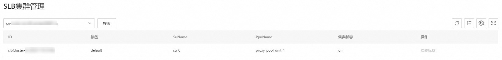

5. 在目标集群**操作**列，单击**修改标签**，在弹出的对话框中，修改标签名称，然后单击**确认**。

   > **说明**
   >
   > 默认集群不支持修改。

## 2.2. SLB管理

SLB管理页面从集群和实例两个方面展示了SLB四层的服务资源与监控运维信息。

**SLB集群**

在SLB集群页面查看集群内单设备节点的基本信息、bps、pps、活跃连接数、非活跃连接数及水位情况。

**前提条件**

产品BaseServiceAll的NetworkBaseServiceCluster集群已部署且已到终态。

**操作步骤**

1. 登录Apsara Uni-manager运维控制台。

2. 在顶部菜单栏，选择**产品运维** > **网络运维** > **网络运维控制台**。

3. 在左侧导航栏，选择**网络产品** > **SLB 运维** > **SLB管理**。

4. 在**SLB管理**页面，单击**SLB集群**页签，选择需要查看的**集群**，系统将显示当前集群中的设备**节点信息**和**集群水位数据**。

   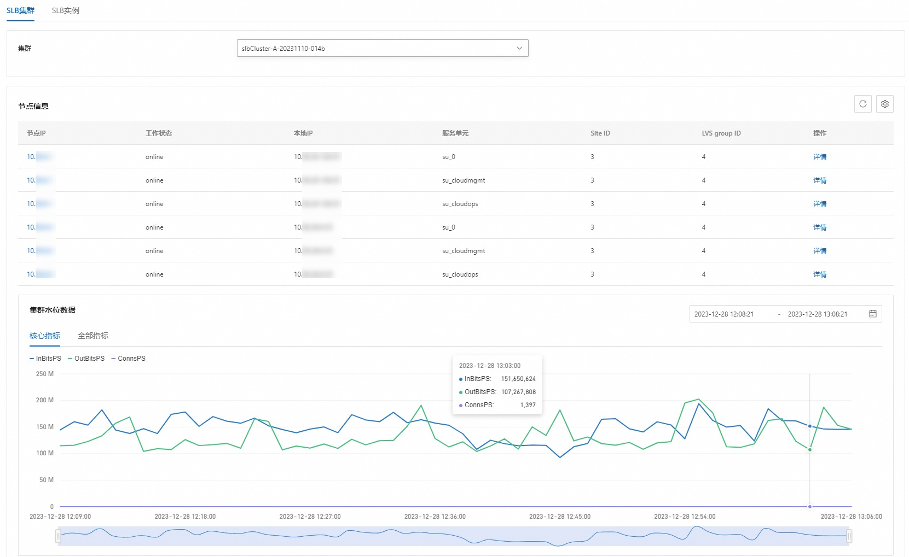

   - 在**节点信息**区域，查看节点列表信息，包括**节点IP**、**工作状态**、**本地IP**、**服务单元**、**Site ID**和**LVS group ID**。

     **查看节点详情**：在目标设备节点**操作**列，单击**详情**，进入**SLB节点详情**页面，获取**节点信息**和**水位数据**。

     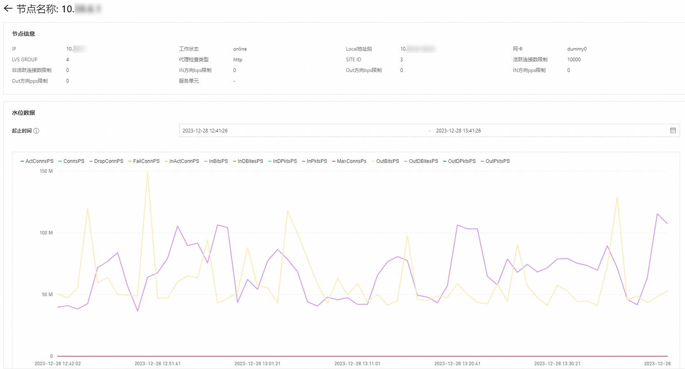

     - **节点信息**：包括**IP**、**工作状态**、**Local地址段**、**网卡**、**LVS Group ID**、**代理检查类型**、**Site ID**、**活跃连接数限制**、**非活跃连接数限制**、**IN方向bps限制**、**Out方向bps限制**、**IN方向pps限制**、**Out方向pps限制**等。

     - **水位数据**：选择**起止时间**，查看该节点在指定时间范围内的运行水位图。各指标数据含义请参考节点/实例水位数据指标说明。

       > **说明**
       >
       > - 起始时间与结束时间的范围不得超过12小时。
       >
       > - 单击**最近5分钟**、**最近30分钟**、**最近1小时**、**最近6小时**可以快速查询对应时间范围内的水位数据信息。
       >
       > - 将鼠标悬停于图中任意一个时间节点，系统会显示该时间节点的所有指标的数值。

   - 在**集群水位数据**区域，选择起止时间，查看集群在目标时间范围内的运行水位图。包括**核心指标**和**全部指标**。各指标数据含义请参考集群水位数据指标说明。

     > **说明**
     >
     > - 起始时间与结束时间的范围不得超过12小时。
     >
     > - 单击**最近1小时**、**最近3小时**、**最近6小时**、**最近12小时**可以快速查询对应时间范围内的水位数据信息。
     >
     > - 将鼠标悬停于图中任意一个时间节点，系统会显示该时间节点的所有指标的数值。

**SLB实例**

在SLB实例页面查看实例的基本信息以及bps、pps的水位情况。

**前提条件**

产品BaseServiceAll的NetworkBaseServiceCluster集群已部署且已到终态。

**操作步骤**

1. 登录Apsara Uni-manager运维控制台。

2. 在顶部菜单栏，选择**产品运维** > **网络运维** > **网络运维控制台**。

3. 在左侧导航栏，选择**网络产品** > **SLB 运维** > **SLB管理**。

4. 在**SLB管理**页面，单击**SLB实例**页签，可以查看SLB实例列表信息，包括**IP地址**、**实例ID**、**网络类型**、**产品**、**所属AZone**以及**更新时间**。

   单击**高级筛选**，可以根据**IP版本**、**IP地址**、**实例 ID**、**产品名称**以及**网络类型**组合搜索获取目标SLB实例。

   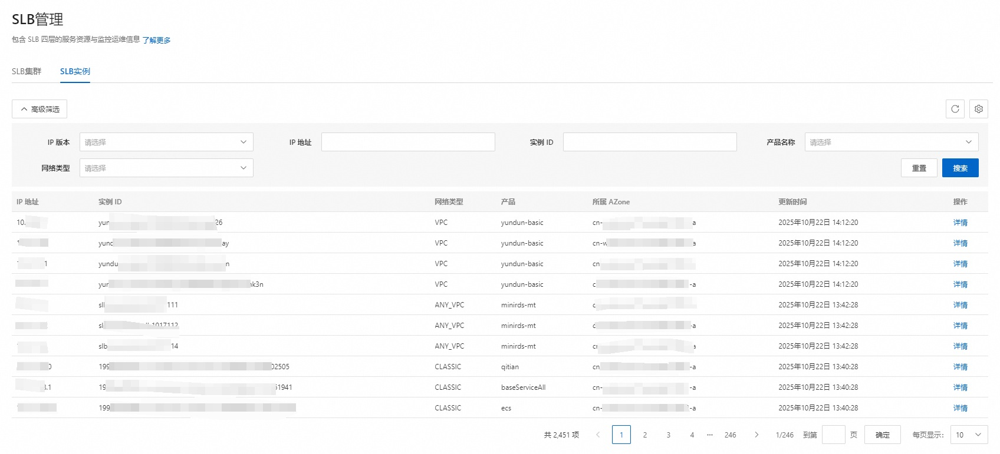

5. 在目标SLB实例**操作**列，单击**详情**，进入**SLB实例详情**页面。可以查看**实例信息**、**服务器组信息**和**水位数据**。

   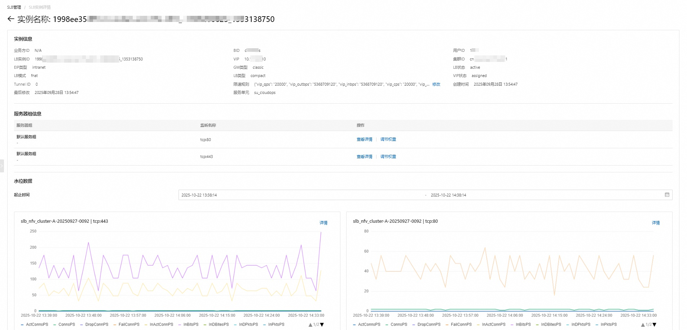

   - 在**实例信息**区域，查看SLB实例的基本信息，供运维工程师在出现故障时进行排障和确认设备归属。

     单击**限速规则**右侧**修改**，可以更改SLB实例的限速规则。

     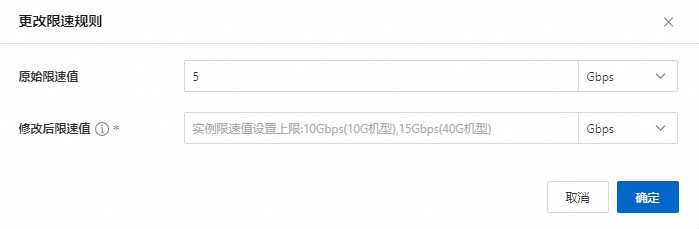

     > **说明**
     >
     > 实例限速值设置上限：10Gbps（10G机型）/15Gbps（40G机型）。

   - 在**服务器组信息**区域，查看SLB实例的服务器组信息，包括**服务器组**、**监听名称**等。

     - 查看权重调整详情：单击目标服务器组**操作**列的**查看详情**，获取对应服务器组权重调整详情。

       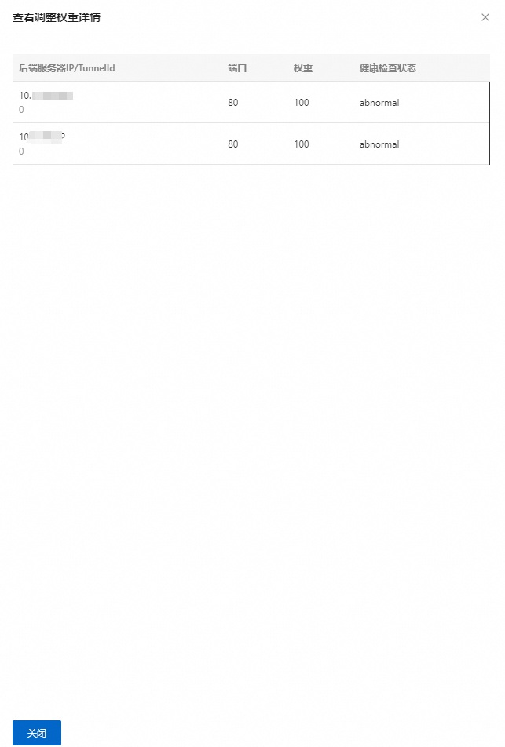

     - 调整权重

       <ol type="a">

       <li>

       单击目标服务器组**操作**列的**调节权重**，在弹出的面板中，修改**权重**列数据，然后单击**确定**。

       </li>

       <li>

       在弹出的对话框中，确认提示内容，单击**确定**。

       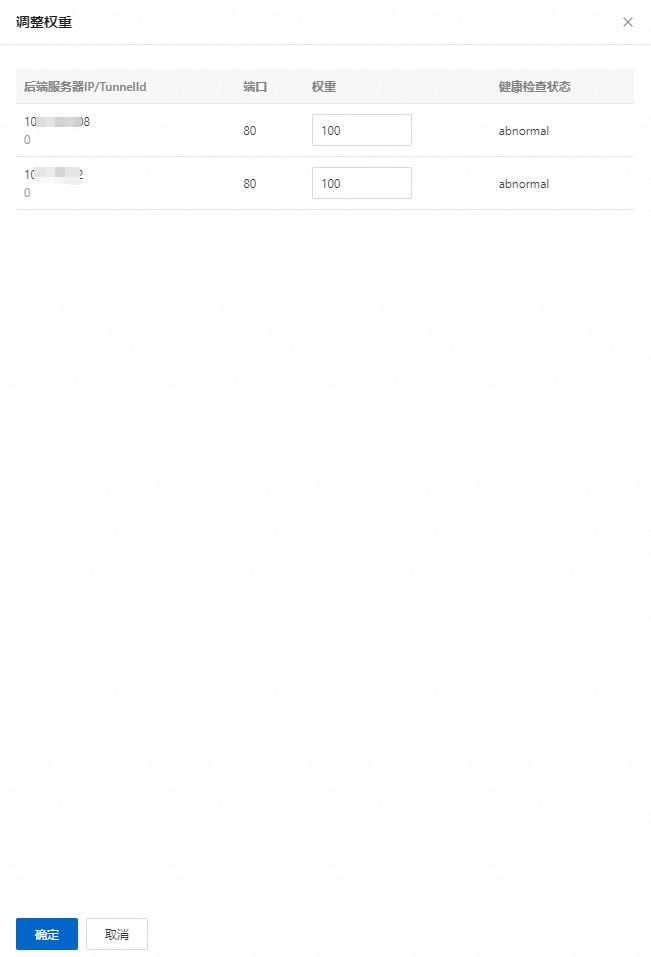

       </li>

       </ol>

       > **说明**
       >
       > - 在维修或应急场景后，尽量恢复权重设置，在后续升级同城双机房容灾场景系统会恢复默认权重，确认后变更生效。
       >
       > - 租户侧开通的SLB，请到Apsara Uni-manager运营控制台（ASCM）进行调整。

   - 在**水位数据**区域，选择**起止时间**，查看SLB实例在指定时间内的运行水位图。各指标数据含义请参考节点/实例水位数据指标说明。

     > **说明**
     >
     > - 起始时间与结束时间的范围不得超过12小时。
     >
     > - 单击**最近5分钟**、**最近30分钟**、**最近1小时**、**最近6小时**可以快速查询对应时间范围内的水位数据信息。
     >
     > - 将鼠标悬停于图中任意一个时间节点，系统会显示该时间节点的所有指标的数值。

     查看水位详情：单击目标水位图右上角的**详情**，可以查看具体的RS水位详情。

     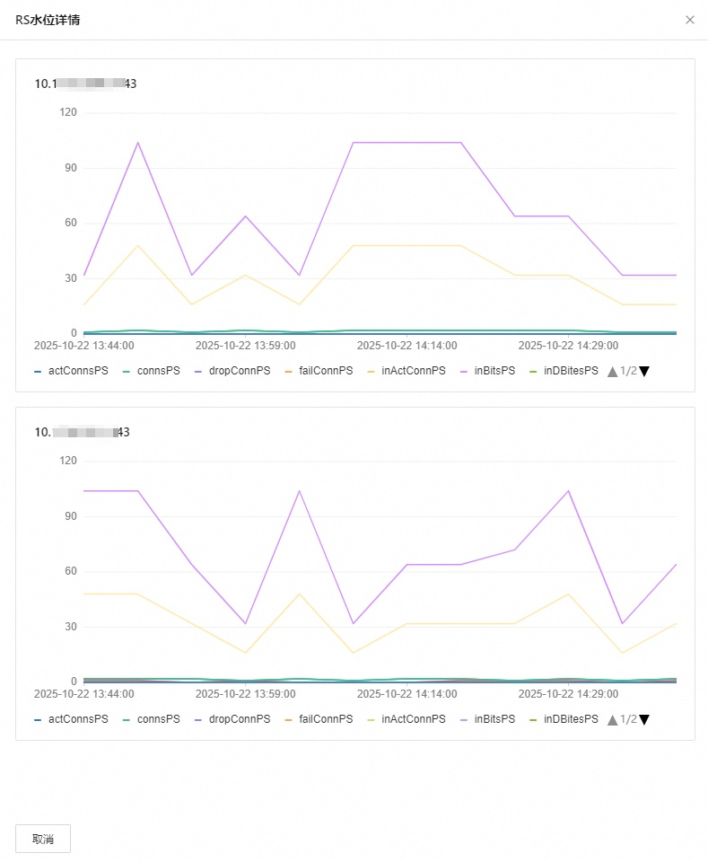

**集群水位数据指标说明**

**指标分类**

**指标**

**描述**

**示例**

每秒入bit数

**InBitsPS**

248

每秒出bit数

**核心指标**

**OutBitsPS**

208

新建连接数

**ConnsPS**

1

每秒丢弃连接数

**DropConnsPS**

0

每秒入包数

**InPktsPS**

1

新建连接数

**ConnsPS**

1

活跃连接数

**ActConnsPS**

0

ACL每秒丢弃bit数

**aclDBitsPS**

0

非活跃连接数

**InActConnPS**

1

每秒出丢包数

**OutDPktsPS**

0

每秒失败连接数

**FailConnPS**

0

每秒入bit数

**全部指标**

**InBitsPS**

248

每秒出bit数

**OutBitsPS**

208

每秒出包数

**OutPktsPS**

1

每秒入丢包数

**InDPktsPS**

0

ACL每秒丢弃包数

**aclDPktsPS**

0

0

每秒出丢弃bit数

**OutDBitesPS**

每秒并发连接数

**MaxConnsPs**

1

每秒入丢弃bit数

**InDBitesPS**

0

**节点/实例水位数据指标说明**

| 指标 | 描述 | 示例 |
| --- | --- | --- |
| ActConnsPS | 活跃连接数 | 0 |
| ConnsPS | 新建连接数 | 1 |
| DropConnsPS | 每秒丢弃连接数 | 0 |
| FailConnPS | 每秒失败连接数 | 0 |
| InActConnPS | 非活跃连接数 | 1 |
| InBitsPS | 每秒入bit数 | 248 |
| InDBitesPS | 每秒入丢弃bit数 | 0 |
| InDPktsPS | 每秒入丢包数 | 0 |
| InPktsPS | 每秒入包数 | 1 |
| MaxConnsPs | 每秒并发连接数 | 1 |
| OutBitsPS | 每秒出bit数 | 208 |
| OutDBitesPS | 每秒出丢弃bit数 | 0 |
| OutDPktsPS | 每秒出丢包数 | 0 |
| OutPktsPS | 每秒出包数 | 1 |

# 3.Proxy运维

## 3.1. Proxy管理

Proxy管理包含SLB七层的服务资源与监控运维信息。

**Proxy集群**

查看SLB Proxy集群的节点状态、水位数据、集群聚合监控指标。

**操作步骤**

1. 登录Apsara Uni-manager运维控制台。

2. 在顶部菜单栏，选择**产品运维** > **网络运维** > **网络运维控制台**。

3. 在左侧导航栏，选择**网络产品** > **Proxy 运维** > **Proxy 管理**。

4. 在**Proxy 管理**页面，单击**Proxy 集群**页签，选择**集群**，查看目标集群的**节点信息**和**集群聚合监控**。

   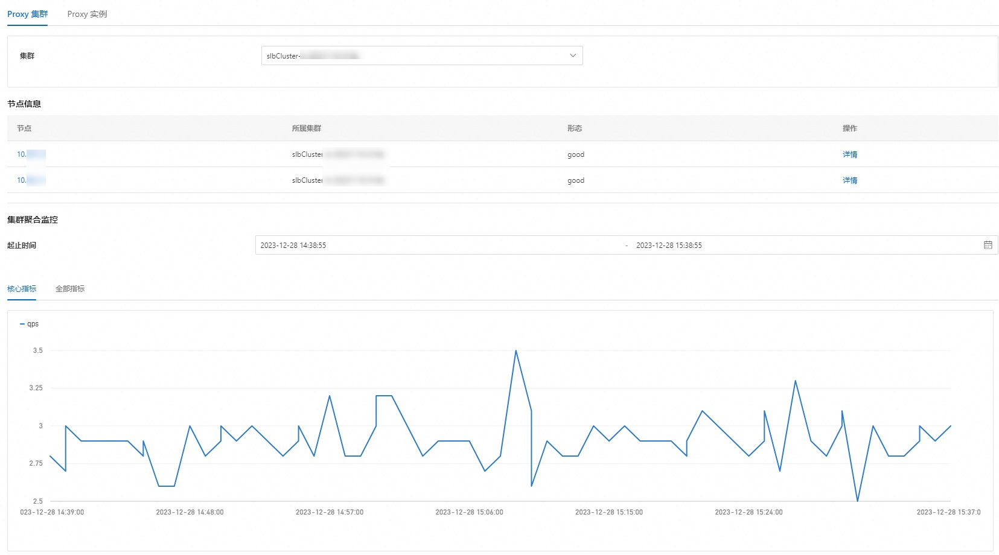

5. 在**节点信息**区域。

   - 查看节点列表：包括**节点**、**所属集群**和**形态**等。

   - 查看节点详情：单击目标节点名称或者**操作**列的**详情**，进入**SLB Proxy节点详情**页面，选择**起止时间**，查看节点的各项指标**水位数据**。

     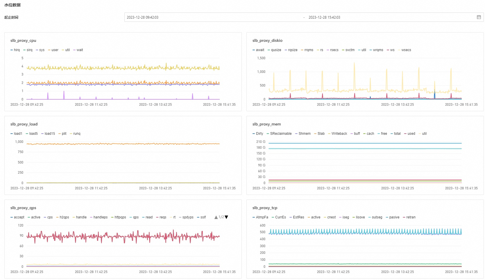

     > **说明**
     >
     > - 起始时间与结束时间的范围不得超过12小时。
     >
     > - 单击**最近5分钟**、**最近30分钟**、**最近1小时**、**最近6小时**快速查询对应时间范围内的水位数据信息。
     >
     > - 将鼠标悬停于图中任意一个时间节点，系统会显示该时间节点的所有指标的数值。

     相关指标含义如下表所示：

     **分类**

     **指标**

     **描述**

     系统处理硬中断的时间与总时间的百分比

     **hirq**

     系统处理软中断的时间与总时间的百分比

     **sirq**

     系统CPU占用率

     **sys**

     **slb_proxy_cpu**

     CPU执行用户进程的时间与总时间的百分比

     **user**

     CPU使用时间与总时间的百分比

     **util**

     CPU等待I/O操作完成的时间与总时间的百分比

     **wait**

     向要服务的设备发出I/O请求的平均时间（毫秒）

     **await**

     向设备发出的请求的平均队列长度（个）

     **qusize**

     向设备发出的请求的平均大小（以扇区为单位，个）

     **rqsize**

     每秒从设备读取的扇区数（个）

     **rrqms**

     每秒向设备发出的读取请求数（个）

     **rs**

     **slb_proxy_diskio**

     每秒从设备读取的扇区数（个）

     **rsecs**

     向设备发出I/O请求的平均服务时间（毫秒）

     **svctm**

     向设备发出I/O请求的CPU时间与CPU总时间的百分比（设备

     **util**

     的带宽利用率）

     每秒向设备发出的合并写入请求数（个）

     **wrqms**

     每秒向设备发出的写入请求数（个）

     **ws**

     每秒写入设备的扇区数（个）

     **wsecs**

     一分钟的系统平均负载（%）

     **load1**

     五分钟的系统平均负载（%）

     **load5**

     十五分钟的系统平均负载（%）

     **load15**

     **slb_proxy_load**

     在采样时刻，系统中活跃的任务（不包括运行已结束的任

     **plit**

     务）数（个）

     在采样时刻，运行队列的任务数（个）

     **runq**

     等待被写回到磁盘的数据大小（KB）

     **Dirty**

     可收回slab内存大小（KB）

     **SReclaimable**

     已经被分配的共享内存大小（KB）

     **Shmem**

     内核数据结构缓存大小（KB）

     **Slab**

     正在被写回的数据大小（KB）

     **Writeback**

     buff使用的内存大小（KB）

     **slb_proxy_mem**

     **buff**

     操作系统分配给文件缓冲区的内存大小（KB）

     **cach**

     空闲的物理内存大小（KB）

     **free**

     系统总的内存大小（KB）

     **total**

     已经使用的内存大小（KB）

     **used**

     内存使用率

     **util**

     总共接收的新TCP连接数（个）

     **accept**

     活跃的TCP连接数（个），等于read+write+wait。

     **active**

     每秒平均收到的TCP连接数（个）

     **cps**

     HTTP2 每秒处理请求数

     **h2qps**

     总共处理的TCP连接数（个）

     **handle**

     平均处理连接数

     **handleps**

     HTTP 每秒处理请求数

     **httpqps**

     每秒处理的请求数（个）

     **qps**

     读取请求数据的TCP连接数（个）

     **read**

     **slb_proxy_qps**

     总共产生请求数（个）

     **reqs**

     平均响应时间（毫秒）

     **rt**

     每秒处理的spdy请求数（个）

     **spdyps**

     SSL 连接失败数

     **sslf**

     平均SSL握手时间（毫秒）

     **sslhst**

     每秒处理的SSL请求数（个）

     **sslqps**

     SSLv3 连接失败数

     **sslv3f**

     长连接等待的TCP连接数（个）

     **wait**

     向用户写响应数据的TCP连接数（个）

     **write**

     每秒发起TCP连接失败的次数（个）

     **AtmpFa**

     当前TCP连接数（个）

     **CurrEs**

     每秒TCP连接被重置的次数（个）

     **EstRes**

     每秒主动发起TCP连接数（个）

     **active**

     **slb_proxy_tcp**

     每秒流入tcpsegment数（个）

     **iseg**

     由于listenaccept队列满导致被丢弃的TCP请求数（个）

     **lisove**

     每秒流出tcpsegment数（个）

     **outseg**

     每秒被动生成的TCP连接数（个）

     **pasive**

     根据重传segment和总的segment，计算出的重传率。

     **retran**

6. 在**集群聚合监控**区域，选择**起止时间**，分别在**核心指标**和**全部指标**页签中查看对应集群聚合监控指标。

   > **说明**
   >
   > - 起始时间与结束时间的范围不得超过12小时。
   >
   > - 将鼠标悬停于图中任意一个时间节点，系统会显示该时间节点的所有指标的数值。

   相关指标含义如下表所示：

   **页签**

   **名称**

   **描述**

   每秒处理的请求数（个）

   **核心指标**

   **qps**

   总共接收的新TCP连接数（个）

   **accept**

   活跃的TCP连接数（个），等于read+write+wait。

   **active**

   每秒平均收到的TCP连接数（个）

   **cps**

   HTTP2 每秒处理请求数

   **h2qps**

   总共处理的TCP连接数（个）

   **handle**

   平均处理连接数

   **handleps**

   HTTP 每秒处理请求数

   **httpqps**

   每秒处理的请求数（个）

   **qps**

   读取请求数据的TCP连接数（个）

   **read**

   **全部指标**

   总共产生请求数（个）

   **reqs**

   平均响应时间（毫秒）

   **rt**

   每秒处理的spdy请求数（个）

   **spdyps**

   SSL 连接失败数

   **sslf**

   平均SSL握手时间（毫秒）

   **sslhst**

   每秒处理的SSL请求数（个）

   **sslqps**

   SSLv3 连接失败数

   **sslv3f**

   **wait**

   长连接等待的TCP连接数（个）向用户写响应数据的TCP连接数（个）

   **write**

**Proxy实例**

查看SLB Proxy实例监控指标及水位图。

**前提条件**

产品BaseServiceAll的NetworkBaseServiceCluster集群已部署且已到终态。

**操作步骤**

1. 登录Apsara Uni-manager运维控制台。

2. 在顶部菜单栏，选择**产品运维** > **网络运维** > **网络运维控制台**。

3. 在左侧导航栏，选择**网络产品** > **Proxy 运维** > **Proxy 管理**。

4. 在**Proxy 管理**页面，单击**Proxy 实例**页签。

5. 选择**集群**，输入实例ID或VIP地址后选择**监听实例**，选择**起止时间**，单击**搜索**。

6. 单击**请求**、**连接**、**流量**、**时延**、**状态码**页签，分别查看对应指标项的水位图。

   相关指标含义如下表所示：

   **名称**

   **描述**

   每秒平均收到的请求数量（个）

   **qps**

   当前并发请求数量（个）

   **请求**

   **req_concurrent**

   因限速不转发的请求数量（个）

   **REQ_DROP**

   当前并发连接数量（个）

   **conn_concurrent**

   **连接**

   每秒平均收到的连接数量（个）

   **cps**

   入流量（比特/秒）

   **inBitsPS**

   **流量**

   出流量（比特/秒）

   **outBitsPS**

   平均处理延时时间（毫秒）

   **rt**

   **时延**

   后端ECS平均处理延时时间（毫秒）

   **upstream_rt**

   返回2xx响应码的请求数量（个）

   **status_code_2xx**

   返回3xx响应码的请求数量（个）

   **status_code_3xx**

   返回4xx响应码的请求数量（个）

   **status_code_4xx**

   返回5xx响应码的请求数量（个）

   **status_code_5xx**

   **状态码**

   返回其它响应码的请求数量（非2xx 3xx 4xx 5xx）

   **status_code_other**

   （个）

   后端ECS返回4xx响应码的请求数量（个）

   **upstream_code_4xx**

   后端ECS返回5xx响应码的请求数量（个）

   **upstream_code_5xx**
