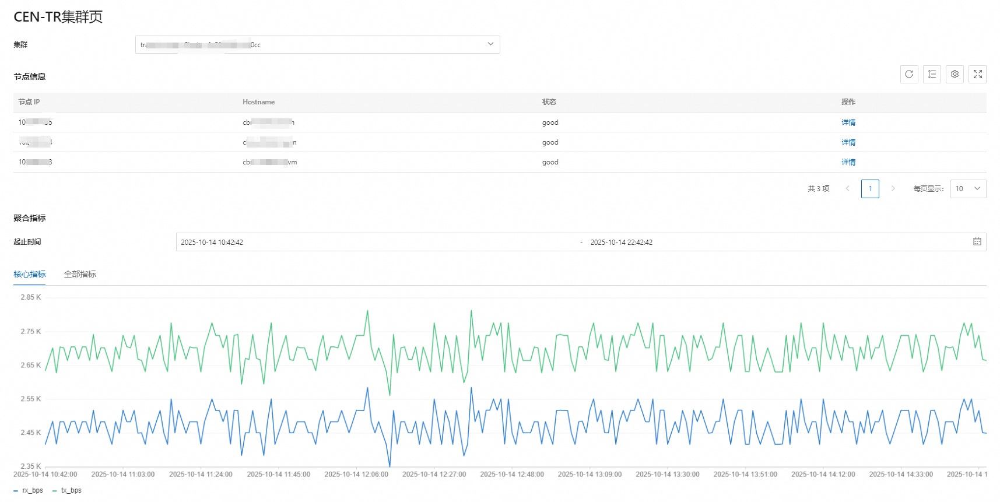
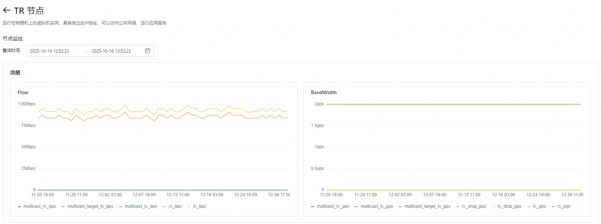
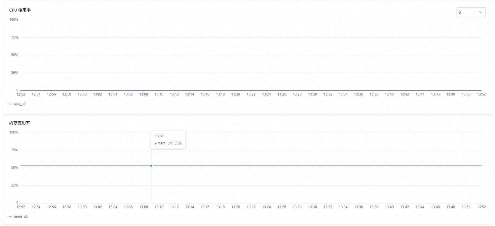
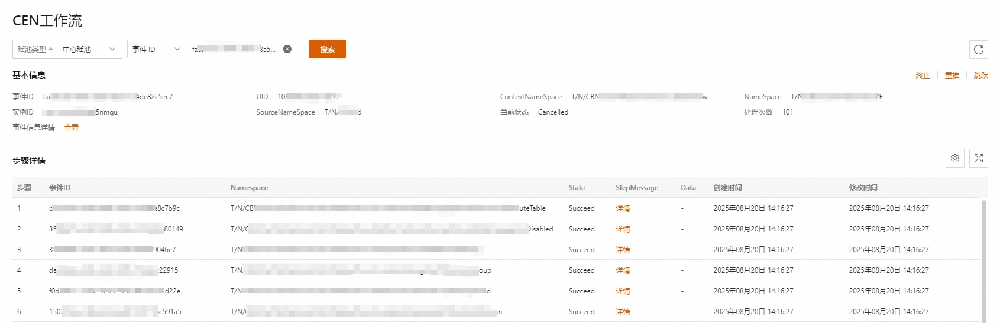
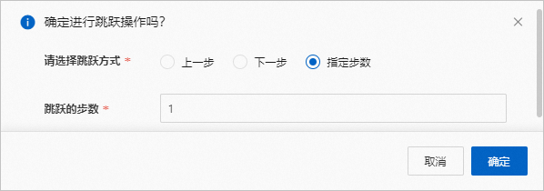

阿里云  
专有云  
转发路由器  
运维指南  
产品版本：V3.18.6  
文档版本：20251028

**目录**

- [1.登录Apsara Uni-manager运维控制台](#section-1)
- [2.CEN运维](#section-2)
    - [2.1. CEN-TR集群管理](#section-2-1)
    - [2.2. CEN工作流](#section-2-2)

# 1.登录Apsara Uni-manager运维控制台

本文介绍运维工程师等相关用户如何登录到Apsara Uni-manager运维控制台。

**前提条件**

- 已从部署人员或管理员处获取Apsara Uni-manager运维控制台的访问地址、用户名和密码。

  Apsara Uni-manager运维控制台访问地址格式为*region-id*.ops.console.*intranet-domain-id*。

- 推荐使用Chrome浏览器。

**操作步骤**

1. 打开浏览器。

2. 在地址栏中，输入Apsara Uni-manager运维控制台的访问地址，按回车键。

   

   > **说明**
   >
   > 您可以单击右上角的当前语言切换其它语言。当前支持简体中文、英文、繁体中文三种语言切换。

3. 输入正确的用户名及密码。

   > **说明**
   >
   > - 登录Apsara Uni-manager运维控制台的用户名和密码请从部署人员或管理员处获取。
   >
   > - 若连续输入密码错误三次，系统将启动图片验证码登录功能；若连续输入错误五次，账户将被锁定，请联系管理员进行激活。

   首次登录Apsara Uni-manager运维控制台时，需要修改登录用户名的密码，请按照提示完成密码修改。

   为提高安全性，密码必须满足以下要求：

   - 必须包含英文大小写字母。

   - 必须包含阿拉伯数字（0~9）。

   - 必须包含特殊符号，包括感叹号（!）、at（@）、井号（#）、美元符号（$）、百分号（%）等。

   - 密码长度为10~20个字符。

4. 单击**账号登录**。

# 2.CEN运维

> **说明**
>
> 此功能默认不展示，如果需要使用本功能，在**用户权限** > **菜单管理**下编辑菜单项，进行**展示**操作。

## 2.1. CEN-TR集群管理

运行在物理机上的虚拟机实例，具有独立的IP地址，可以访问公共网络，运行应用服务。

**操作步骤**

1. 登录Apsara Uni-manager运维控制台。

2. 在顶部菜单栏，选择**产品运维** > **网络运维** > **网络运维控制台**。

3. 在左侧导航栏，选择**网络产品** > **CEN 运维** > **CEN-TR 集群管理**。

4. 在**CEN-TR集群页**页面，查看**节点信息**和**聚合指标**。

   

   - **节点信息**：选择**集群**，列表对应展示目标集群相关的信息，包括**节点IP**、**Hostname**、**状态**等。

   - **聚合指标**：默认展示最近1小时的指标数据，包括**核心指标**以及**全部指标**。

     各指标含义如下表所示：

     | 指标 | 含义 |
     | --- | --- |
     | multicast_rx_bps | TR节点入向组播比特速率 |
     | multicast_rx_pps | TR节点入向组播报文速率 |
     | multicast_target_tx_bps | TR节点出向组播预期比特速率 |
     | multicast_target_tx_pps | TR节点出向组播预期报文速率 |
     | multicast_tx_bps | TR节点出向组播比特速率 |
     | multicast_tx_pps | TR节点出向组播报文速率 |
     | rx_bps（核心指标） | TR节点入向比特速率 |
     | rx_drop_pps | TR节点入向报文丢弃速率 |
     | rx_pps | TR节点入向报文速率 |
     | tx_bps（核心指标） | TR节点出向比特速率 |
     | tx_drop_pps | TR节点出向报文丢弃速率 |
     | tx_pps | TR节点出向报文速率 |

     > **说明**
     >
     > - 选择**起止时间**，可以筛选查看目标时间段的指标数据。
     >
     > - 单击**最近1小时**、**最近3小时**、**最近6小时**、**最近12小时**，可以快速筛选查看最近的指标数据。
     >
     > - 起止时间选择的时间间隔不能大于12小时。

**更多操作**

**查看节点监控**

在**节点信息**列表，单击对应节点**操作**列的**详情**，在**TR 节点**页面可以获取目标节点的监控数据趋势图，包括**流量**、**CPU使用率**以及**内存使用率**。

关键指标含义如下表所示：

**分类**

**指标**

**含义**

TR节点入向组播比特速率

multicast_rx_bps

TR节点出向组播预期比特速率

multicast_target_tx_bps

TR节点出向组播比特速率

**Flow**

multicast_tx_bps

TR节点入向比特速率

rx_bps

TR节点出向比特速率

tx_bps

TR节点入向组播报文速率

multicast_rx_pps

**流量**

TR节点出向组播报文速率

multicast_tx_pps

TR节点出向组播预期报文速率

multicast_target_tx_pps

TR节点入向报文丢弃速率

rx_drop_pps

**BandWidth**

TR节点出向报文丢弃速率

tx_drop_pps

TR节点出向报文速率

tx_pps

TR节点入向报文速率

rx_pps

CPU使用率（百分比）

**CPU使用率**

cpu_util

内存使用率（百分比）

**内存使用率**

mem_util

> **说明**
>
> - 选择**查询时间**，可以筛选查看目标时间段各指标的数据。
>
> - 单击**最近1小时**、**最近3小时**、**最近6小时**、**最近1天**，可以快速筛选查看最近的指标数据。
>
> - 单击**请选择cpu号**下拉选择cpu，支持按型号分类查看CPU使用率。

## 2.2. CEN工作流

通过CEN工作流页面，可以查看云企业网实例的工作流事件详情及其相关步骤信息。当工作流状态异常时，可以对工作流事件进行重推、跳跃以及终止操作。

**操作步骤**

1. 登录Apsara Uni-manager运维控制台。

2. 在顶部菜单栏，选择**产品运维** > **网络运维** > **网络运维控制台**。

3. 在左侧导航栏，选择**网络产品** > **CEN 运维** > **CEN 工作流**。

4. 在页面上方选择**瑶池类型**并输入**事件ID**，然后单击**搜索**。

   **瑶池类型**支持选择**中心瑶池**和**BR瑶池**。

5. 查看对应工作流的**基本信息**和**步骤详情**。

   

   - **基本信息**：包括**事件ID**、**UID**、**ContextNameSpace**、**NameSpace**、**实例ID**、**SourceNameSpace**、**当前状态**、**处理次数**以及**事件信息详情**。

     鼠标悬浮在**事件信息详情**右侧的**查看**上，可以查看事件的详细信息。

   - <strong>步骤详情：</strong>包括步骤序号、**事件ID、Namespace、State、StepMessage、Data、创建时间、修改时间等。**

     鼠标悬浮在目标步骤**StepMessage**列的**详情**上，可以查看对应步骤的详细信息。

**更多操作**

<table>
  <tr>
    <th width="106">操作</th>
    <th>操作说明</th>
  </tr>
  <tr>
    <td>终止工作流</td>
    <td>1. 在<strong>基本信息</strong>区域，单击右上角<strong>终止</strong>。 2. 在弹出的对话框中，单击<strong>确定</strong>。</td>
  </tr>
  <tr>
    <td>重推工作流</td>
    <td>当目标工作流事件状态不是<strong>Succeed</strong>时，可以对该异常工作流执行重试操作。 1. 在<strong>基本信息</strong>区域，单击右上角<strong>重推</strong>。 2. 在弹出的对话框中，单击<strong>确定</strong>。</td>
  </tr>
  <tr>
    <td>跳跃工作流</td>
    <td>1. 在<strong>基本信息</strong>区域，单击右上角<strong>跳跃</strong>。 2. 在弹出的对话框中，设置跳跃方式和跳跃的步数。  • <strong>请选择跳跃方式</strong>：支持选择<strong>上一步</strong>、<strong>下一步</strong>和<strong>指定步数</strong>。 • <strong>跳跃的步数</strong>：输入跳跃的步数。当跳跃方式选择<strong>指定步数</strong>时，该参数生效且需要配置。 3. 单击<strong>确定</strong>。</td>
  </tr>
</table>
