阿里云  
专有云  
高速通道  
运维指南  
产品版本：V3.18.6  
文档版本：20251028

**目录**

- [1.登录Apsara Uni-manager运维控制台](#section-1)
- [2.专线管理](#section-2)
    - [2.1. 专线大盘](#section-2-1)
    - [2.2. 专线分组](#section-2-2)
    - [2.3. 接入点管理](#section-2-3)
    - [2.4. 接入设备管理](#section-2-4)
    - [2.5. 物理专线管理](#section-2-5)
    - [2.6. VBR管理](#section-2-6)
    - [2.7. 路由器接口管理](#section-2-7)
    - [2.8. 路由表管理](#section-2-8)

# 1.登录Apsara Uni-manager运维控制台

本文介绍运维工程师等相关用户如何登录到Apsara Uni-manager运维控制台。

**前提条件**

- 已从部署人员或管理员处获取Apsara Uni-manager运维控制台的访问地址、用户名和密码。

  Apsara Uni-manager运维控制台访问地址格式为*region-id*.ops.console.*intranet-domain-id*。

- 推荐使用Chrome浏览器。

**操作步骤**

1. 打开浏览器。

2. 在地址栏中，输入Apsara Uni-manager运维控制台的访问地址，按回车键。

   

   > **说明**
   >
   > 您可以单击右上角的当前语言切换其它语言。当前支持简体中文、英文、繁体中文三种语言切换。

3. 输入正确的用户名及密码。

   > **说明**
   >
   > - 登录Apsara Uni-manager运维控制台的用户名和密码请从部署人员或管理员处获取。
   >
   > - 若连续输入密码错误三次，系统将启动图片验证码登录功能；若连续输入错误五次，账户将被锁定，请联系管理员进行激活。

   首次登录Apsara Uni-manager运维控制台时，需要修改登录用户名的密码，请按照提示完成密码修改。

   为提高安全性，密码必须满足以下要求：

   - 必须包含英文大小写字母。

   - 必须包含阿拉伯数字（0~9）。

   - 必须包含特殊符号，包括感叹号（!）、at（@）、井号（#）、美元符号（$）、百分号（%）等。

   - 密码长度为10~20个字符。

4. 单击**账号登录**。

# 2.专线管理

## 2.1. 专线大盘

专线大盘提供VPC专线、DCI专线以及互联专线的实例管理与运维监控能力。

**操作步骤**

1. 登录Apsara Uni-manager运维控制台。

2. 在顶部菜单栏，选择**产品运维** > **网络运维** > **网络运维控制台**。

3. 在左侧导航栏，选择**基础网络** > **专线管理** > **专线大盘**。

4. 在页面上方可以查看**VPC专线**、**DCI专线**以及**互联专线**的告警实例数、正常实例数以及所占百分比。

   

5. 选择**VPC专线**，可以获取如下信息：

   - 在**专线实例**页签下，查看**接入点概览**以及**专线列表**。

     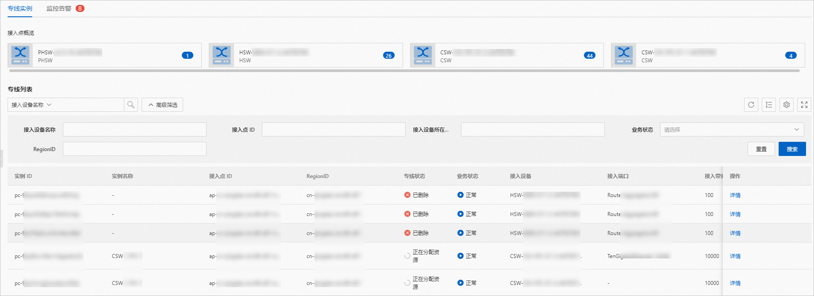

     - 在**专线列表**区域，单击**高级筛选**，可以根据**接入设备名称**、**接入点ID**、**接入设备所在机房**、**业务状态**以及**RegionID**组合筛选获取目标专线。

     - 在**专线列表**区域，单击目标专线**操作**列的**详情**，可以获取对应专线实例的详细信息。

       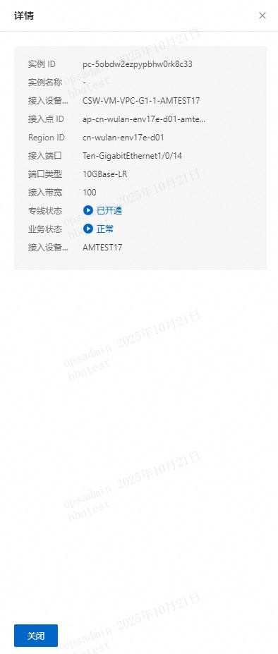

   - 在**监控告警**页签下，查看实例监控告警相关信息。

     在目标告警的**告警详情**列，单击**详情**可以获取告警的详细信息。

     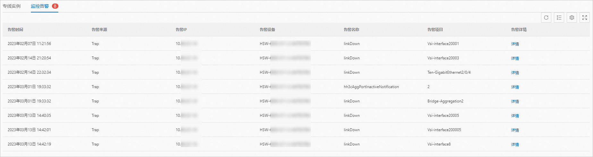

6. 选择**DCI专线**，可以获取如下信息：

   - 在**专线实例**页签下，查看**DCI互联拓扑**以及**专线实例**。

     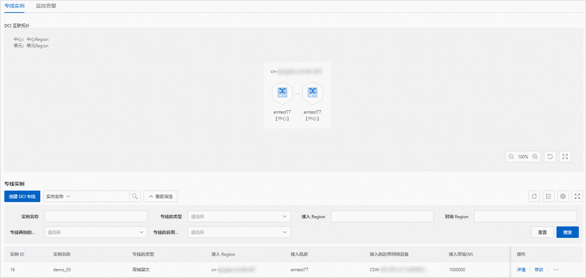

     - 在**专线实例**区域，单击**高级筛选**，可以根据**实例名称**、**专线的类型**、**接入Region**、**对端Region**、**专线两侧的互联类型**以及**专线的启用状态**组合筛选获取目标专线。

     - 在**专线实例**区域，单击目标专线**操作**列的**详情**，可以获取对应专线实例的详细信息。

     - 在**专线实例**区域，还支持如下操作：

       - **创建DCI专线**

         单击**创建DCI专线**，根据如下参数完成配置，单击**确定**。

         **分类**

         **参数**

         **参数说明**

         输入专线的名称。

         **专线名称**

         选择专线类型，支持如下类型：

         **专线的类型**

         - **域间专线**

         - **同城容灾**

         选择专线源端所属的Region ID。

         **Region**

         选择专线源端所属的IDC机房名称。

         **Data Center**

         **本端基础配置**

         输入提供专线服务的运营商名称。

         **运营商**

         选择专线接入的接入点设备名称。

         **接入设备**

         选择专线接入对应的设备端口名称。

         **接入端口**

         输入接入端口类型。

         **端口类型**

         输入专线的带宽大小，单位为M。

         **专线带宽**

         选择专线的直连状态。

         **直连状态**

         - **防火墙**

         - **直连**

         当**直连状态**选择**防火墙**时参数生效。

         选择防火墙类型，支持如下类型：

         **防火墙类型**

         - **云防火墙**

         **直连属性及防火墙信**

         - **用户防火墙**

         **息**

         - **其他**

         当**直连状态**选择**防火墙**时参数生效。

         **防火墙名称**

         输入专线防火墙的设备名称。

         当**直连状态**选择**防火墙**时参数生效。

         **防火墙备注**

         输入专线防火墙的设备备注信息。

         展示专线目的端所属的Region ID。

         **对端Region**

         输入专线源端所属的IDC机房名称。

         **Peer Data Center**

         输入专线接入到对端的接入点设备名称。

         **对端设备**

         **对端基础配置**

         输入专线接入到对端的接入点设备的端口名称。

         **对端端口**

         输入专线接入到对端的接入点设备对应的端口类

         **对端端口类型**

         型。

         输入专线源端的接口IP地址，以IP/掩码的格式填

         **本端IP**

         写。

         输入专线对端的接口IP地址，以IP/掩码的格式填

         **对端IP**

         写。

         **其他配置**

         选择专线在创建完成后启用或禁用。

         **启用状态**

         选择专线实例所属的专线分组。

         **关联专线分组**

         单击**创建专线分组**可以进行新建，具体操作，请参见专线分组。

         输入创建专线的备注信息。

         **备注**

       - **修改专线实例**

         单击目标专线**操作**列的**修改**，在弹出的对话框中修改参数，然后单击**确定**。

       - **删除专线实例**

         > **说明**
         >
         > 该操作不可恢复，请谨慎操作！

         单击目标专线**操作**列的  **> 删除**，在弹出的对话框中，单击**确定**。

       - **一键诊断**

         单击目标专线**操作**列的  **> 一键诊断** ，跳转至**网络实例诊断结果**页面，具体操作，请参考网络实

         例诊断。

   - 在**监控告警**页签下，查看实例监控告警相关信息。

     在目标告警的**告警详情**列，单击**详情**可以获取告警的详细信息。

     

7. 选择**互联专线**，可以获取如下信息：

   - 在**专线实例**页签下，查看**互联专线拓扑**以及**专线实例**。

     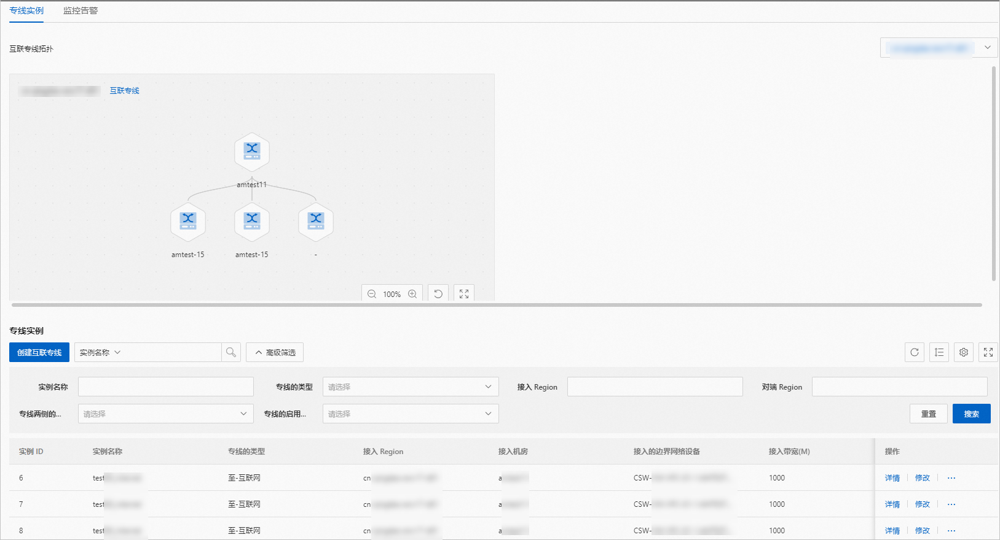

     在**专线实例**区域，还支持如下操作：

     - 单击**高级筛选**，可以根据**实例名称**、**专线的类型**、**接入Region**、**对端Region**、**专线两侧的互联类型**以及**专线的启用状态**组合筛选获取目标专线，

     - **查看实例详情**：单击目标专线**操作**列的**详情**，可以获取对应专线实例的详细信息。

     - **创建互联专线**：单击**创建互联专线**，在弹出框中完成相关配置，单击**确定**。

       具体参数说明，请参考创建DCI专线。

     - **修改专线实例**：单击目标专线**操作**列的**修改**，在弹出的对话框中修改相关参数，然后单击**确定**。

     - **删除专线实例**：单击目标专线**操作**列的  **> 删除**，在弹出的对话框中，单击**确定**。

       > **说明**
       >
       > 该操作不可恢复，请谨慎操作！

     - **一键诊断**：单击目标专线**操作**列的  **> 一键诊断**，跳转至**网络实例诊断果结**页面，具体操作，请参

       考网络实例诊断。

   - 在**监控告警**页签下，查看实例监控告警相关信息。

     在目标告警的**告警详情**列，单击**详情**可以获取告警的详细信息。

     

## 2.2. 专线分组

专线分组管理提供DCI专线以及互联专线的专线组管理能力。

**创建专线组**

1. 登录Apsara Uni-manager运维控制台。

2. 在顶部菜单栏，选择**产品运维** > **网络运维** > **网络运维控制台**。

3. 在左侧导航栏，选择**基础网络** > **专线管理** > **专线分组**。

4. 在**专线分组管理**页面，单击**创建专线组**。

5. 在**创建专线组**弹出框中，根据以下内容完成参数配置。

   | 配置参数 | 参数说明 |
   | --- | --- |
   | 专线组名称 | 输入自定义专线组名称。 |
   | 专线组类型 | 选择专线组的类型： • DCI 专线 • 互联专线 |
   | Region | 选择专线组源端所属的Region ID。 |
   | Data Center | 选择专线组源端所属的IDC机房名称。 |
   | PeerRegion | 选择<strong>专线组类型</strong>后，输入专线组目的端所属的Region ID。 |
   | Peer Data Center | 选择<strong>专线组类型</strong>后，输入专线组目的端所属的IDC机房名称。 |
   | 备注 | 输入专线组的相关备注内容。 |

   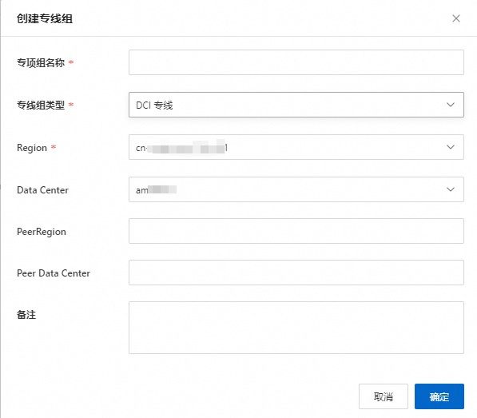

6. 单击**确定**。

**查看专线组详情**

1. 在**专线分组管理**页面，查看创建的专线组信息，包括**分组名称**、**分组类型**、**源 Region ID**、**源 IDC**、**对端 Region ID**、**对端 IDC**、**备注**、**创建时间**、**最后更新**等。

   - 单击**高级筛选**，可以根据**分组名称**、**分组类型**、**源Region ID**、**源IDC**、**对端Region ID**、**对端IDC**以及**备注**组合筛选获取目标专线组。

     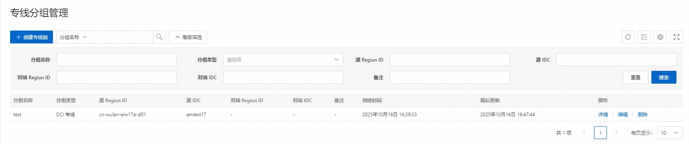

   - 单击目标专线组**操作**列的**详情**，在**专线分组详情**页面，可以获取对应专线组的**分组详情**以及**关联专线实例**。

     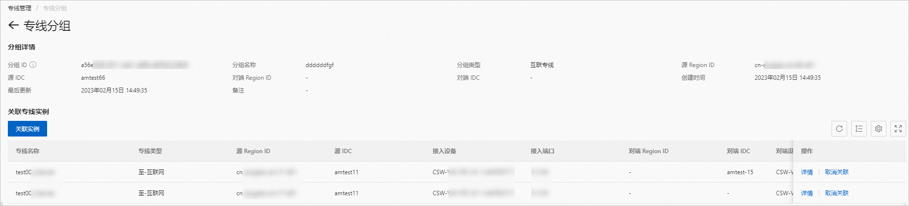

     **关联专线实例**

     在**关联专线实例**区域，支持如下操作：

     - **关联实例**：单击**关联实例**，选择需要关联的**专线组的类型**以及**关联的专线实例**，然后单击**确定**。

       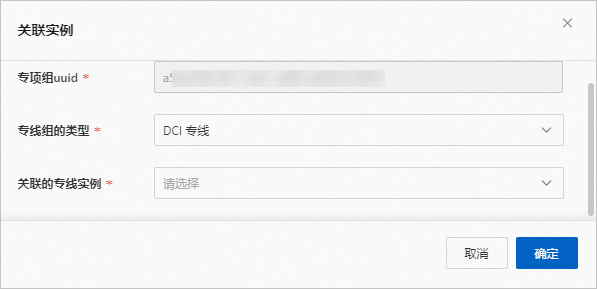

     - **查看关联实例详情**：单击目标关联实例**操作**列的**详情**，获取关联实例的详细信息。

       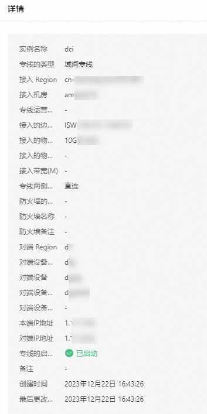

     - **取消关联实例**：单击目标关联实例**操作**列的**取消关联**，在弹出的对话框中，单击**确定**。

**后续操作**

<table>
  <tr>
    <th width="106">操作</th>
    <th>操作说明</th>
  </tr>
  <tr>
    <td>编辑专线组</td>
    <td>1. 在<strong>专线分组管理</strong>页面，单击目标专线组<strong>操作</strong>列的<strong>编辑</strong>。 2. 在弹出的对话框中，修改配置参数，然后单击<strong>确定</strong>。具体参数说明，请参考创建专线组。</td>
  </tr>
  <tr>
    <td>删除专线组</td>
    <td>1. 在<strong>专线分组管理</strong>页面，单击目标专线组<strong>操作</strong>列的<strong>删除</strong>。 2. 在弹出的对话框中，单击<strong>确定</strong>。 说明执行该操作会删除专线分组以及与专线实例的关联信息，请确认！</td>
  </tr>
</table>

## 2.3. 接入点管理

接入点是阿里云在各个地域落地的数据中心，每个地域下会有一个或者多个接入点。本文介绍如何管理接入点。

**操作步骤**

1. 登录Apsara Uni-manager运维控制台。

2. 在顶部菜单栏，选择**产品运维** > **网络运维** > **网络运维控制台**。

3. 在左侧导航栏，选择**基础网络** > **专线管理** > **接入点管理**。

4. 在**接入点管理**页面，查看接入点信息，包括**接入点ID**、**管理所在Region**、**物理所在Region**、**类型**、**状态**、**接入点名称**、**描述**、**物理位置**、**机房运营商**、**创建时间**以及**修改时间**。

   支持输入**接入点ID**快速获取目标接入点信息。

   

   - **查看接入点详情**

     单击目标接入点**操作**列的**详情**，可以获取对应接入点的详细内容。

     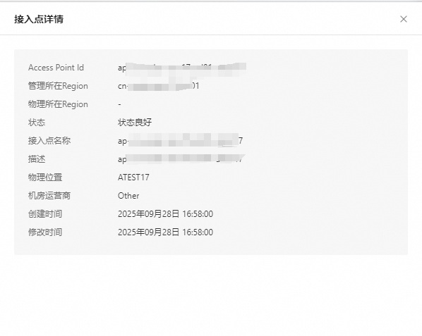

   - **修改接入点**

     <ol type="a">

     <li>

     单击目标接入点**操作**列的**编辑**。

     </li>

     <li>

     在**编辑接入点**对话框中，根据以下内容修改对应接入点的配置信息，然后单击**确定**。

     <table>
       <tr>
         <th width="152">配置参数</th>
         <th>参数说明</th>
       </tr>
       <tr>
         <td>接入点ID</td>
         <td>显示当前的接入点ID，不支持修改。</td>
       </tr>
       <tr>
         <td>接入点名称</td>
         <td>输入接入点名称。 长度2256个字符以内，不能以<code> http:// </code>或<code> https:// </code>开头。</td>
       </tr>
       <tr>
         <td>描述</td>
         <td>输入接入点的描述。 长度2256个字符以内，不能以<code> http:// </code>或<code> https:// </code>开头。</td>
       </tr>
       <tr>
         <td>接入点状态</td>
         <td>选择接入点的状态： • 状态良好 • 接入客户较多 • 接入客户已满 • 不可用</td>
       </tr>
       <tr>
         <td>物理位置</td>
         <td>输入接入点的位置。</td>
       </tr>
       <tr>
         <td>机房运营商</td>
         <td>输入接入点机房的运营商。</td>
       </tr>
       <tr>
         <td>物理所在Region</td>
         <td>输入接入点物理所在的地域。</td>
       </tr>
     </table>

     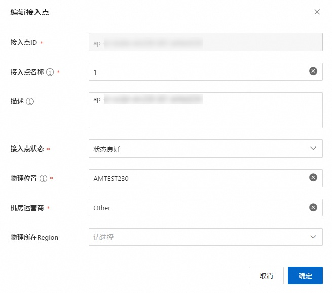

     </li>

     </ol>

## 2.4. 接入设备管理

本文介绍如何管理接入设备。

**操作步骤**

1. 登录Apsara Uni-manager运维控制台。

2. 在顶部菜单栏，选择**产品运维** > **网络运维** > **网络运维控制台**。

3. 在左侧导航栏，选择**基础网络** > **专线管理** > **接入设备管理**。

4. 在**接入设备管理**页面，查看接入设备信息，包括**设备ID**、**Region**、**接入点ID**、**设备状态**、**物理位置**、**接入方式**、**设备名称**、**描述**、**创建时间**以及**修改时间**。

   支持输入**设备ID**快速获取目标接入设备信息。

   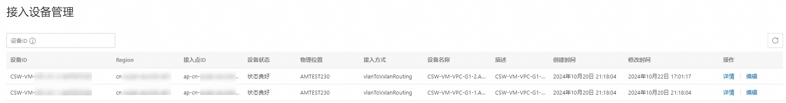

   - **查看接入设备详情**

     单击目标接入设备**操作**列的**详情**，可以获取对应接入设备的详细内容。

     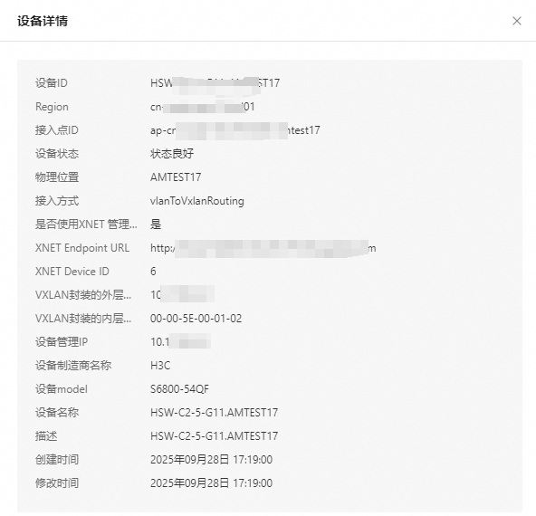

   - **修改接入设备**

     <ol type="a">

     <li>

     单击目标接入设备**操作**列的**编辑**。

     </li>

     <li>

     在**编辑接入设备**对话框，根据以下内容修改对应接入设备的配置信息，然后单击**确定**。

     | 配置参数 | 参数说明 |
     | --- | --- |
     | 设备ID | 显示当前设备ID，不支持修改。 |
     | 设备状态 | 选择接入设备的状态： • 状态良好 • 接入客户已满 • 不可用 |
     | 设备物理位置 | 输入接入设备的位置信息。 |
     | 是否使用XNET 管理CSW | 选择是否使用XNET管理CSW： • 是 • 否 |
     | XNET Endpoint URL | 输入XNET Endpoint URL。 |
     | XNET Device ID | 输入XNET Device ID。 |
     | VXLAN封装的外层源IP | 输入VXLAN封装的外层源IP。 |
     | VXLAN封装的内层源Mac | 输入VXLAN封装的内层源Mac。 |
     | 设备管理IP | 输入接入设备管理IP。 |
     | 设备制造商名称 | 输入接入设备的制造商名称。 |
     | 设备model | 输入接入设备的Model。 |
     | 设备名称 | 输入接入设备的名称。 |
     | 描述 | 输入接入设备的描述信息。 |

     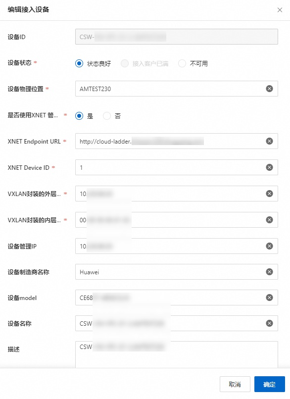

     </li>

     </ol>

## 2.5. 物理专线管理

通过一条租用运营商的专线可以将本地数据中心连接到阿里云接入点，建立专线连接。本文介绍如何管理物理专线。

**操作步骤**

1. 登录Apsara Uni-manager运维控制台。

2. 在顶部菜单栏，选择**产品运维** > **网络运维** > **网络运维控制台**。

3. 在左侧导航栏，选择**基础网络** > **专线管理** > **物理专线管理**。

4. 在**物理专线管理**页面，单击**创建物理专线**。

5. 在**创建物理专线**弹出框中，根据以下内容完成参数配置，然后单击**确定**。

   <table>
     <tr>
       <th width="121">配置参数</th>
       <th>参数说明</th>
     </tr>
     <tr>
       <td>物理专线名称</td>
       <td>输入自定义物理专线的名称。 长度2128个字符以内，不能以<code> http:// </code>或<code> https:// </code>开头。</td>
     </tr>
     <tr>
       <td>描述</td>
       <td>输入物理专线的描述。 长度2128个字符以内，不能以<code> http:// </code>或<code> https:// </code>开头。</td>
     </tr>
     <tr>
       <td>BID</td>
       <td>输入BID。默认为<strong>26842</strong>。</td>
     </tr>
     <tr>
       <td>主账号ID</td>
       <td>输入待接入VPC的账号ID。</td>
     </tr>
     <tr>
       <td>接入点类型</td>
       <td>选择物理专线接入点类型。当前仅支持选择<strong>VPC接入点</strong>。<strong>VPC接入点</strong>：VPC - VPC接入点，可接受访问VPC类型网络的专线接入。</td>
     </tr>
     <tr>
       <td>接入点ID</td>
       <td>选择IDC所在的地域ID。</td>
     </tr>
     <tr>
       <td>接入端口类型</td>
       <td>选择接入端口的类型。</td>
     </tr>
     <tr>
       <td>设备名称</td>
       <td>输入CSW设备的名称。 长度2256个字符以内，不能以<code> http:// </code>或<code> https:// </code>开头。</td>
     </tr>
     <tr>
       <td>设备端口</td>
       <td>输入CSW设备的端口。</td>
     </tr>
     <tr>
       <td>接入带宽</td>
       <td>输入物理专线接入接口的带宽。单位：Mbps。取值范围：2~10000。</td>
     </tr>
     <tr>
       <td>冗余物理专线</td>
       <td>输入前期申请过的任意一条物理专线，与该物理专线形成冗余物理专线。在建立第二条物理专线连接时，如果传入需要冗余的物理专线ID，阿里云将为其分配独立的AD设备，以提供更高的高可用性。 传入对应的物理专线必须存在，而且处于Allocated/Confirmed/Enabled状态之一。</td>
     </tr>
   </table>

   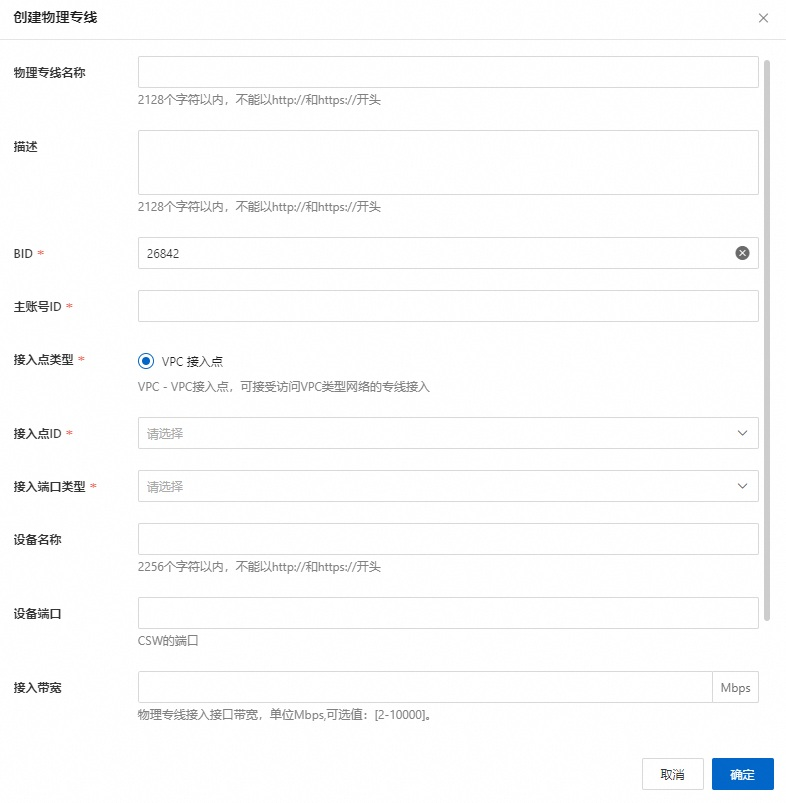

6. 创建成功后，可以查看物理专线信息，包括**主账号ID**、**Instance ID**、**接入点ID**、**设备ID**、**专线状态**、**业务状态**、**物理专线名称**、**描述**、**使用运营商**、**接入带宽**、**接入端口类型**、**物理端口**、**专线对端地址**、**冗余物理专线**、**开通时间**以及**创建时间**。

   - 创建完成后**状态**为**施工中**，等待一段时间变成**已确认**表示创建成功。

   - 支持通过**状态**、**BID**、**主账号ID**、**Instance ID**快速获取目标物理专线信息。

   - **状态**支持选择**申请中**、**审批通过**、**施工中**、**施工完成**、**已确认**、**已启用**、**已取消**、**已拒绝**、**已终止**、**已删除**。

   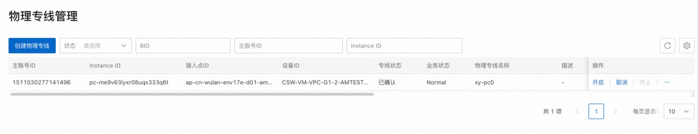

**更多操作**

<table>
  <tr>
    <th width="122">操作</th>
    <th>操作说明</th>
  </tr>
  <tr>
    <td>开启物理专线</td>
    <td>1. 在<strong>物理专线管理</strong>页面，单击目标物理专线<strong>操作</strong>列的<strong>开启</strong>。 2. 在弹出的对话框中，单击<strong>确定</strong>。 说明<strong>专线状态</strong>为<strong>已确认</strong>的物理专线，支持该操作。</td>
  </tr>
  <tr>
    <td>取消物理专线</td>
    <td>1. 在<strong>物理专线管理</strong>页面，单击目标物理专线<strong>操作</strong>列的<strong>取消</strong>。 2. 在弹出的对话框中，单击<strong>确定</strong>。 说明<strong>专线状态</strong>为<strong>申请中</strong>/<strong>施工完成</strong>/<strong>审批通过</strong>/<strong>已确认</strong>的物理专线，支持该操作。</td>
  </tr>
  <tr>
    <td>终止物理专线</td>
    <td>1. 在<strong>物理专线管理</strong>页面，单击目标物理专线<strong>操作</strong>列的<strong>终止</strong>。 2. 在弹出的对话框中，单击<strong>确定</strong>。 说明<strong>专线状态</strong>为<strong>已启用</strong>的物理专线，支持该操作。</td>
  </tr>
  <tr>
    <td>删除物理专线</td>
    <td>1. 在<strong>物理专线管理</strong>页面，单击目标物理专线<strong>操作</strong>列的<strong>删除。</strong> 2. 在弹出的对话框中，单击<strong>确定</strong>。 说明<strong>专线状态</strong>为<strong>已拒绝</strong>/<strong>已取消</strong>/<strong>已终止</strong>的物理专线，支持该操作。</td>
  </tr>
  <tr>
    <td>批准物理专线</td>
    <td>1. 在<strong>物理专线管理</strong>页面，单击目标物理专线<strong>操作</strong>列的<strong>批准</strong>。 2. 在弹出的对话框中，单击<strong>确定</strong>。 说明<strong>专线状态</strong>为<strong>申请中</strong>的物理专线，支持该操作。</td>
  </tr>
  <tr>
    <td>拒绝物理专线</td>
    <td>1. 在<strong>物理专线管理</strong>页面，单击目标物理专线<strong>操作</strong>列的<strong>拒绝</strong>。 2. 在弹出的对话框中，单击<strong>确定</strong>。 说明<strong>专线状态</strong>为<strong>申请中</strong>的物理专线，支持该操作。</td>
  </tr>
  <tr>
    <td>确认物理专线</td>
    <td>1. 在<strong>物理专线管理</strong>页面，单击目标物理专线<strong>操作</strong>列的<strong>确认</strong>。 2. 在弹出的对话框中，单击<strong>确定</strong>。 说明<strong>专线状态</strong>为<strong>施工完成</strong>的物理专线，支持该操作。</td>
  </tr>
</table>

## 2.6. VBR管理

VBR是CPE（Customer-premises equipment）设备和VPC之间的一个路由器，作为数据从VPC到本地数据中心的转发桥梁。本文介绍如何管理VBR。

**操作步骤**

1. 登录Apsara Uni-manager运维控制台。

2. 在顶部菜单栏，选择**产品运维** > **网络运维** > **网络运维控制台**。

3. 在左侧导航栏，选择**基础网络** > **专线管理** > **VBR管理**。

4. 在**VBR管理**页面，单击**创建虚拟边界路由器**。

5. 在**创建虚拟边界路由器**弹出框中，根据以下内容完成参数配置，然后单击**确定**。

   <table>
     <tr>
       <th width="144">配置参数</th>
       <th>参数说明</th>
     </tr>
     <tr>
       <td>BID</td>
       <td>输入BID。默认为<strong>26842</strong>。</td>
     </tr>
     <tr>
       <td>主账号ID</td>
       <td>输入待接入VPC的账号ID。</td>
     </tr>
     <tr>
       <td>Region</td>
       <td>显示VBR所在地域（管理实例的Region ID）。</td>
     </tr>
     <tr>
       <td>物理专线ID</td>
       <td>输入边界路由器要连接的物理专线ID。</td>
     </tr>
     <tr>
       <td>VLAN ID</td>
       <td>输入虚拟边界路由器（VBR）专线侧接口的VLAN，范围为1-2999。该属性只允许物理专线owner指定/修改。</td>
     </tr>
     <tr>
       <td>本端IP地址</td>
       <td>输入专线侧接口的本端IP地址。在接口状态不是waiting时必填。 该属性只允许VBR owner指定/修改。</td>
     </tr>
     <tr>
       <td>对端IP地址</td>
       <td>输入专线侧接口的对端IP地址。在接口状态不是waiting时必填。 该属性只允许VBR owner指定/修改。</td>
     </tr>
     <tr>
       <td>子网掩码</td>
       <td>输入专线侧接口本端与对端互联的子网掩码。在接口状态不是waiting时必填。 该属性只允许VBR owner指定/修改。</td>
     </tr>
     <tr>
       <td>VBR名称</td>
       <td>输入VBR的名字。长度2128个字符以内，不能以<code> http:// </code>或<code> https:// </code>开头。</td>
     </tr>
     <tr>
       <td>描述</td>
       <td>输入VBR的描述信息。 长度2128个字符以内，不能以<code> http:// </code>或<code> https:// </code>开头。</td>
     </tr>
     <tr>
       <td>Owner Bid</td>
       <td>输入Owner Bid。</td>
     </tr>
     <tr>
       <td>Owner AliUid</td>
       <td>输入Owner AliUid。</td>
     </tr>
   </table>

   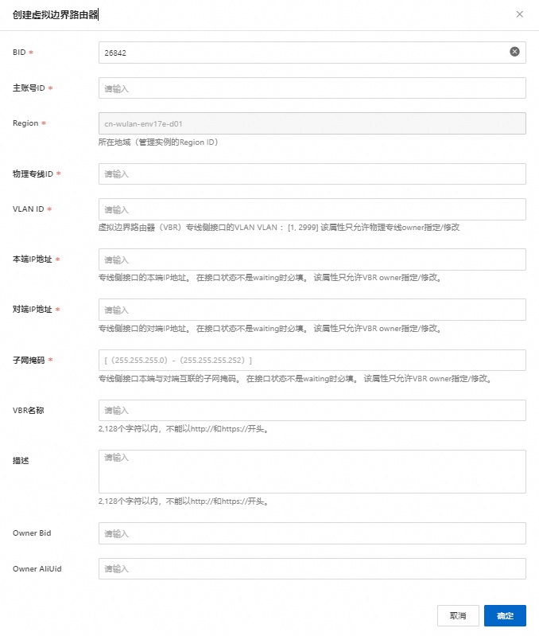

6. 创建完成后，返回**VBR管理**页面。列表默认不展示数据，可以根据实际需求筛选查看目标虚拟边界路由器信息。

   - 单击**高级筛选**，支持通过**BID**、**UID**、**VBR ID**组合搜索目标虚拟边界路由器。

   - 虚拟边界路由器信息包括**VBR ID**、**VLAN ID**、**VLAN Interface ID**、**状态**、**路由表ID**、**本端IP地址**、**对端IP地址**、**子网掩码**、**VBR名称**、**描述**、**物理专线ID**、**业务状态**、**接入点ID**、**设备ID**以及**来源**。

   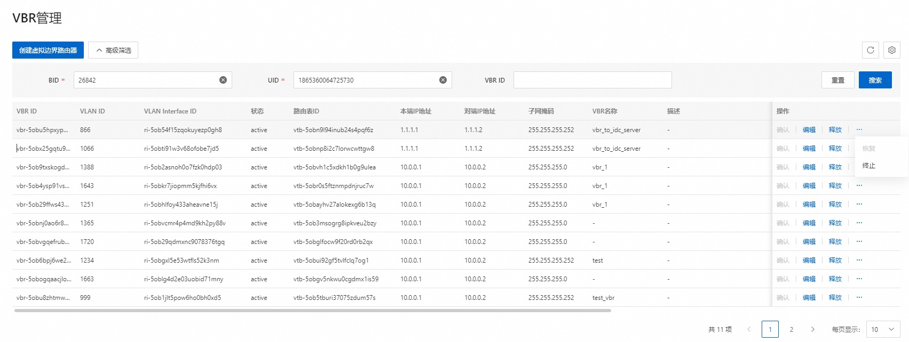

**更多操作**

| 操作 | 操作说明 |
| --- | --- |
| 确认 | 1. 在<strong>VBR管理</strong>页面，单击目标虚拟边界路由器<strong>操作</strong>列的<strong>确认</strong>。 2. 在弹出的对话框中，单击<strong>确定</strong>。 说明<strong>状态</strong>为<strong>unconfirmed</strong>的虚拟边界路由器，支持该操作。 |

<table>
  <tr>
    <td>修改虚拟边界路由器</td>
    <td>1. 在<strong>VBR管理</strong>页面，单击目标虚拟边界路由器<strong>操作</strong>列的<strong>编辑</strong>。 2. 在弹出的对话框中，修改虚拟边界路由器，单击<strong>确定</strong>。 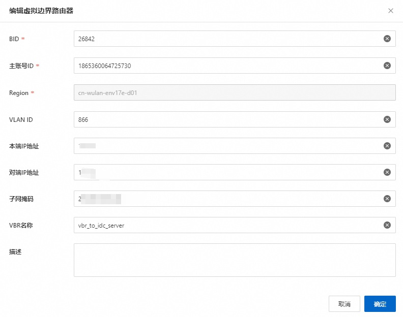 说明<strong>状态</strong>为<strong>active</strong>/<strong>terminated</strong>/<strong>unconfirmed</strong>的虚拟边界路由器，支持该操作。</td>
  </tr>
  <tr>
    <td>释放虚拟边界路由器</td>
    <td>1. 在<strong>VBR管理</strong>页面，单击目标虚拟边界路由器<strong>操作</strong>列的<strong>释放</strong>。 2. 在弹出的对话框中，单击<strong>确定</strong>。 说明 • <strong>状态</strong>为<strong>active</strong>/<strong>terminated</strong>的虚拟边界路由器，支持该操作。 • <strong>状态</strong>为<strong>active</strong>的虚拟边界路由器不能直接释放，需要执行<strong>终止</strong>操作后才可以释放。</td>
  </tr>
  <tr>
    <td>恢复虚拟边界路由器</td>
    <td>1. 在<strong>VBR管理</strong>页面，单击目标虚拟边界路由器<strong>操作</strong>列的<strong>恢复</strong>。 2. 在弹出的对话框中，单击<strong>确定</strong>。 说明<strong>状态</strong>为<strong>terminated</strong>的虚拟边界路由器，支持该操作。</td>
  </tr>
  <tr>
    <td>终止虚拟边界路由器</td>
    <td>1. 在<strong>VBR管理</strong>页面，单击目标虚拟边界路由器<strong>操作</strong>列的<strong>终止</strong>。 2. 在弹出的对话框中，单击<strong>确定</strong>。 说明<strong>状态</strong>为<strong>active</strong>的虚拟边界路由器，支持该操作。</td>
  </tr>
</table>

## 2.7. 路由器接口管理

创建完成边界路由器后，可以创建单个或者一对路由器接口连接边界路由器和VPC。本文介绍如何管理路由器接口。

**操作步骤**

1. 登录Apsara Uni-manager运维控制台。

2. 在顶部菜单栏，选择**产品运维** > **网络运维** > **网络运维控制台**。

3. 在左侧导航栏，选择**基础网络** > **专线管理** > 路由器接口管理。

4. 在**路由器接口管理**页面，单击**创建路由器接口**，打开**创建路由器接口**向导页面。

5. 在**本端信息**配置向导，根据以下内容完成配置，单击**下一步**。

   <table>
     <tr>
       <th width="138">配置参数</th>
       <th>参数说明</th>
     </tr>
     <tr>
       <td>创建路由器类型</td>
       <td>选择创建路由器类型： • 单个 • 一对</td>
     </tr>
     <tr>
       <td>名称</td>
       <td>输入路由器接口的名称。</td>
     </tr>
     <tr>
       <td>描述</td>
       <td>输入路由器接口的描述。</td>
     </tr>
     <tr>
       <td>BID</td>
       <td>输入BID。默认为<strong>26842</strong>。</td>
     </tr>
     <tr>
       <td>UID</td>
       <td>输入待连接VPC的UID。</td>
     </tr>
     <tr>
       <td>Region</td>
       <td>展示路由器接口的Region ID。</td>
     </tr>
     <tr>
       <td>路由器类型</td>
       <td>选择本端路由器类型： • VRouter • VBR</td>
     </tr>
     <tr>
       <td>可用区</td>
       <td>选择路由器接口的可用区。</td>
     </tr>
     <tr>
       <td>路由器ID</td>
       <td>输入本端路由器ID。</td>
     </tr>
     <tr>
       <td>接入点ID</td>
       <td>输入本端接入点的地域ID。 说明当本端<strong>路由器类型</strong>选择VBR时，需要配置此参数。</td>
     </tr>
     <tr>
       <td>角色</td>
       <td>选择角色： • <strong>InitiatingSide</strong>：发起端 • <strong>AcceptingSide</strong>：接收端 说明当本端<strong>路由器类型</strong>选择<strong>VRouter</strong>时，需要配置此参数。</td>
     </tr>
     <tr>
       <td>规格</td>
       <td>选择路由器接口规格。</td>
     </tr>
     <tr>
       <td>健康检查源IP</td>
       <td>输入健康检查源IP。 说明当本端<strong>路由器类型</strong>选择<strong>VRouter</strong>且<strong>角色</strong>选择<strong>AcceptingSide</strong>时，需要配置此参数。</td>
     </tr>
     <tr>
       <td>健康检查目的IP</td>
       <td>输入健康检查目的IP。 说明当本端<strong>路由器类型</strong>选择<strong>VRouter</strong>且<strong>角色</strong>选择<strong>AcceptingSide</strong>时，需要配置此参数。</td>
     </tr>
     <tr>
       <td>跳过库存检查</td>
       <td>选择是否跳过库存检查： • 是 • 否</td>
     </tr>
   </table>

   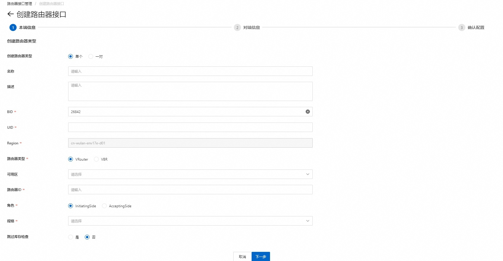

6. 在**对端信息**配置向导，根据以下内容完成配置，单击**下一步**。

   - **单个创建**

     <table>
       <tr>
         <th width="214">配置</th>
         <th>说明</th>
       </tr>
       <tr>
         <td>Region</td>
         <td>输入对端路由器接口的Region ID。</td>
       </tr>
       <tr>
         <td>路由器类型</td>
         <td>对端路由器类型，支持以下选择： • VRouter • VBR 说明 • 当<strong>本端信息</strong>配置向导中<strong>路由器类型</strong>选择<strong>VBR</strong>时，对端<strong>路由</strong><strong>器类型</strong>仅支持选择<strong>VRouter</strong>。 • 当<strong>本端信息</strong>配置向导中<strong>路由器类型</strong>选择<strong>VRouter</strong>且<strong>角色</strong>选择<strong>InitiatingSide</strong>时，对端<strong>路由器类型</strong>仅支持选择<strong>VRouter</strong>。</td>
       </tr>
       <tr>
         <td>路由器ID</td>
         <td>输入对端路由器ID。</td>
       </tr>
       <tr>
         <td>路由器接口ID</td>
         <td>输入对端路由器接口ID。</td>
       </tr>
       <tr>
         <td>对端路由器接口OwnerID</td>
         <td>输入对端路由器接口OwnerID。</td>
       </tr>
     </table>

     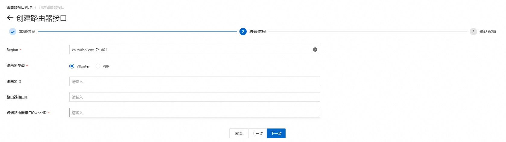

   - **成对创建**

     <table>
       <tr>
         <th width="121">配置</th>
         <th>说明</th>
       </tr>
       <tr>
         <td>名字</td>
         <td>输入路由器接口的名称。</td>
       </tr>
       <tr>
         <td>描述</td>
         <td>输入路由器接口的描述。</td>
       </tr>
       <tr>
         <td>Bid</td>
         <td>输入BID。</td>
       </tr>
       <tr>
         <td>Uid</td>
         <td>输入待连接VPC的UID。</td>
       </tr>
       <tr>
         <td>Region</td>
         <td>展示路由器接口的Region ID。</td>
       </tr>
       <tr>
         <td>路由器类型</td>
         <td>对端路由器类型，支持以下选择： • VRouter • VBR 说明 • 当<strong>本端信息</strong>配置向导中<strong>路由器类型</strong>选择<strong>VBR</strong>时，对端<strong>路由器类</strong><strong>型</strong>仅支持选择<strong>VRouter</strong>。 • 当<strong>本端信息</strong>配置向导中<strong>路由器类型</strong>选择<strong>VRouter</strong>且<strong>角色</strong>选择<strong>InitiatingSide</strong>时，对端<strong>路由器类型</strong>仅支持选择<strong>VRouter</strong>。</td>
       </tr>
       <tr>
         <td>可用区</td>
         <td>选择路由器接口的可用区。 说明当对端<strong>路由器类型</strong>选择<strong>VRouter</strong>时，需要配置此参数。</td>
       </tr>
       <tr>
         <td>路由器ID</td>
         <td>输入对端VPC的ID。</td>
       </tr>
       <tr>
         <td>接入点ID</td>
         <td>输入对端接入点的地域ID。 说明当对端<strong>路由器类型</strong>选择<strong>VBR</strong>时，需要配置此参数。</td>
       </tr>
       <tr>
         <td>角色</td>
         <td>显示对端路由器角色。 说明 • 当<strong>本端信息</strong>配置向导中<strong>路由器类型</strong>选择<strong>VBR</strong>时，对端路由器<strong>角</strong><strong>色</strong>为<strong>AcceptingSide</strong>。 • 当<strong>本端信息</strong>配置向导中<strong>路由器类型</strong>选择<strong>VRouter</strong>且<strong>角色</strong>选择<strong>InitiatingSide</strong>时，对端路由器<strong>角</strong><strong>色</strong>为<strong>AcceptingSide</strong>。 • 当<strong>本端信息</strong>配置向导中<strong>路由器类型</strong>选择<strong>VRouter</strong>且<strong>角色</strong>选择<strong>AcceptingSide</strong>时，对端路由器<strong>角</strong><strong>色</strong>为<strong>InitiatingSide</strong>。</td>
       </tr>
       <tr>
         <td>规格</td>
         <td>选择对端路由器接口规格。</td>
       </tr>
       <tr>
         <td>跳过库存检查</td>
         <td>选择是否跳过库存检查： • 是 • 否</td>
       </tr>
     </table>

     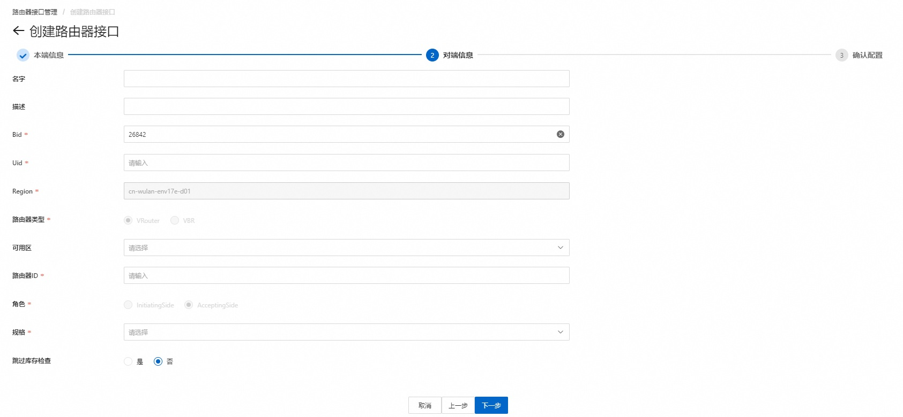

7. 在**确认配置**向导，确认配置的**本端信息**和**对端信息**，单击**创建**。

   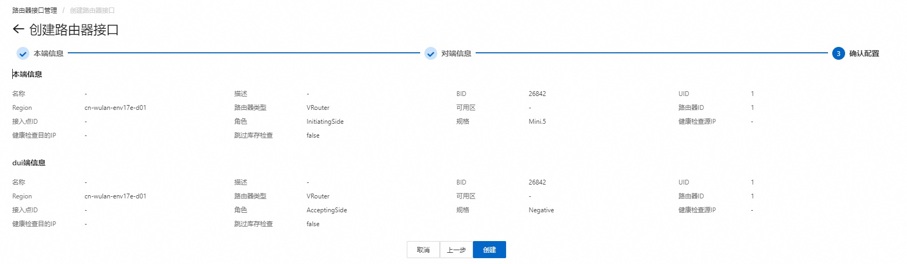

8. 创建完成后，返回**路由器接口管理**页面。列表默认不展示数据，可以根据实际需求筛选查看目标路由器接口。

   - 当状态为**Active**时，表示路由器接口创建成功。

   - 单击**高级筛选**，支持通过**BID**、**UID**组合搜索目标路由器接口。

   - 路由器接口信息包括**本端路由器ID**、**本端路由器类型**、**本端路由器接口ID**、**本端路由器接口状态**、**本端接入点ID**、**角色**、**对端路由器ID**、**对端路由器类型**、**对端路由器接口ID**、**对端路由器接口状态**、**对端接入点ID**、**对端路由器接口OwnerID**、**GlobalTunnelId**、**业务状态、连接时间、创建时间**以及**修改时间**。

   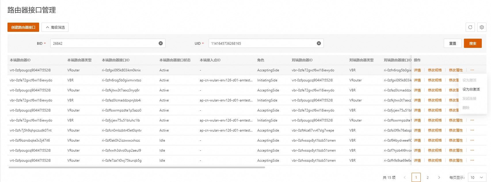

**更多操作**

**查看路由器接口详情**

在**路由器接口管理**页面，单击目标路由器接口**操作**列的**详情**，可以获取对应路由器接口的详细内容。

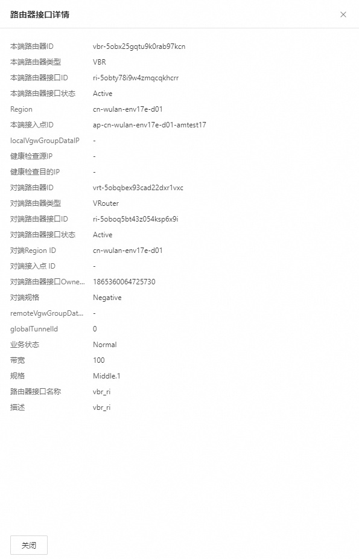

**修改路由器接口规格**

1. 在**路由器接口管理**页面，单击目标路由器接口**操作**列的**修改规格。**

2. 在弹出的对话框中，单击**确定**。

   

**修改路由器接口属性**

> **说明**
>
> **本端路由器接口状态**为**Active**/**Inactive**/**Idle**的路由器接口，支持**修改属性**操作。

1. 在**路由器接口管理**页面，单击目标路由器接口**操作**列的**修改属性**。

2. 在弹出的**修改属性**对话框中，根据以下情况修改属性，单击**确定**。

   <table>
     <tr>
       <th width="214">配置参数</th>
       <th>参数说明</th>
     </tr>
     <tr>
       <td>对端路由器接口ID</td>
       <td>输入对端路由器接口ID。 说明当<strong>本端路由器接口状态</strong>为<strong>Idle</strong>时，需要配置此参数。</td>
     </tr>
     <tr>
       <td>对端路由器ID</td>
       <td>输入对端路由器ID。 说明当<strong>本端路由器接口状态</strong>为<strong>Idle</strong>时，需要配置此参数。</td>
     </tr>
     <tr>
       <td>对端路由器接口OwnerID</td>
       <td>输入对端路由器接口OwnerID。 说明当<strong>本端路由器接口状态</strong>为<strong>Idle</strong>时，需要配置此参数。</td>
     </tr>
     <tr>
       <td>健康检查源IP</td>
       <td>输入健康检查源IP。 说明当<strong>本端路由器接口状态</strong>为<strong>Active</strong>/<strong>Inactive</strong>；<strong>本端路由器类</strong><strong>型</strong>为<strong>VRouter</strong>，<strong>角色</strong>为<strong>AcceptingSide</strong>；且<strong>对端路由器类</strong><strong>型</strong>为<strong>VBR</strong>时，需要配置此参数。</td>
     </tr>
     <tr>
       <td>健康检查目的IP</td>
       <td>输入健康检查目的IP。 说明当<strong>本端路由器接口状态</strong>为<strong>Active</strong>/<strong>Inactive</strong>；<strong>本端路由器类</strong><strong>型</strong>为<strong>VRouter</strong>，<strong>角色</strong>为<strong>AcceptingSide</strong>；且<strong>对端路由器类</strong><strong>型</strong>为<strong>VBR</strong>时，需要配置此参数。</td>
     </tr>
     <tr>
       <td>路由器接口名称</td>
       <td>输入路由器接口的名称。</td>
     </tr>
     <tr>
       <td>描述</td>
       <td>输入路由器接口的描述。</td>
     </tr>
   </table>

**设置路由器接口为激活/非激活**

> **说明**
>
> - **本端路由器接口状态**为**Active**的路由器接口，支持**设为非激活**操作。
>
> - **本端路由器接口状态**为**Inactive**的路由器接口，支持**设为激活**操作。

1. 在**路由器接口管理**页面，单击目标路由器接口**操作**列的**设为激活**/**设为非激活**。

2. 在弹出的对话框中，单击**确定**。

**路由器接口发起连接**

> **说明**
>
> **本端路由器接口状态**为**Idle**且**角色**为**InitiatingSide**（接收端不可发起连接）的路由器接口，支持**发起连接**操作。

1. 在**路由器接口管理**页面，单击目标路由器接口**操作**列的**发起连接**。

2. 在弹出的对话框中，单击**确定**。

**删除路由器接口**

> **说明**
>
> **本端路由器接口状态**为**Inactive**的路由器接口，支持**删除**操作。

1. 在**路由器接口管理**页面，单击目标路由器接口**操作**列的**删除**。

2. 在弹出的对话框中，单击**确定**。

## 2.8. 路由表管理

路由表是指路由器上管理路由条目的列表。本文介绍如何管理路由表。

**操作步骤**

1. 登录Apsara Uni-manager运维控制台。

2. 在顶部菜单栏，选择**产品运维** > **网络运维** > **网络运维控制台**。

3. 在左侧导航栏，选择**基础网络** > **专线管理** > **路由表管理**。

4. 在**路由表管理**页面，通过**高级筛选**，组合输入**BID**、**UID**、**路由表ID**、**路由器ID**，单击**搜索**获取目标路由表。

   路由表信息包括**路由表ID、路由器ID**、**路由器类型、状态、类型、路由条目数**等<strong>。</strong>

   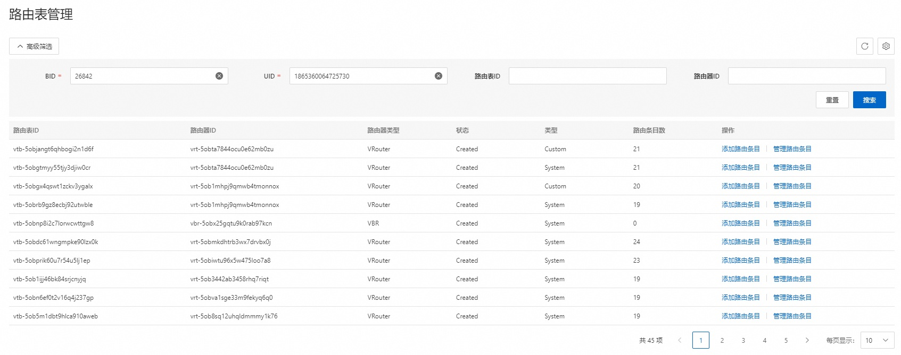

5. 添加路由条目。

   <ol type="i">

   <li>

   单击目标路由表**操作**列的**添加路由条目**。

   </li>

   <li>

   根据以下内容完成配置，然后单击**创建**。

   | 配置参数 | 参数说明 |
   | --- | --- |
   | BID | 输入BID。默认为<strong>26842</strong>。 |
   | 主账号ID | 输入待接入VPC的账号ID。 |
   | 路由表ID | 输入该路由条目所属路由表的ID。 |
   | 目的网段 | 输入网络掩码。示例：255.255.255.0/24。 |
   | ECMP | 选择是否开启ECMP： • 是 • 否 |

   <table>
     <tr>
       <td>下一跳类型</td>
       <td>选择下一跳类型： • Instance • Tunnel • Havip • RouterInterface 说明当<strong>ECMP</strong>选择<strong>开启</strong>时，<strong>下一跳类型</strong>仅支持选择<strong>RouterInterface</strong>。</td>
     </tr>
     <tr>
       <td>可用区</td>
       <td>选择可用区。 说明当<strong>ECMP</strong>选择<strong>开启</strong>时，需要配置此参数。</td>
     </tr>
     <tr>
       <td>下一跳ID</td>
       <td>输入路由条目的下一跳接口ID。 说明当<strong>ECMP</strong>选择<strong>不开启</strong>时，需要配置此参数。</td>
     </tr>
     <tr>
       <td>下一跳列表</td>
       <td>设置下一跳列表。 • <strong>下一跳ID</strong>：输入路由条目的下一跳接口ID。 • <strong>权重</strong>：输入权重。 说明 • 当<strong>ECMP</strong>选择<strong>开启</strong>时，需要配置此参数。 • 单击<strong>添加条目</strong>，支持添加多个下一跳。 • 单击目标下一跳对应<strong>操作</strong>列中的，可以删除下一跳。 </td>
     </tr>
   </table>

   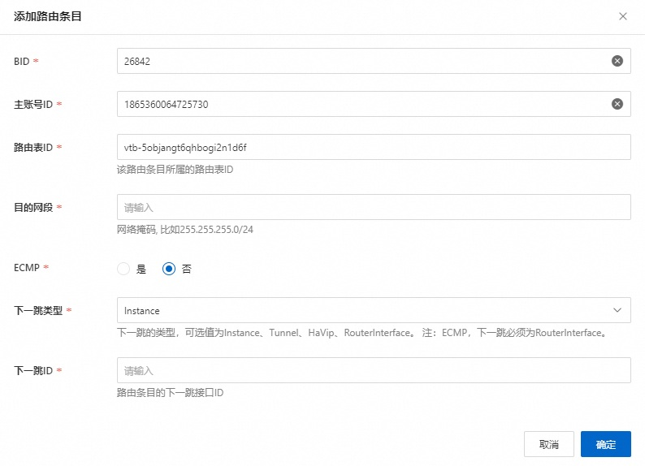

   > **说明**
   >
   > **下一跳ID**可以通过**VBR管理**页面查询，在列表中的**VLAN Interface ID**获取。

   </li>

   </ol>

6. 管理路由条目。

   <ol type="i">

   <li>

   单击目标路由表**操作**列的**管理路由条目**。

   </li>

   <li>

   在**管理路由条目**弹出框中，查看**路由条目列表**。

   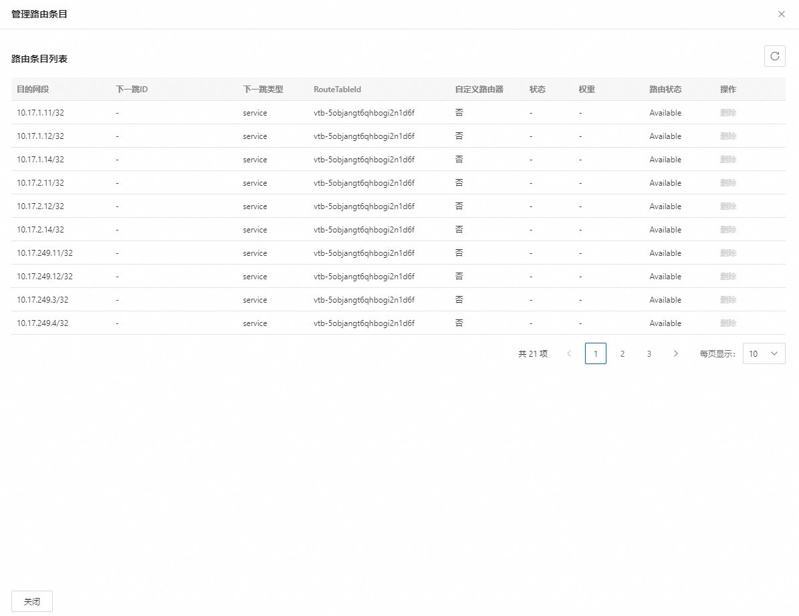

   </li>

   <li>

   （可选）单击目标路由条目**操作**列的**删除**，可以删除路由条目。

   </li>

   </ol>
