阿里云  
专有云  
云服务器ECS  
开发指南  
产品版本：V3.18.6  
文档版本：20251208

**目录**

- [1.调用API](#section-1)
    - [1.1. 概述](#section-1-1)
    - [1.2. 请求结构](#section-1-2)
    - [1.3. API授权](#section-1-3)
    - [1.4. 签名机制](#section-1-4)
    - [1.5. 返回结果](#section-1-5)
- [2.RAM鉴权](#section-2)
- [3.公共参数](#section-3)
- [4.实例](#section-4)
    - [4.1. CreateInstance](#section-4-1)
    - [4.2. RunInstances](#section-4-2)
    - [4.3. StartInstance](#section-4-3)
    - [4.4. StopInstance](#section-4-4)
    - [4.5. RebootInstance](#section-4-5)
    - [4.6. DeleteInstance](#section-4-6)
    - [4.7. AttachInstanceRamRole](#section-4-7)
    - [4.8. DetachInstanceRamRole](#section-4-8)
    - [4.9. DescribeInstanceStatus](#section-4-9)
    - [4.10. DescribeInstances](#section-4-10)
    - [4.11. StartInstances](#section-4-11)
    - [4.12. RebootInstances](#section-4-12)
    - [4.13. DeleteInstances](#section-4-13)
    - [4.14. DescribeUserData](#section-4-14)
    - [4.15. DescribeInstanceRamRole](#section-4-15)
    - [4.16. DescribeInstanceTypeFamilies](#section-4-16)
    - [4.17. DescribeInstanceAttribute](#section-4-17)
    - [4.18. ModifyInstanceAttribute](#section-4-18)
    - [4.19. ModifyInstanceVpcAttribute](#section-4-19)
    - [4.20. ModifyInstanceVncPasswd](#section-4-20)
    - [4.21. ModifyInstanceMetadataOptions](#section-4-21)
    - [4.22. DescribeInstanceTypes](#section-4-22)
    - [4.23. SoftDeleteInstances](#section-4-23)
    - [4.24. RestoreSoftDeletedInstances](#section-4-24)
- [5.专有宿主机](#section-5)
    - [5.1. AllocateDedicatedHosts](#section-5-1)
    - [5.2. ModifyDedicatedHostAttribute](#section-5-2)
    - [5.3. ModifyInstanceDeployment](#section-5-3)
    - [5.4. DescribeDedicatedHostTypes](#section-5-4)
    - [5.5. DescribeDedicatedHosts](#section-5-5)
    - [5.6. ReleaseDedicatedHost](#section-5-6)
    - [5.7. CreateDedicatedHostCluster](#section-5-7)
    - [5.8. DescribeDedicatedHostClusters](#section-5-8)
    - [5.9. ModifyDedicatedHostClusterAttribute](#section-5-9)
    - [5.10. DeleteDedicatedHostCluster](#section-5-10)
- [6.部署集](#section-6)
    - [6.1. CreateDeploymentSet](#section-6-1)
    - [6.2. ModifyDeploymentSetAttribute](#section-6-2)
    - [6.3. DescribeDeploymentSets](#section-6-3)
    - [6.4. DeleteDeploymentSet](#section-6-4)
    - [6.5. DescribeDeploymentSetSupportedInstanceTypeFamily](#section-6-5)
- [7.存储集](#section-7)
    - [7.1. CreateStorageSet](#section-7-1)
    - [7.2. DescribeStorageSets](#section-7-2)
    - [7.3. DescribeStorageSetDetails](#section-7-3)
    - [7.4. ModifyStorageSetAttribute](#section-7-4)
    - [7.5. DeleteStorageSet](#section-7-5)
- [8.云盘](#section-8)
    - [8.1. CreateDisk](#section-8-1)
    - [8.2. DescribeDisks](#section-8-2)
    - [8.3. AttachDisk](#section-8-3)
    - [8.4. DetachDisk](#section-8-4)
    - [8.5. ModifyDiskAttribute](#section-8-5)
    - [8.6. ModifyDiskSpec](#section-8-6)
    - [8.7. ReInitDisk](#section-8-7)
    - [8.8. ReplaceSystemDisk](#section-8-8)
    - [8.9. ResizeDisk](#section-8-9)
    - [8.10. DeleteDisk](#section-8-10)
    - [8.11. ResetDisks](#section-8-11)
- [9.快照](#section-9)
    - [9.1. CreateSnapshot](#section-9-1)
    - [9.2. DescribeSnapshots](#section-9-2)
    - [9.3. DeleteSnapshot](#section-9-3)
    - [9.4. CopySnapshot](#section-9-4)
    - [9.5. DescribeSnapshotLinks](#section-9-5)
    - [9.6. DescribeSnapshotsUsage](#section-9-6)
    - [9.7. CreateAutoSnapshotPolicy](#section-9-7)
    - [9.8. DeleteAutoSnapshotPolicy](#section-9-8)
    - [9.9. ModifyAutoSnapshotPolicyEx](#section-9-9)
    - [9.10. ModifySnapshotAttribute](#section-9-10)
    - [9.11. DescribeAutoSnapshotPolicyEX](#section-9-11)
    - [9.12. ApplyAutoSnapshotPolicy](#section-9-12)
    - [9.13. CancelAutoSnapshotPolicy](#section-9-13)
    - [9.14. CreateSnapshotGroup](#section-9-14)
    - [9.15. DescribeSnapshotGroups](#section-9-15)
    - [9.16. DeleteSnapshotGroup](#section-9-16)
    - [9.17. ModifySnapshotGroup](#section-9-17)
- [10.镜像](#section-10)
    - [10.1. CreateImage](#section-10-1)
    - [10.2. DescribeImages](#section-10-2)
    - [10.3. ModifyImageAttribute](#section-10-3)
    - [10.4. DeleteImage](#section-10-4)
    - [10.5. CopyImage](#section-10-5)
    - [10.6. CancelCopyImage](#section-10-6)
    - [10.7. ModifyImageSharePermission](#section-10-7)
    - [10.8. DescribeImageSharePermission](#section-10-8)
    - [10.9. ImportImage](#section-10-9)
    - [10.10. ExportImage](#section-10-10)
    - [10.11. DescribeImageSupportInstanceTypes](#section-10-11)
- [11.网络](#section-11)
    - [11.1. ModifyInstanceNetworkSpec](#section-11-1)
    - [11.2. AttachClassicLinkVpc](#section-11-2)
    - [11.3. ModifyInstanceSpec](#section-11-3)
    - [11.4. DescribeClassicLinkInstances](#section-11-4)
    - [11.5. DetachClassicLinkVpc](#section-11-5)
- [12.安全组](#section-12)
    - [12.1. CreateSecurityGroup](#section-12-1)
    - [12.2. AuthorizeSecurityGroup](#section-12-2)
    - [12.3. AuthorizeSecurityGroupEgress](#section-12-3)
    - [12.4. JoinSecurityGroup](#section-12-4)
    - [12.5. LeaveSecurityGroup](#section-12-5)
    - [12.6. DeleteSecurityGroup](#section-12-6)
    - [12.7. DescribeSecurityGroupAttribute](#section-12-7)
    - [12.8. DescribeSecurityGroups](#section-12-8)
    - [12.9. DescribeSecurityGroupReferences](#section-12-9)
    - [12.10. RevokeSecurityGroup](#section-12-10)
    - [12.11. RevokeSecurityGroupEgress](#section-12-11)
    - [12.12. ModifySecurityGroupAttribute](#section-12-12)
    - [12.13. ModifySecurityGroupPolicy](#section-12-13)
    - [12.14. ModifySecurityGroupRule](#section-12-14)
    - [12.15. ModifySecurityGroupEgressRule](#section-12-15)
- [13.SSH密钥对](#section-13)
    - [13.1. CreateKeyPair](#section-13-1)
    - [13.2. AttachKeyPair](#section-13-2)
    - [13.3. DetachKeyPair](#section-13-3)
    - [13.4. DeleteKeyPairs](#section-13-4)
    - [13.5. DescribeKeyPairs](#section-13-5)
- [14.弹性网卡](#section-14)
    - [14.1. CreateNetworkInterface](#section-14-1)
    - [14.2. AttachNetworkInterface](#section-14-2)
    - [14.3. AssignPrivateIpAddresses](#section-14-3)
    - [14.4. UnassignPrivateIpAddresses](#section-14-4)
    - [14.5. DescribeNetworkInterfaces](#section-14-5)
    - [14.6. DetachNetworkInterface](#section-14-6)
    - [14.7. DeleteNetworkInterface](#section-14-7)
    - [14.8. ModifyNetworkInterfaceAttribute](#section-14-8)
    - [14.9. AssignIpv6Addresses](#section-14-9)
    - [14.10. UnassignIpv6Addresses](#section-14-10)
- [15.前缀列表](#section-15)
    - [15.1. CreatePrefixList](#section-15-1)
    - [15.2. DescribePrefixLists](#section-15-2)
    - [15.3. ModifyPrefixList](#section-15-3)
    - [15.4. DescribePrefixListAttributes](#section-15-4)
    - [15.5. DescribePrefixListAssociations](#section-15-5)
    - [15.6. DeletePrefixList](#section-15-6)
- [16.系统事件](#section-16)
    - [16.1. DescribeInstanceHistoryEvents](#section-16-1)
- [17.地域](#section-17)
    - [17.1. DescribeRegions](#section-17-1)
    - [17.2. DescribeZones](#section-17-2)
    - [17.3. DescribeAvailableResource](#section-17-3)
    - [17.4. DescribeResourcesModification](#section-17-4)
- [18.运维与监控](#section-18)
    - [18.1. GetInstanceConsoleOutput](#section-18-1)
    - [18.2. GetInstanceScreenshot](#section-18-2)
    - [18.3. DescribeSnapshotMonitorData](#section-18-3)
    - [18.4. DescribeEniMonitorData](#section-18-4)
- [19.云助手](#section-19)
    - [19.1. CreateCommand](#section-19-1)
    - [19.2. InvokeCommand](#section-19-2)
    - [19.3. RunCommand](#section-19-3)
    - [19.4. DescribeCommands](#section-19-4)
    - [19.5. ModifyCommand](#section-19-5)
    - [19.6. StopInvocation](#section-19-6)
    - [19.7. DescribeInvocationResults](#section-19-7)
    - [19.8. DescribeInvocations](#section-19-8)
    - [19.9. DescribeCloudAssistantStatus](#section-19-9)
    - [19.10. DeleteCommand](#section-19-10)
    - [19.11. SendFile](#section-19-11)
    - [19.12. DescribeSendFileResults](#section-19-12)
- [20.标签](#section-20)
    - [20.1. AddTags](#section-20-1)
    - [20.2. RemoveTags](#section-20-2)
    - [20.3. DescribeTags](#section-20-3)
    - [20.4. TagResources](#section-20-4)
    - [20.5. ListTagResources](#section-20-5)
    - [20.6. UntagResources](#section-20-6)
- [21.其他接口](#section-21)
    - [21.1. DescribeTasks](#section-21-1)
    - [21.2. CancelTask](#section-21-2)
    - [21.3. DescribeTaskAttribute](#section-21-3)
- [22.附录](#section-22)
    - [22.1. 资源术语](#section-22-1)
    - [22.2. 实例状态](#section-22-2)
    - [22.3. 公共错误码](#section-22-3)
    - [22.4. 云盘类型](#section-22-4)
    - [22.5. 如何保证幂等性](#section-22-5)
    - [22.6. 实例被安全锁定时API的行为](#section-22-6)
    - [22.7. 时间格式ISO8601](#section-22-7)

<a id="section-1"></a>

# 1.调用API

<a id="section-1-1"></a>

## 1.1. 概述

ECS API 接口调用是向 ECS API 的服务端地址发送 HTTP GET 请求。您需要按照接口描述在请求中加入相应请求参数。调用后系统会返回处理结果。请求及返回结果都使用UTF-8字符集编码。

<a id="section-1-2"></a>

## 1.2. 请求结构

**服务地址**

如何获取产品的endpoint，请参见获取云服务器ECS的Endpoint。

**请求方法**

支持HTTP GET方法发送请求，这种方式下请求参数需要包含在请求的URL中。

**通信协议**

支持通过HTTP或HTTPS通道进行请求通信。为了获得更高的安全性，推荐您使用HTTPS通道发送请求。

**请求参数**

每个请求都需要指定要执行的操作，即Action参数（例如StartInstance），以及每个操作都需要包含的公共请求参数和指定操作所特有的请求参数。

**字符编码**

请求及返回结果都使用UTF-8字符集进行编码。

<a id="section-1-3"></a>

## 1.3. API授权

为了确保您的账号安全，建议您使用子账号的身份凭证调用API。如果您使用RAM账号调用弹性计算API，您需要为该RAM账号创建、附加相应的授权策略。

在RAM中，可以对一个ECS资源进行以下Action的授权。

- AttachDisk

- AuthorizeSecurityGroup

- CreateDisk

- CreateImage

- CreateInstance

- CreateSecurityGroup

- CreateSnapshot

- DeleteDisk

- DeleteImage

- DeleteInstance

- DeleteSecurityGroup

- DeleteSnapshot

- DescribeAutoSnapshotPolicy

- DescribeDisks

- DescribeImages

- DescribeInstanceMonitorData

- DescribeInstances

- DescribeInstanceStatus

- DescribeInstanceTypes

- DescribeRegions

- DescribeSecurityGroupAttribute

- DescribeSecurityGroups

- DescribeSnapshots

- DescribeZones

- DetachDisk

- JoinSecurityGroup

- LeaveSecurityGroup

- ModifyAutoSnapshotPolicy

- ModifyDiskAttribute

- ModifyInstanceAttribute

- ModifyInstanceNetworkSpec

- RebootInstance

- ReplaceSystemDisk

- ReInitDisk

- ResetDisk

- RevokeSecurityGroup

- StartInstance

- StopInstance

<a id="section-1-4"></a>

## 1.4. 签名机制

ECS服务会对每个访问的请求进行身份验证，使用HTTP和HTTPS协议提交请求时，都需要在请求中包含签名（Signature）信息。

ECS通过使用AccessKey ID和AccessKey Secret进行对称加密，以验证请求的发送者身份。AccessKey ID和AccessKey Secret由阿里云官方颁发给访问者，其中AccessKey ID用于标识访问者的身份，AccessKey Secret是用于加密签名字符串和服务器端验证签名字符串的密钥，必须严格保密。关于如何获取AccessKey，请参见获取AccessKey。

您在访问ECS服务时，请按照以下方法对请求进行签名处理：

1. 使用请求参数构造规范化的请求字符串（Canonicalized Query String）。

   <ol type="i">

   <li>

   参数排序。按照参数名称的字典顺序对请求中所有的请求参数排序（包括**公共请求参数**和接口的自定义参数，但不能包括**公共请求参数**中提到的 **Signature参数**本身）。

   > 当使用GET方法提交请求时，这些参数就是请求URI中的参数部分（即URI中<strong>?</strong> 之后由<strong>&</strong>连接的部分）。
   >
   > **说明**

   </li>

   <li>

   参数编码。对排序之后的请求参数的名称和值分别用UTF-8字符集进行URL编码。编码的规则如下：

   - 对于字符A-Z、a-z、0-9以及字符“-”、“_”、“.”、“~”不编码。

   - 对于其他字符编码成“%XY”的格式，其中XY是字符对应ASCII码的16进制表示。例如英文的双引号（”）对应的编码就是%22。

   - 对于扩展的UTF-8字符，编码成“%XY%ZA…”的格式。

   - 英文空格（ ）编码为%20，而不是加号（+）。

   该编码方式和一般采用的 `application/x-www-form-urlencoded`  MIME格式编码算法类似（例如Java标准库中的 java.net.URLEncoder的实现），但又存在差异。实现时，可以先用标准库的方式进行编码，然后把编码后的字符串中加号（+）替换成%20、星号（\*）替换成%2A、%7E替换回波浪号（~），即可得到上述规则描述的编码字符串。这个算法可以用下面的percentEncode方法来实现：

   ```text
     private static final String ENCODING = "UTF-8";

     private static String percentEncode(String value) throws UnsupportedEncodingException {
        return value != null ? URLEncoder.encode(value, ENCODING).replace("+", "%20").replace("*", "%2A").replace("%7E", "~") : null;
    }                            
   ```

   </li>

   <li>

   将编码后的参数名称和值用英文等号（ `=` ）连接。

   </li>

   <li>

   将等号连接得到的参数组合按步骤(a)排好的顺序依次使用&符号连接，即得到规范化请求字符串。

   </li>

   </ol>

2. 将上一步构造的规范化字符串按照下面的规则构造成待签名的字符串：

   ```text
    StringToSign=
        HTTPMethod + “&” +
        percentEncode(“/”) + ”&” +
         percentEncode(CanonicalizedQueryString)               
   ```

   - 其中HTTPMethod是提交请求用的HTTP方法，例如GET。

   - percentEncode(“/”)是按照1.b中描述的URL编码规则对字符“/”进行编码得到的值，即“%2F”。percentEncode(CanonicalizedQueryString)是对第1步中构造的规范化请求字符串按1.b中描述的URL编码规则编码后得到的字符串。

3. 按照RFC2104的定义，计算待签名字符串StringToSign的HMAC值。

   > 计算签名时使用的Key就是您持有的**AccessKey Secret**并加上一个<em>&</em>字符（ASCII:38），使用的哈希算法是SHA1。
   >
   > **说明**

4. 按照Base64编码规则把上面的HMAC值编码成字符串，即得到签名值（Signature）。

5. 将得到的签名值作为**Signature**参数添加到请求参数中，即完成对请求签名的过程。

   > 得到的签名值在作为最后的请求参数值提交给ECS服务器时，要和其他参数一样，按照RFC3986的规则进行URL编码。
   >
   > **说明**

   以DescribeRegions为例，假设使用的**AccessKey Id**是*testid*， **AccessKey Secret**是*testsecret*。则签名前的请求URL为：

   ```text
   http://ecs.example.com/?TimeStamp=2016-02-23T12:46:24Z&Format=XML&AccessKeyId=testid&Action=DescribeRegions&SignatureMethod=HMAC-
   SHA1&SignatureNonce=3ee8c1b8-83d3-44af-a94f-4e0ad82f****&Version=2014-05-26&SignatureVersion=1.0
   ```

   计算得到的待签名字符串**StringToSign**为：

   ```text
   GET&%2F&AccessKeyId%3Dtestid%26Action%3DDescribeRegions%26Format%3DXML%26SignatureMethod%3DHMAC-SHA1%26SignatureNonce%3D3ee8c1b8-83d3-44af-a94f-4e0ad82f****%26SignatureVersion%3D1.0%26TimeStamp%3D2016-02-23T12%253A46%253A24Z%26Version%3D2014-05-26                
   ```

   因为**AccessKey Secret**是*testsecret*，所以用于计算HMAC的Key为*testsecret&*，计算得到的签名值是：*CT9X0VtwR86fNWSnsc6v8YG\*\*\*\** 。

   将签名作为Signature参数加入到URL请求中，最后得到的URL为：

   ```text
   http://ecs.example.com/?SignatureVersion=1.0&Action=DescribeRegions&Format=XML&SignatureNonce=3ee8c1b8-83d3-44af-a94f-
   4e0ad82f****&Version=2014-05-26&AccessKeyId=testid&Signature=CT9X0VtwR86fNWSnsc6v8YGO****&SignatureMethod=HMAC-SHA1&TimeStamp=2016-02-23T12%3A46%3A24Z
   ```

<a id="section-1-5"></a>

## 1.5. 返回结果

调用 API 服务后返回数据采用统一格式，返回的 HTTP 状态码为 2xx，代表调用成功；返回 4xx 或 5xx 的 HTTP 状态码代表调用失败。调用成功返回的数据格式主要有 XML 和 JSON 2种。外部系统可以在请求时传入参数来制定返回的数据格式，默认为 XML 格式。

> 本文档中的返回示例为了便于用户查看，做了格式化处理，实际返回结果是没有进行换行、缩进等处理的。
>
> **说明**

**成功结果**

- XML 示例

  ```xml
  <?xml version="1.0" encoding="UTF-8"?> 
  <!--结果的根结点-->
  <接⼝名称+Response>
      <!--返回请求标签-->
      <RequestId>4C467B38-3910-447D-87BC-AC04916*****</RequestId>
      <!--返回结果数据-->
  </接⼝名称+Response>
  ```

- JSON 示例

  ```json
  {
      "RequestId": "4C467B38-3910-447D-87BC-AC04916*****",
      /* 返回结果数据 */
  }
  ```

**错误结果**

调用接口出错后，将不会返回结果数据。调用方可根据每个接口对应的错误码以及公共错误码来定位错误原因。当调用出错时，HTTP 请求返回一个 4xx 或 5xx 的HTTP 状态码。返回的消息体中是具体的错误代码及错误信息。另外还包含一个全局唯一的请求 ID：RequestId 和一个您本次请求访问的站点 ID：HostId。

- XML 示例

  ```xml
  <?xml version="1.0" encoding="UTF-8"?>
  <Error>
     <RequestId>8906582E-6722-409A-A6C4-0E7863B*****</RequestId>
     <HostId>ecs.example.com</HostId>
     <Code>InvalidOwnerId</Code>
     <Message>The specified OwnerId is not valid.</Message>
  </Error>
  ```

- JSON 示例

  ```json
  {
      "RequestId": "8906582E-6722-409A-A6C4-0E7863B*****",
      "HostId": "ecs.example.com",
      "Code": "InvalidOwnerId",
      "Message": "The specified OwnerId is not valid."
  }
  ```

<a id="section-2"></a>

# 2.RAM鉴权

当子账号通过ECS OpenAPI对主账号的ECS资源进行访问时，ECS后台向RAM进行权限检查，以确保资源拥有者的确将相关资源的相关权限授予了调用者。

每个不同的ECS API， 会根据涉及到的资源以及API的语义，确定需要检查的资源的权限。各API的鉴权规则如API鉴权规则所示。

表 1. API鉴权规则

| Action | 鉴权规则 |
| --- | --- |
| AttachDisk | acs:ecs:$regionid:$accountid:disk/$diskid acs:ecs:$regionid:$accountid:instance/$instanceid |
| AuthorizeSecurityGroup | acs:ecs:$regionid:$accountid:securitygroup/$securitygroupid\[and acs:ecs:$regionid:$accountid:securitygroup/$sourcegroupid\]<br>说明如果指定了SourceGroupId参数，必须填入sourcegroupid。 |
| CreateDisk | acs:ecs:$regionid:$accountid:disk/\*\[and acs:ecs:$regionid:$accountid:snapshot/$snapshotid\]<br>说明如果指定了SnapshotId参数，必须填入SnapshotId。 |
| CreateImage | acs:ecs:$regionid:$accountid:image/\*acs:ecs:$regionid:$accountid:snapshot/$snapshotid |
| CreateInstance | acs:ecs:$regionid:$accountid:instance/\*acs:ecs:$regionid:$accountid:securitygroup/$securitygroupidacs:ecs:$re gionid:$accountid:image/$imageid\[and acs:ecs:$regionid:$accountid:snapshot/$snapshotid\]<br>说明如果指定了DataDisk.n.SnapshotId参数，必须填入snapshotid。 |
| CreateSecurityGroup | acs:ecs:$regionid:$accountid:securitygroup/\* |
| CreateSnapshot | acs:ecs:$regionid:$accountid:disk/$diskid acs:ecs:$regionid:$accountid:snapshot/\* |
| DeleteDisk | acs:ecs:$regionid:$accountid:disk/$diskid |
| DeleteImage | acs:ecs:$regionid:$accountid:image/$imageid |
| DeleteInstance | acs:ecs:$regionid:$accountid:instance/$instanceid |
| DeleteSecurityGroup | acs:ecs:$regionid:$accountid:securitygroup/$securitygroupid |
| DeleteSnapshot | acs:ecs:$regionid:$accountid:snapshot/$snapshotid |
| DescribeAutoSnapshotPolicy | acs:ecs:\*:$accountid:snapshot/\* |
| DescribeDisks | acs:ecs:$regionid:$accountid:disk/\* |
| DescribeImages | acs:ecs:$regionid:$accountid:image/\* |
| DescribeInstanceMonitorData | acs:ecs:$regionid:$accountid:instance/$instanceid |
| DescribeInstanceStatus | acs:ecs:$regionid:$accountid:instance/\* |
| DescribeInstanceTypes | acs:ecs:\*:$accountid:\* |
| DescribeRegions | acs:ecs:\*:$accountid:\* |
| DescribeSecurityGroupAttribute | acs:ecs:$regionid:$accountid:securitygroup/$securitygroupid |
| DescribeSecurityGroups | acs:ecs:$regionid:$accountid:securitygroup/\* |
| DescribeSnapshots | acs:ecs:$regionid:$accountid:snapshot/\* |
| DescribeZones | acs:ecs:\*:$accountid:\* |
| DetachDisk | acs:ecs:$regionid:$accountid:disk/$diskid acs:ecs:$regionid:$accountid:instance/$instanceid |
| JoinSecurityGroup | acs:ecs:$regionid:$accountid:instance/$instanceid acs:ecs:$regionid:$accountid:securitygroup/$securitygroupid |
| LeaveSecurityGroup | acs:ecs:$regionid:$accountid:instance/$instanceid acs:ecs:$regionid:$accountid:securitygroup/$securitygroupid |
| ModifyAutoSnapshotPolicy | acs:ecs:\*:$accountid:snapshot/\* |
| ModifyDiskAttribute | acs:ecs:$regionid:$accountid:disk/$diskid |
| ModifyInstanceAttribute | acs:ecs:$regionid:$accountid:instance/$instanceid |
| ModifyInstanceNetworkSpec | acs:ecs:$regionid:$accountid:instance/$instanceid |
| RebootInstance | acs:ecs:$regionid:$accountid:instance/$instanceid |
| ReplaceSystemDisk | acs:ecs:$regionid:$accountid:instance/$instanceid\[and acs:ecs:$regionid:$accountid:image/$imageid\]<br>说明如果是使用了自定义镜像，必须填入imageid。 |
| ReInitDisk | acs:ecs:$regionid:$accountid:disk/$diskid |
| ResetDisk | acs:ecs:$regionid:$accountid:snapshot/$snapshotid acs:ecs:$regionid:$accountid:disk/$diskid |
| RevokeSecurityGroup | acs:ecs:$regionid:$accountid:securitygroup/$securitygroupid\[and acs:ecs:$regionid:$accountid:securitygroup/$sourcegroupid\]<br>说明如果指定了SourceGroupid参数，必须填入sourcegroupid。 |
| StartInstance | acs:ecs:$regionid:$accountid:instance/$instanceid |
| StopInstance | acs:ecs:$regionid:$accountid:instance/$instanceid |
| DescribeInstances | acs:ecs:$regionid:$accountid:instance/\* |
| CreateVpc | acs:ecs:$regionid:$accountid:vpc/\* |
| ModifyVpcAttribute | acs:ecs:$regionid:$accountid:vpc/$vpcid |
| DescribeVRouters | acs:ecs:$regionid:$accountid:vrouter/\* |
| CreateVSwitch | acs:ecs:$regionid:$accountid:vswitch/\* |
| CreateRouteTable | acs:ecs:$regionid:$accountid:routetable/\* |
| CreateRouteEntry | acs:ecs:$regionid:$accountid:routetable/$routetableid |
| AllocateEipAddress | acs:ecs:$regionid:$accountid:eip/\* |
| AssociateEipAddress | acs:ecs:$regionid:$accountid:eip/$allocationid acs:ecs:$regionid:$accountid:instance/$instanceid |
| ReleaseEipAddress | acs:ecs:$regionid:$accountid:eip/$allocationid |
| DescribeVpcs | acs:ecs:$regionid:$accountid:vpc/\* |
| DeleteVpc | acs:ecs:$regionid:$accountid:vpc/$vpcid |
| ModifyVRouterAttribute | acs:ecs:$regionid:$accountid:vrouter/$vrouterid |
| DescribeVSwitches | acs:ecs:$regionid:$accountid:vswitch/\* |
| DeleteVSwitch | acs:ecs:$regionid:$accountid:vswitch/$vswitchid |
| DescribeRouteTables | acs:ecs:$regionid:$accountid:routetable/\* |
| DeleteRouteEntry | acs:ecs:$regionid:$accountid:routetable/$routetableid |
| DescribeEipAddresses | acs:ecs:$regionid:$accountid:eip/\* |
| UnassociateEipAddresses | acs:ecs:$regionid:$accountid:eip/$eipid acs:ecs:$regionid:$accountid:instance/$instanceid |
| ModifySecurityGroupAttribute | acs:ecs:$regionid:$accountid:securitygroup/$securitygroupid |
| DescribeEipMonitorData | acs:ecs:$regionid:$accountid:eip/$allocationid |
| ModifyVSwitchAttribute | acs:ecs:$regionid:$accountid:vswitch/$vswitchid |
| DescribeInstanceVncUrl | acs:ecs:$regionid:$accountid:instance/$instanceid |
| ModifySnapshotAttribute | acs:ecs:$regionid:$accountid:snapshot/$snapshotid |
| ModifyInstanceVpcAttribute | acs:ecs:$regionid:$accountid:instance/$instanceid |
| ModifyEipAddressAttribute | acs:ecs:$regionid:$accountid:eip/$allocationid |
| DescribeDiskMonitorData | acs:ecs:$regionid:$accountid:disk/$diskid |

<a id="section-3"></a>

# 3.公共参数

公共参数分为公共请求参数、公共Header参数和公共返回参数。

**公共请求参数**

公共请求参数是指每个接口都需要使用到的请求参数。

表 1. 公共请求参数表

| 名称 | 类型 | 是否必须 | 描述 |
| --- | --- | --- | --- |
| Format | String | 否 | 返回值的类型，仅支持 JSON。 |
| Version | String | 是 | API 版本号，以日期形式YYYY-MM-DD输入，取值： 2014-05-26。 |
| AccessKeyId | String | 是 | 访问服务使用的密钥ID。 |
| AccessKeySecret | String | 是 | 访问服务使用的密钥值。 |
| RegionId | String | 是 | 访问服务所使用的地域ID。 |
| Product | String | 是 | 接口对应的产品名称。 |

**公共Header参数**

| 名称 | 描述 |
| --- | --- |
| x-acs-organizationid | Apsara Uni-manager运营控制台上的组织ID。具体获取方式，请参见获取组织ID。 |
| x-acs-resourcegroupid | Apsara Uni-manager运营控制台上的资源集ID。具体获取方式，请参见获取资源集ID。 |
| x-acs-instanceid | 进行操作的实例ID。具体获取方式，请参见获取实例ID |

> **说明**
>
> 在调用各云产品接口调用时，您需要在调用代码的请求头Header中添加**x-acs-instanceid**、**x-acs-organizationid**、**x-acs-resourcegroupid**等参数的实际值，用于指定当前实例的实例ID（在创建实例和查询实例列表的场景下，实例ID不存在），及其所属的组织和资源集。若未添加相关Header参数实际值，调用时则会默认指向root组织和root资源集。

**公共返回参数**

API返回结果采用统一格式，通过返回HTTP状态码来表示状态：

- 返回2xx HTTP状态码代表调用成功。

- 返回4xx或5xx HTTP状态码代表调用失败。

调用成功返回的数据格式为JSON，每次接口调用，无论成功与否，系统都会返回一个唯一识别码RequestId。

<a id="section-4"></a>

# 4.实例

<a id="section-4-1"></a>

## 4.1. CreateInstance

调用CreateInstance创建一台ECS实例。

接口说明

您可以调用 `DescribeAvailableResource` 查看指定地域或者可用区内的实例资源供给情况。若您希望批量创建实例并且实例自动进入 运行中 （ `Running` ）状态，推荐您使用 `RunInstances` 接口。

创建ECS实例时，您需要注意：

**实例规格**

- 可以通过参数 `IoOptimized` 指定是否创建I/O优化实例。

- 产品选型：请参见专有云文档中心《云服务器ECS实例规格族&实例规格简介》文档中的具体实例规格章节或调用 `DescribeInstanceTypes` 查看目标实例规格的性能数据。

- 查询库存：调用 `DescribeAvailableResource` 查看指定地域或者可用区内的资源供给情况。

**镜像**

- 镜像确定实例的系统盘配置，实例的系统盘即为指定镜像的完全克隆。

- 实例内存为512 MiB时，不能使用除半年渠道之外的Windows Server镜像。

- 实例内存为4 GiB以上时，不能使用32位操作系统的镜像。

**网络类型**

- 专有网络VPC类型实例必须且只能属于一个交换机。

- 指定 `VSwitchId` 时， `SecurityGroupId` 和 `VSwitchId` 必须属于同一个VPC。

- `PrivateIpAddress` 依赖于 `VSwitchId` ，不能单独指定 `PrivateIpAddress` 。同时指定 `VSwitchId` 和 `PrivateIpAddress` 时， `PrivateIpAddress` 必须包含在交换机的空闲子网网段之内。

**安全组**

- 您必须预先创建一个安全组，可通过 `CreateSecurityGroup` 创建。

- 同一个安全组内可容纳的实例数量视安全组类型而定。

- 同一个安全组内的实例内网可以相互访问。不同安全组之间默认隔离，不可相互访问，但是可以授权访问。更多信息，请参见专有云文档中心《云服务器ECS开发指南》文档中的 `AuthorizeSecurityGroup` 和 `AuthorizeSecurityGroupEgress` 章节。

**存储**

- 根据您指定的镜像，实例被分配一个相应大小的系统盘。系统盘容量必须大于或者等于 `max{20, ImageSize}` 。系统盘的种类请参见 `SystemDisk.Category` 参数描述。

- 当系统盘是普通云盘（ `cloud` ）、高效云盘（ `cloud_efficiency` ）或SSD云盘（ `cloud_ssd` ）时，数据盘不能是本地SSD盘（ `ephemeral_ssd` ）。

- I/O优化实例的系统盘只能选择高效云盘（ `cloud_efficiency` ）及SSD云盘（ `cloud_ssd` ）。

- 不同类型云盘的数据盘最大容量不同。更多信息，请参见 `DataDisk.N.Size` 参数描述。

- 一台实例最多添加16块数据盘。数据盘挂载点由系统默认顺序分配，/dev/xvdb开始到/dev/xvdz。

**自定义数据**

若实例满足使用实例自定义数据的限制，您可传入 `UserData` 信息。 `UserData` 以Base64的方式编码。因为传输API请求时，不会加密您设置的 `UserData` ，建议不要以明文方式传入机密的信息，例如密码和私钥等。如果必须传入，建议加密后，然后以Base64的方式编码后再传入，在实例内部以同样的方式反解密。

**其他**

在阿里云SDK中使用API时，部分带半角句号（.）的入参需要去掉半角句号（.）再使用。例如，使用SystemDiskCategory表示入参SystemDisk.Category。

**请求头**

该接口使用公共请求头，无特殊请求头。请参见公共请求参数文档。

**请求参数**

| 参数名称 | 类型 | 位置 | 是否必选 | 示例 | 说明 |
| --- | --- | --- | --- | --- | --- |
| Action | String | Query | 是 | CreateInstance | 系统规定参数。取值：CreateInstance。 |
| RegionId | String | Query | 是 | cn-qingdao-\*\*\*\* | 实例所属的地域ID。您可以调用<code> DescribeRegions </code>查询地域ID。 |
| ImageId | String | Query | 否 | ubuntu_18_04_64_20G_alibase_201906 24.vhd | 镜像文件ID，启动实例时选择的镜像资源。 |
| InstanceType | String | Query | 是 | ecs.g6.large | 实例的资源规格。<br>• 产品选型：请参见专有云文档中心《云服务器ECS实例规格族&amp;实例规格简介》文档中的实例规格或调用<code> DescribeInstanceTypes </code>查看目标实例规格的性能数据。<br>• 查询库存：调用<code> DescribeAvailableResource </code>查看指定地域或者可用区内的资源供给情况。 |
| SecurityGroupId | String | Query | 否 | sg-bp15ed6xe1yxeycg\*\*\*\* | 指定新创建实例所属于的安全组ID，同一个安全组内的实例之间可以互相访问。 |
| InstanceName | String | Query | 否 | 2018-12-06T103200Z | 实例的名称。长度为2~128个字符，支持Unicode中letter分类下的字符（其中包括英文、中文和数字等）。可以包含半角冒号（:）、下划线（_）、半角句号（.）或者短划线（-）。如果没有指定该参数，默认值为实例的InstanceId。 |
| InternetMaxBand widthIn | Integer | Query | 否 | 50 | 网络入带宽最大值，单位为Mbit/s。取值范围：<br>• 当出网带宽小于等于10 Mbit/s时：1~10，默认为10。<br>• 当出网带宽大于10 Mbit/s时：1~<code> InternetMaxBandwidthOut</code>的取值<code> </code>，默认为<code> InternetMaxBandwidthOut</code>的取值<code> </code>。 |
| InternetMaxBand widthOut | Integer | Query | 否 | 5 | 网络出带宽最大值，单位为Mbit/s。取值范围：0~100。默认值：0。 |
| HostName | String | Query | 否 | LocalHostName | 云服务器的主机名。<br>• 英文句号（.）和短划线（-）不能作为首尾字符，更不能连续使用。<br>• Windows实例：字符长度为2~15，不支持英文句号（.），不能全是数字。允许大小写英文字母、数字和短划线（-）。<br>• 其他类型实例（Linux等）：字符长度为2~64，支持多个英文句号（.），英文句号（.）之间为一段，每段允许大小写英文字母、数字和短划线（-）。 |
| Password | String | Query | 否 | TestEcs123! | 实例的密码。长度为8~30个字符，必须同时包含大小写英文字母、数字和特殊符号中的三类字符。特殊符号可以是：()\`~!@#$%^&amp;\*-_+=\|{}\[\]:;'&lt;&gt;,.?/您需要注意：<br>• 如果传入Password参数，建议您使用HTTPS协议发送请求，避免密码泄露。<br>• Windows实例不能以正斜线（/）为密码首字符。<br>• 部分操作系统的实例不支持配置密码，仅支持配置密钥对。例如：Others Linux、Fedora CoreOS。 |
| PasswordInherit | Boolean | Query | 否 | false | 是否使用镜像预设的密码。使用该参数时，<code> Password </code>参数必须为空，同时您需要确保使用的镜像已经设置了密码。 |
| DeploymentSetId | String | Query | 否 | ds-bp1brhwhoqinyjd6\*\*\*\* | 部署集ID。 |
| ZoneId | String | Query | 否 | cn-qingdao-env17-amtest11001-a | 实例所属的可用区ID。更多信息，请参见<code> DescribeZones </code>获取可用区列表。如果您指定了<code> VSwitchId </code>参数，则指定的<code> ZoneId </code>参数必须和交换机所在的可用区保持一致。您也可以不指定<code> ZoneId </code>参数，系统将自动选择指定的交换机所在的可用区。 |
| ClusterId | String | Query | 否 | c-bp67acfmxazb4p\*\*\*\* | 实例所在的集群ID。该参数即将被弃用，为提高兼容性，请尽量使用其他参数。 |
| ClientToken | String | Query | 否 | 123e4567-e89b-12d3-a456-426655440000 | 保证请求幂等性。从您的客户端生成一个参数值，确保不同请求间该参数值唯一。ClientToken只支持ASCII字符，且不能超过64个字符。更多信息，请参见专有云文档中心《云服务器ECS开发指南》文档中的<code> </code>如何保证幂等性<code> </code>章节。 |


| 参数名称 | 类型 | 位置 | 是否必选 | 示例 | 说明 |
| --- | --- | --- | --- | --- | --- |
| VlanId | String | Query | 否 | 10 | 虚拟局域网ID。 |
| InnerIpAddress | String | Query | 否 | 192.168.\*.\* | 实例的内网IP。 |
| SystemDisk.Size | Integer | Query | 否 | 40 | 系统盘大小，单位：GiB。取值范围：20~2048。该参数的取值必须大于或者等于max{20, <code> ImageSize </code>}。 默认值：max{40, <code> ImageSize </code>} 。 |
| SystemDisk.Categ ory | String | Query | 否 | cloud_ssd | 系统盘的云盘种类。取值范围：<br>• cloud_efficiency：高效云盘。<br>• san_efficiency：共享高效云盘。<br>• cloud_ssd：SSD云盘。<br>• san_ssd：共享SSD盘。<br>• cloud_pperf：高性能云盘。<br>• cloud_sperf：普通性能云盘。默认值：cloud_efficiency。默认ECS实例不支持创建共享SSD盘和共享高效云盘。 |
| SystemDisk.DiskN ame | String | Query | 否 | SystemDiskName | 系统盘名称。长度为 2~128 个字符，支持Unicode中letter分类下的字符（其中包括英文、中文和数字等）。可以包含半角冒号（:）、下划线（_）、半角句号（.）或者短划线（-）。默认值：空。 |
| SystemDisk.Descr iption | String | Query | 否 | TestDescription | 系统盘描述。长度为2~256个英文或中文字符，不能以<code> http:// </code>或<code> https:// </code>开头。默认值：空。 |
| Description | String | Query | 否 | InstanceTest | 实例的描述。长度为2~256个英文或中文字符，不能以<code> http:// </code>或<code> https:// </code>开头。默认值：空。 |
| VSwitchId | String | Query | 否 | vsw-bp1s5fnvk4gn2tws0\*\*\*\* | 如果是创建VPC类型的实例，需要指定交换机ID。您可以调用<code> DescribeVSwitches </code>查询已创建的交换机的相关信息。如果您指定了<code> VSwitchId </code>参数，则指定的<code> ZoneId </code>参数必须和交换机所在的可用区保持一致。您也可以不指定<code> ZoneId </code>参数，系统将自动选择指定的交换机所在的可用区。 |
| PrivateIpAddress | String | Query | 否 | 172.16.236.\*\* | 实例私有IP地址。该IP地址必须为交换机（<code> VSwitchId </code>）网段的空闲地址。 |
| IoOptimized | String | Query | 否 | optimized | 是否为I/O优化实例。取值范围：<br>• none：非I/O优化。<br>• optimized：I/O优化。 |
| UseAdditionalServ ice | Boolean | Query | 否 | true | 是否使用阿里云提供的虚拟机系统配置（Windows：NTP、KMS；Linux：NTP、YUM）。 |
| UserData | String | Query | 否 | ZWNobyBoZWxsbyBlY3Mh | 实例自定义数据，需要以Base64方式编码，原始数据最多为16 KB。 |
| KeyPairName | String | Query | 否 | KeyPairTestName | 密钥对名称。<br>• Windows实例，忽略该参数。默认为空。即使填写了该参数，仍旧只执行Password的内容。<br>• Linux实例的密码登录方式会被初始化成禁止。为提高实例安全性，强烈建议您使用密钥对的连接方式。 |
| RamRoleName | String | Query | 否 | RAMTestName | 实例RAM角色名称。您可以调用RAM API <code> ListRoles </code>查询您已创建的实例RAM角色。 |
| SecurityEnhance mentStrategy | String | Query | 否 | Active | 是否开启安全加固。取值范围：<br>• Active：启用安全加固，只对系统镜像生效。<br>• Deactive：不启用安全加固，对所有镜像类型生效。 |
| ResourceGroupId | String | Query | 否 | rg-bp67acfmxazb4p\*\*\*\* | 实例所在的企业资源组ID。 |
| HpcClusterId | String | Query | 否 | hpc-bp67acfmxazb4p\*\*\*\* | 实例所属的HPC集群ID。 |
| DryRun | Boolean | Query | 否 | false | 是否只预检此次请求。取值范围：<br>• true：发送检查请求，不会创建实例。检查项包括是否填写了必需参数、请求格式、业务限制和ECS库存。如果检查不通过，则返回对应错误。如果检查通过，则返回错误码<code> DryRunOperation </code>。<br>• false（默认）：发送正常请求，通过检查后直接创建实例。 |
| DedicatedHostId | String | Query | 否 | dh-bp67acfmxazb4p\*\*\*\* | 专有宿主机ID。您可以通过<code> DescribeDedicatedHosts </code>查询专有宿主机ID列表。 |
| CreditSpecificatio n | String | Query | 否 | Standard | 修改突发性能实例的运行模式。取值范围：<br>• Standard：标准模式。<br>• Unlimited：无性能约束模式。默认值：无。 |
| DeletionProtectio n | Boolean | Query | 否 | false | 实例释放保护属性，指定是否支持通过控制台或API（<code> DeleteInstance </code>）释放实例。取值范围：<br>• true：开启实例释放保护。<br>• false（默认）：关闭实例释放保护。该属性只能限制手动释放操作，对系统释放操作不生效。 |
| Affinity | String | Query | 否 | default | 专有宿主机实例是否与专有宿主机关联。取值范围：<br>• default：实例不与专有宿主机关联。<br>• host：实例与专有宿主机关联。默认值：default。 |
| Tenancy | String | Query | 否 | default | 是否在专有宿主机上创建实例。取值范围：<br>• default：在非专有宿主机上创建实例。<br>• host：在专有宿主机上创建实例。若您不指定<code> DedicatedHostId </code>，则由阿里云自动选择专有宿主机部署实例。默认值：default。 |
| StorageSetId | String | Query | 否 | ss-bp1j4i2jdf3owlhe\*\*\*\* | 存储集ID。您可以调用<code> DescribeStorageSets </code>查询存储集ID。 |
| StorageSetPartitio nNumber | Integer | Query | 否 | 2 | 存储集中的最大分区数量。取值范围：大于等于2。在指定了<code> StorageSetId </code>时，该参数为必填。 |
| DataDisk | RepeatList | Query | 否 | - | 数据盘列表。 |
| -Description | String |  | 否 | TestDescription | 数据盘N的描述，参数格式为<code> DataDisk.N.Description </code>。长度为2~256个英文或中文字符，不能以<code> http:// </code>或<code> https:// </code>开头。 |
| -SnapshotId | String |  | 否 | s-bp17441ohwka0yuh\*\*\*\* | 创建数据盘N使用的快照。参数格式为<code> DataDisk.N.SnapshotId </code>，N的取值范围为1~16。<br>• 指定参数<code> DataDisk.N.SnapshotId </code>后，参数<code> DataDisk.N.Size </code>会被忽略，实际创建的云盘大小为指定的快照的大小。<br>• 不能使用早于2013年7月15日（含）创建的快照，请求会报错被拒绝。 |
| -Size | Integer |  | 否 | 2000 | 第N个数据盘的容量大小。参数格式为<code> DataDisk.N.Size </code>，N的取值范围为1~16，内存单位为GiB。取值范围：<br>• cloud_efficiency：20~32768。<br>• san_efficiency：20~32768。<br>• cloud_ssd：20~32768。<br>• san_ssd：20~32768。<br>• cloud_pperf：20~32768。<br>• cloud_sperf：20~32768。该参数的取值必须大于等于参数<code> SnapshotId </code>指定的快照的大小。当数据盘的类型选择为高效云盘（cloud_efficiency）或者SSD盘（cloud_ssd）时，如果填写的容量超过2 TB，注意按照以下EBS集群的机器数量与推荐的云盘最大建议值（机器数量：云盘最大值）进行填写。<br>• 6台：2 TB<br>• 12台：4 TB<br>• 15台：5 TB<br>• 24台：8 TB云盘最大建议值的计算公式为：云盘最大大小S = N/3，其中N为相应EBS集群的机器数量，结果向下取整。例如：如果EBS集群的机器数量为6台，则建议创建的云盘容量不超过2 TB。 |
| -Device | String |  | 否 | null | 数据盘的挂载点。该参数即将停止使用，为提高代码兼容性，建议您尽量不要使用该参数。 |
| -DiskName | String |  | 否 | DataDiskName | 数据盘名称，参数格式为<code> DataDisk.N.DiskName </code>。长度为2~128 个字符，支持Unicode中letter分类下的字符（其中包括英文、中文和数字等）。可以包含半角冒号（:）、下划线（_）、半角句号（.）或者短划线（-）。默认值：空。 |
| -Category | String |  | 否 | cloud_ssd | 数据盘N的云盘种类，参数格式为<code> DataDisk.N.Category </code>。取值范围：<br>• cloud_efficiency：高效云盘。<br>• san_efficiency：共享高效云盘。<br>• cloud_ssd：SSD云盘。<br>• san_ssd：共享SSD盘。<br>• cloud_pperf：高性能云盘。<br>• cloud_sperf：普通性能云盘。默认值：cloud_efficiency。 |
| -DeleteWithInstanc e | Boolean |  | 否 | true | 数据盘是否随实例释放，参数格式为<code> DataDisk.N.DeleteWithInstance </code>。取值范围：<br>• true：数据盘随实例释放。<br>• false：数据盘不随实例释放。默认值：true。 |
| -KMSKeyId | String |  | 否 | 0e478b7a-4262-4802-b8cb-00d\*\*\*\* | 云盘使用的KMS密钥ID，参数格式为<code> DataDisk.N.KMSKeyId </code>。 |
| -Encrypted | Boolean |  | 否 | false | 是否加密，参数格式为<code> DataDisk.N.Encrypted </code>。取值范围：<br>• true：加密。<br>• false：不加密。默认值：false。 |
| Tag | RepeatList | Query | 否 | - | 标签列表。 |
| -key | String |  | 否 | null | 标签键。为提高兼容性，建议您尽量使用<code> Tag.N.Key </code>参数。 |
| -Key | String |  | 否 | TestKey | 实例、云盘和主网卡的标签键。参数格式为<code> Tag.N.Key </code>，N的取值范围：1~20。一旦传入该值，则不允许为空字符串。最多支持128个字符，不能以<code> aliyun </code>或<code> acs: </code>开头，不能包含<code> http:// </code>或<code> https:// </code>。 |
| -Value | String |  | 否 | TestValue | 实例、云盘和主网卡的标签值。参数格式为<code> Tag.N.Value </code>，N的取值范围：1~20。一旦传入该值，可以为空字符串。最多支持128个字符，不能包含<code> http:// </code>或<code> https:// </code>。 |
| -value | String |  | 否 | null | 标签值。为提高兼容性，建议您尽量使用<code> Tag.N.Value </code>参数。 |

**返回数据**

| 参数名称 | 类型 | 示例 | 说明 |
| --- | --- | --- | --- |
| RequestId | String | 04F0F334-1335-436C-A1D7-6C044FE\*\*\*\*\* | 请求ID。 |
| InstanceId | String | i-bp67acfmxazb4p\*\*\*\* | 实例ID。 |
| OrderId | String | 1234567890 | 该参数暂未支持。 |
| TradePrice | Float | 0.165 | 该参数暂未支持。 |

**示例**

请求示例

```text
https://ecs.example.com/?Action=CreateInstance
&RegionId=cn-qingdao-****
&ImageId=ubuntu_18_04_64_20G_alibase_20190624.vhd
&SecurityGroupId=sg-bp15ed6xe1yxeycg****
&HostName=LocalHostName
&InstanceType=ecs.g6.large
&<公共请求参数>
```

正常返回示例

`JSON`  格式

```json
{
    "RequestId": "04F0F334-1335-436C-A1D7-6C044FE*****",
    "InstanceId": "i-bp67acfmxazb4p****"
}
```

`XML`  格式

```xml
<CreateInstanceResponse>
      <RequestId>04F0F334-1335-436C-A1D7-6C044FE*****</RequestId>
      <InstanceId>i-bp67acfmxazb4p****</InstanceId>
</CreateInstanceResponse>
```

**错误码**

| HttpCode | 错误码 | 错误信息 | 描述 |
| --- | --- | --- | --- |
| 400 | InvalidDedicatedBlockStorageCl usterId.CapacityNotEnough | InvalidStorageClusterId.CapacityNotEnough | The remaining capacity of the current dedicated storage cluster is less than the size of disk. |
| 400 | InvalidDedicatedBlockStorageCl usterId.StatusNotSupport | InvalidStorageClusterId.StatusNotSupport | The current status of the dedicated storage cluster cannot create a cloud disk yet. |
| 400 | Abs.InvalidDedicatedBlockStora geClusterId.ZoneIdEmpty | InvalidStorageClusterId.ZoneIdEmpty | The specified param ZoneId cannot be empty when StorageClusterId given. |
| 400 | InvalidDedicatedBlockStorageCl usterId.PerformanceLevelNotMa tch | InvalidStorageClusterId.PerformanceLevelNotMat ch | The current dedicated storage cluster cannot create this performance level of disk. |
| 400 | InvalidDedicatedBlockStorageCl usterId.CategoryNotMatch | InvalidStorageClusterId.CategoryNotMatch | The current dedicated storage cluster cannot create this category of disk. |
| 400 | Abs.InvalidDedicatedBlockStora geClusterId.DiskSizeEmpty | InvalidStorageClusterId.DiskSizeEmpty | The specified param DiskSize cannot be empty when StorageClusterId given. |
| 400 | FUWU_BIZ_COMMODITY_VERIFY _FAIL_102297613 | InvalidInstanceType.ValueUnauthorized | The specified InstanceType is not authorized. |
| 400 | FUWU_BIZ_COMMODITY_VERIFY _FAIL_102367840 | InvalidInstanceType.ValueUnauthorized | The specified InstanceType is not authorized. |
| 400 | FUWU_BIZ_COMMODITY_VERIFY _FAIL_100000085207 | InvalidInternetChargeType.ValueNotSupported | The specified InternetChargeType is not valid. |
| 400 | FUWU_BIZ_COMMODITY_VERIFY _FAIL_100119147 | InvalidParameter | The specified parameter "InternetMaxBandwidthOut" is not valid. |
| 400 | FUWU_BIZ_COMMODITY_VERIFY _FAIL_102367767 | InvalidSystemDiskCategory.ValueNotSupported | The specified parameter " SystemDisk.Category " is not valid. |
| 400 | PARAMETER_DISK_SIZE_ILLEGA L_100179280 | InvalidDataDiskSize.ValueNotSupported | The specified DataDisk.n.Size beyond the permitted range, or the capacity of snapshot exceeds the size limit of the specified disk category. |
| 400 | FUWU_BIZ_COMMODITY_VERIFY _FAIL_100000085824 | InvalidInstanceType.ValueUnauthorized | The specified InstanceType is not authorized. |
| 400 | FUWU_BIZ_COMMODITY_VERIFY _FAIL_100000084424 | InvalidInstanceType.ValueUnauthorized | The specified InstanceType is not authorized. |
| 400 | FUWU_BIZ_COMMODITY_VERIFY _FAIL_100000084573 | InvalidInstanceType.ValueUnauthorized | The specified InstanceType is not authorized. |
| 400 | FUWU_BIZ_COMMODITY_VERIFY _FAIL_100000086416 | InvalidInstanceType.ValueUnauthorized | The specified InstanceType is not authorized. |
| 400 | FUWU_BIZ_COMMODITY_VERIFY _FAIL_100000084873 | InvalidInstanceType.ValueUnauthorized | The specified InstanceType is not authorized. |
| 400 | FUWU_BIZ_COMMODITY_VERIFY _FAIL_100000085149 | InvalidInstanceType.ValueUnauthorized | The specified InstanceType is not authorized. |
| 400 | FUWU_BIZ_COMMODITY_VERIFY _FAIL_100000085202 | InvalidInstanceType.ValueUnauthorized | The specified InstanceType is not authorized. |
| 400 | FUWU_BIZ_COMMODITY_VERIFY _FAIL_100356432 | InvalidInstanceType.ValueUnauthorized | The specified InstanceType is not authorized. |
| 400 | FUWU_BIZ_COMMODITY_VERIFY _FAIL_100356653 | InvalidInstanceType.ValueUnauthorized | The specified InstanceType is not authorized. |
| 400 | FUWU_BIZ_COMMODITY_VERIFY _FAIL_100357727 | InvalidInstanceType.ValueUnauthorized | The specified InstanceType is not authorized. |
| 400 | FUWU_BIZ_COMMODITY_VERIFY _FAIL_100357790 | InvalidInstanceType.ValueUnauthorized | The specified InstanceType is not authorized. |
| 400 | FUWU_BIZ_COMMODITY_VERIFY _FAIL_100357913 | InvalidInstanceType.ValueUnauthorized | The specified InstanceType is not authorized. |
| 400 | FUWU_BIZ_COMMODITY_VERIFY _FAIL_100357948 | InvalidInstanceType.ValueUnauthorized | The specified InstanceType is not authorized. |
| 400 | FUWU_BIZ_COMMODITY_VERIFY _FAIL_100357734 | InvalidInstanceType.ValueUnauthorized | The specified InstanceType is not authorized. |
| 400 | FUWU_BIZ_COMMODITY_VERIFY _FAIL_100838302 | InvalidInstanceType.ValueUnauthorized | The specified InstanceType is not authorized. |
| 400 | FUWU_BIZ_COMMODITY_VERIFY _FAIL_100838290 | InvalidInstanceType.ValueUnauthorized | The specified InstanceType is not authorized. |
| 400 | Abs.InvalidInstanceType.ValueN otSupported | InvalidInstanceType.ValueNotSupported | The specified InstanceType does not exist or beyond the permitted range. |
| 400 | Abs.InvalidDescription.Malform ed | InvalidDescription.Malformed | The specified parameter "Description" is not valid. |
| 400 | Abs.InvalidInternetChargeType.ValueNotSupported | InvalidInternetChargeType.ValueNotSupported | The specified InternetChargeType is not valid. |
| 400 | FUWU_BIZ_COMMODITY_VERIFY _FAIL_100000092309 | InvalidParameter | The specified parameter "InternetMaxBandwidthOut" is not valid. |
| 400 | -251 | InvalidHostName.Malformed | The specified parameter "HostName" is not valid. |
| 400 | -217 | InvalidPassword.Malformed | The specified parameter "Password" is not valid. |
| 400 | Abs.InvalidPassword.Malformed | InvalidPassword.Malformed | The specified parameter "Password" is not valid. |
| 400 | Abs.InvalidPassword.Mismatch | InvalidPasswordParam.Mismatch | The input password should be null when passwdInherit is true. |
| 400 | Abs.InvalidSystemDiskCategory.ValueNotSupported | InvalidSystemDiskCategory.ValueNotSupported | The specified parameter "SystemDisk.Category" is not valid. |
| 400 | PARAMETER_DISK_NAME_IS_ILL EGAL | InvalidDiskName.Malformed | The specified parameter "SystemDisk.DiskName or DataDisk.n.DiskName" is not valid. |
| 400 | PARAMETER_DISK_DESC_IS_ILLE GAL | InvalidDiskDescription.Malformed | The specified parameter "SystemDisk.DiskDescription" or "DataDisk.n.Description" is not valid. |
| 400 | PARAMETER_DISK_SIZE_ILLEGA L | InvalidDataDiskSize.ValueNotSupported | The specified DataDisk.n.Size beyond the permitted range, or the capacity of snapshot exceeds the size limit of the specified disk category. |
| 400 | FUWU_BIZ_COMMODITY_VERIFY _FAIL_100179244 | InvalidDataDiskSize.ValueNotSupported | The specified DataDisk.n.Size beyond the permitted range, or the capacity of snapshot exceeds the size limit of the specified disk category. |
| 400 | Abs.InvalidDataDiskCategory.V alueNotSupported | InvalidDataDiskCategory.ValueNotSupported | The specified parameter "DataDisk.n.Category" is not valid. |
| 400 | FUWU_BIZ_COMMODITY_VERIFY _FAIL_100000084440 | InvalidDataDiskCategory.ValueNotSupported | The specified parameter "DataDisk.n.Category" is not valid. |
| 400 | FUWU_BIZ_COMMODITY_VERIFY _FAIL_100199823 | InvalidDataDiskCategory.ValueNotSupported | The specified parameter "DataDisk.n.Category" is not valid. |
| 400 | DISK_MOUNT_POINT_ILLEGAL | InvalidDataDevice.Malformed | The specified parameter "DataDisk.n.Device" is not valid. |
| 400 | -731 | InvalidNodeControllerId.Malformed | The specified parameter "NodeControllerId" is not valid. |
| 400 | -700 | InvalidNodeControllerId.Malformed | The specified parameter "NodeControllerId" is not valid. |
| 400 | -405 | InvalidInnerIpAddress.Malformed | The specified parameter "InnerIpAddress" is not valid. |
| 400 | -5001 | InvalidInnerIpAddress.Unusable | The specified InnerIpAddress is already used or not found in usable ip range. |
| 400 | -5003 | InvalidInnerIpAddress.Unusable | The specified InnerIpAddress is already used or not found in usable ip range. |
| 400 | -5005 | InvalidInnerIpAddress.Unusable | The specified InnerIpAddress is already used or not found in usable ip range. |
| 400 | -498 | InvalidInnerIpAddress.Unusable | The specified InnerIpAddress is already used or not found in usable ip range. |
| 400 | -221 | InvalidInnerIpAddress.Unusable | The specified InnerIpAddress is already used or not found in usable ip range. |
| 400 | -410 | InvalidInnerIpAddress.Unusable | The specified InnerIpAddress is already used or not found in usable ip range. |
| 400 | -226 | InvalidInnerIpAddress.Unusable | The specified InnerIpAddress is already used or not found in usable ip range. |
| 400 | -190 | OperationDenied | The specified parameter "VlanId" is not valid or vlan has not enough IP address. |
| 400 | -192 | OperationDenied | The specified parameter "VlanId" is not valid or vlan has not enough IP address. |
| 400 | -1015001 | OperationDenied | The specified parameter "VlanId" is not valid or vlan has not enough IP address. |
| 400 | FUWU_BIZ_COMMODITY_VERIFY _FAIL_100000092281 | InvalidParameter.Conflict | The specified image does not support the specified instance type. |
| 400 | FUWU_BIZ_COMMODITY_VERIFY _FAIL_1707398 | InvalidParameter.Conflict | The specified image does not support the specified instance type. |
| 400 | ImageNotSupportCloudInit | ImageNotSupportCloudInit | The specified image does not support cloud-init. |
| 400 | SNAPSHOT_AT_BEFORE_ASSIGN _DATE | InvalidSnapshotId.BasedSnapshotTooOld | The specified snapshot is created before 2013-07-15. |
| 400 | ECS_BIZ_QUOTA_USER | QuotaExceed.AfterpayInstance | The maximum number of Pay-As-You-Go instances is exceeded: %s. |
| 400 | YUNMARKET_BIZ_IMAGE_IS_UN SUPPORTED | InvalidMarketImageChargeType.NotSupport | The specified chargeType of marketImage is unsupported. |
| 400 | Abs.InvalidInstanceName.Malfor med | InvalidInstanceName.Malformed | The specified parameter "InstanceName" is not valid. |
| 400 | NICKNAME_ILLEGAL | InvalidInstanceName.Malformed | The specified parameter "InstanceName" is not valid. |
| 400 | DESCRIPTION_ILLEGAL | InvalidDescription.Malformed | The specified parameter "Description" is not valid. |
| 400 | Abs.InvalidDiskName.Malforme d | InvalidDiskName.Malformed | The specified parameter "SystemDisk.DiskName or DataDisk.n.DiskName" is not valid. |
| 400 | Abs.InvalidDiskDescription.Malf ormed | InvalidDiskDescription.Malformed | The specified parameter "SystemDisk.DiskDescription or DataDisk.n.Description" is not valid. |
| 400 | ZONE_NOT_IN_AVAILABLE_IZ | InvalidParameter.Conflict | The specified region and cluster do not match. |
| 400 | GROUP_VSW_VPC_MISMATCH | InvalidParameter.Mismatch | Specified security group and virtual switch are not in the same VPC. |
| 400 | -1201004 | InvalidParameter.Mismatch | Specified security group and virtual switch are not in the same VPC. |
| 400 | VSW_INTERNET_BANDWIDTH_C ONFLICT | InvalidNetworkType.Mismatch | Specified parameter InternetMaxBandwidthIn or InternetMaxBandwidthOut conflict with instance network type. |
| 400 | VPC_INSTANCE_NOT_NEED_BAN DWIDTH | InvalidNetworkType.Mismatch | Specified parameter InternetMaxBandwidthIn or InternetMaxBandwidthOut conflict with instance network type. |
| 400 | VPC_INSTANCE_NOT_NEED_INT ERNET_CHARGETYPE | InvalidNetworkType.Mismatch | Specified parameter "InternetChargeType" conflict with instance network type. |
| 400 | PRIVATE_IP_INVALID | InvalidPrivateIpAddress | Specified private IP address is not in the CIDR block of virtual switch. |
| 400 | InvalidIp.Address | InvalidPrivateIpAddress.Malformed | Specified private IP address is invalid. |
| 400 | IP_ALREADY_USED | InvalidPrivateIpAddress.Duplicated | Specified private IP address is duplicated. |
| 400 | VPC_PRIVATE_IP_NO_ENOUGH | QuotaExceeded.PrivateIpAddress | Don't have enough private IPs in this switch. |
| 400 | QUOTA_FULL | QuotaExceeded | Living instances quota exceeded in this VPC. |
| 400 | VPC_VSWITCH_STATUS_ILLEGAL | IncorrectVSwitchStatus | The current status of virtual switch does not support this operation. |
| 400 | IZ_IS_EMPTY | InvalidParameter.Mismatch | Specified virtual switch is not in the specified zone. |
| 400 | ZONE_NO_RESOURCE_SUPPORT | ResourceNotAvailable | Resource you requested is not available in this region or zone. |
| 400 | VPC_VSWITCHID_INVALID | MissingParameter | The input parameter "VSwitchId" that is mandatory for processing this request is not supplied. |
| 400 | PASSWORD_ILLEGAL | InvalidPassword.Malformed | The specified parameter "Password" is not valid. |
| 400 | DISK_CATEGORY_NOTMATCH | InvalidDiskCategory.Mismatch | The specified disk categories' combination is not supported. |
| 400 | Abs.InvalidDiskSize.ValueNotSu pported | InvalidDataDiskSize.ValueNotSupported | The specified DataDisk.n.Size beyond the permitted range, or the capacity of snapshot exceeds the size limit of the specified disk category. |
| 400 | Abs.IoOptimized.ValueNotSupp orted | InvalidIoOptimizedValue.ValueNotSupported | IoOptimized value not supported. |
| 400 | Abs.MissingParamter.Period | MissingParamter | The specified parameter "Period" is not null. |
| 400 | Abs.InvalidPeriod.ValueNotSupp orted | InvalidPeriod | The specified period is not valid. |
| 400 | ORDER.PERIOD_INVALID | InvalidPeriod | The specified period is not valid. |
| 400 | FUWU_BIZ_COMMODITY_VERIFY _FAIL_100000085155 | InvalidDataDiskCategory.ValueNotSupported | The specified parameter " DataDisk.n.Category " is not valid. |
| 400 | FUWU_BIZ_COMMODITY_VERIFY _FAIL_100000085127 | InvalidDataDiskCategory.ValueNotSupported | The specified parameter " DataDisk.n.Category " is not valid. |
| 400 | FUWU_BIZ_COMMODITY_VERIFY _FAIL_100000085156 | InvalidSystemDiskCategory.ValueNotSupported | The specified parameter " SystemDisk.Category " is not valid. |
| 400 | FUWU_BIZ_COMMODITY_VERIFY _FAIL_100000084451 | InvalidSystemDiskCategory.ValueNotSupported | The specified parameter " SystemDisk.Category " is not valid. |
| 400 | FUWU_BIZ_COMMODITY_VERIFY _FAIL_100000084502 | InvalidSystemDiskCategory.ValueNotSupported | The specified parameter " SystemDisk.Category " is not valid. |
| 400 | FUWU_BIZ_COMMODITY_VERIFY _FAIL_100199822 | InvalidSystemDiskCategory.ValueNotSupported | The specified parameter " SystemDisk.Category " is not valid. |
| 400 | FUWU_BIZ_COMMODITY_VERIFY _FAIL_100000085137 | InvalidSystemDiskCategory.ValueNotSupported | The specified parameter " SystemDisk.Category " is not valid. |
| 400 | PARAMETER_DISK_SIZE_ILLEGA L_100199834 | InstanceDiskCategoryLimitExceed | The specified DataDisk.n.Size beyond the permitted range, or the capacity of snapshot exceeds the size limit of the specified disk category. |
| 400 | ECS_GET_INSTANCE_TYPE_FAIL | InvalidInstanceType.ValueNotSupported | The specified InstanceType does not exist or beyond the permitted range. |
| 400 | ECS_NO_INSTANCE_TYPE_MATC H | InvalidInstanceType.ValueNotSupported | The specified InstanceType does not exist or beyond the permitted range. |
| 400 | FUWU_BIZ_COMMODITY_VERIFY _FAIL_100379127 | InvalidInstanceType.ValueUnauthorized | The specified InstanceType is not authorized. |
| 400 | FUWU_BIZ_COMMODITY_VERIFY _FAIL_100358417 | InvalidInstanceType.ValueNotSupported | The specified InstanceType does not exist or beyond the permitted range. |
| 400 | FUWU_BIZ_COMMODITY_VERIFY _FAIL_100458642 | InvalidInstanceType.ValueNotSupported | The specified InstanceType does not exist or beyond the permitted range. |
| 400 | FUWU_BIZ_COMMODITY_VERIFY _FAIL_100358158 | InvalidParameter | The specified vm bandwidth is not valid. |
| 400 | FUWU_BIZ_COMMODITY_VERIFY _FAIL_100000085472 | InvalidInstanceType.ValueNotSupported | The specified InstanceType does not exist or beyond the permitted range. |
| 400 | FUWU_BIZ_COMMODITY_VERIFY _FAIL_100374288 | InvalidSystemDiskCategory.ValueNotSupported | The specified parameter SystemDisk.Category is not valid. |
| 400 | IMAGE_NOT_SUPPORTED | InvalidParameter.Conflict | The specified image does not support the specified instance type. |
| 400 | FUWU_BIZ_COMMODITY_VERIFY _FAIL_100615988 | InvalidInstanceType.ValueNotSupported | The specified InstanceType does not exist or beyond the permitted range. |
| 400 | FUWU_BIZ_COMMODITY_VERIFY _FAIL_100390589 | InvalidParameter.Bandwidth | The specified parameter Bandwidth is not valid. |
| 400 | FUWU_BIZ_COMMODITY_VERIFY _FAIL_100390177 | InvalidInstanceType.ValueNotSupported | The specified InstanceType does not exist or beyond the permitted range. |
| 400 | PARAMETER_DISK_SIZE_ILLEGA L_100179277 | InvalidDataDiskSize.ValueNotSupported | The specified DataDisk.n.Size beyond the permitted range, or the capacity of snapshot exceeds the size limit of the specified disk category. |
| 400 | -90020 | InvalidIPAddress.AlreadyUsed | The specified IPAddress is already used by other resource. |
| 400 | InvalidUserData.SizeExceeded | InvalidUserData.SizeExceeded | The specified parameter "UserData" exceeds the size. |
| 400 | InvalidUserData.NotVpc | InvalidUserData.NotSupported | The specified parameter "UserData" only support the vpc and IoOptimized Instance. |
| 400 | InvalidUserData.NotKvm | InvalidUserData.NotSupported | The specified parameter "UserData" only support the vpc and IoOptimized Instance. |
| 400 | Abs.InvalidDataDisks.MalForme d | InstanceDiskNumber.LimitExceed | The total number of specified disk in an instance exceeds. |
| 400 | FUWU_BIZ_COMMODITY_VERIFY _FAIL_ARREARAGE | Account.Arrearage | Your account has an outstanding payment. |
| 400 | INVALID_DISK_CATEGORY | InvalidDiskCategory.ValueNotSupported | The specified parameter "DiskCategory" is not valid. |
| 400 | FUWU_BIZ_COMMODITY_VERIFY _FAIL_101433416 | InvalidInstanceType.ValueUnauthorized | The specified InstanceType is not authorized. |
| 400 | Abs.InvalidAutoRenewPeriod.Va lueNotSupported | InvalidAutoRenewPeriod.ValueNotSupported | The specified autoRenewPeriod is not valid. |
| 400 | FUWU_BIZ_COMMODITY_VERIFY _FAIL_QUOTA_EXCEED | QuotaExceed.AfterpayInstance | The maximum number of Pay-As-You-Go instances is exceeded. |
| 400 | FUWU_BIZ_COMMODITY_VERIFY _FAIL_101570138 | InvalidInstanceType.ValueUnauthorized | The specified InstanceType is not authorized. |
| 400 | FUWU_BIZ_COMMODITY_VERIFY _FAIL_101893140 | InvalidInstanceType.ValueUnauthorized | The specified InstanceType is not authorized. |
| 400 | FUWU_BIZ_COMMODITY_VERIFY _FAIL_102080588 | InvalidInstanceType.ValueUnauthorized | The specified InstanceType is not authorized. |
| 400 | FUWU_BIZ_COMMODITY_VERIFY _FAIL_102080334 | InvalidInstanceType.ValueNotSupported | The specified InstanceType does not exist or beyond the permitted range. |
| 400 | Abs.InvalidSpotStrategy | InvalidSpotStrategy | The specified SpotStrategy is not valid. |
| 400 | Abs.SpotStrategy.EmptyZoneID | InvalidSpotParam.EmptyZoneID | The specified ZoneId is empty when SpotStrategy is set. |
| 400 | Abs.InvalidSpotPriceLimit | InvalidSpotPriceLimit | The specified SpotPriceLimitis not valid. |
| 400 | Abs.InvalidSpotDuration | InvalidSpotDuration | The specified SpotDuration is not valid. |
| 400 | Abs.InvalidSpotAuth | InvalidSpotAuthorized | The specified Spot param is unauthorized. |
| 400 | Abs.InvalidSpotPrePay | InvalidSpotPrepaid | The specified Spot type is not support PrePay Instance. |
| 400 | Abs.Abs.InvalidSpotInstanceUID | InvalidSpotAliUid | The specified UID is not authorized to use SPOT instance. |
| 400 | InvalidTagKey.Malformed | InvalidTagKey.Malformed | The specified Tag.n.Key is not valid. |
| 400 | Invalid.Bandwidth.PublicOut | InvalidParameter.Bandwidth | %s |
| 400 | Invalid.DataDisk.Category | InvalidDataDiskCategory.ValueNotSupported | %s |
| 400 | Invalid.SystemDisk.Category | InvalidSystemDiskCategory.ValueNotSupported | %s |
| 400 | Invalid.Conflict | InvalidParameter.Conflict | %s |
| 400 | Invalid.Bandwidth.PayType | InvalidInternetChargeType.ValueNotSupported | %s |
| 400 | Invalid.Instance.Type | InvalidInstanceType.ValueNotSupported | %s |
| 400 | Invalid.location.Region | RegionUnauthorized | %s |
| 400 | Invalid.location.Zone | Zone.NotOnSale | %s |
| 400 | Invalid.SystemDisk.Size | InvalidSystemDiskSize.ValueNotSupported | %s |
| 400 | Invalid.DataDisk.Size | InvalidDataDiskSize.ValueNotSupported | %s |
| 400 | InvalidParams.Hostname | InvalidHostName.Malformed | The specified parameter "HostName" is not valid. |
| 400 | -1018002 | InvalidInstanceType.ValueNotSupported | The specified parameter "KeyPairName" only support IoOptimized Instance. |
| 400 | KeyPairInstance.NotKvm | InvalidInstanceType.ValueNotSupported | The specified parameter "KeyPairName" only support IoOptimized Instance. |
| 400 | Invalid.ValueUnauthorized | OperationDenied | The specified InstanceType or Zone is not available or not authorized. |
| 400 | -1017012 | InvalidParameter.EncryptedIllegal | %s |
| 400 | -1017013 | InvalidParameter.EncryptedNotSupported | %s |
| 400 | PARAMETER_CONFLICT | EncryptedOption.Conflict | %s |
| 400 | DISK_CATEGORY_IS_NOT_SUPP ORT_ENCRYPTED | InvalidParameter.EncryptedNotSupported | %s |
| 400 | ECS_SPOT_USER_PRICE_MUST_L ARGE_THAN_PUBLIC_PRICE | InvalidSpotPriceLimit.LowerThanPublicPrice | The specified parameter "soptPriceLimit" can't be lower than current public price. |
| 400 | HPC_CLUSTER_ID_IS_UNNECESS ARY | InvalidHpcClusterId.Unnecessary | The specified HpcClusterId is unnecessary. |
| 400 | VSWITCH_IS_EMPTY | InvalidVSwitchId.Necessary | The VSwitchId is necessary. |
| 400 | HPC_CLUSTER_ID_IS_EMPTY | InvalidHpcClusterId.Necessary | The HpcClusterId is necessary. |
| 400 | HPC_CLUSTER_ID_IS_NOT_EXIST | InvalidHpcClusterId.NotFound | The specified HpcClusterId is not found. |
| 400 | HPC_CLUSTER_IS_CREATING | InvalidHpcClusterId.Creating | The specified HpcClusterId is creating. |
| 400 | -1014097 | QuotaExceeded.PrivateIpAddress | Don't have enough private IPs in this switch. |
| 400 | Abs.InvalidPeriodType.Malforme d | InvalidPeriodUnit.ValueNotSupported | The specified parameter PeriodUnit is not valid. |
| 400 | UNSUPPORTED_ENCRYPTED_SN APSHOT | IncorrectImageStatus | Encrypted snapshots do not support this operation. |
| 400 | InvalidTagValue.Malformed | InvalidTagValue.Malformed | The specified Tag.n.Value is not valid. |
| 400 | GROUP_NOT_IN_DEFAULTVPC | InvalidSecurityGroup.NotInDefaultVpc | %s |
| 400 | VPC_NOT_FOUND_FROM_VSW | VpcNotFound | Vpc is not found according to the specified VSwitch or the vpc does not belong to you. |
| 400 | PRICE.PRICING_PLAN_RESULT_N OT_FOUND | InvalidInstanceType.ValueUnauthorized | The specified InstanceType is not authorized. |
| 400 | Abs.InvalidSpotInterruptionBeh avior | InvalidSpotInterruptionBehavior | %s |
| 400 | PAY.MAYI_WITHHOLDING_AGRE EMENT_ILLEGAL | OperationDenied.IllegalPaymentPolicy | The current payment policy is illegal, please connect your service provider to authenticate relative agreement. |
| 400 | Abs.InvalidDeploymentOnHost.ValueNotSupported | InvalidDeploymentOnHost | %s |
| 400 | Abs.InvalidSpotStrategyOnHost.ValueNotSupported | InvalidInstanceChargeType.NotSupport | The Dedicated host not support the specified Instance charge type. |
| 400 | Abs.InvalidSpotPriceLimitOnHos t.ValueNotSupported | InvalidInstanceChargeType.NotSupport | The Dedicated host not support the specified Instance charge type. |
| 400 | CLASSIC_NOT_SUPPORT | InvalidNetworkType.NotSupported | The classic networkType not support create ECS on dedicatedHost. |
| 400 | HOST_NOT_EXIST | InvalidDedicatedHostId.NotFound | The specified DedicatedHostId does not exist. |
| 400 | HOST_BUSINESS_STATUS_NOT_VALID | InvalidDedicatedHostStatus.NotSupport | Operation denied due to dedicated host status. |
| 400 | HOST_STATUS_NOT_VALID | IncorrectDedicatedHostStatus | The current status of the resource does not support this operation. |
| 400 | HOST_CHARGE_TYPE_NOT_SUP PORT | ChargeTypeViolation.PostPaidDedicatedHost | Prepaid instance onto postpaid dedicated host is not allowed. |
| 400 | ECS_ON_HOST_NOT_SUPPORT | InvalidPeriod.ExceededDedicatedHost | Instance expired date can't exceed dedicated host expired date. |
| 400 | DEDICATED_HOST_TYPE_IS_ILLE GAL | InvalidInstanceType.ValueUnauthorized | The specified InstanceType is not authorize. |
| 400 | DEDICATED_HOST_NOT_SUPPO RT_THE_INSTANCE_TYPE | DedicatedHostType.Unmatched | The specified DedicatedHostType doesn?t match the instance type. |
| 400 | DEDICATED_HOST_RESOURCE_NOT_ENOUGH | NoAvaliableDedicatedHost | There's no enough resource on the specified dedicated host. |
| 400 | -305 | InvalidDedicatedHostId.NotFound | The specified DedicatedHostId does not exist. |
| 400 | DEDICATED_HOST_PAY_TYPE_N OT_SUPPORTED_THE_VM_PAY_T YPE | ChargeTypeViolation.PostPaidDedicatedHost | Prepaid instance onto postpaid dedicated host is not allowed. |
| 400 | DEDICATED_HOST_NO_AVAILAB LE_HOST | NoAvaliableDedicatedHost | No available dedicated host or not enough resource on dedicated host. |
| 400 | INVALID_PARAMETER_AFFINITY | InvalidParameter.Affinity | The specified Affinity is invalid. |
| 400 | INVALID_PARAMETER_TENANCY | InvalidParameter.Tenancy | The specified Tenancy is invalid. |
| 400 | InvalidParameter.Affinity | InvalidParameter.Affinity | The specified Affinity is invalid. |
| 400 | InvalidParameter.Tenancy | InvalidParam.Tenancy | The specified Tenancy is invalid. |
| 400 | InvalidParameter.CreditSpecific ation | InvalidParameter.CreditSpecification | The specified CreditSpecification is not supported in this region. |
| 400 | YUNMARKET_BIZ_MIRROR_IMAG E_IS_UNUSABLE | IncorrectImageStatus | The specified image is an Alibaba Cloud Marketplace image. The sale of this image has ended. For more information, contact the image service provider. |
| 400 | INSTANCE_TYPE_NOT_SUPPORT _BY_DEPLOYMENT_SET | InvalidInstanceType.NotSupported | The specified instanceType is not supported by the deployment set. |
| 400 | IMAGE_ARCHITECTURE_NOT_MA TCH_INSTANCE_TYPE | InvalidInstanceType.NotSupported | The specified instanceType is not supported by the image architecture. |
| 400 | VPC_ZONE_NOT_SUPPORT_CRE ATE | InvalidVpcZone.NotSupported | Zone of the specified VSwitch is not available for creating, please try in other zones. |
| 400 | VPC_DEFAULT_DEFAULTVPC_ST ATUS_ILLEAGE | IncorrectDefaultVpcStatus | The status of the default VPC is invalid. |
| 400 | InvalidKMSKeyId.NotMatchPara mEncrypted | InvalidParameter.EncryptedIllegal | The specified parameter Encrypted must be true when kmsKeyId is not empty. |
| 400 | InvalidKMSKeyId.InstanceTypeN otSupported | IoOptimized.NotSupported | The specified instance must be IoOptimized instance when kmsKeyId is not empty. |
| 400 | Abs.InvalidClientToken.Malform ed | InvalidClientToken.ValueNotSupported | The ClientToken provided is invalid. |
| 400 | Trade_Not_Support_Async_Pay | OperationDenied | The current user does not support this operation. |
| 400 | ORDER.BID_USER_ORDER_FORB IDDEN | OperationDenied | The current user does not support this operation. |
| 400 | CR_NOT_EXIST | InvalidCapacityReservationId.NotFound | The specified CapacityReservationId does not exist. |
| 400 | CR_RESOURCE_NOT_ENOUGH | LackResource | There's no enough resource on the specified capacity reservation. |
| 400 | Abs.InvalidInstanceType.Null | InvalidInstanceType.ValueNotSupported | The specified InstanceType does not exist or beyond the permitted range. |
| 400 | Duplicate.TagKey | Duplicate.TagKey | The Tag.N.Key contain duplicate key. |
| 400 | InvalidParam.Arns | InvalidParameter.Arns | The specified Arns is not valid. |
| 400 | INSTANCE_NOT_SUPPORT_ENTE RPRISE_GROUP | InvalidOperation.NotSupportEnterpriseGroup | The specified instance type doesn't support enterprise level security group. |
| 400 | DEDICATED_HOST_VM_TENANC Y_ILLEGAL | InvalidParam.Tenancy | The specified Tenancy is invalid. |
| 400 | DEDICATED_HOST_NO_AVAILAB LE_HOST_FOR_AUTOPLACEMEN T | NoAvaliableDedicatedHost | A dedicated host with sufficient available resources cannot be found. |
| 400 | NO_AVAILABLE_HOST_EXIST | NoAvaliableDedicatedHost | A dedicated host with sufficient available resources cannot be found. |
| 400 | DEDICATED_HOST_VM_AFFINITY _ILLEGAL | InvalidParameter.Affinity | The specified Affinity is invalid. |
| 400 | VPC_SWITCH_STATUS_ERROR | IncorrectVSwitchStatus | The current status of vSwitch does not support this operation. |
| 400 | INSTANCE_NOT_SUPPORT_MULT I_GROUP_TYPE | InvalidOperation.MultiGroupType | The specified instance can't join different types of security group. |
| 400 | PAY.AMOUNT_LIMIT_EXCEEDED | InvalidAccountStatus.PayAmountLimitExceeded | Your account is being restricted, because you have no default payment method or you are not authorized. |
| 400 | PARAMETER_PERFORMANCE_LE VEL_ILLEGAL | InvalidPerformanceLevel.Malformed | The specified parameter DataDisk.n.PerformanceLevel is not valid. |
| 400 | Abs.InvalidPerformanceLevel.Va lueNotSupported | InvalidPerformanceLevel.Malformed | The specified parameter DataDisk.n.PerformanceLevel is not valid. |
| 400 | InvalidSecurityGroup.NetworkTy pe | InvalidSecurityGroup.NetworkType | %s |
| 400 | PREPAY_DISK_QUOTA_EXCEEDE D | QuotaExceeded.PrepayDataDiskCapacity | The quota of prepay data disk capacity exceeds. |
| 400 | INVALID_CUSTOM_INSTANCE_TY PE | InvalidCustomInstanceType.NotSupported | The specified custom instance type is invalid. |
| 400 | -1201007 | InvalidParameter | %s |
| 400 | -90030 | QuotaExceeded.PrivateIpAddress | There is not enough private ip in the specified VSwitch. |
| 400 | EnterpriseSecurityGroupEniLimi tExceed | InvalidOperation.EniCountExceeded | The maximum number of eni in a enterprise security group is exceeded. |
| 400 | ALI_CROUP_2_CLOUD_USER_CA NNOT_BUY_NOT_INNER_COMMO DITY | AccountForbidden.ProductCreationLimited | The commodity must be officially operated by Aliyun and in pay-as-you-go billing method. |
| 400 | UnexpectedImageFamily.Image IdProvided | UnexpectedImageFamily.ImageIdSupplied | The input parameter ImageFamily must be null when image id is set. |
| 400 | InvalidEncrypted.NotMatchEncr yptAlgorithm | InvalidEncrypted.NotMatchEncryptAlgorithm | The specified parameter Encrypted must be true when EncryptAlgorithm is not empty. |
| 400 | InvalidEncrypted.NotMatchKms KeyId | InvalidEncrypted.NotMatchKmsKeyId | The specified parameter Encrypted must be true when KmsKeyId is not empty. |
| 400 | InvalidEncrypted.NotMatchSnap shot | InvalidEncrypted.NotMatchSnapshot | The specified parameter Encrypted is different from the Encrypted of the snapshot. |
| 400 | InvalidEncryptAlgorithm.NotMat chSnapshot | InvalidEncryptAlgorithm.NotMatchSnapshot | The specified parameter EncryptAlgorithm is different from the encrypt algorithm of the snapshot. |
| 400 | InvalidKmsKeyId.NotMatchSnap shot | InvalidKmsKeyId.NotMatchSnapshot | The specified parameter KmsKeyId is different from the KmsKeyId of the snapshot. |
| 400 | InvalidEncryptAlgorithm | InvalidEncryptAlgorithm | The specified parameter EncryptAlgorithm is not valid. |
| 400 | InvalidHttpEndpoint.NotSupport ed | InvalidHttpEndpoint.NotSupported | The specified HttpEndpoint not supported, you can use enabled(default) or disabled. |
| 400 | InvalidHttpTokens.NotSupporte d | InvalidHttpTokens.NotSupported | The specified HttpTokens not supported, you can use optional(default) or required. |
| 400 | InvalidHttpPutResponseHopLimi t.NotSupported | InvalidHttpPutResponseHopLimit.NotSupported | The specified HttpPutResponseHopLimit not supported, more than 1 and less than 64 is reasonable. |
| 400 | IP_MALFORMED | InvalidPrivateIpAddress.Malformed | Specified private IP address is malformed. |
| 400 | VPC_HAS_ENABLED_SENIOR_NE TWORK_FEATURE | InvalidOperation.VpcHasEnabledAdvancedNetwor kFeature | The specified vpc has enabled advanced network feature. |
| 400 | CR_NOT_SUPPORT_THE_VM_PAY _TYPE | InvalidChargeType.CapacityReservationNotSuppo rted | %s |
| 400 | IZ_OR_INSTANCE_TYPE_FAMILY_NOT_SUPPORT_PL0 | InvalidPerformanceLevel.ValueNotSupported | The current ZoneId or InstanceType does not support PL0 of cloud_essd. |
| 400 | KMS_KEY_ID_MUST_BE_SYMMET RICAL | InvalidKMSKeyId.NotSymmetric | The specified parameter KmsKeyId must be symmetric. |
| 400 | DDH_CLUSTER_NOT_EXIST | InvalidDedicatedHostClusterId.NotFound | The specified DedicatedHostClusterId does not exist. |
| 400 | DDH_CLUSTER_NOT_VALID | InvalidDedicatedHostClusterId.InValid | The specified Dedicated Host Cluster is invalid. |
| 400 | TRADE_DISTRIBUTOR_CHECK_F AIL | InvalidOperation.UserNotSupported | Reseller user do not support purchase at the moment. |
| 400 | DEPLOYMENT_SET_NOT_FOUND | InvalidDeploymentSetId.NotFound | The parameter DeploymentSetId is invalid. |
| 400 | Abs.MissingParameter.PackageI d | MissingParameter.PrivatePoolOptionsId | The specified PrivatePoolOptions.Id should not be null. |
| 400 | Abs.InvalidResourcePackageIds | Invalid.PrivatePoolOptionsId | The specified PrivatePoolOptions.Id is invalid. |
| 400 | Abs.NoNeed.PackageId | Invalid.PrivatePoolOptionsId | The parameter PrivatePoolOptions.Id should be null when PrivatePoolOptions.MatchCriteria is not Target. |
| 400 | RP_DDH_NOT_SUPPORT | DedicatedHostNotSupported | DedicatedHost is not supported for PrivatePool. |
| 400 | RP_SPOT_NOT_SUPPORT | SpotNotSupported | Spot is not supported for PrivatePool. |
| 400 | RP_CLASSICAL_NOT_SUPPORT | ClassicNetworkNotSupported | Classic network is not supported for PrivatePool. |
| 400 | RP_INSTANCE_NOT_EXISTS | Invalid.InstanceId | Instance does not exist. |
| 400 | TARGET_MODE_NOT_SUPPORT_THE_OPERATION | Invalid.PrivatePoolOptions.MatchCriteria | Target mode does not support this operation. |
| 400 | RP_MISSING_ATTACHMENT_ID | MissingParameter.PrivatePoolOptions.Id | The specified PrivatePoolOptions.Id should not be null. |
| 400 | RP_RESOURCE_PACKAGE_NOT_EXISTS | Invalid.PrivatePoolOptions.Id | The PrivatePool does not exist. |
| 400 | RP_CR_NOT_EXISTS | Invalid.PrivatePoolOptions.Id | The PrivatePool does not exist. |
| 400 | RP_INSTANCE_TYPE_MISS_MATC H | Invalid.InstanceType | The InstanceType does not match the PrivatePool. |
| 400 | RP_INSTANCE_CHARGE_TYPE_M ISS_MATCH | Invalid.InstanceChargeType | The InstanceChargeType does not match the PrivatePool. |
| 400 | RP_ZONE_ID_NOT_MATCH | Invalid.ZoneId | The ZoneId does not match the PrivatePool. |
| 400 | RP_PACKAGE_USED_UP | Invalid.PrivatePoolOptions.NoStock | The PrivatePool has been used up. |
| 400 | RP_INSTANCE_MATCH_CRITERIA _NOT_MATCH | Invalid.PrivatePoolOptions.MatchCriteria | The PrivatePoolOptions.MatchCriteria does not match the PrivatePool. |
| 400 | RP_PLATFORM_NOT_MATCH | InvalidPlatform.ValueNotSupported | The Platform does not match the PrivatePool. |
| 400 | RP_PACKAGE_EXPIRED | Invalid.PrivatePoolOptions.status | The PrivatePool is expired or inactive. |
| 400 | RP_PACKAGE_STATUS_NOT_VAL ID | Invalid.PrivatePoolOptions.status | The PrivatePool status is not valid. |
| 400 | RP_INSTANCE_OPERATE_TOO_L ATE | Invalid.PrivatePoolOptions.status | The Instance should be created within 48 hours once the PrivatePool is started. |
| 400 | RP_PACKAGE_INSTANCE_NOT_C ONSISTENT | InvalidAliUid | The PrivatePool does not belong to the user of the Instance. |
| 400 | RP_INSTANCE_NOT_ATTACHED | Invalid.InstanceId | The Instance dose not attached to a PrivatePool. |
| 400 | HibernationConfigured.Instance Type.NotSupport | HibernationConfigured.InstanceTypeNotSupport | The specified instance type is not support. |
| 400 | HibernationConfigured.Image.N otEncrypted | HibernationConfigured.ImageNotEncrypted | The hibernation configured instance only support encrypted image. |
| 400 | HibernationConfigured.Memory Size.TooBig | HibernationConfigured.MemorySizeTooBig | The hibernation configured instance memory size is too big. |
| 400 | InvalidSystemDiskSize.LessTha nMemSize | InvalidSystemDiskSize.LessThanMemSize | The specified parameter SystemDisk.Size is less than the memory size. |
| 400 | CLOUD_BOX_IZ_NOT_SUPPORT_THIS_OPERATION | InvalidCloudBoxZone.OperationNotSupported | The cloud box zone does not support creating prepaid or encrypted resources. |
| 400 | CMKUnauthorized | InvalidParameter.KMSKeyId.CMKUnauthorized | This operation for kmsKeyId is forbidden by KMS.If you need further assistance, you can contact the KMS Technical Support. |
| 400 | Abs.InvalidMaxBandwidthOut.M alformed | InvalidInternetMaxBandwidthOut.Malformed | The specified parameter InternetMaxBandwidthOut is not valid. |
| 400 | Abs.InvalidMaxBandwidthIn.Mal formed | InvalidInternetMaxBandwidthIn.Malformed | The specified parameter InternetMaxBandwidthIn is not valid. |
| 400 | InvalidParameter.CloudboxNotS upported | InvalidParameter.CloudboxNotSupported | %s |
| 400 | NOT_SUPPORT_SHARE_SNAPSH OT_ENCRYPT | NotSupportSnapshotEncrypted.ShareImage | Shared snapshot creating encrypted disks with native snapshot encrypt is not supported. |
| 400 | ELASIC_COMMON_RESOUCE_QU OTA_EXCEEDED | QuotaExceed.DiskCapacity | The used capacity of disk type has exceeded the quota in the zone, %s. |
| 400 | ECS_ON_HOST_EXCEEDED | InvalidPeriod.ExceededDedicatedHost | Instance expired date can not exceed dedicated host expired date. |
| 400 | CREATE_ENCRYPTED_KEY_FAIL | InvalidParameter.DataEncryptedKeyCreateFailed | Create kms data encrypted key fail. If you need further assistance, you can contact the KMS Technical Support. |
| 400 | CREATE_ENCRYPTED_KEY_FAIL | InvalidParameter.DataEncryptedKeyCreateFailed | Create kms data encrypted key fail. If you need further assistance, you can contact the KMS Technical Support. |
| 400 | DISK_CATEGORY_IS_NOT_SUPP ORT | InvalidDiskCategory.NotSupported | The specified disk category is not supported. |
| 400 | INSTANCE_MUST_IN_DEPLOYME NT_SET_IZ | InvalidDestinationZone.DeploymentSetMismatch | Error happened, %s. |
| 400 | InvalidPermission.QueryPriceRe quired | NoPermission.Price | The operation requires price permission. Please either apply for permission from your main account, or set the parameter AutoPay as true. |
| 400 | InvalidParameter.DedicatedReg ionNotSupported | InvalidParameter.DedicatedRegionNotSupported | The specified action is rejected because the specified ECS instance in the dedicated region does not support public IP. |
| 400 | KMS_SERVICE_NOT_ENABLED | InvalidParameter.KmsNotEnabled | Failed to perform this operation because KMS is not activated. |
| 400 | KMS.Not.Enabled | InvalidParameter.Encrypted.KmsNotEnable | Failed to perform this operation because KMS is not activated. |
| 400 | NOT_SUPPORT_SHARE_ENCRYP TED_IMAGE_CREATE_DISK_WIT HOUT_ENCRYPTION | InvalidParam.EncryptedMismatch | Creating encrypted disks with shared encrypted image requires replacing encryption keys. |
| 400 | SNAPSHOT_ENCRYPT_CONFLICT | InvalidParameter.Encrypted | Creating non-encrypted disks with encrypted snapshots is not supported. |
| 400 | InvalidPrivateIpAddress.Duplica ted | InvalidPrivateIpAddress.Duplicated | The specified private IP address "%s" is duplicated. |
| 400 | QuotaExceeded.InternetBandwi dth | QuotaExceeded.InternetBandwidth | %s. |
| 400 | -1000008 | InvalidVSwitchId.NotFound | The specified VSwitch does not exist in the specified region. |
| 400 | Forbid.Create.TestAccount | OperationDenied.TestAccountRetricted | Test-account for testing has been prohibited from creating instance in this region. Please contact 400181. |
| 401 | NoPermission | InvalidRamRole.NotEcsRole | The specified ram role is not authorized for ecs, please check your role policy. |
| 403 | FUWU_BIZ_COMMODITY_VERIFY _FAIL_100199819 | InvalidDiskCategory.NotSupported | The specified disk category is not support the specified instance type. |
| 403 | YUNMARKET_BIZ_MIRROR_USER _NO_SUBSCRIPTION | ImageNotSubscribed | The specified image has not be subscribed. |
| 403 | -300 | OperationDenied | The specified Image is disabled or is deleted. |
| 403 | FUWU_BIZ_COMMODITY_VERIFY _FAIL_100179229 | InvalidSystemDiskCategory.ValueUnauthorized | The disk category is not authorized. |
| 403 | FUWU_BIZ_COMMODITY_VERIFY _FAIL_100179231 | InvalidSystemDiskCategory.ValueUnauthorized | The disk category is not authorized. |
| 403 | SNAPSHOT_CREATE_NOT_FINIS HED | InvalidSnapshotId.NotReady | The specified snapshot has not completed yet. |
| 403 | SNAPSHOT_DISK_IN_BLACK_LIS T | OperationDenied | The specified snapshot is not allowed to create disk. |
| 403 | SNAPSHOT_IN_BLACK_LIST | OperationDenied | The specified snapshot is not allowed to create disk. |
| 403 | FUWU_BIZ_COMMODITY_VERIFY _FAIL_100179249 | InstanceDiskCategoryLimitExceed | The total size of specified disk category in an instance exceeds. |
| 403 | DISK_MOUNT_POINT_DUPLICAT E | InvalidDevice.InUse | The specified device has been occupied. |
| 403 | YUNMARKET_BIZ_MIRROR_SALE _OFF | ImageRemovedInMarket | The specified market image is not available, Or the specified user defined image includes product code because it is based on an image subscribed from marketplace, and that image in marketplace includeing exact the same product code has been removed. |
| 403 | IZ_NOT_IN_SALE | OperationDenied | The creation of Instance to the specified Zone is not allowed. |
| 403 | IZ_NOT_SUPPORT_CATEGORIES | CategoryNotSupported | The specified zone does not offer the specified disk category. |
| 403 | ZONE_NOT_SUPPORT_SYSTEM_CATEGORY | OperationDenied | The specified Zone or cluster does not offer the specified disk category or the speicified zone and cluster do not match. |
| 403 | NOT_AVAILABLE_IZ_SUPPORT_C ATEGORIES_EXISTS | OperationDenied.NoStock | The requested resource is sold out in the specified zone; try other types of resources or other regions and zones. |
| 403 | ECS_BIZ_DISK_QUOTA_USER | QuotaExceed.PortableCloudDisk | The quota of portable cloud disk exceeds. |
| 403 | ECS_NO_BUY_NOW | OperationDenied | Sales of this resource are temporarily suspended in the specified region; please try again later. |
| 403 | -503 | SecurityGroupInstanceLimitExceed | The maximum number of instances in a security group is exceeded. |
| 403 | -3135 | NodeControllerUnavailable | The Node Controller is temporarily unavailable. |
| 403 | FUWU_BIZ_COMMODITY_VERIFY _FAIL_1006444 | RegionUnauthorized | There is no authority to create instance in the specified region. |
| 403 | NOT_AVAILABLE_IZ_EXISTS | OperationDenied.NoStock | The requested resource is sold out in the specified zone; try other types of resources or other regions and zones. |
| 403 | NOT_AVAILABLE_ZONE_SUPPOR T_SYSTEM_CATEGORY_EXISTS | CategoryNotSupported | The specified Zone or cluster does not offer the specified disk category. |
| 403 | PARAMETER_SNAPSHOT_CHECK _DATA | InvalidSnapshotId.NotDataDiskSnapshot | The specified snapshot is system disk snapshot. |
| 403 | NOT_AVAILABLE_ZONE_SUPPOR T_CATEGORIES_EXISTS | CategoryNotSupported | The specified cluster does not offer the specified disk category. |
| 403 | DISK_PORTABLE_DELETE_NOTM ATCH | DeleteWithInstance.Conflict | The specified disk is not a portable disk and cannot be set to DeleteWithInstance attribute. |
| 403 | DISK_CATEGORY_PORTABLE_DE LETE_NOTMATCH | DeleteWithInstance.Conflict | The specified disk is not a portable disk and cannot be set to DeleteWithInstance attribute. |
| 403 | EXCEED_DISK_NUM_FOR_ONE_E CS | InstanceDiskNumLimitExceed | The number of specified disk in an instance exceeds. |
| 403 | IMAGE_MUST_SUPPORT_IOOPTI MIZED | IoOptimized.NotSupported | The specified image is not support IoOptimized Instance. |
| 403 | ImageNotSupportInstanceType | ImageNotSupportInstanceType | The specified image don't support the InstanceType instance. |
| 403 | -602 | InvalidDiskSize.TooSmall | Specified disk size is less than the size of snapshot. |
| 403 | -605 | OperationDenied | The type of the disk does not support the operation. |
| 403 | FUWU_BIZ_COMMODITY_VERIFY _FAIL_100179235 | InvalidDiskCategory.Mismatch | The specified disk categories combination is not supported. |
| 403 | FUWU_BIZ_COMMODITY_VERIFY _FAIL_100179240 | InvalidDiskCategory.Mismatch | The specified disk categories combination is not supported. |
| 403 | FUWU_BIZ_COMMODITY_VERIFY _FAIL_100199830 | InvalidDiskCategory.Mismatch | The specified disk categories combination is not supported. |
| 403 | FUWU_BIZ_COMMODITY_VERIFY _FAIL_100199826 | InvalidDiskCategory.Mismatch | The specified disk categories combination is not supported. |
| 403 | FUWU_BIZ_COMMODITY_VERIFY _FAIL_100199813 | IoOptimized.NotSupported | Vpc is not support IoOptimized instance. |
| 403 | FUWU_BIZ_COMMODITY_VERIFY _FAIL_100179448 | InvalidDiskCategory.NotSupported | The specified disk category is not support the specified instance type. |
| 403 | FUWU_BIZ_COMMODITY_VERIFY _FAIL_100199821 | InvalidDiskCategory.NotSupported | The specified disk category is not support the specified instance type. |
| 403 | ECS_BIZ_IMAGE_IS_DELETED | OperationDenied | The specified Image is disabled or is deleted. |
| 403 | ECS_SNAPSHOTID_INVALID | OperationDenied | The specified snapshot is not allowed to create disk. |
| 403 | FUWU_BIZ_COMMODITY_VERIFY _FAIL_100179252 | InstanceDiskCategoryLimitExceed | The total size of specified disk category in an instance exceeds. |
| 403 | FUWU_BIZ_COMMODITY_VERIFY _FAIL_100199839 | InstanceDiskCategoryLimitExceed | The total size of specified disk category in an instance exceeds. |
| 403 | ECS_BIZ_CHECK_NOT_HAS_ENO UGH_STOCK | OperationDenied | The resource is out of usage. |
| 403 | ECS_IMAGE_PRODUCT_QUOTA_USER | QuotaExceed.BuyImage | The specified image is from the image market, You have not bought it or your quota has been exceeded. |
| 403 | VSWITCH_NOT_EXIST | InvalidVSwitchId.NotFound | The VSwitchId provided does not exist in our records. |
| 403 | InvalidParameter.ResourceOwn erAccount | InvalidParameter.ResourceOwnerAccount | ResourceOwnerAccount is Invalid. |
| 403 | FUWU_BIZ_REGION_FAIL_10064 44 | RegionUnauthorized | There is no authority to create instance in the specified region. |
| 403 | InvalidUserData.NotInWhiteList | InvalidUserData.Forbidden | User not authorized to input the parameter "UserData", please apply for permission "UserData". |
| 403 | NOT_AVAILABLE_IZ_BIZ_EXISTS | Zone.NotOpen | The specified zone is not granted to you to buy resources yet. |
| 403 | NOT_AVAILABLE_IZ_AUZ_EXISTS | Zone.NotOnSale | The specified zone is not available for purchase. |
| 403 | NOT_AVAILABLE_IZ_ZONE_SPEC IFY_EXISTS | InvalidClusterId.NotFound | The specified clusterId does not exist. |
| 403 | INVALID_RESOURCE_TYPE_NOT_FOUND | InvalidResourceType.NotSupported | %s |
| 403 | ECS_NOT_HAS_ENOUGH_STOCK | OperationDenied.NoStock | The requested resource is sold out in the specified zone; try other types of resources or other regions and zones. |
| 403 | NOT_AVAILABLE_IZ_FLAVOR_ST OCK | OperationDenied.NoStock | The requested resource is sold out in the specified zone; try other types of resources or other regions and zones. |
| 403 | INSTANCE_TYPE_NOT_EXIST | InvalidInstanceType.ValueNotSupported | The specified InstanceType does not exist or beyond the permitted range. |
| 403 | INSTANCE_TYPE_NO_ZONE_SUP PORT | InvalidInstanceType.ZoneNotSupported | The specified zone does not support this instancetype. |
| 403 | PARAMETER_GROUP_ECS_QUOT A_FULL | SecurityGroupInstanceLimitExceed | The maximum number of instances in a security group is exceeded. |
| 403 | -60001 | OperationDenied | The resource is out of usage. |
| 403 | -60002 | OperationDenied | The resource is out of usage. |
| 403 | -60003 | OperationDenied | The resource is out of usage. |
| 403 | FUWU_BIZ_COMMODITY_VERIFY _FAIL_101570141 | InvalidDiskCategory.NotSupported | The specified disk category is not support the specified instance type. |
| 403 | FUWU_BIZ_COMMODITY_VERIFY _FAIL_101847383 | InvalidDiskCategory.NotSupported | The specified disk category is not support the specified instance type. |
| 403 | FUWU_BIZ_COMMODITY_VERIFY _FAIL_101892808 | InvalidDiskCategory.NotSupported | The specified disk category is not support the specified instance type. |
| 403 | FUWU_BIZ_COMMODITY_VERIFY _FAIL_INVALID_PAY_METHOD | InvalidPayMethod | The specified pay method is not valid. |
| 403 | 2004 | OperationDenied.ImageNotValid | The specified Image is disabled or is deleted. |
| 403 | -60010 | OperationDenied | The resource is out of usage. |
| 403 | InvalidUserData.Base64FormatI nvalid | InvalidUserData.Base64FormatInvalid | The specified UserData is not valid. |
| 403 | Offline.Instance.Type | InstanceType.Offline | %s |
| 403 | DependencyViolation.WindowsI nstance | DependencyViolation.WindowsInstance | The instance creating is window, cannot use ssh key pair to login. |
| 403 | DISK_CATEGORY_NOTMATCH_C OMPUTE_INTENSIVE | InvalidDiskCategory.NotSupported | The specified disk category is not support the specified instance type. |
| 403 | FUWU_BIZ_COMMODITY_VERIFY _FAIL_NEED_IDENTITY_REGISTR ATION | RealNameAuthenticationError | Your account has not passed the real-name authentication yet. |
| 403 | Abs.InvalidNetworkType.ValueN otSupported | InvalidNetworkType.MismatchRamRole | Ram role cannot be applied to instances of Classic network type. |
| 403 | InvalidUser.PassRoleForbidden | InvalidUser.PassRoleForbidden | The RAM user does not have the privilege to pass a RAM role. |
| 403 | IMAGE_NOT_SUPPORT_VSGX_IN STANCE | InvalidImage.NotSupported | The specified image does not support vSGX instance. |
| 403 | PAY.INSUFFICIENT_BALANCE | InvalidAccountStatus.NotEnoughBalance | Your account does not have enough balance. |
| 403 | INSUFFICIENT_BALANCE | InvalidAccountStatus.NotEnoughBalance | Your account does not have enough balance. |
| 403 | VPC_INCORRECT_STATUS | IncorrectVpcStatus | Current VPC status does not support this operation. |
| 403 | -60004 | OperationDenied.NoStock | The requested resource is sold out in the specified zone; try other types of resources or other regions and zones. |
| 403 | -60005 | OperationDenied.NoStock | The requested resource is sold out in the specified zone; try other types of resources or other regions and zones. |
| 403 | -60006 | OperationDenied.NoStock | The requested resource is sold out in the specified zone; try other types of resources or other regions and zones. |
| 403 | -60007 | OperationDenied.NoStock | The requested resource is sold out in the specified zone; try other types of resources or other regions and zones. |
| 403 | -60008 | OperationDenied.NoStock | The requested resource is sold out in the specified zone; try other types of resources or other regions and zones. |
| 403 | -60009 | OperationDenied.NoStock | The requested resource is sold out in the specified zone; try other types of resources or other regions and zones. |
| 403 | -60010 | OperationDenied.NoStock | The requested resource is sold out in the specified zone; try other types of resources or other regions and zones. |
| 403 | -60011 | OperationDenied.NoStock | The requested resource is sold out in the specified zone; try other types of resources or other regions and zones. |
| 403 | -60013 | OperationDenied.NoStock | The requested resource is sold out in the specified zone; try other types of resources or other regions and zones. |
| 403 | -60020 | OperationDenied.NoStock | The requested resource is sold out in the specified zone; try other types of resources or other regions and zones. |
| 403 | -60022 | OperationDenied.NoStock | The requested resource is sold out in the specified zone; try other types of resources or other regions and zones. |
| 403 | -60023 | OperationDenied.NoStock | The requested resource is sold out in the specified zone; try other types of resources or other regions and zones. |
| 403 | -60012 | OperationDenied.NoStock | The requested resource is sold out in the specified zone; try other types of resources or other regions and zones. |
| 403 | -1015002 | OperationDenied.NoStock | The requested resource is sold out in the specified zone; try other types of resources or other regions and zones. |
| 403 | -60014 | OperationDenied.NoStock | The requested resource is sold out in the specified zone; try other types of resources or other regions and zones. |
| 403 | VALIDATION_FORBIDDEN | InvalidParameter.NotMatch | %s |
| 403 | NetworkNotSupportCreateEcs | OperationDenied.InvalidNetworkType | %s |
| 403 | CLASSIC_NOT_SUPPORT | InvalidSpotInterruptionBehavior.ClassicNetworkN otSupport | The specified SpotInterruptionBehavior does not support Classic network Instance. |
| 403 | VM_IS_LOCAL_NOT_ALLOWED_A RCHIVE | InvalidSpotInterruptionBehavior.LocalDiskNotSup port | The specified SpotInterruptionBehavior does not support local disk instance. |
| 403 | IMAGE_NOT_SUPPORTED | OperationDenied.ImageNotValid | %s |
| 403 | DATA_DISK_QUOTA_FULL | QuotaExceed.PostPaidDisk | Living postPaid disks quota exceeded. |
| 403 | DEPLOYMENT_SET_INSTANCE_Q UOTA_FULL | QuotaExceed.DeploymentSetInstanceQuotaFull | Instance quota in one deployment set exceeded. |
| 403 | -1017025 | InvalidDiskCategory.NotSupported | The specified disk category is not supported. |
| 403 | VPC_DEFAULT_VSWITCH_NOT_A LLOWID_IN_VPC | InvalidVSwitch.DefaultVSwitchNotSupport | The specified zone in vpc can't support create default vSwitch. |
| 403 | ImageBIDNotPublishedToSpecifi edRegion | OperationDenied.ImageNotValid | The specified image is not published in the region. |
| 403 | ImageNotPublishedToSpecified Region | OperationDenied.ImageNotValid | The specified image is not published in the region. |
| 403 | ImageNotAuthorizedToSpecified Bid | OperationDenied.ImageNotValid | The specified image is not authorized. |
| 403 | ProductImageNotFoundInMarke tplace | OperationDenied.ImageNotValid | The specified image is not found in marketplace. |
| 403 | DISK_TYPE_NOT_SUPPORT | OperationDenied.LocalDiskUnsupported | The configuration change is not allowed when the specified instance has local disks mounted. |
| 403 | INCONSISTENT_SECURITY_GRO UP_AND_VSWITCH | OperationDenied.InconsistentNetwork | The specified security group and vswitch are not in the same vpc. |
| 403 | VPC_DEFAULT_VSWITCH_NOT_A LLOWED_IN_VPC | OperationDenied | If the network segment of the vswitch is the same as that of its VPC. Therefore, the VPC cannot create other vswitchs across the region. |
| 403 | VPC_DEFAULT_VSWITCH_EXIST | DefaultVswitch.Existed | The default vswitch for VPC already exists. |
| 403 | -60017 | OperationDenied.NoStock | The requested resource is sold out in the specified zone; try other types of resources or other regions and zones. |
| 403 | Abs.InvalidInstanceChargeType.WithDeletionProtection | InvalidChargeType.ValueNotSupported | Deletion protection is only valid for postPaid instance, not for prePaid or spot instance. |
| 403 | PAY.INVALID_INSTANCE_STATU S | IncorrectInstanceStatus | The current status of the resource does not support this operation. |
| 403 | vm_with_ephemeral_disk | CategoryViolation | The specified instance does not support this operation because of its disk category. |
| 403 | IZ_NOT_MATCHED | ResourcesNotInSameZone | The specified instance and dedicated host are not in the same zone. |
| 403 | InvalidRegionId.NotSupport | InvalidRegion.NotSupport | The specified region does not support byok. |
| 403 | InvalidUserId.NotInWhiteList | UserNotInTheWhiteList | The user is not in byok white list. |
| 403 | CMKNotEnabled | InvalidParameter.KMSKeyId.CMKNotEnabled | The CMK needs to be enabled. |
| 403 | KMSUnauthorized | InvalidParameter.KMSKeyId.KMSUnauthorized | ECS service have no right to access your KMS. |
| 403 | RR307 | SecurityRisk.3DVerification | We have detected a security risk with your default credit or debit card. Please proceed with verification via the link in your email. |
| 403 | PARAMETER_SYSTEM_DISK_SIZE _ILLEGAL | InvalidDisk.SystemDiskSize | The specified SystemDiskSize beyond the permitted range. |
| 403 | 12034 | InsufficientBalance | Your account does not have enough balance. |
| 403 | USERPROFILECOMPLETE | OperationDenied | The user profile is not complete; try complete your basic info in account management page. |
| 403 | ORDER.MAYI_SYNC_ORDER_ERR OR | Mayi.InternalError | The request processing has failed due to some unknown error. |
| 403 | Invalid.Network.Type | InvalidNetworkType | The network type is not support in this region. |
| 403 | ORDER.ACCOUNT_STATUS_ILLE GAL | InvalidAccountStatus | Your account status is invalid, please contact customer service. |
| 403 | InvalidUserId.NotInArnsWhiteLis t | UserNotInTheWhiteList | The user is not in Arns white list. |
| 403 | InvalidVSwitchId.IpNotEnough | QuotaExceeded.PrivateIpAddress | %s |
| 403 | InvalidVSwitchId.IpInvalid | InvalidVSwitchId.IpInvalid | %s |
| 403 | PERFORMANCE_LEVEL_MUST_L OWER | OperationDenied.PerformanceLevelNotMatch | The specified DataDisk.n.PerformanceLevel and DataDisk.n.Size do not match. |
| 403 | Abs.InvalidPerformanceLevel.Va lueMustLower | OperationDenied.PerformanceLevelNotMatch | The specified DataDisk.n.PerformanceLevel and DataDisk.n.Size do not match. |
| 403 | InvalidStorageSetName.Malfor med | InvalidStorageSetName.Malformed | Specified parameter StorageSetName is not valid. |
| 403 | InvalidDescription.Malformed | InvalidDescription.Malformed | Specified parameter Description is not valid. |
| 403 | InvalidMaxPartitionNumber.Malf ormed | InvalidMaxPartitionNumber.Malformed | Specified parameter MaxPartitionNumber is not valid. |
| 403 | InvalidParameter.StorageSetPar titionNumber | InvalidParameter.StorageSetPartitionNumber | Specified parameter StorageSetPartitionNumber is not valid. |
| 403 | InvalidParameter.StorageSetId | InvalidParameter.StorageSetId | Specified parameter StorageSetId is not valid. |
| 403 | InvalidParameter.StorageSetZo neId | InvalidParameter.StorageSetZoneId | Specified parameter StorageSetZoneId is not valid. |
| 403 | ZONE_NOT_MATCH | InvalidParameter.StorageSetZoneId | Specified parameter ZoneNo does not match with StorageSet info. |
| 403 | QuotaExceed.Tags | QuotaExceed.Tags | %s |
| 403 | REGION_NOT_SUPPORT_SPOT_D URATION_INSTANCE | OperationDenied.RegionIdNotSupported | Region not support spot duration instance. |
| 403 | FLAVOR_NOT_SUPPORT_SPOT_DURATION_INSTANCE | OperationDenied.FlavorNotSupported | Flavor not support spot duration instance. |
| 403 | TIMESTAMP_NOT_SUPPORT_SPO T_DURATION_INSTANCE | OperationDenied.TimestampNotSupported | Timestamp not support spot duration instance. |
| 403 | Forbid.VmCreate | OperationDenied.PrepayNotAvailable | Prepay instance is not available now. |
| 403 | Forbid.EcsCreate | OperationDenied.PaygNotAvailable | Pay-as-you-go instance is not available now. |
| 403 | INSTANCE_NOT_SUPPORT_MULT I_GROUP_TYPE | EnterpriseGroupLimited.MutliGroupType | The specified instance can not join multi SecurityGroup types. |
| 403 | INSTANCE_NOT_SUPPORT_ENTE RPRISE_GROUP | EnterpriseGroupLimited.InstanceType | The specified instance type does not support Enterprise SecurityGroup. |
| 403 | ALLOCATE_UNDERLAY_IP_ERRO R | InternalError.AllocateUnderlayIp | Allocate underlay ip for the instance error. |
| 403 | Abs.BidCreateResourceForbid | OperationDenied.BidOwnResource | Bid user can not own resource. |
| 403 | CloudSSD.NotSupported | OperationDenied.CloudSSDNotSupported | The specified available zone does not offer the cloud_ssd disk, use cloud_essd instead. |
| 403 | -1013041 | InvalidVPCStatus.NotWorking | The specified VPC subnet status is not working. |
| 403 | NO_AVAILABLE_ECS_QUOTA | QuotaExceed.ElasticQuota | No additional quota is available for the specified ECS instance type. |
| 403 | ECS_INSTANCE_TYPE_QUOTA_E XCEEDED | QuotaExceed.ElasticQuota | The number of the specified ECS instances has exceeded the quota of the specified instance type. |
| 403 | ECS_VCPU_QUOTA_EXCEEDED | QuotaExceed.ElasticQuota | The number of vCPUs assigned to the ECS instances has exceeded the quota in the zone. |
| 403 | ECS_INSTANCE_TYPE_OR_VCPU_QUOTA_EXCEEDED | QuotaExceed.ElasticQuota | The number of the specified ECS instances has exceeded the quota of the specified instance type, or the number of vCPUs assigned to the ECS instances has exceeded the quota in the zone. |
| 403 | DISK_CAPACITY_QUOTA_FULL | QuotaExceeded.PostpaidDataDiskCapacity | The quota of postpaid data disk capacity exceeds. |
| 403 | InvalidImageFamily.MissingAvai lableImage | InvalidImageFamily.MissingAvailableImage | There is no available image related to the specified image family. |
| 403 | InvalidRegionId.NotSupportEncr yptAlgorithm | InvalidRegionId.NotSupportEncryptAlgorithm | The current region does not support creating encrypted disks with EncryptAlgorithm. |
| 403 | InvalidOperation.ResourceMana gedByCloudProduct | InvalidOperation.ResourceManagedByCloudProdu ct | %s |
| 403 | InvalidDiskSize.TooSmall | InvalidDiskSize.TooSmall | Specified disk size is too small when choosing PL0 of cloud_essd. |
| 403 | IMAGE_CATEGORY_NOT_SUPPO RT | DeleteWithInstance.Conflict | The specified image is from the image market, you cannot set DeleteWithInstance attribute to false. |
| 403 | PARAMETER_GROUP_TYPE_MUS T_BE_ENTERPRISE | Forbidden.OnlySupportEnterpriseGroup | %s |
| 403 | HibernationConfigured.Instance.OperationForbidden | HibernationConfigured.InstanceOperationForbidd en | The operation is not permitted due to limit of the hibernation configured instance. |
| 403 | DISK_NUMBER_EXCEEDED | InstanceDiskLimitExceeded | The amount of the disk on instance reach its limits. |
| 403 | -60021 | OperationDenied.NoStock | The requested resource is sold out in the specified zone; try other types of resources or other regions and zones. |
| 403 | INSTANCE_TYPE_NOT_SUPPORT _DISK_CATEGORY | InvalidInstanceType.NotSupportDiskCategory | The instanceType of the specified instance does not support this disk category. |
| 403 | DISK_CATEGORY_NOT_SUPPORT _SNAPSHOT_ENCRYPT | NotSupportSnapshotEncrypted.DiskCategory | The specified disk category does not support creating encrypted system disks or creating encrypted data disks from snapshots. Check the DiskCategory or Encrypted parameter, or check your account for default encryption settings. |
| 403 | InvalidEncrypted.NotMatchDisk DefaultEncryption | InvalidEncrypted.DefaultEncryptionUnsupported | The specified parameter Encrypted must be true when default encryption is enabled. |
| 403 | InvalidOperation.PublicIpAddres sNoStock | InvalidOperation.PublicIpAddressNoStock | The public IP address for the specified Region or ChargeType of the instance is out of stock. Please try another Region or ChargeType. |
| 403 | ELASTIC_QUOTA_RECORD_NOT_FOUND | QuotaExceed.ElasticQuota | The request failed due to elastic quota check, details as follows: %s. |
| 403 | ELASTIC_QUOTA_EXCEEDED | QuotaExceed.ElasticQuota | The request failed due to elastic quota check, details as follows: %s. |
| 403 | IMAGE_NOT_AVAILABLE | OperationDenied | The specified image is not available, please check the status of the image. |
| 404 | InvalidDedicatedBlockStorageCl usterId.NotExist | InvalidStorageClusterId.NotExist | The specified StorageClusterId does not exist in current region. |
| 404 | -140 | InvalidRegionId.NotFound | The RegionId provided does not exist in our records. |
| 404 | FUWU_BIZ_COMMODITY_VERIFY _FAIL_102367641 | InvalidRegionId.NotFound | The RegionId provided does not exist in our records. |
| 404 | FUWU_BIZ_COMMODITY_VERIFY _FAIL_100337079 | InvalidRegionId.NotFound | The RegionId provided does not exist in our records. |
| 404 | FUWU_BIZ_COMMODITY_VERIFY _FAIL_102367793 | IoOptimized.NotSupported | The specified instancetype is not support IoOptimized instance. |
| 404 | IZ_NOT_EXISTS | InvalidZoneId.NotFound | The ZoneId provided does not exist in our records. |
| 404 | -560 | InvalidSecurityGroupId.NotFound | The specified SecurityGroupId does not exist. |
| 404 | InvalidSecurityGroupId.NotFoun d | InvalidSecurityGroupId.NotFound | The specified SecurityGroupId does not exist. |
| 404 | PARAMETER_SNAPSHOT | InvalidDataDiskSnapshotId.NotFound | The specified parameter "DataDisk.n.SnapshotId" is not valid. |
| 404 | -910 | InvalidDataDiskSnapshotId.NotFound | The specified parameter "DataDisk.n.SnapshotId" is not valid. |
| 404 | -150 | InvalidClusterId.NotFound | The ClusterId provided does not exist in our records. |
| 404 | ECS_BIZ_IMAGE_NOT_FOUND | OperationDenied | The specified Image is disabled or is deleted. |
| 404 | ECS_BIZ_IZ_INVALID | InvalidZoneId.NotFound | The ZoneId provided does not exist in our records. |
| 404 | ECS_SYSTEM_IZ_QUERY_ERROR | InvalidZoneId.NotFound | The ZoneId provided does not exist in our records. |
| 404 | IZ_INVALID | InvalidZoneId.NotFound | The ZoneId provided does not exist in our records. |
| 404 | ECS_BIZ_SNAPSHOT_INVALID | InvalidDataDiskSnapshotId.NotFound | The specified parameter "DataDisk.n.SnapshotId" is not valid. |
| 404 | ECS_SYSTEM_SNAPSHOT_QUER Y_ERROR | InvalidDataDiskSnapshotId.NotFound | The specified parameter "DataDisk.n.SnapshotId" is not valid. |
| 404 | VSW_NOT_EXIST_IN_IZ | InvalidVSwitchId.NotFound | Specified virtual switch does not exist. |
| 404 | USER_NOT_ALLOW_BUY_COMM ODITY | InvalidVSwitchId.NotFound | Specified virtual switch does not exist. |
| 404 | VPC_VSWITCHID_NOT_EXISTS | InvalidVSwitchId.NotFound | Specified virtual switch does not exist. |
| 404 | InvalidVSwitchId.NotFound | InvalidVSwitchId.NotFound | Specified virtual switch does not exist. |
| 404 | InvalidImageId.NotFound | InvalidImageId.NotFound | The specified ImageId does not exist. |
| 404 | Abs.ImageNotFound | InvalidImageId.NotFound | The specified ImageId does not exist. |
| 404 | FUWU_BIZ_COMMODITY_VERIFY _FAIL_100199815 | IoOptimized.NotSupported | The specified instancetype is not support IoOptimized instance. |
| 404 | ECS_CREATE_ONE_LIMIT_BY_SY NC | OperationDenied | Another Instance has been creating. |
| 404 | Abs.InvalidInstanceChargeType.ValueNotSupported | InvalidInstanceChargeType.NotFound | The InstanceChargeType does not exist in our records. |
| 404 | DependencyViolation.IoOptimiz ed | DependencyViolation.IoOptimized | The specified instancetype must be IoOptimized instance. |
| 404 | FUWU_BIZ_COMMODITY_VERIFY _FAIL_NOCARD | PaymentMethodNotFound | No payment method has been registered on the account. |
| 404 | HOSTNAME_ILLEGAL | HOSTNAME_ILLEGAL | The specified parameter Hostname is not valid. |
| 404 | -101 | HOSTNAME_ILLEGAL | The specified parameter Hostname is not valid. |
| 404 | InvalidSystemDiskSize.LessTha nImageSize | InvalidSystemDiskSize.LessThanImageSize | The specified parameter SystemDisk.Size is less than the image size. |
| 404 | SYSTEM_DISK_SIZE_MUST_LARG E_THAN_IMAGE | InvalidSystemDiskSize.LessThanImageSize | The specified parameter SystemDisk.Size is less than the image size. |
| 404 | InvalidSystemDiskSize.LessTha nMinSize | InvalidSystemDiskSize.LessThanMinSize | The specified parameter SystemDisk.Size is less than the min size. |
| 404 | InvalidSystemDiskSize.MoreTha nMaxSize | InvalidSystemDiskSize.MoreThanMaxSize | The specified SystemDisk.Size parameter exceeds the maximum size. |
| 404 | GROUP_NOT_EXIST | InvalidSecurityGroupId.NotFound | The specified SecurityGroupId does not exist. |
| 404 | Abs.SnapshotNotFound | InvalidDataDiskSnapshotId.NotFound | The specified parameter DataDisk.n.SnapshotId is not valid. |
| 404 | FUWU_BIZ_COMMODITY_VERIFY _FAIL_100358157 | InvalidParameter | The specified vm bandwidth is not valid. |
| 404 | FUWU_BIZ_COMMODITY_VERIFY _FAIL_100458124 | InvalidSystemDiskSize | The specified parameter SystemDisk.Size is invalid. |
| 404 | NOT_AVAILABLE_IZ_SPECIFY_EX ISTS | InvalidZoneId.NotFound | The specified ZoneId does not exist. |
| 404 | -1011020 | InvalidSecurityGroupId.NotFound | The specified SecurityGroupId does not exist. |
| 404 | InvalidKeyPairName.NotFound | InvalidKeyPairName.NotFound | The specified parameter KeyPairName does not exist in our records. |
| 404 | InvalidRamRole.NotFound | InvalidRamRole.NotFound | The specified RAMRoleName does not exist. |
| 404 | InvalidResourceGroup | InvalidResourceGroup.NotFound | The ResourceGroup provided does not exist in our records. |
| 404 | ImageNotFound | InvalidMarketImage.NotFound | The specified marketplace image does not exist, please change the imageId and try again. |
| 404 | -1023003 | DeploymentSet.NotFound | The specified deployment set does not exist. |
| 404 | INVALID_INSTANCE_TYPE | InvalidInstanceType.ValueNotSupported | The specified InstanceType does not exist or beyond the permitted range. |
| 404 | KMSKeyIdNotFound | InvalidParameter.KMSKeyId.NotFound | The specified KMSKeyId does not exist. |
| 404 | InvalidSecurityGroupId.NotFoun d | InvalidSecurityGroupId.NotFound | %s |
| 404 | Abs.InvalidPortable.ValueNotSu pported | InvalidDiskIds.NotPortable | The specified DiskId is not portable. |
| 404 | VSW_NOT_EXIST | InvalidVSwitchId.NotFound | Specified virtual switch does not exist. |
| 409 | ECS_TASK_CONFLICT | OperationConflict | Request was denied due to conflict with a previous request,please try again later. |
| 429 | Throttle.Resource | Throttling.Resource | The request throttle by resource operation. |
| 500 | SP_SYS_RESOURCE_QUERY_ERR OR | InternalError | The request processing has failed due to some unknown error. |
| 500 | -1 | InternalError | The request processing has failed due to some unknown error. |
| 500 | -1015019 | InternalError | The request processing has failed due to some unknown error. |
| 500 | GET_COMMODITY_FAILED | InternalError | The request processing has failed due to some unknown error. |
| 500 | -1000000 | InternalError | The request processing has failed due to some unknown error. |
| 500 | GET_PURCHASEINFO_FAILED | InternalError | The request processing has failed due to some unknown error. |
| 500 | GENERATE_YUNDISK_INSTANCE ID_ERROR | InternalError | The request processing has failed due to some unknown error. |
| 500 | GENERATE_ECS_INSTANCEID_E RROR | InternalError | The request processing has failed due to some unknown error. |
| 500 | Constraint.Forbidden | InternalError | %s |
| 500 | LxCheckService.NotPass | InternalError | The request processing has failed due to some unknown error, exception or failure. |
| 500 | CreditAndWhitelistCheck.NotPa ss | InternalError | The request processing has failed due to some unknown error, exception or failure. |
| 500 | KMS.Service.Unavailable | InternalError | The request processing has failed due to some unknown error, exception or failure. |
| 500 | SDK.ServerUnreachable | InternalError | The request processing has failed due to some unknown error. |
| 500 | Trade_Sync_Create_Sub_ERROR | InternalError | The request processing has failed due to some unknown error. |
| 500 | SYSTEM.SYSTEM_ERROR | InternalError | The request processing has failed due to some unknown error. |
| 500 | SYSTEM.SALE_VALIDATE_UNEXP ECTED_ERROR | InternalError | The request processing has failed due to some unknown error. |
| 500 | PRICE.PRICING_HSF_TIMEOUT_E RROR | InternalError | The request processing has failed due to some unknown error. |
| 500 | -1023102 | InternalError | The request processing has failed due to some unknown error. |
| 500 | PRICE.WAN_HUA_TONG_SYS | InternalError | The request processing has failed due to some unknown error. |
| 500 | Abs.InnerServiceFailed | InternalError | The request processing has failed due to some unknown error. |
| 500 | Trade_Complete_Article_ERROR | InternalError | The request processing has failed due to some unknown error. |
| 500 | RAMSerivceUnavailableTempor ary | InternalError | The request processing has failed due to some unknown error, exception or failure. |
| 500 | SYSTEM.UNKNOWN_ERROR | InternalError | The request processing has failed due to some unknown error. |
| 500 | INSERT_ECS_DEVICE_FAILED | InternalError | The request processing has failed due to some unknown error. |
| 500 | -15000 | InternalError | The request processing has failed due to some unknown error. |
| 500 | ORDER.DEDUCE_ACTIVITY_INVE NTORY_ERROR | InternalError | The request processing has failed due to some unknown error. |
| 500 | PRICE.HSF_TIMEOUT_ERROR | InternalError | The request processing has failed due to some unknown error. |
| 500 | 500 | InternalError | The request processing has failed due to some unknown error. |
| 500 | Trade_GetOrder_ERROR | InternalError | The request processing has failed due to some unknown error, exception or failure. |
| 500 | SYSTEM.USE_STORED_CARD_FA ILED | InternalError | The request processing has failed due to some unknown error, exception or failure. |
| 500 | -1201004 | InternalError | The request processing has failed due to some unknown error. |
| 500 | INTERNAL_ERROR | InternalError | The request processing has failed due to some unknown error. |
| 500 | Invalid.Image.Type | InvalidImage.OSType | The image OSType does not support this instance type. |

<a id="section-4-2"></a>

## 4.2. RunInstances

调用RunInstances创建一台或多台ECS实例。

接口说明

**准备工作**

- 产品选型：调用 `DescribeInstanceTypes` 查看目标实例规格的性能数据。

- 查询库存：调用 `DescribeAvailableResource` 查看指定地域或者可用区内的资源供给情况。

- 网络规划：您需要确保您已经有可用的安全组。更多详情，请参见专有云文档中心《云服务器ECS开发指南》文档中的**CreateSecurityGroup**

  章节。创建专

  有网络VPC类型实例前，您需要预先在相应的阿里云地域创建VPC。

**注意事项**

- 单次最多能创建100台实例。

- 您可以指定参数 `AutoReleaseTime` 设置实例自动释放时间。

- 创建成功后会返回实例ID列表，您可以通过 `DescribeInstances` 查询新建实例状态。

- 创建实例时，默认自动启动实例，直到实例状态变成运行中（ `Running` ）。

- 提交创建任务后，参数不合法或者库存不足的情况下会报错，具体的报错原因请参见下文**错误码**

  。

**最佳实践**

- `RunInstances` 可以执行批量创建任务，为便于管理与检索，建议您为每批次启动的实例指定标签（ `Tag.N.Key` 和 `Tag.N.Value` ），并且为主机名（ `HostName` ）和实例名称（ `InstanceName` ）添加有序后缀（ `UniqueSuffix` ）。

- 实例启动模板能免除您每次创建实例时都需要填入大量配置参数，您可以创建实例启动模板（ `CreateLaunchTemplate` ）后，在 `RunInstances` 请求中指定 `LaunchTemplateId` 和 `LaunchTemplateVersion` 使用启动模板。

**请求头**

该接口使用公共请求头，无特殊请求头。请参见公共请求参数文档。

**请求参数**

| 参数名称 | 类型 | 位置 | 是否必选 | 示例 | 说明 |
| --- | --- | --- | --- | --- | --- |
| Action | String | Query | 是 | RunInstances | 系统规定参数。取值：RunInstances。 |
| RegionId | String | Query | 是 | cn-qingdao-env\*\*\*-d\*\* | 实例所属的地域ID。您可以调用<code> DescribeRegions </code>查询地域ID。 |
| ImageId | String | Query | 否 | aliyun_2_1903_x64_20G_alibase_20200 324.vhd | 镜像ID，启动实例时选择的镜像资源。您可以通过<code> DescribeImages </code>查询您可以使用的镜像资源。如果您不指定<code> LaunchTemplateId </code>或<code> LaunchTemp</code> <code>lateName </code>以确定启动模板，则<code> ImageId </code>为必选参数。 |
| ImageFamily | String | Query | 否 | daily-update | 镜像族系名称，通过设置该参数来获取当前镜像族系内最新可用的自定义镜像来创建实例。<br>• 设置了参数ImageId，则不能设置该参数。<br>• 未设置参数ImageId，但指定的LaunchTemplateId或LaunchTemplateName对应的启动模板设置了ImageId，则不能设置该参数。<br>• 未设置ImageId，且指定的LaunchTemplateId或LaunchTemplateName对应的启动模板未设置ImageId，则可以设置该参数。<br>• 未设置ImageId，且未设置LaunchTemplateId、LaunchTemplateName参数，则可以设置该参数。 |
| InstanceType | String | Query | 否 | ecs.g6.large | 实例的资源规格。如果您不指定<code> LaunchTemplateId </code>或<code> LaunchTemp</code> <code>lateName </code>以确定启动模板，<code> InstanceType </code>为必选参数。<br>• 产品选型：参见专有云文档中心《云服务器ECS实例规格族&amp;实例规格简介》文档或调用<code> DescribeInstanceTypes </code>查看目标实例规格的性能数据。<br>• 查询库存：调用<code> DescribeAvailableResource </code>查看指定地域或者可用区内的资源供给情况。 |
| SecurityGroupId | String | Query | 否 | sg-bp15ed6xe1yxeycg7\*\*\*\* | 指定新创建实例所属于的安全组ID。同一个安全组内的实例之间可以互相访问，一个安全组能容纳的实例数量视安全组类型而定。您需要注意如下事项：<br>• <code> SecurityGroupId </code>决定了实例的网络类型，例如，如果设置的安全组的网络类型为专有网络VPC，实例则为VPC类型，并同时需要指定参数<code> VSwitchId </code>。<br>• 如果您不设置<code> LaunchTemplateId </code>或<code> LaunchTe</code> <code>mplateName </code>以确定实例启动模板，则安全组ID为必选参数。<br>• 将实例同时加入多个安全组时，您需要添加的参数为<code> SecurityGroupIds.N </code>。N的取值范围与实例能够加入安全组配额有关。不支持同时设置<code> SecurityGroupId </code>和<code> SecurityG</code> <code>roupIds.N </code>。 |
| VSwitchId | String | Query | 否 | vsw-bp1s5fnvk4gn2tws0\*\*\*\* | 虚拟交换机ID。如果您创建的是VPC类型ECS实例，必须指定虚拟交换机ID，且安全组和虚拟交换机在同一个专有网络VPC中。如果您设置了<code> VSwitchId </code>参数，则设置的<code> ZoneId </code>参数必须和交换机所在的可用区保持一致。您也可以不设置<code> ZoneId </code>参数，系统将自动选择指定交换机所在的可用区。 |
| InstanceName | String | Query | 否 | k8s-node-\[1,4\]-alibabacloud | 实例名称。长度为2~128个字符，支持Unicode中letter分类下的字符（其中包括英文、中文和数字等）。可以包含半角冒号（:）、下划线（_）、半角句号（.）或者短划线（-）。默认值为实例的<code> InstanceId </code>。创建多台ECS实例时，您可以使用<code> UniqueSuffix </code>为这些实例设置不同的实例名称。您也可以使用<code> name_prefix[begin_number,bits]na</code> <code>me_suffix </code>的命名格式设置有序的实例名称，例如，设置<code> InstanceName </code>取值为<code> k8s-node-[1,4]-alibabacloud </code>，则第一台ECS实例的实例名称为<code> k8s-</code><code>node-0001-alibabacloud </code>。 |
| Description | String | Query | 否 | Instance_Description | 实例的描述。长度为2~256个英文或中文字符，不能以<code> http:// </code>或<code> https:// </code>开头。 |
| InternetMaxBand widthIn | Integer | Query | 否 | 10 | 网络入带宽最大值，单位为Mbit/s。取值范围：<br>• 当网络出带宽小于等于10 Mbit/s时：1~10，默认为10。<br>• 当网络出带宽大于10 Mbit/s时：1~<code> InternetMaxBandwidthOut </code>参数的取值，默认为<code> InternetMaxBandwidthOut </code>参数的取值。 |
| InternetMaxBand widthOut | Integer | Query | 否 | 10 | 网络出带宽最大值，单位为Mbit/s。取值范围：0~100。默认值：0。 |
| HostName | String | Query | 否 | k8s-node-\[1,4\]-ecshost | 实例主机名称。限制说明如下：<br>• 半角句号（.）和短划线（-）不能作为首尾字符，更不能连续使用。<br>• Windows实例：字符长度为2~15，不支持半角句号（.），不能全是数字。允许包含大小写英文字母、数字和短划线（-）。<br>• 其他类型实例（Linux等）：<br>• 字符长度为2~64，支持多个半角句号（.），点之间为一段，每段允许包含大小写英文字母、数字和短划线（-）。<br>• 支持通过占位符<code> ${instance_id} </code>将实例ID写入<code> HostName </code>参数。例如：<code> HostName=k8s-</code><code>${instance_id} </code>，并且创建的ECS实例ID为<code> i-123abc**** </code>，则该实例的主机名为<code> k8s-i-</code><code>123abc**** </code>。<br>创建多台ECS实例时，您可以使用<code> UniqueSuffix </code>为这些实例设置不同的主机名称。您也可以使用<code> name_prefix[begin_number,bits]na</code> <code>me_suffix </code>的命名格式设置有序的主机名称，例如，设置HostName取值为<code> k8s-</code><code>node-[1,4]-ecshost </code>，则第一台ECS实例的主机名称为<code> k8s-node-0001-</code><code>ecshost </code>。 |

| 参数名称 | 类型 | 位置 | 是否必选 | 示例 | 说明 |
| --- | --- | --- | --- | --- | --- |
| UniqueSuffix | Boolean | Query | 否 | true | 当创建多台实例时，是否为<code> HostName </code>和<code> InstanceName </code>自动添加有序后缀。有序后缀从001开始递增，最大不能超过999。取值范围：<br>• true：添加。<br>• false：不添加。默认值：false。当<code> HostName </code>或<code> InstanceName </code>按照指定排序格式设置，未设置命名后缀<code> name_suffix </code>，即命名格式为<code> name_prefix[begin_number,bits]</code><code> </code>时，<code> UniqueSuffix </code>不生效，名称仅按照指定顺序排序。 |
| Password | String | Query | 否 | EcsV587! | 实例的密码。长度为8至30个字符，必须同时包含大小写英文字母、数字和特殊符号中的三类字符。特殊符号可以是：<br><code>()`~!@#$%^&amp;*-_+=&#124;{}[]:;'&lt;&gt;,.?/</code><br>其中，Windows实例不能以正斜线（/）为密码首字符。如果传入<code> Password </code>参数，建议您使用HTTPS协议发送请求，避免密码泄露。 |
| PasswordInherit | Boolean | Query | 否 | false | 是否使用镜像预设的密码。取值范围：<br>• true：使用。<br>• false：不使用。使用该参数时，<code> Password </code>参数必须为空，同时您需要确保使用的镜像已经设置了密码。 |
| ZoneId | String | Query | 否 | cn-qingdao-env\*\*\*-test001-a | 实例所属的可用区ID，您可以调用<code> DescribeZones </code>获取可用区列表。默认值：系统随机选择。 |
| SystemDisk.Size | String | Query | 否 | 40 | 系统盘大小，单位：GiB。取值范围：20~2048。该参数的取值必须大于或者等于max{20,<code> ImageSize </code>}。默认值：max{40,<code> ImageSize </code>}。 |
| SystemDisk.Categ ory | String | Query | 否 | cloud_ssd | 系统盘的云盘种类。取值范围：<br>• cloud_efficiency：高效云盘。<br>• cloud_ssd：SSD云盘。<br>• cloud_pperf：高性能云盘。<br>• cloud_sperf：普通性能云盘。默认值：cloud_efficiency。原共享SSD盘和共享高效云盘已下线。 |
| SystemDisk.DiskN ame | String | Query | 否 | cloud_ssdSystem | 系统盘名称。长度为2~128个字符，支持Unicode中letter分类下的字符（其中包括英文、中文和数字等）。可以包含半角冒号（:）、下划线（_）、半角句号（.）或者短划线（-）。默认值：空。 |
| SystemDisk.Descr iption | String | Query | 否 | SystemDisk_Description | 系统盘的描述。长度为2~256个英文或中文字符，不能以<code> http:// </code>或<code> https:// </code>开头。 |
| SystemDisk.AutoS napshotPolicyId | String | Query | 否 | sp-bp67acfmxazb4p\*\*\*\* | 系统盘采用的自动快照策略ID。 |
| IoOptimized | String | Query | 否 | optimized | 是否为I/O优化实例。已停售的实例规格实例默认值是<code> none </code>，其他实例规格默认值是<code> optimized </code>。取值范围：<br>• none：非I/O优化。<br>• optimized：I/O优化。 |

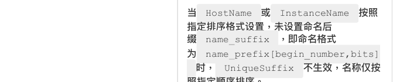

| 参数名称 | 类型 | 位置 | 是否必选 | 示例 | 说明 |
| --- | --- | --- | --- | --- | --- |
| UserData | String | Query | 否 | ZWNobyBoZWxsbyBlY3Mh | 实例自定义数据。需要以Base64方式编码，原始数据最多为16 KB。 |
| KeyPairName | String | Query | 否 | KeyPair_Name | 密钥对名称。<br>• Windows实例，忽略该参数。默认为空。即使填写了该参数，仍旧只执行<code> Password </code>的内容。<br>• Linux实例的密码登录方式会被初始化成禁止。 |
| RamRoleName | String | Query | 否 | RAM_Name | 实例RAM角色名称。您可以使用RAM API（<code> ListRoles </code>）查询您已创建的实例RAM角色。 |
| Amount | Integer | Query | 否 | 3 | 指定创建ECS实例的数量。取值范围：1~100。默认值：1。 |
| MinAmount | Integer | Query | 否 | 2 | 指定ECS实例最小创建数量。取值范围：1~100。当ECS库存数量小于最小创建数量，会创建失败。 当ECS库存数量大于等于最小创建数量，按照库存数量创建。 |
| AutoReleaseTime | String | Query | 否 | 2018-01-01T12:05:00Z | 自动释放时间。按照ISO8601标准表示，使用UTC+0时间。格式为：<code> yyyy-MM-</code><code>ddTHH:mm:ssZ </code>。<br>• 如果秒（<code> ss </code>）取值不是<code> 00 </code>，则自动取为当前分钟（<code> mm </code>）开始时。<br>• 最短释放时间为当前时间半小时之后。<br>• 最长释放时间不能超过当前时间三年。 |
| SecurityEnhance mentStrategy | String | Query | 否 | Active | 是否开启安全加固。取值范围：<br>• Active：启用安全加固，只对公共镜像生效。<br>• Deactive：不启用安全加固，对所有镜像类型生效。 |
| ClientToken | String | Query | 否 | 123e4567-e89b-12d3-a456-426655440000 | 保证请求幂等性。从您的客户端生成一个参数值，确保不同请求间该参数值唯一。<code> ClientToken </code>只支持ASCII字符，且不能超过64个字符。更多信息，请参见专有云文档中心《云服务器ECS开发指南》文档的<strong>如何保证幂等性</strong>章节。 |
| HpcClusterId | String | Query | 否 | hpc-bp67acfmxazb4p\*\*\*\* | 实例所属的EHPC集群ID。 |
| DryRun | Boolean | Query | 否 | false | 是否只预检此次请求。取值范围：<br>• true：发送检查请求，不会创建实例。检查项包括是否填写了必需参数、请求格式、业务限制和ECS库存。如果检查不通过，则返回对应错误。如果检查通过，则返回错误码<code> DryRunOperation </code>。<br>• false：发送正常请求，通过检查后直接创建实例。默认值：false。 |
| DedicatedHostId | String | Query | 否 | dh-bp67acfmxazb4p\*\*\*\* | 专有宿主机ID。您可以通过<code> DescribeDedicatedHosts </code>查询专有宿主机ID列表。 |
| LaunchTemplateI d | String | Query | 否 | lt-bp1apo0bbbkuy0rj\*\*\*\* | 启动模板ID。更多信息，请调用<code> DescribeLaunchTemplates </code>获取。使用启动模板创建实例时，您必须指定<code> LaunchTemplateId </code>或<code> LaunchTemp</code> <code>lateName </code>参数来确定启动模板。 |
| LaunchTemplateN ame | String | Query | 否 | LaunchTemplate_Name | 启动模板名称。使用启动模板创建实例时，您必须指定<code> LaunchTemplateId </code>或<code> LaunchTemp</code> <code>lateName </code>参数来确定启动模板。 |
| LaunchTemplateV ersion | Long | Query | 否 | 3 | 启动模板版本。如果您指定了<code> LaunchTemplateId </code>或<code> LaunchTemp</code> <code>lateName </code>参数而不指定启动模板版本号，则采用默认版本。 |
| DeploymentSetId | String | Query | 否 | ds-bp1brhwhoqinyjd6\*\*\*\* | 部署集ID。 |
| PrivateIpAddress | String | Query | 否 | 10.1.\*\*.\*\* | 实例私网IP地址。专有网络VPC类型ECS实例设置私网IP地址时，必须从虚拟交换机（<code> VSwitchId </code>）的空闲网段中选择。设置<code> PrivateIpAddress </code>后：<br>• 如果<code> Amount </code>参数取值为1，则表示为创建的一台ECS实例分配私网IP地址。<br>• 如果<code> Amount </code>参数取值大于1，则表示在批量创建ECS实例时，以指定的私网IP地址为起始地址，依次为多台ECS实例分配连续的私网IP地址，但需要注意，此时不支持再为实例绑定辅助网卡（即不支持再设置<code> NetworkInterface.N.* </code>这类参数）。 |
| CreditSpecificatio n | String | Query | 否 | Standard | 修改突发性能实例的运行模式。取值范围：<br>• Standard：标准模式。<br>• Unlimited：无性能约束模式。默认值：无。 |
| Ipv6AddressCount | Integer | Query | 否 | 1 | 为主网卡指定随机生成的IPv6地址数量。取值范围：1~10。您不能同时设置<code> Ipv6Address.N </code>和<code> Ipv6AddressCo</code> <code>unt </code>。 |
| NetworkInterface QueueNumber | Integer | Query | 否 | 8 | 主网卡队列数。<br>• 不能超过实例规格允许的单块网卡最大队列数。<br>• 实例的所有网卡累加队列数不能超过实例规格允许的队列数总配额。实例规格的单块网卡最大队列数和总配额可以通过<code> DescribeInstanceTypes </code>接口查询<code> MaximumQueueNumberPerEni </code>、<code> TotalEniQueueQuantity </code>字段。 |
| DeletionProtectio n | Boolean | Query | 否 | false | 实例释放保护属性，指定是否支持通过控制台或API（<code> DeleteInstance </code>）释放实例。取值范围：<br>• true：开启实例释放保护。<br>• false：关闭实例释放保护。默认值：false。您需要注意，该属性只能限制手动释放操作，对系统释放操作不生效。 |
| Affinity | String | Query | 否 | default | 专有宿主机实例是否与专有宿主机关联。取值范围：<br>• default：实例不与专有宿主机关联。<br>• host：实例与专有宿主机关联。默认值：default。 |
| Tenancy | String | Query | 否 | default | 是否在专有宿主机上创建实例。取值范围：<br>• default：创建非专有宿主机实例。<br>• host：创建专有宿主机实例。若您不指定<code> DedicatedHostId </code>，则由阿里云自动选择专有宿主机放置实例。默认值：default。 |
| StorageSetId | String | Query | 否 | ss-bp67acfmxazb4p\*\*\*\* | 存储集ID。您可以调用<code> StorageSetPartitionNumber </code>查询存储集ID。 |
| StorageSetPartitio nNumber | Integer | Query | 否 | 2 | 存储集中的最大分区数量。取值范围：大于等于2。在指定了<code> StorageSetId </code>时，该参数为必填。 |
| CpuOptions.Core | Integer | Query | 否 | 2 | CPU核心数。该参数不支持自定义设置，只能采用默认值。 |
| CpuOptions.Threa dsPerCore | Integer | Query | 否 | 2 | CPU线程数。ECS实例的vCPU数=<code> CpuOptions.Core </code>取值<br>\*<code> CpuOptions.ThreadsPerCore </code>取值。<br><code>• CpuOptions.ThreadsPerCore=1</code>表示关闭CPU超线程。<br>• 仅部分实例规格支持设置CPU线程数。 |
| CpuOptions.Numa | String | Query | 否 | 1 | CPU Numa节点数。 |
| SchedulerOptions.DedicatedHostClu sterId | String | Query | 否 | dc-bp12wlf6am0vz9v2\*\*\*\* | 指定ECS实例所属的专有宿主机集群，系统会自动选择该专有宿主机集群中的一台专有宿主机部署ECS实例。仅在<code> Tenancy </code>设置为<code> host </code>时生效。在您同时指定了专有宿主机（<code> DedicatedHostId </code>）和专有宿主机集群（<code> SchedulerOptions.DedicatedHostCl</code> <code>usterId </code>）时：<br>• 如果专有宿主机属于专有宿主机集群，则优先将ECS实例部署在指定的专有宿主机上。<br>• 如果专有宿主机不属于专有宿主机集群，则ECS实例创建失败。您可以通过<code> DescribeDedicatedHostClusters </code>查询专有宿主机集群ID列表。 |
| SecurityGroupIds | RepeatList | Query | 否 | sg-bp15ed6xe1yxeycg7\*\*\*\* | 将实例同时加入多个安全组。参数格式为<code> SecurityGroupIds.N </code>，N的取值范围与实例能够加入安全组配额有关。不支持同时设置<code> SecurityGroupId </code>和<code> SecurityGro</code> <code>upIds.N </code>。 |
| HostNames | RepeatList | Query | 否 | ecs-host-01 | 创建多台ECS实例时，为每台实例指定不同的主机名。参数格式为<code> HostNames.N </code>。<code> HostNames.N </code>限制说明如下：<br>• N的个数需要和Amount参数值保持一致。例如，Amount=2时，通过该参数指定主机名的格式为HostNames.1=test1和HostNames.2=test2。<br>• 不支持同时设置<code> HostName </code>参数和<code> HostNames.N </code>参数。<br>• 您可以使用<code> UniqueSuffix </code>为这些实例设置不同的主机名称。您也可以使用<code> name_prefix[begin_number,bits</code><code>]name_suffix </code>的命名格式设置有序的主机名称，例如，设置<code> HostName </code>取值为<code> k8s-node-[1,4]-ecshost </code>，则第一台ECS实例的主机名称为<code> k8s-</code><code>node-0001-ecshost </code>。<br>• 半角句号（.）和短划线（-）不能作为首尾字符，更不能连续使用。<br>• Windows实例：字符长度为2~15，不支持半角句号（.），不能全是数字。允许包含大小写英文字母、数字和短划线（-）。<br>• 其他类型实例（Linux等）：字符长度为2~64，支持多个半角句号（.），点之间为一段，每段允许包含大小写英文字母、数字和短划线（-）。 |
| DataDisk | RepeatList | Query | 否 | - | 实例数据盘信息。 |
| -AutoSnapshotPoli cyId | String |  | 否 | sp-bp67acfmxazb4p\*\*\*\* | 数据盘N采用的自动快照策略ID。参数格式为<code> DataDisk.N.AutoSnapshotPolicyId</code><code> </code>。 |
| -Encrypted | String |  | 否 | false | 数据盘N是否加密。参数格式为<code> DataDisk.N.Encrypted </code>。取值范围：<br>• true：加密。<br>• false：不加密。默认值：false。 |
| -Description | String |  | 否 | Network_Description | 弹性网卡的描述，参数格式为<code> NetworkInterface.N.Description</code><code> </code>，N的取值为1。长度为2~256个英文或中文字符，不能以<code> http:// </code>或<code> https:// </code>开头。 |
| -SnapshotId | String |  | 否 | s-bp17441ohwka0yuh\*\*\*\* | 创建数据盘N使用的快照。参数格式为<code> DataDisk.N.SnapshotId </code>，N的取值范围为1~16。指定参数<code> DataDisk.N.SnapshotId </code>后，参数<code> DataDisk.N.Size </code>会被忽略，实际创建的云盘大小为指定的快照的大小。 |

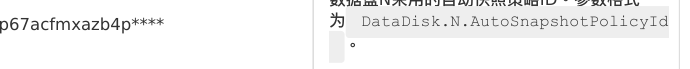

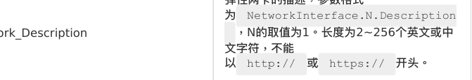

| 参数名称 | 类型 | 位置 | 是否必选 | 示例 | 说明 |
| --- | --- | --- | --- | --- | --- |
| -Device | String |  | 否 | /dev/xvdb | 数据盘的挂载点。参数格式为<code> DataDisk.N.Device </code>，挂载的数据盘数量不同，挂载点的命名不同：<br>• 1~25块数据盘：<code> /dev/xvd[b-z] </code><br>• 大于25块数据盘：<code> /dev/xvd[aa-</code><code>zz] </code>，例如第26块数据盘会被命名为<code> /dev/xvdaa </code>，第27块数据盘为<code> /dev/xvdab </code>，以此类推。该参数仅用于全镜像（整机镜像）场景，使用普通镜像时，该参数无意义。您可以通过将此参数设置为全镜像中数据盘对应的挂载点，并修改对应的<code> DataDisk.N.Size </code>和<code> DataDisk.N.</code><code>Category </code>参数，达到修改全镜像中数据盘磁盘种类和大小的目的。使用说明如下：<br>• <code> DataDisk.N.Device </code>参数取值必须通过如下方式获取：调用<code> DescribeImages </code>接口，然后查看接口返回的<code> DiskDeviceMappings </code>列表信息，当<code> Type </code>参数值为<code> data </code>时，对应的<code> Device </code>参数值即为<code> DataDisk.N.Device </code>参数取值。<br>• <code> DataDisk.N.Size </code>参数取值必须大于或等于调用<code> DescribeImages </code>接口返回的<code> Size </code>参数值。 |
| -Size | Integer |  | 否 | 2000 | 第N个数据盘的容量大小。参数格式为<code> DataDisk.N.Size </code>，N的取值范围为1~16，单位为GiB。取值范围：<br>• cloud_efficiency：20~32768。<br>• cloud_ssd：20~32768。<br>• cloud_pperf：20~131072。<br>• cloud_sperf：20~32768。该参数的取值必须大于等于参数<code> SnapshotId </code>指定的快照的大小。当数据盘的类型选择为高效云盘（cloud_efficiency）或者SSD盘（cloud_ssd）时，如果填写的容量超过2 TB，注意按照以下EBS集群的机器数量与推荐的云盘最大建议值（机器数量：云盘最大值）进行填写。<br>• 6台：2 TB<br>• 12台：4 TB<br>• 15台：5 TB<br>• 24台：8 TB云盘最大建议值的计算公式为：云盘最大大小S = N/3，其中N为相应EBS集群的机器数量，结果向下取整。例如：如果EBS集群的机器数量为6台，则建议创建的云盘容量不超过2 TB。 |
| -DiskName | String |  | 否 | cloud_ssdData | 数据盘名称，参数格式为<code> DataDisk.N.DiskName </code>。长长度为2~128个字符，支持Unicode中letter分类下的字符（其中包括英文、中文和数字等）。可以包含半角冒号（:）、下划线（_）、半角句号（.）或者短划线（-）。默认值：空。 |
| -Category | String |  | 否 | cloud_ssd | 数据盘N的云盘种类，参数格式为<code> DataDisk.N.Category </code>。取值范围：<br>• cloud_efficiency：高效云盘。<br>• cloud_ssd：SSD云盘。<br>• cloud_pperf：高性能云盘。<br>• cloud_sperf：普通性能云盘。默认值：cloud_efficiency。<em>原共享SSD盘和共享高效云盘已下线。</em> |
| -DeleteWithInstanc e | Boolean |  | 否 | rue | 数据盘是否随实例释放，参数格式为<code> DataDisk.N.DeleteWithInstance </code>。取值范围：<br>• true：数据盘随实例释放。<br>• false：数据盘不随实例释放。默认值：true。 |
| -KMSKeyId | String |  | 否 | 0e478b7a-4262-4802-b8cb-00d3fb40\*\*\*\* | 数据盘对应的KMS密钥ID，参数格式为<code> DataDisk.N.KMSKeyId </code>。 |
| NetworkInterface | RepeatList | Query | 否 | - | 弹性网卡信息。 |
| -VSwitchId | String |  | 否 | vsw-bp67acfmxazb4p\*\*\*\* | 弹性网卡所属的虚拟交换机ID，参数格式为<code> NetworkInterface.N.VSwitchId </code>，N的取值为1。 |
| -NetworkInterface Name | String |  | 否 | Network_Name | 弹性网卡名称，参数格式为<code> NetworkInterface.N.NetworkInterf</code> <code>aceName </code>，N的取值为1。长度为2~128个字符，支持Unicode中letter分类下的字符（其中包括英文、中文和数字等）。可以包含半角冒号（:）、下划线（_）、半角句号（.）或者短划线（-）。 |
| -Description | String |  | 否 | Network_Description | 弹性网卡的描述，参数格式为<code> NetworkInterface.N.Description</code><code> </code>，N的取值为1。长度为2~256个英文或中文字符，不能以<code> http:// </code>或<code> https:// </code>开头。 |
| -SecurityGroupId | String |  | 否 | sg-bp67acfmxazb4p\*\*\*\* | 弹性网卡所属的安全组ID，参数格式为<code> NetworkInterface.N.SecurityGroup</code> <code>Id </code>，N的取值为1。 |
| -PrimaryIpAddress | String |  | 否 | 172.16.\*\*.\*\* | 添加一张弹性网卡并设置主IP地址，参数格式为<code> NetworkInterface.N.PrimaryIpAddr</code> <code>ess </code>。您需要注意，创建ECS实例时，您最多能添加一张辅助网卡。实例创建成功后，您可以调用<code> CreateNetworkInterface </code>和<code> Att</code> <code>achNetworkInterface </code>添加更多的辅助网卡。默认值：从网卡所属的交换机网段中随机选择一个IP地址。 |
| -QueueNumber | Integer |  | 否 | 8 | 弹性网卡队列数，参数格式为<code> NetworkInterface.N.QueueNumber</code><code> </code>。<br>• N的取值为1，表示仅支持设置1个主网卡。<br>• 不能超过实例规格允许的单块网卡最大队列数。<br>• 实例的所有网卡累加队列数不能超过实例规格允许的队列数总配额。实例规格的单块网卡最大队列数和总配额可以通过<code> DescribeInstanceTypes </code>接口查询<code> MaximumQueueNumberPerEni </code>、<code> TotalEniQueueQuantity </code>字段。 |
| -SecurityGroupIds | RepeatList |  | 否 | sg-bp15ed6xe1yxeycg7\*\*\*\* | 弹性网卡所属的一个或多个安全组ID，参数格式为<code> NetworkInterface.N.SecurityGroup</code> <code>Ids.N </code>。<br>• 第一个N的取值为1，表示仅支持设置1个主网卡。<br>• 第二个N表示可以指定一个或多个安全组ID。N的取值范围与实例能够加入安全组配额有关。 |

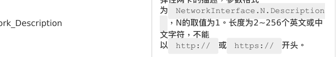


| 参数名称 | 类型 | 位置 | 是否必选 | 示例 | 说明 |
| --- | --- | --- | --- | --- | --- |
| -InstanceType | String |  | 否 | Secondary | 弹性网卡类型，参数格式为<code> NetworkInterface.N.InstanceType</code><code> </code>，N的取值范围为1~2。设置1个弹性网卡时，支持设置1个主网卡或1个辅助网卡；设置2个弹性网卡时，仅支持同时设置1个主网卡和1个辅助网卡。取值范围：<br>• Primary：主网卡。<br>• Secondary：辅助网卡。默认值：Secondary。 |
| -Ipv6AddressCount | Long |  | 否 | 1 | 为主网卡指定随机生成的IPv6地址数量，参数格式为<code> NetworkInterface.N.Ipv6AddressCo</code> <code>unt </code>。N的取值范围：1~10。您需要注意：<br><code>• NetworkInterface.N.InstanceType</code><code> </code>取值为<code> Primary </code>时，设置该参数才会生效。如果<code> NetworkInterface.N.InstanceTy</code> <code>pe </code>取值为<code> Secondary </code>或空值，则不能设置该参数。<br>• 设置该参数后，您不能再设置<code> Ipv6AddressCount </code>、<code> Ipv6Addr</code> <code>ess.N </code>或<code> NetworkInterface.N.Ipv6</code> <code>Address.N </code>。 |
| -Ipv6Address | RepeatList |  | 否 | 2001:db8:1234:1a00::\*\*\* | 为主网卡指定一个或多个IPv6地址，参数格式为<code> NetworkInterface.N.Ipv6Address.N</code><code> </code>。支持设置最多10个IPv6地址，即第二个N的取值范围：1~10。取值示例：<code> Ipv6Address.1=2001:db8:1234:1a</code> <code>00::***</code>您需要注意：<br><code>• NetworkInterface.N.InstanceType</code><code> </code>取值为<code> Primary </code>时，设置该参数才会生效。如果<code> NetworkInterface.N.InstanceTy</code> <code>pe </code>取值为<code> Secondary </code>或空值，则不能设置该参数。<br>• 设置该参数后，<code> Amount </code>取值只能为1，且不能再设置<code> Ipv6AddressCount </code>、<code> Ipv6Addr</code> <code>ess.N </code>或<code> NetworkInterface.N.Ipv6</code> <code>AddressCount </code>。 |
| Tag | RepeatList | Query | 否 | - | 实例、云盘和主网卡的标签信息。 |
| -Key | String |  | 否 | TestKey | 实例、云盘和主网卡的标签键。参数格式为<code> Tag.N.Key </code>，N的取值范围：1~20。一旦传入该值，则不允许为空字符串。最多支持128个字符，不能以<code> aliyun </code>或<code> acs: </code>开头，不能包含<code> http:// </code>或<code> https:// </code>。 |
| -Value | String |  | 否 | TestValue | 实例、云盘和主网卡的标签值。参数格式为<code> Tag.N.Value </code>，N的取值范围：1~20。一旦传入该值，可以为空字符串。最多支持128个字符，不能包含<code> http:// </code>或<code> https:// </code>。 |

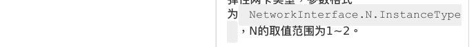

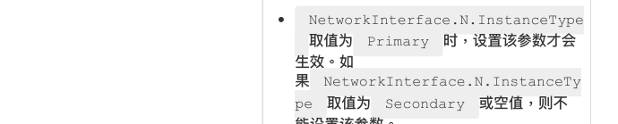

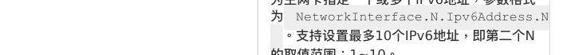

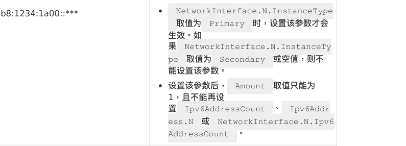

| 参数名称 | 类型 | 位置 | 是否必选 | 示例 | 说明 |
| --- | --- | --- | --- | --- | --- |
| Ipv6Address | RepeatList | Query | 否 | 2001:db8:1234:1a00::\*\*\* | 为主网卡指定一个或多个IPv6地址，参数格式为<code> Ipv6Address.N </code>。支持设置最多10个IPv6地址，即N的取值范围：1~10。取值示例：<code> Ipv6Address.1=2001:db8:1234:1a</code> <code>00::*** </code>。您需要注意：<br>• 设置该参数后，<code> Amount </code>取值只能为1，且不能再设置<code> Ipv6AddressCount </code>、<code> Ipv6Addr</code> <code>ess.N </code>或<code> NetworkInterface.N.Ipv6</code> <code>AddressCount </code>。<br>• 如果<code> NetworkInterface.N.InstanceTy</code> <code>pe </code>取值为<code> Primary </code>，则不能设置<code> Ipv6Addresses.N </code>或<code> Ipv6Addre</code> <code>ssCount </code>，而是需要设置<code> NetworkInterface.N.Ipv6Addres</code> <code>ses.N </code>或<code> NetworkInterface.N.Ipv6</code> <code>AddressCount </code>。 |

**返回数据**

| 参数名称 | 类型 | 示例 | 说明 |
| --- | --- | --- | --- |
| InstanceIdSets | List | \["i-bp67acfmxazb4pd2\*\*\*\*","i-bp1i43l28m7u48p1\*\*\*\*","i-bp12yqg7jdyxl11f\*\*\*\*"\] | 实例ID（<code> InstanceIdSet </code>）列表。 |
| RequestId | String | 04F0F334-1335-436C-A1D7-6C044FE\*\*\*\*\* | 请求ID。 |
| OrderId | String | 1234567890 | 该参数暂未支持。 |
| TradePrice | Float | 0.165 | 该参数暂未支持。 |

**示例**

请求示例

```text
http(s)://ecs.example.com/?Action=RunInstances
&RegionId=cn-qingdao-env***-d**
&ImageId=aliyun_2_1903_x64_20G_alibase_20200324.vhd
&InstanceType=ecs.g6.large
&SecurityGroupId=sg-bp67acfmxazb4p****
&VSwitchId=vsw-bp1s5fnvk4gn2tws0****
&SystemDisk.AutoSnapshotPolicyId=sp-bp67acfmxazb4p****
&Amount=3**
&公共请求参数
```

正常返回示例

`JSON`  格式

```json
{
"InstanceIdSets":{
"InstanceIdSet":[
"i-bp67acfmxazb4pd2****",
"i-bp1i43l28m7u48p1****",
"i-bp12yqg7jdyxl11f****"
]
},
"RequestId":"04F0F334-1335-436C-A1D7-6C044FE*****"
}
```

`XML`  格式

```xml
<RunInstancesResponse>
<InstanceIdSets>
<InstanceIdSet>i-bp67acfmxazb4pd2****</InstanceIdSet>
<InstanceIdSet>i-bp1i43l28m7u48p1****</InstanceIdSet>
<InstanceIdSet>i-bp12yqg7jdyxl11f****</InstanceIdSet>
</InstanceIdSets>
<RequestId>04F0F334-1335-436C-A1D7-6C044FE*****</RequestId>
</RunInstancesResponse>
```

**错误码**

| HttpCode | 错误码 | 错误信息 | 描述 |
| --- | --- | --- | --- |
| 400 | IMAGE_NOT_SUPPORT_LOG_AS_NON_ROOT | LoginAsNonRoot.ImageNotSupport | The specified image does not support login as non-root. |
| 400 | NOT_SUPPORT_JUMBO_FRAME | InvalidParam.NotSupportJumboFrame | Not support jumbo frame. |
| 400 | ACCOUNT_MONEY_VALIDATE_E RROR | InsufficientBalance.AgentCredit | Insufficient agent credit. Please contact your agent. |
| 400 | ELASIC_COMMON_RESOUCE_QU OTA_EXCEEDED | QuotaExceed.DiskCapacity | The used capacity of disk type has exceeded the quota in the zone, %s. |
| 400 | ECS_ON_HOST_NOT_SUPPORT | InvalidPeriod.ExceededDedicatedHost | Instance expired date can't exceed dedicated host expired date. |
| 400 | InvalidParam.SecondaryNetwor kInterface | InvalidParam.SecondaryNetworkInterface | When min amount greater than 1 and the PrivateIpAddress or Primary NetworkInterface is specified,the Secondary NetworkInterface IP parameter cannot be specified. |
| 400 | InvalidPrimaryIpAddress.SizeInv alid | InvalidPrimaryIpAddress.SizeInvalid | The NetworkInterface PrimaryIpAddress is used to create only one instance. |
| 400 | InvalidDedicatedBlockStorageCl usterId.CapacityNotEnough | InvalidStorageClusterId.CapacityNotEnough | The remaining capacity of the current dedicated storage cluster is less than the size of disk. |
| 400 | InvalidDedicatedBlockStorageCl usterId.StatusNotSupport | InvalidStorageClusterId.StatusNotSupport | The current status of the dedicated storage cluster cannot create a cloud disk yet. |
| 400 | Abs.InvalidDedicatedBlockStora geClusterId.ZoneIdEmpty | InvalidStorageClusterId.ZoneIdEmpty | The specified param ZoneId cannot be empty when StorageClusterId given. |
| 400 | InvalidDedicatedBlockStorageCl usterId.PerformanceLevelNotMa tch | InvalidStorageClusterId.PerformanceLevelNotMat ch | The current dedicated storage cluster cannot create this performance level of disk. |
| 400 | InvalidDedicatedBlockStorageCl usterId.CategoryNotMatch | InvalidStorageClusterId.CategoryNotMatch | The current dedicated storage cluster cannot create this category of disk. |
| 400 | Abs.InvalidDedicatedBlockStora geClusterId.DiskSizeEmpty | InvalidStorageClusterId.DiskSizeEmpty | The specified param DiskSize cannot be empty when StorageClusterId given. |
| 400 | DEDICATED_HOST_TYPE_IS_ILLE GAL | InvalidInstanceType.ValueUnauthorized | The specified InstanceType is not authorize. |
| 400 | FUWU_BIZ_COMMODITY_VERIFY _FAIL_100000084424 | InvalidInstanceType.ValueUnauthorized | The specified InstanceType is not authorized. |
| 400 | FUWU_BIZ_COMMODITY_VERIFY _FAIL_100000084573 | InvalidInstanceType.ValueUnauthorized | The specified InstanceType is not authorized. |
| 400 | FUWU_BIZ_COMMODITY_VERIFY _FAIL_100000086416 | InvalidInstanceType.ValueUnauthorized | The specified InstanceType is not authorized. |
| 400 | FUWU_BIZ_COMMODITY_VERIFY _FAIL_100000084873 | InvalidInstanceType.ValueUnauthorized | The specified InstanceType is not authorized. |
| 400 | FUWU_BIZ_COMMODITY_VERIFY _FAIL_100000085149 | InvalidInstanceType.ValueUnauthorized | The specified InstanceType is not authorized. |
| 400 | FUWU_BIZ_COMMODITY_VERIFY _FAIL_100000085202 | InvalidInstanceType.ValueUnauthorized | The specified InstanceType is not authorized. |
| 400 | FUWU_BIZ_COMMODITY_VERIFY _FAIL_100458642 | InvalidInstanceType.ValueUnauthorized | The specified InstanceType is not authorized. |
| 400 | FUWU_BIZ_COMMODITY_VERIFY _FAIL_100356432 | InvalidInstanceType.ValueUnauthorized | The specified InstanceType is not authorized. |
| 400 | FUWU_BIZ_COMMODITY_VERIFY _FAIL_100356653 | InvalidInstanceType.ValueUnauthorized | The specified InstanceType is not authorized. |
| 400 | FUWU_BIZ_COMMODITY_VERIFY _FAIL_100357727 | InvalidInstanceType.ValueUnauthorized | The specified InstanceType is not authorized. |
| 400 | FUWU_BIZ_COMMODITY_VERIFY _FAIL_100357790 | InvalidInstanceType.ValueUnauthorized | The specified InstanceType is not authorized. |
| 400 | FUWU_BIZ_COMMODITY_VERIFY _FAIL_100357913 | InvalidInstanceType.ValueUnauthorized | The specified InstanceType is not authorized. |
| 400 | FUWU_BIZ_COMMODITY_VERIFY _FAIL_100357948 | InvalidInstanceType.ValueUnauthorized | The specified InstanceType is not authorized. |
| 403 | INSTANCE_TYPE_NOT_EXIST | InvalidInstanceType.ValueNotSupported | The specified InstanceType beyond the permitted range. |
| 403 | InvalidDescription.Malformed | InvalidDescription.Malformed | Specified parameter Description is not valid. |
| 400 | Invalid.Bandwidth.PayType | InvalidInternetChargeType.ValueNotSupported | %s |
| 400 | FUWU_BIZ_COMMODITY_VERIFY _FAIL_100000092309 | InvalidParameter | The specified parameter "InternetMaxBandwidthOut" is not valid. |
| 400 | InvalidParams.Hostname | InvalidHostName.Malformed | The specified parameter "HostName" is not valid. |
| 400 | PASSWORD_ILLEGAL | InvalidPassword.Malformed | The specified parameter "Password" is not valid. |
| 400 | Abs.InvalidPassword.Malformed | InvalidPassword.Malformed | The specified parameter "Password" is not valid. |
| 400 | Abs.InvalidPassword.Mismatch | InvalidPasswordParam.Mismatch | The input password should be null when passwdInherit is true. |
| 400 | Invalid.SysDisk.Category | InvalidSystemDiskCategory.ValueNotSupported | %s |
| 400 | Abs.InvalidDiskName.Malforme d | InvalidDiskName.Malformed | The specified parameter "SyatemDisk.DiskName or DataDisk.n.DiskName" is not valid. |
| 400 | Abs.InvalidDiskDescription.Malf ormed | InvalidDiskDescription.Malformed | The specified parameter "SyatemDisk.DiskDescription or DataDisk.n.Description" is not valid. |
| 400 | Invalid.DataDisk.Size | InvalidDataDiskSize.ValueNotSupported | %s |
| 400 | FUWU_BIZ_COMMODITY_VERIFY _FAIL_100179244 | InvalidDataDiskSize.ValueNotSupported | The specified DataDisk.n.Size beyond the permitted range, or the capacity of snapshot exceeds the size limit of the specified disk category. |
| 400 | Invalid.DataDisk.Category | InvalidDataDiskCategory.ValueNotSupported | %s |
| 400 | FUWU_BIZ_COMMODITY_VERIFY _FAIL_100000084440 | InvalidDataDiskCategory.ValueNotSupported | The specified parameter "DataDisk.n.Category" is not valid. |
| 400 | FUWU_BIZ_COMMODITY_VERIFY _FAIL_100199823 | InvalidDataDiskCategory.ValueNotSupported | The specified parameter "DataDisk.n.Category" is not valid. |
| 400 | DISK_MOUNT_POINT_ILLEGAL | InvalidDataDevice.Malformed | The specified parameter "DataDisk.n.Device" is not valid. |
| 400 | -700 | InvalidNodeControllerId.Malformed | The specified parameter "NodeControllerId" is not valid. |
| 400 | -700 | InvalidNodeControllerId.Malformed | The specified parameter "NodeControllerId" is not valid. |
| 400 | Abs.InvalidInnerIpAddress.Malfo rmed | InvalidInnerIpAddress.Malformed | The specified parameter InnerIpAddress is not valid. |
| 400 | -226 | InvalidInnerIpAddress.Unusable | The specified InnerIpAddress is already used or not found in usable ip range. |
| 400 | -5003 | InvalidInnerIpAddress.Unusable | The specified InnerIpAddress is already used or not found in usable ip range. |
| 400 | -5005 | InvalidInnerIpAddress.Unusable | The specified InnerIpAddress is already used or not found in usable ip range. |
| 400 | -498 | InvalidInnerIpAddress.Unusable | The specified InnerIpAddress is already used or not found in usable ip range. |
| 400 | -221 | InvalidInnerIpAddress.Unusable | The specified InnerIpAddress is already used or not found in usable ip range. |
| 400 | -410 | InvalidInnerIpAddress.Unusable | The specified InnerIpAddress is already used or not found in usable ip range. |
| 400 | -226 | InvalidInnerIpAddress.Unusable | The specified InnerIpAddress is already used or not found in usable ip range. |
| 400 | PARAMETER_CONFLICT | InvalidParameter.Conflict | %s |
| 400 | FUWU_BIZ_COMMODITY_VERIFY _FAIL_1707398 | InvalidParameter.Conflict | The specified image does not support the specified instance type. |
| 400 | ImageNotSupportCloudInit | ImageNotSupportCloudInit | The specified image does not support cloud-init. |
| 400 | SNAPSHOT_AT_BEFORE_ASSIGN _DATE | InvalidSnapshotId.BasedSnapshotTooOld | The specified snapshot is created before 2013-07-15. |
| 400 | ECS_BIZ_QUOTA_USER | QuotaExceed.AfterpayInstance | Living afterpay instances quota exceeded. |
| 400 | NICKNAME_ILLEGAL | InvalidInstanceName.Malformed | The specified parameter "InstanceName" is not valid. |
| 400 | NICKNAME_ILLEGAL | InvalidInstanceName.Malformed | The specified parameter "InstanceName" is not valid. |
| 400 | Abs.InvalidInstanceName.Custo mMalformed | InvalidInstanceName.CustomMalformed | Customized section of instance or host name is invalid, please use valid format: \[\], \[,\], \[m,\], \[,n\], \[m,n\]. |
| 400 | DESCRIPTION_ILLEGAL | InvalidDescription.Malformed | The specified parameter "Description" is not valid. |
| 400 | Abs.InvalidDiskName.Malforme d | InvalidDiskName.Malformed | The specified parameter "SyatemDisk.DiskName or DataDisk.n.DiskName" is not valid. |
| 400 | Abs.InvalidDiskDescription.Malf ormed | InvalidDiskDescription.Malformed | The specified parameter "SyatemDisk.DiskDescription or DataDisk.n.Description" is not valid. |
| 400 | ZONE_NOT_IN_AVAILABLE_IZ | InvalidParameter.Conflict | The speicified region and cluster do not match. |
| 400 | IZ_IS_EMPTY | InvalidParameter.Mismatch | Specified virtual switch is not in the specified zone. |
| 400 | VPC_INSTANCE_NOT_NEED_INT ERNET_CHARGETYPE | InvalidNetworkType.Mismatch | Specified parameter "InternetChargeType" conflict with instance network type. |
| 400 | VPC_INSTANCE_NOT_NEED_BAN DWIDTH | InvalidNetworkType.Mismatch | Specified parameter "InternetMaxBandwidthIn" or "InternetMaxBandwidthOut" conflict with instance network type. |
| 400 | VPC_INSTANCE_NOT_NEED_INT ERNET_CHARGETYPE | InvalidNetworkType.Mismatch | Specified parameter "InternetChargeType" conflict with instance network type. |
| 400 | PRIVATE_IP_INVALID | InvalidPrivateIpAddress | Specified private IP address is not in the CIDR block of virtual switch. |
| 400 | Abs.InvalidPrivateIpAddress.Mal formed | InvalidPrivateIpAddress.Malformed | The specified parameter PrivateIpAddress is not valid. |
| 403 | InvalidVSwitchId.IpNotEnough | QuotaExceeded.PrivateIpAddress | %s |
| 400 | QUOTA_FULL | QuotaExceeded | Living instances quota exceeded in this VPC. |
| 400 | VPC_SWITCH_STATUS_ERROR | IncorrectVSwitchStatus | The current status of vSwitch does not support this operation. |
| 400 | IZ_IS_EMPTY | InvalidParameter.Mismatch | Specified virtual switch is not in the specified zone. |
| 400 | ZONE_NO_RESOURCE_SUPPORT | ResourceNotAvailable | Resource you requested is not available in this region or zone. |
| 400 | Abs.MissingParameter.Instance Type | MissingParameter | The input parameter InstanceType that is mandatory for processing this request is not supplied. |
| 400 | PASSWORD_ILLEGAL | InvalidPassword.Malformed | The specified parameter "Password" is not valid. |
| 403 | FUWU_BIZ_COMMODITY_VERIFY _FAIL_100199826 | InvalidDiskCategory.Mismatch | The specified disk categories combination is not supported. |
| 400 | Abs.InvalidDiskSize.ValueNotSu pported | InvalidDataDiskSize.ValueNotSupported | The specified DataDisk.n.Size beyond the permitted range, or the capacity of snapshot exceeds the size limit of the specified disk category. |
| 400 | Abs.MissingParamter.Period | MissingParamter | The specified parameter "Period" is not null. |
| 400 | ORDER.PERIOD_INVALID | InvalidPeriod | The specified period is not valid. |
| 400 | ORDER.PERIOD_INVALID | InvalidPeriod | The specified period is not valid. |
| 400 | FUWU_BIZ_COMMODITY_VERIFY _FAIL_100000085155 | InvalidDataDiskCategory.ValueNotSupported | The specified parameter " DataDisk.n.Category " is not valid. |
| 400 | FUWU_BIZ_COMMODITY_VERIFY _FAIL_100000085127 | InvalidDataDiskCategory.ValueNotSupported | The specified parameter " DataDisk.n.Category " is not valid. |
| 400 | FUWU_BIZ_COMMODITY_VERIFY _FAIL_100000085156 | InvalidSystemDiskCategory.ValueNotSupported | The specified parameter " SystemDisk.Category " is not valid. |
| 400 | FUWU_BIZ_COMMODITY_VERIFY _FAIL_100000084451 | InvalidSystemDiskCategory.ValueNotSupported | The specified parameter " SystemDisk.Category " is not valid. |
| 400 | FUWU_BIZ_COMMODITY_VERIFY _FAIL_100000084502 | InvalidSystemDiskCategory.ValueNotSupported | The specified parameter " SystemDisk.Category " is not valid. |
| 400 | FUWU_BIZ_COMMODITY_VERIFY _FAIL_100199822 | InvalidSystemDiskCategory.ValueNotSupported | The specified parameter " SystemDisk.Category " is not valid. |
| 400 | FUWU_BIZ_COMMODITY_VERIFY _FAIL_100000085137 | InvalidSystemDiskCategory.ValueNotSupported | The specified parameter " SystemDisk.Category " is not valid. |
| 403 | FUWU_BIZ_COMMODITY_VERIFY _FAIL_100199839 | InstanceDiskCategoryLimitExceed | The total size of specified disk category in an instance exceeds. |
| 400 | ECS_GET_INSTANCE_TYPE_FAIL | InvalidInstanceType.ValueNotSupported | The specified InstanceType beyond the permitted range. |
| 400 | ECS_NO_INSTANCE_TYPE_MATC H | InvalidInstanceType.ValueNotSupported | The specified InstanceType beyond the permitted range. |
| 400 | FUWU_BIZ_COMMODITY_VERIFY _FAIL_100358157 | InvalidInstanceType.ValueNotSupported | InternetMaxBandwidthOut should be set. |
| 400 | FUWU_BIZ_COMMODITY_VERIFY _FAIL_100357734 | InvalidInstanceType.ValueNotSupported | The specified InstanceType beyond the permitted range. |
| 400 | Abs.InvalidClientToken.Malform ed | InvalidClientToken.ValueNotSupported | The ClientToken provided is invalid. |
| 400 | Abs.IoOptimized.ValueNotSupp orted | InvalidIoOptimize.ValueNotSupported | The specified IoOptimize is not valid. |
| 404 | InvalidSecurityGroupId.NotFoun d | InvalidSecurityGroupId.NotFound | %s |
| 400 | HOSTNAME_ILLEGAL | InvalidHostName.Malformed | The specified parameter HostName is not valid. |
| 400 | Abs.Hostname.Malformed | InvalidHostName.Malformed | The specified parameter HostName is not valid. |
| 400 | Abs.InvalidMaxBandwidthOut.M alformed | InvalidInternetMaxBandwidthOut.Malformed | The specified parameter internetMaxBandwidthOut is not valid. |
| 400 | Abs.InvalidMaxBandwidthIn.Mal formed | InvalidInternetMaxBandwidthIn.Malformed | The specified parameter internetMaxBandwidthIn is not valid. |
| 400 | Abs.SnapshotNotFound | InvalidSnapshotId.NotFound | The specified parameter SnapshotId is not exist. |
| 400 | InvalidTagKey.Malformed | InvalidTagKey.Malformed | The specified Tag.n.Key is not valid. |
| 400 | InvalidTagValue.Malformed | InvalidTagValue.Malformed | The specified Tag.n.Value is not valid. |
| 400 | INVALID_TAG_MISMATCH | InvalidTag.Mismatch | The specified Tag.n.Key and Tag.n.Value are not match. |
| 400 | INVALID_TAG_COUNT | InvalidTagCount | The specified tags are beyond the permitted range. |
| 400 | Abs.InvalidMinAmount.Malform ed | InvalidMinAmount.Malformed | The specified parameter MinAmount is not valid. |
| 400 | Abs.InvalidMaxAmount.Malform ed | InvalidMaxAmount.Malformed | The specified parameter MaxAmount is not valid. |
| 400 | Abs.InvalidAutoReleaseTime.Ma lformed | InvalidAutoReleaseTime.Malformed | The specified parameter AutoReleaseTime is not valid. |
| 400 | Abs.InvalidPrivateIpAddress.Mal formed | InvalidPrivateIpAddress.Malformed | The specified parameter PrivateIpAddress is not valid. |
| 400 | Abs.InvalidInnerIpAddress.Malfo rmed | InvalidInnerIpAddress.Malformed | The specified parameter InnerIpAddress is not valid. |
| 400 | -1015001 | OperationDenied.NoVlan | The specified parameter "VlanId" is not valid or vlan has not enough IP address. |
| 400 | -192 | OperationDenied.NoVlan | The specified parameter "VlanId" is not valid or vlan has not enough IP address. |
| 400 | -1015001 | OperationDenied.NoVlan | The specified parameter "VlanId" is not valid or vlan has not enough IP address. |
| 400 | OperationDenied.QuotaExceed | OperationDenied.QuotaExceed | The quota of tags on resource is beyond permitted range. |
| 403 | ORDER.ARREARAGE | Account.Arrearage | Your account has been in arrears. |
| 400 | InvalidUserData.SizeExceeded | InvalidUserData.SizeExceeded | The specified parameter "UserData" exceeds the size. |
| 400 | InvalidUserData.NotKvm | InvalidUserData.NotSupported | The specified parameter "UserData" only support the vpc and IoOptimized Instance. |
| 400 | InvalidUserData.NotKvm | InvalidUserData.NotSupported | The specified parameter "UserData" only support the vpc and IoOptimized Instance. |
| 400 | InvalidUserData.Base64FormatI nvalid | InvalidUserData.Base64FormatInvalid | The specified UserData is not valid. |
| 400 | Abs.InvalidDataDisks.MalForme d | InstanceDiskNumber.LimitExceed | The total number of specified disk in an instance exceeds. |
| 400 | INVALID_DISK_CATEGORY | InvalidDiskCategory.ValueNotSupported | The specified parameter "DiskCategory" is not valid. |
| 400 | FUWU_BIZ_COMMODITY_VERIFY _FAIL_101570138 | InvalidInstanceType.ValueUnauthorized | The specified InstanceType is not authorized. |
| 400 | Abs.InvalidSpotStrategy | InvalidSpotStrategy | The specified SpotStrategy is not valid. |
| 400 | Abs.SpotStrategy.EmptyZoneID | InvalidSpotParam.EmptyZoneID | The specified zoneid is empty when SpotStrategy is set. |
| 400 | Abs.InvalidSpotPriceLimit | InvalidSpotPriceLimit | The specified SpotPriceLimitis not valid. |
| 400 | Abs.InvalidSpotDuration | InvalidSpotDuration | The specified SpotDuration is not valid. |
| 400 | Abs.InvalidSpotAuth | InvalidSpotAuthorized | The specified Spot param is unauthorized. |
| 400 | Abs.InvalidSpotPrePay | InvalidSpotPrepaid | The specified Spot type is not support PrePay Instance. |
| 400 | Abs.Abs.InvalidSpotInstanceUID | InvalidSpotAliUid | The specified UID is not authorized to use SPOT instance. |
| 400 | Invalid.Bandwidth.PublicOut | InvalidParameter.Bandwidth | %s |
| 400 | Invalid.DataDisk.Category | InvalidDataDiskCategory.ValueNotSupported | %s |
| 400 | Invalid.SystemDisk.Category | InvalidSystemDiskCategory.ValueNotSupported | %s |
| 400 | Invalid.Conflict | InvalidParameter.Conflict | %s |
| 400 | Invalid.Bandwidth.PayType | InvalidInternetChargeType.ValueNotSupported | %s |
| 400 | Invalid.Instance.Type | InvalidInstanceType.ValueNotSupported | %s |
| 403 | FUWU_BIZ_COMMODITY_VERIFY _FAIL_1006444 | RegionUnauthorized | There is no authority to create instance in the specified region. |
| 403 | NOT_AVAILABLE_IZ_AUZ_EXISTS | Zone.NotOnSale | The resource in the specified zone is no longer available for sale. Please try other regions and zones. |
| 400 | Invalid.SystemDisk.Size | InvalidSystemDiskSize.ValueNotSupported | %s |
| 400 | Invalid.DataDisk.Size | InvalidDataDiskSize.ValueNotSupported | %s |
| 400 | -1018002 | InvalidInstanceType.ValueNotSupported | The specified parameter "KeyPairName" only support IoOptimized Instance. |
| 400 | KeyPairInstance.NotKvm | InvalidInstanceType.ValueNotSupported | The specified parameter "KeyPairName" only support IoOptimized Instance. |
| 400 | ENI_NOT_SUPPORT_GENERATIO N_1 | InvalidInstanceType.ElasticNetworkInterfaceNotS upported | The specified instance type does not support Elastic Network Interface, you can not attach Elastic Network Interface to generation I instances. |
| 400 | InvalidKMSKeyId.NotMatchPara mEncrypted | InvalidParameter.EncryptedIllegal | The specified parameter Encrypted must be true when kmsKeyId is not empty. |
| 400 | DISK_CATEGORY_IS_NOT_SUPP ORT_ENCRYPTED | InvalidParameter.EncryptedNotSupported | %s |
| 400 | PARAMETER_CONFLICT | InvalidParameter.Conflict | %s |
| 400 | DISK_CATEGORY_IS_NOT_SUPP ORT_ENCRYPTED | InvalidParameter.EncryptedNotSupported | %s |
| 400 | ECS_SPOT_USER_PRICE_MUST_L ARGE_THAN_PUBLIC_PRICE | InvalidSpotPriceLimit.LowerThanPublicPrice | The specified parameter "spotPriceLimit" can't be lower than current public price. |
| 400 | INVALID_RECYCLEBIN_RELATIO N_RESOURCE | InvalidRelationResource.NotFound | The relation resource has been deleted. |
| 400 | INVALID_SOURCE_RESOURCE_S TATUS | IncorrectRecycleBinStatus | The operation is not permitted due to resource status. |
| 400 | HPC_CLUSTER_ID_IS_UNNECESS ARY | InvalidHpcClusterId.Unnecessary | The specified HpcClusterId is unnecessary. |
| 400 | VSWITCH_IS_EMPTY | InvalidVSwitchId.Necessary | The VSwitchId is necessary. |
| 400 | HPC_CLUSTER_ID_IS_EMPTY | InvalidHpcClusterId.Necessary | The HpcClusterId is necessary. |
| 400 | HPC_CLUSTER_ID_IS_NOT_EXIST | InvalidHpcClusterId.NotFound | The specified HpcClusterId is not found. |
| 400 | HPC_CLUSTER_IS_CREATING | InvalidHpcClusterId.Creating | The specified HpcClusterId is creating. |
| 400 | InvalidParameter.VSwitchId | InvalidParameter.VSwitchId | %s |
| 400 | InvalidParams.Hostname | InvalidHostName.Malformed | The specified parameter "HostName" is not valid. |
| 400 | GROUP_NOT_IN_DEFAULTVPC | InvalidSecurityGroup.NotInDefaultVpc | %s |
| 400 | VPC_NOT_FOUND_FROM_VSW | VpcNotFound | Vpc is not found according to the specified VSwitch or the vpc does not belong to you. |
| 400 | InvalidSystemDiskSize.ImageNo tSupportResize | InvalidSystemDiskSize.ImageNotSupportResize | The specified image does not support resize. |
| 400 | PRICE.PRICING_PLAN_RESULT_N OT_FOUND | InvalidInstanceType.ValueUnauthorized | The specified InstanceType is not authorized. |
| 400 | Abs.InvalidSpotInterruptionBeh avior | InvalidSpotInterruptionBehavior | %s |
| 400 | Abs.InvalidDeploymentOnHost.ValueNotSupported | InvalidDeploymentOnHost | %s |
| 400 | Abs.InvalidSpotPriceLimitOnHos t.ValueNotSupported | InvalidInstanceChargeType.NotSupport | The Dedicated host not support the specified Instance charge type. |
| 400 | Abs.InvalidSpotPriceLimitOnHos t.ValueNotSupported | InvalidInstanceChargeType.NotSupport | The Dedicated host not support the specified Instance charge type. |
| 400 | CLASSIC_NOT_SUPPORT | InvalidNetworkType.NotSupported | The classic networkType not support create ECS on dedicatedHost. |
| 400 | NO_AVAILABLE_HOST_EXIST | NoAvaliableDedicatedHost | A dedicated host with sufficient available resources cannot be found. |
| 400 | -305 | InvalidDedicatedHostId.NotFound | The specified DedicatedHostId does not exist. |
| 400 | HOST_BUSINESS_STATUS_NOT_VALID | InvalidDedicatedHostStatus.NotSupport | Operation denied due to dedicated host status. |
| 400 | HOST_STATUS_NOT_VALID | IncorrectDedicatedHostStatus | The current status of the resource does not support this operation. |
| 400 | DEDICATED_HOST_PAY_TYPE_N OT_SUPPORTED_THE_VM_PAY_T YPE | ChargeTypeViolation.PostPaidDedicatedHost | Prepaid instance onto postpaid dedicated host is not allowed. |
| 400 | ECS_ON_HOST_NOT_SUPPORT | InvalidPeriod.ExceededDedicatedHost | Instance expired date can't exceed dedicated host expired date. |
| 400 | DEDICATED_HOST_TYPE_IS_ILLE GAL | InvalidInstanceType.ValueUnauthorized | The specified InstanceType is not authorize. |
| 400 | INVALID_INSTANCE_TYPE | DedicatedHostType.Unmatched | The specified DedicatedHostType doesn?t match the instance type. |
| 400 | DEDICATED_HOST_RESOURCE_NOT_ENOUGH | NoAvaliableDedicatedHost | There's no enough resource on the specified dedicated host. |
| 400 | -305 | InvalidDedicatedHostId.NotFound | The specified DedicatedHostId does not exist. |
| 400 | Abs.MissingParameter.ImageId | MissingParameter | The input parameter ImageId that is mandatory for processing this request is not supplied. |
| 400 | Abs.MissingParameter.Instance Type | MissingParameter | The input parameter InstanceType that is mandatory for processing this request is not supplied. |
| 400 | DEDICATED_HOST_PAY_TYPE_N OT_SUPPORTED_THE_VM_PAY_T YPE | ChargeTypeViolation.PostPaidDedicatedHost | Prepaid instance onto postpaid dedicated host is not allowed. |
| 400 | InvalidParam.NetworkInterface | InvalidParam.NetworkInterface | %s |
| 400 | InvalidParams.CreateEniParams | InvalidParams.CreateEniParams | %s |
| 400 | InvalidParameter.CreditSpecific ation | InvalidParameter.CreditSpecification | The specified CreditSpecification is not supported in this region. |
| 400 | INVALID_INSTANCE_TYPE | DedicatedHostType.Unmatched | The specified DedicatedHostType doesn?t match the instance type. |
| 400 | VPC_INCORRECT_STATUS | IncorrectVpcStatus | The current status of vpc does not support this operation. |
| 403 | PRODUCT.INSTANCE_TYPE_NOT _EXIST | InvalidInstanceType.NotSupported | The specified InstanceType is not Supported. |
| 400 | IMAGE_ARCHITECTURE_NOT_MA TCH_INSTANCE_TYPE | InvalidInstanceType.NotSupported | The specified instanceType is not supported by the image architecture. |
| 400 | VPC_ZONE_NOT_SUPPORT_CRE ATE | InvalidVpcZone.NotSupported | The specified operation is not allowed in the zone to which your VPC belongs, please try in other zones. |
| 400 | VPC_DEFAULT_DEFAULTVPC_ST ATUS_ILLEAGE | IncorrectDefaultVpcStatus | The status of the default VPC is invalid. |
| 400 | Abs.InvalidAutoRenewPeriod.Va lueNotSupported | InvalidAutoRenewPeriod.ValueNotSupported | The specified autoRenewPeriod is invalid. |
| 400 | YUNMARKET_BIZ_IMAGE_IS_UN SUPPORTED | InvalidMarketImageChargeType.NotSupport | The specified chargeType of marketImage is unsupported. |
| 403 | USERPROFILECOMPLETE | OperationDenied | The user profile is not complete; try complete your basic info in account management page. |
| 400 | Abs.InvalidPeriodType.Malforme d | InvalidPeriodType.ValueNotSupported | The specified parameter PeriodType is invalid. |
| 400 | Abs.InvalidClientToken.Malform ed | InvalidClientToken.ValueNotSupported | The ClientToken provided is invalid. |
| 400 | Trade_Not_Support_Async_Pay | OperationDenied | The current user does not support this operation. |
| 400 | YUNMARKET_BIZ_MIRROR_IMAG E_IS_UNUSABLE | IncorrectImageStatus | The specified image is an Alibaba Cloud Marketplace image. The sale of this image has ended. For more information, contact the image service provider. |
| 400 | ORDER.BID_USER_ORDER_FORB IDDEN | OperationDenied | The current user does not support this operation. |
| 400 | Abs.InvalidInstanceType.Null | InvalidInstanceType.ValueNotSupported | The specified InstanceType does not exist or beyond the permitted range. |
| 400 | DEDICATED_HOST_NO_AVAILAB LE_HOST | NoAvaliableDedicatedHost | No dedicated host is available. |
| 400 | InvalidParameter.Tenancy | InvalidParam.Tenancy | The specified Tenancy is invalid. |
| 400 | InvalidParameter.Affinity | InvalidParameter.Affinity | The specified Affinity is invalid. |
| 400 | InvalidParameter.Affinity | InvalidParameter.Affinity | The specified Affinity is invalid. |
| 400 | InvalidParameter.Tenancy | InvalidParam.Tenancy | The specified Tenancy is invalid. |
| 400 | DEDICATED_HOST_NO_AVAILAB LE_HOST_FOR_AUTOPLACEMEN T | NoAvaliableDedicatedHost | A dedicated host with sufficient available resources cannot be found. |
| 400 | NO_AVAILABLE_HOST_EXIST | NoAvaliableDedicatedHost | A dedicated host with sufficient available resources cannot be found. |
| 400 | INVALID_CUSTOM_INSTANCE_TY PE | InvalidCustomInstanceType.NotSupported | The specified custom instance type is invalid. |
| 400 | INSTANCE_TYPE_NOT_SUPPORT _BY_DEPLOYMENT_SET | InvalidInstanceType.NotSupported | The specified instanceType is not supported by the deployment set. |
| 400 | VPC_INCORRECT_STATUS | IncorrectVpcStatus | The current status of vpc does not support this operation. |
| 400 | InvalidKMSKeyId.NotMatchPara mEncrypted | InvalidParameter.EncryptedIllegal | The specified parameter Encrypted must be true when kmsKeyId is not empty. |
| 404 | FUWU_BIZ_COMMODITY_VERIFY _FAIL_100199815 | IoOptimized.NotSupported | The specified instancetype is not support IoOptimized instance. |
| 400 | Abs.InvalidSnapshotId.Malforme d | InvalidSnapshotId.Malformed | The specified SnapshotId is not valid. |
| 400 | CR_NOT_EXIST | InvalidCapacityReservationId.NotFound | The specified CapacityReservationId does not exist. |
| 400 | CR_RESOURCE_NOT_ENOUGH | LackResource | There's no enough resource on the specified capacity reservation. |
| 400 | Duplicate.TagKey | Duplicate.TagKey | The Tag.N.Key contain duplicate key. |
| 400 | InvalidTagKey.Malformed | InvalidTagKey.Malformed | The specified Tag.n.Key is not valid. |
| 400 | InvalidTagValue.Malformed | InvalidTagValue.Malformed | The specified Tag.n.Value is not valid. |
| 400 | InvalidSecurityGroup.NetworkTy pe | InvalidSecurityGroup.NetworkType | %s |
| 400 | InvalidSecurityGroup.VpcMisma tch | InvalidSecurityGroup.VpcMismatch | %s |
| 400 | InvalidParameter.SecurityGroup IdRepeated | InvalidParameter.SecurityGroupIdRepeated | %s |
| 400 | InvalidSecurityGroupId.SingleId AndMultiIdConflict | InvalidSecurityGroupId.SingleIdAndMultiIdConflict | %s |
| 400 | InvalidSecurityGroupId.MultiGro upIdNetworkTypeConflict | InvalidSecurityGroupId.MultiGroupIdNetworkType Conflict | %s |
| 400 | JoinedGroupLimitExceed | JoinedGroupLimitExceed | %s |
| 400 | VPC_SWITCH_STATUS_ERROR | IncorrectVSwitchStatus | The current status of vSwitch does not support this operation. |
| 400 | PAY.AMOUNT_LIMIT_EXCEEDED | InvalidAccountStatus.PayAmountLimitExceeded | Your account is being restricted, because you have no default payment method or you are not authorized. |
| 400 | Abs.InvalidPerformanceLevel.Va lueNotSupported | InvalidPerformanceLevel.Malformed | The specified parameter DataDisk.n.PerformanceLevel is not valid. |
| 400 | Abs.InvalidPerformanceLevel.Va lueNotSupported | InvalidPerformanceLevel.Malformed | The specified parameter DataDisk.n.PerformanceLevel is not valid. |
| 403 | InvalidOperation.EniCountExcee ded | InvalidOperation.EniCountExceeded | %s |
| 400 | PREPAY_DISK_QUOTA_EXCEEDE D | QuotaExceeded.PrepayDataDiskCapacity | The quota of prepay data disk capacity exceeds. |
| 400 | DISK_CATEGORY_CONFLICT_SN APSHOT_CATEGORY | InvalidDiskCategory.ConflictSnapshotCategory | The specified disk category conflict with snapshot category. |
| 400 | ALI_CROUP_2_CLOUD_USER_CA NNOT_BUY_NOT_INNER_COMMO DITY | AccountForbidden.ProductCreationLimited | The commodity must be officially operated by Aliyun and in pay-as-you-go billing method. |
| 400 | UnexpectedImageFamily.Image IdProvided | UnexpectedImageFamily.ImageIdSupplied | The input parameter ImageFamily must be null when image id is set. |
| 400 | InvalidEncrypted.NotMatchEncr yptAlgorithm | InvalidEncrypted.NotMatchEncryptAlgorithm | The specified parameter Encrypted must be true when EncryptAlgorithm is not empty. |
| 400 | InvalidEncrypted.NotMatchKms KeyId | InvalidEncrypted.NotMatchKmsKeyId | The specified parameter Encrypted must be true when KmsKeyId is not empty. |
| 400 | InvalidEncrypted.NotMatchSnap shot | InvalidEncrypted.NotMatchSnapshot | The specified parameter Encrypted is different from the Encrypted of the snapshot. |
| 400 | InvalidEncryptAlgorithm.NotMat chSnapshot | InvalidEncryptAlgorithm.NotMatchSnapshot | The specified parameter EncryptAlgorithm is different from the encrypt algorithm of the snapshot. |
| 400 | InvalidKmsKeyId.NotMatchSnap shot | InvalidKmsKeyId.NotMatchSnapshot | The specified parameter KmsKeyId is different from the KmsKeyId of the snapshot. |
| 400 | InvalidEncryptAlgorithm | InvalidEncryptAlgorithm | The specified parameter EncryptAlgorithm is not valid. |
| 400 | InvalidHttpEndpoint.NotSupport ed | InvalidHttpEndpoint.NotSupported | The specified HttpEndpoint not supported, you can use enabled(default) or disabled. |
| 400 | InvalidHttpTokens.NotSupporte d | InvalidHttpTokens.NotSupported | The specified HttpTokens not supported, you can use optional(default) or required. |
| 400 | InvalidHttpPutResponseHopLimi t.NotSupported | InvalidHttpPutResponseHopLimit.NotSupported | The specified HttpPutResponseHopLimit not supported, more than 1 and less than 64 is reasonable. |
| 400 | VPC_HAS_ENABLED_SENIOR_NE TWORK_FEATURE | InvalidOperation.VpcHasEnabledAdvancedNetwor kFeature | The specified vpc has enabled advanced network feature. |
| 400 | CR_NOT_SUPPORT_THE_VM_PAY _TYPE | InvalidChargeType.CapacityReservationNotSuppo rted | %s |
| 400 | IZ_OR_INSTANCE_TYPE_FAMILY_NOT_SUPPORT_PL0 | InvalidPerformanceLevel.ValueNotSupported | The current ZoneId or InstanceType does not support PL0 of cloud_essd. |
| 400 | KMS_KEY_ID_MUST_BE_SYMMET RICAL | InvalidKMSKeyId.NotSymmetric | The specified parameter KmsKeyId must be symmetric. |
| 400 | InvalidParam.Arns | InvalidParameter.Arns | The specified Arns is not valid. |
| 400 | DDH_CLUSTER_NOT_EXIST | InvalidDedicatedHostClusterId.NotFound | The specified DedicatedHostClusterId does not exist. |
| 400 | DDH_CLUSTER_NOT_VALID | InvalidDedicatedHostClusterId.InValid | The specified Dedicated Host Cluster is invalid. |
| 400 | DEPLOYMENT_SET_NOT_FOUND | InvalidDeploymentSetId.NotFound | The parameter DeploymentSetId is invalid. |
| 400 | TRADE_DISTRIBUTOR_CHECK_F AIL | InvalidOperation.UserNotSupported | Reseller user do not support purchase at the moment. |
| 400 | MANAGED_PRIVATE_SPACE_NO T_EXIST | InvalidManagedPrivateSpaceId.NotFound | %s |
| 400 | InvalidSchedulerOption | InvalidSchedulerOptions | The specified parameter SchedulerOptions is not valid. |
| 400 | Abs.MissingParameter.PackageI d | MissingParameter.PrivatePoolOptionsId | The specified PrivatePoolOptions.Id should not be null. |
| 400 | Abs.NoNeed.PackageId | Invalid.PrivatePoolOptionsId | The parameter PrivatePoolOptions.Id should be null when PrivatePoolOptions.MatchCriteria is not Target. |
| 400 | Abs.NoNeed.PackageId | Invalid.PrivatePoolOptionsId | The parameter PrivatePoolOptions.Id should be null when PrivatePoolOptions.MatchCriteria is not Target. |
| 400 | RP_DDH_NOT_SUPPORT | DedicatedHostNotSupported | DedicatedHost is not supported for PrivatePool. |
| 400 | RP_SPOT_NOT_SUPPORT | SpotNotSupported | Spot is not supported for PrivatePool. |
| 400 | RP_CLASSICAL_NOT_SUPPORT | ClassicNetworkNotSupported | Classic network is not supported for PrivatePool. |
| 400 | RP_INSTANCE_NOT_ATTACHED | Invalid.InstanceId | The Instance dose not attached to a PrivatePool. |
| 400 | RP_INSTANCE_MATCH_CRITERIA _NOT_MATCH | Invalid.PrivatePoolOptions.MatchCriteria | The PrivatePoolOptions.MatchCriteria does not match the PrivatePool. |
| 400 | RP_MISSING_ATTACHMENT_ID | MissingParameter.PrivatePoolOptions.Id | The specified PrivatePoolOptions.Id should not be null. |
| 400 | RP_CR_NOT_EXISTS | Invalid.PrivatePoolOptions.Id | The PrivatePool does not exist. |
| 400 | RP_CR_NOT_EXISTS | Invalid.PrivatePoolOptions.Id | The PrivatePool does not exist. |
| 400 | RP_INSTANCE_TYPE_MISS_MATC H | Invalid.InstanceType | The InstanceType does not match the PrivatePool. |
| 400 | RP_INSTANCE_CHARGE_TYPE_M ISS_MATCH | Invalid.InstanceChargeType | The InstanceChargeType does not match the PrivatePool. |
| 400 | RP_ZONE_ID_NOT_MATCH | Invalid.ZoneId | The ZoneId does not match the PrivatePool. |
| 400 | RP_PACKAGE_USED_UP | Invalid.PrivatePoolOptions.NoStock | The PrivatePool has been used up. |
| 400 | RP_INSTANCE_MATCH_CRITERIA _NOT_MATCH | Invalid.PrivatePoolOptions.MatchCriteria | The PrivatePoolOptions.MatchCriteria does not match the PrivatePool. |
| 400 | RP_PLATFORM_NOT_MATCH | InvalidPlatform.ValueNotSupported | The Platform does not match the PrivatePool. |
| 400 | RP_INSTANCE_OPERATE_TOO_L ATE | Invalid.PrivatePoolOptions.status | The Instance should be created within 48 hours once the PrivatePool is started. |
| 400 | RP_PACKAGE_STATUS_NOT_VAL ID | Invalid.PrivatePoolOptions.status | The PrivatePool status is not valid. |
| 400 | RP_INSTANCE_OPERATE_TOO_L ATE | Invalid.PrivatePoolOptions.status | The Instance should be created within 48 hours once the PrivatePool is started. |
| 400 | RP_PACKAGE_INSTANCE_NOT_C ONSISTENT | InvalidAliUid | The PrivatePool does not belong to the user of the Instance. |
| 400 | RP_INSTANCE_NOT_ATTACHED | Invalid.InstanceId | The Instance dose not attached to a PrivatePool. |
| 400 | INVALID_ISP_BANDWIDTH_OUT | InvalidBandwidthOut.LessThanZero | The bandwidth must be larger than 0 when specifying isp. |
| 400 | HibernationConfigured.Instance Type.NotSupport | HibernationConfigured.InstanceTypeNotSupport | The specified instance type is not support. |
| 400 | HibernationConfigured.Image.N otEncrypted | HibernationConfigured.ImageNotEncrypted | The hibernation configured instance only support encrypted image. |
| 400 | HibernationConfigured.Memory Size.TooBig | HibernationConfigured.MemorySizeTooBig | The hibernation configured instance memory size is too big. |
| 400 | InvalidSystemDiskSize.LessTha nMemSize | InvalidSystemDiskSize.LessThanMemSize | The specified parameter SystemDisk.Size is less than the memory size. |
| 400 | CLOUD_BOX_IZ_NOT_SUPPORT_THIS_OPERATION | InvalidCloudBoxZone.OperationNotSupported | The cloud box zone does not support creating prepaid or encrypted resources. |
| 400 | DISK_CATEGORY_NOT_SUPPORT _PROVISIONED_IOPS | ProvisionedIopsForDiskCategoryUnsupported | The specified disk category does not support provisioned iops. |
| 400 | PROVISIONED_IOPS_BEYOND_P ERMITTED_RANGE | InvalidProvisionedIops.LimitExceed | The provisioned iops exceeds the limit. |
| 400 | DISK_CATEGORY_NOT_SUPPORT _BURSTING_ENABLED | BurstingEnabledForDiskCategoryUnsupported | The specified disk category does not support bursting enabled. |
| 400 | MULTI_ATTACH_DISK_NOT_ALLO W_TO_USE_BURST_ATTRIBUTE | BurstingEnabledForMultiAttachDiskUnsupported | The multi attach disk does not support bursting enabled. |
| 400 | PROVISIONED_IOPS_BEYOND_P ERMITTED_RANGE | InvalidProvisionedIops.LimitExceed | The provisioned iops exceeds the limit. |
| 400 | PROVISIONED_IOPS_REQUIRED_FOR_THIS_DISK_CATEGORY | ProvisionedIopsForDiskCategoryRequired | The provisioned iops is required for this disk category. |
| 400 | INSTANCE_TYPE_NOT_SUPPORT _SNAPSHOT_ENCRYPT | NotSupportSnapshotEncrypted.InstanceType | The specified instance type does not support creating encrypted disks with native snapshot encrypt. |
| 400 | REGIONID_NOT_SUPPORT_SNAP SHOT_ENCRYPT | NotSupportSnapshotEncrypted.RegionId | The specified region does not support creating encrypted disks with native snapshot encrypt. |
| 400 | IZNO_NOT_SUPPORT_SNAPSHO T_ENCRYPT | NotSupportSnapshotEncrypted.ZoneId | The specified zone does not support creating encrypted disks with native snapshot encrypt. |
| 400 | NOT_SUPPORT_SHARE_SNAPSH OT_ENCRYPT | NotSupportSnapshotEncrypted.ShareImage | Shared snapshot creating encrypted disks with native snapshot encrypt is not supported. |
| 400 | IMAGE_CATEGORY_NOT_SUPPO RT_SNAPSHOT_ENCRYPT | NotSupportSnapshotEncrypted.ImageOwnerAlias | The specified image category does not support creating encrypted disks with native snapshot encrypt. |
| 403 | DISK_CATEGORY_NOT_SUPPORT _SNAPSHOT_ENCRYPT | NotSupportSnapshotEncrypted.DiskCategory | The specified disk category does not support creating encrypted system disks or creating encrypted data disks from snapshots. Check the DiskCategory or Encrypted parameter, or check your account for default encryption settings. |
| 400 | SNAPSHOT_ENCRYPT_ALGORIT HM_CONFLICT | NotSupport.SnapshotEncryptedAlgorithmConflict | Changing encrypt algorithm with encrypted snapshot is not supported. |
| 400 | NoPermission.SystemTag | NoPermission.SystemTag | The operator is not permission for the system tag. |
| 400 | NumberExceed.Tags | NumberExceed.Tags | The Tags parameter's number is exceed , Valid : 20. |
| 400 | IZS_SUPPORT_CREATE_WITH_S HARE_ENCRYPTED_IMAGE | InvalidZoneId.NotSupportShareEncryptedImage | Creating instances by shared encrypted images is not supported in this zone. |
| 403 | FUWU_BIZ_COMMODITY_VERIFY _FAIL_100199819 | InvalidDiskCategory.NotSupported | The specified disk category is not support the specified instance type. |
| 400 | CMKUnauthorized | InvalidParameter.KMSKeyId.CMKUnauthorized | This operation for kmsKeyId is forbidden by KMS.If you need further assistance, you can contact the KMS Technical Support. |
| 400 | InvalidParameter.CloudboxNotS upported | InvalidParameter.CloudboxNotSupported | %s |
| 400 | IZS_NOT_SUPPORT_CREATE_WI TH_SHARE_ENCRYPTED_IMAGE | InvalidZoneId.NotSupportCreateWithShareEncryp tedImage | You cannot use shared encrypted images to create instances in this zone. |
| 400 | InvalidParameter.NetworkCardI ndexInvalid | InvalidParameter.NetworkCardIndexInvalid | Invalid network card index, please check your instance type. |
| 400 | InvalidOperation.UserNotSuppo rtNetworkCard | InvalidOperation.UserNotSupportNetworkCard | User not support network card. |
| 400 | INSTANCE_TYPE_NOT_SUPPORT _CONFIDENTIAL_COMPUTING_M ODE | InvalidInstanceType.NotSupported | The specified instanceType does not support confidential computing mode: %s. |
| 400 | Invalid.SysDisk.Category | InvalidSystemDiskCategory.ValueNotSupported | %s |
| 400 | ECS_SEIZE_INSTANCE | InvalidAccount.NotSupportSpot | According to business rules, this account cannot purchase ECS Spot instances. |
| 400 | CONTAIN_FORBIDDEN_LABEL_E RROR | AccountForbidden.AssociatedWithResellerPartner | Your account is associated with your reseller partner. Your account or your reseller partner's account has been forbidden to create orders, please contact your reseller partner. |
| 400 | INSTANCE_MUST_IN_DEPLOYME NT_SET_IZ | InvalidDestinationZone.DeploymentSetMismatch | Error happened, %s. |
| 400 | InvalidPermission.QueryPriceRe quired | NoPermission.Price | The operation requires price permission. Please either apply for permission from your main account, or set the parameter AutoPay as true. |
| 400 | InvalidAutoPay.PostPaidUnsupp orted | InvalidAutoPay.PostPaidUnsupported | The specified parameter AutoPay must be set as true for postpaid instance. |
| 400 | NOT_SUPPORT_SHARE_ENCRYP TED_IMAGE_CREATE_DISK_WIT HOUT_ENCRYPTION | InvalidParam.EncryptedMismatch | Creating encrypted disks with shared encrypted image requires replacing encryption keys. |
| 400 | InvalidParameter.DedicatedReg ionNotSupported | InvalidParameter.DedicatedRegionNotSupported | The specified action is rejected because the specified ECS instance in the dedicated region does not support public IP. |
| 400 | InvalidParameter.CpuOptionsTo pologyType | InvalidParameter.CpuOptionsTopologyType | The specified parameter CpuOptions.TopologyType: %s is not valid. |
| 400 | INSTANCE_TYPE_NOT_SUPPORT _CPU_TOPOLOGY | InvalidInstanceType.NotSupportCpuOptionsTopol ogyType | The specified instance type does not support CpuOptions.TopologyType: %s. |
| 400 | InvalidOperation.RegionOrUser NotSupportEniQueueSize | InvalidEniQueueSize.RegionOrUserNotSupported | The specified parameter RxQueueSize or TxQueueSize is not supported in this region, or this account is not in the whitelist of using eni QueueSize. |
| 400 | InvalidParameter.InvalidEniQue ueSize | InvalidParameter.EniQueueSize | The specified parameter TxQueueSize and RxQueueSize are not equal or exceed limit. |
| 400 | KMS_SERVICE_NOT_ENABLED | InvalidParameter.KmsNotEnabled | Failed to perform this operation because KMS is not activated. |
| 400 | KMS.Not.Enabled | InvalidParameter.Encrypted.KmsNotEnable | Failed to perform this operation because KMS is not activated. |
| 400 | NOT_SUPPORT_SHARE_ENCRYP TED_IMAGE_CREATE_DISK_WIT HOUT_ENCRYPTION | InvalidParam.EncryptedMismatch | Creating encrypted disks with shared encrypted image requires replacing encryption keys. |
| 400 | InvalidPrivateIpAddress.Duplica ted | InvalidPrivateIpAddress.Duplicated | The specified private IP address "%s" is duplicated. |
| 400 | InvalidAdditionalInfoPvdConfig.SizeExceeded | InvalidAdditionalInfoPvdConfig.SizeExceeded | The specified parameter AdditionalInfo.PvdConfig exceeds the size. |
| 400 | InvalidPrivateIpAddress.Duplica ted | InvalidPrivateIpAddress.Duplicated | The specified private IP address "%s" is duplicated. |
| 400 | SNAPSHOT_ENCRYPT_CONFLICT | InvalidParameter.Encrypted | Creating non-encrypted disks with encrypted snapshots is not supported. |
| 400 | INSTANCE_TYPE_NOT_SUPPORT _MODIFY_HIGH_DENSITY_MODE | InvalidInstanceType.NotSupportHighDensityMode | The specified instance type does not support the use of the high density mode. |
| 400 | QuotaExceeded.InternetBandwi dth | QuotaExceeded.InternetBandwidth | %s. |
| 400 | InvalidParameter.AcceleratorOp tions | InvalidParameter.CpuOptionsAccelerators | The specified parameter CpuOptionsAccelerators is not valid. |
| 400 | INSTANCE_TYPE_NOT_SUPPORT _ACCELERATOR_OPTIONS | InvalidInstanceType.NotSupportCpuOptionsAccele rators | The specified instance type does not support attach accelerator. |
| 400 | Forbid.Create.TestAccount | OperationDenied.TestAccountRetricted | Test-account for testing has been prohibited from creating instance in this region. Please contact 400181. |
| 400 | DISK_SIZE_TOO_SMALL_TO_ENA BLE_BURST | InvalidBurstingEnabled.DiskSizeTooSmall | The disk size must be greater than 3 GiB to enable burst. |
| 401 | NoPermission | InvalidRamRole.NotEcsRole | The specified ram role is not authorized for ecs, please check your role policy. |
| 403 | PAY.COUPON_AMOUNT_NOT_EN OUGH | OperationDenied.CashCouponsInsufficientOrExpir ed | Cash coupon balance is insufficient or has expired, please retry. |
| 403 | InvalidParameter.PrivateIpAddr essRepeated | InvalidParameter.PrivateIpAddressRepeated | %s |
| 403 | InvalidOperation.HighPerforman ceEniPerInstanceLimitExceeded | InvalidOperation.HighPerformanceEniPerInstance LimitExceeded | %s |
| 403 | EniNumExceededWithLaunchEc s | InvalidParameter.EniNumExceededWithLaunchEc s | %s |
| 403 | InvalidParameter.PrivateIpAddr essRepeated | InvalidParameter.PrivateIpAddressRepeated | %s |
| 403 | InvalidOperation.InstanceTypeN otSupportHighPerformanceTraff icMode | InvalidOperation.InstanceTypeNotSupportHighPer formanceTrafficMode | %s |
| 403 | InvalidParameter.QueuePairNu mberMustEmpty | InvalidParameter.QueuePairNumberMustEmpty | %s |
| 403 | InvalidParameter.EniTrafficMod e | InvalidParameter.EniTrafficMode | %s |
| 403 | InvalidParameter.InvalidQueueP airNumber | InvalidParameter.InvalidQueuePairNumber | The parameter of QueuePairNumber is invalid. |
| 403 | InvalidParam.IpCount | InvalidParam.IpCount | The parameter of ip count is invalid. |
| 403 | InvalidParameter.EniType | InvalidParameter.EniType | %s |
| 403 | InvalidOperation.HighPerforman ceTrafficModeIsNotAllowed | InvalidOperation.HighPerformanceTrafficModeIsN otAllowed | %s |
| 403 | InvalidParameter.NetworkInterf ace | InvalidParameter.NetworkInterface | %s |
| 403 | InvalidParameter.Combination | InvalidParameter.Combination | %s |
| 403 | InvalidHostname.SingleAndMult iConflict | InvalidHostname.SingleAndMultiConflict | %s |
| 403 | InvalidHostname.SizeInvalid | InvalidHostname.SizeInvalid | %s |
| 403 | Abs.InvalidParams.InstanceNam eExceed | InvalidParams.InstanceNameExceed | The uniqueSuffix takes three naming places, please shorten your InstanceName. |
| 403 | Abs.InvalidParams.HostnameEx ceed | InvalidParams.HostnameExceed | The uniqueSuffix takes three naming places, please shorten your Hostname. |
| 403 | YUNMARKET_BIZ_MIRROR_USER _NO_SUBSCRIPTION | ImageNotSubscribed | The specified image has not be subscribed. |
| 403 | FUWU_BIZ_COMMODITY_VERIFY _FAIL_100179231 | InvalidSystemDiskCategory.ValueUnauthorized | The disk category is not authorized. |
| 403 | FUWU_BIZ_COMMODITY_VERIFY _FAIL_100179231 | InvalidSystemDiskCategory.ValueUnauthorized | The disk category is not authorized. |
| 403 | SNAPSHOT_CREATE_NOT_FINIS HED | InvalidSnapshotId.NotReady | The specified snapshot has not completed yet. |
| 403 | FUWU_BIZ_COMMODITY_VERIFY _FAIL_100179249 | InstanceDiskCategoryLimitExceed | The total size of specified disk category in an instance exceeds. |
| 403 | DISK_MOUNT_POINT_DUPLICAT E | InvalidDevice.InUse | The specified device has been occupied. |
| 403 | YUNMARKET_BIZ_MIRROR_SALE _OFF | ImageRemovedInMarket | The specified market image is not available, Or the specified user defined image includes product code because it is based on an image subscribed from marketplace, and that image in marketplace includeing exact the same product code has been removed. |
| 403 | NOT_AVAILABLE_ZONE_SUPPOR T_CATEGORIES_EXISTS | CategoryNotSupported | The specified cluster does not offer the specified disk category. |
| 403 | ECS_BIZ_DISK_QUOTA_USER | QuotaExceed.PortableCloudDisk | The quota of portable cloud disk exceeds. |
| 403 | PARAMETER_GROUP_ECS_QUOT A_FULL | SecurityGroupInstanceLimitExceed | Exceeding the allowed amount of instances of a security group. |
| 403 | -3135 | NodeControllerUnavailable | The Node Controller is temporarily unavailable. |
| 403 | FUWU_BIZ_COMMODITY_VERIFY _FAIL_1006444 | RegionUnauthorized | There is no authority to create instance in the specified region. |
| 403 | NOT_AVAILABLE_ZONE_SUPPOR T_SYSTEM_CATEGORY_EXISTS | CategoryNotSupported | The specified Zone or cluster does not offer the specified disk category. |
| 403 | PARAMETER_SNAPSHOT_CHECK _DATA | InvalidSnapshotId.NotDataDiskSnapshot | The specified snapshot is system disk snapshot. |
| 403 | NOT_AVAILABLE_ZONE_SUPPOR T_CATEGORIES_EXISTS | CategoryNotSupported | The specified cluster does not offer the specified disk category. |
| 403 | USER_NOT_ALLOW_BUY_COMM ODITY | Forbbiden | User not authorized to operate on the specified resource. |
| 403 | IMAGE_CATEGORY_NOT_SUPPO RT | DeleteWithInstance.Conflict | The specified image is from the image market, you cannot set DeleteWithInstance attribute to false. |
| 403 | DISK_CATEGORY_PORTABLE_DE LETE_NOTMATCH | DeleteWithInstance.Conflict | The specified disk is not a portable disk and cannot be set to DeleteWithInstance attribute. |
| 403 | EXCEED_DISK_NUM_FOR_ONE_E CS | InstanceDiskNumLimitExceed | The number of specified disk in an instance exceeds. |
| 403 | IMAGE_MUST_SUPPORT_IOOPTI MIZED | IoOptimized.NotSupported | The specified image is not support IoOptimized Instance. |
| 403 | InvalidDiskSize.TooSmall | InvalidDiskSize.TooSmall | Specified disk size is too small when choosing PL0 of cloud_essd. |
| 403 | FUWU_BIZ_COMMODITY_VERIFY _FAIL_100179235 | InvalidDiskCategory.Mismatch | The specified disk categories combination is not supported. |
| 403 | FUWU_BIZ_COMMODITY_VERIFY _FAIL_100179240 | InvalidDiskCategory.Mismatch | The specified disk categories combination is not supported. |
| 403 | FUWU_BIZ_COMMODITY_VERIFY _FAIL_100199830 | InvalidDiskCategory.Mismatch | The specified disk categories combination is not supported. |
| 403 | FUWU_BIZ_COMMODITY_VERIFY _FAIL_100199826 | InvalidDiskCategory.Mismatch | The specified disk categories combination is not supported. |
| 403 | FUWU_BIZ_COMMODITY_VERIFY _FAIL_100199813 | IoOptimized.NotSupported | Vpc is not support IoOptimized instance. |
| 403 | FUWU_BIZ_COMMODITY_VERIFY _FAIL_100179448 | InvalidDiskCategory.NotSupported | The specified disk category is not support the specified instance type. |
| 403 | FUWU_BIZ_COMMODITY_VERIFY _FAIL_100199821 | InvalidDiskCategory.NotSupported | The specified disk category is not support the specified instance type. |
| 403 | FUWU_BIZ_COMMODITY_VERIFY _FAIL_100199819 | InvalidDiskCategory.NotSupported | The specified disk category is not support the specified instance type. |
| 403 | FUWU_BIZ_COMMODITY_VERIFY _FAIL_100179252 | InstanceDiskCategoryLimitExceed | The total size of specified disk category in an instance exceeds. |
| 403 | FUWU_BIZ_COMMODITY_VERIFY _FAIL_100199839 | InstanceDiskCategoryLimitExceed | The total size of specified disk category in an instance exceeds. |
| 403 | ECS_IMAGE_PRODUCT_QUOTA_USER | QuotaExceed.BuyImage | The specified image is from the image market? You have not bought it or your quota has been exceeded. |
| 403 | InvalidResourceId.NotSupported | InvalidResourceId.NotSupported | The specified ResourceId does not support tagging. |
| 403 | Abs.OperationDenied | OperationDenied | The specified RegionId does not support the creation of the network type ECS instance. |
| 404 | ECS_BIZ_IMAGE_NOT_FOUND | OperationDenied.ImageNotValid | The specified Image is disabled or is deleted. |
| 403 | SNAPSHOT_DISK_IN_BLACK_LIS T | OperationDenied.SnapshotNotValid | The specified snapshot is not allowed to create disk. |
| 403 | ECS_SNAPSHOTID_INVALID | OperationDenied.SnapshotNotAllowed | The specified snapshot is not allowed to create disk. |
| 403 | IZ_NOT_IN_SALE | OperationDenied.ZoneNotAllowed | The creation of Instance to the specified Zone is not allowed. |
| 403 | NOT_AVAILABLE_IZ_SUPPORT_C ATEGORIES_EXISTS | OperationDenied.ZoneSystemCategoryNotMatch | The specified Zone or cluster does not offer the specified disk category or the speicified zone and cluster do not match. |
| 403 | NOT_AVAILABLE_IZ_SUPPORT_C ATEGORIES_EXISTS | OperationDenied.ZoneSystemCategoryNotMatch | The specified Zone or cluster does not offer the specified disk category or the speicified zone and cluster do not match. |
| 403 | ECS_NO_BUY_NOW | OperationDenied.ResourceControl | The specified region is in resource control, please try later. |
| 403 | -60017 | OperationDenied.NoStock | The requested resource is sold out in the specified zone; try other types of resources or other regions and zones. |
| 403 | FUWU_BIZ_COMMODITY_VERIFY _FAIL_100179244 | OperationDenied.SnapshotParamsNotValid | The capacity of snapshot exceeds the size limit of the specified disk category or the specified category is not authorizied. |
| 403 | -605 | OperationDenied.DiskTypeNotSupport | The type of the disk does not support the operation. |
| 403 | ECS_BIZ_IMAGE_IS_DELETED | OperationDenied.ImageNotValid | The specified Image is disabled or is deleted. |
| 403 | ECS_SNAPSHOTID_INVALID | OperationDenied.SnapshotNotAllowed | The specified snapshot is not allowed to create disk. |
| 403 | ECS_BIZ_CHECK_NOT_HAS_ENO UGH_STOCK | OperationDenied.NoStock | The resource is out of usage. |
| 403 | InvalidUserData.NotInWhiteList | InvalidUserData.Forbidden | User not authorized to input the parameter "UserData", please apply for permission "UserData". |
| 403 | NOT_AVAILABLE_IZ_BIZ_EXISTS | Zone.NotOpen | The specified zone is not granted to you to buy resources yet. |
| 403 | NOT_AVAILABLE_IZ_AUZ_EXISTS | Zone.NotOnSale | The resource in the specified zone is no longer available for sale. Please try other regions and zones. |
| 404 | -150 | InvalidClusterId.NotFound | The ClusterId provided does not exist in our records. |
| 403 | INVALID_RESOURCE_TYPE_NOT_FOUND | InvalidResourceType.NotSupported | %s |
| 403 | ECS_NOT_HAS_ENOUGH_STOCK | OperationDenied.NoStock | The resource is out of stock in the specified zone.Please try other types, or choose other regions and zones. |
| 403 | NOT_AVAILABLE_IZ_FLAVOR_ST OCK | OperationDenied.NoStock | The resource is out of stock in the specified zone.Please try other types, or choose other regions and zones. |
| 403 | INSTANCE_TYPE_NOT_EXIST | InvalidInstanceType.ValueNotSupported | The specified InstanceType beyond the permitted range. |
| 403 | INSTANCE_TYPE_NO_ZONE_SUP PORT | InvalidInstanceType.ZoneNotSupported | The specified zone does not support this instancetype. |
| 403 | PARAMETER_GROUP_ECS_QUOT A_FULL | SecurityGroupInstanceLimitExceed | Exceeding the allowed amount of instances of a security group. |
| 403 | Offline.Instance.Type | InstanceType.Offline | %s |
| 403 | DependencyViolation.WindowsI nstance | DependencyViolation.WindowsInstance | The instance creating is window, cannot use ssh key pair to login. |
| 403 | INVALID_NETWORK_TYPE | InvalidNetworkType.MismatchRamRole | A RAM role can?t be used for classic instance. |
| 403 | InvalidUser.PassRoleForbidden | InvalidUser.PassRoleForbidden | The RAM user does not have the privilege to pass a RAM role. |
| 403 | Abs.InvalidTrustedSystemMode.ValueNotSupported | InvalidParam.TrustedSystemMode | The specified TrustedSystemMode is invalid. |
| 403 | Abs.InvalidConfidentialComputi ngMode.ValueNotSupported | InvalidParam.ConfidentialComputingMode | The specified ConfidentialComputingMode is invalid. |
| 403 | INSTANCE_TYPE_NOT_SUPPORT _TRUSTED_SYSTEM | InvalidInstanceType.NotSupported | The specified instance type does not support trusted system. |
| 403 | Abs.InvalidSecurityOptionsForVt pmAndEnclave.ValueNotSuppor ted | InvalidSecurityOptions.NotSupported | SecurityOptions for vTPM and Enclave can not both be set. |
| 403 | IMAGE_NOT_SUPPORT_ENCLAV E_INSTANCE | InvalidImage.NotSupported | The specified image does not support Enclave instance. |
| 403 | INSTANCE_TYPE_NOT_SUPPORT _ENCLAVE | InvalidInstanceType.NotSupported | The specified instance type does not support Enclave. |
| 403 | IMAGE_NOT_SUPPORT_VSGX_IN STANCE | InvalidImage.NotSupported | The specified image does not support vSGX instance. |
| 403 | IMAGE_NOT_SUPPORT_ENCLAV E_INSTANCE | InvalidImage.NotSupported | The specified image does not support Enclave instance. |
| 403 | RISK.RISK_REJECT | Forbidden.RiskControl | This operation is forbidden by Aliyun RiskControl system. |
| 403 | ORDER.INST_HAS_UNPAID_ORD ER | InvalidInstance.UnPaidOrder | The specified Instance has unpaid order. |
| 403 | ORDER.ARREARAGE | Account.Arrearage | Your account has been in arrears. |
| 403 | ORDER.NO_REAL_NAME_AUTHE NTICATION | RealNameAuthenticationError | Your account has not passed the real-name authentication yet. |
| 403 | PRODUCT.INSTANCE_TYPE_NOT _EXIST | InvalidInstanceType.NotSupported | The specified InstanceType is not Supported. |
| 403 | PAY.ACCOUNT_BOOK_NOT_EXIS T | InvalidPayMethod | The specified pay method is not valid. |
| 403 | PAY.ACCOUNT_BOOK_NOT_EXIS T | InvalidPayMethod | The specified pay method is not valid. |
| 403 | INSUFFICIENT_BALANCE | InvalidAccountStatus.NotEnoughBalance | Your account does not have enough balance. |
| 403 | PAY.CREDIT_BOOK_INSUFFICEN T_BALANCE | InvalidAccountStatus.NotEnoughBalance | Your account does not have enough balance. |
| 403 | PAY.OWNING_FEE | InvalidAccountStatus.NotEnoughBalance | Your account does not have enough balance. |
| 403 | PAY.INSUFFICIENT_BALANCE | InvalidAccountStatus.NotEnoughBalance | Your account does not have enough balance. |
| 403 | INSUFFICIENT_BALANCE | InvalidAccountStatus.NotEnoughBalance | Your account does not have enough balance. |
| 403 | ImageNotSupportInstanceType | ImageNotSupportInstanceType | The specified image does not support the specified InstanceType. |
| 403 | DryRun.InvalidAmount | DryRun.InvalidAmount | %s |
| 403 | NetworkNotSupportCreateEcs | OperationDenied.InvalidNetworkType | %s |
| 403 | CLASSIC_NOT_SUPPORT | InvalidSpotInterruptionBehavior.ClassicNetworkN otSupport | The specified SpotInterruptionBehavior does not support Classic network Instance. |
| 403 | VM_IS_LOCAL_NOT_ALLOWED_A RCHIVE | InvalidSpotInterruptionBehavior.LocalDiskNotSup port | The specified SpotInterruptionBehavior does not support local disk instance. |
| 403 | IMAGE_NOT_SUPPORTED | OperationDenied.ImageNotValid | %s |
| 403 | DATA_DISK_QUOTA_FULL | QuotaExceed.PostPaidDisk | Living postPaid disks quota exceeded. |
| 403 | VALIDATION_FORBIDDEN | InvalidParameter.NotMatch | %s |
| 403 | VPC_DEFAULT_VSWITCH_NOT_A LLOWID_IN_VPC | InvalidVSwitch.DefaultVSwitchNotSupport | The specified zone in vpc can't support create default vSwitch. |
| 403 | ImageBIDNotPublishedToSpecifi edRegion | OperationDenied.ImageNotValid | The specified image is not published in the region. |
| 403 | ImageNotPublishedToSpecified Region | OperationDenied.ImageNotValid | The specified image is not published in the region. |
| 403 | ImageNotAuthorizedToSpecified Bid | OperationDenied.ImageNotValid | The specified image is not authorized. |
| 403 | ProductImageNotFoundInMarke tplace | OperationDenied.ImageNotValid | The specified image is not found in marketplace. |
| 403 | DISK_TYPE_NOT_SUPPORT | OperationDenied.LocalDiskUnsupported | The configuration change is not allowed when the specified instance has local disks mounted. |
| 403 | INCONSISTENT_SECURITY_GRO UP_AND_VSWITCH | OperationDenied.InconsistentNetwork | The specified security group and vswitch are not in the same vpc. |
| 403 | VPC_DEFAULT_VSWITCH_NOT_A LLOWED_IN_VPC | OperationDenied | If the network segment of the vswitch is the same as that of its VPC. Therefore, the VPC cannot create other vswitchs across the region. |
| 403 | VPC_DEFAULT_VSWITCH_EXIST | DefaultVswitch.Existed | The default vswitch for VPC already exists. |
| 403 | -60017 | OperationDenied.NoStock | The requested resource is sold out in the specified zone; try other types of resources or other regions and zones. |
| 403 | PAY.INVALID_INSTANCE_STATU S | IncorrectInstanceStatus | The current status of the resource does not support this operation. |
| 403 | vm_with_ephemeral_disk | CategoryViolation | The specified instance does not support this operation because of its disk category. |
| 403 | IZ_NOT_MATCHED | ResourcesNotInSameZone | The specified instance and dedicated host are not in the same zone. |
| 403 | PARAMETER_SYSTEM_DISK_SIZE _ILLEGAL | InvalidDisk.SystemDiskSize | The specified SystemDiskSize beyond the permitted range. |
| 403 | 12034 | InsufficientBalance | Your account does not have enough balance. |
| 403 | InvalidOperation.NetworkInterfa ce | InvalidOperation.NetworkInterface | %s |
| 403 | MaxEniIpv6IpsCountExceeded | MaxEniIpv6IpsCountExceeded | %s |
| 403 | InvalidIp.IpRepeated | InvalidIp.IpRepeated | %s |
| 403 | InvalidIp.IpAssigned | InvalidIp.IpAssigned | %s |
| 403 | InvalidIp.Address | InvalidIp.Address | %s |
| 403 | InvalidOperation.EniCountExcee ded | InvalidOperation.EniCountExceeded | %s |
| 403 | InvalidOperation.ipv4CountExce eded | InvalidOperation.Ipv4CountExceeded | %s |
| 403 | InvalidOperation.ipv6CountExce eded | InvalidOperation.Ipv6CountExceeded | %s |
| 403 | InvalidOperation.ipv6NotSuppor t | InvalidOperation.Ipv6NotSupport | %s |
| 403 | InvalidOperation.ipv4NotSuppor t | InvalidOperation.Ipv4NotSupport | %s |
| 403 | InvalidParam.SecondaryIp | InvalidParam.SecondaryIp | %s |
| 403 | InvalidVSwitch.Ipv6NotTurnOn | InvalidVSwitch.Ipv6NotTurnOn | %s |
| 403 | InvalidParam.ipAssign | InvalidParam.IpAssign | %s |
| 403 | InvalidParam.Amount | InvalidParam.Amount | %s |
| 403 | Abs.InvalidCpuOptionsCore.Valu eNotSupported | InvalidParam.CpuOptionsCore | %s |
| 403 | Abs.InvalidCpuOptionsNuma.Val ueNotSupported | InvalidParam.CpuOptionsNuma | %s |
| 403 | InvalidVSwitchId.IpInvalid | InvalidVSwitchId.IpInvalid | %s |
| 403 | Forbidden.RegionId | Forbidden.RegionId | %s |
| 403 | DEPLOYMENT_SET_INSTANCE_Q UOTA_FULL | QuotaExceed.DeploymentSetInstanceQuotaFull | The instance quota in one deployment set exceeded. |
| 403 | Abs.InvalidInstanceChargeType.WithDeletionProtection | InvalidChargeType.ValueNotSupported | Deletion protection is only valid for postPaid instance, not for prePaid or spot instance. |
| 403 | InvalidRegionId.NotSupport | InvalidRegion.NotSupport | The specified region does not support byok. |
| 403 | InvalidUserId.NotInArnsWhiteLis t | UserNotInTheWhiteList | The user is not in Arns white list. |
| 403 | CMKNotEnabled | InvalidParameter.KMSKeyId.CMKNotEnabled | The CMK needs to be enabled. |
| 403 | KMSUnauthorized | InvalidParameter.KMSKeyId.KMSUnauthorized | ECS service have no right to access your KMS. |
| 403 | RR307 | SecurityRisk.3DVerification | We have detected a security risk with your default credit or debit card. Please proceed with verification via the link in your email. |
| 403 | USERPROFILECOMPLETE | OperationDenied | The user profile is not complete; try complete your basic info in account management page. |
| 403 | ORDER.MAYI_SYNC_ORDER_ERR OR | Mayi.InternalError | The request processing has failed due to some unknown error. |
| 403 | Invalid.Network.Type | InvalidNetworkType | The network type is not support in this region. |
| 403 | ORDER.ACCOUNT_STATUS_ILLE GAL | InvalidAccountStatus | Your account status is invalid, please contact customer service. |
| 403 | InvalidVSwitchId.IpNotEnough | QuotaExceeded.PrivateIpAddress | %s |
| 403 | Abs.InvalidPerformanceLevel.Va lueMustLower | OperationDenied.PerformanceLevelNotMatch | The specified DataDisk.n.PerformanceLevel and DataDisk.n.Size do not match. |
| 403 | Abs.InvalidPerformanceLevel.Va lueMustLower | OperationDenied.PerformanceLevelNotMatch | The specified DataDisk.n.PerformanceLevel and DataDisk.n.Size do not match. |
| 403 | InvalidStorageSetName.Malfor med | InvalidStorageSetName.Malformed | Specified parameter StorageSetName is not valid. |
| 403 | InvalidDescription.Malformed | InvalidDescription.Malformed | Specified parameter Description is not valid. |
| 403 | InvalidMaxPartitionNumber.Malf ormed | InvalidMaxPartitionNumber.Malformed | Specified parameter MaxPartitionNumber is not valid. |
| 403 | InvalidParameter.StorageSetPar titionNumber | InvalidParameter.StorageSetPartitionNumber | Specified parameter StorageSetPartitionNumber is not valid. |
| 403 | InvalidParameter.StorageSetId | InvalidParameter.StorageSetId | Specified parameter StorageSetId is not valid. |
| 403 | InvalidParameter.StorageSetZo neId | InvalidParameter.StorageSetZoneId | Specified parameter StorageSetZoneId is not valid. |
| 403 | INSTANCE_NOT_SUPPORT_MULT I_GROUP_TYPE | EnterpriseGroupLimited.MutliGroupType | The specified instance can't join multi SecurityGroup types. |
| 403 | INSTANCE_NOT_SUPPORT_ENTE RPRISE_GROUP | EnterpriseGroupLimited.InstanceType | The specified instance type doesn't support Enterprise SecurityGroup. |
| 403 | QuotaExceed.Tags | QuotaExceed.Tags | %s |
| 403 | REGION_NOT_SUPPORT_SPOT_D URATION_INSTANCE | OperationDenied.RegionIdNotSupported | The specified region does not support spot duration instance. |
| 403 | FLAVOR_NOT_SUPPORT_SPOT_DURATION_INSTANCE | OperationDenied.FlavorNotSupported | Flavor not support spot duration instance. |
| 403 | TIMESTAMP_NOT_SUPPORT_SPO T_DURATION_INSTANCE | OperationDenied.TimestampNotSupported | Timestamp not support spot duration instance. |
| 403 | Forbid.EcsCreate | OperationDenied.PaygNotAvailable | Pay-as-you-go instance is not available now. |
| 403 | Forbid.VmCreate | OperationDenied.PrepayNotAvailable | Prepay instance is not available now. |
| 403 | Abs.BidCreateResourceForbid | OperationDenied.BidOwnResource | Bid user can not own resource. |
| 403 | CloudSSD.NotSupported | OperationDenied.CloudSSDNotSupported | The specified available zone does not offer the cloud_ssd disk, use cloud_essd instead. |
| 403 | ELASTIC_QUOTA_EXCEEDED | QuotaExceed.ElasticQuota | The request failed due to elastic quota check, details as follows: %s. |
| 403 | ECS_INSTANCE_TYPE_QUOTA_E XCEEDED | QuotaExceed.ElasticQuota | The number of the specified ECS instances has exceeded the quota of the specified instance type.Please sign-on to Alibaba Cloud Console, and submit a quota increase application. |
| 403 | ECS_VCPU_QUOTA_EXCEEDED | QuotaExceed.ElasticQuota | The number of vCPUs assigned to the ECS instances has exceeded the quota in the zone.Please sign-on to Alibaba Cloud Console, and submit a quota increase application. |
| 403 | ECS_INSTANCE_TYPE_OR_VCPU_QUOTA_EXCEEDED | QuotaExceed.ElasticQuota | The number of the specified ECS instances has exceeded the quota of the specified instance type, or the number of vCPUs assigned to the ECS instances has exceeded the quota in the zone.Please go to submit a quota increase application. |
| 403 | DISK_CAPACITY_QUOTA_FULL | QuotaExceeded.PostpaidDataDiskCapacity | The quota of postpaid data disk capacity exceeds. |
| 403 | InvalidImageFamily.MissingAvai lableImage | InvalidImageFamily.MissingAvailableImage | There is no available image related to the specified image family. |
| 403 | InvalidRegionId.NotSupportEncr yptAlgorithm | InvalidRegionId.NotSupportEncryptAlgorithm | The current region does not support creating encrypted disks with EncryptAlgorithm. |
| 403 | InvalidOperation.ResourceMana gedByCloudProduct | InvalidOperation.ResourceManagedByCloudProdu ct | %s |
| 403 | InvalidDiskSize.TooSmall | InvalidDiskSize.TooSmall | Specified disk size is too small when choosing PL0 of cloud_essd. |
| 403 | InvalidUserId.NotInArnsWhiteLis t | UserNotInTheWhiteList | The user is not in Arns white list. |
| 403 | InvalidManagedPrivateSpaceId.DedicatedHostIdConflict | InvalidManagedPrivateSpaceId.DedicatedHostIdC onflict | ManagedPrivateSpaceId and DedicatedHostId cannot be specified at the same time. |
| 403 | InvalidManagedPrivateSpaceId.TenancyConflict | InvalidManagedPrivateSpaceId.TenancyConflict | ManagedPrivateSpaceId and Tenancy cannot be specified at the same time. |
| 403 | InvalidParameter.InvalidEniQue ueNumber | InvalidParameter.InvalidEniQueueNumber | %s |
| 403 | InvalidOperation.MaxEniQueue NumberExceeded | InvalidOperation.MaxEniQueueNumberExceeded | %s |
| 403 | InvalidOperation.ExceedInstanc eTypeQueueNumber | InvalidOperation.ExceedInstanceTypeQueueNum ber | %s |
| 403 | Abs.InvalidIspType.ValueNotSup ported | InvalidIspType.ValueNotSupported | %s |
| 403 | Abs.UnsupportedIspChargeType | UnsupportedIspChargeType | %s |
| 403 | Abs.UnsupportedIspClassicNetw ork | UnsupportedIspClassicNetwork | %s |
| 403 | Abs.InvalidIspBandwidthOut | InvalidIspBandwidthOut | %s |
| 403 | Abs.UnsupportedIspNetworkCha rgeType | UnsupportedIspNetworkChargeType | %s |
| 403 | Abs.InvalidIspUID | InvalidIspUID | %s |
| 403 | Abs.UnsupportedIspRegion | UnsupportedIspRegion | %s |
| 403 | IMAGE_CATEGORY_NOT_SUPPO RT | DeleteWithInstance.Conflict | The specified image is from the image market, you cannot set DeleteWithInstance attribute to false. |
| 403 | PARAMETER_GROUP_TYPE_MUS T_BE_ENTERPRISE | Forbidden.OnlySupportEnterpriseGroup | %s |
| 403 | HibernationConfigured.Instance.OperationForbidden | HibernationConfigured.InstanceOperationForbidd en | The operation is not permitted due to limit of the hibernation configured instance. |
| 403 | DISK_NUMBER_EXCEEDED | InstanceDiskLimitExceeded | The amount of the disk on instance reach its limits. |
| 403 | INSTANCE_TYPE_NOT_SUPPORT _DISK_CATEGORY | InvalidInstanceType.NotSupportDiskCategory | The instanceType of the specified instance does not support this disk category. |
| 403 | CONFIDENTIAL_COMPUTING_MO DE_IN_INVITE_ONLY_TESTING | InvalidOperation.ConfidentialComputingModeInIn viteOnlyTesting | The specified confidential computing mode is in invite only testing: %s. |
| 403 | InvalidOperation.InvalidNetwork InterfaceId | InvalidOperation.InvalidNetworkInterfaceId | %s |
| 403 | InvalidOperation.RegionNotSup portNetworkInterfaceId | InvalidOperation.RegionNotSupportNetworkInterf aceId | The specific region does not support network interface id. |
| 403 | InvalidEniId.NotFound | InvalidEniId.NotFound | %s |
| 403 | DISK_CATEGORY_NOT_SUPPORT _SNAPSHOT_ENCRYPT | NotSupportSnapshotEncrypted.DiskCategory | The specified disk category does not support creating encrypted system disks or creating encrypted data disks from snapshots. Check the DiskCategory or Encrypted parameter, or check your account for default encryption settings. |
| 403 | InvalidEncrypted.NotMatchDisk DefaultEncryption | InvalidEncrypted.DefaultEncryptionUnsupported | The specified parameter Encrypted must be true when default encryption is enabled. |
| 403 | InvalidOperation.PublicIpAddres sNoStock | InvalidOperation.PublicIpAddressNoStock | The public IP address for the specified Region or ChargeType of the instance is out of stock. Please try another Region or ChargeType. |
| 403 | ELASTIC_QUOTA_RECORD_NOT_FOUND | QuotaExceed.ElasticQuota | The request failed due to elastic quota check, details as follows: %s. |
| 403 | ELASTIC_QUOTA_EXCEEDED | QuotaExceed.ElasticQuota | The request failed due to elastic quota check, details as follows: %s. |
| 403 | AclLimitExceed | AclLimitExceed | %s |
| 403 | IMAGE_NOT_AVAILABLE | OperationDenied.ImageNotValid | The specified image is not available, please check the status of the image. |
| 403 | CREATE_ENCRYPTED_KEY_FAIL | InvalidParameter.DataEncryptedKeyCreateFailed | Create kms data encrypted key fail. If you need further assistance, you can contact the KMS Technical Support. |
| 403 | INVALID_CPU_OPTIONS_HT | InvalidParameter.CpuOptionsThreadsPerCore | The specified parameter CpuOptions.ThreadsPerCore is not valid. |
| 403 | INVALID_CPU_OPTIONS_CORE | InvalidParameter.CpuOptionsCore | The specified parameter CpuOptions.Core is not valid. |
| 403 | INSTANCE_TYPE_NOT_SUPPORT _MODIFY_HT | InvalidInstanceType.CpuOptionsThreadsPerCoreU nsupported | The current instance type does not support setting or modifying the CpuOptions.ThreadsPerCore parameter. |
| 403 | INVALID_CPU_OPTIONS_NUMA | InvalidParameter.CpuOptionsNuma | The specified parameter CpuOptions.Numa is not valid. |
| 404 | InvalidDedicatedBlockStorageCl usterId.NotExist | InvalidStorageClusterId.NotExist | The specified StorageClusterId does not exist in current region. |
| 404 | -140 | InvalidRegionId.NotFound | The RegionId provided does not exist in our records. |
| 404 | NOT_AVAILABLE_IZ_SPECIFY_EX ISTS | InvalidZoneId.NotFound | The specified zoneId does not exist. |
| 404 | Abs.InvalidSecurityGroupId | InvalidSecurityGroupId | The specified SecurityGroupId is invalid or does not exist. |
| 404 | -560 | InvalidSecurityGroupId.NotFound | The SecurityGroupId provided does not exist in our records. |
| 404 | ECS_SYSTEM_SNAPSHOT_QUER Y_ERROR | InvalidDataDiskSnapshotId.NotFound | The specified parameter "DataDisk.n.SnapshotId" is not valid. |
| 404 | -910 | InvalidDataDiskSnapshotId.NotFound | The specified parameter "DataDisk.n.SnapshotId" is not valid. |
| 404 | -150 | InvalidClusterId.NotFound | The ClusterId provided does not exist in our records. |
| 404 | ECS_BIZ_IZ_INVALID | InvalidZoneId.NotFound | The ZoneId provided does not exist in our records. |
| 404 | ECS_SYSTEM_IZ_QUERY_ERROR | InvalidZoneId.NotFound | The ZoneId provided does not exist in our records. |
| 404 | IZ_INVALID | InvalidZoneId.NotFound | The ZoneId provided does not exist in our records. |
| 404 | ECS_BIZ_SNAPSHOT_INVALID | InvalidDataDiskSnapshotId.NotFound | The specified parameter "DataDisk.n.SnapshotId" is not valid. |
| 404 | ECS_SYSTEM_SNAPSHOT_QUER Y_ERROR | InvalidDataDiskSnapshotId.NotFound | The specified parameter "DataDisk.n.SnapshotId" is not valid. |
| 404 | VSW_NOT_EXIST | InvalidVSwitchId.NotFound | Specified virtual switch does not exist. |
| 404 | USER_NOT_ALLOW_BUY_COMM ODITY | InvalidVSwitchId.NotFound | Specified virtual switch does not exist. |
| 404 | VPC_VSWITCHID_NOT_EXISTS | InvalidVSwitchId.NotFound | Specified virtual switch does not exist. |
| 404 | InvalidVSwitchId.NotFound | InvalidVSwitchId.NotFound | %s |
| 404 | VSW_NOT_EXIST | InvalidVSwitchId.NotFound | Specified virtual switch does not exist. |
| 404 | Abs.ImageNotFound | InvalidImageId.NotFound | The specified ImageId does not exist. |
| 404 | Abs.ImageNotFound | InvalidImageId.NotFound | The specified ImageId does not exist. |
| 404 | FUWU_BIZ_COMMODITY_VERIFY _FAIL_100199815 | IoOptimized.NotSupported | The specified instancetype is not support IoOptimized instance. |
| 404 | Abs.InvalidInstanceChargeType.ValueNotSupported | InvalidInstanceChargeType.NotFound | The InstanceChargeType does not exist in our records. |
| 404 | DependencyViolation.IoOptimiz ed | DependencyViolation.IoOptimized | The specified instancetype must be IoOptimized instance. |
| 404 | FUWU_BIZ_COMMODITY_VERIFY _FAIL_NOCARD | PaymentMethodNotFound | No payment method has been registered on the account. |
| 404 | FUWU_BIZ_COMMODITY_VERIFY _FAIL_NOCARD | PaymentMethodNotFound | No payment method has been registered on the account. |
| 404 | FUWU_BIZ_COMMODITY_VERIFY _FAIL_NOCARD | PaymentMethodNotFound | No payment method has been registered on the account. |
| 404 | -101 | HOSTNAME_ILLEGAL | The specified parameter HostName is not valid. |
| 404 | SYSTEM_DISK_SIZE_MUST_LARG E_THAN_IMAGE | InvalidSystemDiskSize.LessThanImageSize | The specified parameter SystemDisk.Size is less than the image size. |
| 404 | SYSTEM_DISK_SIZE_MUST_LARG E_THAN_IMAGE | InvalidSystemDiskSize.LessThanImageSize | The specified parameter SystemDisk.Size is less than the image size. |
| 404 | InvalidSystemDiskSize.LessTha nMinSize | InvalidSystemDiskSize.LessThanMinSize | The specified parameter SystemDisk.Size is less than the min size. |
| 404 | InvalidSystemDiskSize.MoreTha nMaxSize | InvalidSystemDiskSize.MoreThanMaxSize | The specified parameter SystemDisk.Size is more than the max size. |
| 404 | ECS_BIZ_IMAGE_NOT_FOUND | OperationDenied.ImageNotValid | The specified Image is disabled or is deleted. |
| 404 | ECS_CREATE_ONE_LIMIT_BY_SY NC | OperationDenied.CreatingConflict | Another Instance has been creating. |
| 404 | NOT_AVAILABLE_IZ_SPECIFY_EX ISTS | InvalidZoneId.NotFound | The specified zoneId does not exist. |
| 404 | InvalidKeyPairName.NotFound | InvalidKeyPairName.NotFound | The specified parameter KeyPairName does not exist in our records. |
| 404 | InvalidResourceGroup | InvalidResourceGroup.NotFound | The ResourceGroup provided does not exist in our records. |
| 404 | InvalidRamRole.NotFound | InvalidRamRole.NotFound | The specified parameter "RAMRoleName" does not exist. |
| 404 | InvalidLaunchTemplate.NotFou nd | InvalidLaunchTemplate.NotFound | %s |
| 404 | InvalidLaunchTemplateVersion.NotFound | InvalidLaunchTemplateVersion.NotFound | %s |
| 404 | VSWITCH_NOT_EXIST | InvalidVSwitchId.NotExist | %s |
| 404 | ImageNotFound | InvalidMarketImage.NotFound | The specified marketplace image does not exist, please change the imageId and try again. |
| 404 | -1023003 | DeploymentSet.NotFound | The specified deployment set does not exist. |
| 404 | -1023003 | DeploymentSet.NotFound | The specified deployment set does not exist. |
| 404 | InvalidParameter.DeploymentS etGroupNo | InvalidParameter.DeploymentSetGroupNo | Parameter DeploymentSetGroupNo is invalid. |
| 404 | KMSKeyIdNotFound | InvalidParameter.KMSKeyId.NotFound | The specified KMSKeyId does not exist. |
| 404 | InvalidSecurityGroupId.NotFoun d | InvalidSecurityGroupId.NotFound | %s |
| 404 | Abs.InvalidPortable.ValueNotSu pported | InvalidDiskIds.NotPortable | The specified DiskId is not portable. |
| 404 | Abs.SnapshotPolicyNotFound | InvalidAutoSnapshotPolicyId.NotFound | Specified parameter AutoSnapshotPolicyId not found. |
| 429 | Throttle.Resource | Throttling.Resource | The request throttle by resource operation. |
| 500 | PRICE.HSF_TIMEOUT_ERROR | InternalError | The request processing has failed due to some unknown error. |
| 500 | LX_CREATE_ORDER_FAILED | InternalError | The request processing has failed due to some unknown error. |
| 500 | Constraint.Forbidden | InternalError | The request processing has failed due to some unknown error. |
| 500 | Abs.InnerServiceFailed | InternalError | The request processing has failed due to some unknown error. |
| 500 | KMS.Service.Unavailable | InternalError | The request processing has failed due to some unknown error, exception or failure. |
| 500 | LxCheckService.NotPass | InternalError | The request processing has failed due to some unknown error, exception or failure. |
| 500 | CreditAndWhitelistCheck.NotPa ss | InternalError | The request processing has failed due to some unknown error, exception or failure. |
| 500 | SYSTEM.SYSTEM_ERROR | InternalError | The request processing has failed due to some unknown error. |
| 500 | SYSTEM.SALE_VALIDATE_UNEXP ECTED_ERROR | InternalError | The request processing has failed due to some unknown error. |
| 500 | PRICE.PRICING_HSF_TIMEOUT_E RROR | InternalError | The request processing has failed due to some unknown error. |
| 500 | -1023102 | InternalError | The request processing has failed due to some unknown error. |
| 500 | PRICE.WAN_HUA_TONG_SYS | InternalError | The request processing has failed due to some unknown error. |
| 500 | Trade_Complete_Article_ERROR | InternalError | The request processing has failed due to some unknown error. |
| 500 | INSERT_ECS_DEVICE_FAILED | InternalError | The request processing has failed due to some unknown error. |
| 500 | SDK.ServerUnreachable | InternalError | The request processing has failed due to some unknown error. |
| 500 | Trade_Sync_Create_Sub_ERROR | InternalError | The request processing has failed due to some unknown error. |
| 500 | SYSTEM.SALE_VALIDATE_NO_SP ECIFIC_CODE_FAILED | InternalError | The request processing has failed due to some unknown error. |
| 500 | RAMSerivceUnavailableTempor ary | InternalError | The request processing has failed due to some unknown error, exception or failure. |
| 500 | SYSTEM.UNKNOWN_ERROR | InternalError | The request processing has failed due to some unknown error. |
| 500 | ORDER.DEDUCE_ACTIVITY_INVE NTORY_ERROR | InternalError | The request processing has failed due to some unknown error. |
| 500 | PRICE.HSF_TIMEOUT_ERROR | InternalError | The request processing has failed due to some unknown error. |

<a id="section-4-3"></a>

## 4.3. StartInstance

调用StartInstance启动一台ECS实例，接口调用成功后实例进入启动中状态。

**接口说明**

调用该接口时，您需要注意：

- ECS实例状态必须为**已停止**（ `Stopped` ）。

- 被安全控制的实例 `OperationLocks` 中标记了 `"LockReason" : "security"` 的锁定状态时，不能启动实例。

**请求参数**

| 名称 | 类型 | 是否必选 | 示例值 | 描述 |
| --- | --- | --- | --- | --- |
| Action | String | 是 | StartInstance | 系统规定参数。取值：StartInstance |
| InstanceId | String | 是 | i-bp67acfmxazb4p\*\*\*\* | 指定启动的实例ID。 |
| InitLocalDisk | Boolean | 否 | true | 适用于实例规格族d1或者i2等包含本地盘的实例。当d1或者i2的本地盘出现故障时，可通过此参数指定启动实例时，是否将实例恢复到最初的健康状态。取值范围：<br>• true：将实例恢复到最初的健康状态，实例原有本地盘中的数据将会丢失。<br>• false（默认）：不做任何处理，维持现状。 |
| DryRun | Boolean | 否 | true | 是否只预检查此次请求。取值范围：<br>• true：仅检查此次请求，不会启动实例。检查项包括AccessKey是否有效、RAM用户的授权情况和是否填写了必需参数。如果检查不通过，则返回对应错误。如果检查通过，会返回错误码DryRunOperation。<br>• false（默认）：发送正常请求，请求通过检查后，返回2XX HTTP状态码并直接启动实例。 |

**返回数据**

| 名称 | 类型 | 示例值 | 描述 |
| --- | --- | --- | --- |
| RequestId | String | 473469C7-AA6F-4DC5-B3DB-A3DC0DE3C83E | 请求ID。 |

**示例**

请求示例

```text
https://ecs.example.com/?Action=StartInstance
&InstanceId=i-bp67acfmxazb4p****
&InitLocalDisk=true
&<公共请求参数>
```

正常返回示例

`XML`  格式

```xml
<StartInstanceResponse>
      <RequestId>473469C7-AA6F-4DC5-B3DB-A3DC0DE3C83E</RequestId>
</StartInstanceResponse>
```

`JSON`  格式

```json
{
    "RequestId": "473469C7-AA6F-4DC5-B3DB-A3DC0DE3C83E"
}
```

**错误码**

| HttpCode | 错误码 | 错误信息 | 描述 |
| --- | --- | --- | --- |
| 404 | InvalidInstanceId.NotFound | The specified InstanceId does not exist. | 指定的实例不存在，请您检查实例ID是否正确。 |
| 403 | IncorrectInstanceStatus | The current status of the resource does not support this operation. | 该资源目前的状态不支持此操作。 |
| 403 | InstanceLockedForSecurity | The specified operation is denied as your instance is locked for security reasons. | 实例被安全锁定，指定的操作无法完成。 |
| 403 | InsufficientBalance | Your account does not have enough balance. | 账户余额不足，请先充值再操作。 |
| 500 | InstanceNotReady | The specified instance is not ready for use | 暂时无法连接指定的实例，请稍后再试。 |
| 500 | InternalError | The request processing has failed due to some unknown error. | 内部错误，请重试。如果多次尝试失败，请提交工单。 |
| 403 | DiskError | IncorrectDiskStatus. | 指定的磁盘状态不合法。 |
| 403 | InstanceExpired | The postPaid instance has been expired.Please ensure your account have enough balance. | 按量付费的实例已过期。请确保您的帐户有足够的余额。 |
| 403 | InstanceExpired | The prePaid instance has been expired. | 包年包月实例已到期。 |
| 403 | InstanceNotReady | The specified instance is not ready for use. | 该资源目前的状态不支持此操作，请您等待一段时间再进行操作，并确认实例目前状态与操作是否冲突。 |
| 403 | DiskInArrears | The specified operation is denied as your disk has expired. | 磁盘欠费过期。 |
| 403 | OperationDenied.NoStock | The requested resource is sold out in the specified zone; try other types of resources or other regions and zones. | 库存不足。 |
| 403 | OperationDenied.SpotPriceLowe rThanPublicPrice | The spot instance price is lower than public price. | 抢占式实例的竞价价格不能低于公开的价格。 |
| 403 | IncorrectInstanceStatus | %s | 当前实例的状态不支持此操作。 |
| 403 | InvalidParameter.KMSKeyId.KM SUnauthorized | ECS service have no right to access your KMS. | ECS服务无权访问您的KMS。 |
| 500 | InternalError | The request processing has failed due to some unknown error, exception or failure. | 内部错误，请重试。如果多次尝试失败，请提交工单。 |

<a id="section-4-4"></a>

## 4.4. StopInstance

调用StopInstance停止一台运行中（Running）的ECS实例。成功调用接口后，实例从停止中（Stopping）变成已停止（Stopped）状态。

**接口说明**

- 被安全控制的ECS实例的OperationLocks参数包含"LockReason": "security"时，不能停止实例。

- 停止本地SSD型实例规格族：

  - 成功调用接口后，本地盘上的数据会被清空，您需要通过应用层的数据冗余保证数据可用性。

  - ECS自动忽略其他实例规格族的 `ConfirmStop` 请求参数。

**请求参数**

| 名称 | 类型 | 是否必选 | 示例值 | 描述 |
| --- | --- | --- | --- | --- |
| Action | String | 是 | StopInstance | 系统规定参数。取值：StopInstance |
| InstanceId | String | 是 | i-bp67acfmxazb4ph\*\*\* | 指定的实例ID。 |
| ForceStop | Boolean | 否 | false | 停止实例时的是否强制关机策略。取值范围：<br>• true：强制关机。<br>• false（默认）：正常关机流程。 |
| DryRun | Boolean | 否 | true | 是否只预检此次请求。取值范围：<br>• true：发送检查请求，不会停止实例。检查项包括是否填写了必需参数、请求格式、业务限制和ECS库存。如果检查不通过，则返回对应错误。如果检查通过，则返回错误码<code> DryRunOperation </code>。<br>• false（默认）：发送正常请求，通过检查后直接停止实例。 |

**返回数据**

| 名称 | 类型 | 示例值 | 描述 |
| --- | --- | --- | --- |
| RequestId | String | 1C488B66-B819-4D14-8711-C4EAAA13AC01 | 请求ID。 |

**示例**

请求示例

```text
https://ecs.example.com/?Action=StopInstance
&InstanceId=i-bp67acfmxazb4ph***
&ConfirmStop=true
&ForceStop=false
&<公共请求参数>
```

正常返回示例

`XML`  格式

```xml
<StopInstanceResponse>
      <RequestId>1C488B66-B819-4D14-8711-C4EAAA13AC01</RequestId>
</StopInstanceResponse>
```

`JSON`  格式

```json
{
    "RequestId": "1C488B66-B819-4D14-8711-C4EAAA13AC01"
}
```

**错误码**

| HttpCode | 错误码 | 错误信息 | 描述 |
| --- | --- | --- | --- |
| 404 | InvalidInstanceId.NotFound | The specified InstanceId does not exist. | 指定的实例不存在，请您检查实例ID是否正确。 |
| 403 | IncorrectInstanceStatus | The current status of the resource does not support this operation. | 该资源目前的状态不支持此操作。 |
| 403 | InstanceLockedForSecurity | The specified operation is denied as your instance is locked for security reasons. | 实例被安全锁定，指定的操作无法完成。 |
| 403 | DiskError | IncorrectDiskStatus | 指定的磁盘状态不合法。 |
| 500 | InternalError | The request processing has failed due to some unknown error. | 内部错误，请重试。如果多次尝试失败，请提交工单。 |
| 403 | InstanceType.ParameterMismat ch | The input parameter ConfirmStop must be true when an instance have localstorage. | 当实例使用本地存储时，输入参数ConfirmStop必须为Ture。 |
| 403 | InstanceExpiredOrInArrears | The specified operation is denied as your prepay instance is expired (prepay mode) or in arrears (afterpay mode). | 包年包月实例已过期，请您续费后再进行操作。 |
| 403 | InvalidInstanceId.NotSupport | Classic network Instance does not support this operation. | 经典网络类型的实例不支持此操作。 |
| 403 | InvalidInstanceId.NotSupport | Pre pay instance does not support this operation. | 包年包月实例不支持该操作。 |
| 403 | InvalidInstanceId.NotSupport | Local disk instance does not support this operation. | 本地盘实例不支持该操作。 |
| 403 | InvalidInstanceId.NotSupport | Spot instance does not support this operation. | 抢占式实例不支持该操作。 |
| 403 | IncorrectInstanceStatus | %s | 当前实例的状态不支持此操作。 |
| 403 | InvalidParameter.KMSKeyId.KM SUnauthorized | ECS service have no right to access your KMS. | ECS服务无权访问您的KMS。 |
| 500 | InternalError | The request processing has failed due to some unknown error, exception or failure. | 内部错误，请重试。如果多次尝试失败，请提交工单。 |

<a id="section-4-5"></a>

## 4.5. RebootInstance

当一台ECS实例处于运行中（Running）状态时，调用RebootInstance可以重启这台实例。

**接口说明**

- 您只能重启状态为**运行中**（ `Running` ）的ECS实例。

- 重启ECS实例后进入**启动中**（ `Starting` ）状态。

- 支持强制重启（ `ForceStop` ），强制重启等同于传统服务器的断电重启，可能丢失实例操作系统中未写入磁盘的数据。

- 被安全控制的ECS实例的OperationLocks参数包含"LockReason": "security"时，不能重启实例。

**请求参数**

| 名称 | 类型 | 是否必选 | 示例值 | 描述 |
| --- | --- | --- | --- | --- |
| Action | String | 是 | RebootInstance | 系统规定参数。取值：RebootInstance |
| InstanceId | String | 是 | i-bp67acfmxazb4ph\*\*\* | 指定实例的ID。 |
| ForceStop | Boolean | 否 | false | 重启ECS实例前，是否强制关机。取值范围：<br>• true：强制关机。相当于典型的断电操作，所有未写入存储设备的缓存数据会丢失。<br>• false（默认）：正常关机。 |
| DryRun | Boolean | 否 | false | 是否只预检此次请求。取值范围：<br>• true：发送检查请求，不会重启实例。检查项包括是否填写了必需参数、请求格式、业务限制和ECS库存。如果检查不通过，则返回对应错误。如果检查通过，则返回错误码<code> DryRunOperation </code>。<br>• false（默认）：发送正常请求，通过检查后直接重启实例。 |

**返回数据**

| 名称 | 类型 | 示例值 | 描述 |
| --- | --- | --- | --- |
| RequestId | String | 473469C7-AA6F-4DC5-B3DB-A3DC0DE3C83E | 请求ID。 |

**示例**

请求示例

```text
https://ecs.example.com/?Action=RebootInstance
&InstanceId=i-bp67acfmxazb4ph***
&ForceStop=false
&<公共请求参数>
```

正常返回示例

`XML`  格式

```xml
<RebootInstanceResponse>
      <RequestId>F2E2C40D-AB09-45A1-B5C5-EB9F5C4E4E4A</RequestId>
</RebootInstanceResponse>
```

`JSON`  格式

```json
{
    "RequestId": "F2E2C40D-AB09-45A1-B5C5-EB9F5C4E4E4A"
}
```

**错误码**

| HttpCode | 错误码 | 错误信息 | 描述 |
| --- | --- | --- | --- |
| 404 | InvalidInstanceId.NotFound | The specified InstanceId does not exist. | 指定的实例不存在，请您检查实例ID是否正确。 |
| 403 | IncorrectInstanceStatus | The current status of the resource does not support this operation. | 该资源目前的状态不支持此操作。 |
| 403 | InstanceLockedForSecurity | The specified operation is denied as your instance is locked for security reasons. | 实例被安全锁定，指定的操作无法完成。 |
| 403 | DiskError | IncorrectDiskStatus. | 指定的磁盘状态不合法。 |
| 500 | InternalError | The request processing has failed due to some unknown error. | 内部错误，请重试。如果多次尝试失败，请提交工单。 |
| 403 | InstanceExpiredOrInArrears | The specified operation is denied as your prepay instance is expired (prepay mode) or in arrears (afterpay mode). | 包年包月实例已过期，请您续费后再进行操作。 |
| 403 | IncorrectInstanceStatus | %s | 当前实例的状态不支持此操作。 |
| 403 | InvalidParameter.KMSKeyId.KM SUnauthorized | ECS service have no right to access your KMS. | ECS服务无权访问您的KMS。 |
| 500 | InternalError | The request processing has failed due to some unknown error, exception or failure. | 内部错误，请重试。如果多次尝试失败，请提交工单。 |

<a id="section-4-6"></a>

## 4.6. DeleteInstance

调用DeleteInstance释放一台实例。

**接口说明**

- 释放后，实例所使用的物理资源都被回收，相关数据全部丢失且不可恢复。

- 挂载在实例上的云盘：

  - 如果设置了 `DeleteWithInstance=true` ，云盘会被同时释放。

  - 如果为 `DeleteAutoSnapshot=false` ，保留自动快照。

  - 如果为 `DeleteAutoSnapshot=true` ，同时释放自动快照。

  - 仍旧保留云盘的手动快照。

  - 被安全控制的ECS实例的OperationLocks参数包含"LockReason": "security"时，即使云盘的 `DeleteWithInstance` 的属性为 `false` ，系统会忽略这个属性而释放云盘。

**请求参数**

| 名称 | 类型 | 是否必选 | 示例值 | 描述 |
| --- | --- | --- | --- | --- |
| Action | String | 是 | DeleteInstance | 系统规定参数，取值：DeleteInstance。 |
| InstanceId | String | 是 | i-bp1g6zv0ce8oghu7k\*\*\* | 实例ID。 |
| Force | Boolean | 否 | false | 是否强制释放<strong>运行中</strong>（<code> Running </code>）的实例。<br>• true：强制释放<strong>运行中</strong>（<code> Running </code>）的实例。强制释放相当于断电，实例内存以及存储中的临时数据都会被擦除，无法恢复。<br>• false（默认值）：正常释放实例，此时实例必须处于<strong>已停</strong><strong>止</strong>（<code> Stopped </code>）状态。 |

**返回数据**

| 名称 | 类型 | 示例值 | 描述 |
| --- | --- | --- | --- |
| RequestId | String | 473469C7-AA6F-4DC5-B3DB-A3DC0DE3C83E | 请求ID。 |

**示例**

请求示例

```text
https://ecs.example.com/?Action=DeleteInstance
&InstanceId=i-bp1g6zv0ce8oghu7k****
&Force=false
&<公共请求参数>
```

正常返回示例

`XML`  格式

```xml
<DeleteInstanceResponse>
      <RequestId>928E2273-5715-46B9-A730-238DC996A533</RequestId>
</DeleteInstanceResponse>
```

`JSON`  格式

```json
{
    "RequestId": "928E2273-5715-46B9-A730-238DC996A533"
}
```

**错误码**

| HttpCode | 错误码 | 错误信息 | 描述 |
| --- | --- | --- | --- |
| 403 | IncorrectInstanceStatus | The current status of the resource does not support this operation. | 该资源目前的状态不支持此操作。 |
| 403 | InstanceLockedForSecurity | The specified operation is denied as your instance is locked for security reasons. | 实例被安全锁定，指定的操作无法完成。 |
| 403 | ChargeTypeViolation | The operation is not permitted due to charge type of the instance. | 付费方式不支持该操作，请您检查实例的付费类型是否与该操作冲突。 |
| 500 | InternalError | The request processing has failed due to some unknown error. | 内部错误，请重试。如果多次尝试失败，请提交工单。 |
| 400 | DependencyViolation.SLBConfig uring | Specified operation is denied as your instance is using by another product. | 实例被SLB引用，且SLB正在配置。 |
| 400 | DependencyViolation.RouteEntr y | Specified instance is used by route entry. | 当前专有网络VPC还存在未删除的自定义路由规则，删除失败。 |
| 400 | InvalidParameter | The input parameter InstanceId is invalid. | 指定的InstanceId不合法，请您检查InstanceId是否正确，且存在。 |
| 404 | InvalidInstanceId.NotFound | The specified InstanceId does not exist. | 指定的实例不存在，请您检查实例ID是否正确。 |
| 403 | IncorrectInstanceStatus.Initializi ng | The specified instance status does not support this operation. | 实例正在初始化中，暂时无法释放请稍后重试。 |
| 403 | IncorrectInstanceStatus | The specified instance is still attached by volumes. | 指定的实例上存在数据卷。 |
| 403 | InvalidOperation.DeletionProtec tion | %s | 该操作无效，请先取消该实例的释放保护。 |
| 403 | InvalidOperation.EniLinked | %s | 实例的当前弹性网卡关联了其他弹性网卡，导致操作无效。需要解除关联后才能从实例解绑。 |

<a id="section-4-7"></a>

## 4.7. AttachInstanceRamRole

调用AttachInstanceRamRole为一台或多台ECS实例授予实例RAM角色。如果实例已有RAM角色，则报错提示您不能附加新的角色。

**请求参数**

| 名称 | 类型 | 是否必选 | 示例值 | 描述 |
| --- | --- | --- | --- | --- |
| Action | String | 是 | AttachInstanceRamRole | 系统规定参数，取值：AttachInstanceRamRole。 |
| InstanceIds | String | 是 | \[“i-bp14ss25xca5ex1u\*\*\*\*”, “i-bp154z5o1qjalfse\*\*\*\*”, “i-bp10ws62o04ubhvi\*\*\*\*”…\] | 实例ID。取值可以由多个实例ID组成一个JSON数组，最多支持100个ID，ID之间用半角逗号（,）隔开。 |
| RamRoleName | String | 是 | RamRoleTest | 实例RAM角色名称。您可以使用 RAM API ListRoles查询您已创建的实例RAM角色。 |
| RegionId | String | 是 | cn-qingdao-env17-d01 | 地域ID。您可以调用DescribeRegions查看最新的阿里云地域列表。 |

**返回数据**

| 名称 | 类型 | 示例值 | 描述 |
| --- | --- | --- | --- |
| AttachInstanceRamRole Results | Array of AttachInstanceRamRole Result |  | 由实例RAM角色类型（AttachInstanceRamRoleResult）组成的信息集。 |
| AttachInstanceRamRole Result |  |  |  |
| Code | String | 200 | 判断是否成功授予实例RAM角色。返回值为200表示成功授予，返回其他值表示授予失败，失败原因参见错误码。 |
| InstanceId | String | i-bp10ws62o04ubhvi\*\*\*\* | 实例ID。 |
| Message | String | success | 判断是否成功授予实例RAM角色。返回值为Success表示成功授予，返回其他值表示授予失败，失败原因参见错误码。 |
| Success | Boolean | true | 是否成功授予实例RAM角色。<br>• true：授予实例RAM角色成功。<br>• false：授予实例RAM角色失败。 |
| FailCount | Integer | 0 | 授予实例RAM角色的失败个数。 |
| RamRoleName | String | RamRoleTest | 实例RAM角色的名称。 |
| RequestId | String | D9553E4C-6C3A-4D66-AE79-9835AF705639 | 请求ID。 |
| TotalCount | Integer | 1 | 授予的实例RAM角色总个数。 |

**示例**

请求示例

```text
https://ecs.example.com/?Action=AttachInstanceRamRole
&InstanceIds=["i-bp10ws62o04ubhvi****"]
&RamRoleName=RamRoleTest
&RegionId=cn-qingdao-env17-d01
&<公共请求参数>
```

正常返回示例

`XML`  格式

```xml
<AttachInstanceRamRoleResponse>
      <RequestId>E6352369-5C2B-41CD-AB50-471550C8F674</RequestId>
      <AttachInstanceRamRoleResults>
            <AttachInstanceRamRoleResult>
                   <InstanceId>i-bp10ws62o04ubhvi****</InstanceId>
                   <Code>200</Code>
                   <Message>success</Message>
            </AttachInstanceRamRoleResult>
      </AttachInstanceRamRoleResults>
      <TotalCount>1</TotalCount>
      <FailCount>0</FailCount>
      <RamRoleName>RamRoleTest</RamRoleName>
</AttachInstanceRamRoleResponse>
```

`JSON`  格式

```json
{
    "RequestId": "D9553E4C-6C3A-4D66-AE79-9835AF705639",
    "AttachInstanceRamRoleResults": {
        "AttachInstanceRamRoleResult": [
            {
                "Message": "success",
                "InstanceId": "i-bp10ws62o04ubhvi****",
                "Code": "200"
            }
        ]
    },
    "TotalCount": 1,
    "FailCount": 0,
    "RamRoleName": "RamRoleTest"
}
```

**错误码**

| HttpCode | 错误码 | 错误信息 | 描述 |
| --- | --- | --- | --- |
| 400 | InvalidInstanceIds.Malformed | The specified instanceIds are not valid. | 指定的多个InstanceId不合法。 |
| 404 | InvalidInstanceId.NotFound | The specified instanceId does not exist | 指定的实例不存在，请您检查实例ID是否正确。 |
| 403 | InvalidNetworkType.MismatchR amRole | Ram role cannot be applied to instances of Classic network type. | 实例RAM角色不能被用于经典网络类型的实例，RAM角色只能使用在VPC类型的实例上。 |
| 403 | InvalidUser.PassRoleForbidden | The RAM user does not have the privilege to pass a RAM role. | 该RAM用户无权传递RAM角色。 |
| 404 | InvalidRamRole.NotFound | The specified RAMRoleName does not exist. | 指定的RamRoleName不存在。 |
| 404 | InvalidRamRole.NotEcsRole | The specified ram role is not authorized for ecs, please check your role policy. | 指定的RAM角色无权使用ECS，请检查您的角色策略。 |

<a id="section-4-8"></a>

## 4.8. DetachInstanceRamRole

调用DetachInstanceRamRole回收一台或多台ECS实例的实例RAM角色。

**请求参数**

| 名称 | 类型 | 是否必选 | 示例值 | 描述 |
| --- | --- | --- | --- | --- |
| Action | String | 是 | DetachInstanceRamRole | 系统规定参数。取值：DetachInstanceRamRole |
| InstanceIds | String | 是 | \["i-bp67acfmxazb4p\*\*\*\*", "i-bp67acfmxazb4p\*\*\*\*", "i-bp67acfmxazb4p\*\*\*\*"…\] | 指定收回的实例ID。取值可以由多个实例ID组成一个JSON数组，最多支持100个ID，ID之间用半角逗号（,）隔开。 |
| RegionId | String | 是 | cn-qingdao-env17-d01 | 地域ID。您可以调用DescribeRegions查看最新的阿里云地域列表。 |
| RamRoleName | String | 否 | RamRoleTest | 收回赋予了某一实例RAM角色的所有ECS实例。您可以使用RAM API ListRoles查询您已创建的实例RAM角色。 |

**返回数据**

| 名称 | 类型 | 示例值 | 描述 |
| --- | --- | --- | --- |
| DetachInstanceRamRole Results | Array of DetachInstanceRamRole Result |  | 由实例RAM角色类型（DetachInstanceRamRoleResult）组成的信息集。 |
| DetachInstanceRamRole Result |  |  |  |
| Code | String | 200 | 判断是否成功收回实例RAM角色。返回值为200表示成功收回，返回其他值表示收回失败，失败原因参见错误码。 |
| InstanceId | String | i-bp67acfmxazb4p\*\*\*\* | 准备收回实例RAM角色的ECS实例。 |
| InstanceRamRoleSets | Array of InstanceRamRoleSet |  | 实例的RAM角色集合。 |
| InstanceRamRoleSet |  |  |  |
| InstanceId | String | i-bp67acfmxazb4p\*\*\*\* | 实例ID。 |
| RamRoleName | String | RamRoleTest | 收回实例RAM角色的名称。 |
| Message | String | Success | 判断是否成功收回实例RAM角色。返回值为Success表示成功收回，返回其他值表示收回失败，失败原因参见错误码。 |
| Success | Boolean | true | 是否成功回收了指定的实例角色。 |
| FailCount | Integer | 0 | 收回失败的实例RAM角色的个数。 |
| RamRoleName | String | RamRoleTest | 收回实例RAM角色的名称。 |
| RequestId | String | 473469C7-AA6F-4DC5-B3DB-A3DC0DE3C83E | 请求ID。 |
| TotalCount | Integer | 1 | 收回的实例RAM角色的总个数。 |

**示例**

请求示例

```text
https://ecs.example.com/?Action=DetachInstanceRamRole
&InstanceIds=["i-bp67acfmxazb4p****"]
&RegionId=cn-qingdao-env17-d01
&RamRoleName=RamRoleTest
&<公共请求参数>
```

正常返回示例

`XML`  格式

```xml
<DetachInstanceRamRoleResponse>
      <TotalCount>1</TotalCount>
      <DetachInstanceRamRoleResults>
            <DetachInstanceRamRoleResult>
                  <Message>success</Message>
                  <InstanceId>i-bp16qng6jnvt6g7t****</InstanceId>
                  <Code>200</Code>
                  <InstanceRamRoleSets>
                        <InstanceId>i-bp16qng6jnvt6g7t****</InstanceId>
                        <RamRoleName>RamRoleTest</RamRoleName>
                  </InstanceRamRoleSets>
            </DetachInstanceRamRoleResult>
      </DetachInstanceRamRoleResults>
      <RequestId>14D5B163-CE6C-4489-B979-DBE5D0495A63</RequestId>
      <RamRoleName></RamRoleName>
      <FailCount>0</FailCount>
</DetachInstanceRamRoleResponse>
```

`JSON`  格式

```json
{
 "TotalCount": 1,
 "DetachInstanceRamRoleResults": {
  "DetachInstanceRamRoleResult": [
   {
    "Message": "success",
    "InstanceId": "i-bp16qng6jnvt6g7t****",
    "Code": "200",
    "InstanceRamRoleSets": {
     "InstanceId": "i-bp16qng6jnvt6g7t****",
     "RamRoleName": "RamRoleTest"
    }
   }
  ]
 },
 "RequestId": "14D5B163-CE6C-4489-B979-DBE5D0495A63",
 "RamRoleName": "",
 "FailCount": 0
}
```

**错误码**

| HttpCode | 错误码 | 错误信息 | 描述 |
| --- | --- | --- | --- |
| 400 | InvalidInstanceIds.Malformed | The specified instanceIds are not valid. | 指定的多个InstanceId不合法。 |
| 403 | InvalidNetworkType.MismatchR amRole | Ram role cannot be applied to instances of Classic network type. | 实例RAM角色不能被用于经典网络类型的实例，RAM角色只能使用在VPC类型的实例上。 |
| 403 | InvalidUser.PassRoleForbidden | The RAM user does not have the privilege to pass a RAM role. | 该RAM用户无权传递RAM角色。 |

<a id="section-4-9"></a>

## 4.9. DescribeInstanceStatus

调用DescribeInstanceStatus获取多台ECS实例的状态信息。

**接口说明**

该接口同时可用于获取实例列表。

**请求参数**

| 名称 | 类型 | 是否必选 | 示例值 | 描述 |
| --- | --- | --- | --- | --- |
| Action | String | 是 | DescribeInstanceStatus | 系统规定参数。取值：DescribeInstanceStatus |
| RegionId | String | 是 | cn-qingdao-env17-d01 | 实例所属的地域ID。您可以调用DescribeRegions查看最新的阿里云地域列表。 |
| InstanceId.N | RepeatList | 否 | i-bp1j4i2jdf3owlhe\*\*\*\* | 一个或者多个ECS实例ID。N的取值范围：1~100，多个取值使用重复列表的形式。 |
| ZoneId | String | 否 | cn-qingdao-env17-amtest11001-a | 实例所属可用区。 |
| ClusterId | String | 否 | cls-bp67acfmxazb4p\*\*\*\* | 实例所属的集群ID。 |
| PageNumber | Integer | 否 | 1 | 实例状态列表的页码。起始值：1。默认值：1。 |
| PageSize | Integer | 否 | 10 | 分页查询时设置的每页行数。取值范围：1~50默认值：10。 |

**返回数据**

| 名称 | 类型 | 示例值 | 描述 |
| --- | --- | --- | --- |
| InstanceStatuses | Array of InstanceStatus |  | 实例状态集类型（InstanceStatus）。 |
| InstanceStatus |  |  |  |
| InstanceId | String | i-bp1j4i2jdf3owlhe\*\*\*\* | 实例ID。 |
| Status | String | Running | 实例状态。 |
| PageNumber | Integer | 1 | 实例列表的页码。 |
| PageSize | Integer | 1 | 输入时设置的每页行数。 |
| RequestId | String | 473469C7-AA6F-4DC5-B3DB-A3DC0DE3C83E | 请求ID。 |
| TotalCount | Integer | 58 | 实例总个数。 |

**示例**

请求示例

```text
https://ecs.example.com/?Action=DescribeInstanceStatus
&RegionId=cn-qingdao-env17-d01
&PageSize=1
&PageNumber=1
&InstanceId.1=i-bp1j4i2jdf3owlhe****
&<公共请求参数>
```

正常返回示例

`XML`  格式

```xml
<DescribeInstanceStatusResponse>
      <PageNumber>1</PageNumber>
      <InstanceStatuses>
            <InstanceStatus>
                  <Status>Running</Status>
                  <InstanceId>i-bp1j4i2jdf3owlhe****</InstanceId>
            </InstanceStatus>
      </InstanceStatuses>
      <TotalCount>58</TotalCount>
      <PageSize>1</PageSize>
      <RequestId>746C3444-9A24-4D7D-B8A8-DCBF7AC8BD66</RequestId>
</DescribeInstanceStatusResponse>
```

`JSON`  格式

```json
{
 "PageNumber": 1,
 "InstanceStatuses": {
  "InstanceStatus": [
   {
    "Status": "Running",
    "InstanceId": "i-bp1j4i2jdf3owlhe****"
   }
  ]
 },
 "TotalCount": 58,
 "PageSize": 1,
 "RequestId": "746C3444-9A24-4D7D-B8A8-DCBF7AC8BD66"
}
```

<a id="section-4-10"></a>

## 4.10. DescribeInstances

调用DescribeInstances查询一台或多台ECS实例的详细信息。

**接口说明**

- 请求参数的作用类似于一个过滤器，过滤器为逻辑与（AND）关系。如果某一参数为空，则过滤器不起作用。但是参数InstanceIds如果是一个空JSON数组，则视为该过滤器有效，且返回空。

- 如果您使用的是RAM用户账号或者RAM角色，当用户或者角色缺乏接口权限时，将会返回空列表。您可以在请求中加入 `DryRun` 参数，判断是否因权限问题导致的空列表现象。

**请求参数**

| 名称 | 类型 | 是否必选 | 示例值 | 描述 |
| --- | --- | --- | --- | --- |
| Action | String | 是 | DescribeInstances | 系统规定参数。取值：DescribeInstances |
| RegionId | String | 是 | cn-qingdao-env17-d01 | 实例所属的地域ID。您可以调用DescribeRegions查看最新的阿里云地域列表。 |
| VpcId | String | 否 | v-bp67acfmxazb4p\*\*\*\* | 专有网络VPC ID。 |
| VSwitchId | String | 否 | vsw-bp67acfmxazb4p\*\*\*\* | 交换机ID。 |
| ZoneId | String | 否 | cn-qingdao-env17-amtest11001-a | 可用区ID。 |
| InstanceNetworkType | String | 否 | vpc | 实例网络类型。取值范围：<br>• classic：经典网络<br>• vpc：专有网络VPC |
| SecurityGroupId | String | 否 | sg-bp67acfmxazb4p\*\*\*\* | 实例所属的安全组。 |
| InstanceIds | String | 否 | \["i-bp67acfmxazb4p\*\*\*\*", "i-bp67acfmxazb4p\*\*\*\*", … "i-bp67acfmxazb4p\*\*\*\*"\] | 实例ID。取值可以由多个实例ID组成一个JSON数组，最多支持100个ID，ID之间用半角逗号（,）隔开。 |
| PageNumber | Integer | 否 | 1 | 实例状态列表的页码。起始值：1。默认值：1。 |
| PageSize | Integer | 否 | 10 | 分页查询时设置的每页行数。最大值：100。默认值：10。 |
| InnerIpAddresses | String | 否 | \["10.1.1.1", "10.1.2.1", … "10.1.10.1"\] | 经典网络类型实例的内网IP列表。当InstanceNetworkType=classic时生效，取值可以由多个IP组成一个JSON数组，最多支持100个IP，IP之间用半角逗号（,）隔开。 |
| PrivateIpAddresses | String | 否 | \["172.16.1.1", "172.16.2.1", … "172.16.10.1"\] | VPC网络类型实例的私有IP。当InstanceNetworkType=vpc时生效，取值可以由多个IP组成一个JSON数组，最多支持100个IP，IP之间用半角逗号（,）隔开。 |
| PublicIpAddresses | String | 否 | \["42.1.1.\*\*", "42.1.2.\*\*", … "42.1.10.\*\*"\] | 说明该参数暂未支持。 |
| EipAddresses | String | 否 | \["42.1.1.\*\*", "42.1.2.\*\*", … "42.1.10.\*\*"\] | 实例的弹性公网IP列表。当InstanceNetworkType=vpc时该参数生效，取值可以由多个IP组成一个JSON数组，最多支持100个IP，IP之间用半角逗号（,）隔开。 |
| InstanceName | String | 否 | test-InstanceName | 实例名称，支持使用通配符\*进行模糊搜索。 |
| ImageId | String | 否 | m-bp67acfmxazb4p\*\*\*\* | 镜像ID。 |
| Status | String | 否 | Running | 实例状态。取值范围：<br>• Running：运行中<br>• Starting：启动中<br>• Stopping：停止中<br>• Stopped：已停止 |
| LockReason | String | 否 | security | 资源被锁定的原因。 |
| IoOptimized | Boolean | 否 | true | 是否是I/O优化型实例。 |
| Tag.N.Key | String | 否 | TestKey | 实例的标签键。N的取值范围：1~20。 |
| Tag.N.Value | String | 否 | TestValue | 实例的标签值。N的取值范围：1~20。 |
| InstanceType | String | 否 | ecs.g5.large | 实例的规格。 |
| InstanceTypeFamily | String | 否 | ecs.g5 | 实例的规格族。 |
| KeyPairName | String | 否 | test-KeyPairName | 实例使用的SSH密钥对名称。 |
| ResourceGroupId | String | 否 | rg-bp67acfmxazb4p\*\*\*\* | 实例所在的企业资源组ID。 |
| HpcClusterId | String | 否 | hpc-bp67acfmxazb4p\*\*\*\* | 实例所在的HPC集群ID。 |
| RdmaIpAddresses | String | 否 | 10.10.10.102 | HPC实例的Rdma网络IP。 |
| DryRun | Boolean | 否 | false | 是否只预检此次请求。取值范围：<br>• true：发送检查请求，不会查询资源状况。检查项包括AccessKey是否有效、RAM用户的授权情况和是否填写了必需参数。如果检查不通过，则返回对应错误。如果检查通过，会返回错误码DryRunOperation。<br>• false（默认值）：发送正常请求，通过检查后返回2XX HTTP状态码并直接查询资源状况。 |
| AdditionalAttributes.N | RepeatList | 否 | META_OPTIONS | 其他属性值。N的取值范围：1~20。 |
| HttpEndpoint | String | 否 | enabled | 是否启用实例元数据的访问通道。取值范围：<br>• enabled：启用。<br>• enabled：启用。默认值：enabled。 |
| HttpTokens | String | 否 | optional | 访问实例元数据时是否强制使用加固模式（IMDSv2）。取值范围：<br>• 不强制使用。<br>• 强制使用。设置该取值后，普通模式无法访问实例元数据。默认值：optional。 |

**返回数据**

| 名称 | 类型 | 示例值 | 描述 |
| --- | --- | --- | --- |
| Instances | Array of Instance |  | 由Instances组成的数组格式，返回实例的信息。 |
| Instance |  |  |  |
| AutoReleaseTime | String | test | 说明该参数暂未支持。 |
| ClusterId | String | c-bp67acfmxazb4p\*\*\*\* | 实例所在的集群ID。<br>说明该参数即将被弃用，为提高兼容性，请尽量使用其他参数。 |
| Cpu | Integer | 8 | vCPU数。 |
| CpuOptions | Struct |  | CPU配置详情。 |
| CoreCount | Integer | 2 | 物理CPU核心数。 |
| Numa | String | 2 | 分配的线程数。可能值：2。 |
| ThreadsPerCore | Integer | 4 | CPU线程数。 |
| CreationTime | String | 2017-12-10T04:04Z | 实例创建时间。 |
| CreditSpecification | String | Standard | 修改突发性能实例的运行模式。可能值：<br>• Standard：标准模式。<br>• Unlimited：无性能约束模式。 |
| DedicatedHostAttribute | Struct |  | 由专有宿主机ID（DedicatedHostId）和名称（DedicatedHostName）组成的宿主机属性数组。 |
| DedicatedHostClusterId | String | dc-bp67acfmxazb4h\*\*\*\* | 专有宿主机集群ID。 |
| DedicatedHostId | String | dh-bp67acfmxazb4p\*\*\*\* | 专有宿主机ID。 |
| DedicatedHostName | String | test-DedicatedHostName | 专有宿主机名称。 |
| DedicatedInstanceAttrib ute | Struct |  | 专有宿主机实例的属性。 |
| Affinity | String | default | 说明该参数暂未支持。 |
| Tenancy | String | default | 实例的宿主机类型是否为专有宿主机。可能值：<br>• default：实例的宿主机类型不是专有宿主机。<br>• host：实例的宿主机类型为专有宿主机。 |
| DeletionProtection | Boolean | false | 说明该参数暂未支持。 |
| DeploymentSetGroupNo | Integer | 1 | ECS实例绑定部署集分散部署时，实例在部署集中的分组位置。 |
| DeploymentSetId | String | ds-bp67acfmxazb4p\*\*\*\* | 部署集ID。 |
| Description | String | This is a description example. | 实例描述。 |
| DeviceAvailable | Boolean | true | 实例是否可以挂载数据盘。 |
| EcsCapacityReservation Attr | Struct |  | 云服务器ECS的容量预留相关参数。 |
| CapacityReservationId | String | cr-bp67acfmxazb4p\*\*\*\* | 容量预留ID。 |
| CapacityReservationPref erence | String | cr-bp67acfmxazb4p\*\*\*\* | 容量预留偏好。 |
| EipAddress | Struct |  | 弹性公网IP绑定信息。 |
| AllocationId | String | i-bp67acfmxazb4p\*\*\*\* | 弹性公网IP绑定的实例ID。 |
| Bandwidth | Integer | 5 | 弹性公网IP的公网带宽限速，单位为Mbit/s。 |
| InternetChargeType | String | test | 说明该参数暂未支持。 |
| IpAddress | String | 42.112.17.\*\* | 弹性公网IP。 |
| IsSupportUnassociate | Boolean | true | 是否可以解绑弹性公网IP。 |
| ExpiredTime | String | 2017-12-10T04:04Z | 说明该参数暂未支持。 |
| GPUAmount | Integer | 4 | 实例规格附带的GPU数量。 |
| GPUSpec | String | NVIDIA V100 | 实例规格附带的GPU类型。 |
| HostName | String | test-HostName | 实例主机名。 |
| HpcClusterId | String | hpc-bp67acfmxazb4p\*\*\*\* | 实例所属的HPC集群ID。 |
| ImageId | String | m-bp67acfmxazb4p\*\*\*\* | 实例运行的镜像ID。 |
| InnerIpAddress | List | 10.170.\*\*.\*\*\* | 实例的内网IP地址。 |
| InstanceChargeType | String | test | 说明该参数暂未支持。 |
| InstanceId | String | i-bp67acfmxazb4p\*\*\*\* | 实例ID。 |
| InstanceName | String | test-InstanceName | 实例名称。 |
| InstanceNetworkType | String | vpc | 实例网络类型。可能值：<br>• classic。<br>• vpc。 |
| InstanceType | String | ecs.g5.large | 实例规格。 |
| InstanceTypeFamily | String | ecs.g5 | 实例规格族。 |
| InternetChargeType | String | test | 说明该参数暂未支持。 |
| InternetMaxBandwidthIn | Integer | 50 | 网络入带宽最大值，单位为Mbit/s。 |
| InternetMaxBandwidthO ut | Integer | 5 | 网络出带宽最大值，单位为Mbit/s。 |
| IoOptimized | Boolean | true | 是否为I/O优化型实例。 |
| KeyPairName | String | test-KeyPairName | 密钥对名称。 |
| LocalStorageAmount | Integer | 2 | 实例挂载的本地存储数量。 |
| LocalStorageCapacity | Long | 1000 | 实例挂载的本地存储容量。 |
| Memory | Integer | 1024 | 内存大小，单位MiB。 |
| MetadataOptions | Struct |  | 元数据选项集合。 |
| HttpEndpoint | String | enabled | 是否启用实例元数据的访问通道。可能值：<br>• enabled：启用<br>• disabled：禁用 |
| HttpPutResponseHopLim it | Integer | 0 | 说明该参数暂未支持。 |
| HttpTokens | String | optional | 访问实例元数据时是否强制使用加固模式（IMDSv2）。可能值：<br>• optional：不强制使用<br>• required：强制使用 |
| NetworkInterfaces | Array of NetworkInterface |  | 实例包含的弹性网卡集合。 |
| NetworkInterface |  |  |  |
| MacAddress | String | 00:16:3e:32:b4:\*\* | 弹性网卡的MAC地址。 |
| NetworkInterfaceId | String | eni-2zeh9atclduxvf1z\*\*\*\* | 弹性网卡的ID。 |
| PrimaryIpAddress | String | 172.17.\*\*.\*\*\* | 弹性网卡主私有IP地址。 |
| OSName | String | CentOS 7.4 64 位 | 实例的操作系统名称。 |
| OSNameEn | String | CentOS 7.4 64 bit | 实例操作系统的英文名称。 |
| OSType | String | linux | 实例的操作系统类型，分为Windows Server和Linux两种。可能值：<br>• windows。<br>• linux。 |
| OperationLocks | Array of LockReason |  | 实例的锁定原因。 |
| LockReason |  |  |  |
| LockMsg | String | The specified instance is locked due to financial reason. | 实例被锁定的描述信息。 |
| LockReason | String | test | 说明该参数暂未支持。 |
| PublicIpAddress | List | 121.40.61.\*\*\* | 说明该参数暂未支持。 |
| RdmaIpAddress | List | 10.10.10.102 | HPC实例的Rdma网络IP。 |
| Recyclable | Boolean | false | 实例是否可以回收。 |
| RegionId | String | cn-qingdao-env17-d01 | 实例所属地域ID。 |
| ResourceGroupId | String | rg-bp67acfmxazb4p\*\*\*\* | 实例所属的企业资源组ID。 |
| SaleCycle | String | month | 说明该参数暂未支持。 |
| SecurityGroupIds | List | sg-bp67acfmxazb4p\*\*\*\* | 实例所属安全组集合。 |
| SerialNumber | String | 51d1353b-22bf-4567-a176-8b3e12e4\*\*\*\* | 实例序列号。 |
| SpotPriceLimit | Float | 0.00 | 说明该参数暂未支持。 |
| SpotStrategy | String | test | 说明该参数暂未支持。 |
| StartTime | String | test | 说明该参数暂未支持。 |
| Status | String | Running | 实例状态。 |
| StoppedMode | String | test | 说明该参数暂未支持。 |
| Tags | Array of Tag |  | 实例的标签集合。 |
| Tag |  |  |  |
| TagKey | String | TestKey | 实例的标签键。 |
| TagValue | String | TestValue | 实例的标签值。 |
| VlanId | String | 10 | 实例的VLAN ID。<br>说明该参数即将被弃用，为提高兼容性，请尽量使用其他参数。 |
| VpcAttributes | Struct |  | 专有网络VPC属性。 |
| NatIpAddress | String | 172.17.\*\*.\*\*\* | 云产品的IP，用于VPC云产品之间的网络互通。 |
| PrivateIpAddress | List | 172.17.\*\*.\*\*\* | 私有IP地址。 |
| VSwitchId | String | vsw-2zeh0r1pabwtg6wcs\*\*\*\* | 虚拟交换机ID。 |
| VpcId | String | vpc-2zeuphj08tt7q3brd\*\*\*\* | 专有网络VPC ID。 |
| ZoneId | String | cn-qingdao-env17-amtest11001-a | 实例所属可用区。 |
| PageNumber | Integer | 1 | 实例列表的页码。 |
| PageSize | Integer | 1 | 输入时设置的每页行数。 |
| RequestId | String | 473469C7-AA6F-4DC5-B3DB-A3DC0DE3C83E | 请求ID。 |
| TotalCount | Integer | 58 | 查询到的实例总数。 |

**示例**

请求示例

```text
https://ecs.example.com/?Action=DescribeInstances
&RegionId=cn-qingdao-env17-d01
&PageSize=1
PageNumber=1
&<公共请求参数>
```

正常返回示例

`XML`  格式

```xml
<DescribeInstancesResponse>
      <PageNumber>1</PageNumber>
      <TotalCount>58</TotalCount>
      <PageSize>1</PageSize>
      <RequestId>97935DF1-0289-4AA2-9DD1-72377838B16B</RequestId>
      <Instances>
            <Instance>
                  <ImageId>centos_7_06_64_20G_alibase_20190711.vhd</ImageId>
                  <VlanId></VlanId>
                  <EipAddress>
                        <IpAddress></IpAddress>
                        <AllocationId></AllocationId>
                  </EipAddress>
                  <ZoneId>cn-qingdao-env17-amtest11001-a</ZoneId>
                  <IoOptimized>true</IoOptimized>
                  <SerialNumber>51d1353b-22bf-4567-a176-8b3e12e43***</SerialNumber>
                  <Cpu>2</Cpu>
                  <Memory>8192</Memory>
                  <DeviceAvailable>true</DeviceAvailable>
                  <SecurityGroupIds>
                        <SecurityGroupId>sg-bp17zljqpohu6j2i****</SecurityGroupId>
                  </SecurityGroupIds>
                  <SaleCycle></SaleCycle>
                  <AutoReleaseTime></AutoReleaseTime>
                  <ResourceGroupId></ResourceGroupId>
                  <OSType>linux</OSType>
                  <OSName>CentOS  7.6 64位</OSName>
                  <InstanceNetworkType>classic</InstanceNetworkType>
                  <HostName>iZbp1j4i2jdf3owlheb****</HostName>
                  <CreationTime>20191111T08:35Z</CreationTime>
                  <Tags>
                        <Tag>
                              <TagValue>asg-bp1d8uuut40f4qc4****</TagValue>
                              <TagKey>acs:autoscaling:scalingGroupId</TagKey>
                        </Tag>
                        <Tag>
                              <TagValue>ESS</TagValue>
                              <TagKey>ESS</TagKey>
                        </Tag>
                  </Tags>
                  <EcsCapacityReservationAttr>
                        <CapacityReservationPreference>none</CapacityReservationPreference>
                        <CapacityReservationId></CapacityReservationId>
                  </EcsCapacityReservationAttr>
                  <RegionId>cn-qingdao-env17-d01</RegionId>
                  <DeletionProtection>false</DeletionProtection>
                  <OperationLocks>
            </OperationLocks>
                  <ExpiredTime>2099-12-31T15:59Z</ExpiredTime>
                  <CpuOptions>
                        <Numa></Numa>
                        <ThreadsPerCore>2</ThreadsPerCore>
                        <CoreCount>1</CoreCount>
                  </CpuOptions>
                  <InnerIpAddress>
                        <IpAddress>10.80.61.42</IpAddress>
                  </InnerIpAddress>
                  <InstanceTypeFamily>ecs.mn4</InstanceTypeFamily>
                  <InstanceId>i-bp1j4i2jdf3owlhe****</InstanceId>
                  <InternetMaxBandwidthIn>50</InternetMaxBandwidthIn>
                  <CreditSpecification></CreditSpecification>
                  <InternetChargeType>PayByTraffic</InternetChargeType>
                  <SpotStrategy>NoSpot</SpotStrategy>
                  <StoppedMode>Not-applicable</StoppedMode>
                  <InternetMaxBandwidthOut>1</InternetMaxBandwidthOut>
                  <VpcAttributes>
                        <NatIpAddress></NatIpAddress>
                        <PrivateIpAddress>
                </PrivateIpAddress>
                        <VSwitchId></VSwitchId>
                        <VpcId></VpcId>
                  </VpcAttributes>
                  <SpotPriceLimit>0</SpotPriceLimit>
                  <StartTime>2019-11-11T08:35Z</StartTime>
                  <InstanceName>ECS-asg-MyFirstScalingGroup</InstanceName>
                  <Description>ECS</Description>
                  <OSNameEn>CentOS  7.6 64 bit</OSNameEn>
                  <PublicIpAddress>
                        <IpAddress>121.40.77.XXX</IpAddress>
                  </PublicIpAddress>
                  <InstanceType>ecs.mn4.large</InstanceType>
                  <Status>Running</Status>
                  <MetadataOptions>
                        <HttpTokens></HttpTokens>
                        <HttpEndpoint></HttpEndpoint>
                  </MetadataOptions>
                  <Recyclable>false</Recyclable>
                  <ClusterId></ClusterId>
                  <GPUSpec></GPUSpec>
                  <InstanceChargeType>PostPaid</InstanceChargeType>
                  <GPUAmount>0</GPUAmount>
                  <DedicatedHostAttribute>
                        <DedicatedHostId></DedicatedHostId>
                        <DedicatedHostName></DedicatedHostName>
                  </DedicatedHostAttribute>
                  <DedicatedInstanceAttribute>
                        <Affinity></Affinity>
                        <Tenancy></Tenancy>
                  </DedicatedInstanceAttribute>
                  <DeploymentSetId></DeploymentSetId>
            </Instance>
      </Instances>
</DescribeInstancesResponse>
```

`JSON`  格式

```json
{
 "PageNumber": 1,
 "TotalCount": 58,
 "PageSize": 1,
 "RequestId": "97935DF1-0289-4AA2-9DD1-72377838B16B",
 "Instances": {
  "Instance": [
   {
    "ImageId": "centos_7_06_64_20G_alibase_20190711.vhd",
    "VlanId": "",
    "EipAddress": {
     "IpAddress": "",
     "AllocationId": "",
    },
    "ZoneId": "cn-qingdao-env17-amtest11001-a",
    "IoOptimized": true,
    "SerialNumber": "51d1353b-22bf-4567-a176-8b3e12e43***",
    "Cpu": 2,
    "Memory": 8192,
    "DeviceAvailable": true,
    "SecurityGroupIds": {
     "SecurityGroupId": [
      "sg-bp17zljqpohu6j2i****"
     ]
    },
    "SaleCycle": "",
    "AutoReleaseTime": "",
    "ResourceGroupId": "",
    "OSType": "linux",
    "OSName": "CentOS  7.6 64位",
    "InstanceNetworkType": "classic",
    "HostName": "iZbp1j4i2jdf3owlheb****",
    "CreationTime": "2019-11-11T08:35Z",
    "Tags": {
     "Tag": [
      {
       "TagValue": "asg-bp1d8uuut40f4qc4****",
       "TagKey": "acs:autoscaling:scalingGroupId"
      },
      {
       "TagValue": "ESS",
       "TagKey": "ESS"
      }
     ]
    },
    "EcsCapacityReservationAttr": {
     "CapacityReservationPreference": "none",
     "CapacityReservationId": ""
    },
    "RegionId": "cn-qingdao-env17-d01",
    "DeletionProtection": false,
    "OperationLocks": {
     "LockReason": []
    },
    "ExpiredTime": "2099-12-31T15:59Z",
    "CpuOptions": {
     "Numa": "",
     "ThreadsPerCore": 2,
     "CoreCount": 1
    },
    "InnerIpAddress": {
     "IpAddress": [
      "10.80.61.42"
     ]
    },
    "InstanceTypeFamily": "ecs.mn4",
    "InstanceId": "i-bp1j4i2jdf3owlhe****",
    "InternetMaxBandwidthIn": 50,
    "CreditSpecification": "",
    "InternetChargeType": "PayByTraffic",
    "SpotStrategy": "NoSpot",
    "StoppedMode": "Not-applicable",
    "InternetMaxBandwidthOut": 1,
    "VpcAttributes": {
     "NatIpAddress": "",
     "PrivateIpAddress": {
      "IpAddress": []
     },
     "VSwitchId": "",
     "VpcId": ""
    },
    "SpotPriceLimit": 0,
    "StartTime": "2019-11-11T08:35Z",
    "InstanceName": "ECS-asg-MyFirstScalingGroup",
    "Description": "ECS",
    "OSNameEn": "CentOS  7.6 64 bit",
    "PublicIpAddress": {
     "IpAddress": [
      "121.40.77.XXX"
     ]
    },
    "InstanceType": "ecs.mn4.large",
    "Status": "Running",
                "MetadataOptions": {
     "HttpTokens": "",
     "HttpEndpoint": ""
    },
    "Recyclable": false,
    "ClusterId": "",
    "GPUSpec": "",
    "InstanceChargeType": "PostPaid",
    "GPUAmount": 0,
    "DedicatedHostAttribute": {
     "DedicatedHostId": "",
     "DedicatedHostName": ""
    },
    "DedicatedInstanceAttribute": {
     "Affinity": "",
     "Tenancy": ""
    },
    "DeploymentSetId": ""
   }
  ]
 }
}
```

**错误码**

| HttpCode | 错误码 | 错误信息 | 描述 |
| --- | --- | --- | --- |
| 404 | InvalidInstanceChargeType.Not Found | The InstanceChargeType does not exist in our records | 指定的实例计费方式不存在。 |
| 404 | InvalidInternetChargeType.Valu eNotSupported | The specified InternetChargeType is not valid | 指定的网络计费方式不合法。 |
| 404 | InvalidLockReason.NotFound | The specified LockReason is not found | 指定的锁定类型不存在。 |
| 404 | InvalidFilterKey.NotFound |  | 指定的起始时间或到期时间参数错误。 |
| 404 | InvalidNetworkType.NotFound | The specified InstanceNetworkType is not found | 指定的带宽类型不存在。 |
| 404 | InvalidStatus.NotFound | The specified Status is not found | 指定的资源状态不存在。 |
| 400 | InvalidTag.Mismatch | The specified Tag.n.Key and Tag.n.Value are not match. | 指定的Tag.N.Key和Tag.N.Value不匹配。 |
| 400 | InvalidTagCount | The specified tags are beyond the permitted range. | 指定的标记超出取值范围。 |
| 400 | InvalidHpcClusterId.NotFound | The specified HpcClusterId is not found. | 指定的参数HpcClusterId不存在。 |
| 400 | InvalidHpcClusterId.Creating | The specified HpcClusterId is creating. | 指定的HPC集群正在创建中。 |

<a id="section-4-11"></a>

## 4.11. StartInstances

调用StartInstances启动一台或多台处于已停止（Stopped）状态的ECS实例，接口调用成功后实例进入启动中（Starting）状态。

**接口说明**

调用该接口时，您需要注意：

- ECS实例状态必须为**已停止**（ `Stopped` ）。

- 查询ECS实例信息时，如果返回数据中包含 `{"OperationLocks": {"LockReason" : "security"}}` ，则禁止一切操作。

- 支持批量操作，可以通过参数  `BatchOptimization` 设置批量操作模式。

**请求参数**

| 名称 | 类型 | 是否必选 | 示例值 | 描述 |
| --- | --- | --- | --- | --- |
| Action | String | 是 | StartInstances | 系统规定参数。取值：StartInstances。 |
| InstanceId.N | RepeatList | 是 | i-bp67acfmxazb4p\*\*\*\* | 实例ID。N的取值范围：1~100。 |
| RegionId | String | 是 | cn-qingdao-\*\*\*\* | 实例所在的地域。您可以调用DescribeRegions查看最新的阿里云地域列表。 |
| DryRun | Boolean | 否 | false | 是否只预检此次请求。取值范围：<br>• true：发送检查请求，不会启动实例。检查项包括是否填写了必需参数、请求格式、实例状态。如果检查不通过，则返回对应错误。如果检查通过，则返回<code> DRYRUN.SUCCESS </code>。<br>说明如果参数<code> BatchOptimization </code>被设置为<code> SuccessFirst </code>，对应的<code> DryRun=true </code>的预检结果只会返回<code> DRYRUN.SUCCESS </code>。<br>• false：发送正常请求，通过检查后直接启动实例。默认值：false。 |
| BatchOptimization | String | 否 | SuccessFirst | 设置批量操作模式。取值范围：<br>• AllTogether：该模式下，如果实例全部启动成功，则返回成功信息；如果任意一个实例校验不通过，则所有实例启动失败，并返回失败信息。<br>• SuccessFirst：该模式下，分别启动每个实例，返回结果包含每个实例的操作结果信息。默认值：AllTogether。 |

**返回数据**

| 名称 | 类型 | 示例值 | 描述 |
| --- | --- | --- | --- |
| InstanceResponses | Array of InstanceResponse |  | 由InstanceResposne组成的数组格式，返回每个实例操作的前后状态及操作结果。 |
| InstanceResponse |  |  |  |
| Code | String | 200 | 实例操作结果错误码。返回值200为成功，更多请参见下文错误码列表。 |
| CurrentStatus | String | Starting | 实例当前状态。 |
| InstanceId | String | i-bp67acfmxazb4p\*\*\*\* | 实例ID。 |
| Message | String | success | 实例操作返回错误信息。返回值success为成功，更多请参见下文错误码列表。 |
| PreviousStatus | String | Stopped | 操作前实例的状态。 |
| RequestId | String | 473469C7-AA6F-4DC5-B3DB-A3DC0DE\*\*\*\*\* | 请求ID。 |

**示例**

请求示例

```text
http(s)://ecs.example.com/?Action=StartInstances
&InstanceId.1=i-bp67acfmxazb4p****
&InstanceId.2=i-bp67acfmxazb4p****
&InstanceId.3=i-TestID
&RegionId=cn-qingdao-****
$BatchOptimization=SuccessFirst
&<公共请求参数>
```

正常返回示例

`XML` 格式

```xml
<RequestId>473469C7-AA6F-4DC5-B3DB-A3DC0DE*****</RequestId>
<InstanceResponses>
    <InstanceResponse>
        <Message>success</Message>
        <InstanceId>i-bp67acfmxazb4p****</InstanceId>
        <PreviousStatus>Stopped</PreviousStatus>
        <CurrentStatus>Starting</CurrentStatus>
        <Code>200</Code>
    </InstanceResponse>
    <InstanceResponse>
        <Message>success</Message>
        <InstanceId>i-bp67acfmxazb4p****</InstanceId>
        <PreviousStatus>Stopped</PreviousStatus>
        <CurrentStatus>Starting</CurrentStatus>
        <Code>200</Code>
    </InstanceResponse>
    <InstanceResponse>
        <Message>The specified InstanceId does not exist.</Message>
        <InstanceId>i-TestID</InstanceId>
        <PreviousStatus/>
        <CurrentStatus/>
        <Code>InvalidInstanceId.NotFound</Code>
    </InstanceResponse>
</InstanceResponses>
```

`JSON` 格式

```json
{
    "RequestId": "473469C7-AA6F-4DC5-B3DB-A3DC0DE*****",
    "InstanceResponses": {
        "InstanceResponse": [
            {
                "Message": "success",
                "InstanceId": "i-bp67acfmxazb4p****",
                "PreviousStatus": "Stopped",
                "CurrentStatus": "Starting",
                "Code": "200"
            },
            {
                "Message": "success",
                "InstanceId": "i-bp67acfmxazb4p****",
                "PreviousStatus": "Stopped",
                "CurrentStatus": "Starting",
                "Code": "200"
            },
            {
                "Message": "The specified InstanceId does not exist.",
                "InstanceId": "i-TestID",
                "PreviousStatus": "",
                "CurrentStatus": "",
                "Code": "InvalidInstanceId.NotFound"
            }
        ]
    }
}
```

**错误码**

| HttpCode | 错误码 | 错误信息 | 描述 |
| --- | --- | --- | --- |
| 400 | InvalidParameter.KMSKeyId.CM KNotEnabled | The CMK needs to be enabled. | 加密云盘设置了 KMSKeyId 后，CMK必须处于启用状态。您可以调用密钥管理服务的 DescribeKey 接口查询指定CMK的相关信息。 |
| 400 | DRYRUN.SUCCESS | This request is a dryrun request with successful result. | 您设置了预检此次请求，并且检查通过。 |
| 404 | InvalidInstanceId.NotFound | %s | 指定的实例不存在，请确认参数 InstanceId 是否正确。 |
| 404 | InvalidInstanceIds.NotFound | The specified InstanceIds does not exist. | 指定的 InstanceId 不存在。请检查 InstanceId 参数值是否正确。您可以调用 DescribeInstances 查询指定实例的状态。 |
| 403 | IncorrectInstanceStatus | %s | 当前实例的状态不支持此操作。 |
| 403 | InvalidInstance.NotFoundSyste mDisk | %s | 指定的实例ID未挂载系统盘，无法启动，具体信息请参见错误信息%s占位符的实际返回结果。请先调用AttachDisk为指定的实例挂载系统盘。 |
| 403 | OperationDenied.NoStock | The requested resource is sold out in the specified zone; try other types of resources or other regions and zones. | 库存不足。 |
| 403 | OperationDenied.SpotPriceLowe rThanPublicPrice | The spot instance price is lower than public price. | 抢占式实例的竞价价格不能低于公开的价格。 |
| 500 | InternalError | The request processing has failed due to some unknown error. | 内部错误，请重试。如果多次尝试失败，请提交工单。 |
| 404 | InvalidInstanceId.NotFound | The specified InstanceId does not exist. | 指定的实例不存在，请您检查实例ID是否正确。 |
| 403 | InsufficientBalance | Your account does not have enough balance. | 账户余额不足，请先充值再操作。 |
| 403 | InstanceNotReady | The specified instance is not ready for use. | 该资源目前的状态不支持此操作，请您等待一段时间再进行操作，并确认实例目前状态与操作是否冲突。 |

<a id="section-4-12"></a>

## 4.12. RebootInstances

调用RebootInstances重启一台或多台处于运行中（Running）状态的ECS实例。接口调用成功后，ECS实例先进入停止中（Stopping）状态，最终进入运行中（Running）状态。

**接口说明**

- ECS实例的状态必须为**运行中**（ `Running` ）。

- 支持批量操作，可以通过参数 `BatchOptimization` 设置批量操作模式。

- 支持强制重启（ `ForceReboot` ），强制重启等同于传统服务器的断电重启，可能丢失实例操作系统中未写入块存储的数据。

- 查询ECS实例信息时，如果返回数据中包含 `{"OperationLocks": {"LockReason" : "security"}}` ，则禁止一切操作。

**请求参数**

| 名称 | 类型 | 是否必选 | 示例值 | 描述 |
| --- | --- | --- | --- | --- |
| Action | String | 是 | RebootInstances | 系统规定参数。取值：RebootInstances。 |
| InstanceId.N | RepeatList | 是 | i-bp67acfmxazb4p\*\*\*\* | 实例ID。N的取值范围：1~100。 |
| RegionId | String | 是 | cn-qingdao-\*\*\*\* | 实例所属的地域ID。您可以调用DescribeRegions查询地域ID。 |
| DryRun | Boolean | 否 | false | 是否只预检此次请求。取值范围：<br>• true：发送检查请求，不会重启实例。检查项包括是否填写了必需参数、请求格式、实例状态。如果检查不通过，则返回对应错误。如果检查通过，则返回<code> DRYRUN.SUCCESS </code>。<br>说明如果参数<code> BatchOptimization </code>被设置为<code> SuccessFirst </code>，对应的<code> DryRun=true </code>的预检结果只会返回<code> DRYRUN.SUCCESS </code>。<br>• false：发送正常请求，通过检查后直接重启实例。默认值：false。 |
| ForceReboot | Boolean | 否 | false | 是否强制重启。取值范围：<br>• true：强制重启。相当于典型的断电操作，所有未写入存储设备的缓存数据会丢失。<br>• false：正常重启。默认值：false。 |
| BatchOptimization | String | 否 | SuccessFirst | 设置批量操作模式。取值范围：<br>• AllTogether：该模式下，如果实例全部重启成功，则返回成功信息；如果任意一个实例校验不通过，则所有实例重启失败，并返回失败信息。<br>• SuccessFirst：该模式下，分别重启每个实例，返回结果包含每个实例的操作结果信息。默认值：AllTogether。 |

**返回数据**

| 名称 | 类型 | 示例值 | 描述 |
| --- | --- | --- | --- |
| InstanceResponses | Array of InstanceResponse |  | 由InstanceResposne组成的数组格式，返回每个实例操作的前后状态及操作结果。 |
| InstanceResponse |  |  |  |
| Code | String | 200 | 实例操作结果错误码。返回值200为成功，更多请参见下文错误码列表。 |
| CurrentStatus | String | Stopping | 实例当前状态。 |
| InstanceId | String | i-bp67acfmxazb4p\*\*\*\* | 实例ID。 |
| Message | String | success | 实例操作返回错误信息。返回值Success为成功，更多请参见下文错误码列表。 |
| PreviousStatus | String | Running | 实例操作前状态。 |
| RequestId | String | 473469C7-AA6F-4DC5-B3DB-A3DC0DE\*\*\*\*\* | 请求ID。 |

**示例**

请求示例

```text
http(s)://ecs.example.com/?Action=RebootInstances
&InstanceId.1=i-bp67acfmxazb4p****
&InstanceId.2=i-bp1g6zv0ce8oghu7****
&InstanceId.3=i-TestID
&RegionId=cn-qingdao-****
&ForceReboot=false
$BatchOptimization=SuccessFirst
&<公共请求参数>
```

正常返回示例

`XML` 格式

```xml
<RebootInstancesResponse>
        <RequestId>473469C7-AA6F-4DC5-B3DB-A3DC0DE*****</RequestId>
        <InstanceResponses>
                <InstanceResponse>
                        <Message>success</Message>
                        <InstanceId>i-bp67acfmxazb4p****</InstanceId>
                        <PreviousStatus>Running</PreviousStatus>
                        <CurrentStatus>Stopping</CurrentStatus>
                        <Code>200</Code>
                </InstanceResponse>
                <InstanceResponse>
                        <Message>success</Message>
                        <InstanceId>i-bp1g6zv0ce8oghu7****</InstanceId>
                        <PreviousStatus>Running</PreviousStatus>
                        <CurrentStatus>Stopping</CurrentStatus>
                        <Code>200</Code>
                </InstanceResponse>
                <InstanceResponse>
                        <Message>The specified InstanceId does not exist.</Message>
                        <InstanceId>i-TestID</InstanceId>
                        <PreviousStatus></PreviousStatus>
                        <CurrentStatus></CurrentStatus>
                        <Code>InvalidInstanceId.NotFound</Code>
                </InstanceResponse>
        </InstanceResponses>
</RebootInstancesResponse>
```

`JSON` 格式

```json
{
    "RebootInstancesResponse": {
        "RequestId": "473469C7-AA6F-4DC5-B3DB-A3DC0DE*****",
        "InstanceResponses": {
            "InstanceResponse": [
                {
                    "Message": "success",
                    "InstanceId": "i-bp67acfmxazb4p****",
                    "PreviousStatus": "Running",
                    "CurrentStatus": "Stopping",
                    "Code": 200
                },
                {
                    "Message": "success",
                    "InstanceId": "i-bp67acfmxazb4p****",
                    "PreviousStatus": "Running",
                    "CurrentStatus": "Stopping",
                    "Code": 200
                },
                {
                    "Message": "The specified InstanceId does not exist.",
                    "InstanceId": "i-TestID",
                    "PreviousStatus": "",
                    "CurrentStatus": "",
                    "Code": "InvalidInstanceId.NotFound"
                }
            ]
        }
    }
}
```

**错误码**

| HttpCode | 错误码 | 错误信息 | 描述 |
| --- | --- | --- | --- |
| 400 | InvalidParameter.KMSKeyId.CM KNotEnabled | The CMK needs to be enabled. | 加密云盘设置了 KMSKeyId 后，CMK必须处于启用状态。您可以调用密钥管理服务的 DescribeKey 接口查询指定CMK的相关信息。 |
| 400 | DRYRUN.SUCCESS | This request is a dryrun request with successful result. | 您设置了预检此次请求，并且检查通过。 |
| 404 | InvalidInstanceId.NotFound | %s | 指定的实例不存在，请确认参数 InstanceId 是否正确。 |
| 404 | InvalidInstanceIds.NotFound | The specified InstanceIds does not exist. | 指定的 InstanceId 不存在。请检查 InstanceId 参数值是否正确。您可以调用 DescribeInstances 查询指定实例的状态。 |
| 403 | IncorrectInstanceStatus | %s | 当前实例的状态不支持此操作。 |
| 403 | InvalidInstance.NotFoundSyste mDisk | %s | 指定的实例ID未挂载系统盘，无法启动，具体信息请参见错误信息%s占位符的实际返回结果。请先调用AttachDisk为指定的实例挂载系统盘。 |
| 500 | InternalError | The request processing has failed due to some unknown error. | 内部错误，请重试。如果多次尝试失败，请提交工单。 |
| 404 | InvalidInstanceId.NotFound | The specified InstanceId does not exist. | 指定的实例不存在，请您检查实例ID是否正确。 |
| 403 | InsufficientBalance | Your account does not have enough balance. | 账户余额不足，请先充值再操作。 |
| 403 | InstanceNotReady | The specified instance is not ready for use. | 该资源目前的状态不支持此操作，请您等待一段时间再进行操作，并确认实例目前状态与操作是否冲突。 |

<a id="section-4-13"></a>

## 4.13. DeleteInstances

调用DeleteInstances释放一台或多台实例。

**接口说明**

- 释放后，实例所使用的物理资源都被回收，相关数据全部丢失且不可恢复。

- 挂载在实例上的云盘：

  - 如果设置了 `DeleteWithInstance=true` ，云盘会被同时释放。

  - 如果为 `DeleteAutoSnapshot=false` ，保留自动快照。

  - 如果为 `DeleteAutoSnapshot=true` ，同时释放自动快照。

  - 仍旧保留云盘的手动快照。

  - 实例被安全控制并且 `OperationLocks` 中标记了 `"LockReason" : "security"` ，即使云盘的 `DeleteWithInstance` 的属性为 `false` ，系统会忽略这个属性而释放云盘。

**请求参数**

| 名称 | 类型 | 是否必选 | 示例值 | 描述 |
| --- | --- | --- | --- | --- |
| Action | String | 是 | DeleteInstances | 系统规定参数。对于您自行拼凑HTTP/HTTPS URL发起的API请求，<code> Action </code>为必选参数。取值：DeleteInstances。 |
| InstanceId.N | RepeatList | 是 | i-bp1g6zv0ce8oghu7k\*\*\* | 实例ID。N的取值范围：1~100。 |
| RegionId | String | 是 | cn-qingdao-\*\*\*\* | 实例所属的地域ID。您可以调用DescribeRegions查询地域ID。 |
| DryRun | Boolean | 否 | false | 是否只预检此次请求。<br>• true：发送检查请求，不会查询资源状况。检查项包括AccessKey是否有效、RAM用户的授权情况和是否填写了必需参数。如果检查不通过，则返回对应错误。如果检查通过，会返回错误码DRYRUN.SUCCESS。<br>• false（默认值）：发送正常请求，通过检查后返回2XX HTTP状态码并直接查询资源状况。 |
| Force | Boolean | 否 | false | 是否强制释放<strong>运行中</strong>（<code> Running </code>）的ECS实例。<br>• true：强制释放<strong>运行中</strong>（<code> Running </code>）的实例。强制释放相当于断电，实例内存以及存储中的临时数据都会被擦除，无法恢复。<br>• false（默认值）：正常释放实例，此时实例必须处于<strong>已停</strong><strong>止</strong>（<code> Stopped </code>）状态。 |
| ClientToken | String | 否 | 123e4567-e89b-12d3-a456-426655440000 | 保证请求幂等性。从您的客户端生成一个参数值，确保不同请求间该参数值唯一。<strong>ClientToken</strong>只支持ASCII字符，且不能超过64个字符。更多详情，请参见《云服务器ECS开发指南》中的如何保证幂等性章节。 |

**返回数据**

| 名称 | 类型 | 示例值 | 描述 |
| --- | --- | --- | --- |
| RequestId | String | 7B7813C6-57BF-41XX-B12B-F172F65\*\*\*\*\* | 请求ID。 |

**示例**

请求示例

```text
http(s)://ecs.example.com/?Action=DeleteInstances
&InstanceId.1=i-bp1g6zv0ce8oghu7k***
&RegionId=cn-qingdao-****
&<公共请求参数>
```

正常返回示例

`XML` 格式

```xml
<DeleteInstancesResponse>
        <RequestId>7B7813C6-57BF-41XX-B12B-F172F65*****</RequestId>
</DeleteInstancesResponse>
```

`JSON` 格式

```json
{
    "RequestId": "7B7813C6-57BF-41XX-B12B-F172F65*****"
}
```

**错误码**

| HttpCode | 错误码 | 错误信息 | 描述 |
| --- | --- | --- | --- |
| 404 | InvalidInstanceIds.NotFound | The specified InstanceIds does not exist. | 指定的 InstanceId 不存在。请检查 InstanceId 参数值是否正确。您可以调用 DescribeInstances 查询指定实例的状态。 |
| 403 | InvalidOperation.DeletionProtec tion | %s | 该操作无效，请先取消该实例的释放保护。 |
| 404 | InvalidInstanceId.NotFound | %s | 指定的实例不存在，请确认参数 InstanceId 是否正确。 |
| 400 | DRYRUN.SUCCESS | This request is a dryrun request with successful result. | 您设置了预检此次请求，并且检查通过。 |
| 403 | InvalidOperation.EniLinked | %s | 实例的当前弹性网卡关联了其他弹性网卡，导致操作无效。需要解除关联后才能从实例解绑。 |
| 403 | IncorrectInstanceStatus | %s | 当前实例的状态不支持此操作。 |
| 500 | InternalError | The request processing has failed due to some unknown error. | 内部错误，请重试。如果多次尝试失败，请提交工单。 |
| 500 | InternalError | %s | 内部错误。 |
| 403 | InstanceLockedForSecurity | The specified operation is denied as your instance is locked for security reasons. | 实例被安全锁定，指定的操作无法完成。 |
| 400 | DependencyViolation.SLBConfig uring | Specified operation is denied as your instance is using by another product. | 实例被 SLB 引用，且 SLB 正在配置。 |
| 400 | DependencyViolation.RouteEntr y | Specified instance is used by route entry. | 当前专有网络 VPC 还存在未删除的自定义路由规则，删除失败。 |

<a id="section-4-14"></a>

## 4.14. DescribeUserData

调用DescribeUserData查询一台ECS实例的自定义数据。

**接口说明**

- 返回的实例自定义数据将以Base64编码的方式显示。

- 如果实例不存在自定义数据，则返回空值。

**请求参数**

| 名称 | 类型 | 是否必选 | 示例值 | 描述 |
| --- | --- | --- | --- | --- |
| Action | String | 是 | DescribeUserData | 系统规定参数。取值：DescribeUserdata |
| InstanceId | String | 是 | i-bp1a0cmfrfi71qlh\*\*\*\* | 要查询的实例ID。 |
| RegionId | String | 是 | cn-qingdao-env17-d01 | 实例所属的地域ID。您可以调用DescribeRegions查看最新的阿里云地域列表。 |

**返回数据**

| 名称 | 类型 | 示例值 | 描述 |
| --- | --- | --- | --- |
| InstanceId | String | i-bp1a0cmfrfi71qlh\*\*\*\* | 实例ID。 |
| RegionId | String | cn-qingdao-env17-d01 | 地域ID。 |
| RequestId | String | 473469C7-AA6F-4DC5-B3DB-A3DC0DE3C83E | 请求ID。 |
| UserData | String | ZWNobyBoZWxsbyBlY3Mh | 实例的自定义数据。 |

**示例**

请求示例

```text
https://ecs.example.com/?Action= DescribeUserdata
&RegionId=cn-qingdao-env17-d01
&InstanceId=i-bp1a0cmfrfi71qlh****
&<公共请求参数>
```

正常返回示例

`XML`  格式

```xml
<DescribeUserdataResponse>
      <RequestId>473469C7-AA6F-4DC5-B3DB-A3DC0DE3C83E</RequestId>
      <UserData>ZWNobyBoZWxsbyBlY3Mh</UserData>
      <InstanceId>i-bp1a0cmfrfi71qlh****</InstanceId>
      <RegionId>cn-qingdao-env17-d01</RegionId>
</DescribeUserdataResponse>
```

`JSON`  格式

```json
{
    "RequestId": "473469C7-AA6F-4DC5-B3DB-A3DC0DE3C83E",
    " UserData ": "ZWNobyBoZWxsbyBlY3Mh",
    " InstanceId ": "i-bp1a0cmfrfi71qlh****",
    " RegionId": "cn-qingdao-env17-d01"
}
```

**错误码**

| HttpCode | 错误码 | 错误信息 | 描述 |
| --- | --- | --- | --- |
| 404 | InvalidInstanceId.NotFound | The specified InstanceId does not exist. | 指定的实例不存在，请您检查实例ID是否正确。 |

<a id="section-4-15"></a>

## 4.15. DescribeInstanceRamRole

调用DescribeInstanceRamRole查询一台或者多台ECS实例上的已赋予的实例RAM角色。

**请求参数**

| 名称 | 类型 | 是否必选 | 示例值 | 描述 |
| --- | --- | --- | --- | --- |
| Action | String | 是 | DescribeInstanceRamRole | 接口名称。取值：DescribeInstanceRamRole |
| RegionId | String | 是 | cn-qingdao-env17-d01 | 实例RAM角色所在的地域。您可以调用DescribeRegions查看最新的阿里云地域列表。 |
| PageNumber | Integer | 否 | 1 | 查询接口返回资源信息列表的页码。起始值：1。默认值：1。 |
| PageSize | Integer | 否 | 10 | 分页展示响应信息时设置的每页行数，单位：行。最大值：50。默认值：10。 |
| InstanceIds | String | 否 | \["i-bp67acfmxazb4p\*\*\*\*", "i-bp67acfmxazb4p\*\*\*\*", "bp67acfmxazb4p\*\*\*\*"…\] | 指定查询的实例ID的集合。最多支持一次查询100台实例。<code> InstanceIds </code>与<code> RamRoleName </code>参数必须至少填写一个。 |
| RamRoleName | String | 否 | EcsServiceRole-EcsDocGuideTest | 查询赋予了某一实例RAM角色的所有ECS实例。您可以使用RAM API ListRoles查询您已创建的实例RAM角色。<code> InstanceIds </code>与<code> RamRoleName </code>参数必须至少填写一个。 |

**返回数据**

| 名称 | 类型 | 示例值 | 描述 |
| --- | --- | --- | --- |
| InstanceRamRoleSets | Array of InstanceRamRoleSet |  | 由实例RAM角色类型InstanceRamRoleSet组成的信息集。 |
| InstanceRamRoleSet |  |  |  |
| InstanceId | String | i-bp67acfmxazb4p\*\*\*\* | 实例ID。 |
| RamRoleName | String | EcsServiceRole-EcsDocGuideTest | 实例RAM角色名称列表。 |
| RegionId | String | cn-qingdao-env17-d01 | 实例RAM角色所在的地域。 |
| RequestId | String | 473469C7-AA6F-4DC5-B3DB-A3DC0DE3C83E | 请求ID。 |
| TotalCount | Integer | 1 | 返回的RAM角色数量。 |

**示例**

请求示例

```text
https://ecs.example.com/?Action=DescribeInstanceRamRole
&RegionId=cn-qingdao-env17-d01
&InstanceIds=["i-bp67acfmxazb4p****"]
&PageNumber=1
&PageSize=1
&<公共请求参数>
```

正常返回示例

`XML`  格式

```xml
<DescribeInstanceRamRoleResponse>
      <RequestId>8F4CAE3F-7892-4662-83A5-2C2FFD639553</RequestId>
      <InstanceRamRoleSets>
            <InstanceRamRoleSet>
                  <InstanceId>i-bp67acfmxazb4p****</InstanceId>
                  <RamRoleName>EcsServiceRole-EcsDocGuideTest</RamRoleName>
            </InstanceRamRoleSet>
      </InstanceRamRoleSets>
      <TotalCount>1</TotalCount>
      <PageNumber>1</PageNumber>
      <PageSize>1</PageSize>
</DescribeInstanceRamRoleResponse>
```

`JSON`  格式

```json
{
    "RequestId": "8F4CAE3F-7892-4662-83A5-2C2FFD639553",
    "InstanceRamRoleSets": {
        "InstanceRamRoleSet": [
            {
                "InstanceId": "i-bp67acfmxazb4p****",
                "RamRoleName": "EcsServiceRole-EcsDocGuideTest"
            }
        ]
    },
    "TotalCount": 1,
    "PageNumber": 1,
    "PageSize": 1
}
```

**错误码**

| HttpCode | 错误码 | 错误信息 | 描述 |
| --- | --- | --- | --- |
| 400 | InvalidInstanceIds.Malformed | The specified instanceIds are not valid. | 指定的多个InstanceId不合法。 |
| 404 | InvalidInstanceId.NotFound | The specified instanceId does not exist | 指定的实例不存在，请您检查实例ID是否正确。 |
| 403 | InvalidNetworkType.MismatchR amRole | Ram role cannot be applied to instances of Classic network type. | 实例RAM角色不能被用于经典网络类型的实例，RAM角色只能使用在VPC类型的实例上。 |
| 403 | InvalidParameter.AllEmpty | %s | 您没有输入任何参数，请输入必要的参数。 |
| 500 | InternalError | The request processing has failed due to some unknown error. | 内部错误，请重试。如果多次尝试失败，请提交工单。 |

<a id="section-4-16"></a>

## 4.16. DescribeInstanceTypeFamilies

调用DescribeInstanceTypeFamilies查询云服务器ECS提供的实例规格族列表。

**请求参数**

| 名称 | 类型 | 是否必选 | 示例值 | 描述 |
| --- | --- | --- | --- | --- |
| Action | String | 是 | DescribeInstanceTypeFamil ies | 接口名称。取值：DescribeInstanceTypeFamilies |
| RegionId | String | 是 | cn-qingdao-env17-d01 | 地域ID。您可以调用DescribeRegions查看最新的阿里云地域列表。 |
| Generation | String | 否 | ecs-3 | 实例规格族的系列信息。取值范围：<br>• ecs-1：系列I实例规格族，上线时间较早，性价比高。<br>• ecs-2：系列II实例规格族，第二次软硬件升级，实例性能增强。<br>• ecs-3：系列III实例规格族，实例性能优良，能承载不同业务需求。<br>• ecs-4：系列IV实例规格族，具有强大的场景适应性，能承载海量热门业务需求，延迟更低。<br>• ecs-5：系列V实例规格族，包含常见的企业级实例规格（g6、c6、r6等）和弹性裸金属服务器实例规格等，响应更快，性能更优越。 |

**返回数据**

| 名称 | 类型 | 示例值 | 描述 |
| --- | --- | --- | --- |
| InstanceTypeFamilies | Array of InstanceTypeFamily |  | 由实例规格族InstanceTypeFamily组成的集合。 |
| InstanceTypeFamily |  |  |  |
| Generation | String | ecs-5 | 实例规格族所属代数。 |
| InstanceTypeFamilyId | String | ecs.g6 | 实例规格族ID。 |
| RequestId | String | 473469C7-AA6F-4DC5-B3DB-A3DC0DE3C83E | 请求ID。 |

**示例**

请求示例

```text
https://ecs.example.com/?Action=DescribeInstanceTypeFamilies
&RegionId=cn-qingdao-env17-d01
&Generation=ecs-5
&<公共请求参数>
```

正常返回示例

`XML`  格式

```xml
<DescribeInstanceTypeFamiliesResponse>
      <InstanceTypeFamilies>
            <InstanceTypeFamily>
                  <InstanceTypeFamilyId>ecs.g6</InstanceTypeFamilyId>
                  <Generation>ecs-5</Generation>
            </InstanceTypeFamily>
            <InstanceTypeFamily>
                  <InstanceTypeFamilyId>ecs.ebmg6</InstanceTypeFamilyId>
                  <Generation>ecs-5</Generation>
            </InstanceTypeFamily>
            <InstanceTypeFamily>
                  <InstanceTypeFamilyId>ecs.ebmg6e</InstanceTypeFamilyId>
                  <Generation>ecs-5</Generation>
            </InstanceTypeFamily>
            <InstanceTypeFamily>
                  <InstanceTypeFamilyId>ecs.g6e</InstanceTypeFamilyId>
                  <Generation>ecs-5</Generation>
            </InstanceTypeFamily>
            <InstanceTypeFamily>
                  <InstanceTypeFamilyId>ecs.c6</InstanceTypeFamilyId>
                  <Generation>ecs-5</Generation>
            </InstanceTypeFamily>
            <InstanceTypeFamily>
                  <InstanceTypeFamilyId>ecs.r6</InstanceTypeFamilyId>
                  <Generation>ecs-5</Generation>
            </InstanceTypeFamily>
            <InstanceTypeFamily>
                  <InstanceTypeFamilyId>ecs.t6</InstanceTypeFamilyId>
                  <Generation>ecs-5</Generation>
            </InstanceTypeFamily>
            <InstanceTypeFamily>
                  <InstanceTypeFamilyId>ecs.hfc6</InstanceTypeFamilyId>
                  <Generation>ecs-5</Generation>
            </InstanceTypeFamily>
            <InstanceTypeFamily>
                  <InstanceTypeFamilyId>ecs.hfg6</InstanceTypeFamilyId>
                  <Generation>ecs-5</Generation>
            </InstanceTypeFamily>
            <InstanceTypeFamily>
                  <InstanceTypeFamilyId>ecs.hfr6</InstanceTypeFamilyId>
                  <Generation>ecs-5</Generation>
            </InstanceTypeFamily>
            <InstanceTypeFamily>
                  <InstanceTypeFamilyId>ecs.ebmc6</InstanceTypeFamilyId>
                  <Generation>ecs-5</Generation>
            </InstanceTypeFamily>
            <InstanceTypeFamily>
                  <InstanceTypeFamilyId>ecs.ebmr6</InstanceTypeFamilyId>
                  <Generation>ecs-5</Generation>
            </InstanceTypeFamily>
      </InstanceTypeFamilies>
      <RequestId>A66D039A-EC35-4130-B0D1-E9873C0742D2</RequestId>
</DescribeInstanceTypeFamiliesResponse>
```

`JSON`  格式

```json
{
 "InstanceTypeFamilies": {
  "InstanceTypeFamily": [
   {
    "InstanceTypeFamilyId": "ecs.g6",
    "Generation": "ecs-5"
   },
   {
    "InstanceTypeFamilyId": "ecs.ebmg6",
    "Generation": "ecs-5"
   },
   {
    "InstanceTypeFamilyId": "ecs.ebmg6e",
    "Generation": "ecs-5"
   },
   {
    "InstanceTypeFamilyId": "ecs.g6e",
    "Generation": "ecs-5"
   },
   {
    "InstanceTypeFamilyId": "ecs.c6",
    "Generation": "ecs-5"
   },
   {
    "InstanceTypeFamilyId": "ecs.r6",
    "Generation": "ecs-5"
   },
   {
    "InstanceTypeFamilyId": "ecs.t6",
    "Generation": "ecs-5"
   },
   {
    "InstanceTypeFamilyId": "ecs.hfc6",
    "Generation": "ecs-5"
   },
   {
    "InstanceTypeFamilyId": "ecs.hfg6",
    "Generation": "ecs-5"
   },
   {
    "InstanceTypeFamilyId": "ecs.hfr6",
    "Generation": "ecs-5"
   },
   {
    "InstanceTypeFamilyId": "ecs.ebmc6",
    "Generation": "ecs-5"
   },
   {
    "InstanceTypeFamilyId": "ecs.ebmr6",
    "Generation": "ecs-5"
   }
  ]
 },
 "RequestId": "A66D039A-EC35-4130-B0D1-E9873C0742D2"
}
```

<a id="section-4-17"></a>

## 4.17. DescribeInstanceAttribute

调用DescribeInstanceAttribute查询单个ECS实例详情。

**请求参数**

| 名称 | 类型 | 是否必选 | 示例值 | 描述 |
| --- | --- | --- | --- | --- |
| Action | String | 是 | DescribeInstanceAttribute | 系统规定参数。取值：DescribeInstanceAttribute。 |
| InstanceId | String | 是 | i-uf6f5trc95ug8t33\*\*\*\* | 指定实例的ID。 |

**返回数据**

| 名称 | 类型 | 示例值 | 描述 |
| --- | --- | --- | --- |
| ClusterId | String | cls-bp67acfmxazb4p\*\*\*\* | 实例所在的集群ID。<br>说明该参数即将被弃用，为提高兼容性，请尽量使用其他参数。 |
| Cpu | Integer | 8 | vCPU处理器核心数量。 |
| CreationTime | String | 2021-12-10T04:04Z | 实例创建时间。以ISO 8601为标准，并使用UTC+0时间，格式为yyyy-MM-ddTHH:mmZ。 |
| CreditSpecification | String | Standard | 修改突发性能实例的运行模式。可能值：<br>• Standard：标准模式。<br>• Unlimited：无性能约束模式。 |
| DedicatedHostAttribute | Struct |  | 由专有宿主机集群ID（DedicatedHostClusterId）、专有宿主机ID（DedicatedHostId）和名称（DedicatedHostName）组成的宿主机属性数组。 |
| DedicatedHostId | String | dh-2ze7qrzz6lvbfhr0\*\*\*\* | 专有宿主机ID。 |
| DedicatedHostName | String | ecs-autoui-create-ddh-temp | 专有宿主机的名称。 |
| Description | String | testDescription | ECS实例描述。 |
| EipAddress | Struct |  | 弹性公网IP绑定信息。 |
| AllocationId | String | eip-wz9uilio26dfscamm\*\*\*\* | 弹性公网IP的ID。 |
| Bandwidth | Integer | 8 | 弹性公网IP的公网带宽限速，单位为Mbit/s。 |
| InternetChargeType | String | PayByTraffic | 该参数未开放使用。 |
| IpAddress | String | 30.21.\*\*.\*\* | 弹性公网IP。 |
| ExpiredTime | String | 2021-12-10T04:04Z | 过期时间。以ISO 8601为标准，并使用UTC+0时间，格式为yyyy-MM-ddTHH:mmZ。 |
| HostName | String | testHostName | 实例主机名。 |
| ImageId | String | m-bp1h46wfpjsjastc\*\*\*\* | 实例运行的镜像ID。 |
| InnerIpAddress | List | 192.168.\*\*.\*\* | 该参数未开放使用。 |
| InstanceChargeType | String | PrePaid | 该参数未开放使用。 |
| InstanceId | String | i-uf6f5trc95ug8t33\*\*\*\* | 实例ID。 |
| InstanceName | String | testInstanceName | 实例名称。 |
| InstanceNetworkType | String | vpc | 实例网络类型。支持设置为<code> vpc </code>，表示专有网络VPC。 |
| InstanceType | String | ecs.s6-k | 实例的规格。 |
| InternetChargeType | String | PayByTraffic | 该参数未开放使用。 |
| InternetMaxBandwidthIn | Integer | 50 | 公网入带宽最大值，单位为Mbit/s。 |
| InternetMaxBandwidthO ut | Integer | 5 | 公网出带宽最大值，单位为Mbit/s。 |
| IoOptimized | String | true | 是否为I/O优化型实例。 |
| Memory | Integer | 16384 | 内存大小，单位为MiB。 |
| OperationLocks | Array of LockReason |  | 锁定类型。可能值为<code> security </code>，表示因安全原因被锁定。 |
| LockReason |  |  |  |
| LockReason | String | security | 锁定类型。可能值为<code> security </code>，表示因安全原因被锁定。 |
| PublicIpAddress | List | 121.40.\*\*.\*\* | 实例公网IP地址。 |
| RegionId | String | cn-hangzhou | 实例所属地域ID。 |
| RequestId | String | 473469C7-AA6F-4DC5-B3DB-A3DC0DE3\*\*\*\* | 请求ID。 |
| SecurityGroupIds | List | sg-bp1fg655nh68xyz9i\*\*\*\* | 实例所属安全组集合。 |
| SerialNumber | String | 51d1353b-22bf-4567-a176-8b3e12e4\*\*\*\* | 实例序列号。 |
| Status | String | Running | 实例状态。取值范围：<br>• Pending：创建中。<br>• Running：运行中。<br>• Starting：启动中。<br>• Stopping：停止中。<br>• Stopped：已停止。 |
| StoppedMode | String | KeepCharging | 该参数未开放使用。 |
| VlanId | String | 10 | 实例的VLAN ID。<br>说明该参数即将被弃用，为提高兼容性，请尽量使用其他参数。 |
| VpcAttributes | Struct |  | 专有网络VPC属性。 |
| NatIpAddress | String | 172.17.\*\*.\*\* | 云产品的IP，用于VPC云产品之间的网络互通。 |
| PrivateIpAddress | List | 192.168.\*\*.\*\* | 私有IP地址。 |
| VSwitchId | String | vsw-uf6ixacqz8osrwnqb\*\*\*\* | 虚拟交换机ID。 |
| VpcId | String | vpc-wz9e4e9pmbcnj6ki6\*\*\*\* | 专有网络VPC ID。 |
| ZoneId | String | cn-hangzhou-g | 实例所属可用区。 |

**示例**

请求示例

```text
http(s)://ecs.example.com/?Action=DescribeInstanceAttribute
&InstanceId=i-uf6f5trc95ug8t33****
&<公共请求参数>
```

正常返回示例

`XML` 格式

```xml
<Description>testDescription</Description>
<Memory>16384</Memory>
<Cpu>8</Cpu>
<InstanceNetworkType>vpc</InstanceNetworkType>
<PublicIpAddress>121.40.**.**</PublicIpAddress>
<InnerIpAddress>192.168.**.**</InnerIpAddress>
<ExpiredTime>2021-12-10T04:04Z</ExpiredTime>
<ImageId>m-bp1h46wfpjsjastc****</ImageId>
<EipAddress>
    <Bandwidth>8</Bandwidth>
    <AllocationId>eip-wz9uilio26dfscamm****</AllocationId>
    <IpAddress>30.21.**.**</IpAddress>
</EipAddress>
<InstanceType>ecs.s6-k</InstanceType>
<VlanId>10</VlanId>
<HostName>testHostName</HostName>
<Status>Running</Status>
<IoOptimized>true</IoOptimized>
<ZoneId>cn-hangzhou-g</ZoneId>
<RequestId>473469C7-AA6F-4DC5-B3DB-A3DC0DE3****</RequestId>
<InstanceId>i-uf6f5trc95ug8t33****</InstanceId>
<DedicatedHostAttribute>
    <DedicatedHostId>dh-2ze7qrzz6lvbfhr0****</DedicatedHostId>
    <DedicatedHostName>ecs-autoui-create-ddh-temp</DedicatedHostName>
</DedicatedHostAttribute>
<SecurityGroupIds>sg-bp1fg655nh68xyz9i****</SecurityGroupIds>
<VpcAttributes>
    <VpcId>vpc-wz9e4e9pmbcnj6ki6****</VpcId>
    <VSwitchId>vsw-uf6ixacqz8osrwnqb****</VSwitchId>
    <NatIpAddress>172.17.**.**</NatIpAddress>
    <PrivateIpAddress>192.168.**.**</PrivateIpAddress>
</VpcAttributes>
<OperationLocks>
    <LockReason>security</LockReason>
</OperationLocks>
<InstanceName>testInstanceName</InstanceName>
<InternetMaxBandwidthOut>5</InternetMaxBandwidthOut>
<SerialNumber>51d1353b-22bf-4567-a176-8b3e12e4****</SerialNumber>
<InternetMaxBandwidthIn>50</InternetMaxBandwidthIn>
<CreationTime>2021-12-10T04:04Z</CreationTime>
<RegionId>cn-hangzhou</RegionId>
<CreditSpecification>Standard</CreditSpecification>
```

`JSON` 格式

```json
{
    "Description": "testDescription",
    "Memory": 16384,
    "Cpu": 8,
    "InstanceNetworkType": "vpc",
    "PublicIpAddress": "121.40.**.**",
    "InnerIpAddress": "192.168.**.**",
    "ExpiredTime": "2021-12-10T04:04Z",
    "ImageId": "m-bp1h46wfpjsjastc****",
    "EipAddress": {
        "Bandwidth": 8,
        "AllocationId": "eip-wz9uilio26dfscamm****",
        "IpAddress": "30.21.**.**"
    },
    "InstanceType": "ecs.s6-k",
    "VlanId": 10,
    "HostName": "testHostName",
    "Status": "Running",
    "IoOptimized": true,
    "ZoneId": "cn-hangzhou-g",
    "RequestId": "473469C7-AA6F-4DC5-B3DB-A3DC0DE3****",
    "InstanceId": "i-uf6f5trc95ug8t33****",
    "DedicatedHostAttribute": {
        "DedicatedHostId": "dh-2ze7qrzz6lvbfhr0****",
        "DedicatedHostName": "ecs-autoui-create-ddh-temp"
    },
    "SecurityGroupIds": "sg-bp1fg655nh68xyz9i****",
    "VpcAttributes": {
        "VpcId": "vpc-wz9e4e9pmbcnj6ki6****",
        "VSwitchId": "vsw-uf6ixacqz8osrwnqb****",
        "NatIpAddress": "172.17.**.**",
        "PrivateIpAddress": "192.168.**.**"
    },
    "OperationLocks": {
        "LockReason": "security"
    },
    "InstanceName": "testInstanceName",
    "InternetMaxBandwidthOut": 5,
    "SerialNumber": "51d1353b-22bf-4567-a176-8b3e12e4****",
    "InternetMaxBandwidthIn": 50,
    "CreationTime": "2021-12-10T04:04Z",
    "RegionId": "cn-hangzhou",
    "CreditSpecification": "Standard"
}
```

**错误码**

| HttpCode | 错误码 | 错误信息 | 描述 |
| --- | --- | --- | --- |
| 404 | InvalidInstanceId.NotFound | The specified InstanceId does not exist. | 指定的实例不存在，请您检查实例ID是否正确。 |
| 500 | InternalError | The request processing has failed due to some unknown error. | 内部错误，请重试。如果多次尝试失败，请提交工单。 |

<a id="section-4-18"></a>

## 4.18. ModifyInstanceAttribute

调用ModifyInstanceAttribute修改一台ECS实例的部分信息，包括实例密码、名称、描述、主机名、所属安全组和自定义数据等。

接口说明

查询ECS实例信息时，如果返回数据中包含 `{"OperationLocks": {"LockReason" : "security"}}` ，则禁止一切操作。

**请求头**

该接口使用公共请求头，无特殊请求头。请参见公共请求参数文档。

**请求参数**

| 参数名称 | 类型 | 位置 | 是否必选 | 示例 | 说明 |
| --- | --- | --- | --- | --- | --- |
| Action | String | Query | 是 | ModifyInstanceAttribute | 系统规定参数。取值：ModifyInstanceAttribute。 |
| InstanceId | String | Query | 是 | i-bp67acfmxazb4ph\*\*\* | 实例ID。 |
| Password | String | Query | 否 | EcsV\*\*\*\* | 实例的密码。支持长度为8~30个字符，必须同时包含大小写英文字母、数字和特殊符号中的三类字符。特殊符号可以是：<br><code>()`~!@#$%^&amp;*-_+=&#124;{}[]:;'&lt;&gt;,.?/</code><br>其中，Windows实例不能以斜线号（/）为密码首字符。使用该参数时请注意：<br>• 实例不能处于启动中（Starting）状态。<br>• 重启实例后生效。您可以在ECS控制台重启或者调用 RebootInstance 重启，在操作系统内部重启不能生效。<br>说明如果传入<code> Password </code>参数，建议您使用HTTPS协议发送请求，避免密码泄露。 |
| HostName | String | Query | 否 | LocalHost | 操作系统的主机名。使用该参数时请注意：<br>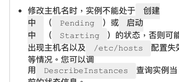<br>• 修改主机名时，实例不能处于<code> </code>创建中<code> </code>（<code> Pending </code>）或<code> </code>启动中<code> </code>（<code> Starting </code>）的状态，否则可能出现主机名以及<code> /etc/hosts </code>配置失效等情况。您可以调用<code> DescribeInstances </code>查询实例当前的状态信息。<br>• 您可以在 ECS控制台重启或者调用RebootInstance 重启，在操作系统内部重启不能生效。不同操作系统主机名存在以下限制：<br>• Windows Server系统：长度为2~15个字符，允许使用大小写字母、数字或连字符（-）。不能以连字符（-）开头或结尾，不能连续使用连字符（-），也不能仅使用数字。<br>• 其他类型实例（Linux等）：长度为2~64个字符，允许使用点号（.）分隔字符成多段，每段允许使用大小写字母、数字或连字符（-），但不能连续使用点号（.）或连字符（-）。不能以点号（.）或连字符（-）开头或结尾。 |
| InstanceName | String | Query | 否 | EcsInstance | 实例名称。长度为2~128个字符，支持Unicode中letter分类下的字符（其中包括英文、中文和数字等）。可以包含半角冒号（:）、下划线（_）、半角句号（.）或者短划线（-）。 |
| Description | String | Query | 否 | InstanceAttribute | 实例描述。长度为2~256个英文或中文字符，不能以<code> http:// </code>或<code> https:// </code>开头。默认值：无。 |
| UserData | String | Query | 否 | ZWNobyBoZWxsbyBlY3Mh | 实例自定义数据，建议 Base64 编码后传入。使用该参数时请注意：<br>• 实例必须满足自定义数据使用限制。更多信息，请参见生成实例自定义数据。<br>• 重启实例后，实例上将展示新的自定义数据，但不会运行数据。<br>说明编码前，原始数据不能超过 32 KB。建议不要明文传入敏感信息，例如密码和私钥等。如果必须传入敏感信息，建议您加密后再以 Base64编码传入，在实例内部以同样的方式解密。 |
| DeletionProtectio n | Boolean | Query | 否 | false | 实例释放保护属性，指定是否支持通过控制台或API（<code> DeleteInstance </code>）释放实例。<br>说明该属性只能限制手动释放操作，对系统释放操作不生效。 |
| NetworkInterface QueueNumber | Integer | Query | 否 | 8 | 主网卡队列数。使用该参数时请注意：<br>• 实例必须为已停止（Stopped）状态。<br>• 不能超过实例规格允许的单块网卡最大队列数，实例的所有网卡累加队列数不能超过实例规格允许的队列数总配额。实例规格的单块网卡最大队列数和总配额可以通过DescribeInstanceTypes 查询。<br>• 当取值为-1时，将重置主网卡队列数为对应实例规格的默认值。实例规格的弹性网卡默认队列数可以通过DescribeInstanceTypes 查询。 |
| CpuOptions.Topol ogyType | String | Query | 否 | DiscreteCoreToHTMapping | 实例的 Cpu 拓扑类型。取值范围：<br>• ContinuousCoreToHTMapping：实例的Cpu 拓扑中，实例的同一个Core的HT是连续的。<br>• DiscreteCoreToHTMapping：实例的同一个Core 的HT是离散的。默认值：无。使用该参数时请注意：实例必须为已停止（Stopped）状态。仅以下Intel独享型的规格族支持修改CPU拓扑结构：<br>• ecs.g6s-k10、ecs.g6s-k25、ecs.g6m-k10、ecs.g6m-k25<br>• ecs.g7s-k10、ecs.g7s-k25、ecs.g7m-k10、ecs.g7m-k25、ecs.g7x-k10、ecs.g7x-k25 |
| OSNameEn | String | Query | 否 | Debian 11.1 64 bit | 操作系统的英文显示名称。 |
| SecurityGroupIds | RepeatList | Query | 否 | sg-bp15ed6xe1yxeycg7\*\*\*\* | 实例重新加入的安全组 ID 数组。使用该参数时请注意：<br>• 数组内的安全组ID不能重复，数组长度与实例能够加入安全组配额有关。更多信息，请参见使用限制。<br>• 实例会离开当前的安全组，如需保留设置，您需要在数组中添加当前的安全组ID。<br>• 支持切换安全组类型，但设置的安全组列表中不能同时包含普通安全组和企业安全组。<br>• 安全组必须和实例属于同一个VPC。<br>说明修改安全组后很快会生效于对应的实例，但可能有较小的延迟。 |

**返回数据**

| 参数名称 | 类型 | 示例 | 说明 |
| --- | --- | --- | --- |
| RequestId | String | 473469C7-AA6F-4DC5-B3DB-A3DC0DE\*\*\*\*\* | 请求ID。 |

**示例**

请求示例

```text
https://ecs.example.com/?Action=ModifyInstanceAttribute
&InstanceId=i-bp67acfmxazb4ph***
&DeletionProtection=false
&Description=InstanceAttribute
&HostName=LocalHost
&InstanceName=EcsInstance
&Password=EcsV*
&<公共请求参数>
```

正常返回示例

`JSON`  格式

```json
{
    "RequestId": "473469C7-AA6F-4DC5-B3DB-A3DC0DE*****"
}
```

`XML`  格式

```xml
<ModifyInstanceAttributeResponse>
      <RequestId>473469C7-AA6F-4DC5-B3DB-A3DC0DE*****</RequestId>
</ModifyInstanceAttributeResponse>
```

**错误码**

| HttpCode | 错误码 | 错误信息 | 描述 |
| --- | --- | --- | --- |
| 400 | Abs.InvalidInstanceName.Malfor med | InvalidInstanceName.Malformed | The specified parameter "InstanceName" is not valid. |
| 400 | Abs.InvalidDescription.Malform ed | InvalidDescription.Malformed | The specified parameter "Description" is not valid. |
| 400 | NICKNAME_ILLEGAL | InvalidInstanceName.Malformed | The specified parameter "InstanceName" is not valid. |
| 400 | DESCRIPTION_ILLEGAL | InvalidDescription.Malformed | The specified parameter "Description" is not valid. |
| 400 | InvalidRemoteConnectionOptio nsPassword.ValueNotSupported | InvalidRemoteConnectionOptions.Password | The remote connection password is invalid. |
| 400 | InvalidRemoteConnectionOptio nsType.ValueNotSupported | InvalidRemoteConnectionOptions.Type | The remote connection type is invalid. |
| 400 | Abs.InvalidInstanceType.ValueN otSupported | InstanceType.ValueNotSupported | The instance type not supported. |
| 400 | Abs.InvalidOSType.Malformed | OSType.ValueNotSupported | The OS type is not supported. |
| 400 | -217 | InvalidHostPassword.Malformed | The specified parameter "Password" is not valid. |
| 400 | -251 | InvalidHostName.Malformed | The specified parameter "HostName" is not valid. |
| 400 | HOSTNAME_ILLEGAL | InvalidHostName.Malformed | The specified parameter "HostName" is not valid. |
| 400 | -7180 | InvalidHostPassword.Malformed | The specified parameter "Password" is not valid. |
| 400 | PASSWORD_ILLEGAL | InvalidPassword.Malformed | The specified parameter "Password" is not valid. |
| 400 | InvalidUserData.SizeExceeded | InvalidUserData.SizeExceeded | The specified parameter "UserData" exceeds the size. |
| 400 | InvalidUserData.NotVpc | InvalidUserData.NotSupported | TThe specified parameter "UserData" only support the vpc and IoOptimized Instance. |
| 400 | InvalidUserData.NotKvm | InvalidUserData.NotSupported | The specified parameter "UserData" only support the vpc and IoOptimized Instance. |
| 400 | ImageNotSupportCloudInit | ImageNotSupportCloudInit | The specified image does not support cloud-init. |
| 400 | ChargeTypeViolation | ChargeTypeViolation | Pay-As-You-Go instances do not support this operation. |
| 400 | FORBIDDEN_RECYCLEBIN | InvalidParameter.RecycleBin | You do not have permission to set recyclable properties. |
| 400 | InvalidParameter.CreditSpecific ation | InvalidParameter.CreditSpecification | The specified CreditSpecification is not supported in this region. |
| 400 | -1033008 | InvalidInstanceStatus.CreditSpecRestricted | The current status of the resource does not support this operation. |
| 400 | INVALID_INSTANCE_STATUS_FO R_MODIFY_CREDIT_SPEC | InvalidInstanceStatus.NotRunning | The current status of the resource is invalid, you can only do this operation when instance is running. |
| 400 | Abs.InvalidPassword.Malformed | InvalidPassword.Malformed | The specified parameter "Password" is not valid. |
| 400 | CLASSIC_NOT_SUPPORT | InvalidNetworkType.NotSupported | The classic networkType does not support to modify security group |
| 400 | EnterpriseSecurityGroupEniLimi tExceed | InvalidOperation.EniCountExceeded | =The maximum number of eni in a enterprise security group is exceeded. |
| 400 | JoinedGroupLimitExceed | JoinedGroupLimitExceed | %s |
| 400 | -1000005 | InvalidParameter | The specified parameter is not valid. |
| 400 | InvalidOperation.InvalidEcsStat e | InvalidOperation.InvalidEcsState | %s |
| 400 | NOT_SUPPORT_JUMBO_FRAME | InvalidParam.NotSupportJumboFrame | Not support jumbo frame. |
| 400 | -15026 | InvalidOperation.InstanceStatusNotSupport | The instance status is not support modify mtu config. |
| 400 | INSTANCE_STATUS_NOT_SUPPO RT_MODIFY_CPU_TOPOLOGY | InvalidOperation.InstanceStatusUnsupported | The specified instance status does not support modification of cpu topology type. |
| 400 | InvalidParameter.CpuOptionsTo pologyType | InvalidParameter.CpuOptionsTopologyType | The specified parameter CpuOptions.TopologyType: %s is not valid. |
| 400 | INSTANCE_TYPE_NOT_SUPPORT _CPU_TOPOLOGY | InvalidInstanceType.NotSupportCpuOptionsTopol ogyType | The specified instance type does not support CpuOptions.TopologyType: %s. |
| 400 | InvalidAdditionalInfoPvdConfig.SizeExceeded | InvalidAdditionalInfoPvdConfig.SizeExceeded | The specified parameter AdditionalInfo.PvdConfig exceeds the size. |
| 403 | -215 | IncorrectInstanceStatus | The current status of the resource does not support this operation. |
| 403 | 21001 | InstanceLockedForSecurity | The specified operation is denied as your instance is locked for security reasons. |
| 403 | -503 | OperationDenied | The instance amount in the specified SecurityGroup reach its limit. |
| 403 | -15029 | OperationDenied | The current status of the resource does not support this operation. |
| 403 | InvalidUserData.NotInWhiteList | InvalidUserData.Forbidden | User not authorized to input the parameter "UserData"please apply for permission "UserData" |
| 403 | IncorrectInstanceStatus | IncorrectInstanceStatus | The current status of the resource does not support this operation. |
| 403 | InvalidUserData.Base64FormatI nvalid | InvalidUserData.Base64FormatInvalid | The specified UserData is not valid |
| 403 | Abs.InvalidInstanceChargeType.WithDeletionProtection | InvalidChargeType.ValueNotSupported | Deletion protection is only valid for postPaid instance, not for prePaid or spot instance. |
| 403 | 401 | InvalidUser.Unauthorized | The user is not authorized |
| 403 | INSTANCE_NOT_SUPPORT_MULT I_GROUP_TYPE | EnterpriseGroupLimited.MutliGroupType | The specified instance can not join multi SecurityGroup types. |
| 403 | SecurityGroupInstanceLimitExc eed | SecurityGroupInstanceLimitExceed | %s |
| 403 | -506 | InstanceNotInSecurityGroup | The instance not in the group. |
| 403 | RECONFIG_GROUP_NOT_SUPPO RT_REGION | InvalidOperation.InvalidRegion | %s |
| 403 | -300 | OperationDenied | The specified Image is disabled or is deleted. |
| 403 | InvalidOperation.ResourceMana gedByCloudProduct | InvalidOperation.ResourceManagedByCloudProdu ct | %s |
| 403 | InvalidParameter.InvalidEniQue ueNumber | InvalidParameter.InvalidEniQueueNumber | %s |
| 403 | InvalidOperation.MaxEniQueue NumberExceeded | InvalidOperation.MaxEniQueueNumberExceeded | %s |
| 403 | InvalidOperation.ExceedInstanc eTypeQueueNumber | InvalidOperation.ExceedInstanceTypeQueueNum ber | %s |
| 403 | InvalidOperation.InstanceTypeN otSupportHighPerformanceTraff icMode | InvalidOperation.InstanceTypeNotSupportHighPer formanceTrafficMode | %s |
| 403 | InvalidParameter.InvalidQueueP airNumber | InvalidParameter.InvalidQueuePairNumber | %s |
| 403 | InvalidOperation.MaxEniQueueP airNumberExceed | InvalidOperation.MaxEniQueuePairNumberExceed | %s |
| 403 | InvalidOperation.EniQueuePairN umberOverflow | InvalidOperation.EniQueuePairNumberOverflow | %s |
| 404 | -205 | InvalidInstanceId.NotFound | The specified InstanceId does not exist. |
| 404 | -560 | InvalidSecurityGroupId.NotFound | The specified SecurityGroupId does not exist. |
| 404 | -1000009 | InvalidInstanceId.NotFound | The specified InstanceId does not exist. |
| 404 | -1033005 | Credit.NotFound | The specified credit information does not exist. |
| 404 | INSTANCE_NO_EXIST | InvalidInstanceId.NotFound | The specified InstanceId does not exist. |
| 404 | -1033013 | InvalidInstanceStatus.NeedRestart | The current status of the resource is invalid, you can only do this operation after instance is restarted. |
| 404 | InvalidParameter.SecurityGroup IdRepeated | InvalidParameter.SecurityGroupIdRepeated | The specified security group ids has repeated. |
| 404 | GROUP_NOT_EXIST | InvalidSecurityGroupId.NotFound | The specified SecurityGroupId does not exist. |
| 404 | NOT_USE_TO_CLASSIC_GROUP | InvalidSecurityGroupType.NotSupportClassic | The specified SecurityGroupIds have classic group type. |
| 404 | GROUP_BELONG_TO_DIFFEREN T_VPC | InvalidSecurityGroupVpc.NotBelongToOneVpc | The specified SecurityGroupIds are belong to different vpc. |
| 404 | InvalidSecurityGroupId.NotFoun d | InvalidSecurityGroupId.NotFound | The specified SecurityGroupId does not exist. |
| 404 | -106 | InvalidInstanceId.NotFound | The specified InstanceId does not exist. |
| 500 | -1 | InternalError | The request processing has failed due to some unknown error. |
| 500 | -1000000 | InternalError | The request processing has failed due to some unknown error. |
| 500 | 500 | InternalError | The request processing has failed due to some unknown error. |
| 500 | InternalError | InternalError | The request processing has failed due to some unknown error, exception or failure. |

<a id="section-4-19"></a>

## 4.19. ModifyInstanceVpcAttribute

调用ModifyInstanceVpcAttribute修改一台专有网络VPC类型ECS实例的专有网络VPC、私网IP地址或虚拟交换机。

**接口说明**

调用该接口时，ECS实例的状态必须是**已停止**（ `Stopped` ）。

- 当您使用该接口修改实例的私网IP地址或虚拟交换机时，请注意：

  - 新建的ECS实例必须经过重启才能调用该接口。

  - 成功修改一次后，ECS实例必须经过重启才能继续调用该接口。

- 当您使用该接口修改实例的专有网络VPC时，请注意：

  - 实例：

    - 不支持已关联负载均衡实例的ECS实例。

    - 实例的状态不能为已锁定、等待释放中。

    - 实例不能在其它云服务中被使用。例如，实例不能在迁移中、不能已在更换VPC流程中或实例内部署的数据库不能被DTS服务管理等。

  - 网络：

    - 不支持绑定辅助网卡的实例。

    - 不支持已分配IPv6地址的实例。

    - 不支持主网卡有多IP的实例。

    - 传入的虚拟交换机必须属于目标VPC。

    - 修改前后虚拟交换机可用区必须一致。

    - 如果指定主网卡私网IP，则IP必须在虚拟交换机地址段内且可用。如果不指定则随机分配，且目标虚拟交换机的可用IP数充足。

    - 目标VPC的所有者账号（资源所有者），不能将该目标VPC共享给其他账号（资源使用者）使用。

  - 安全组（SecurityGroupId.N）：

    - 安全组的配额与实例能够加入安全组的限制有关。请确保有足够的配额。

    - 安全组所属的VPC必须与目标VPC一致。

**请求参数**

| 名称 | 类型 | 是否必选 | 示例值 | 描述 |
| --- | --- | --- | --- | --- |
| Action | String | 是 | ModifyInstanceVpcAttribute | 接口名称。对于您自行拼凑HTTP/HTTPS URL发起的API请求，<code> Action </code>为必选参数。取值：ModifyInstanceVpcAttribute。 |
| InstanceId | String | 是 | i-bp1iudwa5b1tqa\*\*\*\*\*\* | 实例ID。 |
| VSwitchId | String | 是 | vsw-bp1s5fnvk4gn3tw\*\*\*\*\*\* | 虚拟交换机ID。<br>• 传入的ID为实例的当前虚拟交换机时，表明实例不变更虚拟交换机。<br>• 传入的ID为一台新的虚拟交换机时，并且参数<code> VpcId </code>为空时，新旧虚拟交换机必须属于同一个可用区、同一个专有网络VPC。<br>• 当参数VpcId不为空时，该参数传入的虚拟交换机ID必须属于<code> VpcId </code>，并且和原虚拟交换机属于同一个可用区。 |
| PrivateIpAddress | String | 否 | 172.17.\*\*.\*\*\* | 新的私网IP地址。<br>说明<code> PrivateIpAddress </code>依赖于<code> VSwitchId </code>，指定的IP地址必须在虚拟交换机子网网段中。<br>默认值：从虚拟交换机子网网段中随机分配。 |
| VpcId | String | 否 | vpc-bp1vwnn14rqpyiczj\*\*\*\* | 目标VPC ID。 |
| SecurityGroupId.N | RepeatList | 否 | sg-o6w9l8bc8dgmkw87\*\*\*\* | 实例修改VPC后加入的安全组ID。当且仅当传入VpcId参数时，需要同时传入该参数。<br>• 指定实例修改后加入的安全组列表，可以是一个或者多个。参数中N的取值范围与实例能够加入安全组的限制有关。<br>• 专有网络类型ECS实例的安全组必须属于<code> VpcId </code>所在的VPC。 |

**返回数据**

| 名称 | 类型 | 示例值 | 描述 |
| --- | --- | --- | --- |
| RequestId | String | 473469C7-AA6F-4DC5-B3DB-A3DC0DE3\*\*\*\* | 请求ID。 |

**示例**

请求示例

```text
https://ecs.example.com/?Action=ModifyInstanceVpcAttribute
&InstanceId=i-bp1iudwa5b1tqa******
&VSwitchId=vsw-bp1s5fnvk4gn3tw******
&PrivateIpAddress=172.17.**.***
&VpcId=vpc-bp1vwnn14rqpyiczj****
&SecurityGroupId.N=sg-o6w9l8bc8dgmkw87**** 
&<公共请求参数>
```

正常返回示例

`XML` 格式

```xml
<ModifyInstanceAttributeResponse>
      <RequestId>473469C7-AA6F-4DC5-B3DB-A3DC0DE3****</RequestId>
</ModifyInstanceAttributeResponse>
```

`JSON` 格式

```json
{
    "RequestId": "473469C7-AA6F-4DC5-B3DB-A3DC0DE3****"
}
```

**错误码**

| HttpCode | 错误码 | 错误信息 | 描述 |
| --- | --- | --- | --- |
| 404 | InvalidInstanceId.NotFound | The specified InstanceId does not exist. | 指定的实例不存在，请您检查实例ID是否正确。 |
| 400 | InvalidPrivateIpAddress.Malfor med | Specified private IP address is malformed. | 指定的私有IP不合法。 |
| 400 | InvalidPrivateIpAddress.Duplica ted | Specified private IP address is duplicated. | 指定的私网IP已经被使用，请您更换IP再重试。 |
| 400 | IncorrectVSwitchStatus | The current status of virtual switch does not support this operation. | 指定的虚拟交换机处于pending状态，无法删除。 |
| 404 | InvalidVSwitchId.NotFound | Specified virtual switch does not exist. | 指定的虚拟交换机ID不存在。 |
| 400 | IncorrectInstanceStatus | The current status of instance does not support this operation. | 目前实例状态不支持此类操作。 |
| 400 | OperationDenied | Specified operation is denied as your instance is not in VPC. | 该实例不是VPC实例。 |
| 400 | InvalidVSwitchId.Mismatch | Specified instance and virtual switch are not in the same zone. | 指定的实例和指定的虚拟交换机不属于同一个可用区。 |
| 400 | InvalidPrivateIpAddress.Mismat ch | Specified private IP address is not in the CIDR block of virtual switch. | 指定的私网IP不在指定虚拟交换机的网段中。 |
| 404 | InvalidVSwitchId.NotFound | Specified virtual switch is not found in current VPC. | 当前VPC中不存在指定的虚拟交换机。 |
| 400 | InvalidPrivateIp.Changing | Previous action is not finished yet. | 实例修改私网IP未完成，不能再进行在修改。 |
| 404 | NoSuchResource | The specified resource is not found. | 指定的资源不存在。 |
| 400 | InvalidPrivateIpAddress.Duplica ted | error new ip is the same with old ip | 新的IP地址必须不同于旧的IP地址。 |
| 500 | InternalError | The request processing has failed due to some unknown error. | 内部错误，请重试。如果多次尝试失败，请提交工单。 |
| 403 | OperationDenied | %s | 拒绝操作。 |
| 404 | InvalidVSwitch.NotBelongToVpc | %s | 指定的VSwitchId不属于指定的VPC。请检查参数值是否正确。 |
| 403 | SecurityGroupInstanceLimitExc eed | %s | 该安全组内已有的实例数量已达到最大限制。 |
| 404 | InvalidSecurityGroupId.NotFoun d | %s | 指定的安全组ID不存在。 |
| 404 | InvalidSecurityGroupType.NotS upportClassic | The specified SecurityGroupIds have classic group type. | 指定的安全组的网络类型为经典网络。请检查SecurityGroupIds参数值是否正确。 |
| 404 | InvalidSecurityGroupVpc.NotBel ongToOneVpc | The specified SecurityGroupIds are belong to different vpc. | 指定的安全组ID属于不同的VPC。请检查SecurityGroupIds参数值是否正确。您可以调用DescribeSecurityGroups查询指定安全组所属的VPC。 |
| 404 | EnterpriseGroupLimited.MutliGr oupType | The specified instance can not join multi SecurityGroup types. | 指定的实例不能同时加入普通安全组和企业安全组。您可以调用DescribeSecurityGroups查询指定安全组的类型。 |
| 403 | InvalidOperation.ResourceMana gedByCloudProduct | %s | 云产品托管的安全组不支持修改操作。 |

<a id="section-4-20"></a>

## 4.20. ModifyInstanceVncPasswd

调用ModifyInstanceVncPasswd修改一台ECS实例的Web管理终端密码。

**接口说明**

- 密码长度必须是六位字符，只支持大小写英文字母和阿拉伯数字。

- 修改密码后：

  - I/O优化的实例，立刻生效，无需重启实例。

  - 非I/O优化的实例，需要在控制台重启实例或者调用API （RebootInstance）才能生效。

**请求参数**

| 名称 | 类型 | 是否必选 | 示例值 | 描述 |
| --- | --- | --- | --- | --- |
| Action | String | 是 | ModifyInstanceVncPasswd | 系统规定参数。取值：ModifyInstanceVncPasswd |
| InstanceId | String | 是 | i-bp67acfmxazb4ph\*\*\* | ECS实例ID。 |
| RegionId | String | 是 | cn-qingdao-env17-d01 | ECS实例所在的地域。您可以调用DescribeRegions查看最新的阿里云地域列表。 |
| VncPassword | String | 是 | 123456 | 新的ECS实例管理终端连接密码。 |

**返回数据**

| 名称 | 类型 | 示例值 | 描述 |
| --- | --- | --- | --- |
| RequestId | String | 473469C7-AA6F-4DC5-B3DB-A3DC0DE3C83E | 请求ID。 |

**示例**

请求示例

```text
https://ecs.example.com/?Action=ModifyInstanceVncPasswd
&RegionId=cn-qingdao-env17-d01
&InstanceId=i-bp67acfmxazb4ph***
&VncPassword=123456
&<公共请求参数>
```

正常返回示例

`XML`  格式

```xml
<ModifyInstanceVncPasswdResponse>
      <RequestId>FDB6C963-9CE8-4B7F-BCA3-845F6BD29AFC</RequestId>
</ModifyInstanceVncPasswdResponse>
```

`JSON`  格式

```json
{
      "RequestId": "FDB6C963-9CE8-4B7F-BCA3-845F6BD29AFC"
}
```

**错误码**

| HttpCode | 错误码 | 错误信息 | 描述 |
| --- | --- | --- | --- |
| 404 | InvalidInstanceId.NotFound | The specified InstanceId does not exist. | 指定的实例不存在，请您检查实例ID是否正确。 |
| 404 | InvalidRegionId.NotFound | The specified RegionId does not exist. | 指定的地域ID不存在。 |
| 403 | IncorrectInstanceStatus | The current status of the resource does not support this operation. | 该资源目前的状态不支持此操作。 |
| 400 | IncorrectVncPassword.Malforme d | The specified parameter VncPassword is not valid. | 指定的VNC密码不合法。 |
| 404 | NoSuchResource | The specified resource is not found. | 指定的资源不存在。 |

<a id="section-4-21"></a>

## 4.21. ModifyInstanceMetadataOptions

调用ModifyInstanceMetadataOptions修改一台实例的元数据信息。

**请求参数**

| 名称 | 类型 | 是否必选 | 示例值 | 描述 |
| --- | --- | --- | --- | --- |
| Action | String | 是 | ModifyInstanceMetadataOp tions | 系统规定参数。取值：ModifyInstanceMetadataOptions。 |
| HttpEndpoint | String | 是 | enabled | 是否启用实例元数据的访问通道。取值范围：<br>• enabled：启用。<br>• disabled：禁用。默认值：enabled。 |
| RegionId | String | 是 | cn-qingdao-\*\*\*\* | 实例所在地域的ID。您可以调用DescribeRegions查询地域ID。 |
| InstanceId | String | 否 | i-bp67acfmxaz\*\*\*\* | 指定的实例ID。 |
| HttpTokens | String | 否 | required | 访问实例元数据时是否强制使用加固模式（IMDSv2）。取值范围：<br>• optional：不强制使用。<br>• required：强制使用。设置该取值后，普通模式无法访问实例元数据。默认值：optional。 |

**返回数据**

| 名称 | 类型 | 示例值 | 描述 |
| --- | --- | --- | --- |
| RequestId | String | 473469C7-AA6F-4DC5-B3DB-A3DC0DE\*\*\*\*\* | 请求ID。 |

**示例**

请求示例

```text
http(s)://ecs.example.com/?Action=ModifyInstanceMetadataOptions
&HttpEndpoint=enabled
&RegionId=cn-qingdao-****
&HttpEndpoint=enabled
&HttpTokens=required
&<公共请求参数>
```

正常返回示例

`XML` 格式

```xml
<ModifyInstanceMetadataOptionsResponse>
        <RequestId>473469C7-AA6F-4DC5-B3DB-A3DC0DE*****</RequestId>
</ModifyInstanceMetadataOptionsResponse>
```

`JSON` 格式

```json
{
    "RequestId": "473469C7-AA6F-4DC5-B3DB-A3DC0DE*****"
}
```

**错误码**

| HttpCode | 错误码 | 错误信息 | 描述 |
| --- | --- | --- | --- |
| 400 | InvalidHttpEndpoint.NotSupport ed | The specified HttpEndpoint not supported, you can use enabled(default) or disabled. | 指定的参数 HttpEndpoint 值非法，请使用enabled（默认）或者disabled。 |
| 400 | InvalidHttpTokens.NotSupporte d | The specified HttpTokens not supported, you can use optional(default) or required. | 指定的参数 HttpTokens 值非法，请使用optional（默认）或者required。 |
| 400 | InvalidHttpPutResponseHopLimi t.NotSupported | The specified HttpPutResponseHopLimit not supported, more than 1 and less than 64 is reasonable. | 指定的参数 HttpPutResponseHopLimit 值非法，取值范围必须大于等于1且小于等于64。 |

<a id="section-4-22"></a>

## 4.22. DescribeInstanceTypes

调用DescribeInstanceTypes查询云服务器ECS提供的实例规格资源。

接口说明

DescribeInstanceTypes仅查询实例规格的配置和性能信息。如果您需要查询指定地域或可用区的资源列表，请使用DescribeAvailableResource。

**请求头**

该接口使用公共请求头，无特殊请求头。请参见公共请求参数文档。

**请求参数**

| 参数名称 | 类型 | 位置 | 是否必选 | 示例 | 说明 |
| --- | --- | --- | --- | --- | --- |
| RegionId | String | Query | 否 | cn-qingdaoenv17-d01 | 实例所属的地域ID。您可以调用DescribeRegions查看最新的阿里云地域列表。 |
| Action | String | Query | 是 | DescribeInstanceTypes | 系统规定参数。取值：DescribeInstanceTypes |
| InstanceTypeFami ly | String | Query | 否 | ecs.g6 | 实例规格所属的规格族。取值请参见DescribeInstanceTypeFamilies。 更多详情，请参见《云服务器ECS实例规格族&amp;实例规格简介》中实例规格章节。 |
| InstanceTypes | RepeatList | Query | 否 | ecs.g6.large | 指定查询的实例规格。当该参数不传值时，默认查询所有实例规格的信息。 |

**返回数据**

| 参数名称 | 类型 | 示例 | 说明 |
| --- | --- | --- | --- |
| InstanceTypes | Array | \\ | 实例规格族集合。 |
| -EniTotalQuantity | Integer | 0 | 说明 该参数暂未支持。 |
| -LocalStorageCategory | String | local_ssd_pro | 本地盘类型。可能值： local_hdd_pro：实例规格族d1搭载的SATA HDD本地盘。 local_ssd_pro：实例规格族i2和gn5等搭载的NVMe SSD本地盘。 |
| -PrimaryEniQueueNumbe r | Integer | 4 | 主网卡默认队列数。 |
| -MemorySize | Float | 8.0 | 内存大小，单位GiB。 |
| -LocalStorageCapacity | Long | 2048 | 实例挂载的本地盘的单盘容量，单位：GiB。 |
| -InstanceFamilyLevel | String | EnterpriseLevel | 实例规格族级别。可能值： EntryLevel：入门级。 EnterpriseLevel：企业级。 CreditEntryLevel：积分入门级。 |
| -InstancePpsRx | Long | 300000 | 内网入方向网络收发包能力，单位：Pps。 |
| -EniIpv6AddressQuantity | Integer | 1 | 单块弹性网卡的IPv6地址上限。 |
| -MaximumQueueNumber PerEni | Integer | 4 | 单块弹性网卡最大队列数。包括主网卡及辅助网卡支持的队列数。 |
| -InstanceTypeId | String | ecs.g5.large | 实例规格ID。 |
| -InstanceBandwidthRx | Integer | 1024000 | 内网入方向带宽限制，单位：kbit/s。 |
| -SecondaryEniQueueNum ber | Integer | 4 | 辅助弹性网卡默认队列数。 |
| -GPUSpec | String | NVIDIA V100 | GPU类型。 |
| -InstanceBandwidthTx | Integer | 1024000 | 内网出方向带宽限制，单位：kbit/s。 |
| -QueuePairNumber | Integer | 22 | 单块弹性RDMA网卡（ERI）的QP（QueuePair）队列数上限。 |
| -EriQuantity | Integer | 0 | 弹性RDMA网卡（ERI）数量。 |
| -GPUAmount | Integer | 2 | GPU数量。 |
| -TotalEniQueueQuantity | Integer | 128 | 实例规格允许修改的队列数配额。 说明 主网卡队列数不累计在内。 |
| -NvmeSupport | String | unsupported | 实例规格所挂载的云盘是否支持NVMe。可能值： required：支持。表示云盘以NVMe的方式挂载。 unsupported：不支持。表示云盘不以NVMe的方式挂载。 |
| -DiskQuantity | Integer | 17 | 支持挂载的云盘数量上限。 |
| -InitialCredit | Integer | 120 | 突发性能实例t5的初始vCPU积分值。 |
| -LocalStorageAmount | Integer | 1 | 实例挂载的本地盘的数量。 |
| -BaselineCredit | Integer | 4 | 突发性能实例t5的基准vCPU计算性能（所有vCPU之和）。 |
| -InstancePpsTx | Long | 300000 | 内网出方向网络收发包能力，单位：Pps。 |
| -EniPrivateIpAddressQua ntity | Integer | 6 | 单块弹性网卡的私有IP地址上限。 |
| -CpuCoreCount | Integer | 8 | vCPU数量。 |
| -InstanceTypeFamily | String | ecs.g5 | 实例规格族。 |
| -EniQuantity | Integer | 2 | 支持挂载的弹性网卡上限。 |
| -EniTrunkSupported | Boolean | true | 说明 该参数暂未支持。 |
| RequestId | String | 00827261-20B7-4562-83F2-4DF3987XXXXX | 请求ID。 |
| NextToken | String | e71d8a535bd9\*\*\*\* | 本次调用返回的查询凭证（Token）。 |

**示例**

请求示例

```text
https://ecs.example.com/?Action=DescribeInstanceTypes
&InstanceTypeFamily=ecs.g6
&<公共请求参数>
```

正常返回示例

`JSON`  格式

```json
{
    "NextToken": "e71d8a535bd9****",
    "RequestId": "00827261-20B7-4562-83F2-4DF3987XXXXX",
    "InstanceTypes": {
        "InstancePpsTx": 300000,
        "NvmeSupport": "unsupported",
        "PrimaryEniQueueNumber": 4,
        "TotalEniQueueQuantity": 128,
        "LocalStorageCapacity": 2048,
        "InstanceTypeFamily": "ecs.g5",
        "InstancePpsRx": 300000,
        "EriQuantity": 0,
        "InstanceBandwidthRx": 1024000,
        "InstanceBandwidthTx": 1024000,
        "LocalStorageAmount": 1,
        "SecondaryEniQueueNumber": 4,
        "LocalStorageCategory": "local_ssd_pro",
        "GPUSpec": "NVIDIA V100",
        "InstanceTypeId": "ecs.g5.large",
        "MemorySize": 8,
        "MaximumQueueNumberPerEni": 4,
        "EniIpv6AddressQuantity": 1,
        "CpuCoreCount": 8,
        "InitialCredit": 120,
        "EniQuantity": 2,
        "GPUAmount": 2,
        "DiskQuantity": 17,
        "QueuePairNumber": 22,
        "BaselineCredit": 4,
        "InstanceFamilyLevel": "EnterpriseLevel",
        "EniPrivateIpAddressQuantity": 6
    }
}
```

`XML`  格式

```xml
<NextToken>e71d8a535bd9****</NextToken>
<RequestId>00827261-20B7-4562-83F2-4DF3987XXXXX</RequestId>
<InstanceTypes>
    <InstancePpsTx>300000</InstancePpsTx>
    <NvmeSupport>unsupported</NvmeSupport>
    <PrimaryEniQueueNumber>4</PrimaryEniQueueNumber>
    <TotalEniQueueQuantity>128</TotalEniQueueQuantity>
    <LocalStorageCapacity>2048</LocalStorageCapacity>
    <InstanceTypeFamily>ecs.g5</InstanceTypeFamily>
    <InstancePpsRx>300000</InstancePpsRx>
    <EriQuantity>0</EriQuantity>
    <InstanceBandwidthRx>1024000</InstanceBandwidthRx>
    <InstanceBandwidthTx>1024000</InstanceBandwidthTx>
    <LocalStorageAmount>1</LocalStorageAmount>
    <SecondaryEniQueueNumber>4</SecondaryEniQueueNumber>
    <LocalStorageCategory>local_ssd_pro</LocalStorageCategory>
    <GPUSpec>NVIDIA V100</GPUSpec>
    <InstanceTypeId>ecs.g5.large</InstanceTypeId>
    <MemorySize>8</MemorySize>
    <MaximumQueueNumberPerEni>4</MaximumQueueNumberPerEni>
    <EniIpv6AddressQuantity>1</EniIpv6AddressQuantity>
    <CpuCoreCount>8</CpuCoreCount>
    <InitialCredit>120</InitialCredit>
    <EniQuantity>2</EniQuantity>
    <GPUAmount>2</GPUAmount>
    <DiskQuantity>17</DiskQuantity>
    <QueuePairNumber>22</QueuePairNumber>
    <BaselineCredit>4</BaselineCredit>
    <InstanceFamilyLevel>EnterpriseLevel</InstanceFamilyLevel>
    <EniPrivateIpAddressQuantity>6</EniPrivateIpAddressQuantity>
</InstanceTypes>
```

<a id="section-4-23"></a>

## 4.23. SoftDeleteInstances

调用SoftDeleteInstances软删除一个或多个ECS实例。

**接口说明**

软删除是一种新的删除ECS资源的方式。区别于DeleteInstance，软删除ECS实例后，该ECS实例会进入回收站并处于冷冻期（由Hours指定）。冷冻期内，实例的CPU、内存等计算资源被释放，弹性公网IP被解绑，存储资源保留；冷冻期过后，ECS所有资源（包含存储资源）会被彻底销毁，不可恢复。

软删除实例时，您需要注意：

- 软删除不支持带有本地盘的规格族的ECS实例。

- ECS实例状态必须为**已停止**（Stopped）或**运行中**（Running）。

- 软删除实例后，该实例处于冷冻期，仅支持恢复和删除操作，不支持解除、添加与其它产品的关联（如挂载云盘、卸载云盘）。

**请求参数**

| 名称 | 类型 | 是否必选 | 示例值 | 描述 |
| --- | --- | --- | --- | --- |
| Action | String | 是 | SoftDeleteInstances | 系统规定参数。取值：SoftDeleteInstances。 |
| InstanceId.N | RepeatList | 是 | i-bp1g6zv0ce8oghu7k\*\*\* | 待软删除的实例ID。您可以调用DescribeInstances查看实例ID。N指软删除的实例数，N的取值范围：1~100。 |
| RegionId | String | 是 | cn-qingdao-\*\*\*\*-d01 | 实例所属的地域ID。您可以调用DescribeRegions查看最新的阿里云地域列表。 |
| Hours | Integer | 否 | 72 | 冷冻时间，单位：小时，取值范围：1~720。默认值：72 |
| ClientToken | String | 否 | 123e4567-e89b-12d3-a456-42665544\*\*\*\* | 保证请求幂等性。从您的客户端生成一个参数值，确保不同请求间该参数值唯一。<strong>ClientToken</strong>只支持ASCII字符，且不能超过64个字符。更多详情，请参见<em>云服务器ECS开发指南</em>中的如何保证幂等性章节。 |

**返回数据**

| 名称 | 类型 | 示例值 | 描述 |
| --- | --- | --- | --- |
| RequestId | String | 473469C7-AA6F-4DC5-B3DB-A3DC0DE3C83E | 请求ID。 |

**示例**

请求示例

```text
http(s)://ecs.example.com/?Action=SoftDeleteInstances
&InstanceId.1=i-bp1g6zv0ce8oghu7k***
&RegionId=cn-qingdao-****-d01
&Hours=72
&<公共请求参数>
```

正常返回示例

`XML` 格式

```xml
<RequestId>
     473469C7-AA6F-4DC5-B3DB-A3DC0DE3C83E
</RequestId>
```

`JSON` 格式

```json
{
    "RequestId": "473469C7-AA6F-4DC5-B3DB-A3DC0DE3C83E"
}
```

**错误码**

| HttpCode | 错误码 | 错误信息 | 描述 |
| --- | --- | --- | --- |
| 403 | IncorrectInstanceStatus | %s | 当前实例的状态不支持此操作。 |
| 404 | InvalidInstanceId.NotFound | The specified InstanceId does not exist. | 指定的实例不存在，请您检查实例ID是否正确。 |

<a id="section-4-24"></a>

## 4.24. RestoreSoftDeletedInstances

调用RestoreSoftDeletedInstances恢复一个或多个被软删除的ECS实例。

**请求参数**

| 名称 | 类型 | 是否必选 | 示例值 | 描述 |
| --- | --- | --- | --- | --- |
| Action | String | 是 | RestoreSoftDeletedInstance s | 系统规定参数。取值：RestoreSoftDeletedInstances。 |
| InstanceId.N | RepeatList | 是 | i-bp1g6zv0ce8oghu7k\*\*\* | 待恢复的已软删除的实例ID。您可以调用DescribeInstances查看实例ID。N指ECS实例数，N的取值范围：1~100。 |
| RegionId | String | 是 | cn-qingdao-\*\*\*\*-d01 | 实例所属的地域ID。您可以调用DescribeRegions查看最新的阿里云地域列表。 |
| AttemptStartVm | Boolean | 否 | true | 恢复后是否尝试启动ECS实例。取值范围：<br>• true：启动<br>• false：不启动默认值：true |
| ClientToken | String | 否 | 123e4567-e89b-12d3-a456-42665544\*\*\*\* | 保证请求幂等性。从您的客户端生成一个参数值，确保不同请求间该参数值唯一。<strong>ClientToken</strong>只支持ASCII字符，且不能超过64个字符。更多详情，请参见<em>云服务器ECS开发指南</em>中的如何保证幂等性章节。 |

**返回数据**

| 名称 | 类型 | 示例值 | 描述 |
| --- | --- | --- | --- |
| RequestId | String | 473469C7-AA6F-4DC5-B3DB-A3DC0DE3C83E | 请求ID。 |

**示例**

请求示例

```text
http(s)://ecs.example.com/?Action=RestoreSoftDeletedInstances
&InstanceId.1=i-bp1g6zv0ce8oghu7k***
&RegionId=cn-qingdao-****-d01
&AttemptStartVm=true
&<公共请求参数>
```

正常返回示例

`XML` 格式

```xml
<RequestId>
    473469C7-AA6F-4DC5-B3DB-A3DC0DE3C83E
</RequestId>
```

`JSON` 格式

```json
{
    "RequestId": "473469C7-AA6F-4DC5-B3DB-A3DC0DE3C83E"
}
```

**错误码**

| HttpCode | 错误码 | 错误信息 | 描述 |
| --- | --- | --- | --- |
| 403 | IncorrectInstanceStatus | %s | 当前实例的状态不支持此操作。 |
| 404 | InvalidInstanceId.NotFound | The specified InstanceId does not exist. | 指定的实例不存在，请您检查实例ID是否正确。 |

<a id="section-5"></a>

# 5.专有宿主机

<a id="section-5-1"></a>

## 5.1. AllocateDedicatedHosts

调用AllocateDedicatedHosts创建一台或多台专有宿主机。专有宿主机是单租户独享的物理机资源，您可以在专有宿主机上自行创建ECS实例和获取物理服务器属性等信息。

**接口说明**

创建专有宿主机前，您可以调用DescribeAvailableResource查看指定地域或者可用区内的资源供给情况。

- 单次最多能创建100台专有宿主机。

- 创建成功后，您可以将返回的专有宿主机ID列表作为请求参数，调用DescribeDedicatedHosts查询新建专有宿主机状态。

- 提交创建专有宿主机的请求后，指定的参数值不合规或者库存不足时会报错。具体的报错原因，请参见错误码。

- 创建专有宿主机后，您可以调用ModifyInstanceDeployment将ECS实例从共享宿主机迁移到专有宿主机，也可以在两台专有宿主机上调整实例部署。

**请求参数**

| 名称 | 类型 | 是否必选 | 示例值 | 描述 |
| --- | --- | --- | --- | --- |
| Action | String | 否 | AllocateDedicatedHosts | 系统规定参数，取值：AllocateDedicatedHosts。 |
| DedicatedHostType | String | 是 | ddh.c5 | 专有宿主机的规格。您可以调用DescribeDedicatedHostTypes接口获得最新的专有宿主机规格表。 |
| RegionId | String | 是 | cn-qingdao-env17-d01 | 专有宿主机所属的地域ID。您可以调用DescribeRegions查看最新的阿里云地域列表。 |
| Tag.N.Key | String | 否 | Environment | 专有宿主机的标签键。N的取值范围：1~20一旦传入该值，则不允许为空字符串。最多支持128个字符，不能以aliyun或者acs:开头，不能包含http://或者https://。 |
| Tag.N.Value | String | 否 | Production | 专有宿主机的标签值。N的取值范围：1~20一旦传入该值，可以为空字符串。最多支持128个字符，不能以acs:开头，不能包含http://或者https://。 |
| ResourceGroupId | String | 否 | rg-bp67acfmxazb4ph\*\*\* | 专有宿主机要加入的资源组ID。 |
| ZoneId | String | 否 | cn-qingdao-env17-amtest11001-a | 专有宿主机所属的可用区编号。默认值：空，表示由系统选择。 |
| DedicatedHostName | String | 否 | myDDH | 专有宿主机的名称。长度为2~128个英文或中文字符。必须以大小字母或中文开头，不能以http://和https://开头。可以包含数字、半角冒号（:）、下划线（_）或者连字符（-）。 |
| ActionOnMaintenance | String | 否 | Migrate | 当专有宿主机发生故障或者在线修复时，为其所宿实例设置迁移方案。取值范围：<br>• Migrate：迁移实例到其他物理机并重新启动实例。当专有宿主机上挂载云盘存储时，默认值：Migrate。<br>• Stop：在当前专有宿主机上停止实例，确认无法修复专有宿主机后，迁移实例到其他物理机并重新启动实例。当专有宿主机上挂载本地盘存储时，默认值：Stop。 |
| NetworkAttributes.SlbU dpTimeout | Integer | 否 | 60 | 负载均衡连接的UDP会话超时时间，单位：秒。取值范围：15~310 |
| NetworkAttributes.UdpT imeout | Integer | 否 | 60 | 为专有宿主机上运行的云服务设置用户访问的UDP会话超时时间，单位：秒。取值范围：15~310 |
| Description | String | 否 | This-is-my-DDH | 专有宿主机的描述。长度为2~256个英文或中文字符，不能以http://和https://开头。 |
| AutoPlacement | String | 否 | off | 专有宿主机是否加入自动部署资源池。当您在专有宿主机上创建实例，却不指定<strong>DedicatedHostId</strong>时，阿里云将自动从加入资源池的专有宿主机中，为您选取适合的宿主机部署实例。取值范围：<br>• on：加入自动部署资源池。<br>• off：不加入自动部署资源池。默认值：on。<br>说明若您不希望专有宿主机加入自动部署资源池，请将该参数设置为off。 |
| Quantity | Integer | 否 | 1 | 本次创建的专有宿主机的数量。取值范围：1~100。默认值：1。 |
| AutoReleaseTime | String | 否 | 2019-08-21T12:30:24Z | 专有宿主机自动释放时间。需按照ISO8601标准表示，并使用UTC+0时间，格式为yyyy-MM-ddTHH:mm:ssZ。<br>说明<br>• 最短设置为当前时间之后半小时。<br>• 最长不能超过当前时间之后三年。<br>• 若参数值中的秒（ss）不是00，则自动取为00。 |
| ClientToken | String | 否 | 123e4567-e89b-12d3-a456-426655440000 | 保证请求幂等性。从您的客户端生成一个参数值，确保不同请求间该参数值唯一。<strong>ClientToken</strong>只支持ASCII字符，且不能超过64个字符。更多详情，请参见《云服务器ECS开发指南》中的如何保证幂等性章节。 |

**返回数据**

| 名称 | 类型 | 示例值 | 描述 |
| --- | --- | --- | --- |
| DedicatedHostIdSets | List | "DedicatedHostIdSets": {"DedicatedHostId":\["dh-bp67acfmxazb4ph\*\*\*", "dh-bp67acfmxazb4pi\*\*\*"\]} | 专有宿主机ID（DedicatedHostId）组成的列表。 |
| RequestId | String | E2A664A6-2933-4C64-88AE-5033D003EADF | 请求ID。 |

**示例**

请求示例

```text
https://ecs.example.com/?Action=AllocateDedicatedHosts
&RegionId=cn-qingdao-env17-d01
&DedicatedHostType=ddh.sn1ne
&Quantity=2
&ClientToken=123e4567-e89b-12d3-a456-426655440000
&<公共请求参数>
```

正常返回示例

`XML`  格式

```xml
<AllocateDedicatedHostsResponse>
    <RequestId>E2A664A6-2933-4C64-88AE-5033D003EADF</RequestId>
    <DedicatedHostIdSets>
        <DedicatedHostId>dh-bp67acfmxazb4ph***</DedicatedHostId>
        <DedicatedHostId>dh-bp67acfmxazb4pi***</DedicatedHostId>
    </DedicatedHostIdSets>
</AllocateDedicatedHostsResponse>
```

`JSON`  格式

```json
{
    "RequestId":"E2A664A6-2933-4C64-88AE-5033D003EADF",
    "DedicatedHostIdSets":{
        "DedicatedHostId":[
            "dh-bp67acfmxazb4ph***",
            "dh-bp67acfmxazb4pi***"
        ]
    }
}
```

**错误码**

| HttpCode | 错误码 | 错误信息 | 描述 |
| --- | --- | --- | --- |
| 400 | InvalidInstanceType.ValueUnaut horized | The specified InstanceType is not authorized. | 指定的实例规格未授权使用。 |
| 400 | InvalidDescription.Malformed | The specified parameter "Description" is not valid. | 指定的资源描述格式不合法。长度为2-256个字符，不能以http://和https://开头。 |
| 403 | OperationDenied | The creation of Host to the specified Zone is not allowed. | 无法在指定可用区创建专用宿主机。 |
| 403 | OperationDenied.NoStock | The requested resource is sold out in the specified zone; try other types of resources or other regions and zones. | 库存不足。 |
| 500 | InternalError | The request processing has failed due to some unknown error. | 内部错误，请重试。如果多次尝试失败，请提交工单。 |
| 403 | OperationDenied | Sales of this resource are temporarily suspended in the specified region; please try again later. | 指定的地域暂时关闭了此资源的售卖，请稍后重试。 |
| 400 | InvalidParameter.Conflict | The specified region and cluster do not match. | 指定的地域与指定的集群不匹配。 |
| 403 | NodeControllerUnavailable | The Node Controller is temporarily unavailable. | 节点控制器暂不可用。 |
| 404 | OperationDenied | Another Host has been creating | 另一个宿主机正在创建。 |
| 403 | OperationDenied | The resource is out of usage. | 该实例不在运行状态，请您启动实例或检查操作是否合理。 |
| 404 | PaymentMethodNotFound | No payment method has been registered on the account. | 账户尚未注册支付方式。 |
| 404 | InvalidDedicatedHostName.Malf ormed | The specified parameter DedicatedHostName is not valid. | 指定的参数“DedicatedHostName”无效。 |
| 403 | InvalidParameter.ResourceOwn erAccount | ResourceOwnerAccount is Invalid. | 指定的 ResourceOwnerAccount 不合法。 |
| 403 | InvalidUserData.Forbidden | User not authorized to input the parameter "UserData", please apply for permission "UserData" | 您没有操作“UserData”的权限，或者权限不足，请先申请权限。 |
| 403 | Zone.NotOpen | The specified zone is not granted to you to buy resources yet. | 用户未被授权购买指定的可用区的资源。 |
| 403 | Zone.NotOnSale | The specified zone is not available for purchase. | 指定可用区已经售罄，请您更换实例规格或者更换地域创建。 |
| 403 | InvalidDedicatedHostType.Valu eNotSupported | The specified DedicatedHostType does not exist or beyond the permitted range. | 指定的宿主机规格不存在。 |
| 403 | InvalidDedicatedHostType.Zone NotSupported | The specified zone does not support this dedicatedHostType. | 指定可用区不支持指定宿主机规格。 |
| 400 | InvalidAutoRenewPeriod.ValueN otSupported | The specified autoRenewPeriod is not valid. | 指定的参数 AutoReleaseTime 不合法。 |
| 400 | InvalidTagKey.Malformed | The specified Tag.n.Key is not valid. | 指定的标签键不合法。 |
| 400 | InvalidDedicatedHostType.Valu eNotSupported | %s | 指定的专有宿主机类型无效。 |
| 400 | RegionUnauthorized | %s | 该地域未被授权。 |
| 500 | InternalError | %s | 内部错误。 |
| 400 | Zone.NotOnSale | %s | 该可用区暂时关闭了售卖。 |
| 400 | OperationDenied | The specified DedicatedHostType or Zone is not available or not authorized. | 指定宿主机规格、可用区不可用或者没有操作的权限。 |
| 400 | InvalidPeriodUnit.ValueNotSupp orted | The specified parameter PeriodUnit is not valid. | 参数“PeriodUnit”无效。 |
| 400 | InvalidTagValue.Malformed | The specified Tag.n.Value is not valid. | 指定的标签值不合法。 |
| 403 | InvalidParameter.NotMatch | %s | 您输入的参数无效，请检查参数之间是否冲突。 |
| 403 | Account.Arrearage | Your account has been in arrears. | 账户余额不足，请先充值再操作。 |
| 400 | QuotaExceed.AfterpayDedicate dHost | The maximum number of Pay-As-You-Go DedicatedHosts is exceeded: %s | 按量付费的宿主机库存不足，请减少创建数量。 |
| 400 | InvalidChargeType.ValueNotSup ported | ChargeType is not valid | 付费类型无效。 |
| 400 | InvalidParameter.SlbUdpTimeou t | The specified value is invalid. | 指定的参数“SlbUdpTimeout”无效。 |
| 400 | InvalidParameter.UdpTimeout | The specified value is invalid. | 指定的参数“UdpTimeout”无效。 |
| 400 | Duplicate.TagKey | The Tag.N.Key contain duplicate key. | 标签中存在重复的键，请保持键的唯一性。 |

<a id="section-5-2"></a>

## 5.2. ModifyDedicatedHostAttribute

调用ModifyDedicatedHostAttribute修改一台专有宿主机的部分信息，包括专有宿主机的名称、描述和服务不可用属性等。

**请求参数**

| 名称 | 类型 | 是否必选 | 示例值 | 描述 |
| --- | --- | --- | --- | --- |
| Action | String | 是 | ModifyDedicatedHostAttrib ute | 系统规定参数。取值：ModifyDedicatedHostAttribute。 |
| DedicatedHostId | String | 是 | dh-bp165p6xk2tlw61e\*\*\*\* | 专有宿主机ID。 |
| RegionId | String | 是 | cn-qingdao-\*\*\*\* | 专有宿主机所属的地域ID。您可以调用DescribeRegions查看最新的阿里云地域列表。 |
| DedicatedHostName | String | 否 | myDDH | 专有宿主机名称。长度为2~128个英文或中文字符。必须以大小字母或中文开头，不能以<code> http:// </code>或者<code> https:// </code>开头。可以包含数字、半角冒号（:）、下划线（_）或者短划线（-）。 |
| Description | String | 否 | this-is-my-ddh | 专有宿主机的描述。长度为2~256个英文或中文字符，不能以<code> http:// </code>或者<code> https:// </code>开头。 |
| ActionOnMaintenance | String | 否 | Migrate | 当专有宿主机发生故障或者在线修复时，为其所宿实例设置迁移方案。取值范围：<br>• Migrate：迁移实例到其他物理机并重新启动实例。<br>• Stop：在当前专有宿主机上停止实例，确认无法修复专有宿主机后，迁移实例到其他物理机并重新启动实例。当专有宿主机上挂载的是云盘时，默认值：Migrate。当专有宿主机上挂载的是本地盘时，默认值：Stop。 |
| NetworkAttributes.SlbUdpTi meout | Integer | 否 | 60 | 负载均衡连接的UDP会话超时时间，单位：秒。取值范围：15~310。 |
| NetworkAttributes.UdpTime out | Integer | 否 | 60 | 为专有宿主机上运行的云服务设置用户访问的UDP会话超时时间，单位：秒。取值范围：15~310。 |
| AutoPlacement | String | 否 | on | 设置专有宿主机是否加入自动部署资源池。当您在专有宿主机上创建实例，却不指定<strong>DedicatedHostId</strong>时，阿里云自动从资源池中选取专有宿主机放置实例。取值范围：<br>• on：加入自动部署资源池。<br>• off：不加入自动部署资源池。 |
| DedicatedHostClusterId | String | 否 | dc-bp165p6xk2tlw61e\*\*\*\* | 专有宿主机集群ID。 |

**返回数据**

| 名称 | 类型 | 示例值 | 描述 |
| --- | --- | --- | --- |
| RequestId | String | 2A4EA075-CB5B-41B7-B0EB-70D339F\*\*\*\*\* | 请求ID。 |

**示例**

请求示例

```text
http(s)://ecs.example.com/?Action=ModifyDedicatedHostAttribute
&DedicatedHostId=dh-bp165p6xk2tlw61e****
&RegionId=cn-qingdao-****
&<公共请求参数>
```

正常返回示例

`XML` 格式

```xml
<ModifyDedicatedHostAttributeResponse>
    <RequestId>2A4EA075-CB5B-41B7-B0EB-70D339F*****</RequestId>
</ModifyDedicatedHostAttributeResponse>
```

`JSON` 格式

```json
{
    "RequestId":"2A4EA075-CB5B-41B7-B0EB-70D339F*****"
}
```

**错误码**

| HttpCode | 错误码 | 错误信息 | 描述 |
| --- | --- | --- | --- |
| 400 | InvalidDedicatedHostName.Malf ormed | The specified parameter DedicatedHostName is not valid. | 指定的参数DedicatedHostName无效。 |
| 400 | InvalidDescription.Malformed | The specified parameter Description is not valid. | 指定的资源描述格式不合法。长度为 2-256 个字符，不能以 http:// 和 https:// 开头。 |
| 400 | InvalidParameter.SlbUdpTimeou t | The specified value is invalid. | 指定的参数 SlbUdpTimeout 无效。 |
| 400 | InvalidParameter.UdpTimeout | The specified value is invalid. | 指定的参数 UdpTimeout 无效。 |
| 403 | InvalidUser.Unauthorized | The user is not authorized | 您当前使用的账号无权限。 |
| 404 | InvalidDedicatedHostId.NotFoun d | The specified DedicatedHostId does not exist. | 指定的专有宿主机不存在。 |

<a id="section-5-3"></a>

## 5.3. ModifyInstanceDeployment

调用ModifyInstanceDeployment修改ECS实例的部署集，或迁移ECS实例至专有宿主机。支持在迁移ECS实例的同时变更实例规格。

**请求头**

该接口使用公共请求头，无特殊请求头。请参见公共请求参数文档。

**请求参数**

| 参数名称 | 类型 | 位置 | 是否必选 | 示例 | 说明 |
| --- | --- | --- | --- | --- | --- |
| Action | String | Query | 是 | ModifyInstanceDeployment | 系统规定参数。取值：ModifyInstanceDeployment |
| RegionId | String | Query | 是 | cn-qingdao-env17-d01 | 实例所在的地域ID。您可以调用DescribeRegions查看最新的阿里云地域列表。 |
| InstanceId | String | Query | 是 | i-bp67acfmxazb4ph\*\*\* | 实例ID。 |
| DedicatedHostId | String | Query | 否 | dh-bp67acfmxazb4ph\*\*\* | 专有宿主机ID。调用DescribeDedicatedHosts查看可以使用的专有宿主机。修改ECS实例宿主机（即将ECS实例从共享宿主机迁移至专有宿主机，或在不同专有宿主机间迁移ECS实例）时：<br>• 若将实例迁移至指定专有宿主机上，必须设置该参数。<br>• 若将实例迁移至系统自动为您选择的专有宿主机上，必须将该参数设置为空，并将参数Tenancy设置为host。 |
| DeploymentSetId | String | Query | 否 | ds-bp67acfmxazb4ph\*\*\* | 部署集ID。将ECS实例加入一个部署集，或调整ECS实例的部署集时，该参数为必填参数。<em>修改专有宿主机实例相关参数</em><em>（Tenancy、Affinity和</em><em>DedicatedHostId）时，不可同时修改</em><em>部署集。</em> |
| DeploymentSetGr oupNo | Integer | Query | 否 | 3 | 当 ECS 实例要加入或调整的部署集策略为部署集组高可用策略（AvailabilityGroup）时，可以通过该参数指定实例在部署集中的分组号。取值范围：1~7。<em>如果您为 ECS 实例调整部署集，且部署</em><em>集策略为部署集组高可用策略</em><em>（AvailablilityGroup），当不指定该</em><em>参数时，系统会自动在各组之间均衡分</em><em>配 ECS 实例。如果您为 ECS 实例指定</em><em>的仍是当前实例所属的部署集，系统也</em><em>会重新在各组之间均衡分配 ECS 实例。</em> |
| Force | Boolean | Query | 否 | false | 是否强制更换实例宿主机。取值范围：<br>• true：允许。允许重启运行中（Running）、已停止（Stopped）状态的ECS实例。<em>已停止状态的实例不包括开启停机不收</em><em>费功能的按量付费ECS实例。</em><br>• false（默认）：不允许。只在当前宿主机上加入部署集。这可能导致更换部署集失败。 |
| Affinity | String | Query | 否 | host | 实例是否与专有宿主机关联。取值范围：<br>• host：关联。已开启停机不收费功能的实例停机后再次启动时，仍部署在原专有宿主机上。<br>• default：不关联。已开启停机不收费功能的实例停机后再次启动时，若原专有宿主机资源不足，可迁移至自动部署资源池中的其它专有宿主机上。实例从共享宿主机迁移至专有宿主机时，默认值：default。 |
| Tenancy | String | Query | 否 | host | 实例是否在专有宿主机上部署。取值范围：host（实例在专有宿主机上部署）。 |
| MigrationType | String | Query | 否 | live | 是否先停止实例，再迁移到目标专有宿主机。取值范围：<br>• reboot（默认）：先停止实例再迁移。<br>• live：不停止实例，直接迁移。此时，您必须指定参数DedicatedHostId。该取值不支持在迁移ECS实例的同时变更实例规格。默认值：reboot。 |
| InstanceType | String | Query | 否 | ecs.c6.large | ECS实例要变更的目标实例规格。调用DescribeInstanceTypes接口可获取最新实例规格列表。 修改ECS实例宿主机时，可同时变更ECS实例规格。目标实例规格必须与指定专有宿主机的规格相匹配。<br>• 变更实例规格时，必须指定专有宿主机ID，即设置参数DedicatedHostId的值。<br>• 使用自动部署功能迁移ECS实例时，不能变更实例规格。 |
| DedicatedHostClu sterId | String | Query | 否 | dc-bp67acfmxazb4ph\*\*\*\* | 专有宿主机集群 ID。 |
| RemoveFromDepl oymentSet | Boolean | Query | 否 | false | 是否将所选实例移出所选部署集。取值范围：<br>• true：是。<br>• false：否。默认值：false。<em>当该参数为true 时，必须指定具有所属</em><em>关系的 </em>I<em>nstanceId 和</em><em>DeploymentSetId。</em> |

**返回数据**

| 参数名称 | 类型 | 示例 | 说明 |
| --- | --- | --- | --- |
| RequestId | String | 04F0F334-1335-436C-A1D7-6C044FE73368 | 请求ID。 |

**示例**

请求示例

```text
https://ecs.example.com/?Action=ModifyInstanceDeployment
&InstanceId=i-bp67acfmxazb4ph****
&RegionId=cn-qingdao-env17-d01
&DedicatedHostId=dh-bp67acfmxazb4ph****
&Tenancy=host
&MigrationType=live
&<公共请求参数>
```

正常返回示例

`JSON`  格式

```text
HTTP/1.1 200 OK
Content-Type:application/json
{
 "RequestId":"04F0F334-1335-436C-A1D7-6C044FE73368"
}
```

`XML`  格式

```xml
<ModifyInstanceDeploymentResponse>
      <RequestId>04F0F334-1335-436C-A1D7-6C044FE73368</RequestId>
</ModifyInstanceDeploymentResponse>
```

**错误码**

| HttpCode | 错误码 | 错误信息 | 描述 |
| --- | --- | --- | --- |
| 404 | InvalidDedicatedHostId.NotFoun d | The specified DedicatedHostId does not exist. | 指定的专有宿主机不存在。 |
| 404 | InvalidInstanceId.NotFound | The specified InstanceId does not exist. | 指定的实例不存在，请您检查实例ID是否正确。 |
| 400 | OperationDenied.UnstoppedInst ance | Operation denied due to unstopped instance. | 当前操作无效，请确认实例是否已停止。 |
| 400 | InvalidDedicatedHostStatus.Not Support | Operation denied due to dedicated host status. | 专有宿主机当前的状态不支持此操作。 |
| 400 | InvalidPeriod.ExceededDedicate dHost | Instance expired date can't exceed dedicated host expired date. | 实例过期日期不能超过专有宿主机的过期日期。 |
| 404 | InvalidInstanceNetworkType.No tSupport | The specified Instance network type not support. | 当前实例的网络类型不支持此操作。 |
| 404 | InvalidInstanceType.NotSupport | The Dedicated host not support the specified instance type. | 当前宿主机不支持指定的实例规格。 |
| 400 | OperationDenied.LocalDiskInsta nce | Operation denied due to instance has local disk | 由于实例具有本地磁盘，此操作被拒绝。 |
| 403 | IncorrectInstanceStatus | %s | 当前实例的状态不支持此操作。 |
| 400 | InvalidParam.Tenancy | The specified Tenancy is invalid. | 您指定的参数“Tenancy”无效。 |
| 403 | OperationDenied.NoStock | The resource is out of usage. | 该实例不在运行状态，请您启动实例或检查操作是否合理。 |
| 400 | ChargeTypeViolation.PostPaidD edicatedHost | Prepaid instance onto postpaid dedicated host is not allowed | 包年包月的实例无法添加到按量付费的专有宿主机上。 |
| 400 | InvalidInstanceType.ValueNotSu pported | The specified InstanceType does not exist or beyond the permitted range. | 您指定的实例规格不存在，或者您没有权限操作此规格的实例。 |

<a id="section-5-4"></a>

## 5.4. DescribeDedicatedHostTypes

调用DescribeDedicatedHostTypes查询指定地域下支持的专有宿主机规格详细参数，或者查询专有宿主机支持的ECS实例规格族。

**请求参数**

| 名称 | 类型 | 是否必选 | 示例值 | 描述 |
| --- | --- | --- | --- | --- |
| Action | String | 否 | DescribeDedicatedHostTyp es | 系统规定参数，取值：DescribeDedicatedHostTypes。 |
| RegionId | String | 是 | cn-qingdao-env17-d01 | 专有宿主机所在地域ID。您可以调用DescribeRegions查看最新的阿里云地域列表。 |
| DedicatedHostType | String | 否 | ddh.sn1ne | 专有宿主机规格。 |
| SupportedInstanceTypeF amily | String | 否 | ecs.sn1ne | 专有宿主机规格支持的ECS实例规格族。 |

**返回数据**

| 名称 | 类型 | 示例值 | 描述 |
| --- | --- | --- | --- |
| DedicatedHostTypes | Array |  | 返回专有宿主机规格的信息。 |
| DedicatedHostType |  |  |  |
| Cores | Integer | 2 | 单个物理CPU的核数。 |
| DedicatedHostType | String | ddh.sn1ne | 专有宿主机规格类型。如果您需要使用更多专有宿主机规格，可以提交工单联系阿里云。 |
| GPUSpec | String | gpu | GPU型号。 |
| LocalStorageAmount | Integer | 0 | 专有宿主机上的本地盘数量。 |
| LocalStorageCapacity | Long | 0 | 一块本地盘容量，单位：GiB。 |
| LocalStorageCategory | String | local | 本地盘类型。 |
| MemorySize | Float | 112.0 | 内存容量，单位：GiB。 |
| PhysicalGpus | Integer | 2 | 物理GPU数量。 |
| Sockets | Integer | 2 | 物理处理器（CPU）数量。 |
| SupportedInstanceTypeF amilies | List | ecs.sn1ne | 专有宿主机规格支持的ECS实例的规格族。可能值：<code> "SupportedInstanceTypeFamily":[ecs.sn1ne] </code> |
| SupportedInstanceTypes List | List | ecs.sn1ne | 专有宿主机规格支持的ECS实例规格族。可能值：<code> "SupportedInstanceTypesList":[ecs.sn1ne] </code> |
| TotalVcpus | Integer | 56 | 虚拟CPU总核数。 |
| TotalVgpus | Integer | 10 | 虚拟GPU总核数。 |
| RequestId | String | 5FE5FF06-3A33-4658-8495-6445FC54E327 | 请求ID。 |

**示例**

请求示例

```text
https://ecs.example.com/?Action=DescribeDedicatedHostTypes
&RegionId=cn-qingdao-env17-d01
&<公共请求参数>
```

正常返回示例

`XML`  格式

```xml
<DescribeDedicatedHostTypesResponse>
    <DedicatedHostTypes>
        <DedicatedHostType>
            <LocalStorageAmount>0</LocalStorageAmount>
            <Sockets>2</Sockets>
            <DedicatedHostType>ddh.sn1ne</DedicatedHostType>
            <LocalStorageCapacity>0</LocalStorageCapacity>
            <SupportedInstanceTypeFamilies>
                <SupportedInstanceTypeFamily>ecs.sn1ne</SupportedInstanceTypeFamily>
            </SupportedInstanceTypeFamilies>
            <MemorySize>112.0</MemorySize>
            <Cores>32</Cores>
            <TotalVcpus>56</TotalVcpus>
            <LocalStorageCategory></LocalStorageCategory>
        </DedicatedHostType>
        <DedicatedHostType>
            <LocalStorageAmount>0</LocalStorageAmount>
            <Sockets>2</Sockets>
            <DedicatedHostType>ddh.sn2ne</DedicatedHostType>
            <LocalStorageCapacity>0</LocalStorageCapacity>
            <SupportedInstanceTypeFamilies>
                <SupportedInstanceTypeFamily>ecs.sn2ne</SupportedInstanceTypeFamily>
            </SupportedInstanceTypeFamilies>
            <MemorySize>224.0</MemorySize>
            <Cores>32</Cores>
            <TotalVcpus>56</TotalVcpus>
            <LocalStorageCategory></LocalStorageCategory>
        </DedicatedHostType>
    </DedicatedHostTypes>
    <RequestId>5FE5FF06-3A33-4658-8495-6445FC54E327</RequestId>
</DescribeDedicatedHostTypesResponse>
```

`JSON`  格式

```json
{
    "DedicatedHostTypes":{
        "DedicatedHostType":[
            {
                "LocalStorageAmount":0,
                "Sockets":2,
                "DedicatedHostType":"ddh.sn1ne",
                "LocalStorageCapacity":0,
                "SupportedInstanceTypeFamilies":{
                    "SupportedInstanceTypeFamily":[
                        "ecs.sn1ne"
                    ]
                },
                "MemorySize":112,
                "Cores":32,
                "TotalVcpus":56,
                "LocalStorageCategory":""
            },
            {
                "LocalStorageAmount":0,
                "Sockets":2,
                "DedicatedHostType":"dh.c60m83.n1",
                "LocalStorageCapacity":0,
                "SupportedInstanceTypeFamilies":{
                    "SupportedInstanceTypeFamily":[
                        "ecs.n1"
                    ]
                },
                "MemorySize":84,
                "Cores":32,
                "TotalVcpus":40,
                "LocalStorageCategory":""
            }
        ]
    },
    "RequestId":"9A0FE8A2-720C-45AE-B2D9-813060FCBBF5"
}
```

<a id="section-5-5"></a>

## 5.5. DescribeDedicatedHosts

调用DescribeDedicatedHosts查询一台或多台专有宿主机的详细信息，包括专有宿主机的物理性能指标、机器码、使用状态和已创建的ECS实例列表等。

**请求参数**

| 名称 | 类型 | 是否必选 | 示例值 | 描述 |
| --- | --- | --- | --- | --- |
| Action | String | 否 | DescribeDedicatedHosts | 系统规定参数，取值：DescribeDedicatedHosts。 |
| RegionId | String | 是 | cn-qingdao-env17-d01 | 专有宿主机所属的地域ID。您可以调用DescribeRegions查看最新的阿里云地域列表。 |
| ZoneId | String | 否 | cn-qingdao-env17-amtest11001-a | 可用区ID。 |
| DedicatedHostIds | String | 否 | \["dh-bp165p6xk2tlw61e\*\*\*\*", "dh-bp165p6xk2tlw61e\*\*\*\*", … "dh-bp165p6xk2tlw61e\*\*\*\*"\] | 专有宿主机ID列表。单次最多支持100个ID ，ID之间用半角逗号（,）隔开。 |
| DedicatedHostName | String | 否 | test-DedicatedHostName | 专有宿主机的名称。 |
| Status | String | 否 | Available | 专有宿主机的使用状态。取值范围：<br>• Available（默认）：可用状态。<br>• Under-Assessment：故障潜伏期，专有宿主机可能会出故障。<br>• Permanent-Failure：永久性故障，专有宿主机不可用。 |
| DedicatedHostType | String | 否 | ddh.g5 | 专有宿主机的规格类型。 |
| PageNumber | Integer | 否 | 1 | 响应信息的页码数。默认值：1 |
| PageSize | Integer | 否 | 10 | 响应信息的每页行数。最大值：100。默认值：10 |
| Tag.N.Key | String | 否 | TestKey | 专有宿主机的标签键。N的取值范围：1~20。一旦传入该值，则不允许为空字符串。最多支持128个字符，不能以aliyun和acs:开头，不能包含http://或 https://。 |
| Tag.N.Value | String | 否 | TestValue | 专有宿主机的标签值。N的取值范围：1~20。一旦传入该值，可以为空字符串。最多支持128个字符，不能以aliyun和acs:开头，不能包含http://或者https://。 |

**返回数据**

| 名称 | 类型 | 示例值 | 描述 |
| --- | --- | --- | --- |
| DedicatedHosts | Array |  | 专有宿主机的详细信息集合。 |
| DedicatedHost |  |  |  |
| ActionOnMaintenance | String | Migrate | 当专有宿主机发生故障或者在线修复时，为其所宿实例设置迁移方案。取值范围：<br>• Migrate：迁移实例到其他物理机并重新启动实例。默认值：Migrate（当专有宿主机上挂载云盘存储时）<br>• Stop：在当前专有宿主机上停止实例，确认无法修复专有宿主机后，迁移实例到其他物理机并重新启动实例。默认值：Stop（当专有宿主机上挂载本地盘存储时） |
| AutoPlacement | String | on | 专有宿主机是否加入自动部署资源池。取值范围：<br>• on：加入自动部署资源池。<br>• off：不加入自动部署资源池。 |
| AutoReleaseTime | String | 2017-01-01T12:00:00Z | 自动释放时间。按照ISO8601标准表示，并需要使用UTC+0时间，格式为<code> yyyy-MM-ddTHH:mmZ </code>。 |
| Capacity | Struct |  | 专有宿主机性能指标集合。 |
| AvailableLocalStorage | Integer | 65 | 剩余的本地盘容量。单位：GiB。 |
| AvailableMemory | Float | 25 | 剩余的内存容量，单位：GiB。 |
| AvailableVcpus | Integer | 5 | 剩余的vCPU核数。 |
| AvailableVgpus | Integer | 2 | 可用虚拟GPU数量。 |
| LocalStorageCategory | String | i2 | 本地盘类型。 |
| TotalLocalStorage | Integer | 512 | 本地盘总容量，单位：GiB。 |
| TotalMemory | Float | 1024 | 内存总容量，单位：GiB。 |
| TotalVcpus | Integer | 56 | vCPU总核数。 |
| TotalVgpus | Integer | 10 | 总虚拟GPU数量。 |
| ChargeType | String | test | 说明该参数暂未支持。 |
| Cores | Integer | 3 | 单个CPU的核数。 |
| CreationTime | String | 2018-01-01T12:00:00Z | 专有宿主机的创建时间。按照ISO8601标准表示，并需要使用UTC+0时间，格式为yyyy-MM-ddTHH:mm:ssZ。 |
| DedicatedHostId | String | dh-bp165p6xk2tlw61e\*\*\*\* | 专有宿主机ID。 |
| DedicatedHostName | String | myDDH | 专有宿主机的名称。 |
| DedicatedHostType | String | ddh.g5 | 专有宿主机的规格类型。 |
| Description | String | This is a description example. | 专有宿主机的描述信息。 |
| ExpiredTime | String | test | 说明该参数暂未支持。 |
| GPUSpec | String | gpu | GPU型号。 |
| Instances | Array |  | 专有宿主机上创建的ECS实例。 |
| Instance |  |  |  |
| InstanceId | String | i-bp1a0cmfrfi71qlh3fk3 | 专有宿主机上创建的ECS实例ID。 |
| InstanceType | String | ecs.g5 | 专有宿主机上创建的ECS实例类型。 |
| MachineId | String | 2099-09-08T16:00Z | 专有宿主机机器码。 |
| NetworkAttributes | Struct |  | 专有宿主机的网络属性值。 |
| SlbUdpTimeout | Integer | 60 | SLB UDP超时时间。 |
| UdpTimeout | Integer | 60 | UDP超时时间。 |
| OperationLocks | Array |  | 专有宿主机资源被锁定原因。 |
| OperationLock |  |  |  |
| LockReason | String | financial | 资源锁定原因。 |
| PhysicalGpus | Integer | 10 | 物理GPU数量。 |
| RegionId | String | cn-qingdao-env17-d01 | 专有宿主机所在地域ID。 |
| ResourceGroupId | String | rg-\*\*\*\* | 专有宿主机所在资源组ID。 |
| SaleCycle | String | test | 说明该参数暂未支持。 |
| Sockets | Integer | 5 | 物理处理器（CPU）数量。 |
| Status | String | Available | 专有宿主机的使用状态。取值范围：Available \| Under-Assessment \| Permanent-Failure |
| SupportedCustomInstan ceTypeFamilies | List | ecs.ddh6s.custom | 专有宿主机支持的自定义实例规格族。 |
| SupportedInstanceTypeF amilies | List | ecs.g5 | 专有宿主机支持的ECS实例规格族。 |
| SupportedInstanceTypes List | List | ecs.g5 | 专有宿主机支持的ECS实例规格族。 |
| Tags | Array |  | 专有宿主机的标签。 |
| Tag |  |  |  |
| TagKey | String | TestKey | 专有宿主机的标签键。 |
| TagValue | String | TestValue | 专有宿主机的标签值。 |
| ZoneId | String | cn-qingdao-env17-amtest11001-a | 可用区ID。 |
| PageNumber | Integer | 5 | 专有宿主机列表的页码。 |
| PageSize | Integer | 1 | 输入时设置的每页行数。 |
| RequestId | String | C9E9EA51-6B74-409E-BA40-107126A200D4 | 请求ID。 |
| TotalCount | Integer | 3 | 专有宿主机总数。 |

**示例**

请求示例

```text
https://ecs.example.com/?Action=DescribeDedicatedHosts
&RegionId=cn-qingdao-env17-d01
&<公共请求参数>
```

正常返回示例

`XML`  格式

```xml
<DescribeDedicatedHostsResponse>
      <PageNumber>1</PageNumber>
      <DedicatedHosts>
            <DedicatedHost>
                  <DedicatedHostId>dh-bp165p6xk2tlw61e****</DedicatedHostId>
                  <Description></Description>
                  <ResourceGroupId></ResourceGroupId>
                  <SupportInstanceTypeFamilies>
                        <SupportInstanceTypeFamily>ecs.se1ne</SupportInstanceTypeFamily>
                  </SupportInstanceTypeFamilies>
                  <Instances>
            </Instances>
                  <Cores>32</Cores>
                  <ZoneId>cn-qingdao-env17-amtest11001-a</ZoneId>
                  <CreationTime>2018-08-13T07:59Z</CreationTime>
                  <Sockets>2</Sockets>
                  <Status>Available</Status>
                  <DedicatedHostType>ddh.se1ne</DedicatedHostType>
                  <RegionId>cn-qingdao-env17-d01</RegionId>
                  <DedicatedHostName>test-DedicatedHostName</DedicatedHostName>
                  <Capacity>
                        <AvailableVcpus>56</AvailableVcpus>
                        <TotalMemory>448</TotalMemory>
                        <TotalVcpus>56</TotalVcpus>
                        <AvailableLocalStorage>0</AvailableLocalStorage>
                        <TotalLocalStorage>0</TotalLocalStorage>
                        <LocalStorageCategory></LocalStorageCategory>
                        <AvailableMemory>448</AvailableMemory>
                  </Capacity>
                  <OperationLocks>
            </OperationLocks>
                  <MachineId> 73aa79494f26e****</MachineId>
            </DedicatedHost>
      </DedicatedHosts>
      <TotalCount>1</TotalCount>
      <PageSize>10</PageSize>
      <RequestId>9D5CC4F5-921A-4E02-B971-0DAF703407BE</RequestId>
</DescribeDedicatedHostsResponse>
```

`JSON`  格式

```json
{
    "PageNumber": 1,
    "DedicatedHosts": {
        "DedicatedHost": [
            {
                "DedicatedHostId": "dh-bp165p6xk2tlw61e****",
                "Description": "",
                "ResourceGroupId": "",
                "SupportInstanceTypeFamilies": {
                    "SupportInstanceTypeFamily": [
                        "ecs.se1ne"
                    ]
                },
                "Instances": {
                    "Instance": []
                },
                "Cores": 32,
                "ZoneId": "cn-qingdao-env17-amtest11001-a",
                "CreationTime": "2018-08-13T07:59Z",
                "Sockets": 2,
                "Status": "Available",
                "DedicatedHostType": "ddh.se1ne",
                "RegionId": "cn-qingdao-env17-d01",
                "DedicatedHostName": "test-DedicatedHostName",
                "AutoReleaseTime": "",
                "Capacity": {
                    "AvailableVcpus": 56,
                    "TotalMemory": 448,
                    "TotalVcpus": 56,
                    "AvailableLocalStorage": 0,
                    "TotalLocalStorage": 0,
                    "LocalStorageCategory": "",
                    "AvailableMemory": 448
                },
                "OperationLocks": {
                    "OperationLock": []
                },
                "MachineId": " 73aa79494f26e****",
            }            
        ]
    },
    "TotalCount": 1,
    "PageSize": 10,
    "RequestId": "9D5CC4F5-921A-4E02-B971-0DAF703407BE"
}
```

**错误码**

| HttpCode | 错误码 | 错误信息 | 描述 |
| --- | --- | --- | --- |
| 400 | InvalidStatus.ValueNotSupporte d | The pecified dedicated host status is not supported. | 当前宿主机状态不支持此操作。 |
| 400 | MissingParamter.RegionId | The regionId should not be null. | 参数 RegionId 不得为空。 |
| 403 | InvalidDedicatedHostIds.Malfor med | The amount of specified dedicatedHostIds exceeds the limit. | 参数“DedicatedHostIds”中的数据最多设置 100 个。 |
| 400 | InvalidParameter.DedicatedHos tIds | The specified parameter dedicatedHostIds is not valid. | 指定的参数“DedicatedHostIds”无效。 |
| 400 | InvalidRegion.NotFound | The specified parameter RegionId is not valid. | RegionId参数不合法 |
| 400 | InvalidZone.NotFound | The specified parameter ZoneId is not valid. | 指定的 ZoneId 不合法。 |
| 404 | InvalidLockReason.NotFound | The specified LockReason is not found | 指定的锁定类型不存在。 |

<a id="section-5-6"></a>

## 5.6. ReleaseDedicatedHost

调用ReleaseDedicatedHost释放一台专有宿主机。

**接口说明**

释放专有宿主机之前，请确保该宿主机上不存在任何ECS实例。

**请求参数**

| 名称 | 类型 | 是否必选 | 示例值 | 描述 |
| --- | --- | --- | --- | --- |
| Action | String | 否 | ReleaseDedicatedHost | 系统规定参数。取值：ReleaseDedicatedHost |
| DedicatedHostId | String | 是 | dh-xxxxxxxxxxxxxxxxx | 专有宿主机ID。 |
| RegionId | String | 是 | cn-qingdao-env17-d01 | 专有宿主机所属的地域ID。您可以调用DescribeRegions查看最新的阿里云地域列表。 |

**返回数据**

| 名称 | 类型 | 示例值 | 描述 |
| --- | --- | --- | --- |
| RequestId | String | A1B15AC8-E6F6-49A4-8985-8C07104B9199 | 请求ID。 |

**示例**

请求示例

```text
http(s)://ecs.example.com/?Action=ReleaseDedicatedHost
&DedicatedHostId=dh-xxxxxxxxxxxxxxxxx
&RegionId=cn-qingdao-env17-d01
&<公共请求参数>
```

正常返回示例

`XML`  格式

```xml
<ReleaseDedicatedHostResponse>
    <RequestId>A1B15AC8-E6F6-49A4-8985-8C07104B9199</RequestId>
</ReleaseDedicatedHostResponse>
```

`JSON`  格式

```json
{
    "RequestId":"A1B15AC8-E6F6-49A4-8985-8C07104B9199"
}
```

**错误码**

| HttpCode | 错误码 | 错误信息 | 描述 |
| --- | --- | --- | --- |
| 403 | InstanceExist | Instance exists on the dedicated host. | 释放宿主机前，请先移除宿主机上的所有实例。 |
| 400 | ChargeTypeViolation | The operation is not permitted due to charge type of the dedicated host. | 专有宿主机的付费方式不支持该操作，请您检查专有宿主机的付费类型是否与该操作冲突。 |
| 400 | IncorrectHostStatus.Initializing | The specified dedicatedHost status is not support this operation | 当前宿主机状态不支持当前操作。 |
| 404 | InvalidDedicatedHostId.NotFoun d | The specified DedicatedHostId does not exist. | 指定的专有宿主机不存在。 |
| 500 | InternalError | The request processing has failed due to some unknown error. | 内部错误，请重试。如果多次尝试失败，请提交工单。 |

<a id="section-5-7"></a>

## 5.7. CreateDedicatedHostCluster

调用CreateDedicatedHostCluster创建一个专有宿主机集群。

**请求参数**

| 名称 | 类型 | 是否必选 | 示例值 | 描述 |
| --- | --- | --- | --- | --- |
| Action | String | 否 | CreateDedicatedHostCluste r | 系统规定参数。取值：CreateDedicatedHostCluster |
| RegionId | String | 是 | cn-qingdao-env8e-d01 | 专有宿主机集群所在的地域ID。您可以调用DescribeRegions查看最新的地域列表。 |
| DryRun | Boolean | 否 | false | 是否只预检此次请求。取值范围：<br>• true：发送检查请求，不会查询资源状况。检查项包括AccessKey是否有效、RAM用户的授权情况和是否填写了必需参数。如果检查不通过，则返回对应错误。如果检查通过，会返回错误码<code> DryRunOperation </code>。<br>• false：发送正常请求，通过检查后返回2XX HTTP状态码并直接查询资源状况。默认值：false |
| Tag.N.Key | String | 否 | TestKey | 专有宿主机集群的标签键。N的取值范围：1~20。一旦传入该值，则不允许为空字符串。最多支持64个字符，不能以<code> aliyun </code>或<code> acs: </code>开头，不能包含<code> http:// </code>或<code> https:// </code>。 |
| Tag.N.Value | String | 否 | TestValue | 专有宿主机集群的标签值。N的取值范围：1~20。一旦传入该值，则不允许为空字符串。最多支持64个字符，不能以<code> aliyun </code>或<code> acs: </code>开头，不能包含<code> http:// </code>或<code> https:// </code>。 |
| ResourceGroupId | String | 否 | rg-bp67acfmxazb4p\*\*\*\* | 专有宿主机集群要加入的资源组ID。 |
| ZoneId | String | 否 | cn-qingdao-env8e-nu20001-a | 专有宿主机集群所在的可用区ID。您可以调用DescribeZones查看可用区。 |
| DedicatedHostClusterName | String | 否 | myDDHCluster | 专有宿主机集群的名称。长度为2~128个英文或中文字符，必须以大小字母或中文开头，可包含数字、英文句号（.）、下划线（_）或短划线（-）。不能包含<code> http:// </code>和<code> https:// </code>。默认值：空 |
| Description | String | 否 | This-is-my-DDHCluster | 专有宿主机集群的描述。长度为2~256个字符。不能以<code> http:// </code>和<code> https:// </code>开头。默认值：空 |

**返回数据**

| 名称 | 类型 | 示例值 | 描述 |
| --- | --- | --- | --- |
| DedicatedHostClusterId | String | dc-bp12wlf6bw0vz9v2\*\*\*\* | 专有宿主机集群ID。 |
| RequestId | String | E2A664A6-2933-4C64-88AE-5033D003EADF | 请求ID。 |

**示例**

请求示例

```text
https://ecs.example.com/?Action=CreateDedicatedHostCluster
&RegionId=cn-qingdao-env8e-d01
&<公共请求参数>
```

正常返回示例

`XML`  格式

```xml
<CreateDedicatedHostClusterResponse>
        <RequestId>214A2187-B06F-4E49-A081-4D053466A8C7</RequestId>
        <DedicatedHostClusterId>dc-bp12wlf6bw0vz9v2****</DedicatedHostClusterId>
</CreateDedicatedHostClusterResponse>
```

`JSON`  格式

```json
{
 "RequestId": "214A2187-B06F-4E49-A081-4D053466A8C7",
 "DedicatedHostClusterId": "dc-bp12wlf6bw0vz9v2****"
}
```

**错误码**

| HttpCode | 错误码 | 错误信息 | 描述 |
| --- | --- | --- | --- |
| 404 | InvalidResourceGroup.NotFoun d | The ResourceGroup provided does not exist in our records. | 资源组并不在记录中。 |
| 400 | InvalidTagKey.Malformed | The specified Tag.n.Key is not valid. | 指定的标签键参数有误。 |
| 400 | InvalidTagValue.Malformed | The specified Tag.n.Value is not valid. | 指定的标签值参数有误。 |
| 400 | Duplicate.TagKey | The Tag.N.Key contain duplicate key. | 标签中存在重复的键，请保持键的唯一性。 |

<a id="section-5-8"></a>

## 5.8. DescribeDedicatedHostClusters

调用DescribeDedicatedHostClusters查询一个或多个专有宿主机集群的详细信息。

**请求参数**

| 名称 | 类型 | 是否必选 | 示例值 | 描述 |
| --- | --- | --- | --- | --- |
| Action | String | 否 | DescribeDedicatedHostClus ters | 系统规定参数。取值：DescribeDedicatedHostClusters |
| RegionId | String | 是 | cn-qingdao-env8e-d01 | 专有宿主机集群所在的地域ID。您可以调用DescribeRegions查看最新的地域列表。 |
| Tag.N.Key | String | 否 | TestKey | 专有宿主机集群的标签键。N的取值范围：1~20。一旦传入该值，则不允许为空字符串。最多支持64个字符，不能以<code> aliyun </code>和<code> acs: </code>开头，不能包含<code> http:// </code>或<code> https:// </code>。使用一个标签过滤资源，查询到该标签下的资源数量不能超过1000个；使用多个标签过滤资源，查询到同时绑定了多个标签的资源数量不能超过1000个。如果资源数量超过1000个，请使用ListTagResources接口进行查询。 |
| Tag.N.Value | String | 否 | TestValue | 专有宿主机集群的标签值。N的取值范围：1~20。一旦传入该值，则不允许为空字符串。最多支持64个字符，不能以<code> aliyun </code>和<code> acs: </code>开头，不能包含<code> http:// </code>或<code> https:// </code>。 |
| ResourceGroupId | String | 否 | rg-bp67acfmxazb4p\*\*\*\* | 专有宿主机集群要加入的资源组ID。使用该参数过滤资源时，资源数量不能超过1000个。 |
| ZoneId | String | 否 | cn-qingdao-env8e-nu20001-a | 专有宿主机集群所在的可用区ID。您可以调用DescribeZones查看可用区。 |
| DedicatedHostClusterIds | String | 否 | \["dc-bp12wlf6am0vz9v2\*\*\*\*", "dc-bp12wlf6am0vz9v3\*\*\*\*"\] | 专有宿主机集群ID列表。取值可以由多个专有宿主机集群ID组成一个JSON数组，格式为<code> ["dc-xxxxxxxxx", "dc-yyyyyyyyy", </code> <code>… "dc-zzzzzzzzz"] </code>。支持最多100个ID，用半角逗号字符隔开。 |
| DedicatedHostClusterName | String | 否 | myDDHCluster | 专有宿主机集群名称。 |
| PageNumber | Integer | 否 | 1 | 专有宿主机集群状态列表的页码。起始值：1默认值：1 |
| PageSize | Integer | 否 | 5 | 分页查询时设置的每页行数。最大值：100默认值：10 |

**返回数据**

| 名称 | 类型 | 示例值 | 描述 |
| --- | --- | --- | --- |
| DedicatedHostClusters | Array of DedicatedHostCluster |  | 由一个或多个专有宿主机集群状态组成的数组。 |
| DedicatedHostCluster |  |  |  |
| DedicatedHostClusterCa pacity | Struct |  | 专有宿主机集群容量。 |
| AvailableMemory | Integer | 4 | 当前可用内存大小。单位：GiB |
| AvailableVcpus | Integer | 2 | 当前可用vCPU数。 |
| LocalStorageCapacities | Array of LocalStorageCapacity |  | 本地存储容量。 |
| LocalStorageCapacity |  |  |  |
| AvailableDisk | Integer | 20 | 当前可用本地盘大小。单位：GiB |
| DataDiskCategory | String | cloud | 数据盘类型。可能值：<br>• cloud：普通云盘<br>• cloud_efficiency：高效云盘<br>• cloud_ssd：SSD云盘 |
| TotalDisk | Integer | 40 | 本地盘总大小。单位：GiB |
| TotalMemory | Integer | 8 | 总内存大小。单位：GiB |
| TotalVcpus | Integer | 4 | 总vCPU数。 |
| DedicatedHostClusterId | String | dc-bp12wlf6am0vz9v2\*\*\*\* | 专有宿主机集群ID。 |
| DedicatedHostClusterNa me | String | myDDHCluster | 专有宿主机集群名称。 |
| DedicatedHostIds | List | \["dh-bp181e5064b5sotr\*\*\*\*","dh-bp18064b5sotrr9c\*\*\*\*"\] | 由DedicatedHostId组成的集合，返回专有宿主机集群下的专有宿主机ID列表。 |
| Description | String | This-is-my-DDHCluster | 专有宿主机集群描述。 |
| RegionId | String | cn-qingdao-env8e-d01 | 专有宿主机集群所在的地域ID。 |
| ResourceGroupId | String | rg-bp67acfmxazb4p\*\*\*\* | 专有宿主机集群的资源组ID。 |
| Tags | Array of Tag |  | 专有宿主机集群的标签。 |
| Tag |  |  |  |
| TagKey | String | TestKey | 专有宿主机集群的标签键。 |
| TagValue | String | TestValue | 专有宿主机集群的标签值。 |
| ZoneId | String | cn-qingdao-env8e-nu20001-a | 专有宿主机集群所在的可用区ID。 |
| PageNumber | Integer | 1 | 专有宿主机集群状态列表的页码。 |
| PageSize | Integer | 5 | 输入时设置的每页行数。 |
| RequestId | String | 214A2187-B06F-4E49-A081-4D053466A8C7 | 请求ID。 |
| TotalCount | Integer | 2 | 专有宿主机总个数。 |

**示例**

请求示例

```text
https://ecs.example.com/?Action=DescribeDedicatedHostClusters
&RegionId=cn-qingdao-env8e-d01
&ZoneId=cn-qingdao-env8e-nu20001-a
&DedicatedHostClusterName=myDDHCluster
&PageNumber=1
&PageSize=5
&<公共请求参数>
```

正常返回示例

`XML`  格式

```xml
<DescribeDedicatedHostClustersResponse>
        <DedicatedHostClusters>
                <DedicatedHostCluster>
                        <Description>This-is-my-DDHCluster</Description>
                        <ZoneId>cn-qingdao-env8e-nu20001-a</ZoneId>
                        <DedicatedHostClusterName>myDDHCluster</DedicatedHostClusterName>
                        <ResourceGroupId>rg-bp67acfmxazb4p****</ResourceGroupId>
                        <DedicatedHostClusterCapacity>
                                <TotalMemory>0</TotalMemory>
                                <AvailableMemory>0</AvailableMemory>
                                <AvailableVcpus>0</AvailableVcpus>
                                <TotalVcpus>0</TotalVcpus>
                                <LocalStorageCapacities>
                </LocalStorageCapacities>
                        </DedicatedHostClusterCapacity>
                        <RegionId>cn-qingdao-env8e-d01</RegionId>
                        <DedicatedHostIds>
            </DedicatedHostIds>
                        <DedicatedHostClusterId>dc-bp1i7d8p4ku9jgob****</DedicatedHostClusterId>
                </DedicatedHostCluster>
        </DedicatedHostClusters>
        <TotalCount>1</TotalCount>
        <RequestId>502C9C44-B851-44F4-8805-3EC15E726745</RequestId>
        <PageSize>10</PageSize>
        <PageNumber>1</PageNumber>
</DescribeDedicatedHostClustersResponse>
```

`JSON`  格式

```json
{
 "DedicatedHostClusters": {
  "DedicatedHostCluster": [
   {
    "Description": "This-is-my-DDHCluster",
    "ZoneId": "cn-qingdao-env8e-nu20001-a",
    "DedicatedHostClusterName": "myDDHCluster",
    "ResourceGroupId": "rg-bp67acfmxazb4p****",
    "DedicatedHostClusterCapacity": {
     "TotalMemory": 0,
     "AvailableMemory": 0,
     "AvailableVcpus": 0,
     "TotalVcpus": 0,
     "LocalStorageCapacities": {
      "LocalStorageCapacity": []
     }
    },
    "RegionId": "cn-qingdao-env8e-d01",
    "DedicatedHostIds": {
     "DedicatedHostId": []
    },
    "DedicatedHostClusterId": "dc-bp1i7d8p4ku9jgob****"
   }
  ]
 },
 "TotalCount": 1,
 "RequestId": "502C9C44-B851-44F4-8805-3EC15E726745",
 "PageSize": 10,
 "PageNumber": 1
}
```

**错误码**

| HttpCode | 错误码 | 错误信息 | 描述 |
| --- | --- | --- | --- |
| 400 | MissingParamter.RegionId | The regionId should not be null. | 参数RegionId不得为空。 |
| 400 | InvalidRegion.NotFound | The specified parameter RegionId is not valid. | RegionId参数不合法。 |
| 400 | InvalidZone.NotFound | The specified parameter ZoneId is not valid. | 指定的ZoneId不合法。 |

<a id="section-5-9"></a>

## 5.9. ModifyDedicatedHostClusterAttribute

调用ModifyDedicatedHostClusterAttribute修改一台专有宿主机集群的部分信息，包括专有宿主机集群的名称、描述信息、属性等。

**请求参数**

| 名称 | 类型 | 是否必选 | 示例值 | 描述 |
| --- | --- | --- | --- | --- |
| Action | String | 否 | ModifyDedicatedHostCluste rAttribute | 系统规定参数。取值：ModifyDedicatedHostClusterAttribute |
| DedicatedHostClusterId | String | 是 | dc-bp12wlf6am0vz9v2\*\*\*\* | 专有宿主机集群ID。 |
| RegionId | String | 是 | cn-qingdao-env8e-d01 | 专有宿主机集群所在的地域ID。您可以调用DescribeRegions查看最新的地域列表。 |
| DedicatedHostClusterName | String | 否 | newClusterName | 专有宿主机集群的名称。长度为2~128个英文或中文字符，必须以大小字母或中文开头，可包含数字、英文句号（.）、下划线（_）或短划线（-）。不能包含<code> http:// </code>和<code> https:// </code>。 |
| Description | String | 否 | newClusterDescription | 专有宿主机集群的描述。长度为2~256个字符。不能以<code> http:// </code>和<code> https:// </code>开头。 |

**返回数据**

| 名称 | 类型 | 示例值 | 描述 |
| --- | --- | --- | --- |
| RequestId | String | 11B55F58-D3A4-4A9B-9596-342420D02FF8 | 请求ID。 |

**示例**

请求示例

```text
https://ecs.example.com/?Action=ModifyDedicatedHostClusterAttribute
&RegionId=cn-qingdao-env8e-d01
&DedicatedHostClusterId=dc-bp12wlf6am0vz9v2****
&DedicatedHostClusterName=newClusterName
&<公共请求参数>
```

正常返回示例

`XML`  格式

```xml
<ModifyDedicatedHostClusterAttributeResponse>
        <RequestId>11B55F58-D3A4-4A9B-9596-342420D02FF8</RequestId>
</ModifyDedicatedHostClusterAttributeResponse>
```

`JSON`  格式

```json
{
 "RequestId": "11B55F58-D3A4-4A9B-9596-342420D02FF8"
}
```

**错误码**

| HttpCode | 错误码 | 错误信息 | 描述 |
| --- | --- | --- | --- |
| 400 | InvalidDescription.Malformed | The specified parameter Description is not valid. | 指定的资源描述格式不合法。长度为2-256个字符，不能以http://和https://开头。 |
| 403 | InvalidUser.Unauthorized | The user is not authorized | 您当前使用的账号无权限。 |

<a id="section-5-10"></a>

## 5.10. DeleteDedicatedHostCluster

调用DeleteDedicatedHostCluster删除一个专有宿主机集群。

**请求参数**

| 名称 | 类型 | 是否必选 | 示例值 | 描述 |
| --- | --- | --- | --- | --- |
| Action | String | 否 | DeleteDedicatedHostCluste r | 系统规定参数。取值：DeleteDedicatedHostCluster |
| DedicatedHostClusterId | String | 是 | dc-bp12wlf6am0vz9v2\*\*\*\* | 专有宿主机集群ID。 |
| RegionId | String | 是 | cn-qingdao-env8e-d01 | 专有宿主机集群所在的地域ID。 |

**返回数据**

| 名称 | 类型 | 示例值 | 描述 |
| --- | --- | --- | --- |
| RequestId | String | 11B55F58-D3A4-4A9B-9596-342420D02FF8 | 请求ID。 |

**示例**

请求示例

```text
https://ecs.example.com/?Action=DeleteDedicatedHostCluster
&DedicatedHostClusterId=dc-bp12wlf6am0vz9v2****
&RegionId=cn-qingdao-env8e-d01
&<公共请求参数>
```

正常返回示例

`XML`  格式

```xml
<DeleteDedicatedHostClusterResponse>
        <RequestId>11B55F58-D3A4-4A9B-9596-342420D02FF8</RequestId>
</DeleteDedicatedHostClusterResponse>
```

`JSON`  格式

```json
{
 "RequestId": "11B55F58-D3A4-4A9B-9596-342420D02FF8"
}
```

<a id="section-6"></a>

# 6.部署集

<a id="section-6-1"></a>

## 6.1. CreateDeploymentSet

调用CreateDeploymentSet在指定的地域内创建一个部署集。

**请求参数**

| 名称 | 类型 | 是否必选 | 示例值 | 描述 |
| --- | --- | --- | --- | --- |
| Action | String | 否 | CreateDeploymentSet | 系统规定参数，取值：CreateDeploymentSet。 |
| RegionId | String | 是 | cn-qingdao-\*\*\*\* | 部署集所属地域ID。您可以调用DescribeRegions查看最新的阿里云地域列表。 |
| OnUnableToRedeployFai ledInstance | String | 否 | CancelMembershipAndStart | 部署集内实例宕机迁移后，缺乏可供打散的实例库存的紧急处理方案。取值范围：<br>• CancelMembershipAndStart（默认）：将实例移出部署集，宕机迁移后即刻启动实例。<br>• KeepStopped：保持异常状态等待补货充足后再启动实例。 |
| Description | String | 否 | This is a description example. | 部署集描述信息。长度为2~256个英文或中文字符，不能以http://和https://开头。 |
| ClientToken | String | 否 | 123e4567-e89b-12d3-a456-426655440000 | 保证请求幂等性。从您的客户端生成一个参数值，确保不同请求间该参数值唯一。<strong>ClientToken</strong>只支持ASCII字符，且不能超过64个字符。更多详情，请参见《云服务器ECS开发指南》中的如何保证幂等性章节。 |
| DeploymentSetName | String | 否 | FinanceDeployment | 部署集名称。长度为2~128个英文或中文字符。必须以大小字母或中文开头，不能以http://和https://开头。可以包含数字、半角冒号（:）、下划线（_）或者连字符（-）。 |
| Domain | String | 否 | null | 部署域。取值范围：<br>• Default<br>• Switch默认值：Default。 |
| Granularity | String | 否 | null | 部署粒度。取值范围：<br>• Host：宿主机，代表最小调度粒度为一个物理服务器。<br>• Rack：代表最小调度粒度为一个机架。<br>• Switch：代表最小调度粒度为一个网络交换机。默认值：Host。如果部署域是Switch，部署粒度不能选择Switch。 |
| Strategy | String | 否 | null | 部署策略。取值范围：<br>• LooseDispersion：尽量分散。<br>• LooseAggregation：尽量聚合。<br>• StrictAggregation：严格聚合。<br>• StrictDispersion：严格分散。默认值：LooseDispersion。如果部署粒度为Switch，可以支持4种部署策略。如果部署粒度为Rack或者Host，只可以选择尽量分散或者严格分散。 |

**返回数据**

| 名称 | 类型 | 示例值 | 描述 |
| --- | --- | --- | --- |
| DeploymentSetId | String | ds-bp1frxuzdg87zh4pzq\*\*\* | 部署集ID。 |
| RequestId | String | 473469C7-AA6F-4DC5-B3DB-A3DC0DE3C83E | 请求ID。 |

**示例**

请求示例

```text
https://ecs.example.com/?Action=CreateDeploymentSet
&RegionId=cn-qingdao-****
&DeploymentSetName=FinanceDeployment
&<公共请求参数>
```

正常返回示例 `XML`  格式

```xml
<CreateDeploymentSetResponse>
   <RequestId>04F0F334-1335-436C-A1D7-6C044FE73368</RequestId>
   <DeploymentSetId>ds-bp1frxuzdg87zh4pzq***</DeploymentSetId>
</CreateDeploymentSetResponse>
```

`JSON`  格式

```json
{
    "RequestId": "04F0F334-1335-436C-A1D7-6C044FE73368",
    "DeploymentSetId": "ds-bp1frxuzdg87zh4pzq***"
}
```

**错误码**

| HttpCode | 错误码 | 错误信息 | 描述 |
| --- | --- | --- | --- |
| 400 | MissingParameter | The input parameter RegionId that is mandatory for processing this request is not supplied. | 参数RegionId不得为空。 |
| 400 | InvalidDeploymentSetName.Mal formed | Specified deployment set name is not valid. | 指定的参数DeploymentSetName不合法。 |
| 400 | InvalidDescription.Malformed | The specified parameter Description is not valid. | 指定的资源描述格式不合法。长度为2-256个字符，不能以http://和https://开头。 |
| 400 | InvalidDeploymentSetId.NotFou nd | The specified DeploymentSetId does not exist. | 指定的参数DeploymentSetId不存在，请您检查DeploymentSetId是否正确。 |
| 400 | MissingParameter | The input parameter DeploymentSetId that is mandatory for processing this request is not supplied. | 未提供必需的 DeploymentSetId。 |
| 400 | InvalidParameter.Domain | The specified parameter Domain is not valid. | 指定的 Domain 参数不合法。 |
| 400 | InvalidParameter.Strategy | The specified parameter Strategy is not valid | 指定的 Strategy 不合法。 |
| 400 | InvalidParameter.granularity | The specified parameter Granularity is not valid. | 指定的 Granularity 参数不合法。 |
| 400 | DependencyViolation.domain.gr anularity | The DeploymentSet domain and granularity is violation. | 部署集域与数据粒度冲突。 |
| 400 | DependencyViolation.strategy.g ranularity | The DeploymentSet strategy and granularity is violation. | 部署集策略与数据粒度冲突。 |
| 400 | DEPLOYMENTSET.QUOTA_FULL | The deploymentSet quota is full | 部署集配额已满，请您减少部署集数量。 |

<a id="section-6-2"></a>

## 6.2. ModifyDeploymentSetAttribute

调用ModifyDeploymentSetAttribute修改一个部署集的名称和描述信息。

**请求参数**

| 名称 | 类型 | 是否必选 | 示例值 | 描述 |
| --- | --- | --- | --- | --- |
| Action | String | 是 | ModifyDeploymentSetAttrib ute | 系统规定参数。取值：ModifyDeploymentSetAttribute |
| DeploymentSetId | String | 是 | ds-bp1frxuzdg87zh4p\*\*\*\* | 部署集ID。 |
| RegionId | String | 是 | cn-qingdao-env17-d01 | 部署集所属地域ID。您可以调用DescribeRegions查看最新的阿里云地域列表。 |
| Description | String | 否 | TestDescription | 新的部署集描述信息。长度为2~256个英文或中文字符，不能以http://和https://开头。 |
| DeploymentSetName | String | 否 | DeploymentSetTestName | 新的部署集名称。长度为2~128个英文或中文字符。必须以大小字母或中文开头，不能以http://和https://开头。可以包含数字、半角冒号（:）、下划线（_）或者连字符（-）。 |

**返回数据**

| 名称 | 类型 | 示例值 | 描述 |
| --- | --- | --- | --- |
| RequestId | String | 473469C7-AA6F-4DC5-B3DB-A3DC0DE3C83E | 请求ID。 |

**示例**

请求示例

```text
https://ecs.example.com/?Action=ModifyDeploymentSetAttribute
&RegionId=cn-qingdao-env17-d01
&DeploymentSetId=ds-bp1frxuzdg87zh4p****
&DeploymentSetName=DeploymentSetTestName
&<公共请求参数>
```

正常返回示例

`XML` 格式

```xml
<ModifyDeploymentSetAttributeResponse>
   <RequestId>04F0F334-1335-436C-A1D7-6C044FE73368</RequestId>
</ModifyDeploymentSetAttributeResponse>
```

`JSON` 格式

```json
{
 "RequestId": "04F0F334-1335-436C-A1D7-6C044FE73368"
}
```

**错误码**

| HttpCode | 错误码 | 错误信息 | 描述 |
| --- | --- | --- | --- |
| 400 | MissingParameter | The input parameter RegionId that is mandatory for processing this request is not supplied. | 参数RegionId不得为空。 |
| 400 | InvalidDeploymentSetName.Mal formed | Specified deployment set name is not valid. | 指定的参数DeploymentSetName不合法。 |
| 400 | InvalidDescription.Malformed | The specified parameter Description is not valid. | 指定的资源描述格式不合法。长度为2-256个字符，不能以http://和https://开头。 |
| 400 | InvalidDeploymentSetId.NotFou nd | The specified DeploymentSetId does not exist. | 指定的参数DeploymentSetId不存在，请您检查DeploymentSetId是否正确。 |
| 403 | QuotaExceed.DeploymentSetIn stanceQuotaFull | instance quota in one deployment set exceeded. | 当前部署集内的实例数量已满额。 |

<a id="section-6-3"></a>

## 6.3. DescribeDeploymentSets

调用DescribeDeploymentSets查询一个或多个部署集的属性列表。

**请求参数**

| 名称 | 类型 | 是否必选 | 示例值 | 描述 |
| --- | --- | --- | --- | --- |
| Action | String | 否 | DescribeDeploymentSets | 系统规定参数，取值：DescribeDeploymentSets。 |
| RegionId | String | 是 | cn-qingdao-env17-d01 | 部署集所属地域ID。您可以调用DescribeRegions查看最新的阿里云地域列表。 |
| PageNumber | Integer | 否 | 1 | 部署集列表的页码。起始值：1。默认值：1。 |
| PageSize | Integer | 否 | 10 | 分页查询时设置的每页行数。最大值：50。默认值：10。 |
| DeploymentSetIds | String | 否 | \["ds-bp67acfmxazb4ph\*\*\*", "ds-bp67acfmxazb4pi\*\*\*", … "ds-bp67acfmxazb4pj\*\*\*"\] | 部署集ID列表。取值可以由多个部署集ID组成一个JSON数组，最多支持100个ID，ID之间用半角逗号（,）隔开。 |
| DeploymentSetName | String | 否 | FinanceDeploymen\*\*\*\* | 部署集名称。 |
| Strategy | String | 否 | Availability | 部署策略。取值范围：<br>• LooseDispersion：尽量分散。<br>• LooseAggregation：尽量聚合。<br>• StrictAggregation：严格聚合。<br>• StrictDispersion：严格分散。默认值：LooseDispersion。如果部署粒度为Switch，可以支持4种部署策略。如果部署粒度为Rack或者Host，只可以选择尽量分散或者严格分散。 |
| NetworkType | String | 否 | null | 部署集内实例的网络类型。<br>说明为提高兼容性，请尽量使用其他参数。 |
| Granularity | String | 否 | null | 部署粒度。取值范围：<br>• Host：宿主机，代表最小调度粒度为一个物理服务器。<br>• Rack：代表最小调度粒度为一个机架。<br>• Switch：代表最小调度粒度为一个网络交换机。默认值：Host。 |
| Domain | String | 否 | null | 部署域。取值范围：<br>• Default<br>• Switch默认值：Default。 |

**返回数据**

| 名称 | 类型 | 示例值 | 描述 |
| --- | --- | --- | --- |
| DeploymentSets | Array |  | 由DeploymentSet组成的数组格式，返回部署集详细信息。 |
| DeploymentSet |  |  |  |
| CreationTime | String | 2017-12-05T22:40:00Z | 部署集的创建时间。 |
| DeploymentSetDescripti on | String | FinanceDeptLooseDispersion | 部署集的描述信息。 |
| DeploymentSetId | String | ds-deploymentse\*\*\*\* | 部署集ID。 |
| DeploymentSetName | String | FinanceDept | 部署集名称。 |
| DeploymentStrategy | String | Availability | 部署策略。 |
| Domain | String | Default | 部署域。 |
| Granularity | String | Host | 部署粒度。 |
| InstanceAmount | Integer | 1 | 部署集内的实例数量。 |
| InstanceIds | List | \["i-instanc\*\*\*\*"\] | 部署集内的实例ID列表。 |
| Strategy | String | StrictDispersion | 部署策略。 |
| PageNumber | Integer | 1 | 部署集列表的页数。 |
| PageSize | Integer | 10 | 设置的每页行数。 |
| RegionId | String | cn-qingdao-env17-d01 | 部署集所处的地域 ID。 |
| RequestId | String | 473469C7-AA6F-4DC5-B3DB-A3DC0DE3C83E | 请求 ID。 |
| TotalCount | Integer | 1 | 查询到的部署集总数。 |

**示例**

请求示例

```text
https://ecs.example.com/?Action=DescribeDeploymentSets
&RegionId=cn-qingdao-env17-d01
&PageSize=1
&<公共请求参数>
```

正常返回示例

`XML`  格式

```xml
<DescribeDeploymentSetsResponse>
      <DeploymentSets>
            <DeploymentSet>
                  <CreationTime>Tue Jul 23 17:24:33 CST 2019</CreationTime>
                  <Granularity>switch</Granularity>
                  <DeploymentSetDescription>autogen deploymentset, do not delete</DeploymentSetDescription>
                  <Domain>default</Domain>
                  <InstanceIds>
                        <InstanceId>i-bp67acfmxazb4ph***</InstanceId>
                        <InstanceId>i-bp67acfmxazb4pi***</InstanceId>
                        <InstanceId>i-bp67acfmxazb4pj***</InstanceId>
                  </InstanceIds>
                  <InstanceAmount>0</InstanceAmount>
                  <Strategy>LooseAggregation</Strategy>
                  <DeploymentSetName>FinanceDeploymen****</DeploymentSetName>
                  <DeploymentStrategy>Availability</DeploymentStrategy>
                  <DeploymentSetId>ds-bp120c8htdzx3869****</DeploymentSetId>
            </DeploymentSet>
      </DeploymentSets>
      <PageNumber>1</PageNumber>
      <TotalCount>5</TotalCount>
      <PageSize>1</PageSize>
      <RegionId>cn-qingdao-env17-d01</RegionId>
      <RequestId>FB5EF912-FD87-4CF7-91D9-9204974A63F3</RequestId>
</DescribeDeploymentSetsResponse>
```

`JSON`  格式

```json
{
 "DeploymentSets": {
  "DeploymentSet": [
   {
    "CreationTime": "2017-12-05T22:40:00Z",
    "Granularity": "Switch",
    "DeploymentSetDescription": "autogen deploymentset, do not delete",
    "Domain": "Default",
    "InstanceIds": {
     "InstanceId": [
                        "i-bp67acfmxazb4ph***",
                        "i-bp67acfmxazb4pi***",
                        "i-bp67acfmxazb4pj***"]
    },
    "InstanceAmount": 0,
    "Strategy": "LooseAggregation",
    "DeploymentSetName": "FinanceDeploymen****",
    "DeploymentStrategy": "Availability",
    "DeploymentSetId": "ds-bp120c8htdzx3869****"
   }
  ]
 },
 "PageNumber": 1,
 "TotalCount": 5,
 "PageSize": 1,
 "RegionId": "cn-qingdao-env17-d01",
 "RequestId": "FB5EF912-FD87-4CF7-91D9-9204974A63F3"
}
```

**错误码**

| HttpCode | 错误码 | 错误信息 | 描述 |
| --- | --- | --- | --- |
| 403 | InvalidDeploymentSetIds.TooMa nyInput | The parameter DeploymentSets size should less than 100. | 指定的 DeploymentSets 数量大于 100。 |

<a id="section-6-4"></a>

## 6.4. DeleteDeploymentSet

调用DeleteDeploymentSet删除一个部署集。

**请求参数**

| 名称 | 类型 | 是否必选 | 示例值 | 描述 |
| --- | --- | --- | --- | --- |
| Action | String | 是 | DeleteDeploymentSet | 系统规定参数，取值：DeleteDeploymentSet。 |
| DeploymentSetId | String | 是 | ds-deploymentsetid1 | 部署集ID。如果部署集中仍有实例存在，则无法删除。 |
| RegionId | String | 是 | cn-qingdao-env17-d01 | 部署集所属地域ID。您可以调用DescribeRegions查看最新的阿里云地域列表。 |

**返回数据**

| 名称 | 类型 | 示例值 | 描述 |
| --- | --- | --- | --- |
| RequestId | String | 473469C7-AA6F-4DC5-B3DB-A3DC0DE3C83E | 请求ID。 |

**示例**

请求示例

```text
https://ecs.example.com/?Action=DeleteDeploymentSet
&RegionId=cn-qingdao-env17-d01
&DeploymentSetId=ds-bp1frxuzdg87zh4pz***
&<公共请求参数>
```

正常返回示例

`XML` 格式

```xml
<DeleteDeploymentSetResponse>
   <RequestId>04F0F334-1335-436C-A1D7-6C044FE73368</RequestId>
</DeleteDeploymentSetResponse>
```

`JSON` 格式

```json
{
 "RequestId": "04F0F334-1335-436C-A1D7-6C044FE73368"
}
```

**错误码**

| HttpCode | 错误码 | 错误信息 | 描述 |
| --- | --- | --- | --- |
| 400 | MissingParameter | The input parameter "DeploymentSetId" that is mandatory for processing this request is not supplied. | 参数DeploymentSetId不得为空。 |
| 403 | DependencyViolation.NotEmpty | There are still instance(s) in the specified DeploymentSetId. | 指定的部署集ID内仍有实例。 |
| 403 | DependencyViolation.ReferByH PC | The specified deployment set is still referred by an HPC cluster. | 指定的部署集与其它HPC集群有关联。 |

<a id="section-6-5"></a>

## 6.5. DescribeDeploymentSetSupportedInstanceTypeFamily

调用DescribeDeploymentSetSupportedInstanceTypeFamily查询支持部署集的实例规格族。

**接口说明**

更多实例规格族的详情，请参见《云服务器ECS实例规格族&实例规格简介》。

**请求参数**

| 名称 | 类型 | 是否必选 | 示例值 | 描述 |
| --- | --- | --- | --- | --- |
| Action | String | 是 | DescribeDeploymentSetSu pportedInstanceTypeFamily | 系统规定参数。取值：DescribeDeploymentSetSupportedInstanceTypeFamily。 |
| RegionId | String | 是 | cn-hangzhou-\*\*\*\* | 部署集所属地域ID。您可以调用DescribeRegions查询地域ID。 |

**返回数据**

| 名称 | 类型 | 示例值 | 描述 |
| --- | --- | --- | --- |
| InstanceTypeFamilies | String | ecs.s6-k,ecs.sn1 | 支持部署集的实例规格族。 |
| RequestId | String | 473469C7-AA6F-4DC5-B7DB-A3DC7DE\*\*\*\*\* | 请求ID。 |

**示例**

请求示例

```text
http(s)://ecs.example.com/?Action=DescribeDeploymentSetSupportedInstanceTypeFamily
&RegionId=cn-hangzhou-****
&<公共请求参数>
```

正常返回示例

`XML` 格式

```xml
<DescribeDeploymentSetSupportedInstanceTypeFamilyResponse>
        <RequestId>473469C7-AA6F-4DC5-B7DB-A3DC7DE*****</RequestId>
        <InstanceTypeFamilies>ecs.s6-k,ecs.sn1</InstanceTypeFamilies>
</DescribeDeploymentSetSupportedInstanceTypeFamilyResponse>
```

`JSON` 格式

```json
{
    "RequestId": "473469C7-AA6F-4DC5-B7DB-A3DC7DE*****",
    "InstanceTypeFamilies": "ecs.s6-k,ecs.sn1"
}
```

<a id="section-7"></a>

# 7.存储集

<a id="section-7-1"></a>

## 7.1. CreateStorageSet

调用CreateStorageSet在指定地域的可用区下创建一个存储集。

**接口说明**

存储集可以将云盘或共享块存储分散处理。存储集可以设置分区数量，分区数越大，表示云盘或共享块存储的物理位置越分散。

关于存储集的更多信息，请参见*云服务定义存储用户指南*中的*创建存储集*章节。

**请求参数**

| 名称 | 类型 | 是否必选 | 示例值 | 描述 |
| --- | --- | --- | --- | --- |
| Action | String | 是 | CreateStorageSet | 系统规定参数。取值：CreateStorageSet。 |
| RegionId | String | 是 | cn-qingdao-\*\*\*\*-d01 | 存储集所属地域。您可以调用DescribeRegions查询支持的地域列表。 |
| ZoneId | String | 是 | cn-qingdao-\*\*\*\*-d01-a | 存储集所属可用区。您可以调用DescribeZones查询支持的可用区列表。 |
| StorageSetName | String | 否 | storageSetTest | 存储集名称。长度为2~128个英文或中文字符。必须以大小字母或中文开头，不能以<code> http:// </code>和<code> https:// </code>开头。可以包含数字、半角冒号（:）、下划线（_）或者短划线（-）。 |
| MaxPartitionNumber | Integer | 否 | 10 | 存储集最大分区，StorageSet支持的最大分区号。取值范围：大于等于2。默认值：2。 |
| Description | String | 否 | storageSetTest | 存储集描述信息。长度为2~256个英文或中文字符，不能以<code> http:// </code>和<code> https:// </code>开头。 |
| ClientToken | String | 否 | 123e4567-e89b-12d3-a456-426655440000 | 保证请求幂等性。从您的客户端生成一个参数值，确保不同请求间该参数值唯一。<strong>ClientToken</strong>只支持ASCII字符，且不能超过64个字符。更多详情，请参见<em>云服务器ECS开发指南</em>中的<em>如何保证幂等</em><em>性</em>章节。 |

**返回数据**

| 名称 | 类型 | 示例值 | 描述 |
| --- | --- | --- | --- |
| RequestId | String | 473469C7-AA6F-4DC5-B3DB-A3DC0DE3\*\*\*\* | 请求ID。 |
| StorageSetId | String | ss-bp67acfmxazb4ph\*\*\* | 存储集ID。 |

**示例**

请求示例

```text
http(s)://ecs.example.com/?Action=CreateStorageSet
&RegionId=cn-qingdao-****-d01
&ZoneId=cn-qingdao-****-d01-a
&StorageSetName=testStorageSetName
&MaxPartitionNumber=10
&<公共请求参数>
```

正常返回示例

`XML` 格式

```xml
<CreateStorageSetResponse>
  <RequestId>473469C7-AA6F-4DC5-B3DB-A3DC0DE3****</RequestId>
  <StorageSetId>ss-bp67acfmxazb4ph***</StorageSetId>
</CreateStorageSetResponse>
```

`JSON` 格式

```json
{
    "RequestId": "473469C7-AA6F-4DC5-B3DB-A3DC0DE3****",
    "StorageSetId": "ss-bp67acfmxazb4ph***"
}
```

**错误码**

| HttpCode | 错误码 | 错误信息 | 描述 |
| --- | --- | --- | --- |
| 400 | InvalidClientToken.ValueNotSup ported | clienttoken is not valid. | 指定的ClientToken不合法。 |
| 403 | InvalidUser.NotSupported | %s | 您的用户暂时不支持此操作。 |
| 403 | InvalidRegionId.NotFound | %s | 提供的地域ID不存在。 |
| 403 | InvalidParameter | %s | 无效的参数。 |

<a id="section-7-2"></a>

## 7.2. DescribeStorageSets

调用DescribeStorageSets查询一个或多个存储集信息，包括所属地域、所属可用区、创建时间和最大分区数等信息。

**请求参数**

| 名称 | 类型 | 是否必选 | 示例值 | 描述 |
| --- | --- | --- | --- | --- |
| Action | String | 是 | DescribeStorageSets | 系统规定参数。取值：DescribeStorageSets。 |
| RegionId | String | 是 | cn-qingdao-\*\*\*\*-d01 | 存储集所属地域。您可以调用DescribeRegions查询支持的地域列表。 |
| ClientToken | String | 否 | 123e4567-e89b-12d3-a456-42665544\*\*\*\* | 保证请求幂等性。从您的客户端生成一个参数值，确保不同请求间该参数值唯一。ClientToken只支持ASCII字符，且不能超过64个字符。更多详情，请参见<em>云服务定义存储用户指南</em>中的<em>创建存储集</em>章节。 |
| StorageSetIds | String | 否 | \["ss-bp1d6tsvznfghy7y\*\*\*\*", "ss-bp1ippxbaql9zet7\*\*\*\*", … "ss-bp1ib7bcz07l\*\*\*\*"\] | 存储集ID列表。取值可以由多个存储集ID组成一个JSON数组，最多支持100个ID，ID之间用半角逗号（,）隔开。 |
| ZoneId | String | 否 | cn-qingdao-\*\*\*\*-d01-a | 云盘或共享块存储所属可用区。 |
| StorageSetName | String | 否 | storageSetTest | 存储集名称。长度为2~128个英文或中文字符。必须以大小字母或中文开头，不能以<code> http:// </code>和<code> https:// </code>开头。可以包含数字、半角冒号（:）、下划线（_）或者短划线（-）。 |
| PageNumber | Integer | 否 | 1 | 存储集列表的页码。起始值：1。默认值：1。 |
| PageSize | Integer | 否 | 10 | 分页查询时设置的每页行数。最大值：100。默认值：10。 |

**返回数据**

| 名称 | 类型 | 示例值 | 描述 |
| --- | --- | --- | --- |
| PageNumber | Integer | 1 | 存储集列表的页码。 |
| PageSize | Integer | 10 | 单页返回的条目数。 |
| RequestId | String | 473469C7-AA6F-4DC5-B3DB-A3DC0DE3\*\*\*\* | 请求ID。 |
| StorageSets | Array of StorageSet |  | 由StorageSet组成的数组格式，返回存储集详细信息。 |
| StorageSet |  |  |  |
| CreationTime | String | 2022-03-31T00:00:00Z | 存储集创建时间。 |
| Description | String | testDescription | 存储集描述信息。 |
| RegionId | String | cn-qingdao-\*\*\*\*-d01 | 存储集所属地域ID。 |
| StorageSetId | String | ss-bp67acfmxazb4ph\*\*\*\* | 存储集ID。 |
| StorageSetName | String | testStorageSetName | 存储集名称。 |
| StorageSetPartitionNum ber | Integer | 3 | 存储集支持的最大分区数。 |
| ZoneId | String | cn-qingdao-\*\*\*\*-d01-a | 云盘或共享块存储所属可用区。 |
| TotalCount | Integer | 20 | 存储集总数。 |

**示例**

请求示例

```text
http(s)://ecs.example.com/?Action=DescribeStorageSets
&RegionId=cn-qingdao-****-d01
&PageSize=1
&PageNumber=1
&<公共请求参数>
```

正常返回示例

`XML` 格式

```xml
<DescribeStorageSetsResponse>
  <TotalCount>20</TotalCount>
  <PageSize>10</PageSize>
  <RequestId>473469C7-AA6F-4DC5-B3DB-A3DC0DE3****</RequestId>
  <PageNumber>1</PageNumber>
  <StorageSets>
        <Description>testDescription</Description>
        <ZoneId>cn-qingdao-****-d01-a</ZoneId>
        <CreationTime>2022-03-31T00:00:00Z</CreationTime>
        <StorageSetPartitionNumber>3</StorageSetPartitionNumber>
        <RegionId>cn-qingdao-****-d01</RegionId>
        <StorageSetId>ss-bp67acfmxazb4ph****</StorageSetId>
        <StorageSetName>testStorageSetName</StorageSetName>
  </StorageSets>
</DescribeStorageSetsResponse>
```

`JSON` 格式

```json
{
    "TotalCount": 20,
    "PageSize": 10,
    "RequestId": "473469C7-AA6F-4DC5-B3DB-A3DC0DE3****",
    "PageNumber": 1,
    "StorageSets": {
        "Description": "testDescription",
        "ZoneId": "cn-qingdao-****-d01-a",
        "CreationTime": "2022-03-31T00:00:00Z",
        "StorageSetPartitionNumber": 3,
        "RegionId": "cn-qingdao-****-d01",
        "StorageSetId": "ss-bp67acfmxazb4ph****",
        "StorageSetName": "testStorageSetName"
    }
}
```

**错误码**

| HttpCode | 错误码 | 错误信息 | 描述 |
| --- | --- | --- | --- |
| 400 | InvalidClientToken.ValueNotSup ported | clienttoken is not valid. | 指定的ClientToken不合法。 |
| 403 | InvalidUser.NotSupported | %s | 您的用户暂时不支持此操作。 |
| 403 | InvalidRegionId.NotFound | %s | 提供的地域ID不存在。 |
| 403 | InvalidParameter | %s | 无效的参数。 |

<a id="section-7-3"></a>

## 7.3. DescribeStorageSetDetails

调用DescribeStorageSetDetails查询一个存储集内云盘或共享块存储的详细信息。

**请求参数**

| 名称 | 类型 | 是否必选 | 示例值 | 描述 |
| --- | --- | --- | --- | --- |
| Action | String | 是 | DescribeStorageSetDetails | 系统规定参数。取值：DescribeStorageSetDetails。 |
| RegionId | String | 是 | cn-qingdao-\*\*\*\*-d01 | 存储集所属地域。您可以调用DescribeRegions查询支持的地域列表。 |
| StorageSetId | String | 是 | ss-bp67acfmxazb4ph\*\*\*\* | 存储集ID。您可以调用DescribeStorageSets查询存储集ID。 |
| ClientToken | String | 否 | 123e4567-e89b-12d3-a456-42665544\*\*\*\* | 保证请求幂等性。从您的客户端生成一个参数值，确保不同请求间该参数值唯一。ClientToken只支持ASCII字符，且不能超过64个字符。更多详情，请参见<em>云服务定义存储用户指南</em>中的<em>创建存储集</em>章节。 |
| StorageSetPartitionNumber | Integer | 否 | 10 | 存储集内的最大分区数。 |
| DiskIds | String | 否 | \["d-bp1d6tsvznfghy7y\*\*\*\*", "d-bp1ippxbaql9zet7\*\*\*\*", … "d-bp1ib7bcz07l\*\*\*\*"\] | 云盘或共享块存储ID列表。取值可以由多块云盘或共享块存储ID组成一个JSON数组，最多支持100个ID，ID之间用半角逗号（,）隔开。 |
| PageNumber | Integer | 否 | 1 | 存储集列表的页码。<br>• 起始值：1。<br>• 默认值：1。 |
| PageSize | Integer | 否 | 10 | 分页查询时设置的每页行数。<br>• 最大值：100。<br>• 默认值：10。 |

**返回数据**

| 名称 | 类型 | 示例值 | 描述 |
| --- | --- | --- | --- |
| Disks | Array of Disk |  | 由Disk组成的数组格式，返回存储集内云盘或共享块存储的详细信息。 |
| Disk |  |  |  |
| Category | String | cloud_ssd | 云盘或共享块存储种类。 |
| CreationTime | String | 2022-03-31T00:00:00Z | 云盘或共享块存储创建时间。 |
| DiskId | String | d-bp67acfmxazb4p\*\*\*\* | 云盘或共享块存储ID。 |
| DiskName | String | testDiskName | 云盘或共享块存储名称。 |
| RegionId | String | cn-qingdao-\*\*\*\*-d01 | 云盘或共享块存储所属地域。 |
| StorageSetId | String | ss-bp67acfmxazb4ph\*\*\*\* | 存储集ID。 |
| StorageSetPartitionNum ber | Integer | 10 | 存储集分区数。 |
| ZoneId | String | cn-qingdao-\*\*\*\*-d01-a | 云盘或共享块存储所属可用区。 |
| PageNumber | Integer | 1 | 存储集列表的页数。 |
| PageSize | Integer | 1 | 单页返回的条数。 |
| RequestId | String | 49765E79-0D5D-4451-B3AE-580A2083\*\*\*\* | 请求ID。 |
| TotalCount | Integer | 1 | 存储集总数。 |

**示例**

请求示例

```text
http(s)://ecs.example.com/?Action=DescribeStorageSetDetails
&RegionId=cn-qingdao-****-d01
&StorageSetId=ss-bp67acfmxazb4ph****
&<公共请求参数>
```

正常返回示例

`XML` 格式

```xml
<DescribeStorageSetDetailsResponse>
  <TotalCount>1</TotalCount>
  <PageSize>1</PageSize>
  <RequestId>49765E79-0D5D-4451-B3AE-580A2083****</RequestId>
  <PageNumber>1</PageNumber>
  <Disks>
        <Category>cloud_ssd</Category>
        <ZoneId>cn-qingdao-****-d01-a</ZoneId>
        <CreationTime>2022-03-31T00:00:00Z</CreationTime>
        <StorageSetPartitionNumber>10</StorageSetPartitionNumber>
        <RegionId>cn-qingdao-****-d01</RegionId>
        <StorageSetId>ss-bp67acfmxazb4ph****</StorageSetId>
        <DiskName>testDiskName</DiskName>
        <DiskId>d-bp67acfmxazb4p****</DiskId>
  </Disks>
</DescribeStorageSetDetailsResponse>
```

`JSON` 格式

```json
{
    "TotalCount": 1,
    "PageSize": 1,
    "RequestId": "49765E79-0D5D-4451-B3AE-580A2083****",
    "PageNumber": 1,
    "Disks": {
        "Category": "cloud_ssd",
        "ZoneId": "cn-qingdao-****-d01-a",
        "CreationTime": "2022-03-31T00:00:00Z",
        "StorageSetPartitionNumber": 10,
        "RegionId": "cn-qingdao-****-d01",
        "StorageSetId": "ss-bp67acfmxazb4ph****",
        "DiskName": "testDiskName",
        "DiskId": "d-bp67acfmxazb4p****"
    }
}
```

**错误码**

| HttpCode | 错误码 | 错误信息 | 描述 |
| --- | --- | --- | --- |
| 400 | InvalidClientToken.ValueNotSup ported | clienttoken is not valid. | 指定的ClientToken不合法。 |
| 403 | InvalidUser.NotSupported | %s | 您的用户暂时不支持此操作。 |
| 403 | InvalidRegionId.NotFound | %s | 提供的地域ID不存在。 |
| 403 | InvalidParameter | %s | 无效的参数。 |

<a id="section-7-4"></a>

## 7.4. ModifyStorageSetAttribute

调用ModifyStorageSetAttribute修改一个存储集的名称或描述信息。

**请求参数**

| 名称 | 类型 | 是否必选 | 示例值 | 描述 |
| --- | --- | --- | --- | --- |
| Action | String | 是 | ModifyStorageSetAttribute | 系统规定参数。取值：ModifyStorageSetAttribute。 |
| RegionId | String | 是 | cn-qingdao-\*\*\*\*-d01 | 存储集所属地域。您可以调用DescribeRegions查询支持的地域列表。 |
| StorageSetId | String | 是 | ss-bp67acfmxazb4ph\*\*\*\* | 存储集ID。您可以调用DescribeStorageSets查询要修改的存储集ID。 |
| Description | String | 否 | testStorageSetDescription | 存储集描述信息。长度为2~256个英文或中文字符，不能以<code> http:// </code>和<code> https:// </code>开头。 |
| StorageSetName | String | 否 | testStorageSetName | 存储集名称。长度为2~128个英文或中文字符。必须以大小字母或中文开头，不能以<code> http:// </code>或<code> https:// </code>开头。可以包含数字、半角冒号（:）、下划线（_）或者短划线（-）。 |
| ClientToken | String | 否 | 123e4567-e89b-12d3-a456-42665544\*\*\*\* | 保证请求幂等性。从您的客户端生成一个参数值，确保不同请求间该参数值唯一。<strong>ClientToken</strong>只支持ASCII字符，且不能超过64个字符。更多详情，请参见<em>云服务器ECS开发指南</em>中的<em>如何保证幂等</em><em>性</em>章节。 |

**返回数据**

| 名称 | 类型 | 示例值 | 描述 |
| --- | --- | --- | --- |
| RequestId | String | 04F0F334-1335-436C-A1D7-6C044FE7\*\*\*\* | 请求ID。 |

**示例**

请求示例

```text
http(s)://ecs.example.com/?Action=ModifyStorageSetAttribute
&RegionId=cn-qingdao-****-d01
&StorageSetId=ss-bp67acfmxazb4ph****
&StorageSetName=testStorageSetName
&Description=testStorageSetDescription
&<公共请求参数>
```

正常返回示例

`XML` 格式

```xml
<ModifyStorageSetAttributeResponse>
    <RequestId>04F0F334-1335-436C-A1D7-6C044FE7****</RequestId>
</ModifyStorageSetAttributeResponse>
```

`JSON` 格式

```json
{
  "RequestId":"04F0F334-1335-436C-A1D7-6C044FE7****"
}
```

**错误码**

| HttpCode | 错误码 | 错误信息 | 描述 |
| --- | --- | --- | --- |
| 400 | InvalidClientToken.ValueNotSup ported | clienttoken is not valid. | 指定的ClientToken不合法。 |
| 403 | InvalidUser.NotSupported | %s | 您的用户暂时不支持此操作。 |
| 403 | InvalidRegionId.NotFound | %s | 提供的地域ID不存在。 |
| 403 | InvalidParameter | %s | 无效的参数。 |

<a id="section-7-5"></a>

## 7.5. DeleteStorageSet

调用DeleteStorageSet删除一个空的存储集。待删除的存储集必须为空，不能包含云盘或者共享块存储。

**请求参数**

| 名称 | 类型 | 是否必选 | 示例值 | 描述 |
| --- | --- | --- | --- | --- |
| Action | String | 是 | DeleteStorageSet | 系统规定参数。取值：DeleteStorageSet。 |
| RegionId | String | 是 | cn-qingdao-\*\*\*\*-d01 | 存储集所属地域。您可以调用DescribeRegions查询支持的地域列表。 |
| StorageSetId | String | 是 | ss-bp67acfmxazb4ph\*\*\* | 存储集ID。您可以调用DescribeStorageSets查询要删除的存储集ID。 |
| ClientToken | String | 否 | 123e4567-e89b-12d3-a456-42665544\*\*\*\* | 保证请求幂等性。从您的客户端生成一个参数值，确保不同请求间该参数值唯一。<strong>ClientToken</strong>只支持ASCII字符，且不能超过64个字符。更多详情，请参见<em>云服务器ECS开发指南</em>中的<em>如何保证幂等</em><em>性</em>章节。 |

**返回数据**

| 名称 | 类型 | 示例值 | 描述 |
| --- | --- | --- | --- |
| RequestId | String | 473469C7-AA6F-4DC5-B3DB-A3DC0DE3\*\*\*\* | 请求ID。 |

**示例**

请求示例

```text
http(s)://ecs.example.com/?Action=DeleteStorageSet
&RegionId=cn-qingdao-****-d01
&StorageSetId=ss-bp67acfmxazb4ph***
&<公共请求参数>
```

正常返回示例

`XML` 格式

```xml
<DeleteStorageSetResponse>
    <RequestId>04F0F334-1335-436C-A1D7-6C044FE7****</RequestId>
</DeleteStorageSetResponse>
```

`JSON` 格式

```json
{
  "RequestId":"04F0F334-1335-436C-A1D7-6C044FE7****"
}
```

**错误码**

| HttpCode | 错误码 | 错误信息 | 描述 |
| --- | --- | --- | --- |
| 400 | InvalidClientToken.ValueNotSup ported | clienttoken is not valid. | 指定的ClientToken不合法。 |
| 403 | InvalidUser.NotSupported | %s | 您的用户暂时不支持此操作。 |
| 403 | InvalidRegionId.NotFound | %s | 提供的地域ID不存在。 |
| 403 | InvalidParameter | %s | 无效的参数。 |

<a id="section-8"></a>

# 8.云盘

<a id="section-8-1"></a>

## 8.1. CreateDisk

调用CreateDisk创建一块数据盘。

接口说明

- 创建云盘时，默认在删除云盘时删除其自动快照，即 `DeleteAutoSnapshot` 取值为 `true` ，可以通过 `ModifyDiskAttribute` 修改该参数。

- 必须指定一项请求参数 `Size` 或 `SnapshotId` 。请求参数 `Size` 指定云盘容量大小，请求参数 `SnapshotId` 使用快照创建云盘。

- 创建云盘时支持开启多重挂载特性（ `MultiAttach` ）。建议您先了解该特性及使用限制，更多信息，请参见专有云文档中心《云服务器ECS用户指南》文档中的**云盘 > 支持NVMe协议和多重挂载功能**

  章节。

- 支持创建高性能云盘、普通性能云盘、高效云盘和SSD盘。

  *默认不支持创建共享SSD盘和共享高效云盘。如需创建，请提交工单。*

**请求头**

该接口使用公共请求头，无特殊请求头。请参见公共请求参数文档。

**请求参数**

| 参数名称 | 类型 | 位置 | 是否必选 | 示例 | 说明 |
| --- | --- | --- | --- | --- | --- |
| Action | String | Query | 是 | CreateDisk | 系统规定参数。取值：CreateDisk。 |
| RegionId | String | Query | 是 | cn-qingdao-env\*\*\*-d\*\* | 所属的地域ID。您可以调用<code> DescribeRegions </code>查看地域列表。 |
| ZoneId | String | Query | 否 | cn-qingdao-env\*\*\*-test001-a | 可用区ID。 |
| SnapshotId | String | Query | 否 | s-bp67acfmxazb4p\*\*\*\* | 创建云盘使用的快照。<code> SnapshotId </code>参数和<code> Size </code>参数存在以下限制：<br>• 如果<code> SnapshotId </code>参数对应的快照容量大于设置的<code> Size </code>参数值，实际创建的云盘大小为指定快照的大小。<br>• 如果<code> SnapshotId </code>参数对应的快照容量小于设置的<code> Size </code>参数值，实际创建的云盘大小为指定的<code> Size </code>参数值。 |
| DiskName | String | Query | 否 | test-DiskName | 云盘名称。长度为2~128个字符，支持Unicode中letter分类下的字符（其中包括英文、中文和数字等）。可以包含半角冒号（:）、下划线（_）、半角句号（.）或者短划线（-）。 |
| Size | Integer | Query | 否 | 2000 | 容量大小，以GiB为单位。指定该参数后，其取值必须≥指定快照ID的容量大小。取值范围：<br>• cloud_efficiency：20~32768。<br>• san_efficiency：20~32768。<br>• cloud_ssd：20~32768。<br>• san_ssd：20~32768。<br>• cloud_pperf：20~32768。<br>• cloud_sperf：20~32768。如果您指定了<code> SnapshotId </code>参数，<code> SnapshotId </code>参数和<code> Size </code>参数存在以下限制：<br>• 如果<code> SnapshotId </code>参数对应的快照容量大于设置的<code> Size </code>参数值，实际创建的云盘大小为指定快照的大小。<br>• 如果<code> SnapshotId </code>参数对应的快照容量小于设置的<code> Size </code>参数值，实际创建的云盘大小为指定的<code> Size </code>参数值。当数据盘的类型选择为高效云盘（cloud_efficiency）或者SSD盘（cloud_ssd）时，如果填写的容量超过2 TB，注意按照以下EBS集群的机器数量与推荐的云盘最大建议值（机器数量：云盘最大值）进行填写。<br>• 6台：2 TB<br>• 12台：4 TB<br>• 15台：5 TB<br>• 24台：8 TB云盘最大建议值的计算公式为：云盘最大大小S = N/3，其中N为相应EBS集群的机器数量，结果向下取整。例如：如果EBS集群的机器数量为6台，则建议创建的云盘容量不超过2 TB。 |
| DiskCategory | String | Query | 否 | cloud_ssd | 数据盘的云盘种类。取值范围：<br>• cloud_efficiency：高效云盘。<br>• cloud_ssd：SSD云盘。<br>• cloud_pperf：高性能云盘。<br>• cloud_sperf：普通性能云盘。<br>• san_ssd：共享SSD盘。<br>• san_efficiency：共享高效云盘。默认值：cloud_efficiency。默认不支持创建共享SSD盘和共享高效云盘。如需创建，请提交工单。 |
| Description | String | Query | 否 | This is a description example. | 云盘描述。长度为2~256个英文或中文字符，不能以<code> http:// </code>或<code> https:// </code>开头。默认值：空。 |
| Encrypted | Boolean | Query | 否 | false | 是否加密云盘。取值范围：<br>• true：是。<br>• false：否。默认值：false。 |
| ClientToken | String | Query | 否 | 123e4567-e89b-12d3-a456-426655440000 | 保证请求幂等性。从您的客户端生成一个参数值，确保不同请求间该参数值唯一。ClientToken只支持ASCII字符，且不能超过64个字符。更多信息，请参见专有云文档中心《云服务器ECS开发指南》文档中的<strong>如何保</strong>证幂等性章节。 |
| KMSKeyId | String | Query | 否 | 0e478b7a-4262-4802-b8cb-00d3fb40826X | 云盘使用的KMS密钥ID。 |
| StorageSetId | String | Query | 否 | ss-bp67acfmxazb4p\*\*\*\* | 存储集ID。您可以调用<code> DescribeStorageSets </code>查询存储集ID。 |
| EncryptAlgorithm | String | Query | 否 | aes-256 | 选择加密算法。取值范围：<br>• aes-256：使用AES 256算法。<br>• sm4-128：使用SM4国密算法。 |
| StorageSetPartitio nNumber | Integer | Query | 否 | 3 | 存储集对应分区号，在指定了<code> StorageSetId </code>时，该参数为必填。 |
| MultiAttach | String | Query | 否 | Disabled | 是否开启多重挂载特性。取值范围：<br>• Disabled: 不开启。<br>• Enabled : 开启。目前仅高性能云盘支持设置为Enabled。默认值：Disabled。您可以在创建云盘后调用<code> AttachDisk </code>进行挂载，但需要注意开启多重挂载功能的云盘只能作为数据盘进行挂载。 |
| Tag | RepeatList | Query | 否 |  | 云盘的标签信息列表。 |
| -key | String |  | 否 | null | 云盘的标签键。为提高代码兼容性，请使用<code> Tag.N.Key </code>参数。 |
| -Key | String |  | 否 | TestKey | 云盘的标签键。参数格式为<code> Tag.N.Key </code>，N的取值范围：1~20。一旦传入该值，则不允许为空字符串。最多支持128个字符，不能以<code> aliyun </code>或<code> acs: </code>开头，不能包含<code> http:// </code>或<code> https:// </code>。 |
| -Value | String |  | 否 | TestValue | 云盘的标签值。参数格式为<code> Tag.N.Value </code>，N的取值范围：1~20。一旦传入该值，可以为空字符串。最多支持128个字符，不能包含<code> http:// </code>或<code> https:// </code>。 |
| -value | String |  | 否 | null | 云盘的标签值。为提高代码兼容性，请使用<code> Tag.N.Value </code>参数。 |

**返回数据**

| 参数名称 | 类型 | 示例 | 说明 |
| --- | --- | --- | --- |
| DiskId | String | d-bp131n0q38u3a4zi1\*\*\*\* | 云盘ID。 |
| RequestId | String | 473469C7-AA6F-4DC5-B3DB-A3DC0DE3\*\*\*\* | 请求ID。 |

**示例**

请求示例

```text
https://ecs.example.com/?Action=CreateDisk
&RegionId=cn-qingdao-env***-d**
&ZoneId=cn-qingdao-env***-test001-a
&SnapshotId=s-bp67acfmxazb4p****
&DiskName=test-DiskName
&Size=2000
&DiskCategory=cloud_ssd
&Description=This is a description example.
&Encrypted=false
&ClientToken=123e4567-e89b-12d3-a456-426655440000
&Tag.1.Key=TestKey
&Tag.1.Value=TestValue
&<公共请求参数>
```

正常返回示例

`JSON`  格式

```json
{
    "RequestId": "473469C7-AA6F-4DC5-B3DB-A3DC0DE3****",
    "DiskId": "d-bp131n0q38u3a4zi1****"
}
```

`XML`  格式

```xml
<CreateDiskResponse>
        <RequestId>473469C7-AA6F-4DC5-B3DB-A3DC0DE3****</RequestId>
        <DiskId>d-bp131n0q38u3a4zi1****</DiskId>
</CreateDiskResponse>
```

**错误码**

| HttpCode | 错误码 | 错误信息 | 描述 |
| --- | --- | --- | --- |
| 400 | InvalidSize.ValueNotSupported | The specified parameter Size is not valid. | 指定的 Size 不合法。 |
| 400 | InvalidDiskName.Malformed | The specified disk name is wrongly formed. | 磁盘名称格式不正确。长度为2-128个字符，以英文字母或中文开头，可包含数字，点号（.），下划线（_）或连字符（-）。 不能以http://和https://开头。 |
| 400 | InvalidDescription.Malformed | The specified description is wrongly formed. | 指定的资源描述格式不合法。长度为 2-256 个字符，不能以 http:// 和 https:// 开头。 |
| 400 | InvalidDiskCategory.NotSupport ed | The specified disk category is not support. | 不支持的磁盘种类。 |
| 400 | Account.Arrearage | Your account has an outstanding payment. | 您的账号存在未支付的款项。 |
| 400 | InvalidDataDiskCategory.Value NotSupported | %s | 指定的数据磁盘类型无效。%s为变量，将根据调用API的实际情况动态返回错误信息。 |
| 400 | InvalidParameter.Conflict | %s | 您输入的参数无效，请检查参数之间是否冲突。%s为变量，将根据调用API的实际情况动态返回错误信息。 |
| 400 | RegionUnauthorized | %s | 该地域未被授权。%s为变量，将根据调用API的实际情况动态返回错误信息。 |
| 400 | Zone.NotOnSale | %s | 该可用区暂时关闭了售卖。%s为变量，将根据调用API的实际情况动态返回错误信息。 |
| 400 | InvalidDataDiskSize.ValueNotSu pported | %s | 指定的数据盘容量无效。%s为变量，将根据调用API的实际情况动态返回错误信息。 |
| 400 | OperationDenied | The specified Zone is not available or not authorized. | 指定的可用区不可用或未授权。 |
| 400 | InvalidDiskSize.NotSupported | The specified parameter size is not valid. | 指定的磁盘容量无效。 |
| 400 | InvalidDiskSizeOrCategory | The specified disk category or size is invalid. | 指定的磁盘类别或大小无效。 |
| 400 | InvalidParameter.EncryptedIlleg al | %s | 您输入的参数无效，请确认您的加密是否合法。%s为变量，将根据调用 API 的实际情况动态返回错误信息。 |
| 400 | InvalidParameter.EncryptedNot Supported | %s | 您输入的参数无效，暂时不支持您的加密操作。%s为变量，将根据调用API的实际情况动态返回错误信息。 |
| 400 | EncryptedOption.Conflict | %s | 参数不支持（加密盘）。%s为变量，将根据调用API的实际情况动态返回错误信息。 |
| 400 | InvalidParameter.EncryptedIlleg al | The specified parameter Encrypted must be true when kmsKeyId is not empty. | 设置参数 KMSKeyId 后，您必须开启加密属性。 |
| 400 | Duplicate.TagKey | The Tag.N.Key contain duplicate key. | 标签中存在重复的键，请保持键的唯一性。 |
| 400 | InvalidTagKey.Malformed | The specified Tag.n.Key is not valid. | 指定的标签键参数有误。 |
| 400 | InvalidTagValue.Malformed | The specified Tag.n.Value is not valid. | 指定的标签值参数有误。 |
| 400 | InvalidPerformanceLevel.Malfor med | The specified parameter PerformanceLevel is not valid. | 指定的参数 PerformanceLevel 无效。 |
| 400 | InvalidInstance.NotFoundSyste mDisk | The specified instance has no system disk. | 指定的实例没有挂载系统盘。请确保指定的实例已挂载了系统盘。您可以调用 DescribeInstances 查询指定实例的信息。 |
| 403 | InvalidDataDiskCategory.NotSu pported | Specified disk category is not supported. | 不支持指定的磁盘种类。 |
| 403 | InstanceDiskCategoryLimitExce ed | The total size of specified disk category in an instance exceeds. | 磁盘种类总容量超过实例限制。 |
| 403 | InvalidSnapshot.NotReady | The specified snapshot creation is not completed yet. | 指定快照未创建。 |
| 403 | InvalidSnapshot.TooOld | This operation is forbidden because the specified snapshot is created before 2013-07-15. | 指定磁盘的源快照创建于2013年7月15日（含）之前，不能重新初始化。 |
| 403 | InvalidSnapshot.TooLarge | The capacity of snapshot exceeds 2000GB. | 快照容量超过 2000 GB。 |
| 403 | OperationDenied | The specified snapshot is not allowed to create disk. | 指定快照不支持创建磁盘。 |
| 403 | QuotaExceed.PortableCloudDisk | The quota of portable cloud disk exceeds. | 可卸载磁盘数量已达上限。 |
| 403 | InvalidDiskCategory.ValueUnaut horized | The disk category is not authorized. | 该磁盘种类未经授权。 |
| 403 | InvalidSnapshotId.NotReady | The specified snapshot has not completed yet. | 指定的快照未完成。 |
| 403 | InvalidSnapshotId.NotDataDiskS napshot | The specified snapshot is system disk snapshot. | 指定的快照为系统磁盘快照。 |
| 403 | InvalidDiskSize.TooSmall | Specified disk size is less than the size of snapshot. | 指定的磁盘容量小于快照容量。 |
| 403 | OperationDenied | The type of the disk does not support the operation. | 此磁盘种类不支持指定的操作。 |
| 403 | InvalidDataDiskCategory.NotSu pported | %s | 指定的数据磁盘类型无效。%s为变量，将根据调用API的实际情况动态返回错误信息。 |
| 403 | InvalidAccountStatus.NotEnoug hBalance | Your account does not have enough balance. | 账号余额不足，请您先充值再进行该操作。 |
| 403 | InvalidAccountStatus.SnapshotS erviceUnavailable | Snapshot service has not been opened yet. | 快照服务未开通，操作无法执行。 |
| 403 | InvalidPayMethod | The specified pay method is not valid. | 没有可用的付费方式。 |
| 403 | InvalidDiskCategory.NotSupport ed | The specified disk category is not supported. | 指定的云盘类型不支持当前操作。 |
| 403 | InvalidDiskSize.NotSupported | The specified disk size is not supported. | 暂不支持您设置的磁盘容量。 |
| 403 | UserNotInTheWhiteList | The user is not in disk white list. | 您不在磁盘白名单中，请加入白名单后重试。 |
| 403 | QuotaExceed.PostPaidDisk | Living postPaid disks quota exceeded. | 按量付费磁盘数量已超出允许数量。 |
| 403 | InvalidRegion.NotSupport | The specified region does not support byok. | 该地域不支持BYOK。 |
| 403 | UserNotInTheWhiteList | The user is not in byok white list. | 您不在byok白名单中，请加入白名单后重试。 |
| 403 | InvalidParameter.KMSKeyId.CM KNotEnabled | The CMK needs to be enabled. | 加密云盘设置了 KMSKeyId 后，CMK必须处于启用状态。您可以调用密钥管理服务的 DescribeKey 接口查询指定CMK的相关信息。 |
| 403 | InvalidParameter.KMSKeyId.KM SUnauthorized | ECS service have no right to access your KMS. | ECS 服务无权访问您的 KMS。 |
| 403 | SecurityRisk.3DVerification | We have detected a security risk with your default credit or debit card. Please proceed with verification via the link in your email. | 我们检测到您的默认信用卡或借记卡存在安全风险。请通过电子邮件中的链接进行验证。 |
| 403 | InvalidStatus.Upgrading | The instance is upgrading; please try again later. | 实例正在升级，请稍后重试。 |
| 403 | QuotaExceed.Tags | %s | 标签数超过可以配置的最大数量。%s为变量，将根据调用API的实际情况动态返回错误信息。 |
| 403 | OperationDenied.SnapshotNotA llowed | The specified snapshot is not allowed to create disk. | 指定的快照不支持创建磁盘。 |
| 403 | LastTokenProcessing | The last token request is processing. | 正在处理上一条令牌请求，请您稍后再试。 |
| 403 | InvalidParameter.MultiAttach | The specified param MultiAttach is not valid. | MultiAttach 参数的取值有误。 |
| 403 | InvalidParameter.MultiAttachAn dInstanceIdConflict | The parameter MultiAttach and InstanceId are conflict. | 不支持同时设置 MultiAttach 参数和 InstanceId 参数。 |
| 403 | InvalidParameter.DiskCategory AndMultiAttachConflict | The specified disk category does not support multi attach set. | 共享块存储不支持设置 MultiAttach 参数。 |
| 403 | InvalidParameter.DiskCategory AndMultiAttachNotMatch | The specified disk category does not support multi attach enabled. | 要创建的云盘类型不支持开启多重挂载。 |
| 403 | OperationDenied.ZoneNotSupp ortMultiAttachDisk | The specified zone does support multi attach disk. | 指定的可用区不支持创建开启多重挂载特性的云盘。 |
| 403 | InvalidAccountStatus.CouponA mountNotEnough | Your coupon balance is insufficient or has expired. | 代金券余额不足或已过期。 |
| 404 | InvalidRegionId.NotFound | The specified RegionId does not exist. | 指定的地域 ID 不存在。 |
| 404 | InvalidZoneId.NotFound | The specified zone does not exist. | 指定的可用区 ID 不存在。 |
| 404 | InvalidSnapshotId.NotFound | The specified SnapshotId does not exist. | 指定的快照不存在，请您检查快照是否正确。 |
| 404 | InvalidResourceGroup.NotFoun d | The ResourceGroup provided does not exist in our records. | 资源组并不在记录中。 |
| 404 | InvalidParameter.KMSKeyId.Not Found | The specified KMSKeyId does not exist. | 指定的参数 KMSKeyId 不存在。 |
| 404 | InvalidInstanceId.NotFound | The InstanceId provided does not exist in our records. | 指定的实例不存在，请您检查实例 ID 是否正确。 |
| 404 | InvalidInstanceId.NotFound | The specified InstanceId does not exist. | 指定的实例不存在，请您检查实例ID是否正确。 |
| 500 | InternalError | The request processing has failed due to some unknown error. | 内部错误，请重试。如果多次尝试失败，请提交工单。 |
| 500 | InternalError | The request processing has failed due to some unknown error, exception or failure. | 内部错误，请重试。如果多次尝试失败，请提交工单。 |

<a id="section-8-2"></a>

## 8.2. DescribeDisks

调用DescribeDisks查询一块或多块您已经创建的块存储（包括云盘以及本地盘）。

**接口说明**

- 请求参数 `RegionId` 、 `ZoneId` 、 `DiskIds` 和 `InstanceId` 等都是过滤器的概念，参数间是逻辑与（AND）关系。

- 请求参数 `DiskIds` 是一个JSON格式的数组（Array），如果参数为空，则过滤器不起作用，但是 `DiskIds` 如果是一个空数组，则视为该过滤器有效，且返回空。

- 开启多重挂载特性的云盘可以挂载到多个实例上，您可以根据返回结果的Attachment列表查看云盘涉及的所有挂载信息。

**请求参数**

| 名称 | 类型 | 是否必选 | 示例值 | 描述 |
| --- | --- | --- | --- | --- |
| Action | String | 是 | DescribeDisks | 系统规定参数，取值：DescribeDisks。 |
| RegionId | String | 是 | cn-qingdao-\*\*\*\* | 块存储所属的地域ID。您可以调用DescribeRegions查询地域ID。 |
| ZoneId | String | 否 | cn-qingdao-\*\*\*\*-a | 可用区ID。您可以调用DescribeZones查询可用区ID。 |
| DiskIds | String | 否 | \["d-bp67acfmxazb4p\*\*\*\*", "d-bp67acfmxazb4p\*\*\*\*", … "d-bp67acfmxazb4p\*\*\*\*"\] | 云盘或本地盘ID。一个带有格式的JSON数组，最多支持100个ID，用半角逗号（,）隔开。 |
| InstanceId | String | 否 | i-bp67acfmxazb4p\*\*\*\* | 云盘或本地盘挂载的实例ID。 |
| DiskType | String | 否 | all | 要查询的云盘或本地盘类型。取值范围：<br>• all：同时查询系统盘与数据盘。<br>• system：只查询系统盘。<br>• data：只查询数据盘。默认值：all。 |
| Category | String | 否 | all | 数据盘的云盘种类。取值范围：<br>• cloud_efficiency：高效云盘。<br>• san_efficiency：共享高效云盘。<br>• cloud_ssd：SSD云盘。<br>• san_ssd：共享SSD盘。<br>• cloud_pperf：高性能云盘。<br>• cloud_sperf：普通性能云盘。默认值：cloud_efficiency。 |
| Status | String | 否 | All | 云盘状态。取值范围：<br>• In_use：使用中。<br>• Available：待挂载。<br>• Attaching：挂载中。<br>• Detaching：卸载中。<br>• Creating：创建中。<br>• ReIniting：初始化中。<br>• All：所有状态。默认值：All。 |
| SnapshotId | String | 否 | s-bp67acfmxazb4p\*\*\*\* | 创建云盘时使用的快照ID。 |
| Portable | Boolean | 否 | false | 云盘或本地盘是否支持卸载。取值范围：<br>• true：支持。可以独立存在，且可以在可用区内自由挂载和卸载。<br>• false：不支持。不可以独立存在，且不可以在可用区内自由挂载和卸载。 |
| DeleteWithInstance | Boolean | 否 | false | 云盘是否设置了随实例释放。取值范围：<br>• true：云盘随实例一起释放。<br>• false：云盘保留不释放。默认值：false。 |
| DeleteAutoSnapshot | Boolean | 否 | false | 释放云盘时，是否会同时释放自动快照。取值范围：<br>• true：是。<br>• false：否。默认值：false。 |
| PageNumber | Integer | 否 | 1 | 云盘或本地盘状态列表的页码。起始值：1。默认值：1。 |
| PageSize | Integer | 否 | 10 | 分页查询时设置的每页行数。最大值：100。默认值：10。 |
| NextToken | String | 否 | AAAAAdDWBF2\*\*\*\* | 查询凭证（Token），取值为上一次API调用返回的<code> NextToken </code>参数值。 |
| MaxResults | Integer | 否 | 50 | 返回的最大数。取值范围：1~500。默认值：10。 |
| DiskName | String | 否 | test-DiskName | 云盘或本地盘名称。 |
| AutoSnapshotPolicyId | String | 否 | sp-m5e2w2jutw8bv31a\*\*\*\* | 根据自动快照策略ID查询云盘。 |
| EnableAutoSnapshot | Boolean | 否 | false | 云盘是否启用自动快照策略功能。<br>• true：启用。<br>• false：未启用。<br>说明创建后的云盘默认启用自动快照策略功能，您只需要为云盘绑定自动快照策略即可正常使用。 |
| EnableAutomatedSnapshot Policy | Boolean | 否 | false | 是否查询开启了自动快照策略的云盘。<br>• true：已设置。<br>• false：未设置。默认值：false。 |
| Filter.1.Key | String | 否 | CreationStartTime | 查询资源时的筛选键，取值必须为<code> CreationStartTime </code>。同时设置<code> Filter.1.Key </code>和<code> Filter.1.Value </code>可以查询在指定时间点后创建的资源信息。 |
| Filter.2.Key | String | 否 | CreationEndTime | 查询资源时的筛选键，取值必须为<code> CreationEndTime </code>。同时设置<code> Filter.2.Key </code>和<code> Filter.2.Value </code>可以查询在指定时间点前创建的资源信息。 |
| Filter.1.Value | String | 否 | 2017-12-05T22:40:00Z | 查询资源时的筛选值。指定该参数时必须同时指定<code> Filter.1.Key </code>参数，格式为：<code> yyyy-MM-</code><code>ddTHH:mmZ </code>，采用UTC +0时区。 |
| Filter.2.Value | String | 否 | 2017-12-06T22:40:00Z | 查询资源时的筛选值。指定该参数时必须同时指定<code> Filter.2.Key </code>参数，格式为：<code> yyyy-MM-</code><code>ddTHH:mmZ </code>，采用UTC +0时区。 |
| EnableShared | Boolean | 否 | false | 是否是共享块存储。取值范围：<br>• true：是。<br>• false：否。默认值：false。 |
| Encrypted | Boolean | 否 | false | 是否只筛选出加密云盘。取值范围：<br>• true：是。<br>• false：否。默认值：false。 |
| DryRun | Boolean | 否 | false | 是否只预检此次请求。取值范围：<br>• true：发送检查请求，不会查询资源状况。检查项包括AccessKey是否有效、RAM用户的授权情况和是否填写了必需参数。如果检查不通过，则返回对应错误。如果检查通过，会返回错误码<code> DryRunOperation </code>。<br>• false：发送正常请求，通过检查后返回2XX HTTP状态码并直接查询资源状况。默认值：false。 |
| KMSKeyId | String | 否 | 0e478b7a-4262-4802-b8cb-00d3fb408\*\*\* | 云盘使用的KMS密钥ID。 |
| MultiAttach | String | 否 | Disabled | 是否开启了多重挂载特性。取值范围：<br>• Disabled：未开启。<br>• Enabled：已开启。<br>• LegacyShared：用于查询共享块存储。 |
| Tag.N.key | String | 否 | hide | 云盘或本地盘的标签键。<br>说明为提高代码兼容性，请尽量使用Tag.N.Key参数。 |
| Tag.N.Key | String | 否 | TestKey | 云盘或本地盘的标签键。N的取值范围：1~20。使用一个标签过滤资源，查询到该标签下的资源数量不能超过1000个；使用多个标签过滤资源，查询到同时绑定了多个标签的资源数量不能超过1000个。如果资源数量超过1000个，请使用ListTagResources接口进行查询。 |
| Tag.N.Value | String | 否 | TestValue | 云盘或本地盘的标签值。N的取值范围：1~20。 |
| Tag.N.value | String | 否 | hide | 云盘或本地盘的标签值。<br>说明为提高代码兼容性，请尽量使用Tag.N.Key参数。 |
| AdditionalAttributes.N | RepeatList | 否 | null | 其他属性值。<br>说明该参数即将停止使用，为提高代码兼容性，建议您尽量不要使用该参数。 |

**返回数据**

| 名称 | 类型 | 示例值 | 描述 |
| --- | --- | --- | --- |
| Disks | Array of Disk |  | 云盘或本地盘信息组成的集合。 |
| Disk |  |  |  |
| AttachedTime | String | 2018-01-01T01:04:22Z | 挂载时间。按照ISO 8601标准表示，使用UTC+0时间。格式为：yyyy-MM-ddThh:mmZ。该参数值仅在<code> Status </code>参数值为<code> Available </code>时才有意义。 |
| Attachments | Array of Attachment |  | 云盘所涉及的挂载信息。由<code> Attachment </code>对象组成的列表，查询共享块存储时不返回该列表。 |
| Attachment |  |  |  |
| AttachedTime | String | 2022-04-10T06:08:56Z | 该云盘最后一次挂载的时间。按照ISO 8601标准表示，使用UTC+0时间。格式为：<code> yyyy-MM-ddThh:mmZ </code>。 |
| Device | String | /dev/xvda | 云盘或本地盘挂载的实例的设备名，例如<code> /dev/xvdb </code>。该参数仅在<code> Status </code>参数值为<code> In_use </code>时才有值，其他状态时为空。 |
| InstanceId | String | i-bp67acfmxazb4q\*\*\*\* | 云盘或本地盘挂载的实例ID。 |
| AutoSnapshotPolicyId | String | sp-bp67acfmxazb4p\*\*\*\* | 云盘采用的自动快照策略ID。 |
| BdfId | String | test | 说明该参数暂未支持。 |
| Category | String | cloud_ssd | 云盘或本地盘种类。可能值：<br>• cloud：普通云盘。<br>• cloud_efficiency：高效云盘。<br>• cloud_ssd：SSD盘。<br>• cloud_essd：ESSD云盘。<br>• cloud_pperf：高性能云盘。<br>• cloud_sperf：普通性能云盘。 |
| CreationTime | String | 2018-01-01T01:01:22Z | 创建时间。 |
| DeleteAutoSnapshot | Boolean | false | 是否同时删除自动快照。可能值：<br>• true：删除云盘上的快照。<br>• false：保留云盘上的快照。通过CreateSnapshot或者在控制台创建的快照，不受这个参数的影响，会始终保留。 |
| DeleteWithInstance | Boolean | true | 是否随实例释放。可能值：<br>• true：释放实例时，这块云盘随实例一起释放。<br>• false：释放实例时，这块云盘保留不释放。 |
| Description | String | This is a description example. | 云盘或本地盘描述。 |
| DetachedTime | String | 2018-01-08T01:01:22Z | 卸载时间。该参数值仅在<code> Status </code>参数值为<code> Available </code>时才有意义。 |
| Device | String | /dev/xvdb | 云盘或本地盘挂载的实例的设备名，例如/dev/xvdb。该参数仅在<code> Status </code>参数值为<code> In_use </code>时才有值，其他状态时为空。<br>说明该参数即将停止使用，为提高代码兼容性，建议您尽量不要使用该参数。 |
| DiskChargeType | String | PostPaid | 说明该参数暂未支持。 |
| DiskId | String | d-bp18um4r4f2fve24\*\*\*\* | 云盘或本地盘ID。 |
| DiskName | String | test-DiskName | 云盘或本地盘名称。 |
| EnableAutoSnapshot | Boolean | false | 云盘是否启用自动快照策略功能。可能值：<br>• true：启用。<br>• false：未启用。<br>说明创建后的云盘默认启用自动快照策略功能，您只需要为云盘绑定自动快照策略即可正常使用。 |
| EnableAutomatedSnaps hotPolicy | Boolean | false | 云盘是否设置了自动快照策略。<br>• true：已设置。<br>• false：未设置。默认值：false。 |
| Encrypted | Boolean | false | 是否只筛选出加密云盘。<br>• true：是。<br>• false：否。默认值：false。 |
| ExpiredTime | String | 2018-01-10T01:01:22Z | 说明该参数暂未支持。 |
| IOPS | Integer | 4000 | 每秒读写（I/O）操作的次数上限，单位：次/s。 |
| IOPSRead | Integer | 2000 | 每秒读操作的次数上限，单位：次/s。 |
| IOPSWrite | Integer | 2000 | 每秒写操作的次数上限，单位：次/s。 |
| ImageId | String | m-bp13aqm171qynt3\*\*\*\* | 创建ECS实例时使用的镜像ID，只有通过镜像创建的云盘才有值，否则为空。这个值在云盘的生命周期内始终不变。 |
| InstanceId | String | i-bp1j4i2jdf3owlhe\*\*\*\* | 云盘或本地盘挂载的实例ID。该参数值仅在<code> Status </code>参数值为<code> In_use </code>时才有值，其他状态时为空。 |
| KMSKeyId | String | 0e478b7a-4262-4802-b8cb-00d3fb40\*\*\*\* | 云盘使用的KMS密钥ID。 |
| MountInstanceNum | Integer | 1 | 共享存储挂载的实例数量。 |
| MountInstances | Array of MountInstance |  | 挂载到实例上的信息集合。 |
| MountInstance |  |  |  |
| AttachedTime | String | 2017-12-05T2340:00Z | 挂载时间。按照ISO 8601标准表示，使用UTC +0时间，格式为<code> yyyy-MM-</code><code>ddTHH:mm:ssZ </code>。 |
| Device | String | /dev/xvda | 云盘或本地盘的挂载点。 |
| InstanceId | String | i-bp1j4i2jdf3owlhe\*\*\*\* | 云盘或本地盘挂载的实例ID。 |
| MultiAttach | String | Disabled | 云盘是否开启了多重挂载特性。 |
| OperationLocks | Array of OperationLock |  | 云盘或本地盘锁定原因类型。 |
| OperationLock |  |  |  |
| LockReason | String | security | 云盘或本地盘被安全锁定的原因。 |
| PerformanceLevel | String | null | 说明该参数暂未支持。 |
| Portable | Boolean | false | 云盘是否可卸载。可能值：<br>• true：支持。可以独立存在，且可以在可用区内自由挂载和卸载。<br>• false：不支持。不可以独立存在，且不可以在可用区内自由挂载和卸载。 |
| ProductCode | String | test | 说明该参数暂未支持。 |
| RegionId | String | cn-qingdao-\*\*\*\* | 云盘或本地盘所属的地域ID。 |
| ResourceGroupId | String | rg-bp67acfmxazb4p\*\*\*\* | 说明该参数暂未支持。 |
| SerialNumber | String | bp18um4r4f2fve2\*\*\*\* | 云盘或本地盘的序列号。 |
| Size | Integer | 2000 | 云盘或本地盘大小，单位：GiB。 |
| SourceSnapshotId | String | s-bp67acfmxazb4p\*\*\*\* | 创建云盘使用的快照ID。如果创建云盘时，没有指定快照，则该参数值为空。该参数值在云盘的生命周期内始终不变。 |
| Status | String | Available | 云盘状态。可能值：<br>• In_use：使用中。<br>• Available：待挂载。<br>• Attaching：挂载中。<br>• Detaching：卸载中。<br>• Creating：创建中。<br>• ReIniting：初始化中。 |
| StorageClusterId | String | hide | 说明该参数暂未支持。 |
| StorageSetId | String | ss-i-bp1j4i2jdf3owlhe\*\*\*\* | 存储集ID。 |
| StorageSetPartitionNum ber | Integer | 11 | 存储集分区数。 |
| Tags | Array of Tag |  | 云盘或本地盘的标签集合。 |
| Tag |  |  |  |
| TagKey | String | TestKey | 标签键。 |
| TagValue | String | TestValue | 标签值。 |
| Type | String | data | 云盘或本地盘类型。可能值：<br>• system：系统盘。<br>• data：数据盘。 |
| ZoneId | String | cn-qingdao-\*\*\*\*-a | 云盘或本地盘所属的可用区ID。 |
| NextToken | String | AAAAAdDWBF2\*\*\*\* | 本次调用返回的查询凭证值。 |
| PageNumber | Integer | 1 | 云盘或本地盘列表的页码。 |
| PageSize | Integer | 1 | 输入时设置的每页行数。 |
| RequestId | String | 473469C7-AA6F-4DC5-B3DB-A3DC0DE3\*\*\*\* | 请求ID。 |
| TotalCount | Integer | 76 | 查询结果总条数。 |

**示例**

请求示例

```text
https://ecs.example.com/?Action=DescribeDisks
&RegionId=cn-qingdao-****
&PageNumber=1
&PageSize=1
&<公共请求参数>
```

正常返回示例

`XML` 格式

```xml
<TotalCount>76</TotalCount>
<RequestId>473469C7-AA6F-4DC5-B3DB-A3DC0DE3****</RequestId>
<PageSize>1</PageSize>
<NextToken>AAAAAdDWBF2****</NextToken>
<PageNumber>1</PageNumber>
<Disks>
    <DetachedTime>2018-01-08T01:01:22Z</DetachedTime>
    <Category>cloud_ssd</Category>
    <KMSKeyId>0e478b7a-4262-4802-b8cb-00d3fb40****</KMSKeyId>
    <Description>This is a description example.</Description>
    <Size>2000</Size>
    <Encrypted>false</Encrypted>
    <DeleteAutoSnapshot>false</DeleteAutoSnapshot>
    <StorageSetPartitionNumber>11</StorageSetPartitionNumber>
    <IOPS>4000</IOPS>
    <MultiAttach>Disabled</MultiAttach>
    <ImageId>m-bp13aqm171qynt3****</ImageId>
    <StorageSetId>ss-i-bp1j4i2jdf3owlhe****</StorageSetId>
    <Status>Available</Status>
    <AttachedTime>2018-01-01T01:04:22Z</AttachedTime>
    <IOPSRead>2000</IOPSRead>
    <IOPSWrite>2000</IOPSWrite>
    <ZoneId>cn-qingdao-****-a</ZoneId>
    <InstanceId>i-bp1j4i2jdf3owlhe****</InstanceId>
    <SourceSnapshotId>s-bp67acfmxazb4p****</SourceSnapshotId>
    <Device>/dev/xvdb</Device>
    <EnableAutomatedSnapshotPolicy>false</EnableAutomatedSnapshotPolicy>
    <DeleteWithInstance>true</DeleteWithInstance>
    <EnableAutoSnapshot>false</EnableAutoSnapshot>
    <AutoSnapshotPolicyId>sp-bp67acfmxazb4p****</AutoSnapshotPolicyId>
    <DiskName>test-DiskName</DiskName>
    <Portable>false</Portable>
    <Type>data</Type>
    <MountInstanceNum>1</MountInstanceNum>
    <SerialNumber>bp18um4r4f2fve2****</SerialNumber>
    <CreationTime>2018-01-01T01:01:22Z</CreationTime>
    <RegionId>cn-qingdao-****</RegionId>
    <DiskId>d-bp18um4r4f2fve24****</DiskId>
    <MountInstances>
        <AttachedTime>2017-12-05T2340:00Z</AttachedTime>
        <InstanceId>i-bp1j4i2jdf3owlhe****</InstanceId>
        <Device>/dev/xvda</Device>
    </MountInstances>
    <Attachments>
        <AttachedTime>2022-04-10T06:08:56Z</AttachedTime>
        <InstanceId>i-bp67acfmxazb4q****</InstanceId>
        <Device>/dev/xvda</Device>
    </Attachments>
    <OperationLocks>
        <LockReason>security</LockReason>
    </OperationLocks>
    <Tags>
        <TagKey>TestKey</TagKey>
        <TagValue>TestValue</TagValue>
    </Tags>
</Disks>
```

`JSON` 格式

```json
{
    "TotalCount": 76,
    "RequestId": "473469C7-AA6F-4DC5-B3DB-A3DC0DE3****",
    "PageSize": 1,
    "NextToken": "AAAAAdDWBF2****",
    "PageNumber": 1,
    "Disks": {
        "DetachedTime": "2018-01-08T01:01:22Z",
        "Category": "cloud_ssd",
        "KMSKeyId": "0e478b7a-4262-4802-b8cb-00d3fb40****",
        "Description": "This is a description example.",
        "Size": 2000,
        "Encrypted": false,
        "DeleteAutoSnapshot": false,
        "StorageSetPartitionNumber": 11,
        "IOPS": 4000,
        "MultiAttach": "Disabled",
        "ImageId": "m-bp13aqm171qynt3****",
        "StorageSetId": "ss-i-bp1j4i2jdf3owlhe****",
        "Status": "Available",
        "AttachedTime": "2018-01-01T01:04:22Z",
        "IOPSRead": 2000,
        "IOPSWrite": 2000,
        "ZoneId": "cn-qingdao-****-a",
        "InstanceId": "i-bp1j4i2jdf3owlhe****",
        "SourceSnapshotId": "s-bp67acfmxazb4p****",
        "Device": "/dev/xvdb",
        "EnableAutomatedSnapshotPolicy": false,
        "DeleteWithInstance": true,
        "EnableAutoSnapshot": false,
        "AutoSnapshotPolicyId": "sp-bp67acfmxazb4p****",
        "DiskName": "test-DiskName",
        "Portable": false,
        "Type": "data",
        "MountInstanceNum": 1,
        "SerialNumber": "bp18um4r4f2fve2****",
        "CreationTime": "2018-01-01T01:01:22Z",
        "RegionId": "cn-qingdao-****",
        "DiskId": "d-bp18um4r4f2fve24****",
        "MountInstances": {
            "AttachedTime": "2017-12-05T2340:00Z",
            "InstanceId": "i-bp1j4i2jdf3owlhe****",
            "Device": "/dev/xvda"
        },
        "Attachments": {
            "AttachedTime": "2022-04-10T06:08:56Z",
            "InstanceId": "i-bp67acfmxazb4q****",
            "Device": "/dev/xvda"
        },
        "OperationLocks": {
            "LockReason": "security"
        },
        "Tags": {
            "TagKey": "TestKey",
            "TagValue": "TestValue"
        }
    }
}
```

**错误码**

| HttpCode | 错误码 | 错误信息 | 描述 |
| --- | --- | --- | --- |
| 400 | InvalidDiskType.ValueNotSuppo rted | The specified disk type is not supported. | 指定的磁盘属性不支持。 |
| 400 | InvalidCategory.ValueNotSuppo rted | The specified disk category is not supported. | 不支持指定的磁盘种类。 |
| 400 | InvalidStatus.ValueNotSupporte d | The specified disk status is not supported. | 指定的磁盘状态不支持此类操作。 |
| 400 | InvalidTag.Mismatch | The specified Tag.n.Key and Tag.n.Value are not match. | 指定的Tag.N.Key和Tag.N.Value不匹配。 |
| 400 | InvalidTagCount | The specified tags are beyond the permitted range. | 指定的标记超出取值范围。 |
| 400 | InvalidRegion.NotFound | The specified parameter RegionId is not valid. | RegionId参数不合法。 |
| 400 | InvalidZoneId.NotFound | The zoneId provided does not exist in our records. | 指定的可用区ID不存在。 |
| 400 | MissingParamter.RegionId | The regionId should not be null. | 参数RegionId不得为空。 |
| 400 | InvalidParameter.DiskIds | The specified parameter diskIds is not valid. | 指定的参数diskIds无效。 |
| 400 | IncompleteParamter | Some fields can not be null in this request. | 请求中缺失参数。 |
| 400 | InvalidParamter | Some parameters are invalid in this request. | 请求中包含非法参数。 |
| 400 | InvalidSnapshot.NotFound | The specified parameter SnapshotId is not valid. | 指定的SnapshotId不合法。 |
| 403 | InvalidDiskIds.Malformed | The amount of specified disk Ids exceeds the limit. | 指定的磁盘ID格式不正确。 |
| 403 | UserNotInTheWhiteList | The user is not in volume white list. | 用户不在共享块存储白名单中，请您提交工单申请白名单。 |
| 403 | InvalidParameter.MultiAttachAn dEnableSharedNotMatch | The parameter MultiAttach and EnableShared are not match. | 设置的 MultiAttach 参数和 EnableShared 参数的值不兼容。 |
| 403 | InvalidParameter.MultiAttach | The specified param MultiAttach is not valid. | MultiAttach 参数的取值有误。 |
| 404 | InvalidDiskChargeType.NotFoun d | The DiskChargeType does not exist in our records | 指定的磁盘计费方式不存在。 |
| 404 | InvalidLockReason.NotFound | The specified LockReason is not found | 指定的锁定类型不存在。 |
| 404 | InvalidDiskIds.ValueNotSupport ed | The specified parameter "DiskIds" is not supported. | 指定的磁盘ID无效。 |
| 500 | InternalError | The request processing has failed due to some unknown error. | 内部错误，请重试。如果多次尝试失败，请提交工单。 |

<a id="section-8-3"></a>

## 8.3. AttachDisk

调用AttachDisk为一台ECS实例挂载一块数据盘，或者挂载一块系统盘。实例和云盘必须在同一个可用区。

**接口说明**

调用该接口时，您需要注意：

- 云盘的状态必须为**待挂载**（ `Available` ）。

- 挂载数据盘时：

  目标ECS实例必须处于**运行中**（ `Running` ）或者**已停止**（ `Stopped` ）状态。

- 挂载系统盘时：

  - 目标ECS实例必须是卸载系统盘时的源实例。

  - 目标ECS实例必须处于**已停止**（ `Stopped` ）状态。

  - 您必须设置实例登录凭证。

- 查询ECS实例信息时，如果返回数据中包含 `{"OperationLocks": {"LockReason" : "security"}}` ，则禁止一切操作。

**请求参数**

| 名称 | 类型 | 是否必选 | 示例值 | 描述 |
| --- | --- | --- | --- | --- |
| Action | String | 是 | AttachDisk | 系统规定参数。取值：AttachDisk |
| DiskId | String | 是 | d-bp198f7xn673w2rw\*\*\*\* | 待挂载的云盘ID。云盘（<code> DiskId </code>）和实例（<code> InstanceId </code>）必须在同一个可用区。<br>说明支持挂载数据盘和系统盘，相关约束条件请参见上文接口说明章节。 |
| InstanceId | String | 是 | i-bp1ahcvgu9z55pk7\*\*\*\* | 目标ECS实例的ID。 |
| Device | String | 否 | testName | 云盘设备名称。<br>说明该参数即将被弃用，为提高兼容性，建议您尽量使用其他参数。 |
| DeleteWithInstance | Boolean | 否 | false | 释放实例时，该云盘是否随实例一起释放。<br>• true：释放。<br>• false：不释放。默认值：false。<br>说明将<code> DeleteWithInstance </code>置为<code> false </code>后，一旦ECS实例被安全控制，即<code> OperationLocks </code>中标记了<code> "LockReason" : </code> <code>"security" </code>，释放ECS实例时会忽略云盘的该属性，被同时释放。 |
| Bootable | Boolean | 否 | false | 是否作为系统盘挂载。默认值：false。<br>说明设置为<code> Bootable=true </code>时，目标ECS实例必须处于无系统盘状态。 |
| Password | String | 否 | EcsV587! | 挂载系统盘时，设置实例的用户名密码，仅对administrator和root用户名生效，其他用户名不生效。长度为8至30个字符，必须同时包含大小写英文字母、数字和特殊符号中的三类字符。特殊符号可以是：<br><code>()`~!@#$%^&amp;*-_+=&#124;{}[]:;'&lt;&gt;,.?/</code><br>其中，Windows实例不能以斜线号（/）为密码首字符。<br>说明如果传入<code> Password </code>参数，建议您使用HTTPS协议发送请求，避免密码泄露。 |
| KeyPairName | String | 否 | test-KeyPairName | 挂载系统盘时，为Linux系统ECS实例绑定的SSH密钥对的名称。<br>• Windows Server系统：不支持SSH密钥对。即使填写了该参数，只执行<code> Password </code>的配置。<br>• Linux系统：密码登录方式会被初始化成禁止。 |

**返回数据**

| 名称 | 类型 | 示例值 | 描述 |
| --- | --- | --- | --- |
| RequestId | String | 473469C7-AA6F-4DC5-B3DB-A3DC0DE3C83E | 请求ID。 |

**示例**

请求示例

```text
https://ecs.example.com/?Action=AttachDisk
&DiskId=d-bp198f7xn673w2rw****
&InstanceId=i-bp1ahcvgu9z55pk7****
&DeleteWithInstance=false
&<公共请求参数>
```

正常返回示例

`XML` 格式

```xml
<AttachDiskResponse>
      <RequestId>473469C7-AA6F-4DC5-B3DB-A3DC0DE3C83E</RequestId>
</AttachDiskResponse>
```

`JSON` 格式

```json
{
    "RequestId": "473469C7-AA6F-4DC5-B3DB-A3DC0DE3C83E"
}
```

**错误码**

| HttpCode | 错误码 | 错误信息 | 描述 |
| --- | --- | --- | --- |
| 404 | InvalidInstanceId.NotFound | The specified InstanceId does not exist. | 指定的实例不存在，请您检查实例ID是否正确。 |
| 404 | InvalidDiskId.NotFound | The specified disk does not exist. | 指定的磁盘不存在。请您检查磁盘ID是否正确。 |
| 400 | InvalidDevice.Malformed | The specified device is not valid. | 指定的磁盘设备名不存在。 |
| 403 | InstanceDiskLimitExceeded | The amount of the disk on instance in question reach its limits. | 指定实例已经达到可挂载磁盘的最大值。 |
| 403 | InvalidDevice.InUse | The specified device has been occupied. | 指定的设备已经挂载了磁盘。 |
| 403 | IncorrectDiskStatus | The operation is not supported in this status. | 当前的磁盘不支持此操作，请您确认磁盘处于正常使用状态，是否欠费。 |
| 403 | DiskNotPortable | The specified disk is not a portable disk. | 指定的磁盘不是可卸载的磁盘，Portable为false的磁盘无法卸载。 |
| 403 | InstanceLockedForSecurity | The instance is locked due to security. | 您的资源被安全锁定，拒绝操作。 |
| 403 | ResourcesNotInSameZone | The specified instance and disk are not in the same zone. | 指定的实例和磁盘不在同一可用区。 |
| 403 | InstanceExpiredOrInArrears | The specified operation is denied as your prepay instance is expired (prepay mode) or in arrears (afterpay mode). | 包年包月实例已过期，请您续费后再进行操作。 |
| 403 | DiskInArrears | The specified operation is denied as your disk owing fee. | 指定的磁盘已欠费。 |
| 400 | IncorrectInstanceStatus | The current status of the resource does not support this operation. | 该资源目前的状态不支持此操作。 |
| 403 | DiskError | IncorrectDiskStatus. | 指定的磁盘状态不合法。 |
| 500 | InternalError | The request processing has failed due to some unknown error. | 内部错误，请重试。如果多次尝试失败，请提交工单。 |
| 400 | InvalidParameter | The input parameter is mandatory for processing this request is empty. | 参数不能为空。 |
| 403 | DiskId.ValueNotSupported | The specified parameter diskid is not supported. | 指定的块存储类型不支持此操作。 |
| 403 | DiskId.StatusNotSupported | The specified disk status is not supported. | 当前磁盘的状态不支持此操作。 |
| 404 | InvalidDisk.InUse | The specified disk has been occupied. | 指定的磁盘已占用。 |
| 404 | DiskAttachedNumberExceeded | The attaching times of the specified disk exceeded. | 指定的云盘所挂载的实例数量已达上限。 |
| 403 | UserNotInTheWhiteList | The user is not in disk white list. | 您不在磁盘白名单中，请加入白名单后重试。 |
| 400 | InvalidRegionId.MalFormed | The specified RegionId is not valid | 指定的RegionId不合法。 |
| 400 | InvalidOperation.InstanceTypeN otSupport | The instance type of the specified instance does not support hot attach disk. | 磁盘挂载的实例不支持磁盘热插拔操作。 |
| 400 | DiskCategory.OperationNotSup ported | The operation is not supported to the specified disk due to its disk category | 由于磁盘种类限制，指定的磁盘不支持该操作。 |
| 400 | InvalidOperation.InstanceTypeN otSupport | The specified disk which has kms key should only attach to ioOptimized instance. | 指定的实例无效，只有I/O优化类型的实例支持设置KMS Key。 |
| 403 | InvalidParameter.KMSKeyId.CM KNotEnabled | The CMK needs to be enabled. | 加密云盘设置了KMSKeyId后，CMK必须处于启用状态。您可以调用密钥管理服务的DescribeKey接口查询指定CMK的相关信息。 |
| 403 | InvalidParameter.KMSKeyId.KM SUnauthorized | ECS service have no right to access your KMS. | ECS服务无权访问您的KMS。 |
| 500 | InternalError | The request processing has failed due to some unknown error, exception or failure. | 内部错误，请重试。如果多次尝试失败，请提交工单。 |
| 400 | InvalidParameter.AllEmpty | %s | 您没有输入任何参数，请输入必要的参数。 |
| 403 | InvalidInstanceType.NotSupport DiskCategory | The instanceType of the specified instance does not support this disk category. | 指定的实例规格（InstanceType）不支持当前实例的云盘类别。请尝试更换其它实例规格。关于实例规格支持的云盘类型，请参见实例规格族文档。 |

<a id="section-8-4"></a>

## 8.4. DetachDisk

调用DetachDisk从一台ECS实例上卸载一块数据盘，或者卸载一块系统盘。

接口说明

调用该接口时，请注意：

- 云盘必须已经挂载到实例上，状态为**使用中**

  （ `In_Use` )。

- 卸载数据盘时，所挂载的实例必须处于**运行中**

  （ `Running` ）或者**已停止**

  （ `Stopped` ）状态。

- 卸载系统盘时，所挂载的实例必须处于**已停止**

  （ `Stopped` ）状态。

- 所挂载的实例被安全控制后， `OperationLocks` 中不能标记为 `"LockReason": "security"` 的锁定状态。

- DetachDisk是异步操作，调用接口成功后等待一分钟左右才能完成卸载。

**请求头**

该接口使用公共请求头，无特殊请求头。请参见公共请求参数文档。

**请求参数**

| 参数名称 | 类型 | 位置 | 是否必选 | 示例 | 说明 |
| --- | --- | --- | --- | --- | --- |
| Action | String | Query | 是 | DetachDisk | 系统规定参数。取值：DetachDisk。 |
| InstanceId | String | Query | 是 | i-bp67acfmxazb4p\*\*\*\* | 待卸载的ECS实例ID。 |
| DiskId | String | Query | 是 | d-bp67acfmxazb4p\*\*\*\* | 待卸载的云盘ID。 |
| DeleteWithInstanc e | Boolean | Query | 否 | false | 卸载系统盘时，设置自动释放属性。表示释放ECS实例时，是否同时释放该系统盘。默认值：true。<br>• true：释放。<br>• false：不释放。云盘会被保留下来。如果卸载的是数据盘，默认值为false。 |

**返回数据**

| 参数名称 | 类型 | 示例 | 说明 |
| --- | --- | --- | --- |
| RequestId | String | 473469C7-AA6F-4DC5-B3DB-A3DC0DE\*\*\*\*\* | 请求ID。 |

**示例**

请求示例

```text
http(s)://ecs.example.com/?Action=DetachDisk
&Action=DetachDisk
&InstanceId=i-bp67acfmxazb4p****
&DiskId=d-bp67acfmxazb4p****
&公共请求参数
```

正常返回示例

`JSON`  格式

```text
HTTP/1.1 200 OK
Content-Type:application/json
{
 "RequestId":"473469C7-AA6F-4DC5-B3DB-A3DC0DE*****"
}
```

`XML`  格式

```xml
<RequestId>473469C7-AA6F-4DC5-B3DB-A3DC0DE*****</RequestId>
```

**错误码**

| HttpCode | 错误码 | 错误信息 | 描述 |
| --- | --- | --- | --- |
| 404 | InvalidInstanceId.NotFound | The specified InstanceId does not exist. | 指定的实例不存在，请您检查实例ID是否正确。 |
| 404 | InvalidDiskId.NotFound | The specified disk does not exist. | 指定的磁盘不存在。请您检查磁盘 ID 是否正确。 |
| 403 | IncorrectDiskStatus | The current disk status does not support this operation. | 当前的磁盘不支持此操作，请您确认磁盘处于正常使用状态，是否欠费。 |
| 403 | DiskNotPortable | The specified disk is not a portable disk. | 指定的磁盘不是可卸载的磁盘，Portable为false的磁盘无法卸载。 |
| 403 | InstanceLockedForSecurity | The instance is locked due to security. | 您的资源被安全锁定，拒绝操作。 |
| 403 | DependencyViolation | The specified disk has not been attached on the specified instance. | 资源有其它依赖无法执行操作，请先将依赖取消关联。如：指定磁盘没有挂载在指定的实例上；指定安全组内有实例时无法删除安全组等。 |
| 403 | DiskTypeViolation | The specified disk is a system disk and cannot support the operation. | 指定的云盘是系统盘，不能卸载。 |
| 403 | IncorrectInstanceStatus | The current status of the resource does not support this operation. | 该资源目前的状态不支持此操作。 |
| 500 | InternalError | The request processing has failed due to some unknown error. | 内部错误，请重试。如果多次尝试失败，请提交工单。 |
| 400 | InvalidParameter | The input parameter is mandatory for processing this request is empty. | 参数不能为空。 |
| 403 | UserNotInTheWhiteList | The user is not in disk white list. | 您不在磁盘白名单中，请加入白名单后重试。 |
| 400 | InvalidRegionId.MalFormed | The specified RegionId is not valid | 指定的 RegionId 不合法。 |
| 404 | InvalidDisk.AlreadyDetached | The specified disk has been detached. | 指定的磁盘已分离。 |
| 400 | InvalidOperation.InstanceTypeN otSupport | The instance type of the specified instance does not support hot detach disk. | 磁盘挂载的实例不支持磁盘热插拔操作。 |
| 500 | InternalError | The request processing has failed due to some unknown error, exception or failure. | 内部错误，请重试。如果多次尝试失败，请提交工单。 |

<a id="section-8-5"></a>

## 8.5. ModifyDiskAttribute

调用ModifyDiskAttribute修改一个块存储的名称、描述、是否随实例释放等属性。

**接口说明**

当您调用该接口时设置了不随实例释放（DeleteWithInstance=false）属性，一旦磁盘挂载的ECS实例被安全锁定且OperationLocks中标记了 `"LockReason" : "security"` 的锁定状态，释放实例时会忽略磁盘的DeleteWithInstance属性而被同时释放。

**请求参数**

| 名称 | 类型 | 是否必选 | 示例值 | 描述 |
| --- | --- | --- | --- | --- |
| Action | String | 否 | ModifyDiskAttribute | 系统规定参数。取值：ModifyDiskAttribute |
| DiskId | String | 否 | d-bp198f7xn673w2rw\*\*\*\* | 待修改明细的磁盘ID。<br>说明<code> DiskId </code>和<code> DiskIds.N </code>两个参数不能同时被调用，请您根据需求任选其一传值。 |
| DiskIds.N | RepeatList | 否 | d-bp198f7xn673w2rw\*\*\*\* | 待修改明细的多个磁盘ID。N的取值范围：0~100。<br>说明<code> DiskId </code>和<code> DiskIds.N </code>两个参数不能同时被调用，请您根据需求任选其一传值。 |
| DiskName | String | 否 | test-DiskName | 磁盘名称。长度为2~128个英文或中文字符。必须以大小字母或中文开头，不能以http://和https://开头。可以包含数字、半角冒号（:）、下划线（_）或者连字符（-）。 |
| Description | String | 否 | This is a description example. | 磁盘描述。 长度为2~256个英文或中文字符，不能以http://和https://开头。 |
| DeleteWithInstance | Boolean | 否 | false | 磁盘是否随实例释放。默认值：无，无表示不改变当前的值。在下列两种情况下，将参数DeleteWithInstance设置成false时会报错。<br>• 磁盘的种类（category）为本地盘（ephemeral）时。<br>• 磁盘的种类（category）为普通云盘（cloud），且不可以卸载（Portable=false）时。 |
| DeleteAutoSnapshot | Boolean | 否 | false | 删除磁盘时，是否同时删除其自动快照。默认值：无，无表示不改变当前的值。 |
| EnableAutoSnapshot | Boolean | 否 | true | 如果您已经创建了自动快照策略，是否应用于该磁盘。默认值：无，无表示不改变当前的值。 |

**返回数据**

| 名称 | 类型 | 示例值 | 描述 |
| --- | --- | --- | --- |
| RequestId | String | 473469C7-AA6F-4DC5-B3DB-A3DC0DE3C83E | 请求ID。 |

**示例**

请求示例

```text
https://ecs.example.com/?Action=ModifyDiskAttribute
&DiskId=d-bp198f7xn673w2rw****
&DiskName=test-DiskName
&<公共请求参数>
```

正常返回示例

`XML`  格式

```xml
<ModifyDiskAttributeResponse>
      <RequestId>473469C7-AA6F-4DC5-B3DB-A3DC0DE3C83E</RequestId>
</ModifyDiskAttributeResponse>
```

`JSON`  格式

```json
{
    "RequestId": "473469C7-AA6F-4DC5-B3DB-A3DC0DE3C83E"
}
```

**错误码**

| HttpCode | 错误码 | 错误信息 | 描述 |
| --- | --- | --- | --- |
| 404 | InvalidDiskId.NotFound | The specified disk does not exist. | 指定的磁盘不存在。请您检查磁盘 ID 是否正确。 |
| 400 | InvalidDiskName.Malformed | The specified disk name is wrongly formed. | 磁盘名称格式不正确。长度为2-128个字符，以英文字母或中文开头，可包含数字，点号（.），下划线（_）或连字符（-）。 不能以http://和https://开头。 |
| 404 | InvalidDescription.Malformed | The specified description is wrongly formed. | 指定的资源描述格式不合法。长度为2-256个字符，不能以 http:// 和 https:// 开头。 |
| 400 | NoAttributeToModify | No attribute to be modified in this request. | 没有任何属性被修改。 |
| 403 | QuotaExceed.Snapshot | The snapshot quota exceeds. | 快照额度超过限制，若要存储新快照，在不影响业务的情况下，请您删除已有的老快照。 |
| 403 | DiskNotPortable | The specified disk is not a portable disk. | 指定的磁盘不是可卸载的磁盘，Portable为false的磁盘无法卸载。 |
| 403 | IncorrectDiskStatus | The operation is not supported in this status. | 当前的磁盘不支持此操作，请您确认磁盘处于正常使用状态，是否欠费。 |
| 400 | IncompleteParamter | Some fields can not be null in this request. | 请求中缺失参数。 |
| 403 | UserNotInTheWhiteList | The user is not in disk white list. | 您不在磁盘白名单中，请加入白名单后重试。 |
| 400 | InvalidRegionId.MalFormed | The specified RegionId is not valid | 指定的 RegionId 不合法。 |
| 404 | InvalidInstanceId.NotFound | Specified attached instance does not exist. | 指定的实例不存在，请您检查实例ID是否正确。 |

<a id="section-8-6"></a>

## 8.6. ModifyDiskSpec

调用ModifyDiskSpec变配一块云盘。

**接口说明**

调用该接口完成以下操作时，您需要注意：

- 变更一块云盘类型的注意事项，请参见《云服务器ECS用户指南》的变更云盘类型章节。

- 调用接口后，新的云盘类型立即生效。

- 开启多重挂载特性的云盘不支持云盘变配。

**请求参数**

| 名称 | 类型 | 是否必选 | 示例值 | 描述 |
| --- | --- | --- | --- | --- |
| Action | String | 是 | ModifyDiskSpec | 系统规定参数。取值：<strong>ModifyDiskSpec</strong>。 |
| DiskId | String | 是 | d-bp131n0q38u3a4zi\*\*\*\*\* | 云盘的ID。 |
| DiskCategory | String | 否 | cloud_ssd | 变配一块云盘，即修改一块云盘的类型。取值范围：<br>• cloud_ssd：SSD云盘。<br>• cloud_efficiency：高效云盘。<br>• cloud_pperf：高性能云盘。<br>• cloud_sperf：普通性能云盘。默认值：空，表示不变配云盘。 |
| DryRun | Boolean | 否 | false | 是否只预检此次请求。取值范围：<br>• true：发送检查请求。检查项包括是否填写了必需参数、请求格式、业务限制和ECS库存。如果检查不通过，则返回对应错误。如果检查通过，则返回错误码<code> DryRunOperation </code>。<br>• false（默认）：发送正常请求，通过检查后返回2XX HTTP状态码并且直接变配云盘。 |

**返回数据**

| 名称 | 类型 | 示例值 | 描述 |
| --- | --- | --- | --- |
| OrderId | String | 20413515388\*\*\*\* | 说明该参数未开放使用。 |
| RequestId | String | 473469C7-AA6F-4DC5-B3DB-A3DC0DE\*\*\*\*\* | 请求ID。 |
| TaskId | String | t-bp67acfmxazb4p\*\*\*\* | 变配云盘的任务ID。 |

**示例**

请求示例

```text
http(s)://ecs.example.com/?Action=ModifyDiskSpec
&DiskId=d-bp131n0q38u3a4zi*****
&DiskCategory=cloud_ssd
&<公共请求参数>
```

正常返回示例

`XML` 格式

```xml
<ModifyDiskSpecResponse>
      <RequestId>473469C7-AA6F-4DC5-B3DB-A3DC0DE*****</RequestId>
</ModifyDiskSpecResponse>
```

`JSON` 格式

```json
{
 "RequestId":"473469C7-AA6F-4DC5-B3DB-A3DC0DE*****"
}
```

**错误码**

| HttpCode | 错误码 | 错误信息 | 描述 |
| --- | --- | --- | --- |
| 400 | InvalidPerformanceLevel.Malfor med | The specified parameter PerformanceLevel is not valid. | 指定的参数 PerformanceLevel 无效。 |
| 403 | DiskInArrears | The specified operation is denied as your disk owing fee. | 指定的磁盘已欠费。 |
| 403 | InstanceExpiredOrInArrears | The specified operation is denied as your prepay instance is expired (prepay mode) or in arrears (afterpay mode). | 包年包月实例已过期，请您续费后再进行操作。 |
| 403 | IncorrectDiskStatus | The current disk status does not support this operation. | 当前的磁盘不支持此操作，请您确认磁盘处于正常使用状态，是否欠费。 |
| 403 | DiskCreatingSnapshot | The operation is denied due to a snapshot of the specified disk is not completed yet. | 指定的磁盘正在创建快照。 |
| 403 | OperationDenied | The type of the disk does not support the operation. | 此磁盘种类不支持指定的操作。 |
| 403 | OperationDenied.PerformanceL evelNotMatch | The specified PerformanceLevel and disk size do not match. | 指定的性能等级与磁盘大小不匹配。 |
| 403 | InvalidInstanceType.NotSupport DiskCategory | The instanceType of the specified instance does not support this disk category. | 指定的实例规格（InstanceType）不支持当前实例的云盘类别。请尝试更换其它实例规格。关于实例规格支持的云盘类型，请参见实例规格族文档。 |
| 403 | OperationDenied.NoStock | The requested resource is sold out in the specified zone; try other types of resources or other regions and zones. | 库存不足。 |
| 403 | InvalidOperation.MultiAttachDis k | Multi attach disk does not support this operation. | 开启多重挂载特性的云盘不支持该操作。 |
| 404 | InvalidDiskId.NotFound | The specified disk does not exist. | 指定的磁盘不存在。请您检查磁盘 ID 是否正确。 |
| 404 | InvalidInstanceId.NotFound | The specified InstanceId does not exist. | 指定的实例不存在，请您检查实例ID是否正确。 |

<a id="section-8-7"></a>

## 8.7. ReInitDisk

调用ReInitDisk重新初始化一块云盘到创建时的初始状态。

**接口说明**

调用该接口时，您需要注意：

- 云盘的状态必须为**使用中**（In_use），云盘挂载的ECS实例的状态必须为**已停止** （Stopped）。

- 实例首次启动前，不能重新初始化挂载在其上的云盘。

- 对于系统盘，初始化到镜像的最初状态。若创建云盘的源镜像被删除，则无法初始化。

- 对于直接创建的数据盘，初始化到空盘状态。

- 对于通过快照创建的数据盘，初始化到快照状态。若源快照已被删除，则无法初始化并返回错误。

**请求参数**

| 名称 | 类型 | 是否必选 | 示例值 | 描述 |
| --- | --- | --- | --- | --- |
| Action | String | 是 | ReInitDisk | 系统规定参数。取值：ReInitDisk |
| DiskId | String | 是 | d-bp67acfmxazb4p\*\*\*\* | 指定的云盘ID。 |
| Password | String | 否 | EcsV587! | 重新初始化系统盘时，是否重置ECS实例的用户名密码。长度为8~30个字符，必须同时包含大小写英文字母、数字和特殊符号中的三类字符。特殊符号可以是：<br><code>()`~!@#$%^&amp;*-_+=&#124;{}[]:;'&lt;&gt;,.?/</code><br>其中，Windows实例不能以正斜线（/）为密码首字符。<br>说明如果传入<code> Password </code>参数，建议您使用HTTPS协议发送请求，避免密码泄露。 |
| KeyPairName | String | 否 | test-KeyPairName | 密钥对名称。<br>说明该参数仅适用于Linux实例。重新初始化系统盘时，您可以为ECS实例绑定一个SSH密钥对，作为登录凭证。使用了SSH密钥对后，用户名密码的登录凭证方式将被禁用。 |
| AutoStartInstance | Boolean | 否 | true | 重新初始化云盘后，是否自动启动实例。默认值：false。 |
| SecurityEnhancementStrate gy | String | 否 | Active | 当指定的云盘为系统盘时，重新初始化云盘后是否使用云安全中心服务。取值范围：<br>• Active：使用。该值仅支持公共镜像。<br>• Deactive：不使用。该值支持所有镜像。默认值：Deactive。 |

**返回数据**

| 名称 | 类型 | 示例值 | 描述 |
| --- | --- | --- | --- |
| RequestId | String | 473469C7-AA6F-4DC5-B3DB-A3DC0DE3\*\*\*\* | 请求ID。 |

**示例**

请求示例

```text
https://ecs.example.com/?Action=ReInitDisk
&DiskId=d-bp67acfmxazb4p****
&KeyPairName=test-KeyPairName
&AutoStartInstance=true
&SecurityEnhancementStrategy=Active
&<公共请求参数>
```

正常返回示例

`XML` 格式

```xml
<ReInitDiskResponse>
      <RequestId>473469C7-AA6F-4DC5-B3DB-A3DC0DE3****</RequestId>
</ReInitDiskResponse>
```

`JSON` 格式

```json
{
    "RequestId":"473469C7-AA6F-4DC5-B3DB-A3DC0DE3****"
}
```

**错误码**

| HttpCode | 错误码 | 错误信息 | 描述 |
| --- | --- | --- | --- |
| 404 | InvalidDiskId.NotFound | The specified disk does not exist. | 指定的磁盘不存在。请您检查磁盘ID是否正确。 |
| 403 | IncorrectDiskStatus | The current disk status does not support this operation. | 当前的磁盘不支持此操作，请您确认磁盘处于正常使用状态，是否欠费。 |
| 403 | IncorrectInstanceStatus | The current status of the resource does not support this operation. | 该资源目前的状态不支持此操作。 |
| 403 | InstanceLockedForSecurity | The instance is locked due to security. | 您的资源被安全锁定，拒绝操作。 |
| 403 | InvalidSnapshot.TooOld | The disk is created from a snapshotId made before 2013-07-15, it cannot be re-initiated the specified disk any more since the detached first time. | 创建于2013年7月15日之前的快照不支持此操作。 |
| 403 | OperationDenied | The snapshot which is used to create the specified disk has been deleted. | 用来创建指定磁盘的快照不存在。 |
| 403 | InstanceExpiredOrInArrears | The specified operation is denied as your prepay instance is expired (prepay mode) or in arrears (afterpay mode). | 包年包月实例已过期，请您续费后再进行操作。 |
| 403 | DiskCreatingSnapshot | The operation is denied due to a snapshot of the specified disk is not completed yet. | 指定的磁盘正在创建快照。 |
| 403 | InvalidSourceSnapshot | The snapshot which is used to create the specified disk has been deleted. | 用于创建指定磁盘的快照已被删除。 |
| 404 | InvalidImageId.NotFound | The specified ImageId does not exist. | 指定的镜像在该用户账号下不存在，请您检查镜像ID是否正确。 |
| 403 | SharedImageDeleted | The specified image by others shared is deleted. | 指定的共享镜像已删除。 |
| 400 | InvalidPassword.Malformed | The specified parameter "Password" is not valid. | 指定的Password参数不合法。 |
| 400 | DiskCategory.OperationNotSup ported | The operation is not supported to the specified disk due to its disk category | 由于磁盘种类限制，指定的磁盘不支持该操作。 |
| 400 | InvalidKeyPairName.NotFound | The specified KeyPairName does not exist. | 指定的KeyPairName不存在。 |
| 400 | DependencyViolation.IoOptimiz e | The specified parameter InstanceId is not valid. | 指定的实例IO优化配置不合法。 |
| 403 | UserNotInTheWhiteList | The user is not in volume white list. | 用户不在共享块存储白名单中，请您提交工单申请白名单。 |
| 400 | InvalidRegionId.MalFormed | The specified RegionId is not valid | 指定的RegionId不合法。 |
| 404 | InvalidDiskId.OperationNotSupp orted | The operation is not supported due to image not exist. | 指定的镜像不存在。 |
| 403 | InvalidParameter.KMSKeyId.CM KNotEnabled | The CMK needs to be enabled. | 加密云盘设置了KMSKeyId后，CMK必须处于启用状态。您可以调用密钥管理服务的DescribeKey接口查询指定CMK的相关信息。 |
| 403 | InvalidParameter.KMSKeyId.KM SUnauthorized | ECS service have no right to access your KMS. | ECS服务无权访问您的KMS。 |
| 500 | InternalError | The request processing has failed due to some unknown error, exception or failure. | 内部错误，请重试。如果多次尝试失败，请提交工单。 |

<a id="section-8-8"></a>

## 8.8. ReplaceSystemDisk

调用ReplaceSystemDisk更换一台ECS实例的系统盘或者操作系统。系统盘的云盘ID会发生变化，原云盘会被释放。

**接口说明**

更换系统盘时，您需要注意：

- 不支持更换系统盘的云盘类型。

- 实例的状态必须为已停止（Stopped）状态。

- 被安全控制的ECS实例的OperationLocks参数包含"LockReason": "security"时，不能重启实例。

- 您可以通过参数SystemDisk.Size重新指定系统盘的容量大小。

**请求头**

该接口使用公共请求头，无特殊请求头。请参见公共请求参数文档。

**请求参数**

| 参数名称 | 类型 | 位置 | 是否必选 | 示例 | 说明 |
| --- | --- | --- | --- | --- | --- |
| Action | String | Query | 是 | ReplaceSystemDisk | 系统规定参数。取值：ReplaceSystemDisk |
| InstanceId | String | Query | 是 | i-bp67acfmxazb4p\*\*\*\* | 指定实例的ID。 |
| ImageId | String | Query | 否 | m-bp67acfmxazb4p\*\*\*\* | 重置系统时使用的镜像ID。 |
| SystemDisk.Size | Integer | Query | 否 | 80 | 新的系统盘容量，单位为GiB。取值范围：Max{20, 参数ImageId对应的镜像大小}~2048。默认值：Max{40, 参数ImageId对应的镜像大小}。 |
| ClientToken | String | Query | 否 | 123e4567-e89b-12d3-a456-426655440000 | 保证请求幂等性。从您的客户端生成一个参数值，确保不同请求间该参数值唯一。ClientToken只支持ASCII字符，且不能超过64个字符。详情请参见《云服务器ECS开发指南》中的<strong>如何保证幂等性</strong>。 |
| UseAdditionalServ ice | Boolean | Query | 否 | true | 是否使用阿里云提供的虚拟机系统配置（Windows：NTP、KMS；Linux：NTP、YUM）。说明 挂载系统盘时（即设备名为/dev/xvda）有效。 |
| Password | String | Query | 否 | EcsV587! | 是否重置ECS实例的用户名密码。长度为8至30个字符，必须同时包含大小写英文字母、数字和特殊符号中的三类字符。特殊符号可以是： ()\`~!@#$%^&amp;\*-_+=\|{}\[\]:;'&lt;&gt;,.?/其中，Windows实例不能以斜线号（/）为密码首字符。默认值：保持不变。说明 如果传入Password参数，建议您使用HTTPS协议发送请求，避免密码泄露。 |
| PasswordInherit | Boolean | Query | 否 | false | 是否使用镜像预设的密码。默认值：false。说明 使用该参数时，Password参数必须为空。同时您需要确保使用的镜像已经设置了密码。 |
| KeyPairName | String | Query | 否 | test-KeyPairName | 密钥对名称。说明 该参数仅对Linux系统ECS实例生效。您可以为ECS实例绑定一个SSH密钥对，作为登录凭证。使用了SSH密钥对后，用户名密码的登录凭证方式将被禁用。 |
| Platform | String | Query | 否 | CentOS | 操作系统发行版。取值范围：<br>• CentOS<br>• Ubuntu |
| Architecture | String | Query | 否 | i386 | 系统架构。取值范围： i386 x86_64 |
| SecurityEnhance mentStrategy | String | Query | 否 | Active | 更换系统盘后，是否使用云安全中心服务。取值范围：<br>• Active：使用。该值仅支持公共镜像。<br>• Deactive：不使用。该值支持所有镜像。默认值：Deactive。 |

**返回数据**

| 参数名称 | 类型 | 示例 | 说明 |
| --- | --- | --- | --- |
| DiskId | String | d-bp67acfmxazb4p\*\*\*\* | 新系统盘的云盘ID。 |
| RequestId | String | 473469C7-AA6F-4DC5-B3DB-A3DC0DE3C83E | 请求ID。 |

**示例**

请求示例

```text
https://ecs.example.com/?Action=ReplaceSystemDisk
&InstanceId=i-bp67acfmxazb4p****
&ImageId=m-bp67acfmxazb4p****
&SystemDisk.Size=80
&ClientToken=123e4567-e89b-12d3-a456-426655440000
&PasswordInherit=false
&KeyPairName=test-KeyPairName
&SecurityEnhancementStrategy=Active
&<公共请求参数>
```

正常返回示例

`JSON`  格式

```json
{
    "RequestId": "337568C5-64F3-4B76-8CDD-D3D8C57B5B8C",
    "DiskId": "d-bp67acfmxazb4p****"
}
```

`XML`  格式

```xml
<ReplaceSystemDiskResponse>
      <DiskId>d-bp67acfmxazb4p****</DiskId>
      <RequestId>F3CD6886-D8D0-4FEE-B93E-1B73239673DE</RequestId>
</ReplaceSystemDiskResponse>
```

**错误码**

| HttpCode | 错误码 | 错误信息 | 描述 |
| --- | --- | --- | --- |
| 404 | InvalidInstanceId.NotFound | The specified InstanceId does not exist. | 指定的实例不存在，请您检查实例ID是否正确。 |
| 400 | InvalidSystemDiskSize.ValueNot Supported | The specified parameter SystemDisk.Size is invalid. | 指定的SystemDisk.Size不合法。 |
| 404 | InvalidInstanceId.NotFound | The specified instance does not exist. | 指定的实例不存在，请您检查实例ID是否正确。 |
| 403 | InvalidSystemDiskStatus.IsTran sfering | The current status of the resource does not support this operation, system disk is transfering. | 当前资源的状态不支持此操作，请再系统盘停止传输数据后重试。 |
| 403 | IncorrectDiskStatus | The current disk status does not support this operation. | 当前的磁盘不支持此操作，请您确认磁盘处于正常使用状态，是否欠费。 |
| 404 | InvalidImageId.NotFound | The specified ImageId does not exist. | 指定的镜像在该用户账号下不存在，请您检查镜像ID是否正确。 |
| 403 | IncorrectInstanceStatus | The current status of the resource does not support this operation. | 该资源目前的状态不支持此操作。 |
| 403 | InstanceLockedForSecurity | The instance is locked due to security. | 您的资源被安全锁定，拒绝操作。 |
| 403 | ImageNotSubscribed | The specified image has not be subscribed. | 指定的镜像未在镜像市场订阅。 |
| 403 | ImageRemovedInMarket | The specified market image is not available, Or the specified user defined image includes product code because it is based on an image subscribed from marketplace, and that image in marketplace includeing exact the same product code has been removed. | 指定的市场镜像不可用，或者指定的用户定义镜像包含产品代码，因为它基于从市场订购的镜像，并且市场中包含完全相同的产品代码的镜像已被删除。 |
| 500 | OperationDenied | Internal Error. | 内部错误。 |
| 400 | InvalidParameter.Conflict | The specified image does not support the specified instance type. | 指定的镜像不能用于指定的实例规格。 |
| 404 | InvalidSystemDiskSize.MoreTha nMaxSize | The specified SystemDisk.Size parameter exceeds the maximum size. | 指定的系统盘大小超出最大容量。 |
| 500 | InternalError | The request processing has failed due to some unknown error. | 内部错误，请重试。如果多次尝试失败，请提交工单。 |
| 403 | InstanceExpiredOrInArrears | The specified operation is denied as your prepay instance is expired (prepay mode) or in arrears (afterpay mode). | 包年包月实例已过期，请您续费后再进行操作。 |
| 403 | ChargeTypeViolation | The operation is not permitted due to charge type of the instance. | 付费方式不支持该操作，请您检查实例的付费类型是否与该操作冲突。 |
| 403 | DiskCreatingSnapshot | The operation is denied due to a snapshot of the specified disk is not completed yet. | 指定的磁盘正在创建快照。 |
| 403 | IoOptimized.NotSupported | The specified image is not support IoOptimized Instance. | 指定的镜像不支持I/O优化型实例。 |
| 403 | ImageNotSupportInstanceType | The specified image don not support the InstanceType instance. | 指定的镜像不支持此类实例规格。 |
| 403 | QuotaExceed.BuyImage | The specified image is from the image market,You have not bought it or your quota has been exceeded. | 您暂时不能使用指定的市场镜像。 |
| 404 | InvalidSystemDiskSize.LessTha nImageSize | The specified parameter SystemDisk.Size is less than the image size. | 指定的参数SystemDisk.Size小于镜像文件大小数值。 |
| 404 | InvalidSystemDiskSize.LessTha nMinSize | The specified parameter SystemDisk.Size is less than the min size. | 指定的系统盘小于最低容量。 |
| 404 | NoSuchResource | The specified resource is not found. | 指定的资源不存在。 |
| 400 | InvalidSystemDiskSize.ImageNo tSupportResize | The specified image does not support resize. | 指定的镜像不支持扩容。 |
| 400 | InvalidSystemDiskSize | The specified parameter SystemDisk.Size is invalid. | 指定的SystemDisk.Size不合法。 |
| 403 | INST_HAS_UNPAID_ORDER | The instance has unpaid order. | 该实例有未完成的账单。 |
| 400 | InvalidSystemDiskSize.ValueNot Supported | The specified parameter SystemDisk.Size is invalid | 指定的参数SystemDisk.Size不合法。 |
| 400 | InvalidPassword.Malformed | The specified parameter "Password" is not valid. | 指定的Password参数不合法。 |
| 400 | InvalidPasswordParam.Mismatc h | The input password should be null when passwdInherit is true. | 启用PasswdInherit后，用户名密码应该设置为空。 |
| 400 | OperationDenied | The specified image contains the snapshot of the data disk,does not support this operation. | 包含了数据盘快照的镜像，不支持此操作。 |
| 400 | InvalidDiskCategory.ValueNotS upported | The specified parameter "DiskCategory" is not valid. | 指定的SystemDisk.Category参数有误。 |
| 403 | OperationDenied.InstanceCreati ng | The specified instance is creating. | 指定的实例已存在。 |
| 400 | InvalidParameter.Conflict | %s | 您输入的参数无效，请检查参数之间是否冲突。 |
| 400 | InvalidSystemDiskSize.ValueNot Supported | %s | 当前操作不支持设置的系统盘大小。 |
| 400 | OperationDenied | %s | 拒绝操作。 |
| 400 | InvalidKeyPairName.NotFound | The specified KeyPairName does not exist. | 指定的KeyPairName不存在。 |
| 400 | DependencyViolation.IoOptimiz e | The specified parameter InstanceId is not valid. | 指定的实例IO优化配置不合法。 |
| 403 | InvalidParameter.NotMatch | %s | 您输入的参数无效，请检查参数之间是否冲突。 |
| 400 | MissingParameter.Architecture | Architecture should not be null. | 参数Architecture不能为空。 |
| 400 | InvalidArchitecture.Malformed | Architecture is not valid. | 您输入的参数Architecture无效，请查看该参数格式是否正确。 |
| 400 | MissingParameter.Platform | Platform should not be null. | 参数Platform不能为空。 |
| 400 | InvalidPlatform.Malformed | Platform is not valid. | 指定的平台无效。 |
| 400 | InvalidParameter.AllEmpty | %s | 您没有输入任何参数，请输入必要的参数。 |
| 400 | InvalidDiskId.NotFound | The specified disk do not exist. | 指定的磁盘不存在。 |
| 400 | InvalidDatadisk.DiskStatusViola tion | The operation is not permitted due to status of the Datadisk. | 当前数据盘的状态不支持此操作。 |
| 400 | InvalidDatadisk.DiskCategoryVi olation | The operation is not permitted due to category of the Datadisk. | 该数据盘的类型不支持该操作。 |
| 403 | ResourcesNotInSameZone | The specified instance and disk are not in the same zone. | 指定的实例和磁盘不在同一可用区。 |
| 400 | InvalidSystemDiskSize.ValueNot Supported | The specified SystemDiskSize is not valid. | 指定的SystemDisk.Size不合法。 |
| 400 | MissingParameter | The input parameter "ImageId" that is mandatory for processing this request is not supplied. | 参数ImageId不得为空。 |
| 403 | ImageNotSupportInstanceType | The specified instanceType is not supported by instance with marketplace image. | 指定的市场镜像不支持该实例规格。 |
| 500 | InternalError | The request processing has failed due to some unknown error, exception or failure. | 内部错误，请重试。如果多次尝试失败，请提交工单。 |
| 403 | OperationDenied.ImageNotVali d | %s | 当前镜像不支持此操作。 |

<a id="section-8-9"></a>

## 8.9. ResizeDisk

调用ResizeDisk扩容一块云盘，支持扩容系统盘和数据盘。

**接口说明**

*扩容前，请务必查询云盘采用的分区格式。如果是MBR格式，不支持扩容到2TiB以上，否则会造成数据丢失。对于MBR分区扩容，建议您重新创建并挂载一块数据盘，采用GPT分区格式后，再将已有数据拷贝至新的数据盘上。更多详情，请参见《云服务器ECS用户指南》中的磁盘扩容。*

- 支持扩容的云盘类型包括普通云盘（cloud）、高效云盘（cloud_efficiency）和SSD云盘（cloud_ssd）。

- 当云盘正在创建快照时，不允许扩容。

- 云盘挂载的实例的状态必须为运行中（Running）或者已停止（Stopped）。

- 扩容时，不会修改云盘分区和文件系统，您需要在扩容后自行分配存储空间。

**请求头**

该接口使用公共请求头，无特殊请求头。请参见公共请求参数文档。

**请求参数**

| 参数名称 | 类型 | 位置 | 是否必选 | 示例 | 说明 |
| --- | --- | --- | --- | --- | --- |
| Action | String | Query | 是 | ResizeDisk | 系统规定参数。对于您自行拼凑HTTP/HTTPS URL发起的API请求，Action为必选参数。取值：ResizeDisk |
| DiskId | String | Query | 是 | d-bp67acfmxazb4p\*\*\*\* | 云盘ID。 |
| Type | String | Query | 否 | offline | 扩容云盘的方式。取值范围：<br>• offline（默认）：离线扩容。扩容后，您必须在控制台重启实例或者调用API RebootInstance使操作生效。<br>• online：在线扩容，无需重启实例即可完成扩容。云盘类型支持高效云盘和SSD云盘。 |
| NewSize | Integer | Query | 是 | 1900 | 希望扩容到的云盘容量大小。单位为GiB。取值范围：<br>• 高效云盘（cloud_efficiency）：20~32768<br>• SSD云盘（cloud_ssd）：20~32768<br>• 普通云盘（cloud）：5~2000指定的新云盘容量必须比原云盘容量大。当数据盘的类型选择为高效云盘（cloud_efficiency）或者SSD盘（cloud_ssd）时，如果填写的容量超过2 TB，注意按照以下EBS集群的机器数量与推荐的云盘最大建议值（机器数量：云盘最大值）进行填写。<br>• 6台：2 TB<br>• 12台：4 TB<br>• 15台：5 TB<br>• 24台：8 TB云盘最大建议值的计算公式为：云盘最大大小S = N/3，其中N为相应EBS集群的机器数量，结果向下取整。例如：如果EBS集群的机器数量为6台，则建议创建的云盘容量不超过2 TB。 |
| ClientToken | String | Query | 否 | 123e4567-e89b-12d3-a456-426655440000 | 保证请求幂等性。从您的客户端生成一个参数值，确保不同请求间该参数值唯一。ClientToken只支持ASCII字符，且不能超过64个字符。详情请参见《云服务器ECS开发指南》中的如何保证幂等性。 |

**返回数据**

| 参数名称 | 类型 | 示例 | 说明 |
| --- | --- | --- | --- |
| RequestId | String | F3CD6886-D8D0-4FEE-B93E-1B73239673DE | 请求ID。 |

**示例**

请求示例

```text
https://ecs.example.com/?Action=ResizeDisk
&DiskId=d-bp67acfmxazb4p****
&NewSize=1900
&ClientToken=123e4567-e89b-12d3-a456-426655440000
&<公共请求参数>
```

正常返回示例

`JSON`  格式

```json
{
    "RequestId": "F3CD6886-D8D0-4FEE-B93E-1B73239673DE"
}
```

`XML`  格式

```xml
<ResizeDiskResponse>
      <RequestId>F3CD6886-D8D0-4FEE-B93E-1B73239673DE</RequestId>
</ResizeDiskResponse>
```

**错误码**

| HttpCode | 错误码 | 错误信息 | 描述 |
| --- | --- | --- | --- |
| 403 | InvalidDataDiskSize.ValueNotSu pported | The specified DataDisk.n.Size beyond the permitted range, or the capacity of snapshot exceeds the size limit of the specified disk category. | 指定的DataDisk.n.Size超出允许范围，或者快照的容量超过指定磁盘类别的大小限制。 |
| 404 | InvalidDiskId.NotFound | The specified disk does not exist. | 指定的磁盘不存在。请您检查磁盘ID是否正确。 |
| 404 | InvalidInstanceId.NotFound | The specified InstanceId does not exist. | 指定的实例不存在，请您检查实例ID是否正确。 |
| 403 | OperationDenied | The type of the disk does not support the operation. | 此磁盘种类不支持指定的操作。 |
| 403 | OperationDenied | The status of the disk or the instance that the disk is attaching with does not support the operation. | 此磁盘或实例状态无法执行指定的操作。 |
| 403 | InvalidDiskSize.TooSmall | Specified new disk size is less than the original disk size. | 指定的新磁盘小于原始磁盘。 |
| 403 | InvalidDiskSize.TooLarge | Specified new disk size is beyond the permitted range. | 指定的新磁盘大小超过限制。 |
| 403 | InstanceExpiredOrInArrears | The specified operation is denied as your prepay instance is expired (prepay mode) or in arrears (afterpay mode). | 包年包月实例已过期，请您续费后再进行操作。 |
| 403 | DiskError | IncorrectDiskStatus | 指定的磁盘状态不合法。 |
| 403 | DiskInArrears | The specified operation is denied as your disk owing fee. | 指定的磁盘已欠费。 |
| 403 | IncorrectInstanceStatus | The current status of the resource does not support this operation. | 该资源目前的状态不支持此操作。 |
| 500 | InternalError | The request processing has failed due to some unknown error. | 内部错误，请重试。如果多次尝试失败，请提交工单。 |
| 403 | DiskCreatingSnapshot | The operation is denied due to a snapshot of the specified disk is not completed yet. | 指定的磁盘正在创建快照。 |
| 400 | InvalidDataDiskCategory.Value NotSupported | %s | 指定的数据磁盘类型无效。 |
| 400 | InvalidParameter.Conflict | %s | 您输入的参数无效，请检查参数之间是否冲突。 |
| 400 | InvalidDataDiskSize.ValueNotSu pported | %s | 指定的数据盘容量无效。 |
| 400 | InvalidSystemDiskSize.ValueNot Supported | %s | 当前操作不支持设置的系统盘大小。 |
| 403 | InvalidDiskSize | Specified new disk size is less than or equal the original disk size. | 指定的新磁盘大小必须大于原始磁盘大小。 |
| 400 | IncompleteParamter | Some fields can not be null in this request. | 请求中缺失参数。 |
| 403 | Operation.Conflict | The operation may conflicts with others. | 该操作与其他操作冲突。 |
| 403 | InstanceLockedForSecurity | The instance is locked due to security. | 您的资源被安全锁定，拒绝操作。 |
| 403 | IncorrectDiskStatus | The current disk status does not support this operation. | 当前的磁盘不支持此操作，请您确认磁盘处于正常使用状态，是否欠费。 |
| 403 | UserNotInTheWhiteList | The user is not in disk white list. | 您不在磁盘白名单中，请加入白名单后重试。 |
| 400 | InvalidRegionId.MalFormed | The specified RegionId is not valid | 指定的RegionId不合法。 |
| 403 | InvalidDiskCategory.NotSupport ed | The specified disk category is not supported. | 指定的云盘类型不支持当前操作。 |
| 400 | InvalidParam.Type | The specified type is not supported. | 指定的参数Type无效。 |
| 403 | InvalidRegion.NotSupport | The specified region does not support resize online. | 该地域不支持在线扩容。 |
| 403 | InvalidDiskCategory.NotSupport ed | The specified disk category does not support resize online. | 指定的磁盘类型不支持在线扩容。 |
| 403 | IncorrectInstanceStatus | The current status of the resource does not support resize online. | 当前资源的状态不支持此操作。 |
| 403 | InvalidInstanceStatus.NotRunni ng | The status of instance to which the disk attachs must be running when resizing online. | 在线调整磁盘大小时，磁盘连接到的实例的状态必须正在运行。 |
| 403 | IncorrectDiskStatus | The current status of the resource does not support resize online | 当前资源的状态不支持在线扩容。 |
| 400 | LastOrderProcessing | The previous order is still processing, please try again later. | 订单正在处理中，稍后重试。 |
| 403 | InvalidParameter.KMSKeyId.KM SUnauthorized | ECS service have no right to access your KMS. | ECS服务无权访问您的KMS。 |
| 500 | InternalError | The request processing has failed due to some unknown error, exception or failure. | 内部错误，请重试。如果多次尝试失败，请提交工单。 |
| 403 | SecurityRisk.3DVerification | We have detected a security risk with your default credit or debit card. Please proceed with verification via the link in your email. | 我们检测到您的默认信用卡或借记卡存在安全风险。请通过电子邮件中的链接进行验证。 |
| 400 | InvalidSystemDiskSize.ImageNo tSupportResize | The specified image does not support resize. | 指定的镜像不支持扩容。 |

<a id="section-8-10"></a>

## 8.10. DeleteDisk

调用DeleteDisk释放一块数据盘。

**接口说明**

调用该接口时，您需要注意：

- 您的磁盘手动快照会被保留。

- 您可以通过ModifyDiskAttribute设置是否保留或者同时释放自动快照。建议您及时删除不必要的快照，以保持足够的快照额度完成周期性的自动快照策略。

- 释放磁盘时，云盘的状态必须为待挂载（Available）。

- 如果指定ID的磁盘不存在，请求将被忽略。

**请求参数**

| 名称 | 类型 | 是否必选 | 示例值 | 描述 |
| --- | --- | --- | --- | --- |
| Action | String | 是 | DeleteDisk | 系统规定参数。取值：DeleteDisk |
| DiskId | String | 是 | d-bp198f7xn673w2rw\*\*\*\* | 需要释放的云盘设备ID。 |

**返回数据**

| 名称 | 类型 | 示例值 | 描述 |
| --- | --- | --- | --- |
| RequestId | String | 473469C7-AA6F-4DC5-B3DB-A3DC0DE3\*\*\*\* | 请求ID。 |

**示例**

请求示例

```text
https://ecs.example.com/?Action=DeleteDisk
&DiskId=d-bp198f7xn673w2rw****
&<公共请求参数>
```

正常返回示例

`XML` 格式

```xml
<DeleteDiskResponse>
      <RequestId>473469C7-AA6F-4DC5-B3DB-A3DC0DE3****</RequestId>
</DeleteDiskResponse>
```

`JSON` 格式

```json
{
    "RequestId": "473469C7-AA6F-4DC5-B3DB-A3DC0DE3****"
}
```

**错误码**

| HttpCode | 错误码 | 错误信息 | 描述 |
| --- | --- | --- | --- |
| 403 | IncorrectDiskStatus | The current disk status does not support this operation. | 当前的磁盘不支持此操作，请您确认磁盘处于正常使用状态，是否欠费。 |
| 500 | InternalError | The request processing has failed due to some unknown error. | 内部错误，请重试。如果多次尝试失败，请提交工单。 |
| 403 | DiskNotPortable | The specified disk is not a portable disk. | 指定的磁盘不是可卸载的磁盘，Portable为false的磁盘无法卸载。 |
| 403 | DiskTypeViolation | The specified disk is a system disk and cannot support the operation. | 指定的云盘是系统盘，不能卸载。 |
| 403 | DiskCreatingSnapshot | The operation is denied due to a snapshot of the specified disk is not completed yet. | 指定的磁盘正在创建快照。 |
| 403 | IncorrectDiskStatus.Initializing | The current disk status does not support this operation. | 当前的磁盘不支持此操作，请您确认磁盘处于正常使用状态，是否欠费。 |
| 404 | InvalidDiskId.NotFound | The specified disk does not exist. | 指定的磁盘不存在。请您检查磁盘ID是否正确。 |
| 403 | DiskStillAttached | The disk is still attached to the disk. | 磁盘仍然挂载在实例上。 |
| 403 | UserNotInTheWhiteList | The user is not in disk white list. | 您不在磁盘白名单中，请加入白名单后重试。 |
| 400 | InvalidRegionId.MalFormed | The specified parameter RegionId is not valid. | 指定的RegionId不合法。 |
| 403 | InvalidDiskStatus.DeleteProtecti on | The specified disk is under delete protection, can not be deleted. | 指定的云盘处于删除保护状态。可能原因：该云盘作为系统盘从源实例上卸载，被卸载的系统盘会作为数据盘保留下来。源实例未释放前，被卸载的系统盘无法被主动释放。 |

<a id="section-8-11"></a>

## 8.11. ResetDisks

通过实例快照回滚一个或多个云盘。

**请求头**

该接口使用公共请求头，无特殊请求头。请参见公共请求参数文档。

**请求参数**

| 参数名称 | 类型 | 位置 | 是否必选 | 示例 | 说明 |
| --- | --- | --- | --- | --- | --- |
| Action | String | Query | 是 | ResetDisks | 系统规定参数。取值：ResetDisks |
| RegionId | String | Query | 是 | cn-qingdao-env17-\*\*\*\* | 地域ID。您可以调用DescribeRegions查询地域ID。 |
| DryRun | Boolean | Query | 否 | false | 是否只预检此次请求。取值范围：<br>• true：发送检查请求，不会查询资源状况。检查项包括AccessKey是否有效、RAM用户的授权情况和是否填写了必需参数。如果检查不通过，则返回对应错误。如果检查通过，会返回错误码<code> DryRunOperation </code>。<br>• false：发送正常请求，通过检查后返回2XX HTTP状态码并直接查询资源状况。默认值：false。 |
| Disk | RepeatList | Query | 是 | / | 云盘列表。 |
| -SnapshotId | String |  | 否 | s-bp67acfmxazb4p\*\*\*\* | 指定云盘对应的快照ID。 |
| -DiskId | String |  | 否 | d-bp67acfmxazb4p\*\*\*\* | 指定待回滚的云盘ID。 |

**返回数据**

| 参数名称 | 类型 | 示例 | 说明 |
| --- | --- | --- | --- |
| OperationProgressSet | Array | {"progress": "75%", "status": "in progress", "step": "data processing"} | 回滚一个或多个云盘时的操作状态信息合集。 |
| -RelatedItemSet | Array | / | 资源信息类型。 |
| --Name | String | testName | 文件名称。 |
| --Value | String | ecs.g5.large | 标签值。 |
| -ErrorMsg | String | testErrorMsg | 错误信息。回滚成功时返回空值。 |
| -ErrorCode | String | 400 | 错误代码。 |
| -OperationStatus | String | Success | 操作是否成功。 成功返回Success，失败返回ErrorCode和ErrorMsg信息。 |
| RequestId | String | CEF72CEB-54B6-4AE8-B225-F876FF7\*\*\*\*\* | 请求ID。 |

**示例**

请求示例

```text
http(s)://ecs.example.com/?Action=ResetDisks
&Action=ResetDisks
&RegionId=cn-qingdao-env17-****
&Disk=/
&公共请求参数
```

正常返回示例

`JSON`  格式

```text
HTTP/1.1 200 OK
Content-Type:application/json
{
 "RequestId":"CEF72CEB-54B6-4AE8-B225-F876FF7*****",
 "OperationProgressSet":[
  {
   "OperationStatus":"Success",
   "ErrorMsg":"testErrorMsg",
   "ErrorCode":"400",
   "RelatedItemSet":[
    {
     "Value":"ecs.g5.large",
     "Name":"testName"
    }
   ]
  }
 ]
}
```

**错误码**

| HttpCode | 错误码 | 错误信息 | 描述 |
| --- | --- | --- | --- |
| 400 | DISK_CATEGORY_OPERATION_N OT_SUPPORTED | DiskCategory.OperationNotSupported | The operation is not supported to the specified disk due to its disk category |
| 400 | Abs.InvalidRegionId.MalFormed | InvalidRegionId.MalFormed | The specified RegionId is not valid |
| 400 | DRYRUN_SUCCESS | DryRunOperation | Request validation has been passed with DryRun flag set. |
| 403 | DISK_STATUS_ERROR | IncorrectDiskStatus | The current disk status does not support this operation. |
| 403 | -215 | IncorrectInstanceStatus | The current status of the resource does not support this operation. |
| 403 | 21001 | InstanceLockedForSecurity | The instance is locked due to security. |
| 403 | DISK_SNAPSHOT_NOT_MATCH | InvalidParameter.Mismatch | The specified snapshot is not created from the specified disk. |
| 403 | ENCRYPTED_ATTRIBUTE_NOT_M ATCH | InvalidParameter.Mismatch | Non-encrypted disk can not be reset by encrypted snapshot. |
| 403 | SNAPSHOT_AT_BEFORE_ASSIGN _DATE_AND_DETACH | InvalidSnapshot.TooOld | The snapshotId is created before 2013-07-15, it cannot be restored since the first time the disk detached. |
| 403 | DISK_ECS_EXPIRED_ERROR | InstanceExpiredOrInArrears | The specified operation is denied as your prepay instance is expired (prepay mode) or in arrears (afterpay mode). |
| 403 | SNAPSHOT_IN_BLACK_LIST | OperationDenied | The specified snapshot dees not support ResetDisk. |
| 403 | SNAPSHOT_CREATE_NOT_FINIS HED | InvalidSnapshotId.NotReady | The specified snapshot has not completed yet. |
| 403 | -4003 | IncorrectDiskStatus | The current disk status does not support this operation. |
| 403 | -912 | IncorrectDiskStatus | The current disk status does not support this operation. |
| 403 | ACCOUNT_OVERDUE | InvalidAccountStatus.NotEnoughBalance | Your account does not have enough balance. |
| 403 | SNAPSHOT_SERVICE_UNAVAILA BLE | InvalidAccountStatus.SnapshotServiceUnavailable | Snapshot service has not been opened yet. |
| 403 | ECS_IN_PENDING | IncorrectInstanceStatus | The current status of the resource does not support this operation. |
| 403 | DISK_ECS_BIZ_STATUS_ERROR | IncorrectInstanceStatus | The current status of the resource does not support this operation. |
| 403 | ECS_TASK_CONFLICT | Operation.Conflict | The operation may conflicts with others. |
| 403 | VOLUME_STATUS_ERROR | IncorrectDiskStatus | The current disk status does not support this operation. |
| 403 | VOLUME_BIZ_STATUS_ERROR | IncorrectDiskStatus | The current disk status does not support this operation. |
| 403 | 401 | UserNotInTheWhiteList | The user is not in disk white list. |
| 403 | CMKUnauthorized | InvalidParameter.KMSKeyId.CMKUnauthorized | The CMK needs to be added ECS tag |
| 403 | CMKNotEnabled | InvalidParameter.KMSKeyId.CMKNotEnabled | The CMK needs to be enabled. |
| 403 | KMSUnauthorized | InvalidParameter.KMSKeyId.KMSUnauthorized | ECS service have no right to access your KMS. |
| 403 | DISK_HAS_UNFINISHED_SNAPSH OT | IncorrectDiskStatus.HasUnfinishedSnapshot | The current disk has unfinished snapshot. |
| 403 | InvalidRegionId.NotSupport | InvalidRegion.NotSupport | The specified region does not support resetting disks. |
| 403 | USER_NOT_IN_WHITE_LIST | UserNotInTheWhiteList | The user is not in the white list of resetting disks. |
| 403 | VOLUME_NOT_SUPPORT | InvalidDisk.ShareVolume | %s |
| 403 | MULTI_ATTACH_DISK_NOT_SUPP ORT | InvalidOperation.MultiAttachDisk | Multi attach disk does not support this operation. |
| 404 | -905 | InvalidDiskId.NotFound | The specified disk does not exist. |
| 404 | RAM.DiskNotFound | Disk.NotFound | The specified disk does not exist. |
| 404 | -106 | InvalidSnapshotId.NotFound | The specified SnapshotId does not exist. |
| 404 | ECS_NOT_FOUND | InvalidInstanceId.NotFound | The specified InstanceId does not exist. |
| 404 | STORAGE_NOT_FOUND | InvalidDiskId.NotFound | The specified disk does not exist. |
| 404 | RAM.VolumeNotFound | InvalidDiskId.NotFound | The specified disk does not exist. |
| 404 | DISK_NOT_FOUND | InvalidDiskId.NotFound | The specified disk does not exist. |
| 404 | -140 | InvalidRegionId.NotFound | The RegionId provided does not exist in our records. |
| 404 | SNAPSHOT_NOT_EXIST | InvalidSnapshot.NotFound | The SnapshotId provided does not exist in our records. |
| 500 | -1000021 | InternalError | The request processing has failed due to some unknown error. |
| 500 | -3010 | InternalError | The request processing has failed due to some unknown error. |
| 500 | -90 | InternalError | The request processing has failed due to some unknown error, exception or failure. |
| 500 | RAMSerivceUnavailableTempor ary | InternalError | The request processing has failed due to some unknown error, exception or failure. |
| 500 | -1000016 | InternalError | The request processing has failed due to some unknown error, exception or failure. |

<a id="section-9"></a>

# 9.快照

<a id="section-9-1"></a>

## 9.1. CreateSnapshot

调用CreateSnapshot为一块云盘创建一份快照。

**接口说明**

以下场景中，您无法为指定的云盘创建快照：

- 云盘保留的手动快照数达到了256份。

- 上份快照还未完成创建。

- 云盘挂载的实例从未启动过。

- 云盘挂载的实例未处于**已停止**（ `Stopped` ）或者**运行中**（ `Running` ）状态。

- 查询ECS实例信息时，如果返回数据中包含 `{"OperationLocks": {"LockReason" : "security"}}` ，则禁止一切操作。

创建快照时，您需要注意：

- 新建一台云服务器ECS或者更换系统盘大约一小时后才可以创建快照，新增一块数据盘可创建快照的时间取决于云盘数据的大小。

- 如果创建快照还未完成，这份快照无法用于创建自定义镜像（CreateImage）。

- 如果云盘已挂载到ECS实例上，创建快照期间请勿变更实例状态。

**请求参数**

| 名称 | 类型 | 是否必选 | 示例值 | 描述 |
| --- | --- | --- | --- | --- |
| Action | String | 是 | CreateSnapshot | 系统规定参数。取值：CreateSnapshot。 |
| DiskId | String | 是 | d-bp1s5fnvk4gn2tws0\*\*\*\* | 云盘ID。您可以调用DescribeDisks查询云盘ID。 |
| SnapshotName | String | 否 | test-Snapshot\*\*\*\* | 快照的显示名称。长度为2~128个英文或中文字符。必须以大小字母或中文开头，不能以<code> http:// </code>或<code> https:// </code>开头。可以包含数字、半角冒号（:）、下划线（_）或者短划线（-）。为防止和自动快照的名称冲突，不能以auto开头。 |
| Description | String | 否 | This is a description example. | 快照的描述。长度为2~256个英文或中文字符，不能以<code> http:// </code>或<code> https:// </code>开头。默认值：空。 |
| RetentionDays | Integer | 否 | 30 | 设置快照的保留时间，单位为天。超过保留时间后快照会被自动释放，取值范围：1~65535。默认值：空，表示快照不会被自动释放。 |
| Category | String | 否 | Standard | 快照类型。取值范围：<br>• Standard：普通快照<br>• Flash：本地快照<br>说明该参数即将被弃用，为提高兼容性，建议您尽量使用参数<code> InstantAccess </code>。该参数和参数<code> InstantAccess </code>不能同时传值。 |
| ClientToken | String | 否 | 123e4567-e89b-12d3-a456-42665544\*\*\*\* | 保证请求幂等性。从您的客户端生成一个参数值，确保不同请求间该参数值唯一。<strong>ClientToken</strong>只支持ASCII字符，且不能超过64个字符。更多详情，请参见《云服务器ECS开发指南》中的如何保证幂等性。 |
| Tag.N.value | String | 否 | null | 快照的标签值。<br>说明为提高兼容性，建议您尽量使用Tag.N.Value参数。 |
| Tag.N.key | String | 否 | null | 快照的标签键。<br>说明为提高兼容性，建议您尽量使用Tag.N.Key参数。 |
| Tag.N.Key | String | 否 | TestKey | 快照的标签键。N的取值范围：1~20。一旦传入该值，则不允许为空字符串。最多支持128个字符，不能以<code> aliyun </code>和<code> acs: </code>开头，不能包含<code> http:// </code>或者<code> https:// </code>。 |
| Tag.N.Value | String | 否 | TestValue | 快照的标签值。N的取值范围：1~20。一旦传入该值，可以为空字符串。最多支持128个字符，不能以acs:开头，不能包含<code> http:// </code>或者<code> https:// </code>。 |
| InstantAccess | Boolean | 否 | false | 是否开启快照极速可用功能。取值范围：<br>• true：开启。仅高性能云盘和普通性能云盘支持开启该功能。<br>说明启用快照极速可用功能后，即使快照还没有创建完成，您也可以使用快照回滚云盘或者跨可用区创建云盘。无论多大的高性能云盘或普通性能云盘，均能够快速确保该快照可用。<br>• false：关闭。即创建普通快照。默认值：false<br>说明该参数和参数<code> Category </code>不能同时传值。更多信息，请参见接口说明。 |
| InstantAccessRetentionDay s | Integer | 否 | 1 | 设置快照极速可用功能的保留时间，保留时间到期后快照将自动释放。该参数在<code> InstantAccess=true </code>时生效。单位：天。取值范围：1~65535。默认与参数<code> RetentionDays </code>的值一致。 |

**返回数据**

| 名称 | 类型 | 示例值 | 描述 |
| --- | --- | --- | --- |
| RequestId | String | 473469C7-AA6F-4DC5-B3DB-A3DC0DE3\*\*\*\* | 请求ID。 |
| SnapshotId | String | s-bp17441ohwka0yuh\*\*\*\* | 快照ID。 |

**示例**

请求示例

```text
https://ecs.example.com/?Action=CreateSnapshot
&DiskId=d-bp1s5fnvk4gn2tws0****
&SnapshotName=test-SnapshotName
&Description=This is a description example.
&ClientToken=123e4567-e89b-12d3-a456-42665544****
&Tag.1.Key=TestKey
&Tag.1.Value=TestValue
&<公共请求参数>
```

正常返回示例

`XML` 格式

```xml
<CreateSnapshotResponse>
          <RequestId>473469C7-AA6F-4DC5-B3DB-A3DC0DE3****</RequestId>
          <SnapshotId>s-bp17441ohwka0yuh****</SnapshotId>
</CreateSnapshotResponse>
```

`JSON` 格式

```json
{
    "RequestId": "473469C7-AA6F-4DC5-B3DB-A3DC0DE3****",
    "SnapshotId": "s-bp17441ohwka0yuh****"
}
```

**错误码**

| HttpCode | 错误码 | 错误信息 | 描述 |
| --- | --- | --- | --- |
| 404 | InvalidDiskId.NotFound | The specified DiskId does not exist. | 指定的磁盘不存在。请您检查磁盘ID是否正确。 |
| 400 | InvalidSnapshotName.Malforme d | The specified SnapshotName is wrongly formed. | 快照名称格式不合法。 |
| 404 | InvalidDescription.Malformed | The specified description is wrongly formed. | 指定的资源描述格式不合法。长度为2-256个字符，不能以http://和https://开头。 |
| 400 | IncorrectInstanceStatus | The current status of the resource does not support this operation. | 该资源目前的状态不支持此操作。 |
| 403 | IncorrectDiskStatus.CreatingSn apshot | A previous snapshot creation is in process. | 当前磁盘有创建中的快照，请您等待创建完成再试。 |
| 403 | InstanceLockedForSecurity | The disk attached instance is locked due to security. | 磁盘挂载的实例因安全原因被锁定。 |
| 403 | IncorrectDiskStatus.NeverAttac hed | The specified disk has never been attached to any instance. | 可卸载的云磁盘创建后未被挂载，内容没有变化。 |
| 403 | QuotaExceed.Snapshot | The snapshot quota exceeds. | 快照额度超过限制，若要存储新快照，在不影响业务的情况下，请您删除已有的老快照。 |
| 403 | IncorrectDiskStatus.NeverUsed | The specified disk has never been used after creating. | 磁盘创建后未被使用，内容没有变化。 |
| 403 | CreateSnapshot.Failed | The process of creating snapshot is failed. | 创建快照失败。 |
| 403 | DiskInArrears | The specified operation is denied as your disk has expired. | 磁盘欠费过期。 |
| 500 | InternalError | The request processing has failed due to some unknown error. | 内部错误，请重试。如果多次尝试失败，请提交工单。 |
| 403 | DiskId.ValueNotSupported | The specified parameter diskid is not supported. | 指定的块存储类型不支持此操作。 |
| 400 | DiskCategory.OperationNotSup ported | The operation is not supported to the specified disk due to its disk category | 由于磁盘种类限制，指定的磁盘不支持该操作。 |
| 403 | IncorrectDiskStatus | The current disk status does not support this operation. | 当前的磁盘不支持此操作，请您确认磁盘处于正常使用状态，是否欠费。 |
| 403 | InvalidAccountStatus.NotEnoug hBalance | Your account does not have enough balance. | 账号余额不足，请您先充值再进行该操作。 |
| 403 | InvalidAccountStatus.SnapshotS erviceUnavailable | Snapshot service has not been opened yet. | 快照服务未开通，操作无法执行。 |
| 404 | InvalidInstanceId.NotFound | The specified InstanceId does not exist. | 指定的实例不存在，请您检查实例ID是否正确。 |
| 403 | IncorrectVolumeStatus | The current volume status does not support this operation. | 共享块存储状态不支持当前操作。 |
| 404 | InvalidVolumeId.NotFound | The specified volume does not exist. | 指定的共享块存储不存在，请您检查共享块存储是否正确。 |
| 403 | IdempotentParameterMismatch | The specified clientToken is used. | 指定的客户令牌已经被使用。 |
| 403 | IncorrectDiskType.NotSupport | The specified device type is not supported. | 指定磁盘存储类型不支持此操作。 |
| 403 | IncorrectDiskStatus.Transferrin g | The specified device is transferring, you can retry after the process is finished. | 指定磁盘正在迁移中，请在迁移完毕后重试。 |
| 403 | InvalidParameter.KMSKeyId.CM KNotEnabled | The CMK needs to be enabled. | 加密云盘设置了KMSKeyId后，CMK必须处于启用状态。您可以调用密钥管理服务的DescribeKey接口查询指定CMK的相关信息。 |
| 403 | InvalidParameter.KMSKeyId.KM SUnauthorized | ECS service have no right to access your KMS. | ECS服务无权访问您的KMS。 |
| 500 | InternalError | The request processing has failed due to some unknown error, exception or failure. | 内部错误，请重试。如果多次尝试失败，请提交工单。 |
| 400 | Duplicate.TagKey | The Tag.N.Key contain duplicate key. | 标签中存在重复的键，请保持键的唯一性。 |
| 400 | InvalidTagKey.Malformed | The specified Tag.n.Key is not valid. | 指定的标签键参数有误。 |
| 400 | InvalidTagValue.Malformed | The specified Tag.n.Value is not valid. | 指定的标签值参数有误。 |
| 403 | IdempotentProcessing | The previous idempotent request(s) is still processing. | 先前的幂等请求仍在处理中，请稍后重试。 |
| 400 | InvalidRetentionDays.Malforme d | The specified RetentionDays is not valid. | 指定的保留天数无效。请检查RetentionDays参数值是否正确。 |
| 403 | QuotaExceed.Tags | %s | 标签数超过可以配置的最大数量。%s为变量，将根据调用API的实际情况动态返回错误信息。 |
| 403 | InvalidSnapshotCategory.Malfor med | The specified Category is not valid. | 指定的快照类型无效。请检查Category参数值是否正确。 |

<a id="section-9-2"></a>

## 9.2. DescribeSnapshots

调用DescribeSnapshots查询一台ECS实例或一块云盘所有的快照列表。

接口说明

`InstanceId` 、 `DiskId` 和 `SnapshotIds` 不是必需的请求参数，但是可以构建过滤器逻辑，参数之间为逻辑与（And）关系。

**请求头**

该接口使用公共请求头，无特殊请求头。请参见公共请求参数文档。

**请求参数**

| 参数名称 | 类型 | 位置 | 是否必选 | 示例 | 说明 |
| --- | --- | --- | --- | --- | --- |
| Action | String | Query | 是 | DescribeSnapshots | 系统规定参数，取值：DescribeSnapshots。 |
| InstanceId | String | Query | 否 | i-bp67acfmxazb4p\*\*\*\* | 指定的实例ID。您可以调用<code> DescribeInstances </code>查询实例ID。 |
| DiskId | String | Query | 否 | d-bp67acfmxazb4p\*\*\*\* | 指定的云盘ID。您可以调用<code> DescribeSnapshots </code>查询云盘ID。 |
| SnapshotLinkId | String | Query | 否 | sp-bp67acfmxazb4p\*\*\*\* | 快照链ID。您可以调用<code> DescribeSnapshotLinks </code>查询云盘快照链ID。 |
| RegionId | String | Query | 是 | cn-qingdao-env\*\*\*-d\*\* | 云盘所属于的地域ID。您可以调用<code> DescribeRegions </code>查询地域ID。 |
| SnapshotIds | String | Query | 否 | \["s-bp67acfmxazb4ph\*\*\*\*", "s-bp67acfmxazb4pk\*\*\*\*", … "s-bp67acfmxazb4pj\*\*\*\*"\] | 快照标识编码。取值可以由多个快照ID组成一个JSON数组，最多支持100个ID，ID之间用半角逗号（,）隔开。 |
| PageNumber | Integer | Query | 否 | 1 | 快照列表的页码。<br>• 起始值：1。<br>• 默认值：1。 |
| PageSize | Integer | Query | 否 | 10 | 分页查询时设置的每页行数。<br>• 最大值：100。<br>• 默认值：10。 |
| NextToken | String | Query | 否 | caeba0bbb2be03f84eb48b699f0a\*\*\*\* | 查询起始标志。由上一次的请求结果中获取。 |
| MaxResults | Integer | Query | 否 | 10 | 分页查询时每页行数。<br>• 最大值：100。<br>• 默认值：10。 |
| SnapshotName | String | Query | 否 | test-SnapshotName | 快照名称。 |
| Status | String | Query | 否 | all | 快照状态。取值范围：<br>• progressing：正在创建的快照。<br>• accomplished：创建成功的快照。<br>• failed：创建失败的快照。<br>• all：所有快照状态。默认值：all。 |
| SnapshotType | String | Query | 否 | all | 快照类型。取值范围：<br>• auto：自动快照。<br>• user：手动创建的快照。<br>• all：所有快照类型。默认值：all。 |
| Filter.1.Key | String | Query | 否 | CreationStartTime | 查询资源时的筛选键，取值必须为<code> CreationStartTime </code>。同时设置<code> Filter.1.Key </code>和<code> Filter.1.Value</code><code> </code>可以查询在指定时间点后创建的资源信息。 |
| Filter.2.Key | String | Query | 否 | CreationEndTime | 查询资源时的筛选键，取值必须为<code> CreationEndTime </code>。同时设置<code> Filter.2.Key </code>和<code> Filter.2.Value</code><code> </code>可以查询在指定时间点前创建的资源信息。 |
| Filter.1.Value | String | Query | 否 | 2022-04-10T17:00Z | 查询资源时的筛选值。指定该参数时必须同时指定<code> Filter.1.Key </code>参数，格式为：<code> yyyy-MM-ddTHH:mmZ </code>，采用UTC +0时区。 |

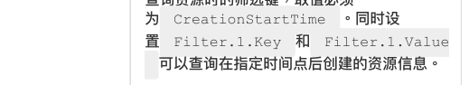

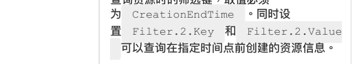

| 参数名称 | 类型 | 位置 | 是否必选 | 示例 | 说明 |
| --- | --- | --- | --- | --- | --- |
| Filter.2.Value | String | Query | 否 | 2022-04-10T22:00Z | 查询资源时的筛选值。指定该参数时必须同时指定<code> Filter.2.Key </code>参数，格式为：<code> yyyy-MM-ddTHH:mmZ </code>，采用UTC +0时区。 |
| Usage | String | Query | 否 | none | 快照是否被用作创建镜像或云盘。取值范围：<br>• image：使用快照创建了自定义镜像。<br>• disk：使用快照创建了云盘。<br>• image_disk：使用快照创建了数据盘和自定义镜像。<br>• none：暂未使用。 |
| SourceDiskType | String | Query | 否 | Data | 快照源云盘的云盘类型。取值范围：<br>• System：系统盘。<br>• Data：数据盘。 |
| Encrypted | Boolean | Query | 否 | false | 是否过滤加密快照。取值范围：<br>• true：是。<br>• false：否。默认值：false。 |
| DryRun | Boolean | Query | 否 | false | 是否只预检此次请求。取值范围：<br>• true：发送检查请求，不会查询资源状况。检查项包括AccessKey是否有效、RAM用户的授权情况和是否填写了必需参数。如果检查不通过，则返回对应错误。如果检查通过，会返回错误码<code> DryRunOperation </code>。<br>• false：发送正常请求，通过检查后返回2XX HTTP状态码并直接查询资源状况。默认值：false。 |
| KMSKeyId | String | Query | 否 | 0e478b7a-4262-4802-b8cb-00d3fb40\*\*\*\* | 数据盘对应的KMS密钥ID。 |
| Category | String | Query | 否 | Standard | 快照类型。取值范围：<br>• Standard：普通快照。<br>• Flash：本地快照。该参数即将被弃用，为提高兼容性，建议您尽量使用其他参数。 |
| Tag | RepeatList | Query | 否 | / | 标签列表。 |
| -key | String |  | 否 | null | 快照的标签键。为提高兼容性，建议您尽量使用<code> Tag.N.Key </code>参数。 |
| -Key | String |  | 否 | TestKey | 快照的标签键。参数格式为<code> Tag.N.Key </code>，N的取值范围：1~20。一旦传入该值，则不允许为空字符串。最多支持128个字符，不能以<code> aliyun </code>或<code> acs: </code>开头，不能包含<code> http:// </code>或<code> https:// </code>。 |
| -Value | String |  | 否 | TestValue | 快照的标签值。参数格式为<code> Tag.N.Value </code>，N的取值范围：1~20。一旦传入该值，可以为空字符串。最多支持128个字符，不能包含<code> http:// </code>或<code> https:// </code>。 |
| -value | String |  | 否 | null | 快照的标签值。为提高兼容性，建议您尽量使用<code> Tag.N.Value </code>参数。 |

**返回数据**

| 参数名称 | 类型 | 示例 | 说明 |
| --- | --- | --- | --- |
| Snapshots | Array | / | 快照详情集合。 |
| -Tags | Array | / | 标签。 |
| --TagValue | String | TestValue | 快照的标签值。 |
| --TagKey | String | TestKey | 快照的标签键。 |
| -Status | String | accomplished | 快照状态。可能值：<br>• progressing：正在创建的快照。<br>• accomplished：创建成功的快照。<br>• failed：创建失败的快照。 |
| -CreationTime | String | 2022-04-13T13:00:52Z | 创建时间。按照ISO 8601标准表示，并使用UTC +0时间，格式为<code> yyyy-</code><code>MM-ddTHH:mm:ssZ </code>。 |
| -Progress | String | 100 | 快照创建进度，单位为百分比。 |
| -InstantAccess | Boolean | false | 是否开启了快照极速可用功能。可能值：<br>• true：开启。仅高性能云盘和普通性能云盘支持开启该功能。<br>• false：关闭。即快照为未开启快照极速可用功能的普通快照。 |
| -Available | Boolean | false | 快照是否可用于创建云盘、回滚云盘、共享快照。可能值：<br>• true：可用。<br>• false：不可用。 |
| -RemainTime | Integer | 38 | 正在创建的快照剩余完成时间，单位：秒。 |
| -SourceDiskSize | String | 2000 | 源云盘容量，单位：GiB。 |
| -RetentionDays | Integer | 30 | 自动快照保留天数。 |
| -SourceDiskType | String | Data | 源云盘属性。可能值：<br>• System。<br>• Data。 |
| -SourceStorageType | String | disk | 原云盘类型。该参数即将被弃用，为提高兼容性，建议您尽量使用其他参数。 |
| -Usage | String | none | 快照是否被用作创建镜像或云盘。可能值：<br>• image：使用快照创建了自定义镜像。<br>• disk：使用快照创建了云盘。<br>• image_disk：使用快照创建了数据盘和自定义镜像。<br>• none：暂未使用。 |
| -LastModifiedTime | String | test | 快照的最后变更时间。按照ISO 8601标准表示，并使用UTC +0时间，格式为<code> yyyy-MM-ddTHH:mm:ssZ </code>。 |
| -Encrypted | Boolean | false | 该快照是否加密。 |
| -SnapshotType | String | all | 快照类型。可能值：<br>• auto：自动快照。<br>• user：手动创建的快照。<br>• all：所有快照类型。 |
| -SourceDiskId | String | d-bp67acfmxazb4p\*\*\*\* | 源云盘ID。如果快照的源云盘已经被释放，该字段仍旧保留。 |
| -SnapshotName | String | test-SnapshotName | 快照显示名称。如果创建时指定了快照显示名称，则返回。 |
| -InstantAccessRetentionD ays | Integer | 30 | 设置快照极速可用功能的保留时间，保留时间到期后自动关闭快照极速可用功能。默认与参数<code> RetentionDays </code>的值一致。 |
| -Description | String | FinanceDept | 描述信息。 |
| -SnapshotId | String | s-bp67acfmxazb4p\*\*\*\* | 快照ID。 |
| -RegionId | String | cn-qingdao-env\*\*\*-d\*\* | 快照所属的地域 ID。 |
| -ResourceGroupId | String | rg-123\*\*\*\*\*\* | 资源组 ID。 |
| -Category | String | standard | 快照类型。可能值：<br>• standard：普通快照。<br>• flash：本地快照。该参数即将被弃用，为提高兼容性，建议您尽量使用参数<code> InstantAccess </code>。 |
| -KMSKeyId | String | 0e478b7a-4262-4802-b8cb-00d3fb40\*\*\*\* | 数据盘对应的KMS密钥ID。 |
| -SnapshotSN | String | 64472-116742336-61976\*\*\*\* | 快照序列号。 |
| -SourceSnapshotId | String | s-bp67acfmxazb4p\*\*\*\* | 源快照。 |
| -SourceRegionId | String | cn-\*\*\*\*\*\*\*\*-d01 | 源快照地域。 |
| -SnapshotLinkId | String | sl-bp1grgphbcc9brb5\*\*\*\* | 快照关联的快照链 ID。 |
| NextToken | String | caeba0bbb2be03f84eb48b699f 0a\*\*\*\* | 下一个查询起始标志。 |
| PageSize | Integer | 10 | 输入时设置的每页行数。 |
| PageNumber | Integer | 1 | 快照列表的页码。 |
| RequestId | String | 473469C7-AA6F-4DC5-B3DB-A3DC0DE3\*\*\*\* | 请求ID。 |
| TotalCount | Integer | 36 | 快照总个数。 |

**示例**

请求示例

```text
https://ecs.example.com/?Action=DescribeSnapshots
&RegionId=cn-qingdao-env***-d**
&InstanceId=i-bp67acfmxazb4p****
&DiskId=d-bp67acfmxazb4p****
&SnapshotIds=["s-bp67acfmxazb4p****", "s-bp67acfmxazb5p****", … "s-bp67acfmxazb6p****"]
&PageNumber=1
&PageSize=10
&SnapshotName=testSnapshotName
&Status=all
&SnapshotType=all
&Usage=none
&SourceDiskType=Data
&Tag.1.Key=TestKey
&Tag.1.Value=TestValue
&Encrypted=false
&DryRun=false
&<公共请求参数>
```

正常返回示例

`JSON`  格式

```json
{
    "TotalCount": 36,
    "NextToken": "caeba0bbb2be03f84eb48b699f0a****",
    "PageSize": 10,
    "RequestId": "473469C7-AA6F-4DC5-B3DB-A3DC0DE3****",
    "PageNumber": 1,
    "Snapshots": {
        "Status": "accomplished",
        "InstantAccess": false,
        "Usage": "none",
        "Progress": 100,
        "Category": "standard",
        "KMSKeyId": "0e478b7a-4262-4802-b8cb-00d3fb40****",
        "Description": "FinanceDept",
        "ProductCode": "jxsc000***",
        "Encrypted": false,
        "RetentionDays": 30,
        "InstantAccessRetentionDays": 30,
        "SnapshotName": "test-SnapshotName",
        "SourceDiskId": "d-bp67acfmxazb4p****",
        "SnapshotSN": "64472-116742336-61976****",
        "SnapshotId": "s-bp67acfmxazb4p****",
        "SourceDiskSize": 2000,
        "LastModifiedTime": "test",
        "CreationTime": "2022-04-13T13:00:52Z",
        "SnapshotType": "all",
        "RemainTime": 38,
        "SourceDiskType": "Data",
        "Tags": {
            "TagKey": "TestKey",
            "TagValue": "TestValue"
        }
    }
}
```

`XML`  格式

```xml
<DescribeSnapshotsResponse>
  <TotalCount>36</TotalCount>
  <NextToken>caeba0bbb2be03f84eb48b699f0a****</NextToken>
  <PageSize>10</PageSize>
  <RequestId>473469C7-AA6F-4DC5-B3DB-A3DC0DE3****</RequestId>
  <PageNumber>1</PageNumber>
  <Snapshots>
        <Status>accomplished</Status>
        <InstantAccess>false</InstantAccess>
        <Usage>none</Usage>
        <Progress>100</Progress>
        <Category>standard</Category>
        <KMSKeyId>0e478b7a-4262-4802-b8cb-00d3fb40****</KMSKeyId>
        <Description>FinanceDept</Description>
        <ProductCode>jxsc000***</ProductCode>
        <Encrypted>false</Encrypted>
        <RetentionDays>30</RetentionDays>
        <InstantAccessRetentionDays>30</InstantAccessRetentionDays>
        <SnapshotName>test-SnapshotName</SnapshotName>
        <SourceDiskId>d-bp67acfmxazb4p****</SourceDiskId>
        <SnapshotSN>64472-116742336-61976**** </SnapshotSN>
        <SnapshotId>s-bp67acfmxazb4p****</SnapshotId>
        <SourceDiskSize>2000</SourceDiskSize>
        <LastModifiedTime>test</LastModifiedTime>
        <CreationTime>2022-04-13T13:00:52Z</CreationTime>
        <SnapshotType>all</SnapshotType>
        <RemainTime>38</RemainTime>
        <SourceDiskType>Data</SourceDiskType>
        <Tags>
              <TagKey>TestKey</TagKey>
              <TagValue>TestValue</TagValue>
        </Tags>
  </Snapshots>
</DescribeSnapshotsResponse>
```

**错误码**

| HttpCode | 错误码 | 错误信息 | 描述 |
| --- | --- | --- | --- |
| 400 | InvalidTag.Mismatch | InvalidTag.Mismatch | The specified Tag.n.Key and Tag.n.Value are not match. |
| 400 | InvalidTagCount | InvalidTagCount | The specified tags are beyond the permitted range. |
| 403 | INSTANCE_IDS_SIZE_EXCEED_LI MIT | InvalidSnapshotIds.Malformed | The amount of specified specified snapshot Ids exceeds the limit. |
| 403 | Abs.InvalidSnapshotIds.Malform ed | InvalidSnapshotIds.Malformed | The amount of specified specified snapshot Ids exceeds the limit. |
| 403 | Abs.InvalidSnapshotCategory.M alformed | InvalidSnapshotCategory.Malformed | The specified Category is not valid. |
| 404 | Abs.InvalidFilterkey.MalFormed | InvalidFilterKey.NotFound | The specified FilterKey is not found. |
| 404 | Abs.InvalidFilterValue.MalForme d | InvalidFilterValue | The specified FilterValue exceeds the limit. |
| 404 | Abs.InvalidUsage.ValueNotSupp orted | InvalidUsage | The specifed Usage is not valid. |
| 404 | Abs.InvalidDiskType.ValueNotS upported | InvalidSourceDiskType | The specifed SourceDiskType is not valid. |
| 404 | Abs.InvalidStatus.ValueNotSupp orted | InvalidStatus.NotFound | The specified Status is not found. |
| 404 | Abs.InvalidSnapshotType.Value NotSupported | InvalidSnapshotType.NotFound | The specfied SnapshotType is not found. |
| 404 | SNAPSHOT_LINK_NOT_EXISTS | InvalidSnapshotLinkId.NotFound | The specified snapshot link is not found. |
| 500 | -40 | InternalError | The request processing has failed due to some unknown error. |

<a id="section-9-3"></a>

## 9.3. DeleteSnapshot

调用DeleteSnapshot删除指定的快照。如果需要取消正在创建的快照，也可以调用该接口删除快照，即取消创建快照任务。

**接口说明**

调用该接口时，您需要注意：

- 如果指定的快照ID不存在，请求将被忽略。

- 如果快照已经被用于创建自定义镜像，则快照不能被删除。您需要先删除已创建的自定义镜像（DeleteImage），才能继续删除快照。

- 如果快照已经被用于创建云盘，且未设置 `Force` 参数或 `Force=false` 时，不能直接删除快照。如果您确定要删除快照，请设置 `Force=true` 进行强制删除，快照被强制删除后对应的云盘将不能执行重新初始化。

**请求参数**

| 名称 | 类型 | 是否必选 | 示例值 | 描述 |
| --- | --- | --- | --- | --- |
| Action | String | 是 | DeleteSnapshot | 系统规定参数。取值：DeleteSnapshot。 |
| SnapshotId | String | 是 | s-bp1btgnlb4licd41\*\*\*\* | 快照ID。您可以调用DescribeSnapshots查询快照ID。 |
| Force | Boolean | 否 | false | 是否强制删除已经被用于创建云盘的快照。取值范围：<br>• true：强制删除。强制删除后该磁盘无法重新初始化。<br>• false：不强制删除。默认值：false。 |

**返回数据**

| 名称 | 类型 | 示例值 | 描述 |
| --- | --- | --- | --- |
| RequestId | String | 473469C7-AA6F-4DC5-B3DB-A3DC0DE3\*\*\*\* | 请求ID。无论调用接口成功与否，都会返回请求ID。 |

**示例**

请求示例

```text
https://ecs.example.com/?Action=DeleteSnapshot
&SnapshotId=s-bp1btgnlb4licd41****
&<公共请求参数>
```

正常返回示例

`XML` 格式

```xml
<DeleteSnapshotResponse>
       <RequestId>CEF72CEB-54B6-4AE8-B225-F876FF7B****</RequestId>
</DeleteSnapshotResponse>
```

`JSON` 格式

```json
{
    "RequestId": "CEF72CEB-54B6-4AE8-B225-F876FF7B****"
}
```

**错误码**

| HttpCode | 错误码 | 错误信息 | 描述 |
| --- | --- | --- | --- |
| 403 | SnapshotCreatedImage | The snapshot has been used to create user defined image(s). | 如果快照已经被用于创建自定义镜像，将不能执行删除操作。您需要先删除已创建的自定义镜像（DeleteImage），才能继续删除快照。 |
| 403 | SnapshotCreatedDisk | The snapshot has been used to create disk(s). | 指定的快照已经用于创建云盘，当未设置Force参数或Force参数值为false时，不能直接删除快照。如果您确定要删除快照，请设置Force参数值为true进行强制删除，快照被强制删除后对应的云盘将不能执行重新初始化。 |
| 400 | MissingParameter | The input parameter SnapshotId that is mandatory for processing this request is not supplied. | 参数SnapshotId不得为空。 |
| 500 | InternalError | The request processing has failed due to some unknown error. | 内部错误，请重试。如果多次尝试失败，请提交工单。 |
| 404 | InvalidSnapshotId.NotFound | The specified snapshot is not found | 指定的快照不存在。 |
| 403 | Operation.Conflict | The operation may conflicts with others, please retry later. | 您当前的操作可能与其他人的操作产生了冲突，请稍后重试。 |

<a id="section-9-4"></a>

## 9.4. CopySnapshot

调用CopySnapshot将一份普通快照从一个地域复制到另一个地域。

**接口说明**

调用该接口时，您需要注意：

- 复制后的新快照不能回滚源快照对应的云盘。

- 不支持复制已加密的快照。

- 不支持复制本地快照。

**请求参数**

| 名称 | 类型 | 是否必选 | 示例值 | 描述 |
| --- | --- | --- | --- | --- |
| Action | String | 否 | CopySnapshot | 系统必选参数。取值：CopySnapshot。 |
| SnapshotId | String | 是 | s-bp67acfmxazb4p\*\*\*\* | 源快照ID。 |
| RegionId | String | 是 | cn-qingdao-env17-d01 | 源快照所在的地域。您可以调用DescribeRegions查看最新的阿里云地域列表。 |
| DestinationRegionId | String | 是 | cn-beijing-env17-d01 | 新快照的目标地域ID。 |
| DestinationSnapshotNa me | String | 是 | test-DestinationSnapshotName | 新快照的名称。长度为2~128个英文或中文字符，必须以大小字母或中文开头，不能以http://和https:// 开头。可以包含数字、半角冒号（:）、下划线（_）或者连字符（-）。默认值：空。 |
| DestinationSnapshotDes cription | String | 是 | This is a description example. | 新快照的描述信息。长度为2~256个英文或中文字符，不能以http://和https://开头。默认值：空。 |
| RetentionDays | Integer | 否 | 60 | 新快照的保留时长，单位为天，超过保留时长后快照会被自动释放。取值范围：1~65536。默认值：空，表示快照不会被自动释放。 |
| Tag.N.Key | String | 否 | TestKey | 新快照的标签键。一旦传入该值，则不允许为空字符串。最多支持128个字符，不能以aliyun和acs:开头，不能包含http://或者https://。 |
| Tag.N.Value | String | 否 | TestValue | 新快照的标签值。一旦传入该值，允许为空字符串。最多支持128个字符，不能以aliyun和acs:开头，不能包含http://或者https://。 |

**返回数据**

| 名称 | 类型 | 示例值 | 描述 |
| --- | --- | --- | --- |
| RequestId | String | C8B26B44-0189-443E-9816-D951F59623A9 | 请求ID。 |
| SnapshotId | String | s-bp17441ohwka0yui\*\*\*\* | 新快照的ID。 |

**示例**

请求示例

```text
https://ecs.example.com/?Action=CopySnapshot
&DestinationRegionId=cn-beijing-env17-d01
&RegionId=cn-qingdao-env17-d01
&SnapshotId=s-bp67acfmxazb4p****
&<公共请求参数>
```

正常返回示例

`XML`  格式

```xml
<CopySnapshotResponse>
            <RequestId>C8B26B44-0189-443E-9816-D951F59623A9</RequestId>
            <SnapshotId>s-bp17441ohwka0yuhi****</SnapshotId>
</CopySnapshotResponse>
```

`JSON`  格式

```json
{
        "RequestId": "C8B26B44-0189-443E-9816-D951F59623A9",
        "SnapshotId": "s-bp17441ohwka0yuhi****"
}
```

**错误码**

| HttpCode | 错误码 | 错误信息 | 描述 |
| --- | --- | --- | --- |
| 403 | InvalidSnapshotId.NotFound | The specified snapshot is not exists. | 指定的源快照不存在。 |
| 403 | InvalidUser.NotInWhiteList | The user is not in the white list of copying snapshot. | 您暂未授权执行该操作。 |
| 403 | InvalidAccountStatus.NotEnoug hBalance | Your account does not have enough balance. | 账号余额不足，请您先充值再进行该操作。 |
| 403 | InvalidAccountStatus.SnapshotS erviceUnavailable | Snapshot service has not been opened yet. | 快照服务未开通，操作无法执行。 |
| 400 | Duplicate.TagKey | The Tag.N.Key contain duplicate key. | 标签中存在重复的键，请保持键的唯一性。 |
| 400 | InvalidTagKey.Malformed | The specified Tag.n.Key is not valid. | 指定的标签键不合法。 |
| 400 | InvalidTagValue.Malformed | The specified Tag.n.Value is not valid. | 指定的标签值不合法。 |
| 400 | InvalidRegionId.MalFormed | The specified RegionId is not valid | 指定的 RegionId 不合法。 |

<a id="section-9-5"></a>

## 9.5. DescribeSnapshotLinks

调用DescribeSnapshotLinks查询云盘快照链。快照链是一块云盘所有快照组成的关系链，一块云盘对应一条快照链。

接口说明

调用该接口时，您需要注意：

- 请求参数 `RegionId` 、 `DiskIds` 和 `InstanceId` 等充当过滤器功能，参数间是逻辑与关系。

- 如果不指定任何参数，则过滤器不起作用。当 `DiskIds` 和 `SnapshotLinkIds` 都为空数组时，同样视该过滤器有效，但是返回结果为空。

**请求头**

该接口使用公共请求头，无特殊请求头。请参见公共请求参数文档。

**请求参数**

| 参数名称 | 类型 | 位置 | 是否必选 | 示例 | 说明 |
| --- | --- | --- | --- | --- | --- |
| SourceRegionId | String | Host | 否 |  | 该参数暂未支持。 |
| Action | String | Query | 是 | DescribeSnapshotLinks | 系统规定参数。取值：<strong>DescribeSnapshotLinks</strong>。 |
| OwnerId | Long | Query | 否 |  | 该参数暂未支持。 |
| ResourceOwnerAc count | String | Query | 否 |  | 该参数暂未支持。 |
| ResourceOwnerId | Long | Query | 否 |  | 该参数暂未支持。 |
| OwnerAccount | String | Query | 否 |  | 该参数暂未支持。 |
| RegionId | String | Query | 是 | cn-qingdao-\*\*\*\* | 云盘所属地域ID。您可以调用<code> DescribeRegions </code>查看最新的阿里云地域列表。 |
| InstanceId | String | Query | 否 | i-bp1ahcvgu9z55pk7\*\*\*\* | 实例ID。 |
| DiskIds | String | Query | 否 | \["d-bp198f7xn673w2rw\*\*\*\*", "d-bp12te2l9m0170wc\*\*\*\*", … "d-bp1btgnlb4lgdzoi\*\*\*\*"\] | 云盘ID。一次最多指定100个云盘ID。<code> DiskIds </code>参数取值格式为JSON数组，ID之间用半角逗号（,）隔开。 |
| SnapshotLinkIds | String | Query | 否 | \["sl-bp14r3b4xczuenhr\*\*\*\*", "sl-bp1eftye2796vi2a\*\*\*\*", … "sl-bp1aixnfbjo290a8\*\*\*\*"\] | 快照链ID。一次最多指定100个快照ID。<code> SnapshotLinkIds </code>参数取值格式为JSON数组，ID之间用半角逗号（,）隔开。 |
| PageNumber | Integer | Query | 否 | 1 | 云盘状态列表的页码。起始值：1。默认值：1 。 |
| PageSize | Integer | Query | 否 | 50 | 分页查询时设置的每页行数。取值范围：1~100。默认值：10。 |

**返回数据**

| 参数名称 | 类型 | 示例 | 说明 |
| --- | --- | --- | --- |
| SnapshotLinks | Array |  | 快照链信息组成的集合。 |
| -InstantAccess | Boolean |  | 该参数暂未支持。 |
| -TotalSize | Long | 2097152 | 快照链中所有快照的大小，单位为Byte。 |
| -SourceDiskName | String | test-SourceDiskName | 源云盘的名称。 |
| -SourceDiskSize | Integer | 40 | 源云盘容量，单位为GiB。 |
| -SourceDiskType | String | cloud_ssd | 源云盘的类型。可能值：<br>• cloud_efficiency：高效云盘。<br>• cloud_ssd：SSD云盘。<br>• cloud_pperf：高性能云盘。<br>• cloud_sperf：普通性能云盘。<br>• san_ssd：共享SSD盘。<br>• san_efficiency：共享高效云盘。默认不支持创建共享SSD盘和共享高效云盘。 |
| -InstanceId | String | i-bp1ahcvgu9z55pk7\*\*\*\* | 实例ID。 |
| -SnapshotLinkId | String | sl-bp14r3b4xczuenhr\*\*\*\* | 快照链ID。 |
| -TotalCount | Integer | 1 | 快照总个数。 |
| -RegionId | String | cn-qingdao-\*\*\*\* | 快照链源云盘所属地域ID。 |
| -SourceDiskId | String | d-bp198f7xn673w2rw\*\*\*\* | 源云盘ID，如果快照的源云盘已经被删除，该字段仍旧保留。 |
| -InstanceName | String | test-InstanceName | 实例名称。 |
| -Category | String | test | 该参数暂未支持。 |
| PageSize | Integer | 50 | 输入时设置的每页行数。 |
| RequestId | String | 473469C7-AA6F-4DC5-B3DB-A3DC0DE\*\*\*\*\* | 请求ID。 |
| PageNumber | Integer | 1 | 快照链列表的页码。 |
| TotalCount | Integer | 9 | 快照链总个数。 |

**示例**

请求示例

```text
http(s)://ecs.example.com/?Action=DescribeSnapshotLinks
&Action=DescribeSnapshotLinks
&RegionId=cn-qingdao-****
&InstanceId=i-bp1ahcvgu9z55pk7****
&DiskIds=["d-bp198f7xn673w2rw****", "d-bp12te2l9m0170wc****", … "d-bp1btgnlb4lgdzoi****"]
&SnapshotLinkIds=["sl-bp14r3b4xczuenhr****", "sl-bp1eftye2796vi2a****", … "sl-bp1aixnfbjo290a8****"]
&PageNumber=1
&PageSize=10
&公共请求参数
```

正常返回示例

`JSON`  格式

```json
{
    "SnapshotLinks": {
        "SnapshotLink": [
            {
                "SourceDiskSize": 20,
                "TotalSize": 2097152,
                "SourceDiskType": "data",
                "RegionId": "cn-qingdao-****",
                "SnapshotLinkId": "sl-bp14r3b4xczuenhr****",
                "SourceDiskId": "d-bp198f7xn673w2rw****",
                "TotalCount": 1
            },
            {
                "SourceDiskSize": 40,
                "TotalSize": 2097152,
                "SourceDiskType": "data",
                "RegionId": "cn-qingdao-****",
                "SnapshotLinkId": "sl-bp14r3b4xczuenhr****",
                "SourceDiskId": "d-bp198f7xn673w2rw****",
                "TotalCount": 1
            }
        ]
    },
    "PageNumber": 1,
    "PageSize": 2,
    "RequestId": "473469C7-AA6F-4DC5-B3DB-A3DC0DE*****",
    "TotalCount": 9
}
```

`XML`  格式

```xml
<DescribeSnapshotLinksResponse>
      <SnapshotLinks>
            <SnapshotLink>
                  <SourceDiskSize>20</SourceDiskSize>
                  <TotalSize>2097152</TotalSize>
                  <SourceDiskType>data</SourceDiskType>
                  <RegionId>cn-qingdao-****</RegionId>
                  <SnapshotLinkId>sl-bp14r3b4xczuenhr****</SnapshotLinkId>
                  <SourceDiskId>d-bp198f7xn673w2rw****</SourceDiskId>
                  <TotalCount>1</TotalCount>
            </SnapshotLink>
            <SnapshotLink>
                  <SourceDiskSize>40</SourceDiskSize>
                  <TotalSize>2097152</TotalSize>
                  <SourceDiskType>data</SourceDiskType>
                  <RegionId>cn-qingdao-****</RegionId>
                  <SnapshotLinkId>sl-bp14r3b4xczuenhr****</SnapshotLinkId>
                  <SourceDiskId>d-bp198f7xn673w2rw****</SourceDiskId>
                  <TotalCount>1</TotalCount>
            </SnapshotLink>
      </SnapshotLinks>
      <PageNumber>1</PageNumber>
      <PageSize>2</PageSize>
      <RequestId>473469C7-AA6F-4DC5-B3DB-A3DC0DE*****</RequestId>
      <TotalCount>9</TotalCount>
</DescribeSnapshotLinksResponse>
```

**错误码**

| HttpCode | 错误码 | 错误信息 | 描述 |
| --- | --- | --- | --- |
| 400 | ECS_NOT_EXIST | InvalidInstanceId.NotFound | The specified instanceId is not exists. |
| 400 | PARAMETER_REGION_ID_INVALI D | InvalidRegionId | The specified regionId is invalid. |
| 400 | PARAMETER_SNAPSHOT_LINK_I NVALID | InvalidSnapshotLinkIds | The specified snapshotLinkIds is invalid. |
| 400 | PARAMETER_DISK_IDS_INVALID | InvalidDiskIds | The specified diskIds is invalid. |
| 500 | -40 | InternalError | The request processing has failed due to some unknown error. |

<a id="section-9-6"></a>

## 9.6. DescribeSnapshotsUsage

调用DescribeSnapshotsUsage查询您在一个地域下的快照数量以及快照容量。

如果您想知道当前地域下每块磁盘的快照使用情况，推荐使用DescribeSnapshotLinks查询快照链。

**请求参数**

| 名称 | 类型 | 是否必选 | 示例值 | 描述 |
| --- | --- | --- | --- | --- |
| Action | String | 否 | DescribeSnapshotsUsage | 系统规定参数。取值：DescribeSnapshotsUsage |
| RegionId | String | 是 | cn-qingdao-env17-d01 | 快照所属的地域ID。您可以调用DescribeRegions查看最新的阿里云地域列表。 |

**返回数据**

| 名称 | 类型 | 示例值 | 描述 |
| --- | --- | --- | --- |
| RequestId | String | 473469C7-AA6F-4DC5-B3DB-A3DC0DE3C83E | 请求ID。 |
| SnapshotCount | Integer | 5 | 当前地域下的快照总数。 |
| SnapshotSize | Long | 122 | 当前地域下已产生的快照容量，单位Byte。 |

**示例**

请求示例

```text
https://ecs.example.com/?Action=DescribeSnapshotsUsage
&RegionId=cn-qingdao-env17-d01
&<公共请求参数>
```

正常返回示例 `XML`  格式

```xml
<DescribeSnapshotsUsageResponse>
   <SnapshotCount>5</SnapshotCount>
   <SnapshotSize>122</SnapshotSize>    
      <RequestId>ED5CF6DD-71CA-462C-9C94-A61A78A01479</RequestId>
</DescribeSnapshotsUsageResponse>
```

`JSON`  格式

```json
{
 "SnapshotCount": "5",
 "SnapshotSize": "122",
 "RequestId": "ACD9BBB0-A9D1-46D7-9630-B7A69889E110"
}
```

**错误码**

| HttpCode | 错误码 | 错误信息 | 描述 |
| --- | --- | --- | --- |
| 403 | InvalidParam.RegionId | The specified region is not exist. | 指定的地域不存在，请检查该参数是否正确。 |

<a id="section-9-7"></a>

## 9.7. CreateAutoSnapshotPolicy

调用CreateAutoSnapshotPolicy创建一条自动快照策略。

**接口说明**

创建的自动快照策略可以应用到任一云盘（ApplyAutoSnapshotPolicy），成功创建的自动快照策略可以后续修改策略内容（ModifyAutoSnapshotPolicyEx）。

调用该接口时，您需要注意：

- 一个阿里云账户在一个地域最多能创建100条自动快照策略。

- 如果云盘数据较多，单次创建自动快照的时长超过两个时间点间隔，则自动跳过下一时间点。示例：您设置了09:00、10:00、11:00和12:00为自动快照时间点。由于云盘数据较多，09:00开始创建快照，10:20完成创建快照，实际耗时80分钟。系统会跳过时间点10:00，等到11:00继续为您创建自动快照。

**请求参数**

| 名称 | 类型 | 是否必选 | 示例值 | 描述 |
| --- | --- | --- | --- | --- |
| Action | String | 否 | CreateAutoSnapshotPolicy | 系统规定参数。取值：CreateAutoSnapshotPolicy |
| regionId | String | 是 | cn-qingdao-env17-d01 | 自动快照策略所属的地域。您可以调用DescribeRegions查看最新的阿里云地域列表。 |
| repeatWeekdays | String | 是 | \["1","2"\] | 自动快照的重复日期，单位为天，周期为星期。取值范围：1~7，如1表示周一。当一星期内需要创建多次自动快照时，可以传入多个时间点：<br>• 最多传入7个时间点。<br>• 多个时间点用一个格式类似<code> ["1","2"..."7"] </code>的JSON数组表示，时间点之间用半角逗号（,）隔开。 |
| retentionDays | Integer | 是 | 30 | 自动快照的保留时间，单位为天。取值范围：<br>• -1：永久保存。<br>• 1~65535：指定保存天数。默认值：-1。 |
| timePoints | String | 是 | \["0", "1", … "23"\] | 自动快照的创建时间点，单位为小时。取值范围：0~23，代表00:00至23:00共24个时间点，如1表示01:00。当一天内需要创建多次自动快照时，可以传入多个时间点，最多传入24个时间点。 |
| autoSnapshotPolicyNam e | String | 否 | test-autoSnapshotPolicyName | 自动快照策略的名称。长度为2~128个英文或中文字符。必须以大小字母或中文开头，不能以http://和https://开头。可以包含数字、半角冒号（:）、下划线（_）或者连字符（-）。默认值：空。 |

**返回数据**

| 名称 | 类型 | 示例值 | 描述 |
| --- | --- | --- | --- |
| AutoSnapshotPolicyId | String | sp-bp12m37ccmxvbmi5\*\*\*\* | 自动快照策略ID。 |
| RequestId | String | 473469C7-AA6F-4DC5-B3DB-A3DC0DE3C83E | 请求ID。 |

**示例**

请求示例

```text
https://ecs.example.com/?Action=CreateAutoSnapshotPolicy
&regionId=cn-qingdao-env17-d01
&repeatWeekdays=["1"]
&retentionDays=30
&timePoints=["0", "19"]
&autoSnapshotPolicyName=test-autoSnapshotPolicyName
&<公共请求参数>
```

正常返回示例

`XML`  格式

```xml
<CreateAutoSnapshotPolicyResponse>
      <RequestId>F3CD6886-D8D0-4FEE-B93E-1B73239673DE</RequestId>
      <AutoSnapshotPolicyId>sp-bp12m37ccmxvbmi5****</AutoSnapshotPolicyId>
</CreateAutoSnapshotPolicyResponse>
```

`JSON`  格式

```json
{
    "RequestId": "F3CD6886-D8D0-4FEE-B93E-1B73239673DE",
    "AutoSnapshotPolicyId": "sp-bp12m37ccmxvbmi5****"
}
```

**错误码**

| HttpCode | 错误码 | 错误信息 | 描述 |
| --- | --- | --- | --- |
| 403 | ParameterInvalid | The specified RegionId parameter is invalid. | 指定的地域 ID 无效，请您检查该地域是否正确。 |
| 403 | ParameterInvalid | The specified RepeatWeekDays parameter is invalid. | 指定的日期无效，请您检查该日期是否正确。 |
| 403 | ParameterInvalid | The specified TimePoints parameter is invalid. | 指定的时间点不合法，请您查看该时间点是否填写正确。 |
| 403 | ParameterInvalid | The specified RetentionDays parameter is invalid. | 指定的保持天数不合法。 |
| 403 | AutoSnapshotPolicy.QuotaExce ed | The maximum number of automatic snapshot policy has been reached. | 自动快照策略数超出最大值。 |
| 400 | DiskCategory.OperationNotSup ported | The type of the specified disk does not support creating a snapshot. | 当前磁盘类型不支持此操作 |
| 403 | InvalidAccountStatus.NotEnoug hBalance | Your account does not have enough balance. | 账号余额不足，请您先充值再进行该操作。 |
| 403 | InvalidAccountStatus.SnapshotS erviceUnavailable | Snapshot service has not been opened yet. | 快照服务未开通，操作无法执行。 |

<a id="section-9-8"></a>

## 9.8. DeleteAutoSnapshotPolicy

删除一条自动快照策略。如果目标自动快照策略已经被应用到磁盘上，删除自动快照策略后，这些磁盘不再执行该策略。

**请求参数**

| 名称 | 类型 | 是否必选 | 示例值 | 描述 |
| --- | --- | --- | --- | --- |
| Action | String | 否 | DeleteAutoSnapshotPolicy | 系统规定参数。取值：DeleteAutoSnapshotPolicy |
| autoSnapshotPolicyId | String | 是 | sp-bp12m37ccmxvbmi5\*\*\*\* | 自动快照策略的ID。您可以调用DescribeAutoSnapshotPolicyEx查看您可用的自动快照策略。 |
| regionId | String | 是 | cn-qingdao-env17-d01 | 自动快照所属的地域ID。您可以调用DescribeRegions查看最新的阿里云地域列表。 |

**返回数据**

| 名称 | 类型 | 示例值 | 描述 |
| --- | --- | --- | --- |
| RequestId | String | 473469C7-AA6F-4DC5-B3DB-A3DC0DE3C83E | 请求ID。无论调用接口成功与否，都会返回请求ID。 |

**示例**

请求示例

```text
https://ecs.example.com/?Action=DeleteAutoSnapshotPolicy
&autoSnapshotPolicyId=sp-bp12m37ccmxvbmi5****
&regionId=cn-qingdao-env17-d01
&<公共请求参数>
```

正常返回示例

`XML`  格式

```xml
<DeleteAutoSnapshotPolicyResponse>
      <RequestId>F3CD6886-D8D0-4FEE-B93E-1B73239673DE</RequestId> 
</DeleteAutoSnapshotPolicyResponse>
```

`JSON`  格式

```json
{
    "RequestId":"F3CD6886-D8D0-4FEE-B93E-1B73239673DE"
}
```

**错误码**

| HttpCode | 错误码 | 错误信息 | 描述 |
| --- | --- | --- | --- |
| 404 | ParameterInvalid | The specified automatic snapshot policy does not exist. | 指定的自动快照策略不存在，请您检查自动快照策略是否正确。 |
| 404 | ParameterInvalid | The specified automatic snapshot policy does not exist in the region. | 指定的自动快照策略不存在，请您检查自动快照策略是否正确。 |

<a id="section-9-9"></a>

## 9.9. ModifyAutoSnapshotPolicyEx

调用ModifyAutoSnapshotPolicyEx修改一条自动快照策略。修改自动快照策略后，之前已应用该策略的云盘随即执行修改后的自动快照策略。

**请求参数**

| 名称 | 类型 | 是否必选 | 示例值 | 描述 |
| --- | --- | --- | --- | --- |
| Action | String | 否 | ModifyAutoSnapshotPolicyE x | 系统规定参数。取值：ModifyAutoSnapshotPolicyEx |
| autoSnapshotPolicyId | String | 是 | sp-bp12m37ccmxvbmi5\*\*\*\* | 目标自动快照策略 ID。您可以调用DescribeAutoSnapshotPolicyEx查看您可用的自动快照策略。 |
| regionId | String | 是 | cn-qingdao-env17-d01 | 自动快照策略所在的地域 ID。您可以调用DescribeRegions查看最新的阿里云地域列表。 |
| autoSnapshotPolicyNam e | String | 否 | test-autoSnapshotPolicyName | 自动快照策略的名称。如果参数为空则代表不修改。 |
| timePoints | String | 否 | \["0", "1"\] | 自动快照的创建时间点，单位为小时。取值范围：0~23，代表00:00 至 23:00 共 24 个时间点，如 1 表示 01:00。当一天内需要创建多次自动快照时，可以传入多个时间点：<br>• 最多传入 24 个时间点。<br>• 多个时间点用一个格式类似 "0", "1", … "23" 的 JSON 数组表示，时间点之间用半角逗号（,）隔开。 |
| repeatWeekdays | String | 否 | \["1", "7"\] | 自动快照的重复日期，单位为天，周期为星期。取值范围：1~7，如 1 表示周一。当一星期内需要创建多次自动快照时，可以传入多个时间点：<br>• 最多传入 7 个时间点。<br>• 多个时间点用一个格式类似 "1", "2", … "7" 的 JSON 数组表示，时间点之间用半角逗号（,）隔开。 |
| retentionDays | Integer | 否 | 30 | 自动快照的保留时间，单位为天。取值范围：<br>• -1（默认）：永久保存。<br>• 1~65536：指定保存天数。 |

**返回数据**

| 名称 | 类型 | 示例值 | 描述 |
| --- | --- | --- | --- |
| RequestId | String | 473469C7-AA6F-4DC5-B3DB-A3DC0DE3C83E | 请求ID。 |

**示例**

请求示例

```text
https://ecs.example.com/?Action=ModifyAutoSnapshotPolicyEx
&autoSnapshotPolicyId=sp-bp12m37ccmxvbmi5****
&regionId=cn-qingdao-env17-d01
&<公共请求参数>
```

正常返回示例

`XML`  格式

```xml
<ModifyAutoSnapshotPolicyResponse>
      <RequestId>F3CD6886-D8D0-4FEE-B93E-1B73239673DE</RequestId>
</ModifyAutoSnapshotPolicyResponse>
```

`JSON`  格式

```json
{
    "RequestId":"F3CD6886-D8D0-4FEE-B93E-1B73239673DE"
}
```

**错误码**

| HttpCode | 错误码 | 错误信息 | 描述 |
| --- | --- | --- | --- |
| 404 | ParameterInvalid | The specified automatic snapshot policy does not exist. | 指定的自动快照策略不存在，请您检查自动快照策略是否正确。 |
| 404 | ParameterInvalid | The specified automatic snapshot policy does not exist in the region. | 指定的自动快照策略不存在，请您检查自动快照策略是否正确。 |
| 403 | ParameterInvalid | The specified RegionId parameter is invalid. | 指定的地域 ID 无效，请您检查该地域是否正确。 |
| 403 | ParameterInvalid | The specified RepeatWeekDays parameter is invalid. | 指定的日期无效，请您检查该日期是否正确。 |
| 403 | ParameterInvalid | The specified TimePoints parameter is invalid. | 指定的时间点不合法，请您查看该时间点是否填写正确。 |
| 403 | ParameterInvalid | The specified AutoSnapshotPolicyId is invalid. | 指定的自动快照规则 ID 不合法。 |
| 403 | ParameterInvalid | The specified RetentionDays parameter is invalid. | 指定的保持天数不合法。 |

<a id="section-9-10"></a>

## 9.10. ModifySnapshotAttribute

调用ModifySnapshotAttribute修改一份快照的名称或描述。

**请求参数**

| 名称 | 类型 | 是否必选 | 示例值 | 描述 |
| --- | --- | --- | --- | --- |
| Action | String | 是 | ModifySnapshotAttribute | 系统规定参数。取值：ModifySnapshotAttribute。 |
| SnapshotId | String | 是 | s-bp199lyny9bb47pa\*\*\*\* | 快照ID。您可以调用DescribeSnapshots查询快照ID。 |
| SnapshotName | String | 否 | testSnapshotName | 快照的显示名称。长度为2~128个英文或中文字符。必须以大小字母或中文开头，不能以<code> http:// </code>或<code> https:// </code>开头。可以包含数字、半角冒号（:）、下划线（_）或者短划线（-）。为防止和自动快照的名称冲突，不能以auto开头。 |
| Description | String | 否 | testDescription | 快照的描述。长度为2~256个英文或中文字符，不能以<code> http:// </code>或<code> https:// </code>开头。 |
| DisableInstantAccess | Boolean | 否 | false | 是否关闭快照极速可用功能。取值范围：<br>• true：关闭快照极速可用。<br>• false：不关闭快照极速可用。默认值：false。 |

**返回数据**

| 名称 | 类型 | 示例值 | 描述 |
| --- | --- | --- | --- |
| RequestId | String | 473469C7-AA6F-4DC5-B3DB-A3DC0DE3\*\*\*\* | 请求ID。 |

**示例**

请求示例

```text
https://ecs.example.com/?Action=ModifySnapshotAttribute
&SnapshotId=s-bp199lyny9bb47pa****
&SnapshotName=testSnapshotName
&Description=testDescription
&DisableInstantAccess=false
&<公共请求参数>
```

正常返回示例

`XML` 格式

```xml
<ModifySnapshotAttributeResponse>
            <RequestId>C8B26B44-0189-443E-9816-D951F596****</RequestId>
</ModifySnapshotAttributeResponse>
```

`JSON` 格式

```json
{
 "RequestId":"C8B26B44-0189-443E-9816-D951F596****"
}
```

**错误码**

| HttpCode | 错误码 | 错误信息 | 描述 |
| --- | --- | --- | --- |
| 404 | InvalidDescription.Malformed | The specified description is wrongly formed. | 指定的资源描述格式不合法。长度为2-256个字符，不能以http://和https://开头。 |
| 400 | InvalidSnapshotName.Malforme d | The specified SnapshotName is wrongly formed. | 快照名称格式不合法。 |
| 400 | NoAttributeToModify | No attribute to be modified in this request. | 没有任何属性被修改。 |
| 404 | InvalidSnapshotId.NotFound | The specified SnapshotId does not exist. | 指定的快照不存在，请您检查快照是否正确。 |

<a id="section-9-11"></a>

## 9.11. DescribeAutoSnapshotPolicyEX

调用DescribeAutoSnapshotPolicyEX查询您已创建的自动快照策略。

**请求参数**

| 名称 | 类型 | 是否必选 | 示例值 | 描述 |
| --- | --- | --- | --- | --- |
| Action | String | 否 | DescribeAutoSnapshotPolic yEx | 系统规定参数。取值：DescribeAutoSnapshotPolicyEx |
| RegionId | String | 是 | cn-qingdao-env17-d01 | 要查询的自动快照策略所在的地域ID。您可以调用DescribeRegions查看最新的阿里云地域列表。 |
| AutoSnapshotPolicyId | String | 否 | sp-bp67acfmxazb4p\*\*\*\* | 自动快照策略ID。 |
| PageNumber | Integer | 否 | 1 | 自动快照策略返回结果分多页展示。起始值：1。默认值：1。 |
| PageSize | Integer | 否 | 1 | 分页展示返回的自动快照策略时的每页行数。最大值：100。默认值：10。 |
| Tag.N.Key | String | 否 | TestKey | 快照的标签键。N的取值范围：1~20。一旦传入该值，则不允许为空字符串。最多支持128个字符，不能以aliyun和acs:开头，不能包含http://或者https://。 |
| Tag.N.Value | String | 否 | TestValue | 快照的标签值。N的取值范围：1~20。一旦传入该值，可以为空字符串。最多支持128个字符，不能以acs:开头，不能包含http://或者https://。 |

**返回数据**

| 名称 | 类型 | 示例值 | 描述 |
| --- | --- | --- | --- |
| AutoSnapshotPolicies | Array |  | 自动快照策略详情AutoSnapshotPolicy组成的集合。 |
| AutoSnapshotPolicy |  |  |  |
| AutoSnapshotPolicyId | String | sp-bp67acfmxazb4p\*\*\*\* | 自动快照策略ID。 |
| AutoSnapshotPolicyNam e | String | test-AutoSnapshotPolicyName | 自动快照策略的名称。 |
| CopiedSnapshotsRetenti onDays | Integer | 0 | 说明该参数暂未支持。 |
| CreationTime | String | 2014-04-21T12:08:52Z | 创建时间。按照ISO8601标准表示，并需要使用UTC时间，格式为yyyy-MM-ddTHH:mm:ssZ。 |
| DiskNums | Integer | 1 | 启用该策略的云盘数量。 |
| EnableCrossRegionCopy | Boolean | false | 说明该参数暂未支持。 |
| RegionId | String | cn-qingdao-env17-d01 | 自动快照策略所属的地域ID。 |
| RepeatWeekdays | String | \["6"\] | 指定自动快照的重复日期。选定周一到周日中需要创建快照的日期，参数为1~7的数字，如1表示周一。允许选择多个日期。 |
| RetentionDays | Integer | 30 | 指定自动快照的保留时间，单位为天。可能值：<br>• -1：永久保存<br>• 1~65536：指定保存天数 |
| Status | String | Normal | 自动快照策略状态。可能值：<br>• Normal<br>• Expire |
| Tags | Array |  | 快照的标签键值集合。 |
| Tag |  |  |  |
| TagKey | String | TestKey | 快照标签键。 |
| TagValue | String | TestValue | 快照标签值。 |
| TargetCopyRegions | String | test | 说明该参数暂未支持。 |
| TimePoints | String | \["4", "19"\] | 指定自动快照的创建时间点。最小单位为小时，从00:00~23:00共24个时间点可选，参数为0~23的数字，如：1代表在01:00时间点。可以选定多个时间点。传递参数为一个带有格式的Json Array：<code> "0", "1", ... "23" </code>，最多24个时间点，用半角逗号字符（,）隔开。 |
| VolumeNums | Integer | 2 | 启用该策略的拓展卷数量。 |
| PageNumber | Integer | 1 | 自动快照策略列表的页码。 |
| PageSize | Integer | 1 | 分页展示返回的自动快照策略时的每页行数。 |
| RequestId | String | 473469C7-AA6F-4DC5-B3DB-A3DC0DE3C83E | 请求ID。 |
| TotalCount | Integer | 2 | 自动快照策略的总个数。 |

**示例**

请求示例

```text
https://ecs.example.com/?Action=DescribeAutoSnapshotPolicyEx
&RegionId=cn-qingdao-env17-d01
&AutoSnapshotPolicyId=sp-bp67acfmxazb4p****
&PageNumber=1
&PageSize=1
&<公共请求参数>
```

正常返回示例 `XML`  格式

```xml
<DescribeAutoSnapshotPolicyResponse>
      <PageNumber>1</PageNumber>
      <TotalCount>2</TotalCount>
      <AutoSnapshotPolicies>
            <AutoSnapshotPolicy>
                  <CreationTime>2019-01-22 11:38:08</CreationTime>
                  <Status>Normal</Status>
                  <DiskNums>1</DiskNums>
                  <AutoSnapshotPolicyName>test-AutoSnapshotPolicyName</AutoSnapshotPolicyName>
                  <RegionId>cn-qingdao-env17-d01</RegionId>
                  <VolumeNums>2</VolumeNums>
                  <RetentionDays>30</RetentionDays>
                  <TimePoints>["0"]</TimePoints>
                  <AutoSnapshotPolicyId>sp-bp67acfmxazb4p****</AutoSnapshotPolicyId>
                  <RepeatWeekdays>["7"]</RepeatWeekdays>
                  <Tags>
                        <Tag>
                              <TagKey>Test</TagKey>
                              <TagValue>Test</TagValue>
                        </Tag>
                  </Tags>
            </AutoSnapshotPolicy>
      </AutoSnapshotPolicies>
      <PageSize>1</PageSize>
      <RequestId>CC323EDF-BBB7-420F-BCD1-D9B9D2E9D424</RequestId>
</DescribeAutoSnapshotPolicyResponse>
```

`JSON`  格式

```json
{
 "PageNumber": 1,
 "TotalCount": 2,
 "AutoSnapshotPolicies": {
  "AutoSnapshotPolicy": [
   {
    "CreationTime": "2019-01-22 11:38:08",
    "Status": "Normal",
    "DiskNums": 1,
    "AutoSnapshotPolicyName": "test-AutoSnapshotPolicyName",
    "RegionId": "cn-qingdao-env17-d01",
    "VolumeNums": 2,
    "RetentionDays": 30,
    "TimePoints": "[\"0\"]",
    "AutoSnapshotPolicyId": "sp-bp67acfmxazb4p****",
    "RepeatWeekdays": "[\"7\"]",
                "Tags": {
     "Tag": [
      {
       "TagKey": "Test",
       "TagValue": "Test"
      }
     ]
    }
   }
  ]
 },
 "PageSize": 1,
 "RequestId": "CC323EDF-BBB7-420F-BCD1-D9B9D2E9D424"
}
```

**错误码**

| HttpCode | 错误码 | 错误信息 | 描述 |
| --- | --- | --- | --- |
| 400 | InvalidRegionId.NotFound | The specified RegionId does not exist. | 指定的地域 ID 不存在。 |
| 400 | InvalidTag.Mismatch | The specified Tag.n.Key and Tag.n.Value are not match. | 指定的Tag.n.Key和Tag.n.Value不匹配。 |
| 400 | InvalidTagCount | The specified tags are beyond the permitted range. | 指定的标记超出取值范围。 |

<a id="section-9-12"></a>

## 9.12. ApplyAutoSnapshotPolicy

调用ApplyAutoSnapshotPolicy为一块或者多块云盘应用自动快照策略。目标云盘已经应用了自动快照策略时，调用ApplyAutoSnapshotPolicy可以更换云盘当前应用的自动快照策略。

**接口说明**

- 一块云盘只能应用一条自动快照策略。

- 一条自动快照策略能应用到多块云盘。

**请求参数**

| 名称 | 类型 | 是否必选 | 示例值 | 描述 |
| --- | --- | --- | --- | --- |
| Action | String | 是 | ApplyAutoSnapshotPolicy | 系统规定参数。取值：ApplyAutoSnapshotPolicy |
| regionId | String | 是 | cn-qingdao-\*\*\*\*-d01 | 自动快照策略和云盘所在的地域ID。您可以调用DescribeRegions查看最新的阿里云地域列表。 |
| autoSnapshotPolicyId | String | 是 | sp-bp12m37ccmxvbmi5\*\*\*\* | 目标自动快照策略ID。 |
| diskIds | String | 是 | \["d-bp198f7xn673w2rw\*\*\*\*", "d-bp12te2l9m0170wc\*\*\*\*", "d-bp1btgnlb4lgdzoi\*\*\*\*"\] | 一块或多块云盘的ID。取值是JSON数组格式，云盘ID之间用半角逗号（,）隔开。 |

**返回数据**

| 名称 | 类型 | 示例值 | 描述 |
| --- | --- | --- | --- |
| RequestId | String | 473469C7-AA6F-4DC5-B3DB-A3DC0DE3\*\*\*\* | 请求ID。 |

**示例**

请求示例

```text
https://ecs.example.com/?Action=ApplyAutoSnapshotPolicy
&autoSnapshotPolicyId=sp-bp12m37ccmxvbmi5****
&diskIds=["d-bp198f7xn673w2rw****", "d-bp12te2l9m0170wc****", "d-bp1btgnlb4lgdzoi****"]
&regionId=cn-qingdao-****-d01
&<公共请求参数>
```

正常返回示例

`XML` 格式

```xml
<ApplyAutoSnapshotPolicyResponse>
      <RequestId>473469C7-AA6F-4DC5-B3DB-A3DC0DE3****</RequestId>
</ApplyAutoSnapshotPolicyResponse>
```

`JSON` 格式

```json
{
    "RequestId":"473469C7-AA6F-4DC5-B3DB-A3DC0DE3****"
}
```

**错误码**

| HttpCode | 错误码 | 错误信息 | 描述 |
| --- | --- | --- | --- |
| 404 | ParameterInvalid | The specified automatic snapshot policy does not exist. | 指定的自动快照策略不存在，请您检查自动快照策略是否正确。 |
| 404 | ParameterInvalid | The specified automatic snapshot policy does not exist in the region. | 指定的自动快照策略不存在，请您检查自动快照策略是否正确。 |
| 404 | InvalidDiskId.NotFound | The specified disk does not exist in the region. | 当前地域不存在指定的磁盘。 |
| 403 | ParameterInvalid | The specified RegionId parameter is invalid. | 指定的地域ID无效，请您检查该地域是否正确。 |
| 403 | ParameterInvalid | The specified AutoSnapshotPolicyId parameter is invalid. | 指定的参数自动快照ID不合法。 |
| 403 | ParameterInvalid | The specified DiskIds are invalid. | 指定的磁盘ID不合法，请您检查磁盘ID是否存在。 |
| 400 | DiskCategory.OperationNotSup ported | The type of the specified disk does not support creating a snapshot. | 当前磁盘类型不支持此操作。 |
| 400 | PartofDiskCategory.OperationN otSupported | The types of some disks in the disk list do not support creating snapshots. | 部分指定的磁盘不支持此操作。 |
| 403 | InvalidAccountStatus.NotEnoug hBalance | Your account does not have enough balance. | 账号余额不足，请您先充值再进行该操作。 |
| 403 | InvalidAccountStatus.SnapshotS erviceUnavailable | Snapshot service has not been opened yet. | 快照服务未开通，操作无法执行。 |

<a id="section-9-13"></a>

## 9.13. CancelAutoSnapshotPolicy

调用CancelAutoSnapshotPolicy取消一块或者多块云盘的自动快照策略。

**请求参数**

| 名称 | 类型 | 是否必选 | 示例值 | 描述 |
| --- | --- | --- | --- | --- |
| Action | String | 是 | CancelAutoSnapshotPolicy | 系统规定参数，取值：CancelAutoSnapshotPolicy。 |
| diskIds | String | 是 | \["d-bp198f7xn673w2rw\*\*\*\*", "d-bp12te2l9m0170wc\*\*\*\*", "d-bp1btgnlb4lgdzoi\*\*\*\*"\] | 目标云盘ID。当您需要取消多块云盘的自动快照策略时，多块云盘ID用一个格式类似 "d-xxxxxxxxx", "d-yyyyyyyyy", … "d-zzzzzzzzz" 的JSON数组表示，云盘ID之间用半角逗号（,）隔开。 |
| regionId | String | 是 | cn-qingdao-env17-d01 | 自动快照策略和云盘所在的地域 ID。您可以调用DescribeRegions查看最新的阿里云地域列表。 |

**返回数据**

| 名称 | 类型 | 示例值 | 描述 |
| --- | --- | --- | --- |
| RequestId | String | 473469C7-AA6F-4DC5-B3DB-A3DC0DE3C83E | 请求ID。无论调用接口成功与否，都会返回请求ID。 |

**示例**

请求示例

```text
https://ecs.example.com/?Action=CancelAutoSnapshotPolicy
&diskIds=["d-bp198f7xn673w2rw****", "d-bp12te2l9m0170wc****", "d-bp1btgnlb4lgdzoi****"]
&regionId=cn-qingdao-env17-d01
&<公共请求参数>
```

正常返回示例

`XML`  格式

```xml
<CancelAutoSnapshotPolicyResponse>
      <RequestId>F3CD6886-D8D0-4FEE-B93E-1B73239673DE</RequestId>
</CancelAutoSnapshotPolicyResponse>
```

`JSON`  格式

```json
{
    "RequestId":"F3CD6886-D8D0-4FEE-B93E-1B73239673DE"
}
```

**错误码**

| HttpCode | 错误码 | 错误信息 | 描述 |
| --- | --- | --- | --- |
| 403 | ParameterInvalid | The specified RegionId parameter is invalid. | 指定的地域ID无效，请您检查该地域是否正确。 |
| 403 | ParameterInvalid | The specified DiskIds are invalid. | 指定的磁盘ID不合法，请您检查磁盘ID是否存在。 |
| 404 | InvalidDiskId.NotFound | The specified DiskIds are not found. | 指定的参数DiskIds不存在。 |

<a id="section-9-14"></a>

## 9.14. CreateSnapshotGroup

调用CreateSnapshotGroup为指定ECS实例中的云盘创建快照一致性组。快照一致性组包含一个或多个云盘对应的快照。

**接口说明**

创建快照一致性组时，请注意：

- 待创建快照的云盘必须处于**运行中**（ `Running` ）或**待挂载**（ `Available` ）的状态。

  - 如果云盘处于**运行中**（ `Running` ）的状态，则ECS实例状态为**运行中**（ `Running` ）或者**已停止**（ `Stopped` ）。

  - 如果云盘处于**待挂载**（ `Available` ）的状态，则需要保证云盘有过挂载到ECS实例的历史操作。从未挂载过ECS实例的云盘不支持创建快照。

- 目前快照一致性组只支持高性能云盘和普通性能云盘。

- 单个快照一致性组最多包括16块云盘（包括系统盘和数据盘），且总容量不超过32 TiB。

- 您自行创建的快照会一直保留，请定期删除不再需要的快照，避免快照数量超过配额限制。

- 开启多重挂载特性的云盘不支持创建快照一致性组。如果实例挂载了开启多重挂载特性的云盘，您需要设置 `ExcludeDiskId.N` 参数排除该云盘。

关于快照一致性组的功能信息，请参见*云服务器ECS用户指南*中的*创建快照一致性组*章节。

**请求参数**

| 名称 | 类型 | 是否必选 | 示例值 | 描述 |
| --- | --- | --- | --- | --- |
| Action | String | 是 | CreateSnapshotGroup | 系统规定参数。取值：CreateSnapshotGroup。 |
| InstanceId | String | 是 | i-q1a01ac6ae3gcb11\*\*\*\* | 实例ID。 |
| RegionId | String | 是 | cn-qingdao-\*\*\*\* | 实例所属的地域ID。您可以调用DescribeRegions查看地域列表。具体操作，请参见<em>云服务器ECS开发指南</em>中的<em>DescribeRegions</em>章节。 |
| ExcludeDiskId.N | RepeatList | 否 | d-q1a0113yyonhqbgu\*\*\*\* | 实例中不需要创建快照的云盘ID。指定云盘ID后，创建的快照一致性组将不包含该云盘对应的快照。N的取值范围为1~16。默认值：空，表示为实例中的所有云盘创建快照。 |
| InstantAccess | Boolean | 否 | false | 是否开启快照极速可用。取值范围：<br>• true：开启。<br>• false：关闭。默认值为false。 |
| InstantAccessRetentionDay s | Integer | 否 | 1 | 设置快照极速可用的使用时间。单位：天，取值范围：1~65535。仅当<code> InstantAccess=true </code>时，该参数生效。到期后自动关闭快照极速可用功能。默认值：空，表示和快照释放时间一致。 |
| Name | String | 否 | testName | 快照一致性组名称。长度为2~128个英文或中文字符。必须以大小字母或中文开头，不能以<code> http:// </code>或<code> https:// </code>开头，可以包含数字、半角句号（.）、下划线（_）、短划线（-）或者半角冒号（:）。 |
| Description | String | 否 | This is description. | 快照一致性组描述。长度为2～256个字符，不能以<code> http:// </code>或<code> https:// </code>开头。 |

**返回数据**

| 名称 | 类型 | 示例值 | 描述 |
| --- | --- | --- | --- |
| RequestId | String | ssg-j6ciyh3k52qp7ovm\*\*\*\* | 快照一致性组ID。 |
| SnapshotGroupId | String | 01ABBD93-1ABB-4D92-B496-1A3D20EC\*\*\*\* | 请求ID。 |

**示例**

请求示例

```text
http(s)://ecs.example.com/?Action=CreateSnapshotGroup
&InstanceId=i-q1a01ac6ae3gcb11****
&RegionId=cn-qingdao-****
&<公共请求参数>
```

正常返回示例

`XML` 格式

```xml
<CreateSnapshotGroupResponse>
  <RequestId>ssg-j6ciyh3k52qp7ovm**** </RequestId>
  <SnapshotGroupId>01ABBD93-1ABB-4D92-B496-1A3D20EC****</SnapshotGroupId>
</CreateSnapshotGroupResponse>
```

`JSON` 格式

```json
{
    "RequestId": "ssg-j6ciyh3k52qp7ovm****",
    "SnapshotGroupId": "01ABBD93-1ABB-4D92-B496-1A3D20EC****"
}
```

**错误码**

| HttpCode | 错误码 | 错误信息 | 描述 |
| --- | --- | --- | --- |
| 404 | InvalidDiskId.NotFound | The specified DiskId does not exist. | 指定的磁盘不存在。请您检查磁盘ID是否正确。 |
| 400 | InvalidSnapshotName.Malforme d | The specified SnapshotName is wrongly formed. | 快照名称格式不合法。 |
| 404 | InvalidDescription.Malformed | The specified description is wrongly formed. | 指定的资源描述格式不合法。长度为2-256个字符，不能以http://和https://开头。 |
| 400 | IncorrectInstanceStatus | The current status of the resource does not support this operation. | 该资源目前的状态不支持此操作。 |
| 403 | IncorrectDiskStatus.CreatingSn apshot | A previous snapshot creation is in process. | 当前磁盘有创建中的快照，请您等待创建完成再试。 |
| 403 | InstanceLockedForSecurity | The disk attached instance is locked due to security. | 磁盘挂载的实例因安全原因被锁定。 |
| 403 | IncorrectDiskStatus.NeverAttac hed | The specified disk has never been attached to any instance. | 可卸载的云磁盘创建后未被挂载，内容没有变化。 |
| 403 | QuotaExceed.Snapshot | The snapshot quota exceeds. | 快照额度超过限制，若要存储新快照，在不影响业务的情况下，请您删除已有的老快照。 |
| 403 | IncorrectDiskStatus.NeverUsed | The specified disk has never been used after creating. | 磁盘创建后未被使用，内容没有变化。 |
| 403 | CreateSnapshot.Failed | The process of creating snapshot is failed. | 创建快照失败。 |
| 403 | DiskInArrears | The specified operation is denied as your disk has expired. | 磁盘欠费过期。 |
| 500 | InternalError | The request processing has failed due to some unknown error. | 内部错误，请重试。如果多次尝试失败，请提交工单。 |
| 403 | DiskId.ValueNotSupported | The specified parameter diskid is not supported. | 指定的块存储类型不支持此操作。 |
| 400 | DiskCategory.OperationNotSup ported | The operation is not supported to the specified disk due to its disk category | 由于磁盘种类限制，指定的磁盘不支持该操作。 |
| 403 | IncorrectDiskStatus | The current disk status does not support this operation. | 当前的磁盘不支持此操作，请您确认磁盘处于正常使用状态，是否欠费。 |
| 403 | InvalidAccountStatus.NotEnoug hBalance | Your account does not have enough balance. | 账号余额不足，请您先充值再进行该操作。 |
| 403 | InvalidAccountStatus.SnapshotS erviceUnavailable | Snapshot service has not been opened yet. | 快照服务未开通，操作无法执行。 |
| 404 | InvalidInstanceId.NotFound | The specified InstanceId does not exist. | 指定的实例不存在，请您检查实例ID是否正确。 |
| 403 | IncorrectVolumeStatus | The current volume status does not support this operation. | 共享块存储状态不支持当前操作。 |
| 404 | InvalidVolumeId.NotFound | The specified volume does not exist. | 指定的共享块存储不存在，请您检查共享块存储是否正确。 |
| 403 | IdempotentParameterMismatch | The specified clientToken is used. | 指定的客户令牌已经被使用。 |
| 403 | IncorrectDiskType.NotSupport | The specified device type is not supported. | 指定磁盘存储类型不支持此操作。 |
| 403 | IncorrectDiskStatus.Transferrin g | The specified device is transferring, you can retry after the process is finished. | 指定磁盘正在迁移中，请在迁移完毕后重试。 |
| 403 | InvalidParameter.KMSKeyId.CM KNotEnabled | The CMK needs to be enabled. | 加密云盘设置了KMSKeyId后，CMK必须处于启用状态。您可以调用密钥管理服务的DescribeKey接口查询指定CMK的相关信息。 |
| 403 | InvalidParameter.KMSKeyId.KM SUnauthorized | ECS service have no right to access your KMS. | ECS服务无权访问您的KMS。 |
| 500 | InternalError | The request processing has failed due to some unknown error, exception or failure. | 内部错误，请重试。如果多次尝试失败，请提交工单。 |
| 400 | Duplicate.TagKey | The Tag.N.Key contain duplicate key. | 标签中存在重复的键，请保持键的唯一性。 |
| 400 | InvalidTagKey.Malformed | The specified Tag.n.Key is not valid. | 指定的标签键参数有误。 |
| 400 | InvalidTagValue.Malformed | The specified Tag.n.Value is not valid. | 指定的标签值参数有误。 |
| 403 | IdempotentProcessing | The previous idempotent request(s) is still processing. | 先前的幂等请求仍在处理中，请稍后重试。 |
| 400 | InvalidRetentionDays.Malforme d | The specified RetentionDays is not valid. | 指定的保留天数无效。请检查RetentionDays参数值是否正确。 |
| 403 | QuotaExceed.Tags | %s | 标签数超过可以配置的最大数量。%s为变量，将根据调用API的实际情况动态返回错误信息。 |
| 403 | InvalidSnapshotCategory.Malfor med | The specified Category is not valid. | 指定的快照类型无效。请检查Category参数值是否正确。 |
| 404 | InvalidRegionId.NotFound | The specified RegionId does not exist. | 指定的地域ID不存在。 |
| 400 | InvalidParameter.Name | The specified Name is invalid. | 指定的Name参数无效。 |
| 403 | NumberExceed.TooManyDisks | The number of all disks in the request exceeds. | 请求中云盘的数量超过限制。 |

<a id="section-9-15"></a>

## 9.15. DescribeSnapshotGroups

调用DescribeSnapshotGroups查询一个或多个快照一致性组的信息。

**接口说明**

`InstanceId` 、 `SnapshotGroupId.N` 和 `Status.N` 不是必需的请求参数，但是可以构建过滤器逻辑，参数之间为逻辑与（And）关系。

**请求参数**

| 名称 | 类型 | 是否必选 | 示例值 | 描述 |
| --- | --- | --- | --- | --- |
| Action | String | 是 | DescribeSnapshotGroups | 系统规定参数。取值：DescribeSnapshotGroups。 |
| RegionId | String | 是 | cn-qingdao-\*\*\*\* | 实例所属的地域ID。您可以调用DescribeRegions查看地域列表。具体操作，请参见<em>云服务器ECS开发指南</em>中的<em>DescribeRegions</em>章节。 |
| InstanceId | String | 否 | i-q1a01ac6ae3gcb11\*\*\*\* | 实例ID。您可以调用DescribeInstances查询实例ID。 |
| SnapshotGroupId.N | RepeatList | 否 | ssg-j6ciyh3k52qp7ovm\*\*\*\* | 指定的快照一致性组ID。N的取值范围为1~10。 |
| Status.N | RepeatList | 否 | accomplished | 快照一致性组的状态。N的取值范围：1~3。取值如下：<br>• progressing：创建中。<br>• accomplished：创建成功。<br>• failed：创建失败。 |
| Name | String | 否 | testName | 快照一致性组的名称。 |
| AdditionalAttributes.N | RepeatList | 否 | META_OPTIONS | 其他属性值。N的取值范围为1~20。取值范围：<br>• META_OPTIONS：实例元数据。<br>• DDH_CLUSTER：专有宿主机集群。<br>• NETWORK_PRIMARY_ENI_IP：主网卡辅助IP。 |
| NextToken | String | 否 | caeba0bbb2be03f84eb48b 699f0a4883 | 查询凭证（Token），取值为上一次API调用返回的NextToken参数值。 |
| MaxResults | Integer | 否 | 10 | 分页查询时每页行数。最大值为100。默认值为10。 |

**返回数据**

| 名称 | 类型 | 示例值 | 描述 |
| --- | --- | --- | --- |
| NextToken | String | caeba0bbb2be03f84eb48b699f 0a4883 | 下一个查询起始标志。<br>说明该返回值为空时，表示无更多返回的数据信息 |
| RequestId | String | 3F9A4CC4-362F-469A-B9EF-B3204EF8AA3A | 请求ID。 |
| SnapshotGroups | Array of SnapshotGroup |  | 快照一致性组的信息组成的数组。 |
| SnapshotGroup |  |  |  |
| CreationTime | String | 2021-03-23T10:58:48Z | 快照一致性组创建时间。 |
| Description | String | This is description. | 快照一致性组描述。 |
| InstanceId | String | i-q1a01ac6ae3gcb11\*\*\*\* | 快照一致性组所属的实例ID。该参数仅当快照一致性组内的所有云盘快照属于同一实例时有返回值。 |
| Name | String | testName | 快照一致性组的名称。 |
| ProgressStatus | String | null | 说明该参数暂未开放使用。 |
| SnapshotGroupId | String | ssg-j6ciyh3k52qp7ovm\*\*\*\* | 快照一致性组ID。 |
| Snapshots | Array of Snapshot |  | 快照一致性组中包含的快照信息组成的数组。 |
| Snapshot |  |  |  |
| InstantAccess | Boolean | true | 是否开启了快照极速可用功能。可能值：<br>• true：开启。仅高性能云盘和普通性能云盘支持开启该功能。<br>• false：关闭。即快照为未开启快照极速可用功能的普通快照。 |
| InstantAccessRetentionD ays | Integer | 1 | 快照极速可用功能的保留时间，保留时间到期后快照将自动释放。 |
| Progress | String | 100% | 快照创建进度，单位为百分比。 |
| SnapshotId | String | s-j6cbzmrlbf09w72q\*\*\*\* | 快照ID。 |
| SourceDiskId | String | d-j6c3ogynmvpi6wy7\*\*\*\* | 源云盘ID。如果快照的源云盘已经被释放，该字段仍旧保留。 |
| SourceDiskType | String | system | 源云盘类型。可能值：<br>• system：系统盘<br>• data：数据盘 |
| Status | String | accomplished | 快照一致性组的状态。可能值：<br>• progressing：创建中。<br>• accomplished：创建成功。<br>• failed：创建失败。 |

**示例**

请求示例

```text
http(s)://ecs.example.com/?Action=DescribeSnapshotGroups
&RegionId=cn-qingdao-****
&SnapshotGroupId.1=ssg-j6ciyh3k52qp7ovm****
&<公共请求参数>
```

正常返回示例

`XML` 格式

```xml
<DescribeSnapshotGroupsResponse>
  <NextToken>caeba0bbb2be03f84eb48b699f0a4883</NextToken>
  <RequestId>3F9A4CC4-362F-469A-B9EF-B3204EF8AA3A </RequestId>
  <SnapshotGroups>
        <Status>accomplished</Status>
        <ProgressStatus>null</ProgressStatus>
        <Description>This is description. </Description>
        <InstanceId>i-q1a01ac6ae3gcb11****</InstanceId>
        <CreationTime>2021-03-23T10:58:48Z </CreationTime>
        <SnapshotGroupId>ssg-j6ciyh3k52qp7ovm**** </SnapshotGroupId>
        <Name>testName </Name>
        <Snapshots>
              <InstantAccess>true</InstantAccess>
              <SnapshotId>s-j6cbzmrlbf09w72q**** </SnapshotId>
              <Progress>100% </Progress>
              <SourceDiskType>system</SourceDiskType>
              <InstantAccessRetentionDays>1</InstantAccessRetentionDays>
              <SourceDiskId>d-j6c3ogynmvpi6wy7**** </SourceDiskId>
        </Snapshots>
  </SnapshotGroups>
</DescribeSnapshotGroupsResponse>
```

`JSON` 格式

```json
{
    "NextToken": "caeba0bbb2be03f84eb48b699f0a4883",
    "RequestId": "3F9A4CC4-362F-469A-B9EF-B3204EF8AA3A",
    "SnapshotGroups": {
        "Status": "accomplished",
        "ProgressStatus": "null",
        "Description": "This is description.",
        "InstanceId": "i-q1a01ac6ae3gcb11****",
        "CreationTime": "2021-03-23T10:58:48Z",
        "SnapshotGroupId": "ssg-j6ciyh3k52qp7ovm****",
        "Name": "testName",
        "Snapshots": {
            "InstantAccess": true,
            "SnapshotId": "s-j6cbzmrlbf09w72q****",
            "Progress": "100%",
            "SourceDiskType": "system",
            "InstantAccessRetentionDays": 1,
            "SourceDiskId": "d-j6c3ogynmvpi6wy7****"
        }
    }
}
```

**错误码**

| HttpCode | 错误码 | 错误信息 | 描述 |
| --- | --- | --- | --- |
| 403 | InvalidStatus.ValueNotSupporte d | %s | 该资源当前的状态不支持此操作。 |

<a id="section-9-16"></a>

## 9.16. DeleteSnapshotGroup

调用DeleteSnapshotGroup删除指定的快照一致性组。

**接口说明**

如果快照一致性组中的云盘快照已经用于创建自定义镜像，则实例快照删除时相关的云盘快照不会被删除。您如果需要删除相关的云盘快照，请先删除已创建的自定义镜像（DeleteImage），再删除相关的云盘快照（DeleteSnapshot）。

**请求参数**

| 名称 | 类型 | 是否必选 | 示例值 | 描述 |
| --- | --- | --- | --- | --- |
| Action | String | 是 | DeleteSnapshotGroup | 系统规定参数。取值：DeleteSnapshotGroup。 |
| RegionId | String | 是 | cn-qingdao-\*\*\*\* | 快照一致性组所属的地域ID。您可以调用DescribeRegions查看地域列表。 |
| SnapshotGroupId | String | 是 | ssg-j6ciyh3k52qp7ovm\*\*\*\* | 快照一致性组ID。您可以调用DescribeSnapshotGroups查询快照一致性组ID。 |

**返回数据**

| 名称 | 类型 | 示例值 | 描述 |
| --- | --- | --- | --- |
| OperationProgressSet | Array of OperationProgress |  | 删除实例快照时操作状态信息合集。 |
| OperationProgress |  |  |  |
| ErrorCode | String | 400 | 错误码。删除成功时返回空值。 |
| ErrorMsg | String | testErrorMsg | 错误信息。删除成功时返回空值。 |
| OperationStatus | String | Success | 操作是否成功。成功返回Success，失败返回ErrorCode和ErrorMsg信息。 |
| RelatedItemSet | Array of RelatedItem |  | 资源信息。 |
| RelatedItem |  |  |  |
| Name | String | SnapshotId | 资源名称。 |
| Value | String | s-j6c9lpuyxo2uxxnx\*\*\*\* | 资源ID。 |
| RequestId | String | 6EDE885A-FDC1-4FAE-BC44-6EACAEA6\*\*\*\* | 请求ID。 |

**示例**

请求示例

```text
http(s)://ecs.example.com/?Action=DeleteSnapshotGroup
&RegionId=cn-qingdao-****
&SnapshotGroupId=ssg-j6ciyh3k52qp7ovm****
&<公共请求参数>
```

正常返回示例

`XML` 格式

```xml
<DeleteSnapshotGroupResponse>
  <RequestId>6EDE885A-FDC1-4FAE-BC44-6EACAEA6****</RequestId>
  <OperationProgressSet>
        <OperationStatus>Success</OperationStatus>
        <ErrorMsg>testErrorMsg</ErrorMsg>
        <ErrorCode>400 </ErrorCode>
        <RelatedItemSet>
              <Value></Value>
              <Name></Name>
        </RelatedItemSet>
  </OperationProgressSet>
</DeleteSnapshotGroupResponse>
```

`JSON` 格式

```json
{
    "RequestId": "6EDE885A-FDC1-4FAE-BC44-6EACAEA6****",
    "OperationProgressSet": {
        "OperationStatus": "Success",
        "ErrorMsg": "testErrorMsg",
        "ErrorCode": 400,
        "RelatedItemSet": {
            "Value": "",
            "Name": ""
        }
    }
}
```

<a id="section-9-17"></a>

## 9.17. ModifySnapshotGroup

调用ModifySnapshotGroup修改指定快照一致性组的名称与描述信息。

**请求参数**

| 名称 | 类型 | 是否必选 | 示例值 | 描述 |
| --- | --- | --- | --- | --- |
| Action | String | 是 | ModifySnapshotGroup | 系统规定参数。取值：ModifySnapshotGroup。 |
| RegionId | String | 是 | cn-qingdao-\*\*\*\* | 实例快照所属的地域ID。您可以调用DescribeRegions查看地域列表。具体操作，请参见<em>云服务器ECS开发指南</em>中的<em>DescribeRegions</em>章节。 |
| SnapshotGroupId | String | 是 | ssg-j6ciyh3k52qp7ovm\*\*\*\* | 快照一致性组ID。您可以调用DescribeSnapshotGroups查询快照一致性组ID。 |
| Name | String | 否 | testName02 | 修改后的实例快照名称。长度为2~128个英文或中文字符。必须以大小字母或中文开头，不能以<code> http:// </code>和<code> https:// </code>开头，可以包含数字、半角句号（.）、下划线（_）、短划线（-）或者半角冒号（:）。 |
| Description | String | 否 | This is new description | 修改后的快照一致性组描述。长度为2~256个英文或中文字符，不能以http://和https://开头。 |

**返回数据**

| 名称 | 类型 | 示例值 | 描述 |
| --- | --- | --- | --- |
| RequestId | String | A00B5E55-76B7-42C8-8A80-AF10E980\*\*\*\* | 请求ID。 |

**示例**

请求示例

```text
http(s)://ecs.example.com/?Action=ModifySnapshotGroup
&RegionId=cn-qingdao-****
&SnapshotGroupId=ssg-j6ciyh3k52qp7ovm**** 
&<公共请求参数>
```

正常返回示例

`XML` 格式

```xml
<ModifySnapshotGroupResponse>
  <RequestId>A00B5E55-76B7-42C8-8A80-AF10E980****</RequestId>
</ModifySnapshotGroupResponse>
```

`JSON` 格式

```json
{
    "RequestId": "A00B5E55-76B7-42C8-8A80-AF10E980****"
}
```

**错误码**

| HttpCode | 错误码 | 错误信息 | 描述 |
| --- | --- | --- | --- |
| 400 | InvalidParameter.Name | The specified Name is invalid. | 指定的Name参数无效。 |

<a id="section-10"></a>

# 10.镜像

<a id="section-10-1"></a>

## 10.1. CreateImage

调用CreateImage创建一份自定义镜像。您可以使用创建的自定义镜像创建ECS实例（RunInstances），或者更换实例的系统盘（ReplaceSystemDisk）。

**接口说明**

调用该接口时，您需要注意：

- 等待镜像状态变为可用（Available）后才能使用镜像资源。

- 查询ECS实例信息时，如果返回数据中包含 `{"OperationLocks": {"LockReason" : "security"}}` ，则禁止一切操作。

以下描述了三种通过该接口创建自定义镜像的方法。请求参数的优先级为： `InstanceId`  >  `DiskDeviceMapping`  >  `SnapshotId` ，若您的请求中同时含有两个及以上参数，默认以优先级更高的参数为准创建镜像。

- **方法一**：使用一台实例做模板，只需要指定实例ID（ `InstanceId` ）。该台实例的状态必须为运行中（ `Running` ）或者已停止（ `Stopped` ）。接口调用成功后，该台实例的每块云盘均会新增一份快照。

- **方法二**：针对某一台实例的系统盘创建自定义镜像，只需要指定实例系统盘的一份历史快照ID（ `SnapshotId` ）。其中，指定的快照不能是2013年7月15日（含）之前创建的快照。

- **方法三**：将多份快照组合成一个镜像模板，需要建立几块云盘的数据关联（ `DiskDeviceMapping` ）。

使用方法三创建自定义镜像时，请注意：

- 只能指定一个系统盘快照，系统盘的设备名必须为/dev/xvda。

- 可以指定多个数据盘快照，数据盘设备名默认由系统有序分配，从/dev/xvdb依次排序到/dev/xvdz，不能重复。

- 可以不指定 `SnapshotId` ，不指定时会创建一个指定大小的没有任何数据的空数据盘。

- 指定的快照不能是2013年7月15日（含）之前创建的快照。

**请求参数**

| 名称 | 类型 | 是否必选 | 示例值 | 描述 |
| --- | --- | --- | --- | --- |
| Action | String | 否 | CreateImage | 系统规定参数。取值：CreateImage |
| RegionId | String | 是 | cn-qingdao-env17-d01 | 镜像所在的地域ID。您可以调用DescribeRegions查看最新的阿里云地域列表。 |
| DiskDeviceMapping.N.Sn apshotId | String | 否 | s-bp17441ohwkdca0\*\*\*\* | 根据指定的快照创建自定义镜像。 |
| DiskDeviceMapping.N.Si ze | Integer | 否 | 2000 | DiskDeviceMapping.N云盘的大小，单位为GiB。DiskDeviceMapping.N.Size的取值和默认值和DiskDeviceMapping.N.SnapshotId有关：<br>• 如果没有指定SnapshotId，Size取值以及默认值为：<br>• 普通云盘：5~2000GiB，默认为5<br>• 其他云盘：20~32768GiB，默认为20<br>• 如果指定了SnapshotId，Size取值必须大于等于SnapshotId的大小，默认为SnapshotId的大小。 |
| DiskDeviceMapping.N.De vice | String | 否 | /dev/vdb | 指定DiskDeviceMapping.N在自定义镜像中的设备名称。取值范围：<br>• 其他云盘（例如SSD云盘、高效云盘和ESSD云盘）：/dev/vda~/dev/vdz<br>• 普通云盘：/dev/xvda~/dev/xvdz |
| DiskDeviceMapping.N.Di skType | String | 否 | system | 指定DiskDeviceMapping.N.在新镜像中的云盘类型。您可以通过该参数使用数据盘快照做为镜像的系统盘，如果不指定，默认为快照对应的云盘类型。取值范围：<br>• system：系统盘<br>• data：数据盘 |
| SnapshotId | String | 否 | s-bp17441ohwkdca0\*\*\*\* | 根据指定的快照创建自定义镜像。 |
| InstanceId | String | 否 | i-bp1g6zv0ce8oghu7\*\*\*\* | 实例ID。 |
| ImageName | String | 否 | TestCentOS | 镜像名称。长度为2~128个英文或中文字符。必须以大小字母或中文开头，不能以http://和https://开头。可以包含数字、半角冒号（:）、下划线（_）或者连字符（-）。默认值：空。 |
| Description | String | 否 | ImageTestDescription | 镜像的描述信息。长度为2~256个英文或中文字符，不能以http://和https://开头。默认值：空。 |
| Platform | String | 否 | CentOS | 指定数据盘快照做镜像的系统盘后，需要通过Platform确定系统盘的操作系统发行版。取值范围：<br>• CentOS<br>• Ubuntu<br>• SUSE<br>• OpenSUSE<br>• RedHat<br>• Debian<br>• CoreOS<br>• Aliyun Linux<br>• Windows Server 2012<br>• Windows 7<br>• Customized Linux<br>• Others Linux（默认） |
| Architecture | String | 否 | x86_64 | 指定数据盘快照做镜像的系统盘后，需要通过Architecture确定系统盘的系统架构。取值范围：<br>• i386<br>• x86_64（默认） |
| ClientToken | String | 否 | 123e4567-e89b-12d3-a456-426655440000 | 保证请求幂等性。从您的客户端生成一个参数值，确保不同请求间该参数值唯一。<strong>ClientToken</strong>只支持ASCII字符，且不能超过64个字符。更多详情，请参见《云服务器ECS开发指南》中的如何保证幂等性章节。 |
| Tag.N.value | String | 否 | null | 镜像的标签值。<br>说明为提高兼容性，建议您尽量使用Tag.N.Value参数。 |
| Tag.N.key | String | 否 | null | 镜像的标签键。<br>说明为提高兼容性，建议您尽量使用Tag.N.Key参数。 |
| Tag.N.Key | String | 否 | KeyTest | 镜像的标签键。N的取值范围：1~20。一旦传入该值，则不允许为空字符串。最多支持128个字符，不能以aliyun和acs:开头，不能包含http://或者https://。 |
| Tag.N.Value | String | 否 | ValueTest | 镜像的标签值。N的取值范围：1~20。一旦传入该值，允许为空字符串。最多支持128个字符，不能以acs:开头，不能包含http://或者https://。 |
| ResourceGroupId | String | 否 | rg-bp67acfmxazb4p\*\*\*\* | 自定义镜像所在的企业资源组ID。 |

**返回数据**

| 名称 | 类型 | 示例值 | 描述 |
| --- | --- | --- | --- |
| ImageId | String | m-bp146shijn7hujku\*\*\*\* | 镜像ID。 |
| RequestId | String | 473469C7-AA6F-4DC5-B3DB-A3DC0DE3C83E | 请求ID。 |

**示例**

请求示例

```text
https://ecs.example.com/?Action=CreateImage
&RegionId=cn-qingdao-env17-d01
&SnapshotId=s-bp17441ohwkdca0****
&ImageName=TestCentOS
&<公共请求参数>
```

正常返回示例

`XML`  格式

```xml
<CreateImageResponse>
      <RequestId>C8B26B44-0189-443E-9816-D951F59623A9</RequestId>
      <ImageId>m-bp146shijn7hujku****</ImageId>
</CreateImageResponse>
```

`JSON`  格式

```json
{
    "RequestId": "C8B26B44-0189-443E-9816-D951F59623A9",
    "ImageId": "m-bp146shijn7hujku****"
}
```

**错误码**

| HttpCode | 错误码 | 错误信息 | 描述 |
| --- | --- | --- | --- |
| 404 | InvalidSnapshotId.NotFound | The specified SnapshotId does not exist. | 指定的快照不存在，请您检查快照是否正确。 |
| 400 | InvalidImageName.Malformed | The specified Image name is wrongly formed. | 镜像名称不合法。长度为2-128个字符，以英文字母或中文开头，可包含数字，点号（.），下划线（_）或连字符（-）。 不能以http://和https://开头。 |
| 400 | InvalidImageName.Duplicated | The specified Image name has already bean used. | 镜像名称已经重复。 |
| 400 | InvalidDescription.Malformed | The specified description is wrongly formed. | 指定的资源描述格式不合法。长度为2-256个字符，不能以 http:// 和 https:// 开头。 |
| 400 | InvalidImageVersion.Malformed | The specified ImageVersion is wrongly formed. | 无效的镜像版本号取值（或者您无权使用该快照）。 |
| 403 | InvalidSnapshotId.NotReady | The current status of the DiskDeviceMapping.n.SnapshotId or SnapshotId does not support this operation. | 指定的快照状态不支持该操作。 |
| 403 | InvalidSnapshot.TooOld | This operation is denied because the specified snapshot by DiskDeviceMapping.n.SnapshotId or SnapshotId is created before 2013-07-15. | 该操作被拒绝。因为DiskDeviceMapping.n.SnapshotId 或 SnapshotId指定的快照创建于 2013-07-15 之前。 |
| 403 | OperationDenied | The specified snapshot is not allowed to create image. | 指定快照不允许创建镜像。 |
| 403 | QuotaExceed.Image | The Image Quota exceeds. | 自定义镜像额度已用完。 |
| 403 | OperationDenied | The specified snapshot is not from system disk. | 指定的快照不是系统盘快照。 |
| 403 | InvalidParamter.Conflict | The specified same token is trying to make requests with different parameters. | 同一个 Token 正在请求处理两个不同的参数。 |
| 404 | InvalidInstanceId.NotFound | The specified InstanceId does not exist. | 指定的实例不存在，请您检查实例ID是否正确。 |
| 400 | IncorrectInstanceStatus | The current status of the instance does not support this operation. | 当前实例状态不支持此操作。 |
| 400 | InstanceLockedForSecurity | The specified operation is denied as your instance is locked for security reasons. | 实例被安全锁定，指定的操作无法完成。 |
| 400 | InvalidDevice.Malformed | The specified parameter DiskDeviceMapping.n.Device is not valid. | 指定的参数 DiskDeviceMapping.n.Device 不合法。 |
| 400 | MissingParameter | The input parameter SnapshotId or InstanceId or DiskDeviceMapping that is mandatory for processing this request is not supplied. | 参数 SnapshotId，InstanceId 和DiskDeviceMapping 不得为空。 |
| 400 | InvalidSize.ValueNotSupported | The specified parameter DiskDeviceMapping.n.Size beyond the permitted range. | 指定的参数 DiskDeviceMapping.n.Size 超出取值范围。 |
| 400 | InvalidDevice.InUse | The specified parameter DiskDeviceMapping.n.Device has been occupied. | 指定的参数 DiskDeviceMapping.n.Device 已被占用。 |
| 400 | OperationDenied | The specified parameter DiskDeviceMapping.n.SnapshotId does not contain system disk snapshot. | 系统盘快照中不存在指定的 DiskDeviceMapping 快照ID。 |
| 400 | OperationDenied | The specified parameter DiskDeviceMapping.n.SnapshotId contains two or more system disk snapshots. | 指定的 DiskDeviceMapping 快照 ID 中已存在系统盘快照。 |
| 400 | InvalidDiskCategory.CreateIma ge | The specified diskCategory is not allowed to create image. | 指定的磁盘类型不允许创建镜像。 |
| 403 | InvalidAccountStatus.NotEnoug hBalance | Your account does not have enough balance. | 账号余额不足，请您先充值再进行该操作。 |
| 403 | InvalidAccountStatus.SnapshotS erviceUnavailable | Snapshot service has not been opened yet. | 快照服务未开通，操作无法执行。 |
| 403 | UserNotInTheWhiteList | The user is not in the white list of create image by data disk snapshot. | 您不能通过数据磁盘快照创建镜像，请先加入到该白名单中。 |
| 400 | InvalidArchitecture.Malformed | The specified Architecture is wrongly formed. | 参数 Architecture 格式错误。 |
| 400 | InvalidPlatform.Malformed | The specified Platform is wrongly formed. | 指定的镜像操作系统发行版不合法。 |
| 400 | OperationDenied | Not support creating system image from an encrypted snapshot/disk. | 被加密的磁盘和快照不允许创建系统镜像。 |
| 400 | InvalidParameter.AllEmpty | %s | 您没有输入任何参数，请输入必要的参数。 |
| 403 | IncorrectDiskStatus.Invalid | Device status is invalid, please restart instance and try again. | 设备状态无效，请重启实例后再试。 |
| 403 | OperationDenied.InvalidSnapsh otCategory | %s | 该快照类型不支持此操作。 |
| 403 | QuotaExceed.Snapshot | The snapshot quota exceeds. | 快照额度超过限制，若要存储新快照，在不影响业务的情况下，请您删除已有的老快照。 |
| 403 | IncorrectDiskStatus.Transferrin g | The specified device is transferring, you can retry after the process is finished. | 指定磁盘正在迁移中，请在迁移完毕后重试。 |
| 403 | IncorrectDiskStatus | The current disk status does not support this operation. | 当前的磁盘不支持此操作，请您确认磁盘处于正常使用状态，是否欠费。 |
| 403 | IncorrectDiskStatus.CreatingSn apshot | A previous snapshot creation is in process. | 当前磁盘有创建中的快照，请您等待创建完成再试。 |
| 404 | InvalidResourceGroup.NotFoun d | The ResourceGroup provided does not exist in our records. | 资源组并不在记录中。 |
| 500 | InternalError | The process of creating snapshot has failed due to some unknown error. | 创建快照失败。 |
| 403 | InvalidParameter.KMSKeyId.KM SUnauthorized | ECS service have no right to access your KMS. | ECS 服务无权访问您的 KMS。 |
| 500 | InternalError | The request processing has failed due to some unknown error, exception or failure. | 内部错误，请重试。如果多次尝试失败，请提交工单。 |
| 400 | Duplicate.TagKey | The Tag.N.Key contain duplicate key. | 标签中存在重复的键，请保持键的唯一性。 |
| 400 | InvalidTagKey.Malformed | The specified Tag.n.Key is not valid. | 指定的标签键不合法。 |
| 400 | InvalidTagValue.Malformed | The specified Tag.n.Value is not valid. | 指定的标签值不合法。 |
| 403 | QuotaExceed.Tags | %s | 标签数超过可以配置的最大数量。 |

<a id="section-10-2"></a>

## 10.2. DescribeImages

调用DescribeImages查询您可以使用的镜像资源。

**接口说明**

- 您可以查询的镜像资源包括您的自定义镜像、阿里云提供的公共镜像以及其他阿里云用户主动共享给您的共享镜像。

- 支持分页查询，查询结果包括可使用的镜像资源的总数和当前页的镜像资源。每页的数量默认为10条。

通过阿里云CLI调用API时，不同数据类型的请求参数取值必须遵循格式要求。

**请求参数**

| 名称 | 类型 | 是否必选 | 示例值 | 描述 |
| --- | --- | --- | --- | --- |
| Action | String | 是 | DescribeImages | 系统规定参数，取值：DescribeImages。 |
| RegionId | String | 是 | cn-qingdao-\*\*\*\* | 镜像所属的地域ID。您可以调用DescribeRegions查看最新的阿里云地域列表。 |
| Status | String | 否 | Available | 查询某种状态下的镜像。取值范围：<br>• Creating：镜像正在创建中。<br>• Waiting：多任务排队中。<br>• Available（默认）：您可以使用的镜像。<br>• UnAvailable：您不能使用的镜像。<br>• CreateFailed：创建失败的镜像。支持同时取多个值，值之间以半角逗号（,）隔开。 |
| ImageId | String | 否 | m-bp1g7004ksh0oeuc3\*\*\* | 镜像ID。 |
| SnapshotId | String | 否 | s-bp17ot2q7x72ggtwr\*\*\* | 根据某一快照ID创建的自定义镜像。 |
| ImageName | String | 否 | Test | 镜像名称。 |
| ImageOwnerAlias | String | 否 | self | 镜像来源。取值范围：<br>• system：阿里云提供的公共镜像。<br>• self：您创建的自定义镜像。<br>• others：其他用户共享给您的镜像。默认值：空，空表示返回取值为system、self以及others的结果。 |
| InstanceType | String | 否 | ecs.g5.large | 指定实例类型可以使用的镜像。 |
| IsSupportIoOptimized | Boolean | 否 | true | 镜像是否可以运行在I/O优化实例上。 |
| IsSupportCloudinit | Boolean | 否 | true | 镜像是否支持Cloud Init。 |
| OSType | String | 否 | linux | 镜像的操作系统类型。取值范围：<br>• windows。<br>• linux。 |
| Architecture | String | 否 | i386 | 镜像的体系架构。取值范围：<br>• i386。<br>• x86_64。<br>• arm64。 |
| PageNumber | Integer | 否 | 1 | 镜像资源列表的页码。起始值：1。默认值：1。 |
| PageSize | Integer | 否 | 1 | 分页查询时设置的每页行数。最大值：100。默认值：10。 |
| Usage | String | 否 | instance | 镜像是否已经运行在ECS实例中。取值范围：<br>• instance：镜像处于运行状态，有ECS实例使用。<br>• none：镜像处于闲置状态，暂无ECS实例使用。 |
| DryRun | Boolean | 否 | false | 是否只预检此次请求。<br>• true：发送检查请求，不会查询资源状况。检查项包括AccessKey是否有效、RAM用户的授权情况和是否填写了必需参数。如果检查不通过，则返回对应错误。如果检查通过，会返回错误码DryRunOperation。<br>• false：发送正常请求，通过检查后返回2XX HTTP状态码并直接查询资源状况。默认值：false。 |
| ActionType | String | 否 | CreateEcs | 镜像需要被使用到的场景。取值范围：<br>• CreateEcs（默认）：创建实例。<br>• ChangeOS：更换系统盘/更换操作系统。 |
| Tag.N.key | String | 否 | null | 镜像的标签键。<br>说明该参数即将被弃用，为提高兼容性，建议您尽量使用Tag.N.Key参数。 |
| Tag.N.Key | String | 否 | Test | 镜像的标签键。N的取值范围：1~20。 |
| Tag.N.Value | String | 否 | Test | 镜像的标签值。N的取值范围：1~20。 |
| Tag.N.value | String | 否 | null | 镜像的标签值。<br>说明该参数即将被弃用，为提高兼容性，建议您尽量使用Tag.N.Value参数。 |
| Filter.N.Key | String | 否 | CreationStartTime | 指定过滤类型的Key。 |
| Filter.N.Value | String | 否 | 2017-12-05T22:40:00Z | 指定过滤类型的Value。 |

**返回数据**

| 名称 | 类型 | 示例值 | 描述 |
| --- | --- | --- | --- |
| Images | Array of Image |  | 镜像信息Images组成的集合。 |
| Image |  |  |  |
| Architecture | String | x86_64 | 镜像系统架构类型。可能值：<br>• i386。<br>• x86_64。<br>• arm64。 |
| BootMode | String | BIOS | 修改镜像的启动模式。取值范围：<br>• BIOS：BIOS启动模式。<br>• UEFI：UEFI启动模式。<br>说明您需要了解指定的镜像支持的启动模式，当通过该参数修改启动模式后，必须与镜像本身支持的启动模式匹配，实例才能正常启动。 |
| CreationTime | String | 2018-01-10T01:01:10Z | 镜像的创建时间。 |
| Description | String | Archive log for Oracle | 描述信息。 |
| DetectionOptions | Struct |  | 镜像检测相关结果。 |
| Items | Array of Item |  | 镜像检测项列表。 |
| Item |  |  |  |
| Name | String | Nvme | 镜像检测项名称。 |
| RiskCode | String | NVMe.NotInstallded | 检测项可能存在的缺陷。 |
| RiskLevel | String | High | 导入的自定义镜像检测项是否存在风险，如果存在风险返回此字段，不存在风险则不返回。风险等级可能值：<br>• High：严重，影响实例能否启动成功，强烈建议修复。<br>• Medium：重要，影响实例启动性能或者实例配置等，建议优化。 |
| Value | String | Supported | 镜像检测项结果。 |
| Status | String | Processing | 镜像检测任务状态。可能值：<br>• Processing：检测中。<br>• Finished：检测完成。 |
| DiskDeviceMappings | Array of DiskDeviceMapping |  | 镜像下包含云盘和快照的映射关系。 |
| DiskDeviceMapping |  |  |  |
| Device | String | /dev/xvdb | 云盘的设备信息，例如/dev/xvdb。<br>说明该参数即将停止使用，为提高代码的兼容性，建议您尽量不要使用该参数。 |
| Format | String | qcow2 | 镜像格式。 |
| ImportOSSBucket | String | testEcsImport | 导入镜像的OSS的bucket。 |
| ImportOSSObject | String | imageImport | 导入镜像文件的所属OSS的object。 |
| Progress | String | 32% | 对于复制中的镜像，返回复制任务的进度。 |
| RemainTime | Integer | 213 | 对于复制中的镜像，返回复制任务的剩余时间，单位为秒。 |
| Size | String | 80 | 云盘的大小。 |
| SnapshotId | String | s-bp17ot2q7x72ggtwr\*\*\* | 快照ID。 |
| Type | String | custom | 镜像的类型。 |
| Features | Struct |  | 镜像特性相关属性。 |
| NvmeSupport | String | supported | 镜像是否支持NVMe。可能值：<br>• supported：支持。表示以该镜像创建的实例支持NVMe协议。<br>• unsupported：不支持。表示以该镜像创建的实例不支持NVMe协议。 |
| ImageFamily | String | as-hangzhou-game-01 | 说明该参数未开放使用。 |
| ImageId | String | m-bp1g7004ksh0oeuc3\*\*\* | 镜像ID。 |
| ImageName | String | Test | 镜像的名称。 |
| ImageOwnerAlias | String | self | 说明该参数未开放使用。 |
| ImageOwnerId | Long | 1234567890 | 说明该参数未开放使用。 |
| ImageVersion | String | 2 | 镜像版本。 |
| IsCopied | Boolean | false | 是否是拷贝的镜像。 |
| IsPublic | Boolean | false | 说明该参数未开放使用。 |
| IsSelfShared | String | true | 是否共享过该自定义镜像给其他用户。 |
| IsSubscribed | Boolean | false | 说明该参数未开放使用。 |
| IsSupportCloudinit | Boolean | true | 是否支持Cloud Init。 |
| IsSupportIoOptimized | Boolean | true | 是否可以在I/O优化实例上运行。 |
| LoginAsNonRootSupport ed | Boolean | false | 当前镜像是否支持非root用户登录。可能值：<br>• true：支持。<br>• false：不支持。 |
| OSName | String | Aliyun Linux 2.1903 | 操作系统的中文显示名称。 |
| OSNameEn | String | Aliyun Linux 2.1903 | 操作系统的英文显示名称。 |
| OSType | String | Linux | 操作系统类型。可能值：<br>• windows。<br>• linux。 |
| Platform | String | Aliyun Linux | 操作系统平台。 |
| ProductCode | String | jxsc000204 | 该参数未开放使用。说明 |
| Progress | String | 100 | 镜像完成的进度，单位为百分比。 |
| ResourceGroupId | String | rg-bp67acfmxazb4ph\*\*\* | 说明该参数未开放使用。 |
| Size | Integer | 80 | 镜像大小，单位GiB。 |
| Status | String | Available | 镜像的状态。可能值：<br>• UnAvailable：不可用。<br>• Available：可用。<br>• Creating：创建中。<br>• CreateFailed：创建失败。 |
| SupplierName | String | TestName | 说明该参数未开放使用。 |
| Tags | Array of Tag |  | 镜像的标签对信息。 |
| Tag |  |  |  |
| TagKey | String | Test | 镜像的标签键。 |
| TagValue | String | Test | 镜像的标签值。 |
| Usage | String | none | 有引用关系的资源类型。可能值：<br>• instance：创建了一台或多台ECS实例。<br>• none：未创建过ECS实例。 |
| PageNumber | Integer | 1 | 当前页码。 |
| PageSize | Integer | 1 | 当前分页包含多少条目。 |
| RegionId | String | cn-qingdao-\*\*\*\* | 镜像所属地域ID。 |
| RequestId | String | 66189103-EDB2-43E2-BB60-BFF2B62\*\*\*\*\* | 请求ID。 |
| TotalCount | Integer | 24 | 镜像总数。 |

**示例**

请求示例

```text
https://ecs.example.com/?Action=DescribeImages
&RegionId=cn-qingdao-****
&<公共请求参数>
```

正常返回示例

`XML` 格式

```xml
<DescribeImagesResponse>
      <PageNumber>1</PageNumber>
      <TotalCount>61</TotalCount>
      <PageSize>1</PageSize>
      <RegionId>cn-qingdao-env17-d01</RegionId>
      <RequestId>66189103-EDB2-43E2-BB60-BFF2B62*****</RequestId>
      <Images>
            <Image>
                  <ImageId>m-bp1g7004ksh0oeuc3***</ImageId>
                  <Description>Archive log for Oracle</Description>
                  <OSNameEn>Windows Server  2016 Data Center Edition 64bit Chinese Edition</OSNameEn>
                  <ResourceGroupId></ResourceGroupId>
                  <OSType>windows</OSType>
                  <Architecture>x86_64</Architecture>
                  <OSName>Windows Server  2016 数据中⼼版 64位中⽂版</OSName>
                  <DiskDeviceMappings>
                        <DiskDeviceMapping>
                              <ImportOSSObject></ImportOSSObject>
                              <Format></Format>
                              <Device>/dev/xvda</Device>
                              <Type>system</Type>
                              <SnapshotId>s-bp17ot2q7x72ggtwr***</SnapshotId>
                              <ImportOSSBucket></ImportOSSBucket>
                              <Progress></Progress>
                              <Size>60</Size>
                        </DiskDeviceMapping>
                  </DiskDeviceMappings>
                  <ImageOwnerAlias>self</ImageOwnerAlias>
                  <Progress>100%</Progress>
                  <IsSupportCloudinit>true</IsSupportCloudinit>
                  <Usage>none</Usage>
                  <CreationTime>2019-11-15T06:07:05Z</CreationTime>
                  <ImageVersion></ImageVersion>
                  <Tags>
                        <Tag>
                              <TagValue>Oracle</TagValue>
                              <TagKey>DTS</TagKey>
                        </Tag>
                  </Tags>
                  <Status>Available</Status>
                  <ImageName>Oracle_DTS</ImageName>
                  <IsSupportIoOptimized>true</IsSupportIoOptimized>
                  <IsSelfShared>False</IsSelfShared>
                  <IsCopied>false</IsCopied>
                  <IsSubscribed>false</IsSubscribed>
                  <Platform>Windows Server 2016</Platform>
                  <Size>60</Size>
            </Image>
      </Images>
</DescribeImagesResponse>
```

`JSON` 格式

```json
{
 "PageNumber": 1,
 "TotalCount": 61,
 "PageSize": 1,
 "RegionId": "cn-qingdao-env17-d01",
 "RequestId": "66189103-EDB2-43E2-BB60-BFF2B62*****",
 "Images": {
  "Image": [
   {
    "ImageId": "m-bp1g7004ksh0oeuc3***",
    "Description": "Archive log for Oracle",
    "OSNameEn": "Windows Server  2016 Data Center Edition 64bit Chinese Edition",
    "ResourceGroupId": "",
    "OSType": "windows",
    "Architecture": "x86_64",
    "OSName": "Windows Server  2016 数据中⼼版 64位中⽂版",
    "DiskDeviceMappings": {
     "DiskDeviceMapping": [
      {
       "ImportOSSObject": "",
       "Format": "",
       "Device": "/dev/xvda",
       "Type": "system",
       "SnapshotId": "s-bp17ot2q7x72ggtwr***",
       "ImportOSSBucket": "",
       "Progress": "",
       "Size": "60"
      }
     ]
    },
    "ImageOwnerAlias": "self",
    "Progress": "100%",
    "IsSupportCloudinit": true,
    "Usage": "none",
    "CreationTime": "2019-11-15T06:07:05Z",
    "ImageVersion": "",
    "Tags": {
     "Tag": [
      {
       "TagValue": "Oracle",
       "TagKey": "DTS"
      }
     ]
    },
    "Status": "Available",
    "ImageName": "Oracle_DTS",
    "IsSupportIoOptimized": true,
    "IsSelfShared": "False",
    "IsCopied": false,
    "IsSubscribed": false,
    "Platform": "Windows Server 2016",
    "Size": 60
   }
  ]
 }
}
```

**错误码**

| HttpCode | 错误码 | 错误信息 | 描述 |
| --- | --- | --- | --- |
| 400 | InvalidImageOwnerAlias.ValueN otSupported | The specified ImageOwnerAlias value is not supported. | 无效的镜像所有者别名，请您检查该参数是否正确。 |
| 400 | InvalidParamter | Invalid Parameter | 指定的参数不合法。 |
| 400 | InvalidTag.Mismatch | The specified Tag.n.Key and Tag.n.Value are not match. | 指定的 Tag.N.Key 和 Tag.N.Value 不匹配。 |
| 400 | InvalidTagCount | The specified tags are beyond the permitted range. | 指定的标记超出取值范围。 |
| 400 | InvalidInstanceType.ValueNotSu pported | The specified InstanceType does not exist or beyond the permitted range. | 您指定的实例规格不存在，或者您没有权限操作此规格的实例。 |
| 404 | InvalidUsage | The specifed Usage is not valid | 指定有引用关系的资源类型（image、disk、image_disk、none）不合法。 |
| 404 | InvalidOSType | The specifed OSType is not valid | 不支持指定的操作系统。 |
| 404 | InvalidArchitecture | The specifed Architecture is not valid | 指定的架构不存在。 |
| 500 | InternalError | The request processing has failed due to some unknown error. | 内部错误，请重试。如果多次尝试失败，请提交工单。 |

<a id="section-10-3"></a>

## 10.3. ModifyImageAttribute

调用ModifyImageAttribute修改一份自定义镜像的名称或描述信息。

**请求参数**

| 名称 | 类型 | 是否必选 | 示例值 | 描述 |
| --- | --- | --- | --- | --- |
| Action | String | 是 | ModifyImageAttribute | 系统规定参数。取值：ModifyImageAttribute。 |
| ImageId | String | 是 | m-imageid1 | 自定义镜像的ID。 |
| RegionId | String | 是 | cn-qingdao-\*\*\*\*\* | 自定义镜像所在的地域ID。您可以调用DescribeRegions查看最新的阿里云地域列表。 |
| ImageName | String | 否 | Test | 自定义镜像的名称。能包含2~128个字符。必须以大小字母或中文开头，可包含数字、半角冒号（:）、下划线（_）或者短划线（-）。不能以http://和https://开头。默认值：空，表示保持原有名称不变。 |
| BootMode | String | 否 | BIOS | 配置镜像的启动模式。取值范围：<br>• BIOS：BIOS启动模式。<br>• UEFI：UEFI启动模式。默认值：BIOS。如果<code> Architecture=arm64 </code>，则该参数默认值为UEFI，且只能设置为UEFI。<br>说明您需要了解指定的镜像支持的启动模式，当通过该参数修改启动模式后，必须与镜像本身支持的启动模式匹配，实例才能正常启动。 |
| Description | String | 否 | testDescription | 自定义镜像的描述信息。能包含2~256个字符。不能以http://和https://开头。默认值：空，表示保持原有描述信息不变。 |

**返回数据**

| 名称 | 类型 | 示例值 | 描述 |
| --- | --- | --- | --- |
| RequestId | String | 473469C7-AA6F-4DC5-B3DB-A3DC0DE\*\*\*\*\* | 请求ID。 |

**示例**

请求示例

```text
https://ecs.example.com/?Action=ModifyImageAttribute
&ImageId=m-imageid1
&RegionId=cn-qingdao-****
&ImageName=Test
&BootMode=BIOS
&Description=testDescription
&<公共请求参数>
```

正常返回示例

`XML` 格式

```xml
<ModifyImageAttributeResponse>
      <RequestId>473469C7-AA6F-4DC5-B3DB-A3DC0DE*****</RequestId>
</ModifyImageAttributeResponse>
```

`JSON` 格式

```json
{
    "RequestId": "473469C7-AA6F-4DC5-B3DB-A3DC0DE*****"
}
```

**错误码**

| HttpCode | 错误码 | 错误信息 | 描述 |
| --- | --- | --- | --- |
| 400 | InvalidImageName.Malformed | The specified Image name is wrongly formed. | 镜像名称格式错误。长度为2~128个字符。必须以大小字母或中文开头，不能以aliyun和acs:开头，不能包含http://或者https://。可以包含数字、半角句号（.）、半角冒号（:）、下划线（_）或者短划线（-）。 |
| 400 | InvalidImageName.Duplicated | The specified Image name has already bean used. | 镜像名称已经重复。 |
| 400 | InvalidDescription.Malformed | The specified description is wrongly formed. | 指定的资源描述格式不合法。长度为 2-256 个字符，不能以 http:// 和 https:// 开头。 |
| 404 | InvalidImageId.NotFound | The specified ImageId does not exist. | 指定的镜像在该用户账号下不存在，请您检查镜像 ID 是否正确。 |

<a id="section-10-4"></a>

## 10.4. DeleteImage

调用DeleteImage删除一份自定义镜像。

**请求参数**

| 名称 | 类型 | 是否必选 | 示例值 | 描述 |
| --- | --- | --- | --- | --- |
| Action | String | 否 | DeleteImage | 系统规定参数。取值：DeleteImage |
| ImageId | String | 是 | m-bp67acfmxazb4ph\*\*\* | 镜像ID。如果指定的自定义镜像不存在，则请求将被忽略。 |
| RegionId | String | 是 | cn-qingdao-env17-d01 | 自定义镜像所在的地域ID。您可以调用DescribeRegions查看最新的阿里云地域列表。 |
| Force | Boolean | 否 | false | 是否执行强制删除。取值范围：<br>• true：强制删除自定义镜像，忽略当前镜像是否被其他实例使用。<br>• false：正常删除自定义镜像，删除前检查当前镜像是否被其他实例使用。默认值：false。 |

**返回数据**

| 名称 | 类型 | 示例值 | 描述 |
| --- | --- | --- | --- |
| RequestId | String | 473469C7-AA6F-4DC5-B3DB-A3DC0DE3C83E | 请求ID。 |

**示例**

请求示例

```text
https://ecs.example.com/?Action=DeleteImage
&ImageId=m-bp67acfmxazb4ph***
&RegionId=cn-qingdao-env17-d01
&<公共请求参数>
```

正常返回示例

`XML`  格式

```xml
<DeleteImageResponse>
       <RequestId>CEF72CEB-54B6-4AE8-B225-F876FF7BA984</RequestId>
</DeleteImageResponse>
```

`JSON`  格式

```json
{
    "RequestId": "CEF72CEB-54B6-4AE8-B225-F876FF7BA984"
}
```

**错误码**

| HttpCode | 错误码 | 错误信息 | 描述 |
| --- | --- | --- | --- |
| 403 | ImageUsingByInstance | The specified image has been used to create instances. | 指定的镜像已被用于创建实例，无法删除。 |
| 403 | ImageUseShared | The specified image has been shared to others. | 指定的镜像已经分享给其它用户。 |
| 403 | OperationDenied.ImageCopying | The Image is coping. | 正在复制镜像，请您稍后再试。 |
| 403 | ImageIsCreating | The specified image is being created. | 正在生成指定的镜像中。 |
| 403 | ImageIsImporting | The specified Image is importing. | 指定镜像正在导入，无法执行操作。 |
| 403 | ImageIsExporting | The specified Image is exporting. Please cancel task first. | 该镜像正在导出，请先取消任务。 |
| 404 | InvalidImageId.NotFound | The specified ImageId does not exist. | 指定的镜像在该用户账号下不存在，请您检查镜像id是否正确。 |

<a id="section-10-5"></a>

## 10.5. CopyImage

调用CopyImage复制一个地域下的自定义镜像到其他地域。复制镜像可以实现跨地域部署ECS实例、跨地域复制ECS实例等目的。

**接口说明**

您可以在其他地域使用复制后的镜像创建ECS实例（RunInstances），或者更换实例的系统盘（ReplaceSystemDisk）。

调用该接口时，您需要注意：

- 自定义镜像的状态必须为可用（ `Available` ）。

- 源自定义镜像必须为您账号下的镜像，不能跨账号复制。

- 复制镜像时，您无法使用DeleteImage删除目标镜像，但是您可以使用CancelCopyImage取消复制任务。

**请求参数**

| 名称 | 类型 | 是否必选 | 示例值 | 描述 |
| --- | --- | --- | --- | --- |
| Action | String | 是 | CopyImage | 系统规定参数。取值：CopyImage |
| ImageId | String | 是 | m-bp1h46wfpjsjastc\*\*\*\* | 源自定义镜像的ID。 |
| RegionId | String | 是 | cn-qingdao-env17-d01 | 源自定义镜像的地域ID。您可以调用DescribeRegions查看最新的阿里云地域列表。 |
| DestinationRegionId | String | 否 | cn-shanghai-env17-d02 | 复制到目标地域的ID。 |
| DestinationImageName | String | 否 | YourImageName | 复制后的镜像的名称。长度为2~128个英文或中文字符。必须以大小字母或中文开头，不能以http://和https:// 开头。可以包含数字、半角冒号（:）、下划线（_）或者短划线（-）。默认值：空。 |
| DestinationDescription | String | 否 | This is a description example. | 复制后的镜像的描述信息。长度为2~256个英文或中文字符，不能以http://和https://开头。默认值：空。 |
| Encrypted | Boolean | 否 | false | 是否加密复制后的镜像。默认值：false。 |
| KMSKeyId | String | 否 | e522b26d-abf6-4e0d-b5da-04b7\*\*\*\*\*\*3c | 加密镜像使用的密钥ID。 |

**返回数据**

| 名称 | 类型 | 示例值 | 描述 |
| --- | --- | --- | --- |
| ImageId | String | m-bp1h46wfpjsjastd\*\*\*\* | 复制后的镜像的ID。 |
| RequestId | String | 473469C7-AA6F-4DC5-B3DB-A3DC0DE3C83E | 请求ID。 |

**示例**

请求示例

```text
https://ecs.example.com/?Action=CopyImage
&ImageId=m-bp1h46wfpjsjastc****
&RegionId=cn-qingdao-env17-d01
&DestinationRegionId=cn-shanghai-env17-d01
&<公共请求参数>
```

正常返回示例

`XML`  格式

```xml
<CopyImageResponse>
      <RequestId>C8B26B44-0189-443E-9816-D951F59623A9</RequestId>
      <ImageId>m-bp1h46wfpjsjastd****</ImageId>
</CopyImageResponse>
```

`JSON`  格式

```json
{
    "RequestId": "C8B26B44-0189-443E-9816-D951F59623A9",
    "ImageId": "m-bp1h46wfpjsjastd****"
}
```

**错误码**

| HttpCode | 错误码 | 错误信息 | 描述 |
| --- | --- | --- | --- |
| 401 | InvalidAliUid.IsNull | The aliUid must not be null | 参数aliUid不得为空。 |
| 400 | InvalidImageName.Malformed | The specified Image name is wrongly formed. | 镜像名称不合法。长度为2~128个字符，以英文字母或中文开头，可包含数字，点号（.），下划线（_）或连字符（-）。 不能以http://和https://开头。 |
| 403 | Forbbiden | User not authorized to operate on the specified resource. | 用户未被授权操作指定的资源。 |
| 400 | InvalidImageName.Malformed | The specified destination Image name is wrongly formed. | 镜像名称不合法。限制条件请参见DestinationImageName参数说明。 |
| 400 | InvalidDescription.Malformed | The specified destination description is wrongly formed. | 指定的资源描述格式不合法。长度为2-256个字符，不能以http://和https://开头。 |
| 400 | InvalidDescription.Malformed | The specified description is wrongly formed. | 指定的资源描述格式不合法。长度为2-256个字符，不能以http://和https://开头。 |
| 400 | SourceRegion.NotFound | The source region not found | 指定的源镜像的地域不存在。 |
| 400 | DestinationRegion.NotFound | The destination region not found | 指定的目标地域不存在。 |
| 404 | InvalidImageId.NotFound | The specified ImageId does not exist. | 指定的镜像在该用户账号下不存在，请您检查镜像ID是否正确。 |
| 400 | IncorrectImageStatus | The image not available. | 指定的镜像不可用。 |
| 400 | InvalidSnapshotId.NotFound | The specified SnapshotId does not exist. | 指定的快照不存在，请您检查快照是否正确。 |
| 400 | InvalidImageName.Duplicated | The destination image is exist. | 指定的镜像名已存在。 |
| 403 | QuotaExceed.Image | The Image Quota exceeds. | 自定义镜像额度已用完。 |
| 403 | QuotaExceed.Snapshot | The snapshot quota exceeds. | 快照额度超过限制，若要存储新快照，在不影响业务的情况下，请您删除已有的老快照。 |
| 403 | OperationDenied.ImageCopying | The Image are coping. | 正在复制镜像，请您稍后再试。 |
| 403 | RegionNotSupportCopy | The region not support copy. | 指定的目标镜像地域或者源镜像所在地域暂时不支持镜像复制。 |
| 403 | InvalidSnapshot.TooOld | This operation is denied because the specified snapshot is created before 2013-07-15. | 该操作被拒绝。因为指定的快照创建于2013-07-15之前。 |
| 403 | OperationDenied | The specified snapshot is not allowed to create image. | 指定快照不允许创建镜像。 |
| 403 | IncorrectDestinationRegion | The destination region is not equal the target region. | 复制镜像的源地域不能等于目标地域。 |
| 403 | SizeExceed.Image | The image exceeds the maximum size. Please open a ticket to add the account to the white list. | 镜像的大小已超过可操作的最大值，请联系客服添加白名单。 |
| 403 | OperationDeined.EncryptedSna pshot | The image contains encrypted snapshots, which do not support copying. | 指定的镜像含有加密快照，不支持复制这种镜像。 |
| 403 | InternalError | The request processing has failed due to some unknown error. | 内部错误，请重试。如果多次尝试失败，请提交工单。 |
| 403 | OperationDenied.SameRegionO nly | The image shared from others can not be copied to another region directly. | 其他人分享的镜像不能复制到另一个地域。 |
| 403 | OperationDenied.NotPublished | The operation is denied because corresponding marketplace image is not published in destination region. | 由于目标地域不支持该类型镜像，导致操作被拒绝。 |
| 404 | InvalidParameter.KMSKeyId.Not Found | The specified KMSKeyId does not exist. | 指定的参数KMSKeyId不存在。 |
| 403 | InvalidParameter.KMSKeyId.KM SUnauthorized | ECS service have no right to access your KMS. | ECS服务无权访问您的KMS。 |
| 500 | InternalError | The request processing has failed due to some unknown error, exception or failure. | 内部错误，请重试。如果多次尝试失败，请提交工单。 |
| 403 | InvalidRegion.NotSupport | The specified region does not support byok. | 该地域不支持BYOK。 |
| 403 | UserNotInTheWhiteList | The user is not in byok white list. | 您不在byok白名单中，请加入白名单后重试。 |
| 400 | InvalidParameter.EncryptedIlleg al | The specified parameter Encrypted must be true when kmsKeyId is not empty. | 设置参数KMSKeyId后，您必须开启加密属性。 |

<a id="section-10-6"></a>

## 10.6. CancelCopyImage

调用CancelCopyImage取消正在进行中的复制镜像（CopyImage）任务。

**接口说明**

调用该接口时，您需要注意：

- 取消复制镜像后，目标地域中新建的镜像会被自动删除，源镜像保持不变。

- 若复制镜像已完成，则操作失败并返回错误提示。

**请求参数**

| 名称 | 类型 | 是否必选 | 示例值 | 描述 |
| --- | --- | --- | --- | --- |
| Action | String | 否 | CancelCopyImage | 系统规定参数。取值：CancelCopyImage |
| ImageId | String | 是 | m-imageid1 | 正在被复制的镜像ID。 |
| RegionId | String | 是 | cn-qingdao-env17-d01 | 目标镜像所属的地域ID。您可以调用DescribeRegions查看最新的阿里云地域列表。 |

**返回数据**

| 名称 | 类型 | 示例值 | 描述 |
| --- | --- | --- | --- |
| RequestId | String | 473469C7-AA6F-4DC5-B3DB-A3DC0DE3C83E | 请求ID。 |

**示例**

请求示例

```text
https://ecs.example.com/?Action=CancelCopyImage
&ImageId=m-imageid1
&RegionId=cn-qingdao-env17-d01
&<公共请求参数>
```

正常返回示例

`XML`  格式

```xml
<CancelCopyImageResponse>
      <RequestId>C8B26B44-0189-443E-9816-D951F59623A9</RequestId>
</CancelCopyImageResponse>
```

`JSON`  格式

```json
{
    "RequestId": "C8B26B44-0189-443E-9816-D951F59623A9"
}
```

**错误码**

| HttpCode | 错误码 | 错误信息 | 描述 |
| --- | --- | --- | --- |
| 404 | InvalidRegionId.NotFound | The specified RegionId does not exist. | 指定的地域 ID 不存在。 |
| 404 | InvalidImageId.NotFound | The specified ImageId does not exist. | 指定的镜像在该用户账号下不存在，请您检查镜像id是否正确。 |
| 400 | ImageCreatedNotFromCopy | The specified image is not the target image of a copy action. | 这个镜像不是来源于拷贝的镜像，只能取消来自于拷贝的镜像。 |
| 400 | IncorrectImageStatus | The image is copied finished. | 复制镜像已完成。 |
| 400 | InvalidDescription.Malformed | The specified description is wrongly formed. | 指定的资源描述格式不合法。长度为2-256个字符，不能以 http:// 和 https:// 开头。 |
| 400 | IncorrectImageStatus | The specified snapshot is not coping. | 指定的快照不在复制中。 |
| 400 | IncorrectImageStatus | The specified image is not coping. | 指定的镜像不在复制中。 |
| 400 | IncorrectImageStatus | The image has completed copy. | 镜像已完成复制。 |
| 400 | IncorrectImageStatus | The Image copy has been failed. | 复制镜像失败。 |
| 500 | InternalError | The request processing has failed due to some unknown error. | 内部错误，请重试。如果多次尝试失败，请提交工单。 |
| 400 | CancelNotSupported | The specified image coping can not be cancelled. | 无法取消复制镜像。 |

<a id="section-10-7"></a>

## 10.7. ModifyImageSharePermission

调用ModifyImageSharePermission管理镜像共享权限。您可以将自己的自定义镜像共享给其他阿里云用户，该用户可以使用共享的自定义镜像创建 ECS 实例（RunInstances）或者更换实例的系统盘（ReplaceSystemDisk）。

**接口说明**

调用该接口时，您需要注意：

- 您只能共享自己的自定义镜像给其他阿里云用户。

- 每份自定义镜像一次最多共享给 10 个阿里云账号。所以，参数 AddAccount.n 或者参数 RemoveAccount.n 单次最多可以传入 10 个阿里云账号，超过 10 个账号系统会忽略该参数。

- 每份自定义镜像最多可以共享给 50 个阿里云账号。

- 使用共享镜像创建 ECS 实例（RunInstances)后，一旦自定义镜像拥有者解除了镜像共享关系，或者删除了自定义镜像（DeleteImage），该实例将无法初始化系统盘（ReInitDisk）。

**请求参数**

| 名称 | 类型 | 是否必选 | 示例值 | 描述 |
| --- | --- | --- | --- | --- |
| Action | String | 是 | ModifyImageSharePermissi on | 系统规定参数。取值：ModifyImageSharePermission |
| ImageId | String | 是 | m-imageid1 | 被共享的自定义镜像 ID。 |
| RegionId | String | 是 | cn-qingdao-env17-d01 | 自定义镜像所属的地域 ID。您可以调用DescribeRegions查看最新的阿里云地域列表。 |
| AddAccount.N | RepeatList | 否 | 155780923\*\*\* | 授权共享镜像的阿里云账号 ID。n 的取值范围：1~10，超过 10 系统会忽略该参数。 |
| RemoveAccount.N | RepeatList | 否 | 155780923\*\*\* | 删除镜像共享的阿里云账号 ID。n 的取值范围：1~10，超过 10 系统会忽略该参数。 |

**返回数据**

| 名称 | 类型 | 示例值 | 描述 |
| --- | --- | --- | --- |
| RequestId | String | 473469C7-AA6F-4DC5-B3DB-A3DC0DE3C83E | 请求 ID。 |

**示例**

请求示例

```text
https://ecs.example.com/?Action=ModifyImageSharePermission
&ImageId=m-imageid1
&RegionId=cn-qingdao-env17-d01
&AddAccount.1=155780923***
&<公共请求参数>
```

正常返回示例

`XML` 格式

```xml
<ModifyImageSharePermissionResponse>
      <RequestId>C8B26B44-0189-443E-9816-D951F59623A9</RequestId>
</ModifyImageSharePermissionResponse>
```

`JSON` 格式

```json
{
    "RequestId": "C8B26B44-0189-443E-9816-D951F59623A9"
}
```

**错误码**

| HttpCode | 错误码 | 错误信息 | 描述 |
| --- | --- | --- | --- |
| 400 | MissingParameter | The input parameter "RegionId" that is mandatory for processing this request is not supplied. | RegionId不得为空。 |
| 404 | InvalidImageId.NotFound | The specified ImageId does not exist. | 指定的镜像在该用户账号下不存在，请您检查镜像ID是否正确。 |
| 404 | InvalidAccount.NotFound | The specified parameter "AddAccount.n" or "RemoveAccount.n" does not exist. | 参数AddAccount.N或者RemoveAccount.N不存在。 |
| 404 | InvalidAccount.Forbbiden | The specified Account does not yourself. | 不能把镜像共享给自己。 |
| 403 | QuotaExceed.ShareImage | The shared Image Quota exceeds. | 已经超过自定义镜像共享配额限制。 |
| 403 | QuotaExceed.ShareImageUser | The shared Image user Quota exceeds. | 已经超过单个镜像共享给用户数量的配额限制。 |
| 400 | InvalidGroup.Malformed | The specified Group is wrongly formed. | 指定的组不存在。 |
| 403 | InvalidImageId.BidMismatch | Cannot share image with other bid user. | 镜像无法跨运营商共享。 |
| 403 | OperationDeined.EncryptedSna pshot | The image contains encrypted snapshots, which do not support share. | 指定的镜像含有加密快照，不支持共享这种镜像。 |

<a id="section-10-8"></a>

## 10.8. DescribeImageSharePermission

调用DescribeImageSharePermission查询一份自定义镜像已经共享的所有用户。返回结果支持分页显示，每页的信息条目默认为10条。

**请求参数**

| 名称 | 类型 | 是否必选 | 示例值 | 描述 |
| --- | --- | --- | --- | --- |
| Action | String | 否 | DescribeImageSharePermis sion | 系统规定参数，取值：DescribeImageSharePermission。 |
| ImageId | String | 是 | m-282dz\*\*\*\* | 自定义镜像ID。 |
| RegionId | String | 是 | cn-qingdao-env17-d01 | 自定义镜像所属的地域ID。您可以调用DescribeRegions查看最新的阿里云地域列表。 |
| PageNumber | Integer | 否 | 1 | 查询结果显示的页码。起始值：1。默认值：1。 |
| PageSize | Integer | 否 | 10 | 查询结果显示的每页的信息条目数。最大值：100。默认值：10。 |

**返回数据**

| 名称 | 类型 | 示例值 | 描述 |
| --- | --- | --- | --- |
| Accounts | Array |  | 阿里云注册用户。 |
| Account |  |  |  |
| AliyunId | String | 123456\*\*\*\* | 阿里云账号ID。 |
| ImageId | String | m-282dz\*\*\*\* | 自定义镜像ID。 |
| PageNumber | Integer | 1 | 查询结果显示的页码。 |
| PageSize | Integer | 10 | 每页的信息条目数。 |
| RegionId | String | cn-qingdao-env17-d01 | 镜像所属地域ID。 |
| RequestId | String | 473469C7-AA6F-4DC5-B3DB-A3DC0DE3C83E | 请求ID。 |
| ShareGroups | Array |  | 共享组。 |
| ShareGroup |  |  |  |
| Group | String | all | 共享分组。 |
| TotalCount | Integer | 1 | 记录总数。 |

**示例**

请求示例

```text
https://ecs.example.com/?Action=DescribeImageSharePermission
&ImageId=m-282dz****
&RegionId=cn-qingdao-env17-d01
&<公共请求参数>
```

正常返回示例 `XML`  格式

```xml
<DescribeImageSharePermissionResponse>
      <ImageId>m-282dz****</ImageId>
      <PageNumber>1</PageNumber>
      <PageSize>10</PageSize>
      <RegionId>cn-qingdao-env17-d01</RegionId>
      <TotalCount>1</TotalCount>
      <RequestId>441CF898-42FF-47CF-9348-3C3BFF557278</RequestId>
      <ShareGroups>
            <ShareGroup>
                  <Group>all</Group>
            </ShareGroup>
      </ShareGroups>
      <Accounts>
            <Account>
                  <AliyunId>123456****</AliyunId>
            </Account>
      </Accounts>
</DescribeImageSharePermissionResponse>
```

`JSON`  格式

```json
{
    "ShareGroups": {
        "ShareGroup": [
            {
                "Group": "all"
            }
        ]
    },
    "Accounts": {
        "Account": [
            {
                "AliyunId": "123456****"
            }
        ]
    },
    "ImageId": "m-282dz****",
    "PageNumber": 1,
    "PageSize": 10,
    "RegionId": "cn-qingdao-env17-d01",
    "TotalCount": 1,
    "RequestId": "9AD96F49-0BE5-4868-A66A-224352549CEC"
}
```

**错误码**

| HttpCode | 错误码 | 错误信息 | 描述 |
| --- | --- | --- | --- |
| 400 | MissingParameter | The input parameter "RegionId "that is mandatory for processing this request is not supplied. | 参数“RegionId”不能为空。 |
| 400 | MissingParameter | The input parameter "ImageId "that is mandatory for processing this request is not supplied. | 参数“ImageId”不能为空。 |
| 404 | InvalidImageId.NotFound | The specified ImageId does not exist. | 指定的镜像在该用户账号下不存在，请您检查镜像id是否正确。 |

<a id="section-10-9"></a>

## 10.9. ImportImage

调用ImportImage导入一份您的本地镜像文件到云服务器ECS，作为自定义镜像出现在相应地域中。您可以使用导入的镜像创建ECS实例（RunInstances），或者更换实例的系统盘（ReplaceSystemDisk）。

**接口说明**

调用该接口时，您需要注意：

- 您必须提前上传镜像文件到对象存储OSS。

- 首次导入镜像时，您必须提前通过访问控制RAM授权ECS访问您的OSS Bucket，否则会报错 `NoSetRoletoECSServiceAcount` ，部分步骤策略如下所示。

  <ol type="i">

  <li>

  创建角色 `AliyunECSImageImportDefaultRole` （必须是这个名称，否则导入镜像会失败），角色的策略为：

  ```json
  {
    "Statement": [
      {
        "Action": "sts:AssumeRole",
        "Effect": "Allow",
        "Principal": {
          "Service": [
            "ecs.example.com"
          ]
        }
      }
    ],
    "Version": "1"
  }
  ```

  </li>

  <li>

  在该角色下，添加系统策略 `AliyunECSImageImportRolePolicy` 。或者您也可以创建自定义策略，权限必须包含：

  ```json
  {
    "Version": "1",
    "Statement": [
      {
        "Action": [
         "oss:GetObject",
          "oss:GetBucketLocation",
          "oss:GetBucketInfo"
        ],
        "Resource": "*",
        "Effect": "Allow"
      }
    ]
  }
  ```

  </li>

  </ol>

- 不能删除正在导入的镜像。

- 支持取消导入镜像任务（CancelTask）。导入镜像任务取消后，导入的镜像将被删除。

- 导入镜像的地域必须跟镜像文件上传的OSS Bucket的地域相同。

- 参数 `DiskDeviceMapping.N` 中N的取值范围为1~17。N为1时表示系统盘，N为2~17时表示数据盘。

- 如果您待导入的自定义镜像对应的系统架构为arm64时，您需要设置其RTC时钟使用UTC时间标准。

**请求参数**

| 名称 | 类型 | 是否必选 | 示例值 | 描述 |
| --- | --- | --- | --- | --- |
| Action | String | 是 | ImportImage | 系统规定参数，取值：ImportImage。 |
| RegionId | String | 是 | cn-qingdao-\*\*\*\* | 源自定义镜像的地域ID。您可以调用DescribeRegions查看最新的阿里云地域列表。 |
| DiskDeviceMapping.N.Form at | String | 否 | qcow2 | 镜像格式。取值范围：<br>• RAW。<br>• VHD。<br>• qcow2。默认值：无，表示阿里云自动检测镜像格式，以检测格式为准。 |
| DiskDeviceMapping.N.OSSB ucket | String | 否 | ecsimageos | 镜像文件所在的OSS Bucket。<br>说明首次导入镜像到该OSS Bucket前，请参见接口说明章节添加RAM授权策略，否则会报错<code> NoSetRoletoECSServiceAcount </code>。 |
| DiskDeviceMapping.N.OSSO bject | String | 否 | CentOS_5.4_32.raw | 镜像文件所在的OSS Object的文件名称（key）。 |
| DiskDeviceMapping.N.DiskI mSize | Integer | 否 | 80 | 自定义镜像大小。<br>说明该参数即将被弃用，为提高兼容性，请尽量使用DiskDeviceMapping.N.DiskImageSize参数。 |
| DiskDeviceMapping.N.DiskI mageSize | Integer | 否 | 80 | 镜像大小。必须确保系统盘空间≥文件系统空间。取值范围：<br>• N=1时，即系统盘：5~500 GiB。<br>• N=2~17时，即数据盘：5~1000 GiB。导入镜像时，系统自动检测镜像大小，以检测结果为准。 |
| DiskDeviceMapping.N.Devic e | String | 否 | null | 指定DiskDeviceMapping.N.Device在自定义镜像中的设备名。<br>说明该参数即将停止使用，为提高代码兼容性，建议您尽量不要使用该参数。 |
| ImageName | String | 否 | ImageTestName | 镜像名称。长度为2~128个英文或中文字符。必须以大小字母或中文开头，不能以http://和https://开头。可以包含数字、半角冒号（:）、下划线（_）或者短划线（-）。默认值：空。 |
| Description | String | 否 | TestDescription | 镜像的描述信息。长度为2~256个英文或中文字符，不能以http://和https://开头。默认值：空。 |
| Architecture | String | 否 | x86_64 | 系统架构。取值范围：<br>• i386。<br>• arm64。<br>• x86_64。默认值：x86_64。 |
| OSType | String | 否 | linux | 操作系统平台类型。取值范围：<br>• windows。<br>• linux。默认值：linux。 |
| Platform | String | 否 | Aliyun | 系统平台。取值范围：<br>• CentOS。<br>• Ubuntu。<br>• SUSE。<br>• OpenSUSE。<br>• Debian。<br>• CoreOS。<br>• Aliyun。<br>• Windows Server 2003。<br>• Windows Server 2008。<br>• Windows Server 2012。<br>• Windows Server 2016。<br>• Windows Server 2019。<br>• Windows Server 2022。<br>• Others Linux。默认值：Others Linux。 |
| BootMode | String | 否 | BIOS | 配置镜像的启动模式。取值范围：<br>• BIOS：BIOS启动模式。<br>• UEFI：UEFI启动模式。默认值：BIOS。如果<code> Architecture=arm64 </code>，则该参数默认值为UEFI，且只能设置为UEFI。<br>说明您需要了解指定的镜像支持的启动模式，当通过该参数修改启动模式后，必须与镜像本身支持的启动模式匹配，实例才能正常启动。 |
| RoleName | String | 否 | AliyunECSImageImportDefa ultRole | 导入镜像时，使用的RAM角色名称。 |
| LicenseType | String | 否 | Auto | 导入镜像后，激活操作系统采用的许可证类型。取值范围：<br>• Auto（默认）：由阿里云检测源操作系统并分配许可证。自动模式下，系统优先搜索您设置的<code> Platform </code>是否有阿里云官方渠道的许可证并分配给导入的镜像，如果缺乏该类许可，会切换成BYOL（Bring Your Own License）方式。<br>• Aliyun：根据您设置的<code> Platform </code>采用阿里云官方渠道的许可证。<br>• BYOL：源操作系统自带的许可证。采用BYOL时，您必须确保您的许可证密钥支持在阿里云使用。 |
| Tag.N.Key | String | 否 | TestKey | 镜像的标签键。N的取值范围：1~20。一旦传入该值，则不允许为空字符串。最多支持128个字符，不能以aliyun和acs:开头，不能包含http://或者https://。 |
| Tag.N.Value | String | 否 | TestValue | 镜像的标签值。N的取值范围：1~20。一旦传入该值，允许为空字符串。最多支持128个字符，不能以acs:开头，不能包含http://或者https://。 |

**返回数据**

| 名称 | 类型 | 示例值 | 描述 |
| --- | --- | --- | --- |
| ImageId | String | m-bp67acfmxazb4p\*\*\*\* | 镜像ID。 |
| RegionId | String | cn-qingdao-env17-d01 | 地域ID。 |
| RequestId | String | C8B26B44-0189-443E-9816-D951F59\*\*\*\* | 请求ID。 |
| TaskId | String | t-bp67acfmxazb4p\*\*\*\* | 导入镜像任务ID。 |

**示例**

请求示例

```text
https://ecs.example.com/?Action=ImportImage
&RegionId=cn-qingdao-****
&DiskDeviceMapping.1.Format=qcow2
&DiskDeviceMapping.1.OSSBucket=ecsimageos
&DiskDeviceMapping.1.OSSObject=CentOS_5.4_32.raw
&DiskDeviceMapping.1.DiskImageSize=80
&ImageName=Test
&Description=Test
&Architecture=x86_64
&OSType=linux
&Platform=Aliyun
&LicenseType=Aliyun
```

正常返回示例

`XML` 格式

```xml
<ImportImageResponse>
      <RequestId>C8B26B44-0189-443E-9816-D951F59*****</RequestId>
      <ImageId>m-bp67acfmxazb4p****</ImageId>
      <RegionId>cn-qingdao-env17-d01</RegionId>
      <TaskId>t-bp67acfmxazb4p****</TaskId>
</ImportImageResponse>
```

`JSON` 格式

```json
{
    "ImportImageResponse": {
        "RequestId": "C8B26B44-0189-443E-9816-D951F59*****",
        "ImageId": "m-bp67acfmxazb4p****",
        "RegionId": "cn-qingdao-env17-d01",
        "TaskId": "t-bp67acfmxazb4p****"
    }
}
```

**错误码**

| HttpCode | 错误码 | 错误信息 | 描述 |
| --- | --- | --- | --- |
| 400 | InvalidImageName.Malformed | The specified Image name is wrongly formed. | 镜像名称格式错误。长度为2~128个字符。必须以大小字母或中文开头，不能以aliyun和acs:开头，不能包含http://或者https://。可以包含数字、半角句号（.）、半角冒号（:）、下划线（_）或者短划线（-）。 |
| 400 | InvalidOSSObject.Malformed | The specified OSS object is wrongly formed. | 指定的 OSS Object 不合法。 |
| 400 | InvalidDescription.Malformed | The specified Image description is wrongly formed. | 镜像描述格式错误。 |
| 400 | InvalidArchitecture.Malformed | The specified Architecture is wrongly formed. | 参数 Architecture 格式错误。 |
| 400 | InvalidPlatform.Malformed | The specified Platform is wrongly formed. | 指定的镜像操作系统发行版不合法。 |
| 400 | InvalidOSType.Malformed | The specified OSType is wrongly formed. | 格式不对。 |
| 400 | InvalidImageName.Duplicated | The destination image is exist. | 指定的镜像名已存在。 |
| 400 | InvalidImageSize | %s | 镜像大小不符合要求。 |
| 400 | InvalidDataDiskSize | The specified DiskDeviceMapping.N.DiskImSize should be in the specified range. | 指定的 DiskDeviceMapping.N.DiskImSize 超出取值范围。 |
| 400 | InvalidImageFormat.Malformed | The specified Image Format is wrongly formed. | 指定的镜像格式错误。 |
| 400 | InvalidRegionId.NotFound | The specified RegionId does not exist. | 指定的地域 ID 不存在。 |
| 400 | InvalidRegion.NotSupport | The specified region does not support image import or export. | 指定的地域暂时不支持此操作。 |
| 403 | ImageIsImporting | The specified Image is importing. | 指定镜像正在导入，无法执行操作。 |
| 403 | QuotaExceed.Image | The Image Quota exceeds. | 自定义镜像额度已用完。 |
| 403 | ImportImageFailed | Importing image is failed, Please contact the administrator. | 导入镜像失败，请联系系统管理员排查。 |
| 403 | UserNotInTheWhiteList | The user is not in the white list of importing image. | 用户未被授权导入镜像。 |
| 403 | NoSetRoletoECSServiceAcount | ECS service account Have no right to access your OSS.please attach a role of access your oss to ECS service account. | ECS 官网服务账号没有权限访问您指定的 OSS 的bucket 和 Object。 |
| 400 | InvalidOSSBucket.NotFound | The specified OSS bucket does not exist in this region. | 指定的 bucket 不存在。 |
| 403 | MissingParameter.DiskDeviceM apping | The specified parameter DiskDeviceMapping is not supplied. | 参数 DiskDeviceMapping 不能为空。 |
| 400 | InvalidOSSObject.NotFound | The specified OSS object does not exist in this region. | 指定的 OSS object 不存在。 |
| 400 | InvalidOSSObject.NotFound | The specified OSS object cannot be retrieved. | 指定的 OSS 对象无法检索。 |
| 403 | InvalidOSS.NotAuthorized | The specified OSS bucket or object is not allowed to access | 您没有权限访问指定的OSS的bucket和Object。 |
| 400 | InvalidOSSBucket.NotMatched | The specified OSS bucket is incorrect, %s. | 指定的 OSS Bucket 有误，具体信息请参见错误信息的实际返回结果。 |
| 400 | InvalidLicenseType.NotSupporte d | The specified LicenseType is not supported | 指定的许可证类型不支持。 |
| 400 | InvalidLicenseType.BYOLOnly | Only BYOL LicenseType is supported for the current platform provided | 当前提供的平台仅支持BYOL类型的许可证。 |

<a id="section-10-10"></a>

## 10.10. ExportImage

调用ExportImage导出一份自定义镜像到与该自定义镜像同一地域的OSS Bucket里。

**接口说明**

- 支持导出镜像中包括数据盘快照的信息的自定义镜像，其中数据盘数不能超过4块，单块数据盘容量最大不能超过500 GiB。

- 导出镜像前，您必须通过RAM授权云服务器ECS官方服务账号写入OSS的权限：

  1. 创建角色： `AliyunECSImageExportDefaultRole` （其他任何角色名称无效），为该角色设置以下角色策略：

  ```json
           {
             "Statement": [
               {
                 "Action": "sts:AssumeRole",
                 "Effect": "Allow",
                 "Principal": {
                   "Service": [
                     "ecs.aliyuncs.com"
                   ]
                 }
               }
             ],
             "Version": "1"
           }
          
  ```

  2. 在角色 `AliyunECSImageExportDefaultRole` 下加入默认的系统权限策略： `AliyunECSImageExportRolePolicy` ，该策略是云服务器ECS提供导出镜像的默

  认策略。您也可以创建自定义策略，权限需要包含：

  ```json
           {
             "Version": "1",
             "Statement": [
               {
                 "Action": [
                   "oss:GetObject",
                   "oss:PutObject",
                   "oss:DeleteObject",
                   "oss:GetBucketLocation",
                   "oss:GetBucketInfo",
                   "oss:AbortMultipartUpload",
                   "oss:ListMultipartUploads",
                   "oss:ListParts"
                 ],
                 "Resource": "*",
                 "Effect": "Allow"
               }
             ]
           }
          
  ```

**请求参数**

| 名称 | 类型 | 是否必选 | 示例值 | 描述 |
| --- | --- | --- | --- | --- |
| Action | String | 是 | ExportImage | 系统规定参数。取值：ExportImage |
| ImageId | String | 是 | m-bp67acfmxazb4p\*\*\*\* | 自定义镜像ID。 |
| OSSBucket | String | 是 | testexportImage | 保存导出镜像的OSS bucket。 |
| RegionId | String | 是 | cn-qingdao-env17-d01 | 自定义镜像的地域ID。您可以调用DescribeRegions查看最新的阿里云地域列表。 |
| OSSPrefix | String | 否 | EcsExport | 您的OSS Object的前缀。可以由数字或者字母组成，字符长度为1~30。 |
| ImageFormat | String | 否 | raw | 镜像文件的导出格式。取值范围：<br>• raw<br>• vhd<br>• qcow2<br>• vmdk<br>• vdi默认值：raw。 |
| RoleName | String | 否 | EcsServiceRole-EcsDocGuideTest | 导出镜像时使用的RAM角色名称。 |

**返回数据**

| 名称 | 类型 | 示例值 | 描述 |
| --- | --- | --- | --- |
| RegionId | String | cn-qingdao-env17-d01 | 地域ID。 |
| RequestId | String | C8B26B44-0189-443E-9816-D951F59623A9 | 请求ID。 |
| TaskId | String | tsk-bp67acfmxazb4p\*\*\*\* | 导出镜像任务ID。 |

**示例**

请求示例

```text
https://ecs.example.com/?Action=ExportImage
&ImageId=m-bp67acfmxazb4p****
&OSSBucket=testexportImage
&RegionId=cn-qingdao-env17-d01
&OSSPrefix=EcsExport
&ImageFormat=raw
&<公共请求参数>
```

正常返回示例

`XML`  格式

```xml
<ExportImageResponse>
      <RequestId>C8B26B44-0189-443E-9816-D951F59623A9</RequestId>
      <TaskId>tsk-bp67acfmxazb4p****</TaskId>
      <RegionId>cn-qingdao-env17-d01</RegionId>
</ExportImageResponse>
```

`JSON`  格式

```json
{
    "RequestId": "C8B26B44-0189-443E-9816-D951F59623A9",
    "TaskId": "tsk-bp67acfmxazb4p****",
    "RegionId": "cn-qingdao-env17-d01"
}
```

**错误码**

| HttpCode | 错误码 | 错误信息 | 描述 |
| --- | --- | --- | --- |
| 400 | MissingParameter | An input parameter "RegionId" that is mandatory for processing the request is not supplied. | 参数RegionId不得为空。 |
| 400 | MissingParameter | An input parameter "ImageId" that is mandatory for processing the request is not supplied. | 参数ImageId不得为空。 |
| 400 | MissingParameter | An input parameter "OSSBucket" that is mandatory for processing the request is not supplied. | 参数OSSBucket不得为空。 |
| 400 | InvalidImageName.Malformed | The specified Image name is wrongly formed. | 镜像名称不合法。长度为2~128个字符，以英文字母或中文开头，可包含数字，点号（.），下划线（_）或连字符（-）。 不能以http://和https://开头。 |
| 400 | InvalidOSSPrefix.Malformed | The specified OSSPrefix format is wrongly formed. | 参数OssPrefix格式错误。 |
| 400 | InvalidRegionId.NotFound | The specified RegionId does not exist. | 指定的地域ID不存在。 |
| 400 | InvalidRegion.NotSupport | The specified region does not support image import or export. | 指定的地域暂时不支持此操作。 |
| 404 | InvalidImageId.NotFound | The specified ImageId does not exist. | 指定的镜像在该用户账号下不存在，请您检查镜像ID是否正确。 |
| 400 | IncorrectImageStatus | The specified Image is not available. | 指定的源镜像状态不正确。 |
| 403 | ImageNotSupported | The specified image from the image market, do not support export image. | 指定的镜像来自镜像市场，此镜像不能导出。 |
| 400 | InvalidImageFormat.Malformed | The specified Image Format is wrongly formed. | 指定的镜像格式错误。 |
| 403 | ImageIsExporting | The specified Image is exporting. | 正在导出指定的镜像中。 |
| 403 | ExportImageFailed | Exporting image is failed, Please contact the administrator. | 导出镜像失败，请联系系统管理员。 |
| 403 | UserNotInTheWhiteList | The user is not in the white list of exporting image. | 该用户不在导出镜像白名单中。 |
| 403 | NoSetRoletoECSServiceAcount | ECS service account Have no right to access your OSS.please attach a role of access your oss to ECS service account. | ECS官网服务账号没有权限访问您指定的OSS的bucket和Object。 |
| 400 | InvalidOSSBucket.NotFound | The specified OSS bucket does not exist in this region. | 指定的bucket不存在。 |
| 400 | OperationDenied | The specified image contains the snapshot of the data disk,does not support this operation. | 包含了数据盘快照的镜像，不支持此操作。 |
| 400 | InvalidImage.DiskAmountOrSize | %s | 无效的镜像，导出的镜像限制数据盘数不能超过4块，单块数据盘容量最大不能超过500GiB。 |
| 400 | ImageNotSupported | The specified Image contains encrypted snapshots, do not support export. | 指定的镜像包含了加密快照，不支持导出。 |
| 400 | ImageNotSupported | Image from image market does not support exporting. | 不支持导出镜像市场里的镜像。 |
| 403 | ConcurrentQuotaExceed.ExportI mage | %s | 当前处理中的任务，已达到并发最大额度，请耐心等待一段时间再创建任务。 |
| 403 | WeeklyQuotaExceed.ExportIma ge | %s | 本周提交任务已经超出配额，请耐心等候再次分配可用额度。 |

<a id="section-10-11"></a>

## 10.11. DescribeImageSupportInstanceTypes

调用DescribeImageSupportInstanceTypes查询指定镜像支持的实例规格。

**请求参数**

| 名称 | 类型 | 是否必选 | 示例值 | 描述 |
| --- | --- | --- | --- | --- |
| Action | String | 否 | DescribeImageSupportInsta nceTypes | 系统规定参数。取值：DescribeImageSupportInstanceTypes |
| RegionId | String | 是 | cn-qingdao-env17-d01 | 实例所属的地域ID。您可以调用DescribeRegions查看最新的阿里云地域列表。 |
| ImageId | String | 否 | m-o6w3gy99qf89rkga\*\*\*\* | 镜像ID。 |
| ActionType | String | 否 | CreateEcs | 实例规格需要使用到的场景。取值范围：<br>• CreateEcs（默认）：创建实例<br>• Upgrade：升级实例规格<br>• Downgrade：降级实例规格 |
| Filter.N.Key | String | 否 | imageId | 指定过滤条件Key，当前只支持过滤镜像ID，取值范围：<br>• imageId：过滤条件为镜像ID<br>• filter：过滤条件为镜像ID |
| Filter.N.Value | String | 否 | m-o6w3gy99qf89rkga\*\*\*\* | 指定过滤条件Value。 |

**返回数据**

| 名称 | 类型 | 示例值 | 描述 |
| --- | --- | --- | --- |
| ImageId | String | m-o6w3gy99qf89rkga\*\*\*\* | 查询的镜像ID。 |
| InstanceTypes | Array |  | 由InstanceTypeItemType组成的实例规格集合。 |
| InstanceType |  |  |  |
| CpuCoreCount | Integer | 1 | 实例规格的vCPU内核数目。 |
| InstanceTypeFamily | String | ecs.t1 | 实例规格族。 |
| InstanceTypeId | String | ecs.t1.xsmall | 镜像支持的实例规格ID。 |
| MemorySize | Float | 1024 | 实例规格的内存大小，单位GiB。 |
| RegionId | String | cn-qingdao-env17-d01 | 镜像所属地域ID。 |
| RequestId | String | 473469C7-AA6F-4DC5-B3DB-A3DC0DE3C83E | 请求ID。 |

**示例**

请求示例

```text
https://ecs.example.com/?Action=DescribeImageSupportInstanceTypes
&RegionId=cn-qingdao-env17-d01
&ImageId=m-o6w3gy99qf89rkga****
&<公共请求参数>
```

正常返回示例

`XML`  格式

```xml
<DescribeImageSupportInstanceTypesResponse>
      <RequestId>CF661E2D-4AFE-4BCD-959A-A65E14416B44</RequestId>
      <RegionId>cn-qingdao-env17-d01</RegionId>
      <ImageId>ubuntu_16_0402_64_20G_alibase_20180409.vhd</ImageId>
      <InstanceTypes>
            <InstanceType>
                  <InstanceTypeId>ecs.t1.xsmall</InstanceTypeId>
                  <CpuCoreCount>1</CpuCoreCount>
                  <MemorySize>0.5</MemorySize>
                  <InstanceTypeFamily>ecs.t1</InstanceTypeFamily>
            </InstanceType>
            <InstanceType>
                  <InstanceTypeId>ecs.t1.small</InstanceTypeId>
                  <CpuCoreCount>1</CpuCoreCount>
                  <MemorySize>1</MemorySize>
                  <InstanceTypeFamily>ecs.t1</InstanceTypeFamily>
            </InstanceType>
      </InstanceTypes>
</DescribeImageSupportInstanceTypesResponse>
```

`JSON`  格式

```json
{
    "RequestId": "CF661E2D-4AFE-4BCD-959A-A65E14416B44",
    "RegionId": "cn-qingdao-env17-d01",
    "ImageId": "ubuntu_16_0402_64_20G_alibase_20180409.vhd",
    "InstanceTypes": {
        "InstanceType": [{
            "InstanceTypeId": "ecs.t1.xsmall",
            "CpuCoreCount": 1,
            "MemorySize": 0.5,
            "InstanceTypeFamily": "ecs.t1"
        },
        {
            "InstanceTypeId": "ecs.t1.small",
            "CpuCoreCount": 1,
            "MemorySize": 1,
            "InstanceTypeFamily": "ecs.t1"
        }]
    }
}
```

**错误码**

| HttpCode | 错误码 | 错误信息 | 描述 |
| --- | --- | --- | --- |
| 400 | InvalidParamter | Invalid Parameter | 指定的参数不合法。 |
| 404 | InvalidUsage | The specifed Usage is not valid | 指定有引用关系的资源类型（image、disk、image_disk、none）不合法。 |
| 400 | InvalidInstanceType.ValueNotSu pported | The specified InstanceType does not exist or beyond the permitted range. | 您指定的实例规格不存在，或者您没有权限操作此规格的实例。 |

<a id="section-11"></a>

# 11.网络

<a id="section-11-1"></a>

## 11.1. ModifyInstanceNetworkSpec

调用ModifyInstanceNetworkSpec修改ECS实例的带宽配置。当实例现有网络规格不满足要求时，可以通过修改实例的带宽配置提高网络性能。

**请求参数**

| 名称 | 类型 | 是否必选 | 示例值 | 描述 |
| --- | --- | --- | --- | --- |
| Action | String | 是 | ModifyInstanceNetworkSpe c | 系统规定参数，取值：ModifyInstanceNetworkSpec。 |
| InstanceId | String | 是 | i-bp67acfmxazb4ph\*\*\* | 需要修改网络配置的实例ID。 |
| InternetMaxBandwidthOut | Integer | 否 | 10 | 网络出带宽最大值，单位：Mbit/s（Megabit per second）。取值范围：0~100。 |
| InternetMaxBandwidthIn | Integer | 否 | 10 | 设置网络入带宽最大值，单位：Mbit/s（Megabit per second）。取值范围：<br>• 当网络出带宽小于等于10Mbit/s时：1~10，默认为10。<br>• 当网络出带宽大于10Mbit/s时：1~<code> InternetMaxBandwidthOut </code>的取值，默认为<code> InternetMaxBandwidthOut </code>的取值。 |
| AllocatePublicIp | Boolean | 否 | false | 说明该参数暂未支持。 |
| StartTime | String | 否 | 2017-12-05T22:40Z | 临时带宽升级开始时间。按照ISO8601标准表示，并使用UTC+0时间，格式为yyyy-MM-ddThh:mmZ。精确到<strong>分钟</strong>（mm）。 |
| EndTime | String | 否 | 2017-12-06T22Z | 临时带宽升级结束时间。按照ISO8601标准表示，并使用UTC+0时间，格式为yyyy-MM-ddThhZ。精确到<strong>小时</strong>（hh）。 |
| ClientToken | String | 否 | 123e4567-e89b-12d3-a456-426655440000 | 保证请求幂等性。从您的客户端生成一个参数值，确保不同请求间该参数值唯一。<strong>ClientToken</strong>只支持ASCII字符，且不能超过64个字符。更多详情，请参见《云服务器ECS开发指南》中的如何保证幂等性章节。 |

**返回数据**

| 名称 | 类型 | 示例值 | 描述 |
| --- | --- | --- | --- |
| OrderId | String | 0 | 说明该参数暂未支持。 |
| RequestId | String | 473469C7-AA6F-4DC5-B3DB-A3DC0DE3C83E | 请求ID。 |

**示例**

请求示例

```text
https://ecs.example.com/?Action=ModifyInstanceNetworkSpec
&InstanceId=i-bp67acfmxazb4ph****
&InternetMaxBandwidthOut=10
&ClientToken=123e4567-e89b-12d3-a456-426655440000
```

正常返回示例

`XML`  格式

```xml
<ModifyInstanceNetworkSpecResponse>
        <RequestId>04F0F334-1335-436C-A1D7-6C044FE73368</RequestId>
</ModifyInstanceNetworkSpecResponse>
```

`JSON`  格式

```json
{
    "RequestId": "04F0F334-1335-436C-A1D7-6C044FE73368",
}
```

**错误码**

| HttpCode | 错误码 | 错误信息 | 描述 |
| --- | --- | --- | --- |
| 404 | InvalidInstanceId.NotFound | The specified InstanceId does not exist. | 指定的实例不存在，请您检查实例ID是否正确。 |
| 400 | InvalidInternetMaxBandwidthIn.ValueNotSupported | The specified InternetMaxBandwidthIn is beyond the permitted range. | 指定的公网入方向最大带宽超出允许值。 |
| 400 | InvalidInternetMaxBandwidthOu t.ValueNotSupported | The specified InternetMaxBandwidthOut is beyond the permitted range. | 指定的公网出方向最大带宽超出允许值。 |
| 403 | IncorrectInstanceStatus | The current status of the instance does not support this operation. | 当前实例状态不支持此操作。 |
| 403 | InstanceLockedForSecurity | The specified operation is denied as your instance is locked for security reasons. | 实例被安全锁定，指定的操作无法完成。 |
| 403 | InstanceExpiredOrInArrears | The specified operation is denied as your prepay instance is expired (prepay mode) or in arrears (afterpay mode). | 包年包月实例已过期，请您续费后再进行操作。 |
| 500 | InternalError | The request processing has failed due to some unknown error. | 内部错误，请重试。如果多次尝试失败，请提交工单。 |
| 403 | ChargeTypeViolation | The operation is not permitted due to billing method of the instance. | 实例的计费方式不支持该操作。 |
| 403 | OperationDenied | The operation is denied due to the instance is PrePaid. | 包年包月的实例不支持此操作。 |
| 400 | OperationDenied | Specified instance is in VPC. | 指定实例存在于VPC。 |
| 400 | InvalidParameter.Bandwidth | %s | 指定的带宽无效，请检查参数是否正确。 |
| 400 | InvalidParameter.Conflict | %s | 您输入的参数无效，请检查参数之间是否冲突。 |
| 400 | InvalidStartTime.ValueNotSupp orted | %s | 结束时间不能早于开始时间。 |
| 400 | Account.Arrearage | Your account has an outstanding payment. | 您的账号存在未支付的款项。 |
| 400 | InvalidInternetChargeType.Valu eNotSupported | The specified InternetChargeType is invalid. | 指定的参数InternetChargeType无效。 |
| 400 | DecreasedBandwidthNotAllowe d | %s | 降低带宽操作无效。 |
| 400 | BandwidthUpgradeDenied.EipB oundInstance | The specified VPC instance has bound EIP, temporary bandwidth upgrade is denied. | 该实例已经绑定EIP，不能进行临时升级。 |
| 400 | InvalidClientToken.ValueNotSup ported | The ClientToken provided is invalid. | 指定的ClientToken不合法。 |
| 403 | InvalidAccountStatus.NotEnoug hBalance | Your account does not have enough balance. | 账号余额不足，请您先充值再进行该操作。 |
| 403 | InvalidInstance.UnPaidOrder | The specified Instance has unpaid order. | 指定的实例有未支付的订单，请您先支付再进行操作。 |
| 400 | Throttling | Request was denied due to request throttling, please try again after 5 minutes. | 您当前的请求被流控，请5分钟后重试。 |
| 400 | InvalidAction | Specified action is not valid. | 该操作无效。 |
| 400 | IpAllocationError | Allocate public ip failed. | 公网IP地址分配失败。 |
| 400 | InvalidParam.AllocatePublicIp | The specified param AllocatePublicIp is invalid. | 指定的AllocatePublicIp无效。 |
| 400 | InstanceDowngrade.QuotaExce ed | Quota of instance downgrade is exceed. | 您的实例降配已超额度，无法进行此操作。 |
| 400 | InvalidBandwidth.ValueNotSupp orted | Instance upgrade bandwidth of temporary not allow less then existed. | 临时宽带升级带宽不能低于已有带宽。 |
| 403 | InvalidInstance.InstanceNotSup ported | The special vpc instance with eip not need bandwidth. | VPC类型实例绑定EIP后不需要指定公网带宽。 |
| 400 | InvalidInstanceStatus | The specified instance status does not support this action. | 实例的当前状态不支持该操作。 |
| 403 | InvalidInstanceStatus | The current status of the instance does not support this operation. | 当前实例的状态不支持此操作。 |
| 400 | InvalidInstance.UnPaidOrder | Unpaid order exists in your account, please complete or cancel the payment in the expense center. | 您的账号里有未支付的订单，请处理后重试。 |
| 400 | OperationDenied | After downgrade, you cannot upgrade or downgrade your instances again in the remaining time of the current billing cycle. | 降配后，您将无法在当前结算周期的剩余时间内再次升级或降级实例配置。 |
| 400 | InvalidInternetChargeType.Valu eNotSupported | %s | 暂不支持指定的网络计费方式，请确认相关参数是否正确。 |
| 400 | LastOrderProcessing | The previous order is still processing, please try again later. | 订单正在处理中，稍后重试。 |
| 400 | OperationDenied | The current user does not support this operation. | 您使用的账号暂不支持此操作。 |
| 403 | NAT_PUBLIC_IP_BINDING_FAILE D | Binding nat public ip failed | 公网IP绑定网关失败。 |
| 403 | InvalidInstance.EipNotSupport | The specified instance with eip is not supported, please unassociate eip first. | 已绑定EIP的实例不支持该操作，请先解绑此EIP。 |
| 403 | InvalidNetworkType.ValueNotSu pported | The specified parameter NetworkType is not valid. | 指定的网络类型不合法。 |
| 500 | InternalError | The request processing has failed due to some unknown error, exception or failure. | 内部错误，请重试。如果多次尝试失败，请提交工单。 |
| 403 | IncorrectInstanceStatus | The current status of the resource does not support this operation. | 该资源目前的状态不支持此操作。 |

<a id="section-11-2"></a>

## 11.2. AttachClassicLinkVpc

调用AttachClassicLinkVpc将一台经典网络类型实例连接到专有网络VPC中，使经典网络类型实例可以和VPC中的云资源私网互通。

**接口说明**

调用该接口时，您需要注意：

- 连接经典网络类型实例前，实例必须处于**运行中**（Running）或者**已停止**（Stopped）状态。

- 经典网络类型实例和VPC必须在同一个阿里云地域。

**请求参数**

| 名称 | 类型 | 是否必选 | 示例值 | 描述 |
| --- | --- | --- | --- | --- |
| Action | String | 是 | AttachClassicLinkVpc | 系统规定参数，取值：AttachClassicLinkVpc。 |
| InstanceId | String | 是 | i-test | 经典网络类型实例ID。您可以调用DescribeInstances查看您可用的实例。 |
| RegionId | String | 是 | cn-qingdao-env17-d01 | 实例所属的地域ID。您可以调用DescribeRegions查看最新的阿里云地域列表。 |
| VpcId | String | 是 | vpc-test | 开启ClassicLink的VPC ID。您可以调用DescribeVpcs查看您可用的VPC。 |

**返回数据**

| 名称 | 类型 | 示例值 | 描述 |
| --- | --- | --- | --- |
| RequestId | String | 473469C7-AA6F-4DC5-B3DB-A3DC0DE3\*\*\*\* | 请求ID。 |

**示例**

请求示例

```text
https://ecs.example.com/?Action=AttachClassicLinkVpc
&RegionId=cn-qingdao-env17-d01
&InstanceId=i-test
&VpcId=vpc-test
&<公共请求参数>
```

正常返回示例

`XML` 格式

```xml
<RequestId>473469C7-AA6F-4DC5-B3DB-A3DC0DE3****</RequestId>
```

`JSON` 格式

```json
{
    "RequestId": "473469C7-AA6F-4DC5-B3DB-A3DC0DE3****"
}
```

**错误码**

| HttpCode | 错误码 | 错误信息 | 描述 |
| --- | --- | --- | --- |
| 403 | InvalidInstanceId.NotFound | The InstanceId provided does not exist in our records. | 指定的实例不存在，请您检查实例ID是否正确。 |
| 403 | InvalidRegionId.Malformed | The specified parameter ?RegionId? is not valid. | 指定的 RegionId 不合法。 |
| 403 | InvalidVpcId.Malformed | The specified parameter ?VpcId? is not valid. | 指定的 VpcId 不合法。 |
| 403 | InvalidInstanceId.MalFormed | The specified instance is not a classic network instance. | 指定的实例不是经典网络实例。 |
| 403 | OperationDenied | The instance does not allow link to vpc. | 该实例已链接到其他VPC。 |
| 403 | InvalidParameter.InvalidInstanc eIdAndVpcId | The parameter InstanceId and VpcId are not allowed to be empty at the same time. | 至少指定一个InstanceId或VpcId。 |
| 403 | OperationDenied | The specified vpc is disabled attach classic link. | 指定的VPC网络禁止创建classicLink链接。 |
| 403 | InvalidInstanceId.NotFound | The specified instance does not exist. | 指定的实例不存在，请您检查实例ID是否正确。 |
| 403 | InvalidStatus.InstanceStatus | The specified instance status is not support this operation ,expect status is running or shutted. | 指定的实例状态不支持此操作，期望的操作状态是Running或者Stopped。 |
| 403 | InvalidStatus.InstanceStatus | The specified instance status is not support this operation, expect status is running or shutted. | 指定的实例状态不支持此操作，期望的操作状态是Running或者Stopped。 |
| 403 | InvalidInstanceId.NotBelong | The specified instance is not belong to you. | 指定的实例不在您账号下。 |
| 403 | QuotaExceeded | The link quota exceeded in this vpc. | 已达到指定的VPC网络创建链接的配额。 |
| 403 | InvalidStatus.InstanceLocked | The specified instance is locked,please wait more. | 指定的实例被锁定，请等待解锁后再操作。 |
| 403 | InvalidInstanceId.LimitedRegion | The specified instance does not support this operation due to the limitation of its region. | 指定的实例受区域的限制，不支持此操作。 |
| 403 | Forbidden.SubUser | User not authorized to operate on the specified resource. | 您当前的子账号没有操作此资源的权限。 |

<a id="section-11-3"></a>

## 11.3. ModifyInstanceSpec

调用ModifyInstanceSpec调整一台ECS实例的实例规格和网络带宽大小。

**接口描述**

调用该接口时，您需要注意：

- 实例状态必须为运行中（Running）或者已停止（Stopped）时才能调节网络带宽大小。

- 升级或者降低实例规格前，您可以通过DescribeResourcesModification查询当前实例支持变配的实例规格。

- 实例状态必须为已停止（Stopped）时才能变更实例规格。

- 单次只能升级单项配置，即单次只能修改实例规格，或者只能调整网络带宽大小。

- 单台实例每成功操作一次，5分钟内不能继续操作。

**请求头**

该接口使用公共请求头，无特殊请求头。请参见公共请求参数文档。

**请求参数**

| 参数名称 | 类型 | 位置 | 是否必选 | 示例 | 说明 |
| --- | --- | --- | --- | --- | --- |
| Action | String | Query | 是 | ModifyInstanceSpec | 接口名称。对于您自行拼凑HTTP/HTTPS URL发起的API请求，Action为必选参数。取值：ModifyInstanceSpec。 |
| InstanceId | String | Query | 是 | i-bp67acfmxazb4ph\*\*\* | 指定的实例ID。 |
| InstanceType | String | Query | 否 | ecs.g5.large | 实例的目标规格。可以调用DescribeInstanceTypes接口获得最新的规格表。 |
| InternetMaxBand widthOut | Integer | Query | 否 | 10 | 网络出带宽最大值，单位为Mbit/s（Megabit per second）。取值范围：0~100。 |
| InternetMaxBand widthIn | Integer | Query | 否 | 10 | 网络入带宽最大值，单位为Mbit/s（Megabit per second）。取值范围：<br>• 当网络出带宽小于等于10Mbit/s时：1~10，默认为10。<br>• 当网络出带宽大于10Mbit/s时：1~InternetMaxBandwidthOut的取值，默认为InternetMaxBandwidthOut的取值。 |
| Temporary.StartTi me | String | Query | 否 | 2017-12-05T22:40:00Z | 临时提升带宽的起始时间点。按照ISO 8601标准表示，并使用UTC +0时间，格式为yyyy-MM-ddTHH:mm:ssZ。 |
| Temporary.EndTi me | String | Query | 否 | 2017-12-05T22:40:00Z | 临时提升带宽的截止时间点。按照ISO 8601标准表示，并使用UTC +0时间，格式为yyyy-MM-ddTHH:mm:ssZ。 |
| Temporary.Intern etMaxBandwidthO ut | Integer | Query | 否 | 50 | 临时网络出带宽的最大值。取值范围：1~100。 说明 为提高兼容性，请尽量使用其他参数。 |
| Async | Boolean | Query | 否 | false | 是否提交异步请求。 默认值：false。 |
| AllowMigrateAcros sZone | Boolean | Query | 否 | false | 是否支持跨集群升级实例规格。 默认值：false。 当参数AllowMigrateAcrossZone取值为true时，一旦您根据返回信息升级了云服务器，请留意以下注意事项：<br>• 经典网络类型实例：<br>• 对于已停售的实例规格，非I/O优化实例变配到I/O优化实例时，实例私网IP地址、磁盘设备名和软件授权码会发生变化。对于Linux实例，普通云盘（cloud）会被识别为xvda或者xvdb等，高效云盘（cloud_efficiency）和SSD云盘（cloud_ssd）会被识别为vda或者vdb等。<br>• 对于正常售卖的实例规格族，实例的私网IP地址会发生变化。<br>• 专有网络VPC类型实例：对于已停售的实例规格，非I/O优化实例变配到I/O优化实例时，云服务器磁盘设备名和软件授权码会发生变化。<br>• Linux实例的普通云盘（cloud）会被识别为xvda或者xvdb等，高效云盘（cloud_efficiency）和SSD云盘（cloud_ssd）会被识别为vda或者vdb等。 |
| SystemDisk.Categ ory | String | Query | 否 | cloud_ssd | 更换系统盘类型。该参数只有在从已停售的实例规格升级到正常售卖的实例规格族，并将非I/O优化实例规格升级为I/O优化实例规格时有效。取值范围：<br>• cloud_efficiency：高效云盘。<br>• cloud_ssd：SSD云盘。 |
| ClientToken | String | Query | 否 | 0c593ea1-3bea-11e9-b96b-88e9fe6\*\*\*\*\* | 保证请求幂等性。从您的客户端生成一个参数值，确保不同请求间该参数值唯一。ClientToken只支持ASCII字符，且不能超过64个字符。更多详情，请参见《云服务器ECS开发指南》中的如何保证幂等性章节。 |
| ModifyMode | String | Query | 否 | Online | 修改方式，可选值：<br>• Online<br>• Offline |

**返回数据**

| 参数名称 | 类型 | 示例 | 说明 |
| --- | --- | --- | --- |
| RequestId | String | 473469C7-AA6F-4DC5-B3DB-A3DC0DE\*\*\*\*\* | 请求ID。 |

**示例**

请求示例

```text
http(s)://[Endpoint]/?Action=ModifyInstanceSpec
&Action=ModifyInstanceSpec
&InstanceId=i-bp67acfmxazb4ph***
&公共请求参数
```

正常返回示例

`JSON`  格式

```text
HTTP/1.1 200 OK
Content-Type:application/json
{
 "RequestId":"473469C7-AA6F-4DC5-B3DB-A3DC0DE*****"
}
```

`XML`  格式

```xml
<RequestId>473469C7-AA6F-4DC5-B3DB-A3DC0DE*****</RequestId>
```

**错误码**

| HttpCode | 错误码 | 错误信息 | 描述 |
| --- | --- | --- | --- |
| 400 | InvalidInternetChargeType.Valu eNotSupported | The specified InternetChargeType is not valid. | 暂不支持指定的网络付费类型的实例，请确认相关参数是否正确。 |
| 400 | InvalidInstanceType.ValueUnaut horized | The specified InstanceType does not exist or beyond the permitted range. | 您指定的实例规格不存在，或者您没有权限操作此规格的实例。 |
| 400 | InvalidInstanceType.ValueUnaut horized | The specified InstanceType is not authorized. | 指定的实例规格未授权使用。 |
| 404 | InvalidInstanceId.NotFound | The specified InstanceId does not exist. | 指定的实例不存在，请您检查实例ID是否正确。 |
| 400 | InvalidInstanceType.ValueNotSu pported | The specified InstanceType does not exist or beyond the permitted range. | 您指定的实例规格不存在，或者您没有权限操作此规格的实例。 |
| 400 | InvalidParameter | The specified parameter "InternetMaxBandwidthOut" is not valid. | 指定的InternetMaxBandwidthOut参数不合法。 |
| 400 | InvalidParameter.Mismatch | Too many parameters in one request. | 请求中包含的参数过多。 |
| 403 | CategoryViolation | The specified instance does not support this operation because of its disk category. | 挂载有本地磁盘的实例不支持升降配。 |
| 403 | InvalidStatus.ValueNotSupporte d | The current status of the resource does not support this operation. | 当前资源的状态不支持此操作。 |
| 403 | InstanceLockedForSecurity | The specified operation is denied as your instance is locked for security reasons. | 实例被安全锁定，指定的操作无法完成。 |
| 500 | InternalError | The request processing has failed due to some unknown error, exception or failure. | 内部错误，请重试。如果多次尝试失败，请提交工单。 |
| 403 | InvalidAccountStatus.NotEnoug hBalance | Your account does not have enough balance. | 账号余额不足，请您先充值再进行该操作。 |
| 403 | ChargeTypeViolation | The operation is not permitted due to charge type of the instance. | 付费方式不支持该操作，请您检查实例的付费类型是否与该操作冲突。 |
| 403 | OperationDenied | The specified instance is out of usage. | 指定的实例库存不足。 |
| 400 | BandwidthUpgradeDenied.EipB oundInstance | The specified VPC instance has bound EIP, temporary bandwidth upgrade is denied. | 该实例已经绑定EIP，不能进行临时升级。 |
| 404 | MissingTemporary.StartTime | Temporary.StartTime is not specified. | 未指定临时升级开始时间。 |
| 404 | MissingTemporary.EndTime | Temporary.EndTime is not specified. | 未指定临时升级结束时间。 |
| 400 | InvalidTemporary.StartTime | The specifed Temporary.StartTime is not valid. | 指定的临时升级开始时间无效。 |
| 400 | InvalidTemporary.EndTime | The specifed Temporary.EndTime is not valid. | 指定的临时升级结束时间无效。 |
| 403 | LastTokenProcessing | The last token request is processing. | 正在处理上一条令牌请求，请您稍后再试。 |
| 400 | Downgrade.NotSupported | Downgrade operation is not supported. | 不支持降配。 |
| 403 | InstanceSpecModification.NotEff ective | The specified instance has been reserved for making a spec modification and not taken effective in the current contract period. | 指定的实例因规格调整被保留，在当前合同期内无法生效。 |
| 400 | DependencyViolation.InstanceT ype | The current InstanceType cannot be changed to the specified InstanceType. | 当前实例的规格不能变更到指定的规格。 |
| 403 | InvalidInstanceType.ValueNotSu pported | The specified zone does not offer the specified instancetype. | 指定的区域不提供此类型的实例。 |
| 403 | ImageNotSupportInstanceType | The specified image do not support the InstanceType instance. | 指定的镜像不支持此类实例规格。 |
| 400 | Account.Arrearage | Your account has an outstanding payment. | 您的账号存在未支付的款项。 |
| 400 | InvalidParameter.Bandwidth | The specified parameter Bandwidth is not valid. | 指定的Bandwidth不合法。 |
| 400 | InvalidParameter.Conflict | The specified image does not support the specified instance type. | 指定的镜像不能用于指定的实例规格。 |
| 400 | InvalidParameter.AllowMigrateA crossZone | The specified parameter CanMigrateAcrossZone is not valid. | 指定的参数CanMigrateAcrossZone无效。 |
| 400 | InvalidParam.SystemDiskCateg ory | The specified param SystemDisk.Category is not valid. | 指定的系统盘类型参数无效。 |
| 400 | Throttling | Request was denied due to request throttling, please try again after 5 minutes. | 您当前的请求被流控，请5分钟后重试。 |
| 400 | InvalidInstanceStatus.NotStopp ed | The specified Instance status is not stopped. | 指定实例的状态不是已停止。 |
| 403 | InstanceType.Offline | The specified InstanceType has been offline | 您指定的实例规格已下线，请选择其它规格的实例。 |
| 400 | InvalidAction | Specified action is not valid. | 该操作无效。 |
| 400 | IdempotenceParamNotMatch | There is a idempotence signature mismatch between this and last request. | 该请求与上一个请求的ClientToken参数一致，但其它请求参数不一致。 |
| 400 | InvalidClientToken.ValueNotSup ported | The ClientToken provided is invalid. | 指定的ClientToken不合法。 |
| 400 | Price.PricePlanResultNotFound | The internetMaxBandwidthIn or internetMaxBandwidthOut provided is invalid. | 提供的internetMaxBandwidthIn或internetMaxBandwidthOut无效。 |
| 403 | InvalidParameter.NotMatch | %s | 您输入的参数无效，请检查参数之间是否冲突。 |
| 403 | InvalidInstance.EipNotSupport | The specified instance with eip is not supported, please unassociate eip first. | 已绑定EIP的实例不支持该操作，请先解绑此EIP。 |
| 400 | InvalidAction.NotSupport | The ecs on dedicatedHost not support modify instanceType. | 专用宿主机上的实例不支持变更实例规格。 |
| 400 | InvalidMarketImageStatus.NotS upported | The status of specified market image does not support this operation. | 指定的市场镜像的状态不支持该操作。 |
| 403 | OperationDenied.NoStock | The resource is out of usage. | 该实例不在运行状态，请您启动实例或检查操作是否合理。 |
| 500 | InternalError | The request processing has failed due to some unknown error. | 内部错误，请重试。如果多次尝试失败，请提交工单。 |
| 403 | OperationDenied.UnpaidOrder | The specified instance has unpaid order. | 指定的实例ID已存在未支付订单，您可以登录ECS管理控制台支付。 |
| 403 | OperationDenied | %s | 拒绝操作。 |
| 403 | InvalidOperation.Ipv4CountExce eded | %s | IPv4数量达到上限，导致该操作无效。 |
| 403 | InvalidOperation.Ipv6CountExce eded | %s | IPv6数量达到上限，导致该操作无效。 |
| 403 | InvalidOperation.Ipv6NotSuppor t | %s | IPv6不支持当前操作。 |
| 403 | InvalidOperation.InstanceWithEi pNotSupport | The special instance with eip not support operate, please unassociate eip first. | 已绑定EIP的实例不支持该操作，请优先解绑EIP。 |
| 403 | SecurityRisk.3DVerification | We have detected a security risk with your default credit or debit card. Please proceed with verification via the link in your email. | 我们检测到您的默认信用卡或借记卡存在安全风险。请通过电子邮件中的链接进行验证。 |
| 404 | InvalidInstanceChargeType.Not Found | The InstanceChargeType does not exist in our records | 指定的实例计费方式不存在。 |
| 403 | InvalidInstance.NotFoundSyste mDisk | The specified instance has no system disk. | 指定的实例没有挂载系统盘。请确保指定的实例已挂载了系统盘。您可以调用DescribeInstances查询指定实例的信息。 |
| 403 | InvalidInstanceType.NotSupport DiskCategory | The instanceType of the specified instance does not support this disk category. | 指定的实例规格（InstanceType）不支持当前实例的云盘类别。请尝试更换其它实例规格。关于实例规格支持的云盘类型，请参见实例规格族文档。 |
| 403 | QuotaExceed.ElasticQuota | No additional quota is available for the specified ECS instance type. | 您在当前地域选择的实例规格所要创建的台数超出系统限额，您可以选择其他地域、实例规格或减少台数重新购买，也可以前往ECS管理控制台或配额中心申请提高限额。 |
| 403 | QuotaExceed.ElasticQuota | The number of the specified ECS instances has exceeded the quota of the specified instance type. | 您在当前地域选择的实例规格所要创建的台数超出系统限额，您可以选择其他地域、实例规格或减少台数重新购买，也可以前往ECS管理控制台或配额中心申请提高限额。 |
| 403 | QuotaExceed.ElasticQuota | The number of vCPUs assigned to the ECS instances has exceeded the quota in the zone. | 您的全实例规格vCPU配额超出系统限额，您可以前往ECS管理控制台或配额中心申请提高限额。 |
| 403 | QuotaExceed.ElasticQuota | The number of the specified ECS instances has exceeded the quota of the specified instance type, or the number of vCPUs assigned to the ECS instances has exceeded the quota in the zone. | 您在当前地域选择的实例规格所要创建的台数超出系统限额，或者全实例规格vCPU配额超出系统限额，您可以前往ECS管理控制台或配额中心申请提高限额。 |
| 400 | InvalidOperation.VpcHasEnable dAdvancedNetworkFeature | The specified vpc has enabled advanced network feature. | 该VPC开启了高阶特性，不能创建低规格的ECS。 |
| 403 | InvalidOperation.InstanceTypeN otSupportEniTrunking | %s | 不支持本次操作。具体信息请参见错误信息%s占位符的实际返回值。 |
| 403 | InvalidOperation.MaxEniQueue NumberExceeded | %s | 弹性网卡队列数超过上限，具体信息请参见错误信息%s占位符的实际返回结果。 |
| 403 | InvalidOperation.ExceedInstanc eTypeQueueNumber | %s | 弹性网卡队列总数超过上限，具体信息请参见错误信息%s占位符的实际返回结果。 |
| 403 | InvalidParameter.InvalidEniQue ueNumber | %s | 弹性网卡队列数有误，具体信息请参见错误信息%s占位符的实际返回结果。 |
| 400 | Invalid.PrivatePoolOptions.Matc hCriteria | Target mode does not support this operation. | Target模式不支持本次操作。 |

<a id="section-11-4"></a>

## 11.4. DescribeClassicLinkInstances

调用DescribeClassicLinkInstances查询一台或多台与专有网络 VPC 建立了连接的经典网络类型实例。

**接口说明**

调用该接口时，您需要注意：

- 该接口仅支持经典网络类型实例。

- 单次最多只能查询100台经典网络类型实例。

- 参数VpcId和InstanceId不能同时为空。

**请求参数**

| 名称 | 类型 | 是否必选 | 示例值 | 描述 |
| --- | --- | --- | --- | --- |
| Action | String | 否 | DescribeClassicLinkInstanc es | 系统规定参数，取值：DescribeClassicLinkInstances。 |
| RegionId | String | 是 | cn-qingdao-env17-d01 | 实例所属的地域ID。您可以调用DescribeRegions查看最新的阿里云地域列表。 |
| VpcId | String | 否 | vpc-tes\*\*\*\* | VPC ID。目标VPC必须已开启ClassicLink功能。 |
| InstanceId | String | 否 | i-tes\*\*\*\* | 实例ID。最多指定100台实例ID，并使用半角逗号（,）隔开。 |
| PageNumber | String | 否 | 1 | 当前页码。起始值：1。默认值：1 。 |
| PageSize | String | 否 | 10 | 分页查询时设置的每页行数。取值范围：1~100。默认值：10。 |

**返回数据**

| 名称 | 类型 | 示例值 | 描述 |
| --- | --- | --- | --- |
| Links | Array |  | 返回经典网络类型实例和VPC连接信息。 |
| Link |  |  |  |
| InstanceId | String | i-tes\*\*\*\* | 实例ID。 |
| VpcId | String | vpc-tes\*\*\*\* | VPC ID。 |
| PageNumber | Integer | 1 | 连接列表的页码。 |
| PageSize | Integer | 10 | 输入时设置的每页行数。 |
| RequestId | String | 473469C7-AA6F-4DC5-B3DB-A3DC0DE3C83E | 请求ID。 |
| TotalCount | Integer | 2 | 连接总数。 |

**示例**

请求示例

```text
https://ecs.example.com/?Action=DescribeClassicLinkInstances
&RegionId=cn-qingdao-env17-d01
&VpcId=vpc-tes****
&InstanceId=i-tes****, i-tes****
&<公共请求参数>
```

正常返回示例

`XML`  格式

```xml
<DescribeClassicLinkInstancesResponse>
      <RequestId>B154D309-F3E1-4AB7-BA94-FEFCA8B89001</RequestId>
      <TotalCount>2</TotalCount>
      <PageNumber>1</PageNumber>
      <PageSize>10</PageSize>
      <Links>
            <Link>
                  <InstanceId>i-tes****</InstanceId>
                  <VpcId>vpc-test</VpcId>
            </Link>
            <Link>
                  <InstanceId>i-tes****</InstanceId>
                  <VpcId>vpc-tes****</VpcId>
            </Link>
      </Links>
</DescribeClassicLinkInstancesResponse>
```

`JSON`  格式

```json
{
    "PageNumber":1,
    "Links":{
        "Link":[{
            "InstanceId":"i-tes****",
            "VpcId":"vpc-tes****"
            },
           {
           "InstanceId": "i-tes****",
           "VpcId": "vpc-tes****"
           }]
    },
    "TotalCount":2,
    "PageSize":10,
    "RequestId":"B154D309-F3E1-4AB7-BA94-FEFCA8B89001"
}
```

**错误码**

| HttpCode | 错误码 | 错误信息 | 描述 |
| --- | --- | --- | --- |
| 403 | InvalidInstanceId.NotFound | The InstanceId provided does not exist in our records. | 指定的实例不存在，请您检查实例ID是否正确。 |
| 403 | InvalidParameter.ToManyInstan ceIds | No more than 100 InstanceIds can be specified. | 最多只能指定 100 个 InstanceId。 |
| 403 | InvalidParameter.InvalidInstanc eIdAndVpcId | The parameter InstanceId and VpcId are not allowed to be empty at the same time. | 至少指定一个 InstanceId 或 VpcId。 |
| 403 | InvalidInstanceId.NotBelong | The specified instance is not belong to you. | 指定的实例不在您账号下。 |
| 403 | InvalidVpc.NotBelong | The specified vpc is not belong to you. | 指定的VPC是不在您的账号下。 |

<a id="section-11-5"></a>

## 11.5. DetachClassicLinkVpc

调用DetachClassicLinkVpc取消一台经典网络类型ECS实例与专有网络VPC的连接（ClassicLink）。取消ClassicLink后，经典网络类型实例无法与VPC互通。

**请求参数**

| 名称 | 类型 | 是否必选 | 示例值 | 描述 |
| --- | --- | --- | --- | --- |
| Action | String | 否 | DetachClassicLinkVpc | 系统规定参数。取值：DetachClassicLinkVpc |
| InstanceId | String | 是 | i-bp67acfmxazb4p\*\*\*\* | 经典网络类型实例ID。 |
| RegionId | String | 是 | cn-qingdao-env17-d01 | 实例所属的地域ID。您可以调用DescribeRegions查看最新的阿里云地域列表。 |
| VpcId | String | 是 | vpc-bp67acfmxazb4p\*\*\*\* | 实例连接的VPC ID。 |

**返回数据**

| 名称 | 类型 | 示例值 | 描述 |
| --- | --- | --- | --- |
| RequestId | String | 473469C7-AA6F-4DC5-B3DB-A3DC0DE3C83E | 请求ID。 |

**示例**

请求示例

```text
https://ecs.example.com/?Action=DetachClassicLinkVpc
&RegionId=cn-qingdao-env17-d01
&VpcId=vpc-bp67acfmxazb4p****
&InstanceId=i-bp67acfmxazb4p****
&<公共请求参数>
```

正常返回示例

`XML`  格式

```xml
<DetachClassicLinkVpcResponse>
      <RequestId>C0003E8B-B930-4F59-ADC0-0E209A9012A8</RequestId>
</DetachClassicLinkVpcResponse>
```

`JSON`  格式

```json
{
    "RequestId": "C0003E8B-B930-4F59-ADC0-0E209A9012A8"
}
```

**错误码**

| HttpCode | 错误码 | 错误信息 | 描述 |
| --- | --- | --- | --- |
| 403 | InvalidInstanceId.NotFound | The InstanceId provided does not exist in our records. | 指定的实例不存在，请您检查实例ID是否正确。 |
| 403 | InvalidInstanceId.MalFormed | The specified instance is not a classic network instance. | 指定的实例不是经典网络实例。 |
| 403 | OperationDenied | The instances are not allowed to detach from the linked vpc. | 不允许将此实例与已连接的 VPC 分离。 |
| 403 | InvalidParameter.InvalidInstanc eIdAndVpcId | The parameter InstanceId and VpcId are not allowed to be empty at the same time. | 至少指定一个 InstanceId 或 VpcId。 |
| 403 | InvalidInstanceId.NotFound | The specified instance does not exist. | 指定的实例不存在，请您检查实例ID是否正确。 |
| 403 | InvalidStatus.InstanceStatus | The specified instance status is not support this operation ,expect status is running or shutted. | 指定的实例状态不支持此操作，期望的操作状态是“running”或者“shutted”。 |
| 403 | InvalidInstanceId.NotBelong | The specified instance is not belong to you. | 指定的实例不在您账号下。 |
| 403 | Forbidden.SubUser | User not authorized to operate on the specified resource. | 您当前的子账号没有操作此资源的权限。 |
| 403 | InvalidStatus.InstanceStatus | The specified instance status does not support this operation, expected status is Running or Stopped. | 指定的实例状态不支持此操作，期望的操作状态是“Running”或者“Stopped”。 |

<a id="section-12"></a>

# 12.安全组

<a id="section-12-1"></a>

## 12.1. CreateSecurityGroup

调用API CreateSecurityGroup新建一个安全组。新建的安全组，默认只允许安全组内的实例互相访问，安全组外的一切通信请求会被拒绝。若您想允许其他安全组实例的通信请求，或者来自互联网的访问请求，需要授权安全组权限（AuthorizeSecurityGroup）。

接口说明

创建专有网络VPC类型的安全组时，您必须指定参数 `VpcId` 。

**请求头**

该接口使用公共请求头，无特殊请求头。请参见公共请求参数文档。

**请求参数**

| 参数名称 | 类型 | 位置 | 是否必选 | 示例 | 说明 |
| --- | --- | --- | --- | --- | --- |
| Action | String | Query | 是 | CreateSecurityGroup | 系统规定参数。取值：<code> CreateSecurityGroup </code>。 |
| RegionId | String | Query | 是 | cn-qingdao-\*\*\*\* | 安全组所属地域ID。您可以调用<code> DescribeRegions </code>查看最新的阿里云地域列表。 |
| Description | String | Query | 否 | SecurityGroupTestDescription | 安全组描述信息。长度为2~256个英文或中文字符，不能以<code> http:// </code>或<code> https:// </code>开头。默认值：空。 |
| ClientToken | String | Query | 否 | 123e4567-e89b-12d3-a456-426655440000 | 保证请求幂等性。从您的客户端生成一个参数值，确保不同请求间该参数值唯一。<code> ClientToken </code>只支持ASCII字符，且不能超过64个字符。更多详情，请参见《云服务器ECS开发指南》中的<strong>如何保证幂等</strong>性章节。 |
| SecurityGroupNa me | String | Query | 否 | SecurityGroupTestName | 安全组名称。长度为2~128个英文或中文字符。必须以大小字母或中文开头，不能以<code> http:// </code>或<code> https:// </code>开头。可以包含数字、半角冒号（:）、下划线（_）或者短划线（-）。默认值：空。 |
| VpcId | String | Query | 否 | vpc-bp1opxu1zkhn00gzv\*\*\*\* | 安全组所属VPC ID。 |
| SecurityGroupTyp e | String | Query | 否 | enterprise | 安全组类型，分为普通安全组与企业安全组。取值范围：<br>• normal：普通安全组。<br>• enterprise：企业安全组。 |
| ResourceGroupId | String | Query | 否 | rg-bp67acfmxazb4p\*\*\*\* | 安全组所在的企业资源组ID。 |
| Tag | RepeatList | Query | 否 |  |  |
| -key | String |  | 否 |  | 安全组的标签键。<em>为提高兼容性，建议您尽量使</em><em>用</em><em><code> Tag.N.Key </code></em><em>参数。</em> |
| -Key | String |  | 否 |  | 安全组的标签键。格式为<code> Tag.N.Key </code>，其中N的取值范围：1~20。一旦传入该值，则不允许为空字符串。最多支持128个字符，不能以<code> aliyun </code>或<code> acs: </code>开头，不能包含<code> http:// </code>或<code> https:// </code>。 |
| -Value | String |  | 否 |  | 安全组的标签值。格式为<code> Tag.N.Value </code>，其中N的取值范围：1~20。一旦传入该值，允许为空字符串。最多支持128个字符，不能以<code> acs: </code>开头，不能包含<code> http:// </code>或<code> https:// </code>。 |
| -value | String |  | 否 |  | 安全组的标签值。<em>为提高兼容性，建议您尽量使</em><em>用</em><em><code> Tag.N.Value </code></em><em>参数。</em> |

**返回数据**

| 参数名称 | 类型 | 示例 | 说明 |
| --- | --- | --- | --- |
| SecurityGroupId | String | sg-bp1fg655nh68xyz9\*\*\*\* | 安全组ID。 |
| RequestId | String | 473469C7-AA6F-4DC5-B3DB-A3DC0DE\*\*\*\*\* | 请求ID。 |

**示例**

请求示例

```text
http(s)://ecs.example.com/?Action=CreateSecurityGroup
&Action=CreateSecurityGroup
&RegionId=cn-qingdao-****
&Description=SecurityGroupTestDescription
&VpcId=vpc-bp1opxu1zkhn00gzv****
&公共请求参数
```

正常返回示例

`JSON`  格式

```json
{
 "RequestId":"473469C7-AA6F-4DC5-B3DB-A3DC0DE*****",
 "SecurityGroupId":"sg-bp1fg655nh68xyz9****"
}
```

`XML`  格式

```xml
<RequestId>473469C7-AA6F-4DC5-B3DB-A3DC0DE*****</RequestId>
<SecurityGroupId>sg-bp1fg655nh68xyz9****</SecurityGroupId>
```

**错误码**

| HttpCode | 错误码 | 错误信息 | 描述 |
| --- | --- | --- | --- |
| 400 | Abs.InvalidDescription.Malform ed | InvalidDescription.Malformed | The specified parameter "Description" is not valid. |
| 400 | PARAMETER_GROUP_DESC_IS_I LLEGAL | InvalidDescription.Malformed | The specified parameter "Description" is not valid. |
| 400 | NAME_ILEGAL | InvalidSecurityGroupName.Malformed | Specified security group name is not valid. |
| 400 | Abs.InvalidSecurityGroupName.MalFormed | InvalidSecurityGroupName.Malformed | Specified security group name is not valid. |
| 400 | DESCRIPTION_ILLEGAL | InvalidSecurityGroupDiscription.Malformed | Specified security group description is not valid. |
| 400 | VPC_INCORRECT_STATUS | IncorrectVpcStatus | Current VPC status does not support this operation. |
| 400 | InvalidTagKey.Malformed | InvalidTagKey.Malformed | Specified tag key is not valid. |
| 400 | InvalidTagValue.Malformed | InvalidTagValue.Malformed | Specified tag value is not valid. |
| 400 | Duplicate.TagKey | Duplicate.TagKey | The Tag.N.Key contain duplicate key. |
| 400 | InvalidTagKey.Malformed | InvalidTagKey.Malformed | The specified Tag.n.Key is not valid. |
| 400 | InvalidTagValue.Malformed | InvalidTagValue.Malformed | The specified Tag.n.Value is not valid. |
| 400 | InvalidParams.GroupType | InvalidParams.GroupType | The specified security group type is not valid. |
| 400 | ENTERPRISE_SECURITY_GROUP_MUST_BE_VPC_TYPE | InvalidParams.VpcIdGroupType | Only VPC instance supports enterprise level security group. |
| 400 | InvalidUserId.NotInWhiteList | InvalidUserId.NotInWhiteList | The userId isn't in enterprise level security group white list. |
| 400 | ENTERPRISE_SECURITY_GROUP_NOT_OPEN_FOR_REGION | InvalidRegion.NotInWhiteList | The Enterprise SecurityGroup isn't open to this region yet. |
| 500 | 401 | InternalError | The request processing has failed due to some unknown error. |
| 500 | -1201015 | InternalError | The request processing has failed due to some unknown error. |
| 500 | VPC_TASK_CONFLICT | InternalError | The request processing has failed due to some unknown error. |
| 500 | -90 | InternalError | The request processing has failed due to some unknown error, exception or failure. |
| 500 | -96 | InternalError | The request processing has failed due to some unknown error. |
| 403 | QUOTA_FULL | QuotaExceed.SecurityGroup | The maximum number of security groups is reached. |
| 403 | -1201010 | InvalidVpcId.NotFound | vpc id must not empty when only support vpc vm. |
| 403 | VPC_DEFAULT_DEFAULTVPC_ST ATUS_ILLEAGE | IncorrectVpcStatus | Current VPC status does not support this operation. |
| 403 | TOKEN_PROCESSING | IdempotentProcessing | The previous idempotent request(s) is still processing. |
| 403 | QuotaExceed.Tags | QuotaExceed.Tags | %s |
| 403 | InvalidOperation.ResourceMana gedByCloudProduct | InvalidOperation.ResourceManagedByCloudProdu ct | %s |
| 404 | -140 | InvalidRegionId.NotFound | The RegionId provided does not exist in our records. |
| 404 | VPC_NOT_EXIST | InvalidVpcId.NotFound | Specified VPC does not exist. |
| 404 | -1013022 | InvalidVpcId.NotFound | Specified VPC does not exist. |
| 404 | InvalidResourceGroup | InvalidResourceGroup.NotFound | The ResourceGroup provided does not exist in our records. |

<a id="section-12-2"></a>

## 12.2. AuthorizeSecurityGroup

调用AuthorizeSecurityGroup增加一条入方向安全组规则。指定安全组入方向的访问权限，允许或者拒绝其他设备发送入方向流量到安全组里的实例。

**接口说明**

安全组的API文档中，流量的发起端为源端（Source），数据传输的接收端为目的端（Dest）。调用该接口时，您需要了解：

- 出方向和入方向安全组规则总和不能超过1,000条。

- 安全组规则优先级（Priority）可选范围为1~100。数字越小，代表优先级越高。

- 优先级相同的安全组规则，以拒绝访问（drop）的规则优先。

- 源端设备可以是指定的IP地址范围（SourceCidrIp），也可以是其他安全组（SourceGroupId）中的ECS实例。

- 如果匹配的安全组规则已存在，此次AuthorizeSecurityGroup调用成功，但不会增加规则数。

- 以下任意一组参数可以确定一条安全组规则，只指定一个参数无法确定一条安全组规则。

  - 设置指定IP地址段的访问权限。此时，经典网络类型安全组的网卡类型（NicType）可设置公网（internet）和内网（intranet）。VPC类型安全组的网卡类型（NicType）只可设置内网（intranet）。如以下请求示例：IpProtocol、PortRange、（可选）SourcePortRange、NicType、Policy和SourceCidrIp。

    ```text
    https://ecs.example.com/?Action=AuthorizeSecurityGroup
    &SecurityGroupId=sg-F876FF7**
    &SourceCidrIp=10.0.0.0/8
    &IpProtocol=tcp
    &PortRange=22/22
    &NicType=intranet
    &Policy=accept
    &<公共请求参数>
    ```

  - 设置其他安全组的访问权限。此时，网卡类型（NicType）只能为内网（intranet）。经典网络类型安全组之间互访时，可以设置同一地域中其他安全组对您的安全组的访问权限。这个安全组可以是您的也可以是其他阿里云账户（SourceGroupOwnerAccount）的。VPC类型安全组之间互访时，可以设置同一VPC内其他安全组访问该安全组的访问权限。如以下请求示例：IpProtocol、PortRange、（可选）SourcePortRange、NicType、Policy、SourceGroupOwnerAccount和SourceGroupId。

    ```text
    https://ecs.example.com/?Action=AuthorizeSecurityGroup
    &SecurityGroupId=sg-F876FF7**
    &SourceGroupId=sg-1651FBB**
    &SourceGroupOwnerAccount=test@aliyun.com
    &IpProtocol=tcp
    &PortRange=22/22
    &NicType=intranet
    &Policy=drop
    &<公共请求参数>
    ```

**请求头**

该接口使用公共请求头，无特殊请求头。请参见公共请求参数文档。

**请求参数**

| 参数名称 | 类型 | 位置 | 是否必选 | 示例 | 说明 |
| --- | --- | --- | --- | --- | --- |
| Action | String | Query | 是 | AuthorizeSecurityGroup | 系统规定参数。取值：AuthorizeSecurityGroup。 |
| RegionId | String | Query | 是 | cn-qingdao-env17-d01 | 安全组所属地域ID。您可以调用DescribeRegions查看最新的阿里云地域列表。 |
| ClientToken | String | Query | 否 | 123e4567-e89b-12d3-a456-426655440000 | 保证请求幂等性。从您的客户端生成一个参数值，确保不同请求间该参数值唯一。ClientToken只支持ASCII字符，且不能超过64个字符。更多详情，请参见《云服务器ECS开发指南》中的如何保证幂等性章节。 |
| SecurityGroupId | String | Query | 是 | sg-bp67acfmxazb4ph\*\*\* | 目的端安全组ID。 |
| Policy | String | Query | 否 | accept | 设置访问权限。取值范围： accept（默认）：接受访问。 drop：拒绝访问，不返回拒绝信息，表现为发起端请求超时或者无法建立连接的类似信息。 |
| Priority | String | Query | 否 | 1 | 安全组规则优先级，数字越小，代表优先级越高。取值范围：1~100。 默认值：1。 |
| IpProtocol | String | Query | 否 | all | 传输层协议。取值大小写敏感。取值范围：tcp。 udp。 icmp。 gre。 all：支持所有协议。 说明 此处icmp协议仅支持IPv4地址。 |
| SourceCidrIp | String | Query | 否 | 10.0.0.0/8 | 源端IPv4 CIDR地址段。支持CIDR格式和IPv4格式的IP地址范围。 默认值：无。 |
| Ipv6SourceCidrIp | String | Query | 否 | 2001:250:6000::\*\*\* | 源端IPv6 CIDR地址段。支持CIDR格式和IPv6格式的IP地址范围。 说明 仅支持VPC类型ECS实例的IPv6地址。 默认值：无。 |
| SourceGroupId | String | Query | 否 | sg-bp67acfmxazb4pj\*\*\* | 需要设置访问权限的源端安全组ID。至少设置一项SourceGroupId或者SourceCidrIp参数。 如果指定了SourceGroupId没有指定参数SourceCidrIp，则参数NicType取值只能为intranet。 如果同时指定了SourceGroupId和SourceCidrIp，则默认以SourceCidrIp为准。 |
| PortRange | String | Query | 否 | 22/22 | 目的端安全组开放的传输层协议相关的端口范围。取值范围： TCP/UDP协议：取值范围为1~65535。使用斜线（/）隔开起始端口和终止端口。正确示范：1/200；错误示范：200/1。 ICMP协议：-1/-1。 GRE协议：-1/-1。 IpProtocol取值为all：-1/-1。 |
| DestCidrIp | String | Query | 否 | 10.0.0.0/8 | 目的端IPv4 CIDR地址段。支持CIDR格式和IPv4格式的IP地址范围。 默认值：无。 |
| Ipv6DestCidrIp | String | Query | 否 | 2001:250:6000::\*\*\* | 目的端IPv6 CIDR地址段。支持CIDR格式和IPv6格式的IP地址范围。 说明 仅支持VPC类型ECS实例的IPv6地址。 默认值：无。 |
| SourcePortRange | String | Query | 否 | 22/22 | 源端安全组开放的传输层协议相关的端口范围。取值范围： TCP/UDP协议：取值范围为1~65535。使用斜线（/）隔开起始端口和终止端口。正确示范：1/200；错误示范：200/1。 ICMP协议：-1/-1。 GRE协议：-1/-1。 IpProtocol取值为all：-1/-1。 |
| SourceGroupOwn erAccount | String | Query | 否 | test@aliyun.com | 跨账户设置安全组规则时，源端安全组所属的阿里云账户。 如果SourceGroupOwnerAccount及SourceGroupOwnerId均未设置，则认为是设置您其他安全组的访问权限。 如果已经设置参数SourceCidrIp，则参数SourceGroupOwnerAccount无效。 |
| SourceGroupOwn erId | Long | Query | 否 | 155780923770 | 跨账户设置安全组规则时，源端安全组所属的阿里云账户ID。 如果SourceGroupOwnerId及SourceGroupOwnerAccount均未设置，则认为是设置您其他安全组的访问权限。 如果您已经设置参数SourceCidrIp，则参数SourceGroupOwnerId无效。 |
| NicType | String | Query | 否 | intranet | 经典网络类型安全组规则的网卡类型。取值范围： internet：公网网卡。 intranet：内网网卡。 专有网络VPC类型安全组规则无需设置网卡类型，默认为intranet，只能为intranet。 设置安全组之间互相访问时，即指定了DestGroupId且没有指定DestCidrIp，只能为intranet。 默认值：internet。 |
| Description | String | Query | 否 | 手动授权SSH 22端口-RuleDemo | 安全组规则的描述信息。长度为1~512个字符。 |

**返回数据**

| 参数名称 | 类型 | 示例 | 说明 |
| --- | --- | --- | --- |
| RequestId | String | CEF72CEB-54B6-4AE8-B225-F876FF7\*\*\*\*\* | 请求ID。 |

**示例**

请求示例

```text
https://ecs.example.com/?Action=AuthorizeSecurityGroup
&SecurityGroupId=sg-bp67acfmxazb4ph***
&SourceCidrIp=10.0.0.0/8
&IpProtocol=tcp
&PortRange=22/22
&NicType=intranet
&Policy=accept
&<公共请求参数>
```

正常返回示例

`JSON`  格式

```json
{
    "RequestId":"CEF72CEB-54B6-4AE8-B225-F876FF7*****"
}
```

`XML`  格式

```xml
<AuthorizeSecurityGroupResponse>
      <RequestId>CEF72CEB-54B6-4AE8-B225-F876FF7*****</RequestId>
</AuthorizeSecurityGroupResponse>
```

**错误码**

| HttpCode | 错误码 | 错误信息 | 描述 |
| --- | --- | --- | --- |
| 400 | OperationDenied | The specified IpProtocol does not exist or IpProtocol and PortRange do not match. | 指定的 IP 协议不存在，或与端口范围不匹配。 |
| 400 | InvalidIpProtocol.Malformed | The specified parameter PortRange is not valid. | IP 协议参数格式不正确，PortRange 参数不正确。 |
| 400 | InvalidSourceCidrIp.Malformed | The specified parameter SourceCidrIp is not valid. | 源 IP 地址范围参数格式不正确。 |
| 400 | InvalidPolicy.Malformed | The specified parameter Policy is not valid. | 指定的参数无效，请您检查该参数是否正确。 |
| 400 | InvalidNicType.ValueNotSuppor ted | The specified NicType does not exist. | 指定的网络类型不存在，请您检查网络类型是否正确。 |
| 400 | InvalidNicType.Mismatch | Specified nic type conflicts with the authorization record. | 指定的 NIC 类型与规则信息冲突。 |
| 400 | InvalidSourceGroupId.Mismatch | Specified security group and source group are not in the same VPC. | 指定的安全组和源安全组不在一个 VPC 内。 |
| 400 | InvalidSourceGroup.NotFound | Specified source security group does not exist. | 指定的安全组入方向规则不存在，或相关参数缺失。 |
| 400 | InvalidPriority.Malformed | The parameter Priority is invalid. | 指定的参数 Priority 无效。 |
| 400 | InvalidSecurityGroup.InvalidNet workType | The specified security group network type is not support this operation, please check the security group network types. For VPC security groups, ClassicLink must be enabled. | 指定的安全组网络类型不支持此操作，请检查安全组网络类型。对于 VPC 安全组，必须启用 ClassicLink。 |
| 400 | InvalidSecurityGroupId.Malform ed | The specified parameter SecurityGroupId is not valid. | 指定的参数 SecurityGroupId 无效。 |
| 400 | InvalidParamter.Conflict | The specified SourceCidrIp should be different from the DestCidrIp. | 参数 SourceCidrIp 和 DestCidrIp 不能相同。 |
| 400 | InvalidSourcePortRange.Malfor med | The specified parameter SourcePortRange is not valid. | 指定的参数 SourcePortRange 无效。 |
| 400 | InvalidParam.SourceIp | %s | 指定的参数 SourceIp 无效。 |
| 400 | InvalidParam.DestIp | %s | 指定的参数 DestIp 无效。 |
| 400 | InvalidParam.Ipv6DestCidrIp | %s | 您输入的参数无效。 |
| 400 | InvalidParam.Ipv6SourceCidrIp | %s | 您输入的参数无效。 |
| 400 | InvalidParam.Ipv4ProtocolConfli ctWithIpv6Address | %s | 您输入的参数无效，请检查 IPv4 协议下是否填写了IPv6 地址。 |
| 400 | InvalidParam.Ipv6ProtocolConfli ctWithIpv4Address | %s | 您输入的参数无效，请检查IPv6协议下是否填写了 IPv4地址。 |
| 400 | ILLEGAL_IPV6_CIDR | %s | 指定的IPv6地址无效。 |
| 400 | InvalidDestCidrIp.Malformed | The specified parameter DestCidrIp is not valid. | 指定的 DestCidrIp 无效，请您检查该参数是否正确。 |
| 400 | InvalidParameter.Conflict | IPv6 and IPv4 addresses cannot exist at the same time. | IPv6地址和IPv4地址不能同时指定。 |
| 400 | InvalidParam.PrefixListAddressF amilyMismatch | The address family of the specified prefix list does not match the specified CidrIp. | 指定前缀列表的地址族，与指定的CidrIP的地址族不匹配。 |
| 400 | NotSupported.ClassicNetworkPr efixList | The prefix list is not supported when the network type of security group is classic. | 安全组的网络类型为经典网络，不支持前缀列表。 |
| 400 | InvalidParam.SourceCidrIp | The specified param SourceCidrIp is not valid. | 参数SourceCidrIp不合法。 |
| 400 | InvalidParam.DestCidrIp | The specified param DestCidrIp is not valid. | 您指定的参数DestCidrIp不合法。 |
| 400 | MissingParameter | %s | 缺失参数，请检查参数是否完整。 |
| 400 | InvalidParam.Permissions | The specified parameter Permissions cannot coexist with other parameters. | 指定的参数Permissions不能与其他参数同时存在。 |
| 400 | InvalidParam.DuplicatePermissi ons | There are duplicate permissions in the specified parameter Permissions. | 指定的参数Permissions中存在重复的规则。 |
| 403 | InvalidSourceGroupId.Mismatch | NicType is required or NicType expects intranet. | 需要提供 NicType，NicType 仅在内网中使用。 |
| 403 | AuthorizationLimitExceed | The limit of authorization records in the security group reaches. | 安全组授权规则数达到上限，请您检查授权规则是否合理。 |
| 403 | InvalidParamter.Conflict | The specified SecurityGroupId should be different from the SourceGroupId. | 授权与被授权安全组必须不同。 |
| 403 | InvalidNetworkType.Mismatch | The specified SecurityGroup network type should be same with SourceGroup network type (vpc or classic). | 指定的 SecurityGroup 的网络类型必须与SouceGroup 的网络类型一致。 |
| 403 | InvalidNetworkType.Conflict | The specified SecurityGroup network type should be same with SourceGroup network type (vpc or classic). | 指定的 SecurityGroup 的网络类型必须与SouceGroup 的网络类型一致。 |
| 403 | InvalidOperation.ResourceMana gedByCloudProduct | %s | 云产品托管的安全组不支持修改操作。 |
| 403 | LimitExceed.PrefixListAssociatio nResource | The number of resources associated with the prefix list exceeds the limit. | 与前缀列表关联的资源数量超出限制。 |
| 404 | InvalidSecurityGroupId.NotFoun d | The specified SecurityGroupId does not exist. | 指定的安全组在该用户账号下不存在，请您检查安全组ID 是否正确。 |
| 404 | InvalidSourceGroupId.NotFound | The SourceGroupId provided does not exist in our records. | 指定的入方向安全组不存在。 |
| 404 | InvalidPrefixListId.NotFound | The specified prefix list was not found. | 前缀列表不存在。 |
| 404 | InvalidSecurityGroupId.NotFoun d | %s | 指定的安全组 ID 不存在。 |
| 500 | InternalError | The request processing has failed due to some unknown error. | 内部错误，请重试。如果多次尝试失败，请提交工单。 |

<a id="section-12-3"></a>

## 12.3. AuthorizeSecurityGroupEgress

调用AuthorizeSecurityGroupEgress增加一条安全组出方向规则。指定安全组出方向的访问权限，允许或者拒绝安全组里的实例发送出方向流量到其他设备。

**接口说明**

安全组的API文档中，流量的发起端为源端（Source），数据传输的接收端为目的端（Dest）。调用该接口时，您需要了解：

- 出方向和入方向安全组规则总和不能超过1,000条。

- 安全组规则分为接受访问（accept）和拒绝访问（drop）两类。

- 安全组规则优先级（Priority）可选范围为1~100。数字越小，代表优先级越高。

- 优先级相同的安全组规则，优先以拒绝访问（drop）的规则为准。

- 目的端设备可以是指定的IP地址范围（DestCidrIp），也可以是其他安全组（DestGroupId）中的ECS实例。

- 如果匹配的安全组规则已存在，此次AuthorizeSecurityGroupEgress调用成功，但不会增加规则数。

- 以下任意一组参数可以确定一条安全组规则，只指定一个参数无法确定一条安全组规则。

  - 设置指定IP地址段的访问权限。如以下请求示例：IpProtocol、PortRange、（可选）SourcePortRange、NicType、Policy和DestCidrIp。

    ```text
    https://ecs.example.com/?Action=AuthorizeSecurityGroupEgress  
    &SecurityGroupId=sg-bp67acfmxazb4ph***  
    &IpProtocol=icmp  
    &DestCidrIp=10.0.0.0/8  
    &PortRange=-1/-1  
    &NicType=intranet  
    &Policy=Allow  
    &RegionId=cn-qingdao-env17-d01  
    &<公共请求参数>  
    ```

  - 设置其他安全组的访问权限。如以下请求示例：IpProtocol、PortRange、（可选）SourcePortRange、NicType、Policy、DestGroupOwnerAccount和DestGroupId。

    ```text
    https://ecs.example.com/?Action=AuthorizeSecurityGroupEgress  
    &SecurityGroupId=sg-bp67acfmxazb4ph***  
    &DestGroupId=sg-bp67acfmxazb4pi***  
    &DestGroupOwnerAccount=Test@aliyun.com  
    &IpProtocol=tcp  
    &PortRange=22/22  
    &NicType=intranet   
    &Policy=Drop  
    &RegionId=cn-qingdao-env17-d01  
    &<公共请求参数>
    ```

**请求头**

该接口使用公共请求头，无特殊请求头。请参见公共请求参数文档。

**请求参数**

| 参数名称 | 类型 | 位置 | 是否必选 | 示例 | 说明 |
| --- | --- | --- | --- | --- | --- |
| Action | String | Query | 是 | AuthorizeSecurityGroupEgress | 系统规定参数。取值：AuthorizeSecurityGroupEgress。 |
| RegionId | String | Query | 是 | cn-qingdao-env17-\*\*\*\* | 源端安全组所属地域ID。您可以调用DescribeRegions查看最新的阿里云地域列表。 |
| ClientToken | String | Query | 否 | 123e4567-e89b-12d3-a456-426655440000 | 保证请求幂等性。从您的客户端生成一个参数值，确保不同请求间该参数值唯一。ClientToken只支持ASCII字符，且不能超过64个字符。更多详情，请参见《云服务器ECS开发指南》中的如何保证幂等性章节。 |
| SecurityGroupId | String | Query | 是 | sg-bp67acfmxazb4ph\*\*\* | 源端安全组ID。 |
| Policy | String | Query | 否 | accept | 设置访问权限。取值范围： accept：接受访问。 drop：拒绝访问，不返回拒绝信息。 默认值：accept。 |
| Priority | String | Query | 否 | 1 | 安全组规则优先级。取值范围：1~100。 默认值：1。 |
| IpProtocol | String | Query | 否 | all | 传输层协议。取值大小写敏感。取值范围：icmp。 gre。 tcp。 udp。 all：支持所有协议。 |
| DestCidrIp | String | Query | 否 | 10.0.0.0/8 | 目的端IP地址范围。支持CIDR格式和IPv4格式的IP地址范围。 默认值：无。 |
| Ipv6DestCidrIp | String | Query | 否 | 2001:db8:1233:1a00::\*\*\* | 目的端IPv6 CIDR地址段。支持CIDR格式和IPv6格式的IP地址范围。 默认值：无。 说明仅支持VPC类型的IP地址。 |
| DestGroupId | String | Query | 否 | sg-bp67acfmxazb4pi\*\*\* | 需要设置访问权限的目的端安全组ID。 至少设置一项DestGroupId或者DestCidrIp参数。 如果指定了DestGroupId没有指定参数DestCidrIp，则参数NicType取值只能为intranet。 如果同时指定了DestGroupId和DestCidrIp，则默认以DestCidrIp为准。 |
| PortRange | String | Query | 否 | 80/80 | 目的端安全组开放的传输层协议相关的端口范围。取值范围： TCP/UDP协议：取值范围为1~65535。使用正斜线（/）隔开起始端口和终止端口。例如：1/200。 ICMP协议：-1/-1。 GRE协议：-1/-1。 all：-1/-1。 |
| SourceCidrIp | String | Query | 否 | 10.0.0.0/8 | 源端IP地址范围。支持CIDR格式和IPv4格式的IP地址范围。 默认值：无。 |
| Ipv6SourceCidrIp | String | Query | 否 | 2001:db8:1234:1a00::\*\*\* | 源端IPv6 CIDR地址段。支持CIDR格式和IPv6格式的IP地址范围。 默认值：无。 说明仅支持VPC类型的IP地址。 |
| SourcePortRange | String | Query | 否 | 80/80 | 源端安全组开放的传输层协议相关的端口范围。取值范围： TCP/UDP协议：1~65535。使用正斜线（/）隔开起始端口和终止端口。例如：1/200。 ICMP协议：-1/-1。 GRE协议：-1/-1。 all：-1/-1。 |
| DestGroupOwner Account | String | Query | 否 | Test@aliyun.com | 跨账户设置安全组规则时，目的端安全组所属的阿里云账户。 如果DestGroupOwnerAccount及DestGroupOwnerId均未设置，则认为是设置您其他安全组的访问权限。 如果已经设置参数DestCidrIp，则参数DestGroupOwnerAccount无效。 |
| DestGroupOwnerI d | Long | Query | 否 | 12345678910 | 跨账户设置安全组规则时，目的端安全组所属的阿里云账户ID。 如果DestGroupOwnerId及DestGroupOwnerAccount均未设置，则认为是设置您其他安全组的访问权限。 如果您已经设置参数DestCidrIp，则参数DestGroupOwnerId无效。 |
| NicType | String | Query | 否 | intranet | 经典网络类型安全组规则的网卡类型。取值范围： internet：公网网卡 intranet：内网网卡 专有网络VPC类型安全组规则无需设置网卡类型，默认为intranet，只能为intranet。设置安全组之间互相访问时，即指定了DestGroupId且没有指定DestCidrIp，只能为intranet。 默认值：internet。 |
| Description | String | Query | 否 | 手动授权SSH 22端口-RuleDemo | 安全组规则的描述信息。长度为1~512个字符。 |

**返回数据**

| 参数名称 | 类型 | 示例 | 说明 |
| --- | --- | --- | --- |
| RequestId | String | CEF72CEB-54B6-4AE8-B225-F876FF7\*\*\*\*\* | 请求ID。 |

**示例**

请求示例

```text
https://ecs.example.com/?Action=AuthorizeSecurityGroupEgress  
&IpProtocol=tcp  
&PortRange=80/80  
&RegionId=cn-qingdao-env17-****  
&SecurityGroupId=sg-bp67acfmxazb4ph***  
&<公共请求参数>
```

正常返回示例

`JSON`  格式

```json
{
 "RequestId": "CEF72CEB-54B6-4AE8-B225-F876FF7*****"
}
```

`XML`  格式

```xml
<RequestId>CEF72CEB-54B6-4AE8-B225-F876FF7*****</RequestId>
```

**错误码**

| HttpCode | 错误码 | 错误信息 | 描述 |
| --- | --- | --- | --- |
| 400 | OperationDenied | The specified IpProtocol does not exist or IpProtocol and PortRange do not match. | 指定的 IP 协议不存在，或与端口范围不匹配。 |
| 400 | InvalidNicType.ValueNotSuppor ted | The specified NicType does not exist. | 指定的网络类型不存在，请您检查网络类型是否正确。 |
| 400 | InvalidNicType.Mismatch | Specified nic type conflicts with the authorization record. | 指定的 NIC 类型与规则信息冲突。 |
| 400 | InvalidDestGroupId.Mismatch | Specified security group and destination group are not in the same VPC. | 指定的安全组和目标组不在同一个 VPC 下。 |
| 400 | InvalidDestGroup.NotFound | Specified destination security group does not exist. | 指定的出方向安全组不存在。 |
| 400 | InvalidPriority.Malformed | The parameter Priority is invalid. | 指定的参数 Priority 无效。 |
| 400 | InvalidDestCidrIp.Malformed | The specified parameter DestCidrIp is not valid. | 指定的 DestCidrIp 无效，请您检查该参数是否正确。 |
| 400 | InvalidDestCidrIp.Malformed | The parameter DestCidrIp is not valid. | 指定的参数 DestCidrIp 无效。 |
| 400 | InvalidSecurityGroup.InvalidNet workType | The specified security group network type is not support this operation, please check the security group network types. For VPC security groups, ClassicLink must be enabled. | 指定的安全组网络类型不支持此操作，请检查安全组网络类型。对于 VPC 安全组，必须启用 ClassicLink。 |
| 400 | InvalidSecurityGroupId.Malform ed | The specified parameter SecurityGroupId is not valid. | 指定的参数 SecurityGroupId 无效。 |
| 400 | InvalidParamter.Conflict | The specified SourceCidrIp should be different from the DestCidrIp. | 参数 SourceCidrIp 和 DestCidrIp 不能相同。 |
| 400 | InvalidSourcePortRange.Malfor med | The specified parameter SourcePortRange is not valid. | 指定的参数 SourcePortRange 无效。 |
| 400 | InvalidParam.SourceIp | %s | 指定的参数 SourceIp 无效。 |
| 400 | InvalidParam.DestIp | %s | 指定的参数 DestIp 无效。 |
| 400 | InvalidParam.Ipv6DestCidrIp | %s | 您输入的参数无效。 |
| 400 | InvalidParam.Ipv6SourceCidrIp | %s | 您输入的参数无效。 |
| 400 | InvalidParam.Ipv4ProtocolConfli ctWithIpv6Address | %s | 您输入的参数无效，请检查 IPv4 协议下是否填写了IPv6 地址。 |
| 400 | InvalidParam.Ipv6ProtocolConfli ctWithIpv4Address | %s | 您输入的参数无效，请检查IPv6协议下是否填写了 IPv4地址。 |
| 400 | ILLEGAL_IPV6_CIDR | %s | 指定的IPv6地址无效。 |
| 400 | InvalidParameter.Conflict | IPv6 and IPv4 addresses cannot exist at the same time. | IPv6地址和IPv4地址不能同时指定。 |
| 400 | InvalidParam.PrefixListAddressF amilyMismatch | The address family of the specified prefix list does not match the specified CidrIp. | 指定前缀列表的地址族，与指定的CidrIP的地址族不匹配。 |
| 400 | NotSupported.ClassicNetworkPr efixList | The prefix list is not supported when the network type of security group is classic. | 安全组的网络类型为经典网络，不支持前缀列表。 |
| 400 | InvalidParam.DestCidrIp | The specified parameter DestCidrIp is invalid. | 指定的参数“DestCidrIp”无效。 |
| 400 | InvalidParam.SourceCidrIp | The specified param SourceCidrIp is not valid. | 参数SourceCidrIp不合法。 |
| 400 | InvalidParam.Permissions | The specified parameter Permissions cannot coexist with other parameters. | 指定的参数Permissions不能与其他参数同时存在。 |
| 400 | InvalidParam.DuplicatePermissi ons | There are duplicate permissions in the specified parameter Permissions. | 指定的参数Permissions中存在重复的规则。 |
| 403 | InvalidDestGroupId.Mismatch | NicType is required or NicType expects intranet. | 请指定 NicType，或使用内网模式。 |
| 403 | AuthorizationLimitExceed | The limit of authorization records in the security group reaches. | 安全组授权规则数达到上限，请您检查授权规则是否合理。 |
| 403 | InvalidParamter.Conflict | The specified SecurityGroupId should be different from the SourceGroupId. | 授权与被授权安全组必须不同。 |
| 403 | InvalidNetworkType.Conflict | The specified SecurityGroup network type should be same with SourceGroup network type (vpc or classic). | 指定的 SecurityGroup 的网络类型必须与SouceGroup 的网络类型一致。 |
| 403 | InvalidSecurityGroup.IsSame | The authorized SecurityGroupId should be different from the DestGroupId. | 已授权的 SecurityGroupId 不能与 DestGroupId 相同。 |
| 403 | InvalidNetworkType.Conflict | The parameter SecurityGroup network type should be same with SourceGroup network type (vpc or classic). | 安全组网络类型必须和源安全组网络类型一致。 |
| 403 | InvalidOperation.ResourceMana gedByCloudProduct | %s | 云产品托管的安全组不支持修改操作。 |
| 403 | LimitExceed.PrefixListAssociatio nResource | The number of resources associated with the prefix list exceeds the limit. | 与前缀列表关联的资源数量超出限制。 |
| 404 | InvalidSecurityGroupId.NotFoun d | The specified SecurityGroupId does not exist. | 指定的安全组在该用户账号下不存在，请您检查安全组ID 是否正确。 |
| 404 | InvalidDestGroupId.NotFound | The DestGroupId provided does not exist in our records. | 指定的出方向安全组不存在。 |
| 404 | InvalidPrefixListId.NotFound | The specified prefix list was not found. | 前缀列表不存在。 |
| 404 | InvalidSecurityGroupId.NotFoun d | %s | 指定的安全组 ID 不存在。 |
| 500 | InternalError | The request processing has failed due to some unknown error. | 内部错误，请重试。如果多次尝试失败，请提交工单。 |

<a id="section-12-4"></a>

## 12.4. JoinSecurityGroup

调用JoinSecurityGroup将一台ECS实例加入到指定的安全组。

**接口说明**

调用该接口时，您需要注意：

- 加入安全组之前，实例必须处于 已停止（`Stopped`） 或者 运行中（`Running`） 状态。

- 一台实例最多可以加入10个安全组。

- 每个安全组最多能管理1000台实例。

- 您的安全组和实例必须属于同一个阿里云地域。

- 您的安全组和实例的网络类型必须相同。如果网络类型为专有网络VPC，则安全组和实例必须属于同一个VPC。

**请求头**

该接口使用公共请求头，无特殊请求头。请参见公共请求参数文档。

**请求参数**

| 参数名称 | 类型 | 位置 | 是否必选 | 示例 | 说明 |
| --- | --- | --- | --- | --- | --- |
| Action | String | Query | 是 | JoinSecurityGroup | 系统规定参数。取值：JoinSecurityGroup |
| SecurityGroupId | String | Query | 是 | sg-bp67acfmxazb4ph\*\*\* | 安全组ID。您可以调用DescribeSecurityGroups查看您可用的安全组。 |
| InstanceId | String | Query | 否 | i-bp67acfmxazb4ph\*\*\* | 实例ID。 |

**返回数据**

| 参数名称 | 类型 | 示例 | 说明 |
| --- | --- | --- | --- |
| RequestId | String | 473469C7-AA6F-4DC5-B3DB-A3DC0DE3C83E | 请求ID。 |

**示例**

请求示例

```text
http(s)://[Endpoint]/?Action=JoinSecurityGroup
&Action=JoinSecurityGroup
&SecurityGroupId=sg-bp67acfmxazb4ph***
&公共请求参数
```

正常返回示例

`JSON`  格式

```text
HTTP/1.1 200 OK
Content-Type:application/json
{
 "RequestId":"473469C7-AA6F-4DC5-B3DB-A3DC0DE3C83E"
}
```

`XML`  格式

```xml
<JoinSecurityGroupResponse>
      <RequestId>473469C7-AA6F-4DC5-B3DB-A3DC0DE3C83E</RequestId>
</JoinSecurityGroupResponse>
```

**错误码**

| HttpCode | 错误码 | 错误信息 | 描述 |
| --- | --- | --- | --- |
| 404 | InvalidSecurityGroupId.NotFoun d | The specified SecurityGroupId does not exist. | 指定的安全组在该用户账号下不存在，请您检查安全组ID是否正确。 |
| 400 | InstanceSecurityGroupLimitExc eeded | Exceeding the allowed amount of security groups that an instance can be in. | 加入安全组失败，该实例加入的安全组数量已达到上限。 |
| 403 | IncorrectInstanceStatus | The current status of the resource does not support this operation. | 该资源目前的状态不支持此操作。 |
| 403 | InstanceLockedForSecurity | The specified operation is denied as your instance is locked for security reasons. | 实例被安全锁定，指定的操作无法完成。 |
| 403 | SecurityGroupInstanceLimitExc eeded | The maximum number of instances in a security group is exceeded. | 该安全组内已有的实例数量已达到最大限制。 |
| 404 | InvalidInstanceId.NotFound | The specified InstanceId does not exist. | 指定的实例不存在，请您检查实例ID是否正确。 |
| 400 | InvalidInstanceId.Mismatch | Specified instance and security group are not in the same VPC. | 指定的实例和安全组不属于同一个虚拟专有网络。（包含另外两种特殊情况：1.实例不属于VPC类型，安全组属于VPC类型；2.实例属于VPC类型，安全组不属于VPC类型。） |
| 403 | InvalidInstanceId.AlreadyExists | The specified instance already exists in the specified security group. | 指定的实例已经在指定的安全组中。 |
| 500 | InternalError | The request processing has failed due to some unknown error. | 内部错误，请重试。如果多次尝试失败，请提交工单。 |
| 403 | SecurityGroupInstanceLimitExc eeded | %s | 该安全组内已有的实例数量已达到最大限制。 |
| 403 | AclLimitExceed | %s | AccessPoint已超出限额值。 |
| 403 | InstanceSecurityGroupLimitExc eeded | %s | 实例绑定的安全组数量达到最大限制。 |
| 400 | InvalidInstanceId.Malformed | The specified parameter "InstanceId" is not valid. | 指定的参数InstanceId格式有误。 |

<a id="section-12-5"></a>

## 12.5. LeaveSecurityGroup

调用LeaveSecurityGroup将一台ECS实例移出指定的安全组。

**接口说明**

调用该接口时，您需要注意：

- 移出安全组之前，实例必须处于**已停止**（Stopped）或者**运行中**（Running）状态。

- 一台实例必须至少加入一个安全组，当该实例只加入了一个安全组时，则LeaveSecurityGroup请求会失败。

**请求参数**

| 名称 | 类型 | 是否必选 | 示例值 | 描述 |
| --- | --- | --- | --- | --- |
| Action | String | 是 | LeaveSecurityGroup | 系统规定参数。取值：LeaveSecurityGroup |
| InstanceId | String | 是 | i-bp67acfmxazb4ph\*\*\* | 实例ID。 |
| SecurityGroupId | String | 是 | sg-bp67acfmxazb4ph\*\*\* | 安全组ID。 |

**返回数据**

| 名称 | 类型 | 示例值 | 描述 |
| --- | --- | --- | --- |
| RequestId | String | 473469C7-AA6F-4DC5-B3DB-A3DC0DE3C83E | 请求ID。 |

**示例**

请求示例

```text
https://ecs.example.com/?Action=LeaveSecurityGroup
&InstanceId=i-bp67acfmxazb4ph***
&SecurityGroupId=sg-bp67acfmxazb4ph***
&<公共请求参数>
```

正常返回示例 `XML`  格式

```xml
<LeaveSecurityGroupResponse>
      <RequestId>473469C7-AA6F-4DC5-B3DB-A3DC0DE3C83E</RequestId>
</LeaveSecurityGroupResponse>
```

`JSON`  格式

```json
{
    "RequestId": "473469C7-AA6F-4DC5-B3DB-A3DC0DE3C83E"
}
```

**错误码**

| HttpCode | 错误码 | 错误信息 | 描述 |
| --- | --- | --- | --- |
| 404 | InvalidInstanceId.NotFound | The specified InstanceId does not exist. | 指定的实例不存在，请您检查实例ID是否正确。 |
| 404 | InvalidSecurityGroupId.NotFoun d | The specified SecurityGroupId does not exist. | 指定的安全组在该用户账号下不存在，请您检查安全组ID是否正确。 |
| 403 | InstanceLastSecurityGroup | The specified security group is the last security group for the instance. | 指定的安全组是实例的最后一个安全组。 |
| 403 | IncorrectInstanceStatus | The current status of the resource does not support this operation. | 该资源目前的状态不支持此操作。 |
| 403 | InstanceLockedForSecurity | The specified operation is denied as your instance is locked for security reasons. | 实例被安全锁定，指定的操作无法完成。 |
| 403 | InstanceNotInSecurityGroup | The instance not in the group. | 指定的实例不在安全组内。 |
| 504 | RequestTimeout | The request encounters an upstream server timeout. | 上游服务器超时，请求被拒绝。 |
| 400 | InvalidInstanceId.Malformed | The specified parameter "InstanceId" is not valid. | 指定的参数InstanceId格式有误。 |

<a id="section-12-6"></a>

## 12.6. DeleteSecurityGroup

调用DeleteSecurityGroup删除一个安全组。

**接口说明**

删除安全组之前，请确保安全组内不存在实例，并且没有其他安全组与该安全组有授权行为（DescribeSecurityGroupReferences），否则DeleteSecurityGroup请求失败。

**请求参数**

| 名称 | 类型 | 是否必选 | 示例值 | 描述 |
| --- | --- | --- | --- | --- |
| Action | String | 是 | DeleteSecurityGroup | 系统规定参数。取值：DeleteSecurityGroup |
| RegionId | String | 是 | cn-qingdao-env17-d01 | 地域ID。您可以调用DescribeRegions查看最新的阿里云地域列表。 |
| SecurityGroupId | String | 是 | sg-bp1fg655nh68xyz9i\*\*\* | 安全组ID。 |

**返回数据**

| 名称 | 类型 | 示例值 | 描述 |
| --- | --- | --- | --- |
| RequestId | String | 473469C7-AA6F-4DC5-B3DB-A3DC0DE3C83E | 请求ID。 |

**示例**

请求示例

```text
https://ecs.example.com/?Action=DeleteSecurityGroup
&RegionId=cn-qingdao-env17-d01
&SecurityGroupId=sg-bp1fg655nh68xyz9i***
&<公共请求参数>
```

正常返回示例

`XML`  格式

```xml
<DeleteSecurityGroupResponse>
       <RequestId>CEF72CEB-54B6-4AE8-B225-F876FF7BA984</RequestId>
</DeleteSecurityGroupResponse>
```

`JSON`  格式

```json
{
    "RequestId":"CEF72CEB-54B6-4AE8-B225-F876FF7BA984"
}
```

**错误码**

| HttpCode | 错误码 | 错误信息 | 描述 |
| --- | --- | --- | --- |
| 403 | DependencyViolation | There is still instance(s) in the specified security group. | 安全组中还有未释放的实例，请您先释放实例再进行该操作。 |
| 403 | DependencyViolation | The specified security group has been authorized in another one. | 指定的安全组已在另一个组中授权，不允许重复授权。 |
| 500 | InternalError | The request processing has failed due to some unknown error. | 内部错误，请重试。如果多次尝试失败，请提交工单。 |

<a id="section-12-7"></a>

## 12.7. DescribeSecurityGroupAttribute

调用DescribeSecurityGroupAttribute查询一个安全组的安全组规则。

**请求参数**

| 名称 | 类型 | 是否必选 | 示例值 | 描述 |
| --- | --- | --- | --- | --- |
| Action | String | 是 | DescribeSecurityGroupAttri bute | 系统规定参数，取值：DescribeSecurityGroupAttribute。 |
| RegionId | String | 是 | cn-qingdao-env17-d01 | 安全组所属地域ID。您可以调用DescribeRegions查看最新的阿里云地域列表。 |
| SecurityGroupId | String | 是 | sg-bp1gxw6bznjjvhu3g\*\*\* | 安全组ID。 |
| NicType | String | 否 | intranet | 安全组规则的网卡类型。<br>• 经典网络类型安全组的取值范围：<br>• internet（默认）：公网<br>• intranet：内网<br>说明单次调用只能查询一种网卡类型的安全组规则，查询全部类型请分两次调用。<br>• 专有网络类型安全组的取值范围：<br>• intranet（默认）：内网<br>说明如果传入internet或空值，则会默认转化为intranet。 |
| Direction | String | 否 | all | 安全组规则授权方向。取值范围：<br>• egress：安全组出方向<br>• ingress：安全组入方向<br>• all：不区分方向默认值：all。 |

**返回数据**

| 名称 | 类型 | 示例值 | 描述 |
| --- | --- | --- | --- |
| Description | String | FinanceDept | 安全组描述信息。 |
| InnerAccessPolicy | String | Accept | 安全组内网络连通策略。可能值：<br>• Accept：内网互通<br>• Drop：内网隔离 |
| Permissions | Array of Permission |  | 安全组权限规则集合。 |
| Permission |  |  |  |
| CreateTime | String | 2018-12-12T07:28:38Z | 创建时间，UTC时间。 |
| Description | String | FinanceDept | 安全组描述信息。 |
| DestCidrIp | String | 0.0.0.0/0 | 目标IP地址段，用于出方向授权。 |
| DestGroupId | String | sg-securitygroupid1 | 目标安全组，用于出方向授权。 |
| DestGroupName | String | SecurityGuard | 目的端安全组名称。 |
| DestGroupOwnerAccoun t | String | SecurityGuard | 目标安全组所属阿里云账户ID。 |
| Direction | String | ingress | 授权方向。 |
| IpProtocol | String | TCP | IP协议。 |
| Ipv6DestCidrIp | String | 2001:db8:1233:1a00::\*\*\* | 目的IPv6地址段。 |
| Ipv6SourceCidrIp | String | 2001:db8:1234:1a00::\*\*\* | 源IPv6地址段。 |
| NicType | String | intranet | 网络类型。 |
| Policy | String | Accept | 授权策略。 |
| PortRange | String | 80/80 | 端口范围。 |
| Priority | String | 1 | 规则优先级。 |
| SourceCidrIp | String | 0.0.0.0/0 | 源IP地址段，用于入方向授权。 |
| SourceGroupId | String | sg-securitygroupid2 | 源安全组，用于入方向授权。 |
| SourceGroupName | String | FinanceDeptSourceG\*\*\*\* | 源端安全组名称。 |
| SourceGroupOwnerAcco unt | String | FinanceGroupO\*\*\*\* | 源安全组所属阿里云账户ID。 |
| SourcePortRange | String | 80/80 | 源端端口范围。 |
| RegionId | String | cn-qingdao-env17-d01 | 地域ID。 |
| RequestId | String | 473469C7-AA6F-4DC5-B3DB-A3DC0DE3C83E | 请求ID。 |
| SecurityGroupId | String | sg-bp1gxw6bznjjvhu3g\*\*\* | 目标安全组ID。 |
| SecurityGroupName | String | FinanceSecurityG\*\*\*\* | 目标安全组名称。 |
| VpcId | String | vpc-bp1opxu1zkhn00gzv2\*\*\* | VPC ID。如果返回VPC ID，表示该安全组网络类型为VPC。否则，表示是经典网络类型安全组。 |

**示例**

请求示例

```text
https://ecs.example.com/?Action=DescribeSecurityGroupAttribute
&SecurityGroupId=sg-bp1gxw6bznjjvhu3g***
&RegionId=cn-qingdao-env17-d01
&<公共请求参数>
```

正常返回示例

`XML`  格式

```xml
<DescribeSecurityGroupAttributeResponse>
   <SecurityGroupId>sg-bp1gxw6bznjjvhu3g***</SecurityGroupId>
   <InnerAccessPolicy>Accept</InnerAccessPolicy>
   <SecurityGroupName>FinanceSecurityG****</SecurityGroupName>
   <Description>FinanceDept</Description>
   <RegionId>cn-qingdao-env17-d01</RegionId>
   <RequestId>A72322C1-47C0-491E-8088-8B17E4EA859F</RequestId>
   <Permissions>
      <Permission>
         <SourceCidrIp>10.0.0.0/8</SourceCidrIp>
         <Description></Description>
         <DestCidrIp></DestCidrIp>
         <NicType>intranet</NicType>
         <DestGroupName></DestGroupName>
         <PortRange>22/22</PortRange>
         <DestGroupId></DestGroupId>
         <Ipv6DestCidrIp></Ipv6DestCidrIp>
         <Direction>ingress</Direction>
         <Priority>1</Priority>
         <IpProtocol>TCP</IpProtocol>
         <SourcePortRange></SourcePortRange>
         <SourceGroupOwnerAccount></SourceGroupOwnerAccount>
         <Policy>Accept</Policy>
         <CreateTime>2018-12-12T07:28:38Z</CreateTime>
         <SourceGroupId></SourceGroupId>
         <DestGroupOwnerAccount></DestGroupOwnerAccount>
         <Ipv6SourceCidrIp></Ipv6SourceCidrIp>
         <SourceGroupName></SourceGroupName>
      </Permission>
      <Permission>
         <SourceCidrIp>0.0.0.0/0</SourceCidrIp>
         <Description></Description>
         <DestCidrIp></DestCidrIp>
         <NicType>intranet</NicType>
         <DestGroupName></DestGroupName>
         <PortRange>443/443</PortRange>
         <DestGroupId></DestGroupId>
         <Ipv6DestCidrIp></Ipv6DestCidrIp>
         <Direction>ingress</Direction>
         <Priority>1</Priority>
         <IpProtocol>TCP</IpProtocol>
         <SourcePortRange></SourcePortRange>
         <SourceGroupOwnerAccount></SourceGroupOwnerAccount>
         <Policy>Accept</Policy>
         <CreateTime>2018-12-12T07:28:38Z</CreateTime>
         <SourceGroupId></SourceGroupId>
         <DestGroupOwnerAccount></DestGroupOwnerAccount>
         <Ipv6SourceCidrIp></Ipv6SourceCidrIp>
         <SourceGroupName></SourceGroupName>
      </Permission>
      <Permission>
         <SourceCidrIp>10.0.0.0/8</SourceCidrIp>
         <Description></Description>
         <DestCidrIp></DestCidrIp>
         <NicType>intranet</NicType>
         <DestGroupName></DestGroupName>
         <PortRange>80/80</PortRange>
         <DestGroupId></DestGroupId>
         <Ipv6DestCidrIp></Ipv6DestCidrIp>
         <Direction>ingress</Direction>
         <Priority>1</Priority>
         <IpProtocol>TCP</IpProtocol>
         <SourcePortRange></SourcePortRange>
         <SourceGroupOwnerAccount></SourceGroupOwnerAccount>
         <Policy>Accept</Policy>
         <CreateTime>2018-12-12T07:28:38Z</CreateTime>
         <SourceGroupId></SourceGroupId>
         <DestGroupOwnerAccount></DestGroupOwnerAccount>
         <Ipv6SourceCidrIp></Ipv6SourceCidrIp>
         <SourceGroupName></SourceGroupName>
      </Permission>
      <Permission>
         <SourceCidrIp>10.0.0.0/8</SourceCidrIp>
         <Description></Description>
         <DestCidrIp></DestCidrIp>
         <NicType>intranet</NicType>
         <DestGroupName></DestGroupName>
         <PortRange>-1/-1</PortRange>
         <DestGroupId></DestGroupId>
         <Ipv6DestCidrIp></Ipv6DestCidrIp>
         <Direction>ingress</Direction>
         <Priority>1</Priority>
         <IpProtocol>ICMP</IpProtocol>
         <SourcePortRange>-1/-1</SourcePortRange>
         <SourceGroupOwnerAccount></SourceGroupOwnerAccount>
         <Policy>Accept</Policy>
         <CreateTime>2018-12-12T07:28:38Z</CreateTime>
         <SourceGroupId></SourceGroupId>
         <DestGroupOwnerAccount></DestGroupOwnerAccount>
         <Ipv6SourceCidrIp></Ipv6SourceCidrIp>
         <SourceGroupName></SourceGroupName>
      </Permission>
   </Permissions>
   <VpcId>vpc-bp1opxu1zkhn00gzv2***</VpcId>
</DescribeSecurityGroupAttributeResponse>
```

`JSON`  格式

```json
{
    "SecurityGroupId": "sg-bp1gxw6bznjjvhu3g***",
    "InnerAccessPolicy": "Accept",
    "SecurityGroupName": "FinanceSecurityG****",
    "Description": "FinanceDept",
    "RegionId": "cn-qingdao-env17-d01",
    "RequestId": "A72322C1-47C0-491E-8088-8B17E4EA859F",
    "Permissions": {
        "Permission": [
            {
                "SourceCidrIp": "10.0.0.0/8",
                "Description": "",
                "DestCidrIp": "",
                "NicType": "intranet",
                "DestGroupName": "",
                "PortRange": "22/22",
                "DestGroupId": "",
                "Ipv6DestCidrIp": "",
                "Direction": "ingress",
                "Priority": 1,
                "IpProtocol": "TCP",
                "SourcePortRange": "",
                "SourceGroupOwnerAccount": "",
                "Policy": "Accept",
                "CreateTime": "2018-12-12T07:28:38Z",
                "SourceGroupId": "",
                "DestGroupOwnerAccount": "",
                "Ipv6SourceCidrIp": "",
                "SourceGroupName": ""
            },
            {
                "SourceCidrIp": "0.0.0.0/0",
                "Description": "",
                "DestCidrIp": "",
                "NicType": "intranet",
                "DestGroupName": "",
                "PortRange": "443/443",
                "DestGroupId": "",
                "Ipv6DestCidrIp": "",
                "Direction": "ingress",
                "Priority": 1,
                "IpProtocol": "TCP",
                "SourcePortRange": "",
                "SourceGroupOwnerAccount": "",
                "Policy": "Accept",
                "CreateTime": "2018-12-12T07:28:38Z",
                "SourceGroupId": "",
                "DestGroupOwnerAccount": "",
                "Ipv6SourceCidrIp": "",
                "SourceGroupName": ""
            },
            {
                "SourceCidrIp": "0.0.0.0/0",
                "Description": "",
                "DestCidrIp": "",
                "NicType": "intranet",
                "DestGroupName": "",
                "PortRange": "80/80",
                "DestGroupId": "",
                "Ipv6DestCidrIp": "",
                "Direction": "ingress",
                "Priority": 1,
                "IpProtocol": "TCP",
                "SourcePortRange": "",
                "SourceGroupOwnerAccount": "",
                "Policy": "Accept",
                "CreateTime": "2018-12-12T07:28:38Z",
                "SourceGroupId": "",
                "DestGroupOwnerAccount": "",
                "Ipv6SourceCidrIp": "",
                "SourceGroupName": ""
            },
            {
                "SourceCidrIp": "10.0.0.0/8",
                "Description": "",
                "DestCidrIp": "",
                "NicType": "intranet",
                "DestGroupName": "",
                "PortRange": "-1/-1",
                "DestGroupId": "",
                "Ipv6DestCidrIp": "",
                "Direction": "ingress",
                "Priority": 1,
                "IpProtocol": "ICMP",
                "SourcePortRange": "-1/-1",
                "SourceGroupOwnerAccount": "",
                "Policy": "Accept",
                "CreateTime": "2018-12-12T07:28:38Z",
                "SourceGroupId": "",
                "DestGroupOwnerAccount": "",
                "Ipv6SourceCidrIp": "",
                "SourceGroupName": ""
            }
        ]
    },
    "VpcId": "vpc-bp1opxu1zkhn00gzv2***"
}
```

**错误码**

| HttpCode | 错误码 | 错误信息 | 描述 |
| --- | --- | --- | --- |
| 404 | InvalidRegionId.NotFound | The specified RegionId does not exist. | 指定的地域ID不存在。 |
| 404 | InvalidSecurityGroupId.NotFoun d | The specified SecurityGroupId does not exist. | 指定的安全组在该用户账号下不存在，请您检查安全组ID是否正确。 |
| 400 | InvalidNicType.ValueNotSuppor ted | The specified NicType does not exist. | 指定的网络类型不存在，请您检查网络类型是否正确。 |
| 500 | InternalError | The request processing has failed due to some unknown error. | 内部错误，请重试。如果多次尝试失败，请提交工单。 |
| 400 | InvalidParamter | Invalid Parameter | 指定的参数不合法。 |
| 400 | InvalidSecurityGroupId.Malform ed | The specified parameter "SecurityGroupId" is not valid. | 指定的参数SecurityGroupId无效。 |

<a id="section-12-8"></a>

## 12.8. DescribeSecurityGroups

调用DescribeSecurityGroups查询您创建的安全组的基本信息。

**接口说明**

安全组的基本信息包括安全组ID和安全组描述等。返回参数列表按照安全组ID降序排列。

通过阿里云CLI调用API时，不同数据类型的请求参数取值必须遵循一定的格式要求。

**请求参数**

| 名称 | 类型 | 是否必选 | 示例值 | 描述 |
| --- | --- | --- | --- | --- |
| Action | String | 是 | DescribeSecurityGroups | 系统规定参数。取值：DescribeSecurityGroups |
| RegionId | String | 是 | cn-qingdao-XXXXX-d01 | 地域ID。您可以调用DescribeRegions查看最新的阿里云地域列表。 |
| VpcId | String | 否 | vpc-bp67acfmxazb4p\*\*\*\* | 安全组所在的专有网络ID。 |
| PageNumber | Integer | 否 | 1 | 安全组列表的页码。起始值：1。默认值：1。 |
| PageSize | Integer | 否 | 10 | 分页查询时设置的每页行数。最大值：50。默认值：10。 |
| SecurityGroupIds | String | 否 | \["sg-bp67acfmxazb4p\*\*\*\*", "sg-bp67acfmxazb4p\*\*\*\*", "sg-bp67acfmxazb4p\*\*\*\*",....\] | 安全组ID列表。一次最多支持100个安全组ID，ID之间用半角逗号（,）隔开，格式为JSON数组。 |
| Tag.N.value | String | 否 | null | 安全组的标签值。<br>说明为提高兼容性，建议您尽量使用Tag.N.Value参数。 |
| Tag.N.key | String | 否 | null | 安全组的标签键。<br>说明为提高兼容性，建议您尽量使用Tag.N.Key参数。 |
| Tag.N.Key | String | 否 | TestKey | 安全组的标签键。N的取值范围：1~20。 |
| Tag.N.Value | String | 否 | TestValue | 安全组的标签值。N的取值范围：1~20。 |
| NetworkType | String | 否 | vpc | 安全组的网络类型。取值范围：<br>• vpc<br>• classic |
| SecurityGroupId | String | 否 | sg-bp67acfmxazb4p\*\*\*\* | 安全组ID。 |
| SecurityGroupName | String | 否 | SGTestName | 安全组名称。 |
| DryRun | Boolean | 否 | false | 是否只预检此次请求。取值范围：<br>• true：发送检查请求，不会查询资源状况。检查项包括AccessKey是否有效、RAM用户的授权情况和是否填写了必需参数。如果检查不通过，则返回对应错误。如果检查通过，会返回错误码DryRunOperation。<br>• false：发送正常请求，通过检查后返回2XX HTTP状态码并直接查询资源状况。默认值：false。 |

**返回数据**

| 名称 | 类型 | 示例值 | 描述 |
| --- | --- | --- | --- |
| PageNumber | Integer | 1 | 当前页码。 |
| PageSize | Integer | 1 | 每页行数。 |
| RegionId | String | cn-qingdao-XXXXX-d01 | 安全组所属地域ID。 |
| RequestId | String | 473469C7-AA6F-4DC5-B3DB-A3DC0DE\*\*\*\*\* | 请求ID。 |
| SecurityGroups | Array of SecurityGroup |  | 安全组信息集合。 |
| SecurityGroup |  |  |  |
| AvailableInstanceAmoun t | Integer | 880 | 该参数未开放使用。 |
| CreationTime | String | 2017-12-05T22:40:00Z | 创建时间。按照时间格式ISO 8601标准表示，并需要使用UTC时间。格式为：yyyy-MM-ddThh:mmZ。 |
| Description | String | TestDescription | 描述信息。 |
| EcsCount | Integer | 120 | 该参数未开放使用。 |
| ResourceGroupId | String | rg-bp67acfmxazb4p\*\*\*\* |  |
| SecurityGroupId | String | sg-bp67acfmxazb4p\*\*\*\* | 安全组ID。 |
| SecurityGroupName | String | SGTestName | 安全组名称。 |
| SecurityGroupType | String | normal | 安全组类型。可能值：<br>• normal：普通安全组。<br>• enterprise：企业安全组。 |
| ServiceID | Long | 111111111 | 该参数未开放使用。 |
| ServiceManaged | Boolean | false | 该参数未开放使用。 |
| Tags | Array of Tag |  | 安全组的标签。 |
| Tag |  |  |  |
| TagKey | String | TestKey | 安全组的标签键。 |
| TagValue | String | TestValue | 安全组的标签值。 |
| VpcId | String | vpc-bp67acfmxazb4p\*\*\*\* | 安全组所属的专有网络。 |
| TotalCount | Integer | 49 | 安全组的总数。 |

**示例**

请求示例

```text
http(s)://ecs.example.com/?Action=DescribeSecurityGroups
&RegionId=cn-qingdao-XXXXX-d01
&VpcId=vpc-bp67acfmxazb4p****
&PageSize=10
&PageNumber=1
&<公共请求参数>
```

正常返回示例

`XML` 格式

```xml
<SecurityGroups>
    <EcsCount>120</EcsCount>
    <Description>TestDescription</Description>
    <VpcId>vpc-bp67acfmxazb4p****</VpcId>
    <SecurityGroupName>SGTestName</SecurityGroupName>
    <SecurityGroupId>sg-bp67acfmxazb4p****</SecurityGroupId>
    <SecurityGroupType>normal</SecurityGroupType>
    <CreationTime>2017-12-05T22:40:00Z</CreationTime>
    <Tags>
        <TagKey>TestKey</TagKey>
        <TagValue>TestValue</TagValue>
    </Tags>
</SecurityGroups>
<TotalCount>49</TotalCount>
<PageSize>1</PageSize>
<RequestId>473469C7-AA6F-4DC5-B3DB-A3DC0DE*****</RequestId>
<PageNumber>1</PageNumber>
<RegionId>cn-qingdao-XXXXX-d01</RegionId>
```

`JSON` 格式

```json
{
    "SecurityGroups": {
        "EcsCount": 120,
        "Description": "TestDescription",
        "VpcId": "vpc-bp67acfmxazb4p****",
        "SecurityGroupName": "SGTestName",
        "SecurityGroupId": "sg-bp67acfmxazb4p****",
        "SecurityGroupType": "normal",
        "CreationTime": "2017-12-05T22:40:00Z",
        "Tags": {
            "TagKey": "TestKey",
            "TagValue": "TestValue"
        }
    },
    "TotalCount": 49,
    "PageSize": 1,
    "RequestId": "473469C7-AA6F-4DC5-B3DB-A3DC0DE*****",
    "PageNumber": 1,
    "RegionId": "cn-qingdao-XXXXX-d01"
}
```

**错误码**

| HttpCode | 错误码 | 错误信息 | 描述 |
| --- | --- | --- | --- |
| 500 | InternalError | The request processing has failed due to some unknown error. | 内部错误，请重试。如果多次尝试失败，请提交工单。 |

<a id="section-12-9"></a>

## 12.9. DescribeSecurityGroupReferences

调用DescribeSecurityGroupReferences查询一个安全组和其他哪些安全组有安全组级别的授权行为。

**接口说明**

调用该接口时，您需要注意：

- 授权行为包括入方向授权和出方向授权。

- 该接口单次最多返回100条记录。

- 当您无法删除某一安全组（DeleteSecurityGroup）时，可以调用该接口查看指定的安全组是否已被其他安全组授权。如果指定的安全组已被授权，您需要在删除该安全组之前解除授权行为。

**请求参数**

| 名称 | 类型 | 是否必选 | 示例值 | 描述 |
| --- | --- | --- | --- | --- |
| Action | String | 是 | DescribeSecurityGroupRefe rences | 系统规定参数。取值：DescribeSecurityGroupReferences |
| RegionId | String | 是 | cn-qingdao-env17-d01 | 安全组所属地域。 |
| SecurityGroupId.N | RepeatList | 是 | sg-bp1euoep32o6kvrw\*\*\*\* | 要查询的第N个SecurityGroupId，N的取值范围为1~10。 |

**返回数据**

| 名称 | 类型 | 示例值 | 描述 |
| --- | --- | --- | --- |
| RequestId | String | 473469C7-AA6F-4DC5-B3DB-A3DC0DE3C83E | 请求ID。 |
| SecurityGroupReference s | Array of SecurityGroupReference |  | 所有用户指定的安全组被授权的完整信息。 |
| SecurityGroupReference |  |  |  |
| ReferencingSecurityGrou ps | Array of ReferencingSecurityGro up |  | 正在授权给这个安全组的其他安全组信息。 |
| ReferencingSecurityGrou p |  |  |  |
| AliUid | String | 1557809237\*\* | 这个安全组所属用户ID。 |
| SecurityGroupId | String | sg-bp1euoep32o6kvrw\*\*\*\* | 安全组ID。 |
| SecurityGroupId | String | sg-bp67acfmxazb4pj\*\*\*\* | 对应用户要查询的一个安全组。 |

**示例**

请求示例

```text
https://ecs.example.com/?Action=DescribeSecurityGroupReferences
&RegionId=cn-qingdao-env17-d01
&SecurityGroupId.1=sg-bp1euoep32o6kvrw****
&<公共请求参数>
```

正常返回示例

`XML`  格式

```xml
<DescribeSecurityGroupReferencesResponse>
      <RequestId>CEF72CEB-54B6-4AE8-B225-F876FF7BA984</RequestId>
      <SecurityGroupReferences>
          <SecurityGroupReference>
              <SecurityGroupId>sg-bp1euoep32o6kvrw****</SecurityGroupId>
              <ReferencingSecurityGroups>
                  <ReferencingSecurityGroup>
                      <SecurityGroupId>sg-bp67acfmxazb4pi****</SecurityGroupId>
                      <AliUid>155780923770</AliUid>
                  </ReferencingSecurityGroup>
                  <ReferencingSecurityGroup>
                      <SecurityGroupId>sg-bp67acfmxazb4pj****</SecurityGroupId>
                      <AliUid>155780923770</AliUid>
                  </ReferencingSecurityGroup>
              </ReferencingSecurityGroups>
          </SecurityGroupReference>
      </SecurityGroupReferences>
</DescribeSecurityGroupReferencesResponse>
```

`JSON`  格式

```json
{
    "RequestId": "CEF72CEB-54B6-4AE8-B225-F876FF7BA984",
    "SecurityGroupReferences": [
        {
            "SecurityGroupId": "sg-bp1euoep32o6kvrw****",
            "SecurityReferencingGroups": [
                {
                    "AliUid": "1557809237**",
                    "SecurityGroupId": "sg-bp67acfmxazb4pi****"
                },
                {
                    "AliUid": "1557809237**",
                    "SecurityGroupId": "sg-bp67acfmxazb4pj****"
                }
            ]
        }
    ]
}
```

**错误码**

| HttpCode | 错误码 | 错误信息 | 描述 |
| --- | --- | --- | --- |
| 400 | InvalidSecurityGroupId.Malform ed | The specified parameter SecurityGroupId is essential and size should less than 10 | 参数SecurityGroupId不能为空，且要查询的个数不能大于10个。 |
| 404 | InvalidSecurityGroupId.NotFoun d | The SecurityGroupId provided does not exist in our records. | 指定的安全组在该用户账号下不存在，请您检查安全组ID是否正确。 |

<a id="section-12-10"></a>

## 12.10. RevokeSecurityGroup

调用RevokeSecurityGroup删除一条安全组入方向规则，撤销安全组入方向的权限设置。

**接口说明**

安全组的API文档中，流量的发起端为源端（Source），数据传输的接收端为目的端（Dest）。

- 以下任意一组参数可以匹配一条安全组入方向规则，只指定一个参数无法确定一条安全组规则。

  - 撤销指定IP地址段的权限设置：IpProtocol、PortRange、（可选）SourcePortRange、NicType、Policy、DestCidrIp和（可选）SourceCidrIp。

  - 撤销其他安全组的权限设置：IpProtocol、PortRange、（可选）SourcePortRange、NicType、Policy、（可选）DestCidrIp、DestGroupOwnerAccount和DestGroupId。

- 如果匹配的安全组规则不存在，此次RevokeSecurityGroup调用成功，但不会删除任何规则。

**请求头**

该接口使用公共请求头，无特殊请求头。请参见公共请求参数文档。

**请求参数**

| 参数名称 | 类型 | 位置 | 是否必选 | 示例 | 说明 |
| --- | --- | --- | --- | --- | --- |
| Action | String | Query | 是 | RevokeSecurityGroup | 系统规定参数。取值：RevokeSecurityGroup。 |
| RegionId | String | Query | 是 | cn-qingdao-env17-\*\*\*\* | 目的端安全组所属地域ID。您可以调用DescribeRegions查看最新的阿里云地域列表。 |
| ClientToken | String | Query | 否 | 123e4567-e89b-12d3-a456-426655440000 | 保证请求幂等性。从您的客户端生成一个参数值，确保不同请求间该参数值唯一。ClientToken只支持ASCII字符，且不能超过64个字符。更多详情，请参见《云服务器ECS开发指南》中的如何保证幂等性章节。 |
| SecurityGroupId | String | Query | 是 | sg-bp67acfmxazb4p\*\*\*\* | 目的端安全组ID。 |
| Policy | String | Query | 否 | accept | 访问权限。取值范围：<br>• accept：接受访问。<br>• drop：拒绝访问，不发回拒绝信息。默认值：accept。 |
| Priority | String | Query | 否 | 1 | 安全组规则优先级。取值范围：1~100。 默认值：1。 |
| IpProtocol | String | Query | 否 | all | 传输层协议。参数值大小写敏感。取值范围：<br>• icmp。<br>• icmpv6。<br>• gre<br>• tcp。<br>• udp。<br>• all：支持所有协议。 |
| SourceCidrIp | String | Query | 否 | 10.0.0.0/8 | 源端IP地址范围。支持CIDR格式和IPv4格式的IP地址范围。默认值：0.0.0.0/0。 |
| Ipv6SourceCidrIp | String | Query | 否 | 2001:db8:1234:1a00::\*\*\* | 源端IPv6 CIDR地址段。<br>• 支持CIDR格式和IPv6格式的IP地址范围。<br>• 仅支持VPC类型的IP地址。默认值：无。 |
| SourceGroupId | String | Query | 否 | sg-bp67acfmxazb4p\*\*\*\* | 需要撤销访问权限的源端安全组ID。<br>• 必须设置SourceGroupId或者SourceCidrIp参数。<br>• 如果指定了SourceGroupId没有指定参数SourceCidrIp，则参数NicType取值只能为intranet。<br>• 如果同时指定了SourceGroupId和SourceCidrIp，则默认以SourceCidrIp为准。 |
| SourcePrefixListId | String | Query | 否 | pl-x1j1k5ykzqlixdcy\*\*\*\* | 需要撤销访问权限的源端前缀列表 ID。注意事项：<br>• 安全组的网络类型为经典网络时，不支持设置前缀列表。关于安全组以及前缀列表使用限制的更多信息，请参见安全组使用限制。<br>• 当您指定了SourceCidrIp、Ipv6SourceCidrIp或SourceGroupId参数中的一个时，将忽略该参数。 |
| PortRange | String | Query | 否 | 1/200 | 目的端安全组开放的传输层协议相关的端口范围。取值范围：<br>• TCP/UDP协议：取值范围为1~65535。使用正斜线（/）隔开起始端口和终止端口。例如：1/200。<br>• ICMP协议：-1/-1。<br>• GRE协议：-1/-1。<br>• ALL：-1/-1。 |
| DestCidrIp | String | Query | 否 | 10.0.0.0/8 | 目的端IP地址范围。支持CIDR格式和IPv4格式的IP地址范围。默认值：0.0.0.0/0。 |
| Ipv6DestCidrIp | String | Query | 否 | 2001:db8:1233:1a00::\*\*\* | 目的端IPv6 CIDR地址段。支持CIDR格式和IPv6格式的IP地址范围。 说明 仅支持VPC类型的IP地址。默认值：无。 |
| SourcePortRange | String | Query | 否 | 80/80 | 源端安全组开放的传输层协议相关的端口范围。取值范围：<br>• TCP/UDP协议：取值范围为1~65535。使用正斜线（/）隔开起始端口和终止端口。例如：1/200。<br>• ICMP协议：-1/-1。<br>• GRE协议：-1/-1。<br>• ALL：-1/-1。 |
| SourceGroupOwn erAccount | String | Query | 否 | Test@aliyun.com | 跨账户删除安全组规则时，源端安全组所属的阿里云账户。<br>• 如果SourceGroupOwnerAccount及SourceGroupOwnerId均未设置，则认为是撤销您其他安全组的访问权限。<br>• 如果已经设置参数SourceCidrIp，则参数SourceGroupOwnerAccount无效。 |
| SourceGroupOwn erId | Long | Query | 否 | 12345678910 | 跨账户删除安全组规则时，源端安全组所属的阿里云账户ID。<br>• 如果SourceGroupOwnerId及SourceGroupOwnerAccount均未设置，则认为是撤销您其他安全组的访问权限。<br>• 如果您已经设置参数SourceCidrIp，则参数SourceGroupOwnerId无效。 |
| NicType | String | Query | 否 | intranet | 经典网络类型安全组规则的网卡类型。取值范围：<br>• internet：公网网卡<br>• intranet：内网网卡<br>• 专有网络VPC类型安全组规则无需设置网卡类型，默认为intranet，只能为intranet。<br>• 设置安全组之间互相访问时，即指定了DestGroupId且没有指定DestCidrIp，只能为intranet。默认值：internet。 |
| Description | String | Query | 否 | TestDescription | 安全组规则描述。 |
| Permissions | Array | Query | 否 | \[ { "Policy": "accept", "Priority": "1", "IpProtocol": "TCP", "SourceCidrIp": "10.0.0.0/8", "Ipv6SourceCidrIp": "2001:db8:1234:1a00::\*\*\*", "SourceGroupId": "sg-bp67acfmxa123b\*\*\*\*", "SourcePrefixListId": "pl-x1j1k5ykzqlixdcy\*\*\*\*", "PortRange": "1/200", "DestCidrIp": "10.0.0.0/8", "Ipv6DestCidrIp": "2001:db8:1233:1a00::\*\*\*", "SourcePortRange": "80/80", "SourceGroupOwnerAccount": "Test@aliyun.com", "SourceGroupOwnerId": 12345678910, "NicType": "intranet", "Description": "This is description.", "PortRangeListId": "prl-2ze9743\*\*\*\*" }, { "Policy": "reject", "Priority": "2", ... } \] | 安全组规则数组。数组长度：0~100。 |
| SecurityGroupRul eId | RepeatList | Query | 否 | \[ "sgr-bp67acfmxa123b\*\*\*", "sgr-bp67acfmxa123b\*\*\*" \] | 安全组规则 ID 数组。数组长度：0~100。 |

**返回数据**

| 参数名称 | 类型 | 示例 | 说明 |
| --- | --- | --- | --- |
| RequestId | String | CEF72CEB-54B6-4AE8-B225-F876FF7\*\*\*\*\* | 请求ID。 |

**示例**

请求示例

```text
https://ecs.example.com/?Action=RevokeSecurityGroup
&SecurityGroupId=sg-bp67acfmxazb4p****
&SourceGroupId=sg-bp67acfmxazb4p****
&SourceGroupOwnerAccount=Test@aliyun.com
&IpProtocol=tcp
&PortRange=80/80
&Priority=1
&RegionId=cn-qingdao-env17-****
&<公共请求参数>
```

正常返回示例

`JSON`  格式

```json
{
    "RequestId":"CEF72CEB-54B6-4AE8-B225-F876FF7*****"
}
```

`XML`  格式

```xml
<RevokeSecurityGroupResponse>
       <RequestId>CEF72CEB-54B6-4AE8-B225-F876FF7*****</RequestId>
</RevokeSecurityGroupResponse>
```

**错误码**

| HttpCode | 错误码 | 错误信息 | 描述 |
| --- | --- | --- | --- |
| 400 | InvalidSecurityGroupId.Malform ed | The specified parameter SecurityGroupId is not valid. | 指定的参数 SecurityGroupId 无效。 |
| 400 | InvalidSourceCidrIp.Malformed | The specified parameter SourceCidrIp is not valid. | 源 IP 地址范围参数格式不正确。 |
| 400 | MissingParameter | The input parameter SourceGroupId or SourceCidrIp cannot be both blank. | 参数 SourceGroupId 和 SourceCidrIp 不能同时为空。 |
| 400 | InvalidSourceGroupId.Mismatch | Specified security group and source group are not in the same VPC. | 指定的安全组和源安全组不在一个 VPC 内。 |
| 400 | InvalidPriority.Malformed | The parameter Priority is invalid. | 指定的参数 Priority 无效。 |
| 400 | InvalidPriority.ValueNotSupport ed | The parameter Priority is invalid. | 指定的参数 Priority 无效。 |
| 400 | InvalidParamter.Conflict | The specified SecurityGroupId should be different from the SourceGroupId. | 授权与被授权安全组必须不同。 |
| 400 | InvalidDestCidrIp.Malformed | The specified parameter DestCidrIp is not valid. | 指定的 DestCidrIp 无效，请您检查该参数是否正确。 |
| 400 | InvalidParam.SourceIp | %s | 指定的参数 SourceIp 无效。 |
| 400 | InvalidParam.DestIp | %s | 指定的参数 DestIp 无效。 |
| 400 | InvalidParam.Ipv6DestCidrIp | %s | 您输入的参数无效。 |
| 400 | InvalidParam.Ipv6SourceCidrIp | %s | 您输入的参数无效。 |
| 400 | InvalidParam.Ipv4ProtocolConfli ctWithIpv6Address | %s | 您输入的参数无效，请检查 IPv4 协议下是否填写了IPv6 地址。 |
| 400 | InvalidParam.Ipv6ProtocolConfli ctWithIpv4Address | %s | 您输入的参数无效，请检查IPv6协议下是否填写了 IPv4地址。 |
| 400 | ILLEGAL_IPV6_CIDR | %s | 指定的IPv6地址无效。 |
| 400 | InvalidSecurityGroupDiscription.Malformed | The specified security group rule description is not valid. | 指定的安全组规则描述不合法。 |
| 400 | NotSupported.ClassicNetworkPr efixList | The prefix list is not supported when the network type of security group is classic. | 安全组的网络类型为经典网络，不支持前缀列表。 |
| 400 | InvalidParam.SourceCidrIp | The specified param SourceCidrIp is not valid. | 参数SourceCidrIp不合法。 |
| 400 | InvalidParam.DestCidrIp | The specified parameter DestCidrIp is invalid. | 指定的参数“DestCidrIp”无效。 |
| 400 | InvalidParam.Permissions | The specified parameter Permissions cannot coexist with other parameters. | 指定的参数Permissions不能与其他参数同时存在。 |
| 400 | InvalidParam.DuplicatePermissi ons | There are duplicate permissions in the specified parameter Permissions. | 指定的参数Permissions中存在重复的规则。 |
| 403 | InvalidNicType.Mismatch | Specified nic type conflicts with the authorization record. | 指定的 NIC 类型与规则信息冲突。 |
| 403 | InvalidGroupAuthItem.NotFound | Specified group authorized item does not exist in our records. | 指定的组授权条目不存在。 |
| 403 | InvalidOperation.ResourceMana gedByCloudProduct | %s | 云产品托管的安全组不支持修改操作。 |
| 404 | InvalidSecurityGroupId.NotFoun d | The specified SecurityGroupId does not exist. | 指定的安全组在该用户账号下不存在，请您检查安全组ID 是否正确。 |
| 404 | InvalidSourceGroupId.NotFound | The SourceGroupId provided does not exist in our records. | 指定的入方向安全组不存在。 |
| 404 | InvalidPrefixListId.NotFound | The specified prefix list was not found. | 前缀列表不存在。 |
| 404 | InvalidSecurityGroupId.NotFoun d | %s | 指定的安全组 ID 不存在。 |
| 500 | InternalError | The request processing has failed due to some unknown error. | 内部错误，请重试。如果多次尝试失败，请提交工单。 |

<a id="section-12-11"></a>

## 12.11. RevokeSecurityGroupEgress

调用RevokeSecurityGroupEgress删除一条出方向安全组规则，撤销安全组出方向的访问权限。

**接口说明**

安全组的API文档中，流量的发起端为源端（Source），数据传输的接收端为目的端（Dest）。

以下任意一组参数可以确定一条安全组规则，只指定一个参数无法确定一条安全组规则。

- 撤销对指定IP地址段的访问权限，如以下请求示例：IpProtocol、PortRange、（可选）SourcePortRange、NicType、Policy、DestCidrIp和（可选）SourceCidrIp。

  ```text
  https://ecs.example.com/?Action=RevokeSecurityGroupEgress
  &SecurityGroupId=sg-bp67acfmxazb4ph***
  &IpProtocol=tcp
  &DestCidrIp=10.0.0.0/8
  &PortRange=-22/22
  &NicType=intranet
  &Policy=Allow
  &<公共请求参数>
  ```

- 撤销对其他安全组的访问权限，如以下请求示例：IpProtocol、PortRange、（可选）SourcePortRange、NicType、Policy、（可选）DestCidrIp、DestGroupOwnerAccount和DestGroupId。

  ```text
  https://ecs.example.com/?Action=RevokeSecurityGroupEgress
  &SecurityGroupId=sg-bp67acfmxazb4ph***
  &DestGroupId=sg-bp67acfmxazb4pi***
  &DestGroupOwnerAccount=test@aliyun.com
  &IpProtocol=tcp
  &PortRange=22/22
  &NicType=intranet
  &Policy=Drop
  &<公共请求参数> 
  ```

如果匹配的安全组规则不存在，此次RevokeSecurityGroupEgress调用成功，但不会删除任何规则。

**请求头**

该接口使用公共请求头，无特殊请求头。请参见公共请求参数文档。

**请求参数**

| 参数名称 | 类型 | 位置 | 是否必选 | 示例 | 说明 |
| --- | --- | --- | --- | --- | --- |
| Action | String | Query | 是 | RevokeSecurityGroupEgress | 系统规定参数。取值：RevokeSecurityGroupEgress |
| RegionId | String | Query | 是 | cn-qingdao-env17-d01 | 源端安全组所属地域ID。您可以调用DescribeRegions查询地域ID。 |
| ClientToken | String | Query | 否 | 473469C7-AA6F-4DC5-B3DB-A3DC0DE3C83E | 保证请求幂等性。从您的客户端生成一个参数值，确保不同请求间该参数值唯一。<code> ClientToken </code>只支持ASCII字符，且不能超过64个字符。更多详情，请参见《云服务器ECS开发指南》中的如何保证幂等性章节。 |
| SecurityGroupId | String | Query | 是 | sg-bp67acfmxazb4p\*\*\*\* | 源端安全组ID。 |
| Policy | String | Query | 否 | accept | 访问权限。取值范围：<br>• accept：接受访问。<br>• drop：拒绝访问，不返回拒绝信息，表现为发起端请求超时或者无法建立连接的类似信息。默认值：accept。 |
| Priority | String | Query | 否 | 1 | 安全组规则优先级。数字越小，代表优先级越高。取值范围：1~100。默认值：1。 |
| IpProtocol | String | Query | 否 | tcp | 传输层协议。不区分大小写。取值范围：<br>• ICMP。<br>• GRE。<br>• TCP。<br>• UDP。<br>• ALL：支持所有协议。 |
| DestCidrIp | String | Query | 否 | 10.0.0.0/8 | 目的端IP地址范围。支持CIDR格式和IPv4格式的IP地址范围。默认值：无。 |
| Ipv6DestCidrIp | String | Query | 否 | 2001:db8:1233:1a00::\*\*\* | 目的端IPv6 CIDR地址段。<br>• 支持CIDR格式和IPv6格式的IP地址范围。<br>• 仅支持VPC类型的IP地址。默认值：无。 |
| DestGroupId | String | Query | 否 | sg-bp67acfmxazb4p\*\*\*\* | 需要撤销访问权限的目的端安全组ID。<br>• 必须设置DestGroupId或者DestCidrIp参数。<br>• 如果指定了DestGroupId没有指定参数DestCidrIp，则参数NicType的取值只能为intranet。<br>• 如果同时指定了DestGroupId和DestCidrIp，则默认以DestCidrIp为准。 |
| DestPrefixListId | String | Query | 否 | pl-x1j1k5ykzqlixdcy\*\*\*\* | 需要撤销访问权限的目的端前缀列表。注意事项： 当您指定了DestCidrIp、Ipv6DestCidrIp、DestGroupId参数中的一个时，将忽略该参数。 |
| PortRange | String | Query | 否 | 22/22 | 目的端安全组开放的传输层协议相关的端口范围。取值范围：<br>• TCP/UDP协议：取值范围为1~65535。使用斜线（/）隔开起始端口和终止端口。正确示范：1/200；错误示范：200/1。<br>• ICMP协议：-1/-1。<br>• GRE协议：-1/-1。<br>• ALL：-1/-1。 |
| SourceCidrIp | String | Query | 否 | 10.0.0.0/8 | 源端IP地址范围。支持CIDR格式和IPv4格式的IP地址范围。默认值：无。 |
| Ipv6SourceCidrIp | String | Query | 否 | 2001:db8:1234:1a00::\*\*\* | 源端IPv6 CIDR地址段。<br>• 支持CIDR格式和IPv6格式的IP地址范围。<br>• 仅支持VPC类型的IP地址。默认值：无。 |
| SourcePortRange | String | Query | 否 | 22/22 | 源端安全组开放的传输层协议相关的端口范围。取值范围：<br>• TCP/UDP协议：取值范围为1~65535。使用正斜线（/）隔开起始端口和终止端口。例如：1/200。<br>• ICMP协议：-1/-1。<br>• GRE协议：-1/-1。<br>• ALL：-1/-1。 |
| DestGroupOwner Account | String | Query | 否 | Test@aliyun.com | 跨账户删除安全组规则时，目的端安全组所属的阿里云账户。<br>• 如果DestGroupOwnerAccount 及DestGroupOwnerId均未设置，则认为是撤销您其他安全组的访问权限。<br>• 如果已经设置参数DestCidrIp，则参数DestGroupOwnerAccount无效。 |
| DestGroupOwnerI d | Long | Query | 否 | 12345678910 | 跨账户删除安全组规则时，目的端安全组所属的阿里云账户ID。<br>• 如果DestGroupOwnerId及DestGroupOwnerAccount均未设置，则认为是撤销您其他安全组的访问权限。<br>• 如果您已经设置参数DestCidrIp，则参数DestGroupOwnerId无效。 |
| NicType | String | Query | 否 | intranet | 经典网络类型安全组规则的网卡类型。取值范围：<br>• internet：公网网卡。<br>• intranet：内网网卡。<br>• 专有网络VPC类型安全组规则无需设置网卡类型，默认为intranet，只能为intranet。<br>• 设置安全组之间互相访问时，即指定了DestGroupId且没有指定DestCidrIp，只能为intranet。默认值：internet。 |
| Description | String | Query | 否 | TestDescription | 安全组规则的描述。 |
| Permissions | Array | Query | 否 | \[ { "Policy": "accept", "Priority": "1", "IpProtocol": "TCP", "SourceCidrIp": "10.0.0.0/8", "Ipv6SourceCidrIp": "2001:db8:1234:1a00::\*\*\*", "SourceGroupId": "sg-bp67acfmxa123b\*\*\*\*", "SourcePrefixListId": "pl-x1j1k5ykzqlixdcy\*\*\*\*", "PortRange": "1/200", "DestCidrIp": "10.0.0.0/8", "Ipv6DestCidrIp": "2001:db8:1233:1a00::\*\*\*", "SourcePortRange": "80/80", "SourceGroupOwnerAccount": "Test@aliyun.com", "SourceGroupOwnerId": 12345678910, "NicType": "intranet", "Description": "This is description.", "PortRangeListId": "prl-2ze9743\*\*\*\*" }, { "Policy": "reject", "Priority": "2", ... } \] | 安全组规则数组。数组长度：0~100。 |
| SecurityGroupRul eId | RepeatList | Query | 否 | \[ "sgr-bp67acfmxa123b\*\*\*", "sgr-bp67acfmxa123b\*\*\*" \] | 安全组规则 ID 数组。数组长度：0~100。 |

**返回数据**

| 参数名称 | 类型 | 示例 | 说明 |
| --- | --- | --- | --- |
| RequestId | String | 473469C7-AA6F-4DC5-B3DB-A3DC0DE\*\*\*\*\* | 请求ID。 |

**示例**

请求示例

```text
http(s)://[Endpoint]/?Action=RevokeSecurityGroupEgress
&Action=RevokeSecurityGroupEgress
&RegionId=cn-qingdao-env17-d01
&SecurityGroupId=sg-bp67acfmxazb4p****
&公共请求参数
```

正常返回示例 `JSON`  格式

```text
HTTP/1.1 200 OK
Content-Type:application/json
{
 "RequestId":"473469C7-AA6F-4DC5-B3DB-A3DC0DE*****"
}
```

`XML`  格式

```xml
<RequestId>473469C7-AA6F-4DC5-B3DB-A3DC0DE*****</RequestId>
```

**错误码**

| HttpCode | 错误码 | 错误信息 | 描述 |
| --- | --- | --- | --- |
| 400 | -540 | InvalidIpProtocol.ValueNotSupported | The parameter IpProtocol must be specified with case insensitive TCP, UDP, ICMP, GRE or All. |
| 400 | -545 | InvalidIpProtocol.ValueNotSupported | The parameter IpProtocol must be specified with case insensitive TCP, UDP, ICMP, GRE or All. |
| 400 | -555 | InvalidIpPortRange.Malformed | The specified parameter PortRange is not valid. |
| 400 | -535 | InvalidDestCidrIp.sMalformed | The specified parameter DestCidrIp is not valid. |
| 400 | -525 | MissingParameter | The input parameter DestGroupId or DestCidrIp cannot be both blank. |
| 400 | Abs.InvalidPolicy.Malformed | InvalidPolicy.Malformed | The specified parameter %s is not valid. |
| 400 | Abs.InvalidNicType.ValueNotSu pported | InvalidNicType.ValueNotSupported | The specified parameter %s is not valid. |
| 400 | GROUP_AUTH_MISMATCH | InvalidDestGroupId.Mismatch | Specified security group and destination group are not in the same VPC. |
| 400 | INVALID_CIDR | InvalidDestCidrIp.Malformed | The specified parameter DestCidrIp is not valid. |
| 400 | MissingParameter.Dest | MissingParameter.Dest | One of the parameters DestCidrIp, Ipv6DestCidrIp, DestGroupId or DestPrefixListId in %s must be specified. |
| 400 | InvalidParam.PortRange | InvalidParam.PortRange | The specified parameter %s is not valid. It should be two integers less than 65535 in ?/? format. |
| 400 | Abs.InvalidIpProtocol.Malformed | InvalidIpProtocol.ValueNotSupported | The parameter %s must be specified with case insensitive TCP, UDP, ICMP, GRE or All. |
| 400 | InvalidPriority.Malformed | InvalidPriority.Malformed | The parameter Priority is invalid. |
| 400 | InvalidParam.Priority | InvalidPriority.ValueNotSupported | The specified parameter %s is invalid. |
| 400 | -536 | InvalidDestCidrIp.Malformed | The specified parameter DestCidrIp is not valid. |
| 400 | InvalidParam.SourceIp | InvalidParam.SourceIp | The Parameters SourceCidrIp and Ipv6SourceCidrIp in %s cannot be set at the same time. |
| 400 | InvalidParam.DestIp | InvalidParam.DestIp | The Parameters DestCidrIp and Ipv6DestCidrIp in %s cannot be set at the same time. |
| 400 | InvalidParam.Ipv6DestCidrIp | InvalidParam.Ipv6DestCidrIp | The specified parameter %s is not valid. |
| 400 | InvalidParam.Ipv6SourceCidrIp | InvalidParam.Ipv6SourceCidrIp | The specified parameter %s is not valid. |
| 400 | -1011017 | InvalidParam.Ipv4ProtocolConflictWithIpv6Addres s | IPv6 address cannot be specified for IPv4-specific protocol. |
| 400 | -1011018 | InvalidParam.Ipv6ProtocolConflictWithIpv4Addres s | IPv4 address cannot be specified for IPv6-specific protocol. |
| 400 | ILLEGAL_IPV6_CIDR | InvalidParameter.Ipv6CidrIp | The specified Ipv6CidrIp is not valid. |
| 400 | ENTERPRISE_GROUP_CAN_NOT_AUTHORIZE_TO_OTHER_GROUP | InvalidGroupAuthParameter.OperationDenied | The security group can not authorize to enterprise level security group. |
| 400 | Abs.InvalidGroupId.Malformed | InvalidSecurityGroupId.Malformed | The specified parameter SecurityGroupId is not valid. |
| 400 | -550 | InvalidPortRange.Malformed | The specified parameter PortRange must set. |
| 400 | -6 | InvalidSourcePortRange.Malformed | The specified parameter SourcePortRange is not valid. |
| 400 | -559 | InvalidSecurityGroupDiscription.Malformed | The specified security group rule description is not valid. |
| 400 | CLASSIC_GROUP_NOT_SUPPORT _PREFIX_LIST | NotSupported.ClassicNetworkPrefixList | The prefix list is not supported when the network type of security group is classic. |
| 400 | InvalidParam.SourceCidrIp | InvalidParam.SourceCidrIp | The specified parameter %s is not valid. |
| 400 | SOURCE_CIDR_IP_MALFORMED | InvalidParam.SourceCidrIp | The specified param SourceCidrIp is not valid. |
| 400 | InvalidParam.DestCidrIp | InvalidParam.DestCidrIp | The specified parameter %s is not valid. |
| 400 | DEST_CIDR_IP_MALFORMED | InvalidParam.DestCidrIp | The specified parameter DestCidrIp is invalid. |
| 400 | InvalidParam.Permissions | InvalidParam.Permissions | The specified parameter Permissions cannot coexist with other parameters. |
| 400 | InvalidParam.SecurityGroupPer missionRepeated | InvalidParam.DuplicatePermissions | There are duplicate permissions in the specified parameter Permissions. |
| 400 | InvalidParam.SecurityGroupRul eId | InvalidParam.SecurityGroupRuleId | The specified parameter SecurityGroupRuleId is not valid. |
| 400 | InvalidParam.SecurityGroupRul eIdRepeated | InvalidParam.SecurityGroupRuleIdRepeated | The specified parameter SecurityGroupRuleId is repeated. |
| 400 | -1011007 | InvalidParam.SecurityGroupRuleId | The specified parameter SecurityGroupRuleId is not valid. |
| 400 | ENTERPRISE_GROUP_AUTH_ERR OR | InvalidGroupParameter.OperationDenied | The attributes Policy, SourceGroupId, DestGroupId of enterprise level security groups are not allowed to be set or modified. |
| 400 | InvalidSecurityGroupRule.RuleN otExist | InvalidSecurityGroupRule.RuleNotExist | The specified rule does not exist. |
| 401 | OPERATE_GROUP_NOT_AUTHOR IZED | InvalidOperation.SecurityGroupNotAuthorized | The specified security group is not authorized to operate. |
| 403 | -591 | InvalidNicType.Mismatch | Specified nic type conflicts with the authorization record. |
| 403 | -570 | InvalidGroupAuthItem.NotFound | Specified group authorized item does not exist in our records. |
| 403 | -566 | InvalidSecurityGroup.IsSame | The authorized SecurityGroupId should be different from the DestGroupId. |
| 403 | -565 | InvalidParamter.Conflict | The specified SecurityGroupId should be different from the SourceGroupId. |
| 403 | InvalidOperation.ResourceMana gedByCloudProduct | InvalidOperation.ResourceManagedByCloudProdu ct | %s |
| 403 | InvalidOperation.SecurityGroup ServiceManaged | InvalidOperation.ResourceManagedByCloudProdu ct | %s |
| 403 | InvalidOperation.SecurityGroup ServiceManaged | InvalidOperation.ResourceManagedByCloudProdu ct | %s |
| 404 | -560 | InvalidSecurityGroupId.NotFound | The specified SecurityGroupId does not exist. |
| 404 | -530 | InvalidDestGroupId.NotFound | The DestGroupId provided does not exist in our records. |
| 404 | DEST_GROUP_NOT_EXIST | InvalidDestGroupId.NotFound | The DestGroupId provided does not exist in our records. |
| 404 | InvalidSecurityGroupId.NotFoun d | InvalidSecurityGroupId.NotFound | The specified SecurityGroupId does not exist. |
| 404 | SG_ACL_ID_NOT_EXISTS | InvalidSecurityGroupRuleId.NotFound | The specified SecurityGroupRuleId is not exists. |
| 404 | PREFIX_LIST_NOT_FOUND | InvalidPrefixListId.NotFound | The specified prefix list was not found. |

<a id="section-12-12"></a>

## 12.12. ModifySecurityGroupAttribute

调用ModifySecurityGroupAttribute修改一个安全组的名称或者描述。

**请求参数**

| 名称 | 类型 | 是否必选 | 示例值 | 描述 |
| --- | --- | --- | --- | --- |
| Action | String | 是 | ModifySecurityGroupAttribu te | 系统规定参数。取值：ModifySecurityGroupAttribute |
| RegionId | String | 是 | cn-qingdao-env17-d01 | 地域ID。您可以调用DescribeRegions查看最新的阿里云地域列表。 |
| SecurityGroupId | String | 是 | sg-bp67acfmxazb4p\*\*\*\* | 安全组ID。 |
| SecurityGroupName | String | 否 | SecurityGroupTestName | 安全组名称。 长度为2~128个英文或中文字符。必须以大小字母或中文开头，不能以<code> http:// </code>和<code> https:// </code>开头。可以包含数字、半角冒号（:）、下划线（_）或者短划线（-）。默认值：空。 |
| Description | String | 否 | TestDescription | 安全组描述信息。长度为2~256个英文或中文字符，不能以<code> http:// </code>和<code> https:/ </code>/开头。默认值：空。 |

**返回数据**

| 名称 | 类型 | 示例值 | 描述 |
| --- | --- | --- | --- |
| RequestId | String | 473469C7-AA6F-4DC5-B3DB-A3DC0DE3C83E | 请求ID。 |

**示例**

请求示例

```text
https://ecs.example.com/?Action=ModifySecurityGroupAttribute
&SecurityGroupId=sg-bp67acfmxazb4p****
&RegionId=cn-qingdao-env17-d01
&SecurityGroupName=SecurityGroupTestName
&<公共请求参数>
```

正常返回示例

`XML` 格式

```xml
<ModifySecurityGroupAttributeResponse>
       <RequestId>CEF72CEB-54B6-4AE8-B225-F876FF7BA984</RequestId>
</ModifySecurityGroupAttributeResponse>
```

`JSON` 格式

```json
{
    "RequestId":"CEF72CEB-54B6-4AE8-B225-F876FF7BA984"
}
```

**错误码**

| HttpCode | 错误码 | 错误信息 | 描述 |
| --- | --- | --- | --- |
| 404 | InvalidSecurityGroupId.NotFoun d | The specified SecurityGroupId does not exist. | 指定的安全组在该用户账号下不存在，请您检查安全组ID是否正确。 |
| 400 | InvalidSecurityGroupName.Malf ormed | Specified security group name is not valid. | 指定的安全组名称格式不合法。请您按照规则进行配置：默认值为空，长度为2-128个英文或中文字符，必须以大小字母或中文开头，可包含数字，英文句号（.），下划线（_）或连字符（-），安全组名称会展示在控制台。不能以http://和https://开头。 |
| 400 | InvalidSecurityGroupDiscription.Malformed | Specified security group description is not valid. | 指定的安全组描述不合法。 |
| 403 | InvalidOperation.ResourceMana gedByCloudProduct | %s | 云产品托管的安全组不支持修改操作。 |

<a id="section-12-13"></a>

## 12.13. ModifySecurityGroupPolicy

调用ModifySecurityGroupPolicy修改普通安全组内网连通策略，企业安全组不支持修改组内内网连通策略。

**接口说明**

调用该接口时，您需要注意：

- 参数InnerAccessPolicy的值为Accept时，安全组内的实例之间的网络是互通的。此时，遵循Accept优先原则，即，安全组内的实例之间的网络一直保持互通，不受用户自定义安全组规则影响。

- 参数InnerAccessPolicy的值为Drop时，安全组内的实例之间的网络是隔离的。此时，遵循用户自定义安全组规则优先原则，即，安全组内的实例之间的网络虽然是隔离的，但您可以自定义安全组规则改变内网状态，例如，您可以通过AuthorizeSecurityGroup使安全组内的两台ECS实例网络互通。

- 您可以通过DescribeSecurityGroupAttribute查询当前安全组内网连通策略。

**请求参数**

| 名称 | 类型 | 是否必选 | 示例值 | 描述 |
| --- | --- | --- | --- | --- |
| Action | String | 是 | ModifySecurityGroupPolicy | 系统规定参数。取值：ModifySecurityGroupPolicy。 |
| InnerAccessPolicy | String | 是 | Drop | 安全组内的ECS实例之间的内网连通策略。取值范围：<br>• Accept：互通。<br>• Drop：隔离。取值不区分大小写。 |
| RegionId | String | 是 | cn-qingdao-env17-\*\*\*\* | 安全组所属地域ID。您可以调用DescribeRegions查看最新的地域列表。 |
| SecurityGroupId | String | 是 | sg-bp67acfmxazb4ph\*\*\* | 安全组的ID。 |
| ClientToken | String | 否 | 123e4567-e89b-12d3-a456-426655440000 | 保证请求幂等性。从您的客户端生成一个参数值，确保不同请求间该参数值唯一。<strong>ClientToken</strong>只支持ASCII字符，且不能超过64个字符。更多详情，请参见《云服务器ECS开发指南》中的如何保证幂等性章节。 |

**返回数据**

| 名称 | 类型 | 示例值 | 描述 |
| --- | --- | --- | --- |
| RequestId | String | CEF72CEB-54B6-4AE8-B225-F876FF7\*\*\*\*\* | 请求ID。 |

**示例**

请求示例

```text
https://ecs.example.com/?Action=ModifySecurityGroupPolicy
&RegionId=cn-qingdao-env17-****
&SecurityGroupId=sg-bp67acfmxazb4ph***
&InnerAccessPolicy=Drop
&<公共请求参数>
```

正常返回示例

`XML` 格式

```xml
<ModifySecurityGroupPolicyResponse>
      <RequestId>CEF72CEB-54B6-4AE8-B225-F876FF7*****</RequestId>
</ModifySecurityGroupPolicyResponse>
```

`JSON` 格式

```json
{
    "RequestId": "CEF72CEB-54B6-4AE8-B225-F876FF7*****"
}
```

**错误码**

| HttpCode | 错误码 | 错误信息 | 描述 |
| --- | --- | --- | --- |
| 400 | InvalidSecurityGroupId.Malform ed | The SecurityGroupId is invalid. Only letters, numbers and underscores are supported.Maximum length is 100 characters. | 指定的参数 SecurityGroupId 格式错误，该参数仅支持字母，数字和下划线且最大长度为 100 个字符。 |
| 403 | InvalidOperation.ResourceMana gedByCloudProduct | %s | 云产品托管的安全组不支持修改操作。 |
| 404 | InvalidSecurityGroupId.NotFoun d | The specified SecurityGroupId does not exist. | 指定的安全组在该用户账号下不存在，请您检查安全组ID 是否正确。 |

<a id="section-12-14"></a>

## 12.14. ModifySecurityGroupRule

调用ModifySecurityGroupRule修改指定安全组中的一条入方向安全组规则。

接口说明

指定安全组规则 ID 修改安全组规则时，您需要注意以下使用限制：

- 安全组规则的授权对象分为IPv4 的 CIDR 地址块（或 IP 地址）、IPv6 的 CIDR 地址块（或 IP 地址）、安全组，您不能通过该接口修改已有安全组规则的授权对象类型。如原来授权对象类型为 IPv4 的 CIDR 地址块，您可以更改为另一个 IPv4 的 CIDR 地址块（或 IP 地址），但不能修改为 IPv6 的 CIDR 地址块（或 IP 地址）或安全组。

- 字段不支持从非空修改为空，如果需要修改建议先增加一条新规则，再删除当前规则。

**请求头**

该接口使用公共请求头，无特殊请求头。请参见公共请求参数文档。

**请求参数**

| 参数名称 | 类型 | 位置 | 是否必选 | 示例 | 说明 |
| --- | --- | --- | --- | --- | --- |
| Action | String | Query | 是 | ModifySecurityGroupRule | 系统规定参数。取值：ModifySecurityGroupRule |
| RegionId | String | Query | 是 | cn-qingdao-env17-d01 | 目标安全组所属地域ID。您可以调用DescribeRegions查看最新的阿里云地域列表。 |
| ClientToken | String | Query | 否 | 123e4567-e89b-12d3-a456-426655440000 | 保证请求幂等性。从您的客户端生成一个参数值，确保不同请求间该参数值唯一。ClientToken只支持ASCII字符，且不能超过64个字符。更多详情，请参见《云服务器ECS开发指南》中的如何保证幂等性章节。 |
| SecurityGroupId | String | Query | 是 | sg-bp67acfmxazb4p\*\*\*\* | 安全组 ID。 |
| SecurityGroupRul eId | String | Query | 否 | sgr-bp67acfmxa123b\*\*\* | 安全组规则 ID。 |
| Policy | String | Query | 否 | accept | 访问权限。取值范围：<br>• accept：接受访问<br>• drop：拒绝访问，不返回拒绝信息。默认值：accept。 |
| Priority | String | Query | 否 | 1 | 安全组规则优先级。取值范围：1~100。默认值：1。 |
| IpProtocol | String | Query | 否 | all | 传输层协议。不区分大小写。取值范围：<br>• ICMP<br>• ICMPv6<br>• GRE<br>• TCP<br>• UDP<br>• ALL：支持所有协议。 |
| SourceCidrIp | String | Query | 否 | 10.0.0.0/8 | 设置访问权限的源端 IPv4 CIDR 地址块。支持 CIDR 格式和 IPv4 格式的 IP 地址范围。默认值：无。 |
| Ipv6SourceCidrIp | String | Query | 否 | 2001:db8:1233:1a00::\*\*\* | 设置访问权限的源端IPv4 CIDR地址块。支持CIDR格式和IPv4格式的IP地址范围。<em>仅支持VPC类型的IP地址，且该参数与</em><em>SourceCidrIp参数不可同时设置。</em><br>默认值：无。 |
| SourceGroupId | String | Query | 否 | sg-bp67acfmxazb4p\*\*\*\* | 设置访问权限的源端安全组 ID。至少设置一项SourceGroupId或者SourceCidrIp参数。<br>• 如果指定了SourceGroupId没有指定参数SourceCidrIp，则参数NicType取值只能为intranet。<br>• 如果同时指定了SourceGroupId和SourceCidrIp，则默认以SourceCidrIp为准。 |
| PortRange | String | Query | 否 | 80/80 | 目的端安全组开放的传输层协议相关的端口范围。取值范围：<br>• TCP/UDP协议：取值范围为1~65535。使用斜线（/）隔开起始端口和终止端口。正确示范：1/200；错误示范：200/1<br>• ICMP协议：-1/-1<br>• GRE协议：-1/-1<br>• all：-1/-1 |
| DestCidrIp | String | Query | 否 | 10.0.0.0/8 | 目的端IP地址范围。支持CIDR格式和IPv4格式的IP地址范围。默认值：0.0.0.0/0。 |
| Ipv6DestCidrIp | String | Query | 否 | 2001:db8:1234:1a00::\*\*\* | 目的端IPv6 CIDR地址段。支持CIDR格式和IPv6格式的IP地址范围。<em>仅支持VPC类型的IP地址。</em><br>默认值：无。 |
| SourcePortRange | String | Query | 否 | 80/80 | 源端安全组开放的传输层协议相关的端口范围。取值范围：<br>• TCP/UDP协议：取值范围为1~65535。使用斜线（/）隔开起始端口和终止端口。例如：1/200。<br>• ICMP协议：-1/-1<br>• GRE协议：-1/-1<br>• all：-1/-1 |
| SourceGroupOwn erAccount | String | Query | 否 | Test@aliyun.com | 跨账户设置安全组规则时，源端安全组所属的阿里云账户。<br>• 如果SourceGroupOwnerAccount及SourceGroupOwnerID均未设置，则认为是设置您其他安全组的访问权限。<br>• 如果已经设置参数SourceCidrIp，则参数SourceGroupOwnerAccount无效。 |
| SourceGroupOwn erId | Long | Query | 否 | 12345678910 | 跨账户设置安全组规则时，源端安全组所属的阿里云账户ID。<br>• 如果SourceGroupOwnerId及SourceGroupOwnerAccount均未设置，则认为是设置您其他安全组的访问权限。<br>• 如果您已经设置参数SourceCidrIp，则参数SourceGroupOwnerId无效。 |
| NicType | String | Query | 否 | intranet | 网卡类型。<em>根据安全组规则 ID 修改规则时，不支持</em><em>修改该参数。如果需要修改，建议先增</em><em>加一条新规则，再删除当前规则。</em> |
| Description | String | Query | 否 | This is a new security group rule. | 安全组规则的描述信息。长度为1~512个字符。 |

**返回数据**

| 参数名称 | 类型 | 示例 | 说明 |
| --- | --- | --- | --- |
| RequestId | String | 473469C7-AA6F-4DC5-B3DB-A3DC0DE3C83E | 请求ID。 |

**示例**

请求示例

```text
https://ecs.example.com/?Action=ModifySecurityGroupRule
&SecurityGroupId=sg-bp67acfmxazb4p****
&SourceGroupId=sg-bp67acfmxazb4p****
&SourceGroupOwnerAccount=Test@aliyun.com
&IpProtocol=all
&PortRange=80/80
&Policy=accept
&Description=This is a new security group rule.
&RegionId=cn-qingdao-env17-d01
&<公共请求参数>
```

正常返回示例

`JSON`  格式

```json
{
    "RequestId":"CEF72CEB-54B6-4AE8-B225-F876FF7BA984"
}
```

`XML`  格式

```xml
<ModifySecurityGroupRuleResponse>
      <RequestId>CEF72CEB-54B6-4AE8-B225-F876FF7BA984</RequestId>
</ModifySecurityGroupRuleResponse>
```

**错误码**

| HttpCode | 错误码 | 错误信息 | 描述 |
| --- | --- | --- | --- |
| 404 | InvalidSecurityGroupId.NotFoun d | The specified SecurityGroupId does not exist. | 指定的安全组在该用户账号下不存在，请您检查安全组ID是否正确。 |
| 404 | InvalidSourceGroupId.NotFound | The SourceGroupId provided does not exist in our records. | 指定的入方向安全组不存在。 |
| 400 | OperationDenied | The specified IpProtocol does not exist or IpProtocol and PortRange do not match. | 指定的IP协议不存在，或与端口范围不匹配。 |
| 400 | InvalidIpProtocol.Malformed | The specified parameter "PortRange" is not valid. | IP协议参数格式不正确，PortRange参数不正确。 |
| 403 | InvalidSourceGroupId.Mismatch | NicType is required or NicType expects intrnet. | 需要明确IP段类型参数或者网络类型必须为内网。 |
| 400 | InvalidSourceCidrIp.Malformed | The specified parameter "SourceCidrIp" is not valid. | 源IP地址范围参数格式不正确。 |
| 403 | MissingParameter | The input parameter "SourceGroupId" or "SourceCidrIp" cannot be both blank. | 参数SourceGroupId和SourceCidrIp不能同时为空。 |
| 400 | InvalidPolicy.Malformed | The specified parameter "Policy" is not valid. | 指定的参数无效，请您检查该参数是否正确。 |
| 400 | InvalidNicType.ValueNotSuppor ted | The specified NicType does not exist. | 指定的网络类型不存在，请您检查网络类型是否正确。 |
| 400 | InvalidNicType.Mismatch | Specified nic type conflicts with the authorization record. | 指定的NIC类型与规则信息冲突。 |
| 403 | AuthorizationLimitExceed | The limit of authorization records in the security group reaches. | 安全组授权规则数达到上限，请您检查授权规则是否合理。 |
| 403 | InvalidParamter.Conflict | The specified SecurityGroupId should be different from the SourceGroupId. | 授权与被授权安全组必须不同。 |
| 400 | InvalidSourceGroupId.Mismatch | Specified security group and source group are not in the same VPC. | 指定的安全组和源安全组不在一个VPC内。 |
| 400 | InvalidSourceGroup.NotFound | Specified source security group does not exist. | 指定的安全组入方向规则不存在，或相关参数缺失。 |
| 400 | VPCDisabled | Can't use the SecurityGroup in VPC. | VPC 不支持安全组。 |
| 400 | InvalidPriority.Malformed | The parameter Priority is invalid. | 指定的参数Priority无效。 |
| 400 | InvalidPriority.ValueNotSupport ed | The parameter Priority is invalid. | 指定的参数Priority无效。 |
| 500 | InternalError | The request processing has failed due to some unknown error. | 内部错误，请重试。如果多次尝试失败，请提交工单。 |
| 403 | InvalidNetworkType.Mismatch | The specified SecurityGroup network type should be same with SourceGroup network type (vpc or classic). | 指定的SecurityGroup的网络类型必须与SouceGroup的网络类型一致。 |
| 400 | InvalidSecurityGroupDiscription.Malformed | The specified security group rule description is not valid. | 指定的安全组规则描述不合法。 |
| 404 | SecurityGroupRule.NotFound | The target security group rule not exist. | 目标安全组规则不存在。 |
| 400 | MissingParameter.Source | Either SourceCidrIp or SourceGroupId must be specified. | 参数SourceCidrIp和SourceGroupId不能同时为空。 |
| 400 | InvalidIpProtocol.ValueNotSupp orted | The parameter IpProtocol must be specified with case insensitive TCP, UDP, ICMP, GRE or All. | 协议类型只能是TCP、UDP、ICMP、GRE或者All。 |
| 400 | InvalidParam.SourceIp | %s | 指定的参数SourceIp无效。 |
| 400 | InvalidParam.DestIp | %s | 指定的参数DestIp无效。 |
| 400 | InvalidParam.Ipv6DestCidrIp | %s | 您输入的参数无效。 |
| 400 | InvalidParam.Ipv6SourceCidrIp | %s | 您输入的参数无效。 |
| 400 | InvalidParam.Ipv4ProtocolConfli ctWithIpv6Address | %s | 您输入的参数无效，请检查IPv4协议下是否填写了IPv6地址。 |
| 400 | InvalidParam.Ipv6ProtocolConfli ctWithIpv4Address | %s | 您输入的参数无效，请检查IPv6协议下是否填写了IPv4地址。 |
| 400 | ILLEGAL_IPV6_CIDR | %s | 指定的IPv6地址无效。 |
| 400 | InvalidSourcePortRange.Malfor med | The specified parameter "SourcePortRange" is not valid. | 指定的参数SourcePortRange无效。 |
| 400 | InvalidSecurityGroupId.Malform ed | The specified parameter "SecurityGroupId" is not valid. | 指定的参数SecurityGroupId无效。 |

<a id="section-12-15"></a>

## 12.15. ModifySecurityGroupEgressRule

调用ModifySecurityGroupEgressRule修改一条出方向安全组规则。

接口说明

指定安全组规则 ID 修改安全组规则时，您需要注意以下使用限制：

- 安全组规则的授权对象分为IPv4 的 CIDR 地址块（或 IP 地址）、IPv6 的 CIDR 地址块（或 IP 地址）、安全组，您不能通过该接口修改已有安全组规则的授权对象类型。如原来授权对象类型为 IPv4 的 CIDR 地址块，您可以更改为另一个 IPv4 的 CIDR 地址块（或 IP 地址），但不能修改为 IPv6 的 CIDR 地址块（或 IP 地址）或安全组。

- 字段不支持从非空修改为空，如果需要修改建议先增加一条新规则，再删除当前规则。

**请求头**

该接口使用公共请求头，无特殊请求头。请参见公共请求参数文档。

**请求参数**

| 参数名称 | 类型 | 位置 | 是否必选 | 示例 | 说明 |
| --- | --- | --- | --- | --- | --- |
| Action | String | Query | 是 | ModifySecurityGroupEgressRule | 系统规定参数。取值：ModifySecurityGroupRule |
| RegionId | String | Query | 是 | cn-qingdao-\*\*\*\*-d01 | 源端安全组所属地域 ID。您可以调用DescribeRegions 查看最新的阿里云地域列表。 |
| ClientToken | String | Query | 否 | 123e4567-e89b-12d3-a456-426655440000 | 保证请求幂等性。从您的客户端生成一个参数值，确保不同请求间该参数值唯一。ClientToken只支持ASCII字符，且不能超过64个字符。更多详情，请参见《云服务器ECS开发指南》中的如何保证幂等性章节。 |
| SecurityGroupId | String | Query | 是 | sg-bp67acfmxazb4p\*\*\*\* | 安全组 ID。 |
| SecurityGroupRul eId | String | Query | 否 | sgr-bp67acfmxazb4q\*\*\*\* | 安全组规则 ID。您可以通过DescribeSecurityGroupAttribute 查询安全组规则 ID。 |
| Policy | String | Query | 否 | accept | 访问权限。取值范围：<br>• accept：接受访问。<br>• drop：拒绝访问，不返回拒绝信息。默认值：accept。 |
| Priority | String | Query | 否 | 1 | 安全组规则优先级。取值范围：1~100。默认值：1。 |
| IpProtocol | String | Query | 否 | TCP | 传输层协议。不区分大小写。取值范围：<br>• ICMP<br>• ICMPv6<br>• GRE<br>• TCP<br>• UDP<br>• ALL：支持所有协议。 |
| DestCidrIp | String | Query | 否 | 10.0.0.0/8 | 目的端 IPv4 CIDR 地址块。支持 CIDR 格式和 IPv4 格式的 IP 地址范围。默认值：无。 |
| Ipv6DestCidrIp | String | Query | 否 | 2001:db8:1233:1a00::\*\*\* | 目的端 IPv6 CIDR 地址块。支持 CIDR 格式和 IPv6 格式的 IP 地址范围。<br>说明仅支持 VPC 类型的 IP 地址，且该参数与DestCidrIp参数不可同时设置。<br>默认值：无。 |
| DestGroupId | String | Query | 否 | sg-bp67acfmxa123b\*\*\*\* | 需要设置访问权限的目的端安全组 ID。至少设置一项DestGroupId或者DestCidrIp参数。<br>• 至少设置DestGroupId、DestCidrIp、Ipv6DestCidrIp 或 DestPrefixListId 参数中的一项。<br>• 如果指定了DestGroupId 没有指定参数DestCidrIp，则参数 NicType 取值只能为intranet。<br>• 如果同时指定了DestGroupId 和DestCidrIp，则默认以 DestCidrIp 为准。 |
| PortRange | String | Query | 否 | 80/80 | 目的端安全组开放的传输层协议相关的端口范围。取值范围：<br>• TCP/UDP协议：取值范围为 1~65535。使用斜线（/）隔开起始端口和终止端口。例如：1/200。<br>• ICMP协议：-1/-1。<br>• GRE协议：-1/-1。<br>• ALL：-1/-1。 |
| SourceCidrIp | String | Query | 否 | 10.0.0.0/8 | 源端 IPv4 CIDR 地址块。支持 CIDR 格式和IPv4 格式的 IP 地址范围。默认值：无。 |
| Ipv6SourceCidrIp | String | Query | 否 | 2001:db8:1234:1a00::\*\*\* | 源端 IPv6 CIDR 地址块。支持 CIDR 格式和IPv6 格式的 IP 地址范围。<br>说明仅支持 VPC 类型的 IP 地址，且该参数与SourceCidrIp参数不可同时设置。<br>默认值：无。 |
| SourcePortRange | String | Query | 否 | 80/80 | 源端安全组开放的传输层协议相关的端口范围。取值范围：<br>• TCP/UDP协议：取值范围为 1~65535。使用斜线（/）隔开起始端口和终止端口。例如：1/200<br>• ICMP协议：-1/-1。<br>• GRE协议：-1/-1。<br>• ALL：-1/-1。 |
| DestGroupOwner Account | String | Query | 否 | EcsforCloud@Alibaba.com | 跨账户设置安全组规则时，目的端安全组所属的阿里云账户。 |
| DestGroupOwnerI d | Long | Query | 否 | 1234567890 | 跨账户设置安全组规则时，目的端安全组所属的阿里云账户 ID。 |
| NicType | String | Query | 否 | intranet | 网卡类型。<br>说明根据安全组规则 ID 修改规则时，不支持修改该参数。如果需要修改，建议先增加一条新规则，再删除当前规则。 |
| Description | String | Query | 否 | This is a new securitygroup rule. | 安全组规则的描述信息。长度为 1~512 个字符。 |

**返回数据**

| 参数名称 | 类型 | 示例 | 说明 |
| --- | --- | --- | --- |
| RequestId | String | 473469C7-AA6F-4DC5-B3DB-A3DC0DE3\*\*\*\* | 请求ID。 |

**示例**

请求示例

```text
https://ecs.example.com/?Action=ModifySecurityGroupEgressRule
&SecurityGroupId=sg-bp67acfmxazb4ph***
&DestGroupId=sg-bp67acfmxazb4pi***
&SourceGroupOwnerAccount=EcsforCloud@Alibaba.com
&IpProtocol=tcp
&PortRange=80/80
&Policy=allow
&Description=Thisisanewsecuritygrouprule.
&公共请求参数
```

正常返回示例

`JSON`  格式

```text
HTTP/1.1 200 OK
Content-Type:application/json
{
 "RequestId":"473469C7-AA6F-4DC5-B3DB-A3DC0DE3****"
}
```

`XML`  格式

```xml
<RequestId>473469C7-AA6F-4DC5-B3DB-A3DC0DE3****</RequestId>
```

<a id="section-13"></a>

# 13.SSH密钥对

<a id="section-13-1"></a>

## 13.1. CreateKeyPair

调用CreateKeyPair创建一对SSH密钥对。我们会为您保管密钥的公钥部分，并返回未加密的PEM编码的PKCS#8格式私钥。您需要自行妥善保管私钥部分。

**接口说明**

除了调用CreateKeyPair创建密钥对之外，您还可以使用第三方工具创建密钥对，然后上传（ImportKeyPair）到某一阿里云地域，其使用方法和我们为您创建的密钥对是一致的。

您在每个地域的密钥对数最高为500对。

**请求参数**

| 名称 | 类型 | 是否必选 | 示例值 | 描述 |
| --- | --- | --- | --- | --- |
| Action | String | 是 | CreateKeyPair | 系统规定参数，取值：CreateKeyPair。 |
| KeyPairName | String | 是 | TestKeyPairV23 | 密钥对名称。长度为2~128个英文或中文字符。必须以大小字母或中文开头，不能以http://和https://开头。可以包含数字、半角冒号（:）、下划线（_）或者短划线（-）。 |
| RegionId | String | 是 | cn-qingdao-env17-d01 | 密钥对所在的地域ID。您可以调用DescribeRegions查看最新的阿里云地域列表。 |
| Tag.N.Key | String | 否 | TestKey | 密钥对的标签键。N的取值范围：1~20。一旦传入该值，则不允许为空字符串。最多支持128个字符，不能以aliyun和acs:开头，不能包含http://或者https://。 |
| Tag.N.Value | String | 否 | TestValue | 密钥对的标签值。N的取值范围：1~20。最多支持128个字符，不能以acs:开头，不能包含http://或者https://。 |
| ResourceGroupId | String | 否 | rg-bp67acfmxazb4ph\*\*\* | SSH密钥对所在的企业资源组ID。 |

**返回数据**

| 名称 | 类型 | 示例值 | 描述 |
| --- | --- | --- | --- |
| KeyPairFingerPrint | String | 89:f0:ba:62:ac:b8:aa:e1:61:5e:f d:81:69:86:6d:6b:f0:c0:5a:\*\* | 密钥对的指纹。根据RFC4716定义的公钥指纹格式，采用MD5信息摘要算法。更多详情，请参见RFC4716。 |
| KeyPairId | String | ssh-bp67acfmxazb4ph\*\*\* | SSH密钥对的ID。 |
| KeyPairName | String | TestKeyPairV23 | 密钥对名称。 |
| PrivateKeyBody | String | MIIEpAIBAAKCAQEAtReyMzLIcB H78EV2zj\*\*\*\* | 密钥对的私钥。PEM编码的PKCS#8格式的私钥部分。 |
| RequestId | String | 473469C7-AA6F-4DC5-B3DB-A3DC0DE3C83E | 请求ID。 |

**示例**

请求示例

```text
https://ecs.example.com/?Action=CreateKeyPair
&RegionId=cn-qingdao-env17-d01
&KeyPairName=TestKeyPairV23
&<公共请求参数>
```

正常返回示例

`XML`  格式

```xml
<CreateKeyPairResponse>
      <RequestId>473469C7-AA6F-4DC5-B3DB-A3DC0DE3C83E</RequestId>
      <KeyPairName>test</KeyPairName>
      <KeyPairId>ssh-bp67acfmxazb4ph***</KeyPairId>
      <KeyPairFingerPrint>89:f0:ba:62:ac:b8:aa:e1:61:5e:fd:81:69:86:6d:6b:f0:c0:5a:**</KeyPairFingerPrint>
      <PrivateKeyBody>MIIEpAIBAAKCAQEAtReyMzLIcBH78EV2zj****</PrivateKeyBody>
</CreateKeyPairResponse>
```

`JSON`  格式

```json
{
    "RequestId": "473469C7-AA6F-4DC5-B3DB-A3DC0DE3C83E",
    "KeyPairName": "TestKeyPairV23",
    "KeyPairId": "ssh-bp67acfmxazb4ph***",
    "KeyPairFingerPrint": "89:f0:ba:62:ac:b8:aa:e1:61:5e:fd:81:69:86:6d:6b:f0:c0:5a:**",
    "PrivateKeyBody": "MIIEpAIBAAKCAQEAtReyMzLIcBH78EV2zj****"
}
```

**错误码**

| HttpCode | 错误码 | 错误信息 | 描述 |
| --- | --- | --- | --- |
| 400 | InvalidKeyPairName.Malformed | Specified Key Pair name is not valid. | 密钥对名称不合法。 |
| 403 | QuotaExceed.KeyPair | The key pair quota exceeds. | 密钥对数量已达上限。 |
| 400 | KeyPair.AlreadyExist | The key pair already exist. | 密钥对已存在，请不要重复添加。 |
| 404 | InvalidResourceGroup.NotFoun d | The ResourceGroup provided does not exist in our records. | 资源组并不在记录中。 |
| 400 | Duplicate.TagKey | The Tag.N.Key contain duplicate key. | 标签中存在重复的键，请保持键的唯一性。 |
| 400 | InvalidTagKey.Malformed | The specified Tag.n.Key is not valid. | 指定的标签键参数有误。 |
| 400 | InvalidTagValue.Malformed | The specified Tag.n.Value is not valid. | 指定的标签值参数有误。 |
| 403 | QuotaExceed.Tags | %s | 标签数超过可以配置的最大数量。 |

<a id="section-13-2"></a>

## 13.2. AttachKeyPair

调用AttachKeyPair绑定一个SSH密钥对到一台或多台Linux实例。

**接口说明**

当您使用该接口时，需要注意：

- Windows实例不支持SSH密钥对。

- 如果ECS实例原先使用密码认证，绑定密钥对后，可能会导致密码认证方式被禁用。

- 如果实例处于运行中（Running）状态，重启实例（RebootInstance）后，SSH密钥对生效。

- 如果实例处于已停止（Stopped）状态，启动实例（StartInstance）后，SSH密钥对生效。

- 如果实例已经绑定了SSH密钥对，新的SSH密钥对自动替换原来的SSH密钥对。

**请求头**

该接口使用公共请求头，无特殊请求头。请参见公共请求参数文档。

**请求参数**

| 参数名称 | 类型 | 位置 | 是否必选 | 示例 | 说明 |
| --- | --- | --- | --- | --- | --- |
| Action | String | Query | 是 | AttachKeyPair | 系统规定参数，取值：AttachKeyPair。 |
| RegionId | String | Query | 是 | cn-qingdao-env17-d01 | SSH密钥对所在的地域ID。您可以调用DescribeRegions查看最新的阿里云地域列表。 |
| KeyPairName | String | Query | 是 | KeyPairV25 | SSH密钥对名称。 |
| InstanceIds | String | Query | 是 | \["i-xxxxxxxxx", "i-yyyyyyyyy", … "i-zzzzzzzzz"\] | 绑定SSH密钥对的实例ID。取值可以由多台实例ID组成一个JSON数组，最多支持50个ID，ID之间用半角逗号（,）隔开。 |

**返回数据**

| 参数名称 | 类型 | 示例 | 说明 |
| --- | --- | --- | --- |
| Results | Array | / | 绑定密钥对成功或失败的结果集合。 |
| -Code | String | 200 | 传递的操作状态码，其中200表示操作成功。 |
| -Message | String | successful | 传递的操作信息，当code=200时，message为successful。 |
| -InstanceId | String | i-instanc\*\*\*\* | 实例ID。 |
| -Success | String | true | 此次操作是否成功。 |
| KeyPairName | String | KeyPairV25 | 密钥对的名称。 |
| RequestId | String | 473469C7-AA6F-4DC5-B3DB-A3DC0DE3C83E | 请求ID。 |
| TotalCount | String | 2 | 绑定密钥对的实例总数量。 |
| FailCount | String | 0 | 绑定密钥对失败的实例数量。 |

**示例**

请求示例

```text
https://ecs.example.com/?Action=AttachKeyPair
&InstanceIds=["i-xxxxx****", "i-yyyyy****", … "i-zzzzz****"]
&KeyPairName=KeyPairV25
&RegionId=cn-qingdao-env17-d01
&<公共请求参数>
```

正常返回示例

`JSON`  格式

```json
{
    "TotalCount": 2,
    "RequestId": "4ADF7A06-66BD-4FBF-A2ED-2364E41D8C06",
    "Results": {
        "Result": [
            {
                "Message": "successful",
                "InstanceId": "i-m5eg7be9ndloji64j***",
                "Success": true,
                "Code": "200"
            },
            {
                "Message": "successful",
                "InstanceId": "i-m5e25x2mwr0hk33dw***",
                "Success": true,
                "Code": "200"
            }
        ]
    },
    "FailCount": 0
}
```

`XML`  格式

```xml
<AttachKeyPairResponse>
   <TotalCount>2</TotalCount>
   <RequestId>4ADF7A06-66BD-4FBF-A2ED-2364E41D8C06</RequestId>
   <Results>
      <Result>
         <Message>successful</Message>
         <InstanceId>i-m5eg7be9ndloji64j***</InstanceId>
         <Success>true</Success>
         <Code>200</Code>
      </Result>
      <Result>
         <Message>successful</Message>
         <InstanceId>i-m5e25x2mwr0hk33dw***</InstanceId>
         <Success>true</Success>
         <Code>200</Code>
      </Result>
   </Results>
   <FailCount>0</FailCount>
</AttachKeyPairResponse>
```

**错误码**

| HttpCode | 错误码 | 错误信息 | 描述 |
| --- | --- | --- | --- |
| 400 | InvalidKeyPairName.NotFound | The specified KeyPairName does not exist in our records. | 指定的 KeyPairName 不存在。 |
| 403 | DependencyViolation.WindowsI nstance | The instance creating is windows, cannot use ssh key pair to login | 指定的实例是 windows 操作系统，此类实例不支持SSH 密钥对登录。 |
| 403 | InstanceKeyPairLimitExceeded | Exceeding the allowed amount of instance that an key pair can attach. | 单次处理的密钥对数量超出上限。 |
| 400 | InvalidInstanceIds.ValueNotSup ported | The specified parameter InstanceIds is not valid. | 指定的 InstanceId 参数不合法。 |
| 400 | DependencyViolation.IoOptimiz e | The specified parameter InstanceIds is not valid. | 指定的实例 ID 不合法。 |

Ecs

2014-05-26

AttachKeyPair

<a id="section-13-3"></a>

## 13.3. DetachKeyPair

调用DetachKeyPair为一台或者多台Linux实例解绑 SSH 密钥对。

**接口说明**

使用该接口时，请注意：

- 解绑SSH密钥对后，您需要重启实例（RebootInstance）使更改生效。

- 解绑SSH密钥对后，实例默认使用用户名和密码的验证方式。

**请求参数**

| 名称 | 类型 | 是否必选 | 示例值 | 描述 |
| --- | --- | --- | --- | --- |
| Action | String | 否 | DetachKeyPair | 系统规定参数，取值：DetachKeyPair。 |
| InstanceIds | String | 是 | \["i-xxxxx\*\*\*\*", "i-yyyyy\*\*\*\*", … "i-zzzzz\*\*\*\*"\] | 解绑SSH密钥对的实例ID。取值可以是由多台实例ID组成的一个JSON数组，最多支持50个ID，ID之间用半角逗号（,）隔开。 |
| KeyPairName | String | 是 | KeyPairV26 | SSH密钥对名称。 |
| RegionId | String | 是 | cn-qingdao-env17-d01 | SSH密钥对所在的地域ID。您可以调用DescribeRegions查看最新的阿里云地域列表。 |

**返回数据**

| 名称 | 类型 | 示例值 | 描述 |
| --- | --- | --- | --- |
| FailCount | String | 0 | 解绑密钥对失败的实例数量。 |
| KeyPairName | String | KeyPairV26 | 密钥对的名称。 |
| RequestId | String | 473469C7-AA6F-4DC5-B3DB-A3DC0DE3C83E | 请求ID。 |
| Results | Array |  | 解绑密钥对成功或失败的结果集合。 |
| Result |  |  |  |
| Code | String | 200 | 传递的操作状态码，其中200表示操作成功。 |
| InstanceId | String | i-instanc\*\*\*\* | 实例ID。 |
| Message | String | successful | 传递的操作信息，当code=200时，message为successful。 |
| Success | String | true | 此次操作是否成功。 |
| TotalCount | String | 2 | 解绑密钥对的实例总数量。 |

**示例**

请求示例

```text
https://ecs.example.com/?Action=DetachKeyPair
&RegionId=cn-qingdao-env17-d01
&InstanceIds=["i-xxx****", "i-yyy****"]
&KeyPairName=test
&<公共请求参数>
```

正常返回示例

`XML`  格式

```xml
<DetachKeyPairResponse>
   <TotalCount>2</TotalCount>
   <RequestId>834B3E6B-2D1D-482F-81A4-810C327D4735</RequestId>
   <Results>
      <Result>
         <Message>successful</Message>
         <InstanceId>i-m5eg7be9ndloji64j***</InstanceId>
         <Success>true</Success>
         <Code>200</Code>
      </Result>
      <Result>
         <Message>successful</Message>
         <InstanceId>i-m5e25x2mwr0hk33dw***</InstanceId>
         <Success>true</Success>
         <Code>200</Code>
      </Result>
   </Results>
   <FailCount>0</FailCount>
</DetachKeyPairResponse>
```

`JSON`  格式

```json
{
    "TotalCount": 2,
    "RequestId": "834B3E6B-2D1D-482F-81A4-810C327D4735",
    "Results": {
        "Result": [
            {
                "Message": "successful",
                "InstanceId": "i-m5eg7be9ndloji64j***",
                "Success": true,
                "Code": "200"
            },
            {
                "Message": "successful",
                "InstanceId": "i-m5e25x2mwr0hk33dw***",
                "Success": true,
                "Code": "200"
            }
        ]
    },
    "FailCount": 0
}
```

**错误码**

| HttpCode | 错误码 | 错误信息 | 描述 |
| --- | --- | --- | --- |
| 400 | InvalidKeyPairName.NotFound | The specified KeyPairName does not exist in our records. | 指定的 KeyPairName 不存在。 |
| 403 | DependencyViolation.WindowsI nstance | The instance creating is windows, cannot use ssh key pair to login | 指定的实例是 windows 操作系统，此类实例不支持SSH 密钥对登录。 |
| 403 | InstanceKeyPairLimitExceeded | Exceeding the allowed amount of instance that an key pair can attach. | 单次处理的密钥对数量超出上限。 |
| 400 | InvalidInstanceIds.ValueNotSup ported | The specified parameter InstanceIds is not valid. | 指定的 InstanceId 参数不合法。 |

<a id="section-13-4"></a>

## 13.4. DeleteKeyPairs

调用DeleteKeyPairs删除一对或者多对SSH密钥对。

**接口说明**

删除SSH密钥对后，您需要注意：

- 无法通过DescribeKeyPairs查询该SSH密钥对。

- 若已有ECS实例绑定了该SSH密钥对：

  - 阿里云不再为您保存该SSH密钥对，但是实例可以正常使用该SSH密钥对。

  - 查询实例信息时（DescribeInstances），会显示SSH密钥对名称（KeyPairName），但不再显示其他相关信息。

**请求参数**

| 名称 | 类型 | 是否必选 | 示例值 | 描述 |
| --- | --- | --- | --- | --- |
| Action | String | 是 | DeleteKeyPairs | 系统规定参数，取值：DeleteKeyPairs。 |
| KeyPairNames | String | 是 | \["skp-bp67acfmxazb4ph\*\*\*", "skp-bp67acfmxazb4pi\*\*\*", … "skp-bp67acfmxazb4pk\*\*\*"\] | SSH密钥对名称。取值可以由多个SSH密钥对名称组成一个JSON数组，最多支持100对SSH密钥对，名称之间用半角逗号（,）隔开。 |
| RegionId | String | 是 | cn-qingdao-env17-d01 | SSH密钥对所在的地域。您可以调用DescribeRegions查看最新的阿里云地域列表。 |

**返回数据**

| 名称 | 类型 | 示例值 | 描述 |
| --- | --- | --- | --- |
| RequestId | String | 473469C7-AA6F-4DC5-B3DB-A3DC0DE3C83E | 请求 ID。 |

**示例**

请求示例

```text
https://ecs.example.com/?Action=DeleteKeyPairs
&RegionId=cn-qingdao-env17-d01
&KeyPairNames=["skp-bp67acfmxazb4ph***", "skp-bp67acfmxazb4pi***", … "skp-bp67acfmxazb4pk***"]
&<公共请求参数>
```

正常返回示例

`XML`  格式

```xml
<DeleteKeyPairsResponse>
      <RequestId>473469C7-AA6F-4DC5-B3DB-A3DC0DE3C83E</RequestId>
</DeleteKeyPairsResponse>
```

`JSON`  格式

```json
{
    "RequestId": "473469C7-AA6F-4DC5-B3DB-A3DC0DE3C83E"
}
```

**错误码**

| HttpCode | 错误码 | 错误信息 | 描述 |
| --- | --- | --- | --- |
| 400 | MissingParameter | The input parameter "KeyPairNames" that is mandatory for processing this request is not supplied. | 未提供必需的KeyPairNames。 |
| 400 | InvalidKeyPairNames.ValueNotS upported | The specified parameter "KeyPairNames" is not valid. | 密钥对名称不合法。 |
| 403 | InstanceKeyPairLimitExceeded | Exceeding the allowed amount of instance which will be deleted. | 要删除的密钥对数量达到上限。 |

<a id="section-13-5"></a>

## 13.5. DescribeKeyPairs

调用DescribeKeyPairs查询一个或多个密钥对。

**请求参数**

| 名称 | 类型 | 是否必选 | 示例值 | 描述 |
| --- | --- | --- | --- | --- |
| Action | String | 否 | DescribeKeyPairs | 系统规定参数，取值：DescribeKeyPairs。 |
| RegionId | String | 是 | cn-qingdao-env17-d01 | 密钥对所在的地域ID。您可以调用DescribeRegions查看最新的阿里云地域列表。 |
| KeyPairName | String | 否 | \*Finance\* | 密钥对名称。支持正则表达式模糊搜索，使用\*匹配子表达式，示例：<br>• <code> *SshKey </code>：查询以SshKey结尾的密钥对名称，包括SshKey。<br>• <code> SshKey* </code>：查询以SshKey开头的密钥对名称，包括SshKey。<br>• <code> *SshKey* </code>：查询名称中间有SshKey的密钥对，包括SshKey。<br>• <code> SshKey </code>：精确匹配SshKey。 |
| KeyPairFingerPrint | String | 否 | XXXXXXXXXX | 密钥对的指纹。根据RFC4716定义的公钥指纹格式，采用MD5信息摘要算法。更多详情，请参见RFC4716。 |
| PageNumber | Integer | 否 | 1 | 密钥对列表的页码。起始值：1默认值：1 |
| PageSize | Integer | 否 | 10 | 分页查询时设置的每页行数。最大值：50默认值：10 |
| Tag.N.Key | String | 否 | FinanceDeptKey | 密钥对的标签键。N的取值范围：1~20 |
| Tag.N.Value | String | 否 | FinanceDeptValue | 密钥对的标签值。N的取值范围：1~20 |
| ResourceGroupId | String | 否 | rg-resourcegrou\*\*\*\* | 密钥对所在的企业资源组ID。 |

**返回数据**

| 名称 | 类型 | 示例值 | 描述 |
| --- | --- | --- | --- |
| KeyPairs | Array |  | 密钥对信息集合。 |
| KeyPair |  |  |  |
| CreationTime | String | 2019-12-04T13:35:00Z | 密钥对的创建时间。 |
| KeyPairFingerPrint | String | xxxxxxxxxx | 密钥对的指纹。 |
| KeyPairName | String | KeyPairV27 | 密钥对的名称。 |
| ResourceGroupId | String | rg-resourcegrou\*\*\*\* | 资源组ID。 |
| Tags | Array |  | 密钥对的标签。 |
| Tag |  |  |  |
| TagKey | String | FinanceDeptKey | 密钥对的标签键。 |
| TagValue | String | FinanceDeptValue | 密钥对的标签值。 |
| PageNumber | Integer | 1 | 当前页码。 |
| PageSize | Integer | 10 | 每页行数。 |
| RequestId | String | 473469C7-AA6F-4DC5-B3DB-A3DC0DE3C83E | 请求ID。 |
| TotalCount | Integer | 1 | 密钥对的总数。 |

**示例**

请求示例

```text
https://ecs.example.com/?Action=DescribeKeyPairs
&RegionId=cn-qingdao-env17-d01
&KeyPairFingerPrint=xxxxxxxxxx
&KeyPairName=test
&PageNumber=1
&PageSize=20
&<公共请求参数>
```

正常返回示例

`XML`  格式

```xml
<DescribeKeyPairsResponse>
      <PageNumber>1</PageNumber>
      <PageSize>2</PageSize>
      <TotalCount>1</TotalCount>
      <KeyPairs>
            <KeyPair>
                  <CreationTime>2018-10-10T01:00Z</CreationTime>
                  <ResourceGroupId></ResourceGroupId>
                  <KeyPairName>test</KeyPairName>
                  <KeyPairFingerPrint>xxxxxxxxxx</KeyPairFingerPrint>
            </KeyPair>
      </KeyPairs>
      <RequestId>473469C7-AA6F-4DC5-B3DB-A3DC0DE3C83E</RequestId>
</DescribeKeyPairsResponse>
```

`JSON`  格式

```json
{
 "PageNumber": 1,
 "PageSize": 2,
 "TotalCount": 1,
 "KeyPairs": {
  "KeyPair": [{
   "CreationTime": "2018-10-10T01:00Z",
   "ResourceGroupId": "",
   "KeyPairName": "test",
   "KeyPairFingerPrint": "xxxxxxxxxx"
  }]
 },
 "RequestId": "473469C7-AA6F-4DC5-B3DB-A3DC0DE3C83E"
}
```

<a id="section-14"></a>

# 14.弹性网卡

<a id="section-14-1"></a>

## 14.1. CreateNetworkInterface

调用CreateNetworkInterface创建一个弹性网卡（ENI）。

**接口说明**

- 新创建的弹性网卡处于可用（Available）状态。

- 弹性网卡只支持附加到同一可用区的VPC类型实例。

- 一个弹性网卡只能附加到一台实例。附加到新实例之前您需要将其与当前实例分离。

- 弹性网卡重新附加到另一台实例时，其属性不变，网络流量也会重定向到新的实例。

- 创建弹性网卡时，如果您需要设置IPv6地址，则需要确保指定的交换机开通了IPv6。

- 一个账号在一个阿里云地域内默认最多可创建100个弹性网卡。

**请求参数**

| 名称 | 类型 | 是否必选 | 示例值 | 描述 |
| --- | --- | --- | --- | --- |
| Action | String | 是 | CreateNetworkInterface | 系统规定参数，取值：CreateNetworkInterface。 |
| RegionId | String | 是 | cn-qingdao-\*\*\*\* | 实例所在地域的ID。您可以调用DescribeRegions查看最新的阿里云地域列表。 |
| VSwitchId | String | 是 | vsw-bp1s5fnvk4gn2tws03\*\*\* | 指定VPC的交换机ID。弹性网卡的私网IP地址在交换机的IP地址段内的空闲地址中取值。 |
| Tag.N.Key | String | 否 | TestKey | 弹性网卡的标签键。N的取值范围：1~20。一旦传入该值，则不允许为空字符串。最多支持128个字符，不能以<code> aliyun </code>或者<code> acs: </code>开头，不能包含<code> http:// </code>或者<code> https:// </code>。 |
| Tag.N.Value | String | 否 | TestValue | 弹性网卡的标签值。N的取值范围：1~20。一旦传入该值，可以为空字符串。最多支持128个字符，不能以<code> acs: </code>开头，不能包含<code> http:// </code>或者<code> https:// </code>。 |
| PrimaryIpAddress | String | 否 | 172.17.\*\*.\*\*\* | 弹性网卡的主私有IP地址。指定IP必须是在所属交换机的地址段内的空闲地址，不指定则默认随机分配该交换机中的空闲地址。 |
| SecurityGroupId | String | 否 | sg-bp1fg655nh68xyz9i\*\*\* | 加入一个安全组。安全组和弹性网卡必须在同一个专有网络VPC中。<br>说明调用接口时，您必须设置<code> SecurityGroupId </code>或<code> SecurityGroupIds.N </code>其中一个，但不支持同时设置。 |
| NetworkInterfaceName | String | 否 | testNetworkInterfaceName | 弹性网卡名称。长度为2~128个英文或中文字符。必须以大小写字母或中文开头，不能以<code> http:// </code>或者<code> https:// </code>开头。可以包含数字、半角冒号（:）、下划线（_）或者短划线（-）。默认值：空。 |
| Description | String | 否 | testDescription | 弹性网卡的描述信息。长度为2~256个英文或中文字符，不能以<code> http:// </code>或者<code> https:// </code>开头。默认值：空。 |
| SecondaryPrivateIpAddress Count | Integer | 否 | 1 | 指定私有IP地址数量，让ECS为您自动创建IP地址。 |
| QueueNumber | Integer | 否 | 1 | 弹性网卡队列数。取值范围：1~2048。默认值：空。<br>说明绑定弹性网卡时，该值必须少于实例规格支持单块网卡的最大队列数。实例规格的单块网卡最大队列数可以通过DescribeInstanceTypes接口查询<code> MaximumQueueNumberPerEni </code>字段。在绑定时会采用实例规格的弹性网卡默认队列数，实例规格的弹性网卡默认队列数可以通过DescribeInstanceTypes接口查询<code> SecondaryEniQueueNumber </code>字段。 |
| ClientToken | String | 否 | 123e4567-e89b-12d3-a456-426655440000 | 保证请求幂等性。从您的客户端生成一个参数值，确保不同请求间该参数值唯一。<strong>ClientToken</strong>只支持ASCII字符，且不能超过64个字符。更多详情，请参见《云服务器ECS开发指南》中的如何保证幂等性章节。 |
| Ipv6AddressCount | Integer | 否 | 1 | 为弹性网卡指定随机生成的IPv6地址数量。取值范围：1~10。<br>说明如果您需要为弹性网卡设置IPv6地址，则必须设置<code> Ipv6Addresses.N </code>或者<code> Ipv6AddressCount </code>的其中一个，但不能同时设置这两个参数。 |
| SecurityGroupIds.N | RepeatList | 否 | sg-bp1fg655nh68xyz9i\*\*\* | 加入一个或多个安全组。安全组和弹性网卡必须在同一个专有网络VPC中。N的取值范围与弹性网卡能够加入安全组配额有关。<br>说明调用接口时，您必须设置<code> SecurityGroupId </code>或<code> SecurityGroupIds.N </code>其中一个，但不支持同时设置。 |
| PrivateIpAddress.N | RepeatList | 否 | 172.\*\*\*.\*\*\*.177 | 从弹性网卡所属交换机的CIDR地址段内的空闲地址中选择一个或多个辅助私有IP地址。N的取值范围：1~10。<br>说明分配辅助私有IP地址时，您不能同时指定参数<code> PrivateIpAddress.N </code>和参数<code> SecondaryPrivateIpAddressCount </code>。 |
| Ipv6Address.N | RepeatList | 否 | 2001:db8:1234:1a00::\*\*\*\* | 为弹性网卡指定一个或多个IPv6地址。支持设置最多10个IPv6地址，即N的取值范围：1~10。取值示例：Ipv6Address.1=2001:db8:1234:1a00::<br>说明如果您需要为弹性网卡设置IPv6地址，则必须设置<code> Ipv6Addresses.N </code>或者<code> Ipv6AddressCount </code>的其中一个，但不能同时设置这两个参数。 |

**返回数据**

| 名称 | 类型 | 示例值 | 描述 |
| --- | --- | --- | --- |
| Description | String | testDescription | 弹性网卡的描述信息。 |
| Ipv6Sets | Array of Ipv6Set |  | 弹性网卡已分配的IPv6地址。 |
| Ipv6Set |  |  |  |
| Ipv6Address | String | 2001:db8:1234:1a00::\*\*\*\* | IPv6地址。 |
| MacAddress | String | 00:16:3e:12:\*\*:\*\* | 弹性网卡的MAC地址。 |
| NetworkInterfaceId | String | eni-bp14v2sdd3v8htln\*\*\*\* | 弹性网卡ID。 |
| NetworkInterfaceName | String | my-eni-name | 弹性网卡的名称。 |
| OwnerId | String | 123456\*\*\*\* | 弹性网卡的所属账号ID。 |
| PrivateIpAddress | String | 172.17.\*\*.\*\* | 弹性网卡的私网IP地址。 |
| PrivateIpSets | Array of PrivateIpSet |  | PrivateIpSet组成的集合。 |
| PrivateIpSet |  |  |  |
| Primary | Boolean | true | 是否是主私网IP地址。 |
| PrivateIpAddress | String | 172.17.\*\*.\*\* | 实例的私网IP地址。 |
| RequestId | String | 473469C7-AA6F-4DC5-B3DB-A3DC0DE\*\*\*\*\* | 请求ID。 |
| ResourceGroupId | String | rg-2ze88m67qx5z\*\*\*\* | 该参数未开放使用。 |
| SecurityGroupIds | List | sg-bp18kz60mefsicfg\*\*\*\* | 所属的安全组集合。 |
| ServiceID | Long | 12345678910 | 该参数未开放使用。 |
| ServiceManaged | Boolean | true | 该参数未开放使用。 |
| Status | String | Available | 弹性网卡的状态。 |
| Tags | Array of Tag |  | 标签。 |
| Tag |  |  |  |
| TagKey | String | TestKey | 标签键。 |
| TagValue | String | TestValue | 标签值。 |
| Type | String | Secondary | 弹性网卡的类型。 |
| VSwitchId | String | vsw-bp16usj2p27htro3\*\*\*\* | VPC的交换机ID。 |
| VpcId | String | vpc-bp1j7w3gc1cexjqd\*\*\*\* | 网卡所属的专有网络VPC ID。 |
| ZoneId | String | cn-hangzhou-e | 可用区ID。 |

**示例**

请求示例

```text
http(s)://ecs.example.com/?Action=CreateNetworkInterface
&RegionId=cn-qingdao-****
&SecurityGroupIds.1=sg-bp1fg655nh68xyz9i***
&SecurityGroupIds.2=sg-bp67acfmxazb4ph***
&VSwitchId=vsw-bp1s5fnvk4gn2tws03***
&Tag.1.Key=TestKey
&Tag.1.Value=TestValue
&PrimaryIpAddress=172.17.**.***
&NetworkInterfaceName=testNetworkInterfaceName
&Description=testDescription
&ClientToken=123e4567-e89b-12d3-a456-426655440000
&Ipv6AddressCount=1
&<公共请求参数>
```

正常返回示例

`XML` 格式

```xml
<CreateNetworkInterfaceResponse>
      <Status>Available</Status>
      <PrivateIpAddress>172.17.**.**</PrivateIpAddress>
      <Description>testDescription</Description>
      <ZoneId>cn-hangzhou-e</ZoneId>
      <RequestId>473469C7-AA6F-4DC5-B3DB-A3DC0DE*****</RequestId>
      <VSwitchId>vsw-bp16usj2p27htro3****</VSwitchId>
      <NetworkInterfaceName>my-eni-name</NetworkInterfaceName>
      <NetworkInterfaceId>eni-bp14v2sdd3v8htln****</NetworkInterfaceId>
      <MacAddress>00:16:3e:12:**:**</MacAddress>
      <SecurityGroupIds>sg-bp18kz60mefsicfg****</SecurityGroupIds>
      <Type>Secondary</Type>
      <Ipv6Sets>
            <Ipv6Address>2001:db8:1234:1a00::****</Ipv6Address>
      </Ipv6Sets>
      <OwnerId>123456****</OwnerId>
      <VpcId>vpc-bp1j7w3gc1cexjqd****</VpcId>
      <Tags>
            <TagKey>TestKey</TagKey>
            <TagValue>TestValue</TagValue>
      </Tags>
      <PrivateIpSets>
            <PrivateIpAddress>172.17.**.**</PrivateIpAddress>
            <Primary>true</Primary>
      </PrivateIpSets>
</CreateNetworkInterfaceResponse>
```

`JSON` 格式

```json
{
        "Status": "Available",
        "PrivateIpAddress": "172.17.**.**",
        "Description": "testDescription",
        "ZoneId": "cn-hangzhou-e",
        "RequestId": "473469C7-AA6F-4DC5-B3DB-A3DC0DE*****",
        "VSwitchId": "vsw-bp16usj2p27htro3****",
        "NetworkInterfaceName": "my-eni-name",
        "NetworkInterfaceId": "eni-bp14v2sdd3v8htln****",
        "MacAddress": "00:16:3e:12:**:**",
        "SecurityGroupIds": "sg-bp18kz60mefsicfg****",
        "Type": "Secondary",
        "Ipv6Sets": {
            "Ipv6Address": "2001:db8:1234:1a00::****"
        },
        "OwnerId": "123456****",
        "VpcId": "vpc-bp1j7w3gc1cexjqd****",
        "Tags": {
            "TagKey": "TestKey",
            "TagValue": "TestValue"
        },
        "PrivateIpSets": {
            "PrivateIpAddress": "172.17.**.**",
            "Primary": true
        }
}
```

**错误码**

| HttpCode | 错误码 | 错误信息 | 描述 |
| --- | --- | --- | --- |
| 400 | MissingParameter | %s | 缺失参数，请检查参数是否完整。 |
| 400 | UnsupportedParameter | %s | 不支持参数。 |
| 400 | InvalidParameter | %s | 无效的参数。 |
| 400 | InvalidInstanceID.Malformed | %s | 参数 InstanceId 格式错误。 |
| 400 | InvalidOperation.InvalidEcsStat e | %s | 实例当前的状态不支持此操作。 |
| 400 | InvalidOperation.InvalidEniState | %s | 弹性网卡当前的状态不支持此操作。 |
| 400 | InvalidOperation.DetachPrimary EniNotAllowed | %s | 不允许解绑实例的主网卡。 |
| 400 | Forbidden.RegionId | %s | 当前地域暂时没有提供该服务。 |
| 400 | Duplicate.TagKey | The Tag.N.Key contain duplicate key. | 标签中存在重复的键，请保持键的唯一性。 |
| 400 | InvalidTagKey.Malformed | The specified Tag.n.Key is not valid. | 指定的标签键参数有误。 |
| 400 | InvalidTagValue.Malformed | The specified Tag.n.Value is not valid. | 指定的标签值参数有误。 |
| 400 | JoinedGroupLimitExceed | %s | 指定资源所能加入的安全组数量达到上限。具体信息请参见错误信息%s占位符的实际返回结果。 |
| 400 | InvalidPrivateIpAddress.Duplica ted | Specified private IP address is duplicated. | 指定的私网 IP 已经被使用，请您更换 IP 再重试。 |
| 400 | InvalidParameter.Conflict | %s | 您输入的参数无效，请检查参数之间是否冲突。%s为变量，将根据调用API的实际情况动态返回错误信息。 |
| 403 | InvalidUserType.NotSupported | %s | 您当前的账号不支持此操作。 |
| 403 | Abs.InvalidAccount.NotFound | %s | 您的阿里云账号不存在，或者您的 AccessKey 已经过期。 |
| 403 | Forbidden.NotSupportRAM | %s | 暂不支持RAM用户执行该操作。 |
| 403 | Forbidden.SubUser | %s | 您的账号没有操作此资源的权限，请向主账号申请相关的权限。 |
| 403 | MaxEniCountExceeded | %s | 已超过可以操作的最大弹性网卡数。 |
| 403 | EniPerInstanceLimitExceeded | %s | 实例绑定的弹性网卡数量已经达到了最大限度，不能在为实例绑定弹性网卡。 |
| 403 | InvalidOperation.AvailabilityZon eMismatch | %s | 该操作无效。 |
| 403 | InvalidOperation.VpcMismatch | %s | 您的操作无效，请确认该操作中的 VPC 与其它参数是否匹配。 |
| 403 | SecurityGroupInstanceLimitExc eed | %s | 该安全组内已有的实例数量已达到最大限制。 |
| 403 | InvalidSecurityGroupId.NotVpc | %s | 参数 SecurityGroupId 无效，该安全组的网络类型不是专有网络。 |
| 403 | InvalidOperation.InvalidEniType | %s | 当前弹性网卡的类型不支持此操作。 |
| 403 | InvalidVSwitchId.IpNotEnough | %s | 指定的交换机内 IP 数量不足。 |
| 403 | InvalidVSwitchId.IpInvalid | %s | 指定的私网 IP 无效。 |
| 403 | QuotaExceed.Tags | %s | 标签数超过可以配置的最大数量。%s为变量，将根据调用API的实际情况动态返回错误信息。 |
| 403 | InvalidIp.IpRepeated | %s | 指定的 IP 重复。 |
| 403 | MaxEniPrivateIpsCountExceede d | %s | 指定的ENI分配的辅助私网IP数量超过限制，具体信息请参见错误信息%s占位符的实际返回结果。 |
| 403 | InvalidOperation.ResourceMana gedByCloudProduct | %s | 云产品托管的安全组不支持修改操作。 |
| 403 | InvalidParameter.InvalidEniQue ueNumber | %s | 弹性网卡队列数有误，具体信息请参见错误信息%s占位符的实际返回结果。 |
| 403 | InvalidOperation.MaxEniQueue NumberExceeded | %s | 弹性网卡队列数超过上限，具体信息请参见错误信息%s占位符的实际返回结果。 |
| 403 | InvalidOperation.ExceedInstanc eTypeQueueNumber | %s | 弹性网卡队列总数超过上限，具体信息请参见错误信息%s占位符的实际返回结果。 |
| 404 | InvalidEcsId.NotFound | %s | 指定的实例 ID 不存在。 |
| 404 | InvalidEniId.NotFound | %s | 指定的弹性网卡 ID 不存在。 |
| 404 | InvalidVSwitchId.NotFound | %s | 指定的交换机不存在。 |
| 404 | InvalidSecurityGroupId.NotFoun d | %s | 指定的安全组 ID 不存在。 |
| 404 | InvalidResourceGroup.NotFoun d | The ResourceGroup provided does not exist in our records. | 资源组并不在记录中。 |
| 500 | InternalError | The request processing has failed due to some unknown error, exception or failure. | 内部错误，请重试。如果多次尝试失败，请提交工单。 |

<a id="section-14-2"></a>

## 14.2. AttachNetworkInterface

调用AttachNetworkInterface附加一个弹性网卡（ENI）到一台专有网络VPC类型ECS实例上。

**接口说明**

调用该接口时，请注意：

- 弹性网卡必须处于**可用**（ `Available` ）状态，一个弹性网卡只能同时附加到一台实例上。

- 实例需处于**运行中**（ `Running` ）或者**已停止**（ `Stopped` ）状态，部分实例规格的实例在绑定弹性网卡时必须为**已停止**（ `Stopped` ）状态。

  > 如果实例最后一次启动时间在2018年4月1日之前（包括但不限于启动新购的实例、重启、重开机），您必须提前调用RebootInstance重启一直
  >
  > **说明**
  >
  > 保持运行中状态的实例，否则无法附加弹性网卡。

- 一台实例可以同时附加多个弹性网卡。

- 实例与弹性网卡所在的虚拟交换机必须属于同一可用区、同一专有网络VPC。

**请求参数**

| 名称 | 类型 | 是否必选 | 示例值 | 描述 |
| --- | --- | --- | --- | --- |
| Action | String | 否 | AttachNetworkInterface | 系统规定参数，取值：AttachNetworkInterface。 |
| InstanceId | String | 是 | i-bp16qstyvxj9gpqw\*\*\*\* | 实例ID。 |
| NetworkInterfaceId | String | 是 | eni-bp17pdijfczax1huji\*\*\*\* | 弹性网卡ID。 |
| RegionId | String | 是 | cn-qingdao-env17-d01 | 实例所在地域的ID。您可以调用DescribeRegions查看最新的阿里云地域列表。 |

**返回数据**

| 名称 | 类型 | 示例值 | 描述 |
| --- | --- | --- | --- |
| RequestId | String | 473469C7-AA6F-4DC5-B3DB-A3DC0DE3C83E | 请求ID。 |

**示例**

请求示例

```text
https://ecs.example.com/?Action=AttachNetworkInterface
&RegionId=cn-qingdao-env17-d01
&InstanceId=i-bp16qstyvxj9gpqw****
&NetworkInterfaceId=eni-bp17pdijfczax1huji****
&<公共请求参数>
```

正常返回示例

`XML`  格式

```xml
<AttachNetworkInterfaceResponse>
      <RequestId>473469C7-AA6F-4DC5-B3DB-A3DC0DE3C83E</RequestId>
</AttachNetworkInterfaceResponse>
```

`JSON`  格式

```json
{
    "RequestId": "473469C7-AA6F-4DC5-B3DB-A3DC0DE3C83E"
}
```

**错误码**

| HttpCode | 错误码 | 错误信息 | 描述 |
| --- | --- | --- | --- |
| 403 | InvalidUserType.NotSupported | %s | 您当前的账号不支持此操作。 |
| 403 | Abs.InvalidAccount.NotFound | %s | 您的阿里云账号不存在，或者您的AccessKey已经过期。 |
| 400 | MissingParameter | %s | 缺失参数，请检查参数是否完整。 |
| 403 | Forbidden.NotSupportRAM | %s | 暂不支持 RAM 用户执行该操作。 |
| 400 | UnsupportedParameter | %s | 不支持参数。 |
| 403 | Forbidden.SubUser | %s | 您的账号没有操作此资源的权限，请向主账号申请相关的权限。 |
| 400 | InvalidParameter | %s | 无效的参数。 |
| 400 | InvalidInstanceID.Malformed | %s | 参数“InstanceId”格式错误。 |
| 400 | InvalidOperation.InvalidRegion | %s | 指定的参数“RegionId”无效。 |
| 400 | InvalidOperation.InvalidEcsStat e | %s | 实例当前的状态不支持此操作。 |
| 400 | InvalidOperation.InvalidEniState | %s | 弹性网卡当前的状态不支持此操作。 |
| 400 | InvalidOperation.DetachPrimary EniNotAllowed | %s | 不允许解绑实例的主网卡。 |
| 404 | InvalidEcsId.NotFound | %s | 指定的实例 ID 不存在。 |
| 404 | InvalidEniId.NotFound | %s | 指定的弹性网卡 ID 不存在。 |
| 404 | InvalidVSwitchId.NotFound | %s | 指定的交换机不存在。 |
| 404 | InvalidSecurityGroupId.NotFoun d | %s | 指定的安全组 ID 不存在。 |
| 403 | MaxEniCountExceeded | %s | 已超过可以操作的最大弹性网卡数。 |
| 403 | EniPerInstanceLimitExceeded | %s | 实例绑定的弹性网卡数量已经达到了最大限度，不能在为实例绑定弹性网卡。 |
| 403 | InvalidOperation.AvailabilityZon eMismatch | %s | 该操作无效。 |
| 403 | InvalidOperation.VpcMismatch | %s | 您的操作无效，请确认该操作中的 VPC 与其它参数是否匹配。 |
| 403 | SecurityGroupInstanceLimitExc eed | %s | 该安全组内已有的实例数量已达到最大限制。 |
| 403 | InvalidSecurityGroupId.NotVpc | %s | 参数“SecurityGroupId”无效，该安全组的网络类型不是专有网络。 |
| 403 | InvalidOperation.InvalidEniType | %s | 当前弹性网卡的类型不支持此操作。 |
| 400 | Forbidden.RegionId | %s | 当前地域暂时没有提供该服务。 |
| 403 | InvalidInstanceId.NotFound | %s | 指定的实例不存在，请确认参数“InstanceId”是否正确。 |
| 400 | InvalidOperation.InvalidGenerat ion | %s | 该操作无效。 |
| 400 | InvalidParams.EniId | %s | 指定的参数“EniId”无效。 |
| 403 | InvalidOperation.Ipv4CountExce eded | %s | IPv4 数量达到上限，导致该操作无效。 |
| 403 | InvalidOperation.EniServiceMan aged | %s | 操作无效。 |
| 403 | InvalidOperation.Ipv6NotSuppor t | %s | IPv6 不支持当前操作。 |

<a id="section-14-3"></a>

## 14.3. AssignPrivateIpAddresses

调用AssignPrivateIpAddresses为一块弹性网卡分配一个或多个辅助私有IP地址。分配的IP地址为网卡所属交换机（VSwitch）的空闲私有IP地址，您可以通过直接设置指定的IP地址分配，或者仅设置地址数量让系统自动分配。

**接口说明**

- 只支持可用（Available）或者已绑定（InUse）状态下的弹性网卡。

- 操作主网卡时，网卡附加的实例必须处于运行中（Running）或者已停止（Stopped）状态。

**请求参数**

| 名称 | 类型 | 是否必选 | 示例值 | 描述 |
| --- | --- | --- | --- | --- |
| Action | String | 是 | AssignPrivateIpAddresses | 系统规定参数，取值：AssignPrivateIpAddresses。 |
| NetworkInterfaceId | String | 是 | eni-bp67acfmxazb4p\*\*\*\* | 弹性网卡ID。 |
| RegionId | String | 是 | cn-qingdao-env17-d01 | 弹性网卡所属的地域ID。您可以调用DescribeRegions查看最新的阿里云地域列表。 |
| PrivateIpAddress.N | RepeatList | 否 | 10.1.2.1 | 从弹性网卡所属交换机的空闲IP地址中选择一个或多个辅助私有IP地址。N的取值范围：<br>• 弹性网卡处于可用（<code> Available </code>）状态：1~10。<br>• 弹性网卡处于已绑定（<code> InUse </code>）状态：受到实例规格限制，更多信息，请参见<em>云服务器ECS产品简介</em>中的<em>实例规格</em>章节。分配辅助私有IP地址时，您不能同时指定参数<code> PrivateIpAddress.N </code>和参数<code> SecondaryPrivateIpAddressCount </code>。 |
| SecondaryPrivateIpAddress Count | Integer | 否 | 1 | 指定私有IP地址数量，自动从交换机的空闲IP地址中分配IP地址。 |

**返回数据**

| 名称 | 类型 | 示例值 | 描述 |
| --- | --- | --- | --- |
| AssignedPrivateIpAddres sesSet | Struct |  | 已分配辅助私有IP地址的弹性网卡集合。 |
| NetworkInterfaceId | String | eni-bp67acfmxazb4p\*\*\*\* | 弹性网卡ID。 |
| PrivateIpSet | List | \[ "192.168.\*\*.\*\*" \] | 私网IP地址集合。 |
| RequestId | String | 473469C7-AA6F-4DC5-B3DB-A3DC0DE3\*\*\*\* | 请求ID。 |

**示例**

请求示例

```text
https://ecs.example.com/?Action=AssignPrivateIpAddresses
&NetworkInterfaceId=eni-bp67acfmxazb4p****
&RegionId=cn-qingdao-env17-d01
&PrivateIpAddress.1=10.1.2.1
&PrivateIpAddress.2=10.1.2.2
&<公共请求参数>
```

正常返回示例

`XML` 格式

```xml
<AssignPrivateIpAddressesResponse>
      <RequestId>473469C7-AA6F-4DC5-B3DB-A3DC0DE3****</RequestId>
</AssignPrivateIpAddressesResponse>
```

`JSON` 格式

```json
{
    "RequestId": "473469C7-AA6F-4DC5-B3DB-A3DC0DE3****"
}
```

**错误码**

| HttpCode | 错误码 | 错误信息 | 描述 |
| --- | --- | --- | --- |
| 403 | InvalidUserType.NotSupported | %s | 您当前的账号不支持此操作。 |
| 403 | Abs.InvalidAccount.NotFound | %s | 您的阿里云账号不存在，或者您的AccessKey已经过期。 |
| 403 | MissingParameter | %s | 缺失参数，请检查参数是否完整。 |
| 403 | Forbidden.NotSupportRAM | %s | 暂不支持RAM用户执行该操作。 |
| 400 | UnsupportedParameter | %s | 不支持参数。 |
| 403 | Forbidden.SubUser | %s | 您的账号没有操作此资源的权限，请向主账号申请相关的权限。 |
| 400 | InvalidParameter | %s | 无效的参数。 |
| 400 | InvalidInstanceID.Malformed | %s | 参数InstanceId格式错误。 |
| 400 | InvalidOperation.InvalidEcsStat e | %s | 实例当前的状态不支持此操作。 |
| 400 | InvalidOperation.InvalidEniState | %s | 弹性网卡当前的状态不支持此操作。 |
| 400 | InvalidOperation.DetachPrimary EniNotAllowed | %s | 不允许解绑实例的主网卡。 |
| 404 | InvalidEcsId.NotFound | %s | 指定的实例ID不存在。 |
| 404 | InvalidEniId.NotFound | %s | 指定的弹性网卡ID不存在。 |
| 404 | InvalidVSwitchId.NotFound | %s | 指定的交换机不存在。 |
| 404 | InvalidSecurityGroupId.NotFoun d | %s | 指定的安全组ID不存在。 |
| 403 | MaxEniCountExceeded | %s | 已超过可以操作的最大弹性网卡数。 |
| 403 | EniPerInstanceLimitExceeded | %s | 实例绑定的弹性网卡数量已经达到了最大限度，不能在为实例绑定弹性网卡。 |
| 403 | InvalidOperation.AvailabilityZon eMismatch | %s | 该操作无效。 |
| 403 | InvalidOperation.VpcMismatch | %s | 您的操作无效，请确认该操作中的VPC与其它参数是否匹配。 |
| 403 | SecurityGroupInstanceLimitExc eed | %s | 该安全组内已有的实例数量已达到最大限制。 |
| 403 | InvalidSecurityGroupId.NotVpc | %s | 参数SecurityGroupId无效，该安全组的网络类型不是专有网络。 |
| 403 | InvalidOperation.InvalidEniType | %s | 当前弹性网卡的类型不支持此操作。 |
| 404 | InvalidInstanceId.NotFound | %s | 指定的实例不存在，请确认参数InstanceId是否正确。 |
| 403 | InvalidVSwitchId.IpNotEnough | %s | 指定的交换机内IP数量不足。 |
| 403 | InvalidVSwitchId.IpInvalid | %s | 指定的私网IP无效。 |
| 403 | InvalidIp.IpAssigned | %s | 指定的IP已被分配。 |
| 403 | MaxEniPrivateIpsCountExceede d | %s | 指定的ENI分配的辅助私网IP数量超过限制，具体信息请参见错误信息%s占位符的实际返回结果。 |
| 403 | Operation.Conflict | %s | 您当前的操作与其它正在执行的操作有冲突，请稍后重试。 |
| 400 | Forbidden.RegionId | %s | 当前地域暂时没有提供该服务。 |
| 400 | InvalidAction | %s | 操作无效。 |
| 403 | InvalidOperation.Ipv4CountExce eded | %s | IPv4数量达到上限，导致该操作无效。 |
| 403 | InvalidOperation.EniServiceMan aged | %s | 操作无效。 |
| 400 | InvalidPrivateIpAddress.Duplica ted | Specified private IP address is duplicated. | 指定的私网IP已经被使用，请您更换IP再重试。 |
| 403 | InvalidIp.IpRepeated | %s | 指定的IP重复。 |

<a id="section-14-4"></a>

## 14.4. UnassignPrivateIpAddresses

调用UnassignPrivateIpAddresses从一块弹性网卡删除一个或多个辅助私有IP地址。

**接口说明**

- 只支持**可用**（Available）或者**已绑定**（InUse）状态下的弹性网卡。

- 操作主网卡时，网卡附加的实例必须处于**运行中**（Running）或者**已停止**（Stopped）状态。

**请求参数**

| 名称 | 类型 | 是否必选 | 示例值 | 描述 |
| --- | --- | --- | --- | --- |
| Action | String | 否 | UnassignPrivateIpAddresse s | 系统规定参数。取值：UnassignPrivateIpAddresses |
| NetworkInterfaceId | String | 是 | eni-bp67acfmxazb4ph\*\*\* | 弹性网卡ID。 |
| PrivateIpAddress.N | RepeatList | 是 | 192.168.\*\*.1 | 一个或多个需要删除的辅助私有IP地址。 |
| RegionId | String | 是 | cn-qingdao-env17-d01 | 资源所属地域。您可以调用DescribeRegions查看最新的阿里云地域列表。 |

**返回数据**

| 名称 | 类型 | 示例值 | 描述 |
| --- | --- | --- | --- |
| RequestId | String | 473469C7-AA6F-4DC5-B3DB-A3DC0DE3C83E | 请求ID。 |

**示例**

请求示例

```text
https://ecs.example.com/?Action=UnassignPrivateIpAddresses
&NetworkInterfaceId=eni-bp67acfmxazb4ph***
&PrivateIpAddress.1=192.168.**.1
&RegionId=cn-qingdao-env17-d01
&<公共请求参数>
```

正常返回示例

`XML`  格式

```xml
<UnassignPrivateIpAddressesResponse>
      <RequestId>04F0F334-1335-436C-A1D7-6C044FE70008</RequestId>
</UnassignPrivateIpAddressesResponse>
```

`JSON`  格式

```json
{
    "RequestId": "04F0F334-1335-436C-A1D7-6C044FE70008"
}
```

**错误码**

| HttpCode | 错误码 | 错误信息 | 描述 |
| --- | --- | --- | --- |
| 403 | InvalidUserType.NotSupported | %s | 您当前的账号不支持此操作。 |
| 403 | Abs.InvalidAccount.NotFound | %s | 您的阿里云账号不存在，或者您的AccessKey已经过期。 |
| 403 | MissingParameter | %s | 缺失参数，请检查参数是否完整。 |
| 403 | Forbidden.NotSupportRAM | %s | 暂不支持 RAM 用户执行该操作。 |
| 400 | UnsupportedParameter | %s | 不支持参数。 |
| 403 | Forbidden.SubUser | %s | 您的账号没有操作此资源的权限，请向主账号申请相关的权限。 |
| 400 | InvalidParameter | %s | 无效的参数。 |
| 400 | InvalidInstanceID.Malformed | %s | 参数“InstanceId”格式错误。 |
| 400 | InvalidOperation.InvalidEcsStat e | %s | 实例当前的状态不支持此操作。 |
| 400 | InvalidOperation.InvalidEniState | %s | 弹性网卡当前的状态不支持此操作。 |
| 400 | InvalidOperation.DetachPrimary EniNotAllowed | %s | 不允许解绑实例的主网卡。 |
| 404 | InvalidEcsId.NotFound | %s | 指定的实例 ID 不存在。 |
| 404 | InvalidEniId.NotFound | %s | 指定的弹性网卡 ID 不存在。 |
| 404 | InvalidVSwitchId.NotFound | %s | 指定的交换机不存在。 |
| 404 | InvalidSecurityGroupId.NotFoun d | %s | 指定的安全组 ID 不存在。 |
| 403 | MaxEniCountExceeded | %s | 已超过可以操作的最大弹性网卡数。 |
| 403 | EniPerInstanceLimitExceeded | %s | 实例绑定的弹性网卡数量已经达到了最大限度，不能在为实例绑定弹性网卡。 |
| 403 | InvalidOperation.AvailabilityZon eMismatch | %s | 该操作无效。 |
| 403 | InvalidOperation.VpcMismatch | %s | 您的操作无效，请确认该操作中的 VPC 与其它参数是否匹配。 |
| 403 | SecurityGroupInstanceLimitExc eed | %s | 该安全组内已有的实例数量已达到最大限制。 |
| 403 | InvalidSecurityGroupId.NotVpc | %s | 参数“SecurityGroupId”无效，该安全组的网络类型不是专有网络。 |
| 403 | InvalidOperation.InvalidEniType | %s | 当前弹性网卡的类型不支持此操作。 |
| 404 | InvalidInstanceId.NotFound | %s | 指定的实例不存在，请确认参数“InstanceId”是否正确。 |
| 403 | InvalidVSwitchId.IpInvalid | %s | 指定的私网 IP 无效。 |
| 403 | InvalidIp.IpUnassigned | %s | 指定的 IP 未被分配。 |
| 403 | Operation.Conflict | %s | 您当前的操作与其它正在执行的操作有冲突，请稍后重试。 |
| 400 | Forbidden.RegionId | %s | 当前地域暂时没有提供该服务。 |
| 400 | InvalidAction | %s | 操作无效。 |
| 403 | InvalidOperation.EniServiceMan aged | %s | 操作无效。 |

<a id="section-14-5"></a>

## 14.5. DescribeNetworkInterfaces

调用DescribeNetworkInterfaces查看弹性网卡（ENI）列表。

**接口说明**

`DescribeNetworkInterfaces` 支持两种查看返回数据的方式：

- 方式一：通过 `NextToken` 设置查询凭证（Token），其取值是上一次调用 `DescribeNetworkInterfaces` 返回的 `NextToken` 参数值，再通过 `MaxResults` 设置单页查询的最大条目数。

- 方式二：通过 `PageSize` 设置单页返回的条目数，再通过 `PageNumber` 设置页码。

  以上两种方式只能任选其中之一。当弹性网卡返回的条目数较多时，推荐使用方式一。如果设置了 `NextToken` ，则请求参数 `PageSize` 和 `PageNumber` 将失效，且返回数据中的 `TotalCount` 无效。

**请求参数**

| 名称 | 类型 | 是否必选 | 示例值 | 描述 |
| --- | --- | --- | --- | --- |
| Action | String | 否 | DescribeNetworkInterfaces | 系统规定参数，取值：DescribeNetworkInterfaces。 |
| RegionId | String | 是 | cn-qingdao-env17-d01 | 所在地域ID。您可以调用DescribeRegions查看最新的阿里云地域列表。 |
| Tag.N.Key | String | 否 | TestKey | 弹性网卡的标签值。N的取值范围：1~20。 |
| Tag.N.Value | String | 否 | TestValue | 弹性网卡的标签键。N的取值范围：1~20。 |
| ResourceGroupId | String | 否 | rg-bp67acfmxazb4p\*\*\*\* | 资源组ID。 |
| VSwitchId | String | 否 | vsw-bp16usj2p27htro3\*\*\*\* | VPC的交换机ID。 |
| VpcId | String | 否 | vpc-wz9wh0fywtu5szszb\*\*\*\* | 网卡所属的专有网络VPC ID。 |
| PrimaryIpAddress | String | 否 | 192.168.\*.\* | 弹性网卡主私网IP地址。 |
| PrivateIpAddress.N | RepeatList | 否 | 192.168.\*.\* | 弹性网卡的辅助私网IP地址，N的取值范围：1~100。 |
| SecurityGroupId | String | 否 | sg-bp144yr32sx6ndw\*\*\*\* | 安全组ID。 |
| NetworkInterfaceName | String | 否 | my-eni-name | 弹性网卡的名称。 |
| Type | String | 否 | Secondary | 弹性网卡类型。取值范围：<br>• Primary：主网卡<br>• Secondary：辅助弹性网卡默认值：空，表示查询所有类型。 |
| InstanceId | String | 否 | i-bp1e2l6djkndyuli\*\*\*\* | 弹性网卡当前关联的实例ID。 |
| NetworkInterfaceId.N | RepeatList | 否 | eni-bp125p95hhdhn3ot\*\*\*\* | 弹性网卡ID。N的取值范围：1~100。 |
| ServiceManaged | Boolean | 否 | true | 该弹性网卡的使用者是否为云产品或虚商。 |
| Status | String | 否 | InUse | 网卡状态。取值范围：<br>• Creating：创建中<br>• Available：未挂载<br>• Attaching：挂载中<br>• InUse：已挂载<br>• Detaching：分离中<br>• Deleting：删除中<br>• CreateFailed：创建失败，属于异常状态默认值：空，表示查询所有状态。 |
| PageNumber | Integer | 否 | 1 | 查询结果的页码。起始值：1。默认值：1。 |
| PageSize | Integer | 否 | 100 | 查询结果的分页大小。最大值：100。默认值：10。有关本接口查看返回数据的设置方式，请参见上文接口说明。 |
| NextToken | String | 否 | AAAAAdDWBF2\*\*\*\* | 查询凭证（Token），取值为上一次API调用返回的<code> NextToken </code>参数值。有关本接口查看返回数据的设置方式，请参见上文接口说明。 |
| MaxResults | Integer | 否 | 50 | 返回的最大数。取值范围：1~500。默认值：10。 |

**返回数据**

| 名称 | 类型 | 示例值 | 描述 |
| --- | --- | --- | --- |
| NetworkInterfaceSets | Array |  | 弹性网卡信息组成的集合。 |
| NetworkInterfaceSet |  |  |  |
| AssociatedPublicIp | Struct |  | 弹性网卡辅助私有IP地址关联的公网IP。 |
| AllocationId | String | eip-2ze88m67qx5z\*\*\*\* | 弹性公网IP的ID。 |
| PublicIpAddress | String | 116.62.\*.\* | 说明该参数暂未支持。 |
| Attachment | Struct |  | 弹性网卡的绑定状态。 |
| DeviceIndex | Integer | 1 |  |
| InstanceId | String | null |  |
| TrunkNetworkInterfaceId | String | null |  |
| CreationTime | String | 2017-11-24T06:14:22Z | 创建时间。 |
| Description | String | DescriptionTest | 描述。 |
| InstanceId | String | i-bp1e2l6djkndyuli\*\*\*\* | 弹性网卡绑定的实例ID。<br>说明由其他阿里云服务管理和控制的弹性网卡不会返回实例ID。 |
| Ipv6Sets | Array |  | 为弹性网卡分配的IPv6地址集合。 |
| Ipv6Set |  |  |  |
| Ipv6Address | String | 2408:4321:180:1701:94c7:bc3 8:3bfa:\*\*\* | 为弹性网卡指定的IPv6地址。 |
| MacAddress | String | 00:16:3e:12:e7:\*\* | 弹性网卡的MAC地址。 |
| NetworkInterfaceId | String | eni-bp125p95hhdhn3ot\*\*\*\* | 弹性网卡ID。 |
| NetworkInterfaceName | String | my-eni-name | 弹性网卡的名称。 |
| OwnerId | String | 123456\*\*\*\* | 弹性网卡的所属账号ID。 |
| PrivateIpAddress | String | 172.17.\*.\* | 弹性网卡的私网IP地址。 |
| PrivateIpSets | Array |  | PrivateIpSet组成的集合。 |
| PrivateIpSet |  |  |  |
| AssociatedPublicIp | Struct |  | 弹性网卡关联的公网IP。 |
| AllocationId | String | eip-2ze88m67qx5z\*\*\*\* | 弹性公网IP的ID。 |
| PublicIpAddress | String | 116.62.\*.\* | 该参数暂未支持。说明 |
| Primary | Boolean | true | 是否是主私网IP地址。 |
| PrivateIpAddress | String | 172.17.\*.\* | 实例的私网IP地址。 |
| QueueNumber | Integer | 2 | 弹性网卡的队列号。 |
| ResourceGroupId | String | rg-2ze88m67qx5z\*\*\*\* | 资源组ID。 |
| SecurityGroupIds | List | sg-bp18kz60mefsicfg\*\*\*\* | 所属的安全组集合。 |
| ServiceID | Long | 12345678910 | 弹性网卡对应的虚商ID。 |
| ServiceManaged | Boolean | true | 该弹性网卡的使用者是否为云产品或虚商。 |
| Status | String | Available | 弹性网卡的状态。 |
| Tags | Array |  | 标签。 |
| Tag |  |  |  |
| TagKey | String | TestKey | 标签键。 |
| TagValue | String | TestValue | 标签值。 |
| Type | String | Secondary | 弹性网卡的类型。 |
| VSwitchId | String | vsw-bp16usj2p27htro3\*\*\*\* | VPC的交换机ID。 |
| VpcId | String | vpc-bp1j7w3gc1cexjqd\*\*\*\* | 网卡所属的专有网络VPC ID。 |
| ZoneId | String | cn-qingdao-env17-amtest11001-a | 可用区ID。 |
| NextToken | String | AAAAAdDWBF2\*\*\*\* | 本次调用返回的查询凭证值。 |
| PageNumber | Integer | 1 | 返回数据列表页码。 |
| PageSize | Integer | 1 | 查询时设置的每页行数。 |
| RequestId | String | 473469C7-AA6F-4DC5-B3DB-A3DC0DE3C83E | 请求ID。 |
| TotalCount | Integer | 70 | 返回的弹性网卡总数。 |

**示例**

请求示例

```text
https://ecs.example.com/?Action=DescribeNetworkInterfaces
&RegionId=cn-qingdao-env17-d01
&PrivateIpAddress.1=192.168.*.*
&PrivateIpAddress.2=192.168.*.*
&NextToken=AAAAAdDWBF2****
&<公共请求参数>
```

正常返回示例

`XML`  格式

```xml
<DescribeNetworkInterfacesResponse>
      <TotalCount>1</TotalCount>
      <RequestId>5C0E2B68-EDB0-421D-B146-E58A04808242</RequestId>
      <PageSize>10</PageSize>
      <NextToken>AAAAAdDWBF2w6Olxc+cMPjUtUMpaCa3hjTbxWpikFyOaihc****/JSvFWO/sGLK3bh****</NextToken>
      <PageNumber>1</PageNumber>
      <NetworkInterfaceSets>
            <NetworkInterfaceSet>
                  <Status>InUse</Status>
                  <PrivateIpAddress>192.168.*.*</PrivateIpAddress>
                  <ResourceGroupId>rg-aek2boynwys****</ResourceGroupId>
                  <InstanceId>i-wz91t9p4j9xsw2pn****</InstanceId>
                  <VSwitchId>vsw-wz9vqfgwgkj94ubb1****</VSwitchId>
                  <NetworkInterfaceId>eni-wz9iib303as7e5c3****</NetworkInterfaceId>
                  <MacAddress>00:16:3e:*:*:c2</MacAddress>
                  <SecurityGroupIds>
                        <SecurityGroupId>sg-wz9iib303as7e5c7****</SecurityGroupId>
                  </SecurityGroupIds>
                  <Type>Primary</Type>
                  <Ipv6Sets>
                        <Ipv6Set>
                              <Ipv6Address>2408:4321:180:1701:94c7:bc38:3bfa:***</Ipv6Address>
                        </Ipv6Set>
                  </Ipv6Sets>
                  <VpcId>vpc-wz9wh0fywtu5szszb****</VpcId>
                  <OwnerId>140692647406****</OwnerId>
                  <AssociatedPublicIp></AssociatedPublicIp>
                  <CreationTime>2019-12-25T12:31:31Z</CreationTime>
                  <Tags>
                        <Tag>
                              <TagKey>owner</TagKey>
                              <TagValue>lisi</TagValue>
                        </Tag>
                  </Tags>
                  <PrivateIpSets>
                        <PrivateIpSet>
                              <PrivateIpAddress>192.168.*.*</PrivateIpAddress>
                              <AssociatedPublicIp></AssociatedPublicIp>
                              <Primary>true</Primary>
                        </PrivateIpSet>
                  </PrivateIpSets>
            </NetworkInterfaceSet>
      </NetworkInterfaceSets>
</DescribeNetworkInterfacesResponse>
```

`JSON`  格式

```json
{
 "TotalCount": 1,
 "RequestId": "5C0E2B68-EDB0-421D-B146-E58A04808242",
 "PageSize": 10,
 "NextToken": "AAAAAdDWBF2w6Olxc+cMPjUtUMpaCa3hjTbxWpikFyOaihc****/JSvFWO/sGLK3bh****",
 "PageNumber": 1,
 "NetworkInterfaceSets": {
  "NetworkInterfaceSet": [{
   "Status": "InUse",
   "PrivateIpAddress": "192.168.*.*",
   "ResourceGroupId": "rg-aek2boynwys****",
   "InstanceId": "i-wz91t9p4j9xsw2pn****",
   "VSwitchId": "vsw-wz9vqfgwgkj94ubb1****",
   "NetworkInterfaceId": "eni-wz9iib303as7e5c3****",
   "MacAddress": "00:16:3e:*:*:c2",
   "SecurityGroupIds": {
    "SecurityGroupId": [
     "sg-wz9iib303as7e5c7****"
    ]
   },
   "Type": "Primary",
   "Ipv6Sets": {
    "Ipv6Set": [{
     "Ipv6Address": "2408:4321:180:1701:94c7:bc38:3bfa:***"
    }]
   },
   "VpcId": "vpc-wz9wh0fywtu5szszb****",
   "OwnerId": "140692647406****",
   "AssociatedPublicIp": {},
   "CreationTime": "2019-12-25T12:31:31Z",
   "Tags": {
    "Tag": [{
     "TagKey": "owner",
     "TagValue": "lisi"
    }]
   },
   "PrivateIpSets": {
    "PrivateIpSet": [{
     "PrivateIpAddress": "192.168.*.*",
     "AssociatedPublicIp": {},
     "Primary": true
    }]
   }
  }]
 }
}
```

**错误码**

| HttpCode | 错误码 | 错误信息 | 描述 |
| --- | --- | --- | --- |
| 403 | InvalidUserType.NotSupported | %s | 您当前的账号不支持此操作。 |
| 403 | Abs.InvalidAccount.NotFound | %s | 您的阿里云账号不存在，或者您的AccessKey已经过期。 |
| 400 | MissingParameter | %s | 缺失参数，请检查参数是否完整。 |
| 403 | Forbidden.NotSupportRAM | %s | 暂不支持 RAM 用户执行该操作。 |
| 400 | UnsupportedParameter | %s | 不支持参数。 |
| 403 | Forbidden.SubUser | %s | 您的账号没有操作此资源的权限，请向主账号申请相关的权限。 |
| 400 | InvalidParameter | %s | 无效的参数。 |
| 400 | InvalidInstanceID.Malformed | %s | 参数“InstanceId”格式错误。 |
| 400 | InvalidOperation.InvalidEcsStat e | %s | 实例当前的状态不支持此操作。 |
| 400 | InvalidOperation.InvalidEniState | %s | 弹性网卡当前的状态不支持此操作。 |
| 400 | InvalidOperation.DetachPrimary EniNotAllowed | %s | 不允许解绑实例的主网卡。 |
| 404 | InvalidEcsId.NotFound | %s | 指定的实例 ID 不存在。 |
| 404 | InvalidEniId.NotFound | %s | 指定的弹性网卡 ID 不存在。 |
| 404 | InvalidVSwitchId.NotFound | %s | 指定的交换机不存在。 |
| 404 | InvalidSecurityGroupId.NotFoun d | %s | 指定的安全组 ID 不存在。 |
| 403 | MaxEniCountExceeded | %s | 已超过可以操作的最大弹性网卡数。 |
| 403 | EniPerInstanceLimitExceeded | %s | 实例绑定的弹性网卡数量已经达到了最大限度，不能在为实例绑定弹性网卡。 |
| 403 | InvalidOperation.AvailabilityZon eMismatch | %s | 该操作无效。 |
| 403 | InvalidOperation.VpcMismatch | %s | 您的操作无效，请确认该操作中的 VPC 与其它参数是否匹配。 |
| 403 | SecurityGroupInstanceLimitExc eed | %s | 该安全组内已有的实例数量已达到最大限制。 |
| 403 | InvalidSecurityGroupId.NotVpc | %s | 参数“SecurityGroupId”无效，该安全组的网络类型不是专有网络。 |
| 403 | InvalidOperation.InvalidEniType | %s | 当前弹性网卡的类型不支持此操作。 |
| 400 | Forbidden.RegionId | %s | 当前地域暂时没有提供该服务。 |

<a id="section-14-6"></a>

## 14.6. DetachNetworkInterface

调用DetachNetworkInterface从一台ECS实例上分离一个弹性网卡（ENI）。

**接口描述**

调用该接口时，您需要注意：

- 不允许分离实例主网卡。

- 弹性网卡必须处于解绑中（Detaching）或者已绑定（InUse）状态。

- 实例必须处于运行中（Running）或者已停止（Stopped）状态。

**请求参数**

| 名称 | 类型 | 是否必选 | 示例值 | 描述 |
| --- | --- | --- | --- | --- |
| Action | String | 否 | DetachNetworkInterface | 系统规定参数，取值：DetachNetworkInterface。 |
| InstanceId | String | 是 | i-bp67acfmxazb4p\*\*\*\* | 实例ID。 |
| NetworkInterfaceId | String | 是 | eni-bp67acfmxazb4p\*\*\*\* | 弹性网卡ID。 |
| RegionId | String | 是 | cn-qingdao-env17-d01 | 资源所属地域。您可以调用DescribeRegions查看最新的阿里云地域列表。 |

**返回数据**

| 名称 | 类型 | 示例值 | 描述 |
| --- | --- | --- | --- |
| RequestId | String | 473469C7-AA6F-4DC5-B3DB-A3DC0DE3C83E | 请求ID。 |

**示例**

请求示例

```text
https://ecs.example.com/?Action=DetachNetworkInterface
&InstanceId=i-bp67acfmxazb4p****
&NetworkInterfaceId=eni-bp67acfmxazb4p****
&RegionId=cn-qingdao-env17-d01
&<公共请求参数>
```

正常返回示例

`XML`  格式

```xml
<DetachNetworkInterfaceResponse>
      <RequestId>473469C7-AA6F-4DC5-B3DB-A3DC0DE3C83E</RequestId>
</DetachNetworkInterfaceResponse>
```

`JSON`  格式

```json
{
    "RequestId": "473469C7-AA6F-4DC5-B3DB-A3DC0DE3C83E"
}
```

**错误码**

| HttpCode | 错误码 | 错误信息 | 描述 |
| --- | --- | --- | --- |
| 403 | InvalidUserType.NotSupported | %s | 您当前的账号不支持此操作。 |
| 403 | Abs.InvalidAccount.NotFound | %s | 您的阿里云账号不存在，或者您的AccessKey已经过期。 |
| 400 | MissingParameter | %s | 缺失参数，请检查参数是否完整。 |
| 403 | Forbidden.NotSupportRAM | %s | 暂不支持 RAM 用户执行该操作。 |
| 400 | UnsupportedParameter | %s | 不支持参数。 |
| 403 | Forbidden.SubUser | %s | 您的账号没有操作此资源的权限，请向主账号申请相关的权限。 |
| 400 | InvalidParameter | %s | 无效的参数。 |
| 400 | InvalidInstanceID.Malformed | %s | 参数“InstanceId”格式错误。 |
| 400 | InvalidOperation.InvalidRegion | %s | 指定的参数“RegionId”无效。 |
| 400 | InvalidOperation.InvalidEcsStat e | %s | 实例当前的状态不支持此操作。 |
| 400 | InvalidOperation.InvalidEniState | %s | 弹性网卡当前的状态不支持此操作。 |
| 400 | InvalidOperation.DetachPrimary EniNotAllowed | %s | 不允许解绑实例的主网卡。 |
| 404 | InvalidEcsId.NotFound | %s | 指定的实例 ID 不存在。 |
| 404 | InvalidEniId.NotFound | %s | 指定的弹性网卡 ID 不存在。 |
| 404 | InvalidVSwitchId.NotFound | %s | 指定的交换机不存在。 |
| 404 | InvalidSecurityGroupId.NotFoun d | %s | 指定的安全组 ID 不存在。 |
| 403 | MaxEniCountExceeded | %s | 已超过可以操作的最大弹性网卡数。 |
| 403 | EniPerInstanceLimitExceeded | %s | 实例绑定的弹性网卡数量已经达到了最大限度，不能在为实例绑定弹性网卡。 |
| 403 | InvalidOperation.AvailabilityZon eMismatch | %s | 该操作无效。 |
| 403 | InvalidOperation.VpcMismatch | %s | 您的操作无效，请确认该操作中的 VPC 与其它参数是否匹配。 |
| 403 | SecurityGroupInstanceLimitExc eed | %s | 该安全组内已有的实例数量已达到最大限制。 |
| 403 | InvalidSecurityGroupId.NotVpc | %s | 参数“SecurityGroupId”无效，该安全组的网络类型不是专有网络。 |
| 403 | InvalidOperation.InvalidEniType | %s | 当前弹性网卡的类型不支持此操作。 |
| 400 | Forbidden.RegionId | %s | 当前地域暂时没有提供该服务。 |
| 400 | InvalidParams.EniId | %s | 指定的参数“EniId”无效。 |
| 403 | InvalidOperation.EniServiceMan aged | %s | 操作无效。 |
| 403 | InvalidOperation.EniLinked | %s | 由于实例绑定了弹性网卡导致此操作无效 |
| 403 | InvalidInstanceId.NotFound | %s | 指定的实例不存在，请确认参数“InstanceId”是否正确。 |

<a id="section-14-7"></a>

## 14.7. DeleteNetworkInterface

调用DeleteNetworkInterface删除一个弹性网卡（ENI）。

**接口描述**

- 弹性网卡必须处于可用（Available）状态。

- 如果弹性网卡已经附加到ECS实例，必须先从实例分离（DetachNetworkInterface），才能删除弹性网卡。

- 删除弹性网卡之后：

  - 弹性网卡的主私有IP地址（PrimaryIpAddress）自动释放。

  - 被删除的弹性网卡退出所属的所有安全组。

**请求参数**

| 名称 | 类型 | 是否必选 | 示例值 | 描述 |
| --- | --- | --- | --- | --- |
| Action | String | 否 | DeleteNetworkInterface | 系统规定参数，取值：DeleteNetworkInterface。 |
| NetworkInterfaceId | String | 是 | eni-bp14v2sdd3v8htlnm\*\*\* | 弹性网卡的ID。 |
| RegionId | String | 是 | cn-qingdao-env17-d01 | 所在地域ID。您可以调用DescribeRegions查看最新的阿里云地域列表。 |

**返回数据**

| 名称 | 类型 | 示例值 | 描述 |
| --- | --- | --- | --- |
| RequestId | String | F3CD6886-D8D0-4FEE-B93E-1B73239673DE | 请求ID。 |

**示例**

请求示例

```text
https://ecs.example.com/?Action=DeleteNetworkInterface
&NetworkInterfaceId=eni-bp14v2sdd3v8htlnm***
&RegionId=cn-qingdao-env17-d01
&<公共请求参数>
```

正常返回示例

`XML`  格式

```xml
<DetachNetworkInterface>
      <RequestId>04F0F334-1335-436C-A1D7-6C044FExxxxx</RequestId>
</DetachNetworkInterface>
```

`JSON`  格式

```json
{
    "RequestId": "04F0F334-1335-436C-A1D7-6C044FExxxxx"
}
```

**错误码**

| HttpCode | 错误码 | 错误信息 | 描述 |
| --- | --- | --- | --- |
| 403 | InvalidUserType.NotSupported | %s | 您当前的账号不支持此操作。 |
| 403 | Abs.InvalidAccount.NotFound | %s | 您的阿里云账号不存在，或者您的AccessKey已经过期。 |
| 400 | MissingParameter | %s | 缺失参数，请检查参数是否完整。 |
| 403 | Forbidden.NotSupportRAM | %s | 暂不支持 RAM 用户执行该操作。 |
| 400 | UnsupportedParameter | %s | 不支持参数。 |
| 403 | Forbidden.SubUser | %s | 您的账号没有操作此资源的权限，请向主账号申请相关的权限。 |
| 400 | InvalidParameter | %s | 无效的参数。 |
| 400 | InvalidInstanceID.Malformed | %s | 参数“InstanceId”格式错误。 |
| 400 | InvalidOperation.InvalidEcsStat e | %s | 实例当前的状态不支持此操作。 |
| 400 | InvalidOperation.InvalidEniState | %s | 弹性网卡当前的状态不支持此操作。 |
| 400 | InvalidOperation.DetachPrimary EniNotAllowed | %s | 不允许解绑实例的主网卡。 |
| 404 | InvalidEcsId.NotFound | %s | 指定的实例 ID 不存在。 |
| 404 | InvalidEniId.NotFound | %s | 指定的弹性网卡 ID 不存在。 |
| 404 | InvalidVSwitchId.NotFound | %s | 指定的交换机不存在。 |
| 404 | InvalidSecurityGroupId.NotFoun d | %s | 指定的安全组 ID 不存在。 |
| 403 | MaxEniCountExceeded | %s | 已超过可以操作的最大弹性网卡数。 |
| 403 | EniPerInstanceLimitExceeded | %s | 实例绑定的弹性网卡数量已经达到了最大限度，不能在为实例绑定弹性网卡。 |
| 403 | InvalidOperation.AvailabilityZon eMismatch | %s | 该操作无效。 |
| 403 | InvalidOperation.VpcMismatch | %s | 您的操作无效，请确认该操作中的 VPC 与其它参数是否匹配。 |
| 403 | SecurityGroupInstanceLimitExc eed | %s | 该安全组内已有的实例数量已达到最大限制。 |
| 403 | InvalidSecurityGroupId.NotVpc | %s | 参数“SecurityGroupId”无效，该安全组的网络类型不是专有网络。 |
| 403 | InvalidOperation.InvalidEniType | %s | 当前弹性网卡的类型不支持此操作。 |
| 400 | Forbidden.RegionId | %s | 当前地域暂时没有提供该服务。 |
| 400 | InvalidParams.EniId | %s | 指定的参数“EniId”无效。 |
| 403 | InvalidOperation.EniServiceMan aged | %s | 操作无效。 |

<a id="section-14-8"></a>

## 14.8. ModifyNetworkInterfaceAttribute

调用ModifyNetworkInterfaceAttribute修改一个弹性网卡（ENI）的名称、描述以及所属安全组等。

**请求参数**

| 名称 | 类型 | 是否必选 | 示例值 | 描述 |
| --- | --- | --- | --- | --- |
| Action | String | 是 | ModifyNetworkInterfaceAttr ibute | 系统规定参数，取值：ModifyNetworkInterfaceAttribute。 |
| NetworkInterfaceId | String | 是 | eni-bp67acfmxazb4ph\*\*\* | 弹性网卡ID。您可以调用DescribeNetworkInterfaces查询弹性网卡ID。 |
| RegionId | String | 是 | cn-qingdao-\*\*\*\*-d01 | 弹性网卡所在地域ID。您可以调用DescribeRegions查询地域ID。 |
| SecurityGroupId.N | RepeatList | 否 | sg-bp67acfmxazb4ph\*\*\* | SecurityGroupId，弹性网卡会移出已有的安全组，并加入该参数指定的安全组。N的取值范围为1~5。 |
| NetworkInterfaceName | String | 否 | my-eni-name | 弹性网卡的名称。长度为2~128个英文或中文字符。必须以大小字母或中文开头，不能以http://和https://开头。可以包含数字、半角冒号（:）、下划线（_）或者连字符（-）。默认值：空。 |
| Description | String | 否 | test | 弹性网卡的描述信息。 长度为2~256个英文或中文字符，不能以http://和https://开头。默认值：空。 |

**返回数据**

| 名称 | 类型 | 示例值 | 描述 |
| --- | --- | --- | --- |
| RequestId | String | 473469C7-AA6F-4DC5-B3DB-A3DC0DE3\*\*\*\* | 请求ID。 |

**示例**

请求示例

```text
https://ecs.example.com/?Action=ModifyNetworkInterfaceAttribute
&NetworkInterfaceId=eni-bp67acfmxazb4ph***
&RegionId=cn-qingdao-****-d01
&SecurityGroupId.1=sg-bp67acfmxazb4ph***
&NetworkInterfaceName=my-eni-name
&Description=test
&<公共请求参数>
```

正常返回示例

`XML` 格式

```xml
<DetachNetworkInterfaceResponse>
        <RequestId>473469C7-AA6F-4DC5-B3DB-A3DC0DE3****</RequestId>
</DetachNetworkInterfaceResponse>
```

`JSON` 格式

```json
{
 "RequestId":"473469C7-AA6F-4DC5-B3DB-A3DC0DE3****"
}
```

**错误码**

| HttpCode | 错误码 | 错误信息 | 描述 |
| --- | --- | --- | --- |
| 403 | InvalidUserType.NotSupported | %s | 您当前的账号不支持此操作。 |
| 403 | Abs.InvalidAccount.NotFound | %s | 您的阿里云账号不存在，或者您的AccessKey已经过期。 |
| 400 | MissingParameter | %s | 缺失参数，请检查参数是否完整。 |
| 403 | Forbidden.NotSupportRAM | %s | 暂不支持RAM用户执行该操作。 |
| 400 | UnsupportedParameter | %s | 不支持参数。 |
| 403 | Forbidden.SubUser | %s | 您的账号没有操作此资源的权限，请向主账号申请相关的权限。 |
| 400 | InvalidParameter | %s | 无效的参数。 |
| 400 | InvalidInstanceID.Malformed | %s | 参数InstanceId格式错误。 |
| 400 | InvalidOperation.InvalidEcsStat e | %s | 实例当前的状态不支持此操作。 |
| 400 | InvalidOperation.InvalidEniState | %s | 弹性网卡当前的状态不支持此操作。 |
| 400 | InvalidOperation.DetachPrimary EniNotAllowed | %s | 不允许解绑实例的主网卡。 |
| 400 | InvalidParams.EniId | %s | 指定的参数EniId无效。 |
| 404 | InvalidEcsId.NotFound | %s | 指定的实例ID不存在。 |
| 404 | InvalidEniId.NotFound | %s | 指定的弹性网卡ID不存在。 |
| 404 | InvalidVSwitchId.NotFound | %s | 指定的交换机不存在。 |
| 404 | InvalidSecurityGroupId.NotFoun d | %s | 指定的安全组ID不存在。 |
| 403 | MaxEniCountExceeded | %s | 已超过可以操作的最大弹性网卡数。 |
| 403 | EniPerInstanceLimitExceeded | %s | 实例绑定的弹性网卡数量已经达到了最大限度，不能在为实例绑定弹性网卡。 |
| 403 | InvalidOperation.AvailabilityZon eMismatch | %s | 该操作无效。 |
| 403 | InvalidOperation.VpcMismatch | %s | 您的操作无效，请确认该操作中的VPC与其它参数是否匹配。 |
| 403 | SecurityGroupInstanceLimitExc eed | %s | 该安全组内已有的实例数量已达到最大限制。 |
| 403 | InvalidSecurityGroupId.NotVpc | %s | 参数SecurityGroupId无效，该安全组的网络类型不是专有网络。 |
| 403 | InvalidOperation.InvalidEniType | %s | 当前弹性网卡的类型不支持此操作。 |
| 400 | Forbidden.RegionId | %s | 当前地域暂时没有提供该服务。 |
| 403 | InvalidOperation.EniServiceMan aged | %s | 操作无效。 |
| 403 | InvalidOperation.ResourceMana gedByCloudProduct | %s | 云产品托管的安全组不支持修改操作。 |

<a id="section-14-9"></a>

## 14.9. AssignIpv6Addresses

调用AssignIpv6Addresses为弹性网卡分配一个或多个IPv6地址。

**接口说明**

您可以指定弹性网卡所属交换机下CIDR的IPv6地址，也可以指定IPv6地址数量自动创建IPv6地址。

- 弹性网卡必须处于**可用**（ `Available` ）或**已挂载**（ `InUse` ）状态。

- 主网卡关联的ECS实例必须处于**运行中**（ `Running` ）或**已停止**（ `Stopped` ）状态。

- 单个网卡能够分配的IPv6地址数量和网卡附加的实例规格有关。

  - 如果弹性网卡处于**可用**（ `Available` ）状态，最多可以分配10个IPv6地址。

  - 如果弹性网卡挂载到实例上，能够分配的IPv6地址数将受到实例规格限制。

- 成功调用该接口后，您可以从返回结果中获取已分配的IPv6地址信息。

**请求参数**

| 名称 | 类型 | 是否必选 | 示例值 | 描述 |
| --- | --- | --- | --- | --- |
| Action | String | 是 | AssignIpv6Addresses | 系统规定参数，取值：AssignIpv6Addresses。 |
| RegionId | String | 是 | cn-qingdao-\*\*\*\* | 弹性网卡所在地域的ID。您可以调用DescribeRegions查看最新的阿里云地域列表。 |
| NetworkInterfaceId | String | 是 | eni-bp14v2sdd3v8ht\*\*\*\*\*\* | 弹性网卡ID。 |
| Ipv6Address.N | RepeatList | 否 | 2001:db8:1234:1a00::\*\*\*\* | 为弹性网卡指定一个或多个IPv6地址。支持设置最多10个IPv6地址，即N的取值范围：1~10。取值示例：Ipv6Address.1=2001:db8:1234:1a00::XXX<br>说明调用该接口时，您必须设置<code> Ipv6Addresses.N </code>参数或者<code> Ipv6AddressCount </code>参数的其中一个，但不能同时设置这两个参数。 |
| Ipv6AddressCount | Integer | 否 | 1 | 为弹性网卡指定随机生成的IPv6地址数量。取值范围：1~10。<br>说明调用该接口时，您必须设置<code> Ipv6Addresses.N </code>参数或者<code> Ipv6AddressCount </code>参数的其中一个，但不能同时设置这两个参数。 |

**返回数据**

| 名称 | 类型 | 示例值 | 描述 |
| --- | --- | --- | --- |
| Ipv6Sets | List | 2001:db8:1234:1a00::\*\*\*\* | 弹性网卡已分配的IPv6地址。 |
| NetworkInterfaceId | String | eni-bp1iqejowblx6h8j\*\*\*\* | 弹性网卡ID。 |
| RequestId | String | 473469C7-AA6F-4DC5-B3DB-A3DC0DE\*\*\*\*\* | 请求ID。 |

**示例**

请求示例

```text
http(s)://ecs.example.com/?Action=AssignIpv6Addresses
&RegionId=cn-qingdao-****
&NetworkInterfaceId=eni-bp14v2sdd3v8ht******
&Ipv6Address.1=2001:db8:1234:1a00::***
&<公共请求参数>
```

正常返回示例

`XML` 格式

```xml
<AssignIpv6AddressesResponse>
      <Ipv6Sets>2001:db8:1234:1a00::****</Ipv6Sets>
      <RequestId>473469C7-AA6F-4DC5-B3DB-A3DC0DE*****</RequestId>
      <NetworkInterfaceId>eni-bp1iqejowblx6h8j****</NetworkInterfaceId>
</AssignIpv6AddressesResponse>
```

`JSON` 格式

```json
{
    "Ipv6Sets": "2001:db8:1234:1a00::****",
    "RequestId": "473469C7-AA6F-4DC5-B3DB-A3DC0DE*****",
    "NetworkInterfaceId": "eni-bp1iqejowblx6h8j****"
}
```

**错误码**

| HttpCode | 错误码 | 错误信息 | 描述 |
| --- | --- | --- | --- |
| 400 | UnsupportedParameter | %s | 不支持参数。 |
| 400 | InvalidParameter | %s | 无效的参数。 |
| 400 | InvalidInstanceID.Malformed | %s | 参数 InstanceId 格式错误。 |
| 400 | MissingParameter | %s | 缺失参数，请检查参数是否完整。 |
| 400 | InvalidParams.EniId | %s | 指定的参数 EniId 无效。 |
| 400 | InvalidOperation.InvalidEcsStat e | %s | 实例当前的状态不支持此操作。 |
| 400 | InvalidOperation.InvalidEniState | %s | 弹性网卡当前的状态不支持此操作。 |
| 400 | InvalidPrivateIpAddress.Duplica ted | Specified private IP address is duplicated. | 指定的私网 IP 已经被使用，请您更换 IP 再重试。 |
| 403 | InvalidUserType.NotSupported | %s | 您当前的账号不支持此操作。 |
| 403 | Abs.InvalidAccount.NotFound | %s | 您的阿里云账号不存在，或者您的 AccessKey 已经过期。 |
| 403 | Forbedden.NotSupportRAM | %s | 暂不支持RAM用户执行该操作。 |
| 403 | Forbbiden.SubUser | %s | 您的账号没有操作此资源的权限，请向主账号申请相关的权限。 |
| 403 | InvalidOperation.InvalidEniType | %s | 当前弹性网卡的类型不支持此操作。 |
| 403 | MaxEniIpv6IpsCountExceeded | %s | 该弹性网卡挂载的 IPv6 个数达到上限。 |
| 403 | InvalidIp.IpUnassigned | %s | 指定的 IP 未被分配。 |
| 403 | InvalidIp.IpRepeated | %s | 指定的 IP 重复。 |
| 403 | InvalidIp.IpAssigned | %s | 指定的 IP 已被分配。 |
| 403 | InvalidIp.Address | %s | 指定的 IPv6 地址无效。 |
| 403 | InvalidOperation.Ipv4CountExce eded | %s | IPv4 数量达到上限，导致该操作无效。 |
| 403 | InvalidOperation.Ipv6CountExce eded | %s | IPv6 数量达到上限，导致该操作无效。 |
| 403 | InvalidOperation.Ipv6NotSuppor t | %s | IPv6不支持当前操作。 |
| 403 | InvalidVSwitch.Ipv6NotTurnOn | %s | 您当前使用的交换机没有开启 IPv6 功能，请先开启此功能后重试。 |
| 403 | InvalidVSwitchId.IpInvalid | %s | 指定的私网 IP 无效。 |
| 403 | Forbidden.RegionId | %s | 当前地域暂时没有提供该服务。 |
| 403 | InvalidOperation.EniServiceMan aged | %s | 操作无效。 |
| 403 | SecurityGroupInstanceLimitExc eed | %s | 该安全组内已有的实例数量已达到最大限制。 |
| 404 | InvalidEniId.NotFound | %s | 指定的弹性网卡 ID 不存在。 |

<a id="section-14-10"></a>

## 14.10. UnassignIpv6Addresses

若弹性网卡已被分配了IPv6地址，调用UnassignIpv6Addresses可以回收一个或多个IPv6地址。

**接口说明**

调用该接口时，您需要注意：

- 弹性网卡必须处于**可用**（Available）或**已挂载**（InUse）状态。

- 主网卡关联的ECS实例必须处于**运行中**（Running）或**已停止**（Stopped）状态。

**请求参数**

| 名称 | 类型 | 是否必选 | 示例值 | 描述 |
| --- | --- | --- | --- | --- |
| Action | String | 否 | UnassignIpv6Addresses | 系统规定参数。取值：UnassignIpv6Addresses。 |
| Ipv6Address.N | RepeatList | 是 | 2001:db8:1234:1a00::\*\*\* | 为弹性网卡指定一个或多个IPv6地址。N的取值范围仅支持1。取值示例：Ipv6Address.1=2001:db8:1234:1a00::<strong>\*。</strong> |
| NetworkInterfaceId | String | 是 | eni-bp14v2sdd3v8ht\*\*\*\*\*\* | 弹性网卡ID。 |
| RegionId | String | 是 | cn-qingdao-env17-d01 | 弹性网卡所在地域的ID。您可以调用DescribeRegions查看最新的阿里云地域列表。 |

**返回数据**

| 名称 | 类型 | 示例值 | 描述 |
| --- | --- | --- | --- |
| RequestId | String | 473469C7-AA6F-4DC5-B3DB-A3DC0DE3C83E | 请求ID。 |

**示例**

请求示例

```text
https://ecs.example.com/?Action=UnassignIpv6Addresses
&Ipv6Address.1=2001:db8:1234:1a00::***
&NetworkInterfaceId=eni-bp14v2sdd3v8ht******
&RegionId=cn-qingdao-env17-d01
&<公共请求参数>
```

正常返回示例

`XML`  格式

```xml
<UnassignIpv6AddressesResponse>
      <RequestId>48285314-3192-47FE-B4C8-9D51E7Fxxxxx</RequestId>
</UnassignIpv6AddressesResponse>
```

`JSON`  格式

```json
{
    "RequestId": "48285314-3192-47FE-B4C8-9D51E7Fxxxxx"
}
```

**错误码**

| HttpCode | 错误码 | 错误信息 | 描述 |
| --- | --- | --- | --- |
| 403 | InvalidUserType.NotSupported | %s | 您当前的账号不支持此操作。 |
| 403 | Abs.InvalidAccount.NotFound | %s | 您的阿里云账号不存在，或者您的AccessKey已经过期。 |
| 403 | MissingParameter | %s | 缺失参数，请检查参数是否完整。 |
| 403 | Forbedden.NotSupportRAM | %s | 暂不支持 RAM 用户执行该操作。 |
| 400 | UnsupportedParameter | %s | 不支持参数。 |
| 403 | Forbbiden.SubUser | %s | 您的账号没有操作此资源的权限，请向主账号申请相关的权限。 |
| 400 | InvalidParameter | %s | 无效的参数。 |
| 400 | InvalidInstanceID.Malformed | %s | 参数“InstanceId”格式错误。 |
| 400 | InvalidOperation.InvalidEcsStat e | %s | 实例当前的状态不支持此操作。 |
| 400 | InvalidOperation.InvalidEniState | %s | 弹性网卡当前的状态不支持此操作。 |
| 404 | InvalidEniId.NotFound | %s | 指定的弹性网卡 ID 不存在。 |
| 403 | InvalidOperation.InvalidEniType | %s | 当前弹性网卡的类型不支持此操作。 |
| 403 | InvalidIp.IpUnassigned | %s | 指定的 IP 未被分配。 |
| 403 | InvalidIp.IpRepeated | %s | 指定的 IP 重复。 |
| 403 | InvalidIp.Address | %s | 指定的 IPv6 地址无效。 |
| 403 | Forbidden.RegionId | %s | 当前地域暂时没有提供该服务。 |
| 403 | InvalidOperation.EniServiceMan aged | %s | 操作无效。 |

<a id="section-15"></a>

# 15.前缀列表

<a id="section-15-1"></a>

## 15.1. CreatePrefixList

创建前缀列表。

**接口说明**

- 前缀列表是一些网络前缀（即 CIDR 地址块）的集合，您可以在配置其他资源的网络规则时引用前缀列表。

- 创建前缀列表时：

  - 您必须为该前缀列表指定地址族（IPv4或 IPv6），同一前缀列表中的条目只能属于同一地址族，且地址族创建后不能修改。

  - 您必须为该前缀列表设置最大条目容量，且创建后不能修改。

  - 您可以为该前缀列表指定一些条目，条目由 CIDR 地址块和描述构成，条目数量不能超过您设置的最大条目容量。

**请求头**

该接口使用公共请求头，无特殊请求头。请参见公共请求参数文档。

**请求参数**

| 参数名称 | 类型 | 位置 | 是否必选 | 示例 | 说明 |
| --- | --- | --- | --- | --- | --- |
| Action | String | Query | 是 | CreatePrefixList | 系统规定参数。取值：CreatePrefixList |
| RegionId | String | Query | 是 | cn-qingdao-env17-\*\*\*\* | 地域 ID。您可以调用DescribeRegions查询地域ID。 |
| Tag | RepeatList | Query | 否 | / | 标签列表。 |
| -Key | String |  | 否 | TestKey | 前缀列表的标签键。N 的取值范围：1~20。一旦传入该值，则不允许为空字符串。最多支持 128 个字符，不能以aliyun和acs:开头，不能包含<code> http:// </code>或者<code> https:// </code>。 |
| -Value | String |  | 否 | TestValue | 前缀列表的标签值。N 的取值范围：1~20。该值可以为空字符串。最多支持 128 个字符，不能包含<code> http:// </code>或 <code> https:// </code>。 |
| MaxEntries | Integer | Query | 是 | 10 | 前缀列表支持的最大条目容量。取值范围：1~200。 |
| AddressFamily | String | Query | 是 | IPv4 | 前缀列表的地址族。取值范围：<br>• IPv4。<br>• IPv6。 |
| ClientToken | String | Query | 否 | 123e4567-e89b-12d3-a456-42665544\*\*\*\* | 保证请求幂等性。从您的客户端生成一个参数值，确保不同请求间该参数值唯一。<strong>ClientToken</strong>只支持ASCII字符，且不能超过64个字符。 |
| PrefixListName | String | Query | 是 | PrefixListNameSample | 前缀列表的名称。长度为2~128个字符，必须以大小字母或中文开头，不能以<code> http:// </code>、<code> https:// </code>、<code> com.al</code> <code>iyun </code>和<code> com.alibabacloud </code>开头。可以包含中文、英文、数字、半角冒号（:）、下划线（_）、半角句号（.）或者短划线（-）。 |
| Description | String | Query | 否 | This is description. | 前缀列表的描述信息。长度为 2~256 个英文或中文字符，不能以<code> http:// </code>和<code> https:// </code>开头。 |
| Entry | RepeatList | Query | 否 | / | 前缀列表条目信息。 |
| -Description | String |  | 否 | Description Sample 01 | 安全组规则描述。 |
| -Cidr | String |  | 是 | 192.168.1.0/24 | 前缀列表条目的CIDR地址块信息。N的取值范围：0~200。注意事项：<br>• 前缀列表的条目数量不能大于最大条目容量（<code> MaxEntries </code>）。<br>• 条目中的CIDR地址块类型根据地址族决定，一个前缀列表不能同时包含IPv4和IPv6的CIDR地址块。<br>• 多个条目中的CIDR地址块不能重复。例如，您不能设置两个192.168.1.0/24。<br>• 支持设置单IP地址，系统会自动转换为CIDR地址块。例如，您设置192.168.1.100，系统会自动转换成192.168.1.100/32。<br>• 如果使用IPv6 CIDR地址块，系统会自动转换成零压缩表示形式且字母转换为小写。例如，您设置2001:0DB8:0000:0000:0000:0000:00 00:0000/32，系统会自动转换成2001:db8::/32。默认值：空。 |

**返回数据**

| 参数名称 | 类型 | 示例 | 说明 |
| --- | --- | --- | --- |
| PrefixListId | String | pl-x1j1k5ykzqlixdcy\*\*\*\* | 前缀列表ID。 |
| RequestId | String | CEF72CEB-54B6-4AE8-B225-F876FF7\*\*\*\*\* | 请求ID。 |

**示例**

请求示例

```text
http(s)://ecs.example.com/?Action=CreatePrefixList
&Action=CreatePrefixList
&RegionId=cn-qingdao-env17-****
&MaxEntries=10
&AddressFamily=IPv4
&PrefixListName=PrefixListNameSample
&公共请求参数
```

正常返回示例

`JSON`  格式

```text
HTTP/1.1 200 OK
Content-Type:application/json
{
 "RequestId":"CEF72CEB-54B6-4AE8-B225-F876FF7*****",
 "PrefixListId":"pl-x1j1k5ykzqlixdcy****"
}
```

`XML`  格式

```xml
<RequestId>CEF72CEB-54B6-4AE8-B225-F876FF7*****</RequestId>
<PrefixListId>pl-x1j1k5ykzqlixdcy****</PrefixListId>
```

**错误码**

| HttpCode | 错误码 | 错误信息 | 描述 |
| --- | --- | --- | --- |
| 400 | Abs.MissingParameter | MissingParameter | %s |
| 400 | InvalidParameter.AddressFamil y | InvalidParameter.AddressFamily | The parameter AddressFamily should be IPv4 or IPv6. |
| 400 | PARAMETER_ILLEGAL | InvalidParameter | %s |
| 400 | InvalidParameter.PrefixListNam e | InvalidParameter.PrefixListName | The parameter PrefixListName is not valid. |
| 400 | Abs.InvalidDescription.Malform ed | InvalidDescription.Malformed | The specified Description is wrongly formed. |
| 400 | Abs.InvalidClientToken.Malform ed | InvalidClientToken.ValueNotSupported | The ClientToken provided is invalid. |
| 400 | CIDR_INVALID_FORMAT | InvalidParameter.CidrMalformed | %s |
| 400 | CIDR_DUPLICATED_WITH | InvalidParameter.CidrDuplicated | %s |
| 400 | LimitExceed.Entry | LimitExceed.Entry | The number of entries added or removed exceeds the limit. |
| 400 | LimitExceed.MaxEntries | LimitExceed.MaxEntries | The number of entries exceeds the MaxEntries of the specified prefix list. |
| 400 | CIDR_DUPLICATED | InvalidParameter.CidrDuplicated | %s |
| 400 | CIDR_DUPLICATED_WITH | InvalidParameter.CidrDuplicated | %s |
| 404 | PREFIX_LIST_PER_REGION_LIMIT _EXCEED | LimitExceed.PrefixListPerRegion | The number of prefix lists in the region exceeds the limit. |
| 404 | REGION_NOT_EXISTS | InvalidRegionId.NotFound | The specified RegionId does not exist. |

<a id="section-15-2"></a>

## 15.2. DescribePrefixLists

查询一个或多个前缀列表的信息。

**请求头**

该接口使用公共请求头，无特殊请求头。请参见公共请求参数文档。

**请求参数**

| 参数名称 | 类型 | 位置 | 是否必选 | 示例 | 说明 |
| --- | --- | --- | --- | --- | --- |
| Action | String | Query | 是 | DescribePrefixLists | 系统规定参数。取值：DescribePrefixLists |
| RegionId | String | Query | 是 | cn-qingdao-env17-\*\*\*\* | 地域ID。您可以调用DescribeRegions查询地域ID。 |
| Tag | RepeatList | Query | 否 | / | 标签列表。 |
| -Key | String |  | 否 | TestKey | 前缀列表的标签键。N 的取值范围：1~20。一旦传入该值，则不允许为空字符串。最多支持 128 个字符，不能以<code> aliyun </code>和<code> acs: </code>开头，不能包含<code> http:// </code>或者<code> https:// </code>。 |
| -Value | String |  | 否 | TestKey | 前缀列表的标签值。N 的取值范围：1~20。该值可以为空字符串。最多支持 128 个字符，不能包含<code> http:// </code>或<code> https:// </code>。 |
| PrefixListName | String | Query | 否 | PrefixListNameSample | 前缀列表的名称。长度为2~128个字符，必须以大小字母或中文开头，不能以<code> http:// </code>、<code> https:// </code>、<code> com.al</code> <code>iyun </code>和<code> com.alibabacloud </code>开头。可以包含中文、英文、数字、半角冒号（:）、下划线（_）、半角句号（.）或者短划线（-）。 |
| NextToken | String | Query | 否 | AAAAAdDWBF2\*\*\*\* | 查询凭证（Token）。取值为上一次调用该接口返回的<code> NextToken </code>参数值，初次调用接口时无需设置该参数。 |
| MaxResults | Integer | Query | 否 | 10 | 分页查询时每页行数。取值范围：1~500。默认值：50。 |
| AddressFamily | String | Query | 否 | IPv4 | 前缀列表的地址族。取值范围：<br>• IPv4。<br>• IPv6。 |
| PrefixListId | RepeatList | Query | 否 | pl-x1j1k5ykzqlixdcy\*\*\*\* | 前缀列表ID。 |

**返回数据**

| 参数名称 | 类型 | 示例 | 说明 |
| --- | --- | --- | --- |
| PrefixLists | Array | / | 前缀列表信息组成的数组。 |
| -Tags | Array | / | 标签列表。 |
| --TagValue | String | TestKey | 前缀列表的标签键。N 的取值范围：1~20。一旦传入该值，则不允许为空字符串。最多支持 128 个字符，不能以<code> aliyun </code>和<code> acs: </code>开头，不能包含<code> http:// </code>或者<code> https:// </code>。 |
| --TagKey | String | TestValue | 前缀列表的标签值。N 的取值范围：1~20。该值可以为空字符串。最多支持 128 个字符，不能包含<code> http:// </code>或<code> https:// </code>。 |
| -CreationTime | String | 2022-04-10T06:15:54Z | 实例创建时间。 |
| -AssociationCount | Integer | 1 | 关联资源的数量。 |
| -MaxEntries | Integer | 10 | 前缀列表支持的最大条目容量。 |
| -Description | String | This is description. | 描述信息。 |
| -AddressFamily | String | IPv4 | 前缀列表的地址族。可能值：<br>• IPv4。<br>• IPv6。 |
| -PrefixListName | String | PrefixListNameSample | 前缀列表的名称。 |
| -PrefixListId | String | pl-x1j1k5ykzqlixdcy\*\*\*\* | 前缀列表ID。 |
| NextToken | String | e71d8a535bd9cc11 | 本次调用返回的查询凭证（Token）。具体使用方式请参见接口说明。 |
| RequestId | String | CEF72CEB-54B6-4AE8-B225-F876FF7\*\*\*\*\* | 请求ID。 |

**示例**

请求示例

```text
http(s)://ecs.example.com/?Action=DescribePrefixLists
&Action=DescribePrefixLists
&RegionId=cn-qingdao-env17-****
&公共请求参数
```

正常返回示例

`JSON`  格式

```text
HTTP/1.1 200 OK
Content-Type:application/json
{
 "NextToken":"e71d8a535bd9cc11",
 "RequestId":"CEF72CEB-54B6-4AE8-B225-F876FF7*****",
 "PrefixLists":[
  {
   "MaxEntries":10,
   "Description":"买满1年，立享官⽹价格8.5折优惠。",
   "AssociationCount":1,
   "PrefixListId":"pl-x1j1k5ykzqlixdcy****",
   "PrefixListName":"PrefixListNameSample",
   "CreationTime":"2022-04-10T06:15:54Z",
   "AddressFamily":"IPv4"
  }
 ]
}
```

**错误码**

| HttpCode | 错误码 | 错误信息 | 描述 |
| --- | --- | --- | --- |
| 400 | PARAMETER_ILLEGAL | InvalidParameter | %s |
| 400 | LimitExceed.PrefixListId | LimitExceed.PrefixListId | The specified number of PrefixListId exceeds the limit. |
| 404 | REGION_NOT_EXISTS | InvalidRegionId.NotFound | The specified RegionId does not exist. |

<a id="section-15-3"></a>

## 15.3. ModifyPrefixList

修改指定前缀列表的名称、描述等，支持增加、修改和删除条目。

**接口说明**

- 指定的CIDR地址块应当为标准形式。例如，10.0.0.0/8 是正确形式的 CIDR 地址块，而 10.0.0.1/8 是错误形式。

- 新增或删除条目时，不能指定重复的CIDR 地址块。例如：

  - 对于IPv4 CIDR 地址块：不能同时指定两个 CIDR 地址块均为 10.0.0.0/8 的条目；不能同时指定两个 CIDR 地址块分别为 10.0.0.1/32 和 10.0.0.1 的条目，这两个地址块重复。

  - 对于IPv6 CIDR 地址块：不能同时指定两个条目的 CIDR 地址块分别为 2001:fd01:0:0:0:0:0:0/32 和 2001:fd01::/32，这两个地址块重复。

- 新增条目的 CIDR 地址块不能与删除条目的 CIDR 地址块重复。例如，在您新增 CIDR 地址块为 10.0.0.0/8 的条目时，不能在待删除的条目中包含 CIDR 地址块10.0.0.0/8。

- 若您需要修改条目的描述，需要指定条目的 CIDR 地址块（AddEntry.N.Cidr）和新的描述信息（AddEntry.N.Description）。

**请求头**

该接口使用公共请求头，无特殊请求头。请参见公共请求参数文档。

**请求参数**

| 参数名称 | 类型 | 位置 | 是否必选 | 示例 | 说明 |
| --- | --- | --- | --- | --- | --- |
| Action | String | Query | 是 | ModifyPrefixList | 系统规定参数。取值：ModifyPrefixList |
| RegionId | String | Query | 是 | cn-qingdao-env17-\*\*\*\* | 您可以调用DescribeRegions查询地域ID。 |
| PrefixListId | String | Query | 是 | pl-x1j1k5ykzqlixdcy\*\*\*\* | 前缀列表ID。 |
| PrefixListName | String | Query | 否 | PrefixListNameSample | 前缀列表的名称。长度为2~128个字符，必须以大小字母或中文开头，不能以<code> http:// </code>、<code> https:// </code>、<code> com.al</code> <code>iyun </code>和<code> com.alibabacloud </code>开头。可以包含中文、英文、数字、半角冒号（:）、下划线（_）、半角句号（.）或者短划线（-）。 |
| Description | String | Query | 否 | This is description. | 前缀列表的描述信息。长度为 2~256 个英文或中文字符，不能以<code> http:// </code>和<code> https:// </code>开头。 |
| AddEntry | RepeatList | Query | 否 | / | 添加的前缀列表信息。 |
| -Description | String |  | 否 | Description Sample 01 | 前缀列表的描述信息。长度为 2~256 个英文或中文字符，不能以<code> http:// </code>和<code> https:// </code>开头。 |
| -Cidr | String |  | 是 | 192.168.1.0/24 | 添加的前缀列表条目的 CIDR 地址块信息。添加时请您注意：<br>• 前缀列表的条目数量，不能大于前缀列表支持的最大条目容量。您可以调DescribePrefixListAttributes 查询指定前缀列表的最大条目容量信息。<br>• 不允许设置重复的 CIDR 地址块信息。<br>• 不允许与RemoveEntry.N.Cidr参数值重复。 |
| RemoveEntry | RepeatList | Query | 否 | / | 删除的前缀列表信息。 |
| -Cidr | String |  | 是 | 192.168.1.0/24 | 删除的前缀列表条目的 CIDR 地址块信息。删除时请您注意：<br>• 不允许设置重复的CIDR 地址块信息。<br>• 不允许与AddEntry.N.Cidr参数值重复。 |

**返回数据**

| 参数名称 | 类型 | 示例 | 说明 |
| --- | --- | --- | --- |
| RequestId | String | CEF72CEB-54B6-4AE8-B225-F876FF7\*\*\*\*\* | 请求ID。 |

**示例**

请求示例

```text
http(s)://ecs.example.com/?Action=ModifyPrefixList
&Action=ModifyPrefixList
&RegionId=cn-qingdao-env17-****
&PrefixListId=pl-x1j1k5ykzqlixdcy****
&公共请求参数
```

正常返回示例

`JSON`  格式

```text
HTTP/1.1 200 OK
Content-Type:application/json
{
 "RequestId":"CEF72CEB-54B6-4AE8-B225-F876FF7*****"
}
```

**错误码**

| HttpCode | 错误码 | 错误信息 | 描述 |
| --- | --- | --- | --- |
| 400 | Abs.MissingParameter | MissingParameter | %s |
| 400 | InvalidParameter.PrefixListNam e | InvalidParameter.PrefixListName | The parameter PrefixListName is not valid. |
| 400 | Abs.InvalidDescription.Malform ed | InvalidDescription.Malformed | The specified Description is wrongly formed. |
| 400 | InvalidParameter.CidrDuplicate d | InvalidParameter.CidrDuplicated | %s |
| 400 | CIDR_DUPLICATED | InvalidParameter.CidrDuplicated | %s |
| 400 | CIDR_DUPLICATED_WITH | InvalidParameter.CidrDuplicated | %s |
| 400 | CIDR_INVALID_FORMAT | InvalidParameter.CidrMalformed | %s |
| 400 | -2021010114 | LimitExceed.MaxEntries | The number of entries exceeds the MaxEntries of the specified prefix list. |
| 400 | LimitExceed.Entry | LimitExceed.Entry | The number of entries added or removed exceeds the limit. |
| 400 | LimitExceed.MaxEntries | LimitExceed.MaxEntries | The number of entries exceeds the MaxEntries of the specified prefix list. |
| 404 | PREFIX_LIST_NOT_FOUND | InvalidPrefixListId.NotFound | The specified prefix list was not found. |
| 404 | -2021010112 | InvalidPrefixListId.NotFound | The specified prefix list was not found. |
| 404 | REGION_NOT_EXISTS | InvalidRegionId.NotFound | The specified RegionId does not exist. |

<a id="section-15-4"></a>

## 15.4. DescribePrefixListAttributes

查询指定前缀列表的详细信息，包含前缀列表的名称、地址族、最大条目容量以及条目的详细信息等。

**请求头**

该接口使用公共请求头，无特殊请求头。请参见公共请求参数文档。

**请求参数**

| 参数名称 | 类型 | 位置 | 是否必选 | 示例 | 说明 |
| --- | --- | --- | --- | --- | --- |
| Action | String | Query | 是 | DescribePrefixListAttributes | 系统规定参数。取值：DescribePrefixListAttributes |
| RegionId | String | Query | 是 | cn-qingdao-env17-\*\*\*\* | 地域ID。您可以调用DescribeRegions查询地域ID。 |
| PrefixListId | String | Query | 是 | pl-x1j1k5ykzqlixdcy\*\*\*\* | 前缀列表ID。 |

**返回数据**

| 参数名称 | 类型 | 示例 | 说明 |
| --- | --- | --- | --- |
| Entries | Array | / | 前缀列表中的条目信息组成的数组。 |
| -Description | String | Description Sample 01 | 前缀列表条目的描述信息。 |
| -Cidr | String | 10.0.0.0/8 | 前缀列表条目的CIDR地址块信息。 |
| CreationTime | String | 2022-04-10T06:15:54Z | 前缀列表的创建时间。 |
| MaxEntries | Integer | 10 | 前缀列表支持的最大条目容量。 |
| RequestId | String | CEF72CEB-54B6-4AE8-B225-F876FF7\*\*\*\*\* | 请求ID。 |
| Description | String | This is description. | 前缀列表的描述信息。 |
| AddressFamily | String | IPv4 | 前缀列表的地址族。可能值：<br>• IPv4。<br>• IPv6。 |
| PrefixListName | String | PrefixListNameSample | 前缀列表的名称。 |
| PrefixListId | String | pl-x1j1k5ykzqlixdcy\*\*\*\* | 前缀列表ID。 |

**示例**

请求示例

```text
http(s)://ecs.example.com/?Action=DescribePrefixListAttributes
&Action=DescribePrefixListAttributes
&RegionId=cn-qingdao-env17-****
&PrefixListId=pl-x1j1k5ykzqlixdcy****
&公共请求参数
```

正常返回示例

`JSON`  格式

```text
HTTP/1.1 200 OK
Content-Type:application/json
{
 "MaxEntries":10,
 "Description":"This is description.",
 "RequestId":"CEF72CEB-54B6-4AE8-B225-F876FF7*****",
 "PrefixListId":"pl-x1j1k5ykzqlixdcy****",
 "PrefixListName":"PrefixListNameSample",
 "CreationTime":"2022-04-10T06:15:54Z",
 "Entries":[
  {
   "Description":"Description Sample 01",
   "Cidr":"10.0.0.0/8"
  }
 ],
 "AddressFamily":"IPv4"
}
```

**错误码**

| HttpCode | 错误码 | 错误信息 | 描述 |
| --- | --- | --- | --- |
| 404 | PREFIX_LIST_NOT_FOUND | InvalidPrefixListId.NotFound | The specified prefix list was not found. |
| 404 | -2021010112 | InvalidPrefixListId.NotFound | The specified prefix list was not found. |
| 404 | REGION_NOT_EXISTS | InvalidRegionId.NotFound | The specified RegionId does not exist. |

<a id="section-15-5"></a>

## 15.5. DescribePrefixListAssociations

查询指定前缀列表已关联的资源信息，例如，资源ID和资源类型。

**请求头**

该接口使用公共请求头，无特殊请求头。请参见公共请求参数文档。

**请求参数**

| 参数名称 | 类型 | 位置 | 是否必选 | 示例 | 说明 |
| --- | --- | --- | --- | --- | --- |
| Action | String | Query | 是 | DescribePrefixListAssociations | 系统规定参数。取值：DescribePrefixListAssociations |
| RegionId | String | Query | 是 | cn-qingdao-env17-\*\*\*\* | 地域ID。您可以调用DescribeRegions查询地域ID。 |
| PrefixListId | String | Query | 是 | pl-x1j1k5ykzqlixdcy\*\*\*\* | 前缀列表ID。 |
| NextToken | String | Query | 否 | AAAAAdDWBF2\*\*\*\* | 查询凭证（Token）。取值为上一次调用该接口返回的<code> NextToken </code>参数值，初次调用接口时无需设置该参数。 |
| MaxResults | Integer | Query | 否 | 10 | 分页查询时每页行数。取值范围：1~500。默认值：50。 |

**返回数据**

| 参数名称 | 类型 | 示例 | 说明 |
| --- | --- | --- | --- |
| PrefixListAssociations | Array | / | 前缀列表已关联的资源信息组成的数组。 |
| -ResourceId | String | sg-bp11ujym6xsff6l0\*\*\*\* | 资源 ID。 |
| -ResourceType | String | securitygroup | 资源类型。 |
| NextToken | String | e71d8a535bd9cc11 | 本次调用返回的查询凭证（Token）。具体使用方式请参见接口说明。 |
| RequestId | String | CEF72CEB-54B6-4AE8-B225-F876FF7\*\*\*\*\* | 请求ID。 |

**示例**

请求示例

```text
http(s)://ecs.example.com/?Action=DescribePrefixListAssociations
&Action=DescribePrefixListAssociations
&RegionId=cn-qingdao-env17-****
&PrefixListId=pl-x1j1k5ykzqlixdcy****
&公共请求参数
```

正常返回示例

`JSON`  格式

```text
HTTP/1.1 200 OK
Content-Type:application/json
{
 "NextToken":"e71d8a535bd9cc11",
 "RequestId":"CEF72CEB-54B6-4AE8-B225-F876FF7*****",
 "PrefixListAssociations":[
  {
   "ResourceId":"i-uf6i0tv2refv8wz*****",
   "ResourceType":"securitygroup"
  }
 ]
}
```

**错误码**

| HttpCode | 错误码 | 错误信息 | 描述 |
| --- | --- | --- | --- |
| 400 | PARAMETER_ILLEGAL | InvalidParameter | %s |
| 400 | RESOURCE_TYPE_NOT_SUPPOR T | NotSupported.ResourceType | The specified resource type is not supported. |
| 404 | PREFIX_LIST_NOT_FOUND | InvalidPrefixListId.NotFound | The specified prefix list was not found. |
| 404 | REGION_NOT_EXISTS | InvalidRegionId.NotFound | The specified RegionId does not exist. |

<a id="section-15-6"></a>

## 15.6. DeletePrefixList

删除指定的前缀列表，同时删除前缀列表中的所有条目。

**接口说明**

前缀列表与其他资源存在关联时，不能直接删除，需要先在其他资源中解除对该前缀列表的关联，再执行删除操作。您可以调用 DescribePrefixListAssociations查询指定前缀列表的已关联资源。

**请求头**

该接口使用公共请求头，无特殊请求头。请参见公共请求参数文档。

**请求参数**

| 参数名称 | 类型 | 位置 | 是否必选 | 示例 | 说明 |
| --- | --- | --- | --- | --- | --- |
| Action | String | Query | 是 | DeletePrefixList | 系统规定参数。取值：DeletePrefixList |
| RegionId | String | Query | 是 | cn-qingdao-env17-\*\*\*\* | 地域ID。您可以调用DescribeRegions查询地域ID。 |
| PrefixListId | String | Query | 是 | pl-x1j1k5ykzqlixdcy\*\*\*\* | 前缀列表ID。 |

**返回数据**

| 参数名称 | 类型 | 示例 | 说明 |
| --- | --- | --- | --- |
| RequestId | String | CEF72CEB-54B6-4AE8-B225-F876FF7\*\*\*\*\* | 请求ID。 |

**示例**

请求示例

```text
http(s)://[Endpoint]/?Action=DeletePrefixList
&Action=DeletePrefixList
&RegionId=cn-qingdao-env17-****
&PrefixListId=pl-x1j1k5ykzqlixdcy****
&公共请求参数
```

正常返回示例

`JSON`  格式

```text
HTTP/1.1 200 OK
Content-Type:application/json
{
 "RequestId":"CEF72CEB-54B6-4AE8-B225-F876FF7*****"
}
```

`XML`  格式

```xml
<RequestId>CEF72CEB-54B6-4AE8-B225-F876FF7*****</RequestId>
```

**错误码**

| HttpCode | 错误码 | 错误信息 | 描述 |
| --- | --- | --- | --- |
| 400 | ASSOCIATED_RESOURCES_EXIS T | NotAllowed.AssociationExist | The specified prefix list has associated resources. |
| 404 | PREFIX_LIST_NOT_FOUND | InvalidPrefixListId.NotFound | The specified prefix list was not found. |
| 404 | -2021010112 | InvalidPrefixListId.NotFound | The specified prefix list was not found. |
| 404 | REGION_NOT_EXISTS | InvalidRegionId.NotFound | The specified RegionId does not exist. |

<a id="section-16"></a>

# 16.系统事件

<a id="section-16-1"></a>

## 16.1. DescribeInstanceHistoryEvents

调用DescribeInstanceHistoryEvents查询指定实例的系统事件信息，默认查询已完结（系统事件状态为Executed、Avoided、Canceled、Failed）的历史系统事件。通过指定InstanceEventCycleStatus参数，可以查询任意状态的系统事件。

**接口说明**

- 您最多可以查询最近30天的已完结历史系统事件。对于未完结的系统事件无查询时间限制。

- 通过指定 `InstanceEventCycleStatus` 参数，还可以查询处于Scheduled（等待执行事件）、Executing（事件执行中）和Inquiring（事件问询中）状态的系统事件。

**请求参数**

| 名称 | 类型 | 是否必选 | 示例值 | 描述 |
| --- | --- | --- | --- | --- |
| Action | String | 是 | DescribeInstanceHistoryEve nts | 系统规定参数。取值：DescribeInstanceHistoryEvents。 |
| RegionId | String | 是 | cn-qingdao-\*\*\*\*\* | 实例所在地域ID。您可以调用DescribeRegions查询地域ID。 |
| InstanceId | String | 否 | i-uf678mass4zvr9n1\*\*\*\* | 实例ID。不指定实例ID时，表示查询您指定地域下所有实例的系统事件信息。 |
| EventId.N | RepeatList | 否 | e-uf64yvznlao4jl2c\*\*\*\* | 一个或者多个系统事件ID。N的取值范围：1~100，多个取值使用重复列表的形式。 |
| InstanceEventCycleStatus.N | RepeatList | 否 | Executed | 一个或者多个系统事件的生命周期状态。N的取值范围：1~7，多个取值使用重复列表的形式。取值范围：<br>• Scheduled：等待执行事件。<br>• Avoided：事件已避免。<br>• Executing：事件执行中。<br>• Executed：事件已完成执行。<br>• Canceled：事件已取消。<br>• Failed：事件执行失败。<br>• Inquiring：事件问询中。 |
| EventCycleStatus | String | 否 | Executed | 系统事件的生命周期状态。<code> EventCycleStatus </code>参数只在未指定<code> InstanceEventCycleStatus.N </code>参数时有效。取值范围：<br>• Scheduled：等待执行事件。<br>• Avoided：事件已避免。<br>• Executing：事件执行中。<br>• Executed：事件已完成执行。<br>• Canceled：事件已取消。<br>• Failed：事件执行失败。<br>• Inquiring：事件问询中。 |
| InstanceEventType.N | RepeatList | 否 | SystemMaintenance.Reboot | 一个或者多个系统事件的类型。N的取值范围：1~30，多个取值使用重复列表的形式。取值范围：<br>• SystemMaintenance.Reboot：因系统维护实例重启。<br>• SystemMaintenance.Redeploy：因系统维护实例重新部署。<br>• SystemFailure.Reboot：因系统错误实例重启。<br>• SystemFailure.Redeploy：因系统错误实例重新部署。<br>• SystemFailure.Delete：因实例创建失败实例释放。<br>• InstanceFailure.Reboot：因实例错误实例重启。 |
| EventType | String | 否 | SystemMaintenance.Reboot | 系统事件的类型。<code> EventType </code>参数只在未指定<code> InstanceEventType.N </code>参数时有效。取值范围：<br>• SystemMaintenance.Reboot：因系统维护实例重启。<br>• SystemMaintenance.Redeploy：因系统维护实例重新部署。<br>• SystemFailure.Reboot：因系统错误实例重启。<br>• SystemFailure.Redeploy：因系统错误实例重新部署。<br>• SystemFailure.Delete：因实例创建失败实例释放。<br>• InstanceFailure.Reboot：因实例错误实例重启。 |
| NotBefore.Start | String | 否 | 2017-11-30T06:32:31Z | 查询系统事件计划执行时间的开始时间。按照ISO 8601标准表示，并需要使用UTC +0时间，格式为yyyy-MM-ddTHH:mm:ssZ。 |
| NotBefore.End | String | 否 | 2017-12-01T06:32:31Z | 查询系统事件计划执行时间的结束时间。按照ISO 8601标准表示，并需要使用UTC +0时间，格式为yyyy-MM-ddTHH:mm:ssZ。 |
| EventPublishTime.Start | String | 否 | 2017-11-30T06:32:31Z | 查询系统事件发布时间的开始时间。按照ISO 8601标准表示，并需要使用UTC +0时间，格式为yyyy-MM-ddTHH:mm:ssZ。 |
| EventPublishTime.End | String | 否 | 2017-12-01T06:32:31Z | 查询系统事件发布时间的结束时间。按照ISO 8601标准表示，并需要使用UTC +0时间，格式为yyyy-MM-ddTHH:mm:ssZ。 |
| ImpactLevel | String | 否 | 100 | 影响级别。 |
| PageNumber | Integer | 否 | 1 | 查询结果的页码。取值范围：正整数。默认值：1。 |
| PageSize | Integer | 否 | 10 | 查询结果的分页大小。取值范围：1~100。默认值：10。 |

**返回数据**

| 名称 | 类型 | 示例值 | 描述 |
| --- | --- | --- | --- |
| InstanceSystemEventSet | Array of InstanceSystemEventTy pe |  | 实例历史系统事件数组。 |
| InstanceSystemEventTy pe |  |  |  |
| EventCycleStatus | Struct |  | 系统事件的生命周期状态。 |
| Code | Integer | 0 | 系统事件状态代码。 |
| Name | String | Executed | 系统事件状态名称。 |
| EventFinishTime | String | 2017-12-01T06:35:31Z | 系统事件结束时间。按照ISO 8601标准表示，并需要使用UTC +0时间，格式为yyyy-MM-ddTHH:mm:ssZ。 |
| EventId | String | e-uf64yvznlao4jl2c\*\*\*\* | 系统事件ID。 |
| EventPublishTime | String | 2017-11-30T06:32:31Z | 系统事件发布时间。按照ISO 8601标准表示，并需要使用UTC +0时间，格式为yyyy-MM-ddTHH:mm:ssZ。 |
| EventType | Struct |  | 系统事件类型。 |
| Code | Integer | 34 | 系统事件类型代码。 |
| Name | String | InstanceExpiration.Stop | 系统事件类型名称。 |
| ExtendedAttribute | Struct |  | 事件扩展属性。 |
| Device | String | /dev/vda | 本地盘设备名。 |
| DiskId | String | d-bp198jigq7l1xliw\*\*\*\* | 本地盘ID。 |
| InactiveDisks | Array of InactiveDisk |  | 已释放但需要清理的非活跃云盘或本地盘信息。 |
| InactiveDisk |  |  |  |
| CreationTime | String | 2018-11-30T06:32:31Z | 云盘或本地盘创建时间。按照ISO 8601标准表示，并需要使用UTC +0时间，格式为yyyy-MM-ddTHH:mm:ssZ。 |
| DeviceCategory | String | cloud_efficiency | 云盘或本地盘的种类。可能值：<br>• cloud_efficiency：高效云盘。<br>• cloud_ssd：SSD云盘。<br>• cloud_pperf：高性能云盘。<br>• cloud_sperf：普通性能云盘。<br>• san_ssd：共享SSD盘。<br>• san_efficiency：共享高效云盘。<br>说明默认ECS实例不支持创建共享SSD盘和共享高效云盘。 |
| DeviceSize | String | 80 | 云盘或本地盘大小，单位GiB。 |
| DeviceType | String | data | 云盘或本地盘类型。可能值：<br>• system：系统盘<br>• data：数据盘 |
| ReleaseTime | String | 2019-11-30T06:32:31Z | 云盘或本地盘释放时间。按照ISO 8601标准表示，并需要使用UTC +0时间，格式为yyyy-MM-ddTHH:mm:ssZ。 |
| ImpactLevel | String | 100 | 影响级别。 |
| InstanceId | String | i-uf678mass4zvr9n1\*\*\*\* | 实例ID。 |
| NotBefore | String | 2017-12-06T00:00:00Z | 系统事件计划执行时间。按照ISO 8601标准表示，并需要使用UTC +0时间，格式为yyyy-MM-ddTHH:mm:ssZ。 |
| Reason | String | System maintenance is scheduled due to \*\*\*. | 系统事件的计划原因。 |
| PageNumber | Integer | 1 | 实例列表页码。 |
| PageSize | Integer | 10 | 输入时设置的每页行数。 |
| RequestId | String | 473469C7-AA6F-4DC5-B3DB-A3DC0DE\*\*\*\*\* | 请求ID。 |
| TotalCount | Integer | 2 | 实例总个数。 |

**示例**

请求示例

```text
https://ecs.example.com/?Action=DescribeInstanceHistoryEvents
&RegionId=cn-qingdao-*****
&InstanceId=i-uf678mass4zvr9n1****
&EventId.1=e-uf64yvznlao4jl2c****
&EventCycleStatus=Executed
&InstanceEventType.1=SystemMaintenance.Reboot
&NotBefore.Start=2017-11-30T06:32:31Z
&NotBefore.End=2017-12-01T06:32:31Z
&PageNumber=1
&PageSize=1
&<公共请求参数>
```

正常返回示例

`XML` 格式

```xml
<InstanceSystemEventSet>
    <InstanceSystemEventType>
        <InstanceId>i-uf678mass4zvr9n1****</InstanceId>
        <EventId>e-uf64yvznlao4jl2c****</EventId>
        <EventType>
            <Code>1</Code>
            <Name>SystemMaintenance.Reboot</Name>
        </EventType>
        <EventCycleStatus>
            <Code>0</Code>
            <Name>Executed</Name>
        </EventCycleStatus>
        <EventPublishTime>2017-11-30T06:32:31Z</EventPublishTime>
        <NotBefore>2017-12-01T06:32:31Z</NotBefore>
        <EventFinishTime>2017-12-01T06:35:31Z</EventFinishTime>
    </InstanceSystemEventType>
    <InstanceSystemEventType>
        <InstanceId>i-uf678mass4zvr9n1****</InstanceId>
        <EventId>e-uf61cbvp0w8x2xfx****</EventId>
        <EventType>
            <Code>34</Code>
            <Name>InstanceExpiration.Stop</Name>
        </EventType>
        <EventCycleStatus>
            <Code>8</Code>
            <Name>Avoided</Name>
        </EventCycleStatus>
        <EventPublishTime>2017-11-29T06:32:31Z</EventPublishTime>
        <NotBefore>2017-12-06T00:00:00Z</NotBefore>
        <EventFinishTime>2017-12-05T12:35:31Z</EventFinishTime>
    </InstanceSystemEventType>
</InstanceSystemEventSet>
<PageSize>10</PageSize>
<PageNumber>1</PageNumber>
<TotalCount>2</TotalCount>
<RequestId>473469C7-AA6F-4DC5-B3DB-A3DC0DE*****</RequestId>
```

`JSON` 格式

```json
{
    "InstanceSystemEventSet": {
        "InstanceSystemEventType": [
            {
                "InstanceId": "i-uf678mass4zvr9n1****",
                "EventId": "e-uf64yvznlao4jl2c****",
                "EventType": {
                    "Code": 1,
                    "Name": "SystemMaintenance.Reboot"
                },
                "EventCycleStatus": {
                    "Code": 0,
                    "Name": "Executed"
                },
                "EventPublishTime": "2017-11-30T06:32:31Z",
                "NotBefore": "2017-12-01T06:32:31Z",
                "EventFinishTime": "2017-12-01T06:35:31Z"
            },
            {
                "InstanceId": "i-uf678mass4zvr9n1****",
                "EventId": "e-uf61cbvp0w8x2xfx****",
                "EventType": {
                    "Code": 34,
                    "Name": "InstanceExpiration.Stop"
                },
                "EventCycleStatus": {
                    "Code": 8,
                    "Name": "Avoided"
                },
                "EventPublishTime": "2017-11-29T06:32:31Z",
                "NotBefore": "2017-12-06T00:00:00Z",
                "EventFinishTime": "2017-12-05T12:35:31Z"
            }
        ]
    },
    "PageSize": 10,
    "PageNumber": 1,
    "TotalCount": 2,
    "RequestId": "473469C7-AA6F-4DC5-B3DB-A3DC0DE*****"
}
```

**错误码**

| HttpCode | 错误码 | 错误信息 | 描述 |
| --- | --- | --- | --- |
| 404 | MissingParameter | %s | 缺失参数，请检查参数是否完整。 |
| 403 | InvalidParameter | %s | 无效的参数。 |
| 403 | EventIdLimitExceeded | %s | 一次最多能指定100个模拟事件ID。 |
| 403 | InvalidParameter.TimeEndBefor eStart | %s | 您输入的参数无效，请确认结束时间是否早于开始时间。 |
| 403 | OperationDenied.NotInWhiteList | %s | 该操作无效，请先加入白名单。 |

<a id="section-17"></a>

# 17.地域

<a id="section-17-1"></a>

## 17.1. DescribeRegions

调用DescribeRegions查询您可以使用的阿里云地域。

**请求参数**

| 名称 | 类型 | 是否必选 | 示例值 | 描述 |
| --- | --- | --- | --- | --- |
| Action | String | 否 | DescribeRegions | 系统规定参数，取值：DescribeRegions。 |
| ResourceType | String | 否 | instance | 资源类型。取值范围：<br>• instance：ECS实例<br>• disk：磁盘默认值：instance。 |
| AcceptLanguage | String | 否 | zh-CN | 根据汉语、英语和日语筛选返回结果。更多详情，请参见RFC7231。取值范围：<br>• zh-CN：中文<br>• en-US：英文<br>• ja：日文默认值：zh-CN。 |

**返回数据**

| 名称 | 类型 | 示例值 | 描述 |
| --- | --- | --- | --- |
| Regions | Array |  | 地域信息集合。 |
| Region |  |  |  |
| LocalName | String | China (Qingdao) | 地域名称。 |
| RegionEndpoint | String | ecs.example.com | 地域对应的接入地址（Endpoint）。 |
| RegionId | String | cn-qingdao-env17-d01 | 地域ID。 |
| Status | String | available | 该参数暂未支持。 |
| RequestId | String | 473469C7-AA6F-4DC5-B3DB-A3DC0DE3C83E | 请求ID。 |

**示例**

请求示例

```text
https://ecs.example.com/?Action=DescribeRegions
&RegionId=cn-qingdao-env17-d01
&AcceptLanguage=en-US
&<公共请求参数>
```

正常返回示例

`XML`  格式

```xml
<DescribeRegionsResponse>
      <RequestId>38EC7366-F5A9-46B1-BDB1-0FDC2E296397</RequestId>
      <Regions>
            <Region>
                  <RegionId>cn-qingdao-et2-bo1</RegionId>
                  <RegionEndpoint>ecs.example.com</RegionEndpoint>
                  <LocalName>China (Qingdao)</LocalName>
            </Region>
            <Region>
                  <RegionId>cn-qingdao-nebula</RegionId>
                  <RegionEndpoint>ecs.cn-qingdao-nebula.example.com</RegionEndpoint>
                  <LocalName>cn-qingdao-nebula</LocalName>
            </Region>
      </Regions>
</DescribeRegionsResponse>
```

`JSON`  格式

```json
{
    "RequestId": "38EC7366-F5A9-46B1-BDB1-0FDC2E296397",
    "Regions": {
        "Region": [
            {
                "RegionId": "cn-qingdao-et2-b01",
                "RegionEndpoint": "ecs.example.com",
                "LocalName": "China (Qingdao)"
            },
            {
                "RegionId": "cn-qingdao-nebula",
                "RegionEndpoint": "ecs.cn-qingdao-nebula.example.com",
                "LocalName": "cn-qingdao-nebula"
            }
        ]
    }
}
```

**错误码**

| HttpCode | 错误码 | 错误信息 | 描述 |
| --- | --- | --- | --- |
| 403 | Unauthorized.EmptyRegion | The specified account has no access authority to any region. | 当前账号未被授权访问任何地域，请您授权后再重试。 |
| 404 | InvalidAcceptLanguage.NotFou nd | Only Chinese (zh-CN), English (en-US), and Japanese (ja) are allowed. | 您选择的语言类型无效，现在只支持中文、英语和日语。 |
| 404 | InvalidResourceType.NotFound | The ResourceType provided does not exist in our records. | 指定的资源类型不存在。 |

<a id="section-17-2"></a>

## 17.2. DescribeZones

调用DescribeZones查询一个地域下的可用区。

接口说明

DescribeZones仅查询阿里云提供的可用区列表并返回少量库存信息。如果您需要查询某一可用区下的资源列表，推荐您使用DescribeAvailableResource。

**请求头**

该接口使用公共请求头，无特殊请求头。请参见公共请求参数文档。

**请求参数**

| 参数名称 | 类型 | 位置 | 是否必选 | 示例 | 说明 |
| --- | --- | --- | --- | --- | --- |
| SourceRegionId | String | Host | 否 |  | 该参数暂未支持。 |
| Action | String | Query | 是 | DescribeZones | 系统规定参数。取值：<strong>DescribeZones</strong>。 |
| OwnerId | Long | Query | 否 |  | 该参数暂未支持。 |
| ResourceOwnerAc count | String | Query | 否 |  | 该参数暂未支持。 |
| ResourceOwnerId | Long | Query | 否 |  | 该参数暂未支持。 |
| RegionId | String | Query | 是 | cn-qingdao-\*\*\*\* | 可用区所在的地域ID。您可以调用DescribeRegions查看最新的阿里云地域列表。 |
| OwnerAccount | String | Query | 否 |  | 该参数暂未支持。 |
| Verbose | Boolean | Query | 否 | false | 是否展示详细信息。<br>• true：展示。<br>• false：不展示。默认值：true。 |
| InstanceChargeTy pe | String | Query | 否 |  | 该参数暂未支持。 |
| SpotStrategy | String | Query | 否 |  | 该参数暂未支持。 |
| AcceptLanguage | String | Query | 否 | zh-CN | 根据汉语、英语和日语筛选返回结果。更多信息，请参见<strong>RFC7231</strong>。取值范围：<br>• zh-CN ：汉语。<br>• en-US ：英语。<br>• ja ：日语。默认值：zh-CN。 |

**返回数据**

| 参数名称 | 类型 | 示例 | 说明 |
| --- | --- | --- | --- |
| Zones | Array |  | 数据中心信息Zone组成的集合。 |
| -AvailableResourceCreati on | Normal | DedicatedHost | 允许创建的资源类型。可能值：<br>• VSwitch：交换机。<br>• IoOptimized：I/O优化实例。<br>• Instance：实例。<br>• DedicatedHost：专有宿主机。<br>• Disk：云盘。 |
| -DedicatedHostGeneratio ns | Normal | \["ddh-6"\] | 支持的专有宿主机代数列表。 |
| -AvailableInstanceTypes | Normal | c5 | 当前可用区下可创建的所有规格列表。 |
| -AvailableDiskCategories | Normal | cloud | 允许创建的云盘种类集合。可能值：<br>• cloud_efficiency：高效云盘。<br>• cloud_ssd：SSD云盘。<br>• cloud_pperf：高性能云盘。<br>• cloud_sperf：普通性能云盘。<br>• san_ssd：共享SSD盘。<br>• san_efficiency：共享高效云盘。默认不支持创建共享SSD盘和共享高效云盘。 |
| -AvailableDedicatedHostT ypes | Normal | 计算型 | 支持的专有宿主机规格列表。 |
| -AvailableVolumeCategor ies | Normal | san_ssd | 可以使用的共享存储类型。 |
| -AvailableResources | Array |  | 可供创建的具体资源组成的数组。 |
| --SystemDiskCategories | Normal | cloud_ssd | 允许创建的系统盘类型。可能值：<br>• cloud_efficiency：高效云盘。<br>• cloud_ssd：SSD云盘。<br>• cloud_pperf：高性能云盘。<br>• cloud_sperf：普通性能云盘。<br>• san_ssd：共享SSD盘。<br>• san_efficiency：共享高效云盘。默认不支持创建共享SSD盘和共享高效云盘。 |
| --InstanceGenerations | Normal | Ⅳ | 支持的实例规格族代数。 |
| --DataDiskCategories | Normal | cloud_ssd | 允许创建的数据盘类型。可能值：<br>• cloud_efficiency：高效云盘。<br>• cloud_ssd：SSD云盘。<br>• cloud_pperf：高性能云盘。<br>• cloud_sperf：普通性能云盘。<br>• san_ssd：共享SSD盘。<br>• san_efficiency：共享高效云盘。默认不支持创建共享SSD盘和共享高效云盘。 |
| --InstanceTypes | Normal | \["ecs.g5.large"\] | 当前可用区下可创建的所有规格列表。 |
| --InstanceTypeFamilies | Normal | \["d1", "d1ne"\] | 允许创建的实例规格族列表。 |
| --NetworkTypes | Normal | VPC | 支持的网络类型。可能值：<br>• VPC：专有网络VPC。<br>• Classic：经典网络。 |
| --IoOptimized | Boolean | true | 是否为I/O优化实例。 |
| -ZoneId | String | cn-qingdao-\*\*\*\*-amtest11001-a | 可用区ID。 |
| -ZoneType | String |  | 该参数暂未支持。 |
| -LocalName | String | 华东 1 可用区G | 可用区本地语言名。 |
| RequestId | String | 473469C7-AA6F-4DC5-B3DB-A3DC0DE\*\*\*\*\* | 请求ID。 |

**示例**

请求示例

```text
http(s)://ecs.example.com/?Action=DescribeZones
&RegionId=cn-qingdao-****
&公共请求参数
```

正常返回示例

`JSON`  格式

```json
{
  "RequestId": "473469C7-AA6F-4DC5-B3DB-A3DC0DE*****",
  "Zones": {
    "Zone": [
      {
        "AvailableDiskCategories": {
          "DiskCategories": [
            "cloud"
          ]
        },
        "AvailableResourceCreation": {
          "ResourceTypes": [
            "Instance",
            "Disk"
          ]
        },
        "LocalName": "",
        "ZoneId": "cn-qingdao-****-amtest11001-b"
      },
      {
        "AvailableDiskCategories": {
          "DiskCategories": [
            "cloud"
          ]
        },
        "AvailableResourceCreation": {
          "ResourceTypes": [
            "Instance",
            "Disk"
          ]
        },
        "LocalName": "",
        "ZoneId": "cn-qingdao-****-amtest11001-a"
      }
    ]
  }
}
```

`XML`  格式

```xml
<DescribeZonesResponse>
      <Zones>
            <Zone>
                  <AvailableResourceCreation>
                        <ResourceTypes>Instance</ResourceTypes>
                        <ResourceTypes>Disk</ResourceTypes>
                  </AvailableResourceCreation>
                  <LocalName></LocalName>
                  <ZoneId>cn-qingdao-****-amtest11001-b</ZoneId>
                  <AvailableDiskCategories>
                        <DiskCategories>cloud</DiskCategories>
                  </AvailableDiskCategories>
            </Zone>
            <Zone>
                  <AvailableResourceCreation>
                        <ResourceTypes>Instance</ResourceTypes>
                        <ResourceTypes>Disk</ResourceTypes>
                  </AvailableResourceCreation>
                  <LocalName></LocalName>
                  <ZoneId>cn-qingdao-****-amtest11001-a</ZoneId>
                  <AvailableDiskCategories>
                        <DiskCategories>cloud</DiskCategories>
                  </AvailableDiskCategories>
            </Zone>
      </Zones>
      <RequestId>473469C7-AA6F-4DC5-B3DB-A3DC0DE*****</RequestId>
</DescribeZonesResponse>
```

**错误码**

| HttpCode | 错误码 | 错误信息 | 描述 |
| --- | --- | --- | --- |
| 400 | Abs.InvalidSpotStrategy | InvalidSpotStrategy | The specified SpotStrategy is not valid. |
| 404 | REGION_NOT_FOUND | InvalidRegionId.NotFound | The specified RegionId does not exist. |
| 404 | REGION_NOT_EXISTS | InvalidRegion.NotFound | The specified parameter RegionId is not valid. |
| 404 | Abs.InvalidInstanceChargeType.ValueNotSupported | InvalidInstanceChargeType.NotFound | The InstanceChargeType does not exist in our records |
| 404 | InvalidAcceptLanguage.NotFou nd | InvalidAcceptLanguage.NotFound | Only Chinese (zh-CN), English (en-US), and Japanese (ja) are allowed. |

<a id="section-17-3"></a>

## 17.3. DescribeAvailableResource

调用DescribeAvailableResource查询某一可用区的资源列表。您可以在某一可用区创建实例（RunInstances）或者修改实例规格（ModifyInstanceSpec）时查询该可用区的资源列表。

接口说明

参数 `DestinationResource` 的取值有不同的逻辑与要求。在下列的顺序列表中，不同顺序的取值所需设置和可供选择的关联参数不同，您需要根据实际情况设置参数，不支持通过低顺序的取值筛选高顺序的资源类别。

- 取值顺序： `Zone > IoOptimized > InstanceType = Network = ddh > SystemDisk > DataDisk` 。

- 取值示例：

  - 若参数 `DestinationResource` 取值为 `DataDisk` ，则需要传入 `InstanceType` 参数或者指定 `ResourceType` 参数值为 `disk` 。

  - 若参数 `DestinationResource` 取值为 `SystemDisk` ，则必须要传入参数 `InstanceType` 。

**请求头**

该接口使用公共请求头，无特殊请求头。请参见公共请求参数文档。

**请求参数**

| 参数名称 | 类型 | 位置 | 是否必选 | 示例 | 说明 |
| --- | --- | --- | --- | --- | --- |
| RegionId | String | Query | 是 | cn-qingdao-env17-\*\*\*\* | 目标地域ID。您可以调用<strong>DescribeRegions</strong>查看最新的阿里云地域列表。 |
| InstanceChargeTy pe | String | Query | 否 |  | 该参数暂未支持。 |
| SpotStrategy | String | Query | 否 |  | 该参数暂未支持。 |
| SpotDuration | Integer | Query | 否 |  | 该参数暂未支持。 |
| DestinationResour ce | String | Query | 是 | InstanceType | 要查询的资源类型。取值范围：<br>• Zone：可用区。<br>• IoOptimized：I/O优化。<br>• InstanceType：实例规格。<br>• SystemDisk：系统盘。<br>• DataDisk：数据盘。<br>• Network：网络类型。<br>• ddh：专有宿主机。参数<code> DestinationResource </code>的取值方式请参见本文中的<strong>接口说明</strong>。 |
| ZoneId | String | Query | 否 | cn-qingdao-env17-\*\*\*\*\*-a | 可用区ID。默认值：无，表示随机分配当前地域下的可用区，返回该地域（<code> RegionId </code>）下所有可用区的符合查询条件的资源。 |
| IoOptimized | String | Query | 否 | optimized | 是否为I/O优化实例。取值范围：<br>• none：非I/O优化实例。<br>• optimized：I/O优化实例。默认值：optimized。 |
| DedicatedHostId | String | Query | 否 | dh-bp165p6xk2tlw61e\*\*\*\* | 专有宿主机ID。 |
| InstanceType | String | Query | 否 | ecs.g5.large | 实例规格。更多信息，请参见《云服务器ECS实例规格族&amp;实例规格简介》，也可以调用DescribeInstanceTypes接口获得最新的规格表。参数<code> InstanceType </code>的取值方式请参见本文中的<strong>接口说明</strong>。 |
| SystemDiskCateg ory | String | Query | 否 | cloud_ssd | 系统盘类型。取值范围：<br>• cloud_efficiency：高效云盘。<br>• cloud_ssd：SSD云盘。<br>• cloud_pperf：高性能云盘。<br>• cloud_sperf：普通性能云盘。<br>• san_ssd：共享SSD盘。<br>• san_efficiency：共享高效云盘。默认值：cloud_efficiency。默认不支持创建共享SSD盘和共享高效云盘。 |
| DataDiskCategory | String | Query | 否 | cloud_ssd | 数据盘类型。取值范围：<br>• cloud_efficiency：高效云盘。<br>• cloud_ssd：SSD云盘。<br>• cloud_pperf：高性能云盘。<br>• cloud_sperf：普通性能云盘。<br>• san_ssd：共享SSD盘。<br>• san_efficiency：共享高效云盘。默认不支持创建共享SSD盘和共享高效云盘。 |
| NetworkCategory | String | Query | 否 | vpc | 网络类型。仅支持取值为<code> vpc </code>，表示专有网络。 |
| Cores | Integer | Query | 否 | 2 | 实例规格的vCPU内核数目。取值请参见《云服务器ECS实例规格族&amp;实例规格简介》。当<code> DestinationResource </code>取值为<code> InstanceType </code>时，<code> Cores </code>才为有效参数。 |
| Memory | Float | Query | 否 | 8.0 | 实例规格的内存大小，单位为GiB。取值请参见《云服务器ECS实例规格族&amp;实例规格简介》。当<code> DestinationResource </code>取值为<code> InstanceType </code>时，<code> Memory </code>才为有效参数。 |
| ResourceType | String | Query | 否 | instance | 资源类型。取值范围：<br>• instance：ECS实例。<br>• disk：云盘。<br>• ddh：专有宿主机。 |
| Scope | String | Query | 否 |  | 该参数暂未支持。 |
| SourceRegionId | String | Host | 否 |  | 该参数暂未支持。 |
| Action | String | Query | 是 | DescribeAvailableResource | 系统规定参数。取值：<code> DescribeAvailableResource </code>。 |
| OwnerId | Long | Query | 否 |  | 该参数暂未支持。 |
| ResourceOwnerAc count | String | Query | 否 |  | 该参数暂未支持。 |
| ResourceOwnerId | Long | Query | 否 |  | 该参数暂未支持。 |
| OwnerAccount | String | Query | 否 |  | 该参数暂未支持。 |

**返回数据**

| 参数名称 | 类型 | 示例 | 说明 |
| --- | --- | --- | --- |
| RequestId | String | 0041D94C-FB92-4C49-B115-259DA1C\*\*\*\*\* | 请求ID。 |
| AvailableZones | Array |  | 库存信息组成的集合。 |
| -AvailableResources | Array |  | 可供创建的具体资源组成的数组。 |
| --SupportedResources | Array |  | 可供创建的具体资源组成的数组。 |
| ---Status | String | Available | 资源状态。可能值：<br>• Available：资源充足。<br>• SoldOut：无资源。 |
| ---Value | String | ecs.d1ne.xlarge | 资源值。 |
| ---Max | Integer | 2 | 资源规格的最大值，该参数值为空时将不返回。 |
| ---Unit | String | null | 资源规格单位，该参数值为空时将不返回。 |
| ---StatusCategory | String | WithStock | 根据库存详细分类资源类别。可能值：<br>• WithStock：库存充足。<br>• ClosedWithStock：库存供应保障能力低，建议选用WithStock状态的产品规格。<br>• WithoutStock：无资源，将会补充资源，建议选用WithStock状态的产品规格。<br>• ClosedWithoutStock：无资源，且不补充资源，请选用WithStock状态的产品规格。 |
| ---Min | Integer | 1 | 资源规格的最小值，该参数值为空时将不返回。 |
| --Type | String | InstanceType | 资源类型。可能值：<br>• Zone：可用区。<br>• IoOptimized：I/O优化。<br>• InstanceType：实例规格。<br>• SystemDisk：系统盘。<br>• DataDisk：数据盘。<br>• Network：网络类型。<br>• ddh：专有宿主机。 |
| -ZoneId | String | cn-qingdao-env17-\*\*\*\*-a | 可用区ID。 |
| -Status | String | Available | 可用区的状态描述。可能值：<br>• Available：资源充足。<br>• SoldOut：无资源。 |
| -StatusCategory | String | WithStock | 根据可用区下库存情况对可用区状态进行详细描述。可能值：<br>• WithStock：库存充足。<br>• ClosedWithStock：库存供应保障能力低，建议选用WithStock状态的产品规格。<br>• WithoutStock：无资源，将会补充资源，建议选用WithStock状态的产品规格。<br>• ClosedWithoutStock：无资源，且不补充资源，请选用WithStock状态的产品规格。 |
| -RegionId | String | cn-qingdao-env17-\*\*\*\* | 地域ID。 |

**示例**

请求示例

```text
http(s)://ecs.example.com/?Action=DescribeAvailableResource
&RegionId=cn-qingdao-env17-****
&DestinationResource=InstanceType
&IoOptimized=optimized
&InstanceType=ecs.g5.large
&公共请求参数
```

正常返回示例

`JSON`  格式

```json
{
    "RequestId": "0041D94C-FB92-4C49-B115-259DA1C*****",
    "AvailableZones": {
        "Status": "Available",
        "StatusCategory": "WithStock",
        "ZoneId": "cn-qingdao-env17-****-a",
        "RegionId": "cn-qingdao-env17-****",
        "AvailableResources": {
            "Type": "InstanceType",
            "SupportedResources": {
                "Status": "Available",
                "Min": 1,
                "StatusCategory": "WithStock",
                "Max": 2,
                "Value": "ecs.d1ne.xlarge",
                "Unit": "null"
            }
        }
    }
}
```

`XML`  格式

```xml
<DescribeAvailableResourceResponse>
    <RequestId>0041D94C-FB92-4C49-B115-259DA1C*****</RequestId>
    <AvailableZones>
            <Status>Available</Status>
            <StatusCategory>WithStock</StatusCategory>
            <ZoneId>cn-qingdao-env17-****-a</ZoneId>
            <RegionId>cn-qingdao-env17-****</RegionId>
            <AvailableResources>
                    <Type>InstanceType</Type>
                    <SupportedResources>
                            <Status>Available</Status>
                            <Min>1</Min>
                            <StatusCategory>WithStock</StatusCategory>
                            <Max>2</Max>
                            <Value>ecs.d1ne.xlarge</Value>
                            <Unit>null</Unit>
                    </SupportedResources>
            </AvailableResources>
    </AvailableZones>
</DescribeAvailableResourceResponse>
```

**错误码**

| HttpCode | 错误码 | 错误信息 | 描述 |
| --- | --- | --- | --- |
| 400 | Abs.InvalidSaleStrategy.ValueN otSupported | Invalid.InstanceChargeType | The specified InstanceChargeType is not valid. |
| 400 | Abs.InvalidInstanceChargeType.ValueNotSupported | Invalid.InstanceChargeType | The specified InstanceChargeType is not valid. |
| 400 | Missing.Condition.Param | Invalid.Param | The input parameter DestinationResource that is mandatory for processing this request is not supplied. |
| 400 | Abs.InvalidRegionId.MalFormed | InvalidRegionId.MalFormed | The specified parameter RegionId is not valid. |
| 403 | -305 | InvalidDedicatedHostId.NotFound | The specified DedicatedHostId does not exist. |
| 403 | InvalidParam.TypeAndCpuMem.Conflict | InvalidParam.TypeAndCpuMem.Conflict | The specified 'InstanceType' and 'Cores','Memory' are not blank at the same time. |
| 403 | InvalidParam.Cores | InvalidParam.Cores | The specified parameter 'Cores' should be empty |
| 403 | InvalidParam.Memory | InvalidParam.Memory | The specified parameter 'Memory' should be empty |
| 403 | InvalidParameter.Scope | InvalidParameter.Scope | The specified parameter Scope is invalid. |
| 403 | REGION_NOT_SUPPORT_SPOT_D URATION_INSTANCE | OperationDenied.RegionIdNotSupported | region not support spot duration instance. |
| 403 | FLAVOR_NOT_SUPPORT_SPOT_DURATION_INSTANCE | OperationDenied.FlavorNotSupported | flavor not support spot duration instance. |
| 403 | TIMESTAMP_NOT_SUPPORT_SPO T_DURATION_INSTANCE | OperationDenied.TimestampNotSupported | timestamp not support spot duration instance. |
| 403 | RAM.UnacceptableParam.Resou rceOwnerId | InvalidParameter.ResourceOwnerId | The specified parameter ResourceOwnerId is not available anymore. |
| 404 | REGION_NOT_FOUND | Invalid.RegionId | The specified RegionId does not exist. |
| 404 | NOT_AVAILABLE_REGION_EXIST S | Unavailable.Regions | The available regions does not exists |
| 404 | InvalidResourceType.NotFound | Invalid.ResourceType | The ResourceType provided does not exist in our records. |
| 404 | Abs.InvalidDestinationResource.ValueNotSupported | Invalid.DestinationResource | The specified DestinationResource is not valid. |
| 404 | Abs.IoOptimized.ValueNotSupp orted | Invalid.IoOptimized | The specified IoOptimized is not valid. |
| 404 | Abs.InvalidNetworkType.ValueN otSupported | Invalid.NetworkCategory | The specified NetworkCategory is not valid. |
| 404 | Abs.InvalidSpotStrategy | Invalid.SpotStrategy | The specified SpotStrategy is not valid. |
| 404 | Abs.IoOptimized.ValueNotSupp orted | Invalid.IoOptimized | The specified IoOptimized is not valid. |
| 404 | Abs.IoOptimized.ValueNotSupp orted | Invalid.IoOptimized | The specified IoOptimized is not valid. |
| 404 | Abs.InvalidNetworkType.ValueN otSupported | Invalid.NetworkType | The specified NetworkType is not valid. |
| 404 | InvalidResourceId.NotFound | InvalidResourceId.NotFound | The specified ResourceId is not found in our records |
| 404 | -140 | InvalidRegionId.NotFound | The RegionId provided does not exist in our records. |

<a id="section-17-4"></a>

## 17.4. DescribeResourcesModification

调用DescribeResourcesModification查询升级和降配实例规格或者系统盘时，某一可用区的可用资源信息。

**请求参数**

| 名称 | 类型 | 是否必选 | 示例值 | 描述 |
| --- | --- | --- | --- | --- |
| Action | String | 否 | DescribeResourcesModifica tion | 系统规定参数。对于您自行拼凑HTTP/HTTPS URL发起的API请求，<code> Action </code>为必选参数。取值：DescribeResourcesModification |
| DestinationResource | String | 是 | InstanceType | 目标资源类型。取值范围：<br>• InstanceType：实例规格。<br>• SystemDisk：系统盘类型。 |
| RegionId | String | 是 | cn-qingdao-env17-d01 | 目标地域ID。您可以调用DescribeRegions查看最新的阿里云地域列表。 |
| ResourceId | String | 是 | i-bp67acfmxazb4p\*\*\*\* | 资源ID。例如，当待查询的资源为实例时，可以理解为InstanceId。 |
| MigrateAcrossZone | Boolean | 否 | true | 是否支持跨集群升级实例规格。取值范围：<br>• true：支持。<br>• false：不支持。默认值：false。 |
| InstanceType | String | 否 | ecs.g5.large | 实例规格。更多详情，请参见《云服务器ECS用户指南》的实例规格，也可以调用DescribeInstanceTypes接口获得最新的规格表。当参数DestinationResource取值为SystemDisk时，必须同时指定InstanceType参数。 |
| Cores | Integer | 否 | 2 | 实例规格的vCPU内核数目。取值请参见《云服务器ECS用户指南》的实例规格。当DestinationResource=InstanceType参数有效，Cores才为有效参数。 |
| Memory | Float | 否 | 8.0 | 实例规格的内存大小，单位为GiB。取值请参见《云服务器ECS用户指南》的实例规格。当DestinationResource=InstanceType，Memory才为有效参数。 |

**返回数据**

| 名称 | 类型 | 示例值 | 描述 |
| --- | --- | --- | --- |
| AvailableZones | Array |  | 数据中心信息AvailableZone组成的集合。 |
| AvailableZone |  |  |  |
| AvailableResources | Array |  | 可供创建的具体资源组成的数组。 |
| AvailableResource |  |  |  |
| SupportedResources | Array |  | 支持的可供创建的具体资源组成的数组。 |
| SupportedResource |  |  |  |
| Max | Integer | 2 | 资源规格的最大值，该参数值为空时不返回。 |
| Min | Integer | 1 | 资源规格的最小值，该参数值为空时不返回。 |
| Status | String | Available | 资源状态。可能值：<br>• Available：资源充足<br>• SoldOut：资源告罄 |
| StatusCategory | String | WithStock | 根据库存详细分类资源类别。可能值：<br>• WithStock：库存充足<br>• ClosedWithStock：库存接近水位低线<br>• WithoutStock：库存告罄 |
| Unit | String | null | 资源规格单位，该参数值为空时不返回。 |
| Value | String | ecs.g5.large | 资源值。 |
| Type | String | InstanceType | 资源类型。可能值：<br>• Zone：可用区<br>• IoOptimized：I/O优化<br>• InstanceType：实例规格<br>• SystemDisk：系统盘类型<br>• DataDisk：数据盘类型<br>• Network：网络类型 |
| RegionId | String | cn-qingdao-env17-d01 | 地域ID。 |
| Status | String | Available | 资源状态。可能值：<br>• Available：资源充足<br>• SoldOut：资源告罄 |
| StatusCategory | String | WithStock | 根据库存详细分类资源类别。可能值：<br>• WithStock：库存充足<br>• ClosedWithStock：库存接近水位低线<br>• WithoutStock：库存告罄 |
| ZoneId | String | cn-qingdao-env17-amtest11001-a | 可用区ID。 |
| RequestId | String | 473469C7-AA6F-4DC5-B3DB-A3DC0DE3C83E | 请求ID。 |

**示例**

请求示例

```text
https://ecs.example.com/?Action=DescribeResourcesModification
&DestinationResource=InstanceType
&RegionId=cn-qingdao-env17-d01
&ResourceId=i-bp67acfmxazb4p****
&MigrateAcrossZone=true
&OperationType=Upgrade
&InstanceType=ecs.g5.large
&<公共请求参数>
```

正常返回示例

`XML`  格式

```xml
<DescribeResourcesModificationResponse>
   <RequestId>994F2B60-B050-49E3-9283-44655FAC7A4X</RequestId>
   <AvailableZones>
      <AvailableZone>
         <Status>Available</Status>
         <RegionId>cn-qingdao-env17-d01</RegionId>
         <AvailableResources>
            <AvailableResource>
               <Type>InstanceType</Type>
               <SupportedResources>
                  <SupportedResource>
                     <Status>Available</Status>
                     <Value>ecs.g5.xlarge</Value>
                  </SupportedResource>
                  <SupportedResource>
                     <Status>Available</Status>
                     <Value>ecs.t5-lc1m2.large</Value>
                  </SupportedResource>
                  <SupportedResource>
                     <Status>Available</Status>
                     <Value>ecs.t5-c1m4.2xlarge</Value>
                  </SupportedResource>
                  <SupportedResource>
                     <Status>Available</Status>
                     <Value>ecs.c5.xlarge</Value>
                  </SupportedResource>
               </SupportedResources>
            </AvailableResource>
         </AvailableResources>
         <ZoneId>cn-qingdao-env17-amtest11001-a</ZoneId>
      </AvailableZone>
   </AvailableZones>
</DescribeResourcesModificationResponse>
```

`JSON`  格式

```json
{
    "RequestId": "994F2B60-B050-49E3-9283-44655FAC7A4X", 
    "AvailableZones": {
        "AvailableZone": [
            {
                "Status": "Available", 
                "RegionId": "cn-qingdao-env17-d01", 
                "AvailableResources": {
                    "AvailableResource": [
                        {
                            "Type": "InstanceType", 
                            "SupportedResources": {
                                "SupportedResource": [
                                    {
                                        "Status": "Available", 
                                        "Value": "ecs.g5.xlarge"
                                    }, 
                                    {
                                        "Status": "Available", 
                                        "Value": "ecs.t5-lc1m2.large"
                                    }, 
                                    {
                                        "Status": "Available", 
                                        "Value": "ecs.t5-c1m4.2xlarge"
                                    }, 
                                    {
                                        "Status": "Available", 
                                        "Value": "ecs.c5.xlarge"
                                    }
                                ]
                            }
                        }
                    ]
                }, 
                "ZoneId": "cn-qingdao-env17-amtest11001-a"
            }
        ]
    }
}
```

**错误码**

| HttpCode | 错误码 | 错误信息 | 描述 |
| --- | --- | --- | --- |
| 404 | Invalid.RegionId | The specified RegionId does not exist. | 地域参数无效。 |
| 404 | Unavailable.Regions | The available regions does not exists | 地域参数无效。 |
| 400 | Invalid.OperationType | The specified operationType is not valid. | 指定的参数“operationType”无效。 |
| 400 | Invalid.Param | The input parameter DestinationResource that is mandatory for processing this request is not supplied. | 目标资源类型无效。 |
| 404 | Invalid.ResourceType | The ResourceType provided does not exist in our records. | 资源类型无效。 |
| 404 | Invalid.DestinationResource | The specified DestinationResource is not valid. | 指定的目标资源无效。 |
| 404 | Invalid.IoOptimized | The specified IoOptimized is not valid. | 指定的参数“IoOptimized”无效。 |
| 404 | Invalid.NetworkCategory | The specified NetworkCategory is not valid. | 指定的参数“NetworkCategory”无效。 |
| 404 | Invalid.SpotStrategy | The specified SpotStrategy is not valid. | 竞价策略参数无效。 |
| 400 | Invalid.InstanceChargeType | The specified InstanceChargeType is not valid. | 指定的参数“InstanceChargeType”无效。 |
| 404 | Invalid.ResourceId | The specified ResourceId is not valid. | 指定的参数“ResourceId”无效。 |
| 404 | Invalid.InstancePayType | The specified InstancePayType is not valid. | 指定的参数“InstanceChargeType”无效。 |
| 404 | OperationDenied | The specified operation is denied as this instanceType is not support. | 实例规格不支持当前操作。 |
| 403 | InvalidDedicatedHostId.NotFoun d | The specified DedicatedHostId does not exist in our records. | 指定的宿主机在当前地域中不存在。 |
| 404 | InvalidInstanceId.NotFound | The specified InstanceId provided does not exist in our records. | 指定的实例不存在，请确认参数是否正确。 |
| 404 | InvalidResourceId.NotFound | The specified ResourceId is not found in our records | 指定的参数“ResourceId”无效，请确认该资源是否存在。 |
| 403 | InvalidParam.TypeAndCpuMem.Conflict | The specified 'InstanceType' and 'Cores','Memory' are not blank at the same time. | 参数“InstanceType”、“Cores”、“Memory”不能同时为空。 |
| 403 | InvalidParam.Cores | The specified parameter 'Cores' should be empty | 指定的参数“Cores”应该为空。 |
| 403 | InvalidParam.Memory | The specified parameter 'Memory' should be empty | 指定的参数“Memory”应为空。 |

<a id="section-18"></a>

# 18.运维与监控

<a id="section-18-1"></a>

## 18.1. GetInstanceConsoleOutput

调用GetInstanceConsoleOutput获取一台实例的系统命令行输出，数据以Base64编码后返回。

**接口说明**

- 云服务器ECS是虚拟化的云上服务，无法接入显示设备，也无法手动截屏。但是我们缓存了实例最近一次启动、重启或者关机时的系统命令行输出，您可以调用GetInstanceConsoleOutput获取。

- Windows实例不支持获取系统命令行输出。

**请求参数**

| 名称 | 类型 | 是否必选 | 示例值 | 描述 |
| --- | --- | --- | --- | --- |
| Action | String | 否 | GetInstanceConsoleOutput | 系统规定参数。取值：GetInstanceConsoleOutput |
| InstanceId | String | 是 | i-bp1c1xhsrac2coiw\*\*\*\* | 实例ID。 |
| RegionId | String | 是 | cn-qingdao-env17-d01 | 实例所在地域ID。您可以调用DescribeRegions查看最新的阿里云地域列表。 |

**返回数据**

| 名称 | 类型 | 示例值 | 描述 |
| --- | --- | --- | --- |
| ConsoleOutput | String | V2VsY29tZSB0byBDZW50T1Mg CgpDaGVja2luZyBmaWxlc3lzdG VtcwpDaGVja2luZyBhbGwgZml sZSBzeXN0ZW1zLgpbL3NiaW4v ZnNjay5leHQ0ICgxKSAtLSAvXS Bmc2NrLmV4dDQgLWEgL2Rldi 92ZGExIAovZGV2L3ZkYTE6IGN sZWFuLCAzMjAxNi8yNjIxNDQwI GZpbGVzLCA0NDc5NzQvMTA0 ODU1MDQgYmxvY2tzCgpFbnRl cmluZyBub24taW50ZXJhY3Rpd mUgc3RhcnR1cApDYWxsaW5nI HRoZSBzeXN0ZW0gYWN0aXZp dHkgZGF0YSBjb2xsZWN0b3IgK HNhZGMpLi4uIAoKQnJpbmdpb mcgdXAgaW50ZXJmYWNlIGV0a DA6ICAKRGV0ZXJtaW5pbmcgS VAgaW5mb3JtYXRpb24gZm9yI GV0aDAuLi4gZG9uZS4KCmFsa Xl1bi1zZXJ2aWNlIHN0YXJ0L3J1b m5pbmcsIHByb2Nlc3MgMTczM wpmaW5pc2hlZAoKQ2VudE9TI HJlbGVhc2UgNi44IChGaW5hbCk KS2VybmVsIDIuNi4zMi02OTYuM y4yLmVsNi5pNjg2IG9uIGFuIGk2 ODYKCmlaMnplZDk2ZTQ2MmF 5cjBxeioqKioqIGxvZ2luOg== | 实例的系统命令行输出，根据Base64编码后输出。 |
| InstanceId | String | i-bp1c1xhsrac2coiw\*\*\*\* | 实例ID。 |
| LastUpdateTime | String | 2018-03-22 10:04:57 | 实例最近一次启动、重启或者关机的时间。按照ISO8601标准表示，并使用UTC时间，格式为yyyy-MM-ddTHH:mm:ssZ。 |
| RequestId | String | 473469C7-AA6F-4DC5-B3DB-A3DC0DE3C83E | 请求ID。 |

**示例**

请求示例

```text
http://ecs.example.com/?Action=GetInstanceConsoleOutput
&InstanceId=i-bp1c1xhsrac2coiw****
&RegionId=cn-qingdao-env17-d01
&<公共请求参数>
```

正常返回示例

`XML`  格式

```xml
<GetInstanceConsoleOutputResponse>
      <RequestId>22A1933F-AD02-4560-A6A7-53CF2231D942</RequestId>
      <InstanceId>i-bp1c1xhsrac2coiw****</InstanceId>
      <LastUpdateTime>2018-03-22 10:04:57</LastUpdateTime>
      
```

```xml
<ConsoleOutput>V2VsY29tZSB0byBDZW50T1MgCgpDaGVja2luZyBmaWxlc3lzdGVtcwpDaGVja2luZyBhbGwgZmlsZSBzeXN0ZW1zLgpbL3NiaW4vZnNjay5leHQ0ICgxKSAtLSA
mc2NrLmV4dDQgLWEgL2Rldi92ZGExIAovZGV2L3ZkYTE6IGNsZWFuLCAzMjAxNi8yNjIxNDQwIGZpbGVzLCA0NDc5NzQvMTA0ODU1MDQgYmxvY2tzCgpFbnRlcmluZyBub24taW50Z
3RpdmUgc3RhcnR1cApDYWxsaW5nIHRoZSBzeXN0ZW0gYWN0aXZpdHkgZGF0YSBjb2xsZWN0b3IgKHNhZGMpLi4uIAoKQnJpbmdpbmcgdXAgaW50ZXJmYWNlIGV0aDA6ICAKRGV0ZXJ
pbmcgSVAgaW5mb3JtYXRpb24gZm9yIGV0aDAuLi4gZG9uZS4KCmFsaXl1bi1zZXJ2aWNlIHN0YXJ0L3J1bm5pbmcsIHByb2Nlc3MgMTczMwpmaW5pc2hlZAoKQ2VudE9TIHJlbGVhc
```

```text
i44IChGaW5hbCkKS2VybmVsIDIuNi4zMi02OTYuMy4yLmVsNi5pNjg2IG9uIGFuIGk2ODYKCmlaMnplZDk2ZTQ2MmF5cjBxeioqKioqIGxvZ2luOg==</ConsoleOutput>
</GetInstanceConsoleOutputResponse>
```

`JSON`  格式

```json
{
    "RequestId": "22A1933F-AD02-4560-A6A7-53CF2231D942",
    "InstanceId": "i-bp1c1xhsrac2coiw****",
    "LastUpdateTime": "2018-03-22 10:04:57",
    "ConsoleOutput": 
```

```text
"V2VsY29tZSB0byBDZW50T1MgCgpDaGVja2luZyBmaWxlc3lzdGVtcwpDaGVja2luZyBhbGwgZmlsZSBzeXN0ZW1zLgpbL3NiaW4vZnNjay5leHQ0ICgxKSAtLSAvXSBmc2NrLmV4d
WEgL2Rldi92ZGExIAovZGV2L3ZkYTE6IGNsZWFuLCAzMjAxNi8yNjIxNDQwIGZpbGVzLCA0NDc5NzQvMTA0ODU1MDQgYmxvY2tzCgpFbnRlcmluZyBub24taW50ZXJhY3RpdmUgc3R
1cApDYWxsaW5nIHRoZSBzeXN0ZW0gYWN0aXZpdHkgZGF0YSBjb2xsZWN0b3IgKHNhZGMpLi4uIAoKQnJpbmdpbmcgdXAgaW50ZXJmYWNlIGV0aDA6ICAKRGV0ZXJtaW5pbmcgSVAga
3JtYXRpb24gZm9yIGV0aDAuLi4gZG9uZS4KCmFsaXl1bi1zZXJ2aWNlIHN0YXJ0L3J1bm5pbmcsIHByb2Nlc3MgMTczMwpmaW5pc2hlZAoKQ2VudE9TIHJlbGVhc2UgNi44IChGaW5
```

```text
KS2VybmVsIDIuNi4zMi02OTYuMy4yLmVsNi5pNjg2IG9uIGFuIGk2ODYKCmlaMnplZDk2ZTQ2MmF5cjBxeioqKioqIGxvZ2luOg=="
}
```

**错误码**

| HttpCode | 错误码 | 错误信息 | 描述 |
| --- | --- | --- | --- |
| 400 | MissingParameter | %s | 缺失参数，请检查参数是否完整。 |
| 404 | InvalidParameter | %s | 无效的参数。 |
| 405 | IncorrectInstanceStatus | %s | 当前实例的状态不支持此操作。 |
| 405 | NotSupported | %s | 您当前的操作无效。 |
| 429 | Throttling | %s | 请求被流控。 |

<a id="section-18-2"></a>

## 18.2. GetInstanceScreenshot

调用GetInstanceScreenshot获取实例的截屏信息。

**接口说明**

云服务器ECS返回Base64编码后的JPG图像格式的实例截屏后，您需要自行解码。您可以在排查故障时调用该接口，并请注意：

- 实例必须处于运行中（Running）状态。

- 在同一台实例中多次调用该接口时，调用的间隔时间至少10秒，否则将返回错误码 `Throttling` 。

**请求参数**

| 名称 | 类型 | 是否必选 | 示例值 | 描述 |
| --- | --- | --- | --- | --- |
| Action | String | 否 | GetInstanceScreenshot | 系统规定参数。取值：GetInstanceScreenshot |
| InstanceId | String | 是 | i-bp1gbz20g229bvu5\*\*\*\* | 实例ID。 |
| RegionId | String | 是 | cn-qingdao-env17-d01 | 实例所在地域ID。您可以调用DescribeRegions查看最新的阿里云地域列表。 |
| WakeUp | Boolean | 否 | false | 是否唤醒处于休眠状态的实例。默认值：false |

**返回数据**

| 名称 | 类型 | 示例值 | 描述 |
| --- | --- | --- | --- |
| InstanceId | String | i-bp1gbz20g229bvu5\*\*\*\* | 实例ID。 |
| RequestId | String | 473469C7-AA6F-4DC5-B3DB-A3DC0DE3C83E | 请求ID。 |
| Screenshot | String | iVBORw0KGgoA...AAABJRU5ErkJ ggg== | JPG图像格式的实例截屏，返回Base64编码后的图像。 |

**示例**

请求示例

```text
http://ecs.example.com/?Action=GetInstanceScreenshot
&InstanceId=i-bp1gbz20g229bvu5****
&RegionId=cn-qingdao-env17-d01
&WakeUp=false
&<公共请求参数>
```

正常返回示例

`XML`  格式

```xml
<GetInstanceScreenshotResponse>
      <RequestId>22A1933F-AD02-4560-A6A7-53CF2231D942</RequestId>
      <InstanceId>i-bp1gbz20g229bvu5****</InstanceId>
      <Screenshot>iVBORw0KGgoA...AAABJRU5ErkJggg==</Screenshot>
</GetInstanceScreenshotResponse>
```

`JSON`  格式

```json
{
    "RequestId": "22A1933F-AD02-4560-A6A7-53CF2231D942",
    "InstanceId": "i-bp1gbz20g229bvu5****",
    "Screenshot": "iVBORw0KGgoA...AAABJRU5ErkJggg=="
}
```

**错误码**

| HttpCode | 错误码 | 错误信息 | 描述 |
| --- | --- | --- | --- |
| 400 | MissingParameter | %s | 缺失参数，请检查参数是否完整。 |
| 404 | InvalidParameter | %s | 无效的参数。 |
| 405 | IncorrectInstanceStatus | %s | 当前实例的状态不支持此操作。 |
| 405 | NotSupported | %s | 您当前的操作无效。 |
| 429 | Throttling | %s | 请求被流控。 |

<a id="section-18-3"></a>

## 18.3. DescribeSnapshotMonitorData

调用DescribeSnapshotMonitorData查询一个地域下近30天内的快照容量变化监控数据。

**接口说明**

调用该接口时，您需要注意：

- 每次最多返回400条监控数据，如果指定的参数 `(EndTime - StartTime)/Period` 大于400时，则返回错误。

- 单次最多能查询近30天内的监控信息，如果指定的参数 `StartTime` 超过30天，则返回错误。

**请求参数**

| 名称 | 类型 | 是否必选 | 示例值 | 描述 |
| --- | --- | --- | --- | --- |
| Action | String | 否 | DescribeSnapshotMonitorD ata | 系统规定参数。取值：DescribeSnapshotMonitorData |
| EndTime | String | 是 | 2019-05-10T03:00:00Z | 获取快照容量变化数据的结束时间点。按照ISO8601标准表示，并使用UTC +0时间，格式为yyyy-MM-ddTHH:mm:ssZ。如果指定的秒（ss）不是 00，则自动换算为下一分钟。 |
| RegionId | String | 是 | cn-qingdao-env17-d01 | 地域ID。您可以调用DescribeRegions查看最新的阿里云地域列表。 |
| StartTime | String | 是 | 2019-05-10T00:00:00Z | 获取快照容量变化数据的起始时间点。按照ISO8601标准表示，并使用UTC +0时间，格式为yyyy-MM-ddTHH:mm:ssZ。如果指定的秒（ss）不是 00，则自动换算为下一分钟。 |
| Period | Integer | 否 | 60 | 获取快照容量变化数据的间隔时间，单位为秒。取值范围：<br>• 60<br>• 600<br>• 3600默认值：60。 |
| Category | String | 否 | Standard | 快照类型。取值范围：<br>• Standard：普通快照<br>• Flash：本地快照默认值：Standard。 |

**返回数据**

| 名称 | 类型 | 示例值 | 描述 |
| --- | --- | --- | --- |
| MonitorData | Array |  | 快照容量变化数据的集合。 |
| DataPoint |  |  |  |
| Size | Long | 243036848128 | 快照总容量，单位：字节（Byte）。 |
| TimeStamp | String | 2019-05-10T04:00:00Z | 某一快照容量数值对应的时间戳。 |
| RequestId | String | 9F8163A8-F5DE-47A2-A572-4E062D223E09 | 请求ID。 |

**示例**

请求示例

```text
https://ecs.example.com/?&Action=DescribeSnapshotMonitorData
&RegionId=cn-qingdao-env17-d01
&StartTime=2019-05-10T00:00:00Z
&EndTime=2019-05-10T03:00:00Z
&Period=60
&<公共请求参数>
```

正常返回示例

`XML`  格式

```xml
<DescribeSnapshotMonitorDataResponse>
     <MonitorData>
          <DataPoint>
               <element>
                    <Size>243036848128</Size>
                    <TimeStamp>2019-05-10T01:00:00Z</TimeStamp>
               </element>
               <element>
                    <Size>243036848128</Size>
                    <TimeStamp>2019-05-10T02:00:00Z</TimeStamp>
               </element>
               <element>
                    <Size>243036848128</Size>
                    <TimeStamp>2019-05-10T03:00:00Z</TimeStamp>
               </element>
          </DataPoint>
     </MonitorData>
     <RequestId>9F8163A8-F5DE-47A2-A572-4E062D223E09</RequestId>
</DescribeSnapshotMonitorDataResponse>
```

`JSON`  格式

```json
{
 "RequestId": "9F8163A8-F5DE-47A2-A572-4E062D223E09",
 "MonitorData": {
  "DataPoint": [
   {
    "TimeStamp": "2019-05-10T01:00:00Z",
    "Size": 243036848128
   },
   {
    "TimeStamp": "2019-05-10T02:00:00Z",
    "Size": 243036848128
   },
   {
    "TimeStamp": "2019-05-10T03:00:00Z",
    "Size": 243036848128
   }
        ]}
}
```

**错误码**

| HttpCode | 错误码 | 错误信息 | 描述 |
| --- | --- | --- | --- |
| 400 | InvalidStartTime.Malformed | The specified parameter "StartTime" is not valid. | 指定的开始时间格式不合法。 |
| 400 | InvalidEndTime.Malformed | The specified parameter "EndTime" is not valid. | 指定的结束时间格式不合法。 |
| 400 | InvalidPeriod.ValueNotSupporte d | The specified parameter "Period" is not valid. | 指定的 Period 参数不合法。 |
| 400 | InvalidStartTime.TooEarly | The specified parameter "StartTime" is too early. | 指定的开始时间太早。 |
| 400 | InvalidParameter.TooManyData Queried | Too many data queried. | 监控数据节点超出范围。 |
| 400 | Throttling | Request was denied due to request throttling. | 当前的操作太过频繁，请稍后重试。 |

<a id="section-18-4"></a>

## 18.4. DescribeEniMonitorData

调用DescribeEniMonitorData查询一块辅助网卡在指定时间段内使用的流量信息。

**接口说明**

可查询的辅助网卡流量信息包括辅助网卡收发数据包的数量、内网出入流量、辅助网卡收发丢包的数量。当返回信息中缺少部分内容时，可能是由于系统没有获取到相应的信息。例如，当时实例处于已停止（Stopped）状态或者辅助网卡没有挂载到实例上，即处于可用（Available）状态时，无法获取到相应的信息。调用该接口时，您需要注意：

- 每次最多返回400条监控数据，即如果指定的参数(EndTime - StartTime)/Peroid>400，则返回错误。

- 单次最多能查询近30天内的监控信息，如果指定的参数StartTime超过30天，则返回错误。

**请求参数**

| 名称 | 类型 | 是否必选 | 示例值 | 描述 |
| --- | --- | --- | --- | --- |
| Action | String | 否 | DescribeEniMonitorData | 系统规定参数。取值：DescribeEniMonitorData |
| EndTime | String | 是 | 2018-05-21T12:22:00Z | 获取数据的结束时间点。按照ISO8601标准表示，并使用UTC +0时间，格式为yyyy-MM-ddTHH:mm:ssZ。如果指定的秒（ss）不是00，则自动换算为下一分钟。 |
| InstanceId | String | 是 | i-m5e88p52tbip9r2x\*\*\*\* | 辅助网卡绑定的实例ID。 |
| RegionId | String | 是 | cn-qingdao-env17-d01 | 地域ID。您可以调用DescribeRegions查看最新的阿里云地域列表。 |
| StartTime | String | 是 | 2018-05-21T12:19:00Z | 获取数据的起始时间点。按照ISO8601标准表示，并使用UTC +0时间，格式为yyyy-MM-ddTHH:mm:ssZ。如果指定的秒（ss）不是00，则自动换算为下一分钟。 |
| EniId | String | 否 | eni-m5e0ajic0vbwx7l3\*\*\*\* | 辅助网卡的ID。默认查询指定实例上所有已绑定的辅助网卡。 |
| Period | Integer | 否 | 60 | 获取监控数据的间隔时间，单位：秒。取值范围：<br>• 60<br>• 600<br>• 3600默认值：60 |

**返回数据**

| 名称 | 类型 | 示例值 | 描述 |
| --- | --- | --- | --- |
| MonitorData | Array |  | 辅助网卡流量的监控数据EniMonitorDataType组成的集合。 |
| EniMonitorData |  |  |  |
| DropPacketRx | String | 0 | 辅助网卡接收丢弃的内网数据包，单位：packets。 |
| DropPacketTx | String | 0 | 辅助网卡发送丢弃的内网数据包，单位：packets。 |
| EniId | String | eni-m5e0ajic0vbwx7l3\*\*\*\* | 辅助网卡ID。 |
| IntranetRx | String | 0 | 辅助网卡接收的内网数据流量，单位：kbits。 |
| IntranetTx | String | 0 | 辅助网卡发送的内网数据流量，单位：kbits。 |
| PacketRx | String | 0 | 辅助网卡接收的内网数据包，单位：packets。 |
| PacketTx | String | 0 | 辅助网卡发送的内网数据包，单位：packets。 |
| TimeStamp | String | 2018-05-21T03:22:00Z | 查询监控信息的时间戳。按照ISO8601标准表示，并使用UTC +0时间，格式为yyyy-MM-ddTHH:mm:ssZ。 |
| RequestId | String | 473469C7-AA6F-4DC5-B3DB-A3DC0DE3C83E | 请求ID。 |
| TotalCount | Integer | 4 | 返回条目数量。 |

**示例**

请求示例

```text
https://ecs.example.com/?Action=DescribeEniMonitorData
&EndTime=2018-05-21T12:22:00Z
&InstanceId=i-m5e88p52tbip9r2x****
&RegionId=cn-qingdao-env17-d01
&StartTime=2018-05-21T12:19:00Z
&EniId=eni-m5e0ajic0vbwx7l3****
&Period=60
&<公共请求参数>
```

正常返回示例

`XML`  格式

```xml
<DescribeEniMonitorDataResponse>
   <RequestId>5A03C2BA-3BCE-4A87-8076-7DC1629</RequestId>
   <TotalCount>4</TotalCount>
   <MonitorData>
         <EniMonitorData>
               <PacketTx>0</PacketTx>
               <TimeStamp>2018-05-21T03:22:00Z</TimeStamp>
               <IntranetOut>0</IntranetOut>
               <DropPacketRx>0</DropPacketRx>
               <IntranetIn>0</IntranetIn>
               <EniId>eni-m5e0ajic0vbwx7l3****</EniId>
               <DropPacketTx>0</DropPacketTx>
               <PacketRx>0</PacketRx>
         </EniMonitorData>
         <EniMonitorData>
               <PacketTx>0</PacketTx>
               <TimeStamp>2018-05-21T03:21:00Z</TimeStamp>
               <IntranetOut>0</IntranetOut>
               <DropPacketRx>0</DropPacketRx>
               <IntranetIn>0</IntranetIn>
               <EniId>eni-m5e0ajic0vbwx7l3****</EniId>
               <DropPacketTx>0</DropPacketTx>
               <PacketRx>0</PacketRx>
         </EniMonitorData>
         <EniMonitorData>
               <PacketTx>52240</PacketTx>
               <TimeStamp>2018-05-21T03:19:00Z</TimeStamp>
               <IntranetOut>73344</IntranetOut>
               <DropPacketRx>0</DropPacketRx>
               <IntranetIn>467</IntranetIn>
               <EniId>eni-m5e0ajic0vbwx7l3****</EniId>
               <DropPacketTx>0</DropPacketTx>
               <PacketRx>6603</PacketRx>
         </EniMonitorData>
         <EniMonitorData>
               <PacketTx>34925</PacketTx>
               <TimeStamp>2018-05-21T03:20:00Z</TimeStamp>
               <IntranetOut>48871</IntranetOut>
               <DropPacketRx>0</DropPacketRx>
               <IntranetIn>350</IntranetIn>
               <EniId>eni-m5e0ajic0vbwx7l3****</EniId>
               <DropPacketTx>0</DropPacketTx>
               <PacketRx>4888</PacketRx>
         </EniMonitorData>
   </MonitorData>
</DescribeEniMonitorDataResponse>
```

`JSON`  格式

```json
{
 "RequestId":"5A03C2BA-3BCE-4A87-8076-7DC1629",
 "MonitorData":{
     "EniMonitorData":[
         {
             "PacketTx":0,
             "TimeStamp":"2018-05-21T03:22:00Z",
             "IntranetOut":0,
             "DropPacketRx":0,
             "IntranetIn":0,
             "EniId":"eni-m5e0ajic0vbwx7l3****",
             "DropPacketTx":0,
             "PacketRx":0
         },
         {
             "PacketTx":0,
             "TimeStamp":"2018-05-21T03:21:00Z",
             "IntranetOut":0,
             "DropPacketRx":0,
             "IntranetIn":0,
             "EniId":"eni-m5e0ajic0vbwx7l3****",
             "DropPacketTx":0,
             "PacketRx":0
         },
         {
             "PacketTx":52240,
             "TimeStamp":"2018-05-21T03:19:00Z",
             "IntranetOut":73344,
             "DropPacketRx":0,
             "IntranetIn":467,
             "EniId":"eni-m5e0ajic0vbwx7l3****",
             "DropPacketTx":0,
             "PacketRx":6603
         },
         {
             "PacketTx":34925,
             "TimeStamp":"2018-05-21T03:20:00Z",
             "IntranetOut":48871,
             "DropPacketRx":0,
             "IntranetIn":350,
             "EniId":"eni-m5e0ajic0vbwx7l3****",
             "DropPacketTx":0,
             "PacketRx":4888
         }
     ]
 }
}
```

**错误码**

| HttpCode | 错误码 | 错误信息 | 描述 |
| --- | --- | --- | --- |
| 404 | InvalidDiskId.NotFound | The DiskId provided does not exist in our records. | 指定的磁盘不存在。请您检查磁盘 ID 是否正确。 |
| 403 | InvalidStartTime.Malformed | The specified parameter "StartTime" is not valid. | 指定的开始时间格式不合法。 |
| 403 | InvalidEndTime.Malformed | The specified parameter "EndTime" is not valid. | 指定的结束时间格式不合法。 |
| 403 | InvalidPeriod.ValueNotSupporte d | The specified parameter "Period" is not valid. | 指定的 Period 参数不合法。 |
| 403 | InvalidStartTime.TooEarly | The specified parameter "StartTime" is too early. | 指定的开始时间太早。 |
| 403 | InvalidParameter.TooManyData Queried | Too many data queried. | 监控数据节点超出范围。 |
| 403 | Throttling | Request was denied due to request throttling. | 当前的操作太过频繁，请稍后重试。 |
| 403 | InvalidInstanceType.NotSupport Credit | The InstanceType of the specified instance does not support credit. | 实例规格不支持突发性能实例。 |
| 403 | InvalidParameter.EndTime | The specified parameter EndTime is earlier than StartTime. | 结束时间不能早于开始时间。 |
| 4003 | InvalidParam.Malformed | The specified parameter "EniId" and "InstanceId" are not valid | 指定的参数无效。 |

<a id="section-19"></a>

# 19.云助手

<a id="section-19-1"></a>

## 19.1. CreateCommand

调用CreateCommand新建一条云助手命令。

**接口说明**

- 您可以创建以下类型的命令：

  - Windows实例适用的Bat脚本（RunBatScript）

  - Windows实例适用的PowerShell脚本（RunPowerShellScript）

  - Linux实例适用的Shell脚本（RunShellScript）

- 您可以通过指定参数TimeOut为命令设置在ECS实例中执行时最大的超时时间，命令执行超时后，云助手客户端会强制终止命令进程，即取消命令的PID。

  - 对于单次执行，超时后，该命令针对指定的ECS实例的执行状态（InvokeRecordStatus）变为执行失败（Failed）。

  - 对于周期执行：

    - 周期执行的超时时间对每一次执行记录均有效。

    - 某次执行超时后，该次执行记录的状态（InvokeRecordStatus）变为执行失败（Failed）。

    - 上次执行超时与否不影响下一次执行。

- 您可以通过指定参数WorkingDir为命令指定执行路径。对于Linux实例，默认在管理员root用户的home目录下，具体为 `/root` 目录。对于Windows实例，默认在云助手客户端进程所在目录，例如，C:\\Windows\\System32\\。

- 您可以通过指定参数EnableParameter=true启用自定义参数功能。在设置CommandContent时可以通过{{parameter}}的形式表示自定义参数，并在运行命令（InvokeCommand）时，传入自定义参数键值对。例如，您在创建命令时，创建了 `echo {{name}}` 命令，在 InvokeCommand时，通过Parameters参数传入键值对 `<name, Jack>` 。则自定义参数将自动替换命令，您会得到一条新的命令，并在实例中执行 `echo Jack` 。

**请求参数**

| 名称 | 类型 | 是否必选 | 示例值 | 描述 |
| --- | --- | --- | --- | --- |
| Action | String | 是 | CreateCommand | 系统规定参数。取值：CreateCommand。 |
| CommandContent | String | 是 | ZWNobyAxMjM= | 命令Base64编码后的内容。<br>• 该参数的值必须使用Base64编码后传输，且脚本内容的大小在Base64编码之后不能超过18 KB。<br>• 命令内容支持使用自定义参数形式，具体通过指定参数<code> EnableParameter=true </code>启用自定义参数功能：<br>• 自定义参数用<code> {{}} </code>包含的方式定义，在<code> {{}} </code>内参数名前后的空格以及换行符会被忽略。<br>• 自定义参数个数不能超过20个。<br>• 自定义参数名允许<code> a~z </code>、<code> A~Z </code>、<code> 0~9 </code>、<code> -_ </code>的组合，不支持其余字符，参数名不区分大小写。<br>• 单个参数名不能超过64字节。 |
| Name | String | 是 | testName | 命令名称。支持全字符集，长度不得超过128个字符。 |
| RegionId | String | 是 | cn-qingdao-\*\*\*\* | 地域ID。您可以调用DescribeRegions查看地域ID。 |
| Type | String | 是 | RunShellScript | 命令的类型。取值范围：<br>• RunBatScript：创建一个在Windows实例中运行的Bat脚本。<br>• RunPowerShellScript：创建一个在Windows实例中运行的PowerShell脚本。<br>• RunShellScript：创建一个在Linux实例中运行的Shell脚本。 |
| Description | String | 否 | testDescription | 命令描述，支持全字符集。长度不得超过512个字符。 |
| WorkingDir | String | 否 | /root/ | 创建的命令在ECS实例中运行的目录。默认值：<br>• Linux实例：管理员root用户的home目录下，具体为/root目录。<br>• Windows实例：云助手客户端进程所在目录，例如<code> C:\Windows\System32 </code>。 |
| Timeout | Long | 否 | 60 | 创建的命令在ECS实例中执行时最大的超时时间，单位为秒。当因为某种原因无法运行您创建的命令时，会出现超时现象。超时后，会强制终止命令进程，即取消命令的PID。默认值：60。 |
| EnableParameter | Boolean | 否 | false | 创建的命令是否使用自定义参数。取值范围：<br>• true：是。<br>• false：否。默认值：false。 |
| ContentEncoding | String | 否 | Base64 | 命令内容（CommandContent）的编码方式。取值范围：<br>• PlainText：不编码，采用明文传输。<br>• Base64：Base64编码。默认值：Base64。<br>说明错填该取值会当作Base64处理。 |

**返回数据**

| 名称 | 类型 | 示例值 | 描述 |
| --- | --- | --- | --- |
| CommandId | String | c-7d2a745b412b4601b2d47f6a7 68d\*\*\*\* | 命令ID。 |
| RequestId | String | 473469C7-AA6F-4DC5-B3DB-A3DC0DEC\*\*\*\* | 请求ID。 |

**示例**

请求示例

```text
http(s)://ecs.example.com/?Action=CreateCommand
&CommandContent=ZWNobyAxMjM= 
&Name=testName
&RegionId=cn-qingdao-****
&Type=RunShellScript
&ContentEncoding=Base64
&<公共请求参数>
```

正常返回示例

`XML` 格式

```xml
<CreateCommandResponse>
  <RequestId>473469C7-AA6F-4DC5-B3DB-A3DC0DEC****</RequestId>
  <CommandId>c-7d2a745b412b4601b2d47f6a768d****</CommandId>
</CreateCommandResponse>
```

`JSON` 格式

```json
{
    "RequestId": "E69EF3CC-94CD-42E7-8926-F133B863****",
    "CommandId": "c-7d2a745b412b4601b2d47f6a768d****"
}
```

**错误码**

| HttpCode | 错误码 | 错误信息 | 描述 |
| --- | --- | --- | --- |
| 400 | RegionId.ApiNotSupported | The api is not supported in this region. | 指定地域下不支持调用 API。请检查 RegionId 参数取值是否正确。 |
| 403 | InvalidCmdType.NotFound | The specified command type does not exist. | 指定的命令类型不存在。 |
| 403 | CmdContent.ExceedLimit | The length of the command content exceeds the upper limit. | 命令内容长度超过上限。 |
| 403 | CmdName.ExceedLimit | The length of the command name exceeds the upper limit. | 命令名称长度超过上限。 |
| 403 | CmdDesc.ExceedLimit | The length of the command description exceeds the upper limit. | 命令描述长度超过上限。 |
| 403 | CmdCount.ExceedQuota | The total number of commands in the current region exceeds the quota. | 当前地域下的云助手命令数量已超出限。 |
| 403 | CmdParam.EmptyKey | You must specify the parameter names. | 请检查您的参数是否完整，是否有参数名未填写的情况。 |
| 403 | CmdParam.InvalidParamName | Invalid parameter name. The name can contain only lowercase letters (a to z), uppercase letters (A to Z), numbers (0 to 9), hyphens (-), and underscores (_). | 自定义参数的参数名无效，只允许 a-zA-Z0-9-_ 的组合。 |
| 403 | CmdParamName.ExceedLimit | The maximum length of a parameter name is exceeded. | 您的自定义参数的参数名长度超过限制。 |
| 403 | Operation.Forbidden | The operation is not permitted. | 该操作是不被允许的。 |
| 500 | InternalError.Dispatch | An error occurred when you dispatched the request. | 发送请求时发生错误，请稍后重试。 |

<a id="section-19-2"></a>

## 19.2. InvokeCommand

调用InvokeCommand为一台或多台ECS实例触发一条云助手命令。

**接口说明**

- 对目标ECS实例有如下限制。选择了多台ECS实例后，若其中某台实例不满足执行条件，您需要重新调用接口。

  - 网络类型是专有网络VPC。

  - 状态必须为运行中（ `Running` ）。

  - 已预先安装云助手客户端。 具体操作，请参见InstallCloudAssistant。

  - 执行类型为PowerShell的命令时，实例必须已经配置了PowerShell模块。

- 单次执行（ `Timed=false` ），只执行一次命令。

- 周期执行（ `Timed=true` ）：

  - 根据参数 `Frequency` 指定的时间频率定时执行，上次的执行结果不对下一次执行产生任何影响。

  - 时间设置基准为UTC +0，且该时间以实例的系统时间为准。请确保ECS实例的时间或者时区与您预期的时间一致。

- 命令的执行可能会因为目标实例的状态异常、网络异常或云助手客户端异常而出现无法执行的情况，无法执行时不会生成执行信息。

- 当您创建命令时启用了自定义参数功能，需要在执行命令时传入自定义参数（ `Parameters` ）。

**请求参数**

| 名称 | 类型 | 是否必选 | 示例值 | 描述 |
| --- | --- | --- | --- | --- |
| Action | String | 是 | InvokeCommand | 系统规定参数，取值：InvokeCommand。 |
| CommandId | String | 是 | c-e996287206324975b5fbe1 d\*\*\*\*\*\*\*\* | 命令ID。您可以通过接口DescribeCommands查询所有可用的CommandId。 |
| InstanceId.N | RepeatList | 是 | i-bp185dy2o3o6n\*\*\*\*\*\* | 需要执行命令的实例列表，最多能指定50台实例ID。N的取值范围：1~50。 |
| RegionId | String | 是 | cn-qingdao-\*\*\*\* | 地域ID。您可以调用DescribeRegions查看地域ID。 |
| RepeatMode | String | 否 | Once | 设置命令执行的方式。取值范围：<br>• Once：立即执行命令。<br>• Period：定时执行命令。当该参数取值为<code> Period </code>时，必须同时指定<code> Timed=true </code>参数值以及<code> Frequency </code>参数。<br>• NextRebootOnly：当实例下一次启动时，自动执行命令。<br>• EveryReboot：实例每一次启动都将自动执行命令。默认值：<br>• 当不指定<code> Timed=true </code>参数值以及<code> Frequency </code>参数时，默认值为<code> Once </code>。<br>• 当指定<code> Timed=true </code>参数值以及<code> Frequency </code>参数时，无论是否已设置了该参数值，都将按照<code> Period </code>处理。注意事项：<br>• 当该参数取值<code> Period </code>、<code> NextRebootOnly </code>或者<code> EveryReboot </code>时，您可以调用<code> StopInvocation </code>停止待执行的命令或定时执行的命令。<br>• 当该参数取值<code> Period </code>或者<code> EveryReboot </code>时，您可以调用<code> DescribeInvocationResults </code>，然后指定<code> IncludeHistory=true </code>查看命令定时执行的历史记录。 |
| Timed | Boolean | 否 | true | 命令是否为周期执行。取值范围：<br>• true：是。<br>• false：否。默认值：false。 |
| Frequency | String | 否 | 0 \*/20 \* \* \* \* | 周期任务的执行周期，两次周期任务的时间间隔不能低于10秒。当参数<code> Timed </code>的值为<code> true </code>时，<code> Frequency </code>为必选参数。该参数取值遵循Cron表达式。具体信息，请参见《云服务器ECS用户指南》中的Cron表达式章节。 |
| Parameters | Json | 否 | {"name":"Jack", "accessKey":"LTAIdyv\*\*\*\*\*\* aRY"} | 启用自定义参数功能时，执行命令时传入的自定义参数的键值对。自定义参数的个数范围：0~10。<br>• Map的键不允许为空字符串，最多支持64个字符。<br>• Map的值允许为空字符串。<br>• 自定义参数与原始命令内容在Base64编码后，综合长度不能超过18 KB。<br>• 设置的自定义参数名集合必须为创建命令时定义的参数集的子集。对于未传入的参数，您可以使用空字符串代替。您可以取消设置该参数从而禁用自定义参数。 |
| Username | String | 否 | root | 在ECS实例中执行命令的用户名称。<br>说明该参数仅支持Linux系统的ECS实例，默认以root用户执行命令。 |

**返回数据**

| 名称 | 类型 | 示例值 | 描述 |
| --- | --- | --- | --- |
| InvokeId | String | t-7d2a745b412b4601b2d47f6a7 68d3\*\*\* | 命令执行ID。 |
| RequestId | String | E69EF3CC-94CD-42E7-8926-F133B863\*\*\*\* | 请求ID。 |

**示例**

请求示例

```text
https://ecs.aliyuncs.com/?Action=InvokeCommand
&CommandId=c-e996287206324975b5fbe1d********
&InstanceId.1=i-bp185dy2o3o6n******
&RegionId=cn-qingdao-****
&Timed=true
&Frequency=0 */20 * * * *
&Parameters={"name":"Jack", "accessKey":"LTAIdyv******aRY"}
&<公共请求参数>
```

正常返回示例

`XML` 格式

```xml
<InvokeCommandResponse>
      <RequestId>E69EF3CC-94CD-42E7-8926-F133B863****</RequestId>
      <InvokeId>t-7d2a745b412b4601b2d47f6a768d3***</InvokeId>
</InvokeCommandResponse>
```

`JSON` 格式

```json
{
    "RequestId": "E69EF3CC-94CD-42E7-8926-F133B863****",
    "InvokeId": "t-7d2a745b412b4601b2d47f6a768d3***"
}
```

**错误码**

| HttpCode | 错误码 | 错误信息 | 描述 |
| --- | --- | --- | --- |
| 400 | RegionId.ApiNotSupported | The api is not supported in this region. | 指定地域下不支持调用 API。请检查 RegionId 参数取值是否正确。 |
| 403 | InvalidInstance.NotMatch | The specified instance type does not match the command. | 指定的实例ID不支持执行指定的命令ID。请检查实例的状态是否符合云助手命令的执行条件。 |
| 403 | MissingParam.Frequency | The frequency must be specified when you create a timed task. | 创建定时任务时必须指定频率。 |
| 403 | InvalidParam.Frequency | The specified frequency is invalid. | 指定的 Frequency 参数无效。请检查参数值是否正确。 |
| 403 | InstanceIds.ExceedLimit | The number of instance IDs exceeds the upper limit. | 目标实例数量超过上限。 |
| 403 | Invocation.ExceedQuota | The invocation quota in the current region has been reached for today. | 在当前地域命令执行次数已到达今天的额度。 |
| 403 | ParameterCount.ExceedLimit | The maximum number of parameters is exceeded. | 参数数量超出最大可设置数量。 |
| 403 | ParameterKey.ExceedLimit | The maximum length of a parameter name is exceeded. | 指定的参数Key长度超过可设置的最大长度。 |
| 403 | CmdContent.ExceedLimit | The maximum length of a command is exceeded. | 您的命令内容过长，请精简您的命令内容。 |
| 403 | ParameterKey.Duplicate | Parameter names cannot be duplicated. | 参数名称不能重复，请确认后重试。 |
| 403 | Parameter.NotMatched | The passed-in parameters do not match the parameters defined when you created the command. | 传入的自定义参数与创建命令时定义的自定义参数不匹配。 |
| 403 | Username.ExceedLimit | The length of the username exceeds the upper limit. | 用户名长度超过上限。 |
| 403 | Operation.Forbidden | The operation is not permitted. | 该操作是不被允许的。 |
| 403 | Parameter.MissingValue | The parameter value of this command is required. | 该命令的参数值是必填的。 |
| 404 | InvalidRepeatMode.NotFound | The specified repeat mode does not exist. | 指定的命令执行方式不存在。 |
| 404 | InvalidInstance.NotFound | The specified instance does not exist. | 指定的实例不存在。 |
| 404 | InvalidCmdId.NotFound | The specified command ID does not exist. | 指定的 CommandId 参数有误，请检查参数值是否正确。您可以通过接口 DescribeCommands 查询所有可用的 CommandId。 |
| 404 | Parameter.Disabled | Parameters cannot be passed in when the command customization function is disabled. | 当您禁用命令自定义参数功能时，请不要传递自定义参数。 |
| 500 | InternalError.Dispatch | An error occurred when you dispatched the request. | 发送请求时发生错误，请稍后重试。 |

<a id="section-19-3"></a>

## 19.3. RunCommand

调用RunCommand在一台或多台ECS实例中执行一段Shell、PowerShell或者Bat类型的脚本。

**接口说明**

不同于通过CreateCommand和InvokeCommand执行命令，RunCommand只需一次调用即可完成命令的创建与执行。

调用该接口时，您需要注意：

- 目标实例的网络类型必须是专有网络VPC。

- 目标实例的状态必须为运行中（ `Running` ）。

- 目标实例必须预先安装云助手客户端（InstallCloudAssistant）。

- 执行类型为PowerShell的命令时，您需要确保目标ECS Windows实例已经配置了PowerShell模块。

- 周期执行的时间设置基准为UTC +0，且该时间以实例的系统时间为准。ECS实例的时间或者时区必须与您预期的时间一致。

- 您可以通过指定参数 `TimeOut` 为命令设置在ECS实例中执行时最大的超时时间，命令执行超时后，云助手客户端会强制终止进程。

  - 单次执行超时后，命令的执行状态（InvokeRecordStatus）变为执行失败（Failed）。

  - 周期执行的超时时间对每一次执行记录均有效，上次执行超时不影响下一次执行。某次执行超时后，执行状态（InvokeRecordStatus）变为执行失败（Failed）。

- 命令可能会因为目标实例的状态异常、网络异常或云助手客户端异常而出现无法执行的情况，无法执行时不会生成执行信息。

- `EnableParameter=true` 时会启用自定义参数功能。在设置 `CommandContent` 时可以通过 `{{parameter}}` 的形式表示自定义参数，并在运行命令时，传入自定义参数键值对。

**请求参数**

| 名称 | 类型 | 是否必选 | 示例值 | 描述 |
| --- | --- | --- | --- | --- |
| Action | String | 是 | RunCommand | 系统规定参数。取值：RunCommand。 |
| CommandContent | String | 是 | ZWNobyAxMjM= | 命令内容。命令内容可以是明文内容或Base64编码后的内容。您需要注意：<br>• 若保存命令，命令内容在Base64编码后的大小不能超过18 KB；若不保存命令，命令内容在Base64编码后的大小不能超过24 KB。您可通过<code> KeepCommand </code>设置是否保留命令。<br>• 如果您的命令内容是Base64编码后的内容，则必须设置<code> ContentEncoding=Base64 </code>。<br>• 指定参数<code> EnableParameter=true </code>可在命令内容中启用自定义参数功能：<br>• 用<code> {{}} </code>包含的方式定义自定义参数，在<code> {{}} </code>内参数名前后的空格以及换行符会被忽略。<br>• 自定义参数个数不能超过20个。<br>• 自定义参数名允许<code> a~z </code>、<code> A~Z </code>、<code> 0~9 </code>、<code> -_ </code>的组合，不支持其余字符，参数名不区分大小写。<br>• 单个自定义参数名不能超过64字节。 |
| InstanceId.N | RepeatList | 是 | i-bp185dy2o3o6neg\*\*\*\* | ECS实例ID列表。N的取值范围：1~50。若指定了多台实例后，其中某台实例不满足执行条件时，您都需要重新选择。 |
| RegionId | String | 是 | cn-qingdao-\*\*\*\* | 地域ID。您可以调用DescribeRegions查询地域ID。 |
| Type | String | 是 | RunShellScript | 运维脚本的语言类型。取值范围：<br>• RunBatScript：适用于Windows实例的Bat脚本。<br>• RunPowerShellScript：适用于Windows实例的PowerShell脚本。<br>• RunShellScript：适用于Linux实例Shell脚本 。 |
| Name | String | 否 | Test | 命令名称。支持全字符集，长度不得超过128个字符。 |
| Description | String | 否 | RunCommand-Test | 命令描述。支持全字符集，长度不得超过512个字符。 |
| WorkingDir | String | 否 | /home/ | 命令在ECS实例中的运行目录。默认值：<br>• Linux系统实例默认在管理员（root用户）的home目录下，即<code> /root </code>。<br>• Windows系统实例默认在云助手客户端进程所在目录，例如<code> C:\Windows\System32 </code>。 |
| Timeout | Long | 否 | 60 | 执行命令的超时时间，单位：秒。当因为进程原因、缺失模块、缺失云助手客户端等原因无法运行命令时，会出现超时现象。超时后，会强制终止命令进程。默认值：60。 |
| EnableParameter | Boolean | 否 | false | 创建的命令是否使用自定义参数。取值范围：<br>• true：是。<br>• false：否。默认值：false。 |
| RepeatMode | String | 否 | Once | 设置命令执行的方式。取值范围：<br>• Once：立即执行命令。<br>• Period：定时执行命令。当该参数取值为<code> Period </code>时，必须同时指定<code> Timed=true </code>参数值以及<code> Frequency </code>参数。<br>• NextRebootOnly：当实例下一次启动时，自动执行命令。<br>• EveryReboot：实例每一次启动都将自动执行命令。默认值：<br>• 当不指定<code> Timed=true </code>参数值以及<code> Frequency </code>参数时，默认值为<code> Once </code>。<br>• 当指定<code> Timed=true </code>参数值以及<code> Frequency </code>参数时，无论是否已设置了该参数值，都将按照<code> Period </code>处理。注意事项：<br>• 当该参数取值<code> Period </code>、<code> NextRebootOnly </code>或者<code> EveryReboot </code>时，您可以调用<code> StopInvocation </code>停止待执行的命令或定时执行的命令。<br>• 当该参数取值<code> Period </code>或者<code> EveryReboot </code>时，您可以调用<code> DescribeInvocationResults </code>，然后指定<code> IncludeHistory=true </code>查看命令定时执行的历史记录。 |
| Timed | Boolean | 否 | true | 是否周期执行命令。取值范围：<br>• true：根据参数<code> Frequency </code>设置的时间频率定时执行。上次的执行结果不对下一次执行产生任何影响。<br>• false：只执行一次。默认值为false。 |
| Frequency | String | 否 | 0 \*/20 \* \* \* \* | 周期执行命令的执行周期。您需要注意：<br>• 两次周期执行的命令时间间隔不能低于10秒，且周期命令最小执行间隔不能小于任务执行超时时间。其中任务执行超时时间请参见您在调用本API时设置的<code> Timeout </code>参数。<br>• 当参数<code> Timed </code>的值为<code> true </code>时，该参数为必选参数。<br>• 该参数取值遵循Cron表达式，更多信息，请参见<em>云服务器ECS用</em><em>户指南</em>中的<em>Cron表达式</em>章节。 |
| Parameters | Json | 否 | {"name":"Jack", "accessKey":"LTAIdyvdIqaR Y\*\*\*\*"} | 命令中包含自定义参数时，执行命令时传入的自定义参数的键值对。例如，命令内容为<code> echo {{name}} </code>，则可以通过<code> Parameter </code>参数传入键值对<code> {"name":"Jack"} </code>。自定义参数将自动替换变量值<code> name </code>，得到一条新的命令，实际执行的是<code> echo Jack </code>。自定义参数的个数范围为0~10，且您需要注意：<br>• 键不允许为空字符串，最多支持64个字符。<br>• 值允许为空字符串。<br>• 自定义参数与原始命令内容在Base64编码后，若保存命令，命令内容在Base64编码后的大小不能超过18 KB；若不保存命令，命令内容在Base64编码后的大小不能超过24 KB。您可通过<code> KeepCommand </code>设置是否保留命令。<br>• 设置的自定义参数名集合必须为创建命令时定义的参数集的子集。对于未传入的参数，您可以使用空字符串代替。默认值：空，表示取消设置该参数从而禁用自定义参数。 |
| KeepCommand | Boolean | 否 | false | 执行完该命令后，是否保留下来。取值范围：<br>• true：保留。可以通过InvokeCommand再次执行。会占用云助手命令的保有量配额。<br>• false：不保留。执行完成后自动删除，不占用云助手命令的保有量配额。默认值为false。 |
| ContentEncoding | String | 否 | Base64 | 命令内容（<code> CommandContent </code>）的编码方式。取值范围（不区分大小写）：<br>• PlainText：不编码，采用明文传输。<br>• Base64：Base64编码。默认值：PlainText，乱填或错填该取值会当作PlainText处理。 |
| Username | String | 否 | root | 在ECS实例中执行命令的用户名称。<br>说明该参数仅支持Linux系统的ECS实例，默认以root用户执行命令。 |

**返回数据**

| 名称 | 类型 | 示例值 | 描述 |
| --- | --- | --- | --- |
| CommandId | String | c-7d2a745b412b4601b2d47f6a7 68d\*\*\*\* | 脚本ID。 |
| InvokeId | String | t-7d2a745b412b4601b2d47f6a7 68d\*\*\*\* | 脚本执行ID。 |
| RequestId | String | E69EF3CC-94CD-42E7-8926-F133B863\*\*\*\* | 请求ID。 |

**示例**

请求示例

```text
https://ecs.aliyuncs.com/?Action=RunCommand
&CommandContent='echo hello'
&InstanceId.1=i-bp185dy2o3o6neg****
&InstanceId.2=i-bp541dc26ko6dd5****
&Name=Test
&RegionId=cn-qingdao-****
&Type=RunShellScript
&Username=root
&<公共请求参数>
```

正常返回示例

`XML` 格式

```xml
<RunCommandResponse>
        <RequestId>E69EF3CC-94CD-42E7-8926-F133B86387C0</RequestId>
        <CommandId>c-7d2a745b412b4601b2d47f6a768d****</CommandId>
        <InvokeId>t-7d2a745b412b4601b2d47f6a768d****</InvokeId>
</RunCommandResponse>
```

`JSON` 格式

```json
{
    "RequestId": "E69EF3CC-94CD-42E7-8926-F133B863****",
    "CommandId": "c-7d2a745b412b4601b2d47f6a768d****",
    "InvokeId": "t-7d2a745b412b4601b2d47f6a768d****"
}
```

**错误码**

| HttpCode | 错误码 | 错误信息 | 描述 |
| --- | --- | --- | --- |
| 400 | RegionId.ApiNotSupported | The api is not supported in this region. | 指定地域下不支持调用 API。请检查 RegionId 参数取值是否正确。 |
| 400 | NumberExceed.Tags | The Tags parameter number is exceed , Valid : 20 | 标签个数超过最大限制，本操作最多可以操作 20 个标签。 |
| 400 | InvalidTagValue.Malformed | The specified Tag.n.Value is not valid. | 指定的标签值参数有误。 |
| 400 | Duplicate.TagKey | The Tag.N.Key contain duplicate key. | 标签中存在重复的键，请保持键的唯一性。 |
| 400 | InvalidTagKey.Malformed | The specified Tag.n.Key is not valid. | 指定的标签键参数有误。 |
| 400 | MissingParameter.TagKey | You must specify Tag.N.Key. | 请指定标签键。 |
| 403 | InvalidCmdType.NotFound | The specified command type does not exist. | 指定的命令类型不存在。 |
| 403 | CmdContent.ExceedLimit | The length of the command content exceeds the upper limit. | 命令内容长度超过上限。 |
| 403 | CmdName.ExceedLimit | The length of the command name exceeds the upper limit. | 命令名称长度超过上限。 |
| 403 | CmdDesc.ExceedLimit | The length of the command description exceeds the upper limit. | 命令描述长度超过上限。 |
| 403 | CmdCount.ExceedQuota | The total number of commands in the current region exceeds the quota. | 当前地域下的云助手命令数量已超出限。 |
| 403 | CmdParam.EmptyKey | Command parameters can not be empty. | 命令中自定义参数不能为空。 |
| 403 | CmdParam.InvalidParamName | A command parameter name is invalid. | 命令中自定义参数名称不合法。 |
| 403 | InvalidInstance.NotMatch | The specified instance type does not match the command. | 指定的实例ID不支持执行指定的命令ID。请检查实例的状态是否符合云助手命令的执行条件。 |
| 403 | MissingParam.Frequency | The frequency must be specified when you create a timed task. | 创建定时任务时必须指定频率。 |
| 403 | InvalidParam.Frequency | The specified frequency is invalid. | 指定的 Frequency 参数无效。请检查参数值是否正确。 |
| 403 | InstanceIds.ExceedLimit | The number of instance IDs exceeds the upper limit. | 目标实例数量超过上限。 |
| 403 | Invocation.ExceedQuota | The invocation quota in the current region has been reached for today. | 在当前地域命令执行次数已到达今天的额度。 |
| 403 | Username.ExceedLimit | The length of the username exceeds the upper limit. | 用户名长度超过上限。 |
| 403 | Operation.Forbidden | The operation is not permitted. | 该操作是不被允许的。 |
| 404 | InvalidRepeatMode.NotFound | The specified repeat mode does not exist. | 指定的命令执行方式不存在。 |
| 404 | InvalidInstance.NotFound | The specified instance does not exist. | 指定的实例不存在。 |
| 404 | InvalidCmdId.NotFound | The specified command ID does not exist. | 指定的 CommandId 参数有误，请检查参数值是否正确。您可以通过接口 DescribeCommands 查询所有可用的 CommandId。 |
| 500 | InternalError.Dispatch | An error occurred when you dispatched the request. | 发送请求时发生错误，请稍后重试。 |

<a id="section-19-4"></a>

## 19.4. DescribeCommands

调用DescribeCommands查询您已经创建的云助手命令。只输入参数Action和RegionId，不输入其他任何请求参数，则默认查询您所有可用的命令（CommandId）。

**请求参数**

| 名称 | 类型 | 是否必选 | 示例值 | 描述 |
| --- | --- | --- | --- | --- |
| Action | String | 是 | DescribeCommands | 系统规定参数，取值：DescribeCommands。 |
| RegionId | String | 是 | cn-qingdao-\*\*\*\* | 地域ID。您可以调用DescribeRegions查询地域ID。 |
| Provider | String | 否 | AlibabaCloud | 公共命令的提供者。参数值的具体说明如下：<br>• 当该参数不传值时，默认查询您手动创建的所有云助手命令。<br>• 当该参数取值为<code> AlibabaCloud </code>时，查询由阿里云提供的所有公共命令。<br>• 当该参数的取值为具体的公共命令提供者时，查询该提供者提供的所有公共命令。例如：<br>• 当<code> Provider=AlibabaCloud.ECS.GuestOS </code>时，查询<code> AlibabaCloud.ECS.GuestOS </code>提供的公共命令。<br>• 当<code> Provider=AlibabaCloud.ECS.GuestOSDiagnose </code>时，查询<code> AlibabaCloud.ECS.GuestOSDiagnose </code>提供的公共命令。 |
| CommandId | String | 否 | c-7d2a745b412b4601b2d47f 6a768d\*\*\*\* | 命令ID。 |
| Name | String | 否 | Tes\*\*\*\* | 命令的名称，暂不支持模糊查询。 |
| Description | String | 否 | test | 命令描述。 |
| Type | String | 否 | RunShellScript | 命令的类型。取值范围：<br>• RunBatScript：命令为在Windows实例中运行的Bat脚本。<br>• RunPowerShellScript：命令为在Windows实例中运行的PowerShell脚本。<br>• RunShellScript：命令为在Linux实例中运行的Shell脚本。 |
| ContentEncoding | String | 否 | PlainText | 设置返回数据中<code> CommandContent </code>字段和<code> Output </code>字段的编码方式。取值范围：<br>• PlainText：返回原始脚本内容和输出信息。<br>• Base64：返回Base64编码后的脚本内容和输出信息。默认值：Base64。 |
| PageNumber | Long | 否 | 1 | 当前页码，起始值：1。默认值：1。 |
| PageSize | Long | 否 | 10 | 分页查询时设置的每页行数，最大值：50。默认值：10。 |
| Latest | Boolean | 否 | true | 若查询结果包含公共命令，是否只查询最新版本的公共命令。该参数不影响私有命令的查询。<br>• true：只查询最新版本的公共命令。<br>• false：查询所有版本的公共命令。默认值：false。 |

**返回数据**

| 名称 | 类型 | 示例值 | 描述 |
| --- | --- | --- | --- |
| Commands | Array of Command |  | 命令数据集类型 。 |
| Command |  |  |  |
| Category | String | “” | 公共命令的类目。 |
| CommandContent | String | Y2QgL3Jvb3Q= | 命令内容，以Base64编码后传输。 |
| CommandId | String | c-7d2a745b412b4601b2d47f6a7 68d3\*\*\* | 命令ID。 |
| CreationTime | String | 2018-01-05T15:45:02Z | 命令创建时间。 |
| Description | String | test | 命令描述。 |
| EnableParameter | Boolean | true | 该命令是否启用自定义参数。 |
| InvokeTimes | Integer | 1 | 使用该命令创建的任务数。 |
| Latest | Boolean | true | 公共命令是否是最新版本。如果多个命令属于同一个<code> Provider </code>，且名称与类目相同，则这些命令属于同一个命令的不同版本。您手动创建的云助手命令不会返回该值。可能值：<br>• true：是。<br>• false：否。 |
| Name | String | Test1 | 命令名称。 |
| ParameterDefinitions | Array of ParameterDefinition |  | 自定义参数详细信息列表。 |
| ParameterDefinition |  |  |  |
| DefaultValue | String | https://aliyun-client-assist.oss-accelerate.aliyuncs.com/linux/al iyun_assist_latest.rpm | 自定义参数的默认值。 |
| Description | String | 云助手客户端安装包路径 | 自定义参数描述。 |
| ParameterName | String | DownloadUrl | 自定义参数名称。 |
| PossibleValues | List | "Linux","Windows" | 枚举类型自定义参数的可选值。 |
| Required | Boolean | true | 该自定义参数是否必填。<br>• true：是。<br>• false：否。默认值：false。 |
| ParameterNames | List | \['parameter1','parameter2'\] | 通过创建命令时的CommandContent解析出的自定义参数名列表，以列表（List）的形式返回。如未使用自定义参数功能，则返回空值列表。 |
| Provider | String | AlibabaCloud.ECS.GuestOS | 公共命令的提供者。 |
| Tags | Array of Tag |  | 说明该参数未开放使用。 |
| Tag |  |  |  |
| TagKey | String | owner | 说明该参数未开放使用。 |
| TagValue | String | zhangsan | 说明该参数未开放使用。 |
| Timeout | Long | 3600 | 超时时间。 |
| Type | String | RunShellScript | 命令类型。 |
| Version | Integer | 1 | 公共命令的版本。如果多个命令属于同一个<code> Provider </code>，且名称与类目相同，则这些命令属于同一个命令的不同版本。您手动创建的云助手命令不会返回该值。 |
| WorkingDir | String | /home/ | 执行路径。 |
| PageNumber | Long | 1 | 命令列表页码。 |
| PageSize | Long | 10 | 每页行数。 |
| RequestId | String | 473469C7-AA6F-4DC5-B3DB-A3DC0DE\*\*\*\*\* | 请求ID。 |
| TotalCount | Long | 5 | 命令总个数。 |

**示例**

请求示例

```text
https://ecs.example.com/?Action=DescribeCommands
&RegionId=cn-qingdao-****
&PageNumber=1
&PageSize=10
&<公共请求参数>
```

正常返回示例

`XML` 格式

```xml
<DescribeCommands>
  <TotalCount>5</TotalCount>
  <PageSize>10</PageSize>
  <RequestId>473469C7-AA6F-4DC5-B3DB-A3DC0DE*****</RequestId>
  <PageNumber>1</PageNumber>
  <Commands>
        <Description>test</Description>
        <Category>“”</Category>
        <Timeout>3600</Timeout>
        <Provider>AlibabaCloud.ECS.GuestOS</Provider>
        <Name>Test1</Name>
        <WorkingDir>/home/</WorkingDir>
        <CommandContent>Y2QgL3Jvb3Q=</CommandContent>
        <Type>RunShellScript</Type>
        <Version>1</Version>
        <InvokeTimes>1</InvokeTimes>
        <CreationTime>2018-01-05T15:45:02Z</CreationTime>
        <EnableParameter>true</EnableParameter>
        <Latest>true</Latest>
        <CommandId>c-7d2a745b412b4601b2d47f6a768d3***</CommandId>
        <ParameterNames>['parameter1','parameter2']</ParameterNames>
                <ParameterDefinitions>
                  <Required>true</Required>
                  <Description>云助⼿客户端安装包路径</Description>
                  <DefaultValue>https://aliyun-client-assist.oss-accelerate.aliyuncs.com/linux/aliyun_assist_latest.rpm</DefaultValue>
                  <ParameterName>DownloadUrl</ParameterName>
                  <PossibleValues>"Linux","Windows"</PossibleValues>
        </ParameterDefinitions>
  </Commands>
</DescribeCommands>
```

`JSON` 格式

```json
{
    "TotalCount": 5,
    "PageSize": 10,
    "RequestId": "473469C7-AA6F-4DC5-B3DB-A3DC0DE*****",
    "PageNumber": 1,
    "Commands": {
        "Description": "test",
        "Category": "“”",
        "Timeout": 3600,
        "Provider": "AlibabaCloud.ECS.GuestOS",
        "Name": "Test1",
        "WorkingDir": "/home/",
        "CommandContent": "Y2QgL3Jvb3Q=",
        "Type": "RunShellScript",
        "Version": 1,
        "InvokeTimes": 1,
        "CreationTime": "2018-01-05T15:45:02Z",
        "EnableParameter": true,
        "Latest": true,
        "CommandId": "c-7d2a745b412b4601b2d47f6a768d3***",
        "ParameterNames": "['parameter1','parameter2']",
            "ParameterDefinitions": [
                {
                    "Required": true,
                    "Description": "云助⼿客户端安装包路径",
                    "DefaultValue": "https://aliyun-client-assist.oss-accelerate.aliyuncs.com/linux/aliyun_assist_latest.rpm",
                    "ParameterName": "DownloadUrl",
                    "PossibleValues": [
                        "\"Linux\",\"Windows\""
                    ]
                }
            ]
    }
}
```

**错误码**

| HttpCode | 错误码 | 错误信息 | 描述 |
| --- | --- | --- | --- |
| 400 | RegionId.ApiNotSupported | The api is not supported in this region. | 指定地域下不支持调用 API。请检查 RegionId 参数取值是否正确。 |
| 400 | NumberExceed.Tags | The Tags parameter number is exceed , Valid : 20 | 标签个数超过最大限制，本操作最多可以操作 20 个标签。 |
| 400 | Duplicate.TagKey | The Tag.N.Key contain duplicate key. | 标签中存在重复的键，请保持键的唯一性。 |
| 400 | InvalidTagKey.Malformed | The specified Tag.n.Key is not valid. | 指定的标签键参数有误。 |
| 400 | InvalidTagValue.Malformed | The specified Tag.n.Value is not valid. | 指定的标签值参数有误。 |
| 400 | MissingParameter.TagKey | You must specify Tag.N.Key. | 请指定标签键。 |
| 403 | InvalidParam.PageNumber | The specified parameter is invalid. | 指定的 PageNumber 参数无效。 |
| 403 | InvalidParam.PageSize | The specified parameter is invalid. | 指定的 PageSize 参数无效。 |
| 403 | Operation.Forbidden | The operation is not permitted. | 该操作是不被允许的。 |
| 500 | InternalError.Dispatch | An error occurred when you dispatched the request. | 发送请求时发生错误，请稍后重试。 |

<a id="section-19-5"></a>

## 19.5. ModifyCommand

修改一条云助手命令相关参数以及命令内容。

**接口说明**

命令执行期间也允许修改，修改命令后，后续执行会按照新的命令内容执行。

您不能修改命令的类型，例如，如果命令是Shell命令（RunShellScript），则不能修改为Bat命令（RunBatScript）。

**请求参数**

| 名称 | 类型 | 是否必选 | 示例值 | 描述 |
| --- | --- | --- | --- | --- |
| Action | String | 是 | ModifyCommand | 系统规定参数。取值：ModifyCommand。 |
| CommandId | String | 是 | c-4d34302d02424c5c8e1028 1e3a315\*\*\* | 命令ID。您可以通过接口DescribeCommands查询所有可用的CommandId。 |
| RegionId | String | 是 | cn-qingdao-\*\*\*\*\* | 地域ID。您可以调用DescribeRegions查看地域ID。 |
| Name | String | 否 | AlibabaCommand | 命令名称。支持全字符集，长度不得超过128个字符。 |
| Description | String | 否 | UserGuide | 命令描述。支持全字符集，长度不得超过512个字符。 |
| CommandContent | String | 否 | c2VydmljZSB0b21jYXQgc3 RhcnQ= | 命令内容。命令内容可以是明文内容或Base64编码后的内容。您需要注意：<br>• 命令内容在Base64编码后的大小不能超过16 KB。<br>• 如果您的命令内容是Base64编码后的内容，则必须设置<code> ContentEncoding=Base64 </code>。<br>• 指定参数<code> EnableParameter=true </code>可在命令内容中启用自定义参数功能：<br>• 用<code> {{}} </code>包含的方式定义自定义参数，在<code> {{}} </code>内参数名前后的空格以及换行符会被忽略。<br>• 自定义参数个数不能超过20个。<br>• 自定义参数名允许<code> a-z </code>、<code> A-Z </code>、<code> 0-9 </code>、<code> -_ </code>的组合，不支持其余字符，参数名不区分大小写。<br>• 单个自定义参数名不能超过64字节。 |
| WorkingDir | String | 否 | /home/ | 执行路径。 |
| Timeout | Long | 否 | 60 | 您创建的命令在ECS实例中执行时最大的超时时间，单位：秒。当无法在配置的时间内运行并完成您创建的命令时，会出现超时现象。超时后，会强制终止命令进程，即取消命令的PID。 |

**返回数据**

| 名称 | 类型 | 示例值 | 描述 |
| --- | --- | --- | --- |
| RequestId | String | 0DE9B41E-EF0D-40A0-BB43-37749C5B\*\*\*\* | 请求ID。 |

**示例**

请求示例

```text
https://ecs.example.com/?Action=ModifyCommand
&CommandId=c-4d34302d02424c5c8e10281e3a315***
&RegionId=cn-qingdao-****
&Name=AlibabaCommand
&Description=UserGuide
&CommandContent=c2VydmljZSB0b21jYXQgc3RhcnQ=
&WorkingDir=/home/
&Timeout=60
&<公共请求参数>
```

正常返回示例

`XML` 格式

```xml
<ModifyCommandResponse>
    "RequestId": "0DE9B41E-EF0D-40A0-BB43-37749C5B****"
</ModifyCommandResponse>
```

`JSON` 格式

```json
{
    "RequestId": "0DE9B41E-EF0D-40A0-BB43-37749C5B****"
}
```

**错误码**

| HttpCode | 错误码 | 错误信息 | 描述 |
| --- | --- | --- | --- |
| 400 | RegionId.ApiNotSupported | The api is not supported in this region. | 指定地域下不支持调用 API。请检查 RegionId 参数取值是否正确。 |
| 403 | CmdName.Readonly | The command name is readonly after publishing. | 命令已经发布，禁止修改。 |
| 403 | CmdName.ExceedLimit | The length of the command name exceeds the upper limit. | 命令名称长度超过上限。 |
| 403 | CmdContent.ExceedLimit | The length of the command content exceeds the upper limit. | 命令内容长度超过上限。 |
| 403 | CmdDesc.ExceedLimit | The length of the command description exceeds the upperlimit. | 命令描述长度超过上限。 |
| 403 | Operation.Forbidden | The operation is not permitted. | 该操作是不被允许的。 |
| 404 | InvalidCmdId.NotFound | The specified command ID does not exist. | 指定的 CommandId 参数有误，请检查参数值是否正确。您可以通过接口 DescribeCommands 查询所有可用的 CommandId。 |
| 500 | InternalError.Dispatch | An error occurred when you dispatched the request. | 发送请求时发生错误，请稍后重试。 |

<a id="section-19-6"></a>

## 19.6. StopInvocation

调用StopInvocation停止一台或多台ECS实例中一条正在进行中（Running）的云助手命令进程。

**接口说明**

- 停止单次命令进程后，已经开始执行的实例会继续执行，未开始执行的实例将不再执行。

- 停止周期命令进程后，已经开始执行的命令将继续执行，但后续将不会再进行下一次的执行。

**请求参数**

| 名称 | 类型 | 是否必选 | 示例值 | 描述 |
| --- | --- | --- | --- | --- |
| Action | String | 是 | StopInvocation | 系统规定参数。取值：StopInvocation。 |
| InvokeId | String | 是 | t-7d2a745b412b4601b2d47f 6a768d3\*\*\* | 命令进程执行ID。您可以通过接口DescribeInvocations查询所有的InvokeId。 |
| RegionId | String | 是 | cn-qingdao-\*\*\*\* | 地域ID。您可以调用DescribeRegions查询地域ID。 |
| InstanceId.N | RepeatList | 否 | i-bp67acfmxazb4ph\*\*\* | 要停止执行命令的实例列表，最多能指定20台实例ID。N的取值范围为1~50。 |

**返回数据**

| 名称 | 类型 | 示例值 | 描述 |
| --- | --- | --- | --- |
| RequestId | String | 473469C7-AA6F-4DC5-B3DB-A3DC0DE3C83E | 请求ID。 |

**示例**

请求示例

```text
http(s)://ecs.example.com/?Action=StopInvocation
&InvokeId=t-7d2a745b412b4601b2d47f6a768d3***
&RegionId=cn-qingdao-****
&<公共请求参数>
```

正常返回示例

`XML` 格式

```xml
<StopInvocationResponse>
      <RequestId>473469C7-AA6F-4DC5-B3DB-A3DC0DE3C83E</RequestId>
</StopInvocationResponse>
```

`JSON` 格式

```json
{
    "RequestId":"473469C7-AA6F-4DC5-B3DB-A3DC0DE3C83E"
}
```

**错误码**

| HttpCode | 错误码 | 错误信息 | 描述 |
| --- | --- | --- | --- |
| 500 | InternalError.Dispatch | An error occurred when you dispatched the request. | 发送请求时发生错误，请稍后重试。 |
| 404 | InvalidInvokeId.NotFound | The specified invoke ID does not exist. | 指定的参数InvokeId不存在，请确认该参数是否正确。 |

<a id="section-19-7"></a>

## 19.7. DescribeInvocationResults

调用DescribeInvocationResults查看一条或多条云助手命令的执行结果，即在ECS实例中的实际执行结果。

**接口说明**

- 当您执行命令后，不代表命令一定成功运行，并且一定有预期的命令效果。您需要通过本接口查看实际的具体执行结果，以实际输出结果为准。

- 您可以查询最近2周的执行信息，执行信息的保留上限为10万条。

**请求参数**

| 名称 | 类型 | 是否必选 | 示例值 | 描述 |
| --- | --- | --- | --- | --- |
| Action | String | 是 | DescribeInvocationResults | 系统规定参数。取值：DescribeInvocationResults。 |
| RegionId | String | 是 | cn-qingdao-\*\*\*\* | 地域ID。您可以调用DescribeRegions查询地域ID。 |
| InvokeId | String | 否 | t-7d2a745b412b4601b2d47f 6a768d\*\*\*\* | 命令执行ID。命令进程执行ID。您可以通过接口DescribeInvocations查询InvokeId。 |
| InstanceId | String | 否 | i-bp10ua7jvif75ha8\*\*\*\* | 实例ID。 |
| CommandId | String | 否 | c-4d34302d02424c5c8e1028 1e3a31\*\*\*\* | 命令ID。 |
| InvokeRecordStatus | String | 否 | Finished | 命令执行状态。取值范围：<br>• Running：运行中。<br>• Finished：已完成。<br>• Failed：失败。<br>• Stopped：已停止。 |
| IncludeHistory | Boolean | 否 | false | 是否返回周期性任务的历史记录。取值范围：<br>• true ：表示返回周期性任务的执行结果。当取值为true时，参数<code> InvokeId </code>的取值不能为空，且必须为周期性任务的执行ID。<br>• false ：表示不返回。默认值：false。 |
| ContentEncoding | String | 否 | PlainText | 设置返回数据中<code> Output </code>字段的编码方式，取值范围：<br>• PlainText：返回原始脚本内容和输出信息。<br>• Base64：返回Base64编码后的脚本内容和输出信息。默认值：Base64。 |
| PageNumber | Long | 否 | 1 | 当前页码。起始值：1。默认值：1。 |
| PageSize | Long | 否 | 10 | 分页查询时设置的每页行数。最大值：50。默认值：10。 |

**返回数据**

| 名称 | 类型 | 示例值 | 描述 |
| --- | --- | --- | --- |
| Invocation | Struct |  | 命令执行结果的集合。 |
| InvocationResults | Array of InvocationResult |  | 命令执行结果集合。 |
| InvocationResult |  |  |  |
| CommandId | String | c-4d34302d02424c5c8e10281e3 a31\*\*\*\* | 命令ID。 |
| Dropped | Integer | 0 | <code> Output </code>字段中文字长度超出24 KB后，截断并丢弃的文字长度。 |
| ErrorCode | String | InstanceNotExists | 命令的下发失败或执行失败原因的代码，可能值：<br>• 空：命令运行正常。<br>• InstanceNotExists：指定的实例不存在或已释放。<br>• InstanceReleased：执行任务期间，该实例被释放。<br>• InstanceNotRunning：创建任务时，该实例不在运行中。<br>• CommandNotApplicable：命令不适用于指定的实例。<br>• AccountNotExists：指定的阿里云账号不存在。<br>• DirectoryNotExists：指定的目录不存在。<br>• BadCronExpression：指定的周期表达式不合法。<br>• ClientNotRunning：云助手客户端未运行。<br>• ClientNotResponse：云助手客户端无响应。<br>• ClientIsUpgrading：云助手客户端正在升级中。<br>• ClientNeedUpgrade：云助手客户端需要升级。<br>• DeliveryTimeout：发送命令超时。<br>• ExecutionTimeout：命令运行超时。<br>• ExecutionException：命令运行发生异常。<br>• ExecutionInterrupted：命令运行任务中断。<br>• ExitCodeNonzero：命令执行结束，退出码非0。 |

<table>
  <tr>
    <td>ErrorInfo</td>
    <td>String</td>
    <td>the specified instance does not exists</td>
    <td>命令的下发失败或执行失败原因的详情，可能值：<br>• 空：命令运行正常。<br>• the specified instance does not exists：指定的实例不存在或已释放。<br>• the instance has released when create task：执行任务期间，该实例被释放。<br>• the instance is not running when create task：创建任务时，该实例不在运行中。<br>• the command is not applicable：命令不适用于指定的实例。<br>• the specified account does not exists：指定的阿里云账号不存在。<br>• the specified directory does not exists：指定的目录不存在。<br>• the cron job expression is invalid：指定的周期表达式不合法。<br>• the aliyun service is not running on the instance：云助手客户端未运行。<br>• the aliyun service in the instance does not response：云助手客户端无响应。<br>• the aliyun service in the instance is upgrading now：云助手客户端正在升级中。<br>• the aliyun service in the instance need upgrade：云助手客户端需要升级。<br>• the command delivery has been timeout：发送命令超时。<br>• the command execution has been timeout：命令运行超时。<br>• the command execution got an exception：命令运行发生异常。<br>• the command execution has been interrupted：命令运行任务中断。<br>• the command execution exit code is not zero：命令执行结束，退出码非0。</td>
  </tr>
  <tr>
    <td>ExitCode</td>
    <td>Long</td>
    <td>0</td>
    <td>命令进程的退出码。<br>• Linux实例为Shell进程的退出码。<br>• Windows实例为Bat或者PowerShell进程的退出码。</td>
  </tr>
  <tr>
    <td>FinishedTime</td>
    <td>String</td>
    <td>2018-01-05 15:45:02</td>
    <td>命令进程的完成时间。如果命令进程出现超时情况，命令进程的完成时间以CreateCommand中指定的参数TimedOut为准。</td>
  </tr>
  <tr>
    <td>InstanceId</td>
    <td>String</td>
    <td>i-uf614fhehhzm****</td>
    <td>实例ID。</td>
  </tr>
  <tr>
    <td>InvocationStatus</td>
    <td>String</td>
    <td>Success</td>
    <td>单台实例的脚本进度状态，可能值：<br>• Pending：系统正在校验或发送命令。<br>• Invalid：指定命令类型或参数有误。<br>• Aborted：向实例发送命令失败。实例必须在运行中，且命令可以1分钟内发送完成。<br>• Running：命令正在实例上运行。<br>• Success：<br>• 立即运行的任务：命令执行完成，且退出码为0。<br>• 周期运行的任务：上一次运行成功且退出码为0，且指定的周期已结束。<br>• Failed：<br>• 立即运行的任务：命令执行完成，且退出码非0。<br>• 周期运行的任务：上一次运行成功且退出码非0，且指定的周期将中止。<br>• Error：命令执行时发生异常无法继续。<br>• Timeout：命令执行超时。<br>• Cancelled：任务已经取消，命令未曾启动。<br>• Stopping：正在停止任务。<br>• Terminated：命令运行时被终止。<br>• Scheduled：<br>• 立即运行的任务：不适用，不会出现。<br>• 周期运行的任务：等待运行。</td>
  </tr>
  <tr>
    <td>InvokeId</td>
    <td>String</td>
    <td>t-7d2a745b412b4601b2d47f6a7 68d****</td>
    <td>命令执行ID。</td>
  </tr>
  <tr>
    <td>InvokeRecordStatus</td>
    <td>String</td>
    <td>Finished</td>
    <td>命令执行状态。</td>
  </tr>
  <tr>
    <td>Output</td>
    <td>String</td>
    <td>MTU6MzA6MDEK</td>
    <td>命令进程完成后的实际结果，输出内容以Base64编码的形式传输。</td>
  </tr>
  <tr>
    <td>Repeats</td>
    <td>Integer</td>
    <td>0</td>
    <td>命令在该实例上执行的次数。<br>• 若执行方式为立即执行，则值为0或1。<br>• 若执行方式为周期执行，则值为执行过多少次。</td>
  </tr>
  <tr>
    <td>StartTime</td>
    <td>String</td>
    <td>2022-04-01T02:36:20Z</td>
    <td>开始执行的时间。</td>
  </tr>
  <tr>
    <td>StopTime</td>
    <td>String</td>
    <td>2022-04-01T09:15:47Z</td>
    <td>若调用了<code> StopInvocation </code>，则表示调用的时间。</td>
  </tr>
  <tr>
    <td>Tags</td>
    <td>Array of Tag</td>
    <td></td>
    <td>说明该参数未开放使用。</td>
  </tr>
  <tr>
    <td>Tag</td>
    <td></td>
    <td></td>
    <td></td>
  </tr>
  <tr>
    <td>TagKey</td>
    <td>String</td>
    <td>owner</td>
    <td>说明该参数未开放使用。</td>
  </tr>
  <tr>
    <td>TagValue</td>
    <td>String</td>
    <td>zhangsan</td>
    <td>说明该参数未开放使用。</td>
  </tr>
  <tr>
    <td>Username</td>
    <td>String</td>
    <td>root</td>
    <td>在ECS实例中执行命令的用户名称。<br>说明该参数仅支持Linux系统的ECS实例，默认以root用户执行命令。</td>
  </tr>
  <tr>
    <td>PageNumber</td>
    <td>Long</td>
    <td>1</td>
    <td>当前页码。</td>
  </tr>
  <tr>
    <td>PageSize</td>
    <td>Long</td>
    <td>1</td>
    <td>分页查询时设置的每页行数。</td>
  </tr>
  <tr>
    <td>TotalCount</td>
    <td>Long</td>
    <td>1</td>
    <td>命令总个数。</td>
  </tr>
  <tr>
    <td>RequestId</td>
    <td>String</td>
    <td>919C8FD6-0BC1-4259-A6EA-5B40036*****</td>
    <td>请求ID。</td>
  </tr>
</table>

**示例**

请求示例

```text
https://ecs.example.com/?Action=DescribeInvocationResults
&RegionId=cn-qingdao-env17-d01
&InstanceId=i-bp10ua7jvif75ha8****
&PageNumber=1
&PageSize=1
&<公共请求参数>
```

正常返回示例

`XML` 格式

```xml
<DescribeInvocationResultsResponse>
      <RequestId>919C8FD6-0BC1-4259-A6EA-5B40036*****</RequestId>
      <Invocation>
            <PageNumber>1</PageNumber>
            <TotalCount>1</TotalCount>
            <InvocationResults>
                  <InvocationResult>
                        <InvokeRecordStatus>Running</InvokeRecordStatus>
                        <FinishedTime></FinishedTime>
                        <InstanceId>i-bp10ua7jvif75ha8****</InstanceId>
                        <Output>MTU6NDU6MDEK</Output>
                        <ExitCode>0</ExitCode>
                        <InvokeId>t-c6d11006a9374619838af10a2b09****</InvokeId>
                        <StartTime>2018-08-01T02:36:20Z</StartTime>
                        <CommandId>c-1791e8b850f44949aba6c883ad3****</CommandId>
                  </InvocationResult>
            </InvocationResults>
            <PageSize>1</PageSize>
      </Invocation>
</DescribeInvocationResultsResponse>
```

`JSON` 格式

```json
{
 "RequestId": "919C8FD6-0BC1-4259-A6EA-5B40036*****",
 "Invocation": {
  "PageNumber": 1,
  "TotalCount": 1,
  "InvocationResults": {
   "InvocationResult": [
    {
     "InvokeRecordStatus": "Running",
     "FinishedTime": "",
     "InstanceId": "i-bp10ua7jvif75ha8****",
     "Output": "MTU6NDU6MDEK",
                    "ExitCode": 0,
     "InvokeId": "t-c6d11006a9374619838af10a2b09****",
     "StartTime": "2018-08-01T02:36:20Z",
     "CommandId": "c-1791e8b850f44949aba6c883ad3e****"
    }
   ]
  },
  "PageSize": 1
 }
}
```

**错误码**

| HttpCode | 错误码 | 错误信息 | 描述 |
| --- | --- | --- | --- |
| 400 | RegionId.ApiNotSupported | The api is not supported in this region. | 指定地域下不支持调用 API。请检查 RegionId 参数取值是否正确。 |
| 400 | NumberExceed.Tags | The Tags parameter number is exceed , Valid : 20 | 标签个数超过最大限制，本操作最多可以操作 20 个标签。 |
| 400 | Duplicate.TagKey | The Tag.N.Key contain duplicate key. | 标签中存在重复的键，请保持键的唯一性。 |
| 400 | InvalidTagKey.Malformed | The specified Tag.n.Key is not valid. | 指定的标签键参数有误。 |
| 400 | InvalidTagValue.Malformed | The specified Tag.n.Value is not valid. | 指定的标签值参数有误。 |
| 400 | MissingParameter.TagKey | You must specify Tag.N.Key. | 请指定标签键。 |
| 403 | InvalidParam.PageNumber | The specified parameter is invalid. | 指定的 PageNumber 参数无效。 |
| 403 | InvalidParam.PageSize | The specified parameter is invalid. | 指定的 PageSize 参数无效。 |
| 403 | Operation.Forbidden | The operation is not permitted. | 该操作是不被允许的。 |
| 500 | InternalError.Dispatch | An error occurred when you dispatched the request. | 发送请求时发生错误，请稍后重试。 |

<a id="section-19-8"></a>

## 19.8. DescribeInvocations

调用DescribeInvocations查询云助手命令的执行列表和状态。

**接口说明**

- 当您执行命令后，不代表命令一定成功运行，并且一定有预期的命令效果。您需要通过接口返回值查看实际执行结果，以实际输出结果为准。

- 您可以查询最近2周的执行信息，执行信息的保留上限为10万条。

**请求参数**

| 名称 | 类型 | 是否必选 | 示例值 | 描述 |
| --- | --- | --- | --- | --- |
| Action | String | 是 | DescribeInvocations | 系统规定参数。取值：DescribeInvocations。 |
| RegionId | String | 是 | cn-qingdao-\*\*\*\* | 地域ID。您可以调用DescribeRegions查询地域ID。 |
| InvokeId | String | 否 | t-7d2a745b412b4601b2d47f 6a76d2\*\*\*\* | 命令执行ID。 |
| CommandId | String | 否 | c-4d34302d02424c5c8e1028 1e3ad2\*\*\*\* | 命令ID。您可以通过接口DescribeCommands查询所有可用的CommandId。 |
| CommandName | String | 否 | test-CommandName | 命令名称。 |
| CommandType | String | 否 | RunShellScript | 命令类型。 |
| Timed | Boolean | 否 | true | 查询的命令是否在将来会自动执行。取值范围：<br>• true：查询在调用<code> RunCommand </code>或<code> InvokeCommand </code>执行命令时，<code> RepeatMod </code>参数取值为<code> Period </code>、<code> NextRebootOny </code>或者<code> EveryReboot </code>，且处于未被取消的未完成状态命令或者未被停止的未完成状态命令。<br>• false：查询以下两种状态的命令：<br>• 在调用<code> RunCommand </code>或<code> InvokeCommand </code>执行命令时，<code> RepeatMode </code>参数取值为<code> Once </code>。<br>• 已被取消、被停止或者已完成执行的命令。默认值：false。 |
| InvokeStatus | String | 否 | Finished | 命令执行的总执行状态。总执行状态取决于创建执行中的一台或多台实例的共同执行状态。取值范围：<br>• Running：<br>• 周期执行：未手动停止周期执行命令前，执行状态一直为进行中。<br>• 单次执行：一旦有进行中的命令进程，总的执行状态就为进行中。<br>• Finished：<br>• 周期执行：命令进程不可能为执行完成。<br>• 单次执行：所有实例全部完成执行。或者手动停止部分实例的命令进程，其余实例全部执行完成。<br>• Failed：<br>• 周期执行：命令进程不可能为执行失败。<br>• 单次执行：所有实例全部执行失败。<br>• PartialFailed：<br>• 周期执行：命令进程不可能为部分失败。<br>• 单次执行：部分实例有执行失败的命令进程，则总执行状态为部分失败。<br>• Stopped：停止命令。默认值：Running。 |
| InstanceId | String | 否 | i-bp10jvkun5h1ifzq\*\*\*\* | 实例ID。当您传入了该参数，将查询该实例所有的命令执行记录。 |
| ContentEncoding | String | 否 | PlainText | 设置返回数据中<code> CommandContent </code>字段和<code> Output </code>字段的编码方式。取值范围：<br>• PlainText：返回原始命令内容和输出信息。<br>• Base64：返回Base64编码后的命令内容和输出信息。默认值：Base64。 |
| IncludeOutput | Boolean | 否 | false | 是否在结果中返回命令运行的输出信息。<br>• true：返回。此时，您至少指定参数<code> InvokeId </code>或<code> InstanceId </code>。<br>• false：不返回。默认值：false。 |
| PageNumber | Long | 否 | 1 | 当前页码。起始值：1。默认值：1。 |
| PageSize | Long | 否 | 10 | 分页查询时设置的每页行数。最大值：50。默认值：10。 |
| RepeatMode | String | 否 | Once | 命令执行的方式。取值范围：<br>• Once：立即执行命令。<br>• Period：定时执行命令。<br>• NextRebootOnly：当实例下一次启动时，自动执行命令。<br>• EveryReboot：实例每一次启动都将自动执行命令。默认值为空，表示查询全部。 |

**返回数据**

| 名称 | 类型 | 示例值 | 描述 |
| --- | --- | --- | --- |
| Invocations | Array of Invocation |  | 命令执行记录组成的数组。 |
| Invocation |  |  |  |
| CommandContent | String | ZWNobyAiaGVsbG8gd29ybGQiI D4vcm9vdC90ZXN0\*\*\*\*\*\*== | 命令内容，以Base64编码后传输。 |
| CommandDescription | String | testDescription | 命令描述。 |
| CommandId | String | c-4d34302d02424c5c8e10281e3 ad2\*\*\*\* | 命令ID。 |
| CommandName | String | test-CommandName | 命令名称。 |
| CommandType | String | RunShellScript | 命令类型。 |
| CreationTime | String | 2020-01-19T09:15:46Z | 任务的创建时间。 |
| Frequency | String | 0 \*/20 \* \* \* \* | 周期任务的执行周期。该参数值结构以Cron表达式为准。 |
| InvocationStatus | String | Pending | 命令执行的总执行状态，总执行状态取决于本次调用的全部实例的共同执行状态，可能值：<br>• Pending：系统正在校验或发送命令。存在至少一台实例的命令执行状态为Pending，则总执行状态为Pending。<br>• Scheduled：周期执行的命令已发送，等待运行。存在至少一台实例的命令执行状态为Scheduled，则总执行状态为Scheduled。<br>• Running：命令正在实例上运行。存在至少一台实例的命令执行状态为Running，则总执行状态为Running。<br>• Success：各个实例上的命令执行状态均为Stopped或Success，且至少一个实例的命令执行状态是Success，则总执行状态为Success。<br>• 立即运行的任务：命令执行完成，且退出码为0。<br>• 周期运行的任务：最近一次执行成功且退出码为0，且指定的周期已全部完成。<br>• Failed：各个实例上的命令执行状态均为Stopped或Failed，则总执行状态为Failed。实例上的命令执行状态一项或多项为以下状态时，返回值均为Failed状态：<br>• 命令校验失败（Invalid）<br>• 命令发送失败（Aborted）<br>• 命令执行完成但退出码非0（Failed）<br>• 命令执行超时（Timeout）<br>• 命令执行异常（Error）<br>• Stopping：正在停止任务。存在至少一台实例的命令执行状态为Stopping，则总执行状态为Stopping。<br>• Stopped：任务已停止。所有实例的命令执行状态是Stopped，则总执行状态为Stopped。实例上的命令执行状态为以下状态时，返回值均为Stopped状态：<br>• 任务已取消（Cancelled）<br>• 任务已终止（Terminated）<br>• PartialFailed：部分实例执行成功且部分实例执行失败。各个实例的命令执行状态均为Success、Failed或Stopped，则总执行状态为PartialFailed。<br>说明返回参数中的<code> InvokeStatus </code>与该参数意义相似，但建议您查看该返回值。 |
| InvokeId | String | t-7d2a745b412b4601b2d47f6a7 6d2\*\*\*\* | 命令执行ID。 |
| InvokeInstances | Array of InvokeInstance |  | 执行目标实例集类型。 |
| InvokeInstance |  |  |  |
| CreationTime | String | 2019-12-20T06:15:54Z | 命令执行的开始时间。 |
| Dropped | Integer | 0 | Output字段中文字长度超出24 KB后，截断丢弃的文字长度。 |
| ErrorCode | String | InstanceNotExists | 命令的下发失败或执行失败原因的代码，可能值：<br>• 空：命令运行正常。<br>• InstanceNotExists：指定的实例不存在或已释放。<br>• InstanceReleased：执行命令期间，该实例被释放。<br>• InstanceNotRunning：开始执行命令时，该实例不在运行中。<br>• CommandNotApplicable：命令不适用于指定的实例。<br>• AccountNotExists：指定的账号不存在。<br>• DirectoryNotExists：指定的目录不存在。<br>• BadCronExpression：指定的周期表达式不合法。<br>• ClientNotRunning：云助手客户端未运行。<br>• ClientNotResponse：云助手客户端无响应。<br>• ClientIsUpgrading：云助手客户端正在升级中。<br>• ClientNeedUpgrade：云助手客户端需要升级。<br>• DeliveryTimeout：发送命令超时。<br>• ExecutionTimeout：命令执行超时。<br>• ExecutionException：命令执行发生异常。<br>• ExecutionInterrupted：命令执行任务中断。<br>• ExitCodeNonzero：命令执行结束，退出码非0。 |
| ErrorInfo | String | the specified instance does not exists | 命令的下发失败或执行失败原因的详情，可能值：<br>• 空：命令运行正常。<br>• the specified instance does not exists：指定的实例不存在或已释放。<br>• the instance has released when create task：执行命令期间，该实例被释放。<br>• the instance is not running when create task：开始执行命令时，该实例不在运行中。<br>• the command is not applicable：命令不适用于指定的实例。<br>• the specified account does not exists：指定的账号不存在。<br>• the specified directory does not exists：指定的目录不存在。<br>• the cron job expression is invalid：指定的周期表达式不合法。<br>• the aliyun service is not running on the instance：云助手客户端未运行。<br>• the aliyun service in the instance does not response：云助手客户端无响应。<br>• the aliyun service in the instance is upgrading now：云助手客户端正在升级中。<br>• the aliyun service in the instance need upgrade：云助手客户端需要升级。<br>• the command delivery has been timeout：发送命令超时。<br>• the command execution has been timeout：命令执行超时。<br>• the command execution got an exception：命令执行发生异常。<br>• the command execution has been interrupted：命令执行任务中断。<br>• the command execution exit code is not zero：命令执行结束，退出码非0。 |
| ExitCode | Long | 0 | 命令进程的退出代码。可能值：<br>• Linux实例为Shell进程的退出码。<br>• Windows实例为Bat或者PowerShell进程的退出码。 |
| FinishTime | String | 2019-12-20T06:15:56Z | 命令进程的结束时间。 |
| InstanceId | String | i-bp10jvkun5h1ifzq\*\*\*\* | 实例ID。 |
| InstanceInvokeStatus | String | Finished | 单台实例的脚本进程状态。可能值：<br>• Running：<br>• 周期执行：未手动停止周期执行脚本前，脚本进程一直为进行中。<br>• 单次执行：进行中。<br>• Finished：<br>• 周期执行：不可能为执行完成。<br>• 单次执行：执行完成。<br>• Failed：<br>• 周期执行：不可能为执行失败。<br>• 单次执行：执行失败。<br>• Stopped：停止脚本执行。<br>• PartialFailed：<br>• 周期执行：不可能为部分失败。<br>• 单次执行：部分实例有执行失败的脚本进程，则总执行状态为部分失败。 |
| InvocationStatus | String | Success | 脚本执行的总执行状态，总执行状态取决于本次调用的全部实例的共同执行状态，可能值：<br>• Pending：系统正在校验或发送命令。存在至少一台实例的脚本执行状态为Pending，则总执行状态为Pending。<br>• Scheduled：<br>• 立即运行的任务：不适用，不会出现。<br>• 周期运行的任务：已发送，等待运行。存在至少一台实例的脚本执行状态为Scheduled，则总执行状态为Scheduled。<br>• Running：命令正在实例上运行。存在至少一台实例的脚本执行状态为Running，则总执行状态为Running。<br>• Success：各个实例上的脚本执行状态均为Stopped或Success，且至少一个实例的脚本执行状态是Success，则总执行状态为Success。<br>• 立即运行的任务：命令执行完成，且退出码为0。<br>• 周期运行的任务：最近一次运行成功且退出码为0，且指定的周期已全部完成。<br>• Failed：各个实例上的脚本执行状态均为Stopped或Failed，则总执行状态为Failed。实例上的脚本执行状态一项或多项为以下状态时，均为Failed状态：<br>• 命令校验失败（Invalid）<br>• 命令发送失败（Aborted）<br>• 命令执行完成但退出码非0（Failed）<br>• 命令执行超时（Timeout）<br>• 命令执行异常（Error）<br>• Stopping：正在停止任务。存在至少一台实例的脚本执行状态为Stopping，则总执行状态为Stopping。<br>• Stopped：任务已停止。所有实例的脚本执行状态是Stopped，则总执行状态为Stopped。实例上的脚本执行状态为以下状态时，均为Stopped状态：<br>• 任务已取消（Cancelled）<br>• 任务已终止（Terminated）<br>• PartialFailed：部分实例执行成功且部分实例执行失败。各个实例的脚本执行状态均为Success、Failed或Stopped，则总执行状态为PartialFailed。 |
| Output | String | OutPutTestmsg | 脚本进程的输出信息。 |
| Repeats | Integer | 0 | 命令在该实例上执行的次数。<br>• 若执行方式为立即执行，则值为0或1。<br>• 若执行方式为周期执行，则值为执行过多少次。 |
| StartTime | String | 2019-12-20T06:15:55Z | 脚本进程在实例中开始执行的时间。 |
| StopTime | String | 2020-01-19T09:15:47Z | 若调用了<code> StopInvocation </code>，表示调用的时间。 |
| Timed | Boolean | false | 查询的命令是否在将来会自动执行。 |
| UpdateTime | String | 2020-01-19T09:15:47Z | 任务状态的更新时间。 |
| InvokeStatus | String | Finished | 脚本总的执行状态。<br>说明不推荐查看该参数返回值，推荐查看<code> InvocationStatus </code>参数返回值。 |
| Parameters | String | AccessKeyID | 命令中的自定义参数。 |
| RepeatMode | String | Once | 命令执行的方式。可能值：<br>• Once：立即执行命令。<br>• Period：定时执行命令。<br>• NextRebootOnly：当实例下一次启动时，自动执行命令。<br>• EveryReboot：实例每一次启动都将自动执行命令。 |
| Tags | Array of Tag |  | 命令执行的标签信息。 |
| Tag |  |  |  |
| TagKey | String | owner | 说明该参数未开放使用。 |
| TagValue | String | zhangsan | 说明该参数未开放使用。 |
| Timed | Boolean | false | 是否为周期执行。 |
| Timeout | Long | 60 | 您创建的命令在ECS实例中执行时最大的超时时间，单位：秒。当因为某种原因无法运行您创建的命令时，会出现超时现象。超时后，会强制终止命令进程，即取消命令的PID。 |
| Username | String | root | ECS实例中执行命令的用户名称。<br>说明该参数仅支持Linux系统的ECS实例，默认以root用户执行命令。 |
| WorkingDir | String | /home/ | 命令执行路径。 |
| PageNumber | Long | 1 | 查询结果的页码。 |
| PageSize | Long | 10 | 每页行数。 |
| RequestId | String | 473469C7-AA6F-4DC5-B3DB-A3DC0DE\*\*\*\*\* | 请求ID。 |
| TotalCount | Long | 2 | 命令总个数。 |

**示例**

请求示例

```text
http(s)://ecs.example.com/?Action=DescribeInvocations
&RegionId=cn-qingdao-****
&InvokeId=t-hz0jdfwd9f****
&CommandId=c-hz0jdfwcsr****
&CommandName=CommandTestName
&CommandType=RunShellScrip
&Timed=true
&InvokeStatus=Finished
&InstanceId=i-bp1i7gg30r52z2em****
&PageNumber=1
&PageSize=10
&RepeatMode=Once
&<公共请求参数>
```

正常返回示例

`XML` 格式

```xml
<DescribeInvocationsResponse>
      <PageNumber>1</PageNumber>
      <Invocations>
            <Invocation>
                  <CreationTime>2020-01-19T09:15:46Z</CreationTime>
                  <Parameters>{}</Parameters>
                  <CommandContent>ZWNobyAiaGVsbG8gd29ybGQiID4vcm9vdC90ZXN0Ln****==</CommandContent>
                  <CommandName>exec-2dbb68f9584c4aa6****.t0004</CommandName>
                  <CommandType>RunShellScript</CommandType>
                  <InvokeStatus>Finished</InvokeStatus>
                  <RepeatMode>Once</RepeatMode>
                  <InvokeId>t-7d2a745b412b4601b2d47f6a76d2****</InvokeId>
                  <Username>root</Username>
                  <WorkingDir>/home/</WorkingDir>
                  <Timeout>60</Timeout>
                  <InvokeInstances>
                        <InvokeInstance>
                              <InstanceInvokeStatus>Finished</InstanceInvokeStatus>
                              <InvocationStatus>Success</InvocationStatus>
                              <ExitCode>0</ExitCode>
                              <Dropped>0</Dropped>
                              <InstanceId>i-bp10jvkun5h1ifzq****</InstanceId>
                              <UpdateTime>2020-01-19T09:15:47Z</UpdateTime>
                              <Output></Output>
                              <Repeats>1</Repeats>
                              <ErrorInfo></ErrorInfo>
                              <CreationTime>2020-01-19T09:15:46Z</CreationTime>
                              <FinishTime>2020-01-19T09:15:47Z</FinishTime>
                              <StopTime></StopTime>
                              <StartTime>2020-01-19T09:15:47Z</StartTime>
                              <ErrorCode></ErrorCode>
                        </InvokeInstance>
                  </InvokeInstances>
                  <Timed>false</Timed>
                  <Frequency></Frequency>
                  <CommandId>c-4d34302d02424c5c8e10281e3ad2****</CommandId>
            </Invocation>
      </Invocations>
      <TotalCount>1</TotalCount>
      <PageSize>10</PageSize>
      <RequestId>473469C7-AA6F-4DC5-B3DB-A3DC0DE*****</RequestId>
</DescribeInvocationsResponse>
```

`JSON` 格式

```json
{
 "PageNumber": 1,
 "Invocations": {
  "Invocation": [
   {
    "CreationTime": "2020-01-19T09:15:46Z",
    "Parameters": "{}",
    "CommandContent": "ZWNobyAiaGVsbG8gd29ybGQiID4vcm9vdC90ZXN0Ln****==",
    "CommandName": "exec-2dbb68f9584c4aa6****.t0004",
    "CommandType": "RunShellScript",
    "InvokeStatus": "Finished",
                "RepeatMode": "Once",
    "InvokeId": "t-7d2a745b412b4601b2d47f6a76d2****",
    "Username": "root",
                "WorkingDir": "/home/",
                "Timeout": 60,
                "InvokeInstances": {
     "InvokeInstance": [
      {
       "InstanceInvokeStatus": "Finished",
       "InvocationStatus": "Success",
       "ExitCode": 0,
       "Dropped": 0,
       "InstanceId": "i-bp10jvkun5h1ifzq****",
       "UpdateTime": "2020-01-19T09:15:47Z",
       "Output": "",
       "Repeats": 1,
       "ErrorInfo": "",
       "CreationTime": "2020-01-19T09:15:46Z",
       "FinishTime": "2020-01-19T09:15:47Z",
       "StopTime": "",
       "StartTime": "2020-01-19T09:15:47Z",
       "ErrorCode": ""
      }
     ]
    },
    "Timed": false,
    "Frequency": "",
    "CommandId": "c-4d34302d02424c5c8e10281e3ad2****"
   }
  ]
 },
 "TotalCount": 1,
 "PageSize": 10,
 "RequestId": "473469C7-AA6F-4DC5-B3DB-A3DC0DE*****"
}
```

**错误码**

| HttpCode | 错误码 | 错误信息 | 描述 |
| --- | --- | --- | --- |
| 400 | RegionId.ApiNotSupported | The api is not supported in this region. | 指定地域下不支持调用 API。请检查 RegionId 参数取值是否正确。 |
| 400 | NumberExceed.Tags | The Tags parameter number is exceed , Valid : 20 | 标签个数超过最大限制，本操作最多可以操作 20 个标签。 |
| 400 | Duplicate.TagKey | The Tag.N.Key contain duplicate key. | 标签中存在重复的键，请保持键的唯一性。 |
| 400 | InvalidTagKey.Malformed | The specified Tag.n.Key is not valid. | 指定的标签键参数有误。 |
| 400 | InvalidTagValue.Malformed | The specified Tag.n.Value is not valid. | 指定的标签值参数有误。 |
| 400 | MissingParameter.TagKey | You must specify Tag.N.Key. | 请指定标签键。 |
| 403 | InvalidParam.PageNumber | The specified parameter is invalid. | 指定的 PageNumber 参数无效。 |
| 403 | InvalidParam.PageSize | The specified parameter is invalid. | 指定的 PageSize 参数无效。 |
| 403 | Operation.Forbidden | The operation is not permitted. | 该操作是不被允许的。 |
| 500 | InternalError.Dispatch | An error occurred when you dispatched the request. | 发送请求时发生错误，请稍后重试。 |

<a id="section-19-9"></a>

## 19.9. DescribeCloudAssistantStatus

调用DescribeCloudAssistantStatus查询一台或者多台实例是否安装了云助手客户端。如果已安装了云助手，还将查询云助手命令执行的总数量、正在执行的数量以及最近一次命令执行的时间。

**请求参数**

| 名称 | 类型 | 是否必选 | 示例值 | 描述 |
| --- | --- | --- | --- | --- |
| Action | String | 是 | DescribeCloudAssistantStat us | 系统规定参数，取值：DescribeCloudAssistantStatus。 |
| RegionId | String | 是 | cn-qingdao-\*\*\*\* | 实例所在地域ID。您可以调用DescribeRegions查询地域ID。 |
| OSType | String | 否 | Windows | 实例的操作系统类型。取值范围：<br>• Windows。<br>• Linux。 |
| PageNumber | Long | 否 | 1 | 当前页码。起始值为1。默认值为1。 |
| PageSize | Long | 否 | 10 | 分页查询时设置的每页行数。最大值为100。默认值为10。 |
| InstanceId.N | RepeatList | 否 | i-bp1iudwa5b1tqa\*\*\*\*\*\* | 实例ID列表。单次请求最多支持50台实例，N的取值范围为1~50。 |

**返回数据**

| 名称 | 类型 | 示例值 | 描述 |
| --- | --- | --- | --- |
| InstanceCloudAssistantS tatusSet | Array of InstanceCloudAssistantS tatus |  | 实例云助手安装状态结果集合。 |
| InstanceCloudAssistantS tatus |  |  |  |
| ActiveTaskCount | Long | 1 | 正在执行的命令的数量。 |
| CloudAssistantStatus | String | true | 是否已经安装了云助手。可能值：<br>• true：是。<br>• false：否。 |
| CloudAssistantVersion | String | 1.0.1.395 | 云助手客户端版本号。 |
| InstanceId | String | i-bp1iudwa5b1tqa\*\*\*\*\*\* | 实例ID。 |
| InvocationCount | Long | 2 | 已执行的命令的总数量。 |
| LastHeartbeatTime | String | 2021-03-15T09:00:00Z | 云助手最近一次心跳时间。 |
| LastInvokedTime | String | 2022-03-15T09:00:00Z | 最近一次命令执行的时间。 |
| OSType | String | Windows | 实例操作系统类型。可能值：<br>• Windows。<br>• Linux。 |
| SupportSessionManager | Boolean | true | 说明该参数未开放使用。 |
| PageNumber | Long | 1 | 当前页码。 |
| PageSize | Long | 10 | 每页行数。 |
| RequestId | String | 473469C7-AA6F-4DC5-B3DB-A3DC0DE3\*\*\*\* | 请求ID。 |
| TotalCount | Long | 1 | 实例总个数。 |

**示例**

请求示例

```text
https://ecs.example.com/?Action=DescribeCloudAssistantStatus
&InstanceId.1=i-bp1iudwa5b1tqa******
&RegionId=cn-qingdao-****
&<公共请求参数>
```

正常返回示例

`XML` 格式

```xml
<DescribeCloudAssistantStatusResponse>
  <TotalCount>1</TotalCount>
  <PageSize>10</PageSize>
  <RequestId>473469C7-AA6F-4DC5-B3DB-A3DC0DE3****</RequestId>
  <PageNumber>1</PageNumber>
  <InstanceCloudAssistantStatusSet>
        <CloudAssistantVersion>1.0.1.395</CloudAssistantVersion>
        <InstanceId>i-bp1iudwa5b1tqa******</InstanceId>
        <InvocationCount>2</InvocationCount>
        <OSType>Windows</OSType>
        <CloudAssistantStatus>true</CloudAssistantStatus>
        <LastInvokedTime>2022-03-15T09:00:00Z</LastInvokedTime>
        <ActiveTaskCount>1</ActiveTaskCount>
  </InstanceCloudAssistantStatusSet>
</DescribeCloudAssistantStatusResponse>
```

`JSON` 格式

```json
{
    "TotalCount": 1,
    "PageSize": 10,
    "RequestId": "473469C7-AA6F-4DC5-B3DB-A3DC0DE3****",
    "PageNumber": 1,
    "InstanceCloudAssistantStatusSet": {
        "CloudAssistantVersion": "1.0.1.395",
        "InstanceId": "i-bp1iudwa5b1tqa******",
        "InvocationCount": 2,
        "OSType": "Windows",
        "CloudAssistantStatus": true,
        "LastInvokedTime": "2022-03-15T09:00:00Z",
        "ActiveTaskCount": 1
    }
}
```

**错误码**

| HttpCode | 错误码 | 错误信息 | 描述 |
| --- | --- | --- | --- |
| 400 | RegionId.ApiNotSupported | The api is not supported in this region. | 指定地域下不支持调用 API。请检查 RegionId 参数取值是否正确。 |
| 403 | InstanceIds.ExceedLimit | The number of instance IDs exceeds the upper limit. | 目标实例数量超过上限。 |
| 403 | InvalidParam.PageSize | The specified parameter is invalid. | 指定的 PageSize 参数无效。 |
| 403 | InvalidParam.PageNumber | The specified parameter is invalid. | 指定的 PageNumber 参数无效。 |
| 403 | Operation.Forbidden | The operation is not permitted. | 该操作是不被允许的。 |
| 404 | InvalidInstance.NotFound | The specified instance does not exist. | 指定的实例不存在。 |
| 500 | InternalError.Dispatch | An error occurred when you dispatched the request. | 发送请求时发生错误，请稍后重试。 |

<a id="section-19-10"></a>

## 19.10. DeleteCommand

调用DeleteCommand删除一条云助手命令。

**请求参数**

| 名称 | 类型 | 是否必选 | 示例值 | 描述 |
| --- | --- | --- | --- | --- |
| Action | String | 是 | DeleteCommand | 系统规定参数，取值：DeleteCommand。 |
| CommandId | String | 是 | c-4d34302d02424c5c8e1028 1e3a315\*\*\* | 命令ID。您可以通过接口DescribeCommands查询所有可用的CommandId。 |
| RegionId | String | 是 | cn-qingdao-\*\*\*\* | 地域ID。您可以调用DescribeRegions查询地域ID。 |

**返回数据**

| 名称 | 类型 | 示例值 | 描述 |
| --- | --- | --- | --- |
| RequestId | String | E69EF3CC-94CD-42E7-8926-F133B863\*\*\*\* | 请求 ID。 |

**示例**

请求示例

```text
https://ecs.example.com/?Action=DeleteCommand
&CommandId=c-4d34302d02424c5c8e10281e3a315***
&RegionId=cn-qingdao-****
&<公共请求参数>
```

正常返回示例

`XML` 格式

```xml
<DeleteCommandResponse>
      <RequestId>E69EF3CC-94CD-42E7-8926-F133B863****</RequestId>
</DeleteCommandResponse>
```

`JSON` 格式

```json
{
    "RequestId":"E69EF3CC-94CD-42E7-8926-F133B863****"
}
```

**错误码**

| HttpCode | 错误码 | 错误信息 | 描述 |
| --- | --- | --- | --- |
| 400 | RegionId.ApiNotSupported | The api is not supported in this region. | 指定地域下不支持调用 API。请检查 RegionId 参数取值是否正确。 |
| 403 | InvalidStatus.CmdIdInUse | The specified commandId is in use by some runing Invocation. | 指定的CommandId正在执行中，请停止命令后再次调用该接口。 |
| 403 | Operation.Forbidden | The operation is not permitted. | 该操作是不被允许的。 |
| 404 | InvalidCmdId.NotFound | The specified command ID does not exist. | 指定的 CommandId 参数有误，请检查参数值是否正确。您可以通过接口 DescribeCommands 查询所有可用的 CommandId。 |
| 500 | InternalError.Dispatch | An error occurred when you dispatched the request. | 发送请求时发生错误，请稍后重试。 |

<a id="section-19-11"></a>

## 19.11. SendFile

调用SendFile向一台或多台ECS实例下发远程文件。

**接口说明：**

- 目标ECS实例的状态必须为运行中（ `Running` ）。

- 目标ECS实例必须预先安装云助手客户端。

- 文件内容在进行Base64编码后，大小不能超过32 KB。

- 文件下发可能会因为目标ECS实例的状态异常、网络异常或云助手客户端异常而出现失败的情况。请调用DescribeSendFileResults进行问题排查。

**请求参数**

| 名称 | 类型 | 是否必选 | 示例值 | 描述 |
| --- | --- | --- | --- | --- |
| Action | String | 是 | SendFile | 系统规定参数。取值：SendFile。 |
| Content | String | 是 | #!/bin/bash echo "Current User is :" echo $(ps \| grep "$$" \| awk '{print $2}') --------oss://bucketName/objectNa me | 文件内容。文件内容在Base64编码后，大小不能超过32 KB。<br>• 当<code> ContentType </code>参数为<code> PlainText </code>时，该字段为明文格式的普通文本。<br>• 当<code> ContentType </code>参数为<code> Base64 </code>时，该字段为Base64编码的文本。 |
| InstanceId.N | RepeatList | 是 | i-bp185dy2o3o6n\*\*\*\* | 需要执行命令的ECS实例列表。最多能指定50台ECS实例ID。N的取值范围为1~50。 |
| Name | String | 是 | file.txt | 文件名称。支持全字符集，长度不得超过255个字符。 |
| RegionId | String | 是 | cn-qingdao-\*\*\*\* | 地域ID。您可以调用DescribeRegions查询地域ID。 |
| TargetDir | String | 是 | /home | 文件下发目标ECS实例中的目录。如不存在则会自动创建。 |
| Description | String | 否 | This is a test file. | 描述信息。支持全字符集，长度不得超过512个字符。 |
| Timeout | Long | 否 | 60 | 下发文件的超时时间。单位：秒。<br>• 当因为进程原因、缺失模块、缺失云助手客户端等原因无法下发文件时，会出现超时现象。<br>• 当设置的超时时间小于10秒时，为确保下发成功，系统会将超时时间自动设置为10秒。默认值：60。 |
| ContentType | String | 否 | PlainText | 文件内容类型。<br>• PlainText：普通文本。<br>• Base64：Base64编码。默认值：PlainText。 |
| FileOwner | String | 否 | root | 文件的用户。只对Linux实例生效，默认为root。 |
| FileGroup | String | 否 | root | 文件的用户组。只对Linux实例生效，默认为root。 |
| FileMode | String | 否 | 0644 | 文件的权限。只对Linux实例生效，设置方式与chmod命令相同。默认值为0644，表示用户具有读写权限，用户组和其它用户具有只读权限。 |
| Overwrite | Boolean | 否 | true | 如果同名文件在目标目录已存在，是否覆盖文件。<br>• true：覆盖。<br>• false：不覆盖。默认值：false。 |

**返回数据**

| 名称 | 类型 | 示例值 | 描述 |
| --- | --- | --- | --- |
| InvokeId | String | f-7d2a745b412b46\*\*\*\* | 命令执行ID。 |
| RequestId | String | 473469C7-AA6F-4DC5-B3DB-A3DC0DE\*\*\*\* | 请求ID。 |

**示例**

请求示例

```text
http(s)://ecs.example.com/?Action=SendFile
&Content=#!/bin/bash  echo "Current User is :"  echo $(ps | grep "$$" | awk '{print $2}')  --------  oss://bucketName/objectName
&InstanceId.1=i-bp185dy2o3o6n****
&Name=file.txt
&RegionId=cn-qingdao-****
&TargetDir=/home
&<公共请求参数>
```

正常返回示例

`XML` 格式

```xml
<SendFileResponse>
          <RequestId>473469C7-AA6F-4DC5-B3DB-A3DC0DE****</RequestId>
          <InvokeId>f-7d2a745b412b46****</InvokeId>
</SendFileResponse>
```

`JSON` 格式

```json
{
    "RequestId": "473469C7-AA6F-4DC5-B3DB-A3DC0DE****",
    "InvokeId": "f-7d2a745b412b46****"
}
```

**错误码**

| HttpCode | 错误码 | 错误信息 | 描述 |
| --- | --- | --- | --- |
| 400 | RegionId.ApiNotSupported | The api is not supported in this region. | 指定地域下不支持调用 API。请检查 RegionId 参数取值是否正确。 |
| 403 | FileSize.ExceedLimit | The length of file content exceeds limit. | 文件内容长度超过上限。 |
| 403 | FileName.ExceedLimit | The length of file name exceeds limit. | 文件名称长度超过上限。 |
| 403 | FileDesc.ExceedLimit | The length of file description exceeds limit. | 文件描述长度超过上限。 |
| 403 | FileTargetDir.Invalid | The target directory of file is invalid. | 目标路径TargetDir参数无效。 |
| 403 | InstanceIds.ExceedLimit | The number of instance IDs exceeds the upper limit. | 目标实例数量超过上限。 |
| 403 | FileMode.Invalid | The mode of file is invalid. | 文件权限FileMode参数无效。 |
| 403 | FileContent.DecodeError | The Content can not be base64 decoded. | 文件内容Base64解码错误。 |
| 403 | FileContentType.Invalid | The ContentType of file is invalid. | 文件内容类型ContentType参数无效。 |
| 403 | Operation.Forbidden | The operation is not permitted. | 该操作是不被允许的。 |
| 404 | InvalidInstance.NotFound | The specified instances not found. | 指定的实例ID不存在。 |
| 500 | InternalError.Dispatch | An error occurred when you dispatched the request. | 发送请求时发生错误，请稍后重试。 |

<a id="section-19-12"></a>

## 19.12. DescribeSendFileResults

调用DescribeSendFileResults查询云助手下发文件列表及状态。

**接口说明**

- 当您下发文件后，不代表文件一定成功下发。您需要通过接口返回值查看实际下发结果，并以实际输出结果为准。

- 您可以查询最近2周的下发记录，下发记录的保留上限为10万条。

**请求参数**

| 名称 | 类型 | 是否必选 | 示例值 | 描述 |
| --- | --- | --- | --- | --- |
| Action | String | 是 | DescribeSendFileResults | 系统规定参数。取值：DescribeSendFileResults。 |
| RegionId | String | 是 | cn-qingdao-\*\*\*\* | 地域ID。您可以调用DescribeRegions查询地域ID。 |
| InvokeId | String | 否 | f-hz0jdfwd9f\*\*\*\* | 执行ID。 |
| Name | String | 否 | test.txt | 文件名称。传入该参数后，将查询该名称文件的所有的下发记录。 |
| InstanceId | String | 否 | i-hz0jdfwd9f\*\*\*\* | 实例ID。传入该参数后，将查询该实例所有的文件下发记录。 |
| PageNumber | Long | 否 | 1 | 当前页码。起始值为1。默认值为1。 |
| PageSize | Long | 否 | 10 | 分页查询时设置的每页行数。最大值为50。默认值为10。 |

**返回数据**

| 名称 | 类型 | 示例值 | 描述 |
| --- | --- | --- | --- |
| Invocations | Array of Invocation |  | 文件下发记录。 |
| Invocation |  |  |  |
| Content | String | #!/bin/bash echo "Current User is :" echo $(ps \| grep "$$" \| awk '{print $2}') | 文件内容。 |
| ContentType | String | PlainTex | 文件内容类型。可能值：<br>• PlainText：普通文本。<br>• Base64：Base64编码。 |
| CreationTime | String | 2022-04-10T06:15:54Z | 文件下发任务创建时间。 |
| Description | String | This is a test file. | 描述信息。 |
| FileGroup | String | root | 文件的用户组。 |
| FileMode | String | 777 | 文件的权限。 |
| FileOwner | String | root | 文件的用户。 |
| InvocationStatus | String | Success | 文件的总下发状态。总状态取决于本次下发的全部实例的共同执行状态，可能值：<br>• Pending：系统正在校验或下发文件。存在至少一台实例的下发状态为Pending，则总状态为Pending。<br>• Running：文件创建任务正在实例上运行。存在至少一台实例的状态为Running，则总状态为Running。<br>• Success：各个实例上的文件下发状态均为Success，则总执行状态为Success。<br>• Failed：各个实例上的文件下发状态均为Failed，则总执行状态为Failed。实例上的文件下发状态一项或多项为以下状态时，返回值均为Failed状态：<br>• 校验失败（Invalid）。<br>• 文件发送失败（Aborted）。<br>• 文件创建失败（Failed）。<br>• 文件下发超时（Timeout）。<br>• 文件下发异常（Error）。<br>• PartialFailed：部分实例下发成功且部分实例执行失败。存在且只存在实例下发状态为Success与Failed时，则总执行状态为PartialFailed。 |
| InvokeId | String | f-hz0jdfwd9f\*\*\*\* | 执行ID。 |
| InvokeInstances | Array of InvokeInstance |  | 下发文件目标实例集类型。 |
| InvokeInstance |  |  |  |
| CreationTime | String | 2022-04-10T06:15:54Z | 文件下发任务的创建时间。 |
| ErrorCode | String | InstanceNotExists | 文件下发的失败原因代码。可能值：<br>• 空：文件下发正常。<br>• InstanceNotExists：指定的实例不存在或已释放。<br>• InstanceReleased：下发文件期间，该实例被释放。<br>• InstanceNotRunning：创建下发文件任务时，该实例不在运行中。<br>• AccountNotExists：指定的账号不存在。<br>• ClientNotRunning：云助手客户端未运行。<br>• ClientNotResponse：云助手客户端无响应。<br>• ClientIsUpgrading：云助手客户端正在升级中。<br>• ClientNeedUpgrade：云助手客户端需要升级。<br>• DeliveryTimeout：发送文件超时。<br>• FileCreateFail：文件创建失败。<br>• FileAlreadyExists：相同路径下存在同名文件。<br>• FileContentInvalid：文件内容不合法。<br>• FileNameInvalid：文件名不合法。<br>• FilePathInvalid：文件路径不合法。<br>• FileAuthorityInvalid：文件权限不合法。 |

<table>
  <tr>
    <td>ErrorInfo</td>
    <td>String</td>
    <td>the instance is not running when create task</td>
    <td>文件下发的失败或执行失败原因详情。可能值：<br>• 空：文件下发正常。<br>• the specified instance does not exists：指定的实例不存在或已释放。<br>• the instance has released when create task：下发文件期间，该实例被释放。<br>• the instance is not running when create task：创建下发文件任务时，该实例不在运行中。<br>• the specified account does not exists：指定的账号不存在。<br>• the aliyun service is not running on the instance：云助手客户端未运行。<br>• the aliyun service in the instance does not response：云助手客户端无响应。<br>• the aliyun service in the instance is upgrading now：云助手客户端正在升级中。<br>• the aliyun service in the instance need upgrade：云助手客户端需要升级。<br>• the command delivery has been timeout：下发文件超时。<br>• Unexpected error during creating：文件创建失败。<br>• File already exists：相同路径下存在同名文件。<br>• File content error：文件内容不合法。<br>• File name is invalid：文件名不合法。<br>• File path is invalid：文件路径不合法。<br>• Owner not exists：用户不存在。<br>• Group not exists：用户组不存在。<br>• Mode is invalid：文件权限设置不合法。</td>
  </tr>
  <tr>
    <td>FinishTime</td>
    <td>String</td>
    <td>2022-04-12T06:20:00Z</td>
    <td>下发任务的结束时间。</td>
  </tr>
  <tr>
    <td>InstanceId</td>
    <td>String</td>
    <td>i-uf614fhehhz****</td>
    <td>实例ID。</td>
  </tr>
  <tr>
    <td>InvocationStatus</td>
    <td>String</td>
    <td>Success</td>
    <td>下发任务的状态。</td>
  </tr>
  <tr>
    <td>StartTime</td>
    <td>String</td>
    <td>2022-04-10T06:20:00Z</td>
    <td>下发任务在实例中开始执行的时间。</td>
  </tr>
  <tr>
    <td>UpdateTime</td>
    <td>String</td>
    <td>2022-04-10T06:2:00</td>
    <td>任务状态的更新时间。</td>
  </tr>
  <tr>
    <td>Name</td>
    <td>String</td>
    <td>test.txt</td>
    <td>文件名称。</td>
  </tr>
  <tr>
    <td>Overwrite</td>
    <td>String</td>
    <td>false</td>
    <td>是否允许覆盖。</td>
  </tr>
  <tr>
    <td>TargetDir</td>
    <td>String</td>
    <td>/root</td>
    <td>目标路径。</td>
  </tr>
  <tr>
    <td>VmCount</td>
    <td>Integer</td>
    <td>1</td>
    <td>下发实例的数量。</td>
  </tr>
  <tr>
    <td>PageNumber</td>
    <td>Long</td>
    <td>1</td>
    <td>查询结果的当前页码。</td>
  </tr>
  <tr>
    <td>PageSize</td>
    <td>Long</td>
    <td>10</td>
    <td>每页行数。</td>
  </tr>
  <tr>
    <td>RequestId</td>
    <td>String</td>
    <td>473469C7-AA6F-4DC5-B3DB-A3DC0DE3****</td>
    <td>请求ID。</td>
  </tr>
  <tr>
    <td>TotalCount</td>
    <td>Long</td>
    <td>2</td>
    <td>命令总个数。</td>
  </tr>
</table>

**示例**

请求示例

```text
https://ecs.aliyuncs.com/?Action=DescribeSendFileResults
&RegionId=cn-qingdao-****
&InvokeId=f-hz0vk9****
&Name=test.txt
&InstanceId=i-bp1hsglsw****
&PageNumber=1
&PageSize=10
&<公共请求参数>
```

正常返回示例

`XML` 格式

```xml
<DescribeSendFileResultsResponse>
  <TotalCount>2</TotalCount>
  <PageSize>10</PageSize>
  <RequestId>473469C7-AA6F-4DC5-B3DB-A3DC0DE3****</RequestId>
  <PageNumber>1</PageNumber>
  <Invocations>
        <FileMode>777</FileMode>
        <InvocationStatus>Success</InvocationStatus>
        <Overwrite>false</Overwrite>
        <Description>This is a test file. </Description>
        <VmCount>1</VmCount>
        <ContentType>PlainTex</ContentType>
        <Content>#!/bin/bash echo "Current User is :" echo $(ps | grep "$$" | awk '{print $2}')</Content>
        <CreationTime>2022-04-10T06:15:54Z </CreationTime>
        <FileGroup>root</FileGroup>
        <TargetDir>/root</TargetDir>
        <FileOwner>root</FileOwner>
        <InvokeId>f-hz0jdfwd9f****</InvokeId>
        <Name>test.txt</Name>
        <InvokeInstances>
              <InvocationStatus>Success</InvocationStatus>
              <FinishTime>2022-04-12T06:20:00Z</FinishTime>
              <InstanceId>i-uf614fhehhz****</InstanceId>
              <ErrorInfo>the instance is not running when create task</ErrorInfo>
              <UpdateTime>2022-04-10T06:2:00</UpdateTime>
              <StartTime>2022-04-10T06:20:00Z</StartTime>
              <CreationTime>2022-04-10T06:15:54Z</CreationTime>
              <ErrorCode>InstanceNotExists</ErrorCode>
        </InvokeInstances>
  </Invocations>
</DescribeSendFileResultsResponse>
```

`JSON` 格式

```json
{
    "TotalCount": 2,
    "PageSize": 10,
    "RequestId": "473469C7-AA6F-4DC5-B3DB-A3DC0DE3****",
    "PageNumber": 1,
    "Invocations": {
        "FileMode": 777,
        "InvocationStatus": "Success",
        "Overwrite": false,
        "Description": "This is a test file.",
        "VmCount": 1,
        "ContentType": "PlainTex",
        "Content": "#!/bin/bash echo \"Current User is :\" echo $(ps | grep \"$$\" | awk '{print $2}')",
        "CreationTime": "2022-04-10T06:15:54Z",
        "FileGroup": "root",
        "TargetDir": "/root",
        "FileOwner": "root",
        "InvokeId": "f-hz0jdfwd9f****",
        "Name": "test.txt",
        "InvokeInstances": {
            "InvocationStatus": "Success",
            "FinishTime": "2022-04-12T06:20:00Z",
            "InstanceId": "i-uf614fhehhz****",
            "ErrorInfo": "the instance is not running when create task",
            "UpdateTime": "2022-04-10T06:2:00",
            "StartTime": "2022-04-10T06:20:00Z",
            "CreationTime": "2022-04-10T06:15:54Z",
            "ErrorCode": "InstanceNotExists"
        }
    }
}
```

**错误码**

| HttpCode | 错误码 | 错误信息 | 描述 |
| --- | --- | --- | --- |
| 400 | RegionId.ApiNotSupported | The api is not supported in this region. | 指定地域下不支持调用 API。请检查 RegionId 参数取值是否正确。 |
| 403 | InvalidParam.PageNumber | The specified parameter is invalid. | 指定的 PageNumber 参数无效。 |
| 403 | InvalidParam.PageSize | The specified parameter is invalid. | 指定的 PageSize 参数无效。 |
| 403 | Operation.Forbidden | The operation is not permitted. | 该操作是不被允许的。 |
| 500 | InternalError.Dispatch | An error occurred when you dispatched the request. | 发送请求时发生错误，请稍后重试。 |

<a id="section-20"></a>

# 20.标签

<a id="section-20-1"></a>

## 20.1. AddTags

添加或者覆盖一个或者多个标签到云服务器ECS的各项资源上。您可以添加标签到实例、磁盘、快照、镜像、安全组等，便于管理资源。

**接口说明**

调用该接口时，您需要注意：

- 单项云服务器ECS资源最多可以添加20个标签。

- 标签键（ `Tag.N.Key` ）与标签值（ `Tag.N.Value` ）必须键值匹配。

- 如果标签键（ `Tag.N.Key` ）在指定的资源上已经存在，则使用新的标签值（ `Tag.N.Value` ）自动覆盖原标签值。

**请求参数**

| 名称 | 类型 | 是否必选 | 示例值 | 描述 |
| --- | --- | --- | --- | --- |
| Action | String | 否 | AddTags | 系统规定参数，取值：AddTags。 |
| RegionId | String | 是 | cn-qingdao-env17-d01 | 资源所在的地域。您可以调用DescribeRegions查看最新的阿里云地域列表。 |
| ResourceType | String | 是 | instance | 资源类型。取值范围：<br>• disk<br>• instance<br>• image<br>• securitygroup<br>• snapshot以上取值均为小写。 |
| ResourceId | String | 是 | i-bp1ecr\*\*\*\*\*\*\*\*5go2go | 要绑定标签的资源ID。例如，当资源类型（ResourceType）为实例（instance）时，资源ID可以理解为实例ID。 |
| Tag.N.value | String | 否 | FinanceTagValue | 资源的标签值。<br>说明为提高兼容性，建议您尽量使用Tag.N.Value参数。 |
| Tag.N.key | String | 否 | Finance | 资源的标签键。<br>说明为提高兼容性，建议您尽量使用Tag.N.Key参数。 |
| Tag.N.Key | String | 否 | Finance | 资源的标签键。N的取值范围：1~20。一旦传入该值，则不允许为空字符串。最多支持128个字符，不能以aliyun和acs:开头，不能包含 http:// 或者 https:// 。 |
| Tag.N.Value | String | 否 | FinanceTagValue | 资源的标签值。N的取值范围：1~20。一旦传入该值，可以为空字符串。最多支持128个字符，不能以aliyun和acs:开头，不能包含http:// 或者 https:// 。 |

**返回数据**

| 名称 | 类型 | 示例值 | 描述 |
| --- | --- | --- | --- |
| RequestId | String | 473469C7-AA6F-4DC5-B3DB-A3DC0DE3C83E | 请求ID。 |

**示例**

请求示例

```text
https://ecs.example.com/?Action=AddTags
&RegionId=cn-qingdao-env17-d01
&ResourceType=instance
&ResourceId=i-bp1ecr5g****
&Tag.1.Key=Finance
&Tag.1.Value=FinanceTagValue
&<公共请求参数>
```

正常返回示例

`XML`  格式

```xml
<AddTagsResponse>
      <RequestId>C46FF5A8-C5F0-4024-8262-B16B639225A0</RequestId>
</AddTagsResponse>
```

`JSON`  格式

```json
{
  "RequestId": "C46FF5A8-C5F0-4024-8262-B16B639225A0"
}
```

**错误码**

| HttpCode | 错误码 | 错误信息 | 描述 |
| --- | --- | --- | --- |
| 404 | InvalidRegionId.NotFound | The specified RegionId does not exist. | 指定的地域 ID 不存在。 |
| 404 | InvalidResourceId.NotFound | The specified ResourceId is not found in our records. | 指定的资源不存在，请您检查该资源是否正确。 |
| 404 | InvalidResourceType.NotFound | The ResourceType provided does not exist in our records. | 指定的资源类型不存在。 |
| 400 | InvalidTagKey.Malformed | The specified Tag.n.Key is not valid. | 指定的标签键不合法。 |
| 400 | InvalidTagValue.Malformed | The specified Tag.n.Value is not valid. | 指定的标签值不合法。 |
| 400 | OperationDenied.QuotaExceed | The quota of tags on resource is beyond permitted range. | 资源标签已达上限。 |
| 403 | InvalidResourceId.NotSupported | The specified ResourceId does not support tagging. | 指定的资源ID不支持标记。 |
| 400 | InvalidTag.Mismatch | The specified Tag.n.Key and Tag.n.Value are not match. | 指定的Tag.n.Key和Tag.n.Value不匹配。 |
| 400 | InvalidTagCount | The specified tags are beyond the permitted range. | 指定的标记超出取值范围。 |
| 400 | Duplicate.TagKey | The Tag.N.Key contain duplicate key. | 标签中存在重复的键，请保持键的唯一性。 |
| 403 | QuotaExceed.Tags | %s | 标签数超过可以配置的最大数量。 |

<a id="section-20-2"></a>

## 20.2. RemoveTags

从实例、磁盘、快照、镜像或者安全组等解绑一个或多个标签。

**请求参数**

| 名称 | 类型 | 是否必选 | 示例值 | 描述 |
| --- | --- | --- | --- | --- |
| Action | String | 否 | RemoveTags | 系统规定参数，取值：RemoveTags。 |
| RegionId | String | 是 | cn-qingdao-env17-d01 | 资源所属地域。您可以调用DescribeRegions查看最新的阿里云地域列表。 |
| ResourceId | String | 是 | s-946ntx4\*\* | 要解绑标签的资源ID。例如，当资源类型（ResourceType）为实例（instance）时，资源ID可以理解为实例ID。 |
| ResourceType | String | 是 | snapshot | 资源类型。取值范围：<br>• disk<br>• instance<br>• image<br>• securitygroup<br>• snapshot以上取值均为小写。 |
| Tag.N.value | String | 否 | FinanceTagValue | 资源的标签值。<br>说明为提高兼容性，建议您尽量使用Tag.N.Value参数。 |
| Tag.N.key | String | 否 | Finance | 资源的标签键。<br>说明为提高兼容性，建议您尽量使用Tag.N.Key参数。 |
| Tag.N.Key | String | 否 | Finance | 资源的标签键。N的取值范围：1~20。一旦传入该值，则不允许为空字符串。最多支持64个字符，不能以aliyun和acs:开头，不能包含 http:// 或者 https:// 。 |
| Tag.N.Value | String | 否 | FinanceTagValue | 资源的标签值。N的取值范围：1~20。一旦传入该值，可以为空字符串。最多支持128个字符，不能以aliyun和acs:开头，不能包含http:// 或者 https:// 。 |

**返回数据**

| 名称 | 类型 | 示例值 | 描述 |
| --- | --- | --- | --- |
| RequestId | String | 473469C7-AA6F-4DC5-B3DB-A3DC0DE3C83E | 请求ID。 |

**示例**

请求示例

```text
https://ecs.example.com/?Action=RemoveTags
&RegionId=cn-qingdao-env17-d01
&ResourceId=s-946ntx4****
&ResourceType=snapshot
&Tag.1.Key=Finance
&Tag.1.Value=FinanceTagValue
&<公共请求参数>
```

正常返回示例

`XML`  格式

```xml
<RemoveTagsResponse>
      <RequestId>6A2C8AB5-E15D-478C-B56A-CF3DAF060028</RequestId>
</RemoveTagsResponse>
```

`JSON`  格式

```json
{
  "RequestId": "6A2C8AB5-E15D-478C-B56A-CF3DAF060028"
}
```

**错误码**

| HttpCode | 错误码 | 错误信息 | 描述 |
| --- | --- | --- | --- |
| 404 | InvalidResourceId.NotFound | The specified ResourceId is not found in our records. | 指定的资源不存在，请您检查该资源是否正确。 |
| 404 | InvalidRegionId.NotFound | The specified RegionId does not exist. | 指定的地域 ID 不存在。 |
| 404 | InvalidResourceType.NotFound | The ResourceType provided does not exist in our records. | 指定的资源类型不存在。 |
| 403 | InvalidResourceId.NotSupported | The specified ResourceId does not support tagging. | 指定的资源ID不支持标记。 |
| 400 | InvalidTagCount | The specified tags are beyond the permitted range. | 指定的标记超出取值范围。 |
| 400 | InvalidTagKey.Malformed | The specified Tag.n.Key is not valid. | 指定的标签键不合法。 |
| 400 | InvalidResourceType.NotFound | The specified ResourceType does not exist. | 资源类型无效。 |

<a id="section-20-3"></a>

## 20.3. DescribeTags

查询可以供您使用的标签。您可以根据资源类型、资源ID、标签键或标签值等条件查询标签，筛选条件之间为逻辑与（&&）关系，返回满足所有筛选条件的标签。

**接口说明**

如果您指定了标签键（Tag.N.Key）但没有指定标签值（Tag.N.Value），我们将查询该标签键对应的所有标签键值对。如果您指定了标签键值对，就查询精确匹配该键值对的标签。

**请求参数**

| 名称 | 类型 | 是否必选 | 示例值 | 描述 |
| --- | --- | --- | --- | --- |
| Action | String | 否 | DescribeTags | 系统规定参数，取值：DescribeTags。 |
| RegionId | String | 是 | cn-qingdao-env17-d01 | 地域ID。您可以调用DescribeRegions查看最新的阿里云地域列表。 |
| PageSize | Integer | 否 | 50 | 分页查询时设置的每页行数。最大值：100默认值：50 |
| PageNumber | Integer | 否 | 1 | 标签列表的页码。起始值：1默认值：1 |
| ResourceType | String | 否 | snapshot | 资源类型。取值范围：<br>• disk<br>• instance<br>• image<br>• securitygroup<br>• snapshot以上取值均为小写。 |
| ResourceId | String | 否 | s-946ntx4wr | 标签绑定的资源ID。例如，当资源类型（ResourceType）为实例（instance）时，资源ID可以理解为实例ID。 |
| Tag.N.value | String | 否 | Finance | 资源的标签值。<br>说明为提高兼容性，建议您尽量使用Tag.N.Value参数。 |
| Tag.N.key | String | 否 | Finance | 资源的标签键。<br>说明为提高兼容性，建议您尽量使用Tag.N.Key参数。 |
| Tag.N.Key | String | 否 | Finance | 资源的标签键。N的取值范围：1~20。一旦传入该值，则不允许为空字符串。最多支持64个字符，不能以aliyun和acs:开头，不能包含 http:// 或者 https:// 。 |
| Tag.N.Value | String | 否 | Finance | 资源的标签值。N的取值范围：1~20。一旦传入该值，可以为空字符串。最多支持128个字符，不能以aliyun和acs:开头，不能包含http:// 或者 https:// 。 |

**返回数据**

| 名称 | 类型 | 示例值 | 描述 |
| --- | --- | --- | --- |
| PageNumber | Integer | 1 | 标签列表的页码。 |
| PageSize | Integer | 50 | 分页查询时设置的每页行数。 |
| RequestId | String | B04B8CF3-4489-432D-83BA-6F128E4F2295 | 请求ID。 |
| Tags | Array |  | 满足所有筛选条件的标签。 |
| Tag |  |  |  |
| ResourceTypeCount | Struct |  | 资源类型计数。 |
| Ddh | Integer | 1 | 该标签标记了多少专有宿主机。 |
| Disk | Integer | 15 | 该标签标记了多少磁盘。 |
| Eni | Integer | 5 | 该标签标记了多少弹性网卡。 |
| Image | Integer | 6 | 该标签标记了多少镜像。 |
| Instance | Integer | 45 | 该标签标记了多少实例。 |
| KeyPair | Integer | 17 | 该标签标记了多少密钥对。 |
| LaunchTemplate | Integer | 6 | 该标签标记了多少启动模板。 |
| Securitygroup | Integer | 4 | 该标签标记了多少安全组。 |
| Snapshot | Integer | 15 | 该标签标记了多少快照。 |
| Volume | Integer | 6 | 该标签标记了多少扩展卷。 |
| TagKey | String | test | 标签键。 |
| TagValue | String | api | 标签值。 |
| TotalCount | Integer | 1 | 标签总个数。 |

**示例**

请求示例

```text
https://ecs.example.com/?Action=DescribeTags
&RegionId=cn-qingdao-env17-d01
&PageSize=50
&PageNumber=1
&ResourceType=snapshot
&ResourceId=s-946ntx4**
&Tag.1.Key=Finance
&Tag.1.Value=Finance
&<公共请求参数>
```

正常返回示例

`XML`  格式

```xml
<DescribeTagsResponse>
      <RequestId>B04B8CF3-4489-432D-83BA-6F128E4F2295</RequestId>
      <PageNumber>1</PageNumber>
      <PageSize>50</PageSize>
      <Tags>
            <Tag>
                  <TagKey>test</TagKey>
                  <TagValue>api</TagValue>
            </Tag>
      </Tags>
      <TotalCount>1</TotalCount>
</DescribeTagsResponse>
```

`JSON`  格式

```json
{
  "PageNumber": 1,
  "PageSize": 50,
  "RequestId": "B04B8CF3-4489-432D-83BA-6F128E4F2295",
  "Tags": {
    "Tag": [
      {
        "TagKey": "test",
        "TagValue": "api"
      }
    ]
  },
  "TotalCount": 1
}
```

**错误码**

| HttpCode | 错误码 | 错误信息 | 描述 |
| --- | --- | --- | --- |
| 404 | InvalidRegionId.NotFound | The specified RegionId does not exist. | 指定的地域 ID 不存在。 |
| 404 | InvalidResourceType.NotFound | The ResourceType provided does not exist in our records. | 指定的资源类型不存在。 |
| 400 | InvalidTagCount | The specified tags are beyond the permitted range. | 指定的标记超出取值范围。 |
| 400 | InvalidTagKey.Malformed | The parameter Tag.n.Key is illegal. | Tag.n.Key 不合法。 |
| 400 | InvalidTagValue.Malformed | The parameter Tag.n.Value is illegal. | Tag.n.Value 不合法。 |

<a id="section-20-4"></a>

## 20.4. TagResources

调用TagResources为指定的ECS资源列表统一创建并绑定标签。

**接口说明**

绑定标签前，阿里云会校验资源已有标签数量。超过限制值后返回报错信息。

**请求参数**

| 名称 | 类型 | 是否必选 | 示例值 | 描述 |
| --- | --- | --- | --- | --- |
| Action | String | 否 | TagResources | 系统规定参数。取值：TagResources |
| RegionId | String | 是 | cn-qingdao-env17-d01 | 资源所属的地域ID。您可以调用DescribeRegions查看最新的阿里云地域列表。 |
| ResourceId.N | RepeatList | 是 | i-bp67acfmxazb4ph\*\*\* | 资源ID，N的取值范围为1~50。 |
| ResourceType | String | 是 | instance | 资源类型定义。取值范围：<br>• instance：ECS实例<br>• disk：磁盘<br>• snapshot：快照<br>• image：镜像<br>• securitygroup：安全组<br>• volume：存储卷<br>• eni：弹性网卡<br>• ddh：专有宿主机<br>• keypair：SSH密钥对 |
| Tag.N.Key | String | 否 | Test | 资源的标签键。N的取值范围：1~20。一旦传入该值，则不允许为空字符串。最多支持128个字符，不能以aliyun和acs:开头，不能包含http://或者https://。 |
| Tag.N.Value | String | 否 | Test | 资源的标签值。N的取值范围：1~20。一旦传入该值，可以为空字符串。最多支持128个字符，不能以acs:开头，不能包含http://或者https://。 |

**返回数据**

| 名称 | 类型 | 示例值 | 描述 |
| --- | --- | --- | --- |
| RequestId | String | 473469C7-AA6F-4DC5-B3DB-A3DC0DE3C83E | 请求ID。 |

**示例**

请求示例

```text
https://ecs.example.com/?Action=TagResources
&RegionId=cn-qingdao-env17-d01
&ResourceId.1=i-bp1j6qtvdm8w0z1o0****
&ResourceId.2=i-bp1j6qtvdm8w0z1oP****
&ResourceType=instance
&Tag.1.Key=Test
&<公共请求参数>
```

正常返回示例

`XML`  格式

```xml
<TagResourcesResponse>
    <RequestId>C46FF5A8-C5F0-4024-8262-B16B639225A0</RequestId>
</TagResourcesResponse>
```

`JSON`  格式

```json
{
 "RequestId":"C46FF5A8-C5F0-4024-8262-B16B639225A0"
}
```

**错误码**

| HttpCode | 错误码 | 错误信息 | 描述 |
| --- | --- | --- | --- |
| 404 | InvalidRegionId.NotFound | %s | 提供的地域ID不存在。 |
| 404 | MissingParameter.TagOwnerUid | The parameter - TagOwnerUid should not be null | 参数“TagOwnerUid”不能为空。 |
| 404 | MissingParameter.TagOwnerBid | The parameter - TagOwnerBid should not be null | 参数“TagOwnerBid”不能为空。 |
| 404 | MissingParameter.ResourceTyp e | The parameter - ResourceType should not be null | 参数“ResourceType”不能为空。 |
| 404 | MissingParameter.Tags | The parameter - Tags should not be null | 参数“Tags”不能为空。 |
| 404 | MissingParameter.RegionId | The parameter - RegionId should not be null | 参数“RegionId”不能为空。 |
| 403 | PermissionDenied.TagOwnerUid | The specified operator not have permission to set TagOwnerUid value. | 无权设置标签归属者。 |
| 403 | PermissionDenied.Scope | The specified operator not have permission to set Scope value. | 指定的操作员无权设置范围值。 |
| 400 | NumberExceed.ResourceIds | The ResourceIds parameter's number is exceed , Valid : 50 | 参数“ResourceIds”中包含的“ResourceId”不能超过50 个。 |
| 400 | NumberExceed.Tags | The Tags parameter's number is exceed , Valid : 20 | 标签个数超过最大限制，本操作最多可以操作 20 个标签。 |
| 400 | Duplicate.TagKey | The Tag.N.Key contain duplicate key. | 标签中存在重复的键，请保持键的唯一性。 |
| 404 | InvalidResourceId.NotFound | The specified ResourceIds are not found in our records. | 指定的资源不存在，请检查参数“ResourceId”是否正确。 |
| 404 | InvalidResourceType.NotFound | The ResourceType provided does not exist in our records. | 指定的资源类型不存在。 |
| 400 | InvalidTagKey.Malformed | The specified Tag.n.Key is not valid. | 指定的标签键不合法。 |
| 400 | InvalidTagValue.Malformed | The specified Tag.n.Value is not valid. | 指定的标签值不合法。 |
| 400 | OperationDenied.QuotaExceed | The quota of tags on resource is beyond permitted range. | 资源标签已达上限。 |
| 403 | InvalidResourceId.NotSupported | The specified ResourceId does not support tagging. | 指定的资源ID不支持标记。 |
| 400 | InvalidTag.Mismatch | The specified Tag.n.Key and Tag.n.Value are not match. | 指定的Tag.n.Key和Tag.n.Value不匹配。 |
| 400 | InvalidTagCount | The specified tags are beyond the permitted range. | 指定的标记超出取值范围。 |
| 404 | InvalidRegionId.NotFound | The specified RegionId does not exist. | 指定的地域 ID 不存在。 |
| 400 | Invalid.Scope | The specified scope is invalid. | 可见范围参数无效。 |
| 403 | NoPermission.Tag | The operator is not permission for the tag. | 您没有操作该资源标签的权限。 |
| 403 | QuotaExceed.Tags | %s | 标签数超过可以配置的最大数量。 |

<a id="section-20-5"></a>

## 20.5. ListTagResources

调用ListTagResources查询一个或多个ECS资源和ECS资源已经绑定的标签列表。

**接口说明**

- 请求中至少指定一个参数： `ResourceId.N` 、 `Tag.N` （ `Tag.N.Key` 与 `Tag.N.Value` ）或者 `TagFilter.N` ，以确定查询对象。

- 同时指定下列参数时，返回结果中仅包含同时满足这两个条件的ECS资源。

  - `Tag.N` 和 `ResourceId.N`

  - `TagFilter.N` 和 `ResourceId.N`

**请求参数**

| 名称 | 类型 | 是否必选 | 示例值 | 描述 |
| --- | --- | --- | --- | --- |
| Action | String | 是 | ListTagResources | 系统规定参数，取值：ListTagResources。 |
| RegionId | String | 是 | cn-qingdao-env17-d01 | 资源所属的地域ID。您可以调用DescribeRegions查看最新的阿里云地域列表。 |
| ResourceType | String | 是 | instance | 资源类型。取值范围：<br>• instance：ECS实例<br>• disk：块存储<br>• snapshot：快照<br>• image：镜像<br>• securitygroup：安全组<br>• volume：存储卷<br>• eni：弹性网卡<br>• ddh：专有宿主机<br>• keypair：SSH密钥对 |
| TagFilter.N.TagKey | String | 是 | env | 模糊查找ECS资源时使用的标签键。标签键长度的取值范围：1~128。N的取值范围：1~5 <code> TagFilter.N </code>用于模糊查找绑定了指定标签的ECS资源，由一个键和一个或多个值组成。模糊查询可能会有2秒延时，仅支持模糊过滤后资源数小于等于5000的情况。<br>• 通过标签键（<code> TagFilter.N.TagKey </code>）模糊查找ECS资源时，标签值（<code> TagFilter.N.TagValues.N </code>）必须为空。例如，模糊搜索标签键为<code> environment </code>的ECS资源时，<code> TagFilter.1.TagKey </code>可以设置为<code> env </code>，而<code> TagFilter.1.TagValues </code>必须为空。<br>• 通过标签值（<code> TagFilter.N.TagValues.N </code>）模糊查找ECS资源时，标签键（<code> TagFilter.N.TagKey </code>）必须设置为精确值。例如，模糊搜索标签键为<code> env </code>，标签值为<code> product </code>的ECS资源时，<code> TagFilter.1.TagKey </code>必须精确设置为<code> env </code>，<code> TagFilter.1.TagValues.1 </code>可以设置为<code> proc </code>。<br>• 标签键之间为交集关系，即仅同时满足您指定的所有标签键的ECS资源才会被查找到。<br>• 同一标签键下的标签值之间为并集关系，即满足您为该标签键指定的任一标签值的ECS资源均会被查找到。<br>说明<code> TagFilter.N </code>与<code> Tag.N </code>参数不能同时使用，否则会返回错误信息。 |
| ResourceId.N | RepeatList | 否 | i-bp1j6qtvdm8w0z1o0\*\*\* | ECS资源ID。N的取值范围：1~50 |
| Tag.N.Key | String | 否 | FinanceDeptKey | 精确查找ECS资源时使用的标签键。标签键长度的取值范围：1~128。N的取值范围：1~20。<code> Tag.N </code>用于精确查找绑定了指定标签的ECS资源，由一个键值对组成。<br>• 仅指定<code> Tag.N.Key </code>时，则返回关联该标签键的所有资源。<br>• 仅指定<code> Tag.N.Value </code>，则报错<code> InvalidParameter.TagValue </code>。<br>• 同时指定多个标签键值对时，仅同时满足所有标签键值对的ECS资源会被查找到。 |
| Tag.N.Value | String | 否 | FinanceDeptValue | 精确查找ECS资源时使用的标签值。标签值长度的取值范围：1~128。N的取值范围：1~20 |
| TagFilter.N.TagValues.N | RepeatList | 否 | product | 模糊查找ECS资源时使用的标签值。标签值长度的取值范围：1~128。N的取值范围：1~5 |
| NextToken | String | 否 | caeba0bbb2be03f84eb48b 699f0a4883 | 下一个查询开始Token。 |

**返回数据**

| 名称 | 类型 | 示例值 | 描述 |
| --- | --- | --- | --- |
| NextToken | String | caeba0bbb2be03f84eb48b699f 0a4883 | 下一个查询开始Token。 |
| RequestId | String | 484256DA-D816-44D2-9D86-B6EE4D5BA78C | 请求ID。 |
| TagResources | Array of TagResource |  | 由资源及其标签组成的集合，包含了资源ID、资源类型和标签键值等信息。 |
| TagResource |  |  |  |
| ResourceId | String | i-bp1j6qtvdm8w0z1o0\*\*\* | 资源ID。 |
| ResourceType | String | instance | 资源类型。 |
| TagKey | String | FinanceDeptKey | 标签键。 |
| TagValue | String | FinanceDeptValue | 标签值。 |

**示例**

请求示例

```text
https://ecs.example.com/?Action=ListTagResources
&RegionId=cn-qingdao-env17-d01
&ResourceType=instance
&ResourceId.1=i-bp1j6qtvdm8w0z1o0***
&<公共请求参数>
```

正常返回示例

`XML` 格式

```xml
<ListTagResourcesResponse>
   <TagResources>
      <TagResource>
         <ResourceType>instance</ResourceType>
         <TagValue>FinanceTagValue</TagValue>
         <ResourceId>i-bp1j6qtvdm8w0z1o0***</ResourceId>
         <TagKey>FinanceTagKey</TagKey>
      </TagResource>
   </TagResources>
   <RequestId>DE65F6B7-7566-4802-9007-96F2494AC5XX</RequestId>
</ListTagResourcesResponse>
```

`JSON` 格式

```json
{
    "TagResources": {
        "TagResource": [
            {
                "ResourceType": "instance",
                "TagValue": "FinanceTagValue",
                "ResourceId": "i-bp1j6qtvdm8w0z1o0***",
                "TagKey": "FinanceTagKey"
            }
        ]
    },
    "RequestId": "DE65F6B7-7566-4802-9007-96F2494AC512"
}
```

**错误码**

| HttpCode | 错误码 | 错误信息 | 描述 |
| --- | --- | --- | --- |
| 404 | InvalidRegionId.NotFound | %s | 提供的地域ID不存在。 |
| 404 | MissingParameter.TagOwnerUid | The parameter - TagOwnerUid should not be null | 参数TagOwnerUid不能为空。 |
| 404 | MissingParameter.TagOwnerBid | The parameter - TagOwnerBid should not be null | 参数TagOwnerBid不能为空。 |
| 404 | MissingParameter.ResourceTyp e | The parameter - ResourceType should not be null | 参数ResourceType不能为空。 |
| 404 | MissingParameter.Tags | The parameter - Tags should not be null | 参数Tags不能为空。 |
| 404 | MissingParameter.RegionId | The parameter - RegionId should not be null | 参数RegionId不能为空。 |
| 403 | PermissionDenied.TagOwnerUid | The specified operator not have permission to set TagOwnerUid value. | 无权设置标签归属者。 |
| 403 | PermissionDenied.Scope | The specified operator not have permission to set Scope value. | 指定的操作员无权设置范围值。 |
| 400 | NumberExceed.ResourceIds | The ResourceIds parameter's number is exceed , Valid : 50 | 参数“ResourceIds”中包含的“ResourceId”不能超过50 个。 |
| 400 | NumberExceed.Tags | The Tags parameter's number is exceed , Valid : 20 | 标签个数超过最大限制，本操作最多可以操作 20 个标签。 |
| 400 | Duplicate.TagKey | The Tag.N.Key contain duplicate key. | 标签中存在重复的键，请保持键的唯一性。 |
| 404 | InvalidResourceId.NotFound | The specified ResourceIds are not found in our records. | 指定的资源不存在，请检查参数ResourceId是否正确。 |
| 404 | InvalidResourceType.NotFound | The ResourceType provided does not exist in our records. | 指定的资源类型不存在。 |
| 400 | InvalidTagKey.Malformed | The specified Tag.n.Key is not valid. | 指定的标签键参数有误。 |
| 400 | InvalidTagValue.Malformed | The specified Tag.n.Value is not valid. | 指定的标签值参数有误。 |
| 400 | OperationDenied.QuotaExceed | The quota of tags on resource is beyond permitted range. | 资源标签已达上限。 |
| 403 | InvalidResourceId.NotSupported | The specified ResourceId does not support tagging. | 指定的资源ID不支持标记。 |
| 400 | InvalidTag.Mismatch | The specified Tag.n.Key and Tag.n.Value are not match. | 指定的Tag.N.Key和Tag.N.Value不匹配。 |
| 400 | InvalidTagCount | The specified tags are beyond the permitted range. | 指定的标记超出取值范围。 |
| 404 | InvalidRegionId.NotFound | The specified RegionId does not exist. | 指定的地域ID不存在。 |
| 400 | Invalid.Scope | The specified scope is invalid. | 可见范围参数无效。 |
| 403 | NoPermission.Tag | The operator is not permission for the tag. | 您没有操作该资源标签的权限。 |

<a id="section-20-6"></a>

## 20.6. UntagResources

调用UntagResources为指定的ECS资源列表统一解绑标签。解绑后，如果该标签没有绑定其他任何资源，会被自动删除。

**请求参数**

| 名称 | 类型 | 是否必选 | 示例值 | 描述 |
| --- | --- | --- | --- | --- |
| Action | String | 否 | UntagResources | 系统规定参数。取值：UntagResources |
| RegionId | String | 是 | cn-qingdao-env17-d01 | 资源所属的地域ID。您可以调用DescribeRegions查看最新的阿里云地域列表。 |
| ResourceId.N | RepeatList | 是 | i-bp67acfmxazb4ph\*\*\* | 资源ID，N的取值范围为1~50。 |
| ResourceType | String | 是 | instance | 资源类型。取值范围：<br>• instance：ECS实例。<br>• disk：磁盘。<br>• snapshot：快照。<br>• image：镜像。<br>• securitygroup：安全组。<br>• volume：存储卷。<br>• eni：弹性网卡。<br>• ddh：专有宿主机。<br>• keypair：SSH密钥对。<br>• launchtemplate：启动模板。 |
| TagKey.N | RepeatList | 否 | FinanceDept | 资源的标签键。N的取值范围：1~20。 |
| All | Boolean | 否 | false | 是否解绑资源上全部的标签。当请求中未设置TagKey.N时，该参数才有效。取值范围：<br>• true<br>• false默认值：false。 |

**返回数据**

| 名称 | 类型 | 示例值 | 描述 |
| --- | --- | --- | --- |
| RequestId | String | C46FF5A8-C5F0-4024-8262-B16B639225A0 | 请求ID。 |

**示例**

请求示例

```text
https://ecs.example.com/?Action=UntagResources
&RegionId=cn-qingdao-env17-d01
&ResourceType=instance
&ResourceId.1=i-bp1j6qtvdm8w0z1o0***
&TagKey.1=FinanceDept
&<公共请求参数>
```

正常返回示例

`XML`  格式

```xml
<UntagResourcesResponse>
    <RequestId>C46FF5A8-C5F0-4024-8262-B16B639225A0</RequestId>
</UntagResourcesResponse>
```

`JSON`  格式

```json
{
 "RequestId":"C46FF5A8-C5F0-4024-8262-B16B639225A0"
}
```

**错误码**

| HttpCode | 错误码 | 错误信息 | 描述 |
| --- | --- | --- | --- |
| 404 | InvalidRegionId.NotFound | %s | 提供的地域ID不存在。 |
| 404 | MissingParameter.TagOwnerUid | The parameter - TagOwnerUid should not be null | 参数“TagOwnerUid”不能为空。 |
| 404 | MissingParameter.TagOwnerBid | The parameter - TagOwnerBid should not be null | 参数“TagOwnerBid”不能为空。 |
| 404 | MissingParameter.ResourceTyp e | The parameter - ResourceType should not be null | 参数“ResourceType”不能为空。 |
| 404 | MissingParameter.Tags | The parameter - Tags should not be null | 参数“Tags”不能为空。 |
| 404 | MissingParameter.RegionId | The parameter - RegionId should not be null | 参数“RegionId”不能为空。 |
| 403 | PermissionDenied.TagOwnerUid | The specified operator not have permission to set TagOwnerUid value. | 无权设置标签归属者。 |
| 403 | PermissionDenied.Scope | The specified operator not have permission to set Scope value. | 指定的操作员无权设置范围值。 |
| 400 | NumberExceed.ResourceIds | The ResourceIds parameter's number is exceed , Valid : 50 | 参数“ResourceIds”中包含的“ResourceId”不能超过50 个。 |
| 400 | NumberExceed.Tags | The Tags parameter's number is exceed , Valid : 20 | 标签个数超过最大限制，本操作最多可以操作 20 个标签。 |
| 400 | Duplicate.TagKey | The Tag.N.Key contain duplicate key. | 标签中存在重复的键，请保持键的唯一性。 |
| 404 | InvalidResourceId.NotFound | The specified ResourceIds are not found in our records. | 指定的资源不存在，请检查参数“ResourceId”是否正确。 |
| 404 | InvalidResourceType.NotFound | The ResourceType provided does not exist in our records. | 指定的资源类型不存在。 |
| 400 | InvalidTagKey.Malformed | The specified Tag.n.Key is not valid. | 指定的标签键不合法。 |
| 400 | InvalidTagValue.Malformed | The specified Tag.n.Value is not valid. | 指定的标签值不合法。 |
| 400 | OperationDenied.QuotaExceed | The quota of tags on resource is beyond permitted range. | 资源标签已达上限。 |
| 403 | InvalidResourceId.NotSupported | The specified ResourceId does not support tagging. | 指定的资源ID不支持标记。 |
| 400 | InvalidTag.Mismatch | The specified Tag.n.Key and Tag.n.Value are not match. | 指定的Tag.n.Key和Tag.n.Value不匹配。 |
| 400 | InvalidTagCount | The specified tags are beyond the permitted range. | 指定的标记超出取值范围。 |
| 404 | InvalidRegionId.NotFound | The specified RegionId does not exist. | 指定的地域 ID 不存在。 |
| 400 | Invalid.Scope | The specified scope is invalid. | 可见范围参数无效。 |
| 403 | NoPermission.Tag | The operator is not permission for the tag. | 您没有操作该资源标签的权限。 |

<a id="section-21"></a>

# 21.其他接口

<a id="section-21-1"></a>

## 21.1. DescribeTasks

调用DescribeTasks查询一个或多个异步请求的进度。

**请求参数**

| 名称 | 类型 | 是否必选 | 示例值 | 描述 |
| --- | --- | --- | --- | --- |
| Action | String | 是 | DescribeTasks | 系统规定参数。取值：DescribeTasks |
| RegionId | String | 是 | cn-qingdao-env17-d01 | 地域ID。您可以调用DescribeRegions查看最新的阿里云地域列表。 |
| PageNumber | Integer | 否 | 1 | 查询结果的页码，起始值为1，默认值为1。 |
| PageSize | Integer | 否 | 2 | 分页查询时设置的每页记录数，最大值100行，默认值为10。 |
| TaskIds | String | 否 | t-bp1hvgwromzv32iq\*\*\*\*,t-bp179lofu2pv768w\*\*\*\* | 任务ID，单次最多支持指定100个，ID之间使用半角逗号（,）分隔。 |
| TaskAction | String | 否 | ImportImage | 任务操作的接口名称。取值范围：<br>• ImportImage：导入镜像。<br>• ExportImage：导出镜像。 |
| TaskStatus | String | 否 | Finished | 任务状态。取值范围：<br>• Finished：已完成。<br>• Processing：运行中。<br>• Pending：等待执行。<br>• Deleted：已取消。<br>• Paused：暂停。默认值：无。 |
| StartTime | String | 否 | 2015-11-23T15:10:00Z | 按创建时间查询，创建时间区间的起始点。按照ISO8601标准表示，并需要使用UTC +0时间，格式为yyyy-MM-ddTHH:mm:ssZ。 |
| EndTime | String | 否 | 2015-11-23T15:16:00Z | 按创建时间查询，创建时间区间的终止点。按照ISO8601标准表示，并需要使用UTC +0时间，格式为yyyy-MM-ddTHH:mm:ssZ。 |

**返回数据**

| 名称 | 类型 | 示例值 | 描述 |
| --- | --- | --- | --- |
| PageNumber | Integer | 1 | 当前页码。 |
| PageSize | Integer | 2 | 当前分页包含多少条目。 |
| RegionId | String | cn-qingdao-env17-d01 | 地域ID。 |
| RequestId | String | 473469C7-AA6F-4DC5-B3DB-A3DC0DE3C83E | 请求ID。 |
| TaskSet | Array of Task |  | 任务集合。 |
| Task |  |  |  |
| CreationTime | String | 2015-11-24T12:50Z | 创建时间。 |
| FinishedTime | String | 2015-11-24T12:50Z | 结束时间。 |
| SupportCancel | String | true | 是否支持取消任务。 |
| TaskAction | String | IMPORT_IMAGE | 任务名称。 |
| TaskId | String | t-bp1hvgwromzv32iq\*\*\*\* | 任务ID。 |
| TaskStatus | String | Finished | 任务状态。 |
| TotalCount | Integer | 2 | 列表条目数。 |

**示例**

请求示例

```text
https://ecs.example.com/?Action=DescribeTasks
&RegionId=cn-qingdao-env17-d01
&PageNumber=1
&PageSize=2
&TaskIds=t-bp1hvgwromzv32iq****
&TaskAction=ImportImage
&TaskStatus=Finished
&StartTime=2015-11-23T15:10:00Z
&EndTime=2015-11-23T15:16:00Z
&<公共请求参数>
```

正常返回示例

`XML`  格式

```xml
<DescribeTasksResponse>
    <PageNumber>1</PageNumber>
    <TotalCount>2</TotalCount>
    <PageSize>2</PageSize>
    <RegionId>cn-qingdao-env17-d01</RegionId>
    <RequestId>E5C82807-5588-4661-9A96-350B206A7623</RequestId>
    <TaskSet>
        <Task>
            <CreationTime>2015-11-24T12:50Z</CreationTime>
            <FinishedTime>2015-11-24T12:50Z</FinishedTime>
            <SupportCancel>true</SupportCancel>
            <TaskAction>IMPORT_IMAGE</TaskAction>
            <TaskStatus>Finished</TaskStatus>
            <TaskId>t-bp1hvgwromzv32iq****</TaskId>
        </Task>
        <Task>
            <CreationTime>2015-11-23T15:10Z</CreationTime>
            <FinishedTime>2015-11-23T15:16Z</FinishedTime>
            <SupportCancel>true</SupportCancel>
            <TaskAction>IMPORT_IMAGE</TaskAction>
            <TaskStatus>Finished</TaskStatus>
            <TaskId>t-bp179lofu2pv768w****</TaskId>
        </Task>
    </TaskSet>
</DescribeTasksResponse>
```

`JSON`  格式

```json
{
    "PageNumber": 1,
    "TotalCount": 2,
    "PageSize": 2,
    "RegionId": "cn-qingdao-env17-d01",
    "TaskSet": [
        {
            "Task": [
                {
                    "CreationTime": "2015-11-24T12:50Z",
                    "FinishedTime": "2015-11-24T12:50Z",
                    "SupportCancel": true,
                    "TaskAction": "ImportImage",
                    "TaskStatus": "Finished",
                    "TaskId": "t-bp1hvgwromzv32iq****"
                },
                {
                    "CreationTime": "2015-11-23T15:10Z",
                    "FinishedTime": "2015-11-23T15:16Z",
                    "SupportCancel": true,
                    "TaskAction": "ImportImage",
                    "TaskStatus": "Finished",
                    "TaskId": "t-bp179lofu2pv768w****"
                }
            ]
        }
    ],
    "RequestId": "F746C690-D9EA-4F87-AF31-8E1910FAB541"
}
```

**错误码**

| HttpCode | 错误码 | 错误信息 | 描述 |
| --- | --- | --- | --- |
| 400 | MissingParameter | An input parameter "RegionId" that is mandatory for processing the request is not supplied. | 参数RegionId不得为空。 |
| 400 | InvalidRegionId.NotFound | The specified RegionId does not exist. | 指定的地域ID不存在。 |

<a id="section-21-2"></a>

## 21.2. CancelTask

调用CancelTask取消一个正在运行的任务。

**接口说明**

您能取消正在运行的以下任务：

- 导入镜像任务（ImportImage）

- 导出镜像任务（ExportImage）

**请求参数**

| 名称 | 类型 | 是否必选 | 示例值 | 描述 |
| --- | --- | --- | --- | --- |
| Action | String | 是 | CancelTask | 系统规定参数，取值：CancelTask。 |
| RegionId | String | 是 | cn-qingdao-env17-d01 | 地域ID。您可以调用DescribeRegions查看最新的地域列表。 |
| TaskId | String | 是 | t-23ym6\*\*\*\* | 任务ID。您可以调用DescribeTasks查看任务ID列表。 |

**返回数据**

| 名称 | 类型 | 示例值 | 描述 |
| --- | --- | --- | --- |
| RequestId | String | 473469C7-AA6F-4DC5-B3DB-A3DC0DE3C83E | 请求ID。 |

**示例**

请求示例

```text
https://ecs.example.com/?Action=CancelTask
&RegionId=cn-qingdao-env17-d01
&TaskId=t-23ym6mv****
&<公共请求参数>
```

正常返回示例

`XML`  格式

```xml
<CancelTaskResponse>
      <RequestId>4BE2C7FE-C7A4-4675-A153-174E032AABFB</RequestId>
</CancelTaskResponse>
```

`JSON`  格式

```json
{
    "RequestId": "4BE2C7FE-C7A4-4675-A153-174E032AABFB"
}
```

**错误码**

| HttpCode | 错误码 | 错误信息 | 描述 |
| --- | --- | --- | --- |
| 400 | MissingParameter | An input parameter "RegionId" that is mandatory for processing the request is not supplied. | 参数RegionId不得为空。 |
| 400 | MissingParameter | An input parameter "TaskId" that is mandatory for processing the request is not supplied. | 参数TaskId不得为空。 |
| 400 | InvalidRegionId.NotFound | The specified RegionId does not exist. | 指定的地域ID不存在。 |
| 400 | InvalidTaskId.NotFound | The specified "TaskId" is not found. | 指定的TaskId不存在。 |
| 403 | InvalidTaskId.TaskActionNotSup port | The specified task action not support. | 不支持指定的任务操作。 |
| 403 | InvalidTaskId.IncorrectTaskStat us | The specified task status is not invalid. | 指定的任务状态不合法。 |
| 403 | CancelTaskFailed | The task is failed to cancel, Please contact the administrator. | 任务无法取消，请联系管理员。 |

<a id="section-21-3"></a>

## 21.3. DescribeTaskAttribute

调用DescribeTaskAttribute查询异步任务的详细信息。

您能查询以下异步任务：

- 导入镜像任务（ImportImage）

- 导出镜像任务（ExportImage）

- 变更云盘类型（ModifyDiskSpec）

**请求头**

该接口使用公共请求头，无特殊请求头。请参见公共请求参数文档。

**请求参数**

| 参数名称 | 类型 | 位置 | 是否必选 | 示例 | 说明 |
| --- | --- | --- | --- | --- | --- |
| Action | String | Query | 是 | DescribeTaskAttribute | 系统规定参数，取值：DescribeTaskAttribute。 |
| RegionId | String | Query | 是 | cn-qingdao-env17-d01 | 地域ID。您可以调用DescribeRegions查看最新的阿里云地域列表。 |
| TaskId | String | Query | 是 | t-taskid | 任务ID。您可以调用DescribeTasks查看任务ID。 |

**返回数据**

| 参数名称 | 类型 | 示例 | 说明 |
| --- | --- | --- | --- |
| OperationProgressSet | Array | / | 返回任务包含的信息，其中包括每一个子任务的状态和相关信息。 |
| -RelatedItemSet | Array | / | 资源信息类型。 |
| --Name | String | OSSObject | 相关项名称。 |
| --Value | String | MYOSSPRE_m-23f8tcp\*\*\*_t-23ym6mv\*\*\*.vhd | 相关项值。 |
| -ErrorMsg | String | The specified RegionId parameter is invalid. | 错误信息。 |
| -ErrorCode | String | ParameterInvalid | 错误代码。 |
| -OperationStatus | String | Success | 操作状态。 |
| CreationTime | String | 2015-11-23T02:13Z | 任务创建时间。 |
| SupportCancel | String | true | 是否可以取消任务。取值范围： true：可以取消 false：无法取消 |
| TotalCount | Integer | 1 | 任务总数。 |
| SuccessCount | Integer | 1 | 成功任务数。 |
| RegionId | String | cn-qingdao-env17-d01 | 地域ID。 |
| TaskAction | String | ExportImage | 任务操作的接口名称。 |
| FailedCount | Integer | 0 | 失败任务数。 |
| RequestId | String | 473469C7-AA6F-4DC5-B3DB-A3DC0DE3C83E | 请求ID。 |
| TaskStatus | String | Finished | 任务状态。 |
| TaskProcess | String | 100% | 任务进程。 |
| FinishedTime | String | 2015-11-23T02:19Z | 任务完成时间。 |
| TaskId | String | t-taskid | 任务ID。 |

**示例**

请求示例

```text
https://ecs.example.com/?Action=DescribeTaskAttribute
&RegionId=cn-qingdao-env17-d01
&TaskId=t-taskid
&<公共请求参数>
```

正常返回示例

`JSON`  格式

```json
{
    "CreationTime": "2015-11-23T02:13Z",
    "OperationProgressSet": {
        "OperationProgress": [
            {
                "RelatedItemSet": {
                    "RelatedItem": [
                        {
                            "Name": "OSSBucket",
                            "Value": "image-temp"
                        },
                        {
                            "Name": "OSSObject",
                            "Value": "MYOSSPRE_m-23f8tcp***_t-23ym6mv***.vhd"
                        },
                        {
                            "Name": "ImageFormat",
                            "Value": "vhd"
                        }
                    ]
                },
                "ErrorMsg": "",
                "ErrorCode": "",
                "OperationStatus": "Success"
            }
        ]
    },
    "FinishedTime": "2015-11-23T02:19Z",
    "FailedCount": 0,
    "SupportCancel": true,
    "TotalCount": 1,
    "SuccessCount": 1,
    "RequestId": "4BE2C7FE-C7A4-4675-A153-174E032AABFB",
    "RegionId": "cn-qingdao-env17-d01",
    "TaskAction": "ExportImage",
    "TaskStatus": "Finished",
    "TaskProcess": "100%",
    "TaskId": "t-23ym6mv***"
}
```

`XML`  格式

```xml
<DescribeTaskAttributeResponse>
    <CreationTime>2015-11-23T02:13Z</CreationTime>
    <OperationProgressSet>
        <OperationProgress>
            <RelatedItemSet>
                <RelatedItem>
                    <Name>OSSBucket</Name>
                    <Value>image-temp</Value>
                </RelatedItem>
                <RelatedItem>
                    <Name>OSSObject</Name>
                    <Value>MYOSSPRE_m-23f8tcp***_t-23ym6mv***.vhd</Value>
                </RelatedItem>
                <RelatedItem>
                    <Name>ImageFormat</Name>
                    <Value>vhd</Value>
                </RelatedItem>
            </RelatedItemSet>
            <ErrorMsg></ErrorMsg>
            <ErrorCode></ErrorCode>
            <OperationStatus>Success</OperationStatus>
        </OperationProgress>
    </OperationProgressSet>
    <FinishedTime>2015-11-23T02:19Z</FinishedTime>
    <FailedCount>0</FailedCount>
    <SupportCancel>true</SupportCancel>
    <TotalCount>1</TotalCount>
    <SuccessCount>1</SuccessCount>
    <RequestId>EF0C5969-279B-49C8-AD83-BACCC74DD38C</RequestId>
    <RegionId>cn-qingdao-env17-d01</RegionId>
    <TaskAction>ExportImage</TaskAction>
    <TaskStatus>Finished</TaskStatus>
    <TaskProcess>100%</TaskProcess>
    <TaskId>t-23ym6mv***</TaskId>
</DescribeTaskAttributeResponse>
```

**错误码**

| HttpCode | 错误码 | 错误信息 | 描述 |
| --- | --- | --- | --- |
| 400 | InvalidRegionId.NotFound | The specified RegionId does not exist. | 指定的地域 ID 不存在。 |
| 400 | MissingParameter | An input parameter "RegionId" that is mandatory for processing the request is not supplied. | 参数 RegionId 不得为空。 |
| 400 | MissingParameter | An input parameter "TaskId" that is mandatory for processing the request is not supplied. | 参数 TaskId 不得为空。 |
| 400 | InvalidTaskId.NotFound | The specified "TaskId" is not found. | 指定的 TaskId 不存在。 |

<a id="section-22"></a>

# 22.附录

<a id="section-22-1"></a>

## 22.1. 资源术语

本文档对ECS的API操作中可能涉及到的术语进行了说明。

**术语表**

本文可能涉及的术语解释如下所示：

| 术语 | 全称 | 中文 | 说明 |
| --- | --- | --- | --- |
| Instance | ECS Instance | 弹性计算服务实例，简称实例。 | 是一个通过物理服务器，采用虚拟化技术虚拟出来的计算机。 |
| Region |  | 地域 | 代表资源所在的地域，每个地域包含一组可用区。 |
| Zone | Availability Zone | 可用区 | 同一地域内，电力和网络互相独立的物理区域。同一可用区内的ECS实例网络延时更小。在同一地域内可用区与可用区之间内网互通，可用区之间能做到故障隔离。 |
| Image | Image File | 镜像文件，简称镜像 | 操作系统和应用软件都可以制作成镜像文件，用户可以选择某镜像文件来初始化云服务器实例。镜像是创建实例的必要条件。新创建实例的系统盘内容是镜像内容的完全拷贝，包括操作系统，软件配置等内容。因此，创建不同操作系统版本的实例需要选择不同的镜像文件。 |
| Disk |  | 磁盘 | 实例所使用的存储设备。 |
| Snapshot |  | 快照 | 为磁盘创建的数据还原点，包含特定时刻磁盘的数据，可以用于还原磁盘数据或创建自定义镜像。 |
| IP |  | IP 地址 | 互联网上的公网IP地址。 |
| SecurityGroup | Security Group | 安全组 | 实例相关的安全组，可以使用安全组制定安全策略，一个实例必须属于某个安全控制组，也可以属于多个安全组，组中的实例继承安全组的安全策略 |
| CIDR | Classless Inter-Domain Routing | 无类别域间路由选择 | 是互联网中一种新的寻址方式，与传统的A类、B类和C类寻址模式相比，CIDR在IP地址分配方面更为高效。例如IP号段是10.203.96.0~10.203.127.255，转化CIDR格式就是找相同的前十九位：10.203.0110 0000.0000 0000到10.203.0111 1111.1111 1111可以写成10.203.96.0/19 |

**限制说明**

- 在ECS中，对用户可拥有的实例、安全组等资源的数量均有限制。

- 对实例规格、实例上挂载的磁盘数量、磁盘大小、磁盘的快照数量等方面也有限制。

<a id="section-22-2"></a>

## 22.2. 实例状态

表 1. 状态说明

| 状态名 | 状态说明 |
| --- | --- |
| Pending | 任务创建中 |
| Stopped | 停止 |
| Starting | 启动中 |
| Running | 运行中 |
| Stopping | 停止中 |

图 1. 状态图说明

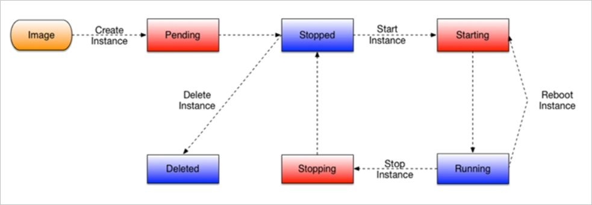

<a id="section-22-3"></a>

## 22.3. 公共错误码

表 1. 代码说明

| 错误代码 | Http 状态码 | 错误信息 |
| --- | --- | --- |
| IdempotentParameterMismatch | 400 | The request is retried with updated parameters. |
| IllegalTimestamp | 400 | The input parameter "Timestamp" that is mandatory for processing this request is not supplied. |
| IncompleteSignature | 400 | The request signature does not conform to Aliyun standards. |
| InvalidAccessKeyId.NotFound | 400 | The Access Key ID provided does not exist in our records. |
| InvalidOwner | 400 | OwnerId and OwnerAccount can't be used at one API access. |
| InvalidOwnerId | 400 | The specified OwnerId is not valid. |
| InvalidOwnerAccount | 400 | The specified OwnerAccount is not valid. |
| InvalidParamater | 400 | The specified parameter "SignatureMethod" is not valid. |
| InvalidParamater | 400 | The specified parameter "SignatureVersion" is not valid. |
| InvalidParameter | 400 | The specified parameter "Action or Version" is not valid. |
| InvalidParameter | 400 | The specified parameter is not valid. |
| InvalidParameter.IsNull | 400 | The required parameter must be not null. |
| MissingParameter | 400 | The input parameter "Action" that is mandatory for processing this request is not supplied. |
| MissingParameter | 400 | The input parameter "AccessKeyId" that is mandatory for processing this request is not supplied |
| MissingParameter | 400 | An input parameter "Signature" that is mandatory for processing the request is not supplied. |
| MissingParameter | 400 | The input parameter "Timestamp" that is mandatory for processing this request is not supplied. |
| MissingParameter | 400 | The input parameter "Version" that is mandatory for processing this request is not supplied. |
| SignatureNonceUsed | 400 | The request signature nonce has been used. |
| Throttling | 400 | You have made too many requests within a short time; your request is denied due to request throttling. |
| UnsupportedParameter | 400 | The parameter is unsupported. |
| UnknownError | 400 | The request processing has failed due to some unknown error. |
| Forbidden.AccessKeyDisabled | 403 | The Access Key is disabled. |
| Forbidden.NotSupportRAM | 403 | This action does not support accessed by RAM mode. |
| Forbidden.RAM | 403 | User not authorized to operate the specified resource, or this API doesn't support RAM. |
| Forbidden.RiskControl | 403 | This operation is forbidden by Aliyun Risk Control system. |
| Forbidden.SubUser | 403 | The specified action is not available for you。 |
| Forbidden.Unauthorized | 403 | User not authorized to operate on the specified resource. |
| InvalidAccount.NotFound | 403 | The specified Account does not exist. |
| InvalidAction | 403 | Specified action is not valid. |
| InvalidIdempotenceParameter.Mismatch | 403 | The specified parameters are different from before. |
| InvalidParameter.OwnerAccount | 403 | OwnerAccount is Invalid. |
| InvalidParameter.ResourceOwnerAccount | 403 | ResourceOwnerAccount is Invalid. |
| LastTokenProcessing | 403 | The last token request is processing. |
| MissingParameter | 403 | The input parameter OwnerId, OwnerAccount that is mandatory for processing this request is not supplied. |
| RealNameAuthenticationError | 403 | Your account has not passed the real-name authentication yet. |
| UnsupportedHTTPMethod | 403 | This http method is not supported. |
| InvalidDiskId.NotFound | 404 | The specified DiskId does not exist. |
| InvalidImageId.NotFound | 404 | The specified ImageId does not exist. |
| InvalidInstanceId.NotFound | 404 | The specified InstanceId does not exist. |
| InvalidRegionId.NotFound | 404 | The specified RegionId does not exist. |
| InvalidSecurityGroupId.NotFound | 404 | The specified SecurityGroupId does not exist. |
| InvalidSnapshotId.NotFound | 404 | The specified SnapshotId does not exist. |
| OperationConflict | 409 | Request was denied due to conflict with a previous request. |
| InternalError | 500 | The request processing has failed due to some unknown error, exception or failure. |
| ServiceUnavailable | 500 | The request has failed due to a temporary failure of the server. |
| ServiceUnavailable.RegionMaintaining | 503 | System maintenance is in progress on the selected region, please wait a few minutes before trying again. |

<a id="section-22-4"></a>

## 22.4. 云盘类型

本文描述了云服务器ECS支持的云盘类型及其相关信息。

| 云盘类型 | 参数取值（DiskCategory） | 单块最大容量 |
| --- | --- | --- |
| SSD盘 | cloud_ssd | 32768 GB |
| 共享SSD盘 | san_ssd | 32768 GB |
| 高效云盘 | cloud_efficiency | 32768 GB |
| 共享高效云盘 | san_efficiency | 32768 GB |
| 普通性能云盘 | cloud_sperf | 32768 GB |
| 高性能云盘 | cloud_pperf | 32768 GB |

更多云盘信息，请参见<strong>《云服务器ECS 用户指南》</strong>中的<strong>《云盘概述》</strong>章节。

<a id="section-22-5"></a>

## 22.5. 如何保证幂等性

当通过调用创建实例接口在 ECS 中创建云服务器时，如果遇到了请求超时或服务器内部错误时，客户端可能会尝试重发请求，这时客户端可以通过提供可选参数**ClientToken** 避免服务器创建出比预期要多的实例，也就是通过提供**ClientToken**参数保证请求的幂等性。

**ClientToken**是一个由客户端生成的唯一的、大小写敏感、不超过64个ASCII字符的字符串。

如果用户使用同一个**ClientToken**值调用创建实例接口，则服务端会返回相同的请求结果，包含相同的**InstanceId**。因此用户在遇到错误进行重试的时候，可以通过提供相同的**ClientToken**值，来确保 ECS 只创建一个实例，并得到这个实例的**InstanceId**。

如果用户提供了一个已经使用过的**ClientToken**，但其他请求参数不同，则ECS会返回**IdempotentParameterMismatch**的错误代码。但需要注意的是，**SignatureNonce**、**Timestamp**和**Signature**参数在重试时是需要变化的，因为 ECS 使用**SignatureNonce**来防止重放攻击，使用**Timestamp**来标记每次请求时间，所以再次请求必须提供不同的**SignatureNonce**和**Timestamp**参数值，这同时也会导致**Signature**值的变化。

通常，客户端只需要在500（InternalError）或503（ServiceUnavailable）错误、或者无法得到响应结果的情况下进行重试操作。返回结果是200时，重试可以得到上次相同的结果，但不会对服务端状态带来任何影响。而对 4xx 的返回错误，除非提示信息里明确出现“*try it later*”，通常重试也是不能成功的。

<a id="section-22-6"></a>

## 22.6. 实例被安全锁定时API的行为

被安全锁定指的是在DescribeInstanceAttribute返回的传出参数中的OperationLocks包含了LockReason: security。

和磁盘有关的行为在In_use的状态下依赖实例的OperationLocks，否则可以忽略实例的OperationLocks。

表 1. 行为接口说明

| 接口 | 行为 |
| --- | --- |
| AttachDisk | 报错 |
| AuthorizeSecurityGroup | 正常逻辑 |
| CreateDisk | 正常逻辑 |
| CreateImage | 正常逻辑 |
| CreateInstance | - |
| CreateSecurityGroup | 正常逻辑 |
| CreateSnapshot | 报错（只针对挂载在该实例上的磁盘，为<strong>运行中</strong>状态） |
| DeleteDisk | 正常逻辑 |
| DeleteImage | 正常逻辑 |
| DeleteInstance | 正常逻辑 |
| DeleteSecurityGroup | 正常逻辑 |
| DeleteSnapshot | 正常逻辑 |
| DescribeAutoSnapshotPolicy | 正常逻辑 |
| DescribeDisks | 正常逻辑 |
| DescribeImages | 正常逻辑 |
| DescribeInstanceAttribute | 正常逻辑 |
| DescribeInstanceStatus | 正常逻辑 |
| DescribeInstanceTypes | 正常逻辑 |
| DescribeInstanceMonitorData | 正常逻辑 |
| DescribeRegions | 正常逻辑 |
| DescribeSecurityGroupAttribute | 正常逻辑 |
| DescribeSecurityGroups | 正常逻辑 |
| DescribeSnapshotAttribute | 正常逻辑 |
| DescribeSnapshots | 正常逻辑 |
| DescribeZones | 正常逻辑 |
| DetachDisk | 报错 |
| JoinSecurityGroup | 报错 |
| LeaveSecurityGroup | 报错 |
| ModifyAutoSnapshotPolicy | 正常逻辑 |
| ModifyDiskAttribute | 正常逻辑 |
| ModifyInstanceAttribute | 报错 |
| RebootInstance | 报错 |
| ReInitDisk | 报错(In_use)，正常逻辑（其他状态） |
| ReplaceSystemDisk | 正常逻辑 |
| ResetDisk | 报错 |
| RevokeSecurityGroup | 正常逻辑 |
| StartInstance | 报错 |
| StopInstance | 报错 |

<a id="section-22-7"></a>

## 22.7. 时间格式ISO8601

国际标准化组织的国际标准 ISO 8601 是日期和时间的表示方法，全称为《数据存储和交换形式·信息交换·日期和时间的表示方法》，ECS Open API 的时间格式采用 ISO8601 格式。
