阿里云  
专有云  
云服务器ECS  
用户指南  
产品版本：V3.18.6  
文档版本：20251230

**目录**

- [1.什么是弹性云服务器ECS](#section-1)
    - [1.1. 概述](#section-1-1)
    - [1.2. 实例的生命周期](#section-1-2)
- [2.使用须知](#section-2)
    - [2.1. 建议](#section-2-1)
    - [2.2. 使用限制](#section-2-2)
    - [2.3. Linux操作系统注意事项](#section-2-3)
    - [2.4. Windows操作系统注意事项](#section-2-4)
    - [2.5. DDoS攻击防御须知](#section-2-5)
- [3.快速入门](#section-3)
    - [3.1. 快速入门概述](#section-3-1)
    - [3.2. 登录云服务器ECS控制台](#section-3-2)
    - [3.3. 创建安全组](#section-3-3)
    - [3.4. 创建实例](#section-3-4)
    - [3.5. 连接实例](#section-3-5)
        - [3.5.1. 连接实例概述](#section-3-5-1)
        - [3.5.2. Linux或Mac OS X环境中使用SSH命令连接Linux实例](#section-3-5-2)
        - [3.5.3. Windows环境中通过远程连接工具连接Linux实例](#section-3-5-3)
        - [3.5.4. Windows环境中通过远程桌面连接Windows实例](#section-3-5-4)
        - [3.5.5. 使用VNC连接实例](#section-3-5-5)
- [4.运营增效](#section-4)
    - [4.1. 配置组织监控阈值](#section-4-1)
    - [4.2. 查看组织监控列表](#section-4-2)
    - [4.3. 配置实例监控阈值](#section-4-3)
    - [4.4. 查看实例监控列表](#section-4-4)
    - [4.5. 回收实例资源](#section-4-5)
- [5.实例](#section-5)
    - [5.1. 实例概述](#section-5-1)
    - [5.2. 创建实例](#section-5-2)
    - [5.3. 克隆实例](#section-5-3)
    - [5.4. 连接实例](#section-5-4)
        - [5.4.1. 连接实例概述](#section-5-4-1)
        - [5.4.2. 通过Workbench连接实例](#section-5-4-2)
            - [5.4.2.1. 使用Workbench工具以SSH协议登录Linux实例](#section-5-4-2-1)
            - [5.4.2.2. 使用Workbench工具以RDP协议登录Windows实例](#section-5-4-2-2)
            - [5.4.2.3. 文件管理](#section-5-4-2-3)
            - [5.4.2.4. 命令行审计](#section-5-4-2-4)
        - [5.4.3. 通过第三方客户端工具连接实例](#section-5-4-3)
            - [5.4.3.1. Linux或Mac OS X环境中使用SSH命令连接Linux实例](#section-5-4-3-1)
            - [5.4.3.2. Windows环境中通过远程连接工具连接Linux实例](#section-5-4-3-2)
            - [5.4.3.3. Windows环境中通过远程桌面连接Windows实例](#section-5-4-3-3)
        - [5.4.4. 通过VNC连接实例](#section-5-4-4)
            - [5.4.4.1. Windows环境中安装证书](#section-5-4-4-1)
            - [5.4.4.2. 使用VNC连接实例](#section-5-4-4-2)
    - [5.5. 管理实例状态](#section-5-5)
        - [5.5.1. 停止实例](#section-5-5-1)
        - [5.5.2. 启动实例](#section-5-5-2)
        - [5.5.3. 重启实例](#section-5-5-3)
        - [5.5.4. 删除实例](#section-5-5-4)
    - [5.6. 管理实例属性](#section-5-6)
        - [5.6.1. 查看实例详情](#section-5-6-1)
        - [5.6.2. 修改实例属性](#section-5-6-2)
        - [5.6.3. 重置实例登录密码](#section-5-6-3)
        - [5.6.4. 修改VNC密码](#section-5-6-4)
        - [5.6.5. 关闭HT超线程](#section-5-6-5)
        - [5.6.6. 查看和修改CPU拓扑结构](#section-5-6-6)
        - [5.6.7. 开启和关闭实例释放保护](#section-5-6-7)
        - [5.6.8. 实例自定义数据](#section-5-6-8)
    - [5.7. 管理实例回收站](#section-5-7)
        - [5.7.1. 设置冷冻时长](#section-5-7-1)
        - [5.7.2. 恢复实例](#section-5-7-2)
        - [5.7.3. 彻底删除实例](#section-5-7-3)
    - [5.8. 变更实例规格](#section-5-8)
        - [5.8.1. 升降配实例规格](#section-5-8-1)
        - [5.8.2. 热变配实例规格](#section-5-8-2)
    - [5.9. 更换操作系统](#section-5-9)
    - [5.10. 查看实例监控信息](#section-5-10)
    - [5.11. 加入安全组](#section-5-11)
    - [5.12. 更换ECS实例的VPC](#section-5-12)
    - [5.13. 更换ECS实例的交换机](#section-5-13)
    - [5.14. 修改私网IP地址](#section-5-14)
    - [5.15. 分配IPv6地址](#section-5-15)
    - [5.16. 导出实例列表信息](#section-5-16)
    - [5.17. 管理NVIDIA驱动](#section-5-17)
        - [5.17.1. NVIDIA驱动安装指引](#section-5-17-1)
        - [5.17.2. 安装GPU驱动](#section-5-17-2)
            - [5.17.2.1. 在GPU计算型实例中安装GPU驱动（Linux）](#section-5-17-2-1)
            - [5.17.2.2. 在GPU计算型实例中安装GPU驱动（Windows）](#section-5-17-2-2)
        - [5.17.3. 安装GRID驱动](#section-5-17-3)
            - [5.17.3.1. 在GPU虚拟化型实例中安装GRID驱动（Linux）](#section-5-17-3-1)
            - [5.17.3.2. 在GPU实例上安装GRID驱动（Windows）](#section-5-17-3-2)
        - [5.17.4. 卸载NVIDIA驱动](#section-5-17-4)
            - [5.17.4.1. 卸载GPU驱动](#section-5-17-4-1)
            - [5.17.4.2. 卸载GRID驱动](#section-5-17-4-2)
        - [5.17.5. 更新NVIDIA驱动](#section-5-17-5)
    - [5.18. 超级计算集群（SCC）](#section-5-18)
        - [5.18.1. 超级计算集群概述](#section-5-18-1)
        - [5.18.2. 创建超级计算集群](#section-5-18-2)
        - [5.18.3. 添加节点到超级计算集群](#section-5-18-3)
        - [5.18.4. 查看超级计算集群](#section-5-18-4)
        - [5.18.5. 编辑超级计算集群属性](#section-5-18-5)
        - [5.18.6. 删除超级计算集群](#section-5-18-6)
    - [5.19. 裸机实例](#section-5-19)
        - [5.19.1. 创建裸机实例](#section-5-19-1)
        - [5.19.2. 批量创建裸机实例](#section-5-19-2)
        - [5.19.3. 重新申请实例](#section-5-19-3)
        - [5.19.4. 查看实例详情](#section-5-19-4)
        - [5.19.5. 管理实例状态](#section-5-19-5)
        - [5.19.6. 查询操作日志](#section-5-19-6)
- [6.云盘](#section-6)
    - [6.1. 云盘概述](#section-6-1)
    - [6.2. 创建云盘](#section-6-2)
    - [6.3. 挂载数据盘](#section-6-3)
    - [6.4. 磁盘分区及格式化](#section-6-4)
        - [6.4.1. Linux格式化数据盘](#section-6-4-1)
        - [6.4.2. Windows格式化数据盘](#section-6-4-2)
    - [6.5. 查看云盘详情](#section-6-5)
    - [6.6. 使用快照回滚云盘](#section-6-6)
    - [6.7. 变更云盘类型](#section-6-7)
    - [6.8. 修改云盘属性](#section-6-8)
    - [6.9. 修改云盘名称和描述](#section-6-9)
    - [6.10. 克隆云盘](#section-6-10)
    - [6.11. 扩容云盘](#section-6-11)
    - [6.12. 支持NVMe协议和多重挂载功能](#section-6-12)
        - [6.12.1. 支持NVMe协议的云盘概述](#section-6-12-1)
        - [6.12.2. 开启多重挂载功能](#section-6-12-2)
    - [6.13. 加密云盘](#section-6-13)
        - [6.13.1. 概述](#section-6-13-1)
        - [6.13.2. 加密系统盘](#section-6-13-2)
        - [6.13.3. 加密数据盘](#section-6-13-3)
    - [6.14. 重新初始化云盘](#section-6-14)
        - [6.14.1. 重新初始化系统盘](#section-6-14-1)
        - [6.14.2. 重新初始化数据盘](#section-6-14-2)
    - [6.15. 卸载数据盘](#section-6-15)
    - [6.16. 存储集](#section-6-16)
        - [6.16.1. 存储集概述](#section-6-16-1)
        - [6.16.2. 创建存储集](#section-6-16-2)
        - [6.16.3. 查看存储集](#section-6-16-3)
        - [6.16.4. 修改存储集](#section-6-16-4)
        - [6.16.5. 删除存储集](#section-6-16-5)
    - [6.17. 释放数据盘](#section-6-17)
- [7.镜像](#section-7)
    - [7.1. 镜像概述](#section-7-1)
    - [7.2. 查看镜像相关实例](#section-7-2)
    - [7.3. 自定义镜像](#section-7-3)
        - [7.3.1. 自定义镜像概述](#section-7-3-1)
        - [7.3.2. 创建自定义镜像](#section-7-3-2)
        - [7.3.3. 编辑自定义镜像属性](#section-7-3-3)
        - [7.3.4. 查找自定义镜像](#section-7-3-4)
        - [7.3.5. 共享自定义镜像](#section-7-3-5)
            - [7.3.5.1. 共享自定义镜像](#section-7-3-5-1)
            - [7.3.5.2. 修改自定义镜像的共享范围](#section-7-3-5-2)
        - [7.3.6. 加密自定义镜像](#section-7-3-6)
        - [7.3.7. 设置自定义镜像启动模式](#section-7-3-7)
        - [7.3.8. 导入自定义镜像（Linux）](#section-7-3-8)
            - [7.3.8.1. Linux镜像导入流程](#section-7-3-8-1)
            - [7.3.8.2. 阿里云镜像规范（Linux）](#section-7-3-8-2)
            - [7.3.8.3. 制作Linux镜像文件](#section-7-3-8-3)
                - [7.3.8.3.1. 创建虚拟机并安装操作系统](#section-7-3-8-3-1)
                - [7.3.8.3.2. 安装NVMe驱动](#section-7-3-8-3-2)
                - [7.3.8.3.3. 安装cloud-init](#section-7-3-8-3-3)
                - [7.3.8.3.4. 安装virtio驱动](#section-7-3-8-3-4)
                - [7.3.8.3.5. 检测镜像是否符合规范](#section-7-3-8-3-5)
                - [7.3.8.3.6. 获取Linux镜像文件](#section-7-3-8-3-6)
            - [7.3.8.4. 转换镜像格式](#section-7-3-8-4)
            - [7.3.8.5. 导入镜像](#section-7-3-8-5)
        - [7.3.9. 导出自定义镜像](#section-7-3-9)
        - [7.3.10. 删除自定义镜像](#section-7-3-10)
    - [7.4. 公共镜像](#section-7-4)
        - [7.4.1. 公共镜像概述](#section-7-4-1)
        - [7.4.2. 查找公共镜像](#section-7-4-2)
    - [7.5. 共享镜像](#section-7-5)
        - [7.5.1. 共享镜像概述](#section-7-5-1)
        - [7.5.2. 查找共享镜像](#section-7-5-2)
    - [7.6. 企业共享镜像](#section-7-6)
        - [7.6.1. 企业共享镜像概述](#section-7-6-1)
        - [7.6.2. 查找企业共享镜像](#section-7-6-2)
    - [7.7. 裸机镜像](#section-7-7)
        - [7.7.1. 裸机自定义镜像](#section-7-7-1)
        - [7.7.2. 裸机公共镜像](#section-7-7-2)
- [8.快照](#section-8)
    - [8.1. 快照概述](#section-8-1)
    - [8.2. 快照链](#section-8-2)
    - [8.3. 快照原理](#section-8-3)
    - [8.4. 使用云盘快照](#section-8-4)
        - [8.4.1. 创建快照](#section-8-4-1)
        - [8.4.2. 查看快照详情](#section-8-4-2)
        - [8.4.3. 查看快照容量](#section-8-4-3)
        - [8.4.4. 使用快照回滚云盘](#section-8-4-4)
        - [8.4.5. 共享快照](#section-8-4-5)
        - [8.4.6. 使用快照创建自定义镜像](#section-8-4-6)
        - [8.4.7. 编辑快照](#section-8-4-7)
        - [8.4.8. 删除快照](#section-8-4-8)
    - [8.5. 使用快照一致性组](#section-8-5)
        - [8.5.1. 创建快照一致性组](#section-8-5-1)
        - [8.5.2. 查看快照一致性组详情](#section-8-5-2)
        - [8.5.3. 通过快照一致性组回滚云盘](#section-8-5-3)
        - [8.5.4. 删除快照一致性组](#section-8-5-4)
    - [8.6. 使用自动快照](#section-8-6)
        - [8.6.1. 创建自动快照策略](#section-8-6-1)
        - [8.6.2. 查看自动快照策略](#section-8-6-2)
        - [8.6.3. 修改自动快照策略](#section-8-6-3)
        - [8.6.4. 执行或取消自动快照策略](#section-8-6-4)
        - [8.6.5. 修改自动快照策略的共享范围](#section-8-6-5)
        - [8.6.6. 删除自动快照策略](#section-8-6-6)
- [9.安全组](#section-9)
    - [9.1. 安全组概述](#section-9-1)
    - [9.2. 创建安全组](#section-9-2)
    - [9.3. 添加安全组规则](#section-9-3)
    - [9.4. ECS实例加入安全组](#section-9-4)
    - [9.5. 查看安全组内弹性网卡](#section-9-5)
    - [9.6. 管理安全组](#section-9-6)
        - [9.6.1. 查看安全组详情](#section-9-6-1)
        - [9.6.2. 修改安全组](#section-9-6-2)
        - [9.6.3. 克隆安全组](#section-9-6-3)
        - [9.6.4. 实例移出安全组](#section-9-6-4)
        - [9.6.5. 安全组定时任务](#section-9-6-5)
        - [9.6.6. 删除安全组](#section-9-6-6)
    - [9.7. 管理安全组规则](#section-9-7)
        - [9.7.1. 修改安全组规则](#section-9-7-1)
        - [9.7.2. 克隆安全组规则](#section-9-7-2)
        - [9.7.3. 导出安全组规则](#section-9-7-3)
        - [9.7.4. 导入安全组规则](#section-9-7-4)
        - [9.7.5. 删除安全组规则](#section-9-7-5)
    - [9.8. 安全组模板](#section-9-8)
        - [9.8.1. 创建安全组模板](#section-9-8-1)
        - [9.8.2. 在安全组模板中添加安全组规则](#section-9-8-2)
        - [9.8.3. 管理安全组模板](#section-9-8-3)
        - [9.8.4. 删除安全组模板](#section-9-8-4)
    - [9.9. 管理参数模板](#section-9-9)
        - [9.9.1. 创建参数模板](#section-9-9-1)
        - [9.9.2. 查看参数模板](#section-9-9-2)
        - [9.9.3. 编辑参数模板](#section-9-9-3)
        - [9.9.4. 修改参数模板共享范围](#section-9-9-4)
        - [9.9.5. 删除参数模板](#section-9-9-5)
- [10.弹性网卡](#section-10)
    - [10.1. 弹性网卡概述](#section-10-1)
    - [10.2. 创建弹性网卡](#section-10-2)
    - [10.3. 绑定辅助弹性网卡到实例](#section-10-3)
    - [10.4. 配置辅助弹性网卡](#section-10-4)
    - [10.5. 查看弹性网卡](#section-10-5)
    - [10.6. 修改辅助网卡属性](#section-10-6)
    - [10.7. 从实例解绑辅助弹性网卡](#section-10-7)
    - [10.8. 删除辅助弹性网卡](#section-10-8)
- [11.密钥对](#section-11)
    - [11.1. 密钥对概述](#section-11-1)
    - [11.2. 创建密钥对](#section-11-2)
    - [11.3. 导入密钥对](#section-11-3)
    - [11.4. 查看密钥对](#section-11-4)
    - [11.5. 绑定密钥对](#section-11-5)
    - [11.6. 解绑密钥对](#section-11-6)
    - [11.7. 删除密钥对](#section-11-7)
    - [11.8. 添加或替换密钥对](#section-11-8)
    - [11.9. 查看公钥信息](#section-11-9)
- [12.部署集](#section-12)
    - [12.1. 概述](#section-12-1)
    - [12.2. 创建部署集](#section-12-2)
    - [12.3. 查看部署集](#section-12-3)
    - [12.4. 调整实例所属部署集](#section-12-4)
    - [12.5. 恢复部署集的异常实例](#section-12-5)
    - [12.6. 修改部署集信息](#section-12-6)
    - [12.7. 删除部署集](#section-12-7)
- [13.专属资源池](#section-13)
    - [13.1. 查看专属资源池](#section-13-1)
    - [13.2. 管理专属资源池中的实例状态](#section-13-2)
    - [13.3. 修改专属资源池](#section-13-3)
    - [13.4. 在专属资源池中创建实例](#section-13-4)
    - [13.5. 专属资源池共享设置](#section-13-5)
- [14.专有宿主机DDH](#section-14)
    - [14.1. 专有宿主机概述](#section-14-1)
    - [14.2. 在宿主机中创建实例](#section-14-2)
    - [14.3. 管理宿主机](#section-14-3)
        - [14.3.1. 创建专有宿主机](#section-14-3-1)
        - [14.3.2. 共享宿主机](#section-14-3-2)
        - [14.3.3. 删除专有宿主机](#section-14-3-3)
    - [14.4. 管理专属宿主机组](#section-14-4)
        - [14.4.1. 创建宿主机组](#section-14-4-1)
        - [14.4.2. 查看宿主机组](#section-14-4-2)
        - [14.4.3. 在宿主机组中添加专有宿主机](#section-14-4-3)
        - [14.4.4. 删除专有宿主机组](#section-14-4-4)
    - [14.5. 在DDH之间迁移ECS实例](#section-14-5)
- [15.运维与监控](#section-15)
    - [15.1. 云助手](#section-15-1)
        - [15.1.1. 云助手概述](#section-15-1-1)
        - [15.1.2. 配置云助手客户端](#section-15-1-2)
            - [15.1.2.1. 为云助手配置域名解析](#section-15-1-2-1)
            - [15.1.2.2. 停止或启动云助手客户端](#section-15-1-2-2)
        - [15.1.3. 使用云助手](#section-15-1-3)
            - [15.1.3.1. 创建与执行命令](#section-15-1-3-1)
            - [15.1.3.2. 执行已有命令](#section-15-1-3-2)
            - [15.1.3.3. 上传本地文件到ECS实例](#section-15-1-3-3)
            - [15.1.3.4. 克隆命令](#section-15-1-3-4)
            - [15.1.3.5. 删除命令](#section-15-1-3-5)
        - [15.1.4. Cron表达式](#section-15-1-4)
    - [15.2. 低峰期迁移事件](#section-15-2)
    - [15.3. 查看异步任务](#section-15-3)
    - [15.4. 安全组规则检测](#section-15-4)
    - [15.5. 查看操作日志](#section-15-5)
    - [15.6. 查看实例的系统日志和屏幕截图](#section-15-6)
    - [15.7. 计算-飞天助理使用指南](#section-15-7)
- [16.RAM角色授权](#section-16)
    - [16.1. 授予实例RAM角色](#section-16-1)
    - [16.2. 更换实例RAM角色](#section-16-2)
    - [16.3. 收回实例RAM角色](#section-16-3)

<a id="section-1"></a>

# 1.什么是弹性云服务器ECS

<a id="section-1-1"></a>

## 1.1. 概述

云服务器ECS（Elastic Compute Service）提供一种处理能力可弹性伸缩的计算服务，它的管理方式比物理服务器更简单高效。根据业务需要，您可以随时创建实例、扩容磁盘或批量删除多台云服务器实例。

云服务器ECS（以下简称ECS实例）是一个虚拟的计算环境，包含CPU、内存等最基础的计算组件，是云服务器呈献给每个用户的实际操作实体。ECS实例是云服务器最为核心的概念，您可以通过ECS管理控制台完成对ECS实例的一系列操作。其他资源，包括块存储、镜像、快照等，只有与ECS实例结合后才能使用

块存储

实例规格

镜像

云服务器 ECS

快照

安全组

带宽

ECS管理控制台

<a id="section-1-2"></a>

## 1.2. 实例的生命周期

ECS实例的生命周期，即从实例创建开始到实例释放结束。本节将对实例的状态、状态属性以及对应的API状态进行详细说明。

在整个生命周期中，控制台中的实例可能状态的说明以及对应的API状态如下表所示。

| 状态 | 状态属性 | 说明 | API 的对应状态 |
| --- | --- | --- | --- |
| 准备中 | 中间状态 | 实例正在创建，等待启动。如果长时间处于该状态，则说明出现异常。 | Preparing |
| 启动中 | 中间状态 | 在控制台或通过 API 对实例执行重启、启动等操作后，实例进入<strong>运行中</strong>之前的状态。如果长时间处于该状态，则说明出现异常。 | Starting |
| 运行中 | 稳定状态 | 实例处于<strong>运行中</strong>状态。<br>重要实例处于Running状态仅代表实例已经运行，类似于对电脑进行开机，但实例的操作系统并不一定已经运行。只有当实例的操作系统运行起来后，网络服务才能正常工作，才可以通过SSH、RDP等方式进行远程访问，实例在线挂载网卡、云盘前也需要确保操作系统已启动。 | Running |
| 停止中 | 中间状态 | 在控制台或通过 API 对实例执行停止操作后，实例进入停止之前的状态。如果长时间处于该状态，则说明出现异常。 | Stopping |
| 已停止 | 稳定状态 | 表示实例已被正常停止。在这个状态下的实例，不能对外提供业务。 | Stopped |
| 变配中 | 中间状态 | 在控制台或通过 API 对实例执行<strong>升降配</strong>或<strong>热变</strong><strong>配</strong>时实例的状态。如果长时间处于该状态，则说明出现异常。 | Changing |
| 已停止-等待释放 | 稳定状态 | 在控制台或通过 API 对实例执行删除操作时勾选<strong>放入回收站</strong>时实例的状态。 | Stopped - Pending Release |

API状态的转换流程如下图所示。

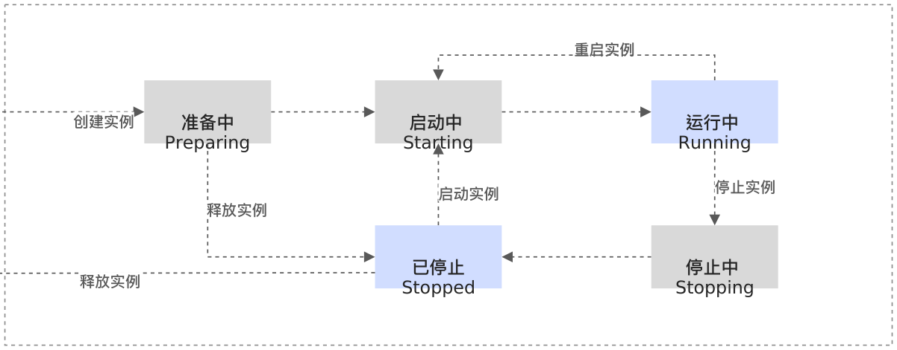


稳定状态

中间状态

<a id="section-2"></a>

# 2.使用须知

<a id="section-2-1"></a>

## 2.1. 建议

为了更好地使用ECS，您需要在使用前了解一些操作建议。

- 对于 4 GiB 及以上内存的云服务器，请选择 64 位操作系统（ 32 位操作系统存在 4 GiB 的内存寻址限制）。

- Windows 32 位操作系统支持的最高 CPU 核数为 4 核。

- 为保证服务的连续性，避免因宕机迁移而导致服务不可用，建议把相关软件设置成开机启动。

<a id="section-2-2"></a>

## 2.2. 使用限制

使用ECS实例前，您需要了解ECS实例相关的使用限制。

**基本限制**

- Windows不支持内存2 GiB以下的实例规格。

- 暂不支持虚拟化软件安装和再进行虚拟化（例如安装使用VMware）。

- 暂不支持声卡应用（目前仅GPU实例支持模拟声卡）、直接加载外接硬件设备（如硬件加密狗、U盘、外接硬盘、银行U key等）。

- 暂不支持多播协议。如果需要使用多播，建议改为使用单播点对点方式。

**规格限制**

**块存储**

| 限制项 | 限制 | 提升限额的方式 |
| --- | --- | --- |
| 单实例系统盘数量 | 1块 | 无 |

<table>
  <tr>
    <td>单实例数据盘数量</td>
    <td>64块<br>说明<br>• 一台ECS实例最多可挂载64块数据盘，不同实例规格支持挂载的最多云盘数量不同。对于实例规格支持挂载的云盘数量上限，可以通过DescribeInstanceTy pes接口查询（DiskQuantity）。<br>• 创建实例时最多可挂载16块数据盘，如果实例需要更多数据盘，需要在创建实例后继续挂载。</td>
    <td>无</td>
  </tr>
  <tr>
    <td>单块系统盘容量</td>
    <td>• Windows Server：40 GiB~2048 GiB<br>• Red Hat：40 GiB~2048 GiB<br>• CoreOS与FreeBSD：30 GiB~2048 GiB<br>• 其他Linux：20 GiB~2048 GiB</td>
    <td>无</td>
  </tr>
  <tr>
    <td>单块数据盘容量</td>
    <td>与数据盘类型有关：<br>• SSD盘、高效云盘、普通性能云<strong>盘：</strong>20 GiB~32,768 GiB。<br>• <strong>高性能云盘：</strong>20 GiB~131,072 GiB。</td>
    <td>无</td>
  </tr>
  <tr>
    <td>系统盘挂载点范围</td>
    <td>/dev/vda</td>
    <td>无</td>
  </tr>
  <tr>
    <td>数据盘挂载点范围</td>
    <td>/dev/vd[b-z]</td>
    <td>无</td>
  </tr>
  <tr>
    <td>整机镜像的数据盘加密</td>
    <td>• 整机镜像创建ECS实例时，若整机镜像的数据盘快照未加密，不支持加密高效云盘或SSD盘类型的整机镜像数据盘。<br>• 整机镜像创建ECS实例时，若整机镜像的数据盘快照已加密，不支持自定义高效云盘或SSD盘类型的整机镜像数据盘的加密方式。</td>
    <td>无</td>
  </tr>
  <tr>
    <td>ECS实例所在物理机挂载的云盘上限</td>
    <td>250块</td>
    <td>无</td>
  </tr>
</table>

**快照**

| 限制项 | 限制 | 提升限额方式 |
| --- | --- | --- |
| 当前账户快照数量 | 100,000 | 无 |
| 每块云盘可以保留的手动快照个数 | 256 | 无 |
| 每块云盘可以保留的自动快照个数 | 1,000 | 无 |
| 一个账号在一个地域可以保留的自动快照策略数量 | 100 | 无 |
| 启用极速可用功能的快照 | 10 | 无 |

**镜像**

| 限制项 | 限制 | 提升限额方式 |
| --- | --- | --- |
| 当前账户镜像数量 | 100,000 | 无 |
| 单个镜像最多可共享的用户数量 | 50 | 无 |
| 镜像与实例规格的限制 | 4 GiB及以上内存的实例规格不能使用32位镜像。 | 无 |

**SSH密钥对**

| 限制项 | 限制 | 提升限额方式 |
| --- | --- | --- |
| 一个账号在每个地域的SSH密钥对配额 | 500 | 无 |
| 支持SSH密钥对的实例规格 | 不支持系列I的非I/O优化实例 | 无 |
| 支持SSH密钥对的镜像类型 | 仅支持Linux系统 | 无 |

**部署集**

| 限制项 | 限制 | 提升限额方式 |
| --- | --- | --- |
| 部署集数量 | 5000 | 无 |

**安全组**

<table>
  <tr>
    <th>限制项</th>
    <th>普通安全组限制</th>
    <th>企业安全组限制</th>
  </tr>
  <tr>
    <td>安全组总数量上限</td>
    <td>100,000</td>
    <td>与普通安全组相同</td>
  </tr>
  <tr>
    <td>安全组能容纳的ECS实例数量</td>
    <td>不固定，受安全组能容纳的私网IP地址数量影响。</td>
    <td>无限制</td>
  </tr>
  <tr>
    <td>一台ECS实例可以加入的安全组数量</td>
    <td rowspan="2">10</td>
    <td rowspan="2">与普通安全组相同</td>
  </tr>
  <tr>
    <td>一台ECS实例的每张弹性网卡可以加入的安全组数量</td>
  </tr>
  <tr>
    <td>一个安全组最大规则数量（包括入方向规则与出方向规则）</td>
    <td>1,000，且所有安全组共享总上限为1000</td>
    <td>与普通安全组相同</td>
  </tr>
  <tr>
    <td>一张弹性网卡在所有已加入的安全组中的最大规则数量（包括入方向规则与出方向规则）</td>
    <td>1,000，且所有安全组共享总上限为1000</td>
    <td>与普通安全组相同</td>
  </tr>
  <tr>
    <td>一个专有网络VPC类型的安全组能容纳的私网IP地址数量</td>
    <td>2,000</td>
    <td>65,536</td>
  </tr>
</table>

**云助手**

| 限制项 | 限制 | 提升限额方式 |
| --- | --- | --- |
| 云助手命令总数量上限 | 无限制 | 无 |
| 云助手任务执行记录保留时长 | 28天 | 无 |
| 云助手任务执行记录保留数量上限 | 100,000 | 无 |
| 云助手托管实例激活码数量上限 | 5,000 | 无 |

**弹性网卡**

| 限制项 | 限制 | 提升限额方式 |
| --- | --- | --- |
| 弹性网卡（辅助网卡）创建限额 | 一个账号在一个地域内可以创建的弹性网卡数量有限。具体数量以Apsara Uni-manager运营控制台<strong>配额概览</strong>显示的数量为准。 | 无 |

**实例规格族ga1**

创建ga1规格族实例，您需要使用以下预装驱动的镜像：

- Ubuntu16.04版预装AMD GPU驱动

- Windows Server 2016中文版预装AMD GPU驱动

- Windows Server 2008 R2中文版预装AMD GPU驱动

注意事项：

- ga1实例使用的驱动是阿里云和AMD合作提供的优化版本驱动。目前只通过阿里云提供的镜像对外输出，不提供驱动的下载链接，暂不支持您自行安装驱动。

- 卸载或删除GPU驱动相关组件造成驱动不能正常工作的情况，您需要通过更换系统盘的方式恢复GPU的相关功能。

  > **说明**
  >
  > 更换系统盘操作会造成数据丢失。

- 创建GPU可视化计算ga1实例时，选择其他的镜像会造成实例的驱动不能正常工作，您需要通过更换系统盘的方式重新选择预安装AMD GPU驱动的镜像。

- 对于Windows Server 2008及以下版本的系统，GPU驱动安装生效后，云控制台的登录VNC功能将不可用，管理终端始终显示黑屏或停留在启动界面。请通过其他协议进入系统，如Windows自带的远程桌面连接（RDP）。

- Windows自带的远程连接（RDP）协议不支持DirectX、OpenGL等相关应用，您需要自行安装VNC服务和客户端，或其他支持的协议，例如PCOIP、XenDeskop HDX 3D等。

**实例规格族gn4、gn5i和gn5**

- 带宽：如果使用Windows Server 2008 R2镜像，GPU驱动安装生效后，您将不能正常使用云控制台的登录VNC功能连接gn4实例。您需要将带宽设置为一个非零值或者创建实例后绑定弹性外网IP。

- 镜像：不需要预装NVIDIA GPU驱动，可以选择任意一种镜像创建实例，然后再手动为实例安装NVIDIA GPU驱动，具体操作，请参见NVIDIA驱动安装指引

<a id="section-2-3"></a>

## 2.3. Linux操作系统注意事项

使用Linux操作系统前，请先了解使用过程中的相关注意事项。

- 不要修改Linux实例默认的/etc/issue文件内容。否则，根据实例创建的自定义镜像的系统发行版本无法被正确识别，使用该镜像创建的实例无法正常启动。

- 不要随意更改根目录所在分区下各个目录的权限，尤其是 /etc、/sbin、/bin、/boot、/dev、/usr和 /lib等目录的权限。如果权限更改不当会导致系统出现异常。

- 不要重命名、删除或禁用Linux下的root账号。

- 不要编译Linux系统的内核，或对内核进行任何其他操作。

  以升级Linux系统的内核为例，风险说明如下：

  升级云服务器的内核会引起云服务器操作系统核心组件发生重大变更，可能带来风险和潜在问题，您需要根据实际情况仔细评估，并自行处理相关问题。

  如果您升级的内核版本不属于操作系统本身yum源中支持的内核版本，可能会出现如下常见的风险和潜在问题：

  - 系统稳定性：新内核可能会导致您的操作系统出现稳定性问题。操作前，请确保您已充分验证该升级操作。

  - 软件兼容性：某些在旧内核上运行良好的软件可能在新内核上无法正常运行。您需要进行相应的更新软件或进行配置调整。

  - 内核选项和功能：升级可能会改变默认的内核选项和功能，这可能会影响系统的性能和功能。

  - 安全问题：新内核可能包含未知的安全漏洞。

  - 支持问题：使用非官方内核时，您可能会失去某些官方提供的技术支持或无法获得内核相关的安全更新。

  - 回滚困难：如果升级后出现问题，回滚到旧版本的内核可能会很困难。如果您的目标云服务器处于生产环境中，请您谨慎操作。

- 除CentOS，RedHat，其他Linux系统不要开启SELinux。

- 不要随意修改网卡MAC地址。

- 不建议使用Swap分区。

- 不要开启NetWorkManager服务。该服务会与系统内部网络服务发生冲突，导致网络异常。

<a id="section-2-4"></a>

## 2.4. Windows操作系统注意事项

使用Windows操作系统前，请先了解使用过程中的相关注意事项。

- 若实例使用本地盘作为数据盘时，存在丢失数据的风险。如果您不能保证数据架构的可靠性，强烈建议您使用云盘搭建您的实例。

- 不要关闭Windows系统自带的shutdownmon.exe进程。关闭这个进程可能会使服务器重启时间变长。

- 不要重命名、删除或禁用Windows下的Administrator账号，以免影响服务器使用。

- 不建议使用虚拟内存。

- 不要卸载PVDriver。

- 不要随意修改网卡MAC地址。

- 如果您修改了计算机名，一定要同步注册表中的下列相关键值，否则您无法成功修改计算机名，进而导致无法安装某些第三方程序。注册表中需要修改的键值如下：

  ```text
  HKEY_LOCAL_MACHINE\SYSTEM\ControlSet001\Control\ComputerName\ActiveComputerName
  ```

  ```text
  HKEY_LOCAL_MACHINE\SYSTEM\CurrentControlSet\Control\ComputerName\ComputerName
  ```

<a id="section-2-5"></a>

## 2.5. DDoS攻击防御须知

您需要购买云盾高级版才有DDoS攻击防御能力。具体操作方式请参见<strong>《云盾产品简介》</strong>。

<a id="section-3"></a>

# 3.快速入门

<a id="section-3-1"></a>

## 3.1. 快速入门概述

本节介绍如何快速创建并连接实例，旨在引导您一站式完成准备工作。

准备工作的简单流程如下：

1. 创建安全组

   安全组是一种虚拟防火墙，用来控制ECS实例的出站和入站流量。一台ECS实例必须至少属于一个安全组。在创建实例时，您需要选择一个安全组用于网络访问控制。

2. 创建实例

   一个ECS实例等同于一台虚拟机，包含CPU、内存、操作系统、网络、磁盘等基础组件。完成安全组创建后，您可以根据业务需求选择实例规格创建实例。

3. 连接实例概述

   根据ECS实例的网络设置和操作系统，以及您本地设备的操作系统，您可以通过选择不同方式远程连接实例，并在实例上进行安装应用等操作。

<a id="section-3-2"></a>

## 3.2. 登录云服务器ECS控制台

本章节介绍如何登录云服务器ECS控制台。

**前提条件**

- 登录Apsara Uni-manager运营控制台前，确认您已从部署人员处获取Apsara Uni-manager运营控制台的服务域名地址。

- 推荐使用Chrome浏览器。

**操作步骤**

1. 在浏览器地址栏中，输入Apsara Uni-manager运营控制台的服务域名地址，按回车键。

2. 输入正确的用户名及密码。

   > **说明**
   >
   > - 请向运营管理员获取登录控制台的用户名和密码。
   >
   > - 首次登录Apsara Uni-manager运营控制台时，需要修改登录用户名的密码，请按照提示完成密码修改。为提高安全性，密码长度必须为10~32位，且包含英文字母大小写、阿拉伯数字和特殊符号（感叹号（!）、at（@）、井号（#）、美元符号（$）、百分号（%）等）。

3. 单击**登录**。

4. 如果账号已激活MFA多因素认证，请根据以下两种情况进行操作：

   - 管理员强制开启MFA后的首次登录：

     <ol type="a">

     <li>

     在绑定虚拟MFA设备页面中，按页面提示步骤绑定MFA设备。

     </li>

     <li>

     按照步骤2重新输入账号和密码，单击**登录**。

     </li>

     </ol>

     <ol type="i" start="100">

     <li>

     输入6位MFA码后单击**认证**。

     </li>

     </ol>

   - 您已开启并绑定MFA：

     输入6位MFA码后单击**认证**。

     > 绑定并开启MFA的操作请参见<strong>《Apsara Uni-manager运营控制台用户指南》</strong>中的
     >
     > **说明**
     >
     > 章节<strong>《绑定并开启虚拟MFA设备》</strong>。

5. 在页面顶部的导航栏中，选择**产品 > 计算 > 云服务器ECS**。

<a id="section-3-3"></a>

## 3.3. 创建安全组

安全组可用于设置单台或多台ECS实例的网络访问控制，是重要的网络安全隔离手段。

**背景信息**

对同一账号、同一地域、同一个专有网络的实例，属于同一个安全组时默认内网互通，属于不同安全组时可以通过安全组授权实现内网互通。

**操作步骤**

1. 登录云服务器ECS控制台。

2. 在左侧导航栏中，选择**网络和安全 > 安全组**。

3. 在顶部菜单栏处，选择组织、资源集和地域。

4. 单击**创建安全组**。

5. 配置安全组属性。

   **类型**

   **配置项**

   **是否必选**

   **说明**

   安全组所属的组织，确保与专有网络的所属的组织相

   是

   **组织**

   同。

   安全组所属的资源集，确保与专有网络的所属的资源集

   是

   **区域**

   **资源集**

   相同。

   安全组所属的地域，确保与专有网络的所属的地域相

   是

   **地域**

   同。

   安全组可共享的范围，支持：**本资源集**、**本组织及下级组织**、**本组织**。

   > **说明**

   否

   **共享范围**

   > 若要修改安全组共享范围，请在对应安全组的**操作**列选择
   >
   > **> 共享设置**进行调整。
   >
   > 

   选择已创建的安全组模板。更多信息，请参见创建安全

   否

   **安全组模板**

   组模板。

   安全组的类型，支持选择以下类型。

   - **普通安全组**：支持组内互通功能，支持添加授权安全组访问的规则，但可容纳的私网IP数量小于企业级安

   是

   全组。

   **安全组类型**

   - **企业级安全组**：可以容纳更多的私网IP地址数量，但不支持组内互通功能，也不支持添加授权安全组访问的规则。

   **基本配置**

   选择已创建的VPC，或者单击**创建VPC**即时创建VPC。

   VPC创建完成后，返回**创建安全组**页面并单击  图标，

   是

   **VPC**

   查看最新的VPC列表。创建VPC的具体参数说明，请参见<strong>《专有网络VPC用户指南》</strong>中的<strong>《创建专有网络》</strong>章节。

   安全组的名称。

   长度为2~128个字符，以英文字母或中文开头，可包含

   是

   **安全组名称**

   数字，支持下划线（_）、短划线（-）、半角冒号（:）特殊字符，不能以 `http://` 或 `https://` 开头。

   安全组的描述信息，方便后续管理。

   长度为2~256个字符，以英文字母或中文开头，可包含数字，支持下划线（_）、短划线（-）、全角句号（。

   否

   **描述**

   ）、全角逗号（，）、半角逗号（,）、全角冒号（：）、半角冒号（:）、斜杠（/）特殊字符，不能以 `http://` 或 `https://` 开头。

   选择**安全组模板**后才会显示该参数。

   启用后，模板规则变更将同步生效至关联的安全组，安

   否

   **是否同步**

   全组内无法修改规则。请在安全组模板中添加安全组规则。

6. 创建安全组。

   - 服务管理中已创建**云资源**为**安全组**的服务：确认安全组相关参数，单击**确认订单**。

   - 服务管理中未创建**云资源**为**安全组**的服务：确认安全组相关参数，单击**提交**。

   关于服务管理的更多信息，请参见<strong>《Apsara Uni-manager运营控制台 用户指南》</strong>中的<strong>《服务管理》</strong>章节。

**执行结果**

创建成功后，您可在**安全组**列表中查看新增的安全组。

**后续步骤**

- 创建安全组后，安全组中并没有安全组规则。您需要通过添加安全组规则，允许或禁止安全组内的ECS实例对公网或私网的访问。具体操作，请参见添加安全组规则。

- 每台ECS实例至少属于一个安全组，您可以根据业务需要，将ECS实例加入一个或多个安全组。具体操作，请参见ECS实例加入安全组。

<a id="section-3-4"></a>

## 3.4. 创建实例

一台ECS实例等同于一台虚拟机，包含CPU、内存、操作系统、网络、磁盘等基础组件。本文为您介绍创建一台或多台实例的具体操作。

**操作步骤**

> **重要**
>
> 创建ECS实例时具有一定限制，更多信息，请参见使用限制。

1. 登录云服务器ECS控制台。

2. 在左侧导航栏中，选择**实例与镜像 > ECS实例**。

3. 在顶部菜单栏处，选择组织、资源集和地域。

4. 单击**创建实例**。

5. （条件可选）选择服务目录，单击**确定**。

   服务管理用于在企业或组织内对某些产品的特定规格进行一定的管理与控制。仅当服务管理中配置了将ECS实例授权给当前组织或用户，并且该ECS实例资源已上架，才会显示此选项。关于服务管理的更多信息，请参见<strong>《Apsara Uni-manager运营控制台 用户指南》</strong>中的<strong>《服务管理》</strong>章节。

6. 配置实例的区域、实例规格、镜像、存储等信息。

7. 在最终创建实例前，请在页面右侧检查实例的整体配置并配置使用时长等选项，确保符合您的要求。

8. 创建实例。

   - 服务管理中已创建**云资源**为**ECS实例**的服务：在**信息确认**页面，检查实例的基础配置、网络配置、系统配置等信息，确保各项配置符合您的要求，然后单击**确认订单**。

   - 服务管理中未创建**云资源**为**ECS实例**的服务：在**信息确认**页面，检查实例的基础配置、网络配置、系统配置等信息，确保各项配置符合您的要求，然后单击**提交**。

**配置项说明**

**区域信息**

| 配置项 | 是否必选 | 说明 |
| --- | --- | --- |
| 组织/资源集 | 是 | 选择实例所属的组织和资源集。 |
| 地域/可用区 | 是 | 选择实例所属的地域和可用区。可用区指在同一区域下，电力、网络隔离的物理区域，可用区之间内网互通，不同可用区之间做到故障隔离。如果您需要提高应用程序的高可用性，建议您将实例创建在不同的可用区内。 |

**实例**

实例规格定义了ECS实例在计算性能、存储性能、网络性能等方面的基础属性，但需要同时配合镜像、块存储、网络等配置才能确定一台ECS实例的具体服务形态。

> **说明**
>
> 配额余量展示了当前地域、组织和资源集下的CPU、GPU及内存配额，如配额不足，请单击  图标查
>
> 看并设置配额。

| 配置项 | 是否必选 | 说明 |
| --- | --- | --- |
| 开启热变配 | 否 | 热变配支持在不停止实例的情况下变更实例规格。更多信息，请参见热变配实例规格。<br>• 如果您实际部署环境上有支持热变配的实例规格，则热变配开关默认开启，此时，实例规格列表会默认筛选支持热变配的实例规格。<br>说明如果您无须热变配，直接关闭热变配开关即可查看全量规格信息。<br>• 如果您实际部署环境上没有支持热变配的实例规格，则热变配开关默认关闭，实例规格列表中显示全量规格信息。 |
| 筛选 | 否 | 您可以根据实际情况选择CPU、内存、GPU或输入实例规格模糊筛选目标实例规格。 |
| CPU类型 | 是 | 实例的CPU类型，取值范围：<br>• Intel/X86<br>• 海光/X86<br>• 鲲鹏/ARM<br>• 飞腾/ARM<br>• 倚天/ARM<br>• 兆芯/X86<br>• 其他<br>说明支持的CPU类型以您实际部署环境上的ECS控制台显示为准。 |

<table>
  <tr>
    <td>分类</td>
    <td>是</td>
    <td>实例类型，取值范围：<br>• 独享型<br>• 共享型<br>• 本地SSD盘<br>• 本地HDD盘<br>• 超级计算集群<br>• 弹性裸金属服务器<br>• 其他<br>说明支持的实例类型以您实际部署环境上的ECS控制台显示为准。</td>
  </tr>
  <tr>
    <td>实例规格</td>
    <td>是</td>
    <td>实例的实例规格。实例规格列表显示实例规格族、实例规格、规格族级别、状态、CPU类型、CPU核数、内存、内网带宽和磁盘数量等信息，请根据实际应用需要选择对应实例规格。更多实例规格族与实例规格信息，请参见专有云文档中心<strong>《实例规格族&amp;实例规格》</strong>文档。<br>重要<br>• 实例规格的<strong>状态</strong>分为<strong>可用</strong>、<strong>售罄</strong>和<strong>禁用</strong>，但您只能选择<strong>可用</strong>状态的实例规格。、<br>• 如果创建实例时选择了服务目录，则可创建的实例规格受服务目录限制。具体操作，请参见<strong>《Apsara Uni-</strong><strong>manager运营控制台 用户指南》</strong>中的<strong>《示例：创建服</strong><strong>务器ECS实例服务》</strong>章节。<br>部分CPU和内存的组合不能选择Windows Server的镜像，更多信息，请参见使用限制。<br>重要<br>• 如果您选择创建GPU实例，则需要在GPU实例上手动安装对应操作系统的GPU驱动。除驱动差异外，GPU实例管理操作与使用其他实例规格创建的实例一致。以NVIDIA厂商GPU为例，安装GPU驱动的具体操作，请参见NVIDIA驱动安装指引。其他厂商GPU的驱动安装操作，请参考对应的GPU厂商官网文档。<br>• 如果您选择创建超级计算集群SCC规格的ECS实例，则创建实例时，您需要额外设置<strong>超级计算集群</strong>参数，无<strong>部</strong><strong>署集</strong>相关参数。同时，<strong>VPC</strong>与<strong>安全组</strong>参数可能会受到超级计算集群的专有网络ID与安全组ID的影响。更多超级计算集群信息，请参见超级计算集群概述。</td>
  </tr>
  <tr>
    <td>超级计算集群</td>
    <td>由<strong>分类</strong>和实例规格共同决定</td>
    <td>实例所在的超级计算集群ID。您可以选择已创建的超级计算集群，或者单击<strong>创建新集群</strong>即时创建超级计算集群，创建完成后，返回ECS实<br>例创建向导并单击图标，查看最新的超级计算集群列表。创建超级<br>计算集群的具体操作，请参见创建超级计算集群。仅当<strong>分类</strong>为<strong>超级计算集群</strong>，且已选中SCC实例规格后，才能查看和选择该参数。此时，该参数是必选项。</td>
  </tr>
  <tr>
    <td>集群实例数</td>
    <td>由<strong>超级计算集</strong><strong>群</strong>决定</td>
    <td>实例所在的超级计算集群下的节点数量（即ECS实例数量）。选择<strong>超级计算集群</strong>后，会自动填写该参数，且不支持修改。</td>
  </tr>
  <tr>
    <td>HT超线程技术</td>
    <td>否</td>
    <td>仅部分实例规格支持，单击<strong>展示高级选项</strong>后可以设置<strong>HT超线程技术</strong>，更多HT 超线程技术说明，请参见关闭HT超线程。<br>• 开启：ECS实例的CPU物理核变成两个逻辑处理核。<br>• 关闭：ECS实例独占CPU物理核。</td>
  </tr>
  <tr>
    <td>CPU拓扑结构</td>
    <td>否</td>
    <td>支持选择<strong>HT连续模式</strong>和<strong>HT离散模式</strong>。仅部分实例规格支持，单击<strong>展示高级选项</strong>后可以修改CPU拓扑结构，更多CPU拓扑结构说明，请参见查看和修改CPU拓扑结构。<br>• HT连续模式：逻辑核心连续分配给物理核心，有助于减少线程之间的通信和竞争。适用于需要较低的访存延迟和更接近物理核心的计算任务，例如科学计算、数据分析、高性能计算等对内存访问和核心计算敏感的应用。<br>• HT离散模式：逻辑核心分散分配给物理核心，可以有助于减少多线程环境中的资源争夺，并提供更好的性能隔离。适用于工作负载中分配给各线程的任务相对独立，或者对单线程性能要求较高的场景。</td>
  </tr>
</table>

**镜像**

镜像提供了运行实例所需的信息，阿里云提供多种镜像来源供您方便地获取镜像。

| 配置项 | 是否必选 | 说明 |
| --- | --- | --- |
| 镜像类型 | 是 | 实例使用镜像的类型，支持<strong>公共镜像</strong>、<strong>自定义镜像</strong>和<strong>共享</strong><strong>镜像</strong>和<strong>企业共享镜像</strong>。<br>说明更多镜像信息，请参见镜像概述。 |
| 公共镜像 | 由<strong>镜像类型</strong>决定 | 实例使用的公共镜像，阿里云官方提供的镜像（不包含操作系统授权），安全性高，稳定性高。公共镜像包含了Windows Server系统镜像和主流的Linux系统镜像。<strong>镜像类型</strong>为<strong>公共镜像</strong>时是必选项。 |
| 支持 ecs-user 用户登录 | 由<strong>公共镜像</strong>决定 | 仅当创建Linux实例，且选择了支持ecs-user用户登录的公共镜像时，才会出现该配置项。<br>• 开启：使用ecs-user用户登录Linux实例。<br>• 关闭：使用root用户登录Linux实例。<br>警告root具有操作系统的最高权限，使用root作为用户名可能会导致安全风险，建议您使用普通用户ecs-user作为用户名。<br>支持的公共镜像如下：<br>• X86：<br>• Alibaba Cloud Linux 2：<br>• aliyun_2_1903_x86_64_20G_alibase_2024 0628.vhd<br>• aliyun_2_1903_x86_64_20G_dengbao_alib ase_20240705.vhd<br>• Alibaba Cloud Linux 3：<br>• aliyun_3_x86_64_20G_alibase_20241103.v hd<br>• aliyun_3_x86_64_20G_container_optimize d_20241226.vhd<br>• aliyun_3_x86_64_20G_dengbao_alibase_2 0241103.vhd<br>• aliyun_3_x86_64_20G_pro_alibase_202412 25.vhd<br>• aliyun_3_x86_64_20G_pro_dengbao_alibas e_20241030.vhd<br>• aliyun_4_x86_64_20G_alibase_20250728.v hd<br>• UOS：<br>• uos_20_1070a_x86_64_20G_alibase_2024 1129.vhd<br>• Arm：<br>• UOS<br>• uos_20_1070a_arm64_20G_uefi_alibase_2 0241119.vhd<br>• Alibaba Cloud Linux：<br>• aliyun_3_arm64_20G_uefi_dengbao_alibas e_20241103.vhd |
| 自定义镜像 | 由<strong>镜像类型</strong>决定 | 实例使用的自定义镜像，您使用实例或快照创建的镜像，或是您从本地导入的自定义镜像。<strong>镜像类型</strong>为<strong>自定义镜像</strong>时是必选项。 |
| 共享镜像 | 由<strong>镜像类型</strong>决定 | 实例使用的共享镜像，由其他一级组织主动共享给您组织使用的自定义镜像。<strong>镜像类型</strong>为<strong>共享镜像</strong>时是必选项。 |
| 企业共享镜像 | 由<strong>镜像类型</strong>决定 | 实例使用的企业共享镜像，由管理员在Apsara Uni-manager运维控制台上转化为企业共享镜像。<strong>镜像类型</strong>为<strong>企业共享镜像</strong>时是必选项。 |

**存储**

实例通过添加系统盘、数据盘获得存储能力。系统盘用于安装操作系统，数据盘用于存储应用数据。

> **说明**
>
> 配额余量展示了当前地域、组织和资源集下磁盘配额及不同云盘类型的配额，如配额不足，请单击 
>
> 图标查看并设置配额。

| 配置项 | 是否必选 | 说明 |
| --- | --- | --- |
| 创建方式 | 是 | 云盘的创建方式。取值范围：<strong>普通创建</strong>和<strong>存储集创建</strong>。如果需要指定存储集的分区中创建云盘，请选择<strong>存储集创</strong><strong>建</strong>。<br>重要<br>• 如果创建方式只有<strong>普通创建</strong>，则表示当前环境不支持存储集，请先进行存储集配置。<br>• 在存储集的分区创建云盘之前，请确保已创建存储集并配置分区。具体操作，请参见专有云文档中心<strong>《混合云存储CDS用户指</strong><strong>南》</strong>中的<strong>《创建存储集》</strong>章节。 |
| 存储集 | 由<strong>创建方式</strong>决定 | 选择已创建的存储集。<strong>创建方式</strong>为<strong>存储集创建</strong>时是必选项。 |
| 分区 | 由<strong>创建方式</strong>决定 | 分区编号。<strong>创建方式</strong>为<strong>存储集创建</strong>时是必选项。 |
| 系统盘 | 是 | 用于安装操作系统的磁盘。<br>• 支持的云盘类型，与部署的EBS集群有关。<br>• 全新部署的CDS-EBS集群，支持<strong>高性能云盘</strong>和<strong>普通</strong><strong>性能云盘</strong>。<br>• 从V3.15.0升级上来的CDS-EBS集群，支持<strong>高效云</strong><strong>盘</strong>、<strong>SSD盘</strong>、<strong>高性能云盘</strong>和<strong>普通性能云盘</strong>。<br>• 存量EBS集群，继续提供共享高效云盘和共享SSD盘。<br>• 系统盘的容量范围为：20 GiB~2048 GiB。<br>说明实际可设置的系统盘最低容量和镜像类型有关，具体容量以ECS控制台显示为准。<br>• 您可以根据实际需要设置系统盘的名称。如未设置，<br>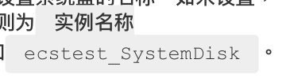<br>则系统盘默认命名规则为<code> </code>实例名称<code>_SystemDisk </code>，如<code> ecstest_SystemDisk </code>。<br>• 您可以对<strong>高性能云盘</strong>、<strong>普通性能云盘</strong>类型的系统盘设置<strong>加密</strong>。<br>• 实例规格与云盘类型存在约束限制，部分实例仅能使用特定类型的云盘。详细内容，请参考实例规格与云盘类型的约束限制。 |
| 加密 | 否 | 当系统盘类型为<strong>高性能云盘</strong>或<strong>普通性能云盘</strong>类型时支持加密。系统盘数据加密适用于数据安全或法规合规等场景，帮助您加密保护存储在ECS上的数据。更多信息，请参见加密系统盘。 |
| 数据盘 | 否 | 用于存储实例数据的磁盘。<br>• 支持的云盘类型，与部署的EBS集群有关。<br>• 全新部署的CDS-EBS集群，支持<strong>高性能云盘</strong>和<strong>普通</strong><strong>性能云盘</strong>。<br>• 从V3.15.0升级上来的CDS-EBS集群，支持<strong>高效云</strong><strong>盘</strong>、<strong>SSD盘</strong>、<strong>高性能云盘</strong>和<strong>普通性能云盘</strong>。<br>• 存量EBS集群，继续提供共享高效云盘和共享SSD盘。<br>• 最多可以添加16块数据盘。每个数据盘的最大容量与云盘类型有关：<br>• <strong>高效云盘</strong>、<strong>SSD盘</strong>和<strong>普通性能云盘</strong>：32768 GiB。<br>• <strong>高性能云盘</strong>：131072 GiB。<br>• 当<strong>数据盘</strong>选择为<strong>高效云盘</strong>或者<strong>SSD盘</strong>时，如果填写的容量超过2 TiB，注意按照以下EBS集群机器数量与推荐的云盘最大建议值（机器数量：云盘最大值）进行填写。<br>• 6台：2 TiB<br>• 12台：4 TiB<br>• 15台：5 TiB<br>• 24台：8 TiB<br>云盘最大建议值的计算公式为：云盘最大大小S = N/3，其中N为相应EBS集群的机器数量，结果向下取整。例如：如果EBS集群的机器数量为6台，则建议创建的云盘容量不超过2 TiB。<br>• 您可以根据实际需要设置数据盘的名称。<br>• 如未设置数据盘的名称，则数据盘默认命名规则为<code> </code>数据盘：实例名称<code>_dataDisk_*** </code>，如<code> ecstest_dataDisk_001 </code>、<code> ecstest_Da</code> <code>taDisk_002 </code>。<br>• 当您设置了数据盘的名称时，最终创建的数据盘名称与数据盘数量有关，具体如下：<br>• 如果数据盘的<strong>数量</strong>取值为<code> 1 </code>：<br>最终创建的数据盘名称显示为设置的数据盘名称，例如<code> testDataDisk </code>。<br>• 如果数据盘的<strong>数量</strong>取值≥<code> 2 </code>，即创建多个类型、容量等配置一样的数据盘：<br>最终创建的数据盘名称显示为<code> </code>设置的数据盘名称<code>_** </code>，例如创建2个数据盘且数据盘名称设置为<code> testDataDisk </code>，则创建的数据盘名称为<code> testDataDisk_01 </code>和<code> testDataDisk_</code><code>02 </code>。<br>• 您可以对每块数据盘设置<strong>随实例释放</strong>和<strong>加密</strong>。设置数据盘加密时，需要设置以下参数：<br>• <strong>加密方式</strong>：支持<strong>AES256</strong>和<strong>SM4</strong>。<br>• <strong>加密key</strong>：可选择<strong>密钥管理服务</strong>中创建的密钥。<br>• 实例规格与云盘类型存在约束限制，部分实例仅能使用特定类型的云盘。详细内容，请参考实例规格与云盘类型的约束限制。<br>说明如果不在这里添加数据盘，您还可以在创建实例后自行添加数据盘。具体操作，请参见挂载数据盘。 |
| 加密 | 否 | 当数据盘类型为<strong>高性能云盘</strong>或<strong>普通性能云盘</strong>类型时支持加密。系统盘数据加密适用于数据安全或法规合规等场景，帮助您加密保护存储在ECS上的数据。更多信息，请参见加密数据盘。 |
| 随实例释放 | 否 | • 勾选后：释放实例时会自动释放此云盘。<br>• 不勾选：当实例被释放时该云盘会被保留下来。 |


**网络**

网络和安全组配置为ECS实例提供了公网以及与其他资源通信的能力，并保障实例在网络中的安全性。

| 配置项 | 是否必选 | 说明 |
| --- | --- | --- |
| VPC/VSwitch | 是 | 专有网络是您在阿里云自己定义的一个隔离网络环境，您可以完全掌控自己的专有网络，例如选择IP地址范围、配置路由表和网关等。选择已创建的专有网络和交换机，或者单击<strong>创建</strong><strong>VPC</strong>、<strong>创建VSwitch</strong>即时创建专有网络和交换机，创建<br>完成后，返回ECS实例创建向导并单击图标，查看专<br>有网络和交换机列表。创建专有网络的具体操作，请参见专有云文档中心<strong>《专有网络VPC用户指南》</strong>中的<strong>《创建</strong><strong>和管理专有网络》</strong>和<strong>《创建和管理交换机》</strong>章节。<br>重要创建超级计算集群SCC规格的实例时，如果该超级计算集群已设置专有网络ID，则会自动填充超级计算集群的专有网络ID，并且不允许修改。更多信息，请参见添加节点到超级计算集群。 |
| 私网IP | 否 | 指定实例的私网IPv4地址，IP地址网段取决于交换机网段。如果私网选择随机分配，系统会自动分配私网IP。 |
| 公网IP | 否 | 如果实例需要进行公网通信，必须分配公网IP。您可以在创建实例时选择自动分配一个固定公网IP，或者创建实例后绑定弹性公网IP，具体操作，请参见<strong>《专有网</strong><strong>络VPC用户指南》</strong>中的<strong>《创建和管理EIP》</strong>章节。 |
| 带宽值(Mbit/s) | 否 | 选中<strong>分配公网 IPv4 地址</strong>时，必须设置带宽值（1~100）。 |
| 安全组 | 是 | 选择已创建的安全组，或者单击<strong>创建安全组</strong>即时创建安全<br>组，创建完成后，返回ECS实例创建向导并单击图<br>标，查看最新的安全组列表。创建安全组的具体操作，请参见创建安全组。支持为ECS实例同时选择多个安全组。<br>重要创建超级计算集群SCC规格的实例时，如果该超级计算集群已设置安全组ID，则会自动填充超级计算集群的安全组ID，并且不允许修改。更多信息，请参见添加节点到超级计算集群。 |
| IPv6 | 否 | IPv6的地址数量不仅能解决网络地址资源数量的问题，而且也解决了多种接入设备连入互联网的障碍。选中<strong>分配</strong>，创建实例后，您需要登录实例并在操作系统内部进行IPv6地址相关的配置，才能正常使用IPv6地址。 |
| 弹性网卡 | 否 | 选择已创建的弹性网卡，或者单击<strong>创建弹性网卡</strong>即时创建弹性网卡，创建完成后，返回ECS实例创建向导并单击<br>图标，查看专有网络和交换机列表。<br>说明创建实例时只能添加1块辅助网卡，您也可以在实例创建完成后单独创建辅助网卡并绑定至实例。 |

**管理配置**

**配置项**

**是否必选**

**说明**

在实例创建完成后，自行绑定密钥对或者重置实例密码。

**创建后设置**

选择已有的密钥对，或者单击**创建密钥对**即时创建密钥

对。创建完成后，返回ECS实例创建向导并单击  图

标，查看最新的密钥对列表。具体操作，请参见创建密钥对。

> **重要**
>
> 仅Linux实例支持使用密钥对登录。

**密钥对**

用户名支持设置为**root**或**ecs-user**。只有当您选择了支持ecs-user用户登录的镜像，并且开启了**支持 ecs-user 用户登录**功能时，登录名为**ecs-user**，否则登录名均为**root**。

> **警告**
>
> root具有操作系统的最高权限，使用root作为登录名可能会导致安全风险，建议您使用普通用户ecs-user作为登录名。

输入并确认密码。使用登录名和密码登录实例时，用户名

**登录凭证**

信息如下：

- Linux实例：支持设置为**root**或**ecs-user**。只有当您选择了支持ecs-user用户登录的镜像，并且开启了**支持 ecs-user 用户登录**功能时，登录名为**ecs-user**，否则登录名均为**root**。

  > **警告**
  >
  > root具有操作系统的最高权限，使用root作为登录名可能会导致安全风险，建议您使用普通用户ecs-user作为登录名。

- Windows实例：默认为**administrator**。

密码要求为8~30个字符，且至少同时包含大写字母、小写字母、数字、特殊字符中的三项，支持的特殊字符包括 ``()`~!@#$%^&*-_+=|{}[]:;'<>,.?/`` ，其中

**自定义密码**

Windows实例不能以正斜线（/）开头。

> **重要**
>
> 当实例的操作系统为Kylin时，具体密码规则说明如下：
>
> 请设置不少于8位的新密码，并确保至少包含大写字母、小写字母、数字、特殊符号中的任意三种字符类型，避免使用回文密码、避免使用简单常见密码和与旧密码过于相似的内容，并且不能包含用户名和cracklib字典词汇（可以执行 `echo "YOUR_PASSWORD" | cracklib-check` 查看是否符合）。支持的特殊字符包括 ``()`~!@#$%^&*-_+=|{}[]:;'<>,.?/`` 。

保留原始镜像设置的登录密码。创建实例后，您可以直接使用原始镜像的登录名和密码远程连接该实例。

> **重要**

**保留原始镜像密码**

> 仅当**镜像类型**选择**自定义镜像**、**共享镜像**或**企业共享镜像**，且选择已设置了登录密码的镜像时，才会出现该配置项。

单次最多创建100台实例。此外，您持有的实例数量不能

是

超过配额，具体配额以Apsara Uni-Manager首页显示

**创建台数**

为准。

<table>
  <tr>
    <td>实例名称</td>
    <td>是</td>
    <td>设置实例名称，便于管理实例。长度为2~110个字符，必须以大小字母或中文开头，不能以<code> http:// </code>和<code> https:// </code>开头。可以包含中文、英文、数字、半角冒号（:）、下划线（_）、半角句号（.）或者短划线（-）。创建多台实例时，名称自动按序增加3位数字后缀。默认从001开始递增，最大不能超过100。例如：LocalHost001，LocalHost002和MyInstance001，MyInstance002。批量创建实例时，可以自定义有序实例名称。例如：通过<code> name_prefix[begin_number,bits]name_suffi</code> <code>x </code>格式可给各个 ECS 实例设置不同的实例名。例如：<code> my_name[99,3]ecs </code> ，若创建 2 台实例最终生成的名称分别为：<code> my_name099ecs </code>、<code> my_name100ecs </code>，be gin_number取值区间为 [0,999999]，bits 取值区间为[1,6]，不填写默认为 6。</td>
  </tr>
  <tr>
    <td>实例描述</td>
    <td>否</td>
    <td>实例的描述，长度为2~256个英文或中文字符，不能以<code> http:// </code>和<code> https:// </code>开头。支持中英文、数字、半角句号（.）、下划线（_）和短划线（-）。</td>
  </tr>
  <tr>
    <td>主机名</td>
    <td>否</td>
    <td>操作系统内部显示的主机名称。限制说明如下：<br>• 半角句号（.）和短划线（-）不能作为首尾字符，更不能连续使用。<br>• Windows实例：字符长度为2~15，不支持半角句号（.），不能全是数字。允许包含大小写英文字母、数字和短划线（-）。<br>• Linux：<br>• 字符长度为2~64，支持多个半角句号（.），点之间为一段，每段允许包含大小写英文字母、数字和短划线（-）。<br>• 支持通过占位符<code> ${instance_id} </code>将实例ID写入HostName参数。例如：<code> HostName=k8s-</code><code>${instance_id} </code>，并且创建的ECS实例ID为<code> i-123abc**** </code>，则该实例的主机名为<code> k8s-i-123abc**** </code>。<br>批量创建实例时，可以自定义有序主机名。例如：通过<code> name_prefix[begin_number,bits]name_suffi</code> <code>x </code>格式可给各个 ECS 实例设置不同的主机名。例如：<code> my_name[99,3]ecs </code> ，若创建 2 台实例最终生成的名称分别为：<code> my_name099ecs </code>、<code> my_name100ecs </code>，be gin_number取值区间为 [0,999999]，bits 取值区间为[1,6]，不填写默认为 6。</td>
  </tr>
  <tr>
    <td>实例释放保护</td>
    <td>否</td>
    <td>开启实例释放保护，防止手动释放，可有效避免因操作疏忽、团队成员沟通不及时等原因造成不可挽回的后果。</td>
  </tr>
  <tr>
    <td>标签</td>
    <td>否</td>
    <td>选择已有的标签，或者填写标签键和标签值即时创建标签。<strong>标签</strong>由一对<strong>标签建</strong>和<strong>标签值</strong>组成。使用标签标识具有相同特征的资源后，例如所属组织或用途相同的资源，您可以基于标签方便地检索和管理资源。最多支持设置20对标签。</td>
  </tr>
  <tr>
    <td>部署集<br>重要当您创建超级计算集群SCC规格的实例时，无该参数。</td>
    <td>否</td>
    <td>您可以选择已创建的部署集，或者单击<strong>创建部署集</strong>即时创建部署集，创建完成后，返回ECS实例创建向导并单击<br>图标，查看最新的部署集列表。创建部署集的具体操<br>作，请参见创建部署集。部署集是控制ECS实例分布的策略，使您能在创建ECS实例的时候就设计容灾能力和可用性。您可以利用部署集分散或者聚合业务涉及到的实例。</td>
  </tr>
  <tr>
    <td>自定义数据格式</td>
    <td>否</td>
    <td rowspan="2">实例自定义数据可以作为实例自定义脚本在启动实例时执行，实现自动化配置实例，或者仅作为普通数据传入实例。更多信息，请参见实例自定义数据。在输入框中输入您准备的实例自定义数据。如果实例自定义数据已进行Base64编码，请选中<strong>输入采用Base64编</strong><strong>码</strong>。</td>
  </tr>
  <tr>
    <td>自定义数据</td>
    <td>否</td>
  </tr>
</table>

**执行结果**

实例列表中出现您创建的实例，状态为**准备中**，创建完成后状态变为**运行中**。

**后续步骤**

如果您随实例创建了数据盘，必须先对数据盘进行分区格式化才能正常使用。具体操作，请参见Linux格式化数据盘和Windows格式化数据盘。

<a id="section-3-5"></a>

## 3.5. 连接实例

<a id="section-3-5-1"></a>

### 3.5.1. 连接实例概述

实例创建完成后，您需要先在本地远程连接到云上的ECS实例才能进行后续的操作，例如连接实例后在实例上部署网站等。您可以通过多种工具连接到云上的实例，本文指导您如何选择合适的工具连接实例。

**选择合适的工具连接实例**

| 连接工具 | ECS实例系统 | 需要本地安装软件 | 支持私网IP访问 | 支持公网IP访问 | 支持的登录凭证 |
| --- | --- | --- | --- | --- | --- |
| Workbench<strong>（</strong>浏览器） | Windows、Linux | 否 | 是 | 否 | 密码 |
| VNC<strong>（浏览器）</strong> | Windows、Linux | 否 | 无需 | 无需 | 密码 |
| SSH客户端工具<strong>（第三方客户</strong>端） | Linux | 是 | 否 | 是 | 密码、密钥对 |
| RDP客户端工具<strong>（第三方客户</strong>端） | Windows | 是 | 否 | 是 | 密码 |

**连接工具介绍&指引**

**Workbench**

Workbench是阿里云为您提供的可以在**浏览器**上使用的远程连接工具，支持文件管理、多屏终端、操作审计等功能，同时支持连接Linux和Windows实例。

- <strong>特点：</strong>免安装，直接在浏览器使用，仅支持连接阿里云上的实例。

- <strong>网络：</strong>私网IP。

- <strong>认证方式：</strong>密码。

**相关文档**

- 使用Workbench工具以SSH协议登录Linux实例

- 使用Workbench工具以RDP协议登录Windows实例

**VNC**

VNC是连接ECS实例的一种方式。支持连接**运行中**（包括操作系统启动阶段）或**停止中**的实例。

> **说明**
>
> VNC本质上不属于远程连接，在使用该方式连接实例时，相当于直接查看实例中操作系统的实时界面（Linux系统可能默认不包含图形界面）。由于该连接方式不受安全组设置或实例中运行软件的限制，因此可以作为排查其他连接方式异常的手段。

- <strong>特点：</strong>不支持**已关机**的实例，仅支持连接阿里云上的实例。

- <strong>网络：</strong>无需绑定EIP。

- <strong>认证方式：</strong>密码。

**相关文档**

使用VNC连接实例

**SSH客户端工具（非阿里云官方）**

您还可以根据您的偏好，使用您常用的第三方SSH客户端工具，连接到Linux实例。常见的SSH工具，如**OpenSSH**客户端、**PuTTY**等。

- <strong>特点：</strong>需安装客户端（视客户端工具而定）。

- <strong>网络：</strong>实例需要绑定EIP。

- <strong>认证方式：</strong>密钥对、密码。

**相关文档**

- Linux或Mac OS X环境中使用SSH命令连接Linux实例

- Windows环境中通过远程连接工具连接Linux实例

**RDP客户端工具（非阿里云官方）**

您还可以根据您的偏好，使用您常用的第三方RDP客户端工具，连接到Windows实例。常见的RDP客户端，如**Microsoft Remote Desktop**、**Windows远程桌面**等。

- <strong>特点：</strong>需安装客户端。

- <strong>网络：</strong>实例需要绑定EIP。

- <strong>认证方式：</strong>密码。

**相关文档**

Windows环境中通过远程桌面连接Windows实例

<a id="section-3-5-2"></a>

### 3.5.2. Linux或Mac OS X环境中使用SSH命令连接Linux实例

本章节介绍如何通过SSH命令远程连接Linux实例。

**前提条件**

- 完成实例和安全组的创建。

- 实例处于**运行中**状态。

- 实例已设置登录密码。

- 实例绑定了弹性公网IP。

- 安全组已添加入方向安全组规则，放行SSH端口。

  | 规则方向 | 授权策略 | 协议类型 | 端口范围 | 优先级 | 授权类型 | 授权对象 |
  | --- | --- | --- | --- | --- | --- | --- |
  | 入方向 | 允许 | TCP | 22/22 | 1 | IPv4地址段访问 | 0.0.0.0/0 |

**操作步骤**

1. 输入连接命令并按回车键。

   ```bash
   ssh root@实例弹性公⽹IP
   ```

2. 输入实例root用户密码并按回车键。

<a id="section-3-5-3"></a>

### 3.5.3. Windows环境中通过远程连接工具连接Linux实例

介绍如何通过PuTTY工具来远程连接实例。

**前提条件**

远程连接工具的用法大同小异。下面以PuTTY为例，介绍如何远程连接实例。PuTTY下载地址：Putty官网。

**操作步骤**

1. 下载并安装Windows版的PuTTY。

2. 打开PuTTY客户端，完成如下设置：

   - **Host Name (or IP address)** ：输入待连接实例的弹性外网IP地址。

   - **Port**： 使用默认端口22。

   - **Connection Type** ：选择 **SSH**。

   - **Saved Session** ：连接会话（Session）的名称，单击 **Save**。保存成功后，PuTTY软件就能自动记住实例名称和匹配的IP地址，不需要每次输入IP地址。

3. 单击**Open**，连接实例。首次连接时，会出现PuTTY安全警示对话框，单击 **是** 。

4. 输入用户名**root**，按 

   `Enter`键。

5. 输入该实例的密码，按 

   `Enter`键。

   如果出现类似如下语句，表示您已经成功连接实例。

   ```text
   Welcome to aliyun Elastic Compute Server!
   ```

<a id="section-3-5-4"></a>

### 3.5.4. Windows环境中通过远程桌面连接Windows实例

本章节介绍如何通过Windows自带的远程桌面连接功能连接Windows实例。

**前提条件**

- 完成实例和安全组的创建。

- 实例处于**运行中**状态。

- 实例已设置登录密码。

- 实例绑定了弹性公网IP。

- 安全组已添加入方向安全组规则，放行RDP端口。

  | 规则方向 | 授权策略 | 协议类型 | 端口范围 | 优先级 | 授权类型 | 授权对象 |
  | --- | --- | --- | --- | --- | --- | --- |
  | 入方向 | 允许 | tcp | 3389/3389 | 1 | IPv4地址段访问 | 0.0.0.0/0 |

**操作步骤**

1. 选择一种方式启动远程桌面连接。

   > 本文操作以Windows 10操作系统为例，具体操作以您使用的实际Windows操作系统为
   >
   > **说明**
   >
   > 准。

   - 在桌面的搜索框中输入 

     `mstsc`，然后在搜索结果列表中单击**远程桌面连接**。

   - 按快捷键Windows徽标+R，在**运行**对话框中输入 

     `mstsc`，然后单击**确定**。

2. 在**远程桌面连接**对话框中，输入实例的弹性公网IP地址，然后单击**显示选项**。

3. 输入用户名。默认用户名为**administrator**。

4. <strong>可选：</strong>如果您希望以后不再手动输入密码，勾选**允许我保存凭据**。

5. 单击**连接**。

6. 在**Windows安全**对话框中，输入账号对应的密码，然后单击**确定**。

**执行结果**

成功登录到实例，显示Windows桌面。如果出现报错：出现身份验证错误，要求的函数不受支持。请按照以下步骤安装CredSSP相关的安全更新后，再重新连接实例：

1. 使用VNC连接实例。

2. 单击**开始 > 控制面板**。

3. 单击**系统和安全**。

4. 单击**Windows 更新**下的**检查更新**。

5. 如果有未安装的更新，单击**安装更新**。

6. 重启实例。

<a id="section-3-5-5"></a>

### 3.5.5. 使用VNC连接实例

VNC是远程连接ECS实例的一种方式。支持连接**运行中**（包括操作系统启动阶段）或**停止中**的实例。当无法通过其他方式连接实例时，可以使用该方式进行紧急运维，排查故障。本文为您介绍如何在控制台使用VNC登录实例。

**前提条件**

- 实例处于**运行中**状态。

- 将根证书导入到浏览器，具体操作请参见Windows环境中安装证书。

- 如果您在创建实例后首次连接该实例，确保已重置VNC密码，具体操作请参见修改VNC密码。

**背景信息**

使用VNC连接实例时涉及以下密码：

- VNC登录密码：通过VNC方式远程连接ECS时设置的访问密码。

- 实例登录密码：用于登录到ECS实例操作系统内部进行管理操作。

在无法使用Workbench和远程连接软件登录实例的场景中，您可以通过VNC远程连接登录实例，查看实例操作系统的运行状态或问题，如下表所示。

| 场景 | 连接实例后的操作 |
| --- | --- |
| 实例的操作系统启动时，由于需要进行相关系统检查等操作，导致启动速度缓慢。 | 查看自检进度 |
| 实例误开启操作系统防火墙 | 关闭防火墙 |
| 云服务器被入侵，CPU和带宽消耗高 | 排查并结束异常进程 |

**操作步骤**

1. 登录云服务器ECS控制台。

2. 在左侧导航栏中，单击**实例**。

3. 在顶部菜单栏处，选择组织、资源集和地域。

4. 在实例列表页面，找到需要连接的实例，单击对应**操作**列下的**远程连接。**

5. 在弹出的**远程连接**对话框中，单击**通过VNC远程连接**对应的**立即登录**。

6. 在**输入VNC密码**对话框中，输入VNC密码，单击**确定**。

   连接成功后显示登录界面，例如：

   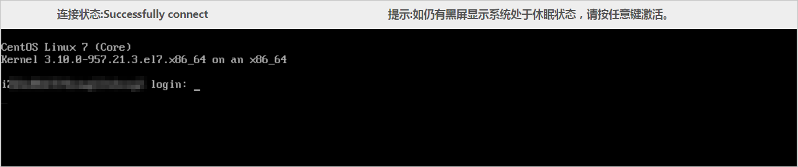

7. 登录实例操作系统。

   - **Linux实例**：

     <ol type="a">

     <li>

     输入登录用户（例如root、ecs-user），然后按Enter键。

     </li>

     <li>

     输入实例登录密码（非VNC登录密码），然后按Enter键。

     > **说明**
     >
     > 登录Linux实例时界面不会显示密码的输入过程。

     支持切换不同的VNC管理终端连接Linux实例，默认为**CTRL+ALT+F1**，最多支持10个。例如，单击界面左上角的**发送远程命令 > CTRL+ALT+F2**，切换至**CTRL+ALT+F2**。黑屏可能是因为Linux实例处于休眠状态，单击键盘上任意键即可唤醒实例。

     </li>

     </ol>

   - **Windows实例**：

     <ol type="a">

     <li>

     在页面左上角，单击**发送远程命令 > CTRL+ALT+DELETE**。

     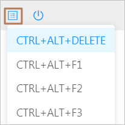

     </li>

     <li>

     选择用户账户，输入实例登录密码，然后按Enter键。

     </li>

     </ol>

<a id="section-4"></a>

# 4.运营增效

<a id="section-4-1"></a>

## 4.1. 配置组织监控阈值

您可以配置组织监控范围和多个维度监控项的阈值，根据监控结果和优化建议，提升资源利用效能。

**使用限制**

仅支持admin账户配置监控阈值。

**操作步骤**

1. 登录云服务器ECS控制台。

2. 在左侧导航栏中，单击**运营增效**。

3. 在顶部菜单栏处，选择组织、资源集和地域。

4. 单击**组织**页签。

5. 选择使用率类型，然后单击**设置阈值**。

   - **高使用率**：监控项使用率≥阈值。

   - **低使用率**：监控项使用率≤阈值。

6. 在对话框中设置监控范围和监控项阈值。

   <table>
     <tr>
       <th width="173">参数</th>
       <th>描述</th>
     </tr>
     <tr>
       <td>监控范围</td>
       <td>设置监控范围。取值范围：7天、15天或30天。</td>
     </tr>
     <tr>
       <td>CPU平均配额使用率</td>
       <td>设置CPU平均配额使用率的阈值。<br>• 高使用率：CPU平均配额使用率≥阈值。阈值取值为60% ~ 95%。<br>• 低使用率：CPU平均配额使用率≤阈值。阈值取值为5% ~ 40%。<br>说明阈值仅支持5%的整数倍。</td>
     </tr>
     <tr>
       <td>内存平均配额使用率</td>
       <td>设置内存平均配额使用率的阈值。<br>• 高使用率：内存平均配额使用率≥阈值。阈值取值为60% ~ 95%。<br>• 低使用率：内存平均配额使用率≤阈值。阈值取值为5% ~ 40%。<br>说明阈值仅支持5%的整数倍。</td>
     </tr>
     <tr>
       <td>存储平均配额使用率</td>
       <td>设置存储平均配额使用率的阈值。<br>重要该参数设置的阈值仅对SSD云盘和高效云盘总容量的平均配额使用率生效。<br>• 高使用率：存储平均配额使用率≥阈值。阈值取值为60% ~ 95%。<br>• 低使用率：存储平均配额使用率≤阈值。阈值取值为5% ~ 40%。<br>说明仅支持设置为5%的整数倍。</td>
     </tr>
   </table>

7. 单击**确定**。

**执行结果**

- 在组织列表上方显示已设置的监控范围和监控项阈值。

- 在ECS控制台**概览**页面的**运营增效**区域，显示符合监控范围和监控项阈值的组织。

<a id="section-4-2"></a>

## 4.2. 查看组织监控列表

您可以查看监控范围内，符合监控阈值的组织列表、阈值信息和处理建议。

**操作步骤**

1. 登录云服务器ECS控制台。

2. 在顶部菜单栏处，选择组织、资源集和地域。

3. 进入**运营增效**页面。

   - 在**概览**页面的**运营增效**区域，单击**立即处理**。

   - 在左侧导航栏中，单击**运营增效**。

4. 单击**组织**页签，然后根据需要选择使用率。

   - **高使用率**：监控项使用率≥阈值。

   - **低使用率**：监控项使用率≤阈值。

**执行结果**

- 您可以在组织列表上方查看已配置的监控范围、监控项阈值。

- 您可以在组织列表中查看符合监控范围和监控项阈值的组织信息，包括组织名称、CPU配额使用率、内存使用率、存储使用率、实例数和操作。

**后续步骤**

您可以根据业务需要调整组织配额。详情请参见<strong>《Apsara Uni-manager运营控制台用户指南》</strong>中的<strong>《配额管理》</strong>章节。

<a id="section-4-3"></a>

## 4.3. 配置实例监控阈值

您可以配置实例监控范围和多个维度监控项的阈值，根据监控结果和优化建议，提升资源利用效能。

**使用限制**

仅支持admin账户配置监控阈值。

**操作步骤**

1. 登录云服务器ECS控制台。

2. 在左侧导航栏中，单击**运营增效**。

3. 在顶部菜单栏处，选择组织、资源集和地域。

4. 在**运营增效**页面，单击**实例**页签。

5. 选择使用率类型，然后单击**设置阈值**。

   - **高使用率**：监控项使用率≥阈值。

   - **低使用率**：监控项使用率≤阈值。

6. 在对话框中设置监控范围和监控项阈值。

   <table>
     <tr>
       <th width="171">参数</th>
       <th>描述</th>
     </tr>
     <tr>
       <td>监控范围</td>
       <td>设置监控范围。默认7天。</td>
     </tr>
     <tr>
       <td>CPU平均资源使用率</td>
       <td>设置CPU平均资源使用率的阈值。<br>• 高使用率：CPU平均资源使用率≥阈值。阈值取值为60% ~ 95%。<br>• 低使用率：CPU平均资源使用率≤阈值。阈值取值为5% ~ 40%。<br>说明阈值仅支持5%的整数倍。</td>
     </tr>
     <tr>
       <td>内存平均资源使用率</td>
       <td>设置内存平均资源使用率的阈值。<br>• 高使用率：内存平均资源使用率≥阈值。阈值取值为60% ~ 95%。<br>• 低使用率：内存平均资源使用率≤阈值。阈值取值为5% ~ 40%。<br>说明阈值仅支持5%的整数倍。</td>
     </tr>
   </table>

7. 单击**确定**。

**执行结果**

- 在实例列表上方显示已设置的监控范围和监控项阈值。

- 在ECS控制台**概览**页面的**运营增效**区域，显示符合监控范围和监控项阈值的实例。

<a id="section-4-4"></a>

## 4.4. 查看实例监控列表

您可以查看监控范围内，符合监控阈值的实例列表、阈值信息和处理建议。

**操作步骤**

1. 登录云服务器ECS控制台。

2. 在顶部菜单栏处，选择组织、资源集和地域。

3. 进入**运营增效**页面。

   - 在**概览**页面的**运营增效**区域，单击**立即处理**。

   - 在左侧导航栏中，单击**运营增效**。

4. 单击**实例**页签，然后根据需要选择使用率。

   - **高使用率**：监控项使用率≥阈值。

   - **低使用率**：监控项使用率≤阈值。

**执行结果**

- 您可以在实例列表上方查看已配置的监控范围、监控项阈值。

- 您可以在实例列表中查看符合监控范围和监控项阈值的实例信息，包括实例ID/名称、资源集等。

<a id="section-4-5"></a>

## 4.5. 回收实例资源

您可以根据阈值监控项的监控结果，调整业务情况后回收实例资源。

**使用限制**

- 仅支持回收低使用率的实例资源。

- 实例被回收后进入回收站，CPU和内存计算资源会被释放，存储资源不被释放。

- 实例进入回收站后，在冷冻期内才可以恢复，冷冻期后自动删除。

**操作步骤**

1. 登录云服务器ECS控制台。

2. 在左侧导航栏中，单击**运营增效**。

3. 在顶部菜单栏处，选择组织、资源集和地域。

4. 单击**实例**页签，然后单击**低使用率**。

5. 找到待回收的实例，在**操作**列中，单击**回收**。

6. 在弹出的对话框中，单击**确定**。

   - 实例被回收后，实例列表中实例状态为**已停止-等待释放**。

   - 您可以在回收站中查看被回收的实例。

**相关操作**

您可以根据业务需要恢复回收站中的实例，请参见恢复实例。

<a id="section-5"></a>

# 5.实例

<a id="section-5-1"></a>

## 5.1. 实例概述

一台ECS实例等同于一台虚拟服务器，内含CPU、内存、操作系统、网络配置、磁盘等基础的组件。您可以使用阿里云提供的控制台、API等管理工具创建和管理ECS实例，像使用本地服务器一样管理ECS实例的状态、应用等，还可以灵活地升级计算、存储等能力。

**实例基础配置**

实例基础配置决定一台实例所需的基础资源，主要包括：

- 实例规格

  实例规格定义了ECS实例在计算性能、存储性能、网络性能等方面的基本属性，但需要同时配合镜像、块存储、网络等配置才能确定一台ECS实例的具体服务形态。

  云服务器ECS根据典型的使用场景推出了丰富的实例规格族，在同一个实例规格族内再提供不同计算能力的实例规格，满足您在不同场景和层级的需求。更多实例规格信息，请参见<strong>《云服务器ECS实例规格族&实例规格简介》</strong>。

- 镜像

  镜像提供了运行实例所需的信息，包括操作系统、初始化应用数据等。阿里云提供了Windows Server系统镜像和主流的Linux系统镜像供您直接选用，您也可以自行创建和导入包含自定义配置的自定义镜像，节省重复配置的时间。

- 存储

  实例通过添加系统盘、数据盘等获得存储能力。实例必须包含系统盘，启动实例时基于镜像完成安装操作系统等初始化配置。

  云盘可以用作系统盘和数据盘，本地盘仅部分实例规格配备（例如本地HDD盘）且只能用作数据盘。如果实例需要更大存储能力存储业务数据，也可以在创建后扩容已有云盘或者挂载更多云盘。更多信息，请参见创建云盘和挂载数据盘。

  业务数据是重要资产，云盘采用三副本技术保证数据可用性，但及时备份业务数据同样重要，您可以使用快照功能备份云盘上的数据。如果您使用了本地盘，则需要自行在应用层做数据冗余，保证数据可用性。

除基础配置外，您还可以自定义实例的网络、安全组、操作系统等配置。更多信息，请参见创建实例。

**安全建议**

使用云产品过程中，遵循安全建议可以有效提高云上资源的安全性。例如：

- 权限控制：使用企业权限管理功能控制哪些用户可以操作实例等资源以及拥有何种权限。

- 安全特性：使用安全加固、云盘加密等安全特性，保证运行环境以及数据的安全。

- 网络安全：通过专有网络隔离不同安全等级的服务，使用安全组控制实例的入流量和出流量，并仅为必须的实例提供公网访问能力，尽量降低实例等资源受到来自外部网络攻击的风险。

<a id="section-5-2"></a>

## 5.2. 创建实例

一台ECS实例等同于一台虚拟机，包含CPU、内存、操作系统、网络、磁盘等基础组件。本文为您介绍创建一台或多台实例的具体操作。

**操作步骤**

> **重要**
>
> 创建ECS实例时具有一定限制，更多信息，请参见使用限制。

1. 登录云服务器ECS控制台。

2. 在左侧导航栏中，选择**实例与镜像 > ECS实例**。

3. 在顶部菜单栏处，选择组织、资源集和地域。

4. 单击**创建实例**。

5. （条件可选）选择服务目录，单击**确定**。

   服务管理用于在企业或组织内对某些产品的特定规格进行一定的管理与控制。仅当服务管理中配置了将ECS实例授权给当前组织或用户，并且该ECS实例资源已上架，才会显示此选项。关于服务管理的更多信息，请参见<strong>《Apsara Uni-manager运营控制台 用户指南》</strong>中的<strong>《服务管理》</strong>章节。

6. 配置实例的区域、实例规格、镜像、存储等信息。

7. 在最终创建实例前，请在页面右侧检查实例的整体配置并配置使用时长等选项，确保符合您的要求。

8. 创建实例。

   - 服务管理中已创建**云资源**为**ECS实例**的服务：在**信息确认**页面，检查实例的基础配置、网络配置、系统配置等信息，确保各项配置符合您的要求，然后单击**确认订单**。

   - 服务管理中未创建**云资源**为**ECS实例**的服务：在**信息确认**页面，检查实例的基础配置、网络配置、系统配置等信息，确保各项配置符合您的要求，然后单击**提交**。

**配置项说明**

**区域信息**

| 配置项 | 是否必选 | 说明 |
| --- | --- | --- |
| 组织/资源集 | 是 | 选择实例所属的组织和资源集。 |
| 地域/可用区 | 是 | 选择实例所属的地域和可用区。可用区指在同一区域下，电力、网络隔离的物理区域，可用区之间内网互通，不同可用区之间做到故障隔离。如果您需要提高应用程序的高可用性，建议您将实例创建在不同的可用区内。 |

**实例**

实例规格定义了ECS实例在计算性能、存储性能、网络性能等方面的基础属性，但需要同时配合镜像、块存储、网络等配置才能确定一台ECS实例的具体服务形态。

> **说明**
>
> 配额余量展示了当前地域、组织和资源集下的CPU、GPU及内存配额，如配额不足，请单击  图标查
>
> 看并设置配额。

| 配置项 | 是否必选 | 说明 |
| --- | --- | --- |
| 开启热变配 | 否 | 热变配支持在不停止实例的情况下变更实例规格。更多信息，请参见热变配实例规格。<br>• 如果您实际部署环境上有支持热变配的实例规格，则热变配开关默认开启，此时，实例规格列表会默认筛选支持热变配的实例规格。<br>说明如果您无须热变配，直接关闭热变配开关即可查看全量规格信息。<br>• 如果您实际部署环境上没有支持热变配的实例规格，则热变配开关默认关闭，实例规格列表中显示全量规格信息。 |
| 筛选 | 否 | 您可以根据实际情况选择CPU、内存、GPU或输入实例规格模糊筛选目标实例规格。 |
| CPU类型 | 是 | 实例的CPU类型，取值范围：<br>• Intel/X86<br>• 海光/X86<br>• 鲲鹏/ARM<br>• 飞腾/ARM<br>• 倚天/ARM<br>• 兆芯/X86<br>• 其他<br>说明支持的CPU类型以您实际部署环境上的ECS控制台显示为准。 |
| 分类 | 是 | 实例类型，取值范围：<br>• 独享型<br>• 共享型<br>• 本地SSD盘<br>• 本地HDD盘<br>• 超级计算集群<br>• 弹性裸金属服务器<br>• 其他<br>说明支持的实例类型以您实际部署环境上的ECS控制台显示为准。 |
| 实例规格 | 是 | 实例的实例规格。实例规格列表显示实例规格族、实例规格、规格族级别、状态、CPU类型、CPU核数、内存、内网带宽和磁盘数量等信息，请根据实际应用需要选择对应实例规格。更多实例规格族与实例规格信息，请参见专有云文档中心<strong>《实例规格族&amp;实例规格》</strong>文档。<br>重要<br>• 实例规格的<strong>状态</strong>分为<strong>可用</strong>、<strong>售罄</strong>和<strong>禁用</strong>，但您只能选择<strong>可用</strong>状态的实例规格。、<br>• 如果创建实例时选择了服务目录，则可创建的实例规格受服务目录限制。具体操作，请参见<strong>《Apsara Uni-</strong><strong>manager运营控制台 用户指南》</strong>中的<strong>《示例：创建服</strong><strong>务器ECS实例服务》</strong>章节。<br>部分CPU和内存的组合不能选择Windows Server的镜像，更多信息，请参见使用限制。<br>重要<br>• 如果您选择创建GPU实例，则需要在GPU实例上手动安装对应操作系统的GPU驱动。除驱动差异外，GPU实例管理操作与使用其他实例规格创建的实例一致。以NVIDIA厂商GPU为例，安装GPU驱动的具体操作，请参见NVIDIA驱动安装指引。其他厂商GPU的驱动安装操作，请参考对应的GPU厂商官网文档。<br>• 如果您选择创建超级计算集群SCC规格的ECS实例，则创建实例时，您需要额外设置<strong>超级计算集群</strong>参数，无<strong>部</strong><strong>署集</strong>相关参数。同时，<strong>VPC</strong>与<strong>安全组</strong>参数可能会受到超级计算集群的专有网络ID与安全组ID的影响。更多超级计算集群信息，请参见超级计算集群概述。 |
| 超级计算集群 | 由<strong>分类</strong>和实例规格共同决定 | 实例所在的超级计算集群ID。您可以选择已创建的超级计算集群，或者单击<strong>创建新集群</strong>即时创建超级计算集群，创建完成后，返回ECS实<br>例创建向导并单击图标，查看最新的超级计算集群列表。创建超级<br>计算集群的具体操作，请参见创建超级计算集群。仅当<strong>分类</strong>为<strong>超级计算集群</strong>，且已选中SCC实例规格后，才能查看和选择该参数。此时，该参数是必选项。 |
| 集群实例数 | 由<strong>超级计算集</strong><strong>群</strong>决定 | 实例所在的超级计算集群下的节点数量（即ECS实例数量）。选择<strong>超级计算集群</strong>后，会自动填写该参数，且不支持修改。 |
| HT超线程技术 | 否 | 仅部分实例规格支持，单击<strong>展示高级选项</strong>后可以设置<strong>HT超线程技术</strong>，更多HT 超线程技术说明，请参见关闭HT超线程。<br>• 开启：ECS实例的CPU物理核变成两个逻辑处理核。<br>• 关闭：ECS实例独占CPU物理核。 |
| CPU拓扑结构 | 否 | 支持选择<strong>HT连续模式</strong>和<strong>HT离散模式</strong>。仅部分实例规格支持，单击<strong>展示高级选项</strong>后可以修改CPU拓扑结构，更多CPU拓扑结构说明，请参见查看和修改CPU拓扑结构。<br>• HT连续模式：逻辑核心连续分配给物理核心，有助于减少线程之间的通信和竞争。适用于需要较低的访存延迟和更接近物理核心的计算任务，例如科学计算、数据分析、高性能计算等对内存访问和核心计算敏感的应用。<br>• HT离散模式：逻辑核心分散分配给物理核心，可以有助于减少多线程环境中的资源争夺，并提供更好的性能隔离。适用于工作负载中分配给各线程的任务相对独立，或者对单线程性能要求较高的场景。 |

**镜像**

镜像提供了运行实例所需的信息，阿里云提供多种镜像来源供您方便地获取镜像。

| 配置项 | 是否必选 | 说明 |
| --- | --- | --- |
| 镜像类型 | 是 | 实例使用镜像的类型，支持<strong>公共镜像</strong>、<strong>自定义镜像</strong>和<strong>共享</strong><strong>镜像</strong>和<strong>企业共享镜像</strong>。<br>说明更多镜像信息，请参见镜像概述。 |
| 公共镜像 | 由<strong>镜像类型</strong>决定 | 实例使用的公共镜像，阿里云官方提供的镜像（不包含操作系统授权），安全性高，稳定性高。公共镜像包含了Windows Server系统镜像和主流的Linux系统镜像。<strong>镜像类型</strong>为<strong>公共镜像</strong>时是必选项。 |

<table>
  <tr>
    <td>支持 ecs-user 用户登录</td>
    <td>由<strong>公共镜像</strong>决定</td>
    <td>仅当创建Linux实例，且选择了支持ecs-user用户登录的公共镜像时，才会出现该配置项。<br>• 开启：使用ecs-user用户登录Linux实例。<br>• 关闭：使用root用户登录Linux实例。<br>警告root具有操作系统的最高权限，使用root作为用户名可能会导致安全风险，建议您使用普通用户ecs-user作为用户名。<br>支持的公共镜像如下：<br>• X86：<br>• Alibaba Cloud Linux 2：<br>• aliyun_2_1903_x86_64_20G_alibase_2024 0628.vhd<br>• aliyun_2_1903_x86_64_20G_dengbao_alib ase_20240705.vhd<br>• Alibaba Cloud Linux 3：<br>• aliyun_3_x86_64_20G_alibase_20241103.v hd<br>• aliyun_3_x86_64_20G_container_optimize d_20241226.vhd<br>• aliyun_3_x86_64_20G_dengbao_alibase_2 0241103.vhd<br>• aliyun_3_x86_64_20G_pro_alibase_202412 25.vhd<br>• aliyun_3_x86_64_20G_pro_dengbao_alibas e_20241030.vhd<br>• aliyun_4_x86_64_20G_alibase_20250728.v hd<br>• UOS：<br>• uos_20_1070a_x86_64_20G_alibase_2024 1129.vhd<br>• Arm：<br>• UOS<br>• uos_20_1070a_arm64_20G_uefi_alibase_2 0241119.vhd<br>• Alibaba Cloud Linux：<br>• aliyun_3_arm64_20G_uefi_dengbao_alibas e_20241103.vhd</td>
  </tr>
  <tr>
    <td>自定义镜像</td>
    <td>由<strong>镜像类型</strong>决定</td>
    <td>实例使用的自定义镜像，您使用实例或快照创建的镜像，或是您从本地导入的自定义镜像。<strong>镜像类型</strong>为<strong>自定义镜像</strong>时是必选项。</td>
  </tr>
  <tr>
    <td>共享镜像</td>
    <td>由<strong>镜像类型</strong>决定</td>
    <td>实例使用的共享镜像，由其他一级组织主动共享给您组织使用的自定义镜像。<strong>镜像类型</strong>为<strong>共享镜像</strong>时是必选项。</td>
  </tr>
  <tr>
    <td>企业共享镜像</td>
    <td>由<strong>镜像类型</strong>决定</td>
    <td>实例使用的企业共享镜像，由管理员在Apsara Uni-manager运维控制台上转化为企业共享镜像。<strong>镜像类型</strong>为<strong>企业共享镜像</strong>时是必选项。</td>
  </tr>
</table>

**存储**

实例通过添加系统盘、数据盘获得存储能力。系统盘用于安装操作系统，数据盘用于存储应用数据。

> **说明**
>
> 配额余量展示了当前地域、组织和资源集下磁盘配额及不同云盘类型的配额，如配额不足，请单击 
>
> 图标查看并设置配额。

| 配置项 | 是否必选 | 说明 |
| --- | --- | --- |
| 创建方式 | 是 | 云盘的创建方式。取值范围：<strong>普通创建</strong>和<strong>存储集创建</strong>。如果需要指定存储集的分区中创建云盘，请选择<strong>存储集创</strong><strong>建</strong>。<br>重要<br>• 如果创建方式只有<strong>普通创建</strong>，则表示当前环境不支持存储集，请先进行存储集配置。<br>• 在存储集的分区创建云盘之前，请确保已创建存储集并配置分区。具体操作，请参见专有云文档中心<strong>《混合云存储CDS用户指</strong><strong>南》</strong>中的<strong>《创建存储集》</strong>章节。 |
| 存储集 | 由<strong>创建方式</strong>决定 | 选择已创建的存储集。<strong>创建方式</strong>为<strong>存储集创建</strong>时是必选项。 |
| 分区 | 由<strong>创建方式</strong>决定 | 分区编号。<strong>创建方式</strong>为<strong>存储集创建</strong>时是必选项。 |
| 系统盘 | 是 | 用于安装操作系统的磁盘。<br>• 支持的云盘类型，与部署的EBS集群有关。<br>• 全新部署的CDS-EBS集群，支持<strong>高性能云盘</strong>和<strong>普通</strong><strong>性能云盘</strong>。<br>• 从V3.15.0升级上来的CDS-EBS集群，支持<strong>高效云</strong><strong>盘</strong>、<strong>SSD盘</strong>、<strong>高性能云盘</strong>和<strong>普通性能云盘</strong>。<br>• 存量EBS集群，继续提供共享高效云盘和共享SSD盘。<br>• 系统盘的容量范围为：20 GiB~2048 GiB。<br>说明实际可设置的系统盘最低容量和镜像类型有关，具体容量以ECS控制台显示为准。<br>• 您可以根据实际需要设置系统盘的名称。如未设置，<br><br>则系统盘默认命名规则为<code> </code>实例名称<code>_SystemDisk </code>，如<code> ecstest_SystemDisk </code>。<br>• 您可以对<strong>高性能云盘</strong>、<strong>普通性能云盘</strong>类型的系统盘设置<strong>加密</strong>。<br>• 实例规格与云盘类型存在约束限制，部分实例仅能使用特定类型的云盘。详细内容，请参考实例规格与云盘类型的约束限制。 |
| 加密 | 否 | 当系统盘类型为<strong>高性能云盘</strong>或<strong>普通性能云盘</strong>类型时支持加密。系统盘数据加密适用于数据安全或法规合规等场景，帮助您加密保护存储在ECS上的数据。更多信息，请参见加密系统盘。 |
| 数据盘 | 否 | 用于存储实例数据的磁盘。<br>• 支持的云盘类型，与部署的EBS集群有关。<br>• 全新部署的CDS-EBS集群，支持<strong>高性能云盘</strong>和<strong>普通</strong><strong>性能云盘</strong>。<br>• 从V3.15.0升级上来的CDS-EBS集群，支持<strong>高效云</strong><strong>盘</strong>、<strong>SSD盘</strong>、<strong>高性能云盘</strong>和<strong>普通性能云盘</strong>。<br>• 存量EBS集群，继续提供共享高效云盘和共享SSD盘。<br>• 最多可以添加16块数据盘。每个数据盘的最大容量与云盘类型有关：<br>• <strong>高效云盘</strong>、<strong>SSD盘</strong>和<strong>普通性能云盘</strong>：32768 GiB。<br>• <strong>高性能云盘</strong>：131072 GiB。<br>• 当<strong>数据盘</strong>选择为<strong>高效云盘</strong>或者<strong>SSD盘</strong>时，如果填写的容量超过2 TiB，注意按照以下EBS集群机器数量与推荐的云盘最大建议值（机器数量：云盘最大值）进行填写。<br>• 6台：2 TiB<br>• 12台：4 TiB<br>• 15台：5 TiB<br>• 24台：8 TiB<br>云盘最大建议值的计算公式为：云盘最大大小S = N/3，其中N为相应EBS集群的机器数量，结果向下取整。例如：如果EBS集群的机器数量为6台，则建议创建的云盘容量不超过2 TiB。<br>• 您可以根据实际需要设置数据盘的名称。<br>• 如未设置数据盘的名称，则数据盘默认命名规则为<code> </code>数据盘：实例名称<code>_dataDisk_*** </code>，如<code> ecstest_dataDisk_001 </code>、<code> ecstest_Da</code> <code>taDisk_002 </code>。<br>• 当您设置了数据盘的名称时，最终创建的数据盘名称与数据盘数量有关，具体如下：<br>• 如果数据盘的<strong>数量</strong>取值为<code> 1 </code>：<br>最终创建的数据盘名称显示为设置的数据盘名称，例如<code> testDataDisk </code>。<br>• 如果数据盘的<strong>数量</strong>取值≥<code> 2 </code>，即创建多个类型、容量等配置一样的数据盘：<br>最终创建的数据盘名称显示为<code> </code>设置的数据盘名称<code>_** </code>，例如创建2个数据盘且数据盘名称设置为<code> testDataDisk </code>，则创建的数据盘名称为<code> testDataDisk_01 </code>和<code> testDataDisk_</code><code>02 </code>。<br>• 您可以对每块数据盘设置<strong>随实例释放</strong>和<strong>加密</strong>。设置数据盘加密时，需要设置以下参数：<br>• <strong>加密方式</strong>：支持<strong>AES256</strong>和<strong>SM4</strong>。<br>• <strong>加密key</strong>：可选择<strong>密钥管理服务</strong>中创建的密钥。<br>• 实例规格与云盘类型存在约束限制，部分实例仅能使用特定类型的云盘。详细内容，请参考实例规格与云盘类型的约束限制。<br>说明如果不在这里添加数据盘，您还可以在创建实例后自行添加数据盘。具体操作，请参见挂载数据盘。 |
| 加密 | 否 | 当数据盘类型为<strong>高性能云盘</strong>或<strong>普通性能云盘</strong>类型时支持加密。系统盘数据加密适用于数据安全或法规合规等场景，帮助您加密保护存储在ECS上的数据。更多信息，请参见加密数据盘。 |
| 随实例释放 | 否 | • 勾选后：释放实例时会自动释放此云盘。<br>• 不勾选：当实例被释放时该云盘会被保留下来。 |


**网络**

网络和安全组配置为ECS实例提供了公网以及与其他资源通信的能力，并保障实例在网络中的安全性。

| 配置项 | 是否必选 | 说明 |
| --- | --- | --- |
| VPC/VSwitch | 是 | 专有网络是您在阿里云自己定义的一个隔离网络环境，您可以完全掌控自己的专有网络，例如选择IP地址范围、配置路由表和网关等。选择已创建的专有网络和交换机，或者单击<strong>创建</strong><strong>VPC</strong>、<strong>创建VSwitch</strong>即时创建专有网络和交换机，创建<br>完成后，返回ECS实例创建向导并单击图标，查看专<br>有网络和交换机列表。创建专有网络的具体操作，请参见专有云文档中心<strong>《专有网络VPC用户指南》</strong>中的<strong>《创建</strong><strong>和管理专有网络》</strong>和<strong>《创建和管理交换机》</strong>章节。<br>重要创建超级计算集群SCC规格的实例时，如果该超级计算集群已设置专有网络ID，则会自动填充超级计算集群的专有网络ID，并且不允许修改。更多信息，请参见添加节点到超级计算集群。 |
| 私网IP | 否 | 指定实例的私网IPv4地址，IP地址网段取决于交换机网段。如果私网选择随机分配，系统会自动分配私网IP。 |
| 公网IP | 否 | 如果实例需要进行公网通信，必须分配公网IP。您可以在创建实例时选择自动分配一个固定公网IP，或者创建实例后绑定弹性公网IP，具体操作，请参见<strong>《专有网</strong><strong>络VPC用户指南》</strong>中的<strong>《创建和管理EIP》</strong>章节。 |
| 带宽值(Mbit/s) | 否 | 选中<strong>分配公网 IPv4 地址</strong>时，必须设置带宽值（1~100）。 |
| 安全组 | 是 | 选择已创建的安全组，或者单击<strong>创建安全组</strong>即时创建安全<br>组，创建完成后，返回ECS实例创建向导并单击图<br>标，查看最新的安全组列表。创建安全组的具体操作，请参见创建安全组。支持为ECS实例同时选择多个安全组。<br>重要创建超级计算集群SCC规格的实例时，如果该超级计算集群已设置安全组ID，则会自动填充超级计算集群的安全组ID，并且不允许修改。更多信息，请参见添加节点到超级计算集群。 |
| IPv6 | 否 | IPv6的地址数量不仅能解决网络地址资源数量的问题，而且也解决了多种接入设备连入互联网的障碍。选中<strong>分配</strong>，创建实例后，您需要登录实例并在操作系统内部进行IPv6地址相关的配置，才能正常使用IPv6地址。 |
| 弹性网卡 | 否 | 选择已创建的弹性网卡，或者单击<strong>创建弹性网卡</strong>即时创建弹性网卡，创建完成后，返回ECS实例创建向导并单击<br>图标，查看专有网络和交换机列表。<br>说明创建实例时只能添加1块辅助网卡，您也可以在实例创建完成后单独创建辅助网卡并绑定至实例。 |

**管理配置**

**配置项**

**是否必选**

**说明**

在实例创建完成后，自行绑定密钥对或者重置实例密码。

**创建后设置**

选择已有的密钥对，或者单击**创建密钥对**即时创建密钥

对。创建完成后，返回ECS实例创建向导并单击  图

标，查看最新的密钥对列表。具体操作，请参见创建密钥对。

> **重要**
>
> 仅Linux实例支持使用密钥对登录。

**密钥对**

用户名支持设置为**root**或**ecs-user**。只有当您选择了支持ecs-user用户登录的镜像，并且开启了**支持 ecs-user 用户登录**功能时，登录名为**ecs-user**，否则登录名均为**root**。

> **警告**
>
> root具有操作系统的最高权限，使用root作为登录名可能会导致安全风险，建议您使用普通用户ecs-user作为登录名。

输入并确认密码。使用登录名和密码登录实例时，用户名

**登录凭证**

信息如下：

- Linux实例：支持设置为**root**或**ecs-user**。只有当您选择了支持ecs-user用户登录的镜像，并且开启了**支持 ecs-user 用户登录**功能时，登录名为**ecs-user**，否则登录名均为**root**。

  > **警告**
  >
  > root具有操作系统的最高权限，使用root作为登录名可能会导致安全风险，建议您使用普通用户ecs-user作为登录名。

- Windows实例：默认为**administrator**。

密码要求为8~30个字符，且至少同时包含大写字母、小写字母、数字、特殊字符中的三项，支持的特殊字符包括 ``()`~!@#$%^&*-_+=|{}[]:;'<>,.?/`` ，其中

**自定义密码**

Windows实例不能以正斜线（/）开头。

> **重要**
>
> 当实例的操作系统为Kylin时，具体密码规则说明如下：
>
> 请设置不少于8位的新密码，并确保至少包含大写字母、小写字母、数字、特殊符号中的任意三种字符类型，避免使用回文密码、避免使用简单常见密码和与旧密码过于相似的内容，并且不能包含用户名和cracklib字典词汇（可以执行 `echo "YOUR_PASSWORD" | cracklib-check` 查看是否符合）。支持的特殊字符包括 ``()`~!@#$%^&*-_+=|{}[]:;'<>,.?/`` 。

保留原始镜像设置的登录密码。创建实例后，您可以直接使用原始镜像的登录名和密码远程连接该实例。

> **重要**

**保留原始镜像密码**

> 仅当**镜像类型**选择**自定义镜像**、**共享镜像**或**企业共享镜像**，且选择已设置了登录密码的镜像时，才会出现该配置项。

单次最多创建100台实例。此外，您持有的实例数量不能

是

超过配额，具体配额以Apsara Uni-Manager首页显示

**创建台数**

为准。

<table>
  <tr>
    <td>实例名称</td>
    <td>是</td>
    <td>设置实例名称，便于管理实例。长度为2~110个字符，必须以大小字母或中文开头，不能以<code> http:// </code>和<code> https:// </code>开头。可以包含中文、英文、数字、半角冒号（:）、下划线（_）、半角句号（.）或者短划线（-）。创建多台实例时，名称自动按序增加3位数字后缀。默认从001开始递增，最大不能超过100。例如：LocalHost001，LocalHost002和MyInstance001，MyInstance002。批量创建实例时，可以自定义有序实例名称。例如：通过<code> name_prefix[begin_number,bits]name_suffi</code> <code>x </code>格式可给各个 ECS 实例设置不同的实例名。例如：<code> my_name[99,3]ecs </code> ，若创建 2 台实例最终生成的名称分别为：<code> my_name099ecs </code>、<code> my_name100ecs </code>，be gin_number取值区间为 [0,999999]，bits 取值区间为[1,6]，不填写默认为 6。</td>
  </tr>
  <tr>
    <td>实例描述</td>
    <td>否</td>
    <td>实例的描述，长度为2~256个英文或中文字符，不能以<code> http:// </code>和<code> https:// </code>开头。支持中英文、数字、半角句号（.）、下划线（_）和短划线（-）。</td>
  </tr>
  <tr>
    <td>主机名</td>
    <td>否</td>
    <td>操作系统内部显示的主机名称。限制说明如下：<br>• 半角句号（.）和短划线（-）不能作为首尾字符，更不能连续使用。<br>• Windows实例：字符长度为2~15，不支持半角句号（.），不能全是数字。允许包含大小写英文字母、数字和短划线（-）。<br>• Linux：<br>• 字符长度为2~64，支持多个半角句号（.），点之间为一段，每段允许包含大小写英文字母、数字和短划线（-）。<br>• 支持通过占位符<code> ${instance_id} </code>将实例ID写入HostName参数。例如：<code> HostName=k8s-</code><code>${instance_id} </code>，并且创建的ECS实例ID为<code> i-123abc**** </code>，则该实例的主机名为<code> k8s-i-123abc**** </code>。<br>批量创建实例时，可以自定义有序主机名。例如：通过<code> name_prefix[begin_number,bits]name_suffi</code> <code>x </code>格式可给各个 ECS 实例设置不同的主机名。例如：<code> my_name[99,3]ecs </code> ，若创建 2 台实例最终生成的名称分别为：<code> my_name099ecs </code>、<code> my_name100ecs </code>，be gin_number取值区间为 [0,999999]，bits 取值区间为[1,6]，不填写默认为 6。</td>
  </tr>
  <tr>
    <td>实例释放保护</td>
    <td>否</td>
    <td>开启实例释放保护，防止手动释放，可有效避免因操作疏忽、团队成员沟通不及时等原因造成不可挽回的后果。</td>
  </tr>
  <tr>
    <td>标签</td>
    <td>否</td>
    <td>选择已有的标签，或者填写标签键和标签值即时创建标签。<strong>标签</strong>由一对<strong>标签建</strong>和<strong>标签值</strong>组成。使用标签标识具有相同特征的资源后，例如所属组织或用途相同的资源，您可以基于标签方便地检索和管理资源。最多支持设置20对标签。</td>
  </tr>
  <tr>
    <td>部署集<br>重要当您创建超级计算集群SCC规格的实例时，无该参数。</td>
    <td>否</td>
    <td>您可以选择已创建的部署集，或者单击<strong>创建部署集</strong>即时创建部署集，创建完成后，返回ECS实例创建向导并单击<br>图标，查看最新的部署集列表。创建部署集的具体操<br>作，请参见创建部署集。部署集是控制ECS实例分布的策略，使您能在创建ECS实例的时候就设计容灾能力和可用性。您可以利用部署集分散或者聚合业务涉及到的实例。</td>
  </tr>
  <tr>
    <td>自定义数据格式</td>
    <td>否</td>
    <td rowspan="2">实例自定义数据可以作为实例自定义脚本在启动实例时执行，实现自动化配置实例，或者仅作为普通数据传入实例。更多信息，请参见实例自定义数据。在输入框中输入您准备的实例自定义数据。如果实例自定义数据已进行Base64编码，请选中<strong>输入采用Base64编</strong><strong>码</strong>。</td>
  </tr>
  <tr>
    <td>自定义数据</td>
    <td>否</td>
  </tr>
</table>

**执行结果**

实例列表中出现您创建的实例，状态为**准备中**，创建完成后状态变为**运行中**。

**后续步骤**

如果您随实例创建了数据盘，必须先对数据盘进行分区格式化才能正常使用。具体操作，请参见Linux格式化数据盘和Windows格式化数据盘。

<a id="section-5-3"></a>

## 5.3. 克隆实例

克隆实例可以快速创建与源实例相同或相似的实例，一般用于复制测试环境、扩展应用程序、容灾备份、迁移和升级等场景，可以提高业务的可靠性、可扩展性和效率。本文介绍如何克隆实例，以及克隆实例的计费说明及使用限制。

**前提条件**

- 当前环境已部署系统运维管理OOS服务。

- 已在目标可用区创建专有网络和交换机。具体操作，请参见<strong>《专有网络VPC用户指南》</strong>中的<strong>《创建和管理交换机》</strong>章节。

- 已创建安全组。具体操作，请参见创建安全组。

**计费说明**

克隆的目标实例与原实例计费方式一致。

> **说明**
>
> 关于计费规则的详细说明，请参见<strong>《Apsara Uni-manager运营控制台 用户指南》</strong>中的<strong>《计费规则》</strong>章节。

**使用限制**

- 仅支持同地域同一可用区或不同可用区克隆，不支持跨地域克隆。

- 等待释放的ECS实例不支持克隆。

- 本地盘实例不支持克隆。

- 克隆实例功能仅支持通过ECS控制台进行操作，暂不支持通过API调用。

**操作步骤**

1. 登录云服务器ECS控制台。

2. 在左侧导航栏中，选择**实例与镜像 > ECS实例**。

3. 在顶部菜单栏处，选择组织、资源集和地域。

4. 找到待克隆的实例，在**操作**列中，单击  图标，然后选择**实例设置 > 克隆实例**。

5. 在**克隆实例**对话框中，设置目标实例配置，然后单击**下一步**。

   <table>
     <tr>
       <th width="153">参数</th>
       <th>说明</th>
     </tr>
     <tr>
       <td>可用区</td>
       <td>选择目标实例所属可用区。</td>
     </tr>
     <tr>
       <td>目标专有网络</td>
       <td>选择已创建的目标专有网络。</td>
     </tr>
     <tr>
       <td>目标交换机</td>
       <td>选择已创建的目标交换机。</td>
     </tr>
     <tr>
       <td>目标安全组</td>
       <td>选择已创建的目标安全组。</td>
     </tr>
     <tr>
       <td>目标系统盘</td>
       <td>选择目标系统盘类型。</td>
     </tr>
     <tr>
       <td>目标数据盘</td>
       <td>选择目标数据盘类型。</td>
     </tr>
     <tr>
       <td>目标实例数量</td>
       <td>设置需要克隆的实例数量。一次最多可以克隆100个，如果目标实例的库存小于您指定的实例数量，最终克隆的实例数量为现有库存的最大数量。</td>
     </tr>
     <tr>
       <td><strong>新密码</strong>和<strong>确定密码</strong></td>
       <td>输入并确认密码。密码要求为8~30个字符，且至少同时包含大写字母、小写字母、数字、特殊字符中的三项，支持的特殊字符包括<code> ()`~!@#$%^&amp;*-_+=&#124;{}[]:;'&lt;&gt;,.?/ </code>，其中Windows实例不能以正斜线（/）开头，建议密码不包含用户名。</td>
     </tr>
     <tr>
       <td>克隆类型</td>
       <td>• <strong>在线克隆</strong>：在不影响源实例运行状态的前提下，克隆实例的数据将仅与源实例在克隆操作完成那一刻的时间点保持一致。克隆过程基于源实例创建临时自定义镜像，然后基于临时自定义镜像创建目标实例并启动运行，但不保证与源实例数据的最终一致性。<br>• <strong>停机一致性克隆</strong>：为了最大程度保证数据一致性，系统将在全量快照后，停止源实例，创建增量快照，基于增量快照创建目标实例并启动运行。<br>• 如任务执行成功，源实例将一直处于已停止状态。<br>• 如任务执行失败，则重新启动源实例。<br>说明创建的临时自定义镜像将在克隆任务完成后被删除。</td>
     </tr>
   </table>

6. 在**配置预览**步骤，确认克隆信息，然后单击**提交**。

7. 在**克隆结果**步骤，查看克隆结果。

   您也可以单击**查看资源栈执行进度**查看详细的任务执行进度。

<a id="section-5-4"></a>

## 5.4. 连接实例

<a id="section-5-4-1"></a>

### 5.4.1. 连接实例概述

实例创建完成后，您需要先在本地远程连接到云上的ECS实例才能进行后续的操作，例如连接实例后在实例上部署网站等。您可以通过多种工具连接到云上的实例，本文指导您如何选择合适的工具连接实例。

**选择合适的工具连接实例**

| 连接工具 | ECS实例系统 | 需要本地安装软件 | 支持私网IP访问 | 支持公网IP访问 | 支持的登录凭证 |
| --- | --- | --- | --- | --- | --- |
| Workbench<strong>（</strong>浏览器） | Windows、Linux | 否 | 是 | 否 | 密码 |
| VNC<strong>（浏览器）</strong> | Windows、Linux | 否 | 无需 | 无需 | 密码 |
| SSH客户端工具<strong>（第三方客户</strong>端） | Linux | 是 | 否 | 是 | 密码、密钥对 |
| RDP客户端工具<strong>（第三方客户</strong>端） | Windows | 是 | 否 | 是 | 密码 |

**连接工具介绍&指引**

**Workbench**

Workbench是阿里云为您提供的可以在**浏览器**上使用的远程连接工具，支持文件管理、多屏终端、操作审计等功能，同时支持连接Linux和Windows实例。

- <strong>特点：</strong>免安装，直接在浏览器使用，仅支持连接阿里云上的实例。

- <strong>网络：</strong>私网IP。

- <strong>认证方式：</strong>密码。

**相关文档**

- 使用Workbench工具以SSH协议登录Linux实例

- 使用Workbench工具以RDP协议登录Windows实例

**VNC**

VNC是连接ECS实例的一种方式。支持连接**运行中**（包括操作系统启动阶段）或**停止中**的实例。

> **说明**
>
> VNC本质上不属于远程连接，在使用该方式连接实例时，相当于直接查看实例中操作系统的实时界面（Linux系统可能默认不包含图形界面）。由于该连接方式不受安全组设置或实例中运行软件的限制，因此可以作为排查其他连接方式异常的手段。

- <strong>特点：</strong>不支持**已关机**的实例，仅支持连接阿里云上的实例。

- <strong>网络：</strong>无需绑定EIP。

- <strong>认证方式：</strong>密码。

**相关文档**

使用VNC连接实例

**SSH客户端工具（非阿里云官方）**

您还可以根据您的偏好，使用您常用的第三方SSH客户端工具，连接到Linux实例。常见的SSH工具，如**OpenSSH**客户端、**PuTTY**等。

- <strong>特点：</strong>需安装客户端（视客户端工具而定）。

- <strong>网络：</strong>实例需要绑定EIP。

- <strong>认证方式：</strong>密钥对、密码。

**相关文档**

- Linux或Mac OS X环境中使用SSH命令连接Linux实例

- Windows环境中通过远程连接工具连接Linux实例

**RDP客户端工具（非阿里云官方）**

您还可以根据您的偏好，使用您常用的第三方RDP客户端工具，连接到Windows实例。常见的RDP客户端，如**Microsoft Remote Desktop**、**Windows远程桌面**等。

- <strong>特点：</strong>需安装客户端。

- <strong>网络：</strong>实例需要绑定EIP。

- <strong>认证方式：</strong>密码。

**相关文档**

Windows环境中通过远程桌面连接Windows实例

<a id="section-5-4-2"></a>

### 5.4.2. 通过Workbench连接实例

<a id="section-5-4-2-1"></a>

#### 5.4.2.1. 使用Workbench工具以SSH协议登录Linux实例

相比于VNC，Workbench支持多用户远程连接同一台Linux实例。并且，Workbench支持可视化管理云服务器ECS上的文件，包括上传文件、下载文件、增删改查等。

**前提条件**

- 已创建服务关联角色。在本资源集下首次使用Workbench登录ECS实例时，系统会提示您创建Workbench服务关联角色。

- 实例已设置登录密码。具体操作，请参见重置实例登录密码。

- 实例处于**运行中**状态。

- 实例所在安全组已允许Workbench服务相关的IP访问实例。具体操作，请参见添加安全组规则。

  | 规则方向 | 授权策略 | 协议类型 | 端口范围 | 优先级 | 授权对象 |
  | --- | --- | --- | --- | --- | --- |
  | 入方向 | 允许 | TCP | • Linux实例默认开放22端口：<strong>22/22</strong>。<br>• 如果您手动开放了其他端口：手动输入端口范围。 | 1 | Workbench服务相关的IP。<br>说明具体IP地址，请咨询您的管理员。 |

**操作步骤**

1. 登录云服务器ECS控制台。

2. 在左侧导航栏中，选择**实例与镜像 > ECS实例**。

3. 在顶部菜单栏处，选择组织、资源集和地域。

4. 在实例列表页面，找到需要连接的实例，单击对应**操作**列下的**远程连接。**

5. 在弹出的**远程连接**对话框中，单击**通过Workbench远程连接**对应的**立即登录**。

6. 在弹出的**登录实例**对话框中，输入登录信息。

   一般情况下按精简选项输入信息即可，如下表所示。

   <table>
     <tr>
       <th width="89">配置项</th>
       <th>说明</th>
     </tr>
     <tr>
       <td>实例</td>
       <td>自动填充当前实例的信息，您也可以手动输入其他实例的IP或名称。</td>
     </tr>
     <tr>
       <td>网络连接</td>
       <td>当前仅支持通过私网IP连接。</td>
     </tr>
     <tr>
       <td>认证方式</td>
       <td>选择认证方式，当前仅支持<strong>密码认证</strong>。<strong>密码认证</strong>：输入用户名（例如root或ecs-user）和登录密码。</td>
     </tr>
   </table>

   在对话框底部单击**完整选项**可以展开更多配置项，如下表所示。

   <table>
     <tr>
       <th width="89">配置项</th>
       <th>说明</th>
     </tr>
     <tr>
       <td>连接协议</td>
       <td>默认为<strong>终端连接(SSH)</strong>。</td>
     </tr>
     <tr>
       <td>端口</td>
       <td>连接协议为<strong>终端连接(SSH)</strong>时，默认端口为22。如果您修改过远程连接端口，请输入该端口。</td>
     </tr>
     <tr>
       <td>语言环境</td>
       <td>偏好语言影响输出的内容，选择<strong>默认</strong>时，Workbench自动探测您远程主机的语言设置并进行合适的配置。</td>
     </tr>
     <tr>
       <td>字符集</td>
       <td>偏好字符集影响输出内容的显示结果，选择<strong>默认</strong>时，Workbench自动探测您远程主机的字符集设置并进行合适的配置。</td>
     </tr>
   </table>

7. 单击**确定**。

<a id="section-5-4-2-2"></a>

#### 5.4.2.2. 使用Workbench工具以RDP协议登录Windows实例

相比VNC，Workbench支持多用户远程连接同一台Windows实例。登录时，支持通过密码、密钥或者凭据多种认证方式供您选择，更加高效便捷。

**使用限制**

基于ARM架构的Windows实例不支持通过Workbench工具进行远程连接。

**前提条件**

- 已创建服务关联角色。在本资源集下首次使用Workbench登录ECS实例时，系统会提示您创建Workbench服务关联角色。

- 实例已设置登录密码。具体操作，请参见重置实例登录密码。

- 实例处于**运行中**状态。

- 实例所在安全组已允许Workbench服务相关的IP访问实例。具体操作，请参见添加安全组规则。

  | 规则方向 | 授权策略 | 协议类型 | 端口范围 | 优先级 | 授权对象 |
  | --- | --- | --- | --- | --- | --- |
  | 入方向 | 允许 | TCP | • Windows实例默认开放3389端口：<strong>3389/3389</strong>。<br>• 如果您手动开放了其他端口：手动输入端口范围。 | 1 | Workbench服务相关的IP。<br>说明具体IP地址，请咨询您的管理员。 |

**操作步骤**

1. 登录云服务器ECS控制台。

2. 在左侧导航栏中，选择**实例与镜像 > ECS实例**。

3. 在顶部菜单栏处，选择组织、资源集和地域。

4. 在实例列表页面，找到需要连接的实例，单击对应**操作**列下的**远程连接。**

5. 在弹出的**远程连接**对话框中，单击**通过Workbench远程连接**对应的**立即登录**。

6. 在弹出的**登录实例**对话框中，输入登录信息。

   一般情况下按精简选项输入信息即可，如下表所示。

   <table>
     <tr>
       <th width="89">配置项</th>
       <th>说明</th>
     </tr>
     <tr>
       <td>实例</td>
       <td>自动填充当前实例的信息，您也可以手动输入其他实例的IP或名称。</td>
     </tr>
     <tr>
       <td>网络连接</td>
       <td>当前仅支持通过私网IP连接。</td>
     </tr>
     <tr>
       <td>认证方式</td>
       <td>选择认证方式，当前仅支持<strong>密码认证</strong>。<strong>密码认证</strong>：输入用户名（例如root或ecs-user）和登录密码。</td>
     </tr>
   </table>

   在对话框底部单击**完整选项**可以展开更多配置项，如下表所示。

   <table>
     <tr>
       <th width="89">配置项</th>
       <th>说明</th>
     </tr>
     <tr>
       <td>连接协议</td>
       <td>默认为<strong>终端连接(SSH)</strong>。</td>
     </tr>
     <tr>
       <td>端口</td>
       <td>连接协议为<strong>终端连接(SSH)</strong>时，默认端口为22。如果您修改过远程连接端口，请输入该端口。</td>
     </tr>
     <tr>
       <td>语言环境</td>
       <td>偏好语言影响输出的内容，选择<strong>默认</strong>时，Workbench自动探测您远程主机的语言设置并进行合适的配置。</td>
     </tr>
     <tr>
       <td>字符集</td>
       <td>偏好字符集影响输出内容的显示结果，选择<strong>默认</strong>时，Workbench自动探测您远程主机的字符集设置并进行合适的配置。</td>
     </tr>
   </table>

7. 单击**确定**。

<a id="section-5-4-2-3"></a>

#### 5.4.2.3. 文件管理

Workbench支持可视化管理Linux实例实例上的文件，包括创建文件、编辑文件、删除文件等。本文为您介绍如何通过Workbench管理Linux实例上的文件。

**前提条件**

- 已远程连接ECS实例。具体操作，请参见使用Workbench工具以SSH协议登录Linux实例。

- 确保您的账号拥有对应目录的适当权限，包括创建文件和文件夹、编辑和修改文件、上传文件到目录、从目录下载文件等。

**查看文件**

1. 在顶部菜单栏左上角处，选择**文件 > 打开新文件树**。

   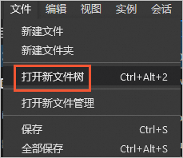

2. 查看文件夹和文件。

   文件树显示效果如下图所示。

   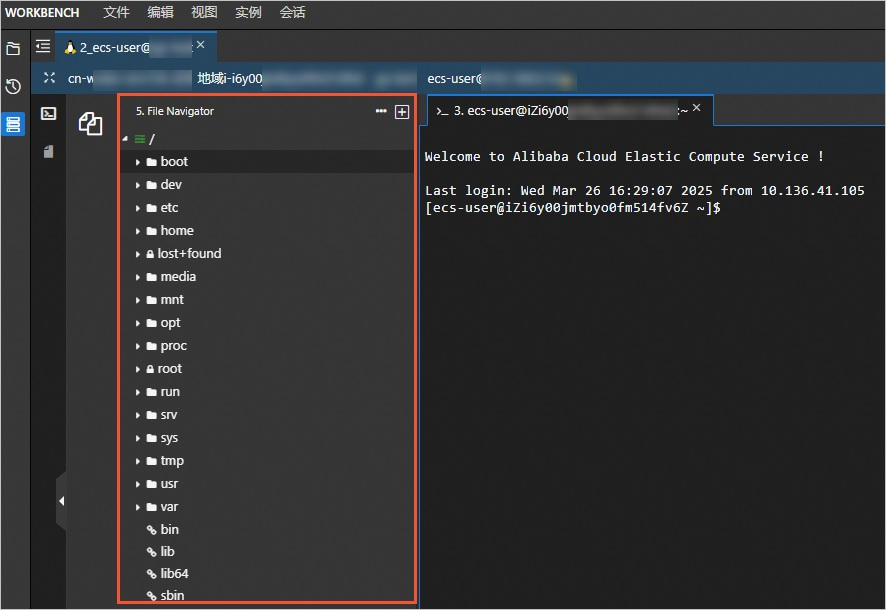

**创建文件**

1. 在顶部菜单栏左上角处，选择**文件 > 打开新文件树**。

   

2. 在文件树中，右键单击需要新建文件的位置，然后在菜单中单击**新建文件**。

3. 在**新建文件**对话框中，输入文件名称，然后单击**确定**。

**编辑文件**

1. 在顶部菜单栏左上角处，选择**文件 > 打开新文件树**。

   

2. 在文件树中，右键单击文件，然后在菜单中单击**打开**。

3. 在编辑区域输入内容，然后单击页面右上角的保存图标。

   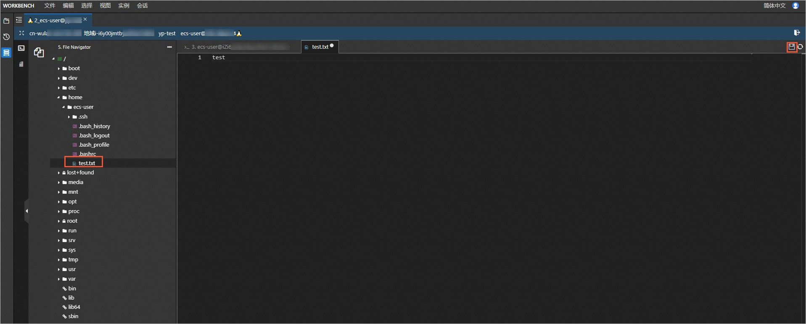

4. 在<strong>确认保存？</strong>对话框中，单击**确定**。

**删除文件**

1. 在顶部菜单栏左上角处，选择**文件 > 打开新文件树**。

   

2. 在文件树中，右键单击文件，然后在菜单中单击**删除**。

3. 在**确定删除文件或目录**对话框中，单击**确定**。

<a id="section-5-4-2-4"></a>

#### 5.4.2.4. 命令行审计

Workbench的命令行审计用于审查经过Workbench登录会话执行的历史命令是否符合安全标准，帮助您发现异常操作和风险事件，并记录具体的执行命令、执行命令时间等信息，以便进行后续分析和审计。本文为您介绍如何使用Workbench的命令行审计功能。

**操作步骤**

1. 使用Workbench连接ECS实例。

   具体操作，请参见使用Workbench工具以SSH协议登录Linux实例或使用Workbench工具以RDP协议登录Windows实例。

2. 在Workbench顶部菜单栏，选择**会话 > 命令行审计**。

3. 在命令行审计列表所在行，单击对应**操作**列的**查看**，查看详细的操作命令、登录用户、执行路径等信息。

<a id="section-5-4-3"></a>

### 5.4.3. 通过第三方客户端工具连接实例

<a id="section-5-4-3-1"></a>

#### 5.4.3.1. Linux或Mac OS X环境中使用SSH命令连接Linux实例

本章节介绍如何通过SSH命令远程连接Linux实例。

**前提条件**

- 完成实例和安全组的创建。

- 实例处于**运行中**状态。

- 实例已设置登录密码。

- 实例绑定了弹性公网IP。

- 安全组已添加入方向安全组规则，放行SSH端口。

  | 规则方向 | 授权策略 | 协议类型 | 端口范围 | 优先级 | 授权类型 | 授权对象 |
  | --- | --- | --- | --- | --- | --- | --- |
  | 入方向 | 允许 | TCP | 22/22 | 1 | IPv4地址段访问 | 0.0.0.0/0 |

**操作步骤**

1. 输入连接命令并按回车键。

   ```bash
   ssh root@实例弹性公⽹IP
   ```

2. 输入实例root用户密码并按回车键。

<a id="section-5-4-3-2"></a>

#### 5.4.3.2. Windows环境中通过远程连接工具连接Linux实例

介绍如何通过PuTTY工具来远程连接实例。

**前提条件**

远程连接工具的用法大同小异。下面以PuTTY为例，介绍如何远程连接实例。PuTTY下载地址：Putty官网。

**操作步骤**

1. 下载并安装Windows版的PuTTY。

2. 打开PuTTY客户端，完成如下设置：

   - **HostName(orIPaddress)**：输入待连接实例的弹性外网IP地址。

   - **Host Name (or IP address)** ：输入待连接实例的弹性外网IP地址。

   - **Port**： 使用默认端口22。

   - **Connection Type** ：选择 **SSH**。

   - **Saved Session** ：连接会话（Session）的名称，单击 **Save**。保存成功后，PuTTY软件就能自动记住实例名称和匹配的IP地址，不需要每次输入IP地址。

3. 单击**Open**，连接实例。首次连接时，会出现PuTTY安全警示对话框，单击 **是** 。

4. 输入用户名**root**，按 

   `Enter`键。

5. 输入该实例的密码，按 

   `Enter`键。

   如果出现类似如下语句，表示您已经成功连接实例。

   ```text
   Welcome to aliyun Elastic Compute Server!
   ```

<a id="section-5-4-3-3"></a>

#### 5.4.3.3. Windows环境中通过远程桌面连接Windows实例

本章节介绍如何通过Windows自带的远程桌面连接功能连接Windows实例。

**前提条件**

- 完成实例和安全组的创建。

- 实例处于**运行中**状态。

- 实例已设置登录密码。

- 实例绑定了弹性公网IP。

- 安全组已添加入方向安全组规则，放行RDP端口。

  | 规则方向 | 授权策略 | 协议类型 | 端口范围 | 优先级 | 授权类型 | 授权对象 |
  | --- | --- | --- | --- | --- | --- | --- |
  | 入方向 | 允许 | tcp | 3389/3389 | 1 | IPv4地址段访问 | 0.0.0.0/0 |

**操作步骤**

1. 选择一种方式启动远程桌面连接。

   > 本文操作以Windows 10操作系统为例，具体操作以您使用的实际Windows操作系统为
   >
   > **说明**
   >
   > 准。

   - 在桌面的搜索框中输入 

     `mstsc`，然后在搜索结果列表中单击**远程桌面连接**。

   - 按快捷键Windows徽标+R，在**运行**对话框中输入 

     `mstsc`，然后单击**确定**。

2. 在**远程桌面连接**对话框中，输入实例的弹性公网IP地址，然后单击**显示选项**。

3. 输入用户名。默认用户名为**administrator**。

4. <strong>可选：</strong>如果您希望以后不再手动输入密码，勾选**允许我保存凭据**。

5. 单击**连接**。

6. 在**Windows安全**对话框中，输入账号对应的密码，然后单击**确定**。

**执行结果**

成功登录到实例，显示Windows桌面。如果出现报错：出现身份验证错误，要求的函数不受支持。请按照以下步骤安装CredSSP相关的安全更新后，再重新连接实例：

使用VNC连接实例

1

1. 使用VNC连接实例。

2. 单击**开始 > 控制面板**。

3. 单击**系统和安全**。

4. 单击**Windows 更新**下的**检查更新**。

5. 如果有未安装的更新，单击**安装更新**。

6. 重启实例。

<a id="section-5-4-4"></a>

### 5.4.4. 通过VNC连接实例

<a id="section-5-4-4-1"></a>

#### 5.4.4.1. Windows环境中安装证书

登录VNC前，请先从站点导出证书，并安装到本地浏览器。

**背景信息**

VNC功能是由后端VNC proxy服务提供，VNC proxy服务使用的证书与飞天基础运维平台证书不同，所以要单独导入。

**操作步骤**

1. 导出证书。

   <ol type="i">

   <li>

   登录Apsara Uni-manager运营控制台，按快捷键**F12**或**Fn + F12**查看证书。本文以Chrome浏览器为例，按快捷键**F12**打开开发者工具。

   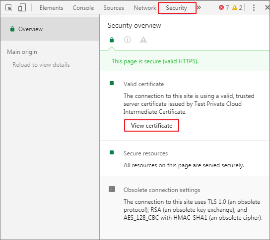

   </li>

   <li>

   在**证书**对话框中，前往**证书路径**页签，选择根证书，然后单击**查看证书**。

   </li>

   <li>

   在**证书**对话框中，前往**详细信息**页签，单击**复制到文件**。

   </li>

   <li>

   在**证书导出向导**对话框中，单击**下一页**。

   </li>

   <li>

   选择导出文件格式为**DER编码二进制 X.509（.CER）（D）**，然后单击**下一页**。

   </li>

   <li>

   单击**浏览**，选择证书文件存放位置，输入文件名称，然后单击**保存**。

   </li>

   <li>

   单击**下一页**。

   </li>

   <li>

   单击**完成**。

   </li>

   <li>

   单击**确定**。

   </li>

   </ol>

2. 将证书安装到本地浏览器。

   <ol type="i">

   <li>

   双击证书文件。

   </li>

   <li>

   在**证书**对话框中，单击**安装证书**。

   </li>

   <li>

   在**证书导入向导**对话框中，单击**下一页**。

   </li>

   <li>

   选择**将所有的证书放入下列存储**，然后单击**浏览**。

   </li>

   <li>

   在**选择证书存储**对话框中，选择**受信任的根证书颁发机构**，然后单击**确定**。

   </li>

   <li>

   在**证书导入向导**对话框中，单击**下一页**。

   </li>

   <li>

   单击**完成**。

   </li>

   <li>

   如果出现安全性警告，单击**是**。

   </li>

   </ol>

3. 重启浏览器。若证书安装成功，登录Apsara Uni-manager运营控制台后，URL左侧不再显示的安全警告。

   

<a id="section-5-4-4-2"></a>

#### 5.4.4.2. 使用VNC连接实例

VNC是远程连接ECS实例的一种方式。支持连接**运行中**（包括操作系统启动阶段）或**停止中**的实例。当无法通过其他方式连接实例时，可以使用该方式进行紧急运维，排查故障。本文为您介绍如何在控制台使用VNC登录实例。

> **说明**
>
> VNC暂不支持Linux系统登录后的中文字符展示，如需要中文字符显示建议通过SSH登录。更多登录方式说明，请参见连接实例概述。

**前提条件**

- 实例处于**运行中**状态。

- 将根证书导入到浏览器，具体操作请参见Windows环境中安装证书。

- 如果您在创建实例后首次连接该实例，确保已重置VNC密码，具体操作请参见修改VNC密码。

**背景信息**

使用VNC连接实例时涉及以下密码：

- VNC登录密码：通过VNC方式远程连接ECS时设置的访问密码。

- 实例登录密码：用于登录到ECS实例操作系统内部进行管理操作。

在无法使用Workbench和远程连接软件登录实例的场景中，您可以通过VNC远程连接登录实例，查看实例操作系统的运行状态或问题，如下表所示。

| 场景 | 连接实例后的操作 |
| --- | --- |
| 实例的操作系统启动时，由于需要进行相关系统检查等操作，导致启动速度缓慢。 | 查看自检进度 |
| 实例误开启操作系统防火墙 | 关闭防火墙 |
| 云服务器被入侵，CPU和带宽消耗高 | 排查并结束异常进程 |

**操作步骤**

1. 登录云服务器ECS控制台。

2. 在左侧导航栏中，单击**实例**。

3. 在顶部菜单栏处，选择组织、资源集和地域。

4. 在实例列表页面，找到需要连接的实例，单击对应**操作**列下的**远程连接。**

5. 在弹出的**远程连接**对话框中，单击**通过VNC远程连接**对应的**立即登录**。

6. 在**输入VNC密码**对话框中，输入VNC密码，单击**确定**。

   连接成功后显示登录界面，例如：

   

7. 登录实例操作系统。

   - **Linux实例**：

     <ol type="a">

     <li>

     输入登录用户（例如root、ecs-user），然后按Enter键。

     </li>

     <li>

     输入实例登录密码（非VNC登录密码），然后按Enter键。

     > **说明**
     >
     > 登录Linux实例时界面不会显示密码的输入过程。

     支持切换不同的VNC管理终端连接Linux实例，默认为**CTRL+ALT+F1**，最多支持10个。例如，单击界面左上角的**发送远程命令 > CTRL+ALT+F2**，切换至**CTRL+ALT+F2**。黑屏可能是因为Linux实例处于休眠状态，单击键盘上任意键即可唤醒实例。

     </li>

     </ol>

   - **Windows实例**：

     <ol type="a">

     <li>

     在页面左上角，单击**发送远程命令 > CTRL+ALT+DELETE**。

     

     </li>

     <li>

     选择用户账户，输入实例登录密码，然后按Enter键。

     </li>

     </ol>

<a id="section-5-5"></a>

## 5.5. 管理实例状态

<a id="section-5-5-1"></a>

### 5.5.1. 停止实例

如果您暂时不需要使用一台实例，可以停止实例。停止实例会导致业务中断，请谨慎执行停机操作。

**前提条件**

实例处于**运行中**状态。

**操作步骤**

1. 登录云服务器ECS控制台。

2. 在左侧导航栏中，选择**实例与镜像 > ECS实例**。

3. 在顶部菜单栏处，选择组织、资源集和地域。

4. 停止一台或多台实例。

   - 停止一台实例：找到待停止的实例，在**操作**列中，选择**实例状态 > 停止实例**。

     您也可以在ECS详情页右上角，单击**停止**。

   - 批量停止实例：选中一台或多台待停止的实例，在实例列表底部，单击**停止**。

5. 在弹出的对话框，单击**停止实例**。

**执行结果**

在**状态**列中，实例的状态从**运行中**变为**停止中**，停止成功后变为**已停止**。

**常见问题**

**实例一直处于停止中，如何解决？**

您的ECS实例长时间处于**停止中**状态时，ECS实例可能处于正常关机或异常关机过程中，您需要查看系统关机进度，根据实例关机状态，选择对应的处理方式。

- 正常关机：ECS正常关机中，但因为操作系统在做系统补丁修复，或者系统配置不高导致操作系统关机反应慢，所以关机时间比较长。

- 异常关机：ECS关机有异常，比如关机时系统报错，并没有真正进入关机流程。

**解决方案：**

1. 通过查看实例的屏幕截图，查看当前实例系统关机的进度。

2. 如果屏幕截图无法判断，请通过VNC连接实例，查看系统关机进度。

3. 根据实例关机状态，选择处理方式。

   - 正常关机：建议您继续等待操作系统关机完成。

   - 异常关机：如果发现异常，请通过VNC连接实例，手动干预和解决实例关机问题。

   您也可以根据需要，通过强制关机来停止实例运行。

   > **重要**
   >
   > **强制停止**等同于断电处理，可能丢失实例操作系统中未写入磁盘的数据。

<a id="section-5-5-2"></a>

### 5.5.2. 启动实例

在实例处于已停止等无法正常提供服务的状态时，如需使用实例需要先启动实例。本文介绍如何通过控制台启动实例。

**前提条件**

实例处于**已停止**状态。

**操作步骤**

1. 登录云服务器ECS控制台。

2. 在左侧导航栏中，选择**实例与镜像 > ECS实例**。

3. 在顶部菜单栏处，选择组织、资源集和地域。

4. 启动一台或多台实例。

   - 启动一台实例：找到待操作的实例，在**操作**列中，选择**实例状态 > 启动实例**。

     您也可以在ECS详情页右上角，单击**启动**。

   - 批量启动实例：选中一台或多台待操作的实例，在实例列表底部，单击**启动**。

5. 在弹出的对话框，单击**启动实例**。

**执行结果**

在**状态**列中，实例的状态从**已停止**变为**启动中**，启动成功后变为**运行中**。

<a id="section-5-5-3"></a>

### 5.5.3. 重启实例

修改实例登录密码后，或者安装系统更新等情况下，您需要重启实例。重启实例时实例会停止一段时间，导致业务中断，请谨慎执行重启操作。

**前提条件**

待重启的实例必须处于**运行中**状态。

> **警告**
>
> 重启操作会造成您的实例停止工作，造成业务中断，请谨慎执行。

**操作步骤**

1. 登录云服务器ECS控制台。

2. 在左侧导航栏中，选择**实例与镜像 > ECS实例**。

3. 在顶部菜单栏处，选择组织、资源集和地域。

4. 重启一台或多台实例。

   - 重启一台实例：找到待操作的实例，在**操作**列中，选择**实例状态 > 重启实例**。

     您也可以在ECS详情页右上角，单击**重启**。

   - 批量重启实例：选中一台或多台待操作的实例，在实例列表底部，单击**重启**。

5. 在弹出的对话框，选择是否强制重启实例。

   - 选中**强制重启**：可能丢失实例操作系统中未写入磁盘的数据。

   - 取消选中**强制重启**：正常重启流程。

6. 单击**重启实例**。

**执行结果**

在**状态**列中，实例的状态从**运行中**变为**停止中**，重启成功后变为**运行中**。

> **说明**
>
> 如果您的ECS实例在重启过程中长时间处于**停止中**状态时，ECS实例可能处于异常关机过程中且不会启动成功，您需要重新手动重启ECS实例。

<a id="section-5-5-4"></a>

### 5.5.4. 删除实例

对于不再使用的实例，您可以删除释放。本文介绍如何删除实例。

**前提条件**

实例处于**已停止**状态。

**背景信息**

删除实例后不可恢复，建议您提前备份需要的数据。如果磁盘（数据盘）随实例一起释放，则磁盘数据不可恢复。具体操作，请参见创建快照。

**操作步骤**

1. 登录云服务器ECS控制台。

2. 在左侧导航栏中，选择**实例与镜像 > ECS实例**。

3. 在顶部菜单栏处，选择组织、资源集和地域。

4. 删除一台或多台实例。

   - 删除一台实例：

     <ol type="a">

     <li>

     找到待删除的实例：**操作**列中，选择**实例状态 > 删除**。

     您也可以在ECS详情页右上角，选择**更多 > 删除**。

     </li>

     <li>

     在弹出的对话框中，根据业务需要，设置**放入回收站**选项。然后单击**释放**。

     </li>

     </ol>

   - 批量删除实例：

     <ol type="a">

     <li>

     选中一台或多台待删除的实例，在实例列表底部，单击**删除**。

     </li>

     <li>

     在弹出的对话框中，根据业务需要，设置**放入回收站**选项。然后单击**释放**。

     </li>

     </ol>

   > **重要**
   >
   > - 如果在ASO-UniConsole管控研发平台**ecs渠道列表**中，配置了**删除实例**中的链接值，则不会出现二次弹窗确认。关于如何修改渠道链接，请参见<strong>《专有云运维平台操作指南》</strong>中的<strong>《产品控制台配置管理》</strong>章节<strong>。</strong>
   >
   > - 为避免误删导致业务震荡，删除实例时已默认勾选**放入回收站**。放入回收站后，ECS实例将处于冷冻期，实例的CPU、内存等计算资源将被释放，弹性公网IP会被自动解绑，存储资源默认保留3天。冷冻期过后，ECS资源会被自动删除，不可恢复。当您因操作失误或有恢复需求时可在冷冻期间在回收站恢复该实例。具体恢复操作，请参见恢复实例。
   >
   > - 带有本地盘的规格族的ECS实例不支持放入回收站。

<a id="section-5-6"></a>

## 5.6. 管理实例属性

<a id="section-5-6-1"></a>

### 5.6.1. 查看实例详情

您可以查看您账号下已创建的所有实例的列表和单台实例的详情，包括实例的基本配置、云盘、快照、安全组、弹性网卡和实例的操作日志信息。

**在概览页面查看实例资源概况**

ECS管理控制台的首页默认为**概览**页面。

在**概览**页面中，您可以查看账号下ECS实例的概况，包括以下几个部分的信息：

- **实例总览**

  列出了该账号在所选组织、资源集和地域下的所有ECS实例资源（包括ECS实例总数、运行中实例数、镜像数、云盘数、安全组数、快照数）。

  单击各个资源下的个数，即可跳转到对应的页面查看详情。例如单击ECS实例总数，可以跳转至实例列表页查看实例详情。

- **配额排名TOP 10**

  列出了配额使用TOP 10的组织，您可以分别单击**按CPU使用率**、**按内存使用率**、**按存储使用率**筛选不同的使用率TOP 10，并查看相关组织近期的（近7天、近15天或近20天）各使用率态势和排名。

- **配额统计**

  - CPU配额：列出了本组织下资源集及下级组织已分配的CPU配额、本级和下级组织已使用的CPU配额<strong>。</strong>

  - GPU配额：列出了本组织下资源集及下级组织已分配的GPU配额、本级和下级组织已使用的GPU配额<strong>。</strong>

  - 内存配额：列出了本组织下资源集及下级组织已分配的内存配额、本级和下级组织已使用的内存配额<strong>。</strong>

  - 磁盘配额：列出了本组织下资源集及下级组织已分配的磁盘配额、本级和下级组织已使用的磁盘配额<strong>。</strong>

- **资源告警**

  列出了本组织下的所有资源告警，您可以单击**去处理**，跳转至云监控的**报警历史**页面查看报警的详细信息。

- **告警统计**

  列出了本组织下的所有资源告警统计个数以及告警级别个数，您可以单击**查看更多**，跳转至云监控的**报警历史**页面查看报警的详细信息。

- **告警趋势**

  列出了本组织下近期的（近7天、近15天或近20天）告警趋势。

**在实例详情页面查看单个实例信息**

1. 登录云服务器ECS控制台。

2. 在左侧导航栏中，选择**实例与镜像 > ECS实例**。

3. 在顶部菜单栏处，选择组织、资源集和地域。

4. 在实例列表页面，您可以查看已有的ECS实例信息。

   您可以在实例列表中查看ECS实例的信息，例如**实例ID/名称**、**标签**、**状态**、**组织/资源集**、**操作系统**、**配置**、**IP地址**、**专有网络ID/名称**、**镜像ID/名称**、**可用区**和**创建人**等。

   您也可以根据如下步骤，设置实例列表显示的信息。

   <ol type="i">

   <li>

   在实例列表的右上角，单击  图标。

   </li>

   <li>

   在**自定义列表项显示**对话框中，选中需要显示的实例信息（例如新增显示**创建人**），然后单击**确定**。

   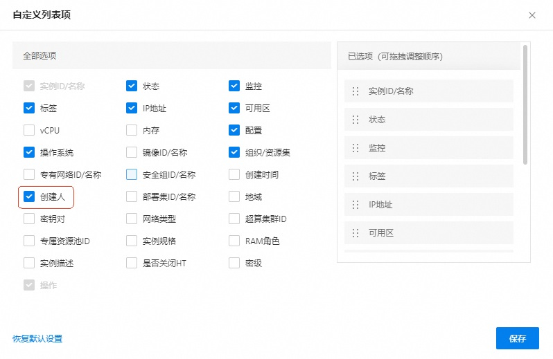

   > **重要**
   >
   > - 支持查看创建人信息的资源有：ECS实例、云盘、快照、自定义镜像、安全组、弹性网卡、密钥对和部署集等资源，具体以资源列表显示为准。
   >
   > - 如果您需要修改资源的创建人，只需将鼠标悬停在资源列表的**创建人**列，然后单击
   >
   >   图标
   >
   >   
   >
   >   即可。

   </li>

   </ol>

5. 在筛选列表中（例如**实例ID**），选择筛选选项，并在搜索栏输入相应信息，实例列表中将自动展示符合搜索条件的实例。

   > **说明**
   >
   > - 支持通过**实例名称**、**实例ID**、**IP地址**、**专有网络ID**、**镜像ID**、**安全组ID**、**操作系统**和**实例规格**等实例信息查找目标实例。
   >
   > - 您也可以同时选择多个筛选选项逐级过滤，以便快速查找实例。

6. 找到需要查看详情的ECS实例，选择如下任意一种方式打开实例详情页面，查看实例的详细信息。

   - 在**实例ID/名称**列中，单击实例ID。

   - 在**操作**列中，单击**管理**。

   **实例详情**页面包含的信息如下表所示。

   <table>
     <tr>
       <th width="89">信息分类</th>
       <th>描述</th>
     </tr>
     <tr>
       <td>基本信息</td>
       <td>实例基本信息，包括实例名称、实例ID、地域、可用区、组织、资源集、实例状态和实例描述等。</td>
     </tr>
     <tr>
       <td>配置信息</td>
       <td>实例配置相关的信息，包括架构信息、CPU/内存、实例规格、操作系统和镜像名称等。</td>
     </tr>
     <tr>
       <td>网络信息</td>
       <td>实例网络相关的信息，包括网络类型、专有网络名称、专有网络ID、虚拟交换机名称和主私网IP等。</td>
     </tr>
     <tr>
       <td>其他信息</td>
       <td>实例运维相关的信息，包括释放保护、密钥对名称和实例IO优化等。</td>
     </tr>
   </table>

7. 查看实例相关信息和操作日志。

   - 监控信息：

     单击**监控**页签，即可查看目标实例监控信息，包括操作系统监控、GPU监控和基础监控等信息。更多信息，请参见查看实例监控信息。

   - 云盘信息：

     单击**云盘**页签，即可查看目标实例上的云盘信息，包括云盘ID、云盘名称、云盘状态、云盘种类和云盘大小等信息。更多云盘信息，请参见云盘。

   - 安全组信息：

     单击**安全组**页签，即可查看目标实例加入的安全组信息，包括安全组ID、安全组名称、安全组类型和安全组规则等信息。更多安全组信息，请参见安全组。

   - 快照信息：

     单击**快照**页签，即可查看为目标实例云盘创建的快照信息，包括快照一致性组和云盘快照等信息。更多快照信息，请参见快照。

   - 弹性网卡信息：

     单击**弹性网卡**页签，即可查看绑定至目标实例的弹性网卡信息，包括网卡名称、网卡ID和交换机ID等信息。更多弹性网卡信息，请参见弹性网卡。

   - 操作日志：

     单击**操作日志**页签，即可查看目标实例的操作日志，包括操作名称、操作人、执行状态、操作来源（控制台调用或API调用）、操作类型、操作源IP和操作时间等。

     您可以选择筛选选项，并在搜索栏输入相应信息，系统将自动筛选符合的操作日志。

     > **说明**
     >
     > 当前操作日志保存时长为7天，如需调整，需联系管理员在**配置 > 日志转存设置**中修改保存时长。具体操作，请参见<strong>《Apsara Uni-manager运营控制台 用户指南》</strong>中的<strong>《日志转存设置》</strong>章节。
     >
     > 若通过转存设置延长保存时长，日志数据不会做前序时间的数据补充。

   - 管理ECS实例：您可以在实例详情页面右上角，启动、重启、停止实例，还可以单击**更多**，进行重置实例密码、挂载云盘、登录VNC等操作。

<a id="section-5-6-2"></a>

### 5.6.2. 修改实例属性

创建实例后，您可以根据业务需求修改实例的名称、描述和自定义数据。

**前提条件**

修改CPU拓扑结构时，需停止实例。具体操作，请参见停止实例。

**操作步骤**

1. 登录云服务器ECS控制台。

2. 在左侧导航栏中，选择**实例与镜像 > ECS实例**。

3. 在顶部菜单栏处，选择组织、资源集和地域。

4. 找到待操作实例，在**操作**列中，单击

   图标，然后选择**实例设置 > 修改属性**。

   

5. 在弹出的**修改属性**对话框，编辑实例的名称、主机名、描述和自定义数据。

   - **实例名称**：实例名称长度为2~128个字符，必须以大小写英文字母或中文开头（不能以 `http://` 或 `https://` 开头），可以包含数字、半角句号（.）、下划线（_）、短划线（-）和半角冒号（:）。

     > **说明**
     >
     > 您也可以在实例列表页面，将鼠标悬浮在实例名称上，然后单击实例名称右侧的
     >
     > 图标，在弹出
     >
     > 
     >
     > 的修改属性对话框，修改实例名称。

   - **主机名**：操作系统内部显示的主机名称。限制说明如下：

     - 半角句号（.）和短划线（-）不能作为首尾字符，更不能连续使用。

     - Windows实例：字符长度为2~15，不支持半角句号（.），不能全是数字。允许包含大小写英文字母、数字和短划线（-）。

     - Linux：字符长度为2~64，支持使用半角句号（.）将主机名分隔成多段，每段允许包含大小写英文字母、数字和短划线（-）。

   - **CPU拓扑结构**：支持选择**HT连续模式**和**HT离散模式**。

     仅部分实例规格支持修改CPU拓扑结构，更多CPU拓扑结构说明，请参见查看和修改CPU拓扑结构。

     - HT连续模式：逻辑核心连续分配给物理核心，有助于减少线程之间的通信和竞争。适用于需要较低的访存延迟和更接近物理核心的计算任务，例如科学计算、数据分析、高性能计算等对内存访问和核心计算敏感的应用。

     - HT离散模式：逻辑核心分散分配给物理核心，可以有助于减少多线程环境中的资源争夺，并提供更好的性能隔离。适用于工作负载中分配给各线程的任务相对独立，或者对单线程性能要求较高的场景。

   - **实例描述**：实例描述，长度为2~256个英文或中文字符，不能以 `http://` 和 `https://` 开头。支持中英文、数字、全角字符、半角句号（.）、下划线（_）和短划线（-）。

   - **自定义数据**：关于自定义数据的更多信息，请参见实例自定义数据。

6. 单击**确定**。

<a id="section-5-6-3"></a>

### 5.6.3. 重置实例登录密码

如果创建实例时没有设置登录密码或者忘记了登录密码，您可以重新设置登录密码。

**重置密码方式对比**

| 修改方式 | 是否需要重启实例 | 实例状态 | 是否需要安装云助手Agent |
| --- | --- | --- | --- |
| 在线重置密码 | 不需要 | 运行中 | 需要，云助手状态必须为<strong>运行中</strong>。 |
| 离线重置密码 | 需要 | <strong>运行中</strong>或<strong>已停止</strong> | 不需要 |

> **重要**
>
> - 如果您的环境没有在线重置密码，请联系您的管理员开通。
>
> - 在线重置密码存在明文泄露风险，建议您登录实例后重新设置密码。

**操作步骤**

1. 登录云服务器ECS控制台。

2. 在左侧导航栏中，选择**实例与镜像 > ECS实例**。

3. 在顶部菜单栏处，选择组织、资源集和地域。

4. 找到待操作的实例，选择一种方式重置实例密码。

   - 在实例详情页，重置实例密码。

     - 在**实例ID/名称**列中，单击实例ID。然后选择**更多 > 重置实例密码**。

     - 在**操作**列中，单击**管理**。然后选择**更多 > 重置实例密码**。

   - 在**操作**列中，单击  图标，然后选择**密码/密钥 > 重置实例密码**。

5. 在**重置密码**对话框，选择**在线重置密码**的方式，设置相应参数，然后单击**确定**。

   <table>
     <tr>
       <th width="153">参数</th>
       <th>说明</th>
     </tr>
     <tr>
       <td>重置密码方式</td>
       <td>• <strong>在线重置密码</strong>：无需重启实例。<br>• <strong>离线重置密码</strong>：需要重启或启动实例才能使新的登录密码生效。</td>
     </tr>
     <tr>
       <td>用户名</td>
       <td>仅支持修改创建实例时设置的用户名的密码。<br>• Linux实例：仅支持修改root或ecs-user用户的密码。<br>• Windows实例：仅支持修改Administrator用户的密码。<br>说明如果您的Windows实例的管理员不是Administrator，则重置密码功能失效。</td>
     </tr>
     <tr>
       <td><strong>新密码</strong>与<strong>确认密码</strong></td>
       <td>• 实例登录密码的长度为8~30个字符，且至少包括以下字符类型中的三项：<br>• 大写字母A~Z<br>• 小写字母a~z<br>• 数字0~9<br>• 特殊字符，支持<code> ( ) ` ~ ! @ # $ % ^ &amp; * - _ + = &#124; { } [ ] : ; </code> <code>' &lt; &gt; , . ? / </code>。<br>• Windows实例的登录密码不能以正斜线（/）作为首字符。<br>重要当实例的操作系统为Kylin时，具体密码规则说明如下：请设置不少于8位的新密码，并确保至少包含大写字母、小写字母、数字、特殊符号中的任意三种字符类型，避免使用回文密码、避免使用简单常见密码和与旧密码过于相似的内容，并且不能包含用户名和cracklib字典词汇（可以执行<code> echo </code> <code>"YOUR_PASSWORD" &#124; cracklib-check </code>查看是否符合）。支持的特殊字符包括<code> ()`~!@#$%^&amp;*-_+=&#124;{}[]:;'&lt;&gt;,.?/ </code>。</td>
     </tr>
   </table>

6. 当**重置密码方式**为**离线重置密码**，需要在控制台或者调用API重启实例，使新密码生效。

   具体操作，请参见重启实例或<strong>《云服务器ECS开发指南》</strong>中的<strong>《RebootInstance》</strong>章节。

<a id="section-5-6-4"></a>

### 5.6.4. 修改VNC密码

如果您首次使用登录VNC功能或者忘记了VNC密码，可以重新设置VNC密码。

**操作步骤**

1. 登录云服务器ECS控制台。

2. 在左侧导航栏中，选择**实例与镜像 > ECS实例**。

3. 在顶部菜单栏处，选择组织、资源集和地域。

4. 找到待操作的实例，选择一种方式修改VNC密码。

   - 在实例详情页，修改VNC密码。

     - 在**实例ID/名称**列中，单击实例ID。然后选择**更多 > 修改远程连接（VNC）密码**。

     - 在**操作**列中，单击**管理**。然后选择**更多 > 修改远程连接（VNC）密码**。

   - 在**操作**列中，单击  图标，然后选择**密码/密钥 > 修改远程连接（VNC）密码**。

5. 在**修改远程连接（VNC）密码**对话框，输入并确认新密码，然后单击**确定**。

   VNC密码长度为8个字符，且至少同时包含大写字母、小写字母、数字、特殊字符中的三项，支持的特殊字符包括 ``!@~`#$%^*()_-+={[}]:;,.?/|\`` 。

   > **说明**
   >
   > 如果您使用非I/O优化实例，还需要通过控制台重启实例，使新密码生效。

<a id="section-5-6-5"></a>

### 5.6.5. 关闭HT超线程

关闭HT可以让ECS实例独占CPU物理核，获得更好的性能表现，并有效控制成本。例如，在内存密集型业务场景中，通过关闭超线程减少vCPU数量，可以提高内存配比，并降低软件许可费用支出。

**CPU与vCPU**

CPU是中央处理器，一个CPU可以包含若干个物理核，通过超线程HT（Hyper-Threading）技术可以将一个物理核变成两个逻辑处理核。vCPU（virtual CPU）是ECS实例的虚拟处理核。

阿里云ECS的超线程的实现基于x86平台架构的HT技术，允许在一个物理核上并发地运行两个线程（Thread），一个线程可以视为一个vCPU。

**使用限制**

- 仅以下Intel独享型的规格族支持关闭HT超线程：

  - ecs.g6s-k10、ecs.g6s-k25、ecs.g6m-k10、ecs.g6m-k25

  - ecs.g7s-k10、ecs.g7s-k25、ecs.g7m-k10、ecs.g7m-k25、ecs.g7x-k10、ecs.g7x-k25

- 关闭HT超线程后，不支持打开HT超线程，并且该实例不支持热变配和冷变配。

- 关闭HT超线程后，实例CPU数量为原规格定义的CPU数量的二分之一。

- HT超线程仅支持在创建实例时设置，创建实例后，不支持开启或关闭。

**关闭HT超线程**

以下仅列举关闭HT超线程的主要参数，其他参数说明，请参见创建实例。

- **开启热变配**：**否**

- **规格**：选择支持修改CPU拓扑结构的实例规格，本文示例为ecs.g7s-k25-c1m2.large。

- **HT超线程技术**：关闭。

  - 开启：ECS实例的CPU物理核变成两个逻辑处理核。

  - 关闭：ECS实例独占CPU物理核。

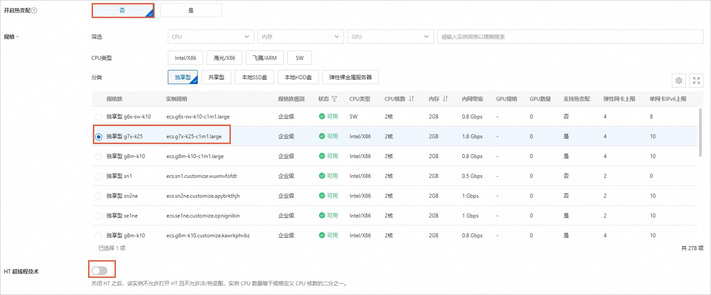

**查看是否关闭HT超线程**

1. 设置自定义列表项。

   实例列表页默认不展示**是否关闭HT**列，您可以在实例列表的右上角，单击  图标，在自定义列表项对话

   框，选中**是否关闭HT**并**保存**，设置在实例列表显示**是否关闭HT**。

   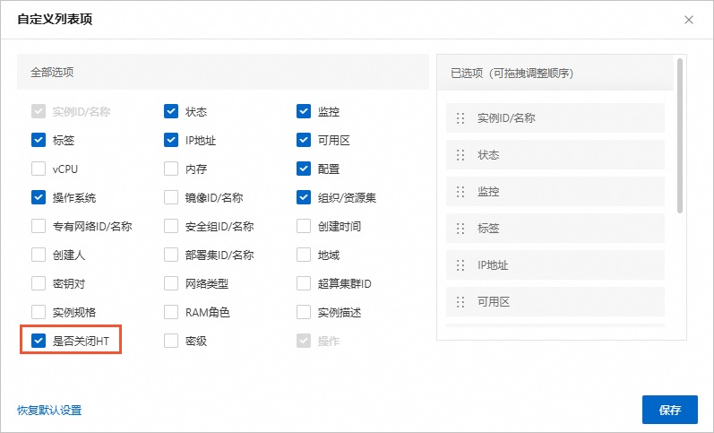

2. 在实例列表页的**是否关闭HT**列，查看实例是否关闭HT超线程。

   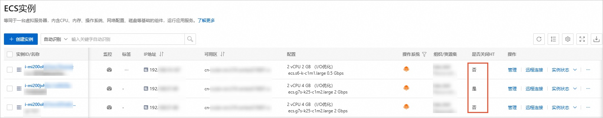

<a id="section-5-6-6"></a>

### 5.6.6. 查看和修改CPU拓扑结构

您可以查看并修改ECS实例的CPU拓扑结构来提高性能、提升并行性以及优化资源分配，以满足您在虚拟化环境、多线程编程、高性能计算等不同场景下的需求。本文介绍如何查看和修改实例的CPU拓扑结构。

**背景信息**

**什么是CPU 拓扑**

CPU拓扑是多核处理器中物理核心与逻辑核心之间的连接方式。通常情况下，每个物理核心都包含一个或多个逻辑核心，而物理核心直接通过总线或互联网络连接，拓扑结构的不同将直接影响多核处理器的性能和能效。

目前阿里云部分实例规格族支持 `HT`连续模式 （ContinuousCoreToHTMapping）和 `HT`离散模


式 （DiscreteCoreToHTMapping）两种不同的拓扑结构。具体说明如下：

- HT连续模式：逻辑核心连续分配给物理核心，有助于减少线程之间的通信和竞争。适用于需要较低的访存延迟和更接近物理核心的计算任务，例如科学计算、数据分析、高性能计算等对内存访问和核心计算敏感的应用。

- HT离散模式：逻辑核心分散分配给物理核心，可以有助于减少多线程环境中的资源争夺，并提供更好的性能隔离。适用于工作负载中分配给各线程的任务相对独立，或者对单线程性能要求较高的场景。

**CPU拓扑结构图**

本文以一台8 vCPU的X86架构的实例规格为例，两种CPU拓扑结构的说明如下所示。

**HT连续模式**

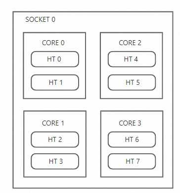

逻辑核心与物理核心的关系如下所示：

- `HT 0` 和 `HT 1` 属于一个核心 `CORE 0` 。

- `HT 2` 和 `HT 3` 属于一个核心 `CORE 1` 。

- `HT 4` 和 `HT 5` 属于一个核心 `CORE 2` 。

- `HT 6` 和 `HT 7` 属于一个核心 `CORE 3` 。

**HT离散模式**

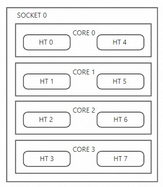

逻辑核心与物理核心的关系如下所示：

- `HT 0` 和 `HT 4` 属于一个核心 `CORE 0` 。

- `HT 1` 和 `HT 5` 属于一个核心 `CORE 1` 。

- `HT 2` 和 `HT 6` 属于一个核心 `CORE 2` 。

- `HT 3` 和 `HT 7` 属于一个核心 `CORE 3` 。

**使用限制**

- 仅以下Intel独享型的规格族支持修改CPU拓扑结构：

  - ecs.g6s-k10、ecs.g6s-k25、ecs.g6m-k10、ecs.g6m-k25

  - ecs.g7s-k10、ecs.g7s-k25、ecs.g7m-k10、ecs.g7m-k25、ecs.g7x-k10、ecs.g7x-k25

    > **说明**
    >
    > 其他规格实例默认为HT连续模式，且不支持修改。

- 修改为HT离散模式后，不支持热变配实例规格，仅支持冷变配。

**设置/修改CPU拓扑结构**

> **重要**
>
> 如果您因业务需求需要修改CPU拓扑结构，建议您在修改之前进行一些基准测试和性能评估，以确定哪种模式最适合您的工作负载。

**创建实例时设置CPU拓扑结构**

以下仅列举设置CPU拓扑结构的主要参数，其他参数说明，请参见创建实例。

- **规格**：选择支持修改CPU拓扑结构的实例规格，本文示例为ecs.g7s-k25-c1m2.large。

- **HT超线程技术**：开启。

- **CPU拓扑结构**：根据业务需要，选择**HT连续模式**或**HT离散模式**。

> **说明**
>
> 以下实例规格仅为示例，实际支持的实例规格以您的环境为准。

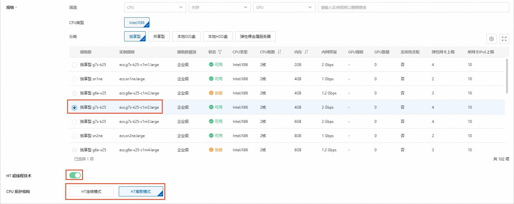

**修改已有实例的拓扑结构**

停止实例后，修改实例属性时，可以修改CPU拓扑结构。具体操作，请参见修改实例属性。

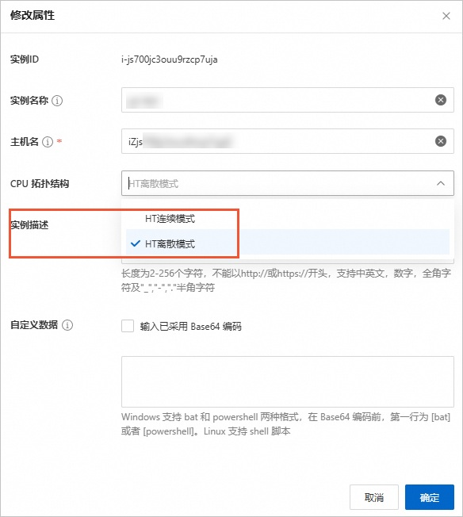

**查看CPU拓扑结构**

您可以在实例详情页的配置信息区域，查看CPU拓扑结构信息。具体操作，请参见查看实例详情。

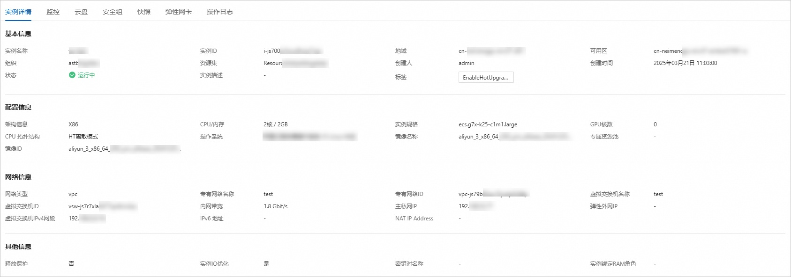

<a id="section-5-6-7"></a>

### 5.6.7. 开启和关闭实例释放保护

如果您的实例承载了关键业务，可以为该实例开启实例释放保护，防止手动释放，有效避免因操作疏忽、团队成员沟通不及时等原因造成不可挽回的后果。本文为您介绍如何开启和关闭实例释放保护，以及查看实例的保护状态。

**背景信息**

实例释放保护不能阻止因合理原因自动执行的释放行为，包括但不限于：

- 实例设置了自动释放时间，到期后被自动释放。

- 实例存在安全合规风险，被停止或释放。

- 实例由弹性伸缩自动创建，在缩容时被移出伸缩组并释放。

**开启和关闭实例释放保护**

**场景一：创建实例时开启或关闭**

创建实例时，系统默认关闭实例释放保护功能，如果您需要开启，需手动操作。本步骤重点介绍实例释放保护相关的选项，如需了解其它配置，请参见创建实例。

1. 登录云服务器ECS控制台。

2. 在左侧导航栏中，选择**实例与镜像 > ECS实例**。

3. 在顶部菜单栏处，选择组织、资源集和地域。

4. 在**实例列表**页面，单击**创建实例**。

5. 在**基础配置**页面，根据需要配置所有选项，然后单击**下一步**。

6. 在**网络配置**页面，根据需要配置所有选项，然后单击**下一步**。

7. 在**系统配置**页面，打开**实例释放保护**开关，根据需要配置其余选项，然后单击**下一步**。

   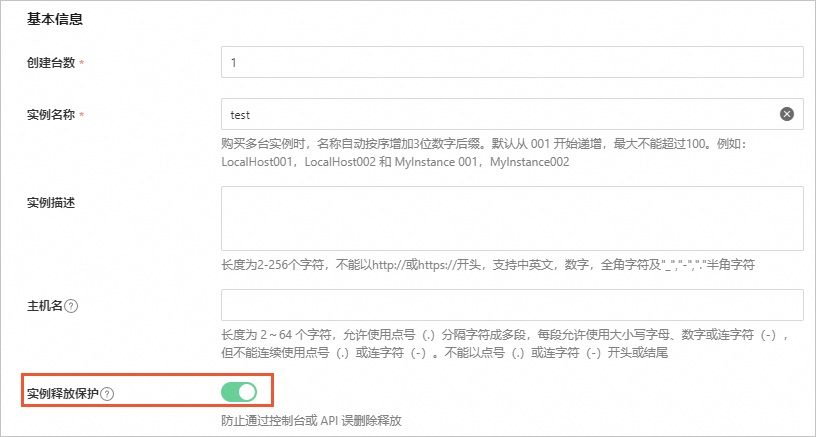

8. 在**信息确认**页面，确认配置信息无误后，单击**提交**。

**场景二：为已有实例开启或关闭**

您也可以修改现有实例的信息，开启或关闭实例释放保护。

1. 登录云服务器ECS控制台。

2. 在左侧导航栏中，选择**实例与镜像 > ECS实例**。

3. 在顶部菜单栏处，选择组织、资源集和地域。

4. 找到待操作实例，在**操作**列中，单击

   图标，然后选择**实例设置 > 修改实例释放保护**。

   

5. 根据需要打开或关闭**实例释放保护**。

6. 单击**确定**。

**场景三：批量关闭实例释放保护**

1. 登录云服务器ECS控制台。

2. 在左侧导航栏中，选择**实例与镜像 > ECS实例**。

3. 在顶部菜单栏处，选择组织、资源集和地域。

4. 选中多台实例，在页面底部，选择**更多 > 批量关闭实例释放保护**。

5. 在弹出的**关闭实例释放保护**对话框，确认实例，然后单击**下一步**。

   系统会过滤掉已关闭实例释放保护的实例。

6. 在确认操作步骤，单击**提交**。

**查看实例释放保护开启状态**

1. 登录云服务器ECS控制台。

2. 在左侧导航栏中，选择**实例与镜像 > ECS实例**。

3. 在顶部菜单栏处，选择组织、资源集和地域。

4. 在**实例列表**页面，选择一种方式查看实例详情。

   - 在**实例ID/名称**列，单击待查看实例的实例ID。

   - 找到待查看的实例，在**操作**列，单击**管理**。

5. 在**实例详情**页面，查看**其他信息**下的**释放保护**。

   

<a id="section-5-6-8"></a>

### 5.6.8. 实例自定义数据

实例自定义数据，是阿里云ECS为您提供的一种自定义实例启动行为及传入数据的功能。

**背景信息**

实例自定义数据功能兼容Windows实例及Linux实例，主要有两种用途：

- 作为实例自定义脚本，在启动实例时执行。

- 作为普通数据，将一定的信息传入实例中，您可以在实例中引用这些数据。

**实例自定义数据使用说明**

- **限制条件**

  只有满足以下所有条件的实例才能使用实例自定义数据。

  - 网络类型：专有网络（VPC）。

  - 镜像：系统镜像或继承于系统镜像的自定义镜像。

  - 操作系统：支持的类型中的一种。

    表 1. 支持的类型

    | Windows | Linux |
    | --- | --- |
    | • Windows Server 2016 64位<br>• Windows Server 2012 R2 64位<br>• Windows Server 2008 R2 64位 | • CentOS<br>• Ubuntu<br>• SUSE Linux Enterprise<br>• OpenSUSE<br>• Debian<br>• Aliyun Linux<br>• Alibaba Cloud Linux 3 64bit<br>说明使用Alibaba Cloud Linux 3 64bit镜像创建实例将自动下发自定义参数，您也可以追加更多自定义数据内容。 |

- **控制台**：您可以在控制台修改实例自定义数据的内容。如果是自定义脚本类型，修改过的脚本是否要重新执行取决于脚本类型。比如，修改的是Linux的**Cloud Config**中的 `bootcmd` 类型的脚本，那么每次实例重启时都会自动执行。

- **OpenAPI**：您也可以通过OpenAPI使用实例自定义数据，具体操作方式请参见 <strong>《ECS开发指南》</strong>中的**CreateInstance** 和**ModifyInstanceAttribute**。

**Linux实例自定义脚本**

阿里云的Linux实例自定义脚本采用开源的cloud-init架构实现，对Linux实例进行各项自动化配置。自定义脚本类型兼容开源cloud-init。

**Linux实例自定义脚本说明**

- 实例自定义脚本执行时间节点：实例运行后， `/etc/init` 执行前。

- Linux实例自定义脚本默认将以root的权限执行。

> **说明**
>
> - 只能输入半角英文字符。
>
> - 如果您要输入的数据已经采用Base64编码，应勾选**输入已采用 base64 编码**。

**Linux实例自定义脚本类型**

- **User-Data Script**

  - 描述：以脚本作为自定义配置的手段，如Shell脚本。

  - 格式：首行必须是 `#!` ，如 `#!/bin/sh` 。

  - 限制：在Base64编码前，脚本内容（包括首行在内）不能超过16 KB。

  - 频率：仅在首次启动实例时执行。

  - 示例：

    ```bash
    #!/bin/sh
    echo "Hello World. The time is now $(date -R)!" | tee /root/output10.txt
    ```

- **Cloud Config Data**

  - 描述：通过预定义数据配置部分实例服务，如yum源、SSH密钥。

  - 格式：首行必须是 `#cloud-config` 。

  - 限制：在Base64编码前，脚本内容（包括首行在内）不能超过16 KB。

  - 频率：配置的服务不同，执行频率也会不同。

  - 示例：

    ```text
    #cloud-config
    apt:
    primary:
    - arches: [default]
    uri: http://us.archive.ubuntu.com/ubuntu/
    ```

- **Include**

  - 描述：实例自定义脚本可以以文本文件的形式将具体的配置内容保存起来，然后以URL的形式传入cloud-init中进行处理。

  - 格式：首行必须是  `#include` 。

  - 限制：在Base64编码前，脚本内容（包括首行在内）不能超过16 KB。

  - 频率：由实际文本文件中脚本的类型决定执行频率。

  - 示例：

    ```text
    #include
    http://ecs-image-test.oss-cn-hangzhou.aliyuncs.com/userdata/cloudconfig
    ```

- **Gzip压缩格式**

  - 描述：由于cloud-init对各类自定义脚本的内容有16 KB大小的限制，所以您可以选择把脚本文件压缩之后再传入到实例自定义脚本中。

  - 格式：.gz文件的形式，以 `#include` 的URL的方式传入实例自定义脚本。

  - 频率：由压缩文件中所包含的脚本内容决定。

  - 示例：

    ```text
    #include
    http://ecs-image-test.oss-cn-hangzhou.aliyuncs.com/userdata/config.gz
    ```

**查看Linux实例自定义数据**

要查看某个Linux实例自定义数据，您可在实例中执行如下命令：

```bash
curl http://100.100.100.200/latest/user-data
```

**Windows实例自定义脚本**

Windows实例自定义脚本由阿里云自主研发，是一套用于初始化Windows实例的脚本。

Windows实例自定义脚本有两种类型，包括：

- Bat批处理程序：以 `[bat]` 开头且作为首行。在Base64编码前，所有脚本内容必须小于16 KB。

- PowerShell脚本：以 `[powershell]` 开头且作为首行。在Base64编码前，所有脚本内容必须小于16 KB。

> **说明**
>
> - 只能输入半角英文字符。
>
> - 如果您要输入的数据已经采用Base64编码，应勾选**输入已采用 base64 编码**。

**查看Windows实例自定义数据**

要查看某个Windows实例自定义数据，您可以在实例中执行如下PowerShell命令：

```text
Invoke-RestMethod http://100.100.100.200/latest/user-data/
```

<a id="section-5-7"></a>

## 5.7. 管理实例回收站

<a id="section-5-7-1"></a>

### 5.7.1. 设置冷冻时长

当您将ECS实例放入回收站时，该实例处于冷冻期。本文介绍如何设置冷冻期时长。

**前提条件**

仅admin账号可以设置冷冻时长。

**背景信息**

ECS实例处于冷冻期时，实例的CPU、内存等计算资源被释放，弹性公网IP会被自动解绑，存储资源保留3天。冷冻期过后，ECS资源会被彻底销毁，不可恢复。

冷冻期默认为3天，您也可以根据业务需求，设置合适冷冻时长，最长为30天23小时。

仅支持为回收站设置冷冻时长，不支持对某一实例设置冷冻时长。

> 设置冷冻时长后，回收站中所有的实例都将在该冷冻期过后，被彻底销毁。
>
> **重要**

**操作步骤**

1. 登录云服务器ECS控制台。

2. 在左侧导航栏中，单击**回收站**。

3. 在顶部菜单栏处，选择组织、资源集和地域。

4. 在回收站页面，单击**设置冷冻时长**。

5. 在弹出的**设置冷冻时长**对话框，设置具体的冷冻时长，然后单击**确定**。

**执行结果**

您可以在实例列表上方查看冷冻时长。

<a id="section-5-7-2"></a>

### 5.7.2. 恢复实例

当您将ECS实例放入回收站时，该实例处于冷冻期。您可以根据业务需要，恢复处于冷冻期的ECS实例。

**背景信息**

恢复实例时，实例的CPU、内存等计算资源将会重新获取，弹性公网IP需要手动绑定。具体操作，请参见<strong>《弹性公网IP用户指南》</strong>中的<strong>《绑定ECS实例》</strong>章节。

> 删除实例时，CPU、内存等计算资源会被自动回收，并且没有预留。恢复实例时，可能因
>
> **说明**
>
> 配额或计算资源不足导致恢复失败，请您确保有足够的配额和计算资源。

**操作步骤**

1. 登录云服务器ECS控制台。

2. 在左侧导航栏中，单击**回收站**。

3. 在顶部菜单栏处，选择组织、资源集和地域。

4. 恢复回收站中的ECS实例。恢复ECS实例有以下两种方式：

   - 单个恢复：单击待恢复的ECS实例操作列的**恢复**，在弹出的对话框，单击**确定**。

   - 批量恢复：选中待恢复ECS实例，单击实例列表下面的**恢复**，在弹出的对话框，单击**确定**。

<a id="section-5-7-3"></a>

### 5.7.3. 彻底删除实例

当您已确定不再需要该实例，可在回收站中彻底删除。本文介绍如何彻底删除实例。

**背景信息**

彻底删除实例后不可恢复，建议您确定该实例不会影响您的业务后，再执行删除操作。

**操作步骤**

1. 登录云服务器ECS控制台。

2. 在左侧导航栏中，单击**回收站**。

3. 在顶部菜单栏处，选择组织、资源集和地域。

4. 在实例列表页面，可查看处于冷冻期的所有ECS实例，包括**实例ID/名称**、**实例规格**、**自动释放时间**等。

5. 彻底删除回收站中的ECS实例。彻底删除ECS实例有以下两种方式：

   - 单个删除：单击待删除的ECS实例操作列的**彻底删除**，在弹出的对话框，单击**删除**。

   - 批量删除：选中待删除ECS实例，单击实例列表下面的**彻底删除**，在弹出的对话框，单击**删除**。

<a id="section-5-8"></a>

## 5.8. 变更实例规格

<a id="section-5-8-1"></a>

### 5.8.1. 升降配实例规格

当您使用的实例规格超出或不能满足应用需求，您可以变更实例规格（包括vCPU、内存和内网带宽等）。

**前提条件**

待升降配的实例状态为**已停止**。

> **说明**
>
> 停止实例会造成业务中断，建议您在非业务高峰期时执行该操作。

**使用限制**

使用升降配实例有以下限制：

- 必须指定目标实例规格（包括vCPU、内存、内网带宽等），不能单独变更其中一个配置。

- 以下规格族不支持升降配：

  - 本地HDD盘

  - 本地SSD盘

  - 弹性裸金属

  - 超级计算集群

  - FPGA

> **警告**
>
> 升降配实例操作过程中，ECS实例底层信息可能会发生变化（例如CPU FLAGS），从而导致您的应用授权码失效。

**费用说明**

升降配实例规格后，将以新规格进行计费。

> **说明**
>
> 仅当您的管理员在运营中心中配置了计费规则时才会计费。关于计费规则的详细说明，请参见<strong>《Apsara Uni-manager运营控制台用户指南》</strong>中的<strong>《计费规则》</strong>章节。

**操作步骤**

1. 登录云服务器ECS控制台。

2. 在左侧导航栏中，选择**实例与镜像 > ECS实例**。

3. 在顶部菜单栏处，选择组织、资源集和地域。

4. 找到待操作实例，在**操作**列中，单击  图标，然后单击**升降配**。

5. （条件可选）选择服务目录，单击**确定**。

   服务管理用于在企业或组织内对某些产品的特定规格进行一定的管理与控制。仅当服务管理中配置了将**ECS实例**授权给当前组织或用户，并且该ECS实例资源已上架，才会显示此选项。关于服务管理的更多信息，请参见<strong>《Apsara Uni-manager运营控制台用户指南》</strong>中的<strong>《服务管理》</strong>章节。

6. 升降配实例规格。

   > **说明**
   >
   > 具体支持升降配的实例规格以界面显示为准。

   - 服务管理中已创建**云资源**为**ECS实例**的服务：在**ECS变配**页面，选中需要变配的实例规格，然后单击**确认订单**。

   - 服务管理中未创建**云资源**为**ECS实例**的服务：在**ECS变配**页面，选中需要变配的实例规格，单击**提交**。

7. 在控制台或者调用API启动实例，使新实例规格生效。

   具体操作，请参见启动实例或<strong>《云服务器ECS开发指南》</strong>中的<strong>《StartInstance》</strong>章节。

<a id="section-5-8-2"></a>

### 5.8.2. 热变配实例规格

当您使用的实例规格超出或不能满足应用需求时，您可以变更实例规格（包括vCPU、内存和内网带宽等）。与升降配实例规格不同，热变配可以在不停止实例的情况下变配实例规格。

**前提条件**

该实例支持热变配，并且创建实例时选中**开启热变配**。具体操作，请参见创建实例。

> **说明**
>
> 具体支持的实例规格，请以控制台显示为准。

**计费说明**

热变配实例规格后，将以新规格进行计费。

> **说明**
>
> 仅当您的管理员在运营中心中配置了计费规则时才会计费。关于计费规则的详细说明，请参见专有云文档中心<strong>《Apsara Uni-manager运营控制台用户指南》</strong>文档的<strong>《计费规则》</strong>章节。

**使用限制**

使用热变配实例规格时，存在以下限制：

- 仅部分 x86 规格支持热变配。

- 待热变配实例所在的物理机，剩余资源必须满足目标规格的 CPU 和内存要求。

- 必须指定目标实例规格（包括vCPU、内存、内网带宽等），不能单独变更其中一个配置。

- 热变配热添加CPU不设限制，但连续热变配热添加内存的上限为4次。第5次热变配内存时，管控侧将拦截并报错，此时需要重启实例以重置热变配次数。

- 如果某个ECS集群物理机设置了NumaOn，则该集群所创建的ECS实例热升配功能只具备poc能力。

- 操作升配实例前，请先登录目标ECS实例，然后使用 `free -m` 命令查看剩余内存，当 `free` 和 `available` 的内存≥ 80 M+N\*64 M空间大小时，才能进行升配操作。当目标ECS实例的可用内存不足时，执行热升配的操作可能会导致ECS实例内进程触发OOM（Out Of Memory）风险，影响客户业务。其中，

  - 80 M：最低安全水位。

  - N\*64 M：可用内存与热插内存的大小（即size）比例为1：64。即热升配时，每增加1 G内存，需要额外准备64 M可用内存。

- 仅如下镜像支持热变配。

  **镜像平台**

  **镜像名称**

  aliyun_2_1903_x86_64_20G_alibase_20240628.vhd

  aliyun_2_1903_x86_64_20G_dengbao_alibase_20240705.vhd

  aliyun_3_x86_64_20G_alibase_20241103.vhd

  aliyun_3_x86_64_20G_dengbao_alibase_20241103.vhd

  **Aliyun**

  aliyun_3_x86_64_20G_pro_alibase_20241225.vhd

  aliyun_3_x86_64_20G_pro_dengbao_alibase_20241030.vhd

  aliyun_3_x86_64_20G_container_optimized_20241226.vhd

  aliyun_4_x86_64_20G_alibase_20250728.vhd

  anolisos_8_8_x86_64_20G_anck_dengbao_alibase_20231219.vhd

  **Anolis**

  anolisos_8_9_x86_64_20G_anck_alibase_20240724.vhd

  uos_20_1070a_x86_64_20G_alibase_20241129.vhd

  **UOS**

  uos_20_1070a_x86_64_20G_uefi_alibase_20241119.vhd

  kylin_v10_sp3_2403_x86_64_20G_alibase_20241129.vhd

  kylin_v10_sp3_2403_x86_64_20G_uefi_alibase_20241119.vhd

  **Kylin**

  nfs_v4_g195_x86_64_20G_alibase_20241119.vhd

  kylinsec_v3_3_9A_x86_64_20G_alibase_20250708.vhd

  **CentOS Stream**

  centos_stream_9_x86_64_20G_alibase_20241128.vhd

  ubuntu_20_04_x86_64_20G_alibase_20241115.vhd

  **Ubuntu**

  ubuntu_22_04_x86_64_20G_alibase_20241115.vhd

  ubuntu_24_04_x86_64_20G_alibase_20241115.vhd

  rockylinux_8_10_x86_64_20G_alibase_20241115.vhd

  **RockyLinux**

  rockylinux_9_4_x86_64_20G_alibase_20241115.vhd

  almalinux_8_10_x86_64_20G_alibase_20241115.vhd

  **AlmaLinux**

  almalinux_9_4_x86_64_20G_alibase_20241115.vhd

  **SUSE**

  sles_15_sp6_x86_64_20G_alibase_20240930.vhd

  **openSUSE**

  opensuse_15_6_x86_64_20G_alibase_20240731.vhd

  **redHat**

  redhat_9_4_x86_64_20G_alibase_20240711.vhd

> **警告**
>
> 热变配实例操作过程中，ECS实例底层信息可能会发生变化（例如CPU FLAGS），从而导致您的应用授权码失效。

**操作步骤**

1. 登录云服务器ECS控制台。

2. 在左侧导航栏中，选择**实例与镜像 > ECS实例**。

3. 在顶部菜单栏处，选择组织、资源集和地域。

4. （条件可选）选择服务目录，单击**确定**。

   服务管理用于在企业或组织内对某些产品的特定规格进行一定的管理与控制。仅当服务管理中配置了将**ECS实例**授权给当前组织或用户，并且该ECS实例资源已上架，才会显示此选项。关于服务管理的更多信息，请参见<strong>《Apsara Uni-manager运营控制台用户指南》</strong>中的<strong>《服务管理》</strong>章节。

5. 请根据实际需求热变配实例规格。

   - **单个热变配**：找到待操作实例，在**操作**列中，单击  图标，然后单击**热变配**。

   - **批量热变配**：选中热变配实例，在页面底部，选择**更多 > 批量热变配**。

     > **重要**
     >
     > 批量热变配的所有实例必须是同一规格。

6. 热变配实例规格。

   - 服务管理中已创建**云资源**为**ECS实例**的服务：在**ECS变配**页面，选中需要变配的实例规格，然后单击**确认订单**。

   - 服务管理中未创建**云资源**为**ECS实例**的服务：在**ECS变配**页面，选中需要变配的实例规格，单击**提交**。

<a id="section-5-9"></a>

## 5.9. 更换操作系统

如果您在创建ECS实例时选择了错误的操作系统，或者在使用过程中需要改用其他操作系统，您可以为ECS实例更换新的操作系统。本文介绍如何更换实例操作系统。

**前提条件**

- 更换操作系统后，原系统盘会被释放，原系统盘上的数据会丢失且无法找回。建议您在更换操作系统前创建快照备份数据。具体操作，请参见创建快照。

- ECS实例处于已停止状态。 若尚未停止，具体操作，请参见停止实例。

**注意事项**

更换操作系统是高风险操作，请务必在更换操作系统前了解以下注意事项：

- 更换操作系统后，阿里云会为您的ECS实例重新分配一块新系统盘，此时云盘ID会更新，原系统盘会被释放，原系统盘上的数据会丢失且无法找回。系统盘的云盘类型、实例IP地址以及弹性网卡MAC地址保持不变。

- 更换操作系统后，您需要在新系统盘中重新部署业务运行环境。

- 基于旧系统盘创建的快照，不能用于回滚新系统盘，但可以用于创建自定义镜像。对于不同方式创建的快照，您需要注意：

  - 手动创建的快照，不会被释放。

  - 自动创建的快照，如果旧系统盘开启**自动快照随云盘释放**，则自动快照会被自动删除；如果未开启**自动快照随云盘释放**，则自动快照会被保留。

- 如果您需要将ECS实例的Windows Server系统更换为Linux系统，或者将Linux系统更换为Windows Server系统，请注意：

  提前检查实例主机名（**HostName**）已经符合目标系统的限制，并删除目标系统不支持的字符。关于如何修改主机名，请参见修改实例属性或<strong>《云服务器ECS开发指南》</strong>中的<strong>《ModifyInstanceAttribute》</strong>章节。

- 如果您需要将ECS实例的操作系统更换为Windows Server系统，请注意：

  - 系统盘必须有足够的可用空间，至少预留1 GiB以上。否则，更换操作系统后，ECS实例可能无法启动。

  - 如果您使用的是非I/O优化实例，不支持控制台上更换操作系统，仅支持调用<strong>《云服务器ECS开发指南》</strong>中的<strong>《ReplaceSystemDisk》</strong>更换为指定Windows Server公共镜像。镜像信息，请参见镜像概述。

**操作步骤**

1. 登录云服务器ECS控制台。

2. 在左侧导航栏中，选择**实例与镜像 > ECS实例**。

3. 在顶部菜单栏处，选择组织、资源集和地域。

4. 找到待更换操作系统的实例，在**操作**列中，单击

   图标，然后选择**云盘和镜像 > 更换操作系统**。

   

5. 在**更换操作系统**对话框中，设置新操作系统信息。

   <table>
     <tr>
       <th width="155">参数</th>
       <th>说明</th>
     </tr>
     <tr>
       <td>镜像类型</td>
       <td>选择实例新操作系统的镜像类型。取值范围：<br>• 公共镜像<br>• 自定义镜像<br>• 共享镜像<br>• 企业共享镜像</td>
     </tr>
     <tr>
       <td>镜像系统和镜像ID</td>
       <td>选择新操作系统镜像与镜像ID。</td>
     </tr>
     <tr>
       <td>系统盘大小</td>
       <td>根据业务需求和新镜像的需求，设置系统盘容量。新容量最大不能超过2048 GiB，并且必须大于等于当前系统盘大小，说明如下：<br>• Linux<br>容量限制（GiB）：[max{20, 系统盘当前容量}, 2048]<br>• Windows<br>容量限制（GiB）：[max{40, 系统盘当前容量}, 2048]</td>
     </tr>
   </table>

6. 更换操作系统。

   - 服务管理中已创建**云资源**为**ECS实例**的服务：在**信息确认**页面，确认新操作系统信息，然后单击**确认订单**。

   - 服务管理中未创建**云资源**为**ECS实例**的服务：在**信息确认**页面，确认新操作系统信息，然后单击**提交**。

7. 在控制台或者调用API启动实例，使新操作系统生效。

   具体操作，请参见启动实例或<strong>《云服务器ECS开发指南》</strong>中的<strong>《StartInstance》</strong>章节。

**后续操作**

以下场景下，更换操作系统后需要重置实例登录密码后才能登录。

- 原实例创建时，选择了**支持 ecs-user 用户登录**，更换操作系统为不支持ecs-user的镜像。

- 原实例镜像预设了密码，更换操作系统为任意镜像。

<a id="section-5-10"></a>

## 5.10. 查看实例监控信息

在云监控中心，您可以通过查看监控图表，了解各实例的运行情况。本文介绍如何快速跳转到云监控查看实例监控信息。

**背景信息**

云监控中心提供了资源的实时监控、告警及通知服务，为您的产品和业务保驾护航。更多信息，请参见专有云文档中心<em>《Apsara Uni-manager运营控制台用户指南》</em>文档的**云监控CMS 用户指南 > 云监控CMS简介**章节。

**操作步骤**

1. 登录云服务器ECS控制台。

2. 在左侧导航栏中，选择**实例与镜像 > ECS实例**。

3. 在顶部菜单栏处，选择组织、资源集和地域。

4. 在**监控**面板或**监控**页签，查看目标实例的监控信息。

   - **监控**面板：在实例列表中，找到目标实例，然后单击**监控**列的  图标。

   - **监控**页签：

     <ol type="a">

     <li>

     在实例列表中，在**实例ID/名称**列，单击目标实例的实例ID。

     </li>

     <li>

     在实例详情页面，单击**监控**页签。

     </li>

     </ol>

   您可以在**监控**面板或**监控**页签下，查看如下信息。

   > **说明**
   >
   > 您也可以单击**查看更多**，进入云监控CMS控制台查看更详细的实例监控信息。

   <table>
     <tr>
       <th width="90">项目</th>
       <th>说明</th>
     </tr>
     <tr>
       <td>监控类型</td>
       <td>实例监控信息分为操作系统监控、GPU监控、基础监控、进程监控、云盘和网络监控信息。</td>
     </tr>
     <tr>
       <td>监控周期</td>
       <td>您可以配置查看监控数据的时间段，即监控周期。取值范围：<br>• 按小时：1小时、3小时、6小时、12小时<br>• 按天：1天、3天、7天、14天<br>• 自定义：可以根据实际需要设置监控周期。支持快速选择<strong>近五分钟</strong>、<strong>近十分</strong><strong>钟</strong>或<strong>近十五分钟</strong>。</td>
     </tr>
     <tr>
       <td>监控指标</td>
       <td>具体的监控指标说明，请参见专有云文档中心<em>《Apsara Uni-manager运营控制</em><em>台用户指南》</em>文档的<strong>云监控CMS 用户指南 &gt; 云产品监控 &gt; 云监控指标说明</strong>章节。<br>说明默认展示各监控指标的平均值数据，你也可以根据实际需要修改为最大值或最小值数据。</td>
     </tr>
   </table>

<a id="section-5-11"></a>

## 5.11. 加入安全组

您可以将已创建的实例加入多个安全组，通过安全组规则控制实例的网络访问。

**背景信息**

安全组提供类似虚拟防火墙的功能，是重要的安全隔离手段，可以控制多台实例的网络访问。

同一账号、同一地域、同一个专有网络的实例，如果在同一个安全组，默认内网互通；如果在不同的安全组，可以通过安全组授权实现内网互通。更多安全组信息，请参见安全组概述。

> **说明**
>
> 如果您需要将多台ECS实例添加到同一个安全组中，请参见ECS实例加入安全组。

**操作步骤**

> **重要**
>
> 目标安全组与ECS实例必须属于同一个VPC网络。

1. 登录云服务器ECS控制台。

2. 在左侧导航栏中，选择**实例与镜像 > ECS实例**。

3. 在顶部菜单栏处，选择组织、资源集和地域。

4. 在实例列表中找到目标实例，单击**操作**列的**管理**。

   > **说明**
   >
   > 您也可以在实例列表的**实例ID/名称**列中，单击目标实例ID。

   默认进入**实例详情**页签。

5. 选择**安全组 > 安全组列表**。

6. 单击**加入安全组**。

7. 在对话框中选择待加入的安全组，然后单击**确定**。

   > **重要**
   >
   > 1台实例最多可以加入10个安全组，加入安全组后，安全组规则自动对实例生效，不需要手动更新。

<a id="section-5-12"></a>

## 5.12. 更换ECS实例的VPC

当业务发展、组织架构调整或安全策略升级时，原有的网络规划可能无法满足新的需求。此时，需要将ECS实例从一个VPC迁移至另一个，以实现业务隔离、网络架构重组或解决IP地址段冲突。此操作在不改变实例所在地域和可用区的前提下，完成VPC的更换。

> **重要**
>
> 更换VPC操作会导致ECS实例短暂不可用，产生业务中断。请选择合适的时机进行操作，建议在业务低峰期时段，创建快照备份数据后执行。

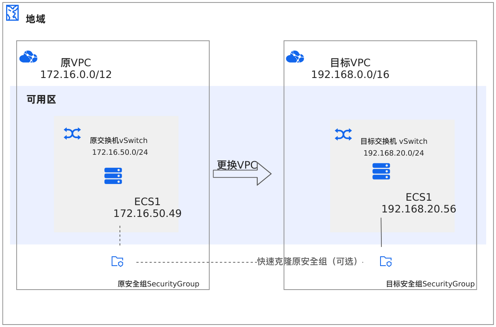

**变更影响与风险**

- **业务中断**：操作要求实例处于**已停止**状态，因此会导致业务中断。

- **私网IP地址变更**：

  - 实例的主私网IP地址将变更为目标交换机网段内的一个新地址（可指定或自动分配）。硬编码使用原私网IP的应用或服务（如数据库连接字符串、防火墙白名单、其他服务的配置）将失效，需在更换后手动更新。

  - 公网IP地址保持不变。

- **网络连接中断**：实例与原VPC内其他资源（如RDS、SLB、其他ECS实例）的私网连接将断开。

- **操作系统网络配置**：若实例内部获取IP方式为静态配置，更换VPC后，操作系统内的网络信息（IP地址、网关等）将与实际分配的不符，导致实例无法正常远程连接、通信等。

**操作步骤**

**步骤一：准备工作**

1. **创建快照备份** 为避免意外，建议为实例的系统盘和数据盘创建快照，作为数据备份和回滚的保障。

2. **停止实例**

   实例必须处于**已停止**状态，若当前实例状态为**运行中**，需先停止实例。

3. **前置检查处理**

   - **辅助弹性网卡**：若实例绑定了辅助弹性网卡，需先从实例解绑辅助弹性网卡。

   - **多IP地址**：若主网卡分配了辅助私网IP或IPv6地址，需先取消分配辅助私网IP或删除已分配的IPv6地址。

   - **负载均衡（SLB）**：若实例加入了负载均衡（SLB）后端服务器组，需先移除该实例。具体操作，请参见<strong>《负载均衡用户指南》</strong>中的<strong>《移除后端服务器》</strong>章节。

   - **自定义路由条目**：若实例被配置在自定义路由表中，需先删除路由条目。具体操作，请参见<strong>《专有网络VPC用户指南》</strong>中的<strong>《管理自定义路由表和交换机》</strong>章节。

   - **高可用虚拟IP（HaVip）**：若实例关联了高可用虚拟IP（HaVip），需先将实例和HaVip解除管理。具体操作，请参见<strong>《专有网络VPC用户指南》</strong>中的<strong>《高可用虚拟IP > 解绑ECS实例》</strong>章节。

4. **准备目标网络资源**

   - **专有网络与交换机**：在目标VPC中，确保已在与ECS实例相同的可用区下创建专有网络与交换机。更多信息，请参见<strong>《专有网络VPC用户指南》</strong>中的<strong>《创建和管理专有网络》</strong>章节。

   - **安全组**：在目标VPC中，准备好将要关联的安全组。可通过克隆安全组到目标VPC快速复制现有规则。

**步骤二：更换专有网络**

1. 登录云服务器ECS控制台。

2. 在左侧导航栏中，选择**实例与镜像 > ECS实例**。

3. 在顶部菜单栏处，选择组织、资源集和地域。

4. 找到目标实例，在**操作**列，单击  图标，然后选择**网络与安全组 > 更换专有网络**。

   您也可以在ECS实例详情页的**网络信息**区域，单击**专有网络ID**右侧的**更换专有网络**。

5. 更换专有网络。

   <ol type="i">

   <li>

   **变更准备**：查看变更前的网络信息和注意事项，然后单击**下一步**。

   </li>

   <li>

   **选择专有网络**：设置**目标专有网络**、**目标交换机**和**目标安全组**，然后单击**下一步**。

   </li>

   <li>

   （可选）**配置主私网IP**：设置IP地址需要保证在目标交换机的CIDR网段范围内。若不设置，则主私网IP由系统自动分配，然后单击**提交**。

   </li>

   </ol>

6. 查看变更结果：

   在**实例详情**页面的**网络信息**区域查看更换后的专用网络和虚拟交换机。

   > **说明**
   >
   > 更换VPC完成后，实例不会自动启动，需手动启动实例。

**常见问题执行专有网络更换时报错：当前实例存在反向访问规则，暂不支持修改VPC，如何解决？**

**报错原因**：使用workbench登录ECS后，会自动建立实例的反向访问规则。

**解决方案**：反向访问规则，将对其它产品的授权删除后再进行尝试。

如果实例通过Workbench私网远程连接生成私网链路，可以参考以下操作，释放授权链接：

1. 登录Workbench控制台，查看**私网链路**页面是否存在对应ECS实例的反向授权链接，如果存在，请单击右侧操作列的**释放链路**。

2. 在私网链路释放提示弹窗中，单击确定完成释放，然后再尝试更换。

<a id="section-5-13"></a>

## 5.13. 更换ECS实例的交换机

当ECS实例遇到所属的交换机IP地址耗尽、或ECS实例因网络架构升级需要迁移至更大网段或重新规划网段等问题。使用更换ECS实例的交换机功能，可以将ECS实例（主网卡）当前的交换机更换为同一VPC内、同可用区下的另一台交换机。

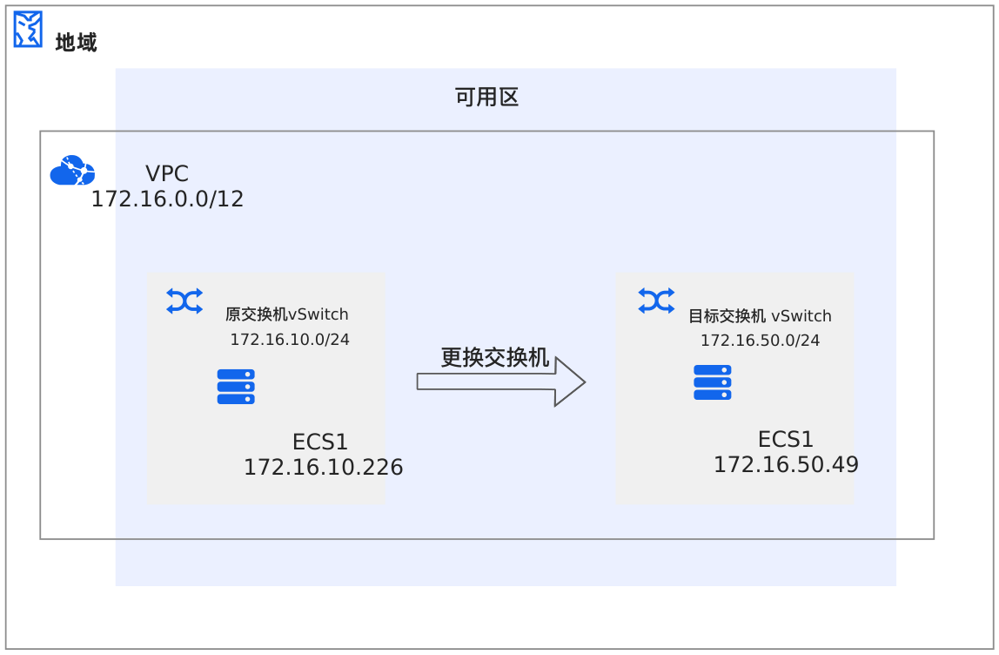

**变更影响与风险**

- **业务中断**：操作要求实例处于**已停止**状态，因此会导致业务中断。

- **私网IP地址变更**：

  - 实例的主私网IP地址将变更为目标交换机网段内的一个新地址（可指定或自动分配）。硬编码使用原私网IP的应用或服务（如数据库连接字符串、防火墙白名单、其他服务的配置）都将失效，必须在更换后手动更新。

  - 公网IP地址保持不变。

- **操作系统网络配置**：若实例内部获取IP方式为静态配置，更换交换机后，操作系统内的网络信息（IP地址、网关等）可能与实际分配的不符，导致实例无法正常远程连接、通信等。

- **访问控制**：如果原交换机和目标交换机配置了不同的网络ACL规则，则需要检查并可能调整以确保应用程序正常运行。更多信息，请参见<strong>《专有网络VPC用户指南》</strong>中的<strong>《管理网络ACL规则》</strong>章节。

- **路由配置**：对于依赖特定路由规则的应用，新的交换机可能具有与原来不同的路由配置。需要通过绑定自定义路由表和交换机重新配置或添加相应的路由条目来保证连通性。具体操作，请参见<strong>《专有网络VPC用户指南》</strong>中的<strong>《管理自定义路由表和交换机》</strong>章节。

**操作步骤**

**步骤一：准备工作**

1. 停止实例。

   实例必须处于**已停止**状态，若当前实例状态为**运行中**，需先停止实例。

2. 前置检查处理。

   **多私网IP地址**：若实例绑定了辅助弹性网卡，需先从实例解绑辅助弹性网卡。

3. 准备目标交换机：在目标VPC中，确保已在与ECS实例相同的可用区下创建交换机。更多信息，请参见<strong>《专有网络VPC用户指南》</strong>中的<strong>《创建和管理交换机》</strong>章节。

**步骤二：更换专有网络**

1. 登录云服务器ECS控制台。

2. 在左侧导航栏中，选择**实例与镜像 > ECS实例**。

3. 在顶部菜单栏处，选择组织、资源集和地域。

4. 找到目标实例，在**操作**列，单击  图标，然后选择**网络与安全组 > 更换交换机**。

   您也可以在ECS实例详情页的**网络信息**区域，单击**虚拟交换机ID**右侧的**更换交换机**。

5. 更换交换机。

   <ol type="i">

   <li>

   选择目标交换机。

   </li>

   <li>

   （可选）配置**私网IP**：新私网IP需要在目标交换机的CIDR网段范围内。若不设置，则更换后的主私网IP由系统自动分配。

   </li>

   </ol>

6. 查看变更结果：

   在**实例详情**页面的**网络信息**区域查看更换后的虚拟交换机。

   > **说明**
   >
   > 更换VPC完成后，实例不会自动启动，需手动启动实例。

<a id="section-5-14"></a>

## 5.14. 修改私网IP地址

每台实例会分配一张私网网卡并绑定一个私网IP地址，您可以修改实例的私网IP地址，支持使用的目标私网IP地址由实例所属的交换机IP段决定，且不能被其他实例占用。

**前提条件**

实例处于**已停止**状态。

**操作步骤**

1. 登录云服务器ECS控制台。

2. 在左侧导航栏中，选择**实例与镜像 > ECS实例**。

3. 在顶部菜单栏处，选择组织、资源集和地域。

4. 找到待操作实例，在**操作**列中，单击

   图标，然后选择**网络与安全组 > 修改私网IP地址**。

   

5. 输入新的私网IP地址。

   支持使用的目标私网IP地址由实例所属的交换机IP段决定，且不能被其他实例占用或者有特殊用途。

   例如，交换机网段为192.168.1.0/24，则只可以使用192.168.1.0～192.168.1.255之间且未被其他实例占用IP地址，以实际设置效果为准。一般第一个地址192.168.1.0用于显示网络，最后一个地址192.168.1.255用于广播，所以也不能使用。

6. 单击**确定**。

<a id="section-5-15"></a>

## 5.15. 分配IPv6地址

IPv6地址不仅可以解决IPv4网络地址资源有限的问题，还可以解决多种接入设备连入互联网障碍的问题。如果您的网络环境升级，支持配置IPv6网络，您可以为存量的ECS实例分配IPv6地址。

**前提条件**

- 专有网络和交换机必须已分配IPv6网段。具体操作，请参见<strong>《专有网络VPC用户指南》</strong>中的<strong>《搭建IPv6专有网络》</strong>章节。

- 实例规格族需要支持配置IPv6。

**操作步骤**

1. 登录云服务器ECS控制台。

2. 在左侧导航栏中，选择**实例与镜像 > ECS实例**。

3. 在顶部菜单栏处，选择组织、资源集和地域。

4. 找到目标实例，在**操作**列，单击

   图标，然后选择**网络与安全组 > 管理辅助私网IP**。

   

5. 在**管理辅助私网IP**对话框中，单击**IPv6地址**配置项旁的**立即打开**。

   > **说明**
   >
   > 部分实例规格族不支持配置IPv6。

6. 在ECS实例所在的交换机详情页面，确认交换机是否开通IPv6。

   如果交换机未开通IPv6，单击**IPv6网段**配置项旁的**开通IPv6**，开通交换机的IPv6功能。

7. 回到**管理辅助私网IP**对话框，单击**确定**。

**执行结果**

配置完成后，您可以单击ECS实例ID，在**实例详情页**中查看**IPv6**是否已经分配IPv6地址。

<a id="section-5-16"></a>

## 5.16. 导出实例列表信息

您可以在ECS控制台上根据实际需要导出ECS实例列表信息，但仅支持以 `.xlsx` 格式的Excel表格形式保存至本地。

**操作步骤**

1. 登录云服务器ECS控制台。

2. 在左侧导航栏中，选择**实例与镜像 > ECS实例**。

3. 在顶部菜单栏处，选择组织、资源集和地域。

4. 在ECS实例列表中选中待导出的一台或多台目标实例，然后单击实例列表右上方的  图标。

   > **说明**
   >
   > 如果您需要导出所有ECS实例信息，直接单击实例列表右上方的
   >
   > 图标即可。
   >
   > 

5. 在**导出**对话框中，配置需要导出的实例信息。

   <table>
     <tr>
       <th width="152">配置项</th>
       <th>说明</th>
     </tr>
     <tr>
       <td>导出范围</td>
       <td>• <strong>全部</strong>：导出所有实例。<br>• <strong>选中数据</strong>：导出在ECS实例列表中选中的实例。</td>
     </tr>
     <tr>
       <td>需要导出的数据列</td>
       <td>根据实际需要选择ECS实例的信息。其中，<strong>实例ID/名称</strong>为必选项。<br>说明<br>• 勾选“网络地址”，导出的Excel数据中仅包含了主网卡的主私网IP，未包含主网卡的辅助私网IP和辅助网卡IP。<br>• 勾选“IPv6地址”，导出的Excel数据中仅包含了主网卡的IPv6地址，未包含辅助网卡的IPv6地址。</td>
     </tr>
   </table>

6. 单击**确定**。

   为避免因数据量太大而导致下载任务超时，当实例数量较少时，系统会在当前页面上自动下载文件；当实例数量较多时，您需要在下载中心获取文件，具体如下：

   > **重要**
   >
   > 默认以500台实例为实例数量阈值，您可以联系阿里云技术支持工程师根据实际需要修改该值。

   <table>
     <tr>
       <th>ECS实例数量</th>
       <th>下载操作</th>
       <th>ECS实例列表文件</th>
     </tr>
     <tr>
       <td>≤500台</td>
       <td>无需操作，系统会自动导出实例数据并下载至本地。</td>
       <td rowspan="2">实例列表文件信息如下：<br>• 文件名：<code> ecs_instance_XXX </code><br>• 文件格式：<code> .xlsx </code><br>• 文件内容：实例ID、实例名称、操作系统、实例状态、实例描述、地域、组织、资源集和可用区等信息</td>
     </tr>
     <tr>
       <td>＞500台</td>
       <td>i. 在<strong>导出报表任务已创建成功</strong>对话框中，单击<strong>跳转至</strong><strong>下载中心</strong>。ii. 在<strong>报表下载</strong>页面的任务列表中找到目标报表，单击<strong>操作</strong>列的<strong>下载报表</strong>。系统会自动导出实例数据并下载至本地。</td>
     </tr>
   </table>

<a id="section-5-17"></a>

## 5.17. 管理NVIDIA驱动

<a id="section-5-17-1"></a>

### 5.17.1. NVIDIA驱动安装指引

由于GPU实例本身并未配备相关驱动，因此您需要根据实际业务场景选择合适的GPU实例规格，并安装与之匹配的NVIDIA驱动。本文将为您详细介绍不同场景下选择实例规格和安装驱动的指引。

**GPU实例规格**

GPU实例规格信息请参见<strong>《云服务器ECS实例规格族&实例规格简介》</strong>。

> 除驱动差异外，GPU实例的管理操作与其他规格实例完全一致。
>
> **说明**

**驱动说明**

GPU实例支持安装以下两种NVIDIA驱动：

- GPU驱动：用于驱动物理GPU。

- GRID驱动：用于获得图形加速能力。

**GPU虚拟化型实例驱动安装指引**

GPU虚拟化实例（例如：vgn6i）配备了分片虚拟化后的虚拟GPU，因此仅支持安装GRID驱动。由于GPU实例配备的NVIDIA GPU计算卡尚未激活NVIDIA GRID License，GPU图形功能受到限制，您需要获取GRID License和驱动安装包后再安装GRID驱动，具体说明如下：

| 操作系统 | 适用的驱动类型 | 推荐使用场景 | 操作指引 |
| --- | --- | --- | --- |
| Windows操作系统（Windows Server） | GRID驱动 | 需要支持OpenGL、Direct3D等图形计算场景 | 在GPU实例上安装GRID驱动（Windows） |
| Linux操作系统（Alibaba Cloud Linux、CentOS、Ubuntu、SUSE等） | GRID驱动 | 需要进行深度学习、AI等非图形计算的通用计算业务场景 | 在GPU虚拟化型实例中安装GRID驱动（Linux） |

**GPU计算型实例驱动安装指引**

GPU计算型实例在不同的业务场景下适用的驱动类型有所区别，具体说明如下：

<table>
  <tr>
    <th>操作系统</th>
    <th>适用的驱动类型</th>
    <th>推荐使用的场景</th>
    <th>操作指引</th>
  </tr>
  <tr>
    <td rowspan="2">Linux操作系统（Alibaba Cloud Linux、CentOS、Ubuntu、SUSE等）</td>
    <td>GPU驱动</td>
    <td>深度学习、AI、科学计算等通用计算场景</td>
    <td>在GPU计算型实例中安装GPU驱动（Linux）</td>
  </tr>
  <tr>
    <td>GPU驱动</td>
    <td>需要支持OpenGL、Direct3D等图形计算的场景</td>
    <td>在GPU计算型实例中安装GPU驱动（Linux）</td>
  </tr>
  <tr>
    <td rowspan="2">Windows操作系统（Windows Server）</td>
    <td>GPU驱动</td>
    <td>深度学习、AI、科学计算等通用计算场景</td>
    <td>在GPU计算型实例中安装GPU驱动（Windows）</td>
  </tr>
  <tr>
    <td>GRID驱动</td>
    <td>需要支持OpenGL、Direct3D等图形计算的场景</td>
    <td>在GPU实例上安装GRID驱动（Windows）</td>
  </tr>
</table>

<a id="section-5-17-2"></a>

### 5.17.2. 安装GPU驱动

<a id="section-5-17-2-1"></a>

#### 5.17.2.1. 在GPU计算型实例中安装GPU驱动（Linux）

如果您在创建GPU计算型实例时没有使用预装GPU驱动的镜像，为保证您能正常使用您创建的GPU实例，请在创建后手动安装驱动。本文为您介绍如何为Linux操作系统的GPU实例手动安装GPU驱动。

**前提条件**

如果您的实例没有连接外网，则无法直接下载安装文件。在操作时需要向实例拷贝安装文件，您可以通过在实例安装FTP软件传输安装文件。

**背景信息**

GPU实例仅支持安装与其操作系统一致的GPU驱动。本文重点为您介绍手动安装Linux操作系统的GPU驱动的相关操作。

> 如果您创建的GPU实例为Windows操作系统，请参见在GPU计算型实例中安装GPU驱动
>
> **说明**
>
> （Windows），根据指导安装Linux操作系统的GPU驱动。

**操作步骤**

1. 下载GPU驱动。

   <ol type="i">

   <li>

   访问NVIDIA驱动下载。

   > 关于安装和配置NVDIA驱动程序的更多信息，请参见NVIDIA Driver Installation
   >
   > **说明**
   >
   > Quickstart Guide。

   </li>

   <li>

   设置搜索条件后，单击**搜索**查找适用的驱动程序。

   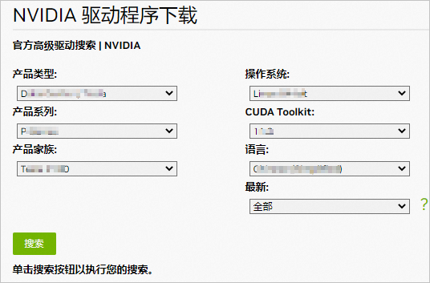

   设置项说明如下所示：

   | 设置项 | 说明 | 示例 |
   | --- | --- | --- |
   | • 产品类型<br>• 产品系列<br>• 产品家族 | 根据实例规格配备的GPU选择对应的产品类型、产品系列和产品家族。查看实例规格信息的具体操作，请参见查看实例详情。各实例规格的GPU信息请参见<strong>《云服务器ECS</strong><strong>实例规格族&amp;实例规格简介》</strong>中的<strong>《异构计算型</strong><strong>&amp;异构裸金属》</strong>章节。 | • Data Center / Tesla<br>• P-Series<br>• Tesla P100 |
   | 操作系统 | 根据实例使用的镜像选择对应的Linux操作系统版本。如果下拉列表中没有显示所需的操作系统，请单击下拉列表底部的<strong>选择所有操作系统</strong>。如果您未能找到与实例镜像完全匹配的Linux操作系统版本，请选择<strong>Linux 64-bit</strong>。 | Linux 64-bit |
   | CUDA Toolkit | 选择CUDA Toolkit版本。 | 11.2 |
   | 语言 | 选择驱动对应的语言。 | Chinese (Simplified) |
   | 最新 | 默认项为<strong>全部</strong>，保持默认选项即可。 | 全部 |

   </li>

   <li>

   在搜索到的驱动程序列表下，选择需要下载的驱动版本，单击对应的驱动名称。

   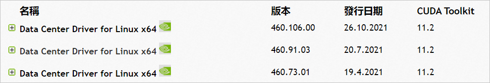

   </li>

   <li>

   在待下载驱动的详情页面，单击**下载**，然后在**NVIDIA 驱动程序下载**页面，右键单击**同意并开始下载**并选择**复制链接地址**。

   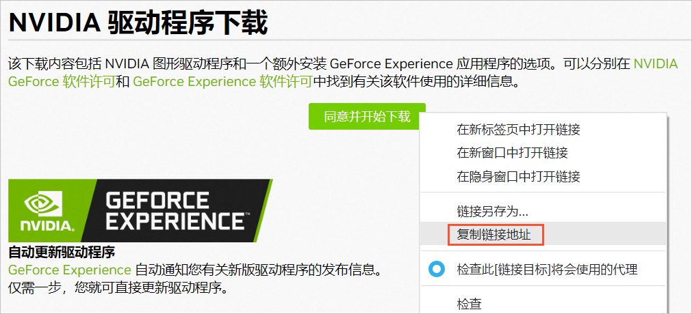

   </li>

   </ol>

2. 远程连接实例。具体操作，请参见连接实例概述。

3. 使用 `wget` 命令，并粘贴您在<strong>《步骤1》</strong>中复制的驱动下载链接，执行命令下载安装包。命令示例如下所示：

   ```bash
   wget https://cn.download.nvidia.com/tesla/460.73.01/NVIDIA-Linux-x86_64-460.73.01.run
   ```

4. 安装GPU驱动。不同操作系统实例，安装GPU驱动的方法有所不同，具体操作如下所示。**CentOS操作系统**

   <ol type="i">

   <li>

   执行以下命令，查询GPU实例中是否安装kernel-devel和kernel-headers包。

   ```bash
   rpm  -qa | grep $(uname -r)
   ```

   - 如果回显类似如下信息，即包含了kernel-devel和kernel-headers包的版本信息，表示已安装。

     ```text
     kernel-3.10.0-1062.18.1.el7.x86_64
     kernel-devel-3.10.0-1062.18.1.el7.x86_64
     kernel-headers-3.10.0-1062.18.1.el7.x86_64
     ```

   - 如果在回显信息中，您没有找到<em>kernel-devel-\*</em>和<em>kernel-headers-\*</em>内容，您需要自行下载并安装kernel对应版本的kernel-devel和kernel-headers包。

     > kernel-devel和kernel版本不一致会导致在安装driver rpm过程中driver编译出
     >
     > **重要**
     >
     > 错。因此，请您确认回显信息中<em>kernel-\*</em>的版本号后，再下载对应版本的kernel-devel。在示例回显信息中，kernel的版本号为3.10.0-1062.18.1.el7.x86_64。

   </li>

   <li>

   授权并安装GPU驱动。

   以操作系统是Linux 64-bit的驱动为例，您下载的GPU驱动为.run格式，例如：NVIDIA-Linux-x86_64-xxxx.run。分别执行以下命令，授权并安装GPU驱动。

   ```bash
   chmod +x NVIDIA-Linux-x86_64-xxxx.run
   ```

   ```text
   sh NVIDIA-Linux-x86_64-xxxx.run
   ```

   </li>

   <li>

   安装完成后，执行如下命令，查看是否安装成功。

   ```text
   nvidia-smi
   ```

   回显信息类似如下所示，表示GPU驱动安装成功。

   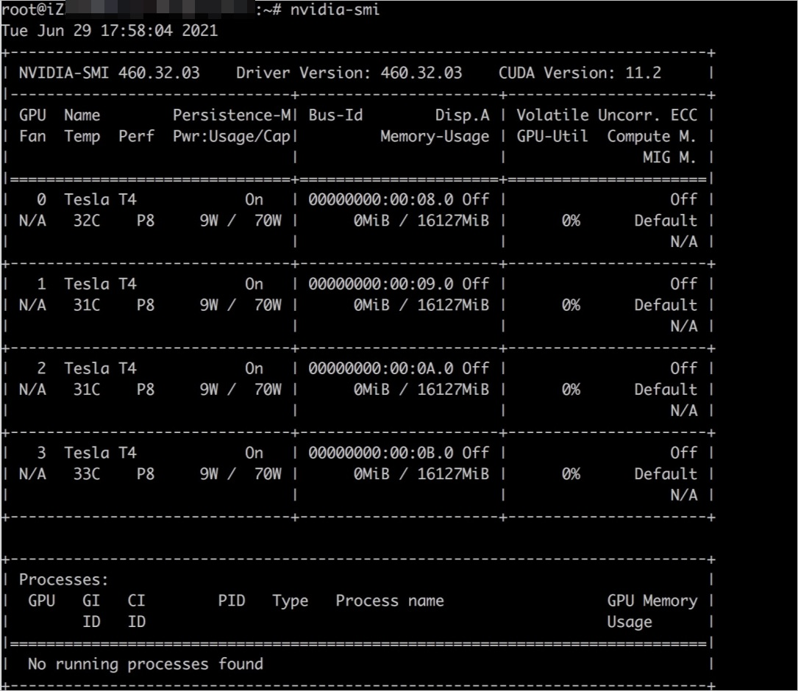

   </li>

   <li>

   安装与驱动版本对应的nvidia-fabricmanager服务。仅当GPU实例的规格族为ecs.ebmgn7、ecs.ebmgn7e、ecs.ebmgn7ex或ecs.sccgn7ex时，您才需要安装与版本驱动对应的nvidia-fabricmanager服务，否则，您将无法正常使用GPU实例。

   > 如果您创建的GPU实例的规格族不是ecs.ebmgn7、ecs.ebmgn7e、
   >
   > **重要**
   >
   > ecs.ebmgn7ex或ecs.sccgn7ex时，请跳过本步骤。

   <ol type="a">

   <li>

   安装nvidia-fabricmanager服务。

   您可以通过源码或者安装包两种方式安装nvidia-fabricmanager服务，以下操作以CentOS 7.x和CentOS 8.x操作系统为例，驱动版本（driver_version）以460.91.03为例，命令示例如下。其中， `driver_version` 替换为<strong>《步骤1》</strong>中下载的驱动版本号。

   - **源码方式**

     - CentOS 7.x

       ```bash
       driver_version=460.91.03
       yum -y install yum-utils
       yum-config-manager --add-repo 
       https://developer.download.nvidia.com/compute/cuda/repos/rhel7/x86_64/cuda-rhel7.repo
       yum install -y nvidia-fabric-manager-${driver_version}-1
       ```

     - CentOS 8.x

       ```text
       driver_version=460.91.03
       driver_version_main=$(echo $driver_version | awk -F '.' '{print $1}')
       distribution=rhel8
       ARCH=$( /bin/arch )
       dnf config-manager --add-repo 
       http://developer.download.nvidia.com/compute/cuda/repos/$distribution/${ARCH}/c
       a-$distribution.repo
       dnf module enable -y nvidia-driver:${driver_version_main}
       dnf install -y nvidia-fabric-manager-0:${driver_version}-1
       ```

   - **安装包方式**

     - CentOS 7.x

       ```bash
       driver_version=460.91.03
       wget http://mirrors.cloud.aliyuncs.com/nvidia-cuda/rhel7/x86_64/nvidia-fabric-manager-${driver_version}-1.x86_64.rpm
       rpm -ivh nvidia-fabric-manager-${driver_version}-1.x86_64.rpm
       ```

     - CentOS 8.x

       ```bash
       driver_version=460.91.03
       wget http://mirrors.cloud.aliyuncs.com/nvidia-cuda/rhel8/x86_64/nvidia-fabric-manager-${driver_version}-1.x86_64.rpm
       rpm -ivh nvidia-fabric-manager-${driver_version}-1.x86_64.rpm
       ```

   </li>

   <li>

   执行如下命令，启动nvidia-fabricmanager服务。

   ```bash
   systemctl enable nvidia-fabricmanager
   systemctl start nvidia-fabricmanager
   ```

   </li>

   </ol>

   <ol type="i" start="100">

   <li>

   执行如下命令，查看nvidia-fabricmanager服务是否安装成功。

   ```bash
   systemctl status nvidia-fabricmanager
   ```

   回显信息如下所示，表示nvidia-fabricmanager服务安装成功。

   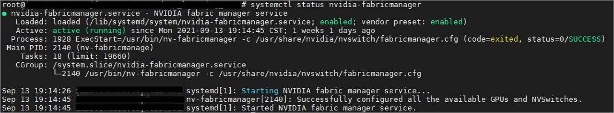

   </li>

   </ol>

   </li>

   </ol>

   **Ubuntu等其他操作系统**

   <ol type="i">

   <li>

   授权并安装GPU驱动。

   以操作系统是Linux 64-bit的驱动为例，您下载的GPU驱动为.run格式，例如：NVIDIA-Linux-x86_64-xxxx.run。分别执行以下命令，授权并安装GPU驱动。

   ```bash
   chmod +x NVIDIA-Linux-x86_64-xxxx.run
   ```

   ```text
   sh NVIDIA-Linux-x86_64-xxxx.run
   ```

   </li>

   <li>

   安装完成后，执行如下命令，查看是否安装成功。

   ```text
   nvidia-smi
   ```

   回显信息类似如下所示，表示GPU驱动安装成功。

   

   </li>

   <li>

   安装与驱动版本对应的nvidia-fabricmanager服务。仅当GPU实例的规格族为ecs.ebmgn7、ecs.ebmgn7e、ecs.ebmgn7ex或ecs.sccgn7ex时，您才需要安装与版本驱动对应的nvidia-fabricmanager服务，否则，您将无法正常使用GPU实例。

   > 如果您创建的GPU实例的规格族不是ecs.ebmgn7、ecs.ebmgn7e、
   >
   > **重要**
   >
   > ecs.ebmgn7ex或ecs.sccgn7ex时，请跳过本步骤。

   <ol type="a">

   <li>

   安装nvidia-fabricmanager服务。

   您可以通过源码或者安装包两种方式安装nvidia-fabricmanager服务，以下操作以Ubuntu 16.04、Ubuntu 18.04或Ubuntu 20.04操作系统为例，驱动版本（driver_version）以460.91.03为例，命令示例如下。其中， `driver_version` 替换为<strong>《步骤1》</strong>中下载的驱动版本号。

   - **源码方式**Ubuntu 16.04、Ubuntu 18.04或Ubuntu 20.04

     ```bash
     driver_version=460.91.03
     driver_version_main=$(echo $driver_version | awk -F '.' '{print $1}')
     distribution=$(. /etc/os-release;echo $ID$VERSION_ID | sed -e 's/\.//g')
     wget 
     https://developer.download.nvidia.com/compute/cuda/repos/$distribution/x86_64/cud
     $distribution.pin
     mv cuda-$distribution.pin /etc/apt/preferences.d/cuda-repository-pin-600
     wget 
     https://developer.download.nvidia.com/compute/cuda/repos/$distribution/x86_64/7fa
     f80.pub
     apt-key add 7fa2af80.pub
     rm 7fa2af80.pub
     echo "deb 
     http://developer.download.nvidia.com/compute/cuda/repos/$distribution/x86_64 /"
     | tee /etc/apt/sources.list.d/cuda.list
     apt-get update
     apt-get -y install nvidia-fabricmanager-
     ${driver_version_main}=${driver_version}-*
     ```

   - **安装包方式**

     - Ubuntu 16.04

       ```bash
       driver_version=460.91.03
       driver_version_main=$(echo $driver_version | awk -F '.' '{print $1}')
       wget http://mirrors.cloud.aliyuncs.com/nvidia-cuda/ubuntu1604/x86_64/nvidia-fabricmanager-${driver_version_main}_${driver_version}-1_amd64.deb
       dpkg -i nvidia-fabricmanager-${driver_version_main}_${driver_version}-1_amd64.deb
       ```

     - Ubuntu 18.04

       ```bash
       driver_version=460.91.03
       driver_version_main=$(echo $driver_version | awk -F '.' '{print $1}')
       wget http://mirrors.cloud.aliyuncs.com/nvidia-cuda/ubuntu1804/x86_64/nvidia-fabricmanager-${driver_version_main}_${driver_version}-1_amd64.deb
       dpkg -i nvidia-fabricmanager-${driver_version_main}_${driver_version}-1_amd64.deb
       ```

     - Ubuntu 20.04

       ```bash
       driver_version=460.91.03
       driver_version_main=$(echo $driver_version | awk -F '.' '{print $1}')
       wget http://mirrors.cloud.aliyuncs.com/nvidia-cuda/ubuntu2004/x86_64/nvidia-fabricmanager-${driver_version_main}_${driver_version}-1_amd64.deb
       dpkg -i nvidia-fabricmanager-${driver_version_main}_${driver_version}-1_amd64.deb
       ```

   </li>

   <li>

   执行如下命令，启动nvidia-fabricmanager服务。

   ```bash
   systemctl enable nvidia-fabricmanager
   systemctl start nvidia-fabricmanager
   ```

   </li>

   </ol>

   <ol type="i" start="100">

   <li>

   执行如下命令，查看nvidia-fabricmanager服务是否安装成功。

   ```bash
   systemctl status nvidia-fabricmanager
   ```

   回显信息如下所示，表示nvidia-fabricmanager服务安装成功。

   

   </li>

   </ol>

   </li>

   </ol>

<a id="section-5-17-2-2"></a>

#### 5.17.2.2. 在GPU计算型实例中安装GPU驱动（Windows）

由于目前暂不支持通过创建GPU实例自动配置Windows操作系统的GPU驱动，为保证您能正常使用所创建的GPU实例，需要在创建实例后前往NVIDIA官网获取GPU驱动并手动安装。本文为您提供详细操作指导。

**前提条件**

如果您的实例没有连接外网，则无法直接下载安装文件。在操作时需要向实例拷贝安装文件，您可以通过在实例安装FTP软件传输安装文件。

**背景信息**

GPU实例仅支持安装与其操作系统一致的GPU驱动。本文重点为您介绍手动安装Windows操作系统的GPU驱动的相关操作。如果您创建的GPU实例为Linux操作系统，请参见在GPU计算型实例中安装GPU驱动（Linux），根据指导安装Linux操作系统的GPU驱动。

**操作步骤**

1. 远程连接实例。具体操作，请参见连接实例概述。

2. 在远程桌面中，通过浏览器访问NVIDIA驱动下载地址。

3. 设置搜索条件后，单击**搜索**查找适用的驱动程序。

   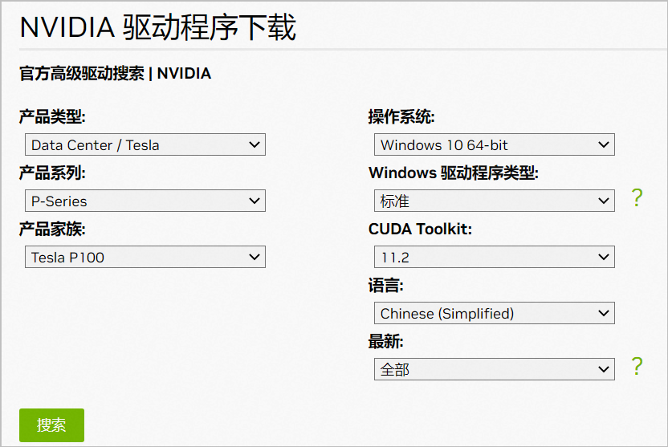

   设置项说明如下所示：

   | 设置项 | 说明 | 示例 |
   | --- | --- | --- |
   | • 产品类型<br>• 产品系列<br>• 产品家族 | 根据实例规格配备的GPU选择对应的产品类型、产品系列和产品家族。查看实例规格信息的具体操作，请参见查看实例详情。各实例规格的GPU信息请参见<strong>《云服务器ECS实</strong><strong>例规格族&amp;实例规格简介》</strong> 。 | • Data Center / Tesla<br>• P-Series<br>• Tesla P100 |
   | 操作系统 | 根据实例使用的镜像选择对应的Windows操作系统版本。 | Windows 10 64-bit |
   | Windows 驱动程序类型 | 选择驱动程序类型。 | 标准 |
   | CUDA Toolkit | 选择CUDA Toolkit版本。 | 11.2 |
   | 语言 | 选择驱动对应的语言。 | Chinese (Simplified) |
   | 最新 | 默认项为<strong>全部</strong>，保持默认选项即可。 | 全部 |

4. 在搜索到的驱动程序列表下，选择需要下载的驱动版本，单击对应的驱动名称。

   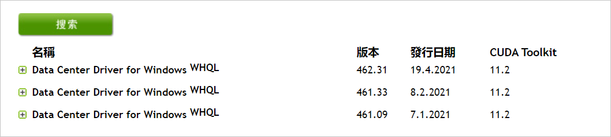

5. 在待下载驱动的详情页面，单击**下载**，然后在**NVIDIA 驱动程序下载**页面，单击**同意并开始下载**。

   

6. 下载完成后，打开下载驱动程序所在的文件夹。然后双击安装文件，按提示完成安装。

   > 对于Windows系统，在GPU驱动安装生效后，由于Windows自带的远程连接（RDP）
   >
   > **说明**
   >
   > 协议不支持DirectX、OpenGL等相关应用，您需要自行安装VNC服务和客户端，或使用其他支持此类应用的协议，例如PCOIP、XenDesktop HDX 3D等。

   完成安装后，您可以前往设备管理器，展开显示适配器，查看是否存在安装的GPU驱动信息。如果存在，表示安装成功。

<a id="section-5-17-3"></a>

### 5.17.3. 安装GRID驱动

<a id="section-5-17-3-1"></a>

#### 5.17.3.1. 在GPU虚拟化型实例中安装GRID驱动（Linux）

如果您创建的是GPU虚拟化实例，则需要安装GRID驱动。由于GPU实例配备的NVIDIA GPU计算卡尚未激活NVIDIA GRID License，GPU图形功能受到限制，您需要购买并激活GRID License。本文以Ubuntu 16.04 64-bit操作系统的GPU虚拟化型实例ecs.vgn6i为例，介绍如何安装GRID驱动和激活GRID License，并验证图形化加速效果。

**前提条件**

- 如果您的实例没有连接外网，则无法直接下载安装文件。在操作时需要向实例拷贝安装文件，您可以通过在实例安装FTP软件传输安装文件。

- 在本地机器上安装了远程连接工具，例如VNC Viewer。

- 已经获取了GRID License及对应的GRID驱动安装包。

  > GRID驱动的版本必须与您的GPU实例规格及实例所在地域相匹配。
  >
  > **说明**

**背景信息**

本文介绍如何为配备vGPU的GPU虚拟化型实例安装GRID驱动，如果您使用的是Linux操作系统的GPU计算型实例，建议您安装GPU驱动即可。具体操作，请参见在GPU计算型实例中安装GPU驱动（Linux）。

**安装GRID驱动**

1. 禁用nouveau。nouveau是部分Linux系统中预装的一款开源驱动，必须禁用nouveau才能成功安装新的驱动。

   <ol type="i">

   <li>

   远程连接实例。

   具体操作，请参见连接实例概述。

   </li>

   <li>

   查看是否存在blacklist-nouveau.conf文件。

   ```bash
   ls /etc/modprobe.d/blacklist-nouveau.conf
   ```

   如果不存在，请执行以下命令创建该文件。

   ```text
   vim /etc/modprobe.d/blacklist-nouveau.conf
   ```

   </li>

   <li>

   在blacklist-nouveau.conf文件中，添加以下内容禁用nouveau。

   > 如果已配置以下内容，则跳过本步骤。
   >
   > **说明**

   ```text
   blacklist nouveau
   blacklist lbm-nouveau
   options nouveau modeset=0
   ```

   </li>

   <li>

   执行以下命令，查看系统是否加载nouveau模块。

   ```text
   lsmod | grep nouveau
   ```

   - 如果返回结果不为空，则执行以下命令，生成kernel initramfs。

     ```text
     rmmod nouveau
     update-initramfs -u
     ```

   - 如果返回结果为空，则直接执行下一步。

   </li>

   <li>

   重启实例。

   ```text
   reboot
   ```

   </li>

   </ol>

2. 安装已获取的GRID驱动。

   - ecs.vgn6i

     ```bash
     chmod +x NVIDIA-Linux-x86_64-430.63-grid.run
     ./NVIDIA-Linux-x86_64-430.63-grid.run
     ```

   - ecs.vgn6i-vws、ecs.vgn7i-vws

     ```bash
     chmod +x NVIDIA-Linux-x86_64-460.91.03-grid.run
     ./NVIDIA-Linux-x86_64-460.91.03-grid.run
     ```

3. 验证GRID驱动是否安装成功。

   ```text
   nvidia-smi
   ```

   如果返回以下GRID驱动信息，说明驱动安装成功。

   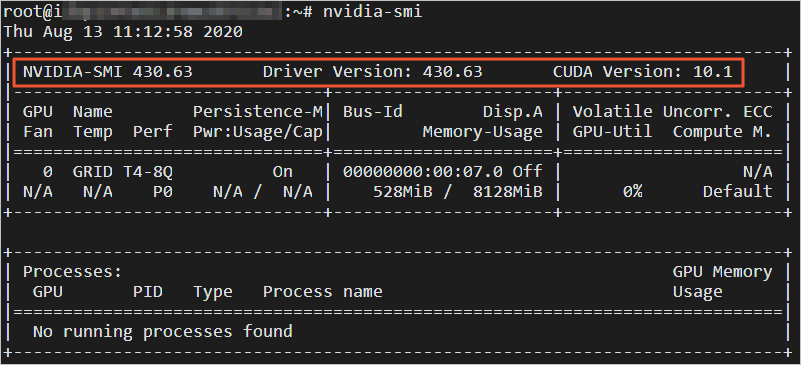

   其中， `Driver Version` 代表当前GRID驱动版本， `CUDA Version` 代表驱动支持的最高CUDA版本。其他驱动版本及其支持的CUDA版本情况，如下表所示：

   > 您执行命令 `nvidia-smi` 查询到的CUDA版本代表您的GPU实例能够支持的最高
   >
   > **重要**
   >
   > CUDA版本，并不代表您的GPU实例已经安装了对应版本的CUDA，GRID驱动并不包含CUDA，需要您自行安装CUDA Toolkit。

   | vGPU软件版本 | GRID驱动版本 | 支持的最高CUDA版本 |
   | --- | --- | --- |
   | 13.5 | 470.161.03 | 11.4 |
   | 13.1 | 470.82.01 | 11.4 |
   | 12.3 | 460.91.03 | 11.2 |
   | 9.4 | 430.99 | 10.1 |

4. 添加License服务器。

   <ol type="i">

   <li>

   切换到/etc/nvidia目录。

   ```bash
   cd /etc/nvidia
   ```

   </li>

   <li>

   创建gridd.conf文件。

   ```text
   cp gridd.conf.template gridd.conf
   ```

   </li>

   <li>

   在gridd.conf文件中添加License服务器的信息。

   ```text
   ServerAddress=<License服务器的IP地址>
   ServerPort=<License服务器的端⼝（默认为7070）>
   FeatureType=1
   ```

   </li>

   </ol>

5. 重启实例使License服务器配置生效。

   ```text
   reboot
   ```

6. 查看License是否激活成功。

   <ol type="i">

   <li>

   远程连接实例。具体操作，请参见连接实例概述。

   </li>

   <li>

   查看License状态。

   ```bash
   systemctl status nvidia-gridd
   ```

   返回结果显示**License acquired successfully**，表示License激活成功。

   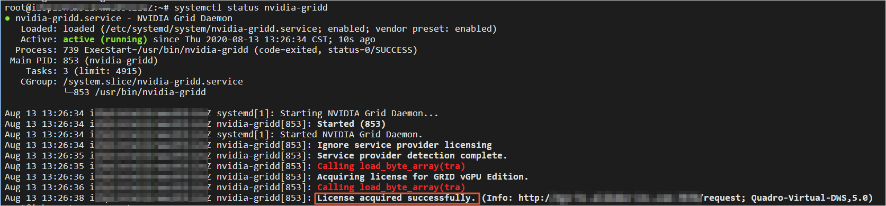

   </li>

   </ol>

**测试图形化界面**

本文以Ubuntu 16.04 64-bit操作系统为例，使用GLX测试程序验证安装GRID驱动后的图形化加速效果。

1. 准备图形化测试环境。

   <ol type="i">

   <li>

   运行命令安装x11vnc。

   ```bash
   apt-get install x11vnc
   ```

   </li>

   <li>

   运行命令 `lspci | grep NVIDIA` 查询GPU BusID。

   本示例中，查询到的GPU BusID为 `00:07.0` 。

   </li>

   <li>

   配置X Server环境并重启。

   <ol type="a">

   <li>

   运行命令 `nvidia-xconfig --enable-all-gpus --separate-x-screens` 。

   </li>

   <li>

   编辑/etc/X11/xorg.conf，在 `Section "Device"` 段添加GPU BusID，如本示例中为 `BusID "PCI:0:7:0"` 。

   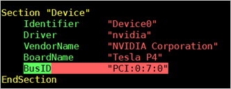

   </li>

   </ol>

   <ol type="i" start="100">

   <li>

   运行 `reboot` 命令重启系统。

   </li>

   </ol>

   </li>

   </ol>

2. 运行命令安装GLX测试程序。

   ```bash
   apt-get install mesa-utils                    
   ```

3. 运行命令 `startx` 启动X Server。

   - 如果没有 `startx` 命令，执行 `apt-get install xinit` 命令安装。

   - `startx` 启动时可能会提示 `hostname: Name or service not known` 。这个提示不会影响X Server启动。您可以运行命令 `hostname` 查得主机名后，再修改/etc/hosts文件，将 `127.0.0.1` 后的 `hostname` 改为本机的hostname。

     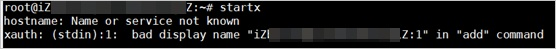

4. 开启一个新的SSH客户端终端，运行命令启动x11vnc。

   ```text
   x11vnc -display :1
   ```

   如果看到如下图所示的信息，表示x11vnc已经成功启动。此时，您能通过VNC Viewer等VNC远程连接软件连接实例。

   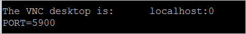

5. 登录云服务器ECS控制台。

6. 在实例所在安全组中添加安全组规则，允许TCP 5900端口的入方向访问。具体操作，请参见添加安全组规则。

7. 在本地主机上，使用VNC Viewer等VNC远程连接软件，通过 实例公网`IP`地址`:5900` 连接实例，进入KDE桌面。

8. 按以下步骤使用 `glxinfo` 命令查看当前GRID驱动支持的配置。

   <ol type="i">

   <li>

   开启一个新的SSH客户端终端。

   </li>

   <li>

   运行 `export DISPLAY=:1` 命令。

   </li>

   <li>

   运行 `glxinfo –t` 命令列出当前GRID驱动支持的配置。

   </li>

   </ol>

9. 按以下步骤使用 `glxgears` 命令测试GRID驱动。

   <ol type="i">

   <li>

   在KDE桌面上，右键单击桌面，并选择**Run Command**。

   </li>

   <li>

   运行 `glxgears` 启动齿轮图形测试程序。如果出现如下图所示的窗口，表明GRID驱动正常工作。

   

   </li>

   </ol>

<a id="section-5-17-3-2"></a>

#### 5.17.3.2. 在GPU实例上安装GRID驱动（Windows）

当您需要使用Windows操作系统的GPU计算型实例或GPU虚拟化型实例应用于OpenGL、Direct3D等图形计算场景时，您需要获取GRID License后再安装GRID驱动。本文为您提供安装GRID驱动并激活GRID License的详细操作指导。

**前提条件**

- 如果您的实例没有连接外网，则无法直接下载安装文件。在操作时需要向实例拷贝安装文件，您可以通过在实例安装FTP软件传输安装文件。

- 在本地机器上安装了远程连接工具。

- 已经获取了GRID License及对应的GRID驱动安装包。

  > GRID驱动的版本必须与您的GPU实例规格及实例所在地域相匹配。
  >
  > **说明**

**背景信息**

对于Windows操作系统的GPU计算型实例和GPU虚拟化型实例，安装GRID驱动的操作基本一致。本文以操作系统为Windows Server 2019的GPU虚拟化型实例vgn6i为例，介绍如何安装NVIDIA GRID驱动并激活GRID License。

**操作步骤**

1. 远程连接实例。具体操作，请参见Windows环境中通过远程桌面连接Windows实例。

2. 安装已获取的驱动。

   <ol type="i">

   <li>

   双击安装程序，在弹出的对话框，单击**OK**。

   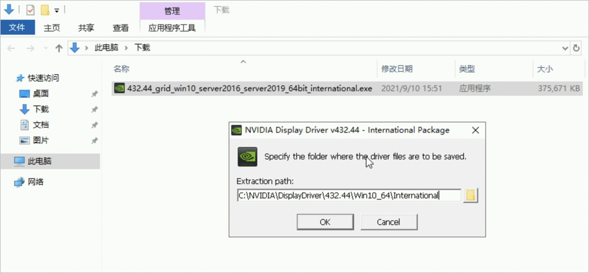

   安装程序将自动进行解压。

   </li>

   <li>

   解压完成后，在弹出的**NVIDIA 安装程序**对话框中，单击**同意并继续(A)**。

   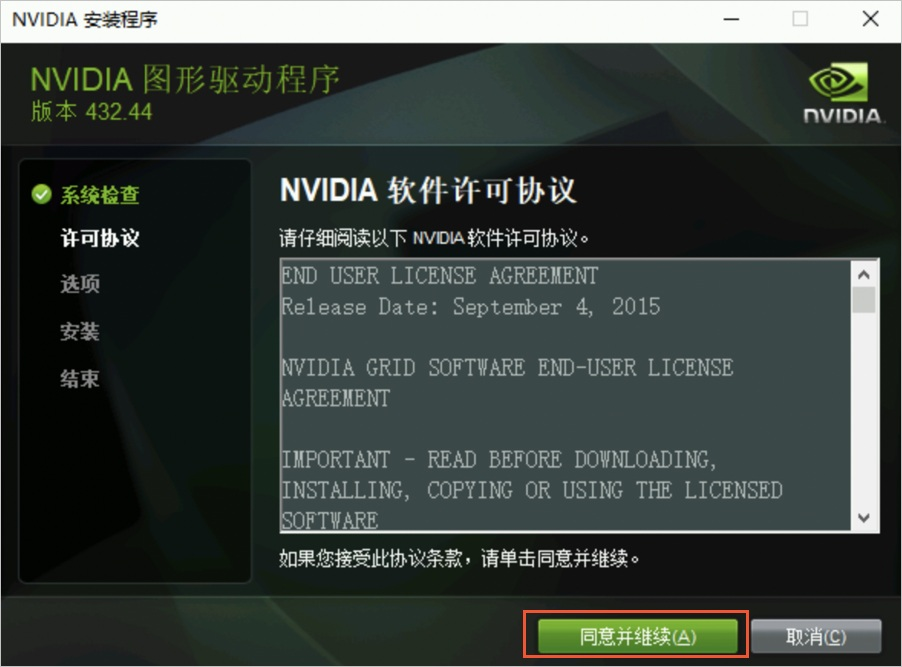

   </li>

   <li>

   保持默认安装选项，单击**下一步(N)**。

   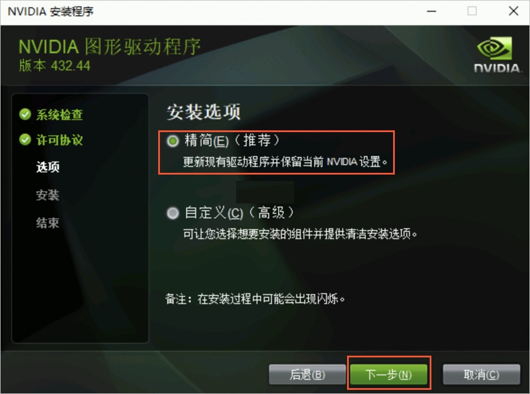

   </li>

   <li>

   安装完成后，单击**马上重新启动(R)**。

   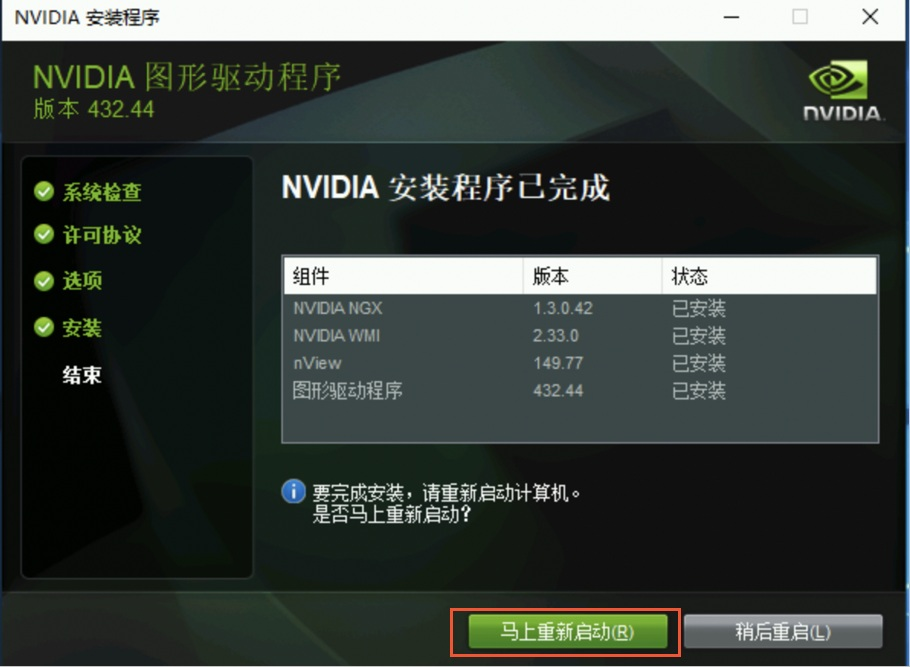

   </li>

   </ol>

3. GPU实例重启完成后，连接实例并查看GRID驱动是否安装成功。

   <ol type="i">

   <li>

   远程连接实例。具体操作，请参见Windows环境中通过远程桌面连接Windows实例。

   > 请勿通过云服务器管理控制台使用VNC远程连接GPU实例，否则会由于VNC无法获取
   >
   > **重要**
   >
   > 集成显卡画面导致黑屏，影响您的使用。

   </li>

   <li>

   在Windows桌面的

   图标上，单击鼠标右键，然后单击**设备管理器(M)**。

   

   </li>

   <li>

   在**设备管理器**对话框中，查看**显示适配器**目录下是否存在**NVIDIA GRID T4-8Q**设备。

   如下图所示，表示GRID驱动已安装成功。

   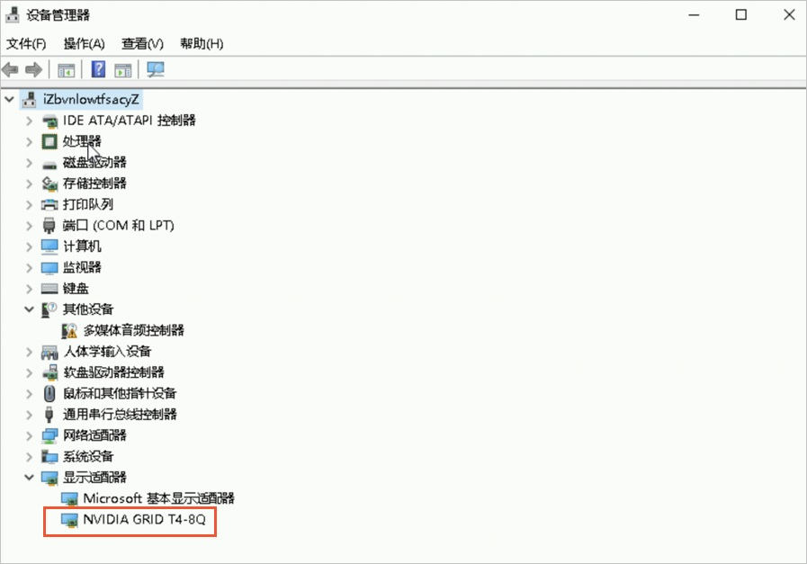

   </li>

   </ol>

4. 添加License服务器并激活License。

   <ol type="i">

   <li>

   在Windows桌面单击鼠标右键，然后单击**NVIDIA 控制面板**。

   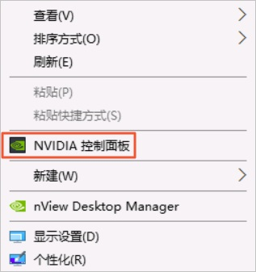

   </li>

   <li>

   在**NVIDIA 控制面板**对话框，选择**许可 > 管理许可证**。

   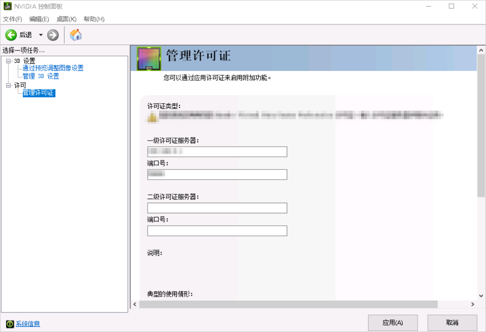

   </li>

   <li>

   在**管理许可证**区域，输入您提前获取到的License服务器的IP和端口，然后单击**应用**。重新打开**NVIDIA 控制面板**，如果提示如下信息，表示License激活成功。

   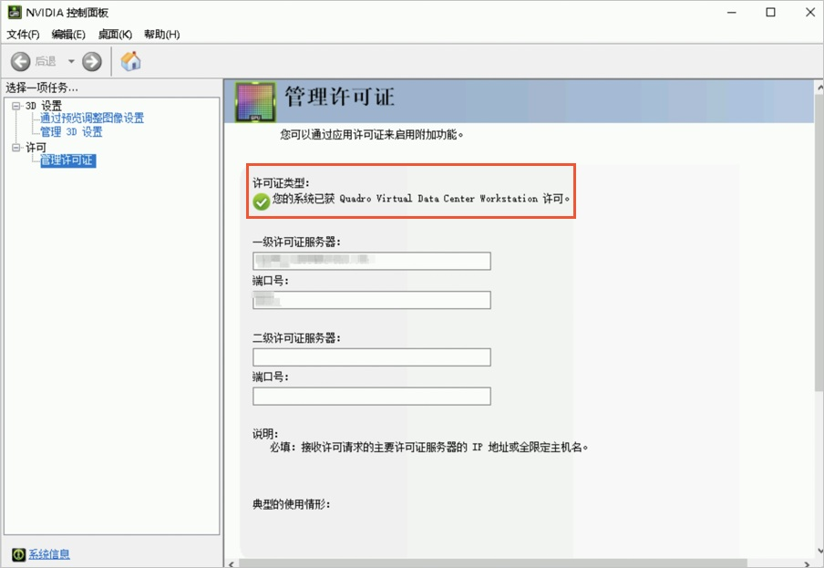

   </li>

   </ol>

<a id="section-5-17-4"></a>

### 5.17.4. 卸载NVIDIA驱动

<a id="section-5-17-4-1"></a>

#### 5.17.4.1. 卸载GPU驱动

您可以手动卸载GPU驱动，卸载命令需要根据GPU驱动的安装方式和操作系统类型而定。

**背景信息**

GPU实例必须配备了相关驱动才可以正常使用，如果您因某种原因需要卸载当前驱动，请务必再安装与您实例规格及操作系统相匹配的正确驱动，以免影响您的使用。更多信息，请参见更新NVIDIA驱动。

如果您是通过创建GPU实例自动安装了GPU驱动，那么GPU驱动的卸载方式需要根据操作系统类型而定：

- Ubuntu操作系统使用deb方式。

- CentOS和SUSE操作系统使用run方式。

本文为您提供不同操作系统中卸载GPU驱动的具体操作。如下所示：

- Windows操作系统：

  在Windows操作系统中卸载GPU驱动

- Linux操作系统：

  - 在Ubuntu操作系统中卸载GPU驱动

  - 在CentOS操作系统中卸载GPU驱动

  - 在SUSE操作系统中卸载GPU驱动

  > **说明**
  >
  > 本文Linux操作系统的相关步骤均需要以 `root` 用户登录并进行操作。如果您是普通用户，请使用 `sudo` 命令获取 `root` 权限后再操作。

**在Windows操作系统中卸载GPU驱动**

以下操作将以操作系统为Windows Server 2019的GPU计算型实例gn6i为例。

1. 远程连接实例。具体操作，请参见连接实例概述。

2. 单击Windows桌面左下角

   图标，然后单击**控制面板**。

   

   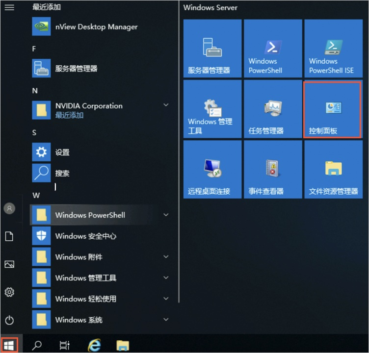

3. 在**控制面板**中，单击**卸载程序**。

   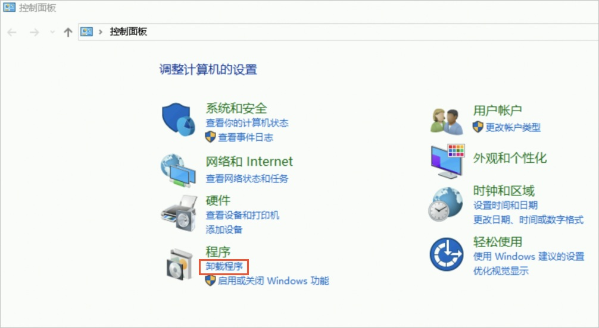

4. 右键单击需要卸载的GPU驱动，然后单击**卸载/更改(U)**。

   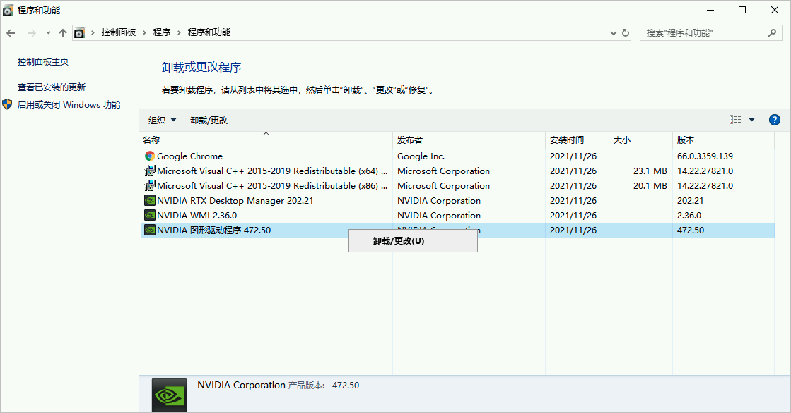

5. 在弹出的**NVIDIA 卸载程序**对话框，单击**卸载(U)**。

6. 卸载完成后，单击**马上重新启动(R)**。

   重启完成后，则GPU驱动已卸载成功。

**在Ubuntu操作系统中卸载GPU驱动**

如果您使用deb安装包安装了GPU驱动，建议您按照以下步骤卸载GPU驱动，以下操作以Driver 410.104、CUDA 10.0.130、cuDNN 7.5.0为例。

1. 卸载GPU驱动。

   ```bash
   apt-get remove --purge nvidia-*
   ```

2. 卸载CUDA和cuDNN库。

   ```text
   apt autoremove --purge cuda-10-0
   rm -rf /usr/local/cuda-10.0
   ```

3. 重启实例。

   ```text
   reboot
   ```

如果您使用run安装包安装了GPU驱动，建议您按照以下步骤卸载GPU驱动。

1. 卸载GPU驱动。

   ```text
   /usr/bin/nvidia-uninstall
   ```

2. 卸载CUDA和和cuDNN库。

   ```text
   /usr/local/cuda/bin/cuda-uninstaller
   rm -rf /usr/local/cuda-10.0
   ```

   > 不同CUDA版本，卸载命令可能存在差别，如果未找到cuda-uninstaller文件，请
   >
   > **说明**
   >
   > 到/usr/local/cuda/bin/目录下查看是否存在uninstall_cuda开头的文件。如果有，则将命令中的cuda-uninstaller替换为该文件名。

3. 重启实例。

   ```text
   reboot
   ```

**在CentOS操作系统中卸载GPU驱动**

如果您使用run安装包安装了GPU驱动，建议您按照以下步骤卸载GPU驱动，以下步骤以Driver 410.104、CUDA 10.0.130、cuDNN 7.5.0为例。

1. 卸载GPU驱动。

   ```text
   /usr/bin/nvidia-uninstall
   ```

2. 卸载CUDA和cuDNN库。

   ```text
   /usr/local/cuda/bin/cuda-uninstaller
   rm -rf /usr/local/cuda-10.0
   ```

   > 不同CUDA版本，卸载命令可能存在差别，如果未找到cuda-uninstaller文件，请
   >
   > **说明**
   >
   > 到/usr/local/cuda/bin/目录下查看是否存在uninstall_cuda开头的文件。如果有，则将命令中的cuda-uninstaller替换为uninstall_cuda开头的文件名。

3. 重启实例。

   ```text
   reboot
   ```

如果您在CentOS 7中使用rpm安装包安装了GPU驱动，建议您按照以下步骤卸载GPU驱动。

1. 卸载GPU驱动。

   ```bash
   yum remove xorg-x11-drv-nvidia nvidia-kmod cuda-drivers
   yum remove nvidia-diag-driver-local-repo-rhel7-410.104
   ```

2. 卸载CUDA和cuDNN库。

   ```bash
   yum remove /usr/local/cuda-10.0
   rm -rf /usr/local/cuda-10.0
   ```

3. 重启实例。

   ```text
   reboot
   ```

如果您在CentOS 6中使用rpm安装包安装了GPU驱动，建议您按照以下步骤卸载GPU驱动。

1. 卸载GPU驱动。

   ```bash
   yum remove xorg-x11-drv-nvidia nvidia-kmod cuda-drivers
   yum remove nvidia-diag-driver-local-repo-rhel6-410.104
   ```

2. 卸载CUDA。

   ```bash
   yum remove /usr/local/cuda-10.0
   ```

3. 重启实例。

   ```text
   reboot
   ```

**在SUSE操作系统中卸载GPU驱动**

如果您使用run安装包安装GPU驱动，建议您按照以下步骤卸载GPU驱动，以下步骤以CUDA 9.0.176为例。

1. 卸载GPU驱动。

   ```text
   /usr/bin/nvidia-uninstall
   ```

2. 卸载CUDA和cuDNN库。

   ```text
   /usr/local/cuda/bin/uninstall_cuda_9.0.pl
   rm -rf /usr/local/cuda-9.0
   ```

3. 重启实例。

   ```text
   reboot
   ```

<a id="section-5-17-4-2"></a>

#### 5.17.4.2. 卸载GRID驱动

如果您需要卸载GRID驱动，可以根据您在GPU实例中安装的操作系统类型，参考本文对应的操作进行驱动卸载。

**背景信息**

GPU实例必须配备了相关驱动才可以正常使用，如果您因某种原因需要卸载当前驱动，请务必再安装与您实例规格及操作系统相匹配的正确驱动，以免影响您的使用。更多信息，请参见更新NVIDIA驱动。

**在Windows操作系统中卸载GRID驱动**

以下操作将以操作系统为Windows Server 2019的GPU虚拟化型实例vgn6i为例。

1. 远程连接实例。具体操作，请参见连接实例概述。

2. 单击Windows桌面左下角

   图标，然后单击**控制面板**。

   

   

3. 在**控制面板**中，单击**卸载程序**。

   

4. 右键单击需要卸载的GRID驱动，然后单击**卸载/更改(U)**。

   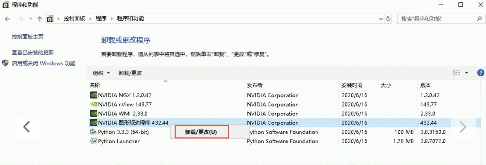

5. 在弹出的**NVIDIA 卸载程序**对话框，单击**卸载(U)**。

   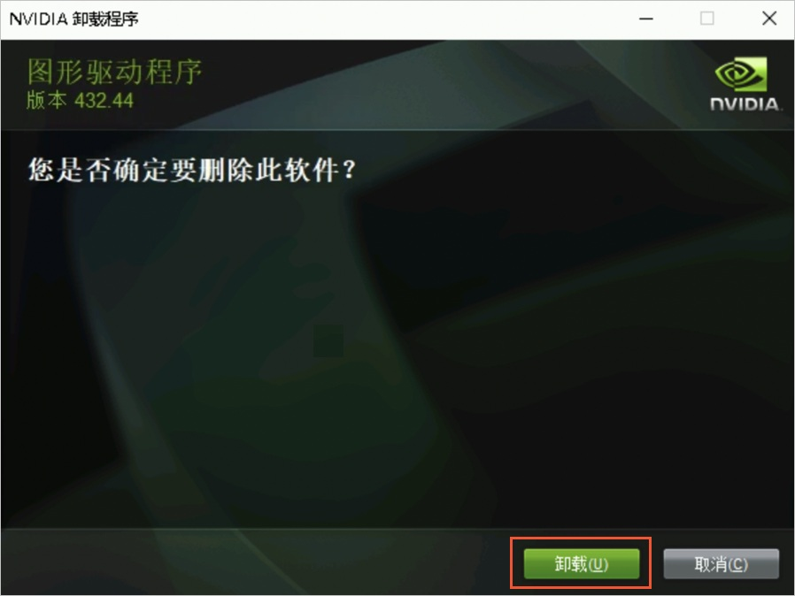

6. 卸载完成后，单击**马上重新启动(R)**。

   重启完成后，则GRID驱动已卸载成功。

**在Linux操作系统中卸载GRID驱动**

以下操作将以操作系统为Ubuntu 18.04的GPU虚拟化型实例vgn6i为例。

1. 使用VNC功能远程连接实例。具体操作，请参见使用VNC连接实例。

2. 执行如下命令卸载GRID驱动，并根据提示完成操作。

   <ol type="i">

   <li>

   执行如下命令，卸载驱动。

   ```text
   nvidia-uninstall
   ```

   </li>

   <li>

   当系统显示如下信息，询问您是否需要备份X screen的配置文件时，建议您保持默认选项 `NO` ，然后按回车键。

   > 不同操作系统的回显内容可能存在部分差别，您只需根据自身业务场景选择即可。
   >
   > **说明**

   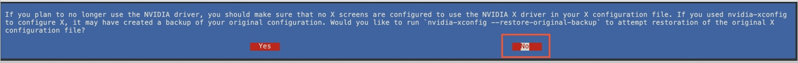

   </li>

   <li>

   当系统显示如下信息时，表示卸载已完成。选择**OK**，然后按回车键。

   

   </li>

   </ol>

<a id="section-5-17-5"></a>

### 5.17.5. 更新NVIDIA驱动

如果您的驱动版本已不适用于当前场景，或者您安装了错误的驱动类型或版本导致GPU实例无法使用，您可以通过卸载当前驱动再安装所需驱动的方式，完成NVIDIA驱动的更新。本文将为您提供卸载及安装不同类型和操作系统的驱动的操作指引。

**操作步骤**

1. 卸载NVIDIA驱动。根据您的驱动类型，选择对应操作指引：

   - 卸载GPU驱动

   - 卸载GRID驱动

2. 重新安装NVIDIA驱动。请根据您需要安装的驱动类型，选择对应操作指引。

   - 如果您需要安装GPU驱动，不同操作系统对应的操作指引如下：

     - 在GPU计算型实例中安装GPU驱动（Linux）

     - 在GPU计算型实例中安装GPU驱动（Windows）

   - 如果您需要安装GRID驱动，不同操作系统对应的操作指引如下：

     - 在GPU虚拟化型实例中安装GRID驱动（Linux）

     - 在GPU实例上安装GRID驱动（Windows）

       > GPU虚拟化型实例仅支持安装与其规格族相匹配的版本的GRID驱动，如果安装了
       >
       > **重要**
       >
       > 错误版本的GRID驱动，会导致GPU虚拟化型实例无法正常使用。因此，如果您需要为GPU虚拟化型实例重新安装GRID驱动，请根据您的实例规格安装对应版本的GRID驱动。

<a id="section-5-18"></a>

## 5.18. 超级计算集群（SCC）

<a id="section-5-18-1"></a>

### 5.18.1. 超级计算集群概述

本文介绍云服务器ECS超级计算集群实例规格族的特点、机型对比和实例规格。

**超级计算集群介绍**

超级计算集群SCC（Super Computing Cluster）在弹性裸金属服务器基础上，加入高速RDMA（Remote Direct Memory Access）互联支持，大幅提升网络性能，提高大规模集群加速比。因此SCC在提供高带宽、低延迟优质网络的同时，还具备弹性裸金属服务器的所有优点。

SCC主要用于高性能计算和人工智能、机器学习、科学计算、工程计算、数据分析、音视频处理等场景。在集群内，各节点（即SCC规格的ECS实例）间通过RDMA网络互联，提供高带宽低延迟网络，保证了高性能计算和人工智能、机器学习等应用的高度并行需求。同时，RoCE（RDMA over Convergent Ethernet）网络速度达到InfiniBand网络级的性能，且能支持更广泛的基于Ethernet的应用。

SCC与阿里云ECS产品一起，为弹性高性能计算E-HPC提供了极高性能的并行计算资源，实现真正的云上高性能计算。更多弹性高性能计算E-HPC信息，请参见专有云文档中心<em>《弹性高性能计算用户指南》</em>文档的**什么是弹性高性能计算E-HPC**章节。

> **说明**
>
> SCC超级计算集群专用于HPC场景，需要关闭HT，但规格大小依然是按照开启HT计算的，因此在操作系统（GuestOS）内查询的CPU核数为规格定义核数的一半。

**机型对比**

SCC与物理机、虚拟机的对比如下表所示。其中，Y表示支持，N表示不支持，N/A表示无数据。

**功能分类**

**功能**

**物理机**

**虚拟机**

**SCC**

运维自动化

分钟级交付

Y

N

Y

免性能损失

Y

Y

N

计算

免特性损失

Y

Y

N

免资源争抢

Y

Y

N

完全兼容ECS云盘

Y

N

Y

系统

使用云盘（系统

Y

N

Y

盘）启动

系统盘快速重置

Y

N

Y

使用云服务器ECS

存储

Y

N

Y

的镜像

物理机和虚拟机之

Y

N

Y

间相互冷迁移

免操作系统安装

Y

N

Y

免本地RAID，提供

Y

N

Y

更高云盘数据保护

完全兼容ECS VPC

Y

N

Y

网络

网络

物理机集群和虚拟机集群间VPC无通

Y

N

Y

信瓶颈

完全兼容ECS现有

Y

N

Y

管控系统

VNC等用户体验和

管控

Y

N

Y

虚拟机保持一致带外网络安全

Y

N

N/A

**实例规格**

超级计算集群的节点必须为SCC规格的ECS实例，更多SCC规格信息，请参见专有云文档中心<em>《云服务器ECS实例规格族&实例规格简介》</em>文档的**Intel规格族 > 超级计算机型**章节。

<a id="section-5-18-2"></a>

### 5.18.2. 创建超级计算集群

使用高速RDMA网络互联的CPU以及GPU等异构加速设备，面向高性能计算、人工智能/机器学习、科学/工程计算、数据分析、音视频处理等应用，提供极致计算性能和并行效率的计算集群服务。本文为您介绍如何创建超级计算集群。

**注意事项**

您需要注意如下事项：

- 创建超级计算集群时，不能设置超级计算集群的安全组ID和专有网络ID。安全组ID和专有网络ID将会在首次添加节点（SCC规格的ECS实例）时自动设置，具体操作，请参见添加节点到超级计算集群。

- 创建超级计算集群时，ECS控制台会自动创建1个部署集，选择**部署集与弹性 > 部署集**即可在部署集列表中查看该部署集。该部署集名称为 `hpc-null-deploymentset` ，部署粒度为**网络交换机**，部署策略为**尽量聚合**。更多部署集信息，请参见概述。

**操作步骤**

1. 登录云服务器ECS控制台。

2. 在左侧导航栏中，选择**实例与镜像 > 超级计算集群**。

3. 在顶部菜单栏处，选择组织、资源集和地域。

4. 单击**创建集群**。

5. 在**创建超级计算集群**页面，配置集群相关参数。

   <table>
     <tr>
       <th width="89">参数</th>
       <th>说明</th>
     </tr>
     <tr>
       <td>组织</td>
       <td>超级计算集群所属的组织。</td>
     </tr>
     <tr>
       <td>资源集</td>
       <td>超级计算集群所属的资源集。</td>
     </tr>
     <tr>
       <td>地域</td>
       <td>超级计算集群所属的地域。</td>
     </tr>
     <tr>
       <td>集群名称</td>
       <td>超级计算集群的名称。长度为2~128个字符，不能以特殊字符或者数字开头，可以包含特殊字符中的下划线（_）、短划线（-）和半角冒号（:）。</td>
     </tr>
     <tr>
       <td>描述</td>
       <td>您可以根据需要设置超级计算集群的描述信息。</td>
     </tr>
   </table>

6. 单击**提交**。

**执行结果**

您可以在超级计算集群页面的超级计算集群列表中，查看新创建的超级计算集群信息。更多信息，请参见查看超级计算集群。

**后续步骤**

您需要在超级计算集群中添加SCC规格的ECS实例，具体操作，请参见添加节点到超级计算集群。

<a id="section-5-18-3"></a>

### 5.18.3. 添加节点到超级计算集群

创建超级计算集群后，您需要通过扩容超级计算集群或新建SCC规格的ECS实例的方式，来添加节点到超级计算集群。

**前提条件**

扩容节点到超级计算集群时，您必须先创建好超级计算集群。具体操作，请参见创建超级计算集群。

**背景信息**

创建超级计算集群后，该集群仅为逻辑概念上的集群，集群内节点数（即SCC规格的ECS实例数）为0，且未设置安全组ID和专有网络ID。在您首次添加节点（即SCC规格的ECS实例）到超级计算集群后，ECS实例的安全组ID和专有网络ID会自动被设置为超级计算集群的安全组ID和专有网络ID，且无法更改。

> **重要**
>
> 超级计算集群的安全组ID和专有网络ID会在添加节点时自动传递，因此，同一超级计算集群内SCC规格的ECS实例的安全组ID和专有网络ID均相同。

**节点限制**

在添加节点到超级计算集群时，您需要注意如下限制：

<table>
  <tr>
    <th width="122">限制项目</th>
    <th>说明</th>
  </tr>
  <tr>
    <td>ECS实例规格</td>
    <td>待添加的节点必须为SCC规格的ECS实例。创建ECS实例时，支持使用的SCC规格，请参见专有云文档中心<em>《云服务器ECS实例规格族&amp;实例规格简介》</em>文档的<strong>Intel规</strong><strong>格族 &gt; 超级计算机型</strong>章节。</td>
  </tr>
  <tr>
    <td>镜像</td>
    <td>支持使用的公共镜像的操作系统版本如下：<br>• Anolis OS 8.4 ANCK版（SCC）<br>• CentOS 7.5 （SCC）<br>• CentOS 7.9（SCC）更多镜像信息，请参见镜像概述。</td>
  </tr>
  <tr>
    <td>网络</td>
    <td>• 未设置超级计算集群的安全组ID和专有网络ID：无限制。<br>• 已设置超级计算集群的安全组ID和专有网络ID：<br>• 专有网络：只能使用超级计算集群的专有网络ID创建ECS实例。<br>• 安全组：只能使用超级计算集群的安全组ID创建ECS实例。</td>
  </tr>
</table>

**扩容节点到超级计算集群**

1. 登录云服务器ECS控制台。

2. 在左侧导航栏中，选择**实例与镜像 > 超级计算集群**。

3. 在顶部菜单栏处，选择组织、资源集和地域。

4. 在超级计算集群列表中，找到目标超级计算集群，然后单击**操作**列的**扩容**。

5. 在**创建实例**页面，创建ECS实例。

   您需要注意如下参数，创建ECS实例的具体操作，请参见创建实例。

   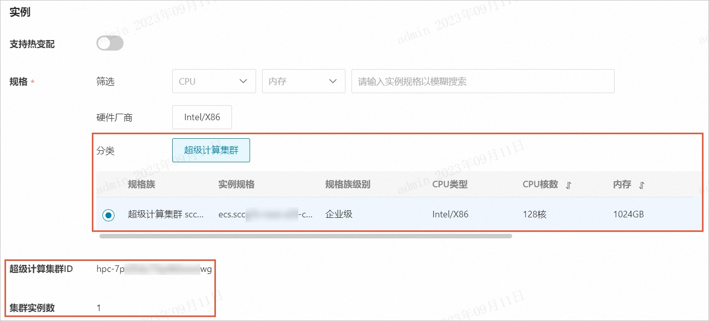

   | 参数 | 说明 |
   | --- | --- |
   | 规格 | <strong>分类</strong>自动选择<strong>超级计算集群</strong>，不允许修改。 |
   | 实例规格 | 选择待创建ECS实例的实例规格。 |
   | 超级计算集群 | 待添加节点的超级计算集群，不允许修改。 |
   | 集群实例数 | 待添加节点的超级计算集群中的实例数量，不允许修改。 |

   如果待添加节点的超级计算集群中已存在实例，如下参数将会自动填充：

   | 参数 | 说明 |
   | --- | --- |
   | VPC | 超级计算集群的VPC ID，不允许修改。 |
   | 安全组 | 超级计算集群的安全组ID，不允许修改。 |

**新建节点到超级计算集群**

1. 登录云服务器ECS控制台。

2. 在左侧导航栏中，选择**实例与镜像 > ECS实例**。

3. 在顶部菜单栏处，选择组织、资源集和地域。

4. 在**实例列表**页面，单击**创建实例**。

5. 在**创建实例**页面，创建ECS实例。

   您需要注意如下参数，创建ECS实例的具体操作，请参见创建实例。

   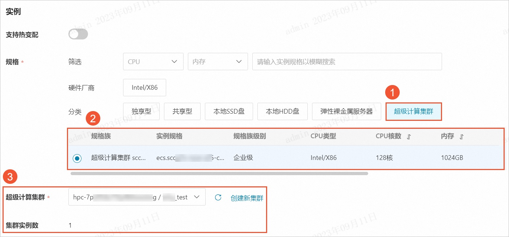

   <table>
     <tr>
       <th width="121">参数</th>
       <th>说明</th>
     </tr>
     <tr>
       <td>规格</td>
       <td><strong>分类</strong>必须选择<strong>超级计算集群</strong>。</td>
     </tr>
     <tr>
       <td>实例规格</td>
       <td>选择待创建ECS实例的实例规格。</td>
     </tr>
     <tr>
       <td>超级计算集群</td>
       <td>选择已有的超级计算集群，或者单击<strong>创建新集群</strong>即时创建超级计算集群。创建完成后，返回ECS实例创建向导并单击图标，查看最新的<br>超级计算集群列表。具体操作，请参见创建超级计算集群。<br>重要仅当实例规格的<strong>分类</strong>为<strong>超级计算集群</strong>，且当已选中SCC实例规格后，才能查看和选择该参数。</td>
     </tr>
     <tr>
       <td>集群实例数</td>
       <td>已选择的超级计算集群中的ECS实例数量，不允许修改。</td>
     </tr>
   </table>

   如果待添加节点的超级计算集群中已存在实例，如下参数将会自动填充：

   | 参数 | 说明 |
   | --- | --- |
   | VPC | 超级计算集群的VPC ID，不允许修改。 |
   | 安全组 | 超级计算集群的安全组ID，不允许修改。 |

<a id="section-5-18-4"></a>

### 5.18.4. 查看超级计算集群

您可以在超级计算集群列表中查看超级计算集群详细信息。

**操作步骤**

1. 登录云服务器ECS控制台。

2. 在左侧导航栏中，选择**实例与镜像 > 超级计算集群**。

3. 在顶部菜单栏处，选择组织、资源集和地域。

4. 在**超级计算集群**页面，查看超级计算集群。

   超级计算集群各参数说明如下：

   <table>
     <tr>
       <th width="109">参数</th>
       <th>说明</th>
     </tr>
     <tr>
       <td>组织</td>
       <td>超级计算集群所属的组织。</td>
     </tr>
     <tr>
       <td>资源集</td>
       <td>超级计算集群所属的资源集。</td>
     </tr>
     <tr>
       <td>集群名称</td>
       <td>超级计算集群的名称。</td>
     </tr>
     <tr>
       <td>描述</td>
       <td>超级计算集群的描述信息。</td>
     </tr>
     <tr>
       <td>实例数</td>
       <td>超级计算集群中SCC规格的ECS实例数量。单击具体的实例数字，即可跳转到<strong>实例列表</strong>页面，查看当前超级计算集群中所有的ECS实例信息。</td>
     </tr>
     <tr>
       <td>配置</td>
       <td>超级计算集群中的所有ECS实例的vCPU总核数和总内存数。<br>未添加ECS实例前，该值为<code> vCPU</code>：<code>0 </code>核<code> </code>内存：<code>0 GiB </code>。</td>
     </tr>
     <tr>
       <td>安全组ID</td>
       <td>超级计算集群的安全组ID。未添加ECS实例前，该值为空。</td>
     </tr>
     <tr>
       <td>专有网络ID</td>
       <td>超级计算集群的专有网络ID。未添加ECS实例前，该值为空。</td>
     </tr>
     <tr>
       <td>操作</td>
       <td>• <strong>扩容</strong>：添加ECS实例到超级计算集群。具体操作，请参见添加节点到超级计算集群。<br>• <strong>编辑</strong>：编辑超级计算集群属性（集群名称或集群描述）。具体操作，请参见编辑超级计算集群属性。<br>• <strong>删除</strong>：删除不再需要的超级计算集群。具体操作，请参见删除超级计算集群。</td>
     </tr>
   </table>

<a id="section-5-18-5"></a>

### 5.18.5. 编辑超级计算集群属性

您可以根据需要编辑超级计算集群的属性，即编辑超级计算集群的名称和描述。

**操作步骤**

1. 登录云服务器ECS控制台。

2. 在左侧导航栏中，选择**实例与镜像 > 超级计算集群**。

3. 在顶部菜单栏处，选择组织、资源集和地域。

4. 在目标超级计算集群的**操作**列中，单击**编辑**。

5. 在**编辑**对话框中，修改超级计算集群属性。

   <table>
     <tr>
       <th width="89">参数</th>
       <th>说明</th>
     </tr>
     <tr>
       <td>集群名称</td>
       <td>超级计算集群的名称。长度为2~128个字符，不能以特殊字符或者数字开头，可以包含特殊字符中的下划线（_）、短划线（-）和半角冒号（:）。</td>
     </tr>
     <tr>
       <td>描述</td>
       <td>您可以根据需要设置超级计算集群的描述信息。长度为2~256个字符，不能以<code> http:// </code>或者<code> https:// </code>开头。</td>
     </tr>
   </table>

6. 单击**确定**。

<a id="section-5-18-6"></a>

### 5.18.6. 删除超级计算集群

如果您不再需要当前超级计算集群，您可以删除该集群。

**前提条件**

待删除的超级计算集群中无节点（即集群中ECS实例已全部被删除）。删除ECS实例的具体操作，请参见删除实例。

> **重要**
>
> 由于ECS实例后台释放需要时间，建议您删除ECS实例后，等待5~10分钟，再删除超级计算集群。

**操作步骤**

1. 登录云服务器ECS控制台。

2. 在左侧导航栏中，选择**实例与镜像 > 超级计算集群**。

3. 在顶部菜单栏处，选择组织、资源集和地域。

4. 在目标超级计算集群的**操作**列中，单击**删除**。

5. 在对话框中确认待删除的集群信息无误后，单击**删除**。

<a id="section-5-19"></a>

## 5.19. 裸机实例

<a id="section-5-19-1"></a>

### 5.19.1. 创建裸机实例

本文介绍如何通过ECS控制台创建单个裸机实例。

**前提条件**

Apsara Uni-manager运维控制台裸机服务运维管理员已在资源池中注册好裸机。

**操作步骤**

1. 登录云服务器ECS控制台。

2. 在左侧导航栏中，选择**实例与镜像 > 裸机实例**。

3. 在顶部菜单栏处，选择组织、资源集和地域。

4. 单击**创建实例**。

5. 选择服务目录，单击**确定**。

   服务管理用于在企业或组织内对某些产品的特定规格进行一定的管理与控制。仅当服务管理中配置了将裸机实例授权给当前组织或用户，并且该裸机实例资源已上架，才会显示此选项。关于服务管理的更多信息，请参见<strong>《Apsara Uni-manager运营控制台 用户指南》</strong>中的<strong>《服务管理》</strong>章节。

6. 在**基础配置**页面完成实例的基础配置，然后单击**下一步**。

   基础配置包括创建实例的基本属性（组织、资源集、地域、可用区）以及一台实例所需的基础资源（实例规格、镜像、存储）。

   您也可以单击页面底部的**预览配置**，查看您需要配置和已经配置的实例信息。

   <ol type="i">

   <li>

   配置实例的基本属性。

   | 配置项 | 是否必选 | 说明 |
   | --- | --- | --- |
   | 组织 | 是 | 选择实例所属的组织。 |
   | 资源集 | 是 | 选择实例所属的资源集。 |
   | 地域 | 是 | 选择实例所属的地域。 |
   | 可用区 | 是 | 选择实例所在的可用区。可用区指在同一区域下，电力、网络隔离的物理区域，可用区之间内网互通，不同可用区之间做到故障隔离。如果您需要提高应用程序的高可用性，建议您将实例创建在不同的可用区内。 |

   </li>

   <li>

   配置实例的规格等信息。

   | 配置项 | 是否必选 | 说明 |
   | --- | --- | --- |
   | 开启热变配 | 否 | 热变配支持在不停止实例的情况下变更实例规格。更多信息，请参见热变配实例规格。<br>• 如果您实际部署环境上有支持热变配的实例规格，则热变配开关默认开启，此时，实例规格列表会默认筛选支持热变配的实例规格。<br>说明如果您无须热变配，直接关闭热变配开关即可查看全量规格信息。<br>• 如果您实际部署环境上没有支持热变配的实例规格，则热变配开关默认关闭，实例规格列表中显示全量规格信息。 |
   | 筛选 | 否 | 您可以根据实际情况选择CPU、内存、GPU或输入实例规格模糊筛选目标实例规格。 |
   | CPU类型 | 是 | 实例的CPU类型。<br>说明支持的CPU类型以您实际部署环境上的ECS控制台显示为准。 |
   | 分类 | 是 | 实例类型。<br>说明支持的实例类型以您实际部署环境上的ECS控制台显示为准。 |
   | BMS实例列表 | 是 | Apsara Uni-manager运维控制台裸机服务运维管理员已注册的裸机实例。 |

   </li>

   <li>

   配置实例使用的BMS镜像。选择BMS镜像的创建类型：

   - 使用初始镜像。

   - 重新安装镜像。需选择镜像类型

     - 公共镜像：实例使用的公共镜像，阿里云官方提供的镜像（不包含操作系统授权），安全性高，稳定性高。

     - 自定义镜像：实例使用的自定义镜像，您使用实例或快照创建的镜像，或是您从本地导入的自定义镜像。

   </li>

   </ol>

7. 在**网络配置**页面完成实例的网络配置，然后单击**下一步**。

   您可以单击页面底部的**预览配置**，查看您需要配置和已经配置的实例信息。

   | 配置项 | 是否必选 | 说明 |
   | --- | --- | --- |
   | VPC | 是 | 选择已创建的专有网络，或者单击<strong>创建VPC</strong>即时创建专<br>有网络，创建完成后，返回ECS实例创建向导并单击<br>图标，查看最新的专有网络列表。创建专有网络的具体操作，请参见专有云文档中心<strong>《专有网络VPC用户指</strong><strong>南》</strong>中的<strong>《创建和管理专有网络》</strong>章节。 |
   | VSwitch | 是 | 选择已创建的交换机，或者单击<strong>创建VSwitch</strong>即时创建交换机，创建完成后，返回ECS实例创建向导并单击<br>图标，查看最新的交换机列表。创建交换机的具体操<br>作，请参见专有云文档中心<strong>《专有网络VPC用户指</strong><strong>南》</strong>中的<strong>《创建和管理交换机》</strong>章节。 |
   | 私网IP | 否 | 指定实例的私网IPv4地址，IP地址网段取决于交换机网段。如果私网IP为空，系统会自动分配私网IP。 |

8. 在**系统配置**页面完成实例的登录密码、主机名等系统配置，然后单击**下一步**。

   系统配置包括登录密码、实例名称、实例描述、主机名和是否开启有序后缀等，用于定制实例在控制台上显示的信息。

   您也可以单击页面底部的**预览配置**，查看您需要配置和已经配置的实例信息。

   <ol type="i">

   <li>

   配置实例**登录密码**。

   > **说明**
   >
   > 密码格式要求8～30 个字符，必须同时包含三项（大写字母、小写字母、数字、()\`~!@#$%^&\*_-+=|{}[]:;<>,.?/ 中的特殊符号），其中 Windows 实例不能以斜线号（/）开头

   </li>

   <li>

   配置实例**基本信息**。

   | 配置项 | 是否必选 | 说明 |
   | --- | --- | --- |

   <table>
     <tr>
       <td>实例名称</td>
       <td>是</td>
       <td>实例的名称。购买多台实例时，名称自动按序增加3位数字后缀。默认从001开始递增，最大不能超过100。例如：LocalHost001，LocalHost002和 MyInstance 001，MyInstance002。如何自定义有序实例名称：通过name_prefix[begin_number,bi ts]name_suffix 格式可给各个ECS实例设置不同的实例名。例如：my_name[99,3]ecs ，若创建2台实例最终生成的名称分别为：my_name099ecs、my_name100ecs，begin_num ber 取值区间为[0,999999]，bits取值区间为[1,6]，不填写默认为6。</td>
     </tr>
     <tr>
       <td>实例描述</td>
       <td>否</td>
       <td>实例的描述。格式要求为长度为2-256个字符，不能以http://或https://开头，支持中英文、数字、全角字符及"_","-","."半角字符。</td>
     </tr>
     <tr>
       <td>主机名</td>
       <td>否</td>
       <td>实例的主机名。自定义有序主机名称：通过name_prefix[begin_number,bi ts]name_suffix格式可给各个ECS实例设置不同的主机名。例如：my_name[99,3]ecs ，若创建2台实例最终生成的名称分别为：my_name099ecs、my_name100ecs，begin_num ber取值区间为[0,999999]，bits取值区间为[1,6]，不填写默认为6。</td>
     </tr>
     <tr>
       <td>开启有序后缀</td>
       <td>是</td>
       <td>选择是否开启实例的有效后缀。当创建多台实例并开启有序后缀时，实例名称和主机名将会自动添加有序后缀，有序后缀从001开始递增，最大不能超过999；当按照指定排序格式设置，未设置命名后缀name_suffix，即命名格式为name_prefix[begin_number,bi ts]时，本开关不生效，名称仅按照指定顺序排序。</td>
     </tr>
   </table>

   </li>

   </ol>

9. 创建实例。

   - 服务管理中已创建**云资源**为**裸机实例**的服务：在**信息确认**页面，检查实例的基础配置、网络配置、系统配置等信息，确保各项配置符合您的要求，然后单击**确认订单**。

   - 服务管理中未创建**云资源**为**裸机实例**的服务：在**信息确认**页面，检查实例的基础配置、网络配置、系统配置等信息，确保各项配置符合您的要求，然后单击**提交**。

**执行结果**

裸机实例列表中出现您创建的裸机实例，状态为**已完成**。

<a id="section-5-19-2"></a>

### 5.19.2. 批量创建裸机实例

本文介绍如何通过上传本地文件批量创建裸机实例。

**前提条件**

- Apsara Uni-manager运维控制台裸机服务运维管理员已在资源池中注册好裸机。

- 已准备好本地批量上传文件（支持.csv/.xls/.xlsx格式）。

**操作步骤**

1. 登录云服务器ECS控制台。

2. 在左侧导航栏中，选择**实例与镜像 > 裸机实例**。

3. 在顶部菜单栏处，选择组织、资源集和地域。

4. 单击**批量创建**。

5. 在**批量创建**对话框中配置实例的基本属性。

   | 配置项 | 是否必选 | 说明 |
   | --- | --- | --- |
   | 组织 | 是 | 选择实例所属的组织。 |
   | 资源集 | 是 | 选择实例所属的资源集。 |
   | 地域 | 是 | 选择实例所属的地域。 |
   | 可用区 | 是 | 选择实例所在的可用区。可用区指在同一区域下，电力、网络隔离的物理区域，可用区之间内网互通，不同可用区之间做到故障隔离。如果您需要提高应用程序的高可用性，建议您将实例创建在不同的可用区内。 |
   | 上传文件 | 是 | 在上传文件区域下载模板，根据模板格式要求填入各参数，并选择文件进行上传。 |

**模板文件说明**

| \*实例类型 | \*架构 | \*机型 | \*S N | \*创建类型 | \*镜像类型 | \*镜像 | \*专有网络V P C | \*交换机V S w it c h | 专有网络I P | 登录名 | 登录密码 | \*主机名 | \*实例名称 | 实例描述 |
| --- | --- | --- | --- | --- | --- | --- | --- | --- | --- | --- | --- | --- | --- | --- |
| bms | x86_64 | test-mt | 123 456 | install _os | publi c | C e n t o s-7.9 -x 8 6 _6 4 | te st -v p c-0 1 | t e st -s u b n e t-0 1 | X X X.X X X.X X X.X X X | n a m e | p a s s w o r d | t e st -a p p ly -0 1 | t e st -a p pl y-0 1 |  |

<table>
  <tr>
    <td>no_clone</td>
    <td>x86_64</td>
    <td>test-mt</td>
    <td>654 321</td>
    <td>install _os</td>
    <td>custo mize</td>
    <td>A n ol is O S -8.6</td>
    <td>te st -v p c-0 1</td>
    <td>t e st -s u b n e t-0 1</td>
    <td>X X X.X X X.X X X.X X X</td>
    <td>n a m e</td>
    <td>p a s s w o r d</td>
    <td>t e st -a p p ly -0 2</td>
    <td>t e st -a p pl y-0 2</td>
    <td></td>
  </tr>
</table>

> **说明**
>
> 模板中的相关主要参数注解如下（参数值不区分大小写）：
>
> - **架构**（必填）：CPU架构 （可填值为：x86_64/aarch64）。
>
> - **机型**（必填）：机型。
>
> - **SN**（必填）：序列号。
>
> - **创建类型**：是否使用初始镜像（可填值为：origin_image使用初始镜像，install_os重新安装镜像）。
>
> - **镜像类型**（必填）：镜像类型（可填值为：public/customize）。
>
> - **专有网络VPC**（必填）：专有网络VPC ID。
>
> - **交换机VSwitch**（必填）：交换机VSwitch ID。
>
> - **专有网络IP**：用户指定的专有网络IP，当无指定IP时系统将自动分配IP。
>
> - **登录名**（必填）：系统登录用户名。
>
> - **登录密码**（必填）：系统登录用户密码。
>
> - **主机名**：hostname。
>
> - **实例名称**（必填）：用户自定义的实例名称。
>
> - **实例描述**：用户自定义的实例描述。

**执行结果**

裸机实例列表中出现您创建的裸机实例，状态为**已完成**。

<a id="section-5-19-3"></a>

### 5.19.3. 重新申请实例

本节介绍如何重新申请实例，用户可以对已申请创建的裸机实例，通过重新申请实例进行重装机操作。

**前提条件**

- 已创建实例，详情请参见创建裸机实例。

- 用户列表中的裸机状态需处于稳定状态（如：运行中、已停止、创建失败、无心跳等）。

**操作步骤**

1. 登录云服务器ECS控制台。

2. 在左侧导航栏中，选择**实例与镜像 > 裸机实例**。

3. 在顶部菜单栏处，选择组织、资源集和地域。

4. 找到待修改的裸机实例，在**操作**列中，单击**重新申请**。

5. 在弹出的**重新创建**页面中，根据页面提示设置各参数，具体设置细则请参照创建裸机实例。

6. 完成上述参数配置后，单击**提交**，完成裸机实例的重新申请。

**执行结果**

裸机实例列表中出现您重新申请的裸机实例，状态为**已完成**。

<a id="section-5-19-4"></a>

### 5.19.4. 查看实例详情

您可以查看您账号下已创建的所有裸机实例的列表和单台裸机实例的详细信息，包括裸机实例的基本配置和配置信息。

**操作步骤**

1. 登录云服务器ECS控制台。

2. 在左侧导航栏中，选择**实例与镜像 > 裸机实例**。

3. 在顶部菜单栏处，选择组织、资源集和地域。

4. 在裸机实例列表页面，您可以查看已有的裸机实例信息。

   您可以在裸机实例列表中查看裸机实例的信息，例如**实例名称/SN**、**在线状态**、**操作状态**、**电源状态**、**云助手状态**、**组织/资源集**、**专有网络IP**、**镜像ID/名称**、**机型**、**配置**、**操作系统**、**带外IP**、**监控**、**实例描述**和**创建时间**等。

   您也可以根据如下步骤，设置裸机实例列表显示的信息。

   <ol type="i">

   <li>

   在实例列表的右上角，单击  图标。

   </li>

   <li>

   在**自定义列表项显示**对话框中，选中需要显示的实例信息（例如新增显示**创建人**），然后单击**确定**。

   </li>

   </ol>

5. 在筛选列表中（例如**实例名称**），选择筛选选项，并在搜索栏输入相应信息，实例列表中将自动展示符合搜索条件的实例。

   > **说明**
   >
   > - 支持通过**实例名称**、**SN**、**专有网络IP**、**带外IP**和**创建人**等实例信息查找目标实例。
   >
   > - 您也可以同时选择多个筛选选项逐级过滤，以便快速查找实例。

6. 找到需要查看详情的裸机实例，选择如下任意一种方式打开实例详情页面，查看实例的详细信息。

   - 在**实例名称/SN**列中，单击实例名称。

   - 在**操作**列中，单击**管理**。

     **实例详情**页面包含的信息如下表所示。

     <table>
       <tr>
         <th width="89">信息分类</th>
         <th>描述</th>
       </tr>
       <tr>
         <td>基本信息</td>
         <td>裸机实例的基本信息。包括实例名称/SN、组织、资源集、地域、可用区、主机名、云助手ID、在线状态、操作状态、电源状态、Agent、创建时间和实例描述等。</td>
       </tr>
       <tr>
         <td>配置信息</td>
         <td>裸机实例的配置信息。包括CPU架构、机型、CPU/内存、操作系统、镜像名称、镜像ID、专有网络ID、虚拟交换机、专有网络IP和带外IP等。</td>
       </tr>
     </table>

7. 管理实例状态。

   您可以在实例详情页面右上角，启动、重启、停止实例，还可以单击**更多**，进行实例释放、修改主机名等操作。

<a id="section-5-19-5"></a>

### 5.19.5. 管理实例状态

本文旨在指导您在ECS控制台中管理实例的状态，包括启动、重启、停止和释放实例。

**前提条件**

- 已创建裸机实例，详情请参见创建裸机实例。

- 实例列表中的裸机状态需处于稳定状态（如：运行中、已停止、创建失败、无心跳等）。

**操作步骤**

1. 登录云服务器ECS控制台。

2. 在左侧导航栏中，选择**实例与镜像 > 裸机实例**。

3. 在顶部菜单栏处，选择组织、资源集和地域。

4. 在选中裸机实例的**操作**列中，单击**实例状态**选择实例操作。

   - 单击**启动实例**。在弹出的对话框中，单击**启动实例**。

   - 单击**重启实例**。在弹出的对话框中，单击**重启实例**。

   - 单击**停止实例**。在弹出的对话框中，单击**停止实例**。

   - 单击**释放实例**。在弹出的对话框中，单击**释放实例**。

     > **说明**
     >
     > - 在弹出的对话框中，用户可以选择是否清理数据盘。如果不勾选**清理数据盘**，仅会删除系统盘；若勾选，系统盘和数据盘将同时被删除。
     >
     > - 您可以选择一台或多台待释放的裸机实例，随后在实例列表底部单击**释放**。在弹出的对话框中，单击**释放实例**完成批量释放操作。
     >
     > - 裸机释放后，会进入资源池并重装。裸机释放成功后，用户可再次申请使用。

5. 在裸机实例**操作状态**列查看裸机实例的状态。

<a id="section-5-19-6"></a>

### 5.19.6. 查询操作日志

本节介绍如何查看裸机实例的操作日志信息。

**前提条件**

已创建裸机实例，详情请参见创建裸机实例。

**操作步骤**

1. 登录云服务器ECS控制台。

2. 在左侧导航栏中，选择**实例与镜像 > 裸机实例**。

3. 在顶部菜单栏处，选择组织、资源集和地域。

4. 找到并选中裸机实例，选择如下任意一种方式打开操作日志弹窗，查看裸机状态的操作信息。

   > **说明**
   >
   > 操作日志弹窗包含操作类型、操作时间和操作状态等操作信息，并支持按日志时间区间筛选。

   - 在**操作状态**列中，单击实例状态。

   - 在**操作**列中，单击**操作日志**。

<a id="section-6"></a>

# 6.云盘

<a id="section-6-1"></a>

## 6.1. 云盘概述

本文介绍云盘的分类和云盘的操作。

**云盘的分类**

云盘是为云服务器ECS提供的数据块级别的块存储产品。云盘可从性能和用途两个维度进行分类。

- **根据性能分类**

  根据性能不同，云盘可分为高效云盘、SSD盘、普通性能云盘和高性能云盘。

  - 高效云盘面向中度I/O负载的应用场景，为ECS实例提供最高5,000的随机IOPS性能。

  - SSD盘面向I/O密集型应用场景，为ECS实例提供最高25,000的随机IOPS性能。

  - 普通性能云盘和高性能云盘面向OLTP数据库、NoSQL数据库等场景，高性能云盘为ECS实例提供最高25,000的随机IOPS性能。

  > **重要**
  >
  > 支持的云盘类型，与部署的EBS集群有关。
  >
  > - 全新部署的CDS-EBS集群，支持高性能云盘和普通性能云盘。
  >
  > - 从V3.15.0升级上来的CDS-EBS集群，支持高效云盘、SSD盘、高性能云盘和普通性能云盘。
  >
  > - 共享高效云盘和共享SSD盘已下线。

  云盘的性能对比如下所示。

  | 性能类别 | 高性能云盘 | 普通性能云盘 | SSD云盘 | 高效云盘 |
  | --- | --- | --- | --- | --- |
  | 单盘最大容量 | 131,072 GiB | 32,768 GiB | 32,768 GiB | 32,768 GiB |
  | 最大IOPS | 25,000 | 5,000 | 25,000 | 5,000 |
  | 最大吞吐量 | 300 MB/s | 140 MB/s | 300 MB/s | 140 MB/s |
  | 单盘IOPS性能计算公式 | min(1,800+30\*容量,25,000) | min(1800+8\*容量,5,000) | min{1,800+30\*容量, 25,000} | min{1,800+8\*容量, 5,000} |
  | 单盘吞吐量性能计算公式 | min(120+0.5\*容量,300) | min(100+0.15\*容量,140) | min{120+0.5\*容量, 300} MB/s | min{100+0.15\*容量, 140} MB/s |
  | API名称 | cloud_pperf | cloud_sperf | cloud_ssd | cloud_efficiency |

  <table>
    <tr>
      <td>应用场景</td>
      <td>• OLTP数据库：如MySQL、PostgreSQL、Oracle、SQL Server等关系型数据库<br>• NoSQL数据库：如MongoDB、HBase、Cassandra等非关系型数据库<br>• ElasticSearch分布式日志：ELK（Elasticsearch、Logstash和Kibana）日志分析等</td>
      <td>对数据可靠性要求高的中小型开发测试环境</td>
      <td>• 开发测试应用<br>• 系统盘</td>
    </tr>
  </table>

- **根据用途分类**

  根据用途不同，云盘可以分为系统盘和数据盘。

  - 系统盘：生命周期与系统盘所挂载的ECS实例相同，随实例一起创建和释放。不可共享访问。

  - 数据盘：可以与ECS实例同时创建，也可以单独创建，不可共享访问。与ECS实例同时创建的数据盘，生命周期与实例相同，随实例一起创建和释放。单独创建的数据盘，可以单独释放，也可以设置为随ECS实例一起释放。数据盘的容量由云盘类型决定。

**数据安全**

- 读写稳定性

  在同一可用区中，您的业务数据以多副本的形式分布存储在块存储集群中，保证读写过程中的数据稳定性，为ECS实例实现99.9999999%的数据可靠性保证。

- 主动备份

  您可以定期创建快照，提高业务数据的安全性。快照是阿里云备份产品，为云盘提供数据备份能力，确保日志和客户交易等信息有备份可查询。更多信息，请参见快照概述。

- 数据擦除机制

  您删除的数据不会被其他用户通过任何途径访问，分布式块存储系统中已删除的数据一定会被完全擦除。主要通过以下机制保证数据擦除的完整性：

  - 云盘底层基于顺序追加写实现，该设计充分利用物理盘顺序写高带宽低时延的特性。基于追加写的特性，删除云盘逻辑空间的操作会被作为元数据记录，一切对该逻辑空间的读操作，存储系统会确保返回全零。同理，您对逻辑空间的覆盖写不会立即覆盖物理磁盘上对应空间，存储系统通过修改逻辑空间与物理空间之间的映射关系来实现云盘的覆盖写，确保无法读取被覆盖的数据。一切删除或者覆盖写操作形成的物理磁盘上的遗留数据，会从底层物理磁盘上强制永久删除。

  - 当您释放块设备（云盘）时，存储系统立即销毁元数据，确保无法继续访问数据。同时，该云盘对应的物理存储空间会被回收。物理空间再次被分配前一定是清零过的，在首次写入数据前，所有新建的云盘的读取返回全部是零。

- 数据加密

  对于数据敏感型应用，建议您加密存储设备。ECS云盘加密采用行业标准的AES-256算法，利用密钥加密云盘以及云盘快照。从ECS实例传输到云盘的数据会被自动加密，并在读取数据时自动解密。更多信息，请参见加密云盘。

**云盘的操作**

您还可以根据业务需要使用云盘，云盘相关的操作如下：

| 云盘的操作 | 操作说明 | 操作步骤 |
| --- | --- | --- |
| 创建云盘 | 您可以创建一块没有数据的全新数据盘。 | 创建云盘 |
| 挂载数据盘 | 您可以将单独创建的云盘挂载至同地域同可用区的ECS实例上，作为数据盘使用。 | 挂载数据盘 |
| 磁盘分区及格式化 | 单独创建的数据盘后，需要在Linux实例或Windows实例上执行分区和格式化操作。 | • Linux格式化数据盘<br>• Windows格式化数据盘 |
| 查看云盘 | 您可以查看已创建云盘的列表和单块云盘的详情。 | 查看云盘详情 |
| 使用快照回滚云盘 | 如果您已经为云盘创建了快照，可以通过回滚云盘功能将一块云盘的数据恢复到之前的某一时刻。 | 使用快照回滚云盘 |
| 变更云盘类型 | 您可以根据业务需求，在线变更云盘的类型，无需停止业务。 | 变更云盘类型 |
| 修改云盘属性 | 您可以修改已创建云盘的属性，包括云盘随实例释放和自动快照随云盘释放。 | 修改云盘属性 |
| 修改云盘描述 | 您可以修改已创建云盘的名称和描述。 | 修改云盘名称和描述 |
| 扩容云盘 | ECS支持扩容系统盘和数据盘，支持在线扩容和离线扩容，离线扩容必须重启ECS实例。 | 扩容云盘 |
| 开启多重挂载 | 您在创建高性能云盘时，可以为云盘开启多重挂载功能。 | 开启多重挂载功能 |
| 加密云盘 | ECS云盘加密提供了一种简单安全的加密手段，能够对新创建的云盘进行加密处理。 | • 加密系统盘<br>• 加密数据盘 |
| 重新初始化云盘 | 重新初始化系统盘或数据盘后，系统盘或数据盘会恢复到创建时的状态。 | • 重新初始化系统盘<br>• 重新初始化数据盘 |
| 卸载数据盘 | 如果您不再需要使用数据盘，或者需要将数据盘挂载到同可用区的其他ECS实例时，需要先卸载数据盘。 | 卸载数据盘 |
| 释放数据盘 | 如果您不再需要某块数据盘，可以将其手动释放，存储在云盘上的数据会被全部释放。 | 释放数据盘 |

<a id="section-6-2"></a>

## 6.2. 创建云盘

您可以单独创建数据盘，增加ECS实例的存储空间，本文介绍如何创建一块没有数据的全新数据盘。

**使用限制**

单独创建数据盘前，需要提前规划好云盘数量和容量。规划时请注意以下云盘使用限制：

> **说明**
>
> 云服务器ECS不支持单独创建系统盘。

- 一台ECS实例支持挂载的数据盘数量与其实例规格有关。

- 开启多重挂载功能的高性能云盘可同时挂载至2台以上的ECS实例，最多支持同时挂载至16台ECS实例。

- 每块云盘支持的最大容量与云盘类型有关：

  - 高效云盘、SSD盘、普通性能云盘：最大支持32 TiB容量。

  - 高性能云盘：最大支持128 TiB容量。

- 云服务器ECS不支持合并多块云盘，每块创建完成的云盘都是独立个体，不能通过格式化合并多块云盘的容量。

快照针对独立的云盘创建，使用逻辑卷管理LVM（Logical Volume Manager）会导致快照回滚后出现数据差异，因此不建议对已创建的多块云盘做LVM等逻辑卷。

**在云盘页面创建云盘**

1. 登录云服务器ECS控制台。

2. 在左侧导航栏中，选择**存储与快照 > 云盘**。

3. 在顶部菜单栏处，选择组织、资源集和地域。

4. 单击**创建云盘**。

5. 设置云盘的配置参数。

   **类型**

   **项目**

   **是否必选**

   **说明**

   默认按量计费。用户先使用服务，然后根据实际使用的资源量在事后生成费用。这种方式适用于业务用量经常变化的场景，用户可以根据实际需求灵活使用资源，避免浪费。

   > **说明**

   计费配置

   计费方式

   是

   > 仅当您的管理员在运营中心中配置了计费规则时才会展示此选项。关于计费规则的详细说明，请参见<strong>《Apsara Uni-manager运营控制台 用户指南》</strong>中的<strong>《计费规则》</strong>章节。

   组织

   是

   选择云盘所属的组织。

   区域

   资源集

   是

   选择云盘所属的资源集。

   地域

   是

   选择云盘所在的地域。

   可用区

   是

   选择云盘所在的可用区。

   选择云盘的创建方式。可选值：

   - **普通创建**

   - **存储集创建**

   > **说明**

   是

   创建方式

   > 存储集是一种以集群为整体的块存储服务，具备物理资源隔离、集群内资源独享的特点。使用存储集，您可以提升业务数据存储的安全性及运维效率。关于存储集的更多信息，请参见<strong>《云服务定义存储用户指南》</strong>中的<strong>《创建存储集》</strong>章节。

   选择具体的存储集。

   > **说明**

   存储集

   是

   > 当**创建方式**为**存储集创建**时，该参数为必选。

   存储集的分区，一个存储集中的分区个数必须大于等于2。

   分区

   是

   > **说明**
   >
   > 当**创建方式**为**存储集创建**时，该参数为必选。

   输入云盘的名称。单次创建云盘名称长度为2~128个字符，批量创建云盘名称长度为2~125个字符，以英文字母或中文开头，

   名称

   是

   不能以 `http://` 或 `https://` 开头。支持数字，可以包含下划线（_）、短划线（-）和半角冒号（:）等特殊字符。

   输入需要创建的云盘数量。取值范围：

   创建数量

   是

   1~100。

   选择云盘类型并指定云盘大小。支持的云盘类型，与部署的CDS-EBS集群有关。

   - 全新部署的CDS-EBS集群，支持以下云盘：

     - **高性能云盘**

     - **普通性能云盘**

   规格

   是

   - 从V3.15.0升级上来的CDS-EBS集群，支持以下云盘：

     - **高效云盘**

     - **SSD盘**

     - **高性能云盘**

     - **普通性能云盘**

   基本配置

   云盘大小与云盘类型有关：

   - <strong>SSD盘、高效云盘、普通性能云盘：</strong>20 GiB~32,768 GiB。

   - <strong>高性能云盘：</strong>20 GiB~131,072 GiB。

   > **重要**
   >
   > 当**规格**选择为**高效云盘**或者**SSD盘**时，如果填写的容量超过2 TiB，注意按照以下EBS集群机器数量与推荐的云盘最大建议值（机器数量：云盘最大值）进行填写。

   云盘大小（GiB）

   是

   > - 6台：2 TiB
   >
   > - 12台：4 TiB
   >
   > - 15台：5 TiB
   >
   > - 24台：8 TiB
   >
   > 云盘最大建议值的计算公式为：云盘最大大小S = N/3，其中N为相应EBS集群的机器数量，结果向下取整。例如：如果EBS集群的机器数量为6台，则建议创建的云盘容量不超过2 TiB。

   选择所创建的云盘是否开启多重挂载。更多详情，请参见支持NVMe协议的云盘概述。

   > **说明**

   多重挂载

   否

   > 当**规格**为**高性能云盘**时，该参数为必选。

   是否加密

   否

   选择所创建的云盘是否加密处理。

   选择加密算法。当**是否加密**选择**是**时，此参数必选。

   支持以下加密算法类型：

   加密方式

   否

   - **AES256**：表示选择AES256加密算法。

   - **SM4**：表示选择SM4国密算法。

   选择加密密钥。**是否加密**选择**是**时，此参数必选。

   加密Key

   否

   > **说明**
   >
   > 如果未创建过密钥，您需要先在**密钥管理服务**中创建密钥。

   选择是否基于快照创建云盘。如果选择**是**，您还需要指定一个快照。此时，实际创建出的云盘的大小可能受快照大小影响：

   使用快照

   否

   - 如果云盘大小大于指定快照大小，则云盘大小以您指定的数值为准。

   - 如果云盘大小小于指定快照大小，则云盘大小以快照大小为准。

6. 创建云盘。

   - 服务管理中已创建**云资源**为**ECS磁盘**的服务：确认云盘相关参数，单击**确认订单**。

   - 服务管理中未创建**云资源**为**ECS磁盘**的服务：确认云盘相关参数，单击**提交**。

   关于服务管理的更多信息，请参见<strong>《Apsara Uni-manager运营控制台 用户指南》</strong>中的<strong>《服务管理》</strong>章节。

**在实例详情页面创建云盘**

1. 登录云服务器ECS控制台。

2. 在左侧导航栏中，选择**实例与镜像 > ECS实例**。

3. 在顶部菜单栏处，选择组织、资源集和地域。

4. 在**实例ID/名称**列中，单击实例ID。

5. 在**实例详情**页面，单击**云盘**页签。

6. 单击**创建云盘**。

7. 设置云盘的配置参数。

   | 类型 | 项目 | 是否必选 | 说明 |
   | --- | --- | --- | --- |

   默认按量计费。用户先使用服务，然后根据实际使用的资源量在事后生成费用。这种方式适用于业务用量经常变化的场景，用户可以根据实际需求灵活使用资源，避免浪费。

   > **说明**

   计费配置

   计费方式

   是

   > 仅当您的管理员在运营中心中配置了计费规则时才会展示此选项。关于计费规则的详细说明，请参见<strong>《Apsara Uni-manager运营控制台 用户指南》</strong>中的<strong>《计费规则》</strong>章节。

   组织

   是

   选择云盘所属的组织。

   资源集

   是

   选择云盘所属的资源集。

   区域

   地域

   是

   选择云盘所在的地域。

   选择云盘所在的可用区。

   可用区

   是

   选择云盘的创建方式。可选值：

   - **普通创建**

   - **存储集创建**

   > **说明**

   创建方式

   是

   > 存储集是一种以集群为整体的块存储服务，具备物理资源隔离、集群内资源独享的特点。使用存储集，您可以提升业务数据存储的安全性及运维效率。关于存储集的更多信息，请参见<strong>《云服务定义存储用户指南》</strong>中的<strong>《创建存储集》</strong>章节。

   选择具体的存储集。

   > **说明**

   存储集

   是

   > 当**创建方式**为**存储集创建**时，该参数为必选。

   存储集的分区，一个存储集中的分区个数必须大于等于2。

   分区

   是

   > **说明**
   >
   > 当**创建方式**为**存储集创建**时，该参数为必选。

   输入云盘的名称。单次创建云盘名称长度为2~128个字符，批量创建云盘名称长度为2~125个字符，以英文字母或中文开头，

   名称

   是

   不能以 `http://` 或 `https://` 开头。支持数字，可以包含下划线（_）、短划线（-）和半角冒号（:）等特殊字符。

   输入需要创建的云盘数量。取值范围：

   创建数量

   是

   1~100。

   选择云盘类型并指定云盘大小。支持的云盘类型，与部署的CDS-EBS集群有关。

   - 全新部署的CDS-EBS集群，支持以下云盘：

     - **高性能云盘**

     - **普通性能云盘**

   规格

   是

   - 从V3.15.0升级上来的CDS-EBS集群，支持以下云盘：

     - **高效云盘**

     - **SSD盘**

     - **高性能云盘**

     - **普通性能云盘**

   基本配置

   云盘大小与云盘类型有关：

   - <strong>SSD盘、高效云盘、普通性能云盘：</strong>20 GiB~32,768 GiB。

   - <strong>高性能云盘：</strong>20 GiB~131,072 GiB。

   > **重要**
   >
   > 当**规格**选择为**高效云盘**或者**SSD盘**时，如果填写的容量超过2 TiB，注意按照以下EBS集群机器数量与推荐的云盘最大建议值（机器数量：云盘最大值）进行填写。

   云盘大小（GiB）

   是

   > - 6台：2 TiB
   >
   > - 12台：4 TiB
   >
   > - 15台：5 TiB
   >
   > - 24台：8 TiB
   >
   > 云盘最大建议值的计算公式为：云盘最大大小S = N/3，其中N为相应EBS集群的机器数量，结果向下取整。例如：如果EBS集群的机器数量为6台，则建议创建的云盘容量不超过2 TiB。

   选择所创建的云盘是否开启多重挂载。更多详情，请参见支持NVMe协议的云盘概述。

   多重挂载

   否

   > **说明**
   >
   > 当**规格**为**高性能云盘**时，该参数为必选。

   是否加密

   否

   选择所创建的云盘是否加密处理。

   选择加密算法。当**是否加密**选择**是**时，此参数必选。

   支持以下加密算法类型：

   加密方式

   否

   - **AES256**：表示选择AES256加密算法。

   - **SM4**：表示选择SM4国密算法。

   选择加密密钥。**是否加密**选择**是**时，此参数必选。

   加密Key

   否

   > **说明**
   >
   > 如果未创建过密钥，您需要先在**密钥管理服务**中创建密钥。

   选择是否基于快照创建云盘。如果选择**是**，您还需要指定一个快照。此时，实际创建出的云盘的大小可能受快照大小影响：

   使用快照

   否

   - 如果云盘大小大于指定快照大小，则云盘大小以您指定的数值为准。

   - 如果云盘大小小于指定快照大小，则云盘大小以快照大小为准。

8. 创建云盘。

   - 服务管理中已创建**云资源**为**ECS磁盘**的服务：确认云盘相关参数，单击**确认订单**。

   - 服务管理中未创建**云资源**为**ECS磁盘**的服务：确认云盘相关参数，单击**提交**。

   关于服务管理的更多信息，请参见<strong>《Apsara Uni-manager运营控制台 用户指南》</strong>中的<strong>《服务管理》</strong>章节。

**执行结果**

云盘列表中出现您新创建的云盘，且云盘处于**待挂载**状态。

**后续步骤**

创建完成后，您需要挂载云盘并对云盘进行分区格式化操作，具体操作请参见：

- 挂载数据盘

- Linux格式化数据盘

- Windows格式化数据盘

<a id="section-6-3"></a>

## 6.3. 挂载数据盘

您可以将单独创建的云盘挂载至同地域同可用区的ECS实例上，作为数据盘使用。

**前提条件**

- 被挂载的实例和云盘在同一个可用区。

- 被挂载的实例的状态为**运行中**（Running）或者**已停止**（Stopped）。

- 待挂载的云盘状态为**待挂载**（Available）。

**背景信息**

挂载云盘前，您需要了解以下事项：

- 随实例一起创建的数据盘，已自动挂载到相应实例，不需要执行挂载操作。

- 云盘只能挂载到同一地域下同一可用区内的实例上，不能跨可用区挂载。

- 非多重挂载特性的云盘一次只能挂载到一台ECS实例上。支持多重挂载功能的云盘一次可以挂载到多个实例上，更多信息，请参见支持NVMe协议的云盘概述。

- 实例规格与云盘类型存在约束限制，部分实例仅能挂载特定类型的云盘。未在表中列出的实例规格则无此类限制。详细内容，请参考实例规格与云盘类型约束限制表。

  表：实例规格与云盘类型约束限制

  | 实例规格 | SSD盘 | 高效云盘 | 普通性能云盘 | 高性能云盘 |
  | --- | --- | --- | --- | --- |
  | ecs.ebmg7x-se-numaoff-x25-c1m8 | 不支持 | 不支持 | 不支持 | 支持 |
  | ecs.ebmg7s-se-numaoff-x25-c1m8 | 不支持 | 不支持 | 不支持 | 支持 |
  | ecs.ebmg7m-se-numaoff-x25-c1m8 | 不支持 | 不支持 | 不支持 | 支持 |
  | ecs.ebmg6x-se-numaoff-hg-x25-c1m4 | 不支持 | 不支持 | 不支持 | 支持 |
  | ecs.ebmg6x-se-numaoff-hg-x25-c1m8 | 不支持 | 不支持 | 不支持 | 支持 |
  | ecs.ebmg7x-se-numaoff-hg-x25-c1m4 | 不支持 | 不支持 | 不支持 | 支持 |
  | ecs.ebmg7x-se-numaoff-hg-x25-c1m8 | 不支持 | 不支持 | 不支持 | 支持 |
  | ecs.g7x-se-x25 | 不支持 | 不支持 | 不支持 | 支持 |
  | ecs.g7s-se-x25 | 不支持 | 不支持 | 不支持 | 支持 |
  | ecs.g7m-se-x25 | 不支持 | 不支持 | 不支持 | 支持 |
  | ecs.g7x-se-numaon-hg-k25 | 不支持 | 不支持 | 不支持 | 支持 |
  | ecs.g7x-se-2numa-hg-k25 | 不支持 | 不支持 | 不支持 | 支持 |
  | ecs.ebmg7x-x25-c1m8 | 不支持 | 不支持 | 支持 | 支持 |
  | ecs.ebmg6e-x25 | 不支持 | 不支持 | 支持 | 支持 |
  | ecs.ebmg7m-x25-c1m8 | 不支持 | 不支持 | 支持 | 支持 |
  | ecs.ebmg7s-x25-c1m8 | 不支持 | 不支持 | 支持 | 支持 |
  | ecs.ebmgn7i-numaoff-x25-a10x4 | 不支持 | 不支持 | 支持 | 支持 |
  | ecs.ebmgn7ix-x25-c1m8 | 不支持 | 不支持 | 支持 | 支持 |
  | ecs.ebmm6e-numaoff-x25-1nvme | 不支持 | 不支持 | 支持 | 支持 |
  | ecs.ebmm6e-numaoff-x25-t4x2-2nvme | 不支持 | 不支持 | 支持 | 支持 |
  | ecs.ebmr6e-numaoff-x25-12nvme | 不支持 | 不支持 | 支持 | 支持 |
  | ecs.ebmr6e-numaoff-x25-1nvme | 不支持 | 不支持 | 支持 | 支持 |
  | ecs.g6e-x25 | 不支持 | 不支持 | 支持 | 支持 |
  | ecs.g7m-x25 | 不支持 | 不支持 | 支持 | 支持 |
  | ecs.g7s-x25 | 不支持 | 不支持 | 支持 | 支持 |
  | ecs.g7x-x2 | 不支持 | 不支持 | 支持 | 支持 |
  | ecs.gn7ix-x2 | 不支持 | 不支持 | 支持 | 支持 |
  | ecs.sccg7x-roce-hg-x25-c1m4 | 不支持 | 不支持 | 支持 | 支持 |
  | ecs.sccg7x-roce-x25-c1m2 | 不支持 | 不支持 | 支持 | 支持 |
  | ecs.sccg7x-roce-x25-c1m4 | 不支持 | 不支持 | 支持 | 支持 |
  | ecs.sccg7x-roce-x25-c1m8 | 不支持 | 不支持 | 支持 | 支持 |
  | ecs.vgn7ix-x25 | 不支持 | 不支持 | 支持 | 支持 |

**在实例详情页面挂载云盘**

若要在一台ECS实例上挂载多块云盘，在实例详情页进行云盘挂载更为方便。

1. 登录云服务器ECS控制台。

2. 在左侧导航栏中，选择**实例与镜像 > ECS实例**。

3. 在顶部菜单栏处，选择组织、资源集和地域。

4. 找到目标实例，单击实例ID。

5. 在**实例详情**页面，单击**云盘**页签。

6. 单击**挂载云盘**。

7. 在弹出**挂载云盘**对话框，在**选择云盘**下拉框中，选择需要挂载的云盘。

8. 单击**确定**。

9. 云盘挂载到ECS实例后，必须创建分区和文件系统，使云盘变为可用。

   > **说明**
   >
   > 挂载完成后，您在ECS实例中还无法直接使用云盘。例如在Linux实例中，通过 `df -h` 命令无法查看到新挂载的云盘信息。此时，您需要根据以下场景完成对应操作。

   - 实例为Linux系统：具体分区及挂载操作，请参见Linux格式化数据盘。

   - 实例为Windows Server系统：具体分区及挂载操作，请参见Windows格式化数据盘。

**在云盘列表页挂载云盘**

若要将多块云盘挂载到不同的ECS实例上，在云盘列表页进行云盘挂载比较方便。

1. 登录云服务器ECS控制台。

2. 在左侧导航栏中，选择**存储与快照 > 云盘**。

3. 在顶部菜单栏处，选择组织、资源集和地域。

4. 找到**状态**为**待挂载**的云盘，在**操作**列中，单击

   图标，然后单击**挂载**。

   

5. 在弹出的对话框中，设置云盘挂载相关参数并挂载云盘。

   <table>
     <tr>
       <th width="138">参数</th>
       <th>说明</th>
     </tr>
     <tr>
       <td>目标实例</td>
       <td>选择需要挂载的ECS实例。</td>
     </tr>
     <tr>
       <td>云盘随实例释放</td>
       <td>选中此选项，释放实例时会自动释放此云盘。 如果未选中，当实例被释放时该云盘会被保留下来。<br>说明如果您挂载的是从其他实例卸载的系统盘，<strong>云盘随实例释放</strong>中的实例指系统盘被卸载前的源ECS实例，并非当前操作的实例。</td>
     </tr>
   </table>

6. 单击**确定**。

   当该云盘的状态变为**运行中**，表示挂载成功。

7. 云盘挂载到ECS实例后，必须创建分区和文件系统，使云盘变为可用。

   > **说明**
   >
   > 挂载完成后，您在ECS实例中还无法直接使用云盘。例如在Linux实例中，通过 `df -h` 命令无法查看到新挂载的云盘信息。此时，您需要根据以下场景完成对应操作。

   - 实例为Linux系统：具体分区及挂载操作，请参见Linux格式化数据盘。

   - 实例为Windows Server系统：具体分区及挂载操作，请参见Windows格式化数据盘。

<a id="section-6-4"></a>

## 6.4. 磁盘分区及格式化

<a id="section-6-4-1"></a>

### 6.4.1. Linux格式化数据盘

单独创建的数据盘未作分区和格式化，本节介绍Linux实例磁盘的分区和格式化操作。

**前提条件**

磁盘已挂载至实例。

**操作步骤**

1. 远程连接Linux实例。具体操作，请参见连接实例概述。

2. 运行**fdisk -l**查看实例上的数据盘。执行命令后，如果不存在/dev/vdb，表示您的实例没有数据盘。确认数据盘是否已挂载。

   ```text
   [root@iZ********eZ ~]# fdisk -l
   Disk /dev/vda: 42.9 GB, 42949672960 bytes
   255 heads, 63 sectors/track, 5221 cylinders
   Units = cylinders of 16065 * 512 = 8225280 bytes
   Sector size (logical/physical): 512 bytes / 512 bytes
   I/O size (minimum/optimal): 512 bytes / 512 bytes
   Disk identifier: 0x00078f9c

   Device Boot      Start         End      Blocks   Id  System
   /dev/vda1   *           1        5222    41940992   83  Linux
   Disk /dev/vdb: 21.5 GB, 21474836480 bytes
   16 heads, 63 sectors/track, 41610 cylinders
   Units = cylinders of 1008 * 512 = 516096 bytes
   Sector size (logical/physical): 512 bytes / 512 bytes
   I/O size (minimum/optimal): 512 bytes / 512 bytes
   Disk identifier: 0x00000000
   ```

3. 对数据盘进行分区。

   <ol type="i">

   <li>

   运行**fdisk /dev/vdb**。

   </li>

   <li>

   输入 

   `n`：创建一个新分区。

   </li>

   <li>

   输入 

   `p`：选择分区类型为主分区。

   </li>

   <li>

   输入分区编号并按回车键。本示例中输入 

   `1`，表示创建的分区号为1。

   </li>

   <li>

   输入第一个可用的扇区编号。本示例中按回车键选用默认值，您也可以根据实际情况输入1~41610之间的任一数值后再按回车键。

   </li>

   <li>

   输入最后一个扇区编号。本示例中按回车键选用默认值，您也可以根据实际情况输入1~11748之间的任一个数值后再按回车键。

   </li>

   <li>

   <strong>可选：</strong>如果需要创建多个分区，请重复步骤ii~vi，直至完成所有主分区的设置。

   </li>

   <li>

   运行命令**wq**开始分区。

   ```text
   [root@iZ********eZ ~]# fdisk /dev/vdb
   Device contains neither a valid DOS partition table, nor Sun, SGI or OSF disklabel
   Building a new DOS disklabel with disk identifier 0x01ac58fe.
   Changes will remain in memory only, until you decide to write them.
   After that, of course, the previous content won't be recoverable.

   Warning: invalid flag 0x0000 of partition table 4 will be corrected by w(rite)

   WARNING: DOS-compatible mode is deprecated. It's strongly recommended to
            switch off the mode (command 'c') and change display units to
            sectors (command 'u').

   Command (m for help): n
   Command action
      e   extended
      p   primary partition (1-4)
   p
   Partition number (1-4): 1
   First cylinder (1-41610, default 1):
   Using default value 1
   Last cylinder, +cylinders or +size{K,M,G} (1-41610, default 41610):
   Using default value 41610

   Command (m for help): wq
   The partition table has been altered!
   ```

   </li>

   </ol>

4. 运行**fdisk -l**查看分区。如果可以看到/dev/vdb1，表示已经成功创建新分区vdb1。

   ```text
   [root@iZ********eZ ~]# fdisk -l
   Disk /dev/vda: 42.9 GB, 42949672960 bytes
   255 heads, 63 sectors/track, 5221 cylinders
   Units = cylinders of 16065 * 512 = 8225280 bytes
   Sector size (logical/physical): 512 bytes / 512 bytes
   I/O size (minimum/optimal): 512 bytes / 512 bytes
   Disk identifier: 0x00078f9c

   Device Boot      Start         End      Blocks   Id  System
   /dev/vda1   *           1        5222    41940992   83  Linux
   Disk /dev/vdb: 21.5 GB, 21474836480 bytes
   16 heads, 63 sectors/track, 41610 cylinders
   Units = cylinders of 1008 * 512 = 516096 bytes
   Sector size (logical/physical): 512 bytes / 512 bytes
   I/O size (minimum/optimal): 512 bytes / 512 bytes
   Disk identifier: 0x01ac58fe
   Device Boot      Start         End      Blocks   Id  System
   /dev/vdb1               1       41610    20971408+  83  Linux
   ```

5. 格式化新分区。本示例中使用**mkfs.ext3 /dev/vdb1**命令将新分区格式化为ext3文件系统。格式化的时间根据硬盘大小有所不同。您也可以根据需要将新分区格式化为其他文件系统，例如ext4，使用命令**mkfs.ext4 /dev/vdb1**。

   文件系统ext4是ext3的改进版，修改了ext3中部分重要的数据结构，而非仅仅像ext3只比ext2增加了日志功能。ext4可以提供更佳的性能、可靠性，以及更为丰富的功能。

   ```text
   [root@iZ********leZ ~]# mkfs.ext3 /dev/vdb1
   mke2fs 1.41.12 (17-May-2010)
   Filesystem label=
   OS type: Linux
   Block size=4096 (log=2)
   Fragment size=4096 (log=2)
   Stride=0 blocks, Stripe width=0 blocks
   1310720 inodes, 5242852 blocks
   262142 blocks (5.00%) reserved for the super user
   First data block=0
   Maximum filesystem blocks=4294967296
   160 block groups
   32768 blocks per group, 32768 fragments per group
   8192 inodes per group
   Superblock backups stored on blocks:
       32768, 98304, 163840, 229376, 294912, 819200, 884736, 1605632, 2654208,
       4096000

   Writing inode tables: done
   Creating journal (32768 blocks): done
   Writing superblocks and filesystem accounting information: done

   This filesystem will be automatically checked every 25 mounts or
   180 days, whichever comes first.  Use tune2fs -c or -i to override.
   ```

6. 运行 `echo '/dev/vdb1 /mnt ext3 defaults 0 0' >> /etc/fstab` 命令写入新分区信息，然后运行 `cat /etc/fstab` 命令查看新分区信息。Ubuntu 12.04不支持barrier，因此在该系统中向ext3文件系统添加分区信息时，请使用命令 `echo '/dev/vdb1 /mnt ext3 barrier=0 0 0' >> /etc/fstab` 。

   本示例为在ext3文件系统中添加分区信息，您也可以修改命令参数ext3在其他文件系统中添加分区。

   如果您需要将数据盘单独挂载至某个文件夹，例如单独用来存放网页，可以修改以上命令中的/mnt部分。

   ```text
   [root@iZ********eZ ~]# echo '/dev/vdb1 /mnt ext3 defaults 0 0' >> /etc/fstab
   [root@iZbp19cdhgdj0aw5r2izleZ ~]# cat /etc/fstab

   #
   # /etc/fstab
   # Created by anaconda on Thu Aug 14 21:16:42 2014
   #
   # Accessible filesystems, by reference, are maintained under '/dev/disk'
   # See man pages fstab(5), findfs(8), mount(8) and/or blkid(8) for more info
   #
   UUID=94e4e384-0ace-437f-bc96-057dd64f**** / ext4 defaults,barrier=0 1 1
   tmpfs                   /dev/shm                tmpfs   defaults        0 0
   devpts                  /dev/pts                devpts  gid=5,mode=620  0 0
   sysfs                   /sys                    sysfs   defaults        0 0
   proc                    /proc                   proc    defaults        0 0
   /dev/vdb1 /mnt ext3 defaults 0 0
   ```

7. 挂载新分区。运行**mount -a**命令挂载/etc/fstab中描述的所有分区，然后运行**df -h**命令查看挂载结果。如果屏幕上出现以下新分区的信息，表示挂载成功，您可以开始使用该新分区。

   ```text
   [root@iZ********eZ ~]# mount -a
   [root@iZ********eZ ~]# df -h
   Filesystem      Size  Used Avail Use% Mounted on
   /dev/vda1        40G  5.6G   32G  15% /
   tmpfs           499M     0  499M   0% /dev/shm
   /dev/vdb1        20G  173M   19G   1% /mnt
   ```

<a id="section-6-4-2"></a>

### 6.4.2. Windows格式化数据盘

一块全新的数据盘挂载到Windows实例后，还不能直接存储数据，通常您需要完成磁盘联机、新建分区、格式化等初始化操作后，才能供系统读写数据。本文介绍如何在Windows系统中初始化数据盘。

**前提条件**

磁盘已挂载到Windows实例。具体操作，请参见挂载数据盘。

**背景信息**

本文示例中使用的配置如下所示，您需要根据实际情况进行操作。

<table>
  <tr>
    <th>操作系统</th>
    <th>资源</th>
    <th>描述</th>
  </tr>
  <tr>
    <td rowspan="2">Windows系统</td>
    <td>ECS实例的镜像</td>
    <td>Windows Server 2012 R2 64位</td>
  </tr>
  <tr>
    <td>数据盘</td>
    <td>• 磁盘名称：磁盘1<br>• 磁盘容量：40 GiB</td>
  </tr>
</table>

**操作步骤**

1. 远程连接ECS实例。具体操作，请参见连接实例概述。

2. 在Windows Server桌面，右键单击

   图标，然后单击**磁盘管理**。

   

   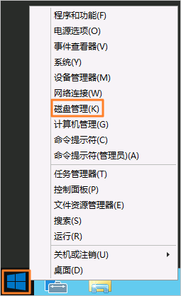

3. 找到待初始化的数据盘（本示例以**磁盘 1**为例），其处于**脱机**状态。

   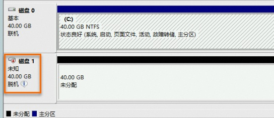

4. 右键单击**磁盘 1**的空白区，选择**联机**。完成联机后，**磁盘 1**状态显示为**没有初始化**。

   

5. 右键单击**磁盘 1**的空白区，在弹出菜单中选择**初始化磁盘**。

6. 在**初始化磁盘**对话框，选择目标磁盘和磁盘分区形式，然后单击**确定**。以GPT分区为例，如图所示。

   > MBR分区不支持2 TiB以上容量。如果您使用的云盘容量大于2 TiB或者后续有可能会扩
   >
   > **重要**
   >
   > 容到2 TiB以上，分区时请采用GPT分区格式。

   

7. 右键单击**磁盘 1**的**未分配**区域，选择**新建简单卷**。

   

8. 在**新建简单卷向导**对话框中，单击**下一步**，然后根据向导完成初始化操作。

   <ol type="i">

   <li>

   在**指定卷大小**对话框中，设置**简单卷大小**，然后单击**下一步**。如果您只需要创建一个主区，直接使用默认值即可。您也可以根据需要设置简单卷大小，把**磁盘 1**分成多个分区来使用。

   

   </li>

   <li>

   在**分配驱动器号和路径**对话框中，选择**分配以下驱动器号**，并选择盘符名称（本示例以**D**为例），然后单击**下一步**。

   

   </li>

   <li>

   在**格式化分区**对话框中，选择**按下列设置格式化这个卷**，并设置格式化信息，然后单击**下一步**。

   

   </li>

   <li>

   查看新建的简单卷信息，单击**完成**，关闭**新建简单卷向导**。

   </li>

   </ol>

**执行结果**

初始化完成后，**磁盘管理**中**磁盘 1**的状态如下图所示。


您可以在**这台电脑**中查看到新建的驱动器**新加卷 (D:)**。至此，您就可以开始使用这个数据盘了。


<a id="section-6-5"></a>

## 6.5. 查看云盘详情

您可以查看已创建云盘的列表、单块云盘的详情（包括云盘基本信息和挂载信息等）、单块云盘创建的快照和该云盘的操作记录。

**操作步骤**

1. 登录云服务器ECS控制台。

2. 在左侧导航栏中，选择**存储与快照 > 云盘**。

3. 在顶部菜单栏处，选择组织、资源集和地域。

4. 在云盘列表页面，您可以查看已有的云盘信息。

   您可以在云盘列表中查看云盘信息，例如**云盘ID/名称**、**状态**、**组织/资源集**、**地域**、**云盘种类/大小**、**多重挂载**、**所属实例ID/名称**、**云盘属性**和**是否加密**等信息。

   > **说明**
   >
   > 如果云盘是随实例创建，且创建时未设置云盘名称，则云盘名称命名规则如下所示：
   >
   > - 系统盘：实例名称_SystemDisk，如ecstest_SystemDisk。
   >
   > - 数据盘：实例名称_dataDisk_\*\*\*，如ecstest_dataDisk_001、ecstest_dataDisk_002。

   您也可以根据如下步骤，设置云盘列表显示的信息。

   <ol type="i">

   <li>

   在云盘列表的右上角，单击  图标。

   </li>

   <li>

   在下拉列表中，选中需要显示的云盘信息，即可实时在云盘列表中看到选中的云盘信息。

   </li>

   </ol>

5. 在筛选列表中（例如**云盘ID**），选择筛选选项，并在搜索栏输入相应信息，云盘列表中将自动展示符合搜索条件的云盘。

   > **说明**
   >
   > - 支持通过**云盘名称**、**云盘ID**、**加密密钥ID**、**存储集**、**分区**、**可用区**或**所属实例ID**等信息查找目标云盘。
   >
   > - 筛选选项中仅**云盘名称**和**云盘ID**支持模糊查询。
   >
   > - 您也可以同时选择多个筛选选项逐级过滤，以便快速查找云盘。

6. 在**云盘ID/名称**列中，单击云盘ID。

   系统默认进入**云盘详情**页签。**实例详情**页面包含的信息如下表所示。

   <table>
     <tr>
       <th width="89">信息分类</th>
       <th>描述</th>
     </tr>
     <tr>
       <td>基本信息</td>
       <td>云盘基本信息，包括云盘名称、云盘ID、运行状态、云盘所在的组织和资源集、地域、云盘种类、云盘大小、是否开启多重挂载、所属实例ID/名称和云盘是否加密等。您也可以单击区域右侧的<strong>修改云盘描述</strong>，修改云盘名称和描述。更多信息，请参见修改云盘名称和描述。</td>
     </tr>
     <tr>
       <td>挂载信息</td>
       <td>云盘挂载相关的信息，包括云盘是否随实例释放、自动快照是否随云盘释放、挂载的ECS实例信息。您也可以单击区域右侧的<strong>修改云盘属性</strong>，修改云盘的释放行为。更多信息，请参见修改云盘属性。</td>
     </tr>
   </table>

7. 查看云盘快照和操作记录。

   - 云盘快照：

     单击**云盘快照**页签，即可查看云盘已创建的快照信息，包括云盘快照ID、是否加密、云盘标签、快照类型、快照创建进度和创建时间。

   - 操作日志：

     - 单击**操作日志**页签，即可查看云盘的操作日志，包括操作名称、操作人、执行状态、操作来源（控制台调用或API调用）、操作类型、操作源IP、操作时间等。

       - 您可以在筛选项或高级筛选中，筛选符合您要求的操作日志。

         - 选择筛选选项，并在搜索栏输入相应信息，系统将自动筛选符合的操作日志。

         - 单击**高级筛选**，选择多个筛选选项进行逐级过滤，然后单击**搜索**。

       - 您也可以在操作列单击**操作详情**，查看详细的操作记录。

   > **说明**
   >
   > - 当前操作日志保存时长为7天，如需调整，需联系管理员在**配置 > 日志转存设置**中修改保存时长。具体操作，请参见<strong>《Apsara Uni-manager运营控制台 用户指南》</strong>中的<strong>《日志转存设置》</strong>章节。
   >
   > - 若通过转存设置延长保存时长，日志数据不会做前序时间的数据补充。

<a id="section-6-6"></a>

## 6.6. 使用快照回滚云盘

如果您已经为云盘创建了快照，可以通过回滚云盘功能将一块云盘的数据恢复到之前的某一时刻。回滚云盘是不可逆操作，一旦回滚完成，回滚前的云盘数据将无法恢复，请谨慎操作。

**前提条件**

在使用快照回滚云盘前，请确认以下信息：

- 您已经为云盘创建了快照，而且要回滚的云盘当前没有正在创建的快照。具体操作，请参见创建快照。

- 云盘未被释放。

- 云盘必须已经挂载到某台ECS实例上，并且目标云盘所在的实例必须处于**已停止**状态。

**操作步骤**

1. 登录云服务器ECS控制台。

2. 在左侧导航栏中，选择**存储与快照 > 快照**。

3. 在顶部菜单栏处，选择组织、资源集和地域。

4. 单击**云盘快照**页签。

5. 找到待使用的快照，在**操作**列中，单击**回滚云盘**。

   > 单次只能回滚一块云盘，实例上挂载的其他云盘不受影响。回滚后，整块云盘会恢复到
   >
   > **说明**
   >
   > 某个时间点的状态，而不是某个分区或目录当时的状态。

6. 在弹出的对话框，单击**回滚云盘**。

**后续步骤**

- 在回滚云盘后，主机配置文件及主机名、SSH、密码、网络、系统源、时钟源等配置数据会进行初始化，您需要重新配置这些信息。

- 如果在数据盘创建快照后，您做过扩容操作，回滚云盘后，您需要登录实例重新扩容文件系统。具体操作，请参见扩容云盘。

<a id="section-6-7"></a>

## 6.7. 变更云盘类型

阿里云提供多种云盘类型，满足不同场景的存储性能和价格需求。您可以根据业务需求，无需停止业务，在线变更云盘的类型。例如，您创建云盘时选择了普通性能云盘，但后期需要更高的IOPS，则可以将该盘变配为高性能云盘。

**前提条件**

云盘变配前，建议您为云盘创建快照备份数据。具体操作，请参见创建快照。

**背景信息**

有关不同类型云盘的性能详情，请参见云盘的分类。

**注意事项**

云盘变配的注意事项如下：

- 变配时，云盘性能可能会发生变化，请避开业务高峰期。

- 变配云盘需要数小时，在某些情况下可能会更长，具体时间视云盘变配时的吞吐量、存储空间大小以及原云盘类型而定。建议您在变配后调用<strong>《云服务器ECS开发指南》</strong>中的<strong>《DescribeTaskAttribute》</strong>接口查看任务进度。

- 在极少数情况下，可能由于资源问题会导致云盘变配操作失败。如果发生这种情况，请重试云盘变配。

**使用限制**

- 仅在部署了CDSEBS产品（目标集群）的情况下，支持云盘变配功能。

- 以下云盘支持在线修改云盘类型。

  | 原云盘类型 | 支持在线变配的云盘类型 |
  | --- | --- |
  | SSD云盘 | • 高效云盘<br>• 高性能云盘<br>• 普通性能云盘 |
  | 高效云盘 | • SSD云盘<br>• 高性能云盘<br>• 普通性能云盘 |
  | 高性能云盘 | 普通性能云盘 |
  | 普通性能云盘 | 高性能云盘 |

- 云盘变配阶段及限制条件说明如下。

  <table>
    <tr>
      <th width="138">云盘变配阶段</th>
      <th>限制条件说明</th>
    </tr>
    <tr>
      <td>云盘变配前</td>
      <td>一个账号在同一地域内最多同时进行5个变配云盘任务。</td>
    </tr>
    <tr>
      <td>云盘变配过程中</td>
      <td>对于正在变配的云盘，存在以下限制：<br>• 不支持取消变配。<br>• 不支持创建快照。<br>• 不支持扩容云盘。<br>• 不支持分区格式化。<br>• 不支持重新初始化云盘。<br>• 不支持使用快照回滚云盘。<br>• 不支持挂载和卸载云盘。<br>• 如果是系统盘，则不支持更换操作系统。</td>
    </tr>
    <tr>
      <td>云盘变配完成后</td>
      <td>如果变更了云盘类型，则同一块云盘七天内不能再次变配。</td>
    </tr>
  </table>

**费用说明**

变更云盘类型后，将以新规格进行计费。

> **说明**
>
> 仅当您的管理员在运营中心中配置了计费规则时才会计费。关于计费规则的详细说明，请参见<strong>《Apsara Uni-manager运营控制台 用户指南》</strong>中的<strong>《计费规则》</strong>章节。

**操作步骤**

1. 登录云服务器ECS控制台。

2. 在左侧导航栏中，选择**存储与快照 > 云盘**。

3. 在顶部菜单栏处，选择组织、资源集和地域。

4. 找到待变配的云盘，在**操作**列中，单击

   图标，然后选择**云盘变配**。

   

5. 在**云盘变配**对话框中，选择**变配后的云盘类型**。

6. 单击确定，提交变配任务。

**执行结果**

您可以在云盘列表页的**状态**列下，查看变配进度，当云盘状态由**变配中**变为**运行中**时，说明变配任务已完成，此时云盘类型为变配后的云盘类型。

> **说明**
>
> 云盘状态为变配中时，您也可以单击变配中下方的查看任务，查看任务详细进度。关于变配任务的更多说明，请参见查看异步任务。

<a id="section-6-8"></a>

## 6.8. 修改云盘属性

您可以修改已创建云盘的属性，包括云盘随实例释放和自动快照随云盘释放。

**操作步骤**

1. 登录云服务器ECS控制台。

2. 在左侧导航栏中，选择**存储与快照 > 云盘**。

3. 在顶部菜单栏处，选择组织、资源集和地域。

4. 找到待操作的云盘，在**操作**列中，单击  图标，然后单击**修改云盘属性**。

   > **说明**
   >
   > 您也可以在云盘列表的**云盘ID/名称**列单击目标云盘，然后在**云盘详情**页签的**挂载信息**区域，单击**修改云盘属性**。

5. 在**修改云盘属性**对话框，修改释放行为。

   - **云盘随实例释放**：

     - 选中：当删除云盘所属的实例时，云盘被一并释放。

     - 未选中：当删除云盘所属的实例时，云盘状态自动变为**待挂载**。

   - **自动快照随云盘释放**：

     - 选中：当删除云盘时，为该云盘创建的自动快照会被一并释放。

     - 未选中：当删除云盘时，会保留为该云盘创建的自动快照。

6. 单击**确定**。

<a id="section-6-9"></a>

## 6.9. 修改云盘名称和描述

您可以修改已创建云盘的名称和描述，以提高云盘资源的管理效率和可读性。

**操作步骤**

1. 登录云服务器ECS控制台。

2. 在左侧导航栏中，选择**存储与快照 > 云盘**。

3. 在顶部菜单栏处，选择组织、资源集和地域。

4. 找到待操作的云盘，在**操作**列中，选择

   **> 修改云盘描述**。

   

   > **说明**
   >
   > 您也可以在云盘列表的**云盘ID/名称**列单击目标云盘，然后在**云盘详情**页签的**基本信息**区域，单击**修改云盘描述**。

5. 修改云盘的名称和描述。

   - 云盘名称：云盘名称长度为2~128个字符，以英文字母或中文开头，不能以 `http://` 或 `https://` 开头。支持数字，可以包含半角句号（.）、下划线（_）、短划线（-）、半角冒号（:）和半角逗号（,）等特殊字符。

   - 云盘描述：云盘描述长度为2~256个字符，不能以 `http://` 或 `https://` 开头。

6. 单击**确定**。

<a id="section-6-10"></a>

## 6.10. 克隆云盘

您可以通过克隆云盘快速创建与现有云盘完全一致的副本，实现轻松备份数据、迁移系统环境或创建测试环境，确保业务连续性和数据安全。

**前提条件**

确保云盘处于**使用中**或**待挂载**状态。如果云盘处于**待挂载**状态，则云盘必须挂载过ECS实例。

**使用限制**

不支持跨地域克隆。

**费用说明**

克隆的新云盘会按量计费。

> **说明**
>
> 仅当您的管理员在运营中心中配置了计费规则时才会计费。关于计费规则的详细说明，请参见<strong>《Apsara Uni-manager运营控制台 用户指南》</strong>中的<strong>《计费规则》</strong>章节。

**操作步骤**

1. 登录云服务器ECS控制台。

2. 在左侧导航栏中，选择**存储与快照 > 云盘**。

3. 在顶部菜单栏处，选择组织、资源集和地域。

4. 找到待操作的云盘，在**操作**列中，单击  图标，然后单击**克隆云盘**。

5. 在**克隆云盘**对话框中，填写**目标云盘数量**，然后单击**下一步**。

6. 预览源云盘ID、类型，克隆的目标云盘的大小、地域、可用区等信息，并单击**提交**。

7. 等待云盘克隆完成后，在目标地域下查看克隆的云盘信息。

   该功能由运维编排OOS完成，您也可以登录运维编排OOS控制台查看克隆操作的执行进度。登录方法，请参见<strong>《运维编排用户指南》</strong>中的<strong>《登录运维编排OOS控制台》</strong>章节。

<a id="section-6-11"></a>

## 6.11. 扩容云盘

随着业务的发展和应用数据增长，您可以扩容云盘存储更多数据。ECS支持扩容系统盘和数据盘，支持在线扩容和离线扩容，离线扩容必须重启ECS实例。

**前提条件**

- 为避免扩容过程中误操作导致数据丢失，建议您创建快照备份当前数据，具体操作请参见创建快照。

- 云盘没有在执行创建快照操作。

- 云盘或ECS实例需要满足的条件如下：

  - 系统盘所属的ECS实例必须处于**运行中**状态。

  - 如果数据盘属性是云盘，满足以下一个条件：

    - 处于**待挂载**状态。

    - 如果已挂载至ECS实例，ECS实例必须处于**运行中**状态。

  - 如果数据盘属性是共享块存储，必须处于**待挂载**状态。

**背景信息**

您可以通过以下方式增加单台实例的存储容量：

> **说明**
>
> 云盘扩容功能仅扩大云盘容量，不会自动调整分区和文件系统的大小。

- 扩容已有云盘，您需要自行扩展已有分区或者扩展新建分区。

  有两种方式扩容已有云盘，区别如下：

  <table>
    <tr>
      <th width="122">扩容方式</th>
      <th>使用须知</th>
    </tr>
    <tr>
      <td>在线扩容云盘</td>
      <td>• 实例处于<strong>运行中</strong>状态。<br>• 扩容后无需重启ECS实例。</td>
    </tr>
    <tr>
      <td>离线扩容云盘</td>
      <td>• 实例处于<strong>运行中</strong>或<strong>已停止</strong>状态。<br>• 扩容后必须在ECS控制台或者调用API重启ECS实例。</td>
    </tr>
  </table>

- 创建一块新云盘，作为数据盘挂载到实例上，并需要自行分区格式化。

- 更换系统盘的同时指定更高的系统盘容量。

**使用限制**

使用云盘扩容功能时，请注意：

<table>
  <tr>
    <th width="90">限制类型</th>
    <th>说明</th>
  </tr>
  <tr>
    <td>云盘类型</td>
    <td>支持的云盘类型，与部署的CDS-EBS集群有关。<br>• 全新部署的CDS-EBS集群，支持以下云盘：<br>• 高性能云盘<br>• 普通性能云盘<br>• 从V3.15.0升级上来的CDS-EBS集群，支持以下云盘：<br>• 高效云盘<br>• SSD盘<br>• 高性能云盘<br>• 普通性能云盘<br>• 存量EBS集群，继续提供共享高效云盘和共享SSD盘。<br>重要若之前已使用过共享高效云盘和共享SSD盘，可以继续使用；若之前未使用过共享高效云盘和共享SSD盘，则不再支持。</td>
  </tr>
  <tr>
    <td>操作系统</td>
    <td>Windows Server 2003实例不支持系统盘扩容。</td>
  </tr>
  <tr>
    <td>分区方式</td>
    <td>MBR格式分区不支持大于2 TiB的云盘容量。如果待扩容的云盘采用的是MBR分区格式，且需要扩容到超过2 TiB时，建议您重新创建并挂载一块数据盘，然后使用GPT分区方式并将数据拷贝至新数据盘中。</td>
  </tr>
  <tr>
    <td>文件系统</td>
    <td>对于Windows实例，仅支持对采用NTFS文件系统的云盘扩容。</td>
  </tr>
  <tr>
    <td>容量限制</td>
    <td>• 系统盘：<br>• 扩容后容量必须大于现有容量。<br>• 扩容后容量必须小于等于2048 GiB。<br>• 数据盘：<br>• 扩容后容量必须大于现有容量。<br>• 扩容后容量必须小于等于以下限制：<br>• <strong>SSD盘、高效云盘、普通性能云盘：</strong>32,768 GiB。<br>• <strong>高性能云盘：</strong>131,072 GiB。<br>重要当云盘类型选择为<strong>高效云盘</strong>或者<strong>SSD盘</strong>时，如果填写的容量超过2 TiB，注意按照以下EBS集群机器数量与推荐的云盘最大建议值（机器数量：云盘最大值）进行填写。<br>• 6台：2 TiB<br>• 12台：4 TiB<br>• 15台：5 TiB<br>• 24台：8 TiB云盘最大建议值的计算公式为：云盘最大大小S = N/3，其中N为相应EBS集群的机器数量，结果向下取整。例如：如果EBS集群的机器数量为6台，则建议创建的云盘容量不超过2 TiB。</td>
  </tr>
  <tr>
    <td>相关操作</td>
    <td>• 云盘扩容功能仅扩大云盘容量，不会自动调整分区和文件系统的大小，您还需要在扩容生效后手动分配存储空间。<br>• 扩容云盘后，不支持通过回滚云盘等其他方式实现云盘缩容。</td>
  </tr>
</table>

**费用说明**

扩容云盘后，将以新规格进行计费。

> **说明**
>
> 仅当您的管理员在运营中心中配置了计费规则时才会计费。关于计费规则的详细说明，请参见专有云文档中心<em>《</em>Apsara Uni-manager运营控制台 用户指南<em>》</em>文档的**运营中心 > 服务定价 > 计费规则**章节。

**操作步骤**

1. 登录云服务器ECS控制台。

2. 在左侧导航栏中，选择**存储与快照 > 云盘**。

3. 在顶部菜单栏处，选择组织、资源集和地域。

4. 找到待操作的云盘，在**操作**列中，单击

   图标，然后单击**云盘扩容**。

   

5. （条件可选）选择服务目录，单击**确定**。

   服务管理用于在企业或组织内对某些产品的特定规格进行一定的管理与控制。仅当服务管理中配置了将ECS磁盘授权给当前组织或用户，并且该ECS磁盘资源已上架，才会显示此选项。关于服务管理的更多信息，请参见<strong>《Apsara Uni-manager运营控制台 用户指南》</strong>中的<strong>《服务管理》</strong>章节。

6. 在弹出的**云盘扩容**对话框，选择扩容方式，并填写扩容后容量。

   - 扩容方式：

     - 在线扩容：无需重启实例即可完成扩容。

     - 离线扩容：扩容后，您必须在控制台重启实例或者调用API  `RebootInstance` 使操作生效。

       具体操作，请参见重启实例或<strong>《云服务器ECS开发指南》</strong>中的 `RebootInstance` 章节。

   - 扩容后容量上限：

     - 系统盘：2048 GiB。

     - 数据盘：

       - <strong>SSD盘、高效云盘、普通性能云盘：</strong>32,768 GiB。

       - <strong>高性能云盘：</strong>131,072 GiB。

7. 扩容云盘。

   - 服务管理中已创建**云资源**为**ECS磁盘**的服务：确认云盘相关参数，单击**确认订单**。

   - 服务管理中未创建**云资源**为**ECS磁盘**的服务：确认云盘相关参数，单击**提交**。

**后续步骤**

扩容生效后，手动分配存储空间。

<a id="section-6-12"></a>

## 6.12. 支持NVMe协议和多重挂载功能

<a id="section-6-12-1"></a>

### 6.12.1. 支持NVMe协议的云盘概述

NVMe（Non-Volatile Memory Express）协议全称为非易失性内存主机控制器接口规范。阿里云高性能云盘支持NVMe协议，且可以同时挂载到多台支持NVMe协议的ECS实例上，以实现数据共享。本文主要介绍支持NVMe协议的高性能云盘及其使用限制、相关操作。

**高性能云盘和NVMe协议**

支持NVMe协议的高性能云盘，具备挂载到多个实例的能力。高性能云盘挂载后，支持多ECS实例并发读写访问，具备高可靠、高并发、高性能等特点。为ECS实例提供了多实例挂载和IO拦截功能，具体说明如下：

- 高性能云盘开启多重挂载功能后，支持被同时挂载到最多16台ECS实例上。

- 您可以通过NVMe命令灵活控制各台ECS实例对高性能云盘的访问权限。关于NVMe命令的更多信息，请参见NVMe PR协议。

以上功能在保证数据可靠性的前提下，有效提升了服务器内业务的可用性。同时，当业务出现单点故障时，您可以基于支持NVMe协议的高性能云盘快速调度并恢复数据。多台实例共享数据会大幅度降低存储成本，并提升业务的灵活性。支持NVMe协议的高性能云盘适用于数据库的高可用、一写多读等场景。

支持NVMe协议的高性能云盘可以挂载到支持NVMe协议的ECS实例上。例如，当Linux实例基于NVMe协议挂载了高性能云盘后，您可以运行**lsblk**命令，查看块存储资源的设备名称和分区名称。如下图所示：


具体说明如下：

- 设备名称显示为 `/dev/nvmeXn1` ，例如/dev/nvme0n1、/dev/nvme1n1和/dev/nvme2n1，以此类推。

- 分区名称显示为 `<`设备名称`>p<`分区号`>` ，例如/dev/nvme0n1p1、/dev/nvme1n1p1和/dev/nvme1n1p2等。

支持NVMe协议的高性能云盘具有多重挂载能力，方便企业的高可用业务上云。更多信息，请参见开启多重挂载功能。

**使用限制**

ECS实例基于NVMe协议挂载高性能云盘，需要满足如下表所述的云服务资源限制：

<table>
  <tr>
    <th width="106">资源</th>
    <th>说明</th>
  </tr>
  <tr>
    <td>实例规格族</td>
    <td>实例规格族需要默认支持NVMe协议。目前支持NVMe协议的实例规格族如下：<br>• ecs.g7m-se-x25<br>• ecs.g7s-se-x25<br>• ecs.g7x-se-x25<br>• ecs.g7x-se-x25<br>• ecs.g7x-se-2numa-hg-k25<br>• ecs.g7x-se-numaoff-hg-x25<br>• ecs.g7x-se-numaoff-hg-x25<br>• ecs.ebmg7m-se-numaoff-x25-c1m8<br>• ecs.ebmg7s-se-numaoff-x25-c1m8<br>• ecs.ebmg7x-se-numaoff-x25-c1m8<br>• ecs.ebmg7x-se-numaoff-x25-c1m8<br>• ecs.ebmg6x-se-numaoff-hg-x25-c1m4<br>• ecs.ebmg6x-se-numaoff-hg-x25-c1m8<br>• ecs.ebmg7x-se-numaoff-hg-x25-c1m4<br>• ecs.ebmg7x-se-numaoff-hg-x25-c1m8<br>说明您可以使用DescribeInstanceTypes接口查询实例规格族，再根据查询结果中的<strong>NvmeSupport</strong>参数确认实例规格族是否支持NVMe协议。更多详情，请参见<strong>《云服务器 ECS开发指南》</strong>中的<strong>《DescribeInstanceTypes》</strong>章节。</td>
  </tr>
  <tr>
    <td>云盘</td>
    <td>• 云盘类型：高性能云盘<br>• 创建方式：<br>• 在创建支持NVMe协议的ECS实例时，高性能云盘随实例一起创建。<br>• 在创建云盘时，选择高性能云盘并开启多重挂载功能。</td>
  </tr>
</table>

**相关操作**

支持NVMe协议的高性能云盘的相关操作指引如下：

- 在创建支持NVMe协议的ECS实例时，随实例一起创建的高性能云盘即为支持NVMe协议的高性能云盘。具体操作，请参见创建实例。

- 在单独创建高性能云盘时，可选择开启多重挂载功能。具体操作，请参见开启多重挂载功能。

- 格式化高性能云盘及创建文件系统。具体操作，请参见Linux格式化数据盘。

  > **重要**
  >
  > 本操作仅适用于随实例一起创建的高性能云盘，不适用于开启多重挂载的高性能云盘。

<a id="section-6-12-2"></a>

### 6.12.2. 开启多重挂载功能

您在创建高性能云盘时，可以为云盘开启多重挂载功能。开启了多重挂载功能的云盘可以同时挂载到同可用区内的多台支持NVMe协议的ECS实例上（最多支持挂载16台实例），从而实现多台ECS实例对同一块高性能云盘的并发读写访问。

**功能优势**

多重挂载功能具有以下优势，可适用于数据库的高可用、一写多读等场景。

- 通过NVMe命令可以控制各ECS实例访问云盘的权限，在保证数据可靠性的前提下，有效提升了服务器内业务的可用性。关于NVMe命令的更多信息，请参见NVMe PR协议。

- 通过多ECS实例共享数据，降低存储成本和提升业务灵活性。

- 在单点故障场景中，可以将业务快速调度到正常运行的ECS实例中访问高性能云盘，实现业务连续性。

**使用限制**

多重挂载功能存在如下限制条件：

- 支持多重挂载功能的实例规格族如下：

  - ecs.g7m-se-x25

  - ecs.g7s-se-x25

  - ecs.g7x-se-x25

  - ecs.g7x-se-x25

  - ecs.g7x-se-2numa-hg-k25

  - ecs.g7x-se-numaoff-hg-x25

  - ecs.g7x-se-numaoff-hg-x25

  - ecs.ebmg7m-se-numaoff-x25-c1m8

  - ecs.ebmg7s-se-numaoff-x25-c1m8

  - ecs.ebmg7x-se-numaoff-x25-c1m8

  - ecs.ebmg7x-se-numaoff-x25-c1m8

  - ecs.ebmg6x-se-numaoff-hg-x25-c1m4

  - ecs.ebmg6x-se-numaoff-hg-x25-c1m8

  - ecs.ebmg7x-se-numaoff-hg-x25-c1m4

  - ecs.ebmg7x-se-numaoff-hg-x25-c1m8

- 只支持数据盘，不支持系统盘。

- 只支持在创建高性能云盘时开启多重挂载功能，云盘在创建完成后不再支持开启或关闭多重挂载功能。

- 为云盘开启多重挂载功能后，建议使用集群文件系统，例如OCFS2、GFS2、Veritas CFS、Oracle ACFS和DBFS等。

  > **警告**
  >
  > 高性能云盘开启多重挂载功能并挂载到多台ECS实例后，如果使用ext2、ext3、ext4、XFS、NTFS等文件系统，多实例间数据无法同步，会导致数据不一致等问题。

- 高性能云盘性能存在上限值。当您把高性能云盘同时挂载到多台ECS实例时，该云盘在所有ECS实例中的性能之和不能超过该云盘性能的上限值。

开启多重挂载功能后，高性能云盘功能存在以下限制：

| 功能 | 限制说明 |
| --- | --- |
| 挂载云盘 | 支持挂载到最多16台实例上（实例必须支持NVMe协议） |
| 云盘随实例释放 | 不支持 |
| 重新初始化云盘 | 不支持 |
| 变更云盘类型 | 不支持 |
| 云盘扩容 | 仅支持离线扩容。具体操作，请参见扩容云盘。 |
| 快照一致性组 | 不支持 |

**使用流程**

多重挂载功能使用流程如下所示：

1. 步骤一：创建开启多重挂载功能的云盘。

2. 步骤二：将云盘挂载到多台支持NVMe协议的ECS实例。

**步骤一：创建开启多重挂载功能的云盘**

您如果需要使用云盘的多重挂载功能，需要在创建云盘时开启多重挂载功能。

1. 登录云服务器ECS控制台。

2. 在左侧导航栏中，选择**存储与快照 > 云盘**。

3. 在顶部菜单栏处，选择组织、资源集和地域。

4. 单击**创建云盘**。

5. 设置云盘的配置参数。

   **类型**

   **项目**

   **是否必选**

   **说明**

   组织

   是

   选择云盘所属的组织。

   资源集

   是

   选择云盘所属的资源集。

   区域

   地域

   是

   选择云盘所在的地域。

   可用区

   是

   选择云盘所在的可用区。

   支持普通创建与存储集创建。

   > **说明**
   >
   > 存储集是一种以集群为整体的块存储服务，具备物理资源隔离、集群内资源独享的特点。使用存储集，您可以

   创建方式

   是

   > 提升业务数据存储的安全性及运维效率。关于存储集的更多信息，请参见<strong>《云服务定义存储用户指南》</strong>中的<strong>《创建存储集》</strong>章节。

   选择具体的存储集。

   > **说明**

   存储集

   是

   > 当**创建方式**为**存储集创建**时，该参数为必选。

   存储集的分区，一个存储集中的分区个数必须大于等于2。

   分区

   是

   > **说明**
   >
   > 当**创建方式**为**存储集创建**时，该参数为必选。

   输入云盘的名称。单次创建云盘名称长度为2~128个字符，批量创建云盘名称长度为2~125个字符，以英文字母或中文开头，

   名称

   是

   不能以 `http://` 或 `https://` 开头。支持数字，可以包含下划线（_）、短划线（-）和半角冒号（:）特殊字符。

   基本配置

   输入需要创建的云盘数量。取值范围：

   创建数量

   是

   1~100。

   规格

   是

   选择**高性能云盘**。

   磁盘大小

   是

   云盘大小范围为20 GiB~32768 GiB。

   多重挂载

   是

   开启高性能云盘的多重挂载功能。

   是否加密

   否

   选择所创建的云盘是否加密处理。

   选择加密算法。当**是否加密**选择**是**时，此参数必选。

   支持以下加密算法类型：

   加密方式

   否

   - **AES256**：表示选择AES256加密算法。

   - **SM4**：表示选择SM4国密算法。

   选择加密密钥。**是否加密**选择**是**时，此参数必选。

   加密Key

   否

   > **说明**
   >
   > 如果未创建过密钥，您需要先在**密钥管理服务**中创建密钥。

   选择是否基于快照创建云盘。如果选择**是**，您还需要指定一个快照。此时，实际创建出的云盘的大小可能受快照大小影响：

   使用快照

   否

   - 如果云盘大小大于指定快照大小，则云盘大小以您指定的数值为准。

   - 如果云盘大小小于指定快照大小，则云盘大小以快照大小为准。

   > **说明**
   >
   > 如果您需要了解创建云盘的更多信息，请参见创建云盘。

6. 确认配置信息，单击**提交**。

7. 在弹出的对话框中，单击**确定**。

   创建成功后，返回**云盘**页面，您可以查看新创建的云盘，云盘状态为**待挂载**、多重挂载功能为**已开启**。

   

**步骤二：将云盘挂载到多台支持NVMe协议的ECS实例**

挂载前，您需要确认以下信息：

- 开启多重挂载功能的云盘和目标ECS实例在同一个可用区。

- 目标ECS实例的实例规格族和镜像符合NVMe协议相关限制。更多信息，请参见使用限制。

1. 获取需要挂载的目标ECS实例ID。

   您可以选择**实例与镜像 > ECS实例**，在**实例列表**中查看和复制ECS实例ID。

2. 在左侧导航栏中，选择**存储与快照 > 云盘**。

3. 找到目标云盘，在**操作**列中单击  图标，然后单击**挂载**。

4. 在**挂载**对话框中，选择并设置**目标实例**，单击**确定**。

   您需要在**目标实例**中输入步骤1获取的一台ECS实例ID。

   > **说明**
   >
   > 挂载云盘时一次只能指定一台实例。如果您需要将云盘挂载到多台ECS实例，需要重复该步骤进行多次挂载。

   

   - 您可以在**云盘**页面，查看云盘的状态变更为**运行中**。

   - 您可以在**云盘详情**页面的**挂载信息**区域，查看云盘在一台或多台ECS实例的挂载信息。

**后续步骤**

开启多重挂载功能的云盘挂载到多台ECS实例后，建议您自行创建适用于业务的集群文件系统。常用的集群文件系统包括OCFS2、GFS2、Veritas CFS、Oracle ACFS和DBFS等。

> **警告**
>
> 高性能云盘开启多重挂载功能并挂载到多台ECS实例后，如果使用ext2、ext3、ext4、XFS、NTFS等文件系统，多实例间数据无法同步，会导致数据不一致等问题。

<a id="section-6-13"></a>

## 6.13. 加密云盘

<a id="section-6-13-1"></a>

### 6.13.1. 概述

ECS云盘加密提供了一种简单安全的加密手段，能够对新创建的云盘进行加密处理。

您无需构建、维护和保护自己的密钥管理基础设施，也无需更改任何已有的应用程序和运维流程，无需做额外的加密操作，云盘加密功能对于业务没有任何影响。云盘加密功能将对以下类型的数据进行加密：

- 云盘中的数据。

- 云盘和实例间传输的数据（实例操作系统内数据不再加密）。

- 加密云盘创建的所有快照（加密快照）。

加密对从ECS实例传输到云盘的数据进行加密，在ECS实例所在的宿主机上进行。

云盘加密支持高效云盘、SSD盘、高性能云盘和普通性能云盘。

> 默认不支持创建共享SSD盘和共享高效云盘。如需创建云盘并加密云盘，请提交工单。
>
> **说明**

<a id="section-6-13-2"></a>

### 6.13.2. 加密系统盘

数据加密适用于数据安全或法规合规等场景，帮助您加密保护存储在ECS上的数据。

**背景信息**

加密系统盘支持如下两种方式：

方式一：在创建云服务器ECS时直接设置系统盘加密。该方式仅支持高性能云盘和普通性能云盘。

方式二：通过先加密自定义镜像，再使用该自定义镜像创建实例，此实例的系统盘会被自动加密。该方式支持所有类型的云盘。

**方式一：创建ECS时设置系统盘加密**

> **说明**
>
> 该方式仅支持高性能云盘和普通性能云盘类型。

1. 登录云服务器ECS控制台。

2. 在左侧导航栏中，选择**实例与镜像 > ECS实例**。

3. 单击**创建实例**。

4. 在**系统盘**设置中，勾选**加密**设置项，并设置如下参数：

   - **加密方式**：选择加密算法。

     - **AES256**表示选择AES256加密算法。

   - **加密Key**：选择加密密钥。

   其他云盘配置参数说明，请参见创建云盘。

5. 单击**提交**。

**方式二：加密自定义镜像并通过镜像创建ECS实例加密系统盘**

加密自定义镜像并通过镜像创建ECS实例加密系统盘的具体操作步骤如下：

1. （可选）步骤一：为实例创建自定义镜像

2. （可选）步骤二：加密自定义镜像

3. 步骤三：使用加密的自定义镜像创建实例

如果您已创建自定义镜像并加密，请跳过步骤一和步骤二，直接使用加密的自定义镜像创建实例。

**步骤一：为实例创建自定义镜像**

1. 登录云服务器ECS控制台。

2. 在左侧导航栏中，选择**实例与镜像 > ECS实例**。

3. 在顶部菜单栏处，选择组织、资源集和地域。

4. 找到待操作的实例，在**操作**列中，单击

   图标，然后选择**云盘和镜像 > 创建自定义镜像**。

   

5. 设置自定义镜像参数。

   <table>
     <tr>
       <th width="137">名称</th>
       <th>描述</th>
     </tr>
     <tr>
       <td>自定义镜像名称</td>
       <td>设置自定义镜像名称。长度为2~128个字符，不能以特殊字符和数字开头，可包含特殊字符中的半角句号（.）、下划线（_）、短划线（-）和半角冒号（:）。</td>
     </tr>
     <tr>
       <td>共享范围</td>
       <td>设置自定义镜像的共享范围：<br>• 本组织及下级组织<br>• 本资源集共享<br>• 本组织共享</td>
     </tr>
     <tr>
       <td>自定义镜像描述</td>
       <td>设置自定义镜像的描述信息。长度为2~256个字符，不能以http://和https://开头。</td>
     </tr>
   </table>

6. 单击**确定**。

**步骤二：加密自定义镜像**

**操作步骤**

1. 登录云服务器ECS控制台。

2. 在左侧导航栏中，选择**实例与镜像 > 镜像**。

3. 在顶部菜单栏处，选择组织、资源集和地域。

4. 单击**ECS镜像**页签，然后单击**自定义镜像**页签，进入自定义镜像列表。

   > **说明**
   >
   > 如果您需要快速定位本组织共享出去的自定义镜像并进行操作，您可以选择**共享镜像 > 我的共享**，即可在**我的共享**页签下进行查看和操作。

5. 找到待操作的镜像，在**操作**列中，单击

   图标，然后单击**镜像加密**。

   

6. 在**镜像加密**对话框中，配置加密自定义镜像信息。

   <table>
     <tr>
       <th width="137">名称</th>
       <th>说明</th>
     </tr>
     <tr>
       <td>镜像ID</td>
       <td>系统自动获取源镜像ID，不需要设置。</td>
     </tr>
     <tr>
       <td>自定义镜像名称</td>
       <td>设置加密后的新自定义镜像名称。名称长度为2~128个字符，必须以大小写字母或中文开头，不能以<code> aliyun </code>或者<code> acs: </code>开头。名称不能包含<code> http:// </code>或者<code> https:// </code>，可以包含数字、半角句号（.）、半角冒号（:）、下划线（_）和短划线（-）。</td>
     </tr>
     <tr>
       <td>自定义镜像描述</td>
       <td>设置加密后的新自定义镜像的描述信息。描述信息长度为2~256个英文或中文字符，不能以<code> http:// </code>和<code> https:// </code>开头。</td>
     </tr>
   </table>

7. 单击**确定**。

**步骤三：使用加密的自定义镜像创建实例**

1. 登录云服务器ECS控制台。

2. 在左侧导航栏中，选择**实例与镜像 > ECS实例**。

3. 在顶部菜单栏处，选择组织、资源集和地域。

4. 单击**创建实例**。

5. 配置实例属性。

   关于如何配置实例属性，请参见创建实例。

   其中在**镜像**区域，单击**自定义镜像**，并在**自定义镜像**列表中选择步骤二：加密自定义镜像中已加密的自定义镜像。

6. 单击**提交**。

**执行结果**

实例创建完成后，您可以单击实例ID进入**实例详情**页，然后单击**云盘**页签，如果系统盘的**是否加密**取值为**是**，表示已加密系统盘。

<a id="section-6-13-3"></a>

### 6.13.3. 加密数据盘

数据加密适用于数据安全或法规合规等场景，帮助您加密保护存储在ECS上的数据。已经创建的数据盘不能转换云盘的加密状态。如果您需要加密数据盘，请在创建数据盘时启用加密功能。

**背景信息**

单独创建数据盘前，建议您提前规划好云盘数量和容量，规划时请注意以下云盘使用限制：

> **说明**
>
> 云服务器ECS不支持单独创建系统盘。

- 一台ECS实例支持挂载的数据盘数量与其实例规格有关。

- 开启多重挂载功能的高性能云盘可同时挂载至2台以上的ECS实例，最多支持同时挂载至16台ECS实例。

- 每块高效云盘、共享高效云盘、SSD盘、共享SSD盘、高性能云盘、普通性能云盘最大支持32768 GiB容量。

- 云服务器ECS不支持合并多块云盘，每块创建完成的云盘都是独立个体，不能通过格式化合并多块云盘的容量。

快照针对独立的云盘创建，使用逻辑卷管理LVM（Logical Volume Manager）会导致快照回滚后出现数据差异，因此不建议对已创建的多块云盘做LVM等逻辑卷。

**操作步骤**

1. 登录云服务器ECS控制台。

2. 在左侧导航栏中，选择**存储与快照 > 云盘**。

3. 在顶部菜单栏处，选择组织、资源集和地域。

4. 单击**创建云盘**。

5. 设置云盘的配置参数。

   创建加密数据盘时，需要注意以下参数：

   - **是否加密**：选择**是**。

   - **加密方式**：选择加密算法。

     - **AES256**：表示选择AES256加密算法。

     - **SM4**：表示选择SM4国密算法。

   - **加密Key**：选择加密密钥。

   其他云盘配置参数说明，请参见创建云盘。

6. 单击**提交**。

<a id="section-6-14"></a>

## 6.14. 重新初始化云盘

<a id="section-6-14-1"></a>

### 6.14.1. 重新初始化系统盘

本文描述如何重新初始化一块系统盘。重新初始化后，系统盘会恢复到创建时的状态。

**前提条件**

- 云盘处于**运行中**状态。

- 实例处于**已停止**状态。

- 初始化云盘会丢失现有数据，不可恢复，请谨慎操作。如果您仍然需要云盘中的数据，请提前转移数据或者创建快照，具体操作，请参见创建快照。

**背景信息**

初始化的效果由云盘用途和创建方式决定：

当云盘挂载在ECS实例上时，您可以使用重新初始化磁盘功能将系统盘恢复到创建时的状态。重新初始化后：

- 系统盘会恢复到刚创建时的状态。

  > 重新初始化操作会清空云盘已写入数据，建议操作前创建快照备份数据。
  >
  > **警告**

- 如果系统盘应用了自动快照策略，重新初始化后，设置仍然有效，不需要重新设置。

- 重新初始化系统盘不会更改ECS实例的IP地址和云盘ID。

- 重新初始化系统盘不会删除系统盘的快照，您可以使用这些快照回滚云盘。具体操作，请参见使用快照回滚云盘。

**操作步骤**

1. 登录云服务器ECS控制台。

2. 在左侧导航栏中，选择**存储与快照 > 云盘**。

3. 在顶部菜单栏处，选择组织、资源集和地域。

4. 找到待初始化的系统盘，在**操作**列中，单击**重新初始化云盘**。

5. 在弹出的**重新初始化云盘**对话框里，配置重新初始化参数。

   <table>
     <tr>
       <th>参数</th>
       <th>说明</th>
     </tr>
     <tr>
       <td>登录密码</td>
       <td rowspan="2">重新设置实例登录密码。可以使用旧的密码，也可以指定新的密码。</td>
     </tr>
     <tr>
       <td>确定密码</td>
     </tr>
     <tr>
       <td>启动实例策略</td>
       <td>选中<strong>重置云盘后启动</strong>，完成重新初始化后，实例会自动启动。</td>
     </tr>
   </table>

6. 单击**确定**。

**执行结果**

执行重新初始化后，云盘进入**初始化中**状态，初始化完毕后变为**运行中**状态。

**后续步骤**

- （仅适用于Linux实例）如果重新初始化系统盘前ECS实例挂载了数据盘，您需要重新创建挂载点信息并挂载文件系统 。

  > 在Linux实例中，重新初始化系统盘不会改变数据盘里的内容，但是数据盘的挂载信息会
  >
  > **说明**
  >
  > 丢失，所以需要执行这步操作。

- 系统盘重新初始化后，您需要重新部署业务（包括应用和配置）从而尽快恢复业务。

- 如果您对该系统盘创建过快照，可以使用该快照创建数据盘并挂载到ECS实例上，以提取原有系统盘中的数据。具体操作，请参见创建快照。

<a id="section-6-14-2"></a>

### 6.14.2. 重新初始化数据盘

当云盘挂载在ECS实例上时，您可以使用重新初始化磁盘功能将数据盘恢复到创建时的状态。

**前提条件**

- 已为云盘创建快照。具体操作，请参见创建快照。

- 数据盘已经挂载到实例上。具体操作，请参见挂载数据盘。

- ECS实例状态必须为**已停止**。

- （仅适用于Linux实例）如果数据盘创建时是一个空盘，而且您在/etc/fstab中添加了开机自动挂载数据盘分区的命令，重新初始化后，开机自动挂载会失效，启动时一般会出现异常。建议您在/etc/fstab里注释掉开机挂载数据盘分区的命令。操作步骤如下：

  <ol type="i">

  <li>

  连接实例，具体操作，请参见连接实例概述。

  </li>

  <li>

  运行 `vim /etc/fstab` 。

  </li>

  <li>

  按 `i` 键进入编辑模式。

  </li>

  <li>

  找到数据盘分区挂载信息，加 

  `#`注释掉挂载信息，如下所示。

  ```text
  # /dev/vdb1 /InitTest ext3 defaults 0 0
  ```

  > 本文的步骤描述中用/dev/vdb1表示数据盘分区，/InitTest表示挂载点。您可以根据
  >
  > **说明**
  >
  > 实际情况替换。

  </li>

  <li>

  按 `Esc` 键退出编辑模式，输入 

  `:wq`保存并退出。

  </li>

  </ol>

**背景信息**

重新初始化后，数据盘的状态根据云盘最初的状态以及实例的操作系统不同而异：

- 作数据盘用的云盘会恢复到初始状态：

  - 如果原来是空盘，则恢复为空盘。

  - 如果是通过快照创建的云盘，则会恢复到快照的状态。

- Windows实例：无论数据盘是从快照创建而来，还是一个全新的空盘，重新初始化后，数据盘会恢复到创建后的初始状态，可以直接使用，不需要执行其他操作。

- Linux实例：

  - 如果数据盘是从快照创建而来：数据盘会恢复到原来快照的状态，不需要重新挂载数据盘分区，但是数据盘创建成功后产生的所有数据都会丢失。

  - 如果数据盘创建时是一个空盘：数据盘的文件系统及内容完全丢失，您必须重新格式化、分区数据盘，并挂载数据盘分区。

**操作步骤**

1. 登录云服务器ECS控制台。

2. 在左侧导航栏中，选择**存储与快照 > 云盘**。

3. 在顶部菜单栏处，选择组织、资源集和地域。

4. 找到待初始化的数据盘，在**操作**列中，单击**重新初始化云盘**。

5. 在弹出的**重新初始化云盘**对话框，单击**确定**。

**后续步骤**

- （仅适用于Linux实例）如果数据盘创建时是一个空盘，您必须格式化数据盘。具体操作，请参见Linux格式化数据盘。

- 数据盘重新初始化后，您需要重新部署业务（包括应用和配置）从而尽快恢复业务。

<a id="section-6-15"></a>

## 6.15. 卸载数据盘

如果您不再需要使用数据盘，或者需要将数据盘挂载到同可用区的其他ECS实例时，需要先卸载数据盘。本文介绍卸载数据盘的流程和具体操作。

**前提条件**

在开始操作之前，请确认以下信息：

- 云盘已经挂载到实例上，**云盘状态**为**运行中**。

- 为了保证数据完整性，建议您暂停对该数据盘的读写操作，否则未完成读写的数据会丢失。

**背景信息**

卸载数据盘整体流程如下：

> 云服务器ECS不支持卸载作为数据盘使用的本地盘。
>
> **说明**

1. 如果数据盘已经挂载了文件系统，在操作系统上卸载数据盘。

   具体操作，请参见步骤一：在操作系统上卸载数据盘。

2. 在云盘页面，卸载数据盘。

   具体操作，请参见步骤二：在云盘页面卸载云盘。

**步骤一：在操作系统上卸载数据盘**

如果在操作系统内，数据盘已经创建分区并挂载，请根据以下操作卸载数据盘。

**如果您使用Linux操作系统，请参考以下步骤：**

1. 远程连接ECS实例。具体操作，请参见连接实例概述。

2. 运行以下命令查看数据盘挂载信息。

   ```text
   df -h
   ```

   结果如下所示，数据盘分区（/dev/vdb1）仅为示例，您需要根据实际情况查询对应数据盘分区。

   

3. 运行以下命令卸载（umount）数据盘文件系统。以卸载数据盘分区（/dev/vdb1）文件系统为例：

   ```text
   umount /dev/vdb1
   ```

4. 运行以下命令查看数据盘分区的uuid信息。

   ```text
   blkid
   ```

   结果如下所示，数据盘分区（/dev/vdb1）仅为示例。

   

5. 查询/etc/fstab中是否配置数据盘文件系统自动挂载信息。

   ```bash
   cat /etc/fstab
   ```

   结果如下所示，找到上一步骤中查询到的uuid信息，示例中显示/etc/fstab已配置数据盘分区（/dev/vdb1）文件系统。

   

6. 删除/etc/fstab中数据盘分区文件系统的自动挂载信息。

   > 如果不删除/etc/fstab中数据盘分区文件系统的自动挂载信息，在控制台卸载数据盘
   >
   > **说明**
   >
   > 后，您重启ECS实例时将无法正常启动系统。

   <ol type="i">

   <li>

   运行以下命令，编辑/etc/fstab。

   ```text
   vim /etc/fstab
   ```

   </li>

   <li>

   输入 `i` ，进入编辑模式。

   </li>

   <li>

   删除或注释掉数据盘分区文件系统相关的自动挂载信息。以下示例中在自动挂载信息前面添加 `#` ，表示注释掉自动挂载信息。

   

   </li>

   <li>

   按Esc键，输入 `:wq` 后按回车键，保存并退出。

   </li>

   </ol>

**如果您使用Windows Server操作系统，请参考以下步骤：**

> 以下操作以Windows Server 2012 R2操作系统为例。
>
> **说明**

1. 远程连接ECS实例。具体操作，请参见连接实例概述。

2. 在Windows Server桌面，单击左下角的**服务器管理器**图标。

   

3. 在**服务器管理器**窗口的右上角，选择**工具 > 计算机管理**。

4. 在左侧导航栏，选择**计算机管理（本地） > 存储 > 磁盘管理**。

5. 右键单击磁盘，选择**脱机**。

   

**步骤二：在云盘页面卸载云盘**

您可以在云盘页面卸载云盘，也可以在ECS实例页面卸载云盘。以下操作以在云盘页面为例介绍如何卸载云盘。

1. 登录云服务器ECS控制台。

2. 在左侧导航栏中，选择**存储与快照 > 云盘**。

3. 在顶部菜单栏处，选择组织、资源集和地域。

4. 找到待卸载的数据盘，在**操作**列中，单击

   图标，然后单击**卸载**。

   

5. 在弹出的对话框，单击**卸载**。

您也可以在实例详情页面的**云盘**页签下卸载数据盘。

**执行结果**

卸载完成后，您可以在**存储与快照 > 云盘**页面中找到目标云盘，如果**云盘状态**变为**待挂载**，则表明您已经成功卸载云盘。

**后续步骤**

- 如果需要挂载到同可用区的其他ECS实例，您可以挂载数据盘。具体操作，请参见挂载数据盘。

- 如果不再需要该云盘，您可以备份数据后释放云盘。具体操作，请参见创建快照和释放数据盘。

<a id="section-6-16"></a>

## 6.16. 存储集

<a id="section-6-16-1"></a>

### 6.16.1. 存储集概述

通过存储集，您可以按照业务类型等维度对块存储（EBS）集群进行划分并绑定相应EBS集群到存储集的不同分区，实现不同业务之间EBS集群的隔离。

**存储集、分区和EBS集群关系说明**

存储集（StorageSet）是控制云盘分布策略的逻辑载体，一个存储集分为2~N个分区，一个分区可以绑定1~N个块存储（EBS）集群，以此实现不同业务之间EBS集群的隔离。

存储集

业务1

业务2


分区

分区1

分区2

分区...

分区1

分区2

分区...


集群1

集群2

集群4

集群1

集群2

集群4

块存储集群

集群5

集群6

集群7

集群...

集群5

集群6

集群7

集群...

**使用限制**

- 一个存储集中的分区个数必须大于等于2。

- 一个集群允许绑定到不同存储集的分区中，但在同一个存储集内，一个集群只能绑定到其中一个分区。

- 创建存储集后，存储集的分区个数不能修改。

**使用流程**

1. 创建存储集并设置分区。

   具体操作，请参见创建存储集。

2. 绑定集群至分区。

   具体操作，请参见<strong>《混合云存储CDS运维指南》</strong>的<strong>《管理存储集》</strong>章节。

3. 创建云盘时指定存储集和分区。

   具体操作，请参见创建云盘。

<a id="section-6-16-2"></a>

### 6.16.2. 创建存储集

通过存储集，您可以按照业务类型等维度对块存储（EBS）集群进行划分并绑定相应EBS集群到存储集的不同分区，实现不同业务之间EBS集群的隔离。

**背景信息**

创建存储集时，您需要注意：

- 一个存储集中的分区个数必须大于等于2。

- 如果要将云盘创建到指定EBS集群中，请先创建存储集，然后通过CDS Ops（CDS产品的统一运维平台）绑定该EBS集群到存储集的分区，最后在ECS控制台通过存储集方式创建云盘时选择该EBS集群所属的存储集和分区。

**操作步骤**

1. 您可以通过云服务器ECS控制台或EBS控制台操作创建存储集。

   <ol type="i">

   <li>

   方式一：登录云服务器ECS控制台：

   <ol type="a">

   <li>

   登录Apsara Uni-manager运营控制台。

   </li>

   <li>

   在顶部导航栏中，选择**产品 > 计算 > 云服务器ECS**。

   </li>

   </ol>

   <ol type="i" start="100">

   <li>

   在左侧导航栏，选择**存储与快照 > 存储集**。

   </li>

   </ol>

   </li>

   <li>

   方式二：登录块存储EBS控制台：

   <ol type="a">

   <li>

   登录Apsara Uni-manager运营控制台。

   </li>

   <li>

   在顶部导航栏中，选择**产品 > 存储 > 块存储EBS**。

   </li>

   </ol>

   <ol type="i" start="100">

   <li>

   在左侧导航栏，选择**企业级特性 > 存储集**。

   </li>

   </ol>

   </li>

   </ol>

2. 在顶部菜单栏处，选择组织、资源集和地域。

3. 在**存储集**页面，单击**创建存储集**。

4. 在**创建存储集**面板，根据下表说明设置存储集参数，然后单击**确定**。

   <table>
     <tr>
       <th width="106">参数</th>
       <th>描述</th>
     </tr>
     <tr>
       <td>组织</td>
       <td>存储集所在的组织。</td>
     </tr>
     <tr>
       <td>资源集</td>
       <td>存储集所在的资源集。</td>
     </tr>
     <tr>
       <td>地域</td>
       <td>存储集所属的地域。</td>
     </tr>
     <tr>
       <td>可用区</td>
       <td>存储所属的可用区。</td>
     </tr>
     <tr>
       <td>共享范围</td>
       <td>选择存储集的共享范围。共享范围内的组织或资源集在创建云盘时可选择该存储集，支持以下共享范围：<br>• 本组织及下级组织<br>• 本资源集共享<br>• 本组织共享</td>
     </tr>
     <tr>
       <td>存储集名称</td>
       <td>存储集名称，用于唯一标识存储集。命名规则如下：<br>• 长度为2~128个英文或中文字符。<br>• 以大小字母或中文开头，不能以<code> http:// </code>和<code> https:// </code> 开头。<br>• 可以包含数字、半角句号（.）、半角冒号（:）、下划线（_）或者短划线（-）。</td>
     </tr>
     <tr>
       <td>分区设置</td>
       <td>设置存储集中的分区名称。分区命名规则如下：<br>• 长度为2-64个英文或中文字符。<br>• 以大小字母或中文开头，不能以<code> http:// </code>和<code> https:// </code> 开头。<br>• 可以包含数字、半角句号（.）、半角冒号（:）、下划线（_）或者短划线（-）。分区数量最少为2，您可以单击<strong>添加分区</strong>，增加更多分区。</td>
     </tr>
   </table>

**后续步骤**

创建存储集后，您可以单击存储集ID，通过存储集创建云盘。具体操作，请参见创建云盘。

<a id="section-6-16-3"></a>

### 6.16.3. 查看存储集

您可以查看当前已创建的存储集列表及其相关信息。

**操作步骤**

1. 您可以通过云服务器ECS控制台或EBS控制台查看存储集。

   <ol type="i">

   <li>

   方式一：登录云服务器ECS控制台：

   <ol type="a">

   <li>

   登录Apsara Uni-manager运营控制台。

   </li>

   <li>

   在顶部导航栏中，选择**产品 > 计算 > 云服务器ECS**。

   </li>

   </ol>

   <ol type="i" start="100">

   <li>

   在左侧导航栏，选择**存储与快照 > 存储集**。

   </li>

   </ol>

   </li>

   <li>

   方式二：登录块存储EBS控制台：

   <ol type="a">

   <li>

   登录Apsara Uni-manager运营控制台。

   </li>

   <li>

   在顶部导航栏中，选择**产品 > 存储 > 块存储EBS**。

   </li>

   </ol>

   <ol type="i" start="100">

   <li>

   在左侧导航栏，选择**企业级特性 > 存储集**。

   </li>

   </ol>

   </li>

   </ol>

2. 在顶部菜单栏处，选择组织、资源集和地域。

3. 在**存储集**页面，配置筛选选项并在搜索栏输入相应信息，然后单击

   图标，存储集列表中将展示符合搜

   

   索结果的存储集。

   | 筛选选项 | 说明 |
   | --- | --- |
   | 存储集ID | 输入存储集ID的精确全称查询存储集。只支持精确查询，不支持模糊查询。 |
   | 存储集名称 | 输入存储集名称查询存储集。支持模糊查询。 |

<a id="section-6-16-4"></a>

### 6.16.4. 修改存储集

创建存储集后，您可以根据实际修改存储集名称或存储集的共享范围。

**修改存储集名称或分区名称**

1. 您可以通过云服务器ECS控制台或块存储EBS控制台操作修改存储集名称。

   <ol type="i">

   <li>

   方式一：登录云服务器ECS控制台：

   <ol type="a">

   <li>

   登录Apsara Uni-manager运营控制台。

   </li>

   <li>

   在顶部导航栏中，选择**产品 > 计算 > 云服务器ECS**。

   </li>

   </ol>

   <ol type="i" start="100">

   <li>

   在左侧导航栏，选择**存储与快照 > 存储集**。

   </li>

   </ol>

   </li>

   <li>

   方式二：登录块存储EBS控制台：

   <ol type="a">

   <li>

   登录Apsara Uni-manager运营控制台。

   </li>

   <li>

   在顶部导航栏中，选择**产品 > 存储 > 块存储EBS**。

   </li>

   </ol>

   <ol type="i" start="100">

   <li>

   在左侧导航栏，选择**企业级特性 > 存储集**。

   </li>

   </ol>

   </li>

   </ol>

2. 在顶部菜单栏处，选择组织、资源集和地域。

3. 在**存储集**页面，找到待修改的存储集，然后在**操作**列中，单击**修改**。

4. 在**修改存储集**对话框，修改存储集名称或各分区的名称，然后单击**确定**。

**修改存储集共享范围**

1. 登录云服务器ECS控制台。

   <ol type="i">

   <li>

   登录Apsara Uni-manager运营控制台。

   </li>

   <li>

   在顶部导航栏中，选择**产品 > 计算 > 云服务器ECS**。

   </li>

   </ol>

2. 在左侧导航栏，选择**存储与快照 > 存储集**

3. 在顶部菜单栏处，选择组织、资源集和地域。

4. 在**存储集**页面，找到待修改的存储集，然后在**操作**列中，单击**共享设置**。

5. 在对话框中，修改共享范围，然后单击**确定**。

<a id="section-6-16-5"></a>

### 6.16.5. 删除存储集

您可以删除不再使用的存储集。

**背景信息**

删除存储集时，您需要注意：

- 如果待删除的存储集中已有云盘，则系统会报错。

- 删除存储集前，您需要查看存储集中的已有云盘并释放。具体操作如下：

  在EBS控制台的**存储集**页面，单击待删除的存储集ID，系统会跳转到ECS控制台的**云盘**页面并显示该存储集中的云盘列表。

  关于释放云盘的具体操作，请参见释放数据盘。

**操作步骤**

1. 您可以通过云服务器ECS控制台或EBS控制台操作删除存储集。

   <ol type="i">

   <li>

   方式一：登录云服务器ECS控制台：

   <ol type="a">

   <li>

   登录Apsara Uni-manager运营控制台。

   </li>

   <li>

   在顶部导航栏中，选择**产品 > 计算 > 云服务器ECS**。

   </li>

   </ol>

   <ol type="i" start="100">

   <li>

   在左侧导航栏，选择**存储与快照 > 存储集**。

   </li>

   </ol>

   </li>

   <li>

   方式二：登录块存储EBS控制台：

   <ol type="a">

   <li>

   登录Apsara Uni-manager运营控制台。

   </li>

   <li>

   在顶部导航栏中，选择**产品 > 存储 > 块存储EBS**。

   </li>

   </ol>

   <ol type="i" start="100">

   <li>

   在左侧导航栏，选择**企业级特性 > 存储集**。

   </li>

   </ol>

   </li>

   </ol>

2. 在顶部菜单栏处，选择组织、资源集和地域。

3. 在**存储集**页面，找到待删除的存储集，然后在**操作**列中，单击**删除**。

4. 在弹出的确认框，单击**确定**。

<a id="section-6-17"></a>

## 6.17. 释放数据盘

如果您不再需要某块云盘，可以将其手动释放，存储在云盘上的数据会被全部释放。本文介绍了如何在云盘页面释放数据盘。

**前提条件**

- 如果云盘中存储了有效数据，建议您创建快照以备份数据。具体操作，请参见创建快照。

- 数据盘必须处于**待挂载**状态。如果数据盘已挂载至实例，您需要先卸载数据盘。具体操作，请参见卸载数据盘。

**操作步骤**

1. 登录云服务器ECS控制台。

2. 在左侧导航栏中，选择**存储与快照 > 云盘**。

3. 在顶部菜单栏处，选择组织、资源集和地域。

4. 找到待释放的数据盘，在**操作**列中，单击

   图标，然后单击**释放**。

   

5. 在弹出的对话框，单击**释放**。

<a id="section-7"></a>

# 7.镜像

<a id="section-7-1"></a>

## 7.1. 镜像概述

本文介绍镜像相关概念、镜像类型，镜像格式以及如何查看镜像信息等。

**镜像简介**

镜像（Image）是ECS实例运行环境的模板，模板中包括了特定的操作系统信息，有时也额外包括了一些预装的应用程序。镜像文件相当于副本文件，该副本文件包含了一个或多个磁盘中的所有数据，对于云服务器ECS而言，这些磁盘可以是单个系统盘，也可以是系统盘加数据盘的组合。您可以使用镜像创建新的ECS实例或更换ECS实例的系统盘。

**镜像类型**

ECS镜像根据来源不同，分为公共镜像、自定义镜像、共享镜像和企业共享镜像。

> **说明**
>
> 具体镜像类型及版本，以ECS控制台页面为准。


| 镜像类型 | 描述 | 文档链接 |
| --- | --- | --- |
| 公共镜像 | 阿里云官方提供的公共镜像，支持几乎所有Windows和Linux的主流镜像版本。 | 公共镜像概述 |
| 自定义镜像 | 您使用实例或快照创建的镜像，或是您从本地导入的自定义镜像。 | 自定义镜像概述 |
| 共享镜像 | 其他一级组织共享给您组织的镜像。 | 共享镜像概述 |
| 企业共享镜像 | 管理员在ASO上转化为全局共享的自定义镜像。全局共享镜像可以被所有组织查看和使用。 | 企业共享镜像概述 |

**查找镜像**

如果您知道镜像的相关信息，例如镜像类型、名称、ID或对应的快照ID，您可以根据这些条件查找到特定镜像，进而创建实例或执行其他操作，具体说明如下。

| 镜像类型 | 文档链接 |
| --- | --- |
| 公共镜像 | 查找公共镜像 |
| 自定义镜像 | 查找自定义镜像 |
| 共享镜像 | 查找共享镜像 |
| 全局共享镜像 | 查找企业共享镜像 |

**镜像格式**

目前，云服务器ECS支持的镜像文件格式为VHD、RAW和QCOW2，其他格式的镜像文件需要预先使用工具转换为支持格式后，才能运行在云服务器ECS中。关于格式的转换，请参见转换镜像格式。

<a id="section-7-2"></a>

## 7.2. 查看镜像相关实例

您可以查看使用了指定镜像的ECS实例，了解镜像的使用情况。

**操作步骤**

1. 登录云服务器ECS控制台。

2. 在左侧导航栏中，选择**实例与镜像 > 镜像**。

3. 在顶部菜单栏处，选择组织、资源集和地域。

4. 根据待查看镜像的类型选择对应的页签。

   支持选择的镜像类型和具体操作如下：

   <table>
     <tr>
       <th width="122">镜像类型</th>
       <th>如何操作</th>
     </tr>
     <tr>
       <td>自定义镜像</td>
       <td>单击<strong>ECS镜像</strong>页签，然后单击<strong>自定义镜像</strong>页签。<br>说明如果您需要快速定位本组织共享出去的自定义镜像并进行操作，您可以选择<strong>共享镜像 &gt; 我的共享</strong>。</td>
     </tr>
     <tr>
       <td>公共镜像</td>
       <td>在<strong>ECS镜像</strong>页签下，单击<strong>公共镜像</strong>页签。</td>
     </tr>
     <tr>
       <td>共享镜像</td>
       <td>i. 在<strong>ECS镜像</strong>页签下，单击<strong>共享镜像</strong>页签。ii. 单击<strong>他人共享</strong>。</td>
     </tr>
     <tr>
       <td>企业共享镜像</td>
       <td>在<strong>ECS镜像</strong>页签下，单击<strong>企业共享镜像</strong>页签。</td>
     </tr>
   </table>

5. 找到镜像，在**操作**列中，单击**相关实例**。

**执行结果**

在ECS实例的实例列表中筛选出使用了指定镜像的实例。您可以继续进行其他操作，例如，需要更新镜像时，您可以先通过该功能筛选实例。

<a id="section-7-3"></a>

## 7.3. 自定义镜像

<a id="section-7-3-1"></a>

### 7.3.1. 自定义镜像概述

自定义镜像是您基于实例或快照创建的镜像，或者从本地导入的镜像，包含已部署的应用、数据等信息。使用自定义镜像可以快速创建更多相同配置的实例，无需每次创建实例时重复配置操作。

**使用流程**

当您成功创建或成功导入自定义镜像后，镜像的状态为**可用**。此时，您可以使用该镜像创建实例，可以将其共享给其他组织使用，或导出该镜像到OSS存储空间（OSS Bucket）。不再需要该镜像时，您也可以将其删除。

> **说明**
>
> 只有自定义镜像的创建者可以使用、共享和删除该镜像。

自定义镜像的典型使用流程如下图所示。


**相关操作**

自定义镜像支持的相关功能操作如下表所示。

| 操作 | 说明 | 相关文档 |
| --- | --- | --- |
| 创建镜像 | 您可以通过已有实例或快照创建自定义镜像，以便快速复制系统环境，免除重复配置。 | 创建自定义镜像 |
| 编辑镜像 | 为了方便您管理自定义镜像，您可以根据需要修改自定义镜像的名称和描述。 | 编辑自定义镜像属性 |
| 查找镜像 | • 您可以在ECS控制台上查看当前组织、地域和资源集下所有的自定义镜像。<br>• 如果您知道镜像的名称或者ID等信息，可以根据这些条件查找到特定的镜像。 | 查找自定义镜像 |
| 查看镜像相关实例 | 您可以查看使用了指定自定义镜像的ECS实例，了解该镜像的使用情况。 | 查看镜像相关实例 |
| 共享镜像 | 创建自定义镜像后，您可以将镜像共享给其他组织使用，共享以后可以在<strong>ECS镜像 &gt; 共享镜像 &gt; 我的共</strong><strong>享</strong>中查看。 | • 共享自定义镜像<br>• 修改自定义镜像的共享范围 |
| 加密镜像 | 您可以根据需要加密自定义镜像，加密自定义镜像后，您可以使用加密后的自定义镜像创建实例，实现加密系统盘，满足数据安全合规需求。 | 加密自定义镜像 |
| 设置镜像启动模式 | 基于您的实际使用场景，您可以为自定义镜像设置启动模式（BIOS或UEFI）。 | 设置自定义镜像启动模式 |
| 导入镜像 | 您可以从本地导入自定义镜像。 | 导入镜像注意事项 |
| 导出镜像 | 创建自定义镜像后，您可以导出镜像到OSS存储空间（OSS Bucket），并下载到本地使用。 | 导出自定义镜像 |
| 删除镜像 | 当您不再需要一个自定义镜像，可以将其删除。 | 删除自定义镜像 |

<a id="section-7-3-2"></a>

### 7.3.2. 创建自定义镜像

您可以创建自定义镜像，并使用自定义镜像创建实例或者更换实例的系统盘，方便地持有具有相同操作系统和数据环境信息的实例。

**使用快照创建自定义镜像**

您可以用系统盘的快照创建自定义镜像，将快照的操作系统、数据环境信息完整地包含在镜像中。操作前请确保快照的磁盘属性是系统盘，数据盘的快照不能用于创建自定义镜像。

1. 登录云服务器ECS控制台。

2. 在左侧导航栏中，选择**存储与快照 > 快照**。

3. 在顶部菜单栏处，选择组织、资源集和地域。

4. 找到<strong>云盘属性（全部）</strong>为**系统盘**的快照，在**操作**列中，单击**创建自定义镜像**。

5. 设置自定义镜像参数。

   <table>
     <tr>
       <th width="137">名称</th>
       <th>描述</th>
     </tr>
     <tr>
       <td>共享范围</td>
       <td>设置自定义镜像的共享范围：<br>• 本组织及下级组织<br>• 本资源集共享<br>• 本组织共享</td>
     </tr>
     <tr>
       <td>自定义镜像名称</td>
       <td>设置自定义镜像名称。长度为2~128个字符，不能以特殊字符和数字开头，可包含特殊字符中的半角句号（.）、下划线（_）、短划线（-）和半角冒号（:）。</td>
     </tr>
     <tr>
       <td>自定义镜像描述</td>
       <td>设置自定义镜像的描述信息。长度为2~256个字符，不能以http://和https://开头。</td>
     </tr>
   </table>

6. 单击**确定**。

**使用实例创建自定义镜像**

您可以基于实例创建自定义镜像，将实例中的所有磁盘（包括系统盘和数据盘）的数据完整地复制到自定义镜像中。

> **说明**
>
> 请将实例中的敏感数据删除之后再创建自定义镜像，避免数据安全隐患。

在使用实例创建自定义镜像的过程中，该实例的每块磁盘都会自动创建一个新快照，所有新快照构成了一个完整的自定义镜像。

1. 登录云服务器ECS控制台。

2. 在左侧导航栏中，选择**实例与镜像 > ECS实例**。

3. 在顶部菜单栏处，选择组织、资源集和地域。

4. 找到待操作的实例，在**操作**列中，单击

   图标，然后选择**云盘和镜像 > 创建自定义镜像**。

   

5. 设置自定义镜像参数。

   <table>
     <tr>
       <th width="137">名称</th>
       <th>描述</th>
     </tr>
     <tr>
       <td>自定义镜像名称</td>
       <td>设置自定义镜像名称。长度为2~128个字符，不能以特殊字符和数字开头，可包含特殊字符中的半角句号（.）、下划线（_）、短划线（-）和半角冒号（:）。</td>
     </tr>
     <tr>
       <td>共享范围</td>
       <td>设置自定义镜像的共享范围：<br>• 本组织及下级组织<br>• 本资源集共享<br>• 本组织共享</td>
     </tr>
     <tr>
       <td>自定义镜像描述</td>
       <td>设置自定义镜像的描述信息。长度为2~256个字符，不能以http://和https://开头。</td>
     </tr>
   </table>

6. 单击**确定**。

<a id="section-7-3-3"></a>

### 7.3.3. 编辑自定义镜像属性

为了方便您管理自定义镜像，您可以编辑已创建自定义镜像的属性，即自定义镜像的名称和描述。

**背景信息**

自定义镜像支持共享给其他组织使用，该镜像共享后，您可以在自定义镜像列表或者共享镜像列表修改该镜像的名称和描述。更多共享自定义镜像的信息，请参见共享自定义镜像。

**使用限制**

仅支持修改自定义镜像（包括已共享给其他组织的自定义镜像）的属性，公共镜像和他人共享的镜像均不支持修改。

**操作步骤**

1. 登录云服务器ECS控制台。

2. 在左侧导航栏中，选择**实例与镜像 > 镜像**。

3. 在顶部菜单栏处，选择组织、资源集和地域。

4. 单击**ECS镜像**页签，然后单击**自定义镜像**页签，进入自定义镜像列表。

   > **说明**
   >
   > 如果您需要快速定位本组织共享出去的自定义镜像并进行操作，您可以选择**共享镜像 > 我的共享**，即可在**我的共享**页签下进行查看和操作。

5. 找到待操作的镜像，在**操作**列中，单击**编辑**。

6. 在弹出的**编辑**对话框，修改自定义镜像的名称和描述。

   - **镜像名称**：长度为2~128个字符，不能以特殊字符和数字开头，可包含特殊字符中的下划线（_）、短划线（-）和半角冒号（:）。

   - **描述**：镜像描述长度为2~256个字符，不能以 `http://` 或者 `https://` 开头。

7. 单击**确定**。

<a id="section-7-3-4"></a>

### 7.3.4. 查找自定义镜像

您可以在ECS控制台上查看当前组织、地域和资源集下所有的自定义镜像及其详细信息。如果您知道自定义镜像的相关信息，例如镜像名称，也可以根据这些条件查找到特定镜像，进而创建实例或执行其他操作。

**操作步骤**

1. 登录云服务器ECS控制台。

2. 在左侧导航栏中，选择**实例与镜像 > 镜像**。

3. 在顶部菜单栏处，选择组织、资源集和地域。

4. 单击**ECS镜像**页签，然后单击**自定义镜像**页签，进入自定义镜像列表。

   > **说明**
   >
   > 如果您需要快速定位本组织共享出去的自定义镜像并进行操作，您可以选择**共享镜像 > 我的共享**，即可在**我的共享**页签下进行查看和操作。

5. 选择筛选选项，输入相应信息，自动展示符合该筛选项的镜像。

   <table>
     <tr>
       <th width="90">筛选选项</th>
       <th>说明</th>
     </tr>
     <tr>
       <td>镜像ID</td>
       <td>输入镜像ID查询镜像，支持模糊查询。</td>
     </tr>
     <tr>
       <td>镜像名称</td>
       <td>输入镜像名称查询镜像，支持模糊查询。</td>
     </tr>
     <tr>
       <td>快照ID</td>
       <td>输入快照ID，查询该快照相关的镜像，支持模糊查询。</td>
     </tr>
     <tr>
       <td>标签筛选</td>
       <td>输入标签键或标签值，查询使用该标签的镜像。<br>说明在镜像页面，选中所需镜像后，您可以单击<strong>批量绑定标签</strong>或<strong>批量解</strong><strong>绑标签</strong>进行批量操作。</td>
     </tr>
   </table>

6. 在**镜像ID/名称**列中，单击镜像ID，查看镜像的相关信息和操作日志。

   - 在**基本信息**页签，可以查看镜像的镜像名称、镜像ID、操作系统、平台、快照详情等信息。

   - 单击**操作日志**页签，即可查看自定义镜像的操作日志，包括操作名称、操作人、执行状态、操作来源（控制台调用或API调用）、操作类型、操作源IP和操作时间等。

     - 您可以在筛选项或高级筛选中，筛选符合您要求的操作日志。

       - 选择筛选选项，并在搜索栏输入相应信息，系统将自动筛选符合的操作日志。

       - 单击**高级筛选**，选择多个筛选选项进行逐级过滤，然后单击**搜索**。

     - 您也可以在操作列单击**操作详情**，查看详细的操作记录。

     > **说明**
     >
     > - 当前操作日志保存时长为7天，如需调整，需联系管理员在**配置 > 日志转存设置**中修改保存时长。具体操作，请参见<strong>《Apsara Uni-manager运营控制台 用户指南》</strong>中的<strong>《日志转存设置》</strong>章节。
     >
     > - 若通过转存设置延长保存时长，日志数据不会做前序时间的数据补充。

**后续步骤**

查找到满足要求的镜像后，您可能需要：

- 创建实例，具体操作，请参见创建实例。

- 共享镜像，具体操作，请参见共享自定义镜像。

- 加密镜像，具体操作，请参见加密自定义镜像。

- 导出镜像，具体操作，请参见导出自定义镜像。

- 删除镜像，具体操作，请参见删除自定义镜像。

- 修改镜像属性（名称和描述），具体操作，请参见编辑自定义镜像属性。

<a id="section-7-3-5"></a>

### 7.3.5. 共享自定义镜像

<a id="section-7-3-5-1"></a>

#### 7.3.5.1. 共享自定义镜像

您可以将已创建的自定义镜像共享给其他组织使用，以便快速创建运行同一镜像环境的ECS实例。

**背景信息**

- 仅支持共享自定义镜像，共享镜像不会占用被共享者的镜像额度。

- 被共享者可以使用共享镜像创建实例、更换系统盘，在创建实例或更换系统盘时选择该自定义镜像即可。

- 您可以删除共享镜像。删除共享镜像后，被共享者也不能看到该自定义镜像，使用该自定义镜像创建的实例不能重新初始化系统盘。

- 每份自定义镜像一次最多共享给10个组织，总共最多可以共享给50个组织。

**操作步骤**

1. 登录云服务器ECS控制台。

2. 在左侧导航栏中，选择**实例与镜像 > 镜像**。

3. 在顶部菜单栏处，选择组织、资源集和地域。

4. 单击**ECS镜像**页签，然后单击**自定义镜像**页签，进入自定义镜像列表。

   > **说明**
   >
   > 如果您需要快速定位本组织共享出去的自定义镜像并再次进行共享操作，您可以选择**共享镜像 > 我的共享**。

5. 找到待操作的镜像，在**操作**列中，单击

   图标，然后选择**共享设置 > 共享镜像**。

   

6. 在**共享镜像**对话框的**组织**列表中，选择目标组织。

   > **说明**
   >
   > 如果您因为权限问题无法获取组织列表，可以手动输入一级组织名称进行共享镜像。

7. 单击**确定**。

**执行结果**

您可以选择**共享镜像 > 我的共享**，在镜像列表中查看已共享成功的自定义镜像详情。

**相关操作**

共享自定义镜像后，您可以根据实际需要执行如下操作：

- 取消已共享的组织：

  在**共享镜像**对话框的**已共享信息**列表中，找到待取消的组织，单击**操作**列中的  图标，然后单击**确定**。

  > **重要**
  >
  > 如果自定义镜像的已共享组织全部被删除，该自定义镜像将从**共享镜像 > 我的共享**页签下的镜像列表中移除。

- 新增待共享的组织：

  在**共享镜像**对话框的**组织**列表中，选择待共享的组织，然后单击**确定**。

<a id="section-7-3-5-2"></a>

#### 7.3.5.2. 修改自定义镜像的共享范围

您可以修改已创建的自定义镜像的共享范围。

**操作步骤**

> **重要**
>
> 自定义镜像已被共享（共享范围是本组织及下级组织和本资源集共享）时，如果将自定义镜像的共享范围缩小，会导致在被缩小范围内的使用用户不能再对该自定义镜像进行管理，请您谨慎操作。

1. 登录云服务器ECS控制台。

2. 在左侧导航栏中，选择**实例与镜像 > 镜像**。

3. 在顶部菜单栏处，选择组织、资源集和地域。

4. 单击**ECS镜像**页签，然后单击**自定义镜像**页签，进入自定义镜像列表。

   > **说明**
   >
   > 如果您需要快速定位本组织共享出去的自定义镜像并进行操作，您可以选择**共享镜像 > 我的共享**，即可在**我的共享**页签下进行查看和操作。

5. 执行如下操作，修改自定义镜像的共享范围。

   - 修改单个自定义镜像

     <ol type="a">

     <li>

     在自定义镜像列表中，找到待操作的单个自定义镜像，然后在**操作**列中，单击  图标。

     </li>

     <li>

     选择**共享设置 > 修改共享范围**。

     </li>

     </ol>

     <ol type="i" start="100">

     <li>

     在**修改共享范围**对话框中，选择共享范围。

     支持选择**本组织及下级组织**、**本资源集共享**、**本组织共享**。

     </li>

     <li value="500">

     单击**确定**。

     </li>

     </ol>

   - 修改多个自定义镜像

     > **重要**
     >
     > 最多支持选中并修改20个自定义镜像的共享范围。

     <ol type="a">

     <li>

     在自定义镜像列表中，选中待操作的多个自定义镜像，然后在列表下方单击**修改共享范围**。

     </li>

     <li>

     在**修改共享范围**对话框中，选择共享范围。

     支持选择**本组织及下级组织**、**本资源集共享**、**本组织共享**。

     </li>

     </ol>

     <ol type="i" start="100">

     <li>

     单击**确定**。

     </li>

     </ol>

<a id="section-7-3-6"></a>

### 7.3.6. 加密自定义镜像

本文介绍如何为自定义镜像进行加密并生成新的自定义镜像。

**前提条件**

- 自定义镜像的状态必须为**可用**（Available）。

- 不支持加密VHD格式的自定义镜像，请确保镜像不是VHD格式。

**背景信息**

加密自定义镜像后，您可以使用加密后的自定义镜像创建实例，实现加密系统盘，满足数据安全合规需求。

**操作步骤**

1. 登录云服务器ECS控制台。

2. 在左侧导航栏中，选择**实例与镜像 > 镜像**。

3. 在顶部菜单栏处，选择组织、资源集和地域。

4. 单击**ECS镜像**页签，然后单击**自定义镜像**页签，进入自定义镜像列表。

   > **说明**
   >
   > 如果您需要快速定位本组织共享出去的自定义镜像并进行操作，您可以选择**共享镜像 > 我的共享**，即可在**我的共享**页签下进行查看和操作。

5. 找到待操作的镜像，在**操作**列中，单击

   图标，然后单击**镜像加密**。

   

6. 在**镜像加密**对话框中，配置加密自定义镜像信息。

   <table>
     <tr>
       <th width="137">名称</th>
       <th>说明</th>
     </tr>
     <tr>
       <td>镜像ID</td>
       <td>系统自动获取源镜像ID，不需要设置。</td>
     </tr>
     <tr>
       <td>自定义镜像名称</td>
       <td>设置加密后的新自定义镜像名称。名称长度为2~128个字符，必须以大小写字母或中文开头，不能以<code> aliyun </code>或者<code> acs: </code>开头。名称不能包含<code> http:// </code>或者<code> https:// </code>，可以包含数字、半角句号（.）、半角冒号（:）、下划线（_）和短划线（-）。</td>
     </tr>
     <tr>
       <td>自定义镜像描述</td>
       <td>设置加密后的新自定义镜像的描述信息。描述信息长度为2~256个英文或中文字符，不能以<code> http:// </code>和<code> https:// </code>开头。</td>
     </tr>
   </table>

7. 单击**确定**。

**执行结果**

创建加密自定义镜像过程中，不能在自定义镜像列表中查看该镜像的创建状态。您需要选择**存储与快照 >快照**，然后在**云盘快照**页签中查看该镜像包含的系统盘和数据盘快照的创建状态。此时，云盘快照状态为**创建中**。

加密自定义镜像完成后，在自定义镜像列表中可以查看到加密后的新自定义镜像名称和描述等信息。

<a id="section-7-3-7"></a>

### 7.3.7. 设置自定义镜像启动模式

启动模式是指创建ECS实例的过程中对系统盘进行引导的方式，包括UEFI（Unified Extensible Firmware Interface）和BIOS（Basic Input Output System）两类。本文介绍如何为自定义镜像设置启动模式。

**注意事项**

修改自定义镜像启动模式前，您需要注意如下事项：

- 不能修改已有相关实例的自定义镜像启动模式。

- 当您创建ECS实例时，选择的ECS实例规格后，只能在您选择的**镜像类型**对应的镜像列表中选择该实例规格支持的镜像（镜像文件中已设置启动模式）。因此，创建ECS实例时，实例支持使用的自定义镜像启动模式以您实际部署环境上的ECS控制台显示的为准。

- 修改自定义镜像为UEFI启动模式后，仅表示使用该自定义镜像的ECS实例会以UEFI模式启动。因此，您需要自行确保该自定义镜像内的配置已经支持了UEFI启动模式，否则ECS实例将会启动失败。

**操作步骤**

1. 登录云服务器ECS控制台。

2. 在左侧导航栏中，选择**实例与镜像 > 镜像**。

3. 在顶部菜单栏处，选择组织、资源集和地域。

4. 单击**ECS镜像**页签，然后单击**自定义镜像**页签，进入自定义镜像列表。

   > **说明**
   >
   > 如果您需要快速定位本组织共享出去的自定义镜像并进行操作，您可以选择**共享镜像 > 我的共享**，即可在**我的共享**页签下进行查看和操作。

5. 找到待操作的镜像，在**操作**列中，单击  图标，然后单击**启动模式**。

6. 在**启动模式**对话框中，选择自定义镜像的启动模式。

   支持选择**BIOS**和**UEFI**。

7. 单击**确定**。

**执行结果**

您可以在自定义镜像列表的**启动模式**中，查看自定义镜像的启动模式。

<a id="section-7-3-8"></a>

### 7.3.8. 导入自定义镜像（Linux）

如需制作并导入Windows自定义镜像，请联系阿里云技术支持。

<a id="section-7-3-8-1"></a>

#### 7.3.8.1. Linux镜像导入流程

您可以将本地镜像文件导入阿里云生成自定义镜像，然后使用导入的自定义镜像创建新的ECS实例或者更换已有ECS实例的操作系统（系统盘），以满足各种业务需求和应用场景。本文介绍Linux镜像的导入流程。

**Linux镜像导入流程**

导入Linux镜像的流程如下：


镜像规范

并安装操作系统

修复镜像

定义镜像

1. 仔细阅读阿里云镜像规范（Linux），了解导入Linux镜像的规范要求。

2. 准备可用的本地镜像文件。

   <ol type="i">

   <li>

   在制作镜像的服务器上安装VirtualBox，并在VirtualBox中创建虚拟机、安装操作系统。具体操作，请参见创建虚拟机并安装操作系统。

   </li>

   <li>

   在虚拟机中安装相关插件。

   - 安装NVMe驱动，NVMe相比SCSI、virtio-blk等传统驱动协议速度更快、传输带宽更高。

   - 安装cloud-init，使运行该镜像的实例能成功完成初始化配置。

   - 安装virtio驱动，使该镜像创建的ECS实例能够正常启动。

   </li>

   <li>

   安装并使用镜像检测工具检测镜像是否符合导入条件，并针对异常镜像进行修复。更多信息，请参见检测镜像是否符合规范。

   </li>

   <li>

   获取Linux镜像文件。

   <ol type="a">

   <li>

   获取Linux镜像文件

   </li>

   <li>

   检查镜像文件格式是否符合要求。ECS仅支持导入RAW、VHD、QCOW2和VMDK格式的镜像文件，如果镜像是其他格式，需先转换镜像格式。

   </li>

   </ol>

   </li>

   </ol>

3. 获取镜像文件后，将镜像文件上传至对象存储OSS（Object Storage Service）中，然后导入镜像。

4. 使用导入的自定义镜像创建新的ECS实例。

<a id="section-7-3-8-2"></a>

#### 7.3.8.2. 阿里云镜像规范（Linux）

将自定义镜像导入阿里云平台之前，请确保镜像满足本文提及的规范要求，并通过与ECS实例规格的适配测试。遵循阿里云镜像规范，有助于提升镜像的可用性和自定义镜像的导入效率，方便后续创建符合各类业务要求的ECS实例。本文介绍制作Linux镜像过程中需遵循的规范要求。

**磁盘分区**

在制作镜像过程中对磁盘分区时，需满足如下要求。

- 磁盘扩容

  - 使用物理分区进行磁盘划分，根分区放在最后一个分区，否则可能会导致系统盘扩容失败。

  - 对于支持在线扩容云盘的系统，需使用 `growpart` 命令（需安装 `cloud-utils-growpart` 包）进行扩容。

- SWAP分区

  制作镜像时不要使用SWAP分区（交换分区）。

- LVM管理

  制作镜像时不要使用LVM管理磁盘分区。

- 磁盘挂载

  需使用UUID方式配置fstab和grub文件。

  > **重要**
  >
  > 如果fstab文件配置不当，可能会导致ECS重启后无法正常运行。

- 磁盘大小

  系统磁盘最小容量为20 GiB。

- 设置镜像启动模式

  为了适配各类启动模式的实例规格，建议您自行为本地镜像配置BIOS或UEFI启动模式，并在导入镜像时设置启动模式与镜像实际的启动模式一致。

  - 制作本地镜像时配置启动模式的操作可参考创建虚拟机并安装操作系统。

  - 导入镜像时设置启动模式的操作可参考导入镜像。

  - 您可以通过DescribeInstanceTypes接口返回值中的 `SupportedBootModes` 参数值查询实例规格的启动模式。

  > **说明**
  >
  > 如果您本地镜像既支持BIOS也支持UEFI，您可以设置为UEFI-Preferred模式，该镜像会自动适配所有实例规格的启动模式，同时也可以降低镜像制作成本。

**必备的软件和工具**

- 安装virtio驱动

  发布镜像前，需确保镜像已安装virtio驱动且已将virtio驱动添加到临时文件系统，virtio驱动可以确保镜像能在阿里云实例上正常使用。

- 安装NVMe驱动

  ECS的新代实例规格族（例如ecs.g8i、ecs.g7se等）支持基于NVMe协议挂载云盘，这就要求镜像安装有NVMe驱动否则实例会启动失败。为了确保您在创建该类ECS实例时能够选择到制作的镜像，建议您自行为本地镜像安装NVMe驱动。

- 安装cloud-init

  制作镜像时需要安装cloud-init，以保证运行该镜像的ECS实例能成功完成初始化配置。建议您安装23.2.2版本的cloud-init，以支持加固模式访问元数据，保障实例元数据访问的安全性。

  > **说明**
  >
  > 使用cloud-init修改密码要求操作系统的内核支持 `CONFIG_FW_CFG_SYSFS` 特性。Linux社区内核4.6版本之后默认支持该特性，CentOS的内核在3.10.0-826.el7版本之后默认支持该特性。您可以在该镜像对应的服务器内运行 `grep -nr CONFIG_FW_CFG_SYSFS /boot/config-$(uname -r)` 命令，如果回显结果中包含 `CONFIG_FW_CFG_SYSFS=y` 信息，则说明该镜像中的内核已支持 `CONFIG_FW_CFG_SYSFS` 特性。

- 安装云助手

  制作镜像时需要安装云助手。云助手是专为云服务器ECS打造的原生自动化运维工具，免密码、免登录、无需使用跳板机，即可批量执行命令（Shell、PowerShell、Bat等），实现自动化运维脚本、轮询进程、安装卸载软件、启动或停止服务、安装补丁或安全更新等任务。请联系技术获取。

- 对服务器做安全防护

  制作镜像过程中，推荐您使用阿里云的安骑士对服务器做安全防护。请联系技术获取。

**系统配置**

**时区设置**

```text
timedatectl set-timezone Asia/Shanghai   ##设置东⼋区
timedatectl set-local-rtc 0   ##设置RTC时区配置
```

**配置SSHD服务**

在制作镜像过程中，需要配置SSHD服务。

SSHD服务用于远程登录和管理Linux系统，使用SSH协议进行加密通信。修改 `/etc/ssh/sshd_config` 中的配置示例如下：

```text
UseDNS no
AddressFamily inet 
SyslogFacility AUTHPRIV 
PermitRootLogin yes 
PasswordAuthentication yes 
```

**配置Chrony服务**

在制作镜像过程中，建议您配置Chrony服务，Chrony是用于同步计算机时钟的工具，可以确保时钟同步，以避免时间误差导致的问题。示例命令如下：

```bash
chrony_file=/etc/chrony.conf
cat >$chrony_file <<EOF
# Use Alibaba NTP server
# Public NTP
# Alicloud NTP

# server ntp.tbsite.com minpoll 4 maxpoll 10 iburst
server ntp1.tbsite.com minpoll 4 maxpoll 10 iburst
server ntp2.tbsite.com minpoll 4 maxpoll 10 iburst


# Ignore stratum in source selection.
stratumweight 0.05

# Record the rate at which the system clock gains/losses time.
driftfile /var/lib/chrony/drift

# Enable kernel RTC synchronization.
rtcsync

# In first three updates step the system clock instead of slew
# if the adjustment is larger than 10 seconds.
makestep 10 3

# Allow NTP client access from local network.
# allow 192.168/16

# Listen for commands only on localhost.
bindcmdaddress 127.0.0.1
bindcmdaddress ::1

# Disable logging of client accesses.
noclientlog

# Send a message to syslog if a clock adjustment is larger than 0.5 seconds.
logchange 0.5

logdir /var/log/chrony
#log measurements statistics tracking
EOF
```

**配置MOTD服务（可选）**

在制作镜像过程中，建议您配置MOTD（Message of the Day）服务。

MOTD服务是Linux系统中的一项功能，它可以在用户登录到系统后显示一条欢迎信息或者系统公告。示例命令如下：

```bash
echo -e "\nWelcome to Alibaba Cloud Elastic Compute Service ! \n" > /etc/motd
```

**关闭Firewalld服务**

在制作镜像过程中，建议您关闭Firewalld服务。Firewalld是一种在Linux系统中管理防火墙规则的服务，云上有安全组做安全防护，您可以关闭防火墙。示例命令如下：

```bash
systemctl stop firewalld
systemctl disable firewalld
```

**关闭SELinux**

在制作镜像过程中，建议您关闭**SELinux**服务。可能会导致一些应用程序或服务无法启动

```text
vi /etc/selinux/config
SELINUX=disabled
```

**配置网卡DHCP**

1. GRUB中添加网卡。

   <ol type="i">

   <li>

   在 `/etc/default/grub` 文件的 `GRUB_CMDLINE_LINUX_DEFAULT` 一行中，添加如下信息。

   - x86_64架构

     ```text
     net.ifnames=0 console=tty0 console=ttyS0,115200n8 nvme_core.io_timeout=4294967295 
     nvme_core.admin_timeout=4294967295
     ```

   - Arm64架构

     ```text
     net.ifnames=0 console=tty0 console=ttyAMA0,115200n8 
     nvme_core.io_timeout=4294967295 nvme_core.admin_timeout=4294967295
     ```

   </li>

   <li>

   在 `/boot/grub/grub.conf` 文件的内核参数中，添加如下信息。

   ```text
   net.ifnames=0 console=tty0 console=ttyS0,115200n8 nvme_core.io_timeout=4294967295 nvme_core.admin_timeout=4294967295
   ```

   添加完成示例如下：

   ```bash
   cat /boot/grub/grub.conf
   #
   # Note that you do not have to rerun grub after making changes to this file
   # NOTICE:  You have a /boot partition.  This means that
   #          all kernel and initrd paths are relative to /boot/, eg.
   #          root (hd0,0)
   #          kernel /vmlinuz-version ro root=/dev/vda2
   #          initrd /initrd-[generic-]version.img
   #boot=/dev/vda
   default=0
   timeout=5
   splashimage=(hd0,0)/grub/splash.xpm.gz
   hiddenmenu
   title Red Hat Enterprise Linux 6 (2.6.32-754.el6.x86_64)
           root (hd0,0)
                   kernel /vmlinuz-2.6.32-754.el6.x86_64 ro root=UUID=37272173-6edd-48c
   d-a912-0868012baffa rd_NO_LUKS rd_NO_LVM LANG=en_US.UTF-8 rd_NO_MD 
   SYSFONT=latarcyrheb-sun16 crashkernel=auto  KEYBOARDTYPE=pc KEYTABLE=us rd_NO_DM rhgb quiet net.ifnames=0 console=tty0 console=ttyS0,115200n8 
   nvme_core.io_timeout=4294967295 nvme_core.admin_timeout=4294967295
           initrd /initramfs-2.6.32-754.el6.x86_64.img
   ```

   </li>

   </ol>

2. 创建并配置网卡配置文件。

   **RHEL系列**

   <ol type="i">

   <li>

   编辑网络配置文件。

   ```text
   vi /etc/sysconfig/network-scripts/ifcfg-eth0 
   ```

   </li>

   <li>

   修改以下网络配置项。

   ```text
   BOOTPROTO=dhcp
   DEVICE=eth0
   ONBOOT=yes
   STARTMODE=auto
   TYPE=Ethernet
   USERCTL=no
   ```

   </li>

   </ol>

   **Debain系列**

   <ol type="i">

   <li>

   编辑网络配置文件。

   ```text
   /etc/network/interfaces
   ```

   </li>

   <li>

   修改以下网络配置项。

   ```text
   auto lo 
   iface lo inet loopback 
   auto eth0 
   iface eth0 inet dhcp
   ```

   </li>

   </ol>

3. 配置GRUB生效。

   - x86_64架构

     - Legacy

       ```text
       grub2-mkconfig -o /boot/grub2/grub.cfg 
       ```

     - UEFI

       ```text
       grub2-mkconfig -o /boot/efi/EFI/xxxxxx/grub.cfg
       ```

   - Arm64架构

     ```text
     grub2-mkconfig -o /boot/efi/EFI/xxxxxx/grub.cfg
     ```

   - 比较老的系统

     ```text
     grub-mkconfig -o /boot/grub/grub.conf
     ```

**清理配置痕迹（可选）**

1. 对生成的镜像进行痕迹清理、非必要文件删除操作。

   ```text
   rm -rf /root/.bash_history; rm -rf /root/.viminfo; echo > /etc/resolv.conf; echo > /var/log/wtmp; echo > /var/log/btmp; find /var/log -type f -exec truncate --size 0 {} 
   \; ;history -c
   ```

2. MD5验证，生成镜像签名，确认镜像文件一致性。

   ```text
   md5sum kylin_v10_sp3_2303_arm64_20G_uefi_alibase_20250816.vhd
   5aed82f462131e523e39ab5750d7a457  
   kylin_v10_sp3_2303_arm64_20G_uefi_alibase_20250816.vhd
   ```

**添加镜像生产标识（可选）**

保存当前的镜像定制的时间和信息

```bash
cat /etc/image-id
image_name="CentOS Linux release 7.9.2009 (Core)"
image_id="centos_7_6_x86_64_20G_alibase_20211030.vhd"
release_date="20211030164502"
update="20250801"
```

<a id="section-7-3-8-3"></a>

#### 7.3.8.3. 制作Linux镜像文件

<a id="section-7-3-8-3-1"></a>

##### 7.3.8.3.1. 创建虚拟机并安装操作系统

VirtualBox是一款开源免费跨平台的虚拟机软件，您可以基于它制作VHD格式的Linux镜像文件。本文介绍如何基于VirtualBox创建虚拟机并安装Linux操作系统。

**前提条件**

- 已安装VirtualBox工具。VirtualBox官方下载地址，请参见VirtualBox官网。

- 已自行准备好ISO镜像文件，

- 确保网络连接稳定。

**操作步骤**

不同的操作系统安装步骤可能不同，请您根据实际的安装界面提示进行操作。本文以在VirtualBox 7.1.10上创建并安装CentOS 7.9操作系统为例。

**步骤一：创建虚拟机**

1. 打开Oracle VirtualBox管理器，在工具栏单击**全局设定**，选择**Expert**页签并单击**确定**。

   > **说明**
   >
   > 该版本的VirtualBox工具只有选择**Expert**页签设置为专家模式，在创建虚拟机时才可以按需选择虚拟磁盘文件类型，否则默认均为VDI格式。

2. 在工具栏单击**新建**。

3. 创建虚拟机。

   <ol type="i">

   <li>

   在**虚拟电脑名称和系统类型**区域设置虚拟机的名称和操作系统类型。

   - **名称**：填写虚拟机名称，例如*centosVM*。

   - **文件夹**：选择虚拟机的保存路径。

   - **虚拟光盘**：选择已准备的ISO镜像文件。

   - **版本**、**类型**：VirtualBox会根据ISO镜像文件自动填充操作系统版本和类型。

   - **跳过自动安装**：默认情况下，VirtualBox会自动安装所选操作系统，建议您勾选**跳过自动安装**。

   </li>

   <li>

   在**硬件**区域设置虚拟机硬件。

   - **内存大小**：为虚拟机分配启动时使用的内存大小。

   - **处理器**：分配虚拟CPU数量。

   - **启用 EFI （只针对某些操作系统）**：如需以UEFI模式启动虚拟机，勾选此选项，否则采用BIOS模式启动。

   </li>

   <li>

   在**虚拟硬盘**区域选择**现在创建虚拟硬盘**。

   - 选择虚拟硬盘文件存放位置和硬盘大小。

   - 选择**虚拟磁盘文件类型**。

     > **说明**
     >
     > ECS仅支持导入RAW、VHD、QCOW2和VMDK格式的镜像文件。如果此处选择了其他格式，镜像制作完成后，需要转换镜像格式再导入。

   </li>

   </ol>

4. 单击**完成**，等待虚拟机创建完成。

**步骤二：安装操作系统**

BIOS（Basic Input Output System）和UEFI（Unified Extensible Firmware Interface）是指创建ECS实例过程中对系统盘的启动模式，您可以根据需要任选一种模式来安装操作系统，安装完成后将以该模式来启动系统盘。有关启动模式的更多信息，请参见实例启动模式。

**BlOS模式**

1. 选择新建的虚拟机，在工具栏单击**启动**，启动虚拟机。

2. 进入操作系统安装界面后，根据安装向导安装操作系统。

   <ol type="i">

   <li>

   选择系统语言，单击**继续**。

   </li>

   <li>

   在**安装信息摘要**页面，单击**安装位置**。

   </li>

   <li>

   在**安装目标位置**页面，**设备选择**选择**本地标准磁盘**，**分区**选择**我要配置分区**，然后单击**完成**。

   </li>

   <li>

   在**手动分区**页面，单击  ，设置**挂载点**为<strong>/</strong>、**设备类型**为**标准分区**、**文件系统**为**ext4**，然后单击**完成**。

   </li>

   <li>

   在**安装信息摘要**页面，单击**网络和主机名**。

   </li>

   <li>

   在**网络和主机名**页面，选择**以太网**，并单击右侧的**打开**按钮，然后单击**完成**。

   </li>

   <li>

   在**安装信息摘要**页面，单击**开始安装**。

   </li>

   <li>

   等待操作系统安装完成后，设置root用户密码，然后单击**完成配置**。

   后续登录虚拟机时需要使用该密码登录验证，请您妥善保管。

   </li>

   </ol>

3. 待操作系统安装成功之后，重启系统。

4. 登录该虚拟机，执行以下命令，确认根分区挂载在后面，否则将导致实例启动失败或者磁盘扩容失败。

   ```text
   lsblk
   ```

   系统显示类似如下。

   

**UEFI模式**

1. 选择新建的虚拟机，在工具栏单击**启动**，启动虚拟机。

2. 进入操作系统安装界面后，根据安装向导安装操作系统。

   <ol type="i">

   <li>

   选择系统语言，单击**继续**。

   </li>

   <li>

   在**安装信息摘要**页面，单击**安装位置**。

   </li>

   <li>

   在**安装目标位置**页面，**设备选择**选择**本地标准磁盘**，**分区**选择**我要配置分区**，然后单击**完成**。

   </li>

   <li>

   在**手动分区**页面，单击  ，设置**挂载点**、**设备类型**和**文件系统**，然后单击**完成**。

   <ol type="a">

   <li>

   首先挂载<strong>/boot/efi</strong>，**设备类型**选择**标准分区** 、**文件系统**选择**EFI System Partition**。

   </li>

   <li>

   然后挂载根分区<strong>/</strong>，**设备类型**选择**标准分区** 、**文件系统**选择**ext4**。

   > **重要**
   >
   > 系统所在磁盘的根分区之后不能再存在其他分区，否则将导致实例启动失败或者磁盘扩容失败。所以根分区需要最后挂载。

   </li>

   </ol>

   </li>

   <li>

   在**安装信息摘要**页面，单击**开始安装**。

   </li>

   <li>

   等待操作系统安装完成后，设置root用户密码，然后单击**完成配置**。

   后续登录虚拟机时需要使用该密码登录验证，请您妥善保管。

   </li>

   </ol>

3. 待操作系统安装成功之后，重启系统。

4. 登录该虚拟机，执行以下命令，确认根分区挂载在后面，否则将导致实例启动失败或者磁盘扩容失败。

   ```text
   lsblk
   ```

   系统显示类似如下。

   

<a id="section-7-3-8-3-2"></a>

##### 7.3.8.3.2. 安装NVMe驱动

制作自定义镜像，并计划通过NVMe（Non-Volatile Memory Express）协议增强存储性能时，可以按照本文操作为自定义镜像安装NVMe驱动。

**操作步骤**

1. 运行以下命令，查看系统内核是否已经加载了NVMe驱动。

   ```bash
   cat /boot/config-`uname -r` | grep -i nvme | grep -v "^#"
   ```

   

   - 如果返回结果 `CONFIG_BLK_DEV_NVME=y` ，则表示该操作系统可以直接在支持NVMe协议的实例规格族上启动。

   - 如果返回结果 `CONFIG_BLK_DEV_NVME=m` ，需要依次完成以下操作。

2. 运行以下命令，查看initramfs中是否包含NVMe驱动。

   ```bash
   sudo lsinitrd /boot/initramfs-`uname -r`.img | grep -i nvme | awk '{print $NF}'
   sudo lsinitramfs  /boot/initrd.img-$(uname -r) | grep -i nvme | awk '{print $NF}'
   ```

   

   - 如果返回如图所示的结果，则表示该操作系统可以直接在支持NVMe协议的实例规格族上启动，可以直接执行步骤4。

   - 如果没有返回如图所示的结果，需要依次完成以下操作。

3. 依次运行以下命令，使initramfs支持NVMe驱动。

   - x86_64

     ```bash
     mkdir -p /etc/dracut.conf.d
     echo 'add_drivers+=" nvme nvme-core "' | sudo tee /etc/dracut.conf.d/nvme.conf > /dev/null
     sudo dracut -v -f
     ```

   - arm64

     ```bash
     mkdir -p /etc/dracut.conf.d
     echo 'add_drivers+=" nvme nvme-core nvme-fabrics nvme-fc nvme-rdma nvme-loop nvmet nvmet-fc "' >/etc/dracut.conf.d/nvme.conf
     dracut -v -f
     ```

     > **说明**
     >
     > 如果您的操作系统没有安装dracut工具，您需要先运行**sudo yum -y install dracut**安装dracut工具。

4. 在GRUB中添加NVMe相关的 `io_timeout` 参数。

   > **说明**
   >
   > 在GRUB中添加NVMe相关的 `io_timeout` 参数主要是为了应对Linux系统中与NVMe设备相关的超时错误问题。将超时值设为最大，系统在处理NVMe设备的I/O请求时不会因超时问题而导致故障。
   >
   > 大部分Linux发行版本中 `io_timeout` 参数默认配置为30秒。在添加 `io_timeout` 参数值之前，您需要执行 `echo 4294967295 > /sys/module/nvme_core/parameters/io_timeout` 或者 `echo 4294967295 > /sys/module/nvme/parameters/io_timeout` 命令，验证 `io_timeout` 参数是否可以设置为最大值4,294,967,295秒。如果返回 `-bash: echo: write error: Invalid argument` ，则表示当前Linux版本只支持设置为255秒。

   <ol type="i">

   <li>

   运行以下命令，打开grub文件。

   ```bash
   sudo vi /etc/default/grub
   ```

   </li>

   <li>

   按 

   `i`键进入编辑模式，在 `GRUB_CMDLINE_LINUX=` 一行中，添

   加 `nvme_core.io_timeout=4294967295 nvme_core.admin_timeout=4294967295` 参数信息。

   添加参数后，文件内容如下图所示：

   

   > **说明**
   >
   > 如果配置文件中默认已存在相同的参数信息，则无需再次添加。

   </li>

   <li>

   按 

   `Esc`键退出编辑模式，输入 `:wq` 并按 

   `Enter`键，保存退出文件。

   </li>

   <li>

   执行以下命令，使配置的GRUB生效。

   根据ECS实例的实例启动模式不同，选择相应的命令：

   - BIOS（Legacy）启动模式

     ```bash
     sudo grub2-mkconfig -o /boot/grub2/grub.cfg
     ```

   - UEFI启动模式

     <ol type="a">

     <li>

     查看grub配置文件。

     ```bash
     cat /boot/efi/EFI/centos/grub.cfg
     ```

     </li>

     <li>

     根据grub配置文件中回显信息执行对应命令。

     - 若配置文件内容已为configfile指定了其他路径（如 `/boot/grub/grub.cfg` ，如下图所示），则执行如下命令使配置生效。

       

       ```bash
       sudo grub2-mkconfig -o /boot/grub2/grub.cfg
       ```

     - 否则执行如下命令使配置生效。

       ```bash
       sudo grub2-mkconfig -o /boot/efi/EFI/centos/grub.cfg
       ```

     </li>

     </ol>

   </li>

   </ol>

5. 重新运行以下命令，查看是否有NVMe相关的返回信息。

   ```bash
   sudo lsinitrd /boot/initramfs-`uname -r`.img | grep -i nvme | awk '{print $NF}'
   ```

   如果有类似于如下图所示的返回结果，则表示已配置完成，该操作系统可以直接在支持NVMe协议的实例规格族上启动。

   

<a id="section-7-3-8-3-3"></a>

##### 7.3.8.3.3. 安装cloud-init

cloud-init是一款开源初始化工具，能够为Linux操作系统提供初始化密码、设置主机名、执行自定义脚本等初始化配置能力。如果您本地制作的自定义镜像未安装cloud-init且需要迁移上云，需要手动安装cloud-init，否则使用该自定义镜像创建的ECS实例将无法自动执行设置主机名、配置网络等初始化任务，进而影响实例的自动化部署与配置效率。本文介绍如何在Linux操作系统中安装cloud-init。

关于cloud-init的更多信息，请参见cloud-init官方文档。

**操作场景**

阿里云所有公共镜像已默认安装cloud-init，为了保证使用您本地自定义镜像创建的ECS实例能自动初始化系统配置，建议您结合实际情况，参考以下相关建议并执行相应操作。

- 准备迁移上云但未安装cloud-init的Linux服务器

  如果您的服务器计划迁移到阿里云，但目前尚未安装cloud-init，您应当在迁移前安装cloud-init，以确保新创建的ECS实例能够在启动时自动执行初始化任务。

  > **说明**
  >
  > 不准备迁移上云的服务器，安装cloud-init可能引入不必要的复杂性或资源占用，请您根据实际环境选择是否安装。

- 已安装cloud-init但版本低于0.7.9的Linux服务器

  cloud-init的新版本通常包含了更多的功能和修复，以保证与最新云平台特性的兼容性。如果您的服务器上cloud-init版本较低，建议升级至更高版本，以确保最佳的兼容性和安全性。

- 已在阿里云运行但未安装cloud-init的ECS实例

  如果您的ECS实例缺少cloud-init，建议在实例内部手动安装cloud-init，以确保ECS实例能成功完成初始化配置。

**步骤一：检查是否需要升级安装cloud-init**

1. 登录源服务器。

2. 运行以下命令检查是否已安装cloud-init。

   **CentOS系列**

   ```bash
   rpm -qa | grep -i cloud-init 
   pip list | grep -i cloud-init
   ```

   **Ubuntu系列**

   ```bash
   dpkg -l | grep -i cloud-init 
   pip list | grep -i cloud-init
   ```

   - **若无任何输出或版本低于0.7.9版本**：您需要。

     > **重要**
     >
     > 0.7.9版本是初期的社区版cloud-init，不适用于初始化ECS实例，必须升级至较高版本。

   - **若版本为18或更高版本**：无需安装cloud-init，但是cloud-init在实例初始化过程中能够自动配置网络。如果默认配置未能满足您的需求，您可以选择禁用网络初始化功能。

   - **若版本为19.1.21**：建议您升级安装阿里云版cloud-init 23.2.2。阿里云版cloud-init 23.2.2版本相对于阿里云版cloud-init 19.1.21版本有一些新的改进和特性：

     - 如果实例的cloud-init版本为23.2.2，则该实例支持通过加固模式访问元数据。

     - 其他功能增强、性能改进、错误修复和社区贡献的变化。更多信息，请参见ChangeLog文件。

   - **其他**：无需再安装cloud-init。

3. 为避免安装cloud-init误操作导致数据丢失，建议您先备份源服务器数据（例如创建快照）。

**步骤二：安装cloud-init**

社区版的cloud-init是cloud-init项目的官方版本，而阿里云版的cloud-init是针对阿里云平台进行优化的版本，可以更好地支持阿里云的平台服务，因此推荐您使用阿里云版cloud-init。请您根据实际需要选择安装cloud-init。

**（推荐）阿里云版cloud-init 23.2.2**

阿里云cloud-init的最新版本为23.2.2，该版本已变为软件包维护方式，您可以选择适合自己操作系统版本的软件包进行安装。

各操作系统的软件包下载地址如下：

**操作系统类型**

**操作系统版本**

**二进制软件包**

**MD5SUM校验**

Debian

12

https://ecs-image-tools.oss-cn-

https://ecs-image-tools.oss-

hangzhou.aliyuncs.com/cloudinit/de

cn-

bian12/cloud-init_23.2.2-1_all.deb

hangzhou.aliyuncs.com/clou dinit/debian12/cloud-init_23.2.2-1_all.deb.md5sum

CentOS

9

https://ecs-image-tools.oss-cn-

https://ecs-image-tools.oss-

Stream

hangzhou.aliyuncs.com/cloudinit/ce

cn-

ntosstream9/cloud-init-23.2.2-

hangzhou.aliyuncs.com/clou

2.el9.noarch.rpm

dinit/centosstream9/cloud-init-23.2.2-2.el9.noarch.rpm.md5sum

8

https://ecs-image-tools.oss-cn-

https://ecs-image-tools.oss-

hangzhou.aliyuncs.com/cloudinit/ce

cn-

ntosstream8/cloud-init-23.2.2-

hangzhou.aliyuncs.com/clou

2.el8.noarch.rpm

dinit/centosstream8/cloud-init-23.2.2-2.el8.noarch.rpm.md5sum

Fedora

39

https://ecs-image-tools.oss-cn-

https://ecs-image-tools.oss-

hangzhou.aliyuncs.com/cloudinit/fe

cn-

dora39/cloud-init-23.2.2-

hangzhou.aliyuncs.com/clou

2.fc39.noarch.rpm

dinit/fedora39/cloud-init-23.2.2-2.fc39.noarch.rpm.md5sum

38

https://ecs-image-tools.oss-cn-

https://ecs-image-tools.oss-

hangzhou.aliyuncs.com/cloudinit/fe

cn-

dora38/cloud-init-23.2.2-

hangzhou.aliyuncs.com/clou

1.fc38.noarch.rpm

dinit/fedora38/cloud-init-23.2.2-1.fc38.noarch.rpm.md5sum

AlmaLinux

9

https://ecs-image-tools.oss-cn-

https://ecs-image-tools.oss-

hangzhou.aliyuncs.com/cloudinit/al

cn-

malinux9/cloud-init-23.2.2-

hangzhou.aliyuncs.com/clou

2.el9.noarch.rpm

dinit/almalinux9/cloud-init-23.2.2-2.el9.noarch.rpm.md5sum

8

https://ecs-image-tools.oss-cn-

https://ecs-image-tools.oss-

hangzhou.aliyuncs.com/cloudinit/al

cn-

malinux8/cloud-init-23.2.2-

hangzhou.aliyuncs.com/clou

2.el8.noarch.rpm

dinit/almalinux8/cloud-init-23.2.2-2.el8.noarch.rpm.md5sum

<table>
  <tr>
    <td rowspan="2">Rocky Linux</td>
    <td>9</td>
    <td>https://ecs-image-tools.oss-cn-hangzhou.aliyuncs.com/cloudinit/ro ckylinux9/cloud-init-23.2.2-2.el9.noarch.rpm</td>
    <td>https://ecs-image-tools.oss-cn-hangzhou.aliyuncs.com/clou dinit/rockylinux9/cloud-init-23.2.2-2.el9.noarch.rpm.md5sum</td>
  </tr>
  <tr>
    <td>8</td>
    <td>https://ecs-image-tools.oss-cn-hangzhou.aliyuncs.com/cloudinit/ro ckylinux8/cloud-init-23.2.2-2.el8.noarch.rpm</td>
    <td>https://ecs-image-tools.oss-cn-hangzhou.aliyuncs.com/clou dinit/rockylinux8/cloud-init-23.2.2-2.el8.noarch.rpm.md5sum</td>
  </tr>
</table>

以下操作分别以Debian 12和CentOS Stream 9系统下载安装二进制软件包为例，介绍如何安装cloud-init。

**Debian 12**

1. 运行以下命令，下载cloud-init软件包。

   ```bash
   wget https://ecs-image-tools.oss-cn-hangzhou.aliyuncs.com/cloudinit/debian12/cloud-init_23.2.2-1_all.deb
   ```

2. 运行以下命令，安装软件包。

   ```bash
   sudo apt-get install -y ./cloud-init_23.2.2-1_all.deb
   ```

3. （可选）为了避免后期软件包更新或升级到开源更高版本，建议您运行以下命令，固化cloud-init的软件包版本。

   ```bash
   sudo apt-mark hold cloud-init
   ```

4. 运行以下命令，查看cloud-init的版本信息是否符合预期。

   ```text
   cloud-init --version
   ```

**CentOS Stream 9**

1. 运行以下命令，下载cloud-init软件包。

   ```bash
   wget https://ecs-image-tools.oss-cn-
   hangzhou.aliyuncs.com/cloudinit/centosstream9/cloud-init-23.2.2-2.el9.noarch.rpm
   ```

2. 运行以下命令，安装软件包。

   ```bash
   sudo yum install -y ./cloud-init-23.2.2-2.el9.noarch.rpm
   ```

3. （可选）为了避免后期软件包更新或升级到开源更高版本，建议您运行以下命令，固定cloud-init的软件包版本。

   ```bash
   sudo sh -c 'echo "exclude=cloud-init" >> /etc/dnf/dnf.conf'
   ```

4. 运行以下命令，查看cloud-init的版本信息是否符合预期。

   ```text
   cloud-init --version
   ```

**阿里云版cloud-init 19.1.21**

1. 确保源服务器已安装Python PIP依赖库。

   以安装Python3-pip依赖库为例，Linux部分发行版的安装命令如下。

   **CentOS/Red Hat Enterprise Linux**

   ```bash
   sudo yum -y install python3-pip
   ```

   **Ubuntu/Debian**

   ```bash
   sudo apt-get -y install python3-pip
   ```

   **OpenSUSE/SUSE**

   ```bash
   sudo zypper -n install python3-pip
   ```

2. 运行以下命令下载阿里云版cloud-init。

   ```bash
   wget https://ecs-image-tools.oss-cn-hangzhou.aliyuncs.com/cloudinit/cloud-init-19.1.21.tgz
   ```

3. 运行以下命令解压cloud-init安装包到当前目录。

   ```bash
   tar -zxvf cloud-init-19.1.21.tgz
   ```

4. 进入cloud-init目录下，并安装依赖库。

   ```bash
   cd ./cloud-init-19.1.21
   pip3 install -r ./requirements.txt
   ```

5. 进入cloud-init的tools目录。

   ```bash
   cd ./tools
   ```

6. 运行以下命令执行安装cloud-init的脚本deploy.sh。

   ```bash
   sudo bash ./deploy.sh <issue> <major_version>
   ```

   deploy.sh脚本的参数说明和取值示例如下：

   | 参数 | 说明 | 示例 |
   | --- | --- | --- |
   | <em>&lt;issue&gt;</em> | 操作系统平台类型。取值范围：centos \| redhat \|rhel \| debian \| ubuntu \| opensuse \| sles。参数取值均大小写敏感，其中sles表示SUSE/SLES。<br>说明如果操作系统是CentOS Stream，操作系统平台类型选择centos。 | centos |
   | <em>&lt;major_versi</em> <em>on&gt;</em> | 操作系统平台的主要版本号。<br>说明Ubuntu 14不支持安装阿里云版cloud-init 19.1.21。 | CentOS 7.6的主要版本号为7 |

   例如，您当前的操作系统为CentOS 7，则需要运行的命令为 `sudo bash ./deploy.sh centos 7` 。

7. 确认cloud-init是否安装成功。

   若返回 `"description": "success"` ，表示安装成功。

   

8. 运行以下命令，查看cloud-init的版本信息是否符合预期。

   ```text
   cloud-init --version
   ```

不同Linux发行平台安装阿里云cloud-init的Shell脚本示例如下，供您参考。实际安装时，请根据您的操作系统适当调整脚本。

**CentOS 7/8**

```bash
# 检查安装python3-pip
if ! python3 -c 'import setuptools' >& /dev/null; then
  yum -y install python3-pip
fi
# 备份旧版cloud-init
test -d /etc/cloud && mv /etc/cloud /etc/cloud-old
# 下载并解压阿⾥云版cloud-init
wget https://ecs-image-tools.oss-cn-hangzhou.aliyuncs.com/cloudinit/cloud-init-19.1.21.tgz
tar -zxvf ./cloud-init-19.1.21.tgz
# 安装cloud-init
issue_major=$( cat /etc/redhat-release | grep -Eo '[0-9]+\.?[0-9]+' | head -1 | awk -F'.' '{printf $1}')
bash ./cloud-init-*/tools/deploy.sh centos "$issue_major"
```

**Red Hat Enterprise Linux 7/8**

```bash
# 检查安装python3-pip
if ! python3 -c 'import setuptools' >& /dev/null; then
  yum -y install python3-pip
fi
# 备份旧版cloud-init
test -d /etc/cloud && mv /etc/cloud /etc/cloud-old
# 下载并解压阿⾥云版cloud-init
wget https://ecs-image-tools.oss-cn-hangzhou.aliyuncs.com/cloudinit/cloud-init-19.1.21.tgz
tar -zxvf ./cloud-init-19.1.21.tgz
# 安装cloud-init
issue_major=$( cat /etc/os-release | grep VERSION_ID | grep -Eo '[0-9]+\.?[0-9]+' | head -1 | awk -F'.' '{printf $1}')
bash ./cloud-init-*/tools/deploy.sh rhel "$issue_major"
```

**Ubuntu 16/18/20**

```bash
# 检查安装python3-pip
if ! python3 -c 'import setuptools' >& /dev/null; then
  apt-get install python36 python3-pip -y
fi
# 备份旧版cloud-init
test -d /etc/cloud && mv /etc/cloud /etc/cloud-old
# 下载并解压阿⾥云版cloud-init
wget https://ecs-image-tools.oss-cn-hangzhou.aliyuncs.com/cloudinit/cloud-init-19.1.21.tgz
tar -zxvf ./cloud-init-19.1.21.tgz
# 安装cloud-init
issue_major=$( cat /etc/os-release | grep VERSION_ID | grep -Eo '[0-9]+\.?[0-9]+' | head -1 | awk -F'.' '{printf $1}')
bash ./cloud-init-*/tools/deploy.sh ubuntu "$issue_major"
```

**Debian 9/10**

```bash
# 检查安装python3-pip
if ! python3 -c 'import setuptools' >& /dev/null; then
  apt-get -y install python3-pip
fi
# 备份旧版cloud-init
test -d /etc/cloud && mv /etc/cloud /etc/cloud-old
# 下载并解压阿⾥云版cloud-init
wget https://ecs-image-tools.oss-cn-hangzhou.aliyuncs.com/cloudinit/cloud-init-19.1.21.tgz
tar -zxvf ./cloud-init-19.1.21.tgz
# 安装cloud-init
issue_major=$( cat /etc/os-release | grep VERSION_ID | grep -Eo '[0-9]+\.?[0-9]+' | head -1 | awk -F'.' '{printf $1}')
bash ./cloud-init-*/tools/deploy.sh debian "$issue_major"
```

**SUSE 12/15**

```bash
# 检查安装python3-pip
if ! python3 -c 'import setuptools'>& /dev/null; then
  zypper -n install python3-pip
fi
# 备份旧版cloud-init
test -d /etc/cloud && mv /etc/cloud/etc/cloud-old
# 下载并解压阿⾥云版cloud-init
wget https://ecs-image-tools.oss-cn-hangzhou.aliyuncs.com/cloudinit/cloud-init-19.1.21.tgz
tar -zxvf ./cloud-init-19.1.21.tgz
# 安装cloud-init
issue_major=$( cat /etc/os-release | grep VERSION_ID | grep -Eo '[0-9]+\.?[0-9]+' | head -1 | awk -F'.' '{printf $1}')
bash ./cloud-init-*/tools/deploy.sh sles "$issue_major"
```

**OpenSUSE 15**

```bash
# 检查安装python3-pip
if ! python3 -c 'import setuptools'>& /dev/null; then
  zypper -n install python3-pip
fi
# 备份旧版cloud-init
test -d /etc/cloud && mv /etc/cloud/etc/cloud-old
# 下载并解压阿⾥云版cloud-init
wget https://ecs-image-tools.oss-cn-hangzhou.aliyuncs.com/cloudinit/cloud-init-19.1.21.tgz
tar -zxvf ./cloud-init-19.1.21.tgz
# 安装cloud-init
issue_major=$( cat /etc/os-release | grep VERSION_ID | grep -Eo '[0-9]+\.?[0-9]+' | head -1 | awk -F'.' '{printf $1}')
bash ./cloud-init-*/tools/deploy.sh opensuse"$issue_major"
```

**阿里云版cloud-init 19.1.23**

1. 确保源服务器已安装Python PIP依赖库。

   以安装Python3-pip依赖库为例，Linux部分发行版的安装命令如下。

   **CentOS/Red Hat Enterprise Linux**

   ```bash
   sudo yum -y install python3-pip
   ```

   **Ubuntu/Debian**

   ```bash
   sudo apt-get -y install python3-pip
   ```

   **OpenSUSE/SUSE**

   ```bash
   sudo zypper -n install python3-pip
   ```

2. 运行以下命令下载阿里云版cloud-init。

   ```bash
   wget https://ecs-image-tools.oss-cn-hangzhou.aliyuncs.com/cloudinit/cloud-init-19.1.23.tgz
   ```

3. 运行以下命令解压cloud-init安装包到当前目录。

   ```bash
   tar -zxvf cloud-init-19.1.23.tgz
   ```

4. 进入cloud-init目录下，并安装依赖库。

   ```bash
   cd ./cloud-init-19.1.23
   pip3 install -r ./requirements.txt
   ```

5. 进入cloud-init的tools目录。

   ```bash
   cd ./tools
   ```

6. 运行以下命令执行安装cloud-init的脚本deploy.sh。

   ```bash
   sudo bash ./deploy.sh <issue> <major_version>
   ```

   deploy.sh脚本的参数说明和取值示例如下：

   | 参数 | 说明 | 示例 |
   | --- | --- | --- |
   | <em>&lt;issue&gt;</em> | 操作系统平台类型。取值范围：centos \| redhat \|rhel \| debian \| ubuntu \| opensuse \| sles。参数取值均大小写敏感，其中sles表示SUSE/SLES。<br>说明如果操作系统是CentOS Stream，操作系统平台类型选择centos。 | centos |
   | <em>&lt;major_versi</em> <em>on&gt;</em> | 操作系统平台的主要版本号。<br>说明Ubuntu 14不支持安装阿里云版cloud-init 19.1.23。 | CentOS 7.6的主要版本号为7 |

   例如，您当前的操作系统为CentOS 7，则需要运行的命令为 `sudo bash ./deploy.sh centos 7` 。

7. 确认cloud-init是否安装成功。

   若返回 `"description": "success"` ，表示安装成功。

   

8. 运行以下命令，查看cloud-init的版本信息是否符合预期。

   ```text
   cloud-init --version
   ```

不同Linux发行平台安装阿里云cloud-init的Shell脚本示例如下，供您参考。实际安装时，请根据您的操作系统适当调整脚本。

**CentOS 7/8**

```bash
# 检查安装python3-pip
if ! python3 -c 'import setuptools' >& /dev/null; then
  yum -y install python3-pip
fi
# 备份旧版cloud-init
test -d /etc/cloud && mv /etc/cloud /etc/cloud-old
# 下载并解压阿⾥云版cloud-init
wget https://ecs-image-tools.oss-cn-hangzhou.aliyuncs.com/cloudinit/cloud-init-19.1.23.tgz
tar -zxvf ./cloud-init-19.1.21.tgz
# 安装cloud-init
issue_major=$( cat /etc/redhat-release | grep -Eo '[0-9]+\.?[0-9]+' | head -1 | awk -F'.' '{printf $1}')
bash ./cloud-init-*/tools/deploy.sh centos "$issue_major"
```

**Red Hat Enterprise Linux 7/8**

```bash
# 检查安装python3-pip
if ! python3 -c 'import setuptools' >& /dev/null; then
  yum -y install python3-pip
fi
# 备份旧版cloud-init
test -d /etc/cloud && mv /etc/cloud /etc/cloud-old
# 下载并解压阿⾥云版cloud-init
wget https://ecs-image-tools.oss-cn-hangzhou.aliyuncs.com/cloudinit/cloud-init-19.1.23.tgz
tar -zxvf ./cloud-init-19.1.21.tgz
# 安装cloud-init
issue_major=$( cat /etc/os-release | grep VERSION_ID | grep -Eo '[0-9]+\.?[0-9]+' | head -1 | awk -F'.' '{printf $1}')
bash ./cloud-init-*/tools/deploy.sh rhel "$issue_major"
```

**Ubuntu 16/18/20**

```bash
# 检查安装python3-pip
if ! python3 -c 'import setuptools' >& /dev/null; then
  apt-get install python36 python3-pip -y
fi
# 备份旧版cloud-init
test -d /etc/cloud && mv /etc/cloud /etc/cloud-old
# 下载并解压阿⾥云版cloud-init
wget https://ecs-image-tools.oss-cn-hangzhou.aliyuncs.com/cloudinit/cloud-init-19.1.23.tgz
tar -zxvf ./cloud-init-19.1.21.tgz
# 安装cloud-init
issue_major=$( cat /etc/os-release | grep VERSION_ID | grep -Eo '[0-9]+\.?[0-9]+' | head -1 | awk -F'.' '{printf $1}')
bash ./cloud-init-*/tools/deploy.sh ubuntu "$issue_major"
```

**Debian 9/10**

```bash
# 检查安装python3-pip
if ! python3 -c 'import setuptools' >& /dev/null; then
  apt-get -y install python3-pip
fi
# 备份旧版cloud-init
test -d /etc/cloud && mv /etc/cloud /etc/cloud-old
# 下载并解压阿⾥云版cloud-init
wget https://ecs-image-tools.oss-cn-hangzhou.aliyuncs.com/cloudinit/cloud-init-19.1.23.tgz
tar -zxvf ./cloud-init-19.1.21.tgz
# 安装cloud-init
issue_major=$( cat /etc/os-release | grep VERSION_ID | grep -Eo '[0-9]+\.?[0-9]+' | head -1 | awk -F'.' '{printf $1}')
bash ./cloud-init-*/tools/deploy.sh debian "$issue_major"
```

**SUSE 12/15**

```bash
# 检查安装python3-pip
if ! python3 -c 'import setuptools'>& /dev/null; then
  zypper -n install python3-pip
fi
# 备份旧版cloud-init
test -d /etc/cloud && mv /etc/cloud/etc/cloud-old
# 下载并解压阿⾥云版cloud-init
wget https://ecs-image-tools.oss-cn-hangzhou.aliyuncs.com/cloudinit/cloud-init-19.1.23.tgz
tar -zxvf ./cloud-init-19.1.21.tgz
# 安装cloud-init
issue_major=$( cat /etc/os-release | grep VERSION_ID | grep -Eo '[0-9]+\.?[0-9]+' | head -1 | awk -F'.' '{printf $1}')
bash ./cloud-init-*/tools/deploy.sh sles "$issue_major"
```

**OpenSUSE 15**

```bash
# 检查安装python3-pip
if ! python3 -c 'import setuptools'>& /dev/null; then
  zypper -n install python3-pip
fi
# 备份旧版cloud-init
test -d /etc/cloud && mv /etc/cloud/etc/cloud-old
# 下载并解压阿⾥云版cloud-init
wget https://ecs-image-tools.oss-cn-hangzhou.aliyuncs.com/cloudinit/cloud-init-19.1.23.tgz
tar -zxvf ./cloud-init-19.1.21.tgz
# 安装cloud-init
issue_major=$( cat /etc/os-release | grep VERSION_ID | grep -Eo '[0-9]+\.?[0-9]+' | head -1 | awk -F'.' '{printf $1}')
bash ./cloud-init-*/tools/deploy.sh opensuse"$issue_major"
```

**阿里云版cloud-init 0.7.6a17（老版本，不推荐）**

> **说明**
>
> 阿里云公共镜像CentOS 6、Debian 9及SUSE Linux Enterprise Server 12默认已安装 `cloud-init-0.7.6a15` 。如果您需要进行测试，请先运行 `sudo mv /etc/cloud/cloud.cfg /etc/cloud/cloud.cfg_bak` 命令备份配置文件。

1. 运行以下命令，检查操作系统的版本为CentOS 6、Debian 9及SUSE Linux Enterprise Server 12。

   ```bash
   cat /etc/issue
   ```

2. 确保源服务器已安装Python PIP依赖库。

   以安装Python2-pip依赖库为例，安装命令如下。

   **CentOS 6/SUSE Linux Enterprise Server 12**

   ```bash
   sudo yum -y install python2-pip
   ```

   **Debian 9**

   ```bash
   sudo apt-get -y install python2-pip
   ```

3. 运行以下命令，下载并解压阿里云版cloud-init 0.7.6a15。

   ```bash
   wget https://ecs-image-tools.oss-cn-hangzhou.aliyuncs.com/cloud-init-0.7.6a15.tgz
   tar -zxvf cloud-init-0.7.6a15.tgz
   ```

4. 进入cloud-init的tools目录。

   ```bash
   cd cloud-init-0.7.6a15/tools/
   ```

5. 运行以下命令。安装cloud-init。

   ```bash
   sudo bash ./deploy.sh <issue> <major_version>
   ```

   例如，您当前的操作系统为CentOS 6，则需要运行的命令为 `sudo bash ./deploy.sh centos 6` 。

   deploy.sh脚本的参数说明和取值示例如下：

   | 参数 | 说明 | 示例 |
   | --- | --- | --- |
   | <em>&lt;issue&gt;</em> | 操作系统平台类型。取值范围：centos \| debian \| sles。参数取值均大小写敏感，其中sles表示SUSE/SLES。 | centos |
   | <em>&lt;major_versi</em> <em>on&gt;</em> | 操作系统平台的主要版本号。 | CentOS 6.5的主要版本号为6 |

6. 运行以下命令，查看cloud-init的版本信息是否符合预期。

   ```text
   cloud-init --version
   ```

**社区版cloud-init**

1. 确保源服务器已安装Git、Python和Python PIP依赖库。

   以安装Git、Python 3.6和Python3-pip依赖库为例，Linux部分发行版的安装命令如下。

   **CentOS/Red Hat Enterprise Linux**

   ```bash
   sudo yum -y install git python36 python3-pip
   ```

   **Ubuntu/Debian**

   ```bash
   sudo apt-get -y install git python36 python3-pip
   ```

   **OpenSUSE/SUSE**

   ```bash
   sudo zypper -n install git python36 python3-pip
   ```

2. 运行以下命令使用Git下载cloud-init源码包。

   ```bash
   git clone https://git.launchpad.net/cloud-init
   ```

3. 进入cloud-init目录。

   ```bash
   cd ./cloud-init
   ```

4. 运行以下命令安装所有依赖库。

   ```bash
   sudo pip3 install -r ./requirements.txt
   ```

5. 运行以下命令安装cloud-init。

   ```text
   python3 setup.py install
   ```

6. 修改配置文件cloud.cfg。

   <ol type="i">

   <li>

   打开配置文件。

   ```bash
   sudo vi /etc/cloud/cloud.cfg
   ```

   

   </li>

   <li>

   将 `cloud_init_modules:` 之前的配置修改为以下内容。

   ```text
   # Example datasource config
   # The top level settings are used as module
   # and system configuration.
   # A set of users which may be applied and/or used by various modules
   # when a 'default' entry is found it will reference the 'default_user'
   # from the distro configuration specified below
   users:
      - default
   user:
       name: root
       lock_passwd: False
   # If this is set, 'root' will not be able to ssh in and they 
   # will get a message to login instead as the above $user
   disable_root: false
   # This will cause the set+update hostname module to not operate (if true)
   preserve_hostname: false
   syslog_fix_perms: root:root
   datasource_list: [ AliYun ]
   # Example datasource config
   datasource:
       AliYun:
           support_xen: false
           timeout: 5 # (defaults to 50 seconds)        max_wait: 60 # (defaults to 
   120 seconds)
   #      metadata_urls: [ 'blah.com' ]
   # The modules that run in the 'init' stage
   cloud_init_modules:
   ```

   </li>

   </ol>

7. 运行以下命令，查看cloud-init的版本信息是否符合预期。

   ```text
   cloud-init --version
   ```

<a id="section-7-3-8-3-4"></a>

##### 7.3.8.3.4. 安装virtio驱动

virtio驱动作为虚拟化技术中的高性能I/O驱动，是镜像发布至阿里云平台的必备组件。您在制作Linux镜像过程中务必确保系统已经安装virtio驱动且已将virtio驱动添加到临时文件系统，否则阿里云的ECS实例可能无法识别virtio虚拟化设备导致系统无法启动。 本文介绍如何在制作Linux镜像的虚拟机中安装virtio驱动。

**操作流程**

Linux系统安装virtio驱动的操作流程如下：


**CONFIG_VIRTIO_BLK和**

**CONFIG_VIRTIO_BLK和**

**CONFIG_VIRTIO_NET**

**CONFIG_VIRTIO_NET均为**

**均为m或者一个为y一个为m**

**y**

**操作步骤**

**判断系统内核对virtio驱动的支持情况**

1. 在制作镜像的虚拟机中，运行以下命令，检查当前系统内核是否支持virtio驱动，以判断是否需要为自定义镜像安装virtio驱动或将virtio驱动添加到临时文件系统。

   ```text
   grep -i virtio /boot/config-$(uname -r)
   ```

   返回类似如下结果：

   

2. 分析检查结果。

   根据输出信息中的参数 `CONFIG_VIRTIO_BLK` （virtio的块设备驱动）和 `CONFIG_VIRTIO_NET` （virtio的网络设备驱动）的取值判断：

   - **取值均为y**：表示系统已正确安装virtio驱动，virtio驱动已编译进内核，开机会自动加载，无需继续执行本文内容。

   - **取值均为m或一个为y一个为m**：表示virtio驱动以内核模块形式存在，只需要将virtio驱动添加到临时文件系统即可。

**将virtio驱动添加到临时文件系统**

当内核启用了  `CONFIG_VIRTIO_BLK=m`  或  `CONFIG_VIRTIO_NET=m` ，但未将这些模块添加到临时文件系统（initramfs）时，系统启动时可能无法加载virtio驱动，导致虚拟机无法识别。

1. 当 `CONFIG_VIRTIO_BLK` 和 `CONFIG_VIRTIO_NET` 参数的**取值均为m或一个为y一个为m**时，运行以下命令，判断virtio驱动是否已添加到临时文件系统。

   **CentOS系列**

   ```text
   lsinitrd /boot/initramfs-$(uname -r).img | grep virtio
   ```

   

   **Debian系列**

   ```text
   lsinitramfs /boot/initrd.img-$(uname -r)|grep  virtio
   ```

   

   **SUSE系列**

   ```text
   lsinitrd /boot/initrd-$(uname -r)|grep virtio
   ```

   

   - 如上图所示，输出中包含  `virtio_blk.ko`  和  `virtio_net.ko` 信息，表示virtio驱动已经添加到临时文件系统中，无需继续执行本文内容。

   - 如果输出未包含 `virtio_blk.ko`  和  `virtio_net.ko` 信息或仅包含 `virtio_blk.ko`  和  `virtio_net.ko` 其中一个，则需要继续执行下一步将virtio驱动添加到临时文件系统。

2. 将virtio驱动添加到临时文件系统。

   **CentOS系列**

   CentOS 6/Anolis OS 7/AlmaLinux 8/Fedora 33及以上版本，且内核版本高于2.6.24（通过 `uname -r` 查询）时，执行如下操作将virtio驱动添加到临时文件系统。

   <ol type="i">

   <li>

   运行以下命令，打开dracut.conf文件。

   ```text
   vim /etc/dracut.conf
   ```

   </li>

   <li>

   按 

   `i`进入编辑模式，然后添加如下内容。

   ```text
   add_drivers+="virtio_blk virtio_net"
   ```

   修改完成后按 

   `Esc`键，并输入 

   `:wq`后按下回车键，保存并退出。

   > **说明**
   >
   > 如果 `CONFIG_VIRTIO_BLK` 和 `CONFIG_VIRTIO_NET` 参数的取值一个为y一个为m，则只需要添加取值为m的驱动。例如 `CONFIG_VIRTIO_NET` 参数取值为m，则只需要添加 `add_drivers+="virtio_net"` 。

   </li>

   <li>

   执行以下命令，重新生成initrd。

   ```text
   dracut -f
   ```

   > **说明**
   >
   > 命令执行完成后，您可以执行 `echo $?` 命令查看返回是否为0，返回为0则说明已经重新生成initrd。您还可以执行
   >
   > 
   >
   > 命令查看是否已将virtio驱动正确添加到临时文件系统中。

   </li>

   </ol>

   **Debian系列**

   <ol type="i">

   <li>

   运行以下命令，打开modules文件。

   ```text
   vim /etc/initramfs-tools/modules
   ```

   </li>

   <li>

   按 

   `i`进入编辑模式，然后添加如下内容。

   ```text
   virtio_blk
   virtio_net
   ```

   修改完成后按 

   `Esc`键，并输入 

   `:wq`后按下回车键，保存并退出。

   > **说明**
   >
   > 如果 `CONFIG_VIRTIO_BLK` 和 `CONFIG_VIRTIO_NET` 参数的取值一个为y一个为m，则只需要添加取值为m的驱动。例如 `CONFIG_VIRTIO_NET` 参数取值为m，则只需要添加 `virtio_net` 。

   </li>

   <li>

   执行以下命令，重新生成initrd。

   ```text
   update-initramfs -u
   ```

   > **说明**
   >
   > 命令执行完成后，您可以执行 `echo $?` 命令查看返回是否为0，返回为0则说明已经重新生成initrd。您还可以执行
   >
   > 
   >
   > 命令查看是否已将virtio驱动正确添加到临时文件系统中。

   </li>

   </ol>

   **SUSE系列**

   - 版本低于SUSE 12 SP1或低于OpenSUSE 13

     <ol type="a">

     <li>

     运行以下命令，打开kernel文件。

     ```text
     vim /etc/sysconfig/kernel
     ```

     </li>

     <li>

     按 

     `i`进入编辑模式，然后添加如下内容。

     ```text
     INITRD_MODULES="virtio_blk virtio_net"
     ```

     修改完成后按 

     `Esc`键，并输入 

     `:wq`后按下回车键，保存并退出。

     > **说明**
     >
     > 如果 `CONFIG_VIRTIO_BLK` 和 `CONFIG_VIRTIO_NET` 参数的取值一个为y一个为m，则只需要添加取值为m的驱动。例如 `CONFIG_VIRTIO_NET` 参数取值为m，则只需要添加 `INITRD_MODULES="virtio_net"` 。

     </li>

     </ol>

     <ol type="i" start="100">

     <li>

     执行以下命令，重新生成initrd。

     ```text
     mkinitrd
     ```

     </li>

     </ol>

   - 版本为SUSE 12 SP1、OpenSUSE 13或更高版本

     <ol type="a">

     <li>

     运行以下命令，打开dracut.conf文件。

     ```text
     vim /etc/dracut.conf
     ```

     </li>

     <li>

     按 

     `i`进入编辑模式，然后添加如下内容。

     ```text
     add_drivers+="virtio_blk virtio_net"
     ```

     修改完成后按 

     `Esc`键，并输入 

     `:wq`后按下回车键，保存并退出。

     > **说明**

     </li>

     </ol>

     <ol type="i" start="100">

     <li>

     执行以下命令，重新生成initrd。

     ```text
     dracut -f
     ```

     </li>

     </ol>

   > **说明**
   >
   > 命令执行完成后，您可以执行 `echo $?` 命令查看返回是否为0，返回为0则说明已经重新生成initrd。您还可以执行
   >
   > 
   >
   > 命令查看是否已将virtio驱动正确添加到临时文件系统中。

<a id="section-7-3-8-3-5"></a>

##### 7.3.8.3.5. 检测镜像是否符合规范

使用镜像规范检查工具，检测镜像中的操作系统是否符合的导入条件，例如是否能创建出功能齐全的ECS实例。本文以CentOS 7.9 64位操作系统为例，为您介绍如何检测镜像是否符合规范。

**操作步骤**

1. 登录您制作镜像文件的源服务器、虚拟机或者其他云平台的云主机。

2. 依次运行以下命令，下载并解压检测工具。

   ```bash
   wget https://ecs-image-tools.oss-cn-hangzhou.aliyuncs.com/imagecheck/ecsgo-helper.tar.gz
   tar -xf ecsgo-helper.tar.gz
   ```

   您也可以通过浏览器下载检测工具。

3. 执行以下命令，运行检测工具。

   ```bash
   sudo ./ecsgo-helper.sh image-online-diagnostic
   ```

   等待检测工具检测系统配置，检测结果类似如下信息。

   ```text
   ------------------------------------------------------------

               OS: CentOS 7.9.2009   Kernel: 3.10.0-1160.76.1.el7.x86_64
               Arch: x86_64       RTC-Mode: utc       Boot-Mode: Legacy

   ------------------------------------------------------------
   Image Check Result
   Virtio                                                                                 
   K]
   Nvme                                                                                   
   K]
   Fstab                                                                                  
   K]
   Grub                                                                                   
   K]
   Dhcp                                                                                   
   K]
   Selinux                                                                                
   K]
   OnlineResizeFS                                                                         
   OK]
   CloudAssistant                                                                         
   OK]
   CloudInit                                                                              
   [OK]
   SecurityCenterAgent                                                                    
   OK]
   SupportMocInstanceTypes                                                                
   OK]
   DiskUsage                                                                              
   [OK]
   InodeUsage                                                                             
   [OK]
   SystemFileAttribute                                                                    
   OK]
   CriticalUser                                                                           
   OK]
   QemuGuestAgent                                                                         
   OK]
   SshConfig                                                                              
   [OK]
   Firewall                                                                               
   K]
   LibDirectory                                                                           
   OK]

            Total case Count                19
               Successes:                   19
               Failures:                    0
               Warnings:                    0

   ------------------------------------------------------------
   ```

**检测项说明**

检测工具会根据检测项的等级给出 `OK` 、 `FAILED` 或者 `WARNING` 检测结果。

- `OK` ：检测项均符合要求。

- `FAILED` ：检测项不符合要求，使用该自定义镜像创建的ECS实例会出现无法正常启动、网络异常等严重问题，建议您立即修复报错项后再导入镜像。

- `WARNING` ：检测项不符合要求，使用该自定义镜像创建的ECS实例缺少云安全中心保护、无法使用云助手自动化运维等问题，建议您修复报错项后再导入镜像，以提高您云上运维的效率。

检测工具主要检查源服务器中以下配置项：

| 检测项 (Case Name) | 修复项 | 影响 | 说明 |
| --- | --- | --- | --- |
| <code>Virtio</code> | <code>virtio</code> | ECS启动异常。 | 检测镜像中是否安装virtio驱动。阿里云ECS通常为基于KVM的虚拟机，因此依赖镜像中安装虚拟磁盘的virtio驱动。 |
| <code>Nvme</code> | <code>nvme</code> | 无法使用NVMe协议云盘的实例规格，例如ecs.g7se。 | 检测镜像中是否安装NVMe驱动。ECS部分规格使用NVMe协议云盘，要求镜像包含NVMe驱动。NVMe相比SCSI、virtio-blk等传统驱动协议速度更快、传输带宽更高，因此建议在镜像中安装NVMe驱动，以支持相关实例规格。 |
| <code>Fstab</code> | <code>fstab</code> | 系统启动异常。 | 检测/etc/fstab配置是否正常。错误的配置会导致系统启动异常，例如配置的挂载设备信息不存在、设备UUID错误等。 |
| <code>Grub</code> | <code>grub</code> | 系统启动异常。 | 检测grub配置文件是否正常。配置错误（如使用设备名而非 UUID 指定启动分区）将导致系统无法启动。 |
| <code>Dhcp</code> | <code>dhcp</code> | 系统网络异常。 | 检测网络配置是否为DHCP。建议为网络设备配置DHCP的方式，static静态方式会导致网络配置失败，连接异常。我们还建议在grub内核启动参数中增加配置选项<code> net.ifnames=0 </code>来禁用内核网络接口重命名行为，使网卡名称为eth0。 |
| <code>Selinux</code> | <code>selinux</code> | 无法正常启动ECS实例。 | 检测是否禁用SELinux，建议关闭SELinux。 |
| <code>Cloudinit</code> | <code>cloudinit</code> | 系统初始化配置缺失。 | 检测是否安装cloud-init服务。cloud-init能在ECS实例启动阶段完成系统初始化配置，包括NTP、软件源、主机名和SSH密钥对等，同时执行实例自定义数据（User data）脚本。 |


<table>
  <tr>
    <td><code>SshConfig</code></td>
    <td><code>sshd</code></td>
    <td>实例SSH连接失败。</td>
    <td>检测sshd服务的配置文件（通常是/etc/ssh/sshd_config）是否正常。sshd配置文件异常会导致sshd服务启动失败，进而导致SSH连接ECS失败，因此检查sshd配置文件的正确性和有效性非常重要。通常可执行以下命令：<br>• 执行<code> sudo sshd -T </code>命令可展示所有的sshd配置选项。<br>• 执行<code> sudo sshd -t </code>命令验证sshd配置文件的合法性；若合法，则没有信息输出。</td>
  </tr>
  <tr>
    <td><code>Firewall</code></td>
    <td><code>firewall</code></td>
    <td>系统防火墙应用可能导致实例访问失败。</td>
    <td>检测防火墙服务是否开启。建议关闭系统中的防火墙服务，使用ECS安全组统一管理云上实例的出入流量。</td>
  </tr>
  <tr>
    <td><code>CloudAssis</code><br><code>tant</code></td>
    <td><code>assist</code></td>
    <td>云上运维不便。</td>
    <td>检测镜像是否安装云助手。云助手是专为云服务器ECS打造的原生自动化运维工具，建议为镜像安装云助手服务，实现云上ECS高效运维。</td>
  </tr>
  <tr>
    <td><code>SecurityCe</code><br><code>nterAgent</code></td>
    <td><code>aegis</code></td>
    <td>无法识别实例中的漏洞问题，缺少安骑士的保护。</td>
    <td>检测是否安装安骑士。安装安骑士后，服务器才能受到安骑士的保护。</td>
  </tr>
  <tr>
    <td><code>QemuGuestA</code><br><code>gent</code></td>
    <td><code>qemuguesta</code><br><code>gent</code></td>
    <td>实例功能异常。</td>
    <td>检测系统中是否安装qemu-guest-agent。该软件是运行在虚拟机上，和宿主机交互通信，会导致部分ECS服务不可用，实例功能不全。</td>
  </tr>
</table>


<a id="section-7-3-8-3-6"></a>

##### 7.3.8.3.6. 获取Linux镜像文件

按要求配置完虚拟机后，您可以按照本文操作获取制作好的Linux镜像文件。

**操作步骤**

1. 打开Oracle VM VirtualBox管理器，选择虚拟机，例如*centos VM*。

2. 单击**设置**。

3. 依次选择**存储 >** ***centos VM.vhd***。

4. 在右侧**明细**列表中，查看磁盘文件的存储位置，例如C:\\Users\\Administrator\\VirtualBox VMs\\centos VM\\centos VM.vhd。

5. 打开此路径，获取生成的Linux镜像文件。

<a id="section-7-3-8-4"></a>

#### 7.3.8.4. 转换镜像格式

阿里云支持导入RAW、VHD或qcow2格式的镜像文件。如果您要导入其他格式的镜像，请先使用工具转换格式后再导入。本文介绍如何在Windows和Linux操作系统中转换镜像格式。

**背景信息**

您可以使用qemu-img将VMDK、VDI、VHDX、qcow1或QED格式的镜像转换成RAW、VHD或qcow2格式的镜像，也可以完成RAW、VHD和qcow2格式的互相转换。

**本地为Windows操作系统**

1. 下载qemu。Windows版qemu安装包下载地址请参见QEMU Binaries for Windows (64 bit)。请根据您的操作系统选择适用的qemu版本。

2. 安装qemu。安装路径为C:\\Program Files\\qemu。

3. 配置环境变量。

   <ol type="i">

   <li>

   选择**开始 > 计算机**，右键单击**属性**。

   </li>

   <li>

   在左侧导航栏中，单击**高级系统设置**。

   </li>

   <li>

   在**系统属性**对话框中，切换至**高级**页签，然后单击**环境变量**。

   </li>

   <li>

   在**环境变量**对话框中，在**系统变量**区域中查找**Path**变量。

   - 存在**Path**变量：单击**编辑**。

   - 不存在**Path**变量：单击**新建**。

   </li>

   <li>

   添加变量值。

   - 编辑系统变量：在**变量值**处添加*C:\\Program Files\\qemu*，不同的变量值之间以英文分号（;）分隔，然后单击**确定**。

   - 新建系统变量：在**变量名**处输入*Path*，在**变量值**处输入*C:\\Program Files\\qemu*，然后单击**确定**。

   </li>

   </ol>

4. 启动Windows系统的命令提示符，执行 `qemu-img --help` ，如果显示成功即表示安装成功。

5. 在命令提示符中，使用 `cd [`源镜像文件所在的目录`]` 切换文件目录。例如： `cd D:\ConvertImage` 。

6. 在命令提示符中，执行 `qemu-img convert -f raw -O qcow2 centos.raw centos.qcow2` 转换镜像文件格式。参数说明如下：

   - `-f` 后的参数为源镜像文件的格式。

   - `-O` （必须大写） 后的参数为转换出来的镜像格式 + 源镜像文件名称 + 目标文件名称。

   转换完成后，目标文件会出现在源镜像文件所在的目录下。

**本地为Linux操作系统**

1. 安装qemu-img。

   - 本地为Ubuntu操作系统：执行命令 `apt install qemu-img` 。

   - 本地为CentOS操作系统：执行命令 `yum install qemu-img` 。

2. 执行 `qemu-img convert -f raw -O qcow2 centos.raw centos.qcow2` 转换镜像文件格式。

   参数说明如下：

   - `-f` 后的参数为源镜像文件的格式。

   - `-O` （必须大写）后的参数为转换出来的镜像格式 + 源镜像文件名称 + 目标文件名称。

<a id="section-7-3-8-5"></a>

#### 7.3.8.5. 导入镜像

将本地镜像文件上传到OSS Bucket后，您可以在ECS环境中导入镜像文件并将其作为自定义镜像使用。

**前提条件**

- 制作满足导入镜像限制和要求的镜像，导入镜像的格式支持RAW、VHD和QCOW2。更多信息，请参见阿里云镜像规范（Linux）和转换镜像格式。

- 已获得导入镜像的操作授权，具体操作，请参见<strong>《Apsara Uni-manager运营控制台用户指南》</strong>中的<strong>《权限管理》</strong>章节。

- 通过OSS控制台或者OSS API将本地镜像文件上传到Bucket，具体操作，请参见<strong>《对象存储用户指南》</strong>中的<strong>《上传文件》</strong>章节或<strong>《对象存储开发指南》</strong>中的<strong>《PutObject》</strong>章节。

  > **说明**
  >
  > - 请确保Bucket所在区域与需要创建自定义镜像的区域相同。
  >
  > - 当环境存在多个OSS集群时，由于ECS目前不支持从任意Bucket导入镜像，建议使用以OSS-\*\*为首字母的域名创建的Bucket作为导入镜像的Bucket。

**操作步骤**

1. 登录云服务器ECS控制台。

2. 在左侧导航栏中，选择**实例与镜像 > 镜像**。

3. 在顶部菜单栏处，选择组织、资源集和地域。

4. 在**自定义镜像**页面，单击**导入镜像**。

5. 在**导入镜像**面板，配置镜像属性。

   | 配置项 | 是否必选 | 说明 |
   | --- | --- | --- |
   | 组织 | 是 | 待使用自定义镜像的组织。 |
   | 资源集 | 是 | 待使用自定义镜像的资源集。 |
   | 地域 | 是 | 待导入自定义镜像的地域。 |
   | 镜像文件 | 是 | 选择镜像文件的上传方式，支持<strong>选择现有OSS文件</strong>和<strong>本</strong><strong>地上传</strong>。<br>说明本地上传会先上传到目标OSS，请保证该OSS有足够的容量。 |
   | 镜像名称 | 是 | 填写自定义镜像的名称。长度为2~128个字符，必须以大小写字母开头，支持下划线（_）、短划线（-）和半角冒号（:）。 |
   | 共享范围 | 是 | 设置镜像的共享范围：<br>• 本组织及下级组织<br>• 本资源集共享<br>• 本组织共享 |
   | 许可证类型 | 否 | 镜像导入之后，激活原操作系统所需使用的许可证类型。取值范围：<br>• <strong>BYOL</strong>（默认值）<br>• Aliyun<br>说明Aliyun选项暂未开放，敬请期待。 |
   | 操作系统 | 是 | 支持<strong>Linux</strong>和<strong>Windows</strong>两大类。 |
   | <strong>系统盘大小(GiB</strong>) | 是 | ECS实例的系统盘容量大小，单位为GiB。 |
   | 系统架构 | 是 | 支持以下系统架构：<br>• x86_64<br>• arm64<br>• i386<br>说明支持的架构类型以您实际部署环境中的ECS控制台显示为准。 |
   | 系统平台 | 是 | Linux支持<strong>CentOS</strong>、<strong>Ubuntu</strong>、<strong>SUSE</strong>、<strong>OpenSUSE</strong>、<strong>Deb</strong> <strong>ian</strong>、<strong>CoreOS</strong>、<strong>Aliyun</strong>、<strong>Others Linux</strong>等多种系统平台。<br>说明Linux支持的系统平台以您实际部署环境中的ECS控制台显示为准。<br>Windows支持：<br>• Windows Server 2003<br>• Windows Server 2008<br>• Windows Server 2012<br>• Windows Server 2016<br>• Windows Server 2019<br>• Windows Server 2022 |
   | 启动模式 | 是 | 设置镜像的启动模式。支持设置为<strong>BIOS</strong>和<strong>UEFI</strong>模式。 |
   | 镜像描述 | 否 | 镜像相关的描述信息。 |
   | 添加数据盘镜像 | 否 | 同时导入包含数据盘的自定义镜像。选中后需要设置数据盘镜像存放的OSS地址、镜像格式、设备名和容量等信息。 |

6. 单击**确定**。

**执行结果**

您可以前往镜像页面查看自定义镜像创建的进度，具体操作，请参见查找自定义镜像。当进度显示为100%时，表示成功导入自定义镜像。

<a id="section-7-3-9"></a>

### 7.3.9. 导出自定义镜像

您可以将已创建的自定义镜像导出至OSS Bucket，然后将镜像文件下载到本地使用。

**前提条件**

- 已开通OSS服务并创建好OSS Bucket，具体操作，请参见<strong>《对象存储用户指南》</strong>中的<strong>《创建存储空间》</strong>章节。

- 已获得导出镜像的操作授权，具体操作，请参见<strong>《Apsara Uni-manager运营控制台 用户指南》</strong>中的<strong>《服务管理》</strong>章节。

- 当环境存在多个OSS集群时，由于ECS目前不支持导出镜像至任意Bucket，建议使用以OSS-\*\*为首字母的域名创建的Bucket做为导出镜像使用的Bucket。

**使用限制**

支持导出RAW、VHD和QCOW2格式的自定义镜像，但导出镜像时，只能按自定义镜像的原格式导出，不支持修改待导出自定义镜像的格式。例如导出RAW格式的自定义镜像时，只能按RAW格式导出。

**操作步骤**

1. 登录云服务器ECS控制台。

2. 在左侧导航栏中，选择**实例与镜像 > 镜像**。

3. 在顶部菜单栏处，选择组织、资源集和地域。

4. 单击**ECS镜像**页签，然后单击**自定义镜像**页签，进入自定义镜像列表。

   > **说明**
   >
   > 如果您需要快速定位本组织共享出去的自定义镜像并进行操作，您可以选择**共享镜像 > 我的共享**，即可在**我的共享**页签下进行查看和操作。

5. 找到待操作的镜像，在**操作**列中，单击**导出镜像**。

6. 设置存储镜像参数。

   | 名称 | 是否必选 | 描述 |
   | --- | --- | --- |
   | OSS Bucket | 是 | 选择一个与自定义镜像所属地域相同的OSS Bucket。 |
   | OSS 前缀 | 是 | 为自定义镜像的Object名称设置一个前辍，由1~30个字母或数字组成。例如，将Demo设为前辍，则导出自定义镜像文件后，在OSS Bucket中的名称即为Demo-\[系统自动生成的文件名\]。 |

7. 单击**确定**。

8. **可选**：在对象存储OSS控制台，下载自定义镜像文件到本地。

   具体操作，请参见<strong>《对象存储用户指南》</strong>中的<strong>《创建存储空间》</strong>章节。

<a id="section-7-3-10"></a>

### 7.3.10. 删除自定义镜像

如果您不再需要某个自定义镜像，可以将其删除。

**注意事项**

删除自定义镜像前，请注意以下事项。

- 删除自定义镜像后，不能再使用该镜像创建实例。

- 删除自定义镜像后，已使用该镜像创建的实例仍可正常使用，但无法重新初始化系统盘。

- 删除共享镜像前，需预先解除该镜像的全部共享关系。删除共享镜像后：

  - 被共享者无法通过ECS管理控制台或ECS API查询到该镜像。

  - 被共享者无法使用该镜像创建实例和更换系统盘。

  - 被共享者使用共享镜像创建的实例无法重新初始化系统盘。

- 删除自定义镜像，不会删除镜像中包含的快照，如不想保留快照，可同时在快照列表中删除对应快照。

**操作步骤**

1. 登录云服务器ECS控制台。

2. 在左侧导航栏中，选择**实例与镜像 > 镜像**。

3. 在顶部菜单栏处，选择组织、资源集和地域。

4. 单击**ECS镜像**页签，然后单击**自定义镜像**页签，进入自定义镜像列表。

   > **说明**
   >
   > 如果您需要快速定位本组织共享出去的自定义镜像并进行操作，您可以选择**共享镜像 > 我的共享**，即可在**我的共享**页签下进行查看和操作。

5. 选择一种方式删除镜像。

   - 删除一个镜像：

     - 方法一：找到待删除的镜像，在**操作**列中，单击**删除镜像**。

     - 方法二：选中待删除的镜像，在镜像列表底部，单击**删除**。

   - 删除多个镜像：

     选中多个待删除的镜像，在镜像列表底部，单击**删除**。

6. 单击**删除**。

<a id="section-7-4"></a>

## 7.4. 公共镜像

<a id="section-7-4-1"></a>

### 7.4.1. 公共镜像概述

公共镜像是指阿里云官方提供的镜像，旨在为ECS实例上的应用程序提供安全、稳定的运行环境。本文介绍公共镜像类型、Alibaba Cloud Linux镜像以及第三方及开源公共镜像。

**公共镜像类型**

阿里云官方提供的公共镜像，支持几乎所有Windows和Linux的主流镜像版本。阿里云提供以下两种类型的公共镜像。

| 公共镜像类型 | 描述 | 技术支持 |
| --- | --- | --- |
| Alibaba Cloud Linux镜像 | 阿里云针对ECS实例提供的定制化原生操作系统镜像。Alibaba Cloud Linux镜像均经过严格测试，确保镜像安全、稳定，保证您能够正常启动和使用镜像。 | 阿里云将为您在使用Alibaba Cloud Linux操作系统过程中遇到的问题提供技术支持。 |
| 第三方商业镜像及开源镜像合作的正版镜像 | 由阿里云严格测试并制作发布，确保镜像安全、稳定，保证您能正常启动和使用镜像。第三方公共镜像包括：<br>• Windows系统：Windows Server<br>• Linux系统：<br>• 龙蜥（Anolis）OS<br>• CentOS Stream<br>• Red Hat<br>• AlmaLinux<br>• Rocky Linux<br>• Debian<br>• Ubuntu<br>• OpenSUSE<br>• SUSE Linux<br>• Kylin<br>• UOS<br>• openEuler<br>• NFS | 请联系操作系统原厂或者开源社区获得技术支持。同时，阿里云将对问题的调查提供相应的技术协助。 |

> **说明**
>
> 实例规格的启动模式包括UEFI、BIOS，以及由系统自定义的同时支持UEFI和BIOS的模式。UEFI-Preferred，表示镜像同时支持UEFI模式和BIOS模式。在V3.18.6版本中，部分镜像支持双启动模式（GPU规格不支持双启动镜像）。
>
> - aliyun_3_x86_64_20G_pro_alibase_20241225.vhd
>
> - anolisos_8_9_x86_64_20G_anck_alibase_20240724.vhd
>
> - debian_12_9_x86_64_20G_alibase_20250314.vhd
>
> - ubuntu_22_04_x86_64_20G_alibase_20241115.vhd
>
> - ubuntu_24_04_x86_64_20G_alibase_20241115.vhd

**Alibaba Cloud Linux镜像**

Alibaba Cloud Linux是阿里云自主研发的Linux系统镜像，属于公共镜像。目前，x86和ARM架构支持的操作系统如下：

**实例规格族类**

**架构**

**操作系统版本**

**型**

Alibaba Cloud Linux 2

Alibaba Cloud Linux 2 等保

Alibaba Cloud Linux 3

Alibaba Cloud Linux 3 容器优化版本

- Intel

x86

- hygon

  Alibaba Cloud Linux 3 等保

  Alinux pro XC 版本

  Alinux pro XC 等保版本

  Alibaba Cloud Linux 4

  Alibaba Cloud Linux 2

  Alibaba Cloud Linux 3

  Alibaba Cloud Linux 3 等保

- Kunpeng

ARM

- Feiteng

  Alinux pro XC 版本

  Alinux pro XC 等保版本

**第三方及开源公共镜像**

阿里云提供的第三方商业镜像及开源公共镜像，已按实例规格族支持的操作系统类型进行分类。

> **说明**
>
> - 您也可以在ECS控制台上查看或查找可用的公共镜像，具体操作，请参见查找公共镜像。
>
> - CentOS Linux所有版本已于2024年6月30日全部停止维护，进入EOL阶段，阿里云在CentOS Linux EOL后已经同步停止提供更新的镜像、软件更新和安全补丁等支持。已经使用CentOS创建的ECS实例将继续正常运行，不会受到影响。

**x86**

**实例规格族类型**

**操作系统类型**

**操作系统版本**

Intel

Red Hat

Red Hat 9

CentOS

CentOS Stream 9

Stream

- AlmaLinux 8.10

AlmaLinux

- AlmaLinux 9

- Rocky Linux 8.10

Rocky Linux

- Rocky Linux 9

- Debian 11

Debian

- Debian 12

- Ubuntu 20.04

Ubuntu

- Ubuntu 22.04

- Ubuntu 24.04

OpenSUSE

OpenSUSE 15.6

SUSE Linux

SUSE Linux Enterprise Server 15 SP6

- Anolis OS 8.4 ANCK 64位 SCC RoCE 场景版

- Anolis OS 8.8 ANCK版 等保2.0三级版

Anolis OS

- Intel

  - Anolis OS 8.9 ANCK版

- hygon

  - Windows Server Version 2025 数据中心版 64位中文版

  - Windows Server Version 2025 数据中心版 64位英文版

  - Windows Server Version 2022 数据中心版 64位中文版

  - Windows Server Version 2022 数据中心版 64位英文版

  - Windows Server 2019 数据中心版 64位中文版

  - Windows Server 2019 数据中心版 64位英文版

  - Windows Server 2016 数据中心版 64位中文版

  Windows Server

  - Windows Server 2016 数据中心版 64位英文版

  > **说明**
  >
  > 微软已于2020年1月14日停止对Windows Server 2008/2008 R2操作系统的支持，并于2023年10月10日停止对Windows Server 2012/2012 R2操作系统的支持。因此，阿里云将不再对使用上述操作系统的ECS实例提供技术支持。若您仍在使用上述操作系统的ECS实例，建议您尽快升级至Windows Server 2016或更高版本。

  - 银河麒麟高级服务器操作系统V10 2403 SP3

  Kylin

  - 银河麒麟高级服务器操作系统V10 2403 SP3（UEFI）

  - 统信服务器操作系统V20 1070a

  UOS

  - 统信服务器操作系统V20 1070a （UEFI）

  OpenEuler

  Openeuler 22 03

  方德高可信服务器操作系统V4

  NFS

**ARM**

**实例规格族类型**

**操作系统类型**

**操作系统版本**

- Anolis OS 8.8 ARM ANCK版 等保2.0三级版

Anolis OS

- Anolis OS 8.9 ARM ANCK版

- 银河麒麟高级服务器操作系统V10 SP3 2403 Arm版

Kylin

- 银河麒麟高级服务器操作系统V10 2204 国防版

- Kunpeng

- Feiteng

  统信服务器操作系统V20 1070a Arm版

  UOS OpenEuler

  Openeuler 22 03

  Red Hat

  Red Hat 9

**相关操作**

公共镜像支持的相关功能操作如下表所示。

| 操作 | 说明 | 相关文档 |
| --- | --- | --- |
| 查找镜像 | • 您可以在ECS控制台上查看当前组织下的公共镜像。<br>• 如果您知道镜像的类型、名称或ID，可以根据这些条件查找到特定的公共镜像。 | 查找公共镜像 |
| 查看镜像相关实例 | 您可以查看使用了指定公共镜像的ECS实例，了解该镜像的使用情况。 | 查看镜像相关实例 |

<a id="section-7-4-2"></a>

### 7.4.2. 查找公共镜像

您可以在ECS控制台上查看当前组织、地域和资源集下所有的公共镜像及其详细信息。如果您知道公共镜像的名称或ID，也可以根据这些条件查找到特定镜像，进而创建实例或执行其他操作。

**操作步骤**

1. 登录云服务器ECS控制台。

2. 在左侧导航栏中，选择**实例与镜像 > 镜像**。

3. 在顶部菜单栏处，选择组织、资源集和地域。

4. 在**ECS镜像**页签下，单击**公共镜像**页签。

   您可以在公共镜像列表中查看公共镜像信息，例如**镜像ID/名称**和**启动模式**等。

5. 选择筛选选项，输入相应信息，自动展示符合该筛选项的镜像。

   | 筛选选项 | 说明 |
   | --- | --- |
   | 镜像ID | 只支持输入镜像ID精确查询。 |
   | 镜像名称 | 只支持输入镜像名称精确查询。 |

6. 在**镜像ID/名称**列中，单击镜像ID，查看镜像的相关信息和操作日志。

   - 在**基本信息**页签，可以查看镜像的镜像名称、镜像ID、操作系统、平台、快照详情等信息。

   - 单击**操作日志**页签，即可查看公共镜像的操作日志，包括操作名称、操作人、执行状态、操作来源（控制台调用或API调用）、操作类型、操作源IP和操作时间等。

     - 您可以在筛选项或高级筛选中，筛选符合您要求的操作日志。

       - 选择筛选选项，并在搜索栏输入相应信息，系统将自动筛选符合的操作日志。

       - 单击**高级筛选**，选择多个筛选选项进行逐级过滤，然后单击**搜索**。

     - 您也可以在操作列单击**操作详情**，查看详细的操作记录。

     > **说明**

<a id="section-7-5"></a>

## 7.5. 共享镜像

<a id="section-7-5-1"></a>

### 7.5.1. 共享镜像概述

共享镜像指其他一级组织共享给您组织的镜像，您可以使用共享镜像来创建ECS实例。

**共享镜像简介**

其他一级组织共享给您组织的镜像，即为共享镜像，具有如下特点：

- 共享镜像不会占用被共享者的镜像额度。

- 如果您需要修改共享镜像，只能联系共享方。

您可以使用共享镜像创建ECS实例，具体操作，请参见创建实例。

**相关操作**

共享镜像支持的相关功能操作如下表所示。

| 操作 | 说明 | 相关文档 |
| --- | --- | --- |
| 查看镜像 | • 您可以在ECS控制台上查看当前组织下共享镜像。<br>• 如果您知道镜像ID、镜像名称、快照ID、标签筛选、创建人，可以根据这些条件查找到特定的共享镜像。 | 查找共享镜像 |
| 查看镜像相关实例 | 您可以查看使用了指定共享镜像的ECS实例，了解该镜像的使用情况。 | 查看镜像相关实例 |

<a id="section-7-5-2"></a>

### 7.5.2. 查找共享镜像

本文旨在指导您如何在ECS控制台中查看当前组织下共享镜像信息，进而创建实例或执行其他操作。

**操作步骤**

1. 登录云服务器ECS控制台。

2. 在左侧导航栏中，选择**实例与镜像 > 镜像**。

3. 在顶部菜单栏处，选择组织、资源集和地域。

4. 在**ECS镜像**页签下，单击**共享镜像**页签。

5. 单击**我的共享**/**他人共享**页签。

   <ol type="i">

   <li>

   我的共享。

   您可以在**我的共享**的镜像列表中查看当前一级组织下通过指定组织共享路径共享给其他一级组织的自定义镜像信息，例如镜像ID/名称、状态、标签、平台、系统位数、创建时间、镜像大小、快照ID/名称、启动模式、进度和描述等。

   选择筛选选项，输入相应信息，自动展示符合该筛选项的镜像。

   <table>
     <tr>
       <th width="89">筛选选项</th>
       <th>说明</th>
     </tr>
     <tr>
       <td>镜像ID</td>
       <td>输入镜像ID查询镜像，支持模糊查询。</td>
     </tr>
     <tr>
       <td>镜像名称</td>
       <td>输入镜像名称查询镜像，支持模糊查询。</td>
     </tr>
     <tr>
       <td>快照ID</td>
       <td>输入快照ID查询镜像，支持模糊查询。</td>
     </tr>
     <tr>
       <td>标签筛选</td>
       <td>选择标签键或标签值，查询使用该标签的镜像。<br>说明在镜像页面，选中所需镜像后，您可以单击<strong>批量绑定标签</strong>或<strong>批量解绑标签</strong>进行批量操作。</td>
     </tr>
     <tr>
       <td>创建人</td>
       <td>只支持输入创建人精确查询。</td>
     </tr>
   </table>

   </li>

   <li>

   他人共享。

   您可以在**他人共享**的镜像列表中查看其他一级组织通过指定组织共享路径共享给当前一级组织的自定义镜像信息，例如镜像ID/名称、状态、平台、系统位数、镜像大小、创建时间、快照ID/名称、启动模式、进度和描述等。

   选择筛选选项，输入相应信息，自动展示符合该筛选项的镜像。

   | 筛选选项 | 说明 |
   | --- | --- |
   | 镜像ID | 只支持输入镜像ID精确查询。 |
   | 镜像名称 | 只支持输入镜像名称精确查询。 |

   </li>

   </ol>

**相关文档**

- 编辑自定义镜像属性

- 查看镜像相关实例

- 导出自定义镜像

- 共享自定义镜像

- 加密自定义镜像

- 设置自定义镜像启动模式

<a id="section-7-6"></a>

## 7.6. 企业共享镜像

<a id="section-7-6-1"></a>

### 7.6.1. 企业共享镜像概述

企业共享镜像可以被所有组织可以查看和使用，您可以使用本组织下的企业共享镜像来创建ECS实例。

**企业共享镜像简介**

由管理员在Apsara Uni-manager运维控制台上转化为全局共享的自定义镜像，即为企业共享镜像。具有如下特点：

- 企业共享镜像将会显示在所有组织的企业共享镜像列表中。

- 企业共享镜像只能由共享者修改。

- 如果您的自定义镜像被设置为企业共享镜像，则该镜像会同时显示在自定义镜像列表和企业共享镜像列表中。

您可以使用企业共享镜像创建ECS实例，具体操作，请参见创建实例。

**相关操作**

企业共享镜像支持的相关功能操作如下表所示。

| 操作 | 说明 | 相关文档 |
| --- | --- | --- |
| 查看镜像 | • 您可以在ECS控制台上查看当前组织下的企业共享镜像。<br>• 如果您知道镜像的类型、名称或镜像ID，可以根据这些条件查找到特定的企业共享镜像。 | 查找企业共享镜像 |
| 查看镜像相关实例 | 您可以查看和使用指定企业共享镜像的ECS实例，了解该镜像的使用情况。 | 查看镜像相关实例 |

<a id="section-7-6-2"></a>

### 7.6.2. 查找企业共享镜像

您可以在ECS控制台上查看企业共享镜像信息，如果您知道镜像的名称或ID，也可以根据这些条件查找到特定镜像，进而创建实例或执行其他操作。

**操作步骤**

1. 登录云服务器ECS控制台。

2. 在左侧导航栏中，选择**实例与镜像 > 镜像**。

3. 在顶部菜单栏处，选择组织、资源集和地域。

4. 在**ECS镜像**页签下，单击**企业共享镜像**页签。

   您可以在企业共享镜像列表中查看镜像信息，例如**镜像ID/名称**、**镜像大小**和**启动模式**等。

   选择筛选选项，输入相应信息，自动展示符合该筛选项的镜像。

   | 筛选选项 | 说明 |
   | --- | --- |
   | 镜像ID | 只支持输入镜像ID精确查询。 |
   | 镜像名称 | 只支持输入镜像名称精确查询。 |

<a id="section-7-7"></a>

## 7.7. 裸机镜像

裸机镜像用于维护裸机装机时使用的镜像元数据，提供了自定义镜像的查询、状态管理、删除等功能，公共镜像的查询、状态管理等功能。

<a id="section-7-7-1"></a>

### 7.7.1. 裸机自定义镜像

您可以在ECS控制台上查看当前组织、地域和资源集下所有的自定义镜像。如果您知道自定义镜像的相关信息，例如镜像ID/名称，也可以根据这些条件查找到特定镜像，进而进行其他操作。

**查询镜像**

1. 登录云服务器ECS控制台。

2. 在左侧导航栏中，选择**实例与镜像 > 镜像**。

3. 在顶部菜单栏处，选择组织、资源集和地域。

4. 单击**裸机镜像**页签，然后单击**自定义镜像**页签，进入自定义镜像列表。

5. 选择筛选选项，输入相应信息，自动展示符合该筛选项的镜像。

   | 筛选选项 | 说明 |
   | --- | --- |
   | 镜像ID | 输入镜像ID查询镜像，支持模糊查询。 |
   | 镜像名称 | 输入镜像名称查询镜像，支持模糊查询。 |

6. （可选）在所选镜像**操作**列，单击**启用状态**，选择**启用镜像**/**禁用镜像**。

**删除镜像**

如果您不再需要某个自定义镜像，可以将其删除：

> **说明**
>
> 在进行删除操作时，将同时删除镜像源文件，请谨慎操作。

1. 参考上述步骤1~4，进入自定义镜像列表。

2. 在所选镜像**操作**列，单击**删除镜像**。

3. 单击**删除**。

<a id="section-7-7-2"></a>

### 7.7.2. 裸机公共镜像

公共镜像是指阿里云官方提供的镜像，旨在为裸机实例上的应用程序提供安全、稳定的运行环境。本文介绍如何在ECS控制台中管理公共镜像。

**背景信息**

- 目前平台提供tgz和qcow2格式的两种公共镜像。

- 默认情况下，平台将提供部分已适配的公共镜像。如公共镜像页面的镜像信息为空，或公共镜像的状态不是**启用**状态，请及时联系技术支持。

- 若公共镜像处于**禁用**状态，用户在裸机创建页面将无法查看该镜像。此时需前往镜像管理页面，将该镜像状态调整为**启用**。

> **说明**
>
> 公共镜像不提供删除操作。

**查询公共镜像**

1. 登录云服务器ECS控制台。

2. 在左侧导航栏中，选择**实例与镜像 > 镜像**。

3. 在顶部菜单栏处，选择组织、资源集和地域。

4. 单击**裸机镜像**页签，然后单击**公共镜像**页签，进入公共镜像列表。

5. 选择筛选选项，输入相应信息，自动展示符合该筛选项的镜像。

   | 筛选选项 | 说明 |
   | --- | --- |
   | 镜像ID | 输入镜像ID查询镜像，支持模糊查询。 |
   | 镜像名称 | 输入镜像名称查询镜像，支持模糊查询。 |

6. （可选）在所选镜像**操作**列，单击**启用状态**，选择**启用镜像**/**禁用镜像**。

<a id="section-8"></a>

# 8.快照

<a id="section-8-1"></a>

## 8.1. 快照概述

快照是指云盘在某一个时间点或者多个时间点上的数据备份，可以将当前云盘恢复到快照对应历史时间点的云盘数据。本文为您介绍快照使用场景、创建快照和删除快照的原理以及快照的常用操作。

**使用场景**

快照功能可以在环境复制、容灾备份等场景中使用：

- 当您在云盘上进行数据的写入和存储时，希望使某块云盘上的数据作为其他云盘的基础数据。您可以为云盘创建快照，再使用快照创建云盘获取基础数据。

- 云盘虽然提供了安全的存储方式确保存储的内容不丢失，但是如果存储在云盘上的数据本身就是错误的（例如由于应用的错误导致的数据错误，或者黑客利用您应用的漏洞进行恶意读写），那么就需要其他机制来保证。您可以定期创建快照，当您的数据出现问题时，就可以通过快照恢复到期望的数据状态。

**创建快照原理介绍**

**原理说明**

快照分为全量快照和增量快照。云盘创建的第一个快照和该云盘被保留的第一个快照均是全量快照，不备份空数据块。后续创建的快照均是增量快照，仅备份上一个快照以来有变化的数据块。

全量快照和增量快照的元信息中均会存储全量的数据块信息，因此在通过任一快照回滚云盘时，均可以恢复对应历史时间点所有的云盘数据。

> 云盘初始化后会在逻辑块地址LBA（Logical Block Address）的基础上划分数据块
>
> **说明**
>
> （Block）作为快照数据备份最小粒度，一旦数据块有业务数据写入，创建快照时就会进行数据备份。云盘的数据写入和修改不会对已创建的快照造成影响，快照也不会影响原云盘的数据。

**示例说明**

假设ECS实例的某块云盘分别在10:00和11:00有新的业务数据写入，那么该云盘快照的原理说明如下：

1. 9:00时，云盘的数据块为A、B和C，此时创建第一份快照1，快照1中就备份了数据块A、B和C。快照1为全量快照，备份了该云盘上在创建快照1时的所有数据。

2. 云盘继续写入数据，修改数据块A为A1、修改数据块B为B1、新增数据块D。在10:00时创建第二份快照2，快照2仅备份有变化的数据块A1、B1和D，快照2为增量快照。快照2的元信息中会记录云盘全量的数据块A1、B1、C和D，其中数据块C来源于快照1。

3. 云盘继续写入数据，修改数据块C为C1、新增数据块E，在11:00时创建第三份快照3，快照3仅备份有变化的数据块C1和E，快照3为增量快照。快照3的元信息中会记录云盘全量的数据块A1、B1、C1、D和E，其中数据块A1、B1和D来源于快照2。

4. 以此类推。


**删除快照原理介绍**

**原理说明**

与创建快照相反，在删除快照时，需要根据快照包含的数据块以及数据块的引用关系来进行空间的释放。当云盘的第一个快照删除后，全量快照的属性会顺延到后面的第一个增量快照。如果此时云盘没有创建快照，在云盘下次创建新快照时也为全量快照，会备份云盘创建以来所有写入的数据块。

**示例说明**

假设ECS实例的某块云盘创建了快照1、快照2和快照3，各快照包含的数据块示例如下：

- 快照1：包含数据块A、B和C。

- 快照2：包含数据块A1（数据块A修改为A1）、B1（数据块B修改为B1）、C（数据块C无变化）和D（新增数据块），其中数据块C来源于快照1。

- 快照3：包含数据块A1（数据块A1无变化）、B1（数据块B1无变化）、C1（数据块C修改为C1）、D（数据块D无变化）和E（新增数据块），其中数据块A1、B1和D来源于快照2。

那么删除该云盘快照的原理说明如下：

1. 假设14:00时删除快照1，快照1包含的数据块A和B无引用关系会直接删除，由于数据块C被快照2引用，因此会保留。此时快照2变为全量快照，快照2包含数据块A1、B1、C、D，快照3仍为增量快照。

2. 15:00时删除快照2，快照2包含的数据块C无引用关系会直接删除，由于数据块A1、B1、D均被快照3引用，因此会保留。此时快照3变为全量快照，包含了数据块A1、B1、C1、D和E。

3. 16:00删除快照3，此时数据块无引用关系，快照所有的数据块均会删除。


**常用操作**

您还可以根据业务需要使用快照，快照常用操作如下：

> 快照存放在对象存储（OSS）上，但是这些存储在OSS上的快照文件对用户不可见，而且
>
> **说明**
>
> 也不会计算OSS用户的Bucket的占用空间。您只能通过云服务器ECS的控制台或者API进行快照操作。本文介绍云服务器ECS控制台上的常用操作，调用API接口的操作请参见<strong>《云服务器ECS 开发指南》</strong>。

| 功能 | 说明 | 操作步骤 |
| --- | --- | --- |
| 创建快照 | 支持以下创建快照方式：<br>• 手动快照：由您手动创建，作为重大操作的准备工作，提高操作容错率。支持创建单个云盘快照或者快照一致性组（一台或多台ECS实例上多个云盘的快照）。<br>• 自动快照：将自动快照策略应用到云盘上，在您设置的时间点自动为云盘创建的快照。通过自动备份云盘数据，提高业务数据安全性。 | • 创建快照<br>• 创建快照一致性组<br>• 创建自动快照策略 |
| 删除快照 | 当您不再需要某份快照或者快照个数超出额度时，您可以删除一部分快照释放空间。 | 删除快照 |
| 回滚云盘 | 发生系统故障或错误操作时，您可以使用快照回滚云盘，实现应用版本回退。 | 使用快照回滚云盘 |
| 使用系统盘快照创建镜像 | 通过快照创建自定义镜像，您可以将一台ECS实例的操作系统、数据制作成环境副本，再通过自定义镜像创建多台ECS实例，快速复制应用环境。 | 创建自定义镜像 |
| 使用快照创建云盘 | 通过快照创建云盘，您可以快速复制云盘。 | 创建云盘 |

<a id="section-8-2"></a>

## 8.2. 快照链

快照链是一块云盘中所有快照组成的关系链，一块云盘对应一条快照链。您可以通过快照链查看某一块云盘所有快照所占的容量。

**背景信息**

云盘的快照总容量以快照链（一块云盘中所有快照组成的关系链）为粒度进行统计，统计当前云盘所有快照的数据块占用的存储空间。

快照容量涉及的概念说明如下：

- 快照全量大小：单个快照所有数据块占用的存储空间大小。

- 快照增量大小：当前快照与同一快照链中上一份快照之间不同的数据块占用的存储空间大小。

- 快照总容量：第一份快照（即全量快照）的全量大小与后续所有增量快照的增量大小之和。

**前提条件**

已为某块云盘至少创建过一份快照。具体操作，请参见创建快照。

**注意事项**

快照链的容量计算有几分钟的延迟，该数据仅供参考。

**操作步骤**

1. 登录云服务器ECS控制台。

   <ol type="i">

   <li>

   登录Apsara Uni-manager运营控制台。

   </li>

   <li>

   在顶部导航栏中，选择**产品 > 计算 > 云服务器ECS**。

   </li>

   </ol>

2. 在左侧导航栏中，选择**存储与快照 > 快照**。

3. 在顶部菜单栏处，选择组织、资源集和地域。

4. 单击**快照链**页签，在筛选列表中选择筛选选项，并在搜索栏输入相应信息，然后单击  图标，快照列表中

   将自动展示符合搜索条件的快照链。

   > **说明**
   >
   > - 支持通过**自动识别、快照链ID**、**源云盘ID**、**实例ID**、**标签筛选**查找目标快照链。
   >
   > - 筛选选项中仅**快照链ID**、**源云盘ID**和**实例ID**支持模糊查询。
   >
   > - 您也可以先后选择多个筛选选项逐级过滤，以便快速查找快照链。

5. 在快照链的**快照链容量**列，即可查看对应云盘的所有快照容量。

**相关操作**

找到所需云盘的快照链后，您可以根据需要执行相应操作。

| 操作 | 说明 |
| --- | --- |
| 查看快照链详情 | 单击快照链ID或者单击快照链<strong>操作</strong>列的<strong>详情</strong>后，您可以查看该云盘的快照信息以及对快照执行编辑快照信息、使用快照回滚云盘、使用快照创建自定义镜像、删除快照等操作。 |
| 查看快照链对应云盘所属实例信息 | 单击快照链<strong>实例ID/名称</strong>列的实例ID，您可以查看快照链对应云盘所属实例的信息。 |
| 查看快照链对应云盘信息 | 单击快照链<strong>源云盘ID/名称</strong>列的云盘ID，您可以查看快照链对应云盘的信息。 |

<a id="section-8-3"></a>

## 8.3. 快照原理

快照是云盘在某一个或多个时间点的数据备份，可以将当前云盘恢复到快照对应历史时间点的云盘数据。本文为您介绍创建快照和删除快照的原理、快照容量的计算原理以及快照容量与云盘容量的关系等。

**创建快照原理**

您可以根据需要为云盘手动或自动创建快照。具体操作，请参见创建快照或创建自动快照策略。

**原理说明**

快照分为全量快照和增量快照。云盘创建的第一份快照是创建时间点云盘上所有数据块的全量快照，不备份空数据块。后续创建的快照均是增量快照，仅备份上一个快照以来有变化的数据块。全量快照和增量快照的元信息中均会存储全量的数据块信息，因此在通过任一快照回滚云盘时，均可以恢复对应历史时间点的所有云盘数据。

> **说明**
>
> 云盘初始化后会在逻辑块地址LBA（Logical Block Address）的基础上划分数据块（Block）作为快照数据备份的最小粒度，一旦数据块有业务数据写入，就将参与计量。云盘的数据写入和修改不会对已创建的快照造成影响，快照也不会影响原云盘的数据。

快照创建完成后，将存储在对象存储OSS中。

- 在OSS支持同城冗余的地域，将默认使用同城冗余OSS来存储您的快照数据，以最大程度保证您快照数据的冗余性。

- 在OSS暂不支持同城冗余的地域，将使用本地冗余OSS来存储您的快照数据。

- 出于数据安全性考虑，您不能选择使用自己创建的OSS Bucket来存储快照数据。

使用快照创建云盘或回滚云盘后，需要把快照数据从OSS加载到云盘中，云盘被读取的数据会优先加载。这个过程的持续时间受快照数据量的影响，需要几分钟到几小时。在快照数据被全部加载到云盘之前，云盘的读访问时延将会增加。一旦快照的所有数据块都被加载到云盘中，后续的读访问将会恢复到正常的性能水平。

**示例说明**

假设ECS实例的某块云盘分别在10:00和11:00有新的业务数据写入，那么该云盘快照的原理说明如下：

1. 9:00时，云盘的数据块为A、B和C，此时创建第一份快照1，快照1中就备份了数据块A、B和C。快照1为全量快照，备份了该云盘上在创建快照1时的所有数据。

2. 云盘继续写入数据，修改数据块A为A1、修改数据块B为B1、新增数据块D。在10:00时创建第二份快照2，快照2仅备份有变化的数据块A1、B1和D，快照2为增量快照。快照2的元信息中会记录云盘全量的数据块A1、B1、C和D，其中数据块C来源于快照1。

3. 云盘继续写入数据，修改数据块C为C1、新增数据块E，在11:00时创建第三份快照3，快照3仅备份有变化的数据块C1和E，快照3为增量快照。快照3的元信息中会记录云盘全量的数据块A1、B1、C1、D和E，其中数据块A1、B1和D来源于快照2。

4. 以此类推。


**删除快照原理**

当您不再需要某份快照或者快照个数超出额度时，您可以删除一部分快照释放空间。具体操作，请参见删除快照。

> **说明**
>
> 每块云盘最多只能创建256份手动快照以及1,000份自动快照。

**原理说明**

与创建快照相反，在删除快照时，需要根据快照包含的数据块以及数据块的引用关系来进行空间的释放。当云盘的第一个快照删除后，全量快照的属性会顺延到后面的第一个增量快照。如果此时云盘没有创建快照，在云盘下次创建新快照时也为全量快照，会备份云盘创建以来所有写入的数据块。

**示例说明**

假设ECS实例的某块云盘创建了快照1、快照2和快照3，各快照包含的数据块示例如下：

- 快照1：包含数据块A、B和C。

- 快照2：包含数据块A1（数据块A修改为A1）、B1（数据块B修改为B1）、C（数据块C无变化）和D（新增数据块），其中数据块C来源于快照1。

- 快照3：包含数据块A1（数据块A1无变化）、B1（数据块B1无变化）、C1（数据块C修改为C1）、D（数据块D无变化）和E（新增数据块），其中数据块A1、B1和D来源于快照2。

那么删除该云盘快照的原理说明如下：

1. 假设14:00时删除快照1，快照1包含的数据块A和B无引用关系会直接删除，由于数据块C被快照2引用，因此会保留。此时快照2变为全量快照，快照2包含数据块A1、B1、C、D，快照3仍为增量快照。

2. 15:00时删除快照2，快照2包含的数据块C无引用关系会直接删除，由于数据块A1、B1、D均被快照3引用，因此会保留。此时快照3变为全量快照，包含了数据块A1、B1、C1、D和E。

3. 16:00删除快照3，此时数据块无引用关系，快照中的所有数据块均会被删除。


**快照容量计算原理**

**原理说明**

云盘的快照总容量以快照链（一块云盘中所有快照组成的关系链）为粒度进行统计，统计当前云盘所有快照的数据块占用的存储空间。快照容量涉及的概念说明如下：

- 快照全量大小：单个快照所有数据块占用的存储空间大小。

- 快照增量大小：当前快照与同一快照链中上一份快照之间不同的数据块占用的存储空间大小。

- 快照总容量：第一份快照（即全量快照）的全量大小与后续所有增量快照的增量大小之和。

您可以在ECS控制台上通过快照链查看快照容量的大小。具体操作，请参见查看快照容量。

**示例说明**

假设ECS实例的某块云盘分别在10:00和11:00有新的业务数据写入，那么该快照容量计算示例说明如下：

1. 假设云盘的数据块为A（2 MB）、数据块B（2 MB）和数据块C（2 MB），在9:00时创建第一份快照1，快照1中就会备份数据块A、数据块B和数据块C。快照1为全量快照。

   快照1容量=数据块A容量+数据块B容量+数据块C容量=6 MB

2. 云盘继续写入数据块A1（2 MB）、B1（2 MB）和D（2 MB），在10:00时创建第二份快照2，快照2仅备份自快照1以来有变化的数据块A1、数据块B1和数据块D。快照2为增量快照。

   快照2容量=数据块A1容量+数据块B1容量+数据块D容量=6 MB

3. 云盘继续写入数据块C1（2 MB）和数据块E（2 MB），在11:00时创建第三份快照3，快照3仅备份自快照2以来有变化的数据块C1和数据块E。快照3为增量快照。

   快照3容量=数据块C1容量+数据块E容量=4 MB

4. 该云盘的3个快照总容量=快照1容量+快照2容量+快照3容量=16 MB


**快照容量与云盘容量的关系**

云盘的单个快照容量不会超过云盘容量，但是随着快照的增加，云盘容量可能会小于所有快照的总容量大小。

假设您创建了一个40 GiB的云盘，第一次写入了20 GiB的数据，那么此时创建的快照容量是20 GiB。然后继续写入10 GiB数据，云盘容量仍然是40 GiB，但此时快照总容量就是30 GiB，以此类推。您可以通过快照链查看快照容量的大小。具体操作，请参见查看快照容量。

**快照容量与系统容量的差异**

- 快照容量会以固定大小的数据块（Block）作为快照数据备份的最小粒度，以此来计算快照容量大小。

- 当用户在云盘内进行删除文件操作时，系统显示的容量会减少，但通常对于操作系统的文件系统来说，删除文件仅是标记文件为删除，并不会真正地物理删除该文件对应的数据。因此，对于云盘来说，删除文件也是一个写入操作，并不会减少云盘真正的数据占用空间，相应地如果此时创建快照，快照依然会包含该删除文件对应的数据块。除非操作系统内的文件系统真正执行了文件删除，您可以详细了解文件系统的TRIM机制。

- 用户无主动写入系统盘的行为，但快照容量依然可能增长。操作系统在运行时会产生系统文件，同样会写入云盘，并备份在快照中。

- 一份快照的容量大小可能略大于云盘写入数据的大小。因为文件系统的一些元数据信息会占用云盘空间，快照的数据块会包含该元数据信息及用户写入的真实数据信息。例如，用户只在云盘中创建1 MB的文本文件，快照备份的数据大小因为有文件系统元数据的存在会略大于文本文件的大小，即快照容量会大于1 MB。

<a id="section-8-4"></a>

## 8.4. 使用云盘快照

<a id="section-8-4-1"></a>

### 8.4.1. 创建快照

快照常用于日常数据备份、实例误释放恢复、制作自定义镜像等场景。在回滚云盘、修改关键系统文件、更换操作系统前，您可以提前创建快照，提高操作容错率。

**前提条件**

确保创建快照的云盘处于**使用中**或**待挂载**状态。

- 云盘处于**使用中**的状态，则实例必须处于**运行中**或**已停止**状态。

- 云盘处于**待挂载**的状态，则云盘必须有过挂载到ECS实例的历史操作，从未挂载过ECS实例的云盘不支持创建快照。

  > **说明**
  >
  > 因为云盘从未挂载过ECS实例，数据无变化，无需创建快照。

**背景信息**

快照有额度限制，每块云盘最多可创建64个快照。

快照可用于以下场景：

- 回滚快照源云盘的数据

  具体操作，请参见使用快照回滚云盘。

- 创建自定义镜像

  具体操作，请参见使用快照创建自定义镜像 ，但是数据盘的快照不能创建自定义镜像。

- 以一块数据盘的数据作为起点创建新的数据盘

  创建数据盘时，选择使用快照并指定快照即可。具体操作，请参见创建云盘。此时云盘容量大小由快照容量大小决定，不能更改云盘容量。当您重置此类数据盘时，云盘数据也会恢复到创建云盘时所选快照的状态。

创建快照时，请注意：

- 云盘首次创建快照时，会花费较长时间，因为云盘的第一个快照是全量快照。已有快照的云盘再次创建快照时，相对较快，但具体耗时取决于和上一个快照之间的数据变化量，变化量越大，耗时越长。

  > **说明**
  >
  > 如果您需要快速创建快照，可以在创建快照时开启快照极速可用功能。

- 建议避免在业务高峰期进行快照创建。

- 建议避免在业务高峰期进行快照创建

- 请勿修改ECS实例的状态（即停止或重启ECS实例）。

  > **重要**
  >
  > ECS实例的状态变更会导致快照创建失败。

**操作步骤**

1. 登录云服务器ECS控制台。

2. 在左侧导航栏中，选择**存储与快照 > 云盘**。

3. 在顶部菜单栏处，选择组织、资源集和地域。

4. 找到需要创建快照的云盘，在**操作**列中，单击**创建快照**。

5. 在**创建快照**对话框，设置快照信息，单击**确定**。

   <table>
     <tr>
       <th width="121">参数</th>
       <th>说明</th>
     </tr>
     <tr>
       <td>快照名称</td>
       <td>设置快照名称。长度为2~128个英文或中文字符。必须以大小字母或中文开头，不能以http://和https://开头。可以包含数字、半角冒号（:）、下划线（_）或者短划线（-）。<br>说明手动快照名称不能以auto开头，auto是自动快照固定的名称前缀。</td>
     </tr>
     <tr>
       <td>快照极速可用</td>
       <td>快照极速可用功能可加快创建快照的速度，实现秒级创建快照。<br>• <strong>启用“快照极速可用”特性</strong>复选框：选中复选框表示打开快照极速可用功能，默认未选中。<br>说明快照极速可用功能仅支持高性能云盘。<br>• <strong>快照极速可用持续时间</strong>：打开快照极速可用功能后，您可以设置快照极速可用功能的到期时间（默认为1天），到期后自动关闭快照极速可用功能。取值范围：1~65535。</td>
     </tr>
     <tr>
       <td>快照描述信息</td>
       <td>设置快照描述信息。长度为2~256个英文或中文字符，不能以http://和https://开头。</td>
     </tr>
   </table>

   您可以前往快照页面查看快照创建的进度。具体操作，请参见查看快照详情。当进度显示为100%时，表示成功创建快照。

<a id="section-8-4-2"></a>

### 8.4.2. 查看快照详情

您可以查看已创建的快照信息，包括快照名称、快照ID、快照创建状态、创建时间、创建快照的云盘名称、创建快照的云盘ID和云盘属性等信息。您也可以查看使用当前快照创建的自定义镜像和使用当前快照创建的云盘信息。

**操作步骤**

> **说明**
>
> 您也可以在目标云盘的快照页签下，查看该云盘创建的所有快照信息。具体操作，请参见查看云盘详情。

1. 登录云服务器ECS控制台。

2. 在左侧导航栏中，选择**存储与快照 > 快照**。

3. 在顶部菜单栏处，选择组织、资源集和地域。

4. 单击**云盘快照**页签。

5. 在快照列表页面，您可以查看已有的快照信息。

   您可以在快照列表中查看快照信息，例如**快照ID/名称**、**状态**、**组织/资源集**、**快照极速可用**、**云盘ID/名称**、**云盘容量**、<strong>云盘属性（全部）</strong>和**快照类型**等信息。

   您也可以根据如下步骤设置快照列表显示的信息。

   <ol type="i">

   <li>

   在快照列表的右上角，单击  图标。

   </li>

   <li>

   在**自定义列表项显示**对话框中，选中需要显示的快照信息，然后单击**确定**。

   </li>

   </ol>

6. 在筛选列表中（例如**快照ID**），选择筛选选项，并在搜索栏输入相应信息，快照列表中将自动展示符合搜索条件的快照。

   > **说明**
   >
   > - 支持通过**快照名称**、**快照ID**、**云盘ID**、**创建时间**或**标签筛选**查找目标快照。
   >
   > - 筛选选项中仅**快照名称**、**快照ID**和**云盘ID**支持模糊查询。
   >
   > - 您也可以同时选择多个筛选选项逐级过滤，以便快速查找快照。

7. 在**快照ID/名称**列中，单击快照ID。

   - **查看快照详情**：

     <table>
       <tr>
         <th width="90">信息分类</th>
         <th>描述</th>
       </tr>
       <tr>
         <td>基本信息</td>
         <td>快照的基本信息，包括快照名称、快照ID、快照创建状态、快照创建进度、快照类型、快照创建时间和是否开启快照极速可用等信息。</td>
       </tr>
       <tr>
         <td>云盘信息</td>
         <td>创建快照的云盘信息，包括云盘名称、云盘ID、云盘状态和云盘属性。</td>
       </tr>
       <tr>
         <td>关联信息</td>
         <td>• 基于快照创建的镜像信息使用当前快照创建的自定义镜像信息，包括镜像ID、镜像名称、状态和共享范围等信息。您可以在自定义镜像列表中单击镜像ID，即可在<strong>ECS镜像 &gt; 自定义镜像</strong>的镜像列表中查看该镜像的详细信息。更多信息，请参见查找自定义镜像。<br>• 基于快照创建的云盘信息使用当前快照创建的云盘信息，包括云盘ID、云盘名称、云盘状态、云盘种类、云盘属性和是否加密等信息。您可以在云盘列表中单击云盘ID，进入<strong>云盘详情</strong>页签，查看该云盘的详细信息。更多信息，请参见查看云盘详情。</td>
       </tr>
     </table>

   - **查看快照操作日志**：

     - 单击**操作日志**页签，即可查看目标快照的操作日志，包括操作名称、操作人、执行状态、操作来源（控制台调用或API调用）、操作类型、操作源IP和操作时间等。

     - 您可以在筛选项或高级筛选中，筛选符合您要求的操作日志。

       - 选择筛选选项，并在搜索栏输入相应信息，系统将自动筛选符合的操作日志。

       - 单击**高级筛选**，选择多个筛选选项进行逐级过滤，然后单击**搜索**。

     - 您也可以在操作列单击**操作详情**，查看详细的操作记录。

       > **说明**
       >
       > - 当前操作日志保存时长为7天，如需调整，需联系管理员在**配置 > 日志转存设置**中修改保存时长。具体操作，请参见<strong>《Apsara Uni-manager运营控制台 用户指南》</strong>中的<strong>《日志转存设置》</strong>章节。
       >
       > - 若通过转存设置延长保存时长，日志数据不会做前序时间的数据补充。

<a id="section-8-4-3"></a>

### 8.4.3. 查看快照容量

本文为您介绍如何查看单块云盘所有快照的容量以及当前地域下的快照总容量、如何导出快照容量信息。

**前提条件**

您已经为某块云盘至少创建过一份快照。具体操作，请参见创建快照。

**根据快照链查看快照容量**

快照链是一块云盘中所有快照组成的关系链，一块云盘对应一条快照链。有关快照链的更多信息，请参见快照原理。

> **说明**
>
> 快照链的容量计算有几分钟的延迟，该数据仅供参考。

您可以按照以下步骤在ECS控制台查看某一块云盘所有快照所占的容量。

1. 登录云服务器ECS控制台。

2. 在左侧导航栏，选择**存储与快照>快照**。

3. 在页面左侧顶部，选择目标资源所在的资源组和地域。

   

4. 在**快照**页面中，单击**云盘快照**页签。

5. 确认并复制需要查找快照容量的云盘ID。该云盘必须已经完成了至少一次快照。

6. 选择**快照链**页签，单击**操作**列的**详情**，即可查看该云盘的所有快照容量。

   

7. （可选）在指定快照链的**操作**列中，单击**详情**。

   您可以查看该云盘的快照信息，也可以对快照执行以下操作：

   - 删除快照

   - 回滚云盘

   - 创建自定义镜像

**查看当前地域下的快照总量**

您可以按照以下步骤在ECS控制台查看当前地域下的快照总容量。

1. 登录云服务器ECS控制台。

2. 在左侧导航栏，选择**存储与快照>快照**。

3. 在页面左侧顶部，选择目标资源所在的资源组和地域。

   

4. 在**快照**页面中，可以查看当前地域下的快照总量。

   

**按报表形式导出快照链**

您可以按照以下步骤在ECS控制台导出快照容量等信息。

1. 登录云服务器ECS控制台。

2. 在左侧导航栏，选择**存储与快照>快照**。

3. 在页面左侧顶部，选择目标资源所在的资源组和地域。

   

4. 选择**快照链**页签，选择一条或多条快照链，然后在列表右上方单击  图标。

5. 在**导出**对话框中选择**导出范围**和**需要导出的数据列**。

   

6. 单击**确定**。

<a id="section-8-4-4"></a>

### 8.4.4. 使用快照回滚云盘

如果您已经为云盘创建了快照，可以通过回滚云盘功能将一块云盘的数据恢复到之前的某一时刻。回滚云盘是不可逆操作，一旦回滚完成，回滚前的云盘数据将无法恢复，请谨慎操作。

**前提条件**

在使用快照回滚云盘前，请确认以下信息：

- 您已经为云盘创建了快照，而且要回滚的云盘当前没有正在创建的快照。具体操作，请参见创建快照。

- 云盘未被释放。

- 云盘必须已经挂载到某台ECS实例上，并且目标云盘所在的实例必须处于**已停止**状态。

**操作步骤**

1. 登录云服务器ECS控制台。

2. 在左侧导航栏中，选择**存储与快照 > 快照**。

3. 在顶部菜单栏处，选择组织、资源集和地域。

4. 单击**云盘快照**页签。

5. 找到待使用的快照，在**操作**列中，单击**回滚云盘**。

   > 单次只能回滚一块云盘，实例上挂载的其他云盘不受影响。回滚后，整块云盘会恢复到
   >
   > **说明**
   >
   > 某个时间点的状态，而不是某个分区或目录当时的状态。

6. 在弹出的对话框，单击**回滚云盘**。

**后续步骤**

- 在回滚云盘后，主机配置文件及主机名、SSH、密码、网络、系统源、时钟源等配置数据会进行初始化，您需要重新配置这些信息。

- 如果在数据盘创建快照后，您做过扩容操作，回滚云盘后，您需要登录实例重新扩容文件系统。具体操作，请参见扩容云盘。

<a id="section-8-4-5"></a>

### 8.4.5. 共享快照

您可以通过共享快照将创建的快照共享给其他组织，被共享的组织下的人员可通过共享的快照创建云盘。

**前提条件**

您已为云盘创建快照。

**背景信息**

- 仅支持一级组织间共享快照：

  - 单个快照一次最多可共享给10个组织。

  - 单个快照累计最多可共享给64个组织。

- 不支持使用共享快照创建自定义镜像。

- 经其他组织共享得到的快照不支持再次共享。

- 加密快照使用限制：

  - 使用AES256加密方式的快照共享需要先进行加密快照RAM角色授权，向被共享的组织授予KMS密钥的权限。

  - 使用默认密钥的加密快照不支持共享。

  - 使用SM4加密方式的快照不支持共享。

  - 通过共享的加密快照创建云盘时必须更换密钥。

- 共享中的快照无法删除，您需要先取消快照共享，才能删除快照。

- 取消共享快照或共享的源快照被删除后，被共享的组织根据此快照创建的云盘，无法执行重新初始化数据盘操作。

**共享快照**

1. 登录云服务器ECS控制台。

2. 在左侧导航栏中，选择**存储与快照 > 快照**。

3. 在顶部菜单栏处，选择组织、资源集和地域。

4. 在**云盘快照**列表，找到需要共享的快照，单击**操作**列的**共享快照**。

5. 在**共享快照**对话框，单击**组织**复选框，选择需要共享的一级组织。

   > **说明**
   >
   > 如果因为权限问题无法获取组织列表，可以手动输入一级组织UID进行共享。

6. 单击**确定**。

**查看共享快照**

1. 登录云服务器ECS控制台。

2. 在左侧导航栏中，选择**存储与快照 > 快照**。

3. 在顶部菜单栏处，选择组织、资源集和地域。

4. 单击**共享快照**页签，查看共享快照信息。

   - **我的共享**：查看当前一级组织共享给其他一级组织的快照，可查看快照ID/名称、状态、标签、快照来源、云盘容量、云盘ID/名称、云盘属性、进度、组织/资源集信息。

   - **他人共享**：查看其他一级组织共享给当前一级组织的快照。可查看快照ID/名称、快照极速可用、云盘ID/名称、云盘容量、加密状态、快照来源、进度、描述、更新时间、创建时间信息。

5. 在页面左上方搜索框输入快照名称、快照ID、云盘ID、创建时间、标签关键字，可自动识别搜索条件并筛选出匹配的快照。

**取消快照共享**

如果不再需要将快照共享给其他一级组织，可以取消共享快照。

> **重要**
>
> 取消共享快照后，被共享的组织使用共享快照创建的云盘无法执行重新初始化数据盘操作。

1. 登录云服务器ECS控制台。

2. 在左侧导航栏中，选择**存储与快照 > 快照**。

3. 在顶部菜单栏处，选择组织、资源集和地域。

4. 在**云盘快照**列表，找到共享的快照，单击**操作**列的**共享快照**。

   > **说明**
   >
   > 您也可以通过**共享快照**页签中的**我的共享**列表找到共享的快照，单击**操作**列的**共享快照**。

5. 在**已共享信息**列表中找到需要取消共享的组织，单击**操作**列的  图标。

6. 单击**确定**。

**加密快照RAM角色授权**

加密快照共享需要先通过RAM角色授权授予被共享组织KMS密钥的权限，才能将快照共享给授权的组织。

1. 创建RAM角色，设置共享的源组织的密钥授权权限策略，及共享的目标组织信任授权策略。

   - RAM角色：AliyunECSShareEncryptSnapshotDefaultRole。

     > **说明**
     >
     > RAM角色名称必须是AliyunECSShareEncryptSnapshotDefaultRole，否则加密快照会共享失败。

   - 自定义权限策略：

     ```json
     {
       "Version": "1",
       "Statement": [
         {
           "Action": "kms:List*",
           "Resource": "acs:kms:<密钥归属地域ID>:<密钥归属组织UID>:key",
           "Effect": "Allow"
         },
         {
           "Action": [
             "kms:DescribeKey",
             "kms:TagResource",
             "kms:UntagResource",
             "kms:Encrypt",
             "kms:Decrypt",
             "kms:GenerateDataKey"
           ],
           "Resource": "acs:kms:<密钥归属地域ID>:<密钥归属组织UID>:key/<关联的KMS加密密钥
     Key>",
           "Effect": "Allow"
         }
       ]
     }
     ```

   - 信任策略：

     ```json
     {
       "Version": "1",
       "Statement": [
         {
           "Action": "sts:AssumeRole",
           "Effect": "Allow",
           "Principal": {
             "Service": [
               "<共享的⽬标组织UID>@ecs.aliyuncs.com"
             ]
           }
         }
       ]
     }
     ```

2. 创建源组织的RAM角色实例。

具体操作请参见<strong>《Apsara Uni-manager运营控制台 用户指南》</strong>中的<strong>《创建角色》</strong>章节。

<a id="section-8-4-6"></a>

### 8.4.6. 使用快照创建自定义镜像

通过创建自定义镜像，您可以将一台ECS实例的操作系统、数据制作成环境副本，再通过自定义镜像创建多台ECS实例，快速复制系统环境。

**前提条件**

您已经创建了一份系统盘快照。具体步骤，请参见创建快照。

**注意事项**

使用快照创建自定义镜像前，请仔细阅读下列注意事项：

- 加密和非加密快照均可用来创建自定义镜像。

- 用来创建自定义镜像的快照必须是系统盘快照，数据盘快照无法创建自定义镜像。

- 使用快照创建的自定义镜像不能跨地域使用。

**操作步骤**

1. 登录云服务器ECS控制台。

2. 在左侧导航栏中，选择**存储与快照 > 快照**。

3. 在顶部菜单栏处，选择组织、资源集和地域。

4. 单击**云盘快照**页签。

5. 找到待操作的云盘快照，在**操作**列中，单击

   图标，选择**创建自定义镜像**。

   

6. 在弹出的**创建自定义镜像**窗口中设置自定义镜像参数。

   <table>
     <tr>
       <th width="137">名称</th>
       <th>描述</th>
     </tr>
     <tr>
       <td>共享范围</td>
       <td>设置自定义镜像的共享范围：<br>• 本组织及下级组织<br>• 本资源集共享<br>• 本组织共享</td>
     </tr>
     <tr>
       <td>自定义镜像名称</td>
       <td>设置自定义镜像名称。长度为2~128个字符，不能以特殊字符和数字开头，可包含特殊字符中的半角句号（.）、下划线（_）、短划线（-）和半角冒号（:）。</td>
     </tr>
     <tr>
       <td>自定义镜像描述</td>
       <td>设置自定义镜像的描述信息。长度为2~256个英文或中文字符，不能以http://和https://开头。</td>
     </tr>
   </table>

7. 单击**确定**。

<a id="section-8-4-7"></a>

### 8.4.7. 编辑快照

为了方便您管理云盘快照，您可以编辑快照的的名称和描述。

**操作步骤**

1. 登录云服务器ECS控制台。

2. 在左侧导航栏中，选择**存储与快照 > 快照**。

3. 在顶部菜单栏处，选择组织、资源集和地域。

4. 单击**云盘快照**页签。

5. 找到待操作的云盘快照，在**操作**列中，单击**编辑**。

6. 在弹出的**编辑**窗口中，修改云盘快照的名称和描述。

   - **快照名称**：长度为2~128个字符，不能以特殊字符、auto及数字开头，可包含特殊字符中的半角句号（.）、下划线（_）、短划线（-）和半角冒号（:）。

   - **描述**：镜像描述长度为2~256个字符，不能以 `http://` 或者 `https://` 开头。

7. 单击**确定**。

<a id="section-8-4-8"></a>

### 8.4.8. 删除快照

您可以删除不再使用的快照，快照删除后不可恢复。

**注意事项**

创建过自定义镜像的快照，需要先删除创建的镜像后才能删除快照。具体操作，请参见删除自定义镜像。

**操作步骤**

1. 登录云服务器ECS控制台。

2. 在左侧导航栏中，选择**存储与快照 > 快照**。

3. 在顶部菜单栏处，选择组织、资源集和地域。

4. 单击**云盘快照**页签。

5. 选择一种方式删除快照。

   - 删除一个快照：找到待删除的快照，在**操作**列中，单击**删除**。

   - 批量删除快照：选中一个或多个待删除的快照，在快照列表底部，单击**删除**。

6. 在弹出的对话框，单击**删除**。

<a id="section-8-5"></a>

## 8.5. 使用快照一致性组

<a id="section-8-5-1"></a>

### 8.5.1. 创建快照一致性组

通过创建快照一致性组，您可以为同可用区内一台或多台ECS实例中的多块云盘同时创建快照。快照一致性组能够保证在业务系统跨多块云盘的场景下，数据写入云盘的时序一致性，并保证其崩溃一致性。

**应用场景**

快照一致性组可应用于集群业务，典型的应用场景示例如下：

- 业务系统部署在ECS实例的多个云盘上，且要求时序一致性以及崩溃一致性的数据库或企业级应用的场景。例如，基于ECS自建的MySQL集群，基于多个卷搭建LVM、Oracle、SAP HANA上云场景等。

- 大型网站、多应用协同系统等分布式应用系统所需的统一创建快照的场景。

- 需要对ECS实例的云盘数据进行批量备份，且对时序一致性有较高要求的场景。

**前提条件**

- ECS实例状态为**运行中**或者**已停止**。

- 云盘状态为**运行中**。

- 已为ECS实例配置应用一致性快照相关的RAM角色以及自定义权限策略。具体操作，请参见授予实例RAM角色。

  > **说明**
  >
  > 创建应用一致性快照时，需要调用云助手访问ECS实例并执行命令，因此需要通过RAM角色授予云助手相应的权限。

  - RAM角色：自定义，例如AppSnapshotRoleName。

  - 自定义权限策略：策略内容如下，表示在创建快照过程中具有查询快照、创建快照、设置标签和查询云盘信息等相关权限。

    ```json
    {
        "Version": "1",
        "Statement": [
            {
                "Effect": "Allow",
                "Action": [
                    "ecs:DescribeSnapshot*",
                    "ecs:CreateSnapshot*",
                    "ecs:TagResources",
                    "ecs:DescribeDisks"
                ],
                "Resource": [
                    "*"
                ],
                "Condition": {}
            }
        ]
    }
    ```

**注意事项**

在使用快照一致性组功能前，您需要了解以下注意事项：

| 注意项 | 说明 |
| --- | --- |
| 对业务的影响 | 建议您避开业务高峰期创建快照一致性组，避免影响业务正常运行。 |
| 创建快照一致性组耗时 | 创建快照一致性组所需的时间取决于云盘的总容量。云盘的第一份快照为全量快照，耗时较久。后续再次创建快照时，相对耗时较短，但依然取决于和上一份快照之间的数据变化量，变化量越大，耗时越久。如果您需要立即使用快照，可以开启快照极速可用功能。 |
| 使用限制 | • 仅支持<strong>普通性能云盘</strong>和<strong>高性能云盘</strong>，如果实例挂载了其他类型的云盘，则创建快照一致性组时只可选取普通性能云盘和高性能云盘，不可选取其他类型的云盘。<br>• 待创建快照一致性组的多块云盘必须处于同一可用区。<br>• 通过快照一致性组创建的快照不支持自定义快照保留时间，默认永久保留。<br>• 支持跨实例创建快照一致性组，但单个快照一致性组最多包含16块云盘（包括系统盘和数据盘），且云盘的总容量不能超过128 TiB。<br>• 您自行创建的快照会一直保留，请定期手动删除不再需要的快照，避免快照容量超出限制。具体操作，请参见删除快照。 |

**方式一：基于某一台ECS实例创建快照一致性组**

1. 登录云服务器ECS控制台。

2. 在左侧导航栏中，选择**实例与镜像 > ECS实例**。

3. 在顶部菜单栏处，选择组织、资源集和地域。

4. 找到目标实例，在**操作**列中，单击

   图标，然后选择**云盘和镜像 > 创建快照一致性组**。

   

5. 在**创建快照一致性组**对话框中，设置快照一致性组的配置参数。

   未提及的参数请保持默认即可。

   <table>
     <tr>
       <th width="137">名称</th>
       <th>描述</th>
     </tr>
     <tr>
       <td>选择云盘</td>
       <td>选择实例中需要创建快照一致性组的普通性能云盘和高性能云盘。最多包含16块云盘（包括系统盘和数据盘），且云盘的总容量不能超过128 TiB。</td>
     </tr>
     <tr>
       <td>快照组名称</td>
       <td>自定义快照一致性组的名称，方便后续管理。长度为2~128个字符，必须以英文字母或中文开头，不能以<code> http:// </code>或<code> https:// </code>开头。可以包含数字、半角句号（.）、下划线（_）、短划线（-）或半角冒号（:）。</td>
     </tr>
     <tr>
       <td>描述</td>
       <td>自定义快照一致性组的描述信息，方便后续管理。长度为2~256个字符，不能以<code> http:// </code>或<code> https:// </code>开头。</td>
     </tr>
     <tr>
       <td>快照极速可用</td>
       <td>快照极速可用功能可加快创建快照的速度，实现秒级创建快照。<br>• <strong>启用“快照极速可用”特性</strong>复选框：选中复选框表示打开快照极速可用功能，默认未选中。<br>• <strong>快照极速可用持续时间</strong>：打开快照极速可用功能后，您可以设置快照极速可用功能的到期时间（默认为1天），到期后自动关闭快照极速可用功能。取值范围：1~65535。</td>
     </tr>
     <tr>
       <td>应用一致性快照</td>
       <td>仅支持Windows 2016、Windows 2019、Windows 2022、Windows 2025、Ubuntu 20.04 、Ubuntu 22.04 、Ubuntu 24.04的操作系统启用应用一致性快照。启用应用一致性快照时会自动安装云助手插件，针对Linux实例需提前自行上传脚本至GuestOS内指定路径，否则默认创建的是文件系统一致性快照。</td>
     </tr>
   </table>

6. 单击**确定**。

   创建成功后会返回云助手命令执行ID，您可以根据命令执行ID查看创建结果。您也可以选择**存储与快照> 快照**，并单击**快照一致性组**页签，查看已创建的快照一致性组。

**方式二：指定多台ECS实例创建快照一致性组**

1. 登录云服务器ECS控制台。

2. 在左侧导航栏中，选择**存储与快照 > 快照**。

3. 在顶部菜单栏处，选择组织、资源集和地域。

4. 单击**快照一致性组**页签，然后单击**创建快照一致性组**。

5. 在**创建快照一致性组**对话框，设置快照一致性组的配置参数。

   <table>
     <tr>
       <th width="137">名称</th>
       <th>描述</th>
     </tr>
     <tr>
       <td>组织</td>
       <td>选择云盘所属的组织。</td>
     </tr>
     <tr>
       <td>资源集</td>
       <td>选择云盘所属的资源集。</td>
     </tr>
     <tr>
       <td>选择数据源</td>
       <td>选择需要创建快照一致性组的ECS实例。</td>
     </tr>
     <tr>
       <td>选择云盘</td>
       <td>选择实例中需要创建快照一致性组的普通性能云盘和高性能云盘。最多包含16块云盘（包括系统盘和数据盘），且云盘的总容量不能超过128 TiB。</td>
     </tr>
     <tr>
       <td>快照组名称</td>
       <td>自定义快照一致性组的名称，方便后续管理。长度为2~128个字符，必须以英文字母或中文开头，不能以<code> http:// </code>或<code> https:// </code>开头。可以包含数字、半角句号（.）、下划线（_）、短划线（-）或半角冒号（:）。</td>
     </tr>
     <tr>
       <td>描述</td>
       <td>自定义快照一致性组的描述信息，方便后续管理。长度为2~256个字符，不能以<code> http:// </code>或<code> https:// </code>开头。</td>
     </tr>
     <tr>
       <td>快照极速可用</td>
       <td>快照极速可用功能可加快创建快照的速度，实现秒级创建快照。<br>• <strong>启用“快照极速可用”特性</strong>复选框：选中复选框表示打开快照极速可用功能，默认未选中。<br>• <strong>快照极速可用持续时间</strong>：打开快照极速可用功能后，您可以设置快照极速可用功能的到期时间（默认为1天），到期后自动关闭快照极速可用功能。取值范围：1~65535。</td>
     </tr>
     <tr>
       <td>应用一致性快照</td>
       <td>仅支持Windows 2016、Windows 2019、Windows 2022、Windows 2025、Ubuntu 20.04 、Ubuntu 22.04 、Ubuntu 24.04的操作系统启用应用一致性快照。启用应用一致性快照时会自动安装云助手插件，针对Linux实例需提前自行上传脚本至GuestOS内指定路径，否则默认创建的是文件系统一致性快照。</td>
     </tr>
   </table>

6. 单击**确定**。

   创建成功后会返回云助手命令执行ID，您可以根据命令执行ID查看创建结果。您也可以选择**存储与快照> 快照**，并单击**快照一致性组**页签，查看已创建的快照一致性组。

**后续步骤**

快照一致性组创建完成后，您可以：

- 使用快照一致性组回滚云盘。具体操作，请参见通过快照一致性组回滚云盘。

- 访问快照一致性组，并通过组内单个快照创建自定义镜像。具体操作，请参见使用快照创建自定义镜像。

<a id="section-8-5-2"></a>

### 8.5.2. 查看快照一致性组详情

您可以查看已创建的快照一致性组信息，包括快照一致性组名称、快照一致性组ID、快照一致性组创建状态、创建时间、快照类型、创建快照一致性组的云盘名称、创建快照一致性组的云盘ID和云盘属性等信息。

**操作步骤**

1. 登录云服务器ECS控制台。

2. 在左侧导航栏中，选择**存储与快照 > 快照**。

3. 在顶部菜单栏处，选择组织、资源集和地域。

4. 单击**快照一致性组**页签，在快照一致性组列表页面，您可以查看已有的快照一致性组信息。

   您可以在快照一致性组列表中查看快照一致性组信息，例如**快照一致性组ID/名称**、**标签**、**组织/资源集**、**状态**、**快照类型**和**保护的云盘ID/名称**等信息。

   您也可以按照如下步骤设置快照一致性组列表显示的信息。

   <ol type="i">

   <li>

   在快照一致性组列表的右上角，单击  图标。

   </li>

   <li>

   在**自定义列表项显示**对话框中，选中需要显示的快照一致性组信息，然后单击**确定**。

   </li>

   </ol>

5. 在筛选列表中，选择筛选选项（例如**快照一致性组ID**），并在搜索栏输入相应信息，快照一致性组列表中将自动展示符合搜索结果的快照一致性组。

   > **说明**
   >
   > - 支持通过**快照一致性组ID**、**快照一致性组名称**或**标签筛选**查找目标快照一致性组。
   >
   > - 筛选选项中仅**快照一致性组名称**支持模糊查询。
   >
   > - 您也可以同时选择多个筛选选项逐级过滤，以便快速查找快照一致性组。
   >
   > - 在快照一致性组页面，选中多个快照一致性组后，您可以单击**批量绑定标签**或**批量解绑标签**进行批量操作。

6. 在**快照一致性组ID/名称**列中，单击快照一致性组ID。

   - 查看快照一致性详情：

     <table>
       <tr>
         <th width="90">信息分类</th>
         <th>描述</th>
       </tr>
       <tr>
         <td>基本信息</td>
         <td>快照一致性组的基本信息，包括快照一致性组名称、快照一致性组ID、快照一致性组创建状态、快照类型、快照一致性组创建时间和描述等信息。</td>
       </tr>
       <tr>
         <td>云盘快照</td>
         <td>快照一致性组创建的快照信息，包括云盘快照ID/名称、状态、云盘属性/容量、已加密/未加密、对应云盘ID/名称、所属实例ID/名称等。</td>
       </tr>
     </table>

   - 查看快照一致性组操作日志：

     - 单击**操作日志**页签，即可查看目标快照一致性组的操作日志，包括操作名称、操作人、执行状态、操作来源（控制台调用或API调用）、操作类型、操作源IP和操作时间等。

     - 您可以在筛选项或高级筛选中，筛选符合您要求的操作日志。

       - 选择筛选选项，并在搜索栏输入相应信息，系统将自动筛选符合的操作日志。

       - 单击**高级筛选**，选择多个筛选选项进行逐级过滤，然后单击**搜索**。

     - 您也可以在操作列单击**操作详情**，查看详细的操作记录。

     > **说明**
     >
     > - 当前操作日志保存时长为7天，如需调整，需联系管理员在**配置 > 日志转存设置**中修改保存时长。具体操作，请参见<strong>《Apsara Uni-manager运营控制台 用户指南》</strong>中的<strong>《日志转存设置》</strong>章节。
     >
     > - 若通过转存设置延长保存时长，日志数据不会做前序时间的数据补充。

<a id="section-8-5-3"></a>

### 8.5.3. 通过快照一致性组回滚云盘

创建快照一致性组后，如果产生系统故障或因误操作造成数据异常时，您可以通过快照一致性组回滚一个或多个云盘。

**前提条件**

在使用快照一致性组回滚云盘前，请确认以下信息：

- 您在回滚云盘前，已创建一个快照一致性组。具体操作，请参见创建快照一致性组。

  > 回滚操作是不可逆操作，从快照一致性组的创建日期到回滚云盘时这段时间内的数据会
  >
  > **重要**
  >
  > 丢失。为避免误操作，建议您在回滚前为云盘创建一份最新的快照一致性组备份数据。

- 实例的状态为**已停止**。具体操作，请参见停止实例。

- 快照一致性组内对应的云盘未被释放、未从原实例上卸载并且不存在创建中的快照。

- 创建快照一致性组后，系统盘未更换过操作系统。

- 云盘对应的快照未被删除。快照一致性组创建后，如果组内某个云盘的快照被删除，则此云盘不能回滚，只可以回滚其他未删除快照对应的云盘。

**操作步骤**

1. 登录云服务器ECS控制台。

2. 在左侧导航栏中，选择**存储与快照 > 快照**。

3. 在顶部菜单栏处，选择组织、资源集和地域。

4. 单击**快照一致性组**页签。

5. 找到目标快照一致性组，在**操作**列中单击**回滚**。

6. 在**回滚**对话框中，完成以下操作。

   <ol type="i">

   <li>

   查看回滚实例的注意事项。根据业务需要，选中**回滚后立即启动实例**。

   </li>

   <li>

   在**云盘快照**区域，选中需要回滚的云盘。

   </li>

   <li>

   单击**回滚**。成功回滚云盘后，页面将提示回滚成功。

   </li>

   </ol>

**执行结果**

成功回滚云盘后，您可以自行登录ECS实例，查看云盘数据是否成功恢复到快照创建时的状态。

<a id="section-8-5-4"></a>

### 8.5.4. 删除快照一致性组

当快照一致性组不再使用时，你可以删除快照一致性组。

**操作步骤**

1. 登录云服务器ECS控制台。

2. 在左侧导航栏中，选择**存储与快照 > 快照**。

3. 在顶部菜单栏处，选择组织、资源集和地域。

4. 单击**快照一致性组**页签。

5. 找到目标快照一致性组，在**操作**列中，单击**删除**。

6. 在弹出的对话框中，单击**删除**。

<a id="section-8-6"></a>

## 8.6. 使用自动快照

<a id="section-8-6-1"></a>

### 8.6.1. 创建自动快照策略

自动快照策略适用于系统盘和数据盘，可以周期性地为磁盘创建快照。合理利用自动快照策略能提高数据安全和操作容错率。

**背景信息**

自动快照策略可以有效避免手动创建快照可能存在的风险，例如：

- 当您在ECS实例上部署了个人网站或者数据库等应用，实例受到系统安全攻击或者触发系统漏洞时，可能来不及手动创建快照。使用最临近的自动快照回滚云盘可以有效恢复数据，降低损失。

- 将自动快照策略设置在系统定期维护之前，您可以免去手动创建快照，也能避免因人为疏忽忘记创建快照。

每块磁盘最多可创建1000个自动快照。如果一块磁盘的快照数量达到上限，在创建新的快照时，系统会删除由自动快照策略所生成的时间最早的自动快照。

**操作步骤**

1. 登录云服务器ECS控制台。

2. 在左侧导航栏中，选择**存储与快照 > 自动快照策略**。

3. 在顶部菜单栏处，选择组织、资源集和地域。

4. 单击**创建策略**。

5. 在**创建策略**对话框，配置自动快照策略属性。

   | 配置项 | 是否必选 | 说明 |
   | --- | --- | --- |
   | 组织 | 是 | 自动快照策略适用的组织。 |
   | 资源集 | 是 | 自动快照策略适用的资源集。 |
   | 地域 | 是 | 自动快照策略适用的地域。 |
   | 策略名称 | 是 | 自动快照策略的名称。长度为2~128个字符，不能以特殊字符及数字开头，只可包含特殊字符中的半角句号（.）、下划线（_）、短划线（-）和半角冒号（:）。 |
   | 共享范围 | 是 | 自动策略可共享的范围，支持：本组织及下级组织、本资源集共享、本组织共享。 |

   <table>
     <tr>
       <td>创建时间</td>
       <td>是</td>
       <td>可多选，设置一天内开始自动创建快照的时间点，均为整点时间，00:00~23:00共24个时间点。<br>说明创建时间默认为东八区（UTC+8）时间，请您根据业务所在时区结合时差设置该项。<br>如果磁盘数据量过大，单次创建快照的时间超过时间间隔，则超过的时间点自动跳过。例如，自动创建快照时间点为00:00、01:00、02:00，从00:00开始创建快照，耗时70分钟，则跳过01:00，下个时间点为02:00。</td>
     </tr>
     <tr>
       <td>重复日期</td>
       <td>是</td>
       <td>可多选，设置一周内自动创建快照的天数，周一到周日共7天。</td>
     </tr>
     <tr>
       <td>保留时间</td>
       <td>否</td>
       <td>自动快照的保留时间，默认为30天。支持的选项：<br>• <strong>自定义时长</strong>：保留指定天数，可输入1~65535天。<br>• <strong>持续保留</strong>：持续保留自动快照，直至快照数量达到额度上限后被自动删除。</td>
     </tr>
   </table>

6. 单击**确定**。

**后续步骤**

自动快照策略创建完成之后，您需要将自动快照策略应用到磁盘。具体操作，请参见执行或取消自动快照策略。

<a id="section-8-6-2"></a>

### 8.6.2. 查看自动快照策略

您可以查看已创建的自动快照策略。

**操作步骤**

1. 登录云服务器ECS控制台。

2. 在左侧导航栏中，选择**存储与快照 > 自动快照策略**。

3. 在顶部菜单栏处，选择组织、资源集和地域。

4. 在自动快照策略列表页面，您可以查看已创建的自动快照策略。

   您可以查看自动快照策略的**自动快照策略ID/名称**、**标签**、**自动快照策略详情**、**关联云盘数、组织/资源集**、**共享范围**、**创建时间**等信息。

   > **说明**
   >
   > 您可以单击**关联云盘数**列的数字，跳转至云盘页面。

   您也可以根据如下步骤设置自动快照策略列表显示的信息。

   <ol type="i">

   <li>

   在自动快照策略列表的右上角，单击  图标。

   </li>

   <li>

   选中需要显示的自动快照策略信息。

   </li>

   </ol>

5. 在筛选列表中，选择筛选选项（例如**快照策略ID**），并在搜索栏输入相应信息，自动快照策略列表中将自动展示符合搜索结果的自动快照策略。

   > **说明**
   >
   > - 支持通过**快照策略名称**、**快照策略ID**、**标签筛选**或**创建人**查找目标自动快照策略。
   >
   > - 您也可以同时选择多个筛选选项逐级过滤，以便快速查找自动快照策略。

<a id="section-8-6-3"></a>

### 8.6.3. 修改自动快照策略

您在使用自动快照策略时，可以随时修改已创建自动快照策略的属性，包括策略名称、创建时间、重复日期和保留时间。

**操作步骤**

1. 登录云服务器ECS控制台。

2. 在左侧导航栏中，选择**存储与快照 > 自动快照策略**。

3. 在顶部菜单栏处，选择组织、资源集和地域。

4. 找到待操作的自动快照策略，在**操作**列中，单击**修改策略**。

5. 在**修改策略**对话框，修改自动快照策略的属性。具体策略属性说明，请参见创建自动快照策略。

   > 修改保留时间不影响历史快照，只对修改后新创建的快照生效。
   >
   > **说明**

6. 单击**确定**。

<a id="section-8-6-4"></a>

### 8.6.4. 执行或取消自动快照策略

您可以对云盘执行自动快照策略。开启自动快照策略后，系统会自动按照预设的时间点和周期为云盘创建快照。

**背景信息**

建议根据您的业务负荷，选择在业务负荷较低的时间段执行自动快照。您可以为已应用自动快照策略的云盘手动创建快照，但如果某一块云盘正在创建自动快照，您需要等待自动快照完成后才能手动创建快照。

**在快照页面执行或取消自动快照策略**

1. 登录云服务器ECS控制台。

2. 在左侧导航栏中，选择**存储与快照 > 自动快照策略**。

3. 在顶部菜单栏处，选择组织、资源集和地域。

4. 找到待操作自动快照策略，在**操作**列中，单击**关联云盘**。

5. 在**关联云盘**对话框，根据业务需求，执行或取消自动快照策略。

   - 如果想要执行快照策略：单击**未设置策略云盘**页签，选中要执行策略的云盘，单击云盘列表下方的**执行快照策略**。

   - 如果想要取消快照策略：单击**已设置策略云盘**页签，选中要取消策略的云盘，单击云盘列表下方的**取消快照策略**。

   您也可以在云盘列表，在**状态**或**云盘属性**列单击  图标，筛选目标云盘。

**在云盘页面执行自动快照策略**

1. 登录云服务器ECS控制台。

2. 在左侧导航栏中，选择**存储与快照 > 云盘**。

3. 在顶部菜单栏处，选择组织、资源集和地域。

4. 找到待操作的云盘，在**操作**列中，单击**执行自动快照策略**。

5. 在**执行自动快照策略**对话框，开启自动快照策略并选择已创建的自动快照策略。

6. 单击**确定**。

<a id="section-8-6-5"></a>

### 8.6.5. 修改自动快照策略的共享范围

您可以修改已创建的自动快照策略的共享范围。

**操作步骤**

1. 登录云服务器ECS控制台。

2. 在左侧导航栏中，选择**存储与快照 > 自动快照策略**。

3. 在顶部菜单栏处，选择组织、资源集和地域。

4. 找到待操作的自动快照策略，在**操作**列中，单击**修改共享范围**。

5. 在**修改共享范围**对话框，选择共享范围。

6. 单击**确定**。

<a id="section-8-6-6"></a>

### 8.6.6. 删除自动快照策略

您可以删除不再需要的自动快照策略。自动快照策略被删除后，已经应用了该策略的云盘将自动取消策略。

**操作步骤**

1. 登录云服务器ECS控制台。

2. 在左侧导航栏中，选择**存储与快照 > 自动快照策略**。

3. 在顶部菜单栏处，选择组织、资源集和地域。

4. 找到待删除的自动快照策略，在**操作**列中，单击**删除策略**。

5. 在弹出的对话框，单击**删除**。

<a id="section-9"></a>

# 9.安全组

<a id="section-9-1"></a>

## 9.1. 安全组概述

安全组是一种虚拟防火墙，用于控制安全组内ECS实例的入流量和出流量，从而提高ECS实例的安全性。安全组具备状态检测和数据包过滤能力，您可以基于安全组的特性和安全组规则的配置在云端划分安全域。

**安全组和安全组规则**

安全组是ECS实例的虚拟防火墙，用于设置单个或多个ECS实例的网络访问控制，每台ECS实例至少需要属于一个安全组。实例加入安全组的规则如下：

- 实例至少加入一个安全组，可以同时加入多个安全组。

- 实例上挂载的弹性网卡中，次网卡可以加入和实例不同的安全组。

安全组规则是您自定义的访问规则，用于控制安全组内实例的入方向访问和出方向访问。您可以根据业务需求，添加、修改安全组规则更精细地控制出入流量。

新增、修改安全组规则后，会自动应用于安全组内所有实例。安全组规则支持针对IP地址、CIDR地址块、其他安全组、前缀列表授权。

如果一台实例加入了多个安全组，则所有安全组的安全组规则均应用于该实例。在检测到访问请求时，系统会逐一检查适用于实例的安全组规则，根据安全组规则的协议、端口、优先级等属性进行判断，匹配到允许访问的安全组规则时才会建立会话。

**安全组使用指导**

使用安全组控制实例流量的典型使用流程如下：

1. 创建安全组。

2. 添加安全组规则。

3. 将实例加入安全组。

4. 按需管理已有安全组和安全组规则。

**常用操作**

在ECS控制台上使用安全组的相关操作如下表所示。

| 操作任务 | 说明 | 相关文档 |
| --- | --- | --- |
| 创建安全组 | 您可以自行创建一个安全组。 | 创建安全组 |
| 添加安全组规则 | 创建安全组后，您可以自定义添加或修改安全组规则，控制出入方向的网络访问。 | 添加安全组规则 |
| ECS实例加入到安全组 | 您可以将实例加入到安全组中来统一管理网络访问策略。 | ECS实例加入安全组 |
| 管理安全组 | 您可以对安全组执行查看、修改、移出实例、删除等管理操作。 | • 查看安全组详情<br>• 修改安全组<br>• 实例移出安全组<br>• 删除安全组 |
| 管理安全组规则 | 安全组规则支持修改、克隆、导出、导入和删除操作。 | • 修改安全组规则<br>• 克隆安全组规则<br>• 导出安全组规则<br>• 导入安全组规则<br>• 删除安全组规则 |

<a id="section-9-2"></a>

## 9.2. 创建安全组

安全组可用于设置单台或多台ECS实例的网络访问控制，是重要的网络安全隔离手段。

**背景信息**

对同一账号、同一地域、同一个专有网络的实例，属于同一个安全组时默认内网互通，属于不同安全组时可以通过安全组授权实现内网互通。

**操作步骤**

1. 登录云服务器ECS控制台。

2. 在左侧导航栏中，选择**网络和安全 > 安全组**。

3. 在顶部菜单栏处，选择组织、资源集和地域。

4. 单击**创建安全组**。

5. 配置安全组属性。

   **类型**

   **配置项**

   **是否必选**

   **说明**

   安全组所属的组织，确保与专有网络的所属的组织相

   是

   **组织**

   同。

   安全组所属的资源集，确保与专有网络的所属的资源集相同。

   是

   **区域**

   **资源集**

   安全组所属的地域，确保与专有网络的所属的地域相

   是

   **地域**

   同。

   安全组可共享的范围，支持：**本资源集**、**本组织及下级组织**、**本组织**。

   > **说明**

   否

   **共享范围**

   > 若要修改安全组共享范围，请在对应安全组的**操作**列选择
   >
   > **> 共享设置**进行调整。
   >
   > 

   选择已创建的安全组模板。更多信息，请参见创建安全组模板。

   否

   **安全组模板**

   安全组的类型，支持选择以下类型。

   - **普通安全组**：支持组内互通功能，支持添加授权安全组访问的规则，但可容纳的私网IP数量小于企业级安

   是

   全组。

   **安全组类型**

   - **企业级安全组**：可以容纳更多的私网IP地址数量，但不支持组内互通功能，也不支持添加授权安全组访问的规则。

   **基本配置**

   选择已创建的VPC，或者单击**创建VPC**即时创建VPC。

   VPC创建完成后，返回**创建安全组**页面并单击  图标，

   是

   **VPC**

   查看最新的VPC列表。创建VPC的具体参数说明，请参见<strong>《专有网络VPC用户指南》</strong>中的<strong>《创建专有网络》</strong>章节。

   安全组的名称。

   长度为2~128个字符，以英文字母或中文开头，可包含

   是

   **安全组名称**

   数字，支持下划线（_）、短划线（-）、半角冒号（:）特殊字符，不能以 `http://` 或 `https://` 开头。

   安全组的描述信息，方便后续管理。

   长度为2~256个字符，以英文字母或中文开头，可包含数字，支持下划线（_）、短划线（-）、全角句号（。

   否

   **描述**

   ）、全角逗号（，）、半角逗号（,）、全角冒号（：）、半角冒号（:）、斜杠（/）特殊字符，不能以 `http://` 或 `https://` 开头。

   选择**安全组模板**后才会显示该参数。

   否

   启用后，模板规则变更将同步生效至关联的安全组，安

   **是否同步**

   全组内无法修改规则。请在安全组模板中添加安全组规则。

6. 创建安全组。

   - 服务管理中已创建**云资源**为**安全组**的服务：确认安全组相关参数，单击**确认订单**。

   - 服务管理中未创建**云资源**为**安全组**的服务：确认安全组相关参数，单击**提交**。

   关于服务管理的更多信息，请参见<strong>《Apsara Uni-manager运营控制台 用户指南》</strong>中的<strong>《服务管理》</strong>章节。

**执行结果**

创建成功后，您可在**安全组**列表中查看新增的安全组。

**后续步骤**

- 创建安全组后，安全组中并没有安全组规则。您需要通过添加安全组规则，允许或禁止安全组内的ECS实例对公网或私网的访问。具体操作，请参见添加安全组规则。

- 每台ECS实例至少属于一个安全组，您可以根据业务需要，将ECS实例加入一个或多个安全组。具体操作，请参见ECS实例加入安全组。

<a id="section-9-3"></a>

## 9.3. 添加安全组规则

您可以添加安全组规则，允许或禁止安全组内的ECS实例对公网或私网的访问。

**前提条件**

添加安全组规则之前，您已经规划好ECS实例需要允许或禁止哪些公网或内网的访问。

**背景信息**

**普通安全组与企业安全组使用场景差异**

| 使用场景 | 普通安全组是否支持 | 企业级安全组是否支持 |
| --- | --- | --- |
| 前缀列表 + 自定义端口 |  |  |
| 前缀列表 + 端口组 |  |  |
| 授权对象 + 自定义端口 |  |  |
| 授权对象 + 端口组 |  |  |
| 授权安全组 + 端口 |  |  |

**不同协议类型与授权类型适配**

| 协议类型 | 支持的授权类型 | 支持的端口范围 |
| --- | --- | --- |
| TCP、UDP | • IPv4<br>• IPv6<br>• 前缀列表<br>• 安全组 | • 端口<br>• 端口组 |
| ICMP | • IPv4<br>• 前缀列表（IPv4）<br>• 安全组 | -1/-1 |
| ICMPv6 | • IPv6<br>• 安全组 | -1/-1 |
| GRE、ALL | • IPv4<br>• IPv6<br>• 前缀列表<br>• 安全组 | -1/-1 |

**使用限制**

已关联安全组模板的安全组，安全组规则将与模板关联并同步更新，安全组内不支持直接修改规则。如需修改规则，请参见在安全组模板中添加安全组规则。

**操作步骤**

1. 登录云服务器ECS控制台。

2. 在左侧导航栏中，选择**网络和安全 > 安全组**。

3. 在顶部菜单栏处，选择组织、资源集和地域。

4. 找到目标安全组，在**操作**列中，单击**配置规则**。

5. 选择**入方向**或**出方向**，单击**添加安全组规则**。

   - **出方向**：指ECS实例访问内网中其他ECS实例或者公网上的资源。

   - **入方向**：指内网中的其他ECS实例或公网上的资源访问ECS实例。

6. 在**添加安全组规则**对话框，配置安全组规则属性。

   | 配置项 | 是否必选 | 说明 |
   | --- | --- | --- |
   | 网卡类型 | 是 | 仅支持<strong>内网网卡</strong>。专有网络中，ECS实例内部无法看到公网网卡，也只能设置内网安全组规则，但安全组规则同时对内网和公网生效。 |
   | 规则方向 | 是 | 规则方向已选择，此处无法更改。 |
   | 授权策略 | 是 | • <strong>允许</strong>：放行该端口相应的访问请求。<br>• <strong>拒绝</strong>：直接丢弃数据包，不会返回任何回应信息。如果两个安全组规则其他都相同，只有授权策略不同，则<strong>拒绝</strong>策略生效，<strong>允</strong><strong>许</strong>策略不生效。 |
   | 协议类型 | 是 | 匹配流量的协议类型：<br>• <strong>ALL</strong>：可用于完全互相信任的应用场景。<br>• <strong>TCP</strong>：可用于允许或拒绝一个或几个连续的端口。<br>• <strong>UDP</strong>：可用于允许或拒绝一个或几个连续的端口。<br>• <strong>ICMP</strong>：使用<code> ping </code>程序检测实例之间的通信状况。<br>• <strong>ICMPv6</strong>：使用<code> ping6 </code>程序检测实例之间的通信状况。<br>• <strong>GRE</strong>：用于VPN服务。 |
   | 优先级 | 是 | 设置优先级。默认值为1，即最高优先级，可设置范围1~100。 |
   | 授权类型 | 是 | • <strong>IPv4地址段访问</strong>：授权IPv4地址或地址段访问本安全组中的ECS实例。<br>• <strong>IPv6地址段访问</strong>：授权IPv6地址或地址段访问本安全组中的ECS实例。<br>• <strong>前缀列表</strong>：授权该前缀列表中的IP访问本安全组中的ECS实例。<br>• <strong>安全组访问</strong>：安全组访问只对内网有效。授权本账号下某个安全组中的ECS实例访问本安全组中的ECS实例，实现内网互通。 |
   | 授权对象 | 是 | 授权对象的设置受授权类型影响。<br>• 授权类型为<strong>IPv4地址段访问</strong>：<br><br><br>• 填写单一IP地址或者CIDR网段格式，例如：<code>192.0.2.1</code>或<code>192.0.2.0/24</code>。<br>• 支持多组授权对象，用英文逗号（,）隔开，最多支持10组授权对象。<br>• 如果填写<br><br><code>0.0.0.0/0</code>表示允许或拒绝所有IP地址的访问，设置时请务必谨慎。<br>• 授权类型为<strong>IPv6地址段访问</strong>：<br>• 填写单一IP地址或者CIDR网段格式，例如：<br><br><code>2001:db8:1:1:1:1:1:1</code>或<br><br><code>2001:db8::/32</code>，最多支持1组授权对象<br>• 如果填写<br><br><code>::/0</code>表示允许或拒绝所有IP地址的访问，设置时请务必谨慎。<br>• 授权类型为<strong>安全组访问</strong>：选择安全组ID。必须为同一个专有网络VPC中的安全组。 |
   | 前缀列表聚合模板 | 条件可选 | 授权类型选择<strong>前缀列表</strong>时，直接选择已创建的参数模板。更多信息，请参见创建参数模板。 |
   | 端口授权类型 | 是 | 匹配流量的目的端口，支持<strong>自定义端口</strong>、<strong>端口组</strong>两种类型。 |
   | 端口范围 | 是 | <strong>端口授权类型</strong>选择<strong>自定义端口</strong>时，端口范围的设置受协议类型影响。<br>• 协议类型为<strong>ALL</strong>：显示为<strong>-1/-1</strong>，表示不限制端口。不能设置。<br>• 协议类型为<strong>TCP</strong>：自定义端口范围，有效的端口值是1~65535。必须采用&lt;开始端口&gt;/&lt;结束端口&gt;的格式。例如80/80表示端口80，1/22表示1到22端口。<br>• 协议类型为<strong>UDP</strong>：自定义端口范围，有效的端口值是1~65535。必须采用&lt;开始端口&gt;/&lt;结束端口&gt;的格式。例如80/80表示端口80，1/22表示1到22端口。<br>• 协议类型为<strong>ICMP</strong>：显示为<strong>-1/-1</strong>，表示不限制端口。不能设置。<br>• 协议类型为<strong>ICMPv6</strong>：显示为<strong>-1/-1</strong>，表示不限制端口。不能设置。<br>• 协议类型为<strong>GRE</strong>：显示为<strong>-1/-1</strong>，表示不限制端口。不能设置。 |
   | 端口聚合模板 | 条件可选 | <strong>端口授权类型</strong>选择<strong>端口组</strong>时，必须选择<strong>端口聚合模板</strong>。更多信息，请参见创建参数模板。 |
   | 描述 | 否 | 安全组规则描述信息，方便后续管理。长度为1~512个英文或中文字符，不能以http://和https://开头。<br>说明<br>• 您可以在描述开头中设置日期（格式为年-月-日，例如2025-10-24）作为安全组规则的有效期，并且不能出现多个日期类格式。<strong>数据分析</strong>中的<strong>安全合规分析</strong>将自动进行检测，一旦检测到超过该日期时，建议您自行对超期的安全组规则进行清理。更多信息，请参见<strong>《统一云管平台用户指南》</strong>中的<strong>《安全合规分析》</strong>章节。<br>• 完成添加安全组规则后，您可以找到对应安全组规则，单击<strong>操</strong><strong>作</strong>列中的<strong>修改描述</strong>进行修改。 |

7. 单击**确定**。

<a id="section-9-4"></a>

## 9.4. ECS实例加入安全组

您可以根据业务需要，将同一地域下的已有实例添加至安全组，加入安全组后安全组规则自动对实例生效。

**背景信息**

安全组用于设置单台或多台ECS实例的网络访问控制，它是重要的网络安全隔离手段。1台ECS实例至少属于1个安全组，最多不能超过10个安全组。

> **说明**
>
> 如果您需要为1台ECS实例添加多个安全组，请参见加入安全组。

**操作步骤**

1. 登录云服务器ECS控制台。

2. 在左侧导航栏中，选择**网络和安全 > 安全组**。

3. 在顶部菜单栏处，选择组织、资源集和地域。

4. 找到目标安全组，在**操作**列中，选择

   **> 管理实例**。

   

   进入**安全组内实例**页签。您可以在实例列表中查看已加入当前安全组内的ECS实例信息，包括**实例ID/名称**、**地域**、**IP地址**和**网络类型**。

   您可以在筛选列表中（例如**实例ID**），选择筛选选项，并在搜索栏输入相应信息，实例列表中将自动展示符合搜索条件的实例。

   > **说明**
   >
   > 您也可以同时选择多个筛选选项逐级过滤，以便快速查找实例。

5. 单击**添加实例**。

6. 在实例列表中选择待加入安全组的实例，然后单击**确定**。

   > **重要**
   >
   > 加入安全组后，安全组规则对ECS实例自动生效。

   您可以选择筛选选项，并在搜索栏输入相应信息（**实例名称**、**实例ID**、**IP地址**或**标签筛选**信息），系统将自动筛选符合您需求的实例。

> **说明**
>
> 您也可以在**实例列表**页面，找到对应实例，在**操作**列中选择
>
> **> 网络与安全组 > 加入安全组**，以完
>
> 
>
> 成ECS实例加入安全组的操作。

<a id="section-9-5"></a>

## 9.5. 查看安全组内弹性网卡

本文介绍如何在一个地域下通过不同的方式筛选安全组内弹性网卡。

**操作步骤**

1. 登录云服务器ECS控制台。

2. 在左侧导航栏中，选择**网络和安全 > 安全组**。

3. 在顶部菜单栏处，选择组织、资源集和地域。

4. 找到目标安全组，在**操作**列中，选择

   **> 管理弹性网卡**。

   

5. 进入**安全组内弹性网卡**页签。您可以在实例列表中查看已加入当前安全组内的弹性网卡信息，包括**网卡ID/名称**、**标签**、**组织/资源集**和**可用区**等。

   您可以在筛选列表中（例如**网卡ID**），选择筛选选项，并在搜索栏输入相应信息，弹性网卡列表中将自动展示符合搜索条件的弹性网卡。

   > **说明**
   >
   > 您也可以同时选择多个筛选选项逐级过滤，以便快速查找弹性网卡。

<a id="section-9-6"></a>

## 9.6. 管理安全组

<a id="section-9-6-1"></a>

### 9.6.1. 查看安全组详情

本文介绍如何在一个地域下通过不同的方式筛选安全组，以查看指定安全组的详情。

**操作步骤**

1. 登录云服务器ECS控制台。

2. 在左侧导航栏中，选择**网络和安全 > 安全组**。

3. 在顶部菜单栏处，选择组织、资源集和地域。

4. 在安全组列表页面，您可以查看已有的安全组信息。

   您可以在安全组列表中查看安全组信息，例如**安全组ID/名称**、**所属专有网络**、**关联实例**、**安全组类型**、**组织/资源集**等信息。

   您也可以根据如下步骤设置安全组列表显示的信息。

   <ol type="i">

   <li>

   在安全组列表的右上角，单击  图标。

   </li>

   <li>

   在**自定义列表项显示**对话框中，选中需要显示的安全组信息，然后单击**确定**。

   </li>

   </ol>

5. 在筛选列表中，选择筛选选项（例如**安全组ID**），并在搜索栏输入相应信息，安全组列表中将自动展示符合搜索结果的安全组。

   > **说明**
   >
   > - 支持通过**安全组ID**、**安全组名称**、**专有网络ID**或**标签筛选**查找目标安全组。
   >
   > - 筛选选项中仅**安全组ID**和**安全组名称**支持模糊查询。
   >
   > - 您也可以同时选择多个筛选选项逐级过滤，以便快速查找安全组。

6. 在**安全组ID/名称**列中，单击**安全组ID**进入安全组详情页，然后单击不同页签进行不同操作。

   | 功能 | 操作 |
   | --- | --- |
   | 安全组内实例 | • 单击<strong>安全组内实例</strong>页签，查看安全组中已添加的实例列表。<br>• 您也可以选中一个或多个待移除的实例，在实例列表底部，单击<strong>移出安全组</strong>。 |
   | 安全组规则 | • 单击<strong>安全组规则</strong>页签，查看安全组中已添加的安全组规则。<br>说明在安全组规则列表上方的<strong>展示方式</strong>框中可以根据需要选择<strong>不合并</strong>、<strong>按授权对象合</strong><strong>并</strong>、<strong>根据端口合并</strong>，快速搜索出符合条件的安全组规则。<br>• 您也可以添加入方向或出方向的安全组规则，或导入、导出安全组规则。<br>• 您也可以单击<strong>冗余规则检测</strong>，检查单个安全组中是否存在冗余规则。安全组规则A的所有条件被规则B完全包含，并且规则A的优先级小于等于规则B的优先级，则规则A被认定为冗余规则。如果存在冗余规则，请清除冗余规则，避免出现安全组规则数量达到上限影响安全组的使用。 |
   | 安全组内辅助弹性网卡 | • 单击<strong>安全组内辅助弹性网卡</strong>页签，查看安全组中已绑定的辅助弹性网卡信息。<br>• 您也可以在弹性网卡列表的<strong>操作</strong>列，修改、删除、管理辅助私网IP或解绑实例。 |
   | 定时任务 | 安全组的定时任务可以针对安全组按照生效以及失效时间，动态地移入或移出ECS实例。更多信息，请参见安全组定时任务。 |
   | 操作日志 | • 单击<strong>操作日志</strong>页签，即可查看目标安全组的操作日志，包括操作名称、操作人、执行状态、操作来源（控制台调用或API调用）、操作类型、操作源IP、操作时间等。<br>• 您可以在筛选项或高级筛选中，筛选符合您要求的操作日志。<br>• 选择筛选选项，并在搜索栏输入相应信息，系统将自动筛选符合的操作日志。<br>• 单击<strong>高级筛选</strong>，选择多个筛选选项进行逐级过滤，然后单击<strong>搜索</strong>。<br>• 您也可以在操作列单击<strong>操作详情</strong>，查看详细的操作记录。<br>说明<br>• 当前操作日志保存时长为7天，如需调整，需联系管理员在<strong>配置 &gt; 日志转存</strong><strong>设置</strong>中修改保存时长。具体操作，请参见<strong>《Apsara Uni-manager运营控</strong><strong>制台 用户指南》</strong>中的<strong>《日志转存设置》</strong>章节。<br>• 若通过转存设置延长保存时长，日志数据不会做前序时间的数据补充。 |

<a id="section-9-6-2"></a>

### 9.6.2. 修改安全组

您可以修改已创建安全组的名称和描述。

**操作步骤**

1. 登录云服务器ECS控制台。

2. 在左侧导航栏中，选择**网络和安全 > 安全组**。

3. 在顶部菜单栏处，选择组织、资源集和地域。

4. 找到待修改的安全组，在**操作**列中，单击**修改**。

5. 在弹出的**修改安全组**对话框，修改安全组的名称和描述。

   - 安全组名称：安全组的名称，长度为2~128个字符，以英文字母或中文开头，可包含数字，支持下划线（_）、短划线（-）、半角冒号（:），不能以http://或https://开头。

   - 描述：安全组的描述信息，长度为2~256个字符，以英文字母或中文开头，可包含数字，支持半角句号（.）、下划线（_）、短划线（-）、半角冒号（:）、半角逗号（,）、斜杠（/），不能以http://或https://开头。

6. 单击**确定**。

<a id="section-9-6-3"></a>

### 9.6.3. 克隆安全组

您可以通过克隆安全组快速创建一个或多个安全组。

**使用限制**

已关联安全组模板的安全组，不支持克隆。

**操作步骤**

1. 登录云服务器ECS控制台。

2. 在左侧导航栏中，选择**网络和安全 > 安全组**。

3. 在顶部菜单栏处，选择组织、资源集和地域。

4. 找到待克隆的目标安全组，在**操作**列选择

   **> 克隆**。

   

5. 在弹出的**克隆安全组**对话框中，配置安全组属性。

   <table>
     <tr>
       <th>类型</th>
       <th>配置项</th>
       <th>是否必选</th>
       <th>说明</th>
     </tr>
     <tr>
       <td rowspan="3">目标区域</td>
       <td>组织</td>
       <td>是</td>
       <td>安全组所属的组织，确保与专有网络的所属的组织相同。</td>
     </tr>
     <tr>
       <td>资源集</td>
       <td>是</td>
       <td>安全组所属的资源集，确保与专有网络的所属的资源集相同。</td>
     </tr>
     <tr>
       <td>地域</td>
       <td>是</td>
       <td>安全组所属的地域，确保与专有网络的所属的地域相同。</td>
     </tr>
     <tr>
       <td rowspan="5">目标安全组配置</td>
       <td>安全组名称</td>
       <td>是</td>
       <td>安全组的名称，长度为2~128个字符，以英文字母或中文开头，可包含数字，支持下划线（_）、短划线（-）、半角冒号（:）特殊字符，不能以<code> http:// </code>或<code> https:// </code>开头。</td>
     </tr>
     <tr>
       <td>安全组类型</td>
       <td>是</td>
       <td>安全组的类型，支持选择<strong>普通安全组</strong>或<strong>企业级安全组</strong>。</td>
     </tr>
     <tr>
       <td>专有网络ID</td>
       <td>是</td>
       <td>选择已创建的VPC，或者单击<strong>创建VPC</strong>即时创建VPC。VPC创建完成后，返回<strong>创建安全组</strong>页面并单击图标，<br>查看最新的VPC列表。创建VPC的具体参数说明，请参见<strong>《专有网络VPC用户指南》</strong>中的<strong>《创建专有网络》</strong>章节。</td>
     </tr>
     <tr>
       <td>共享范围</td>
       <td>否</td>
       <td>安全组可共享的范围，支持：<strong>本资源集</strong>、<strong>本组织及下级</strong><strong>组织</strong>、<strong>本组织</strong>。<br>说明若要修改安全组共享范围，请在对应安全组的<strong>操</strong><strong>作</strong>列选择<strong> &gt; 共享设置</strong>进行调整。<br></td>
     </tr>
     <tr>
       <td>描述</td>
       <td>否</td>
       <td>安全组的描述信息，方便后续管理。长度为2~256个字符，以英文字母或中文开头，可包含数字，支持下划线（_）、短划线（-）、全角句号（。）、全角逗号（，）、半角逗号（,）、全角冒号（：）、半角冒号（:）特殊字符，不能以<code> http:// </code>或<code> https:// </code>开头。</td>
     </tr>
     <tr>
       <td colspan="2">导入全部规则</td>
       <td>否</td>
       <td>选择是否导入全部规则。<br>说明优先级大于100的安全组规则将调整其优先级为100。</td>
     </tr>
   </table>

   <table>
     <tr>
       <td>标签</td>
       <td>否</td>
       <td>选择已有<strong>键/值</strong>或输入新<strong>键/值</strong>。</td>
     </tr>
   </table>

6. 单击**确定**。

   克隆成功后，您可在**安全组**列表中查看新增的安全组。

<a id="section-9-6-4"></a>

### 9.6.4. 实例移出安全组

您可以根据业务需要，将ECS实例从安全组中移出，但实例至少需要属于一个安全组。

**前提条件**

实例已加入两个或两个以上安全组。

**背景信息**

被移出的实例和组内的其他实例之间不再互通，建议您在操作前做好测试，确保移出实例后业务可以正常运行。

**操作步骤**

1. 登录云服务器ECS控制台。

2. 在左侧导航栏中，选择**网络和安全 > 安全组**。

3. 在顶部菜单栏处，选择组织、资源集和地域。

4. 找到需要移出实例的安全组，在**操作**列中，单击

   图标，然后单击**管理实例**。

   

5. 选中一个或多个待移出的实例，在实例列表底部，单击**移出安全组**。

6. 在弹出的对话框，单击**移出安全组**。

   > **说明**
   >
   > 您也可以在**ECS实例**列表页面按照以下操作完成ECS实例移出安全组的操作。
   >
   > <ol type="i">
   >
   > <li>
   >
   > 找到对应实例，在**操作**列中单击**管理**。
   >
   > </li>
   >
   > <li>
   >
   > 选择**安全组**页签。
   >
   > </li>
   >
   > <li>
   >
   > 选中待移出的安全组，在安全组列表底部，单击**移出安全组**。
   >
   > </li>
   >
   > </ol>

<a id="section-9-6-5"></a>

### 9.6.5. 安全组定时任务

安全组的定时任务可以针对安全组按照生效以及失效时间，动态地将安全组移入或移出ECS实例。

**使用限制**

- 如果实例和安全组已配置定时任务，且当前状态为**待生效**或处于**移入成功**、**移入失败**等中间状态，请先删除定时任务后再进行操作。

- 由于实例至少需要属于一个安全组。如果安全组是实例下的唯一安全组，不支持移出。

**操作步骤**

1. 登录云服务器ECS控制台。

2. 在左侧导航栏中，选择**网络和安全 > 安全组**。

3. 在顶部菜单栏处，选择组织、资源集和地域。

4. 找到需要创建定时任务的安全组，在**安全组ID/名称**列中，单击**安全组ID**。

5. 在**定时任务**页签中单击**创建定时任务**。

6. 在**创建定时任务**对话框中，配置定时任务的属性。

   | 配置项 | 是否必选 | 说明 |
   | --- | --- | --- |
   | 任务名称 | 是 | 定时任务的名称。 |
   | 描述 | 否 | 定时任务的描述信息。 |
   | 生效时间 | 是 | 定时任务的生效时间，系统会在这个时间点将ECS实例移入安全组。 |
   | 失效时间 | 是 | 定时任务的失效时间，系统会在这个时间点将ECS实例移出安全组。<br>说明ECS实例的移入和移出操作独立执行，即使移入失败，移出操作仍会按计划进行。 |
   | Ram角色 | 是 | 选择OOS扮演的RAM角色，该角色需具备的策略如下：<br><code>{</code><br><code>"Statement": [</code><br><code>{</code><br><code>"Action": [</code><br><code>"ecs:DescribeInstances",</code><br><code>"ecs:JoinSecurityGroup",</code><br><code>"ecs:LeaveSecurityGroup",</code><br><code>"ecs:DescribeInstances"</code><br><code>],</code><br><code>"Effect": "Allow",</code><br><code>"Resource": "*"</code><br><code>}</code><br><code>],</code><br><code>"Version": "1"</code><br><code>}</code> |
   | 选择实例 | 是 | 选择需要执行该定时任务的ECS实例。 |

7. 单击**确定**，完成配置。

**相关操作**

后续您可以根据需要修改或删除定时任务。

- 在定时任务列表的操作列单击**编辑**，可以修改定时任务的名称、描述、生效时间和失效时间。

- 在定时任务列表的操作列单击**删除**，删除定时任务。删除后，定时任务失效。

<a id="section-9-6-6"></a>

### 9.6.6. 删除安全组

如果您的业务已经不再需要一个或多个安全组，您可以删除安全组。安全组删除后，组内所有安全组规则同时被删除。

**前提条件**

- 待删除的安全组内不存在ECS实例。如果安全组内有ECS实例，您需要将实例移出安全组。具体操作，请参见实例移出安全组。

- 待删除的安全组与其他安全组之间没有授权行为。如果该安全组被其他安全组授权，您可以根据页面提示，删除相应的授权规则。具体操作，请参见删除安全组规则

**操作步骤**

1. 登录云服务器ECS控制台。

2. 在左侧导航栏中，选择**网络和安全 > 安全组**。

3. 在顶部菜单栏处，选择组织、资源集和地域。

4. 选择一种方式删除安全组。

   - 删除一个安全组：找到待删除的安全组，在**操作**列中，单击**删除**。

   - 批量删除安全组：选中一个或多个待删除的安全组 ，在安全组列表页面底部，单击**删除**。

5. 在弹出的对话框，单击**删除**。

<a id="section-9-7"></a>

## 9.7. 管理安全组规则

<a id="section-9-7-1"></a>

### 9.7.1. 修改安全组规则

安全组规则设置不当会造成严重的安全隐患。您可以修改安全组中不合理的安全组规则，保证ECS实例的网络安全。

**前提条件**

请确认您已创建了安全组，并且已在安全组中添加了安全组规则。具体操作，请参见创建安全组和添加安全组规则。

**使用限制**

已关联安全组模板的安全组，安全组规则将与模板关联并同步更新，安全组内不支持直接修改规则。如需修改规则，请参见在安全组模板中添加安全组规则。

**操作步骤**

1. 登录云服务器ECS控制台。

2. 在左侧导航栏中，选择**网络和安全 > 安全组**。

3. 在顶部菜单栏处，选择组织、资源集和地域。

4. 找到安全组，在**操作**列中，单击**配置规则**。

5. 在安全组规则列表中，选择安全组规则的**入方向**或**出方向**。

6. 找到待修改的安全组规则，在**操作**列中，单击**修改属性**。

7. 在**修改属性**对话框，修改安全组规则属性。

   具体安全组规则的属性，请参见添加安全组规则。

8. 单击**确定**。

<a id="section-9-7-2"></a>

### 9.7.2. 克隆安全组规则

您可以通过克隆安全组规则的功能快速创建安全组规则。

**背景信息**

如下场景，您可能需要克隆安全组：

- 假设您已经创建了一条TCP协议的安全组规则A，此时您需要一条UDP协议的安全组规则B，您可以在克隆A时将协议类型改为TCP，生成一条适用于UDP协议的安全组规则B。

- 假设您已经创建了一条TCP协议、端口为22/22的安全组规则C，此时您需要一条TCP协议、端口为3389/3389的安全组规则D，您可以在克隆C时将端口范围改为3389/3389，生成一条TCP协议、端口为3389/3389的安全组规则D。

**使用限制**

已关联安全组模板的安全组，不支持克隆安全组规则。

**操作步骤**

1. 登录云服务器ECS控制台。

2. 在左侧导航栏中，选择**网络和安全 > 安全组**。

3. 在顶部菜单栏处，选择组织、资源集和地域。

4. 找到安全组，在**操作**列中，单击**配置规则**。

5. 在安全组规则列表中，选择安全组规则的**入方向**或**出方向**。

6. 找到待克隆的安全组规则，在**操作**列中，单击**克隆**。

7. 在**克隆安全组规则**对话框，修改安全组规则属性。

   具体安全组规则的属性，请参见添加安全组规则。

8. 单击**确定**。

   克隆完成后，安全组规则列表中新增一条安全组规则。

<a id="section-9-7-3"></a>

### 9.7.3. 导出安全组规则

安全组规则支持导出功能，您可以将安全组下的安全组规则导出为Excel文件，用于本地备份。

**使用限制**

已关联安全组模板的安全组，不支持导出安全组规则。

**操作步骤**

1. 登录云服务器ECS控制台。

2. 在左侧导航栏中，选择**网络和安全 > 安全组**。

3. 在顶部菜单栏处，选择组织、资源集和地域。

4. 找到需要导出安全组规则的安全组，在**操作**列中，单击**配置规则**。

5. 在安全组规则列表中，选择安全组规则的**入方向**或**出方向**。

6. 单击**导出**。

   **入方向**或**出方向**下的所有规则将自动下载并保存到本地。

<a id="section-9-7-4"></a>

### 9.7.4. 导入安全组规则

安全组规则支持导入功能。您可以将本地的安全组规则文件导入到安全组中，快速创建或恢复安全组规则。

**背景信息**

您可以先下载模板（XLS文件），根据模板要求配置安全组规则，再导入文件，从而实现批量设置安全组规则。

模板中的规则须满足以下条件：

<table>
  <tr>
    <th>授权类型</th>
    <th>端口授权类型</th>
  </tr>
  <tr>
    <td rowspan="2">IPv4地址段访问</td>
    <td>自定义端口</td>
  </tr>
  <tr>
    <td>端口组</td>
  </tr>
  <tr>
    <td rowspan="2">IPv6地址段访问</td>
    <td>自定义端口</td>
  </tr>
  <tr>
    <td>端口组</td>
  </tr>
  <tr>
    <td rowspan="2">前缀列表</td>
    <td>自定义端口</td>
  </tr>
  <tr>
    <td>端口组</td>
  </tr>
</table>

**使用限制**

已关联安全组模板的安全组，不支持导入安全组规则。

**操作步骤**

1. 登录云服务器ECS控制台。

2. 在左侧导航栏中，选择**网络和安全 > 安全组**。

3. 在顶部菜单栏处，选择组织、资源集和地域。

4. 找到需要导入安全组规则的安全组，在**操作**列中，单击**配置规则**。

5. 在**安全组规则**页签下，单击**导入**。

6. 在**导入安全组规则**对话框中，单击  图标。

7. 选择本地的安全组规则文件，单击**确定**。

   > **说明**
   >
   > 导入为非覆盖式导入（导入的新规则不会覆盖原有规则）。

<a id="section-9-7-5"></a>

### 9.7.5. 删除安全组规则

如果您不再需要通过某条安全组规则对实例进行访问控制，可以删除该安全组规则。

**使用限制**

已关联安全组模板的安全组，安全组规则将与模板关联并同步更新，安全组内不支持删除规则。如需删除规则，请参见管理安全组模板。

**操作步骤**

1. 登录云服务器ECS控制台。

2. 在左侧导航栏中，选择**网络和安全 > 安全组**。

3. 在顶部菜单栏处，选择组织、资源集和地域。

4. 找到需要导出安全组规则的安全组，在**操作**列中，单击**配置规则**。

5. 在安全组规则列表中，选择安全组规则的**入方向**或**出方向**。

6. 选择一种方式删除安全组规则。

   - 删除一个安全组规则：找到待删除的安全组规则，在**操作**列中，单击**删除**。

   - 批量删除安全组规则：选中一个或多个待删除的安全组规则 ，在安全组规则列表页面底部，单击**删除**。

7. 在弹出的对话框，单击**删除**。

<a id="section-9-8"></a>

## 9.8. 安全组模板

<a id="section-9-8-1"></a>

### 9.8.1. 创建安全组模板

安全组模板支持在不绑定专有网络VPC的情况下进行创建，您可以根据需求自主配置IP地址网段和端口范围。此方式有效解除安全组规则与IP地址网段及端口范围之间的紧密耦合，从而为您提供灵活的安全规则配置方案，并提升运维管理的效率。

**前提条件**

admin用户默认可以操作安全组模板，其他角色如需使用安全组模板，请联系管理员进行授权。具体操作，请参见<strong>《统一云管平台用户指南》</strong>的<strong>《角色授权》</strong>章节。

**操作步骤**

1. 登录云服务器ECS控制台。

2. 在左侧导航栏中，选择**网络和安全 > 安全组**。

3. 在顶部菜单栏处，选择组织、资源集和地域。

4. 单击**安全组模板**页签，然后单击**创建安全组模板**。

5. 在**创建安全组模板**对话框中配置模板属性。

   **类型**

   **配置项**

   **是否必选**

   **说明**

   是

   安全组模板所属的组织。

   **组织**

   是

   安全组模板所属的资源集。

   **区域**

   **资源集**

   是

   安全组模板所属的地域。

   **地域**

   是

   安全组模板的共享范围。

   **共享范围**

   安全组模板的名称。

   长度为2~128个字符，以英文字母或中文开头，可包含数

   是

   **安全组模板名称**

   字，支持下划线（_）、短划线（-）、半角冒号（:）特殊字符，不能以 `http://` 或 `https://` 开头。

   **基本配置**

   安全组模板的描述信息，方便后续管理。

   长度为2~50个字符，以英文字母或中文开头，可包含数字，支持下划线（_）、短划线（-）、全角句号（。）、全

   否

   **描述**

   角逗号（，）、半角逗号（,）、全角冒号（：）、半角冒号（:）、斜杠（/）特殊字符，不能以 `http://` 或 `https://` 开头。

6. 单击**提交**。

   创建成功后，您可在**安全组模板**列表中查看新增的安全组模板。

**后续操作**

创建安全组模板后，您可以在创建安全组时使用模板，并根据需要在安全组模板中添加安全组规则。

<a id="section-9-8-2"></a>

### 9.8.2. 在安全组模板中添加安全组规则

您在使用安全组模板时，可以随时根据业务需要，添加安全组规则。但添加得安全组规则是否同步至安全组，取决于安全组启用安全组模板时，是否开启同步功能。

**操作步骤**

1. 登录云服务器ECS控制台。

2. 在左侧导航栏中，选择**网络和安全 > 安全组**。

3. 在顶部菜单栏处，选择组织、资源集和地域。

4. 单击**安全组模板**页签。

5. 找到待添加规则的安全组模板，单击**操作**列的**详情**。

6. 在**安全组规则**页签中，选择**入方向**或**出方向**，然后单击**添加安全组规则**。

7. 在**添加安全组规则**对话框，配置安全组规则属性。

   | 配置项 | 是否必选 | 说明 |
   | --- | --- | --- |
   | 网卡类型 | 是 | 仅支持<strong>内网网卡</strong>。专有网络中，ECS实例内部无法看到公网网卡，也只能设置内网安全组规则，但安全组规则同时对内网和公网生效。 |
   | 规则方向 | 是 | 规则方向已选择，此处无法更改。 |
   | 授权策略 | 是 | • <strong>允许</strong>：放行该端口相应的访问请求。<br>• <strong>拒绝</strong>：直接丢弃数据包，不会返回任何回应信息。如果两个安全组规则其他都相同，只有授权策略不同，则<strong>拒绝</strong>策略生效，<strong>允</strong><strong>许</strong>策略不生效。 |
   | 协议类型 | 是 | 匹配流量的协议类型：<br>• <strong>ALL</strong>：可用于完全互相信任的应用场景。<br>• <strong>TCP</strong>：可用于允许或拒绝一个或几个连续的端口。<br>• <strong>UDP</strong>：可用于允许或拒绝一个或几个连续的端口。<br>• <strong>ICMP</strong>：使用<code> ping </code>程序检测实例之间的通信状况。<br>• <strong>ICMPv6</strong>：使用<code> ping6 </code>程序检测实例之间的通信状况。<br>• <strong>GRE</strong>：用于VPN服务。 |
   | 优先级 | 是 | 设置优先级。默认值为1，即最高优先级，可设置范围1~100。 |
   | 授权类型 | 是 | • <strong>IPv4地址段访问</strong>：授权IPv4地址或地址段访问本安全组中的ECS实例。<br>• <strong>IPv6地址段访问</strong>：授权IPv6地址或地址段访问本安全组中的ECS实例。<br>• <strong>前缀列表</strong>：授权该前缀列表中的IP访问本安全组中的ECS实例。<br>• <strong>安全组访问</strong>：安全组访问只对内网有效。授权本账号下某个安全组中的ECS实例访问本安全组中的ECS实例，实现内网互通。 |
   | 授权对象 | 是 | 授权对象的设置受授权类型影响。<br>• 授权类型为<strong>IPv4地址段访问</strong>：<br>• 填写单一IP地址或者CIDR网段格式，例如：<br><br><code>192.0.2.1</code>或<br><br><code>192.0.2.0/24</code>。<br>• 支持多组授权对象，用英文逗号（,）隔开，最多支持10组授权对象。<br>• 如果填写<br><br><code>0.0.0.0/0</code>表示允许或拒绝所有IP地址的访问，设置时请务必谨慎。<br>• 授权类型为<strong>IPv6地址段访问</strong>：<br>• 填写单一IP地址或者CIDR网段格式，例如：<br><br><code>2001:db8:1:1:1:1:1:1</code>或<br><br><code>2001:db8::/32</code>，最多支持1组授权对象<br>• 如果填写<br><br><code>::/0</code>表示允许或拒绝所有IP地址的访问，设置时请务必谨慎。<br>• 授权类型为<strong>安全组访问</strong>：选择安全组ID。必须为同一个专有网络VPC中的安全组。 |
   | 前缀列表聚合模板 | 条件可选 | 授权类型选择<strong>前缀列表</strong>时，直接选择已创建的参数模板。更多信息，请参见创建参数模板。 |
   | 端口授权类型 | 是 | 匹配流量的目的端口，支持<strong>自定义端口</strong>、<strong>端口组</strong>两种类型。 |
   | 端口范围 | 是 | <strong>端口授权类型</strong>选择<strong>自定义端口</strong>时，端口范围的设置受协议类型影响。<br>• 协议类型为<strong>ALL</strong>：显示为<strong>-1/-1</strong>，表示不限制端口。不能设置。<br>• 协议类型为<strong>TCP</strong>：自定义端口范围，有效的端口值是1~65535。必须采用&lt;开始端口&gt;/&lt;结束端口&gt;的格式。例如80/80表示端口80，1/22表示1到22端口。<br>• 协议类型为<strong>UDP</strong>：自定义端口范围，有效的端口值是1~65535。必须采用&lt;开始端口&gt;/&lt;结束端口&gt;的格式。例如80/80表示端口80，1/22表示1到22端口。<br>• 协议类型为<strong>ICMP</strong>：显示为<strong>-1/-1</strong>，表示不限制端口。不能设置。<br>• 协议类型为<strong>ICMPv6</strong>：显示为<strong>-1/-1</strong>，表示不限制端口。不能设置。<br>• 协议类型为<strong>GRE</strong>：显示为<strong>-1/-1</strong>，表示不限制端口。不能设置。 |
   | 端口聚合模板 | 条件可选 | <strong>端口授权类型</strong>选择<strong>端口组</strong>时，必须选择<strong>端口聚合模板</strong>。更多信息，请参见创建参数模板。 |
   | 描述 | 否 | 安全组规则描述信息，方便后续管理。长度为1~512个英文或中文字符，不能以http://和https://开头。<br>说明<br>• 您可以在描述开头中设置日期（格式为年-月-日，例如2025-10-24）作为安全组规则的有效期，并且不能出现多个日期类格式。<strong>数据分析</strong>中的<strong>安全合规分析</strong>将自动进行检测，一旦检测到超过该日期时，建议您自行对超期的安全组规则进行清理。更多信息，请参见<strong>《统一云管平台用户指南》</strong>中的<strong>《安全合规分析》</strong>章节。<br>• 完成添加安全组规则后，您可以找到对应安全组规则，单击<strong>操</strong><strong>作</strong>列中的<strong>修改描述</strong>进行修改。 |

<a id="section-9-8-3"></a>

### 9.8.3. 管理安全组模板

您可以根据业务需要，修改安全组模板中的安全组规则、修改共享范围或删除安全组模板。

**操作步骤**

1. 登录云服务器ECS控制台。

2. 在左侧导航栏中，选择**网络和安全 > 安全组**。

3. 在顶部菜单栏处，选择组织、资源集和地域。

4. 单击**安全组模板**页签，在筛选框中，根据**安全组模板ID**、**标签筛选**和**创建人**筛选安全组模板。

5. 管理安全组模板。

   - 查看安全组模板详情。

     单击**操作**列下的**详情**，在安全组模板详情页，查看安全组规则及已关联的安全组，并根据业务需要，添加或删除安全组规则。

   - 修改安全组模板名称或描述。

     单击**操作**列下的**修改**，在弹出的对话框，修改名称或描述。

   - 修改安全组模板共享设置。

     单击**操作**列下的**共享设置**，在弹出的对话框，修改共享范围。

   - 删除安全组模板。

     单击**操作**列下的**删除**，在弹出的对话框，单击**删除**。

<a id="section-9-8-4"></a>

### 9.8.4. 删除安全组模板

当安全组模板模板不再使用时，应及时删除多余模板方便运维管理。

**使用限制**

已关联安全组的模板无法删除，请先删除安全组后再删除安全组模板。

**操作步骤**

1. 登录云服务器ECS控制台。

2. 在左侧导航栏中，选择**网络和安全 > 安全组**。

3. 在顶部菜单栏处，选择组织、资源集和地域。

4. 单击**安全组模板**页签。

5. 找到待删除的安全组模板，单击**操作**列的**删除**。

6. 在弹出的对话框中，单击**删除**。

<a id="section-9-9"></a>

## 9.9. 管理参数模板

<a id="section-9-9-1"></a>

### 9.9.1. 创建参数模板

参数模板是一些网络前缀（即CIDR地址块）或端口的集合，您可以在配置安全组规则时直接引用创建好的前缀列表或端口组，以避免为不同的CIDR地址块或端口重复添加多条规则，提升运维效率。

**前提条件**

admin用户默认可以操作安全组参数模板，其他角色如需安全组参数模板，请联系管理员进行授权。具体操作，请参见<strong>《统一云管平台用户指南》</strong>的<strong>《角色授权》</strong>章节。

**使用限制**

一个阿里云账号在单个地域内最多可以创建1000个配置类型为前缀列表和1000个配置类型为端口组的参数模板。

**操作步骤**

1. 登录云服务器ECS控制台。

2. 在左侧导航栏中，选择**网络和安全 > 安全组**。

3. 在顶部菜单栏处，选择组织、资源集和地域。

4. 在**参数模板**页签中单击**创建参数模板**。

5. 在**创建参数模板**对话框中配置模板属性。

   **类型**

   **配置项**

   **是否必选**

   **说明**

   是

   参数模板所属的组织。

   **组织**

   是

   参数模板所属的资源集。

   **资源集**

   是

   参数模板所属的地域。

   **地域**

   **目标实例配置**

   参数模板的名称。

   长度为2~128个英文或中文字符。必须以大小字母或中文

   是

   **名称**

   开头，不能以http://和https://开头，可以包含数字、英文句号（.）、下划线（_）、短划线（-）或者半角冒号（:）。

   参数模板的描述信息，方便后续管理。长度为2~50个字

   否

   **描述**

   符，不能以 `http://` 或 `https://` 开头。

   **配置类型**

   否

   支持**前缀列表**和**端口组**。

   仅配置类型选择**前缀列表**时，需配置此项。

   否

   **授权类型**

   支持IPv4和IPv6。

   设置前缀列表或端口组的最大条目容量，创建后不可更改。取值范围：1~200。

   您也可以单击**导入配置**，导入前缀列表或端口组。

   是

   **最大条目容量**

   > **说明**
   >
   > 已关联资源（例如安全组）计算规则配额时，将使用最大条目容量计算，而非实际条目数，请合理设置。

   **参数配置**

   仅配置类型选择**前缀列表**时，需配置此项。

   设置前缀列表的CIDR地址块信息。您可以单击**添加**，新增多条CIDR地址块和描述信息。

   是

   **配置IP地址**

   > **说明**
   >
   > 目前仅支持IPv4地址族，在前缀列表条目中只能设置IPv4的CIDR地址块。

   仅配置类型选择**端口组**时，需配置此项。

   设置端口组的配置信息。您可以单击**添加**，新增多条端口信

   是

   **配置端口**

   息。

6. 单击**确定**。

   创建成功后，您可在**参数模板**列表中查看新增的参数模板。

<a id="section-9-9-2"></a>

### 9.9.2. 查看参数模板

本文旨在指导您通过不同方式筛选参数模板，以查看指定参数模板的详细信息。

**操作步骤**

1. 登录云服务器ECS控制台。

2. 在左侧导航栏中，选择**网络和安全 > 安全组**。

3. 在顶部菜单栏处，选择组织、资源集和地域。

4. 单击**参数模板**页签。

   选择筛选选项，输入相应信息，自动展示符合该筛选项的参数模板。

   | 筛选选项 | 说明 |
   | --- | --- |
   | 模板ID | 输入模板ID查询参数模板，支持模糊查询。 |
   | 模板名称 | 输入模板名称查询参数模板，支持模糊查询。 |

5. 单击所选参数模板**操作**列中的**详细信息**，查看参数模板的详细信息和关联安全组信息。

<a id="section-9-9-3"></a>

### 9.9.3. 编辑参数模板

本文介绍如何修改已创建的参数模板的属性，包括参数模板的名称、描述和配置IP地址。

**操作步骤**

1. 登录云服务器ECS控制台。

2. 在左侧导航栏中，选择**网络和安全 > 安全组**。

3. 在顶部菜单栏处，选择组织、资源集和地域。

4. 单击**参数模板**页签。

5. 单击所选参数模板**操作**列中的**编辑**。

6. 在弹出的**编辑参数模板**窗口中，修改以下参数，然后单击**确定**。

   - **名称**：参数模板的名称。长度为2~128个英文或中文字符。必须以大小字母或中文开头，不能以http://和https://开头，可以包含数字、英文句号（.）、下划线（_）、短划线（-）或者半角冒号（:）。

   - **描述**：参数模板的描述信息，方便后续管理。长度为2~50个字符，不能以 `http://` 或 `https://` 开头。

   - **配置IP地址**：仅配置类型选择**前缀列表**时，需配置此项。设置前缀列表的CIDR地址块信息。您可以单击**添加**，新增多条CIDR地址块和描述信息。

   - **配置端口**：仅配置类型选择**端口组**时，需配置此项。设置端口组的配置信息。您可以单击**添加**，新增多条端口信息。

   > **说明**
   >
   > 您也可以单击**最大条目容量**下的导入配置，导入前缀列表或端口组。但导入模板必须与参数模板的类型一致，并且导入后总条目数不能大于**最大条目容量**。

<a id="section-9-9-4"></a>

### 9.9.4. 修改参数模板共享范围

本文介绍如何修改已创建参数模板的共享范围。

**注意事项**

若将共享范围缩小，可能会导致在被缩小范围内的使用用户不能再对该参数模板进行操作管理，请谨慎操作。

**操作步骤**

1. 登录云服务器ECS控制台。

2. 在左侧导航栏中，选择**网络和安全 > 安全组**。

3. 在顶部菜单栏处，选择组织、资源集和地域。

4. 单击**参数模板**页签。

5. 单击所选参数模板**操作**列中的**共享设置**。

6. 在弹出的**共享设置**窗口中，选择共享范围（本组织及下级组织 、本资源集共享和本组织共享）。

<a id="section-9-9-5"></a>

### 9.9.5. 删除参数模板

当参数模板长时间未使用或被新参数模板替代时，应及时删除冗余配置方便运维管理。

**使用限制**

已关联了安全组或安全组模板的参数模板，不能删除。请取消关联关系后再删除。

**操作步骤**

1. 登录云服务器ECS控制台。

2. 在左侧导航栏中，选择**网络和安全 > 安全组**。

3. 在顶部菜单栏处，选择组织、资源集和地域。

4. 单击**参数模板**页签。

5. 选择一种方式删除参数模板。

   - 删除单个参数模板：找到待删除的参数模板，在**操作**列中，单击**删除**。

   - 批量删除参数模板：选中一个或多个待删除的参数模板，在参数模板列表底部，单击**删除**。

6. 在弹出的对话框，单击**删除**。

<a id="section-10"></a>

# 10.弹性网卡

<a id="section-10-1"></a>

## 10.1. 弹性网卡概述

弹性网卡ENI（Elastic Network Interface）是一种可以绑定到专有网络VPC类型ECS实例上的虚拟网卡。每台ECS实例可以附加一个或多个弹性网卡。辅助弹性网卡可以在不同ECS实例之间进行解绑和绑定操作，这使得网络配置更加灵活和可扩展，以满足不同业务场景下的网络需求。例如，实现多IP地址、多网卡、高可用网络方案等。

**网卡属性**

弹性网卡是一种虚拟的网络接口，需绑定到专有网络VPC实例上使用。一块弹性网卡包含以下几部分属性：

<table>
  <tr>
    <th width="156">属性</th>
    <th>说明</th>
  </tr>
  <tr>
    <td>网卡类型</td>
    <td>分为主网卡和辅助网卡。<br>• 主网卡：随实例一起创建，生命周期与实例保持一致，不支持从实例上解绑。<br>• 辅助网卡：可以单独创建，支持自由绑定到实例上或从实例上解绑。</td>
  </tr>
  <tr>
    <td>专有网络VPC</td>
    <td>仅专有网络VPC实例支持弹性网卡。 弹性网卡与绑定的实例必须属于同一专有网络VPC。</td>
  </tr>
  <tr>
    <td>组织</td>
    <td>弹性网卡与绑定的实例必须属于同一组织。</td>
  </tr>
  <tr>
    <td>资源集</td>
    <td>弹性网卡与绑定的实例必须属于同一资源集。</td>
  </tr>
  <tr>
    <td>地域</td>
    <td>弹性网卡与绑定的实例必须属于同一地域。</td>
  </tr>
  <tr>
    <td>可用区</td>
    <td>弹性网卡所属的交换机与绑定的实例必须属于同一可用区。</td>
  </tr>
  <tr>
    <td>安全组</td>
    <td>至少加入到一个安全组中，由安全组控制进出弹性网卡的流量。</td>
  </tr>
  <tr>
    <td>弹性公网IP地址</td>
    <td>可以绑定1个或多个弹性公网IP。</td>
  </tr>
  <tr>
    <td>主私网IP地址</td>
    <td>创建时系统分配或自定义的IP地址，为所属交换机的CIDR网段中的空闲IP地址。</td>
  </tr>
  <tr>
    <td>辅助私网IPv4地址</td>
    <td>所属交换机的CIDR网段中的空闲IPv4地址，支持分配和回收。</td>
  </tr>
  <tr>
    <td>辅助私网IPv6地址</td>
    <td>所属交换机的CIDR网段中的空闲IPv6地址，支持分配和回收。</td>
  </tr>
  <tr>
    <td>MAC地址</td>
    <td>全局唯一，是弹性网卡的唯一标识。</td>
  </tr>
</table>

**使用说明**

弹性网卡是独立的虚拟网卡，可以在多个云服务器之间迁移，实现业务的灵活扩展和迁移。

- 您可以随ECS实例一起创建弹性网卡，或创建多个辅助网卡绑定到已有的ECS实例上。您可以根据实际业务使用该功能：

  > **说明**
  >
  > 每个弹性网卡根据绑定的实例规格不同，可以分配相应的多个辅助私网IP地址，实现业务的灵活扩展。

  - 单实例多私网IP地址

    支持为ECS实例绑定的弹性网卡分配多个辅助私网IP地址。如果您的ECS实例托管多个应用，每个应用可以对外呈现一个独立的IP地址，提升实例的利用率。

  - 单实例多公网IP地址

    在不使用弹性网卡的情况下，一台ECS实例只能分配一个公网IP地址。通过为弹性网卡绑定弹性公网IP地址，您可以实现单实例分配多个公网IP地址。在普通绑定模式下，每个私网IP地址都可以绑定独立的弹性公网IP地址。

- 您也可以将一个辅助网卡从一个实例解绑，再重新绑定到另一个实例，实现网络流量切换。

  - 弹性网卡支持热插拔，可以在ECS实例之间自由迁移，切换弹性网卡绑定的实例时无需重启实例，不会影响实例上运行的业务。

  - 将一个辅助网卡从一个实例解绑，再重新绑定到另一个实例时，网卡的属性不会发生变化，网络流量将直接切换到新的实例。

**使用限制**

- 每个弹性网卡支持的各类属性规格限制如下：

  - 主私网IP地址：1个。

  - 辅助私网IP地址：1个或多个，由实例规格确定。

  - 弹性公网IP地址：1个或多个，由绑定模式确定。更多信息，请参见<strong>《专有网络VPC用户指南》</strong>中的<strong>《创建和管理交换机》</strong>章节。

  - 安全组：至少1个，最多5个。

- 一个账号在一个地域内可以创建的弹性网卡数量有限。具体数量以Apsara Uni-manager运营控制台**配额概览**显示的数量为准。

- 弹性网卡与绑定的ECS实例限制如下：

  > **重要**
  >
  > 您需要注意，实例的网络带宽能力由实例规格决定，在一台实例上绑定多个辅助网卡不能提高实例带宽性能。

  - 弹性网卡与绑定的ECS实例必须属于同一专有网络VPC和同一可用区，可以分属于不同虚拟交换机和不同安全组。

  - 每台ECS实例允许绑定的辅助弹性网卡数量由实例规格决定。

**典型应用场景**

弹性网卡可以应用于以下几种场景：

- 搭建高可用集群

  满足高可用架构对于单实例多网卡的需求。

- 低成本故障迁移

  通过将辅助网卡从ECS实例解绑后再绑定到另外一台ECS实例，将故障实例上的业务流量快速转移到备用实例，实现服务快速恢复。

- 精细化网络管理

  可以为实例配置多个弹性网卡，例如，用于内部管理的弹性网卡及用于公网业务访问的弹性网卡等，完成管理数据和业务数据间的隔离。也可以根据源IP地址、应用层协议、端口等对每张弹性网卡配置精准的安全组规则，从而对每张弹性网卡的流量进行安全访问控制。

**管理弹性网卡**

您可以根据业务需要使用弹性网卡，相关的操作如下：

<table>
  <tr>
    <th width="202">弹性网卡的操作</th>
    <th>操作说明</th>
  </tr>
  <tr>
    <td>创建弹性网卡</td>
    <td>您可以通过将弹性网卡绑定到多台实例实现高可用集群搭建和精细化的网络管理，或者将弹性网卡从一台实例解绑并绑定到另一台实例实现低成本的故障转移。</td>
  </tr>
  <tr>
    <td>绑定辅助弹性网卡到实例</td>
    <td>您可以将已创建的辅助弹性网卡绑定至实例，绑定后，网络流量将直接切换到新的实例。</td>
  </tr>
  <tr>
    <td>配置辅助弹性网卡</td>
    <td>在绑定辅助弹性网卡后，部分镜像无法自动识别辅助弹性网卡的IP地址并添加路由，导致无法正常使用辅助弹性网卡。您需要在ECS实例内部配置辅助弹性网卡，以识别辅助弹性网卡的IP地址并添加路由。</td>
  </tr>
  <tr>
    <td>查看弹性网卡</td>
    <td>您可以查看已创建弹性网卡的信息。</td>
  </tr>
  <tr>
    <td>修改辅助网卡属性</td>
    <td>您可以修改辅助网卡的属性，包括网卡名称和所属的安全组。</td>
  </tr>
  <tr>
    <td>从实例解绑辅助弹性网卡</td>
    <td>您可以解绑实例上的辅助弹性网卡，解绑后实例将不再处理该辅助弹性网卡的流量。</td>
  </tr>
  <tr>
    <td>删除辅助弹性网卡</td>
    <td>如果您不再需要某个弹性网卡，可以删除该弹性网卡。</td>
  </tr>
</table>

<a id="section-10-2"></a>

## 10.2. 创建弹性网卡

您可以通过将弹性网卡绑定到多台实例实现高可用集群搭建和精细化的网络管理，或者将弹性网卡从一台实例解绑并绑定到另一台实例实现低成本故障转移。

**前提条件**

- 已创建专有网络和交换机，具体操作，请参见<strong>《专有网络VPC用户指南》</strong>中的<strong>《创建专有网络》</strong>和<strong>《创建交换机》</strong>章节。

- 专有网络下有可用的安全组，否则需要创建安全组，具体操作，请参见创建安全组。

**背景信息**

您可以通过以下两种方式创建弹性网卡，本文主要介绍如何单独创建辅助弹性网卡。

- 随实例创建弹性网卡在创建实例的专有网络时，随实例默认创建的称作主网卡，主网卡的生命周期和实例保持一致，不支持单独创建，不支持解绑。

- 单独创建弹性网卡

  单独创建的弹性网卡称为辅助弹性网卡，您可以将其绑定到实例上或从实例上解绑。

**操作步骤**

1. 登录云服务器ECS控制台。

2. 在左侧导航栏中，选择**网络和安全 > 弹性网卡**。

3. 在顶部菜单栏处，选择组织、资源集和地域。

4. 单击**创建弹性网卡**。

5. 配置弹性网卡属性。

   **类别**

   **配置项**

   **是否必选**

   **说明**

   组织

   是

   弹性网卡所属的组织。

   资源集

   是

   弹性网卡所属的资源集。

   区域

   地域

   是

   弹性网卡所在的地域。

   可用区

   是

   弹性网卡所在的可用区。

   弹性网卡只能绑定至同一个VPC中的实例，请选择您的实例所在的VPC。您也可以单击**创建VPC**新建一个VPC。

   是

   VPC

   > **说明**
   >
   > 弹性网卡创建后无法更改专有网络。

   弹性网卡只能绑定至同一个可用区中的实例，请选择您的实例所在可用区的交换机。但弹性网卡和实例可以分属不同交换机。您也可以单击**创建VSwitch**新建一个VSwitch。

   是

   VSwitch

   > **说明**
   >
   > 弹性网卡创建后无法更改交换机。

   专有网络中的一个安全组，弹性网卡将遵守

   安全组

   是

   该安全组的安全组规则。您也可以单击**创建安全组**新建一个安全组。

   弹性网卡名称，长度为2~128个字符，以英文字母或中文开头，不能以 `http://` 或 `https://` 开头。可

   弹性网卡名称

   是

   以包含数字，可以包含下划线（_）、短划线（-）和半角冒号（:）特殊字符。

   输入弹性网卡的描述信息，方便后期管理。长度为2~256个字符，以英文字母或中文开头，不能

   基本配置

   以 `http://` 或 `https://` 开头。可

   描述

   否

   以包含数字，可以包含下划线（_）、短划线（-）、全角句号（。）、半角冒号（:）和全角逗号（，）特殊字符。

   输入弹性网卡的主内网IPv4地址，该地址必须为属于交换机CIDR网段中的空闲地址。

   主内网IP

   否

   如果您没有指定主内网IP，系统将自动为您分配一个空闲的私有IPv4地址。

   设置辅助私网IPv4地址。

   - **暂不分配**：表示弹性网卡暂时不需要辅助私网IPv4地址。

   - **自动分配**：手动输入辅助私网IPv4地址

   辅助私网IPv4

   否

   数量，取值为1~9的整数。系统将自动为您分配所选交换机下相应数量的空闲IPv4地址。

   - **指定地址**：手动添加辅助私网IPv4地址，最多可添加9个辅助私网IPv4地址。

   设置辅助私网IPv6地址。

   - **暂不分配**：表示弹性网卡暂时不需要辅助私网IPv6地址。

   - **自动分配**：手动输入辅助私网IPv6地址数量，取值为1~10的整数。系统将自动为您分配所选交换机下相应数量的空闲IPv6地址。

   辅助私网IPv6

   否

   - **指定地址**：手动补全辅助私网IPv6地址的后四位，最多可添加10个辅助私网IPv6地址。

   > **说明**
   >
   > 如果需要为网卡设置IPv6地址，需要选择支持配置IPv6地址的交换机。

6. 创建安全组。

   - 服务管理中已创建**云资源**为**弹性网卡**的服务：确认弹性网卡相关参数，单击**确认订单**。

   - 服务管理中未创建**云资源**为**弹性网卡**的服务：确认弹性网卡相关参数，单击**提交**。

   关于服务管理的更多信息，请参见请参见<strong>《Apsara Uni-manager运营控制台 用户指南》</strong>中的<strong>《服务管理》</strong>章节。

**执行结果**

当弹性网卡列表中出现您创建的弹性网卡，且状态为**可用**，表示成功创建了弹性网卡。

**后续步骤**

单独创建弹性网卡后，您可以将其绑定到实例上，具体操作，请参见绑定辅助弹性网卡到实例。

<a id="section-10-3"></a>

## 10.3. 绑定辅助弹性网卡到实例

您可以将已创建的辅助弹性网卡绑定至实例，绑定后，网络流量将直接切换到新的实例。

**前提条件**

- 辅助弹性网卡处于**可用**状态。

- 实例处于**运行中**或**已停止**状态。

- 实例与辅助弹性网卡属于同一个专有网络VPC。

- 辅助弹性网卡所属交换机与实例所属交换机位于同一可用区。因为弹性网卡只能绑定至同一可用区中的实例，且交换机不能跨可用区。

**背景信息**

弹性网卡绑定实例功能有以下限制：

- 仅辅助弹性网卡支持手动绑定操作，主网卡的生命周期和实例保持一致，不可手动绑定。

- 一块弹性网卡只能绑定至一台实例，但一台实例支持绑定一块或多块弹性网卡，具体数量由实例规格决定。

**在实例详情页面为已有ECS实例绑定辅助弹性网卡**

若要在一台ECS实例上绑定多个辅助弹性网卡，在实例详情页进行绑定更为方便。

1. 登录云服务器ECS控制台。

2. 在左侧导航栏中，选择**实例与镜像 > ECS实例**。

3. 在顶部菜单栏处，选择组织、资源集和地域。

4. 找到目标实例，单击实例ID。

5. 单击**弹性网卡**页签。

6. 单击**绑定网卡**。

7. 在**弹性网卡**下拉列表中，选择需要绑定的弹性网卡。

8. 单击**确定**。

**在弹性网卡页面为已有ECS实例绑定辅助弹性网卡**

若要在多台ECS实例上绑定辅助弹性网卡，在弹性网卡列表页进行绑定更为方便。

1. 登录云服务器ECS控制台。

2. 在左侧导航栏中，选择**网络和安全 > 弹性网卡**。

3. 在顶部菜单栏处，选择组织、资源集和地域。

4. 找到待操作的辅助弹性网卡，在**操作**列中，单击**绑定实例**。

5. 在**添加实例**对话框，选择目标实例，然后单击**确定**。

   在**状态**列中，当辅助弹性网卡的状态变为**已绑定**，表示绑定成功。

<a id="section-10-4"></a>

## 10.4. 配置辅助弹性网卡

在绑定辅助弹性网卡后，部分镜像无法自动识别辅助弹性网卡的IP地址并添加路由，导致无法正常使用辅助弹性网卡。本文介绍如何在ECS实例内部配置辅助弹性网卡，以识别辅助弹性网卡的IP地址并添加路由。

**前提条件**

- 已将辅助弹性网卡绑定至ECS实例。具体操作，请参见绑定辅助弹性网卡到实例。

- 已远程登录ECS实例。具体操作，请参见连接实例概述。

**背景信息**

预装了自动配置工具的镜像可以自动配置绑定的辅助弹性网卡，在使用这类镜像时您无需再自行配置辅助弹性网卡，可以跳过本文操作。支持自动配置的镜像如下：

- Alibaba Cloud Linux 3.2104 64位

- CentOS 8.0/8.1/8.2 64位

- CentOS 7.3/7.4/7.5 64位

- CentOS 6.8/6.9 64位

- Debian 10.5/10.6 64位

- Window Server 2008 R2及更高版本

**操作流程**

1. 查看辅助弹性网卡IP地址的识别状态。

   具体操作，请参见查看弹性网卡IP地址的识别状态。如果已识别IP地址，您无需再执行后续步骤。如果尚未识别IP地址，则需要执行后续步骤配置辅助弹性网卡。

2. 获取辅助弹性网卡的信息。

   在配置辅助弹性网卡时，您可能需要填写主私网IP地址、MAC地址等信息，请提前获取信息方便后续填写。具体操作，请参见获取弹性网卡的信息。

   本文以下表中的示例信息为例演示步骤，请您在配置时根据实际信息修改。

   | 信息类型 | 示例信息 |
   | --- | --- |
   | 网卡名称 | eth1 |
   | MAC地址 | 00:16:3e:0f:\*\*:\*\* |
   | 主私网IP地址 | 192.168.\*\*.\*2 |
   | 子网掩码 | 255.255.255.0 |
   | 网关地址 | 192.168.\*\*.253 |

3. 配置识别辅助弹性网卡的IP地址。不同的操作系统中适用的操作存在差异，如下表所示。

   | 操作系统 | 相关章节 |
   | --- | --- |
   | • Alibaba Cloud Linux 2（网络服务类型为network-scripts）<br>• CentOS | 为Alibaba Cloud Linux 2或CentOS 6/7系统配置辅助弹性网卡（network-scripts） |
   | Alibaba Cloud Linux 2（网络服务类型为systemd-networkd） | 为Alibaba Cloud Linux 2系统配置辅助弹性网卡（systemd-networkd） |
   | • Ubuntu<br>• Debian | 为Ubuntu或Debian系统配置辅助弹性网卡 |
   | • SUSE<br>• OpenSUSE | 为SUSE或OpenSUSE系统配置辅助弹性网卡 |

4. 检查是否已为辅助弹性网卡配置路由。您可以运行命令 `route -n` 检查路由信息。如果辅助弹性网卡没有路由，或者已有路由不符合实际需要，请自行配置路由。部分系统中的配置路由操作示例，请参见：

   - 在Alibaba Cloud Linux 2、CentOS 7系统中配置路由

   - 在CentOS 8系统中配置路由

**查看弹性网卡IP地址的识别状态**

运行以下命令查看弹性网卡IP地址的识别状态。

```text
ip address show
```

查询结果示例如下：

- 下图示例为主网卡（eth0）的IP地址已识别，辅助弹性网卡（eth1）的IP地址未识别，您需要按本文操作配置辅助弹性网卡。

  

- 下图示例为主网卡（eth0）和辅助弹性网卡（eth1）的IP地址都已识别，您无需再配置辅助弹性网卡。

  

> 其中 `00:16:3e:16:**:**` 为主网卡的MAC地址， `00:16:3e:0f:**:**` 为辅助弹性网
>
> **说明**
>
> 卡的MAC地址。

**获取弹性网卡的信息**

阿里云支持通过实例元数据、ECS控制台、调用API获取弹性网卡的信息。具体操作如下：

- 在ECS实例内部通过实例元数据获取

  - 获取实例所有网卡的MAC地址。

    ```bash
    curl http://100.100.100.200/latest/meta-data/network/interfaces/macs/
    ```

    > 在获取指定弹性网卡的主私网IP地址、子网掩码、网关地址时，需要使用MAC地址。
    >
    > **说明**

  - 获取指定弹性网卡的主私网IP地址。

    ```bash
    curl http://100.100.100.200/latest/meta-
    data/network/interfaces/macs/00:16:3e:19:**:**/primary-ip-address
    ```

  - 获取指定弹性网卡的子网掩码。

    ```bash
    curl http://100.100.100.200/latest/meta-
    data/network/interfaces/macs/00:16:3e:19:**:**/netmask
    ```

  - 获取指定弹性网卡的网关地址。

    ```bash
    curl http://100.100.100.200/latest/meta-
    data/network/interfaces/macs/00:16:3e:19:**:**/gateway
    ```

  示例结果如下图所示。其中 `00:16:3e:16:**:**` 为主网卡的MAC地址， `00:16:3e:0f:**:**` 为辅助弹性网卡的MAC地址。

  > 您可以结合 `ip address show` 的结果，确定主网卡和辅助弹性网卡MAC地址的显示
  >
  > **说明**
  >
  > 顺序。

  

- 通过ECS控制台获取

  <ol type="i">

  <li>

  登录云服务器ECS控制台。

  </li>

  <li>

  在左侧导航栏，单击**网络与安全 > 弹性网卡**。

  </li>

  <li>

  在**弹性网卡**页面，查看弹性网卡的主私网IP地址和MAC地址。

  </li>

  </ol>

  示例结果如下图所示。

  

- 通过阿里云SDK等工具调用APIDescribeNetworkInterfaces获取

  ```bash
  aliyun ecs DescribeNetworkInterfaces \
  --output cols=MacAddress,PrivateIpAddress 
  rows=NetworkInterfaceSets.NetworkInterfaceSet[] \
  --RegionId 'cn-qingdao-****-d01' \
  --InstanceId 'i-bp1a5gj0bzhwz7q****'
  ```

  示例结果如下图所示。其中 `00:16:3e:16:**:**` 为主网卡的MAC地址， `00:16:3e:0f:**:**` 为辅助弹性网卡的MAC地址。

  > 您可以结合 `ip address show` 的结果，确定主网卡和辅助弹性网卡MAC地址的显示
  >
  > **说明**
  >
  > 顺序。

  

**为Alibaba Cloud Linux 2或CentOS 6/7系统配置辅助弹性网卡（network-scripts）**

对网络服务类型为network-scripts的Alibaba Cloud Linux 2或CentOS 6/7，您可以通过multi-nic-util工具自动配置或者修改网卡配置文件手动配置。

- 通过multi-nic-util工具自动配置辅助弹性网卡的步骤如下：

  > 如果您通过multi-nic-util工具为CentOS系统自动配置弹性网卡，请注意仅部分镜像版
  >
  > **说明**
  >
  > 本支持使用multi-nic-util工具。如果使用CentOS 6镜像，请确保镜像版本为CentOS 6.8及以上；如果使用CentOS 7镜像，请确保镜像版本为CentOS 7.3及以上。如果镜像版本不支持使用multi-nic-util工具，请通过修改网卡配置文件手动配置辅助弹性网卡。

  <ol type="i">

  <li>

  下载并安装multi-nic-util工具。

  ```bash
  wget https://image-offline.oss-cn-hangzhou.aliyuncs.com/multi-nic-util/multi-nic-util-0.6.tgz && \
  tar -zxvf multi-nic-util-0.6.tgz && \
  cd multi-nic-util-0.6 && \
  bash install.sh
  ```

  </li>

  <li>

  重启弹性网卡服务。

  ```bash
  systemctl restart eni.service
  ```

  </li>

  </ol>

- 通过修改网卡配置文件手动配置辅助弹性网卡的步骤如下：

  <ol type="i">

  <li>

  打开辅助弹性网卡的配置文件。

  ```text
  vi /etc/sysconfig/network-scripts/ifcfg-eth1
  ```

  </li>

  <li>

  在网卡配置文件中添加辅助弹性网卡的信息，然后保存并关闭配置文件。添加网卡信息的示例如下：

  ```text
  DEVICE=eth1  # 表示新配置的⽹卡接⼝。
  BOOTPROTO=dhcp
  ONBOOT=yes
  TYPE=Ethernet
  USERCTL=yes
  PEERDNS=no
  IPV6INIT=no
  PERSISTENT_DHCLIENT=yes
  HWADDR=00:16:3e:0f:**:**  # 必须使⽤您查到的⽹卡对应的MAC地址。
  DEFROUTE=no  # 表示⽹卡接⼝不是默认路由。为避免在启动（ifup）辅助弹性⽹卡时改变ECS实例活动的默
  认路由，不要将eth1设置为默认路由。
  ```

  </li>

  <li>

  重启网络服务。

  - CentOS 7以前版本（例如CentOS 6）：

    ```text
    service network restart
    ```

  - CentOS 7及以上版本、Alibaba Cloud Linux 2：

    ```bash
    systemctl restart network
    ```

  </li>

  </ol>

> **说明**
>
> - 当您完成配置后，可以根据需要为辅助弹性网卡配置路由。具体操作，请参见在Alibaba Cloud Linux 2、CentOS 7系统中配置路由。
>
> - 当您完成配置后，如果需要创建自定义镜像，请先执行命令<strong>/etc/eni_utils/eni-cleanup</strong>清理/etc/udev/rules.d/70-persistent-net.rules和/etc/sysconfig/network-scripts/下的网络配置。

**为Alibaba Cloud Linux 2系统配置辅助弹性网卡（systemd-networkd）**

对网络服务类型为systemd-networkd的Alibaba Cloud Linux 2系统，您需要通过修改网卡配置文件手动配置。

1. 打开辅助弹性网卡的配置文件。

   ```text
   vi /etc/systemd/network/60-eth1.network
   ```

2. 在网卡配置文件中添加辅助弹性网卡的信息，然后保存并关闭配置文件。您可以为辅助弹性网卡分配动态IP或指定静态IP，请根据需要选择一种方式。添加网卡信息的示例如下：

   - 通过DHCP分配动态IP

     ```ini
     [Match]
     Name=eth1 # 表示新配置的⽹卡接⼝。

     [Network]
     DHCP=yes

     [DHCP]
     UseDNS=yes
     ```

   - 指定静态IP

     ```ini
     [Match]
     Name=eth1 # 表示新配置的⽹卡接⼝。

     [Network]
     Address=192.168.**.*2/24 # 表示分配的静态IP和⼦⽹掩码。
     ```

     > 示例中 `192.168.**.*2` 为主私网IP地址，掩码位 `/24` 对应子网掩
     >
     > **说明**
     >
     > 码 `255.255.255.0` 。

3. 重启网络服务。

   ```bash
   systemctl restart systemd-networkd
   ```

**为Ubuntu或Debian系统配置辅助弹性网卡**

对Ubuntu和Debian系统，您需要根据镜像版本修改对应的配置文件。

- 对Ubuntu 14.04、Ubuntu 16.04及Debian，操作步骤如下：

  <ol type="i">

  <li>

  打开网卡配置文件。

  ```text
  vi /etc/network/interfaces
  ```

  </li>

  <li>

  在网卡配置文件中添加辅助弹性网卡的信息，然后保存并关闭配置文件。添加网卡信息的示例如下：

  ```text
  auto eth0
  iface eth0 inet dhcp

  auto eth1  # 表示新配置的⽹卡接⼝。
  iface eth1 inet dhcp
  ```

  > 主网卡（eth0）和辅助弹性网卡（eth1）的配置在同一个配置文件中维护，请注意不
  >
  > **说明**
  >
  > 要遗漏主网卡的信息。

  </li>

  <li>

  重启网络服务。

  - Ubuntu 16.04以前版本（例如Ubuntu 14.04）：

    ```text
    service networking restart
    ```

  - Ubuntu 16.04、Debian：

    ```bash
    systemctl restart networking
    ```

  如果出现以下警告，不影响配置辅助弹性网卡生效。您可以运行 `ip address show` 查看辅助弹性网卡IP地址的识别状态。

  

  </li>

  </ol>

- 对Ubuntu 18.04，操作步骤如下：

  <ol type="i">

  <li>

  打开辅助弹性网卡的配置文件。

  ```text
  vi /etc/netplan/eth1-netcfg.yaml
  ```

  </li>

  <li>

  在网卡配置文件中添加辅助弹性网卡的信息，然后保存并关闭配置文件。

  > 编辑配置文件时请注意以下事项：
  >
  > **说明**
  >
  > - 配置文件为 `YAML` 文件格式，您在配置时需要遵循 `YAML` 语法规则。
  >
  > - `YAML` 不支持制表符（Tab）缩进，请使用空格缩进。
  >
  > - 建议您直接复制默认配置文件/etc/netplan/99-netcfg.yaml中的内容进行修改，避免产生格式问题。

  添加网卡信息的示例如下：

  ```text
  network:
    version: 2
    renderer: networkd
    ethernets:
      eth1:
        dhcp4: yes
        dhcp6: no
  ```

  </li>

  <li>

  应用添加的配置。

  ```text
  netplan apply
  ```

  </li>

  </ol>

**为SUSE或OpenSUSE系统配置辅助弹性网卡**

对SUSE和OpenSUSE系统，您需要通过修改网卡配置文件手动配置。

1. 打开网卡配置文件。

   ```text
   vi /etc/sysconfig/network/ifcfg-eth1
   ```

2. 在网卡配置文件中添加辅助弹性网卡的信息，然后保存并关闭配置文件。通过DHCP分配动态IP的示例如下：

   ```text
   BOOTPROTO='dhcp4'
   STARTMODE='auto'
   USERCONTROL='no'
   ```

3. 重启网络服务。

   - SUSE Linux Enterprise Server 12以前版本：

     ```text
     service network restart
     ```

   - SUSE Linux Enterprise Server 12及以上版本：

     ```bash
     systemctl restart network
     ```

**在Alibaba Cloud Linux 2、CentOS 7系统中配置路由**

如果您手动配置了辅助弹性网卡但还未配置路由，或者通过multi-nic-util工具自动配置了路由但不符合您的实际需要，您可以参考本章节自行配置路由。

1. 查看路由信息。

   ```text
   route -n
   ```

   查询结果示例如下：

   - 下图示例为仅查询到了主网卡（eth0）的路由信息，辅助弹性网卡（eth1）还未配置路由。

     

   - 下图示例为查询到了主网卡（eth0）和辅助弹性网卡（eth1）的路由信息。如果不符合您的实际需要，也可以自行修改。

     

2. 根据您的实际需要规划默认路由。本文以下表中的示例信息为例演示步骤。

   | 信息 | 示例取值 |
   | --- | --- |
   | 网卡名称 | eth1 |
   | 主私网IP地址 | 192.168.\*\*.\*2 |
   | 网关地址 | 192.168.\*\*.253 |
   | metric | 1001 |

3. 配置默认路由。下方命令为eth1添加默认路由，并创建了一张路由表和一条关联至该路由表的路由策略。其中，table 1001为路由表（和默认路由metric取值保持一致），192.168.\*\*.253为网关地址，192.168.\*.\*2为eth1的主私网IP地址。

   ```text
   ip -4 route add default via 192.168.**.253 dev eth1 metric 1001 && \
   ip -4 route add default via 192.168.**.253 dev eth1 table 1001 && \
   ip -4 rule add from 192.168.**.*2 lookup 1001
   ```

4. 查看创建的路由表和策略路由。

   ```text
   ip route list table 1001 && \
   ip rule list
   ```

   创建成功的示例结果如下图所示。

   

5. 配置开机时自动更新路由。按上文为eth1配置路由后，请按以下步骤配置开机时自动更新路由，否则重启实例后该路由配置会失效。

   <ol type="i">

   <li>

   打开/etc/rc.local文件。

   ```text
   vim /etc/rc.local
   ```

   </li>

   <li>

   在/etc/rc.local文件中添加配置路由的信息，然后保存并关闭文件。

   ```text
   ip -4 route add default via 192.168.**.253 dev eth1 metric 1001
   ip -4 route add default via 192.168.**.253 dev eth1 table 1001
   ip -4 rule add from 192.168.**.*2 lookup 1001
   ```

   </li>

   <li>

   为/etc/rc.local文件添加执行权限。

   ```bash
   chmod +x /etc/rc.local
   ```

   </li>

   </ol>

**在CentOS 8系统中配置路由**

如果系统自动配置了路由但不符合您的实际需要，您可以参考本章节自行配置路由。

1. 查看路由信息。

   ```text
   route -n
   ```

   下图示例为查询到了主网卡（eth0）和辅助弹性网卡（eth1）的路由信息。如果不符合您的实际需要，也可以自行修改。

   

2. 根据您的实际需要规划默认路由。本文以下表中的示例信息为例演示步骤。

   | 信息 | 示例取值 |
   | --- | --- |
   | 网卡名称 | eth1 |
   | 主私网IP地址 | 192.168.\*\*.\*2 |
   | 网关地址 | 192.168.\*\*.253 |
   | table | 1001 |

3. 创建配置路由用的脚本。

   <ol type="i">

   <li>

   创建并打开/root/route.sh。

   </li>

   <li>

   添加配置路由的信息，然后保存并关闭/root/route.sh文件。下方脚本内容为eth1创建了一张路由表和一条关联至该路由表的路由策略。其中，table 1001为路由表，192.168.\*\*.253为网关地址，192.168.\*.\*2为eth1的主私网IP地址。

   ```bash
   #!/bin/bash

   i=0
   while true; do
           /usr/sbin/ip -4 route add default via 192.168.**.253 dev eth1 table 1001
           if [ $? -eq 0 ]; then
                   break
       fi
           sleep 3
           let i++
           if [ $i -gt 10 ]; then
                   exit -1
           fi
   done

   i=0
   while true; do
           /usr/sbin/ip -4 rule add from 192.168.**.*2 lookup 1001
           if [ $? -eq 0 ]; then
                   break
       fi
           sleep 3
           let i++
           if [ $i -gt 10 ]; then
                   exit -1
           fi
   done
   ```

   </li>

   </ol>

4. 配置默认路由。

   ```text
   sh /root/route.sh
   ```

5. 查看创建的路由表和策略路由。

   ```text
   ip route list table 1001 && \
   ip rule list
   ```

   示例结果如下图所示。

   

6. 配置开机时自动更新路由。按上文为eth1配置路由后，请按以下步骤配置开机时自动更新路由，否则重启实例后该路由配置会失效。

   <ol type="i">

   <li>

   打开/etc/rc.local文件。

   ```text
   vim /etc/rc.local
   ```

   </li>

   <li>

   添加配置路由的信息，然后保存并关闭/etc/rc.local文件。

   ```text
   sh /root/route.sh
   ```

   </li>

   <li>

   为/etc/rc.local文件添加执行权限。

   ```bash
   chmod +x /etc/rc.local
   ```

   </li>

   </ol>

<a id="section-10-5"></a>

## 10.5. 查看弹性网卡

您可以查看已创建的弹性网卡列表。

**操作步骤**

1. 登录云服务器ECS控制台。

2. 在左侧导航栏中，选择**网络和安全 > 弹性网卡**。

3. 在顶部菜单栏处，选择组织、资源集和地域。

4. 选择筛选选项，输入相应信息，自动展示符合该筛选项的弹性网卡。

   <table>
     <tr>
       <th width="124">筛选选项</th>
       <th>说明</th>
     </tr>
     <tr>
       <td>网卡名称</td>
       <td>输入网卡名称查询弹性网卡，支持模糊查询。</td>
     </tr>
     <tr>
       <td>网卡ID</td>
       <td>输入网卡ID查询弹性网卡，支持模糊查询。</td>
     </tr>
     <tr>
       <td>虚拟交换机ID</td>
       <td>只支持输入虚拟交换机ID精准查询。</td>
     </tr>
     <tr>
       <td>私网IP地址</td>
       <td>只支持输入私网IP地址精准查询。</td>
     </tr>
     <tr>
       <td>安全组ID</td>
       <td>只支持输入安全组ID精准查询。</td>
     </tr>
     <tr>
       <td>实例ID</td>
       <td>只支持输入实例ID精准查询。</td>
     </tr>
     <tr>
       <td>标签筛选</td>
       <td>选择标签键或标签值，查询使用该标签的弹性网卡。<br>说明在<strong>弹性网卡</strong>页面，选中所需弹性网卡后，您可以单击<strong>批量绑定标签</strong>或<strong>批量解绑标</strong><strong>签</strong>进行批量操作。</td>
     </tr>
     <tr>
       <td>创建人</td>
       <td>只支持输入创建人精准查询。</td>
     </tr>
   </table>

<a id="section-10-6"></a>

## 10.6. 修改辅助网卡属性

您可以修改辅助网卡的属性，包括网卡名称、所属的安全组和管理辅助私网IP。

**前提条件**

辅助网卡处于**可用**状态。

**操作步骤**

1. 登录云服务器ECS控制台。

2. 在左侧导航栏中，选择**网络和安全 > 弹性网卡**。

3. 在顶部菜单栏处，选择组织、资源集和地域。

4. 修改辅助网卡名称和所属的安全组。

   <ol type="i">

   <li>

   找到待操作的辅助网卡，在**操作**列中，单击**修改**。

   </li>

   <li>

   在**修改网卡**对话框，修改辅助网卡的网卡名称和所属的安全组。

   </li>

   <li>

   单击**确定**。

   </li>

   </ol>

5. 管理辅助私网IP。

   <ol type="i">

   <li>

   找到待操作的辅助网卡，在**操作**列中，单击**管理辅助私网IP**。

   </li>

   <li>

   在**管理辅助私网IP**对话框中，您可以通过单击**分配新IP**或者**取消分配**进行管理辅助私网IP，也可以对现有IP进行修改。

   > **说明**
   >
   > - 单击**分配新IP**时，若不填写IP地址段，系统将会自动分配一个新的IP地址。
   >
   > - 分配私网IPv6地址前，请确认交换机已开通IPv6，若未启用，请单击**立即打开**跳跳转到对应页面进行开通操作。

   </li>

   <li>

   单击**确定**。

   </li>

   </ol>

<a id="section-10-7"></a>

## 10.7. 从实例解绑辅助弹性网卡

您可以从实例解绑辅助弹性网卡，解绑后实例不再处理该辅助弹性网卡的流量。

**前提条件**

解绑辅助弹性网卡之前，请确认以下信息：

- 辅助弹性网卡处于**已绑定**状态。

- 实例处于**运行中**或**已停止**状态。

**背景信息**

仅辅助弹性网卡支持手动解绑操作，主网卡的生命周期和实例保持一致，不可手动解绑。

**操作步骤**

1. 登录云服务器ECS控制台。

2. 在左侧导航栏中，选择**网络和安全 > 弹性网卡**。

3. 在顶部菜单栏处，选择组织、资源集和地域。

4. 找到待操作的辅助弹性网卡，在**操作**列中，单击**解绑实例**。

5. 在弹出的对话框，单击**解绑**。

**执行结果**

在**状态**列中，当辅助弹性网卡的状态变为**可用**，说明已解绑成功。

<a id="section-10-8"></a>

## 10.8. 删除辅助弹性网卡

如果您不再需要某个弹性网卡，可以删除弹性网卡。但您只能删除辅助弹性网卡，不能删除主网卡。

**前提条件**

弹性网卡处于**可用**状态。

**背景信息**

删除弹性网卡会有以下影响：

- 该弹性网卡的主私网IP（PrimaryIpAddress）自动释放。

- 该弹性网卡会退出所有已加入的安全组。

**操作步骤**

1. 登录云服务器ECS控制台。

2. 在左侧导航栏中，选择**网络和安全 > 弹性网卡**。

3. 在顶部菜单栏处，选择组织、资源集和地域。

4. 找到待操作的辅助弹性网卡，在**操作**列中，选择

   **> 删除**。

   

5. 在弹出的对话框，单击**删除**。

**执行结果**

刷新列表，如果网卡列表中不再出现该弹性网卡，说明您已经成功删除网卡。

<a id="section-11"></a>

# 11.密钥对

<a id="section-11-1"></a>

## 11.1. 密钥对概述

密钥对是一种安全便捷的登录认证方式，由公钥和私钥组成，仅支持Linux实例。

**密钥对介绍**

密钥对通过加密算法生成一对密钥，默认采用RSA 2048位的加密方式。要使用密钥对登录Linux实例，您必须先创建一个密钥对，并在创建实例时指定密钥对或者创建实例后绑定密钥对，然后使用私钥连接实例。

**功能优势**

相较于用户名和密码认证方式，密钥对有以下优势：

- 安全性：密钥对登录认证更为安全可靠。

  - 密钥对安全强度远高于常规用户口令，可以防止暴力破解。

  - 可以防止通过公钥推导出私钥。

- 便捷性：

  - 如果您将公钥配置在Linux实例中，那么，在本地或者另外一台实例中，您可以使用私钥通过SSH命令或相关工具登录目标实例，而不需要输入密码。

  - 一个密钥对可以绑定最多50台Linux实例，无需为每台Linux实例单独创建用户名和密码，只需通过一个密钥对便可远程登录多个Linux实例，方便管理。如果您需要批量维护多台Linux实例，推荐使用这种方式登录。

**使用限制**

使用密钥对有如下限制：

- 仅支持Linux实例。

- 如果在创建实例时选择密钥对作为登录凭证，密码登录选项默认会被禁用，即默认无法通过用户名和密码登录实例。

- 如果ECS实例原先使用密码认证，绑定密钥对后，可能会导致密码认证方式被禁用。

- 目前，ECS只支持创建2048位的RSA密钥对。

- 一个账号在一个地域最多可以拥有500个密钥对。

- 通过控制台绑定密钥对时，一台Linux实例只能绑定一个密钥对，如果您的实例已绑定密钥对，绑定新的密钥对会替换原来的密钥对。 如果您有使用多个密钥对登录实例的需求，可以在实例内部手动修改~/.ssh/authorized_keys文件，添加多个密钥对。

- 基于数据安全考虑，在实例状态为**运行中**（ `Running` ）时绑定或者解绑密钥对，您需要重启实例使操作生效。

**生成方式**

密钥对的生成方式包括：

- 由ECS生成，默认采用RSA 2048位的加密方式。具体操作，请参见创建密钥对。

  > **重要**
  >
  > 如果您的密钥对由ECS生成，那么在首次生成密钥对时，请务必下载并妥善保存私钥。当该密钥对绑定某台实例时，如果没有私钥，您将无法登录实例。

- 由您采用密钥对生成器生成后再导入ECS。具体操作，请参见导入密钥对。

  > **说明**
  >
  > 导入的密钥对必须支持以下加密方式中的一种。

  - rsa

  - dsa

  - ssh-rsa

  - ssh-dss

  - ecdsa

  - ssh-rsa-cert-v00@openssh.com

  - ssh-dss-cert-v00@openssh.com

  - ssh-rsa-cert-v01@openssh.com

  - ssh-dss-cert-v01@openssh.com

  - ecdsa-sha2-nistp256-cert-v01@openssh.com

  - ecdsa-sha2-nistp384-cert-v01@openssh.com

  - ecdsa-sha2-nistp521-cert-v01@openssh.com

<a id="section-11-2"></a>

## 11.2. 创建密钥对

创建密钥对后，系统将自动下载私钥，请您妥善保管。使用密钥对绑定ECS实例后，如果没有私钥，您将无法登录该ECS实例。本文介绍如何在ECS控制台上创建密钥对。

**操作步骤**

1. 登录云服务器ECS控制台。

2. 在左侧导航栏中，选择**网络和安全 > 密钥对**。

3. 单击**创建密钥对**。

4. 配置密钥对属性。

   **类型**

   **配置项**

   **是否必选**

   **说明**

   密钥对所属的组织，确保与专有网络的所属的组织相

   组织

   是

   同。

   密钥对所属的资源集，确保与专有网络的所属的资源集

   区域

   资源集

   是

   相同。

   密钥对所属的地域，确保与专有网络的所属的地域相

   地域

   是

   同。

   密钥对名称不能和已有密钥对重复。长度为2~128个字符，不能以特殊字符及数字开头，只可包含特殊字符中

   密钥对名称

   是

   的半角句号（.）、下划线（_）、短划线（-）和半角冒号（:）。

   基本配置

   您可以选择以下任一类型创建密钥对。建议您选择**自动创建密钥对**，并及时保存私钥。

   - **自动创建密钥对**：系统会为您自动创建密钥对。创建

   创建类型

   是

   完成后将自动下载私钥，您只有这一次下载私钥的机会，因此请妥善保存私钥文件。

   - **导入已有密钥对**：在公钥内容文本框，输入Base64编码的公钥内容。

5. 单击**创建**。

6. （可选）修改密钥对共享设置。

   <ol type="i">

   <li>

   找到对应密钥对，在**操作**列中，选择

   **> 共享设置**。

   

   </li>

   <li>

   在弹出的**共享设置**对话框中，修改共享范围。

   > **说明**
   >
   > 密钥对可共享的范围，支持：**本资源集共享**、**本组织及下级组织**、**本组织共享**。

   </li>

   <li>

   单击**确定**。

   </li>

   </ol>

**执行结果**

创建成功后，浏览器自动下载私钥文件到本地电脑。

> **重要**
>
> 私钥文件只在创建密钥对时自动下载到本地，ECS控制台不会保存私钥文件。如果私钥文件丢失将无法找回，请您妥善保存。

**后续步骤**

创建密钥对后，您需要继续为ECS实例绑定密钥对，然后可以通过密钥对登录ECS实例。具体操作，请参见绑定密钥对。

<a id="section-11-3"></a>

## 11.3. 导入密钥对

除在ECS管理控制台新建密钥对外，如果您已经持有使用第三方工具生成的SSH密钥对，可以将公钥导入阿里云。

**前提条件**

已获取待导入密钥对的公钥信息。若尚未获取，请参见查看公钥信息。

**注意事项**

在您操作前，您需要注意如下事项：

> 不要导入私钥。请您妥善保存私钥。使用密钥对绑定ECS实例后，如果没有私钥，您将无
>
> **重要**
>
> 法登录该ECS实例。

- 一台ECS实例只能导入一个公钥。

- 导入阿里云的公钥必须使用 `Base64` 编码，且必须支持下列加密方式中的一种：

  - rsa

  - dsa

  - ssh-rsa

  - ssh-dss

  - ecdsa

  - ssh-rsa-cert-v00@openssh.com

  - ssh-dss-cert-v00@openssh.com

  - ssh-rsa-cert-v01@openssh.com

  - ssh-dss-cert-v01@openssh.com

  - ecdsa-sha2-nistp256-cert-v01@openssh.com

  - ecdsa-sha2-nistp384-cert-v01@openssh.com

  - ecdsa-sha2-nistp521-cert-v01@openssh.com

**操作步骤**

1. 登录云服务器ECS控制台。

2. 在左侧导航栏中，选择**网络和安全 > 密钥对**。

3. 单击**创建密钥对**。

4. 设置密钥对名称，并在**创建类型**中选择**导入已有密钥对**。

   > 密钥对名称不能重复。否则，控制台会提示密钥对已存在。
   >
   > **说明**

5. 在**公钥内容**文本框中，输入要导入的公钥。

6. 单击**创建**。

<a id="section-11-4"></a>

## 11.4. 查看密钥对

您可以查看已创建的密钥对的详细信息。

**操作步骤**

1. 登录云服务器ECS控制台。

2. 在左侧导航栏中，选择**网络和安全 > 密钥对**。

3. 在顶部菜单栏处，选择组织、资源集和地域。

4. 您可以在筛选列表中（例如**密钥对名称**），选择筛选选项，并在搜索栏输入相应信息，密钥对列表中将自动展示符合搜索条件的密钥对。

   > **说明**
   >
   > 您也可以同时选择多个筛选选项逐级过滤，以便快速查找密钥对。

<a id="section-11-5"></a>

## 11.5. 绑定密钥对

您可以在创建实例时指定密钥对，也可以在创建实例后绑定密钥对。本文介绍如何在创建实例后绑定密钥对。如果ECS实例原先使用密码认证，绑定密钥对，可能会导致密码认证方式被禁用。

**背景信息**

在控制台操作时，您需要注意：

- 一台ECS实例只能绑定一个密钥对。如果ECS实例已经绑定了密钥对，绑定新密钥对后，新密钥自动替换原有的密钥。

- 一个密钥对可以绑定多台ECS实例，但是ECS实例数量不能超过50台。

**操作步骤**

1. 登录云服务器ECS控制台。

2. 在左侧导航栏中，选择**网络和安全 > 密钥对**。

3. 在顶部菜单栏处，选择组织、资源集和地域。

4. 找到需要操作的密钥对，在**操作**列中，单击**绑定密钥对**。

5. 在**选择ECS实例**栏中，单击需要绑定该密钥对的ECS实例名称，该实例将移入右侧栏中。

   - 如果您需要选中或移出所有ECS实例，则可以单击列表下方的**移动全部**。

   - 如果**选择ECS实例**栏中的ECS实例名称显示为灰色，表示该实例为Windows实例，不支持密钥对。

6. 单击**确定**。

7. 如果ECS实例处于**运行中**（Running）状态，重启实例使操作生效：

   <ol type="i">

   <li>

   在左侧导航栏中，选择**实例与镜像 > ECS实例**。

   </li>

   <li>

   找到需要操作的实例，在**操作**列中，选择**实例状态 > 重启实例**。

   </li>

   <li>

   在弹出的对话框中，单击**重启实例**。

   </li>

   </ol>

> **说明**
>
> 完成绑定后，您可以找到对应密钥对，单击**操作**列中的**相关实例**，查看已绑定该密钥对的所有ECS实例。

<a id="section-11-6"></a>

## 11.6. 解绑密钥对

本文介绍如何在ECS控制台上解绑SSH密钥对。

**操作步骤**

1. 登录云服务器ECS控制台。

2. 在左侧导航栏中，选择**网络和安全 > 密钥对**。

3. 在顶部菜单栏处，选择组织、资源集和地域。

4. 找到需要操作的密钥对，在**操作**列中，单击**解绑密钥对**。

5. 在**选择ECS实例**栏中，单击需要解绑该密钥对的ECS实例ID/名称，该实例将移入右侧栏中。

6. 单击**确定**。

7. 如果ECS实例处于**运行中**（Running）状态，重启实例使操作生效：

   <ol type="i">

   <li>

   在左侧导航栏中，选择**实例与镜像 > ECS实例**。

   </li>

   <li>

   找到需要操作的实例，在**操作**列中，选择**实例状态 > 重启实例**。

   </li>

   <li>

   在弹出的对话框中，单击**重启实例**。

   </li>

   </ol>

**后续步骤**

解绑密钥对之后，必须重置实例密码才能继续使用root密码方式登录实例。具体操作，请参见重置实例登录密码。

> 如果在解绑密钥对之前已经重置了实例密码，则解绑密钥对之后，可以直接使用密码方式
>
> **说明**
>
> 登录，无需再次重置实例密码。

<a id="section-11-7"></a>

## 11.7. 删除密钥对

如果您的业务已经不再需要一个或多个密钥对，您可以删除密钥对。

**操作步骤**

1. 登录云服务器ECS控制台。

2. 在左侧导航栏中，选择**网络和安全 > 密钥对**。

3. 在顶部菜单栏处，选择组织、资源集和地域。

4. 选择一种方式删除密钥对。

   - 删除一个密钥对：找到待删除的密钥对，在**操作**列中，选择

     **> 删除**。

     

   - 批量删除密钥对：选中一个或多个待删除的密钥对 ，在密钥对列表页面底部，单击**删除**。

5. 在弹出的对话框，单击**删除**。

<a id="section-11-8"></a>

## 11.8. 添加或替换密钥对

在Linux实例内部，您可以添加多个密钥对，允许多个密钥对访问该实例。您也可以替换现有的密钥对。

**前提条件**

请确保您已获取新密钥对的公钥信息，具体操作，请参见查看公钥信息。

**背景信息**

在Linux实例中，公钥信息保存在~/.ssh/authorized_keys文件内。通过修改公钥文件，您可以添加多个密钥对或替换现有的密钥对。

> 在控制台操作时，实例仅支持绑定一个密钥对。如果您仅需要一个密钥对，建议您直接通
>
> **说明**
>
> 过控制台进行绑定，具体操作，请参见绑定密钥对。

**操作步骤**

1. 使用现有的密钥对连接ECS实例。

2. 运行**vim .ssh/authorized_keys**命令打开文件。

3. 添加或者替换公钥信息。

   - 添加公钥信息：在现有的公钥信息下方添加新的公钥信息，并保存。

     ```text
     ssh-rsa 
     AAAAB3NzaC1yc2EAAAADAQABAAABAQCys3aOkFm1Xh8iN0lijeQF5mz9Iw/FV/bUUduZjauiJa1KQJSF4+czK
     MAv38QEspiWStkSfpTn1g9qeUhfxxxxxxxxxx+XjPsf22fRem+v7MHMa7KnZWiHJxO62D4Ihvv2hKfskz8K44
     xxxxxxxx+u17IaL2l2ri8q9YdvVHt0Mw5TpCkERWGoBPE1Y8vxFb97TaE5+zc+2+eff6xxxxxxxxxx/feMeCx
     6Lhc2NEpHIPxMpjOv1IytKiDfWcezA2xxxxxxxxxx/YudCmJ8HTCnLId5LpirbNE4X08Bk7tXZAxxxxxxxxxx
     KB1Cxw1TbGMTfWxxxxxxxxxx imported-openssh-key
     ssh-rsa 
     AAAAB3NzaC1yc2EAAAADAQABAAABAQDdlrdZwV3+GF9q7rhc6vYrExwT4WU4fsaRcVXGV2Mg9RHex21hl1au7
     kmnIgukBZjywlQOT4GDdsJy2nBOdJPrCEBIPxxxxxxxxxxx/fctNuKjcmMMOA8YUT+sJKn3l7rCLkesE+S588
     NdRjBiiUy40kyr7Y+fqGVdSOHGMXZQPpkBtojcxxxxxxxxxx/htEqGa/Jq4fH7bR6CYQ2XgH/hCap29Mdi/G5
     1nbUKuIHdMWOPvjxxxxxxxxxx+lHtTGiAIRG1riyNRVC47ZEVCg9iTWWGrWFvxxxxxxxxxx/9H9mPCO1Xt2fx
     xxxxxBtmR imported-openssh-key
     ```

     > 如果公钥文件中有多个公钥信息，则使用其对应的多个私钥均能登录实例。
     >
     > **说明**

   - 替换公钥信息：删除现有的公钥信息，添加新的公钥信息，并保存。

     ```text
     ssh-rsa 
     AAAAB3NzaC1yc2EAAAADAQABAAABAQDdlrdZwV3+GF9q7rhc6vYrExwT4WU4fsaRcVXGV2Mg9RHex21hl1au7
     kmnIgukBZjywlQOT4GDdsJy2nBOdJPrCEBIP6t0Mk5aPkK/fctNuKjcmMMOA8YUT+sJKn3l7rCLkesE+S5880
     dRjBiiUy40kyr7Y+fqGVdSOHGMXZQPpkBtojcV14uAy0yV6/htEqGa/Jq4fH7bR6CYQ2XgH/hCap29Mdi/G5T
     nbUKuIHdMWOPvjGACGcXclex+lHtTGiAIRG1riyNRVC47ZEVCg9iTWWGrWFvVlnI0E3Deb/9H9mPCO1Xt2fxx
     xxxxBtmR imported-openssh-key
     ```

   如果使用新的私钥能够登录ECS实例，表示添加或者替换密钥对成功。

<a id="section-11-9"></a>

## 11.9. 查看公钥信息

如果您想设置一组ECS使用相同的公钥文件，而本地又没有公钥文件的备份，您可以通过以下三种方式查看并获取公钥信息。

**在实例内部查看公钥信息**

公钥内容放在~/.ssh/authorized_keys文件内。在实例内打开该文件，则返回公钥信息。

**本地为Windows操作系统**

完成以下操作，查看公钥信息：

> 本文以PuTTYgen工具为例进行操作，具体操作步骤以您实际安装的密钥生成工具为准。
>
> **说明**

1. 启动PuTTYgen。

2. 单击**Load**。

3. 选择.ppk或.pem文件。PuTTYgen会显示公钥信息。

**本地为Linux或Mac系统**

运行**ssh-keygen**命令，并指定.pem文件的路径。

```text
ssh-keygen -y -f /path_to_key_pair/my-key-pair.pem
```

返回公钥信息，类似如下所示：

```text
ssh-rsa 
AAAAB3NzaC1yc2EAAAADAQABAAABA****+GF9q7rhc6vYrExwT4WU4fsaRcVXGV2Mg9RHex21hl1au77GkmnIgukB
ywlQOT4GDdsJy2nBOdJPrCEBIPxxxxxxxxxx/fctNuKjcmMMOA8YUT+sJKn3l7rCLkesE+S5880yNdRjBiiUy40ky
Y+fqGVdSOHGMXZQPpkBtojcxxxxxxxxxxx/htEqGa/Jq4fH7bR6CYQ2XgH/hCap29Mdi/G5Tx1nbUKuIHdMWOPvjx
xxxxxxx+lHtTGiAIRG1riyNRVC47ZEVCxxxxxx
```

> 如果该命令失败，请运行 `chmod 400 my-key-pair.pem` 命令更改权限，确保只有您才
>
> **说明**
>
> 能查看该文件。

<a id="section-12"></a>

# 12.部署集

<a id="section-12-1"></a>

## 12.1. 概述

部署集（Deployment Set）是ECS提供的一种能让您感知宿主机、机架、交换机物理拓扑的能力，并且让您可以根据自己的业务类型选择符合业务要求的部署策略，提升业务整体可靠性和性能。

**部署集优势**

当您在同一个可用区中使用多台云服务器ECS实例时，可能会对业务可靠性或性能方面有更高的诉求：

- **提升业务可靠性**

  为了避免物理宿主机、机架或交换机发生故障时，对业务造成较大的影响，您希望相同的应用实例尽量不要分布在同一台物理宿主机、机架或交换机上。

- **提升业务网络性能**

  在一些业务场景中，实例间会有较多网络交互，您希望这些实例间网络访问延时尽可能低，或者网络访问带宽尽可能高。在这种场景下，您希望相应实例尽可能集合到同一交换机下，以减少网络延时和保障网络带宽。

**部署粒度和部署策略**

- **部署粒度**

  - **宿主机**：表示最小调度粒度是一个物理服务器。

    > 创建部署集时，**部署粒度**默认为**宿主机**。
    >
    > **说明**

  - **机架**：表示最小调度粒度是一个机架。

  - **网络交换机**：表示最小调度粒度是一个网络交换机。

- **部署策略**

  - **尽量聚合**

  - **严格聚合**

  - **尽量分散**

  - **严格分散**

  其中**尽量聚合**和**严格聚合**适用更高的性能，**尽量分散**和**严格分散**提供更高的可用性。

各部署粒度对应的部署策略及业务场景如粒度与策略所示。

表 1. 粒度与策略

**部署粒度**

**部署策略**

**业务场景**

严格分散

宿主机

通用业务

尽量分散

严格分散

大数据、数据库

机架

尽量分散

游戏客户

严格分散

VPN

尽量分散

游戏客户

交换机

严格聚合

大数据、数据库

尽量聚合

游戏客户

**典型示例**

下图是利用部署集能力提升业务可靠性的典型示例，租户的3台ECS实例分布在3台不同的物理宿主机上，其至少分布在两个不同机架上。


> 关于部署集的相关API，详情参见<strong>《云服务器ECS开发指南》</strong>中的<strong>《部署集》</strong>章节。
>
> **说明**

<a id="section-12-2"></a>

## 12.2. 创建部署集

您可以利用部署集分散或者聚合业务涉及到的实例，粒度可以选择宿主机、机架和交换机，根据业务需求提升可用性或者网络性能。

**操作步骤**

1. 登录云服务器ECS控制台。

2. 在左侧导航栏中，选择**部署集与弹性 > 部署集**。

3. 在顶部菜单栏处，选择组织、资源集和地域。

4. 单击**创建部署集**。

5. 配置部署集属性。

   **类别**

   **配置项**

   **是否必选**

   **说明**

   是

   部署集所属的组织。

   **组织**

   是

   部署集所属的资源集。

   **资源集**

   **区域**

   是

   部署集所在的地域。

   **地域**

   <table>
     <tr>
       <td rowspan="5">基本配置</td>
       <td>部署域</td>
       <td>是</td>
       <td>设置部署粒度范围。仅支持<strong>Default</strong>。</td>
     </tr>
     <tr>
       <td>部署粒度</td>
       <td>是</td>
       <td>部署粒度决定部署实例时的最小调度单位。<br>• <strong>宿主机</strong>：在宿主机级别将实例分散。<br>• <strong>机架</strong>：在机架级别将实例分散。<br>• <strong>网络交换机</strong>：在交换机级别将实例分散或聚合。</td>
     </tr>
     <tr>
       <td>部署策略</td>
       <td>否</td>
       <td>分散是为了提升可用性，避免宿主机、机架或交换机发生故障时对业务造成较大的影响。聚合是为了提升网络性能，尽量降低实例间网络访问延时。取值范围说明如下：<br>• <strong>部署粒度</strong>为<strong>宿主机</strong>或<strong>机架</strong>：<br>• 尽量分散<br>• 严格分散<br>• <strong>部署粒度</strong>为<strong>网络交换机</strong>：<br>• 尽量分散<br>• 严格分散<br>• 尽量聚合<br>• 严格聚合</td>
     </tr>
     <tr>
       <td>部署集名称</td>
       <td>是</td>
       <td>部署集的名称，长度为2~128个字符，以英文字母或中文开头，不能以<code> http:// </code>或<code> https:// </code>开头，可包含数字、半角冒号（:）、下划线（_）或者短划线（-）。</td>
     </tr>
     <tr>
       <td>描述</td>
       <td>否</td>
       <td>输入部署集的描述信息，方便后期管理。长度为2~256个字符，以英文字母或中文开头，不能以<code> http:// </code>或<code> https:// </code>开头，可包含数字、下划线（_）、短划线（-）、全角句号（。）、半角句号（.）、全角逗号（,）、全角冒号（：）、半角冒号（:）等特殊字符。</td>
     </tr>
   </table>

6. 创建部署集。

   - 服务管理中已创建**云资源**为**部署集**的服务：确认部署集相关参数，单击**确认订单**。

   - 服务管理中未创建**云资源**为**部署集**的服务：确认部署集相关参数，单击**提交**。

   关于服务管理的更多信息，请参见<strong>《Apsara Uni-manager运营控制台 用户指南》</strong>中的<strong>《服务管理》</strong>章节。

<a id="section-12-3"></a>

## 12.3. 查看部署集

您可以查看已创建部署集列表以及部署集详情。

**操作步骤**

1. 登录云服务器ECS控制台。

2. 在左侧导航栏中，选择**部署集与弹性 > 部署集**。

3. 在顶部菜单栏处，选择组织、资源集和地域。

4. 在筛选列表中（例如**部署集ID**），选择筛选选项，并在搜索栏输入相应信息，部署集列表中将自动展示符合搜索条件的部署集。

   > **说明**
   >
   > 您也可以同时选择多个筛选选项逐级过滤，以便快速查找部署集。

5. 在目标部署集的**操作**列中，单击**详情**。

6. 查看部署集详情。

   - 查看部署集ID、部署集名称、部署策略、部署粒度等信息。

   - 查看已加入部署集的实例信息。针对异常实例，您可以恢复实例。具体操作，请参见恢复部署集的异常实例。

<a id="section-12-4"></a>

## 12.4. 调整实例所属部署集

通过调整实例所属部署集功能，您可以将一台已加入一个部署集的实例更换到另一个部署集，或者将一台未加入部署集的实例添加到部署集。

**前提条件**

目标实例必须处于**已停止**或者**运行中**状态。

**操作步骤**

1. 登录云服务器ECS控制台。

2. 在左侧导航栏中，选择**实例与镜像 > ECS实例**。

3. 在顶部菜单栏处，选择组织、资源集和地域。

4. 找到待操作实例，在**操作**列中，单击

   图标，然后选择**实例设置 > 调整实例所属部署集**。

   

5. 在**调整实例所属部署集**对话框中，选择目标部署集，并设置是否强制调整。

   强制调整的设置影响如下：

   - **是**：允许实例更换宿主机，可能导致实例重启。

   - **否**：不允许实例更换宿主机，只在当前宿主机上加入部署集，可能导致调整部署集失败。

6. 单击**确定**。

<a id="section-12-5"></a>

## 12.5. 恢复部署集的异常实例

针对宿主机级别且严格分散的部署集，系统会对实际违反部署集约束的异常实例做异常提示，您可以针对异常的实例进行一键恢复。

1. 恢复实例时，先将异常实例移出部署集，保证部署集内的实例全部正常。

2. 尝试将该实例重新加入部署集。

   > **说明**
   >
   > - 将该实例重新加入部署集，可能重启实例。
   >
   > - 重新加入部署集可能会失败，如果仍需将实例加入部署集，需手动操作。

**使用限制**

目前仅支持**部署粒度**是**宿主机**的部署集，且**部署策略**为**严格分散**。

**操作步骤**

1. 登录云服务器ECS控制台。

2. 在左侧导航栏中，选择**部署集与弹性 > 部署集**。

3. 在顶部菜单栏处，选择组织、资源集和地域。

4. 在部署集列表，将鼠标悬浮至**实例数量**处，查看部署集内的实例状态。

   

5. 如果有异常实例，在部署集的**操作**列中单击**详情**。

6. 在**部署详情**的**实例信息**列表中找到异常实例，在**操作**列单击**恢复**。

   

7. 确认提示信息后，单击**确定**，等待恢复完成。

   

<a id="section-12-6"></a>

## 12.6. 修改部署集信息

创建部署集后，您可以根据业务需要修改已创建部署集的名称和描述。

**操作步骤**

1. 登录云服务器ECS控制台。

2. 在左侧导航栏中，选择**部署集与弹性 > 部署集**。

3. 在顶部菜单栏处，选择组织、资源集和地域。

4. 找到待操作部署集，在**操作**列中，单击**修改**。

5. 修改部署集的名称和描述。

6. 单击**确定**。

<a id="section-12-7"></a>

## 12.7. 删除部署集

您可以通过云服务器控制台删除不再使用的部署集。

**前提条件**

部署集中的ECS实例已全部删除。

**操作步骤**

1. 登录云服务器ECS控制台。

2. 在左侧导航栏中，选择**部署集与弹性 > 部署集**。

3. 在顶部菜单栏处，选择组织、资源集和地域。

4. 选择一种方式删除部署集。

   - 删除一个部署集：找到待删除的部署集，在**操作**列中，单击**删除**。

   - 批量删除部署集：选中待删除的部署集，在部署集列表下方，单击**删除**。

5. 在弹出的对话框，单击**删除**。

<a id="section-13"></a>

# 13.专属资源池

专属资源池 DRP（Dedicate Resource Pool，DRP）是专属于某个租户的资源池，仅对该租户可见可用，其他租户未经授权不可见。专属资源池由运维管理员创建，并指定归属租户，具备资源划分灵活、支持租户共享、统一运维等特点。通过DRP，专有云运维管理员可将一组物理机授权给单一租户独享使用，确保租户无需与其他租户竞争物理资源，从而实现资源隔离。租户还可获取DRP详细属性信息，包括vCPU数量、内存大小、可用规格列表、剩余规格数量、超卖比调整权限等，以实现资源自主规划、满足安全合规要求并优化部署成本。DRP支持部署集能力，可以通过部署集对DRP内的实例的亲和性进行约束。

<a id="section-13-1"></a>

## 13.1. 查看专属资源池

本文介绍如何查看专属资源池的信息，包括专属资源池的基本信息、资源信息和资源使用信息。

**使用限制**

- 顶部菜单栏组织若选择为根组织root，会屏蔽左侧导航栏专属资源池的入口，请切换到专属资源池所属组织或被共享组织。

- 被授权组织拥有查看专属资源池和在共享专属资源池中创建实例的权限。共享专属资源池详细内容，请参见专属资源池共享设置。

- ECS运维控制台已创建专属资源池。

**操作步骤**

1. 登录云服务器ECS控制台。

2. 在左侧导航栏中，选择**专属资源池**。

3. 在顶部菜单栏处，选择组织、资源集和地域。

4. 查看专属资源池信息。

   您可以在专属资源池列表页面查看专属资源池的信息，例如专属资源池ID、名称、状态、管理员、规格族等。

   您也可以根据如下步骤，设置专属资源池列表的显示信息。

   <ol type="i">

   <li>

   在专属资源池列表的右上角，单击  图标。

   </li>

   <li>

   在下拉的自定义列表中，选中需要显示的专属资源池信息，即可实时在专属资源池列表中看到选中的专属资源池信息。

   </li>

   </ol>

5. 在专属资源池列表的上方，输入资源池ID进行精确查询。

6. 在**操作**列单击**详情**，查看专属资源池的详细信息。

   默认进入基本信息页签，您可以查看专属资源池的基本信息。

   <table>
     <tr>
       <th width="121">信息分类</th>
       <th>描述</th>
     </tr>
     <tr>
       <td>基本信息</td>
       <td>专属资源池等基本信息，包括专属资源池ID、名称、规格族、故障时实例调度策略等。</td>
     </tr>
     <tr>
       <td>资源信息</td>
       <td>专属资源池下的资源信息，包括物理核数、内存总量、GPU总量、vCPU等。</td>
     </tr>
     <tr>
       <td>资源使用信息</td>
       <td>包含以下两类组织的基本信息：<br>• 当前正在使用该专属资源池资的组织。<br>• 拥有该专属资源池权限的组织。<br>说明<br>• 只有专属资源池管理员可以查看资源使用信息。<br>• 对于已经取消授权但仍存在未释放实例的组织，该列表也会继续展示这些组织。</td>
     </tr>
   </table>

7. 单击**实例信息**页签，查看专属资源池中的实例信息。

   您可以查看实例的基本信息，例如实例ID/名称、IP地址、配置等。您也可以单击**实例ID/名称**列跳转到ECS实例详情页查看实例详细信息。

<a id="section-13-2"></a>

## 13.2. 管理专属资源池中的实例状态

**使用限制**

- 顶部菜单栏组织若选择为根组织root，会屏蔽左侧导航栏专属资源池的入口，请切换到专属资源池所属组织或被共享组织。

- 被授权组织拥有查看专属资源池和在共享专属资源池中创建实例的权限。共享专属资源池详细内容，请参见专属资源池共享设置。

- ECS运维控制台已创建专属资源池。

**操作步骤**

1. 登录云服务器ECS控制台。

2. 在左侧导航栏中，选择**专属资源池**。

3. 在顶部菜单栏处，选择组织、资源集和地域。

4. 找到目标专属资源池，在**操作**列单击**详情**。

5. 单击**实例信息**页签，查看专属资源池中的实例信息。

6. 找到待操作的实例，单击**操作**列的**实例状态**，对实例进行启动、重启、停止、删除操作。

   > **说明**
   >
   > 当专属资源池的**故障时实例调度策略**为**允许临时调度到公共资源池**时，若专属资源池内的物理机发生宕机，实例可能会被临时调度至公共资源池。在专属资源池资源充足的情况下，可以通过重启实例或启动实例的方式将其调度回专属资源池。

<a id="section-13-3"></a>

## 13.3. 修改专属资源池

本文介绍修改专属资源池的信息，包括修改专属资源池的名称、故障时实例调度策略、CPU超卖比等。

**使用限制**

- 顶部菜单栏组织若选择为根组织root，会屏蔽左侧导航栏专属资源池的入口，请切换到专属资源池所属组织或被共享组织。

- 仅运营管理员具备编辑专属资源池信息的权限，并且需要在顶部导航栏切换到专属资源池所属组织。在切换到不同组织时，有以下情况：

  - 专属资源池管理员组织：允许进行编辑。

  - 专属资源池被共享组织：编辑按钮置灰，无法单击。

  - 没有专属资源池权限组织：看不到专属资源池。

- 修改超卖比的使用限制：

  - 该功能仅适用于部分共享型实例：

    - Intel实例：ecs.s5-k, ecs.s6-k, ecs.s7-k, ecs.s8-k

    - Hygon实例：ecs.s5-hg-k, ecs.s6-hg-k, ecs.s7-hg-k

    - Yitian实例：ecs.s8-yt-k

    - Kunpeng实例：ecs.s5-kp-k

    - Feiteng实例：ecs.s5-ft-k, ecs.s6-ft-k

    - 自定义实例：ecs.anyshare（若某集群售卖仅有anyshare，则不支持）。

  - 正在扩缩容中的专属资源池不支持调整CPU超卖比。

**操作步骤**

1. 登录云服务器ECS控制台。

2. 在左侧导航栏中，选择**专属资源池**。

3. 在顶部菜单栏处，选择组织、资源集和地域。

4. 在专属资源池列表的操作列，单击**编辑**，编辑配置项。

   <ol type="i">

   <li>

   修改专属资源池的基本信息。

   <table>
     <tr>
       <th width="168">配置项</th>
       <th>说明</th>
     </tr>
     <tr>
       <td>专属资源池名称</td>
       <td>长度为2~120个字符，以英文字母或中文开头，不能以 http:// 和 https:// 开头，可包含数字，英文句号（.），下划线（_），英文冒号（:）或短划线（-）。</td>
     </tr>
     <tr>
       <td>描述</td>
       <td>长度为 2~120 个英文或中文字符，不能以 http:// 和 https:// 开头。</td>
     </tr>
     <tr>
       <td>故障时实例调度策略</td>
       <td>在专属资源池中物理机异常且资源不足时，是否允许专属资源池内的实例临时移出专属资源池。<br>• <strong>不允许实例迁出专属资源池</strong>：物理机异常且专属资源池内资源不足时实例保持停止状态，实例不会调度出专属资源池。<br>• <strong>允许实例迁出专属资源池</strong>：实例允许临时调度出专属资源池，调度出去后实例依然属于专属资源池，当专属资源池内资源充足时，可以通过重启、启动、迁移操作将实例调度回专属资源池。</td>
     </tr>
   </table>

   </li>

   <li>

   修改**CPU超卖比**信息。

   </li>

   </ol>

5. 配置完成后，单击**确定**。

<a id="section-13-4"></a>

## 13.4. 在专属资源池中创建实例

在专属资源池中创建的实例与普通实例具备相同的计算、存储和网络能力。专属资源池实例的信息中将显示专属资源池ID，以标识其归属。专属资源池实例仅支持在其所属资源池内进行迁移，以确保资源的隔离性。

**使用限制**

- 顶部菜单栏组织若选择为根组织root，会屏蔽左侧导航栏专属资源池的入口，请切换到专属资源池所属组织或被共享组织。

- 被授权组织拥有查看专属资源池和在共享专属资源池中创建实例的权限。共享专属资源池详细内容，请参见专属资源池共享设置。

- ECS运维控制台已创建专属资源池。

**操作步骤**

1. 登录云服务器ECS控制台。

2. 在左侧导航栏中，选择**专属资源池**。

3. 在顶部菜单栏处，选择组织、资源集和地域。

4. 在专属资源池列表的操作列，单击**创建实例**。

   根据界面提示逐步配置ECS实例，参数说明请参见创建实例。其中，在**区域信息**部分，系统会自动填充**专属资源池**，且不允许修改。

   

<a id="section-13-5"></a>

## 13.5. 专属资源池共享设置

运营管理员将专属资源池共享给其他一级组织，被授权的组织可以查看专属资源池，并在其专属资源池中创建实例。

**使用限制**

- 顶部菜单栏组织若选择为根组织root，会屏蔽左侧导航栏专属资源池的入口，请切换到专属资源池所属组织或被共享组织。

- 仅运营管理员具备专属资源池共享设置的权限，并且需要在顶部导航栏切换到专属资源池所属组织。在切换到不同组织时，有以下情况：

  - 专属资源池管理员组织：允许进行共享设置。

  - 专属资源池被共享组织：共享设置按钮置灰，无法点击。

  - 没有专属资源池权限组织：看不到专属资源池。

**操作步骤**

1. 登录云服务器ECS控制台。

2. 在左侧导航栏中，选择**专属资源池**。

3. 在顶部菜单栏处，选择组织、资源集和地域。

4. 在专属资源池列表的操作列，单击**共享设置**。

5. 在弹出的**共享设置**面板，选择组织，支持同时选择多个组织共享。

   

   您还可以在**已共享信息**区域，单击操作列的

   图标，取消对已共享组织的授权。

   > **说明**
   >
   > - 取消目标组织的授权后，该目标组织将无法在该专属资源池内创建新的实例，但现有实例将不受影响。
   >
   > - 查看当前所有使用专属资源池资源的组织，请参见查看专属资源池。

<a id="section-14"></a>

# 14.专有宿主机DDH

<a id="section-14-1"></a>

## 14.1. 专有宿主机概述

**什么是专有宿主机DDH**

专有宿主机（Dedicated Host，简称DDH） 是阿里云专为企业用户设计的一种解决方案，具备物理资源独享、部署灵活、配置丰富以及高性价比的特点。DDH允许用户独享一台物理主机的所有资源，同时保持了云服务的灵活性和便捷性，支持在宿主机上创建ECS云服务器，并享受与普通ECS云服务器相同的功能和服务。

**专有宿主机能力**

- 更高的隔离性和安全性：DDH提供物理级别的资源独享，确保用户独享CPU、内存、网卡等物理资源，提高了数据的安全性和业务的隔离性，适合有高安全合规要求的企业。

- 成本优化：DDH能够在较低CPU使用率的业务场景下提升部署密度，如开发测试环境、内部系统等，从而节省上云成本。

- 灵活的部署：支持ECS在相同规格的宿主机间灵活迁移。

- 服务可用性： 在物理机故障时，系统将自动选择一台空物理机作为备用机，并将实例迁移至备用机上。迁移完成后，备用机成为新的DDH，原本的物理机将释放DDH。

<a id="section-14-2"></a>

## 14.2. 在宿主机中创建实例

您可以在您的专属宿主机或共享宿主机上创建ECS实例。本文为您介绍在宿主机上创建ECS实例的具体操作。

> **说明**
>
> 宿主机的资源使用由您自行管理，在宿主机中创建实例之前，请确保目标宿主机有足够的可用资源。

**操作步骤**

1. 登录云服务器ECS控制台。

2. 在左侧导航栏中，单击**专有宿主机DDH**。

3. 在顶部菜单栏处，选择组织、资源集和地域。

4. 单击**宿主机**页签或**共享宿主机**页签。

5. 在宿主机列表中，找到目标宿主机，单击**操作**列的**创建实例**。

   根据界面提示逐步配置ECS实例的参数项，参数说明请参见创建实例。其中，在**专有宿主机**区域，系统会自动填充目标宿主机的**宿主机类型**和**关联宿主机**，且不允许修改。

   

**执行结果**

您可以在宿主机列表中，单击**操作**列的**详细信息**，即可在**实例列表**页签下查看在目标宿主机上创建的ECS实例信息，包括**实例ID/名称**、**组织/资源集**、**状态**和**IP地址**等信息。

<a id="section-14-3"></a>

## 14.3. 管理宿主机

<a id="section-14-3-1"></a>

### 14.3.1. 创建专有宿主机

专有宿主机是一种独享物理资源的云主机，专有宿主机上创建的ECS实例和其他专有宿主机上创建的ECS实例之间物理隔离。本文介绍如何创建专有宿主机。

**背景信息**

为了降低物理故障对业务的影响，阿里云为您提供专有宿主机宕机自动迁移的功能。创建专有宿主机时，如果开启**宿主机故障时自动迁移**，当专有宿主机因故障停机，专有宿主机会自动迁移至健康的物理服务器。若您未开启**宿主机故障时自动迁移**，当专有宿主机因故障停机，专有宿主机不做迁移。

> **说明**
>
> 专有宿主机因故障迁移完成后，专有宿主机ID及ECS实例的信息（例如实例ID）均保持不变，但是由于更换了物理服务器，专有宿主机的机器码会改变。

**操作步骤**

1. 登录云服务器ECS控制台。

2. 在左侧导航栏中，单击**专有宿主机DDH**。

3. 在顶部菜单栏处，选择组织、资源集和地域。

4. 在**宿主机**页签，单击**创建宿主机**。

5. 在**创建宿主机**页面，设置以下专有宿主机信息。

   **类别**

   **配置项**

   **说明**

   组织

   专有宿主机所属的组织。

   资源集

   专有宿主机所属的资源集。

   地域

   专有宿主机所在的地域。

   可用区

   专有宿主机所在的可用区。

   基本配置

   <table>
     <tr>
       <td rowspan="3">实例</td>
       <td>实例规格</td>
       <td>专有宿主机实例规格。专有宿主机实例规格决定了您能在DDH上运行的ECS实例规格族和数量。<br>说明<br>• 您可以单击右侧的图标，更新可创建的<strong>实例规</strong><br><br><strong>格</strong>。<br>• 您需要确认DDH实例规格有可用的库存资源。</td>
     </tr>
     <tr>
       <td>宿主机名称</td>
       <td>专有宿主机的名称。长度为2~128个字符，以英文字母或中文开头，不能以http://或https://开头，支持数字，可包含特殊字符：下划线（_）、短划线（-）和半角冒号（:）。</td>
     </tr>
     <tr>
       <td>购买数量</td>
       <td>创建的专有宿主机数量。</td>
     </tr>
     <tr>
       <td rowspan="2">其他设置</td>
       <td>允许自动部署</td>
       <td>是否允许自动部署专有宿主机。取值如下：<br>• 允许<br>• 禁止</td>
     </tr>
     <tr>
       <td>宿主机故障时自动迁移</td>
       <td>当专有宿主机所在物理机遇到故障时，专有宿主机和专有宿主机上的ECS实例是否自动迁移到另一台健康的物理机。取值如下：<br>• 是<br>• 否<br>说明如果您需要确保故障时能找到满足条件的物理机，请预留出一台支持创建相同专有宿主机规格的空物理机。</td>
     </tr>
   </table>

6. 创建专有宿主机。

   - 服务管理中已创建**云资源**为**专有宿主机 DDH**的服务：确认专有宿主机相关参数，单击**确认订单**。

   - 服务管理中未创建**云资源**为**专有宿主机 DDH**的服务：确认专有宿主机相关参数，单击**提交**。

   关于服务管理的更多信息，请参见专有云文档中心<em>《</em>Apsara Uni-manager运营控制台 用户指南<em>》</em>文档的**运营中心 > 服务目录 > 服务管理**章节。

**执行结果**

创建完成后，您可以在专有宿主机列表中查看已创建的专有宿主机，并在专有宿主机上创建ECS实例。创建ECS实例时各项参数说明，请参见创建实例。

<a id="section-14-3-2"></a>

### 14.3.2. 共享宿主机

您可以将已创建的宿主机DDH共享给其他组织使用，以便在同一宿主机上创建ECS实例。本文为您介绍如何共享宿主机给其他组织、修改共享范围和查看其他组织共享给您的宿主机。

**共享宿主机给其他组织**

> **重要**
>
> 在操作前，请您先了解如下注意事项：
>
> - 被共享者可以使用共享宿主机创建实例，具体操作，请参见在宿主机中创建实例。
>
> - 如果您需要删除共享宿主机，则您需要先删除该宿主机上的所有ECS实例，才能删除该共享宿主机。删除该共享宿主机后，被共享者将不能看到该宿主机。
>
> - 每台宿主机仅支持跨一级组织进行共享，其中一次最多可以共享给10个一级组织，总共最多可以共享给50个一级组织。

1. 登录云服务器ECS控制台。

2. 在左侧导航栏中，单击**专有宿主机DDH**。

3. 在顶部菜单栏处，选择组织、资源集和地域。

4. 在**宿主机**页面，选择**宿主机 > 专属宿主机**，进入宿主机列表。

5. 找到待操作的宿主机，然后单击**操作**列的**共享设置**。

6. 在**共享设置**对话框的**组织**列表中，选择待共享的目标组织。

   > **说明**
   >
   > 如果您因为权限问题无法获取组织列表，可以手动输入一级组织名称进行共享宿主机。

7. 单击**确定**。

8. （可选）共享宿主机后，您可以根据实际需要执行如下操作，修改宿主机的共享范围。

   - **取消已共享的组织**：

     在**共享设置**对话框的**已共享信息**列表中，找到待取消的组织，单击**操作**列中的  图标，然后单击**确**

     **定**。

   - **新增待共享的组织**：

     在**共享设置**对话框的**组织**列表中，选择新增待共享的组织，然后单击**确定**。

**查看其他组织共享的宿主机**

1. 登录云服务器ECS控制台。

2. 在左侧导航栏中，单击**专有宿主机DDH**。

3. 在顶部菜单栏处，选择组织、资源集和地域。

4. 在**宿主机**页面，选择**宿主机 > 共享宿主机**。

   您可以在他人共享的宿主机列表中查看宿主机信息，例如**宿主机ID/名称**、**状态**、**规格类型**和**vCPU使用/总量**等信息。

<a id="section-14-3-3"></a>

### 14.3.3. 删除专有宿主机

如果您不再需要某个专有宿主机，可以删除专有宿主机。

**前提条件**

删除专有宿主机前，请先移除DDH上所有ECS实例。

**操作步骤**

1. 登录云服务器ECS控制台。

2. 在左侧导航栏中，单击**专有宿主机DDH**。

3. 选择**宿主机 > 专有宿主机**页签。

4. 在顶部菜单栏处，选择组织、资源集和地域。

5. 选择一种方式删除专有宿主机。

   - 删除一个专有宿主机：找到待删除的专有宿主机，在**操作**列中，单击**删除**。

   - 批量删除专有宿主机：选中一个或多个待删除的专有宿主机 ，在**宿主机**列表页面底部，单击**删除**。

6. 删除专有宿主机。

   - 服务管理中已创建**云资源**为**专有宿主机 DDH**的服务：在弹出的对话框，单击**确认订单**。

   - 服务管理中未创建**云资源**为**专有宿主机 DDH**的服务：在弹出的对话框，单击**提交**。

   关于服务管理的更多信息，请参见专有云文档中心<em>《</em>Apsara Uni-manager运营控制台 用户指南<em>》</em>文档的**运营中心 > 服务目录 > 服务管理**章节。

<a id="section-14-4"></a>

## 14.4. 管理专属宿主机组

<a id="section-14-4-1"></a>

### 14.4.1. 创建宿主机组

您可以通过宿主机组为专有宿主机进行分组管理，方便后期运维管理专有宿主机。本文介绍如何创建宿主机组。

**操作步骤**

1. 登录云服务器ECS控制台。

2. 在左侧导航栏中，单击**专有宿主机DDH**。

3. 在顶部菜单栏处，选择组织、资源集和地域。

4. 单击**宿主机组**页签。

5. 单击**创建宿主机组**。

6. 在**创建宿主机组**页面，设置以下宿主机组信息。

   **类别**

   **配置项**

   **是否必选**

   **说明**

   组织

   是

   宿主机组所属的组织。

   宿主机组所属的资源集。

   资源集

   是

   基本配置

   地域

   是

   宿主机组所在的地域。

   可用区

   是

   宿主机组所在的可用区。

   <table>
     <tr>
       <td>实例</td>
       <td>宿主机组名称</td>
       <td>否</td>
       <td>宿主机组的名称。长度为2~128个字符，以英文字母或中文开头，不能以http://或https://开头，支持数字，可包含特殊字符：下划线（_）、短划线（-）和半角冒号（:）。</td>
     </tr>
   </table>

7. 创建宿主机组。

   - 服务管理中已创建**云资源**为**宿主机组**的服务：确认宿主机组相关参数，单击**确认订单**。

   - 服务管理中未创建**云资源**为**宿主机组**的服务：确认宿主机组相关参数，单击**提交**。

   关于服务管理的更多信息，请参见<strong>《Apsara Uni-manager运营控制台 用户指南》</strong>中的<strong>《服务管理》</strong>章节。

**执行结果**

创建完成后，您可以在宿主机组列表中查看已创建的宿主机组。

<a id="section-14-4-2"></a>

### 14.4.2. 查看宿主机组

您可以查看已创建的宿主机组的详细信息。

**操作步骤**

1. 登录云服务器ECS控制台。

2. 在左侧导航栏中，单击**专有宿主机DDH**。

3. 在顶部菜单栏处，选择组织、资源集和地域。

4. 在筛选列表中，选择筛选选项（例如**宿主机组ID**），并在搜索栏输入相应信息，宿主机组列表中将自动展示符合搜索结果的宿主机组。

   > **说明**
   >
   > - 支持通过**宿主机组ID**、**宿主机组名称**或**标签筛选**查找目标宿主机组。
   >
   > - 筛选选项中仅**宿主机组ID**支持模糊查询。
   >
   > - 您也可以同时选择多个筛选选项逐级过滤，以便快速查找宿主机组。

5. 单击对应**宿主机组ID**查看详细信息。

6. （可选）查看目标宿主机组的操作日志。

   <ol type="i">

   <li>

   在**宿主机组详情**页面，单击**操作记录**页签。

   </li>

   <li>

   单击待查看操作名称右侧**操作**列的**操作详情**。

   </li>

   <li>

   在弹出的**操作详情信息**面板，即可查看详细的操作日志，包括操作的**基本信息**和**API调用详情**。

   </li>

   </ol>

<a id="section-14-4-3"></a>

### 14.4.3. 在宿主机组中添加专有宿主机

创建完成宿主机组后，您可以在宿主机组中添加专有宿主机，实现分组管理。本文介绍如何在宿主机组中添加专有宿主机。

**操作步骤**

1. 登录云服务器ECS控制台。

2. 在左侧导航栏中，单击**专有宿主机DDH**。

3. 在顶部菜单栏处，选择组织、资源集和地域。

4. 单击**宿主机组**页签。

5. 找到目标宿主机组，在**操作**列单击**添加宿主机**。

6. 在弹出的**添加宿主机**面板，选择**专有宿主机**或**共享宿主机**页签，选中目标宿主机，然后单击**添加宿主机**。

   如果需要添加新的专有宿主机，您可以在**添加宿主机**面板上单击**创建宿主机**。创建宿主机的参数信息，请参见创建专有宿主机。创建完成后，再选中添加到宿主机组。

**执行结果**

添加完成后，您可以单击宿主机组名称，在**宿主机列表**中查看已添加的专有宿主机。

<a id="section-14-4-4"></a>

### 14.4.4. 删除专有宿主机组

如果您不再需要某个专有宿主机组，可以删除专有宿主机组。

**操作步骤**

1. 登录云服务器ECS控制台。

2. 在左侧导航栏中，单击**专有宿主机DDH**。

3. 选择**宿主机组**页签。

4. 在顶部菜单栏处，选择组织、资源集和地域。

5. 选择一种方式删除专有宿主机组。

   - 删除一个专有宿主机组：找到待删除的专有宿主机组，在**操作**列中，单击**删除**。

   - 批量删除专有宿主机组：选中一个或多个待删除的专有宿主机组 ，在**宿主机组**列表页面底部，单击**删除**。

6. 在弹出的对话框，单击**删除**。

<a id="section-14-5"></a>

## 14.5. 在DDH之间迁移ECS实例

随着业务的发展和变化，可能会出现某些DDH资源紧张而其他DDH资源闲置的情况。通过迁移ECS实例，可以实现资源在不同DDH之间的均衡分配，提高资源利用率，确保业务平稳运行。本文介绍如何在不同的DDH之间迁移ECS实例。

**前提条件**

目标DDH必须满足以下条件：

- 宿主机的资源使用由您自行管理，在宿主机中创建实例之前，请确保目标宿主机有足够的可用资源。

- 若实例所属组织与目标宿主机所属组织不一致，需确保目标宿主机已共享至实例所属组织。具体操作，请参见共享宿主机。

**迁移影响**

DDH迁移完成后，DDH ID及ECS实例的元数据（例如实例ID、私有IP地址、公网IP地址）均保持不变。

**操作步骤**

1. 登录云服务器ECS控制台。

2. 在左侧导航栏中，单击**专有宿主机DDH**。

3. 在顶部菜单栏处，选择组织、资源集和地域。

4. 在**宿主机**页面，选择**宿主机 > 专属宿主机**，进入宿主机列表。

5. 找到待操作的宿主机，然后单击**操作**列的**详细信息**。

6. 在**实例列表**页签下，单击**操作**列的**调整宿主机部署**。

7. 在**调整宿主机部署**对话框，完成目标DDH相关设置，然后单击**确定**。

   <table>
     <tr>
       <th width="121">配置项</th>
       <th>说明</th>
     </tr>
     <tr>
       <td>目标宿主机</td>
       <td>在目标DDH列表中选择ECS实例要迁入的DDH。<br>说明如果您账号下没有满足迁移条件的DDH，则目标DDH列表为空。</td>
     </tr>
     <tr>
       <td>目标实例系列</td>
       <td>选择目标实例所属系列。<br>说明迁移方式为<strong>停机迁移</strong>时显示该配置项。</td>
     </tr>
     <tr>
       <td>目标实例规格</td>
       <td>您可以在迁移ECS实例的同时变更实例配置，支持的实例配置和目标DDH的规格有关。<br>说明迁移方式为<strong>停机迁移</strong>时显示该配置项。</td>
     </tr>
     <tr>
       <td>迁移方式</td>
       <td>支持<strong>停机迁移</strong>和<strong>不停机迁移</strong>。选择<strong>停机迁移</strong>时，待迁移的ECS实例必须处于<strong>已停止</strong>状态。</td>
     </tr>
   </table>

<a id="section-15"></a>

# 15.运维与监控

<a id="section-15-1"></a>

## 15.1. 云助手

<a id="section-15-1-1"></a>

### 15.1.1. 云助手概述

云助手是专为云服务器ECS打造的原生自动化运维工具，通过免密码、免登录、无需使用跳板机的形式，在ECS实例上实现批量运维、执行命令（Shell、Powershell和Bat）和发送文件等操作。典型的使用场景包括：安装卸载软件、启动或停止服务、分发配置文件和执行一般的命令（或脚本）等。

**功能特性**

在实例处于**运行中**（ `Running` ）状态，并安装云助手客户端后，您可以通过ECS管理控制台或者API，使用云助手对该实例进行下列操作。

- 在实例上运行Bat、PowerShell脚本（Windows实例）或Shell脚本（Linux实例）。

- 上传文件到实例。

- 同一脚本命令可在多台安装了云助手客户端的实例上执行，实例间互不影响。

- 设置命令自定义参数，实现一份云助手命令在多种场景中使用。

> **说明**
>
> 云助手不会主动发起任何操作，所有操作都在您的可控范围内。

**应用场景**

云助手可帮您完成部署与运维任务，包括但不限于：

- 上传并运行自动化运维脚本

- 运行实例上已有的脚本

- 管理软件生命周期

- 部署代码或者应用

- 轮询进程

- 安装补丁或安装安全更新

- 从对象存储OSS或者yum源获取更新

- 修改主机名或用户登录密码

**使用限制**

- 只能通过API设置周期性云助手命令，且周期间隔不能小于10秒。

- 运行命令时，创建的Bat、PowerShell或者Shell脚本和自定义参数在Base64编码后，综合大小不能超过16 KB。

- 上传文件时，文件在Base64编码后大小不能超过32 KB。

- 一条命令中，自定义参数的个数不能超过20个。

- 您只能在以下操作系统中运行云助手命令：

  - Alibaba Cloud Linux

  - CentOS 7/8及更高版本

    > **说明**
    >
    > CentOS 8操作系统版本结束了生命周期（EOL），Linux社区已不再维护该操作系统版本。建议您切换到Anolis或Alinux。

  - Debian 9

  - OpenSUSE

  - Kylin

  - FreeBSD

  - SUSE Linux Enterprise Server 11/12/15及更高版本

  - Ubuntu 14/16/18及更高版本

  - Windows Server 2012/2016/2019及更高版本

**名词解释**

云助手的常用名词及其具体描述如下表所示。

<table>
  <tr>
    <th width="138">常见名词</th>
    <th>说明</th>
  </tr>
  <tr>
    <td>云助手</td>
    <td>云助手官方名称，可以帮您在ECS实例以及弹性裸金属服务器实例上自动以及批量执行日常维护任务。所有阿里云地域均支持云助手服务。</td>
  </tr>
  <tr>
    <td>云助手客户端</td>
    <td>安装在ECS实例中的轻量级插件，所有在实例中完成的命令都会通过客户端完成。<br>• Windows操作系统中任务进程名称为AliyunService。<br>• Linux操作系统中任务进程名称为aliyun.service。</td>
  </tr>
  <tr>
    <td>云助手守护进程</td>
    <td>用于监控云助手客户端的资源消耗情况，上报云助手客户端的运行状态，以及当云助手客户端崩溃时重启客户端。<br>• 服务名称：<code> AssistDaemon </code><br>• 路径：/usr/local/share/assist-daemon/assist_daemon<br>说明目前云助手守护进程仅支持Linux操作系统。</td>
  </tr>
  <tr>
    <td>任务执行路径</td>
    <td>云助手会将用户的命令内容以文件形式先保存到实例上，然后再执行文件，具体保存路径如下：<br>• Linux：/tmp<br>• Windows：云助手安装路径/work/script</td>
  </tr>
  <tr>
    <td>命令</td>
    <td>需要在实例中执行的具体命令操作，如一份Shell脚本或者PowerShell脚本。</td>
  </tr>
  <tr>
    <td>自定义参数</td>
    <td>您在命令中设置的变量值，以<strong>{{key}}</strong>的形式表示，可以在执行命令时以<strong>{{"key":"value"}}</strong>的形式设置自定义参数的值。由于您在一个地域下能保有的云助手命令有配额限制，建议您通过设置自定义参数提高命令的灵活性以及多场景适用性。</td>
  </tr>
  <tr>
    <td>单次执行</td>
    <td>在一台或者多台实例中执行某个命令，即为一次执行（<code> Invocation </code>）。</td>
  </tr>
  <tr>
    <td>周期执行</td>
    <td>在一台或者多台实例中执行某个命令时，您可以指定执行时序或周期，周期性地执行命令进程。</td>
  </tr>
  <tr>
    <td>执行状态</td>
    <td>命令执行状态之间的关系。更多详情，请参见命令执行状态。</td>
  </tr>
</table>

**命令执行状态**

在一台实例上运行一条命令时，实例级别的状态如下表所示，对应的API字段是**InvocationStatus**。

| API状态 | 状态显示 | 描述 |
| --- | --- | --- |
| <code>Running</code> | 执行中 | 命令正在被执行。 |
| <code>Stopping</code> | 停止中 | 命令正在被停止执行。 |
| <code>Stopped</code> | 停止 | 命令已经被停止。 |
| <code>Finished</code> | 已完成 | 命令顺利执行完成。执行完成并不代表执行成功，您需要根据命令进程的实际输出信息（<code> Output </code>）及退出码（<code> ExitCode </code>）查看命令是否按预期执行成功。 |
| <code>Failed</code> | 命令执行失败 | 命令无法被执行，或者进程过了超时时间（<code> Timeout </code>）后仍然未执行完成。 |

**批量执行状态**

为便于管理批量执行或者周期执行，您可以从总执行状态、实例级别执行状态以及执行记录级别的状态概念出发管理命令运行的生命周期，对应的API字段是**InvokeStatus**。状态各级别之间的包含关系如下图所示。


- 在多台实例上运行一条命令，总执行状态说明如下表所示。

  | API状态 | 状态显示 | 描述 | 优先级 |
  | --- | --- | --- | --- |
  | <code>Running</code> | 执行中 | 部分或全部实例级别执行状态为执行中（Running）。 | 1 |
  | <code>Stopping</code> | 停止中 | 部分或全部实例级别执行状态为停止中（Stopping）。 | 2 |
  | <code>Stopped</code> | 已停止 | 全部实例级别执行状态均为已停止（Stopped）。 | 3 |
  | <code>Failed</code> | 执行失败 | 全部实例级别执行状态均为执行失败（Failed），或者部分为执行失败（Failed）且其余为已停止（Stopped）。 | 4 |
  | <code>Finished</code> | 执行完成 | 全部实例级别执行状态均为执行完成（Finished），或者部分为执行完成（Finished）且其余为已停止（Stopped）。 | 5 |
  | <code>PartialFailed</code> | 部分失败 | 实例级别执行状态中既包含执行失败（Failed），又包含执行完成（Finished）。 | 6 |


以三台ECS实例为例，下图为多台实例同时做单次批量执行命令时，总执行状态与实例级别执行状态的关系。


- 周期命令的执行状态说明见下表所示。

  | 状态 | 描述 |
  | --- | --- |
  | 总执行状态 | 除用户自行停止所有实例的执行之外，总执行状态一直维持为<strong>执行</strong><strong>中</strong>（<code> Running </code>）。 |
  | 实例级别执行状态 | 除用户自行停止之外，实例级别执行状态一直维持为<strong>执行中</strong>（<code> Running </code>）。 |
  | 执行记录级别的状态 | 具体请参见命令执行状态。 |

<a id="section-15-1-2"></a>

### 15.1.2. 配置云助手客户端

<a id="section-15-1-2-1"></a>

#### 15.1.2.1. 为云助手配置域名解析

本文介绍如何为云助手配置域名解析，即获取相关服务域名的IP并修改hosts文件。

**背景信息**

在使用云助手等功能时，实例需要能访问相关的服务域名才能完成您指定的动作，例如执行云助手命令。实例中配置了默认的DNS Nameserver，用于完成域名解析，您可以执行**cat /etc/resolv.conf**查看该配置，如下图所示。


但如果您修改配置文件覆盖了默认的DNS Nameserver，使用云助手等功能时域名解析可能失败或过慢，导致功能不可用，例如云助手命令执行失败。这时您可以参照本文操作，自行为云助手配置域名解析。

**操作步骤**

1. 连接实例概述。

2. 获取云助手相关服务域名的IP。

   用于执行云助手命令等云助手服务的域名，格式为 `${global:internet-domain}` 。

   > **说明**
   >
   > `${global:internet-domain}` 是由专有云tianji提供的环境变量，请以实际环境为准。

3. 修改hosts文件。

   ```bash
   echo "100.100.XX.XX ${global:internet-domain}" >> /etc/hosts && \
   ```

   > **说明**
   >
   > - 请将 `100.100.XX.XX` 替换为实际获取的IP地址。
   >
   > - `${global:internet-domain}` 是由专有云tianji提供的环境变量，请以实际环境为准。

4. 查看修改效果。

   ```bash
   cat /etc/hosts
   ```

   内容写入hosts文件即表示修改成功。

   

   修改成功后，实例即可自动从hosts文件获取IP，完成域名解析。

<a id="section-15-1-2-2"></a>

#### 15.1.2.2. 停止或启动云助手客户端

云助手客户端是为ECS实例执行云助手命令的代理程序。本文介绍如何停止或启动云助手客户端。

**停止或启动客户端（Windows实例）**

完成以下操作，停止或启动Windows实例的云助手客户端：

> **Aliyun Assist Service**是云助手客户端服务的显示名称，停止**Aliyun Assist**
>
> **警告**
>
> **Service**相当于停止云助手客户端，这可能会导致ECS实例异常，并无法在ECS管理控制台停止运行中的ECS实例。建议您谨慎停止云助手客户端。

1. 远程连接Windows实例。具体操作，请参见Windows环境中通过远程桌面连接Windows实例。

2. 单击开始菜单，选择**Windows 管理工具 > 计算机管理**。

3. 选择**计算机管理（本地） > 服务和应用程序 > 服务**。

4. 找到**Aliyun Assist Service**服务，单击**停止此服务**或者**重启动此服务**。

   

**卸载云助手守护进程（Linux实例）**

云助手守护进程用于监控云助手客户端的资源消耗情况，上报云助手客户端的运行状态，以及当云助手客户端崩溃时重启客户端。您在停止云助手客户端前，需要先卸载云助手守护进程。

> 目前云助手守护进程仅支持Linux操作系统。
>
> **说明**

1. 远程连接Linux实例。具体操作，请参见Linux或Mac OS X环境中使用SSH命令连接Linux实例或Windows环境中通过远程连接工具连接Linux实例。

2. 停止云助手守护进程。

   ```text
   /usr/local/share/assist-daemon/assist_daemon --stop
   ```

   > /usr/local/share/assist-daemon/assist_daemon为云助手守护进程的默认路径。
   >
   > **说明**

3. 卸载云助手守护进程。

   ```text
   /usr/local/share/assist-daemon/assist_daemon --delete
   ```

4. 删除云助手守护进程目录。

   ```text
   rm -rf /usr/local/share/assist-daemon
   ```

**停止或启动客户端（Linux实例）**

> 您在停止云助手客户端前，需要先卸载云助手守护进程。具体操作，请参见卸载云助手守
>
> **说明**
>
> 护进程（Linux实例）。

完成以下操作，停止或启动Linux实例的云助手客户端：

1. 远程连接Linux实例。具体操作，请参见Linux或Mac OS X环境中使用SSH命令连接Linux实例或Windows环境中通过远程连接工具连接Linux实例。

2. 根据ECS实例的init系统选择以下命令停止云助手客户端服务。

   - 采用新版本内核的Linux系统通常使用**systemd**初始化进程服务，操作如下所示。

     - 查询您的ECS实例是否使用systemd初始化进程服务，有返回信息则表示使用的是systemd。

       ```text
       strings /sbin/init | grep "/lib/system"
       ```

     - 停止云助手客户端。

       ```bash
       systemctl stop aliyun.service
       ```

     - 启动云助手客户端。

       ```bash
       systemctl start aliyun.service
       ```

     - 重启云助手客户端。

       ```bash
       systemctl restart aliyun.service
       ```

   - 对于Ubuntu14及更低版本的Linux系统，通常使用**UpStart**初始化进程服务，操作如下所示。

     - 查询您的ECS实例是否使用UpStart初始化进程服务，有返回信息则表示使用的是UpStart。

       ```text
       strings /sbin/init | grep "upstart"
       ```

     - 停止云助手客户端。

       ```text
       /sbin/initctl stop aliyun-service
       ```

     - 启动云助手客户端。

       ```text
       /sbin/initctl start aliyun-service
       ```

     - 重启云助手客户端。

       ```text
       /sbin/initctl restart aliyun-service
       ```

   - 采用低版本内核的Linux系统通常使用**sysvinit**初始化进程服务，操作如下所示。

     - 查询您的ECS实例是否使用sysvinit初始化进程服务，有返回信息则表示使用的是sysvinit。

       ```text
       strings /sbin/init | grep "sysvinit"
       ```

     - 停止云助手客户端。

       ```text
       /etc/init.d/aliyun-service stop
       ```

     - 启动云助手客户端。

       ```text
       /etc/init.d/aliyun-service start
       ```

     - 重启云助手客户端。

       ```text
       /etc/init.d/aliyun-service restart
       ```

<a id="section-15-1-3"></a>

### 15.1.3. 使用云助手

<a id="section-15-1-3-1"></a>

#### 15.1.3.1. 创建与执行命令

云助手命令可以在ECS实例中快速完成运行自动化运维脚本、轮询进程、重置用户密码、安装或者卸载软件、更新应用以及安装补丁等日常任务。命令类型可以是Windows PowerShell脚本、Bat批处理命令和Linux Shell脚本，命令中支持自定义参数，方便设置变量值。

**前提条件**

- 实例的状态必须为**运行中**（Running）。

- 已安装云助手客户端。具体操作，请参见安装云助手客户端。

**背景信息**

立即执行云助手命令时，您需要注意以下事项。

- 仅运营管理员、组织管理员和资源集管理员可以创建命令。

- 创建的脚本在Base64编码后，使用场景与文件大小说明如下：

  - 创建命令：不能超过18 KB。

  - 立即执行并保存命令：不能超过18 KB。

  - 立即执行但不保存命令：不能超过24 KB。

- 一份云助手命令中的自定义参数不能超过20个。

- 调用API执行命令时最多可以选择50台实例。

- 创建命令时，您需要自行测试命令的语法、逻辑或算法是否正确。

  例如，假设您已在实例中创建了一个/backup目录（ `mkdir /backup` ），以下Shell命令将在该目录中归档一份文件。

  ```bash
  #!/bin/bash 
  OF=/backup/my-backup-$(date +%Y%m%d).tgz
  tar -cf $OF {{file}}
  ```

  > **说明**
  >
  > 以上示例命令中， `{{file}}` 是一个自定义参数，您可以在执行命令时设置为需要归档的目标文件，如/app/usrcredential。自定义参数能满足动态取值以及一值多用的场景。对于具有安全敏感性的数据以及随环境变化的数据，建议您设置自定义参数，例如AccessKey、实例ID、授权码、时间参数、关键系统文件等。

**控制台操作**

1. 登录云服务器ECS控制台。

2. 在左侧导航栏中，选择**运维与监控 > ECS云助手**。

3. 在顶部菜单栏处，选择组织、资源集和地域。

4. 单击**创建/执行命令**。

   您也可以在**ECS实例**页签下，找到需要执行创建/执行命令的ECS实例，单击操作列的**执行命令**。

5. 在**创建命令**页面，设置参数。

   **参数类型**

   **参数**

   **描述**

   组织

   选择命令所属的组织。

   资源归属

   资源集

   选择命令所属的资源集。

   选择命令来源。

   命令来源

   - **输入命令内容**：创建一个新命令。

   - **选择已保存的命令**：选择已创建的命令。

   命令名称

   设置命令名称。

   选择命令执行时间。

   - **立即执行**：单击**执行**或**执行并保存**后，立即执行命令。

   - **系统下一次启动后**：单击**执行**或**执行并保存**后，实例下次启动时

   执行计划

   执行命令。

   - **系统每次启动后**：单击**执行**或**执行并保存**后，实例每次启动时执行命令。

   选择命令类型。

   命令类型

   - Linux：选择**Shell**。

   - Windows：选择**Bat**或者**PowerShell**。

   命令内容

   编辑或者粘贴您的命令。

   选择是否启用参数。

   使用参数

   如果您开启了**使用参数**功能，在**命令内容**中以 `{{key}}` 格式设置自定义参数。

   设置**命令内容**中 `{{key}}` 自定义参数的取值。

   命令参数

   仅在开启了**使用参数**功能后可设置此参数。

   命令信息

   设置命令的描述信息。建议设置命令用途等信息，方便后续管理维护。

   命令描述

   支持输入1~512个字符。

   在ECS实例中执行命令的用户名称。您可以指定以某个实例中存在的用户执行命令，建议使用普通用户执行命令以降低安全风险 。

   执行用户

   默认情况下，在Linux实例中以root用户执行命令，在Windows实例中以System用户执行命令。

   自定义命令的执行路径。默认路径如下：

   - Linux：默认在管理员（root用户）的/home目录。

   执行路径

   - Windows：默认在云助手客户端进程所在目录，例如C:\\Windows\\System32。

   支持输入1~200个字符。

   设置命令在实例中的**超时时间**，当执行命令的任务超时后，云助手将强制终止任务进程。

   单位为秒，仅支持输入正整数，默认为60秒，最小为10秒，超时时间设置范围为10～86400秒（即24小时）。

   超时时间

   > **说明**
   >
   > 如果您设置的**超时时间**小于10秒，为确保命令执行成功，会被系统设置为10秒。

   选择实例

   实例ID/名称

   选中需要执行命令的目标实例。

6. （可选）您可以在**CLI命令**区域，查看根据执行参数及已选实例生成的可执行CLI命令，并在页面下方，单击**复制CLI命令**，然后使用阿里云命令行工具运行已生成的命令。

7. 单击**保存**、**执行并保存**或**执行**。

   - **保存**：仅保存命令，不会执行命令。

   - **执行并保存**：执行并保存命令。

   - **执行**：仅执行命令，不会保存命令。

8. 查看命令执行结果。

   <ol type="i">

   <li>

   单击**命令执行结果**页签。

   </li>

   <li>

   在筛选框中，筛选符合条件的命令执行结果。

   </li>

   <li>

   单击**操作**列的**查看**，查看命令执行详情。

   </li>

   </ol>

**CLI示例**

- 请求示例：

  调用RunCommand接口创建一个名为update的云助手命令，为实例进行系统更新。

  ```bash
  aliyun ecs RunCommand --RegionId 'cn-qingdao-****-d01' \
  --Name 'update' --Username 'root' --Type 'RunShellScript' \
  --CommandContent 'eXVtIC15IHVwZGF0ZQ==' \
  --Timeout '60' --RepeatMode 'Once' --ContentEncoding 'Base64' \
  --InstanceId.1 'i-bp12e0ib2ztibede****'
  ```

  > **说明**
  >
  > 半角单引号（''）内为参数的示例取值，您需要根据实际情况修改。

  | 名称 | 示例 | 描述 |
  | --- | --- | --- |
  | RegionId | cn-qingdao-\*\*\*\*-d01 | 地域ID。 |
  | Name | update | 命令名称。 |
  | Username | root | 在ECS实例中执行命令的用户名称。 |
  | Type | RunShellScript | 命令类型。<br>• Linux：RunShellScript<br>• Windows：RunBatScript或者RunPowershellScript |
  | CommandContent | eXVtIHVwZGF0ZSAte Q== | 通过Base64编码后的命令内容。 |
  | Timeout | 60 | 超时时间。 |
  | RepeatMode | Once | 执行计划。 |
  | ContentEncoding | Base64 | 编码方式。 |
  | InstanceId.1 | i-bp12e0ib2ztibede\*\*\*\* | 需要执行命令的实例ID。 |

  更多信息，请参见<strong>《云服务器ECS开发指南》</strong>中的<strong>《CreateCommand》</strong>章节。

- 返回示例：

  ```json
  {
          "CommandId": "c-hz018qlm868****",
          "InvokeId": "t-hz018qlm86d****",
          "RequestId": "1D24FA80-64DB-4842-AB20-2520799****"
  }
  ```

<a id="section-15-1-3-2"></a>

#### 15.1.3.2. 执行已有命令

创建云助手命令后，您可以在一台或者多台ECS实例中执行命令。多台实例间的执行状态和执行结果相互不影响。

**前提条件**

执行云助手命令前，目标ECS实例必须满足以下条件：

- 状态处于**运行中**（ `Running` ）。

- 已安装云助手客户端。具体操作，请参见安装云助手客户端。

> **重要**
>
> 仅运营管理员、组织管理员和资源集管理员可以执行云助手命令。

**使用限制**

通过ECS管理控制台一次执行命令操作的实例数量大于50台时，系统会自动分批执行命令。

**控制台操作**

1. 登录云服务器ECS控制台。

2. 在左侧导航栏中，选择**运维与监控 > ECS云助手**。

3. 在顶部菜单栏处，选择组织、资源集和地域。

4. 在**命令列表**页签中，找到目标云助手命令，在右侧**操作**列中，单击**执行**。

   您可以通过筛选项快速查找符合条件的命令。

5. 在**执行命令**页面，配置执行参数。

   <ol type="i">

   <li>

   在**命令信息**中查看命令内容、设置命令参数和设置执行用户等。

   <table>
     <tr>
       <th width="89">名称</th>
       <th>描述</th>
     </tr>
     <tr>
       <td>执行计划</td>
       <td>选择命令执行时间。<br>• <strong>立即执行</strong>：单击<strong>执行</strong>或<strong>执行并保存</strong>后，系统立即执行命令。<br>• <strong>系统下一次启动后</strong>：单击<strong>执行</strong>或<strong>执行并保存</strong>后，实例下次启动时执行命令。<br>• <strong>系统每次启动后</strong>：单击<strong>执行</strong>或<strong>执行并保存</strong>后，实例每次启动时执行命令。</td>
     </tr>
     <tr>
       <td>命令内容</td>
       <td>在<strong>命令内容</strong>编辑框中确认命令内容。</td>
     </tr>
     <tr>
       <td>命令参数</td>
       <td>在<strong>命令参数</strong>文本框内，填写命令中自定义参数的取值。参数取值无数据类型格式限制。如果自定义参数在当前调用中无需传入取值，您可以使用空字符串代替。<br>说明如果您在新建命令时未选择<strong>使用参数</strong>，执行命令时不会出现<strong>命令参</strong><strong>数</strong>的配置。</td>
     </tr>
     <tr>
       <td>执行用户</td>
       <td>在ECS实例中执行命令的用户名称。您可以指定以某个实例中存在的用户执行命令，建议使用普通用户执行命令以降低安全风险 。默认情况下，在Linux实例中以root用户执行命令，在Windows实例中以System用户执行命令。</td>
     </tr>
   </table>

   </li>

   <li>

   在**选择实例**区域，选中一台或多台目标实例。

   </li>

   </ol>

6. （可选）您可以在**CLI命令**区域，查看根据执行参数及已选实例生成的可执行CLI命令，并在页面下方，单击**复制CLI命令**，然后使用阿里云命令行工具运行已生成的命令。

7. 单击**执行**。

8. 查看命令执行结果。

   <ol type="i">

   <li>

   单击**命令执行结果**页签。

   </li>

   <li>

   选择筛选选项，输入相应信息，自动展示符合该筛选项的命令执行结果。

   <table>
     <tr>
       <th width="109">筛选选项</th>
       <th>说明</th>
     </tr>
     <tr>
       <td>命令名称</td>
       <td>输入命令名称查询命令执行结果，支持模糊查询。</td>
     </tr>
     <tr>
       <td>命令ID</td>
       <td>只支持输入命令ID精确查询。</td>
     </tr>
     <tr>
       <td>命令执行ID</td>
       <td>只支持输入命令执行ID精确查询。</td>
     </tr>
     <tr>
       <td>实例ID</td>
       <td>只支持输入实例ID精确查询。</td>
     </tr>
     <tr>
       <td>标签筛选</td>
       <td>选择标签键或标签值，查询使用该标签的命令执行结果。<br>说明在命令执行结果页面，选中所需命令执行结果后，您可以单击<strong>批量绑定标</strong><strong>签</strong>或<strong>批量解绑标签</strong>进行批量操作。</td>
     </tr>
   </table>

   </li>

   <li>

   您可以在所选命令执行结果的**操作**列中执行以下操作：

   - 单击**查看**，查看命令执行详情。

   - 单击**导出**，导出任务的执行结果信息。

   </li>

   </ol>

**CLI示例**

1. <strong>可选：</strong>检查实例状态，若实例的状态不是**运行中**（ `Running` ），调用StartInstance接口启动目标实例。

   ```bash
   aliyun ecs StartInstance --InstanceId 'i-bp1f4f6o8lv0wqof****' 
   ```

   > **说明**
   >
   > 半角单引号（''）内为参数的示例取值，您需要根据实际情况修改。

   更多信息，请参见<strong>《云服务器ECS开发指南》</strong>中的<strong>《StartInstance》</strong>章节。

2. <strong>可选：</strong>调用DescribeCloudAssistantStatus接口查询目标实例是否安装了云助手客户端。

   ```bash
   aliyun ecs DescribeCloudAssistantStatus --RegionId 'cn-qingdao-****-d01' \
   --InstanceId.1 'i-bp1f4f6o8lv0wqof****' 
   ```

   返回 `CloudAssistantStatus=true` 结果时，表示实例已安装云助手客户端。

3. 调用InvokeCommand接口为一台或多台实例执行已创建的云助手命令，并获取返回参数**InvokeId**。

   ```bash
   aliyun ecs InvokeCommand --RegionId 'cn-qingdao-****-d01' \
   --InstanceId.1 'i-bp1f4f6o8lv0wqof****' \
   --InstanceId.2 'i-bp137qu6142s3mhm****' \
   --CommandId 'c-hz018qp243j****' \
   --Timed 'false' \
   --output cols=InvokeId
   ```

   | 名称 | 示例 | 描述 |
   | --- | --- | --- |
   | RegionId | cn-qingdao-\*\*\*\*-d01 | 地域ID。 |
   | InstanceId.1 | i-bp1f4f6o8lv0wqof\*\*\*\* | 执行命令的第一个实例ID。 |
   | InstanceId.2 | i-bp137qu6142s3mhm\* \*\*\* | 执行命令的第二个实例ID。 |
   | CommandId | c-hz018qp243j\*\*\*\* | 命令ID。 |
   | Timed | false | 命令是否为周期执行。如果需要设置周期执行，<strong>Timed</strong>设置为true，且<strong>Frequency</strong>参数指定运行周期，例如0 \*/20 \* \* \* \*，表示每20分钟执行一次命令。 更多信息，请参见Cron表达式。 |

   更多信息，请参见<strong>《云服务器ECS开发指南》</strong>中的<strong>《InvokeCommand》</strong>章节。

<a id="section-15-1-3-3"></a>

#### 15.1.3.3. 上传本地文件到ECS实例

您可以将本地的文件（例如配置文件、脚本等），通过云助手上传到ECS实例。

**前提条件**

- ECS实例的状态为**运行中**（Running）。

- ECS实例上已安装云助手客户端。具体操作，请参见安装云助手客户端。

**使用限制**

- 调用API执行发送文件时最多可以选择50台ECS实例。

- 上传的本地文件会经过Base64编码，编码后的文件不能大于32 KB。如果您需要上传大于32 KB文件或者下载ECS实例中的文件，建议您通过FileZilla工具并使用SFTP协议（22端口）进行上传或下载文件。

  > 仅运营管理员、组织管理员和资源集管理员可以上传文件。
  >
  > **重要**

**操作步骤**

1. 登录云服务器ECS控制台。

2. 在左侧导航栏中，选择**运维与监控 > ECS云助手**。

3. 在顶部菜单栏处，选择组织、资源集和地域。

4. 单击**发送文件**。

5. 在**命令信息**区域，设置文件信息。

   <table>
     <tr>
       <th width="89">名称</th>
       <th>描述</th>
     </tr>
     <tr>
       <td>目标系统</td>
       <td>选择ECS实例的操作系统类型。可选类型如下：<br>• Linux系统。<br>• Windows系统。</td>
     </tr>
     <tr>
       <td>文件上传</td>
       <td>选择文件的上传方式。可选类型如下：<br>• 上传文件：单击上传区域，手动选择文件；或者直接拖动文件到上传区域。<br>• 粘贴文档内容：直接在文本框中粘贴文本内容。<br>说明上传的本地文件会经过Base64编码，编码后的文件不能大于32 KB。</td>
     </tr>
     <tr>
       <td>文件名称</td>
       <td>设置文件名称。<br>说明如果关闭是否覆盖开关，文件名称不能和ECS目标路径下已有文件相同。</td>
     </tr>
     <tr>
       <td>目标路径</td>
       <td>设置文件保存路径。默认情况下，目标路径如下：<br>• Linux：/root。<br>• Windows：C:/Users/Administrator/Documents。仅支持设置为绝对路径。</td>
     </tr>
     <tr>
       <td>文件描述</td>
       <td>设置文件的描述信息。</td>
     </tr>
     <tr>
       <td>用户</td>
       <td>设置文件所属用户。仅Linux系统需要设置此参数。</td>
     </tr>
     <tr>
       <td>用户组</td>
       <td>设置文件所属用户组。仅Linux系统需要设置此参数。</td>
     </tr>
     <tr>
       <td>权限</td>
       <td>设置文件权限。默认值为<code> 0644 </code>，表示文件所有者有读取、写入的权限；同组用户具有读取的权限；公共用户具有读取的权限。<br>说明权限设置方式与chmod命令相同。<br>仅Linux系统需要设置此参数。</td>
     </tr>
     <tr>
       <td>是否覆盖</td>
       <td>设置是否覆盖同路径下的同名文件。</td>
     </tr>
     <tr>
       <td>超时时间</td>
       <td>设置发送文件执行的超时时间。超时后，云助手将强制终止发送文件的任务进程。取值范围：10～86400，单位为秒，默认值为60秒。</td>
     </tr>
   </table>

6. 在**选择实例**区域，选中需要发送文件的目标实例。

   | 配置项 | 是否必选 | 说明 |
   | --- | --- | --- |
   | 组织 | 是 | 选择实例所属的组织。 |
   | 资源集 | 是 | 选择实例所属的资源集。 |
   | 实例 | 是 | 选中需要发送文件的目标实例。 |

7. 单击**执行**。

**查看文件发送结果**

查看本次发送文件任务的执行结果。

1. 登录云服务器ECS控制台。

2. 在左侧导航栏中，选择**运维与监控 > ECS云助手**。

3. 在顶部菜单栏处，选择组织、资源集和地域。

4. 单击文件发送结果页签。

5. 在任务列表中查看发送文件任务的执行状态、执行ID、目标路径等信息。同时，您也可以在任务列表的操作列中执行以下操作：

   - 单击**查看**，查看任务在各个ECS实例的执行结果。

   - 单击**导出**，导出任务的执行结果信息。

   - 单击**再次发送**，再次执行本任务。

<a id="section-15-1-3-4"></a>

#### 15.1.3.4. 克隆命令

克隆命令相当于为一份云助手命令新增版本。您可以完全保留被克隆的命令的所有信息，也可以修改命令的名称、描述、类型、内容、执行路径或者超时时间。

**操作步骤**

> 仅运营管理员、组织管理员和资源集管理员可以克隆命令。
>
> **重要**

1. 登录云服务器ECS控制台。

2. 在左侧导航栏中，选择**运维与监控 > ECS云助手**。

3. 在顶部菜单栏处，选择组织、资源集和地域。

4. 找到需要克隆的云助手命令，在**操作**列中，单击**克隆**。

5. 在**克隆命令**页面中，完成以下配置。

   **参数类型**

   **参数**

   **描述**

   组织

   选择命令所属的组织。

   资源归属

   资源集

   选择命令所属的资源集。

   命令名称

   设置命令名称。

   选择命令执行时间。

   - **立即执行**：单击**执行**或**执行并保存**后，立即执行命令。

   - **系统下一次启动后**：单击**执行**或**执行并保存**后，实例下次启动时

   执行计划

   执行命令。

   - **系统每次启动后**：单击**执行**或**执行并保存**后，实例每次启动时执行命令。

   选择命令类型。

   - Linux：选择**Shell**。

   命令信息

   命令类型

   - Windows：选择**Bat**或者**Power Shell**。

   命令内容

   编辑或者粘贴您的命令。

   设置命令的描述信息。建议设置命令用途等信息，方便后续管理维

   命令描述

   护。

   自定义命令的执行路径。默认路径如下：

   - Linux：默认在root用户的/home目录。

   执行路径

   - Windows：默认在云助手客户端进程目录，例如，C:\\ProgramData\\aliyun\\assist\\$(version)。

   设置命令在实例中的**超时时间**，当执行命令的任务超时后，云助手将强制终止任务进程。

   超时时间

   单位为秒，默认为60秒，最小为10秒。如果您设置的**超时时间**小于10秒，为确保命令执行成功，会被系统设置为10秒。

6. 确认修改后，单击**保存**。

<a id="section-15-1-3-5"></a>

#### 15.1.3.5. 删除命令

在一个阿里云地域下，您可以保有的云助手命令有配额限制。建议您定期清理命令，保证充足的命令使用额度。

**操作步骤**

> 仅运营管理员、组织管理员和资源集管理员可以删除命令。
>
> **重要**

1. 登录云服务器ECS控制台。

2. 在左侧导航栏中，选择**运维与监控 > ECS云助手**。

3. 在顶部菜单栏处，选择组织、资源集和地域。

4. 找到需要删除的云助手命令，在右侧**操作**列表中，单击**删除**。

5. 在弹出的对话框中，单击**删除**。

<a id="section-15-1-4"></a>

### 15.1.4. Cron表达式

在执行云助手命令时，您可以调用API通过Timed参数和Frequency参数设置命令的执行时间。Frequency的取值为一个Cron表达式，适用于周期性执行、日常维护、在某时刻需要完成的单次任务等场景。

**Cron表达式介绍**

Cron表达式是一个具有时间含义的字符串，字符串以5个空格隔开，分为6个域，格式为 `X X X X X X` 。其中 `X` 是一个域的占位符。单个域有多个取值时，使用半角逗号（,）隔开取值。每个域可以是确定的取值，也可以是具有逻辑意义的特殊字符。

**域取值**

下表为Cron表达式中六个域能够取的值以及支持的特殊字符。

| 域 | 是否必需 | 取值范围 | 特殊字符 |
| --- | --- | --- | --- |
| 秒 | 是 | \[0, 59\] | \* , - / |
| 分钟 | 是 | \[0, 59\] | \* , - / |
| 小时 | 是 | \[0, 23\] | \* , - / |
| 日期 | 是 | \[1, 31\] | \* , - / ? L W |
| 月份 | 是 | \[1, 12\]或\[JAN, DEC\] | \* , - / |
| 星期 | 是 | \[1, 7\]或\[MON, SUN\]。若您使用\[1, 7\]表达方式，<code> 1 </code>代表星期一，<code> 7 </code>代表星期日。 | \* , - / ? L # |

**特殊字符**

Cron表达式中的每个域都支持一定数量的特殊字符，每个特殊字符有其特殊含义。

| 特殊字符 | 含义 | 示例 |
| --- | --- | --- |
| <code>*</code> | 所有可能的值。 | 在月域中，<code> * </code>表示每个月；在星期域中，<code> * </code>表示星期的每一天。 |
| <code>,</code> | 列出枚举值。 | 在分钟域中，<code> 5,20 </code>表示分别在5分钟和20分钟触发一次。 |
| <code>-</code> | 范围。 | 在分钟域中，<code> 5-20 </code>表示从5分钟到20分钟之间每隔一分钟触发一次。 |
| <code>/</code> | 指定数值的增量。 | 在分钟域中，<code> 0/15 </code>表示从第0分钟开始，每15分钟。在分钟域中<code> 3/20 </code>表示从第3分钟开始，每20分钟。 |
| <code>?</code> | 不指定值，仅日期和星期域支持该字符。 | 当日期或星期域其中之一被指定了值以后，为了避免冲突，需要将另一个域的值设为<code> ? </code>。 |
| <code>L</code> | 单词Last的首字母，表示最后一天，仅日期和星期域支持该字符。<br>说明指定<code> L </code>字符时，避免指定列表或者范围，否则，会导致逻辑问题。 | • 在日期域中，<code> L </code>表示某个月的最后一天。在星期域中，<code> L </code>表示一个星期的最后一天，也就是星期日（<code> SUN </code>）。<br>• 如果在<code> L </code>前有具体的内容，例如，在星期域中的<code> 6L </code>表示这个月的最后一个星期六。 |
| <code>W</code> | 除周末以外的有效工作日，在离指定日期的最近的有效工作日触发事件。<code> W </code>字符寻找最近有效工作日时不会跨过当前月份，连用字符<code> LW </code>时表示为指定月份的最后一个工作日。 | 在日期域中<code> 5W </code>，如果5日是星期六，则将在最近的工作日星期五，即4日触发。如果5日是星期天，则将在最近的工作日星期一，即6日触发；如果5日在星期一到星期五中的一天，则就在5日触发。 |
| <code>#</code> | 确定每个月第几个星期几，仅星期域支持该字符。 | 在星期域中，<code> 4#2 </code>表示某月的第二个星期四。 |

**取值示例**

以下为Cron表达式的取值示例。

| 示例 | 说明 |
| --- | --- |
| <code>0 15 10 ? * *</code> | 每天上午10:15执行任务 |
| <code>0 15 10 * * ?</code> | 每天上午10:15执行任务 |
| <code>0 0 12 * * ?</code> | 每天中午12:00执行任务 |
| <code>0 0 10,14,16 * * ?</code> | 每天上午10:00点、下午14:00以及下午16:00执行任务 |
| <code>0 0/30 9-17 * * ?</code> | 每天上午09:00到下午17:00时间段内每隔半小时执行任务 |
| <code>0 * 14 * * ?</code> | 每天下午14:00到下午14:59时间段内每隔1分钟执行任务 |
| <code>0 0-5 14 * * ?</code> | 每天下午14:00到下午14:05时间段内每隔1分钟执行任务 |
| <code>0 0/5 14 * * ?</code> | 每天下午14:00到下午14:55时间段内每隔5分钟执行任务 |
| <code>0 0/5 14,18 * * ?</code> | 每天下午14:00到下午14:55、下午18:00到下午18:55时间段内每隔5分钟执行任务 |
| <code>0 0 12 ? * WED</code> | 每个星期三中午12:00执行任务 |
| <code>0 15 10 15 * ?</code> | 每月15日上午10:15执行任务 |
| <code>0 15 10 L * ?</code> | 每月最后一日上午10:15执行任务 |
| <code>0 15 10 ? * 6L</code> | 每月最后一个星期六上午10:15执行任务 |
| <code>0 15 10 ? * 6#3</code> | 每月第三个星期六上午10:15执行任务 |
| <code>0 10,44 14 ? 3 WED</code> | 每年3月的每个星期三下午14:10和14:44执行任务 |

<a id="section-15-2"></a>

## 15.2. 低峰期迁移事件

低峰期迁移事件指的是因ECS实例上负载压力大，无法立即迁移，需要在负载低峰时段进行迁移时，运维提交低峰迁移任务，分析业务低峰期并提前告知用户实例的迁移事件和推荐的迁移时间段，方便用户在负载低峰时段进行迁移，降低业务受损。

> **说明**
>
> 目前只支持对周期性负载预测低峰时段，非周期性负载的实例，只会推送迁移的事件，没有推荐的迁移时间段。

**背景信息**

实例是否在低峰期迁移及具体迁移时间，由在**Apsara Uni-manager运维控制台是否开启截止时间自动迁移**及**用户是否设置迁移时间**两方面共同决定：

- **开启截止时间自动迁移**：

  - **未设置迁移时间**：实例会在迁移截止时间前12小时内的最后一个低峰期窗口迁移；如果迁移截止时间前12小时内没有低峰期窗口，则在迁移截止时间进行迁移。

  - **设置迁移时间**：在设置的迁移时间进行迁移。

- 未开启截止时间自动迁移：

  - **未设置迁移时间**：实例迁移计划会在截止时间后超时。

  - **设置迁移时间**：在设置的迁移时间进行迁移。

**前提条件**

已在Apsara Uni-manager运维控制台创建低峰期迁移任务，具体操作，请参见<strong>《云服务器ECS运维指南》</strong>中的<strong>《创建低峰期迁移任务》</strong>章节。

**操作步骤**

1. 登录云服务器ECS控制台。

2. 在左侧导航栏中，选择**运维与监控 > 运维事件**。

3. 在事件列表中找到**事件状态**为**事件问询中**的事件，单击**操作**列的**迁移**。

4. 在弹出的对话框中，选择**立即迁移**或**定时迁移**，单击**迁移**。

   定时迁移需设置迁移时间，并且迁移时间不能晚于截止时间。

<a id="section-15-3"></a>

## 15.3. 查看异步任务

使用云服务器ECS中，导入/导出自定义镜像、变更云盘类型为异步操作，操作成功仅代表当前请求发送成功，您可以通过查看异步进度，及时获取异步操作结果。

**前提条件**

已进行导入/导出自定义镜像，或变更云盘类型操作，更多信息，请参见导入自定义镜像（Linux）、导出自定义镜像、变更云盘类型。

**操作步骤**

1. 登录云服务器ECS控制台。

2. 在左侧导航栏中，选择**运维与监控 > 异步任务**。

3. 在顶部菜单栏处，选择组织、资源集和地域。

4. 在**异步任务**界面，您可以查看已操作异步任务的进度和状态。包括**任务ID**、**任务名称**、**任务状态**、**进度**、**创建时间**、**结束时间**等。

   当**任务状态**为**已完成**、**进度**为<strong>100%</strong>时，说明该异步任务已完成。

<a id="section-15-4"></a>

## 15.4. 安全组规则检测

通过安全组规则，您可以灵活控制ECS实例的出入流量，但如果安全组规则设置不当，权限过小可能导致无法正常访问实例而影响业务，权限过大则导致安全风险随之上升。本文介绍如何使用安全组规则检测功能，主动判断安全组允许和拒绝访问的情况是否符合预期。

**背景信息**

使用安全组规则检测功能时，您需要输入检测条件，系统通过算法模拟匹配的方式判断当前安全组规则的设置是否符合预期。该功能适用于精准检测安全组是否放行了某一类入方向访问或出方向访问，您需要根据访问方向设置检测条件，包括：

- 入方向访问：设置源地址、目的端口、规则方向、协议类型。

- 出方向访问：设置目的地址、目的端口、规则方向、协议类型。

**操作步骤**

1. 登录云服务器ECS控制台。

2. 在左侧导航栏中，选择**运维与监控 > 自助问题排查**。

3. 在顶部菜单栏处，选择组织、资源集和地域。

4. 根据访问方向设置检测条件。

   例如，检测是否允许通过指定IP地址 `192.168.XX.XX` 远程连接Linux实例（22端口）时，检测条件设置如下图所示。

   

5. 查看检测结果。

   > **说明**
   >
   > 网络连通受安全组放行情况、网卡状态、实例内部网络配置、物理机所在网络环境等因素影响，安全组规则检测结果为已开通时，仅代表安全组放行了访问，不能代表网络已正常连通。例如，安全组已经允许远程连接实例，但如果实例没有开通公网带宽，则仍然不能通过公网远程连接安全组内的实例。

   检测结果示例如下图所示，该示例表示：安全组允许通过 `192.168.XX.XX` 远程连接Linux实例（22端口）。

   

<a id="section-15-5"></a>

## 15.5. 查看操作日志

ECS实例及关联资源在什么时间、地点、被谁做了哪些变更，这些操作日志都会被记录下来。当您在管理或使用ECS实例时遭遇技术问题或故障，查阅操作记录将有助于快速定位问题，提高故障排除效率。同时操作记录也可用于评估故障影响范围以及责任认定等。

> **说明**
>
> **操作日志**功能的日志数据由**日志服务SLS**提供，默认保留最近7天的数据。若您有需求保存更长时间段内的操作记录，可以考虑将操作日志投递到您自己的存储服务中。具体操作，请参见<strong>《Apsara Uni-manager运营控制台 用户指南》</strong>中的<strong>《日志转存设置》</strong>章节。

**操作步骤**

1. 登录云服务器ECS控制台。

2. 在左侧导航栏中，选择**运维与监控 > 操作日志**。

3. 在顶部菜单栏处，选择组织、资源集和地域。

4. 默认会列出最近7天ECS实例及其相关资源的所有写操作记录。

   您可以在**高级筛选**区域，通过**资源类型**、**事件类型**、**起止时间**、**资源ID**、**操作ID**等筛选项，筛选出关心的操作记录。

5. 单击**详情**列下的**查看**，即可查看指定日志的详情。

<a id="section-15-6"></a>

## 15.6. 查看实例的系统日志和屏幕截图

云服务器ECS是虚拟化的云上服务，您无法接入显示设备，也无法手动截屏。但是ECS缓存了实例最近一次启动、重启或者关机时的系统日志，并且支持实时获取实例屏幕截图。您可以利用这些功能分析排查实例故障，例如诊断操作系统无响应、异常重启或者无法连接实例等。

**前提条件**

实例必须处于**运行中**状态。

**使用限制**

使用该功能时您需要注意如下限制：

- Windows实例只能获取截图，无法获取系统日志。

- 2018年01月01日之前创建的实例不支持获取系统日志和屏幕截图。

**操作步骤**

1. 登录云服务器ECS控制台。

2. 在左侧导航栏中，选择**实例与镜像 > ECS实例**。

3. 在顶部菜单栏处，选择组织、资源集和地域。

4. 找到待操作实例，在**操作**列，选择

   **> 运维和诊断 > 获取实例屏幕截图**查看截图，或者选择

   **> 运维**

   

   

   **和诊断 > 获取实例系统日志**查看日志。

   - Windows实例屏幕截图示例：

     

   - Linux实例屏幕截图示例：

     

   - Linux实例系统日志示例：

     

<a id="section-15-7"></a>

## 15.7. 计算-飞天助理使用指南

计算-飞天助理是阿里云推出的一款智能化工具，旨在助您更高效地管理和运维ECS实例。通过合理利用计算-飞天助理的各项功能模块，可以快速查询资源信息、唤起相关操作、诊断异常实例、获取技术支持等，能帮您提升运维效率和操作体验。本文为您介绍计算-飞天助理的使用方法及会话示例，请您根据实际业务场景选择使用。

> **重要**
>
> - 计算-飞天助理生成的结果不能作为最终的技术支持结论或业务决策依据。对于根据计算-飞天助理输出采取行动所导致的任何直接或间接损失，阿里云不承担法律责任。
>
> - 计算-飞天助理的查询信息由AI自动生成，无法保证完全准确，仅供参考使用，建议您结合实际情况验证其准确性。

**前提条件**

- 计算-飞天助理的能力需依赖飞天助理Apsara copilot模块输出。

- 平台管理员已在**配置 > 个性化配置 > AI助手配置**中开启智能助手的显示。

**AI辅助创建实例**

根据预设的业务场景，AI助理可以通过对话式交互，逐步引导您完成ECS创建过程，您无需深入了解底层技术细节或手动操作复杂步骤。

**使用方法**

1. 创建实例时，页面右侧默认展开飞天助理辅助创建实例对话框，单击**开始**。

   

2. 选择预设的**业务场景**和**子场景**，单击**确定**。

   <table>
     <tr>
       <th>业务场景</th>
       <th>子场景</th>
     </tr>
     <tr>
       <td rowspan="5">Web应用</td>
       <td>传统办公/企业展示网站</td>
     </tr>
     <tr>
       <td>应用搭建</td>
     </tr>
     <tr>
       <td>开发测试环境</td>
     </tr>
     <tr>
       <td>前端服务器</td>
     </tr>
     <tr>
       <td>后端服务器</td>
     </tr>
     <tr>
       <td rowspan="2">数据库</td>
       <td>中小型数据库</td>
     </tr>
     <tr>
       <td>大型分布式数据库</td>
     </tr>
     <tr>
       <td rowspan="2">数据分析</td>
       <td>批量计算</td>
     </tr>
     <tr>
       <td>实时数据分析</td>
     </tr>
     <tr>
       <td rowspan="2">AI/机器学习</td>
       <td>AI推理</td>
     </tr>
     <tr>
       <td>AI训练</td>
     </tr>
   </table>

3. 根据界面提示，通过对话式交互，完成实例创建。

**AI实例诊断**

计算-飞天助理支持AI实例诊断功能，主要包括：

- 针对ECS实例运行中的问题进行智能诊断，分析可能的原因。

- 提供问题排查步骤和修复建议。

**使用方法**

- 在实例列表页右上角单击**AI诊断**，AI诊断将给出该组织下所有实例24h内的CPU平均使用率、内存平均使用率，并给出所有实例的性能分析和稳定性分析评分。

  

- 在实例详情页右上角单击**AI诊断**，AI诊断将给出该实例24h内的CPU平均使用率、内存平均使用率、所有云盘已挂载总使用率，并给出该实例的健康度评分、闲置分析、瓶颈分析、安全分析以及优化建议。

  

**实例规格推荐**

对您不同业务上云的ECS规格选择问题，给出最佳实践配置建议和ECS规格推荐。

**使用方法**

创建实例或变配规格时，在**规格**下侧单击**AI规格推荐**或**规格推荐**，AI规格推荐将根据您的业务场景要求，推荐合适的实例规格，您可以在推荐规格中单击**立即选择**直接选中所需规格。


**资源智能查询**

通过输入资源ID，可以自动查询资源的状态与信息，并给出与其存在关联关系的资源信息。

**使用方法**

在云服务器ECS控制台，对资源ID进行划词释义。例如对实例ID进行划词，然后单击**咨询飞天助理**。飞天助理将查询该实例的状态和信息，并给出与其存在关联关系的资源信息。


**划词释义**

对界面中的专业术语、参数、选项等进行划词解释。

**前提条件**

单击飞天助理对话框上方的  ，可选择开启划词。

**使用方法**

1. 选中需要了解的术语或参数，并单击悬浮的**咨询飞天助理**。

2. 飞天助理自动触发对所选内容的问答能力。

   

<a id="section-16"></a>

# 16.RAM角色授权

<a id="section-16-1"></a>

## 16.1. 授予实例RAM角色

本文介绍如何将RAM角色授予ECS实例。

**前提条件**

- 已创建自定义角色。具体操作，请参见<strong>《Apsara Uni-manager运营控制台 用户指南》</strong>中的<strong>《创建自定义角色》</strong>章节。

- 待授予实例RAM角色的ECS实例网络类型必须是专有网络VPC。

- 当前用户角色具备角色管理中**云服务授权**及云服务器ECS中**绑定RAM角色**权限。查看角色授权信息，请参见<strong>《Apsara Uni-manager运营控制台 用户指南》</strong>中的<strong>《查看RAM授权基本信息》</strong>。

**注意事项**

授予实例RAM角色前，您需要注意以下事项：

- 实例绑定RAM角色将授予实例该角色所拥有的所有权限，请谨慎操作。

- 一台ECS实例一次只能授予一个实例RAM角色。

**操作步骤**

1. 登录云服务器ECS控制台。

2. 在左侧导航栏中，选择**实例与镜像 > ECS实例**。

3. 在顶部菜单栏处，选择组织、资源集和地域。

4. 找到要操作的ECS实例，在**操作**列中，单击

   图标，然后选择**实例设置 > 授予/收回RAM角色**。

   

5. 在弹出的对话框中，选择创建好的实例RAM角色，单击**确定**完成授予。

<a id="section-16-2"></a>

## 16.2. 更换实例RAM角色

授予了实例RAM角色后，您可以随时为ECS实例更换实例RAM角色。

**操作步骤**

1. 登录云服务器ECS控制台。

2. 在左侧导航栏中，选择**实例与镜像 > ECS实例**。

3. 在顶部菜单栏处，选择组织、资源集和地域。

4. 选择一个已经授予RAM角色的ECS实例，在**操作**列中，单击

   图标，然后选择**实例设置 > 授予/收回**

   

   **RAM角色**。

5. **操作类型**选择**授予**，在已有**RAM 角色**中选择其他实例RAM角色，单击**确定**即可更换当前RAM角色。

<a id="section-16-3"></a>

## 16.3. 收回实例RAM角色

授予了实例RAM角色后，您可以随时为ECS实例收回实例RAM角色。

**操作步骤**

1. 登录云服务器ECS控制台。

2. 在左侧导航栏中，选择**实例与镜像 > ECS实例**。

3. 在顶部菜单栏处，选择组织、资源集和地域。

4. 选择一个已经授予RAM角色的ECS实例，在**操作**列中，单击

   图标，然后选择**实例设置 > 授予/收回**

   

   **RAM角色**。

5. **操作类型**选择**收回**，单击**确定**即可收回实例RAM角色。
