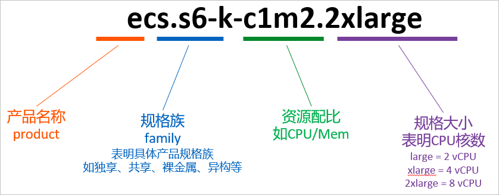

阿里云  
专有云  
云服务器 ECS  
实例规格族与实例规格简介  
产品版本：v3.18.2  
文档版本：20240426

**目录**

- [1.实例规格族&实例规格](#section-1)
- [2.Intel规格族](#section-2)
    - [2.1. 共享型](#section-2-1)
    - [2.2. 独享型](#section-2-2)
    - [2.3. 弹性裸金属](#section-2-3)
    - [2.4. 异构计算型&异构裸金属](#section-2-4)
    - [2.5. 超级计算机型](#section-2-5)
    - [2.6. 本地HDD盘](#section-2-6)
    - [2.7. 突发型](#section-2-7)
- [3.Hygon规格族](#section-3)
    - [3.1. 共享型](#section-3-1)
    - [3.2. 独享型](#section-3-2)
    - [3.3. 异构计算型](#section-3-3)
    - [3.4. 本地HDD盘](#section-3-4)
- [4.Kunpeng规格族](#section-4)
    - [4.1. 共享型](#section-4-1)
    - [4.2. 独享型](#section-4-2)
    - [4.3. 本地HDD盘](#section-4-3)
- [5.Feiteng规格族](#section-5)
    - [5.1. 共享型](#section-5-1)
    - [5.2. 独享型](#section-5-2)

# 1.实例规格族&实例规格

根据业务场景和使用场景，阿里云将ECS实例分为多个实例规格族，如共享型、独享型、弹性裸金属、本地HDD盘、本地SSD盘、异构计算型、超级计算集群等，每个规格族是一个或多个具有相似属性的实例规格的组合。

**实例规格族类型**

实例规格族类型及应用场景如下表所示：

<table>
  <tr>
    <th width="121">实例规格族</th>
    <th>应用场景</th>
  </tr>
  <tr>
    <td>共享型</td>
    <td>适合对虚拟机性能要求不高的业务场景，如中小型网站和Web应用程序、开发环境、构建服务器、代码存储库、微服务、测试和暂存环境、轻量级数据库、轻量级企业应用、综合应用服务等。</td>
  </tr>
  <tr>
    <td>独享型</td>
    <td>适合对虚拟机性能要求较高的业务场景，如高网络包收发场景、Web前端服务器、数据分析、批量计算、视频编码、高性能科学和工程应用等。</td>
  </tr>
  <tr>
    <td>弹性裸金属</td>
    <td>提供强劲的计算、存储以及网络配置，满足对资源独享、安全隔离、性能有较高要求的业务场景，如容器、数据库、企业核心业务、大数据计算等。</td>
  </tr>
  <tr>
    <td>本地HDD盘</td>
    <td>适用于有大数据计算与存储分析需求的业务场景，如海量数据存储和离线计算，满足以Hadoop为代表的分布式计算业务对实例存储性能、存储容量和内网带宽的多方面要求。</td>
  </tr>
  <tr>
    <td>本地SSD盘</td>
    <td>用于满足I/O密集型应用对块存储的低时延和高I/O性能需求，如NoSQL非关系型数据库（Cassandra、MongoDB等）、MPP数据仓库和分布式文件系统、ElasticSearch等搜索场景等。</td>
  </tr>
  <tr>
    <td>异构计算型</td>
    <td>搭配各类加速器，如NVIDIA T4、NVIDIA V100、FPGA等，适用于AI推理、计算机视觉、语音识别/合成、机器翻译、推荐系统、实时渲染、深度学习、科学计算等业务场景。</td>
  </tr>
  <tr>
    <td>超级计算集群</td>
    <td>在弹性裸金属实例的基础上，搭配高速InfiniBand（IB）网络，提供具有极致计算性能和并行效率的计算集群服务，适合搭建高性能计算、人工智能/机器学习、科学/工程计算、数据分析、音视频处理等应用。</td>
  </tr>
  <tr>
    <td>突发型</td>
    <td>vCPU持续提供基准性能，可突然提速，但受到CPU积分的限制，适合对虚拟机性能要求不高的业务场景，如中小型网站和Web应用程序。</td>
  </tr>
</table>

**实例规格**

同一个实例规格族里，根据vCPU和内存的配置不同，分为多个不同的实例规格。ECS实例规格定义了实例的具体属性：vCPU数量、内存大小、网络能力（如VPC带宽、PPS大小、弹性网卡数量、每个弹性网卡支持的IP数量等）与存储能力（云盘带宽峰值、云盘IOPS峰值、云盘数量等），同一个实例规格族中，实例的网络性能、存储性能与计算规格对应（规格越高网络性能越强）。

ECS实例规格命名规范如下图所示：

ECS实例规格命名规则说明如下：

- 产品名称：以ecs.开头，表示ECS产品。

- 规格族：如s6-k，s代表共享型实例，6代表阿里云六代机型，k代表KVM虚拟化；如g6x-k10，g代表是独享型实例，6代表是阿里云六代机型，x代表是高密机型（整机128逻辑核），k10代表是KVM机型搭配10 GB网络。

- 资源配比：如c1m2，代表计算内存比为1:2，如2 vCPU 4 GiB、4 vCPU 8 GiB等。

- 规格大小：large代表2 vCPU，xlarge代表4 vCPU，2xlarge代表8 vCPU，3xlarge代表12 vCPU。

在下列的Intel规格族、Hygon规格族、Kunpeng规格族和Feiteng规格族章节中，表格各列的含义如下：

- 规格族：实例规格族名字。

- 处理器：规格族支持和建议使用的处理器型号，如Intel V6代表Intel Cascade Lake处理器。

- 虚拟化：使用的虚拟化技术，分为KVM、一代神龙架构、二代神龙架构、三代神龙架构。

- 物理机大小：宿主机超线程（X86架构）或逻辑核（ARM架构）的数量（用vCPU表示）。在相同的网络环境下，如果物理机的vCPU数量不一样，那么单vCPU能获得的网络能力是有差异的，最新非共享规格族会尽量区分开来，以提供更好的QoS。不限代表不区分物理机vCPU的数量。

- 网络：宿主机的网络配置。相同的物理机，在不同的网络配置下，单vCPU能获得的网络能力是有差异的，最新非共享规格族会尽量区分开来，以提供更好的QoS。10 G代表是2\*10 Gbps网络条件下用的规格族，25 G代表是2\*25 Gbps网络条件下用的规格族，不限代表不区分网络配置。

- 规格族描述：描述了此规格族下的实例规格的一些特性，如规格大小、计算内存比、配置了什么样的加速卡和磁盘等等。

- 备注：此规格族是否适用于新客户，不推荐是指不建议新客户使用此规格族。

**资源分配**

不同类型的ECS实例在资源分配上有所不同，具体说明如下：

- 所有的KVM机型，需要为虚拟化预留部分CPU与内存资源，如预留8 vCPU 32 GiB、10 vCPU 40 GiB或10 vCPU 48 GiB，以承载网络虚拟化、存储虚拟化和管控方面的任务。

- 所有的神龙架构机型，无需在服务器侧预留CPU与内存资源。神龙架构采用软硬一体设计，可以将网络虚拟化、存储虚拟化以及系统管控全部卸载到专用芯片系统，除了实现资源零开销，还可以避免底层资源争抢而导致的虚拟机性能波动。

- 宿主机的内存资源、本地盘资源都是不可超分的。

- 在生产共享型实例和突发型实例时，宿主机的CPU资源是可以超分的，建议您控制超分比不要超过4。在生产其他类型实例时，宿主机的CPU资源都是不可超分的。

# 2.Intel规格族

## 2.1. 共享型

共享型实例适合对虚拟机性能要求不高的业务场景，如中小型网站和Web应用程序、开发环境、构建服务器、代码存储库、微服务、测试和暂存环境、轻量级数据库、轻量级企业应用、综合应用服务等。本文介绍了共享型实例规格族的具体属性、规格大小、虚拟化技术等。

| 规格族 | 处理器 | 虚拟化 | 物理机大小 | 网络 | 规格族描述 | 备注 |
| --- | --- | --- | --- | --- | --- | --- |
| ecs.s6-k | Intel V6 | KVM | 不限 | 不限 | • 规格大小（vCPU）：2、4、8、12、16、24、32、40、48、56、64 • 计算内存比：1:1、1:2、1:3、1:4、1:6、1:8 | 推荐 |
| ecs.s6-m | Intel V6 | 二代神龙架构 | 不限 | 不限 | • 规格大小（vCPU）：2、4、8、12、16、24、32、40、48、56、64 • 计算内存比1:1、1:2、1:3、1:4、1:6、1:8 | 推荐 |
| ecs.s7-k | Intel V7 | KVM | 不限 | 不限 | • 规格大小（vCPU）：2、4、8、12、16、24、32、40、48、56、64 • 计算内存比：1:1、1:2、1:3、1:4、1:6、1:8 | 推荐 |
| ecs.anysh are | Intel | KVM | 不限 | 不限 | • 支持通过Apsara Uni-manager运维控制台创建、修改和删除自定义实例规格 • 自定义的实例规格均为共享型，仅支持Intel处理器 | 不推荐 |
| ecs.s6 | Intel V6 | 二代神龙架构 | 不限 | 不限 | • 规格大小（vCPU）：1、2、4、8 • 计算内存比：1:1、1:2、1:4、1:8 | 不推荐 |
| ecs.xn4 | Intel V4/V5/V6 | KVM | 不限 | 不限 | 仅支持ecs.xn4.small，1 vCPU 1 GiB | 不推荐 |
| ecs.n4 | Intel V4/V5/V6 | KVM | 不限 | 不限 | • 规格大小（vCPU）：1、2、4、8、16、32 • 计算内存比：1:2 | 不推荐 |
| ecs.mn4 | Intel V4/V5/V6 | KVM | 不限 | 不限 | • 规格大小（vCPU）：1、2、4、8、16、32 • 计算内存比：1:4 | 不推荐 |
| ecs.e4 | Intel V4/V5/V6 | KVM | 不限 | 不限 | • 规格大小（vCPU）：1、2、4、8、16 • 计算内存比：1:8 | 不推荐 |
| ecs.xn4v2 | Intel V4/V5/V6 | KVM | 不限 | 不限 | • ecs.xn4.small，1 vCPU 1 GiB • 支持IPv6地址 | 不推荐 |
| ecs.n4v2 | Intel V4/V5/V6 | KVM | 不限 | 不限 | • 规格大小（vCPU） ：1、2、4、8、16、32 • 计算内存比：1:2 • 支持IPv6地址 | 不推荐 |
| ecs.mn4v 2 | Intel V4/V5/V6 | KVM | 不限 | 不限 | • 规格大小（vCPU）：1、2、4、8、16、32 • 计算内存比：1:4 • 支持IPv6地址 | 不推荐 |
| ecs.e4v2 | Intel V4/V5/V6 | KVM | 不限 | 不限 | • 规格大小（vCPU）：1、2、4、8、16 • 计算内存比：1:8 • 支持IPv6地址 | 不推荐 |

## 2.2. 独享型

独享型实例适合对虚拟机性能要求较高的业务场景，如高网络包收发场景、Web前端服务器、数据分析、批量计算、视频编码、高性能科学和工程应用等。本文介绍了独享型实例规格族的具体属性、规格大小、虚拟化技术等。

| 规格族 | 处理器 | 虚拟化 | 物理机大小 | 网络 | 规格族描述 | 备注 |
| --- | --- | --- | --- | --- | --- | --- |
| ecs.g7x-se-x25 | Intel V7 | 三代神龙架构 | 128 vCPU | 25 G | 支持共享块存储 | 推荐 |
| ecs.g7x-x25 | Intel V7 | 三代神龙架构 | 128 vCPU | 25 G | 无 | 推荐 |
| ecs.g7s-k10 | Intel V7 | KVM | 64 vCPU | 10 G | • 规格大小（vCPU）：2、4、8、12、16、24、32、40、48、54 • 计算内存比：1:1、1:2、1:3、1:4、1:6、1:8 | 推荐 |
| ecs.g7s-k25 | Intel V7 | KVM | 64 vCPU | 25 G | • 规格大小（vCPU）：2、4、8、12、16、24、32、40、48、54 • 计算内存比：1:1、1:2、1:3、1:4、1:6、1:8 | 推荐 |
| ecs.g7m-k10 | Intel V7 | KVM | 96 vCPU | 10 G | • 规格大小（vCPU）：2、4、8、12、16、24、32、40、48、56、64、72、80、86 • 计算内存比：1:1、1:2、1:3、1:4、1:6、1:8 | 推荐 |
| ecs.g7m-k25 | Intel V7 | KVM | 96 vCPU | 25 G | • 规格大小（vCPU）：2、4、8、12、16、24、32、40、48、56、64、72、80、86 • 计算内存比：1:1、1:2、1:3、1:4、1:6、1:8 | 推荐 |
| ecs.g7x-k10 | Intel V7 | KVM | 128 vCPU | 10 G | • 规格大小（vCPU）：2、4、8、12、16、24、32、40、48、56、64、72、80、88、96、104、112、118 • 计算内存比：1:1、1:2、1:3、1:4、1:6、1:8 | 推荐 |
| ecs.g7x-k25 | Intel V7 | KVM | 128 vCPU | 25 G | • 规格大小（vCPU）：2、4、8、12、16、24、32、40、48、56、64、72、80、88、96、104、112、118 • 计算内存比：1:1、1:2、1:3、1:4、1:6、1:8 | 推荐 |
| ecs.g7v-k10 | Intel V7 | KVM | 192 vCPU | 10 G | • 规格大小（vCPU）：2、4、8、12、16、24、32、40、48、56、64、72、80、88、96 • 计算内存比：1:1、1:2、1:3、1:4、1:6、1:8 | 推荐 |
| ecs.g7v-k25 | Intel V7 | KVM | 192 vCPU | 25 G | • 规格大小（vCPU）：2、4、8、12、16、24、32、40、48、56、64、72、80、88、96 • 计算内存比：1:1、1:2、1:3、1:4、1:6、1:8 | 推荐 |
| ecs.g6s-m10 | Intel V6 | 二代神龙架构 | 64 vCPU | 10 G | • 规格大小（vCPU）：2、4、8、12、16、24、32、40、48、56、64 • 计算内存比：1:1、1:2、1:3、1:4、1:6、1:8 | 不推荐 |
| ecs.g6s-m25 | Intel V6 | 二代神龙架构 | 64 vCPU | 25 G | • 规格大小（vCPU）：2、4、8、12、16、24、32、40、48、56、64 • 计算内存比：1:1、1:2、1:3、1:4、1:6、1:8 | 不推荐 |
| ecs.g6m-m10 | Intel V6 | 二代神龙架构 | 96 vCPU | 10 G | • 规格大小（vCPU）：2、4、8、12、16、24、32、40、48、56、64、72、80、88、96 • 计算内存比：1:1、1:2、1:3、1:4、1:6、1:8 | 不推荐 |
| ecs.g6m-m25 | Intel V6 | 二代神龙架构 | 96 vCPU | 25 G | • 规格大小（vCPU）：2、4、8、12、16、24、32、40、48、56、64、72、80、88、96 • 计算内存比 1:1、1:2、1:3、1:4、1:6、1:8 | 不推荐 |
| ecs.g6s-k10 | Intel V6 | KVM | 64 vCPU | 10 G | • 规格大小（vCPU）：2、4、8、12、16、24、32、40、48、56 • 计算内存比：1:1、1:2、1:3、1:4、1:6、1:8 | 推荐 |
| ecs.g6s-k25 | Intel V6 | KVM | 64 vCPU | 25 G | • 规格大小（vCPU）：2、4、8、12、16、24、32、40、48、56 • 计算内存比：1:1、1:2、1:3、1:4、1:6、1:8 | 推荐 |
| ecs.g6m-k10 | Intel V6 | KVM | 96 vCPU | 10 G | • 规格大小（vCPU）：2、4、8、12、16、24、32、40、48、56、64、72、80、88 • 计算内存比：1:1、1:2、1:3、1:4、1:6、1:8 | 推荐 |
| ecs.g6m-k25 | Intel V6 | KVM | 96 vCPU | 25 G | • 规格大小（vCPU）：2、4、8、12、16、24、32、40、48、56、64、72、80、88 • 计算内存比：1:1、1:2、1:3、1:4、1:6、1:8 | 推荐 |
| ecs.c6 | Intel V6 | 二代神龙架构 | 104 vCPU | 25 G | • 规格大小（vCPU）：2、4、8、12、16、24、32、52、64、104 • 计算内存比 1:2 | 推荐 |
| ecs.g6 | Intel V6 | 二代神龙架构 | 104 vCPU | 25 G | • 规格大小（vCPU）：2、4、8、12、16、24、32、52、64、104 • 计算内存比：1:4 | 推荐 |
| ecs.r6 | Intel V6 | 二代神龙架构 | 104 vCPU | 25 G | • 规格大小（vCPU）：2、4、8、12、16、24、32、52、64、104 • 计算内存比：1:8 | 推荐 |
| ecs.re6 | Intel V6 | 二代神龙架构 | 208 vCPU | 不限 | 整机配置3 TB内存，计算内存比约为1:15 | 推荐 |
| ecs.sn1 | Intel V5/V6 | KVM | 不限 | 不限 | • 规格大小（vCPU）：2、4、8、16、32、56 • 计算内存比：1:2 | 不推荐 |
| ecs.sn2 | Intel V5/V6 | KVM | 不限 | 不限 | • 规格大小（vCPU）：2、4、8、16、32、56 • 计算内存比：1:4 | 不推荐 |
| ecs.se1 | Intel V5/V6 | KVM | 不限 | 不限 | • 规格大小（vCPU）：2、4、8、16、32、56 • 计算内存比：1:8 | 不推荐 |
| ecs.sn1ne | Intel V5/V6 | KVM | 不限 | 不限 | • 规格大小（vCPU）：2、4、8、12、16、24、32、88 • 计算内存比：1:2 • 支持IPv6地址 | 不推荐 |
| ecs.sn2ne | Intel V5/V6 | KVM | 不限 | 不限 | • 规格大小（vCPU）：2、4、8、12、16、24、32、56、88 • 计算内存比：1:4 • 支持IPv6地址 | 不推荐 |
| ecs.se1ne | Intel V5/V6 | KVM | 不限 | 不限 | • 规格大小（vCPU）：2、4、8、12、16、24、32、56、88 • 计算内存比：1:8 • 支持IPv6地址 | 不推荐 |
| ecs.c5 | Intel V5 | 二代神龙架构 | 104 vCPU | 25 G | • 规格大小（vCPU）：2、4、8、12、16、24、32、64、86、88 • 计算内存比：1:2 | 不推荐 |
| ecs.g5 | Intel V5 | 二代神龙架构 | 104 vCPU | 25 G | • 规格大小（vCPU）：2、4、8、12、16、24、32、64、86、88 • 计算内存比：1:4 | 不推荐 |
| ecs.r5 | Intel V5 | 二代神龙架构 | 104 vCPU | 25 G | • 规格大小（vCPU）：2、4、8、12、16、24、32、64、86、88 • 计算内存比：1:8 | 不推荐 |
| ecs.re5 | Intel V5 | KVM | 192 vCPU | 不限 | 整机配置3 TB内存，计算内存比约为1:16 | 不推荐 |

## 2.3. 弹性裸金属

弹性裸金属可提供强劲的计算、存储以及网络配置，满足对资源独享、安全隔离、性能有较高要求的业务场景，如容器、数据库、企业核心业务、大数据计算等。本文介绍了弹性裸金属实例规格族的具体属性、规格大小、虚拟化技术等。

| 规格族 | 处理器 | 虚拟化 | 物理机大小 | 网络 | 规格族描述 | 备注 |
| --- | --- | --- | --- | --- | --- | --- |
| ecs.ebmg 7s-se-x25-c1m8 | Intel V7 | 三代神龙架构 | 64 vCPU | 25 G | ecs.ebmg7s-se-x25-c1m8.16xlarge，64 vCPU 512 GiB 支持共享块存储，NUMA ON 配置 | 推荐 |
| ecs.ebmg 7m-se-x25-c1m8 | Intel V7 | 三代神龙架构 | 96 vCPU | 25 G | ecs.ebmg7m-se-x25-c1m8.24xlarge，96 vCPU 768 GiB 支持共享块存储，NUMA ON 配置 | 推荐 |
| ecs.ebmg 7x-se-x25-c1m8 | Intel V7 | 三代神龙架构 | 128 vCPU | 25 G | ecs.ebmg7x-se-x25-c1m8.32xlarge，128 vCPU 1024 GiB 支持共享块存储，NUMA ON 配置 | 推荐 |
| ecs.ebmg 7s-se-numaoff-x25-c1m8 | Intel V7 | 三代神龙架构 | 64 vCPU | 25 G | ecs.ebmg7s-se-numaoff-x25-c1m8.16xlarge，64 vCPU 512 GiB 支持共享块存储，NUMA OFF 配置 | 不推荐 |
| ecs.ebmg 7m-se-numaoff-x25-c1m8 | Intel V7 | 三代神龙架构 | 96 vCPU | 25 G | ecs.ebmg7m-se-numaoff-x25-c1m8.24xlarge，96 vCPU 768 GiB 支持共享块存储，NUMA OFF 配置 | 不推荐 |
| ecs.ebmg 7x-se-numaoff-x25-c1m8 | Intel V7 | 三代神龙架构 | 128 vCPU | 25 G | ecs.ebmg7x-se-numaoff-x25-c1m8.32xlarge，128 vCPU 1024 GiB 支持共享块存储，NUMA OFF 配置 | 不推荐 |
| ecs.ebmg 7s-x25-c1m8 | Intel V7 | 三代神龙架构 | 64 vCPU | 25 G | ecs.ebmg7s-x25-c1m8.16xlarge，64 vCPU 512 GiB，NUMA ON 配置 | 推荐 |
| ecs.ebmg 7m-x25-c1m8 | Intel V7 | 三代神龙架构 | 96 vCPU | 25 G | ecs.ebmg7m-x25-c1m8.24xlarge，96 vCPU 768 GiB，NUMA ON 配置 | 推荐 |
| ecs.ebmg 7x-x25-c1m8 | Intel V7 | 三代神龙架构 | 128 vCPU | 25 G | ecs.ebmg7x-x25-c1m8.32xlarge，128 vCPU 1024 GiB，NUMA ON 配置 | 推荐 |
| ecs.ebmg 6s-m10-c1m4 | Intel V6 | 二代神龙架构 | 64 vCPU | 10 G | ecs.ebmg6s-m10-c1m4.16xlarge，64 vCPU 256 GiB | 推荐 |
| ecs.ebmg 6s-m25-c1m4 | Intel V6 | 二代神龙架构 | 64 vCPU | 25 G | ecs.ebmg6s-m25-c1m4.16xlarge，64 vCPU 256 GiB | 推荐 |
| ecs.ebmg 6s-m10-c1m24 | Intel V6 | 二代神龙架构 | 64 vCPU | 10 G | ecs.ebmg6s-m10-c1m24.16xlarge，64 vCPU 1536 GiB | 推荐 |
| ecs.ebmg 6s-m25-c1m24 | Intel V6 | 二代神龙架构 | 64 vCPU | 25 G | ecs.ebmg6s-m25-c1m24.16xlarge，64 vCPU 1536 GiB | 推荐 |
| ecs.ebmg 6m-m10-c1m4 | Intel V6 | 二代神龙架构 | 96 vCPU | 10 G | ecs.ebmg6m-m10-c1m4.24xlarge，96 vCPU 384 GiB | 推荐 |
| ecs.ebmg 6m-m25-c1m4 | Intel V6 | 二代神龙架构 | 96 vCPU | 10 G | ecs.ebmg6m-m25-c1m4.24xlarge，96 vCPU 384 GiB | 推荐 |
| ecs.ebmr e6-3t | Intel V6 | 二代神龙架构 | 208 vCPU | 25 G | ecs.ebmre6-3t.52xlarge，208 vCPU 3072 GiB | 推荐 |
| ecs.ebmc 6 | Intel V6 | 二代神龙架构 | 104 vCPU | 25 G | ecs.ebmc6.26xlarge，1 04 vCPU 192 GiB | 推荐 |
| ecs.ebmg 6 | Intel V6 | 二代神龙架构 | 104 vCPU | 25 G | ecs.ebmg6.26xlarge，1 04 vCPU 384 GiB | 推荐 |
| ecs.ebmr 6 | Intel V6 | 二代神龙架构 | 104 vCPU | 25 G | ecs.ebmr6.26xlarge，1 04 vCPU 768 GiB | 推荐 |
| ecs.ebmr e6p | Intel V6 | 二代神龙架构 | 104 vCPU | 25 G | 搭配1536 GiB Intel傲腾持久内存（AEP） | 推荐 |
| ecs.ebmg 5 | Intel V5 | 一代神龙架构 | 96 vCPU | 10 G | ecs.ebmg5.24xlarge，9 6 vCPU 384 GiB | 不推荐 |
| ecs.ebmg 5s | Intel V5 | 二代神龙架构 | 96 vCPU | 25 G | ecs.ebmg5s.24xlarge，96 vCPU 384 GiB | 不推荐 |

## 2.4. 异构计算型&异构裸金属

异构计算型&异构裸金属实例可搭配各类加速器，如NVIDIA T4、NVIDIA V100、FPGA等，适用于AI推理、计算机视觉、语音识别/合成、机器翻译、推荐系统、实时渲染、深度学习、科学计算等业务场景。本文介绍了异构计算型&异构裸金属实例规格族的具体属性、规格大小、虚拟化技术等。

| 规格族 | 处理器 | 虚拟化 | 物理机大小 | 网络 | 规格族描述 | 备注 |
| --- | --- | --- | --- | --- | --- | --- |
| ecs.gn6i | Intel V5/V6 | KVM | 不限 | 不限 | 计算内存比约为1:4，搭配1~8块NVIDIA T4 | 推荐 |
| ecs.gn6v | Intel V5/V6 | KVM | 不限 | 不限 | 计算内存比约为1:4，搭配1~8块NVIDIA V100 | 推荐 |
| ecs.vgn6i | Intel V5/V6 | 二代神龙架构 | 不限 | 不限 | 支持分片虚拟化后的虚拟GPU 支持NVIDIA Tesla T4的1/4和1/2 | 推荐 |
| ecs.ebmg n6i | Intel V5/V6 | 二代神龙架构 | 不限 | 不限 | 弹性裸金属，搭配4块NVIDIA T4 | 推荐 |
| ecs.ebmg n6i-2 | Intel V5/V6 | 二代神龙架构 | 不限 | 不限 | 弹性裸金属，搭配2块NVIDIA T4 | 推荐 |
| ecs.ebmg n6i-8 | Intel V5/V6 | 二代神龙架构 | 不限 | 不限 | 弹性裸金属，搭配8块NVIDIA T4 | 推荐 |
| ecs.ebmg n6e-2 | Intel V6 | 二代神龙架构 | 不限 | 不限 | 弹性裸金属，搭配2块NVIDIA V100 | 推荐 |
| ecs.gn3 | Intel V4 | KVM | 不限 | 不限 | 搭配1~2块NVIDIA K2 | 不推荐 |
| ecs.gn4 | Intel V4 | KVM | 不限 | 不限 | 搭配1~2块NVIDIA M40 | 不推荐 |
| ecs.gn5 | Intel V4 | KVM | 不限 | 不限 | 搭配1~8块NVIDIA P100 | 不推荐 |
| ecs.gn5e | Intel V5 | KVM | 不限 | 不限 | 计算内存比为1:6，搭配1~8块NVIDIA P4 | 不推荐 |
| ecs.gn5i | Intel V4 | KVM | 不限 | 不限 | 计算内存比为1:4，搭配1~2块NVIDIA P4 | 不推荐 |
| ecs.gn5t | Intel V4 | KVM | 不限 | 不限 | 计算内存比约为1:4，搭配2~8块NVIDIA 1080Ti | 不推荐 |

## 2.5. 超级计算机型

超级计算机型实例在弹性裸金属实例的基础上，搭配高速InfiniBand（IB）网络，提供具有极致计算性能和并行效率的计算集群服务，适合搭建高性能计算、人工智能/机器学习、科学/工程计算、数据分析、音视频处理等应用。本文介绍了超级计算机型实例规格族的具体属性、规格大小、虚拟化技术等。

| 规格族 | 处理器 | 虚拟化 | 物理机大小 | 网络 | 规格族描述 | 备注 |
| --- | --- | --- | --- | --- | --- | --- |
| ecs.sccgn 6e | Intel V6 | 二代神龙架构 | 104 vCPU | 不限 | 搭配8块NVIDIA V100和100 Gbps InfiniBand高性能网络 | 推荐 |
| ecs.sccgn 6p | Intel V5/V6 | 二代神龙架构 | 96 vCPU | 不限 | 搭配8块NVIDIA V100和100 Gbps InfiniBand高性能网络 | 推荐 |
| ecs.scch5 | Intel V5 | 二代神龙架构 | 64 vCPU | 不限 | 高主频处理器，基频3.1 GHz，全核睿频3.5 GHz | 不推荐 |
| ecs.sccg5i b | Intel V5 | 一代神龙架构 | 96 vCPU | 10 G | 搭配100 Gbps InfiniBand高性能网络 | 不推荐 |

## 2.6. 本地HDD盘

本地HDD盘实例适用于有大数据计算与存储分析需求的业务场景，如海量数据存储和离线计算，满足以Hadoop为代表的分布式计算业务对实例存储性能、存储容量和内网带宽的多方面要求。本文介绍了本地HDD盘实例规格族的具体属性、规格大小、虚拟化技术等。

| 规格族 | 处理器 | 虚拟化 | 物理机大小 | 网络 | 规格族描述 | 备注 |
| --- | --- | --- | --- | --- | --- | --- |
| ecs.d7s-k10-8t | Intel V7 | KVM | 64 vCPU | 10 G | 整机配置12块8 TB SATA HDD | 推荐 |
| ecs.d7s-k25-8t | Intel V7 | KVM | 64 vCPU | 25 G | 整机配置12块8 TB SATA HDD | 推荐 |
| ecs.d7m-k10-8t | Intel V7 | KVM | 96 vCPU | 10 G | 整机配置12块8 TB SATA HDD | 推荐 |
| ecs.d7m-k25-8t | Intel V7 | KVM | 96 vCPU | 25 G | 整机配置12块8 TB SATA HDD | 推荐 |
| ecs.d7x-k10-12t | Intel V7 | KVM | 128 vCPU | 10 G | 整机配置12块12 TB SATA HDD | 推荐 |
| ecs.d7x-k25-12t | Intel V7 | KVM | 128 vCPU | 25 G | 整机配置12块12 TB SATA HDD | 推荐 |
| ecs.d2-zyy | Intel V5/V6 | KVM | 不限 | 不限 | 整机配置12块8 TB SATA HDD | 推荐 |

## 2.7. 突发型

突发型实例的vCPU可持续提供基准性能，可突然提速，但受到CPU积分的限制，适合对虚拟机性能要求不高的业务场景，如中小型网站和Web应用程序。本文介绍了突发型实例规格族的具体属性、规格大小、虚拟化技术等。

| 规格族 | 处理器 | 虚拟化 | 物理机大小 | 网络 | 规格族描述 | 备注 |
| --- | --- | --- | --- | --- | --- | --- |
| ecs.t5 | Intel V5/V6 | KVM | 不限 | 不限 | vCPU持续提供基准性能，可突然提速，但受到CPU积分的限制。 | 不推荐，推荐使用共享型 |

# 3.Hygon规格族

## 3.1. 共享型

共享型实例适合对虚拟机性能要求不高的业务场景，如中小型网站和Web应用程序、开发环境、构建服务器、代码存储库、微服务、测试和暂存环境、轻量级数据库、轻量级企业应用、综合应用服务等。本文介绍了共享型实例规格族的具体属性、规格大小、虚拟化技术等。

| 规格族 | 处理器 | 虚拟化 | 物理机大小 | 网络 | 规格族描述 | 备注 |
| --- | --- | --- | --- | --- | --- | --- |
| ecs.s6-hg-k | Hygon二号 | KVM | 不限 | 不限 | 规格大小（vCPU）：2、4、8、12、16、24、32、40、48、56、64 | 推荐 |
| ecs.ghg-s | Hygon一号/二号 | KVM | 不限 | 不限 | 计算内存比：1:1、1:2、1:3、1:4、1:6、1:8 | 不推荐 |

## 3.2. 独享型

独享型实例适合对虚拟机性能要求较高的业务场景，如高网络包收发场景、Web前端服务器、数据分析、批量计算、视频编码、高性能科学和工程应用等。本文介绍了独享型实例规格族的具体属性、规格大小、虚拟化技术等。

| 规格族 | 处理器 | 虚拟化 | 物理机大小 | 网络 | 规格族描述 | 备注 |
| --- | --- | --- | --- | --- | --- | --- |
| ecs.g6s-hg-k10 | Hygon二号 | KVM | 64 vCPU | 10 G | • 规格大小（vCPU）：2、4、8、12、16、24、32、40、48、56 • 计算内存比：1:1、1:2、1:3、1:4、1:6、1:8 | 推荐 |
| ecs.g6s-hg-k25 | Hygon二号 | KVM | 64 vCPU | 25 G | • 规格大小（vCPU）：2、4、8、12、16、24、32、40、48、56 • 计算内存比：1:1、1:2、1:3、1:4、1:6、1:8 | 推荐 |
| ecs.g6x-hg-k10 | Hygon二号 | KVM | 128 vCPU | 10 G | • 规格大小（vCPU）：2、4、8、12、16、24、32、40、48、56、64、72、80、88、96、104、112、120 • 计算内存比：1:1、1:2、1:3、1:4、1:6、1:8 | 推荐 |
| ecs.g6x-hg-k25 | Hygon二号 | KVM | 128 vCPU | 25 G | • 规格大小（vCPU）：2、4、8、12、16、24、32、40、48、56、64、72、80、88、96、104、112、120 • 计算内存比：1:1、1:2、1:3、1:4、1:6、1:8 | 推荐 |
| ecs.ghg | Hygon一号/二号 | KVM | 不限 | 不限 | 计算内存比：1:4 | 不推荐 |

## 3.3. 异构计算型

异构计算型实例可搭配各类加速器，如NVIDIA T4、NVIDIA V100、FPGA等，适用于AI推理、计算机视觉、语音识别/合成、机器翻译、推荐系统、实时渲染、深度学习、科学计算等业务场景。本文介绍了异构计算型实例规格族的具体属性、规格大小、虚拟化技术等。

| 规格族 | 处理器 | 虚拟化 | 物理机大小 | 网络 | 规格族描述 | 备注 |
| --- | --- | --- | --- | --- | --- | --- |
| ecs.gn6ih | Hygon二号 | KVM | 128 vCPU | 不限 | 计算内存比为1:4，搭配8块NVIDIA T4 | 推荐 |
| ecs.gn6hv | Hygon一号 | KVM | 128 vCPU | 不限 | 计算内存比约为1:4，搭配1~2块NVIDIA V100 | 推荐 |

## 3.4. 本地HDD盘

本地HDD盘实例适用于有大数据计算与存储分析需求的业务场景，如海量数据存储和离线计算，满足以Hadoop为代表的分布式计算业务对实例存储性能、存储容量和内网带宽的多方面要求。本文介绍了本地HDD盘实例规格族的具体属性、规格大小、虚拟化技术等。

| 规格族 | 处理器 | 虚拟化 | 物理机大小 | 网络 | 规格族描述 | 备注 |
| --- | --- | --- | --- | --- | --- | --- |
| ecs.dhg | Hygon一号/二号 | KVM | 不限 | 不限 | 整机配置12块8 TB SATA HDD | 推荐 |

# 4.Kunpeng规格族

## 4.1. 共享型

共享型实例适合对虚拟机性能要求不高的业务场景，如中小型网站和Web应用程序、开发环境、构建服务器、代码存储库、微服务、测试和暂存环境、轻量级数据库、轻量级企业应用、综合应用服务等。本文介绍了共享型实例规格族的具体属性、规格大小、虚拟化技术等。

| 规格族 | 处理器 | 虚拟化 | 物理机大小 | 网络 | 规格族描述 | 备注 |
| --- | --- | --- | --- | --- | --- | --- |
| ecs.s5-kp-k | Kunpeng9 20 | KVM | 不限 | 不限 | • 规格大小（vCPU）：2、4、8、12、16、24、32、40、48、56、64 • 计算内存比：1:1、1:2、1:3、1:4、1:6、1:8 | 推荐 |
| ecs.gkp-s | Kunpeng9 20 | KVM | 不限 | 不限 | 计算内存比：1:4 | 不推荐 |

## 4.2. 独享型

独享型实例适合对虚拟机性能要求较高的业务场景，如高网络包收发场景、Web前端服务器、数据分析、批量计算、视频编码、高性能科学和工程应用等。本文介绍了独享型实例规格族的具体属性、规格大小、虚拟化技术等。

| 规格族 | 处理器 | 虚拟化 | 物理机大小 | 网络 | 规格族描述 | 备注 |
| --- | --- | --- | --- | --- | --- | --- |
| ecs.g5s-kp-k10 | Kunpeng9 20 | KVM | 64 vCPU | 10 G | • 规格大小（vCPU）：2、4、8、12、16、24、32、40、48、56 • 计算内存比：1:1、1:2、1:3、1:4、1:6、1:8 | 推荐 |
| ecs.g5s-kp-k25 | Kunpeng9 20 | KVM | 64 vCPU | 25 G | • 规格大小（vCPU）：2、4、8、12、16、24、32、40、48、56 • 计算内存比：1:1、1:2、1:3、1:4、1:6、1:8 | 推荐 |
| ecs.g5m-kp-k10 | Kunpeng9 20 | KVM | 96 vCPU | 10 G | • 规格大小（vCPU）：2、4、8、12、16、24、32、40、48、56、64、72、80、88 • 计算内存比：1:1、1:2、1:3、1:4、1:6、1:8 | 推荐 |
| ecs.g5m-kp-k25 | Kunpeng9 20 | KVM | 96 vCPU | 25 G | • 规格大小（vCPU）：2、4、8、12、16、24、32、40、48、56、64、72、80、88 • 计算内存比：1:1、1:2、1:3、1:4、1:6、1:8 | 推荐 |
| ecs.g5x-kp-k10 | Kunpeng9 20 | KVM | 128 vCPU | 10 G | • 规格大小（vCPU）：2、4、8、12、16、24、32、40、48、56、64、72、80、88、96、104、112、120 • 计算内存比：1:1、1:2、1:3、1:4、1:6、1:8 | 推荐 |
| ecs.g5x-kp-k25 | Kunpeng9 20 | KVM | 128 vCPU | 25 G | • 规格大小（vCPU）：2、4、8、12、16、24、32、40、48、56、64、72、80、88、96、104、112、120 • 计算内存比：1:1、1:2、1:3、1:4、1:6、1:8 | 推荐 |
| ecs.g5m-kp-m10 | Kunpeng9 20 | 二代神龙架构 | 96 vCPU | 10 G | • 规格大小（vCPU）：2、4、8、12、16、24、32、40、48、56、64、72、80、88、96 • 计算内存比：1:1、1:2、1:3、1:4、1:6、1:8 | 推荐 |
| ecs.g5m-kp-m25 | Kunpeng9 20 | 二代神龙架构 | 96 vCPU | 25 G | • 规格大小（vCPU）：2、4、8、12、16、24、32、40、48、56、64、72、80、88、96 • 计算内存比：1:1、1:2、1:3、1:4、1:6、1:8 | 推荐 |
| ecs.gkp | Kunpeng9 20 | KVM | 不限 | 不限 | 计算内存比：1:4 | 不推荐 |
| ecs.gkp-m | Kunpeng9 20 | 二代神龙架构 | 不限 | 不限 | 计算内存比：1:4 | 不推荐 |

## 4.3. 本地HDD盘

本地HDD盘实例适用于有大数据计算与存储分析需求的业务场景，如海量数据存储和离线计算，满足以Hadoop为代表的分布式计算业务对实例存储性能、存储容量和内网带宽的多方面要求。本文介绍了本地HDD盘实例规格族的具体属性、规格大小、虚拟化技术等。

| 规格族 | 处理器 | 虚拟化 | 物理机大小 | 网络 | 规格族描述 | 备注 |
| --- | --- | --- | --- | --- | --- | --- |
| ecs.dkp | Kunpeng920 | KVM | 不限 | 不限 | 整机配置12块8 TB SATA HDD | 推荐 |

# 5.Feiteng规格族

## 5.1. 共享型

共享型实例适合对虚拟机性能要求不高的业务场景，如中小型网站和Web应用程序、开发环境、构建服务器、代码存储库、微服务、测试和暂存环境、轻量级数据库、轻量级企业应用、综合应用服务等。本文介绍了共享型实例规格族的具体属性、规格大小、虚拟化技术等。

| 规格族 | 处理器 | 虚拟化 | 物理机大小 | 网络 | 规格族描述 | 备注 |
| --- | --- | --- | --- | --- | --- | --- |
| ecs.s5-ft-k | FT-2000+ | KVM | 不限 | 不限 | • 规格大小（vCPU）：2、4、8、12、16、24、32、40、48、56、64 • 计算内存比 1:1、1:2、1:3、1:4、1:6、1:8 | 推荐 |
| ecs.s6-ft-k | FT-S2500 | KVM | 不限 | 不限 | • 规格大小（vCPU）：2、4、8、12、16、24、32、40、48、56、64 • 计算内存比：1:1、1:2、1:3、1:4、1:6、1:8 | 推荐 |

## 5.2. 独享型

独享型实例适合对虚拟机性能要求较高的业务场景，如高网络包收发场景、Web前端服务器、数据分析、批量计算、视频编码、高性能科学和工程应用等。本文介绍了独享型实例规格族的具体属性、规格大小、虚拟化技术等。

| 规格族 | 处理器 | 虚拟化 | 物理机大小 | 网络 | 规格族描述 | 备注 |
| --- | --- | --- | --- | --- | --- | --- |
| ecs.g5s-ft-k10 | FT-2000+ | KVM | 64 vCPU | 10 G | • 规格大小（vCPU）：2、4、8、12、16、24、32、40、48、56 • 计算内存比：1:1、1:2、1:3、1:4、1:6、1:8 | 推荐 |
| ecs.g5s-ft-k25 | FT-2000+ | KVM | 64 vCPU | 25 G | • 规格大小（vCPU）：2、4、8、12、16、24、32、40、48、56 • 计算内存比：1:1、1:2、1:3、1:4、1:6、1:8 | 推荐 |
| ecs.g6x-ft-k10 | FT-S2500 | KVM | 128 vCPU | 10 G | • 规格大小（vCPU）：2、4、8、12、16、24、32、40、48、56、64、72、80、88、96、104、112、120 • 计算内存比：1:1、1:2、1:3、1:4、1:6、1:8 | 推荐 |
| ecs.g6x-ft-k25 | FT-S2500 | KVM | 128 vCPU | 25 G | • 规格大小（vCPU）：2、4、8、12、16、24、32、40、48、56、64、72、80、88、96、104、112、120 • 计算内存比：1:1、1:2、1:3、1:4、1:6、1:8 | 推荐 |
| ecs.gft | FT-2000+ | KVM | 不限 | 不限 | 计算内存比：1:4 | 不推荐 |
