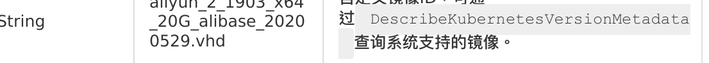
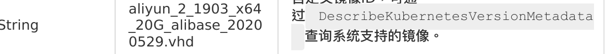

阿里云  
专有云  
容器服务Kubernetes版  
开发指南  
产品版本：V3.18.6  
文档版本：20251202

**目录**

- [1.SDK参考](#section-1)
    - [1.1. 准备工作](#section-1-1)
        - [1.1.1. 登录开发者门户控制台](#section-1-1-1)
        - [1.1.2. 查看API信息](#section-1-1-2)
        - [1.1.3. 获取AccessKey](#section-1-1-3)
        - [1.1.4. 获取STS AccessKey](#section-1-1-4)
        - [1.1.5. 获取公共Header参数](#section-1-1-5)
        - [1.1.6. 获取API信息及其EndPoint](#section-1-1-6)
        - [1.1.7. 获取容器服务ACK的SDK包](#section-1-1-7)
    - [1.2. Java SDK调用示例](#section-1-2)
        - [1.2.1. 安装Java SDK](#section-1-2-1)
        - [1.2.2. 调用SDK](#section-1-2-2)
        - [1.2.3. 使用CommonRequest进行调用](#section-1-2-3)
    - [1.3. Python SDK调用示例](#section-1-3)
        - [1.3.1. 安装Python SDK](#section-1-3-1)
        - [1.3.2. 调用SDK](#section-1-3-2)
        - [1.3.3. 使用CommonRequest进行调用](#section-1-3-3)
    - [1.4. Go SDK调用示例](#section-1-4)
        - [1.4.1. 安装Go SDK](#section-1-4-1)
        - [1.4.2. 调用SDK](#section-1-4-2)
        - [1.4.3. 使用CommonRequest进行调用](#section-1-4-3)
- [2.集群 API 列表](#section-2)
    - [2.1. 集群 API 调用方式](#section-2-1)
        - [2.1.1. 概述](#section-2-1-1)
        - [2.1.2. 公共参数](#section-2-1-2)
        - [2.1.3. 请求结构](#section-2-1-3)
        - [2.1.4. 返回参数](#section-2-1-4)
        - [2.1.5. 签名机制](#section-2-1-5)
    - [2.2. 集群](#section-2-2)
        - [2.2.1. 创建Kubernetes集群](#section-2-2-1)
        - [2.2.2. 删除集群](#section-2-2-2)
        - [2.2.3. 获取集群Kubeconfig接口](#section-2-2-3)
        - [2.2.4. 查询](#section-2-2-4)
            - [2.2.4.1. 查询所有集群列表](#section-2-2-4-1)
            - [2.2.4.2. DescribeClusterDetail](#section-2-2-4-2)
            - [2.2.4.3. 查询集群资源](#section-2-2-4-3)
            - [2.2.4.4. 查询集群命名空间](#section-2-2-4-4)
            - [2.2.4.5. 查询集群代理](#section-2-2-4-5)
            - [2.2.4.6. 查询用户配额](#section-2-2-4-6)
            - [2.2.4.7. 查询集群日志](#section-2-2-4-7)
            - [2.2.4.8. 查询Kubernetes版本详情](#section-2-2-4-8)
        - [2.2.5. 修改](#section-2-2-5)
            - [2.2.5.1. 修改集群](#section-2-2-5-1)
            - [2.2.5.2. 修改集群标签](#section-2-2-5-2)
        - [2.2.6. 升级](#section-2-2-6)
            - [2.2.6.1. 升级集群](#section-2-2-6-1)
            - [2.2.6.2. 查询集群升级状态](#section-2-2-6-2)
            - [2.2.6.3. 暂停集群升级](#section-2-2-6-3)
            - [2.2.6.4. 取消集群升级](#section-2-2-6-4)
            - [2.2.6.5. 恢复集群升级](#section-2-2-6-5)
    - [2.3. 节点](#section-2-3)
        - [2.3.1. 查询集群节点](#section-2-3-1)
        - [2.3.2. 移除集群节点](#section-2-3-2)
        - [2.3.3. 添加已有实例到集群](#section-2-3-3)
        - [2.3.4. 手动添加已有实例至集群](#section-2-3-4)
        - [2.3.5. 节点池](#section-2-3-5)
            - [2.3.5.1. 创建节点池](#section-2-3-5-1)
            - [2.3.5.2. 同步节点池](#section-2-3-5-2)
            - [2.3.5.3. 扩容节点池](#section-2-3-5-3)
            - [2.3.5.4. 修改节点池配置](#section-2-3-5-4)
            - [2.3.5.5. 查询节点池列表](#section-2-3-5-5)
            - [2.3.5.6. 查询节点池详情](#section-2-3-5-6)
            - [2.3.5.7. 删除节点池](#section-2-3-5-7)
    - [2.4. 模板](#section-2-4)
        - [2.4.1. 创建编排模板](#section-2-4-1)
        - [2.4.2. 删除编排模板](#section-2-4-2)
        - [2.4.3. 查询所有编排模板](#section-2-4-3)
        - [2.4.4. 查询编排模板详情](#section-2-4-4)
        - [2.4.5. 更新编排模板](#section-2-4-5)
    - [2.5. 组件](#section-2-5)
        - [2.5.1. 安装集群组件](#section-2-5-1)
        - [2.5.2. 查询集群组件详情](#section-2-5-2)
        - [2.5.3. 查询集群组件版本](#section-2-5-3)
        - [2.5.4. 查询集群组件升级状态](#section-2-5-4)
        - [2.5.5. 升级集群组件](#section-2-5-5)
        - [2.5.6. 卸载集群组件](#section-2-5-6)
    - [2.6. 策略治理](#section-2-6)
        - [2.6.1. DeployPolicyInstance](#section-2-6-1)
        - [2.6.2. DescribePolicyInstancesStatus](#section-2-6-2)
        - [2.6.3. ModifyPolicyInstance](#section-2-6-3)
        - [2.6.4. DescribePolicyInstances](#section-2-6-4)
        - [2.6.5. DescribePolicyGovernanceInCluster](#section-2-6-5)
        - [2.6.6. DescribePolicyDetails](#section-2-6-6)
        - [2.6.7. DescribePolicies](#section-2-6-7)
        - [2.6.8. DeletePolicyInstance](#section-2-6-8)
- [3.附录](#section-3)
    - [3.1. STS概要](#section-3-1)
        - [3.1.1. 什么是STS](#section-3-1-1)
        - [3.1.2. AssumeRole](#section-3-1-2)

<a id="section-1"></a>

# 1.SDK参考

<a id="section-1-1"></a>

## 1.1. 准备工作

<a id="section-1-1-1"></a>

### 1.1.1. 登录开发者门户控制台

您可以通过Apsara Uni-manager运营控制台登录开发者门户。

**前提条件**

- 登录Apsara Uni-manager运营控制台前，确认您已从部署人员处获取Apsara Uni-manager运营控制台的服务域名地址。

- 推荐使用Chrome浏览器。

**操作步骤**

1. 在浏览器地址栏中，输入Apsara Uni-manager运营控制台的服务域名地址，按回车键。

2. 输入正确的用户名及密码。

   请向运营管理员获取登录控制台的用户名和密码。

   > **说明**
   >
   > 首次登录Apsara Uni-manager运营控制台时，需要修改登录用户名的密码，请按照提示完成密码修改。为提高安全性，密码长度必须为10~32位，且至少包含以下两种类型：
   >
   > - 英文大写或小写字母（A~Z、a~z）
   >
   > - 阿拉伯数字（0~9）
   >
   > - 特殊符号（感叹号（!）、at（@）、井号（#）、美元符号（$）、百分号（%）等）

3. 单击**登录**。

4. 如果账号已激活MFA多因素认证，请根据以下两种情况进行操作：

   - 管理员强制开启MFA后的首次登录：

     <ol type="a">

     <li>

     在绑定虚拟MFA设备页面中，按页面提示步骤绑定MFA设备。

     </li>

     <li>

     按照步骤2重新输入账号和密码，单击**登录**。

     </li>

     </ol>

     <ol type="i" start="100">

     <li>

     输入6位MFA码后单击**认证**。

     </li>

     </ol>

   - 您已开启并绑定MFA：

     输入6位MFA码后单击**认证**。

     > **说明**
     >
     > 绑定并开启MFA的操作请参见<strong>《Apsara Uni-manager运营控制台用户指南》</strong>中的<strong>《绑定并开启虚拟MFA设备》</strong>章节。

5. 在页面顶部的菜单栏中，选择**产品 > 应用服务 > 开发者门户**。

<a id="section-1-1-2"></a>

### 1.1.2. 查看API信息

您需要获取产品名称、API名称和API版本，使用SDK时需要填写这些信息。

**背景信息**

API目录中的API仅供调用参考，具体API的使用方式需要参见云产品的开发指南。如果发生不一致情况，以开发指南支持情况为准。

**操作步骤**

1. 在浏览器地址栏中，输入Apsara Uni-manager运营控制台的服务域名地址，按回车键。

   

   > **说明**
   >
   > - 单击页面右上角的当前语言可以切换其它语言。
   >
   > - 授权登录是第三方认证中配置了全局IdP设置才会显示，且“授权登录”名称用户可按需自定义。
   >
   > - 由于浏览器证书过期或环境开启HTTPS认证等出现多次单击继续访问或无Apsara Uni-manager运营控制台地址入口等现象，此时需要安装证书才能正常访问。单击页面右上角的**浏览器证书安装**，可打开浏览器证书安装指南。

2. 输入正确的用户名及密码。

   > **说明**
   >
   > - 请向运营管理员获取登录控制台的用户名和密码。
   >
   > - 首次登录Apsara Uni-manager运营控制台时，需要修改登录用户名的密码，请按照提示完成密码修改。为提高安全性，密码长度必须为10~32位，且包含英文字母大小写、阿拉伯数字和特殊符号（感叹号（!）、at（@）、井号（#）、美元符号（$）、百分号（%）等）。

3. 单击**账号登录**。

4. 在页面顶部的菜单栏中，选择**产品 > 应用服务 > 开发者门户**。

5. 在**开发者门户**页面，选择**API集成** > **API调试**。

   

6. 在左侧导航栏中选择目标云产品。

7. 在**版本**下拉列表中，选择目标API版本。

8. 在下方API列表中可浏览当前版本的所有API接口。

<a id="section-1-1-3"></a>

### 1.1.3. 获取AccessKey

AccessKey支持RAM和STS两种授权模式，在发起调用时选择使用其中一种AccessKey即可。本文将为您介绍如何获取通过RAM授权的AccessKey。

**背景信息**

AccessKey通过使用AccessKey ID和AccessKey Secret对称加密，实现验证某个请求发送者的身份的功能。其中AccessKey ID用于标识用户，AccessKey Secret是用户用于加密签名的字符串。

AccessKey的两种授权模式如下：

- 通过RAM授权给第三方请求者的AccessKey ID和AccessKey Secret。

- 通过STS授权给第三方请求者的AccessKey ID、AccessKey Secret和Security Token。获取方式请参见获取STS AccessKey。

Apsara Uni-manager运营控制台提供了个人AccessKey和组织AccessKey（只有运营管理员和一级组织管理员可以获取组织AccessKey），推荐使用个人账号AccessKey调用Apsara Uni-manager运营控制台及云产品相关接口。如果使用个人账号AccessKey，需要在Header中添加以下限制性参数，否则可能提示权限不足：

> 个人账号AccessKey是由Apsara Uni-manager运营控制台权限体系管控的受限
>
> **警告**
>
> AccessKey，组织AccessKey相对权限较大，需要管理员确认操作的安全性。

<table>
  <tr>
    <th width="206">参数名称</th>
    <th>描述</th>
  </tr>
  <tr>
    <td>x-acs-regionid</td>
    <td>地域，如：cn-hangzhou-*。</td>
  </tr>
  <tr>
    <td>x-acs-organizationid</td>
    <td>Apsara Uni-manager运营控制台中对应的组织ID。获取方法可参见<strong>《Apsara Uni-manager运营控制台开</strong><strong>发指南》</strong>中的<strong>《GetOrganizationList》</strong>文档。</td>
  </tr>
  <tr>
    <td>x-acs-resourcegroupid</td>
    <td>Apsara Uni-manager运营控制台中对应的资源集ID。获取方法可参见<strong>《Apsara Uni-manager运营控制台</strong><strong>开发指南》</strong>中的<strong>《ListResourceGroup》</strong>文档。</td>
  </tr>
  <tr>
    <td>x-acs-instanceid</td>
    <td>进行操作的实例ID，例如，ECS的实例ID可以从ECS列表中查询到。</td>
  </tr>
</table>

**获取个人账号AccessKey**

获取个人账号AccessKey的方法如下：

1. 登录Apsara Uni-manager运营控制台。

2. 在系统界面右上角，单击当前登录用户头像，单击**个人信息**。

3. 在**阿里云AccessKey**区域，您可以查看个人账户的AccessKey信息。

   

   > AccessKey ID和AccessKey Secret是您访问云资源时的密钥，具有该账号完整的权
   >
   > **说明**
   >
   > 限，请您妥善保管。

**获取组织AccessKey**

获取组织AccessKey的方法如下：

1. 管理员登录Apsara Uni-manager运营控制台。

2. 在顶部菜单栏，单击**企业**。

3. 在左侧导航栏中，选择**资源管理 > 组织管理**。

4. 在组织结构中，单击目标一级组织名称。

5. 单击**管理Accesskey**。

6. 在弹出的对话框中，查看组织AccessKey信息。

<a id="section-1-1-4"></a>

### 1.1.4. 获取STS AccessKey

本文为您介绍如何利用STS方式，调用专有云的产品API。

**背景信息**

阿里云临时安全令牌STS（Security Token Service）是阿里云提供的一种临时访问权限管理服务。您可以选择使用STS方式，调用专有云的产品API。

STS AccessKey由AccessKey ID、AccessKey Secret及SecurityToken三元组组成，使用STS方式调用云产品API时，三元组缺一不可。更多STS说明请参见什么是STS。

**操作步骤**

1. 获取用户角色的 `RAM Role` 。

   <ol type="i">

   <li>

   登录Apsara Uni-manager运营控制台。

   </li>

   <li>

   单击页面右上角的用户头像，选择**个人信息**。

   </li>

   <li>

   单击**查看当前角色策略**。

   在**当前选择角色策略**对话框中查看 `RAM Role` 。

   </li>

   </ol>

2. 获取STS Accesskey三元组。

   > **说明**
   >
   > 以下代码示例中可变参数均需替换为您实际的相关信息，尖括号（<>）在最终代码中不保留。
   >
   > 涉及替换的可变参数如下：
   >
   > - &lt;yourRegionID>，请替换为您实际的地域ID。
   >
   > - &lt;yourAccessKeyID>，请替换为您实际的AccessKey ID。
   >
   > - &lt;yourAccessKeySecret>，请替换为您实际的AccessKey Secret。
   >
   > - &lt;yourRoleSessionName>，请替换为您当前实际的会话名称。
   >
   > - &lt;yourRoleArn>，请替换为您实际的RAM Role。
   >
   > - &lt;sts.aliyuns.com>，请替换为实际的STS Endpoint。

   ```xml
   public static void main(String[] args) {
       // 创建DefaultAcsClient实例并初始化。
       // 请替换为您实际的地域ID、AccessKey ID、AccessKey Secret
       DefaultProfile profile = DefaultProfile.getProfile("<yourRegionID>", "
   <yourAccessKeyID>", "<yourAccessKeySecret>");
       HttpClientConfig clientConfig = HttpClientConfig.getDefault();
       clientConfig.setIgnoreSSLCerts(true);
       clientConfig.setProtocolType(ProtocolType.HTTPS);
       profile.setHttpClientConfig(clientConfig);
       IAcsClient client = new DefaultAcsClient(profile);
       String assumeRole = callAssumeRole(client);
       if (StringUtils.isEmpty(assumeRole)) return;
       JSONObject assumeRoleJson = JSONObject.parseObject(assumeRole);
       JSONObject credentials = assumeRoleJson.getJSONObject("Credentials");
       // 获取到STS三元组
       String stsAK = credentials.getString("AccessKeyId");
       String stsSK = credentials.getString("AccessKeySecret");
       String stsToken = credentials.getString("SecurityToken");
   }

   private static String callAssumeRole(IAcsClient client) {
       CommonRequest request = new CommonRequest();
       // "sts.aliyuns.com" 请替换为实际的STS Endpoint，⼀般格式为sts-
   vpc.${global:region}.${global:internet-domain}
       request.setSysDomain("sts.aliyuns.com");
       request.setSysProduct("Sts");
       request.setSysAction("AssumeRole");
       request.setSysVersion("2015-04-01");
       request.setSysMethod(MethodType.POST);
       request.setHttpContentType(FormatType.FORM);
       // 业务参数，设置本次调⽤Session的别名，"<yourRoleSessionName>"请您替换为实际值
       request.putQueryParameter("RoleSessionName", "<yourRoleSessionName>");
       // 扮演的Role⾓⾊ARN，"<yourRoleArn>"请替换为上⼀步获取到的实际Ram Role ARN
       request.putQueryParameter("RoleArn", "<yourRoleArn>");
       try {
           CommonResponse response = client.getCommonResponse(request);
           return response.getData();
       } catch (ServerException e) {
           System.out.println(e.getErrCode());
           System.out.println(e.getErrMsg());
       } catch (ClientException e) {
           System.out.println(e.getErrCode());
           System.out.println(e.getErrMsg());
       }
       return null;
   }
   ```

3. 通过STS AccessKey三元组调用云产品的接口，下列代码以ACK的 `DescribeUserQuota` 接口为示例。

   > **说明**
   >
   > 以下代码示例中可变参数均需替换为您实际的相关信息，尖括号（<>）在最终代码中不保留。
   >
   > 涉及替换的可变参数如下：
   >
   > - &lt;yourRegionID>，请替换为您实际的地域ID。
   >
   > - &lt;yourStsAccesskeyID>，请替换为您实际的STS Accesskey ID。
   >
   > - &lt;yourStsAccessKeySecret>，请替换为您实际的STS Accesskey Secret。
   >
   > - &lt;yourStsToken>，请替换为实际STS三元组中的SecurityToken。
   >
   > - &lt;yourResourceGroupID>，请替换为您实际的资源集ID。
   >
   > - &lt;yourOrganizationID>，请替换为您实际的组织ID。

   ```java
   public class DescribeUserQuota {
       public static void main(String[] args) {
           /** use STS Token **/
           DefaultProfile profile = DefaultProfile.getProfile(
               "<your-region-id>",           // The region ID
               "<your-access-key-id>",       // The AccessKey ID of the RAM account
               "<your-access-key-secret>",   // The AccessKey Secret of the RAM account
               "<your-sts-token>");          // STS Token
           
           IAcsClient client = new DefaultAcsClient(profile);

           CommonRequest request = new CommonRequest();
           //request.setProtocol(ProtocolType.HTTPS);
           request.setMethod(MethodType.GET);
           request.setDomain("cs.cn-qingdao.aliyuncs.com");
           request.setVersion("2015-12-15");
           request.setUriPattern("/quota");

           request.putHeadParameter("Content-Type", "application/json");
           String requestBody = "" +
                   "{}";
           request.setHttpContent(requestBody.getBytes(), "utf-8", FormatType.JSON);
           try {
               CommonResponse response = client.getCommonResponse(request);
               System.out.println(response.getData());
           } catch (ServerException e) {
               e.printStackTrace();
           } catch (ClientException e) {
               e.printStackTrace();
           }
       }
   }
   ```

<a id="section-1-1-5"></a>

### 1.1.5. 获取公共Header参数

调用专有云API时需要提供多个Header参数。本文为您介绍这些参数的含义及其获取方式，并对调用后的一些返回值做出解释。

**Header参数描述**

| 名称 | 描述 |
| --- | --- |
| x-acs-regionid | 环境Region，获取方式请参见获取Region ID。 |
| x-acs-organizationid | Apsara Uni-manager运营控制台上的组织ID，获取方式请参见获取组织ID。 |
| x-acs-resourcegroupid | Apsara Uni-manager运营控制台上的资源集ID，获取方式请参见获取资源集ID。 |
| x-acs-instanceid | 进行操作的实例ID，获取方式请参见获取实例ID。 |

**获取Region ID**

1. 管理员登录Apsara Uni-manager运营控制台。

2. 在顶部菜单栏中，单击**企业**。

3. 在左侧导航栏中，选择**资源管理**>**地域管理**。

4. 单击目标组织名称。

5. 在右侧**Region列表**中查看Region ID。

**获取组织ID**

组织ID需要通过API进行获取，获取方式请参见*Apsara Uni-manager运营控制台开发指南*中的*GetOrganizationList章节*。

**获取资源集ID**

资源集ID需要通过API进行获取，获取方式请参见*Apsara Uni-manager运营控制台开发指南*中的*ListResourceGroup章节*。

**获取集群ID**

集群ID可以通过Apsara Uni-manager运营控制台中的云产品实例列表进行获取：

1. 登录Apsara Uni-manager运营控制台。

2. 在顶部的菜单栏中，选择**产品**>**弹性计算**>**容器服务Kubernetes**。

3. 在左侧导航栏中，单击**集群**。

4. 在**集群列表**页面单击目标集群的名称。

5. 在**集群信息**页面单击**基本信息**页签。

   在**基本信息**页签下查看集群ID。

**返回参数**

对于列表类的云产品资源实例接口，调用后会默认增加如下返回值。

| 名称 | 描述 |
| --- | --- |
| ResourceGroupName | 资源集名称。 |
| ResourceGroup | 资源集ID。 |
| DepartmentName | 组织名称。 |
| Department | 组织ID。 |

<a id="section-1-1-6"></a>

### 1.1.6. 获取API信息及其EndPoint

首先，您需要了解产品开放API接口的相关信息，包括产品名称（code）、开放API接口名称、API版本。

**背景信息**

Apsara Uni-manager运营控制台API目录中的API信息仅供调用参考，具体API的使用方式需要参见云产品的开发指南。如果发生不一致情况，以开发指南支持情况为准。

**操作步骤**

1. 登录Apsara Uni-manager运营控制台。

2. 在顶部菜单栏选择**产品** > **应用服务** > **开发者门户**。

3. 在**开发者门户**页面，选择**API集成** > **API调试**。

   

4. 在左侧导航栏中选择目标云产品。

5. 在**版本**下拉列表中，选择目标API版本。

6. 在下方API列表中可浏览当前版本的所有API接口。

7. 选中对应接口，在参数名下获取云产品的POP Endpoint信息。

   

<a id="section-1-1-7"></a>

### 1.1.7. 获取容器服务ACK的SDK包

通过POP网关调用专有云API时，需使用相应云产品的SDK。本文为您介绍如何获取阿里云开发工具包（SDK）。

软件开发工具包（SDK）包括代码以及示例，用户可以自行选择语言创建云应用。

目前SDK的语言支持：Java、Python、Go，您可以前往阿里云开发工具包（SDK）中进行选择。

> **说明**
>
> 推荐使用 Java、Python、Go三种语言的SDK包，使用其他语言的SDK包可能发生不兼容情况。

SDK核心库推荐使用阿里云官网的SDK核心库，其内容所有云产品共用，且适用于专有云。

<a id="section-1-2"></a>

## 1.2. Java SDK调用示例

<a id="section-1-2-1"></a>

### 1.2.1. 安装Java SDK

本文介绍如何安装Java SDK。

**环境要求**

- 最低要求Java 6。

- 安装SDK核心库Core ，可以通过POM文件引入的方式来安装。

```xml
<dependency>
  <groupId>com.aliyun</groupId>
  <artifactId>aliyun-java-sdk-core</artifactId>
  <version>4.5.21</version>
</dependency>
```

**安装容器服务SDK**

在Maven项目文件中添加以下依赖：

```xml
<dependency>
  <groupId>com.aliyun</groupId>
  <artifactId>aliyun-java-sdk-cs</artifactId>
  <version>4.8.1</version>
</dependency>
```

<a id="section-1-2-2"></a>

### 1.2.2. 调用SDK

本文介绍如何调用SDK。

**操作步骤**

1. 初始化配置对象com.aliyuncs.profile.DefaultProfile。

   Profile对象包含 `your-access-key-id` 、 `your-access-key-secret` 和 `your-region-id` 。

   ```text
   IClientProfile profile = DefaultProfile.getProfile("<your-region-id>", "<your-access-key-id>", "<your-access-key-secret>");
   ```

2. 实例化一个客户端，从com.aliyuncs.IAcsClient类生成对象client。

   ```text
   IAcsClient client = new DefaultAcsClient(profile);
   ```

3. 创建对应API的request。类的命名规则为API方法名加上request。

   ```text
   DescribeEventsRequest request = new DescribeEventsRequest();
   ```

4. 设置请求类request的参数。通过request类的set方法设置必要的信息，即API中必须要提供的信息。

   ```text
   request.setcluster_id("test"); // 该参数值为假设值，请您根据实际情况进⾏填写。
   request.settype("test"); // 该参数值为假设值，请您根据实际情况进⾏填写。
   request.setpage_size("1"); // 该参数值为假设值，请您根据实际情况进⾏填写。
   request.setpage_number("1"); // 该参数值为假设值，请您根据实际情况进⾏填写。
   ```

5. 通过client对象获得对应request响应response。

   ```java
   DescribeEventsResponse response = client.getAcsResponse(request);
   System.out.println(JSON.toJSONString(response));
   ```

6. 调用response中对应的get方法获得返回的参数值。

   ```java
   System.out.println(response.getRequestId());
   ```

7. 使用 `catch()` 处理服务器报错和客户端报错。

   - 服务端报错

     ```text
     catch (ServerException e) {
         e.printStackTrace();
     }
     ```

   - 客户端报错

     ```java
     catch (ClientException e) {
         System.out.println("ErrCode:" + e.getErrCode());
         System.out.println("ErrMsg:" + e.getErrMsg());
         System.out.println("RequestId:" + e.getRequestId());
     }
     ```

**完整代码示例**

```java
import com.aliyuncs.DefaultAcsClient;
import com.aliyuncs.IAcsClient;
import com.aliyuncs.exceptions.ClientException;
import com.aliyuncs.exceptions.ServerException;
import com.aliyuncs.profile.DefaultProfile;
import com.alibaba.fastjson.JSON;
import java.util.*;
import com.aliyuncs.cs.model.v20151215.*;

public class DescribeImages {

    public static void main(String[] args) {
        DefaultProfile profile = DefaultProfile.getProfile("cn-hangzhou", 
"LTAjVUwKznS*****", "BNPO1zoNSi484oizGM9fzzwJJ*****");
        IAcsClient client = new DefaultAcsClient(profile);

        // 创建API请求并设置参数。
        DescribeEventsRequest request = new DescribeEventsRequest();
        
        request.setcluster_id("test"); // 该参数值为假设值，请您根据实际情况进⾏填写。
        
        request.settype("test"); // 该参数值为假设值，请您根据实际情况进⾏填写。
        
        request.setpage_size("1"); // 该参数值为假设值，请您根据实际情况进⾏填写。
        
        request.setpage_number("1"); // 该参数值为假设值，请您根据实际情况进⾏填写。
        

        try {
            DescribeEventsResponse response = client.getAcsResponse(request);
            System.out.println(JSON.toJSONString(response));
            // 打印您需要的返回值，此处打印的是此次请求的RequestId。
            System.out.println(response.getRequestId());
        } catch (ServerException e) {
            e.printStackTrace();
        } catch (ClientException e) {
            // 打印错误码。
            System.out.println("ErrCode:" + e.getErrCode());
            System.out.println("ErrMsg:" + e.getErrMsg());
            System.out.println("RequestId:" + e.getRequestId());
        }

    }
}
```

<a id="section-1-2-3"></a>

### 1.2.3. 使用CommonRequest进行调用

通过POP Java SDK访问产品域名，需要了解该产品调用方式（RPC或ROA）。

**前提条件**

目前专有云推荐使用CommonRequest进行调用，可以在Apsara Uni-manager运营控制台**产品** > **应用服务** > **开发者门户**，选择**API集成** > **SDK示例**查看推荐SDK版本以及示例代码。

> **重要**
>
> 不建议直接从SDK中心下载SDK到专有云场景下使用，公有云的SDK不一定支持专有云的API，可能存在兼容性问题，请谨慎使用！

**CommonRequest调用示例**

RPC调用，示例接口信息：产品（容器服务 Kubernetes）、接口（CreateCluster）、版本（2015-12-15）。

调用示例如下：

```java
package com.aliyun.sample;

import com.aliyuncs.CommonRequest;
import com.aliyuncs.CommonResponse;
import com.aliyuncs.DefaultAcsClient;
import com.aliyuncs.IAcsClient;
import com.aliyuncs.exceptions.ClientException;
import com.aliyuncs.exceptions.ServerException;
import com.aliyuncs.http.FormatType;
import com.aliyuncs.http.HttpClientConfig;
import com.aliyuncs.http.MethodType;
import com.aliyuncs.http.ProtocolType;
import com.aliyuncs.profile.DefaultProfile;

public class Sample {
    /**
     * 本⽂提供的API调⽤样例仅供参考，更多详细API调⽤⽅法可参照开发⽂档中的“快速入⻔”
     */
    public static void main(String[] args) {
        // 创建DefaultAcsClient实例并初始化
        DefaultProfile profile = DefaultProfile.getProfile("cn-qingdao-env8e-d01", "<your-access-key-id>", "<your-access-key-secret>");
        /** 使⽤ STS Token
        DefaultProfile profile = DefaultProfile.getProfile(
            "cn-qingdao-env8e-d01",           // 地区标识
            "<your-access-key-id>",       // RAM 账户的 AccessKey ID
            "<your-access-key-secret>",   // RAM 账户的 AccessKey Secret
            "<your-sts-token>");          // STS Token
        **/
        HttpClientConfig clientConfig = HttpClientConfig.getDefault();
        clientConfig.setProtocolType(ProtocolType.HTTP);
        /**
        请根据实际情况判断是否需要设置HTTP代理
        设置⽅法如下：
        clientConfig.setHttpProxy("<http://192.168.XX.XX:33XX>");
        请替换为实际代理IP+端⼝
        */
        // 设置连接超时，单位：ms
        // clientConfig.setConnectionTimeoutMillis(1000L);
        // 设置读取超时，单位：ms
        // clientConfig.setReadTimeoutMillis(10000L);
        profile.setHttpClientConfig(clientConfig);
        IAcsClient client = new DefaultAcsClient(profile);
        // 创建API请求
        CommonRequest request = new CommonRequest();
        // 产品接⼝信息参数
        request.setSysProduct("CS");
        request.setSysVersion("2015-12-15");
        request.setSysUriPattern("/clusters");
        // 云产品的Endpoint地址
        request.setSysDomain("cs.env8e-b.com");
        // 设置请求⽅式
        request.setSysMethod(MethodType.POST);

        /**
        阿⾥云核⼼库SDK发起API请求时，可以设置四种类型参数（Path/Query/Body/Header）
        Path参数⽤于对请求Request中设置的UriPattern进⾏变量替换
        Query参数⽤于对请求Request中的URL参数进⾏设置（⼀般⽤于GET请求）
        Body参数⽤于对请求Request中的HTTP Content进⾏设置（⼀般⽤于POST/PUT请求），在设置Body参
数时，需要同时设置HTTP Content-Type，⽬前⽀持JSON和FORM两种格式
        Header参数⽤于对请求Request中的HTTP Header进⾏设置
        */

        // 设置Headers
        // 设置⾝份标识,标识调⽤来源,无实际作⽤,可随意设置,必填项
        request.putHeadParameter("x-acs-caller-sdk-source","<your-sdk-source>");
        // 调⽤专有云API时，⼀般需要提供多个公共Header参数，包括：x-acs-regionid、x-acs-
organizationid、x-acs-resourcegroupid、x-acs-instanceid。详情可参照开发指南中的“获取公共Header参数"
        
        // 接⼝业务参数设置
        
        request.setHttpContentType(FormatType.FORM);
        try {
            // 发起请求，并获取返回
            CommonResponse response = client.getCommonResponse(request);
            System.out.println(response.getData());
        } catch (ServerException e) {
            e.printStackTrace();
        } catch (ClientException e) {
            System.out.println("ErrCode:" + e.getErrCode());
            System.out.println("ErrMsg:" + e.getErrMsg());
            System.out.println("RequestId:" + e.getRequestId());
        }
    }
```

> **重要**
>
> 使用HTTPS协议访问OpenAPI时，SDK会默认开启校验SSL/TLS 证书有效性，若您代码环境没有证书环境，则会报错证书校验失败。
>
> 为保障生产环境通信安全，建议您保持开启，若在测试环境必须忽略证书校验，可以通过以下参数设置：
>
> Java

<a id="section-1-3"></a>

## 1.3. Python SDK调用示例

<a id="section-1-3-1"></a>

### 1.3.1. 安装Python SDK

本文介绍如何安装Python SDK。

**环境要求**

- Python 2.7或3.x

- 安装SDK核心库OpenAPI ，使用pip安装包依赖:

```bash
pip install alibabacloud_tea_openapi
```

**安装容器服务SDK**

- PyPI PIP

  ```bash
  pip install aliyun-python-sdk-cs==4.8.1
  ```

- PyPI Anaconda

  ```text
  conde install aliyun-python-sdk-cs=4.8.1
  ```

<a id="section-1-3-2"></a>

### 1.3.2. 调用SDK

本文介绍如何调用SDK。

**操作步骤**

1. 实例化一个客户端，从aliyunsdkcore包中获取AcsClient类实例化对象client。client对象包含 `your-access-key-id` 、 `your-access-key-secret` 和 `your-region-id` 。

   ```python
   from aliyunsdkcore.client import AcsClient
   client = AcsClient(
       ak="<your-access-key-id>",
       secret="<your-access-key-secret>",
       region_id='<region-id>'
   )
   ```

2. 创建对应API的request。类的命名规则为API方法名加上request。

   ```python
   from aliyunsdkcs.request.v20151215.DescribeEventsRequest import DescribeEventsRequestrequest = DescribeEventsRequest()
   ```

3. 设置请求类request的参数。通过request类的set方法设置必要的信息，即API中必须要提供的信息。

   ```text
   // 该参数值为假设值，请您根据实际情况进⾏填写。
   request.set_cluster_id("test")
   // 该参数值为假设值，请您根据实际情况进⾏填写。
   request.set_type("test")
   // 该参数值为假设值，请您根据实际情况进⾏填写。
   request.set_page_size("1")
   // 该参数值为假设值，请您根据实际情况进⾏填写。
   request.set_page_number("1")
   ```

4. 通过client对象获得对应request响应response。

   ```text
   response = client.do_action_with_exception(request)
   print(response)
   ```

5. 使用try...except...处理服务器报错和客户端报错。

   - 服务端报错

     ```text
     try:
         ...
     except ServerException as e:
         print(e)
     ```

   - 客户端报错

     ```text
     try:
         ...
     except ClientException as e:
         print(e)
     ```

**完整代码示例**

```python
#!/usr/bin/env python
#coding=utf-8

from aliyunsdkcore.client import AcsClient
from aliyunsdkcore.acs_exception.exceptions import ClientException
from aliyunsdkcore.acs_exception.exceptions import ServerException
from aliyunsdkcs.request.v20151215.DescribeEventsRequest import DescribeEventsRequest

client = AcsClient('<your-access-key-id>', '<your-access-key-secret>', 'cn-hangzhou')
// 创建API请求并设置参数。
request = DescribeEventsRequest()

// 该参数值为假设值，请您根据实际情况进⾏填写。
request.set_cluster_id("test")

// 该参数值为假设值，请您根据实际情况进⾏填写。
request.set_type("test")

// 该参数值为假设值，请您根据实际情况进⾏填写。
request.set_page_size("1")

// 该参数值为假设值，请您根据实际情况进⾏填写。
request.set_page_number("1")


response = client.do_action_with_exception(request)
// 打印您需要的返回值。
# python2:  print response
print(str(response, encoding='utf-8'))
```

<a id="section-1-3-3"></a>

### 1.3.3. 使用CommonRequest进行调用

通过POP Python SDK访问产品域名，需要了解该产品调用方式（RPC或ROA）。

**前提条件**

目前专有云推荐使用CommonRequest进行调用，可以在Apsara Uni-manager运营控制台**产品** > **应用服务** > **开发者门户**，选择**API集成** > **SDK示例**查看推荐SDK版本以及示例代码。

> **重要**
>
> 不建议直接从SDK中心下载SDK到专有云场景下使用，公有云的SDK不一定支持专有云的API，可能存在兼容性问题，请谨慎使用！

**CommonRequest调用示例**

RPC调用，示例接口信息：产品（容器服务 Kubernetes）、接口（CreateCluster）、版本（2015-12-15）。

调用示例如下：

```python
#coding=utf-8

from aliyunsdkcore.client import AcsClient
from aliyunsdkcore.request import CommonRequest
from aliyunsdkcore.auth.credentials import AccessKeyCredential
from aliyunsdkcore.auth.credentials import StsTokenCredential

# 本⽂提供的API调⽤样例仅供参考，更多详细API调⽤⽅法可参照开发⽂档中的“快速入⻔”

credentials = AccessKeyCredential('<your-access-key-id>', '<your-access-key-secret>')
# 使⽤ STS Token
# credentials = StsTokenCredential('<your-access-key-id>', '<your-access-key-secret>', 
'<your-sts-token>')
# 创建AcsClient连接,timeout设置请求超时时间(单位：ms)
client = AcsClient(region_id='cn-qingdao-env8e-d01', credential=credentials, 
timeout=10000)
# 创建API请求
request = CommonRequest()
# 产品接⼝信息参数
request.set_product("CS")
request.set_version('2015-12-15')
request.set_uri_pattern("/clusters")
# 云产品的Endpoint地址
request.set_domain('cs.env8e-b.com')
# 设置请求⽅式
request.set_method('POST')
# 设置请求协议类型
request.set_protocol_type('http')

# 阿⾥云核⼼库SDK发起API请求时，可以设置四种类型参数（Path/Query/Body/Header）
# Path参数⽤于对请求Request中设置的UriPattern进⾏变量替换
# Query参数⽤于对请求Request中的URL参数进⾏设置（⼀般⽤于GET请求）
# Body参数⽤于对请求Request中的HTTP Content进⾏设置（⼀般⽤于POST/PUT请求），在设置Body参数时，需
要同时设置HTTP Content-Type，⽬前⽀持JSON和FORM两种格式
# Header参数⽤于对请求Request中的HTTP Header进⾏设置

# 设置Headers
# 设置⾝份标识,标识调⽤来源,无实际作⽤,可随意设置,必填项
request.add_header("x-acs-caller-sdk-source","<your-sdk-source>")
# 调⽤专有云API时，⼀般需要提供多个公共Header参数，包括：x-acs-regionid、x-acs-organizationid、x-acs-resourcegroupid、x-acs-instanceid。详情可参照开发指南中的“获取公共Header参数"

# 接⼝业务参数设置

request.set_content_type('application/x-www-form-urlencoded')
# 发起请求，并获取返回
response = client.do_action_with_exception(request)

# python2:  print(response)
print(str(response, encoding='utf-8'))
```

**设置代理**

调用API时您或许需要通过环境变量设置HTTP_PROXY、HTTPS_PROXY。

示例代码如下：

```text
# HTTPS的代理 
os.environ["HTTPS_PROXY"] = "http://x.x.x.x:xxxx"

# HTTP的代理
os.environ["HTTP_PROXY"] = "https://x.x.x.x:xxxx"
```

**HTTPS配置**

下面介绍使用HTTPS协议进行OpenAPI访问。

**使用HTTPS协议**

SDK默认使用HTTPS协议。

```python
from aliyunsdkecs.request.v20140526.DescribeInstancesRequest import 
DescribeInstancesRequest
from aliyunsdkcore.client import AcsClient
client = AcsClient(
    region_id='<region_id>',  # 地域ID
)

request = DescribeInstancesRequest()
request.set_protocol_type('https')  # 使⽤https

client.do_action_with_exception(request)   
```

**忽略证书**

> **重要**
>
> - 使用HTTPS协议访问OpenAPI时，SDK会默认开启校验SSL/TLS证书有效性，若您代码环境没有证书环境，则会报错证书校验失败。
>
> - 为保障生产环境通信安全，建议您保持开启，若在测试环境必须忽略证书校验，可以通过参数 `verify` 设置。

```python
from aliyunsdkcore.client import AcsClient
client = AcsClient(
    region_id='<region_id>',  # 地域ID
    verify=False  # 忽略对 SSL 证书的验证
)
```

**指定CA证书文件**

```python
from aliyunsdkcore.client import AcsClient
client = AcsClient(
    region_id='<region_id>',  # 地域ID
    verify='./cacert.pem'  # 证书路径
)
```

<a id="section-1-4"></a>

## 1.4. Go SDK调用示例

<a id="section-1-4-1"></a>

### 1.4.1. 安装Go SDK

本文介绍如何安装Go SDK。

**环境要求**

- Go环境版本必须不低于1.10.x

- 安装SDK核心库Core

```text
go get -u github.com/aliyun/alibaba-cloud-sdk-go/sdk
```

**安装容器服务SDK**

使用Go GET进行安装：

```text
go get github.com/aliyun/alibaba-cloud-sdk-go/services/CS
```

<a id="section-1-4-2"></a>

### 1.4.2. 调用SDK

本文介绍如何调用SDK。

**操作步骤**

1. 在代码中引入依赖包。

   ```text
   import (
     cs "github.com/aliyun/alibaba-cloud-sdk-go/services/cs"
   )
   ```

2. 实例化一个客户端，从cs.NewClientWithAccessKey类生成对象client。NewClientWithAccessKey对象包含 `your-access-key-id` 、 `your-access-key-secret` 和 `your-region-id` 。

   ```text
   client, err := cs.NewClientWithAccessKey("<your-region-id>", "<your-access-key-id>", 
   "<your-access-key-secret>")
   ```

3. 创建对应API的request。方法的命名规则为Create加上API方法名再加上Request。

   ```text
   request := cs.CreateDescribeEventsRequest()
   ```

4. 设置请求request的参数。通过request设置必要的信息，即API中必须要提供的信息。

   ```text
   // 该参数值为假设值，请您根据实际情况进⾏填写。
   request.cluster_id = "test"

   // 该参数值为假设值，请您根据实际情况进⾏填写。
   request.type = "test"

   // 该参数值为假设值，请您根据实际情况进⾏填写。
   request.page_size = "1"

   // 该参数值为假设值，请您根据实际情况进⾏填写。
   request.page_number = "1"
   ```

5. 通过client对象获得对应request响应response。

   ```text
   response, err := client.DescribeEvents(request)
   ```

6. 通过err可以处理请求报错。

   ```text
   if err != nil {
     fmt.Println(err)
     return
   }
   ```

7. 调用response获得返回的参数值。以下以requestId为例：

   ```text
   fmt.Println(response.RequestId)
   ```

**完整代码示例**

```go
package main

import (
  "fmt"
  cs "github.com/aliyun/alibaba-cloud-sdk-go/services/cs"
)

func main() {
  client, err := cs.NewClientWithAccessKey("cn-hangzhou", "<yourAccessKeyID>", "<yourAccessKeySecret>")
  // 创建API请求并设置参数。
  request := ecs.CreateDescribeEventsRequest()
  
  // 该参数值为假设值，请您根据实际情况进⾏填写。
  request.cluster_id = "test"
  
  // 该参数值为假设值，请您根据实际情况进⾏填写。
  request.type = "test"
  
  // 该参数值为假设值，请您根据实际情况进⾏填写。
  request.page_size = "1"
  
  // 该参数值为假设值，请您根据实际情况进⾏填写。
  request.page_number = "1"
  

  response, err := client.DescribeEvents(request)
  if err != nil {
    fmt.Println(err)
    return
  }
  // 打印您需要的返回值，此处打印的是此次请求的RequestId。
  fmt.Println(response.RequestId)
}
```

<a id="section-1-4-3"></a>

### 1.4.3. 使用CommonRequest进行调用

本文为您介绍POP Go SDK调用的方式。

**前提条件**

目前专有云推荐使用CommonRequest进行调用，可以在Apsara Uni-manager运营控制台**产品** > **应用服务** > **开发者门户**，选择**API集成** > **SDK示例**查看推荐SDK版本以及示例代码。

> **重要**
>
> 不建议直接从SDK中心下载SDK到专有云场景下使用，公有云的SDK不一定支持专有云的API，可能存在兼容性问题，请谨慎使用！

**CommonRequest调用示例**

RPC调用，示例接口信息：产品（容器服务 Kubernetes）、接口（CreateCluster）、版本（2015-12-15）。

调用示例如下：

```go
package main

import (
 "encoding/json"
 "fmt"
 "github.com/aliyun/alibaba-cloud-sdk-go/sdk"
 "github.com/aliyun/alibaba-cloud-sdk-go/sdk/auth/credentials"
 "github.com/aliyun/alibaba-cloud-sdk-go/sdk/requests"
)

/**
 * 本⽂提供的API调⽤样例仅供参考，更多详细API调⽤⽅法可参照开发⽂档中的“快速入⻔”
 */
func main() {
 config := sdk.NewConfig()
 credential := credentials.NewAccessKeyCredential("<your-access-key-id>", "<your-access-key-secret>")
    /* 使⽤ STS Token
    credential := credentials.NewStsTokenCredential("<your-access-key-id>", "<your-access-key-secret>", "<your-sts-token>")
    */
 client, err := sdk.NewClientWithOptions("cn-qingdao-env8e-d01", config, credential)
 if err != nil {
  panic(err)
 }

 /**
  * 请根据实际情况判断是否需要设置HTTP代理，设置⽅法如下：
  * client.SetHttpProxy("<http://192.168.XX.XX:33XX>")
  * 请替换为实际代理IP+端⼝
  */

 // 创建API请求
 request := requests.NewCommonRequest()
 // 设置连接超时
 // request.SetConnectTimeout(1 * time.Second)
 // 设置读取超时
 // request.SetReadTimeout(10 * time.Second)
 // 设置请求协议类型
 request.SetScheme(requests.HTTP)

 // 产品接⼝信息参数
 request.Product = "CS"
 request.Version = "2015-12-15"
 request.PathPattern = "/clusters"
 // 云产品的Endpoint地址
 request.Domain = "cs.env8e-b.com"
 // 设置请求⽅式
 request.Method = "POST"

 /**
  * 阿⾥云核⼼库SDK发起API请求时，可以设置四种类型参数（Path/Query/Body/Header）
  * Path参数⽤于对请求Request中设置的UriPattern进⾏变量替换
  * Query参数⽤于对请求Request中的URL参数进⾏设置（⼀般⽤于GET请求）
  * Body参数⽤于对请求Request中的HTTP Content进⾏设置（⼀般⽤于POST/PUT请求），在设置Body参数时
，需要同时设置HTTP Content-Type，⽬前⽀持JSON和FORM两种格式
  * Header参数⽤于对请求Request中的HTTP Header进⾏设置
  */
 // 设置Headers
 // 设置⾝份标识,标识调⽤来源,无实际作⽤,可随意设置,必填项
 request.Headers["x-acs-caller-sdk-source"] = "<your-sdk-source>"
 // 调⽤专有云API时，⼀般需要提供多个公共Header参数，包括：x-acs-regionid、x-acs-organizationid
、x-acs-resourcegroupid、x-acs-instanceid。详情可参照开发指南中的“获取公共Header参数"
 
 // 接⼝业务参数设置
 request.SetContentType(requests.Form)

 // 发起请求，并获取返回
 response, err := client.ProcessCommonRequest(request)
 if err != nil {
  fmt.Print(err.Error())
 }
 fmt.Printf(response.GetHttpContentString())
}
```

**设置代理**

当您在调用实例时，或许会需要设置代理，您可以通过以下两种方式设置代理。

- 通过环境变量设置。

  环境变量HTTP_PROXY、HTTPS_PROXY或者NO_PROXY。

  设置代码如下：

  ```go
  import (
      "os"
  )
  func main(){
   os.Setenv("HTTP_PROXY", "http://x.x.x.x:xxxx") // 设置 HTTP_PROXY 环境变量
   os.Setenv("HTTPS_PROXY", "https://x.x.x.x:xxxx") // 设置 HTTPS_PROXY 环境变量
  }
  ```

- 通过客户端设置。

  设置代码如下：

  ```text
  // 客户端设置代理优先级比环境变量⾼
  client.SetHttpProxy("http://x.x.x.x:xxxx")   // 设置http代理
  client.GetHttpProxy()                          // 获取http代理

  client.SetHttpsProxy("https://x.x.x.x:xxxx")   // 设置https代理
  client.GetHttpsProxy()                           // 获取https代理

  client.SetNoProxy("127.0.0.1,localhost")     // 设置代理⽩名单
  client.GetNoProxy()                          // 获取代理⽩名单
  ```

**SSL验证摘要**

请求时验证SSL证书行为。

- 设置成 `true` ，禁用证书验证（这是不安全的，请设置证书！）。

- 设置成 `false` ，启用SSL证书验证，默认使用操作系统提供的CA证书。

**默认值**

默认值为 `false` 。

**设置**

> **重要**
>
> 使用HTTPS协议访问OpenAPI时，SDK会默认开启校验SSL证书有效性，若您代码环境没有证书环境，则会报错证书校验失败。为保障生产环境通信安全，建议您保持开启，若在测试环境必须忽略证书校验，可参考如下内容进行设置。

```text
// 设置请求 HTTPSInsecure（只影响当前）
request.SetHTTPSInsecure(true)                           // 设置请求 HTTPSInsecure 为 true
isInsecure := request.GetHTTPSInsecure()                 // 获取请求 HTTPSInsecure
```

当请求未设置时，客户端设置才能生效。

```text
// 设置客户端 HTTPSInsecure（⽤于客户端发送的所有请求）。
client.SetHTTPSInsecure(true)                         // 设置客户端 HTTPSInsecure 为 trueisInsecure := client.GetHTTPSInsecure()               // 获取客户端 HTTPSInsecure
```

> **重要**
>
> 使用HTTPS协议访问OpenAPI时，SDK会默认开启校验SSL/TLS 证书有效性，若您代码环境没有证书环境，则会报错证书校验失败。
>
> 为保障生产环境通信安全，建议您保持开启，若在测试环境必须忽略证书校验，可以通过以下参数设置：
>
> Java
>
> ```text
> HttpClientConfig clientConfig = HttpClientConfig.getDefault();
> // 设置不校验服务端证书
> clientConfig.setIgnoreSSLCerts(true)
> ```

<a id="section-2"></a>

# 2.集群 API 列表

<a id="section-2-1"></a>

## 2.1. 集群 API 调用方式

<a id="section-2-1-1"></a>

### 2.1.1. 概述

对容器服务 API 接口的调用是通过向容器服务 API 的服务端地址发送 HTTP 请求，并按照接口说明在请求中加入相应请求参数来完成的。根据请求的处理情况，系统会返回处理结果。

1. 公共参数

2. 请求结构

3. 返回参数

4. 签名机制

<a id="section-2-1-2"></a>

### 2.1.2. 公共参数

本文列举了容器服务Kubernetes版产品的公共请求头信息。

**公共请求头部**

公共请求参数是指每个接口都需要使用到的请求参数。

| 参数名称 | 说明 | 是否必须 |
| --- | --- | --- |
| Authorization | 用于验证请求合法性的认证信息，采用<code> AccessKeyId:Signature </code>的形式。 | 是 |
| Content-Length | RFC 2616中定义的HTTP请求内容长度。 | 是 |
| Content-Type | RFC 2616中定义的HTTP请求内容类型。 | 是 |
| Content-MD5 | HTTP协议消息体的128-bit MD5散列值转换成BASE64编码的结果。为了防止所有请求被篡改，建议所有请求都附加该信息。 | 是 |
| Date | 请求的构造时间，目前只支持GMT格式。如果与MNS的服务器时间前后差异超过15分钟将返回本次请求非法。 | 是 |
| Host | 访问Host值，例如：diku.aliyuncs.com。 | 是 |
| Accept | 客户端需要的返回值类型，支持application/json和application/xml。 | 是 |
| x-acs-version | API版本号。目前版本号为2015-12-15。 | 是 |
| x-acs-region-id | 地域（Region）指的是ECS实例所在的物理位置。 | 是 |
| x-acs-signature-nonce | 唯一随机数，用于防止网络重放攻击。您在不同请求间要使用不同的随机数值。 | 是 |
| x-acs-signature-method | 用户签名方式，目前只支持HMAC-SHA1。 | 是 |

**示例**

```http
GET /clusters HTTP/1.1
Host: cs.aliyuncs.com
Accept: application/json
User-Agent: cs-sdk-python/0.0.1 (Darwin/15.2.0/x86_64;2.7.10)
x-acs-signature-nonce: f63659d4-10ac-483b-99da-ea8fde61eae3
Authorization: acs <yourAccessKeyId>:<yourSignature>
x-acs-signature-version: 1.0
Date: Wed, 16 Dec 2015 11:18:47 GMT
x-acs-signature-method: HMAC-SHA1
Content-Type: application/json;charset=utf-8
X-Acs-Region-Id: cn-beijing
Content-Length: 0
```

**公共返回头部**

您发送的每次接口调用请求，无论成功与否，系统都会返回一个唯一识别码RequestId。

**示例**

XML示例：

```xml
<?xml version="1.0" encoding="UTF-8"?>
<!—结果的根结点-->
<接⼝名称+Response>
 | <!—返回请求标签-->
 | <RequestId>4C467B38-3910-447D-87BC-AC049166F216</RequestId>
 | <!—返回结果数据-->
</接⼝名称+Response>
```

JSON示例：

```json
{
    "RequestId": "4C467B38-3910-447D-87BC-AC049166F216"
    /* 返回结果数据 */
}
```

<a id="section-2-1-3"></a>

### 2.1.3. 请求结构

本文主要介绍发起容器服务Open API请求时的结构。

**服务地址**

阿里云容器服务的Open API接入地址格式如下：

- 中心region： `cs.${global:internet-domain}`

- 单元region： `cs.${global:region}.${global:internet-domain}`

**通信协议**

支持通过HTTP或HTTPS通道进行请求通信。为了获得更高的安全性，推荐您使用HTTPS通道发送请求。

**请求方法**

使用HTTP的PUT、POST、GET、DELETE等HTTP Method发送不同的请求。

**请求参数**

每个请求都需要包含公共请求参数和指定操作所特有的请求参数。

**请求编码**

请求及返回结果都使用UTF-8字符集进行编码。

<a id="section-2-1-4"></a>

### 2.1.4. 返回参数

调用 API 服务后返回数据采用统一格式。返回的 HTTP 状态码为  `2xx` ，代表调用成功；返回的 HTTP 状态码为  `4xx`  或  `5xx` ，代表调用失败。调用成功返回的数据格式主要有 XML 和 JSON 两种，外部系统可以在请求时传入参数来制定返回的数据格式，默认为 XML 格式。

为了便于您查看，本文档中的返回示例做了格式化处理，实际返回结果是没有换行、缩进等处理的。

<a id="section-2-1-5"></a>

### 2.1.5. 签名机制

本文介绍并演示如何通过签名机制保护容器服务不被非授权用户访问。

**签名机制说明**

Access Key ID和Access Key Secret由阿里云官方颁发给访问者（可以通过阿里云官方网站申请和管理），其中Access Key ID用于标识访问者的身份；Access Key Secret是用于加密签名字符串和服务器端验证签名字符串的密钥，必须严格保密，只有阿里云和用户知道。

容器服务会对每个访问的请求进行验证，每个向容器服务提交的请求，都需要在请求中包含签名（Signature）信息。容器服务通过使用Access Key ID和Access Key Secret进行对称加密的方法来验证请求的发送者身份。如果计算出来的验证码和提供的一样即认为该请求是有效的；否则，容器服务将拒绝处理这次请求，并返回HTTP 403错误。

用户可以在HTTP请求中增加授权（Authorization）的Head来包含签名信息，表明这个消息已被授权。

容器服务要求将签名包含在HTTP Header中，格式为  `Authorization: acs [Access Key Id]: [Signature]` 。

`Signature`  的计算方法如下：

```text
Signature = base64(hmac-sha1(VERB + "\n"
            + ACCEPT + "\n" 
            + Content-MD5 + "\n"
            + Content-Type + "\n"
            + Date + "\n"
            + CanonicalizedHeaders + "\n"
            + CanonicalizedResource))
```

- `VERB` 表示HTTP的Method。比如示例中的 `PUT` 。

- `ACCEPT` 客户端需要的返回值类型，支持application/json 和 application/xml。

- `Content-MD5` 表示请求内容数据的MD5值。

- `Content-Type` 表示请求内容的类型。

- `Date` 表示此次操作的时间，不能为空，目前只支持GMT格式。如果请求时间与CAS服务器时间相差超过1 5分钟，CAS会判定此请求不合法，并返回400错误。比如示例中的 `Thu, 17 Mar 2012 18:49:58 GMT` 。

- `CanonicalizedHeaders` 表示HTTP中以  `x-acs-` 开始的字段组合。

- `CanonicalizedResource` 表示HTTP所请求资源的URI(统一资源标识符)。比如示例中的  `/clusters? name=my-clusters&resource=new` 。

`CanonicalizedHeaders` （即以 `x-acs-` 开头的header）在签名验证前需要符合以下规范:

1. 将所有以 `x-acs-` 为前缀的HTTP请求头的名字转换成小写字母。比如将  `X-ACS-Meta-Name: TaoBao` 转换为 `x-acs-meta-name: TaoBao` 。阿里云规范请求头的名字是大小写不敏感的，建议全部使用小写。

2. 如果一个公共请求头的值部分过长，则需要处理其中的 `\t` 、 `\n` 、 `\r` 、 `\f` 分隔符，将其替换为英文半角的空格。

3. 将上一步得到的所有HTTP阿里云规范头按照字典序进行升序排列。

4. 删除请求头和内容之间分隔符两端出现的任何空格。比如将 `x-acs-meta-name: TaoBao,Alipay` 转换为 `x-acs-meta-name:TaoBao,Alipay` 。

5. 将所有的头和内容用 `\n` 分隔符分隔拼成最后的CanonicalizedHeaders。

> `CanonicalizedResource` 的格式规范: `CanonicalizedResource` 表示客户想要访问资
>
> **说明**
>
> 源的规范描述，需要将子资源和qurey一同按照字典序，从小到大排列并以 `&` 为分隔符生成子资源字符串（ `?` 后的所有参数）。

```text
http://cs.aliyuncs.com/clusters?name=my-clusters&resource=new
```

`CanonicalizedResource` 应该为：

```text
/clusters?name=my-clusters&resource=new
```

**签名示例**

**示例概述**

您可以通过该示例，了解加签的步骤。

示例使用的accessKeyId和accessKeySecret分别为 `access_key_id` 和 `access_key_secret` 。推荐您使用自己的OpenAPI调用程序，来计算下面这个示例的加签串，您自己的加签结果和示例结果。

请求的示例如下：

```http
POST http://cs.aliyuncs.com/clusters?param1=value1&param2=value2 HTTP/1.1
Accept-Encoding: identity
Content-Length: 210
Content-MD5: 6U4ALMkKSj0PYbeQSHqgmA==    
x-acs-version: 2015-12-15 
Accept: application/json
User-Agent: cs-sdk-python/0.0.1 (Darwin/15.2.0/x86_64;2.7.10)
x-acs-signature-nonce: fbf6909a-93a5-45d3-8b1c-3e03a7916799
x-acs-signature-version: 1.0
Date: Wed, 16 Dec 2015 12:20:18 GMT
x-acs-signature-method: HMAC-SHA1
Content-Type: application/json;charset=utf-8
X-Acs-Region-Id: cn-beijing  
Authorization: acs <yourAccessKeyId>:<yourSignature>
{"password": "Just$****","instance_type": "ecs.m2.medium","name": "my-test-cluster-9708
****","size": 1,"network_mode": "vpc","data_disk_category": "cloud","data_disk_size": 10,"ecs_image_id": "m-253l****l"}
```

**请求构造过程**

计算 `Content-Length` 和 `Content-MD5`

`Content-Length` :body内容的长度。

> 示例body首位没有空格或换行符。
>
> **说明**

```text
body: {"password": "Just$****","instance_type": "ecs.m2.medium","name": "my-test-cluster-9708****","size": 1,"network_mode": "vpc","data_disk_category": 
"cloud","data_disk_size": 10,"ecs_image_id": "m-253ll****"}
Content-Length: 210
```

`Content-MD5` : MD5 的计算过程。

```text
body: {"password": "Just$****","instance_type": "ecs.m2.medium","name": "my-test-cluster-9708****","size": 1,"network_mode": "vpc","data_disk_category": 
"cloud","data_disk_size": 10,"ecs_image_id": "m-253ll****"}
# 计算 body 的 md5 值
md5(body): e94e002cc90a4a3d0f61b790487aa098
# 将md5值转化成字节数组。将md5中的每两个⼗六进制位合并，转化为⼀个字节。
# 例如：e9 -> 11111111111111111111111111101001 -> -23
bytes(md5(body)): {[-23], [78], [0], [44], [-55], [10], [74], [61], [15], [97], [-73], 
[-112], [72], [122], [-96], [-104]}
# 将得到的字节数组做⼀个base64转换
base64(bytes(md5(body))): 6U4ALMkKSj0PYbeQSHqgmA==
Content-MD5: 6U4ALMkKSj0PYbeQSHqgmA==
```

处理 `CanonicalizedHeaders`

```text
# 将所有以‘x-acs-’开头的头部列出来
x-acs-version: 2015-12-15  
x-acs-signature-nonce: ca480402-7689-43ba-acc4-4d2013d9d8d4
x-acs-signature-version: 1.0
x-acs-signature-method: HMAC-SHA1
X-Acs-Region-Id: cn-beijing
# 将请求名字变成⼩写，去掉每⼀⾏⾸尾的空格，并按照字典序进⾏排序。删除请求头和内容之间分隔符两端出现的任
何空格。
# 注意：最后⼀⾏没有换⾏符。
x-acs-region-id:cn-beijing
x-acs-signature-method:HMAC-SHA1
x-acs-signature-nonce:fbf6909a-93a5-45d3-8b1c-3e03a7916799
x-acs-signature-version:1.0
x-acs-version:2015-12-15
```

计算 `CanonicalizedResource`

示例得到的  `CanonicalizedResource` ，长度应该为27。

> 第一行行尾有一个 `\n` 的换行符。
>
> **说明**

```text
/clusters?param1=value1&param2=value2
```

计算 `Signature`

组装 `SignatureString` 。示例中的加签字符串的长度为307。除最后一行外，每一行行尾均有一个 `\n` 的换行符。

```text
POST
application/json
6U4ALMkKSj0PYbeQSHqgmA==
application/json;charset=utf-8
Wed, 16 Dec 2015 12:20:18 GMT
x-acs-region-id:cn-beijing
x-acs-signature-method:HMAC-SHA1
x-acs-signature-nonce:fbf6909a-93a5-45d3-8b1c-3e03a7916799
x-acs-signature-version:1.0
x-acs-version:2015-12-15
/clusters?param1=value1&param2=value2
```

计算  `Signature`

```text
# 使⽤ accessKeySecret 来对加签字符串进⾏加密，其中示例使⽤的accessKeySecret是
access_key_secret。
hmac-sha1(SignatureString): fee03d405e421ebaf514adec881038c4b313584d
# 类似于Content-MD5的计算⽅式，将得到的加密串转化成字节数组。
# 将得到的字符数组做⼀个base64转换。得到最后的签名串。
base64(bytes(hmac-sha1(SignatureString))): 
ZmVlMDNkNDA1ZTQyMWViYWY1MTRhZGVjODgxMDM4YzRiMzEzNTg0ZA==
Signature: ZmVlMDNkNDA1ZTQyMWViYWY1MTRhZGVjODgxMDM4YzRiMzEzNTg0ZA==
```

完成

经过以上的处理，添加一些其他头部信息，最终构成的HTTP请求如下所示。

```http
POST http://cs.aliyuncs.com/clusters?param1=value1&param2=value2 HTTP/1.1
Accept-Encoding: identity
Content-Length: 210
Content-MD5: 6U4ALMkKSj0PYbeQSHqgmA==    
x-acs-version: 2015-12-15 
Accept: application/json
User-Agent: cs-sdk-python/0.0.1 (Darwin/15.2.0/x86_64;2.7.10)
x-acs-signature-nonce: fbf6909a-93a5-45d3-8b1c-3e03a7916799
x-acs-signature-version: 1.0
Date: Wed, 16 Dec 2015 12:20:18 GMT
x-acs-signature-method: HMAC-SHA1
Content-Type: application/json;charset=utf-8
X-Acs-Region-Id: cn-beijing  
Authorization: acs <yourAccessKeyId>:<yourSignature>
{"password": "Just$****","instance_type": "ecs.m2.medium","name": "my-test-cluster-9708
****","size": 1,"network_mode": "vpc","data_disk_category": "cloud","data_disk_size": 10,"ecs_image_id": "m-253ll****"}
```

<a id="section-2-2"></a>

## 2.2. 集群

<a id="section-2-2-1"></a>

### 2.2.1. 创建Kubernetes集群

调用CreateCluster创建一个标准Kubernetes专有版集群。

**请求头**

该接口使用公共请求头，无特殊请求头。请参见公共参数文档。

**请求语法**

```http
POST /clusters HTTP/1.1
```

**请求参数**

| 名称 | 类型 | 位置 | 是否必选 | 示例值 | 描述 |
| --- | --- | --- | --- | --- | --- |
| cluster_type | String | Body | 否 | Kubernetes | 集群类型。取值：<br><code> Kubernetes </code>：Kubernetes专有版或边缘专有版 |
| name | String |  | 否 | cluster-demo | 集群名称。命名规则：由数字、汉字、英文字符或短划线（-）组成，长度范围1~63个字符，且不能以短划线（-）开头。 |
| region_id | String | Body | 否 | cn-beijing | 集群所在的地域ID。 |
| disable_rollbac k | Boolea n | Body | 否 | true | 集群创建失败是否回滚。取值：<br>• <code> true </code>：当集群创建失败时，进行回滚操作。<br>• <code> false </code>：当集群创建失败时，不进行回滚操作。默认值：<code> true </code>。 |
| timeout_mins | Long | Body | 否 | 60 | 集群创建超时时间，单位：分钟。<br>默认值：<code> 60 </code>。 |
| kubernetes_ve rsion | String | Body | 否 | 1.16.9-aliyun.1 | 集群版本，与Kubernetes社区基线版本保持一致。建议选择最新版本，若不指定，默认使用最新版本。目前您可以在ACK控制台创建两种最新版本的集群。您可以通过API创建其他Kubernetes版本集群。 |
| snat_entry | Boolea n | Body | 否 | true | 为专有网络配置SNAT。取值：<br>• <code> true </code>：将为您创建NAT网关并自动配置SNAT规则，若您集群内的节点、应用等需要访问公网需要设置为<code> true </code>。<br>• <code> false </code>：不为您创建NAT网关及SNAT规则。这种模式下，集群内节点及应用将不能访问公网。<br>默认值：<code> true </code>。 |
| endpoint_publi c_access | Boolea n | Body | 否 | true | 是否开启公网访问。通过EIP暴露API Server，实现集群公网访问。<br>• <code> true </code>：开启公网访问。<br>• <code> false </code>：不开启公网访问。选择不开放时，则无法通过外网访问集群API Server。<br>默认值：<code> false </code>。 |
| ssh_flags | Boolea n | Body | 否 | true | 是否开放公网SSH登录。<br>• <code> true </code>：表示开放。<br>• <code> false </code>：表示不开放。<br>默认值：<code> false </code>。 |
| cloud_monitor _flags | Boolea n | Body | 否 | true | 集群是否安装云监控插件。取值：<br>• <code> true </code>：安装云监控插件。<br>• <code> false </code>：不安装云监控插件。<br>默认值：<code> false </code>。 |
| deletion_prote ction | Boolea n | Body | 否 | true | 集群删除保护，防止通过控制台或API误删除集群。取值：<br>• <code> true </code>：启用集群删除保护，将不能通过控制台或API删除集群。<br>• <code> false </code>：不启用集群删除保护，则能通过控制台或API删除集群。默认值：<code> false </code>。 |
| node_cidr_mas k | String | Body | 否 | 26 | 节点IP数量，通过指定网络的CIDR来确定IP的数量，只对于Flannel网络类型集群生效。<br>默认值：<code> 26 </code>。 |
| user_ca | String | Body | 否 | -----BEGIN CERTIFICATE-----\*\*\*\* | 自定义集群CA。 |
| proxy_mode | String | Body | 否 | ipvs | kube-proxy代理模式<br>• <code> iptables </code>: 成熟稳定的kube-proxy代理模式，Kubernetes Service的服务发现和负载均衡使用iptables规则配置，但是性能一般，受规模影响较大，适用于集群存在少量的service。<br>• <code> ipvs </code>：高性能的kube-proxy代理模式，Kubernetes Service的服务发现和负载均衡使用Linux IPVS模块进行配置，适用于集群存在大量的Service，对负载均衡有高性能要求的场景。默认值：<code> ipvs </code>。 |
| tags.N.key | String | Body | 否 | key | 标签key值。 |
| tags.N.value | String | Body | 否 | value | 标签value值。 |
| addons.N.nam e | String | Body | 否 | nginx-ingress-controller | 插件名称。 |
| addons.N.confi g | String | Body | 否 | {\\"IngressSlbN etworkType\\":\\ "internet\\"} | 插件配置参数。 |
| addons.N.disa bled | Boolea n | Body | 否 | false | 是否禁止默认安装，取值：<br>• <code> true </code>：禁止默认安装<br>• <code> false </code>：不禁止默认安装 |
| os_type | String | Body | 否 | Linux | 操作系统平台类型。取值：<br><code>• Windows</code><br><code>• Linux</code><br>默认值：<code> Linux </code>。 |
| platform | String | Body | 否 | CentOS | 操作系统发行版。取值：<br>• <code> CentOS </code>：Centos镜像<br>• <code> AliyunLinux </code>：AliyunLinux镜像<br>• <code> WindowsCore </code>：Windows镜像<br>• <code> CentOS 7.6 </code> ：CentOS 7.6镜像<br>• <code> ARM CentOS </code> ： CentOS 7.7镜像<br>• <code> NeoKylin </code>：麒麟操作系统<br>默认值：<code> AliyunLinux </code>。 |
| image_type | String | Body | 否 | AliyunLinux | 操作系统发行版类型，推荐使用该字段指定节点操作系统。取值：<br><code>• AliyunLinux</code><br><code>• CentOSArm64</code><br><code>• KylinV10</code><br><code>• KylinV10Arm64</code><br><code>• UOSAnolis</code><br><code>• UOSAnolisArm64</code><br>默认值：<code> AliyunLinux </code>。 |
| node_port_ran ge | String | Body | 否 | 30000~32767 | 节点服务端口，可选端口范围：30000~65535。<br>默认值：<code> 30000~32767 </code>。 |
| login_passwor d | String | Body | 否 | Hello@1234 | SSH登录密码，和<code> key_pair </code>二选一。密码规则为8~30个字符，且至少同时包含三项（大小写字母、数字和特殊符号）。 |
| cpu_policy | String | Body | 否 | none | 节点CPU管理策略。当集群版本在1.12.6及以上时支持以下两种策略：<br>• <code> static </code>：允许为节点上具有某些资源特征Pod增强其CPU亲和性和独占性。<br>• <code> none </code>：表示启用现有的默认CPU亲和性方案。<br>默认值：<code> none </code>。 |
| taints.N.effect | String | Body | 否 | key | 污点key值。 |
| taints.N.key | String | Body | 否 | value | 污点value值。 |
| taints.N.value | String | Body | 否 | NoSchedule | 污点生效策略。 |
| master_count | Long | Body | 否 | 3 | Master节点数量，可选值<code> 3 </code>。<br>默认值：<code> 3 </code>。 |
| master_syste m_disk_catego ry | String | Body | 否 | cloud_ssd | Master节点系统盘类型，取值：<br>• <code> cloud_efficiency </code>：高效云盘。<br>• <code> cloud_ssd </code>：SSD云盘。<br>• <code> cloud_essd </code>：ESSD云盘。 |
| master_syste m_disk_size | Long | Body | 否 | 120 | Master节点系统盘类型，取值范围40~500，单位：GiB。<br>默认值：<code> 120 </code>。 |
| master_syste m_disk_snapsh ot_policy_id | String | Body | 否 | sp-2zej1nogjvovn z4z\*\*\*\* | 集群Master节点自动快照备份策略。 |
| master_syste m_disk_perfor mance_level | String | Body | 否 | PL1 | Master节点系统盘磁盘性能，只针对ESSD磁盘生效。 |
| num_of_nodes | Long | Body | 否 | 3 | Worker节点数。范围是0~100。 |
| worker_system _disk_category | String | Body | 否 | cloud_efficienc y | Worker节点系统盘类型，取值：<br>• <code> cloud_efficiency </code>：高效云盘。<br>• <code> cloud_ssd</code>：<code>SSD </code>云盘。<br>默认值：<code> cloud_ssd </code>。 |
| worker_system _disk_size | Long | Body | 否 | 120 | Worker节点系统盘大小，单位为GiB。取值范围：40~500。该参数的取值必须大于或者等于max{40, ImageSize}。默认值：120。 |
| worker_system _disk_snapshot _policy_id | String | Body | 否 | sp-2zej1nogjvovn z4z\*\*\*\* | 集群Worker节点系统盘快照备份策略。 |
| worker_system _disk_perform ance_level | String | Body | 否 | PL1 | 集群Worker节点磁盘性能，只对ESSD类型磁盘生效。 |
| worker_data_di sks.N.auto_sna pshot_policy_i d | String | Body | 否 | sp-2zej1nogjvovn z4z\*\*\*\* | 集群Worker节点数据盘自动备份策略ID。 |
| worker_data_di sks.N.category | String | Body | 否 | cloud_essd | 集群Worker节点数据盘类型。 |
| worker_data_di sks.N.encrypte d | String | Body | 否 | true | 集群Worker节点数据盘是否加密。 |
| worker_data_di sks.N.perform ance_level | String | Body | 否 | PL1 | 集群Worker节点数据盘磁盘性能等级，仅对ESSD磁盘生效。 |
| worker_data_di sks.N.size | Long | Body | 否 | 120 | 集群Worker节点数据盘大小。 |
| vpcid | String | Body | 否 | vpc-2zeik9h3ahvv 2zz95\*\*\*\* | 集群使用的专有网络，创建集群时必须为集群提供。 |
| is_enterprise_s ecurity_group | Boolea n | Body | 否 | true | 自动创建企业级安全组，当<code> security_group_id </code>为空的时生效。<br>说明使用普通安全组时，集群内节点与Terway Pod数量之和不能超过2000。所以创建Terway网络类型集群时，建议使用企业安全组。<br>• <code> true </code>：创建并使用企业级安全组。<br>• <code> false </code>：不使用企业级安全组。<br>默认值：<code> true </code>。 |
| container_cidr | String | Body | 否 | 172.20.0.0/16 | Pod网络地址段，不能和VPC网段冲突。当选择系统自动创建VPC时，默认使用172.16.0.0/16网段。<br>说明<br>• 当创建Flannel网络类型的集群时，该字段为必填。<br>• 当创建Trrway网络类型的集群时，该字段不需要填。 |
| service_cidr | String | Body | 否 | 172.21.0.0/20 | Service网络地址段，可选范围：10.0.0.0/16-24，172.16-31.0.0/16-24，192.168.0.0/16-24不能与VPC网段10.1.0.0/21及VPC内已有Kubernetes集群使用的网段重复，创建成功后不能修改。默认使用172.19.0.0/20网段。 |
| resource_grou p_id | String | Body | 否 | rg-acfm3mkrure\* \*\*\* | 资源组ID。 |
| image_id | String | Body | 否 | m-bp16z7xko3vv v8gt\*\*\*\* | 节点自定义镜像，默认使用系统镜像。当选择自定义镜像时，将取代默认系统镜像。 |
| cluster_domai n | String | Body | 否 | cluster.local | 集群本地域名。命名规则：域名由小数点（.）分隔的一个或多个部分构成，每个部分最长为63个字符，可以使用小写字母、数字和短划线（-），且首尾必须为小写字母或数字。 |
| profile | String | Body | 否 | Default | 集群标识。取值：<br>• <code> Default </code>：Kubernetes专有版<br>• <code> Edge </code>：边缘专有版 |
| master_vswitc h_ids | List&lt;St ring&gt; | Body | 否 | \["vsw-2ze3ds0mdip0 hdz8i\*\*\*\*"\] | 虚拟交换机ID。 |
| master_instan ce_types | List&lt;St ring&gt; | Body | 否 | \["ecs.n4.xlarg e"\] | Master节点实例类型。关于ECS实例规格的具体介绍，请参见_云服务器用户指南_的_实例规格_章节。 |
| worker_vswitc h_ids | List&lt;St ring&gt; | Body | 否 | \["vsw-2ze3ds0mdip0 hdz8i\*\*\*\*"\] | 虚拟交换机ID列表，取值范围：1~20。为保证高可用性，建议选择不同可用区的虚拟交换机。 |
| worker_instanc e_types | List&lt;St ring&gt; | Body | 否 | \["ecs.n4.large"\] | Worker节点实例规格，至少要指定一个实例规格。更多信息，请参见_云服务器ECS指南_的_实例规格_章节。<br>说明实例规格优先级随着在数据中的位置增大依次降低。当无法根据优先级较高的实例规格创建出实例时，会自动选择下一优先级的实例规格来创建实例。 |
| pod_vswitch_id s | List&lt;St ring&gt; | Body | 否 | \["vsw-2vc9mwkxbvu dp25do\*\*\*\*"\] | 创建Terway网络类型的集群时，需要为Pod指定单独的虚拟交换机。 |
| runtime | Struct | Body | 否 | {"name": "docker", "version": "19.03.5"} | 容器运行时，支持<code> containerd </code>、<code> docker </code>、<code>Sandboxed-</code><code>Container.runv </code>三种运行时，默认为<code> docker </code>。runtime包括以下2个信息：<br>• <code> name </code>：容器运行时名称。<br>• <code> version </code>：容器运行时版本。 |
| name | String |  | 否 | docker | 容器运行时名称 |
| version | String |  | 否 | version 19.03.15 | 容器运行时版本 |
| user_data | String | Body | 否 | IyEvdXNyL2Jpb i9iYXNoCmVja G8gIkhlbGxvIE FD\*\*\*\* | 自定义节点数据。更多详情，请参见_云服务器ECS_的_实例自定义数据_章节。 |

**返回数据**

| 名称 | 类型 | 示例值 | 描述 |
| --- | --- | --- | --- |
| cluster_id | String | cb95aa626a47740 afbf6aa099b650\*\*\* \* | 集群ID。 |
| request_id | String | 687C5BAA-D103-4993-884B-C35E4314A1E1 | 请求ID。 |
| task_id | String | T-5a54309c80282e3 9ea00002f | 任务ID。 |

**示例**

请求示例

```http
POST /clusters HTTP/1.1
公共请求头
{
    "cluster\_type": "Kubernetes",
    "container\_cidr": "172.20.0.0/16",
    "instances": i-2ze4zxnm36vq00xn****,
    "login\_password": "Hello@1234",
    "master\_instance\_types": ["ecs.n4.xlarge"],
    "master\_system\_disk\_category": "cloud_ssd",
    "master\_system\_disk\_size": "120",
    "master\_vswitch\_ids": vsw-2ze3ds0mdip0hdz8i****,
    "name": "cluster-demo",
    "num\_of\_nodes": "3",
    "region\_id": "cn-beijing",
    "service\_cidr": "172.21.0.0/20",
    "vpcid": "vpc-2zeik9h3ahvv2zz95****",
    "worker\_instance\_types": ["ecs.n4.large"],
    "worker\_system\_disk\_category": "cloud_efficiency",
    "worker\_system\_disk\_size": "120",
    "worker\_vswitch\_ids": vsw-2ze3ds0mdip0hdz8i****
}
```

正常返回示例

`XML` 格式

```xml
<cluster_id>cb95aa626a47740afbf6aa099b650****</cluster_id>
<task_id>T-5a54309c80282e39ea00002f</task_id>
<request_id>687C5BAA-D103-4993-884B-C35E4314A1E1</request_id>
```

`JSON` 格式

```json
{
    "cluster_id": "cb95aa626a47740afbf6aa099b650****",
    "task_id": "T-5a54309c80282e39ea00002f",
    "request_id": "687C5BAA-D103-4993-884B-C35E4314A1E1"
}
```

<a id="section-2-2-2"></a>

### 2.2.2. 删除集群

调用DeleteCluster，根据集群ID删除集群实例，并释放集群所有节点资源。

**请求头**

该接口使用公共请求头，无特殊请求头。请参见公共参数文档。

**请求语法**

```http
DELETE /clusters/[ClusterId] HTTP/1.1
```

**请求参数**

| 名称 | 类型 | 位置 | 是否必选 | 示例值 | 描述 |
| --- | --- | --- | --- | --- | --- |
| ClusterId | String | Path | 是 | c905d1364c2d d4b6284a3f41 790c4\*\*\*\* | 集群ID。 |
| retain_all_reso urces | Boolea n | Quer y | 否 | false | 是否保留所有资源。如果设置该值为<code> true </code>，则会忽略<code> retain_resources </code>。<br>• <code> true </code>：保留所有资源。<br>• <code> false </code>：不保留所有资源。<br>默认值：<code> false </code>。 |
| keep_slb | Boolea n | Quer y | 否 | false | 是否保留SLB，取值：<br>• <code> true </code>：保留创建的SLB资源。<br>• <code> false </code>：不保留创建的SLB资源。<br>默认值：<code> false </code>。 |
| retain_resourc es | List&lt;St ring&gt; | Quer y | 否 | \["sg-2ze6ess9kho6f dn9\*\*\*\*"\] | 资源名称。 |

**示例**

请求示例

```http
DELETE /clusters/[ClusterId] HTTP/1.1
公共请求头
{
    "ClusterId": "c905d1364c2dd4b6284a3f41790c4****"
}
```

正常返回示例

`JSON` 格式

```text
HTTP/1.1 200 OK
```

<a id="section-2-2-3"></a>

### 2.2.3. 获取集群Kubeconfig接口

调用DescribeClusterUserKubeconfig返回包含当前登录用户身份信息的Kubernetes集群访问Kubeconfig。

**请求头**

该接口使用公共请求头，无特殊请求头。请参见公共参数文档。

**请求语法**

```http
GET /k8s/[ClusterId]/user_config HTTP/1.1
```

**请求参数**

| 名称 | 类型 | 位置 | 是否必选 | 示例值 | 描述 |
| --- | --- | --- | --- | --- | --- |
| ClusterId | String | Path | 是 | c5b5e80b0b64 a4bf6939d2d8 fbbc5\*\*\*\* | 集群ID。 |
| PrivateIpAddre ss | Boolea n | Quer y | 否 | true | 是否获取内网连接配置。取值：<br>• <code> ture </code>：仅获取内网连接凭据。<br>• <code> false </code>：仅获取公网连接凭据。<br>默认值：<code> false </code>。 |
| TemporaryDur ationMinutes | Long | Quer y | 否 | 15 | 临时kubeconfig有效期，单位：分钟。取值范围：15（15分钟）～4320（3天）。<br>• 当设置该参数时，将返回具有指定有效期限的集群访问配置，具体过期时间通过返回的<code> expiration </code>字段的值确定。<br>• 当不设置该参数时，将返回长期有效的集群访问配置。 |

**返回数据**

| 名称 | 类型 | 示例值 | 描述 |
| --- | --- | --- | --- |
| config | String | apiVersion: v1\*\*\*\* | 集群访问配置。 |
| expiration | String | 2024-03-10T09:56:17Z | Kubeconfig的过期时间。格式：RFC3339格式的UTC时间。 |

**示例**

请求示例

```http
GET /k8s/[ClusterId]/user_config HTTP/1.1
公共请求头
{
    "ClusterId": "c5b5e80b0b64a4bf6939d2d8fbbc5****"
}
```

正常返回示例

`XML` 格式

```xml
<expiration>2024-03-10T09:56:17Z</expiration>
<config>apiVersion: v1****</config>
```

`JSON` 格式

```json
{
    "expiration": "2024-03-10T09:56:17Z",
    "config": "apiVersion: v1****"
}
```

<a id="section-2-2-4"></a>

### 2.2.4. 查询

<a id="section-2-2-4-1"></a>

#### 2.2.4.1. 查询所有集群列表

调用DescribeClustersV1查看您在ACK中创建的所有的集群信息。

**请求头**

该接口使用公共请求头，无特殊请求头。请参见公共参数文档。

**请求语法**

```http
GET /api/v1/clusters HTTP/1.1
```

**请求参数**

| 名称 | 类型 | 位置 | 是否必选 | 示例值 | 描述 |
| --- | --- | --- | --- | --- | --- |
| name | String | Quer y | 否 | cluster-demo | 集群名称。命名规则：由数字、汉字、英文字符或短划线（-）组成，长度范围1~63个字符，且不能以短划线（-）开头。 |
| cluster_type | String | Quer y | 否 | Kubernetes | 集群类型，取值：<br><code> Kubernetes </code>：Kubernetes专有版或边缘专有版。 |
| page_size | Long | Quer y | 否 | 10 | 每页显示的记录数。 |
| page_number | Long | Quer y | 否 | 3 | 总页数。 |

**返回数据**

| 名称 | 类型 | 示例值 | 描述 |
| --- | --- | --- | --- |
| clusters | Array of cluster |  | 集群信息列表。 |
| Department | Integer | 3 | 组织或部门ID，当前集群所属于的部组织或部门ID。 |
| DepartmentNa me | String | acs-test | 组织或部门名称，当前集群所属于的组织或部门ID。 |
| RMRegionId | String | cn-wl-env115-d01 | 集群所在的地域ID。 |
| RegionId | String | cn-beijing | 集群所在地域ID。 |
| ResourceGrou p | Integer | 58 | 资源集ID。 |
| ResourceGrou pName | String | acr-test | 资源集名称。 |
| cluster_id | String | c3fb96524f9274b4 495df0f12a6b5\*\*\*\* | 集群ID。 |
| cluster_type | String | Kubernetes | 集群类型，取值：<br><code> Kubernetes </code>：Kubernetes专有版或边缘专有版。 |
| created | String | 2020-08-20T10:51:29+08:0 0 | 集群创建时间。 |
| current_versio n | String | 1.16.9-aliyun.1 | 集群当前版本。 |
| deletion_prote ction | Boolean | true | 集群删除保护，防止通过控制台或API误删除集群。取值：<br>• <code> true </code>：启用集群删除保护，将不能通过控制台或API删除集群。<br>• <code> false </code>：不启用集群删除保护，则能通过控制台或API删除集群。 |
| docker_versio n | String | 19.03.5 | 集群Docker版本。 |
| external_loadb alancer_id | String | lb-2vcrbmlevo6kjpgc h\*\*\*\* | 集群中Ingress SLB实例。默认实例规格：性能保障型（slb.s1.small）。 |
| init_version | String | 1.16.9-aliyun.1 | 集群版本，与Kubernetes社区基线版本保持一致。建议选择最新版本，若不指定，默认使用最新版本。目前ACK控制台提供两种最新Kubernetes版本的集群。您可以通过API创建其他Kubernetes版本集群。 |
| maintenance_window | Struct |  | 集群维护窗口。 |
| duration | String | 3h | 维护时长。取值范围1～24，单位为小时。 默认值：3h。 |
| enable | Boolean | false | 是否开启维护窗口。默认值false。 |
| maintenance_t ime | String | 03:00:00Z | 维护起始时间。Golang标准时间格式"15:04:05Z"。 |
| weekly_period | String | Monday,Thursday | 维护周期。取值范围为:Monday~Sunday，多个值用半角逗号（,）分隔。 默认值：Thursday。 |
| master_url | String | {\\"api_server_endp oint\\":\\"\\",\\"intranet _api_server_endpoi nt\\":\\"https://192.1 68.0.251:6443\\"} | 集群API Server访问地址，包含内网访问地址以及公网访问地址。 |
| meta_data | String | {\\"api_server_endp oint\\":\\"\\",\\"intranet _api_server_endpoi nt\\":\\"https://192.1 68.0.251:6443\\"} | 集群元数据信息。 |
| name | String | cluster-demo | 集群名称。命名规则：由数字、汉字、英文字符或短划线（-）组成，长度范围1~63个字符，且不能以短划线（-）开头。 |
| network_mode | String | vpc | 集群网络模式。取值：<br>• <code> classic </code>：经典网络。<br>• <code> vpc </code>：专有网络。<br>• <code> overlay </code>：叠加网络。<br>• <code> calico </code>：Calico网络。 |
| next_version | String | 1.18.8-aliyun.1 | 集群可升级版本。 |
| private_zone | Boolean | false | 集群Private Zone配置。取值：<br>• <code> true </code>：启用Private Zone。<br>• <code> false </code>：不启用Private Zone。 |
| profile | String | Default | 集群标识，取值：<br>• <code> Edge </code>：边缘托管版集群。<br>• <code> Default </code>：非边缘托管版集群。 |
| region_id | String | cn-beijing | 集群所在地域ID。 |
| resource_grou p_id | String | rg-acfmyvw3wjm\*\*\*\* | 集群资源组ID。 |
| security_group _id | String | sg-2vcgwsrwgt5mp0yi \*\*\*\* | 集群安全组ID。 |
| size | Integer | 5 | 集群当前节点数量，包含Master节点以及Worker节点。 |
| state | String | running | 集群运行状态，取值：<br>• <code> initial </code>：集群创建中。<br>• <code> failed </code>：集群创建失败。<br>• <code> running </code>：集群运行中。<br>• <code> updating </code>：集群升级中。<br>• <code> updating_failed </code>：集群升级失败。<br>• <code> scaling </code>：集群伸缩中。<br>• <code> stopped </code>：集群已经停止运行。<br>• <code> deleting </code>：集群删除中。<br>• <code> deleted </code>：集群已经被删除。<br>• <code> delete_failed </code>：集群删除失败。 |
| subnet_cidr | String | 172.21.0.0/16 | Pod网络地址段，必须是有效的私有网段，即以下网段及其子网：<br>• 10.0.0.0/8<br>• 172.16-31.0.0/12-16<br>• 192.168.0.0/16<br>不能与VPC及VPC内已有Kubernetes集群使用的网段重复，创建成功后不能修改。 |
| tags | Array of tag |  | 集群资源标签。 |
| key | String | tier | 标签key值。 |
| value | String | backend | 标签value值。 |
| updated | String | 2020-09-16T11:09:55+08:0 0 | 集群更新时间。 |
| vpc_id | String | vpc-2vcg932hsxsxuqbg l\*\*\*\* | 集群专有网络ID，创建集群时必传。 |
| vswitch_id | String | vsw-2vc41xuumx5z2rd ma\*\*\*\*,vsw-2vc41xuumx5z2rd ma\*\*\*\* | 虚拟交换机ID，创建集群时可选择1~3个虚拟交换机。为保证集群高可用，建议选择不同可用区的虚拟交换机。 |
| worker_ram_ro le_name | String | KubernetesWorker Role-ec87d15b-edca-4302-933f-c8a16bf0\*\*\*\* | Worker RAM角色名称，授权ECS实例为集群Woker节点。 |
| zone_id | String | cn-beijing-b | 集群所属可用区ID。 |
| page_info | Struct |  | 分页信息。 |
| page_number | Integer | 3 | 分页数。 |
| page_size | Integer | 20 | 单页大小。 |
| total_count | Integer | 50 | 结果总数。 |

**示例**

请求示例

```http
GET /api/v1/clusters HTTP/1.1
公共请求头
```

正常返回示例

`XML` 格式

```xml
<page_info>
    <page_number>3</page_number>
    <total_count>50</total_count>
    <page_size>20</page_size>
</page_info>
<clusters>
    <private_zone>false</private_zone>
    <resource_group_id>rg-acfmyvw3wjm****</resource_group_id>
    <vpc_id>vpc-2vcg932hsxsxuqbgl****</vpc_id>
    <network_mode>vpc</network_mode>
    <security_group_id>sg-2vcgwsrwgt5mp0yi****</security_group_id>
    <cluster_type>Kubernetes</cluster_type>
    <docker_version>19.03.5</docker_version>
    <next_version>1.18.8-aliyun.1</next_version>
    <zone_id>cn-beijing-b</zone_id>
    <Department>3</Department>
    <cluster_id>c3fb96524f9274b4495df0f12a6b5****</cluster_id>
    <external_loadbalancer_id>lb-2vcrbmlevo6kjpgch****</external_loadbalancer_id>
    <vswitch_id>vsw-2vc41xuumx5z2rdma****,vsw-2vc41xuumx5z2rdma****</vswitch_id>
    <meta_data>
{\"api_server_endpoint\":\"\",\"intranet_api_server_endpoint\":\"https://192.168.0.251:64
\"}</meta_data>
    <RMRegionId>cn-wl-env115-d01</RMRegionId>
    <state>running</state>
    <ResourceGroup>58</ResourceGroup>
    <init_version>1.16.9-aliyun.1</init_version>
    <deletion_protection>true</deletion_protection>
    <created>2020-08-20T10:51:29+08:00</created>
    <profile>Default</profile>
    <subnet_cidr>172.21.0.0/16</subnet_cidr>
    <master_url>
{\"api_server_endpoint\":\"\",\"intranet_api_server_endpoint\":\"https://192.168.0.251:64
\"}</master_url>
    <region_id>cn-beijing</region_id>
    <current_version>1.16.9-aliyun.1</current_version>
    <size>5</size>
    <name>cluster-demo</name>
    <DepartmentName>acs-test</DepartmentName>
    <RegionId>cn-beijing</RegionId>
    <worker_ram_role_name>KubernetesWorkerRole-ec87d15b-edca-4302-933f-c8a16bf0****</worker_ram_role_name>
    <updated>2020-09-16T11:09:55+08:00</updated>
    <ResourceGroupName>acr-test</ResourceGroupName>
    <tags>
        <value>backend</value>
        <key>tier</key>
    </tags>
    <maintenance_window>
        <duration>3h</duration>
        <weekly_period>Monday,Thursday</weekly_period>
        <enable>false</enable>
        <maintenance_time>03:00:00Z</maintenance_time>
    </maintenance_window>
</clusters>
```

`JSON` 格式

```json
{
    "page_info": {
        "page_number": 3,
        "total_count": 50,
        "page_size": 20
    },
    "clusters": {
        "private_zone": false,
        "resource_group_id": "rg-acfmyvw3wjm****",
        "vpc_id": "vpc-2vcg932hsxsxuqbgl****",
        "network_mode": "vpc",
        "security_group_id": "sg-2vcgwsrwgt5mp0yi****",
        "cluster_type": "Kubernetes",
        "docker_version": "19.03.5",
        "next_version": "1.18.8-aliyun.1",
        "zone_id": "cn-beijing-b",
        "Department": 3,
        "cluster_id": "c3fb96524f9274b4495df0f12a6b5****",
        "external_loadbalancer_id": "lb-2vcrbmlevo6kjpgch****",
        "vswitch_id": "vsw-2vc41xuumx5z2rdma****,vsw-2vc41xuumx5z2rdma****",
        "meta_data": "
{\\\"api_server_endpoint\\\":\\\"\\\",\\\"intranet_api_server_endpoint\\\":\\\"https://19
168.0.251:6443\\\"}",
        "RMRegionId": "cn-wl-env115-d01",
        "state": "running",
        "ResourceGroup": 58,
        "init_version": "1.16.9-aliyun.1",
        "deletion_protection": true,
        "created": "2020-08-20T10:51:29+08:00",
        "profile": "Default",
        "subnet_cidr": "172.21.0.0/16",
        "master_url": "
{\\\"api_server_endpoint\\\":\\\"\\\",\\\"intranet_api_server_endpoint\\\":\\\"https://19
168.0.251:6443\\\"}",
        "region_id": "cn-beijing",
        "current_version": "1.16.9-aliyun.1",
        "size": 5,
        "name": "cluster-demo",
        "DepartmentName": "acs-test",
        "RegionId": "cn-beijing",
        "worker_ram_role_name": "KubernetesWorkerRole-ec87d15b-edca-4302-933f-
c8a16bf0****",
        "updated": "2020-09-16T11:09:55+08:00",
        "ResourceGroupName": "acr-test",
        "tags": {
            "value": "backend",
            "key": "tier"
        },
        "maintenance_window": {
            "duration": "3h",
            "weekly_period": "Monday,Thursday",
            "enable": false,
            "maintenance_time": "03:00:00Z"
        }
    }
}
```

<a id="section-2-2-4-2"></a>

#### 2.2.4.2. DescribeClusterDetail

调用DescribeClusterDetail，根据集群ID查看集群的详细信息。

**请求头**

该接口使用公共请求头，无特殊请求头。请参见公共请求参数文档。

**请求语法**

```http
GET /clusters/[ClusterId] HTTP/1.1
```

**请求参数**

| 参数名称 | 类型 | 位置 | 是否必选 | 示例 | 说明 |
| --- | --- | --- | --- | --- | --- |
| ClusterId | Strin g | Path | 是 | cdde1f21ae22e483ebcb 068a6eb7f\*\*\*\* | 集群ID。 |

**返回数据**

| 参数名称 | 类型 | 示例 | 说明 |
| --- | --- | --- | --- |
| RequestId | String | 0ED8D006-F706-4D23-88ED-E11ED28D\*\*\*\* | 请求ID。 |

**示例**

请求示例

```http
GET /clusters/[ClusterId] HTTP/1.1
&ClusterId=cdde1f21ae22e483ebcb068a6eb7f****
&公共请求参数
```

正常返回示例

`JSON`  格式

```json
{
 "RequestId":"0ED8D006-F706-4D23-88ED-E11ED28D****"
}
```

<a id="section-2-2-4-3"></a>

#### 2.2.4.3. 查询集群资源

调用DescribeClusterResources查询指定集群的所有资源。

**请求头**

该接口使用公共请求头，无特殊请求头。请参见公共参数文档。

**请求语法**

```http
GET /clusters/[ClusterId]/resources HTTP/1.1
```

**请求参数**

| 名称 | 类型 | 位置 | 是否必选 | 示例值 | 描述 |
| --- | --- | --- | --- | --- | --- |
| ClusterId | String | Path | 是 | cb95aa626a47 740afbf6aa09 9b65\*\*\*\* | 集群ID。 |

**返回数据**

| 名称 | 类型 | 示例值 | 描述 |
| --- | --- | --- | --- |
| resources | Array of resource |  | 资源对象列表。 |
| auto_create | Integer | 0 | 是否系统自动创建。<br>• <code> 0 </code>：系统自动创建<br>• <code> 1 </code>：非系统自动创建 |
| cluster_id | String | cb95aa626a47740 afbf6aa099b65\*\*\*\* | 集群ID。 |
| created | String | 2020-09-11T10:11:54+08:0 0 | 资源创建时间。 |
| dependencies | String | \[\] | 资源依赖项。 |
| instance_id | String | lb-wz9poz4r0ymh8u0 uf\*\*\*\* | 资源ID。 |
| resource_info | String | {\\"Id\\":\\"k8s_maste r_slb\\",\\"Name\\":\\"k 8s_master_slb\\",\\"T ype\\":\\"ALIYUN::SL B::LoadBalancer\\",\\ "Status\\":\\"CREATE _COMPLETE\\",\\"Stat usReason\\":\\"state changed\\",\\"Updat ed\\":\\"2020-05-21T13:25:02\\",\\"Ph ysicalId\\":\\"lb-wz9poz4r0ymh8u0 uf\*\*\*\*\\"} | 资源信息。 |
| resource_type | String | ALIYUN::SLB::Load Balancer | 资源类型。 |
| state | String | CREATE_COMPLET E | 资源状态。可选值：<br>• <code> CREATE_COMPLETE </code>：成功创建资源。<br>• <code> CREATE_FAILED </code>：创建资源失败。<br>• <code> CREATE_IN_PROGRESS </code>：创建资源中。<br>• <code> DELETE_FAILED </code>：删除资源失败。<br>• <code> DELETE_IN_PROGRESS </code>：删除资源中。<br>• <code> ROLLBACK_COMPLETE </code>：成功回滚。<br>• <code> ROLLBACK_FAILED </code>：回滚失败。<br>• <code> ROLLBACK_IN_PROGRESS </code>：回滚中。 |

**示例**

请求示例

```http
GET /clusters/[ClusterId]/resources HTTP/1.1
公共请求头
{
    "ClusterId": "cb95aa626a47740afbf6aa099b65****"
}
```

正常返回示例

`XML` 格式

```xml
<resources>
      <resource_info>
{\"Id\":\"k8s_master_slb\",\"Name\":\"k8s_master_slb\",\"Type\":\"ALIYUN::SLB::LoadBalanc
\",\"Status\":\"CREATE_COMPLETE\",\"StatusReason\":\"state 
changed\",\"Updated\":\"2020-05-21T13:25:02\",\"PhysicalId\":\"lb-
wz9poz4r0ymh8u0uf****\"}</resource_info>
      <cluster_id>cb95aa626a47740afbf6aa099b65****</cluster_id>
      <instance_id>lb-wz9poz4r0ymh8u0uf****</instance_id>
      <created>2020-09-11T10:11:54+08:00</created>
      <resource_type>ALIYUN::SLB::LoadBalancer</resource_type>
      <state>CREATE_COMPLETE</state>
      <auto_create>0</auto_create>
      <dependencies>[]</dependencies>
</resources>
```

`JSON` 格式

```json
{
    "resources": {
        "resource_info": "
{\\\"Id\\\":\\\"k8s_master_slb\\\",\\\"Name\\\":\\\"k8s_master_slb\\\",\\\"Type\\\":\\\"A
YUN::SLB::LoadBalancer\\\",\\\"Status\\\":\\\"CREATE_COMPLETE\\\",\\\"StatusReason\\\":\\
state changed\\\",\\\"Updated\\\":\\\"2020-05-
21T13:25:02\\\",\\\"PhysicalId\\\":\\\"lb-wz9poz4r0ymh8u0uf****\\\"}",
        "cluster_id": "cb95aa626a47740afbf6aa099b65****",
        "instance_id": "lb-wz9poz4r0ymh8u0uf****",
        "created": "2020-09-11T10:11:54+08:00",
        "resource_type": "ALIYUN::SLB::LoadBalancer",
        "state": "CREATE_COMPLETE",
        "auto_create": 0,
        "dependencies": "[]"
    }
}
```

<a id="section-2-2-4-4"></a>

#### 2.2.4.4. 查询集群命名空间

调用DescribeClusterNamespaces查询集群的命名空间列表。

**请求头**

该接口使用公共请求头，无特殊请求头。请参见公共参数文档。

**请求语法**

```http
GET /k8s/[ClusterId]/namespaces HTTP/1.1
```

**请求参数**

| 名称 | 类型 | 位置 | 是否必选 | 示例值 | 描述 |
| --- | --- | --- | --- | --- | --- |
| ClusterId | String | Path | 是 | c68069cade53 b4558924a92 4b415f\*\*\*\* | 集群ID。 |

**返回数据**

| 名称 | 类型 | 示例值 | 描述 |
| --- | --- | --- | --- |
| namespaces | List | \[“kube-system”\] | 命名空间名称。 |

**示例**

请求示例

```http
GET /k8s/[ClusterId]/namespaces HTTP/1.1
公共请求头
{
    "ClusterId": "c68069cade53b4558924a924b415f****"
}
```

正常返回示例

`XML` 格式

```xml
<namespaces>kube-system</namespaces>
```

`JSON` 格式

```json
{
    "namespaces": ["kube-system"]
}
```

<a id="section-2-2-4-5"></a>

#### 2.2.4.5. 查询集群代理

调用DescribeExternalAgent获取注册集群的代理配置。您可以将该配置部署到自己的集群用于访问API Server。

**请求头**

该接口使用公共请求头，无特殊请求头。请参见公共参数文档。

**请求语法**

```http
GET /k8s/[ClusterId]/external/agent/deployment HTTP/1.1
```

**请求参数**

| 名称 | 类型 | 位置 | 是否必选 | 示例值 | 描述 |
| --- | --- | --- | --- | --- | --- |
| ClusterId | String | Path | 是 | c106f377e16f 34eb1808d6b 9362c9\*\*\*\* | 集群ID。 |
| PrivateIpAddre ss | String | Quer y | 否 | true | 是否获取内网访问凭据。<br>• true：仅获取内网连接凭据。<br>• false：仅获取公网连接凭据。默认值：false。 |

**返回数据**

| 名称 | 类型 | 示例值 | 描述 |
| --- | --- | --- | --- |
| config | String | apiVersion: v1\*\*\*\* | YAML格式的代理配置。 |

**示例**

请求示例

```http
GET /k8s/[ClusterId]/external/agent/deployment HTTP/1.1
公共请求头
{
    "ClusterId": "c106f377e16f34eb1808d6b9362c9****"
}
```

正常返回示例

`XML` 格式

```xml
<config>apiVersion: v1****</config>
```

`JSON` 格式

```json
{
    "config": "apiVersion: v1****"
}
```

<a id="section-2-2-4-6"></a>

#### 2.2.4.6. 查询用户配额

调用DescribeUserQuota查询用户配额。

**请求头**

该接口使用公共请求头，无特殊请求头。请参见公共参数文档。

**请求语法**

```http
GET /quota HTTP/1.1
```

**请求参数**

**返回数据**

| 名称 | 类型 | 示例值 | 描述 |
| --- | --- | --- | --- |
| cluster_nodep ool_quota | Long | 10 | 单集群节点池配额。 |
| cluster_quota | Long | 50 | 用户总集群配额。 |
| node_quota | Long | 100 | 单集群节点数配额。 |

**示例**

请求示例

```http
GET /quota HTTP/1.1
公共请求头
```

正常返回示例

`XML` 格式

```xml
<amk_cluster_quota>20</amk_cluster_quota>
<cluster_nodepool_quota>10</cluster_nodepool_quota>
<cluster_quota>50</cluster_quota>
<node_quota>100</node_quota>
```

`JSON` 格式

```json
{
    "amk_cluster_quota": 20,
    "cluster_nodepool_quota": 10,
    "cluster_quota": 50,
    "node_quota": 100
}
```

<a id="section-2-2-4-7"></a>

#### 2.2.4.7. 查询集群日志

调用DescribeClusterLogs查询指定集群日志。

**请求头**

该接口使用公共请求头，无特殊请求头。请参见公共参数文档。

**请求语法**

```http
GET /clusters/[ClusterId]/logs HTTP/1.1
```

**请求参数**

| 名称 | 类型 | 位置 | 是否必选 | 示例值 | 描述 |
| --- | --- | --- | --- | --- | --- |
| ClusterId | String | Path | 是 | c106f377e16f 34eb1808d6b 9362c9\*\*\*\* | 集群ID。 |

**返回数据**

| 名称 | 类型 | 示例值 | 描述 |
| --- | --- | --- | --- |
| data | Struct |  | 日志列表 |
| ID | Integer | 590749245 | 日志ID。 |
| cluster_id | String | c23421cfa74454bc 8b37163fd19af\*\*\*\* | 集群ID。 |
| cluster_log | String | start to update cluster status to CREATE_COMPLET E | 日志内容。 |
| created | String | 2020-09-11T10:11:51+08:0 0 | 日志产生时间。 |
| log_level | String | 0004 | 日志级别。 |
| updated | String | 2020-09-11T10:11:51+08:0 0 | 日志更新时间。 |

**示例**

请求示例

```http
GET /clusters/[ClusterId]/logs HTTP/1.1
公共请求头
{
    "ClusterId": "c106f377e16f34eb1808d6b9362c9****"
}
```

正常返回示例

`XML` 格式

```xml
<data>
      <cluster_id>c23421cfa74454bc8b37163fd19af***</cluster_id>
      <cluster_log>start to update cluster status to CREATE_COMPLETE</cluster_log>
      <created>2020-09-11T10:11:51+08:00</created>
      <log_level>0004</log_level>
      <ID>590749245</ID>
      <updated>2020-09-11T10:11:51+08:00</updated>
</data>
```

`JSON` 格式

```json
{
    "data": {
        "cluster_id": "c23421cfa74454bc8b37163fd19af***",
        "cluster_log": "start to update cluster status to CREATE_COMPLETE",
        "created": "2020-09-11T10:11:51+08:00",
        "log_level": 4,
        "ID": 590749245,
        "updated": "2020-09-11T10:11:51+08:00"
    }
}
```

<a id="section-2-2-4-8"></a>

#### 2.2.4.8. 查询Kubernetes版本详情

调用DescribeKubernetesVersionMetadata查询支持的Kubernetes版本的详细信息。

**请求头**

该接口使用公共请求头，无特殊请求头。请参见公共参数文档。

**请求语法**

```http
GET /api/v1/metadata/versions HTTP/1.1
```

**请求参数**

| 名称 | 类型 | 位置 | 是否必选 | 示例值 | 描述 |
| --- | --- | --- | --- | --- | --- |
| ClusterType | String | Quer y | 是 | Kubernetes | 集群类型。 |
| Region | String | Quer y | 是 | cn-beijing | 地域。 |
| KubernetesVer sion | String | Quer y | 否 | 1.16.9-aliyun.1 | Kubernetes版本，例如：1.16.9-aliyun.1。 |
| Profile | String | Quer y | 否 | Default | 边缘集群标识。<br>• <code> Default </code>：Kubernetes专有版集群。<br>• <code> Edge </code>：边缘专有版集群。 |
| MultiAZ | Boolea n | Quer y | 否 | false | 是否查询多可用区。 |

**返回数据**

| 名称 | 类型 | 示例值 | 描述 |
| --- | --- | --- | --- |
| data | Struct |  | 版本详情列表。 |
| images | Array of image |  | ECS系统镜像列表。 |
| image_categor y | String | system | 镜像分类，部分取值：<br>• <code> system </code>：公共镜像。<br>• <code> self </code>：您的自定义镜像。<br>• <code> others </code>：其他用户的公开镜像。<br>• <code> marketplace </code>：镜像市场镜像。 |
| image_id | String | centos_7_7_x64_20 G_alibase_2020042 6.vhd | 镜像ID。 |
| image_name | String | CentOS 7.7 | 镜像名称。 |
| image_type | String | Centos_7_64 | 镜像类型。 |
| os_type | String | Linux | 操作系统平台类型。取值：<code> Windows </code>、<code> Linux </code>（默认）。 |
| os_version | String | 7.7 | 操作系统发行版本号。 |
| platform | String | CentOS | 操作系统发行版。取值：<br>• <code> CentOS </code>：Centos镜像<br>• <code> AliyunLinux </code>：AliyunLinux镜像<br>• <code> WindowsCore </code>：Windows镜像<br>• <code> CentOS 7.6 </code> ：CentOS 7.6镜像<br>• <code> ARM CentOS  </code>： CentOS 7.7镜像<br>• <code> NeoKylin </code>：麒麟操作系统<br>默认值：<code> AliyunLinux </code>。 |
| meta_data | Struct |  | Kubernetes版本元数据信息。 |
| Architecture | String | amd64 | 集群实例系统架构。 |
| AuditProjectNa me | String | k8s-log-c9bd1\*\*\* | 集群审计日志存储的SLS Project名称。 |
| DockerVersion | String | 19.03.15 | 运行时版本。 |
| NodeNameMo de | String | true | 自定义节点名称。 |
| Platform | String | "CentOS" | 操作系统发行版。取值：<br>• <code> CentOS </code>：Centos镜像<br>• <code> AliyunLinux </code>：AliyunLinux镜像<br>• <code> WindowsCore </code>：Windows镜像<br>• <code> CentOS 7.6 </code> ：CentOS 7.6镜像<br>• <code> ARM CentOS  </code>： CentOS 7.7镜像<br>• <code> NeoKylin </code>：麒麟操作系统<br>默认值：<code> AliyunLinux </code>。 |
| PodVswitchId | String | vsw-f8zubs2z9x1cjnzk2 \*\*\* | pod虚拟交换机，为terway网络类型的集群pod分批ip |
| ResourceGrou pId | String | rg-aekzsmulow2wngq | 资源组ID。 |
| multi_az | Boolean | false | 是否为多可用区。 |
| runtimes | Array of runtime |  | 容器运行时配置。 |
| name | String | "docker" | 运行时名称。 |
| version | String | "19.05.3" | 运行时版本。 |
| version | String | "1.16.9-aliyun.1" | Kubernetes版本。 |

**示例**

请求示例

```http
GET /api/v1/metadata/versions HTTP/1.1
公共请求头
{
    "ClusterType": "Kubernetes",
    "Region": "cn-beijing"
}
```

正常返回示例

`XML` 格式

```xml
<data>
      <multi_az>false</multi_az>
      <version>"1.16.9-aliyun.1"</version>
      <images>
            <image_name>CentOS 7.7</image_name>
            <image_category>system</image_category>
            <os_version>7.7</os_version>
            <os_type>Linux</os_type>
            <image_id>centos_7_7_x64_20G_alibase_20200426.vhd</image_id>
            <platform>CentOS</platform>
            <image_type>Centos_7_64</image_type>
      </images>
      <runtimes>
            <name>"docker"</name>
            <version>"19.05.3"</version>
      </runtimes>
      <meta_data>
            <DockerVersion>19.03.15</DockerVersion>
            <Architecture>amd64</Architecture>
            <Platform>"CentOS"</Platform>
            <ResourceGroupId>rg-aekzsmulow2wngq </ResourceGroupId>
            <PodVswitchId>vsw-f8zubs2z9x1cjnzk2***</PodVswitchId>
            <NodeNameMode>true</NodeNameMode>
            <AuditProjectName>k8s-log-c9bd1***</AuditProjectName>
      </meta_data>
</data>
```

`JSON` 格式

```json
{
    "data": {
        "multi_az": false,
        "version": "\"1.16.9-aliyun.1\"",
        "images": {
            "image_name": "CentOS 7.7",
            "image_category": "system",
            "os_version": 7.7,
            "os_type": "Linux",
            "image_id": "centos_7_7_x64_20G_alibase_20200426.vhd",
            "platform": "CentOS",
            "image_type": "Centos_7_64"
        },
        "runtimes": {
            "name": "\"docker\"",
            "version": "\"19.05.3\""
        },
        "meta_data": {
            "DockerVersion": "19.03.15",
            "Architecture": "amd64",
            "Platform": "\"CentOS\"",
            "ResourceGroupId": "rg-aekzsmulow2wngq",
            "PodVswitchId": "vsw-f8zubs2z9x1cjnzk2***",
            "NodeNameMode": true,
            "AuditProjectName": "k8s-log-c9bd1***"
        }
    }
}
```

<a id="section-2-2-5"></a>

### 2.2.5. 修改

<a id="section-2-2-5-1"></a>

#### 2.2.5.1. 修改集群

调用ModifyCluster修改集群。

**请求头**

该接口使用公共请求头，无特殊请求头。请参见公共参数文档。

**请求语法**

```http
PUT /api/v2/clusters/[ClusterId] HTTP/1.1
```

**请求参数**

| 名称 | 类型 | 位置 | 是否必选 | 示例值 | 描述 |
| --- | --- | --- | --- | --- | --- |
| ClusterId | String | Path | 是 | cb95aa626a47 740afbf6aa09 9b65\*\*\*\* | 集群ID。 |
| api_server_eip | Boolea n | Body | 否 | true | 集群是否绑定EIP，用于公网访问API Server。取值：<br>• <code> true </code>：集群绑定EIP。<br>• <code> false </code>：集群不绑定EIP。 |
| api_server_eip _id | String | Body | 否 | eip-wz9fnasl6dsfh mvci\*\*\*\* | 集群API Server绑定的EIP实例ID，仅当<code> api_server_eip </code>取值为<code> true </code>时生效。 |
| deletion_prote ction | Boolea n | Body | 否 | true | 集群删除保护，防止通过控制台或API误删除集群。取值：<br>• <code> true </code>：启用集群删除保护，将不能通过控制台或API删除集群。<br>• <code> false </code>：不启用集群删除保护，则能通过控制台或API删除集群。<br>默认值：<code> false </code>。 |
| instance_deleti on_protection | Boolea n | Body | 否 | true | 实例删除保护，防止通过控制台或API误删除释放节点。取值：<br>• <code> true </code>: 不能通过控制台或API误删除集群。<br>• <code> false </code>：能通过控制台或API误删除集群。<br>默认值：<code> false </code>。 |
| ingress_domai n_rebinding | String | Body | 否 | true | 重新绑定集群测试域名。取值：<br>• <code> true </code>：重新绑定集群测试域名。<br>• <code> false </code>：不重新绑定集群测试域名。<br>默认值：<code> false </code>。 |
| ingress_loadba lancer_id | String | Body | 否 | lb-wz97kes8tnnd kpodw\*\*\*\* | 被修改集群的SLB实例ID。 |
| resource_grou p_id | String | Body | 否 | rg-acfmyvw3wjm \*\*\*\* | 集群资源组ID。 |

**返回数据**

| 名称 | 类型 | 示例值 | 描述 |
| --- | --- | --- | --- |
| cluster_id | String | cb95aa626a47740 afbf6aa09\*\*\*\* | 集群ID。 |
| request_id | String | 687C5BAA-D103-4993-884B-C35E4314\*\*\*\* | 请求ID。 |
| task_id | String | T-5a54309c80282e3 9ea00\*\*\*\* | 任务ID。 |

**示例**

请求示例

```http
PUT /api/v2/clusters/[ClusterId] HTTP/1.1
公共请求头
{
    "ClusterId": "cb95aa626a47740afbf6aa099b65****"
}
```

正常返回示例

`XML` 格式

```xml
<cluster_id>cb95aa626a47740afbf6aa09****</cluster_id>
<task_id>T-5a54309c80282e39ea00****</task_id>
<request_id>687C5BAA-D103-4993-884B-C35E4314****</request_id>
```

`JSON` 格式

```json
{
    "cluster_id": "cb95aa626a47740afbf6aa09****",
    "task_id": "T-5a54309c80282e39ea00****",
    "request_id": "687C5BAA-D103-4993-884B-C35E4314****"
}
```

<a id="section-2-2-5-2"></a>

#### 2.2.5.2. 修改集群标签

调用ModifyClusterTags修改当前Kubernetes集群的标签。

**请求头**

该接口使用公共请求头，无特殊请求头。请参见公共参数文档。

**请求语法**

```http
POST /clusters/[ClusterId]/tags HTTP/1.1
```

**请求参数**

| 名称 | 类型 | 位置 | 是否必选 | 示例值 | 描述 |
| --- | --- | --- | --- | --- | --- |
| ClusterId | String | Path | 是 | c106f377e16f 34eb1808d6b 9362c9\*\*\*\* | 集群ID。 |
| body | Array | Body | 否 |  |  |
| tag | Struct |  | 否 |  | 标签配置 |
| key | String |  | 否 | env | 标签<code> key </code>值。 |
| value | String |  | 否 | prod | 标签<code> value </code>值。 |

**示例**

请求示例

```http
POST /clusters/[ClusterId]/tags HTTP/1.1
公共请求头
{
    "ClusterId": "c106f377e16f34eb1808d6b9362c9****"
    [ {
      "key" : "env",
      "value" : "prod"
    } ]
}
```

正常返回示例

`XML` 格式

```text
HTTP/1.1 200 OK
```

`JSON` 格式

```text
HTTP/1.1 200 OK
```

<a id="section-2-2-6"></a>

### 2.2.6. 升级

<a id="section-2-2-6-1"></a>

#### 2.2.6.1. 升级集群

调用UpgradeCluster升级指定集群。

**请求头**

该接口使用公共请求头，无特殊请求头。请参见公共参数文档。

**请求语法**

```http
POST /api/v2/clusters/[ClusterId]/upgrade HTTP/1.1
```

**请求参数**

| 名称 | 类型 | 位置 | 是否必选 | 示例值 | 描述 |
| --- | --- | --- | --- | --- | --- |
| ClusterId | String | Path | 是 | c82e6987e296 1451182edacd 74faf\*\*\*\* | 集群ID。 |
| body | Struct | body | 否 |  |  |
| component_na me | String |  | 否 | k8s | 组件名称，取值：<code> k8s </code>。 |
| version | String |  | 否 | 1.14.8-aliyun.1 | 集群当前版本。 |
| next_version | String |  | 否 | 1.16.9-aliyun.1 | 集群可升级版本。 |

**示例**

请求示例

```http
POST /api/v2/clusters/[ClusterId]/upgrade HTTP/1.1
公共请求头
{
    "ClusterId": ""
    "component_name" : "k8s",
    "next_version" : "1.16.9-aliyun.1",
    "version" : "1.14.8-aliyun.1"
}
```

正常返回示例

`JSON` 格式

```text
HTTP/1.1 200 OK
```

<a id="section-2-2-6-2"></a>

#### 2.2.6.2. 查询集群升级状态

调用GetUpgradeStatus查询集群升级状态。

**请求头**

该接口使用公共请求头，无特殊请求头。请参见公共参数文档。

**请求语法**

```http
GET /api/v2/clusters/[ClusterId]/upgrade/status HTTP/1.1
```

**请求参数**

| 名称 | 类型 | 位置 | 是否必选 | 示例值 | 描述 |
| --- | --- | --- | --- | --- | --- |
| ClusterId | String | Path | 是 | c106f377e16f 34eb1808d6b 9362c9\*\*\*\* | 集群ID。 |

**返回数据**

| 名称 | 类型 | 示例值 | 描述 |
| --- | --- | --- | --- |
| error_message | String | subject to actual return | 集群升级中的错误信息。 |
| precheck_repo rt_id | String | be4c8eb72de94d4 59ea7ace7c811d1 19 | 预检查返回ID。 |
| status | String | running | 集群目前升级的状态。 |
| upgrade_step | String | prechecking | 集群目前升级的阶段。 |
| upgrade_task | Struct |  | 升级任务详情。 |
| message | String | subject to actual return | 升级任务描述信息。 |
| status | String | running | 升级任务状态。 |

**示例**

请求示例

```http
GET /api/v2/clusters/[ClusterId]/upgrade/status HTTP/1.1
公共请求头
{
    "ClusterId": "c106f377e16f34eb1808d6b9362c9****"
}
```

正常返回示例

`XML` 格式

```xml
<error_message>subject to actual return</error_message>
<upgrade_task>
    <message>subject to actual return</message>
    <status>running</status>
</upgrade_task>
<precheck_report_id>be4c8eb72de94d459ea7ace7c811d119</precheck_report_id>
<status>running</status>
<upgrade_step>prechecking</upgrade_step>
```

`JSON` 格式

```json
{
    "error_message": "subject to actual return",
    "upgrade_task": {
        "message": "subject to actual return",
        "status": "running"
    },
    "precheck_report_id": "be4c8eb72de94d459ea7ace7c811d119",
    "status": "running",
    "upgrade_step": "prechecking"
}
```

<a id="section-2-2-6-3"></a>

#### 2.2.6.3. 暂停集群升级

调用PauseClusterUpgrade暂停用户集群升级。

**请求头**

该接口使用公共请求头，无特殊请求头。请参见公共参数文档。

**请求语法**

```http
POST /api/v2/clusters/[ClusterId]/upgrade/pause HTTP/1.1
```

**请求参数**

| 名称 | 类型 | 位置 | 是否必选 | 示例值 | 描述 |
| --- | --- | --- | --- | --- | --- |
| ClusterId | String | Path | 是 | c82e6987e296 1451182edacd 74faf\*\*\*\* | 集群ID。 |

**示例**

请求示例

```http
POST /api/v2/clusters/[ClusterId]/upgrade/pause HTTP/1.1
公共请求头
{
    "ClusterId": "c82e6987e2961451182edacd74faf****"
}
```

正常返回示例

`JSON` 格式

```text
HTTP/1.1 200 OK
```

<a id="section-2-2-6-4"></a>

#### 2.2.6.4. 取消集群升级

调用CancelClusterUpgrade取消集群升级。

**请求头请求头**

该接口使用公共请求头，无特殊请求头。请参见公共参数文档。

**请求语法**

```http
POST /api/v2/clusters/[ClusterId]/upgrade/cancel HTTP/1.1
```

**请求参数**

| 名称 | 类型 | 位置 | 是否必选 | 示例值 | 描述 |
| --- | --- | --- | --- | --- | --- |
| ClusterId | String | Path | 是 | c106f377e16f 34eb1808d6b 9362c9\*\*\*\* | 集群ID。 |

**示例**

请求示例

```http
POST /api/v2/clusters/[ClusterId]/upgrade/cancel HTTP/1.1
公共请求头
{
    "ClusterId": "c106f377e16f34eb1808d6b9362c9****"
}
```

正常返回示例

`JSON` 格式

```text
HTTP/1.1 200 OK
```

<a id="section-2-2-6-5"></a>

#### 2.2.6.5. 恢复集群升级

调用ResumeUpgradeCluster重新开始升级暂停集群。

**请求头**

该接口使用公共请求头，无特殊请求头。请参见公共参数文档。

**请求语法**

```http
POST /api/v2/clusters/[ClusterId]/upgrade/resume HTTP/1.1
```

**请求参数**

| 名称 | 类型 | 位置 | 是否必选 | 示例值 | 描述 |
| --- | --- | --- | --- | --- | --- |
| ClusterId | String | Path | 是 | c82e6987e296 1451182edacd 74faf\*\*\*\* | 集群ID。 |

**示例**

请求示例

```http
POST /api/v2/clusters/[ClusterId]/upgrade/resume HTTP/1.1
公共请求头
{
    "ClusterId": "c82e6987e2961451182edacd74faf****"
}
```

正常返回示例

`JSON` 格式

```text
HTTP/1.1 200 OK
```

<a id="section-2-3"></a>

## 2.3. 节点

<a id="section-2-3-1"></a>

### 2.3.1. 查询集群节点

调用DescribeClusterNodes查询集群节点。

**请求头**

该接口使用公共请求头，无特殊请求头。请参见公共参数文档。

**请求语法**

```http
GET /clusters/[ClusterId]/nodes HTTP/1.1
```

**请求参数**

| 名称 | 类型 | 位置 | 是否必选 | 示例值 | 描述 |
| --- | --- | --- | --- | --- | --- |
| ClusterId | String | Path | 是 | c82e6987e296 1451182edacd 74faf\*\*\*\* | 集群ID。 |
| instanceIds | String | Quer y | 否 | i-node1,i-node2 | 节点实例ID，按照实例ID进行过滤。节点池ID不为空时会忽略此字段。多节点用半角逗号（,）分割。 |
| nodepool_id | String | Quer y | 否 | np\*\*\* | 节点池ID。 |

<table>
  <tr>
    <td>state</td>
    <td>String</td>
    <td>Quer y</td>
    <td>否</td>
    <td>all</td>
    <td>集群状态，按照集群运行状态进行过滤，取值：<br>• <code> all </code>：以下4种状态的集群。<br>• <code> running </code>：正在运行的集群。<br>• <code> removing </code>：正在删除的集群。<br>• <code> initial </code>：正在初始化的集群。<br>• <code> failed </code>：创建失败的集群。</td>
  </tr>
  <tr>
    <td>pageSize</td>
    <td>String</td>
    <td>Quer y</td>
    <td>否</td>
    <td>3</td>
    <td>分页大小。</td>
  </tr>
  <tr>
    <td>pageNumber</td>
    <td>String</td>
    <td>Quer y</td>
    <td>否</td>
    <td>50</td>
    <td>展示分页数。</td>
  </tr>
</table>

**返回数据**

| 名称 | 类型 | 示例值 | 描述 |
| --- | --- | --- | --- |
| nodes | Array of node |  | 节点详情列表。 |
| creation_time | String | "2020-08-25T11:25:35+08:0 0" | 节点创建时间。 |
| error_message | String | "\*\*\*" | 节点创建时错误信息。 |
| expired_time | String | "2099-12-31T23:59:00+08:0 0" | 节点到期时间。 |
| host_name | String | "iZ2vcckdmxp7u0u rj2k\*\*\*\*" | 节点主机名。 |
| image_id | String | "aliyun_2_1903_x6 4_20G_alibase_202 00529.vhd" | 节点使用的系统镜像ID。 |
| instance_char ge_type | String | "PostPaid" | 节点付费类型。 |
| instance_id | String | "i-2vcckdmxp7u0urj2 k2rw" | 节点实例ID。 |
| instance_nam e | String | "worker-k8s-for-cs-c5cdf7e3938bc4f8 eb0e44b21a80f\*\*\* \*" | 节点在集群中的名称。 |
| instance_role | String | "Worker" | 节点角色类型：<br>• <code> Master </code>：集群Master节点。<br>• <code> Worker </code>：集群Worker节点。 |
| instance_statu s | String | "Running" | 节点运行状态。 |
| instance_type | String | "ecs.c5.xlarge" | 节点类型。 |
| instance_type_family | String | "ecs.c5" | 节点所属ECS族名称。 |
| ip_address | List | \["192.168.44.247"\] | 节点IP地址。 |
| is_aliyun_node | Boolean | true | 是否为阿里云实例。 |
| node_name | String | "cn-chengdu.192.168.0.36" | 节点名称，集群内节点标识。 |
| node_status | String | "Ready" | 节点是否就绪。 |
| nodepool_id | String | "np0794239424a8 4eb7a95327369d5 6\*\*\*\*" | 节点池ID。 |
| source | String | "ess_attach" | 节点通过什么初始化出来的，例如：手动创建或者ROS创建。 |
| state | String | "running" | 节点运行状态。 |
| page | Struct |  | 分页信息。 |
| page_number | Integer | 1 | 分页数。 |
| page_size | Integer | 10 | 单页大小。 |
| total_count | Integer | 5 | 结果总数。 |

**示例**

请求示例

```http
GET /clusters/[ClusterId]/nodes HTTP/1.1
公共请求头
{
    "ClusterId": "c82e6987e2961451182edacd74faf****"
}
```

正常返回示例

`XML` 格式

```xml
<nodes>
    <creation_time>"2020-08-25T11:25:35+08:00"</creation_time>
    <error_message>"***"</error_message>
    <instance_name>"worker-k8s-for-cs-c5cdf7e3938bc4f8eb0e44b21a80f****"
</instance_name>
    <node_status>"Ready"</node_status>
    <is_aliyun_node>true</is_aliyun_node>
    <node_name>"cn-chengdu.192.168.0.36"</node_name>
    <expired_time>"2099-12-31T23:59:00+08:00"</expired_time>
    <source>"ess_attach"</source>
    <instance_type_family>"ecs.c5"</instance_type_family>
    <instance_id>"i-2vcckdmxp7u0urj2k2rw"</instance_id>
    <instance_charge_type>"PostPaid"</instance_charge_type>
    <instance_role>"Worker"</instance_role>
    <instance_status>"Running"</instance_status>
    <state>"running"</state>
    <image_id>"aliyun_2_1903_x64_20G_alibase_20200529.vhd"</image_id>
    <instance_type>"ecs.c5.xlarge"</instance_type>
    <nodepool_id>"np0794239424a84eb7a95327369d56****"</nodepool_id>
    <host_name>"iZ2vcckdmxp7u0urj2k****"</host_name>
    <ip_address>["192.168.44.247"]</ip_address>
</nodes>
<page>
    <page_number>1</page_number>
    <total_count>5</total_count>
    <page_size>10</page_size>
</page>
```

`JSON` 格式

```json
{
    "nodes": {
        "creation_time": "\"2020-08-25T11:25:35+08:00\"",
        "error_message": "\"***\"",
        "instance_name": "\"worker-k8s-for-cs-c5cdf7e3938bc4f8eb0e44b21a80f****\"",
        "node_status": "\"Ready\"",
        "is_aliyun_node": true,
        "node_name": "\"cn-chengdu.192.168.0.36\"",
        "expired_time": "\"2099-12-31T23:59:00+08:00\"",
        "source": "\"ess_attach\"",
        "instance_type_family": "\"ecs.c5\"",
        "instance_id": "\"i-2vcckdmxp7u0urj2k2rw\"",
        "instance_charge_type": "\"PostPaid\"",
        "instance_role": "\"Worker\"",
        "instance_status": "\"Running\"",
        "state": "\"running\"",
        "image_id": "\"aliyun_2_1903_x64_20G_alibase_20200529.vhd\"",
        "instance_type": "\"ecs.c5.xlarge\"",
        "nodepool_id": "\"np0794239424a84eb7a95327369d56****\"",
        "host_name": "\"iZ2vcckdmxp7u0urj2k****\"",
        "ip_address": "[\"192.168.44.247\"]"
    },
    "page": {
        "page_number": 1,
        "total_count": 5,
        "page_size": 10
    }
}
```

<a id="section-2-3-2"></a>

### 2.3.2. 移除集群节点

调用RemoveClusterNodes移除指定集群额外节点。

**请求头**

该接口使用公共请求头，无特殊请求头。请参见公共参数文档。

**请求语法**

```http
POST /api/v2/clusters/[ClusterId]/nodes/remove HTTP/1.1
```

**请求参数**

| 名称 | 类型 | 位置 | 是否必选 | 示例值 | 描述 |
| --- | --- | --- | --- | --- | --- |
| ClusterId | String | Patj | 是 | c850429a2287 b4d968e27e8 7a4921\*\*\*\* | 集群ID。 |
| body | Struct | Body | 否 |  |  |
| release_node | Boolea n |  | 否 | true | 是否同时移除ECS。取值：<br>• <code> true </code>：同时移除ECS。<br>• <code> false </code>：不同移除ECS。<br>默认值：<code> false </code>。<br>说明当节点为包年包月实例时，不支持同时移除ECS。 |
| drain_node | Boolea n |  | 否 | true | 是否自动排空节点上的Pod。取值：<br>• <code> true </code>：自动排空节点上的Pod。<br>• <code> false </code>：不自动排空节点上的Pod。<br>默认值：<code> false </code>。 |
| nodes | String |  | 否 | \["cn-chengdu.192.1 68.0.70"\] | 节点名称。 |

**示例**

请求示例

```http
POST /api/v2/clusters/[ClusterId]/nodes/remove HTTP/1.1
公共请求头
{
    "ClusterId": "c82e6987e2961451182edacd74faf****"
    "release_node": false,
    "nodes": [
        "cn-shenzhen.192.168.0.70"
    ],
    "drain_node": false
}
```

正常返回示例

`JSON` 格式

```text
HTTP/1.1 200 OK
```

<a id="section-2-3-3"></a>

### 2.3.3. 添加已有实例到集群

调用AttachInstances添加已有ECS实例到集群。

**请求头**

该接口使用公共请求头，无特殊请求头。请参见公共参数文档。

**请求语法**

```http
POST /clusters/[ClusterId]/attach HTTP/1.1
```

**请求参数**

| 名称 | 类型 | 位置 | 是否必选 | 示例值 | 描述 |
| --- | --- | --- | --- | --- | --- |
| ClusterId | String | Path | 是 | c106f377e16f 34eb1808d6b 9362c9\*\*\*\* | 集群ID。 |
| format_disk | Boolea n | Body | 否 | false | 是否将容器数据和镜像存储在数据盘中。取值：<br>• <code> true </code>：将容器数据和镜像存储在数据盘。<br>• <code> false </code>：不将容器数据和镜像存储在数据盘。<br>默认值：<code> false </code>。<br>数据盘挂载规则：<br>• 如果ECS已挂载数据盘，且最后一块数据盘的文件系统未初始化，系统会自动将该数据盘格式化为EXT4，用来存放内容/var/lib/docker、/var/lib/kubelet。<br>• 如果ECS未挂载数据盘，则不会挂载新的数据盘。<br>说明当选择将数据存储至数据盘并且ECS已挂载数据盘，数据盘内原有数据将丢失，请注意备份数据。 |
| image_id | String | Body | 否 | aliyun_2_1903 _x64_20G_alib ase_20200529.vhd | 自定义镜像ID，如果不传则使用默认系统镜像。<br>说明实例系统盘镜像将被替换为该镜像。 |
| keep_instance _name | Boolea n | Body | 否 | true | 是否保留原实例名称。取值：<br>• <code> true </code>：保留实例名称。<br>• <code> false </code>：不保留实例名称。<br>默认值：<code> true </code>。 |
| user_data | String | Body | 否 | IyEvdXNyL2Jpb i9iYXNoCmVja G8gIkhlbGxvIE FDSyEi | 节点自定义数据。更多详情，请参见云服务器ECS的实例自定义数据章节。 |
| cpu_policy | String | Body | 否 | none | 节点CPU管理策略。当集群版本在1.12.6及以上时支持以下两种策略：<br>• <code> static </code>：允许为节点上具有某些资源特征Pod增强其CPU亲和性和独占性。<br>• <code> none </code>：表示启用现有的默认CPU亲和性方案。<br>默认值：<code> none </code>。 |
| runtime | Json | Body | 否 | {"name": "docker", "version": "19.03.5"} | 容器运行时。 |
| platform | String | Body | 否 | CentOS | 操作系统发行版。取值：<br>• <code> CentOS </code>：Centos镜像<br>• <code> AliyunLinux </code>：AliyunLinux镜像<br>• <code> WindowsCore </code>：Windows镜像<br>• <code> CentOS 7.6  </code>：CentOS 7.6镜像<br>• <code> ARM CentOS </code>： CentOS 7.7镜像<br>• <code> NeoKylin </code>：麒麟操作系统<br>默认值：<code> AliyunLinux </code>。 |
| password | String | Body | 否 | Hello1234 | 待添加实例的SSH登录密码，和<code> key_pair </code>二选一。密码规则为8~30个字符，且至少同时包含三项（大小写字母、数字和特殊符号），不支持反斜线（\\）和半角双引号（"）两个符号。出于安全性考虑，密码传输过程中都是经过加密处理的。 |
| instances | String | Body | 否 | \["i-2zed0sswuau6 o89b\*\*\*\*"\] | 待添加的实例ID。 |
| tags | Array | Body | 否 |  | 节点标签。标签定义规则：<br>• 标签由区分大小写的键值对组成，您最多可以设置20个标签。<br>• 标签键不可以重复，最长为64个字符；标签值可以为空，最长为128个字符。标签键和标签值都不能以<code> aliyun </code>、<code> acs: </code>、<code> htt</code> <code>ps:// </code>或<code> http:// </code>开头。 |
| key | String |  | 否 | key | key值。 |
| value | String |  | 否 | value | value值。 |

**返回数据**

| 名称 | 类型 | 示例值 | 描述 |
| --- | --- | --- | --- |
| list | Array of list |  | 节点添加信息列表。 |
| code | String | 200 | 节点添加结果状态码。 |
| instanceId | String | i-2ze0lgm3y6iylcbt\* \*\*\* | 实例ID。 |
| message | String | successful | 节点添加结果描述信息。 |
| task_id | String | T-5a544aff80282e39 ea000039 | 任务ID。 |

**示例**

请求示例

```http
POST /clusters/[ClusterId]/attach HTTP/1.1
公共请求头
{
    "ClusterId": "c106f377e16f34eb1808d6b9362c9****"
}
```

正常返回示例

`XML` 格式

```xml
<task_id>T-5a544aff80282e39ea000039</task_id>
<list>
    <code>200</code>
    <instanceId>i-2ze0lgm3y6iylcbt****</instanceId>
    <message>successful</message>
</list>
```

`JSON` 格式

```json
{
    "task_id": "T-5a544aff80282e39ea000039",
    "list": {
        "code": 200,
        "instanceId": "i-2ze0lgm3y6iylcbt****",
        "message": "successful"
    }
}
```

<a id="section-2-3-4"></a>

### 2.3.4. 手动添加已有实例至集群

调用DescribeClusterAttachScripts添加已有实例至ACK集群。该API返回唯一的可执行脚本。您获取脚本后，在已有节点上执行该脚本即可完成节点的接入。

**请求头**

该接口使用公共请求头，无特殊请求头。请参见公共参数文档。

**请求语法**

```http
POST /clusters/[ClusterId]/attachscript HTTP/1.1
```

**请求参数**

| 名称 | 类型 | 位置 | 是否必选 | 示例值 | 描述 |
| --- | --- | --- | --- | --- | --- |
| ClusterId | String | Path | 是 | ca375a93a304 74552ad2a0e be183e\*\*\*\* | 集群ID。 |
| body | Struct | body | 否 |  |  |
| keep_instance _name | Boolea n |  | 否 | true | 添加已有实到集群时，是否保留实例名称。如果不保留，则实例名称格式为<code> worker-k8s-for-cs-</code><code>&lt;clusterid&gt; </code>。取值：<br>• <code> true </code>：保留实例名称。<br>• <code> false </code>：不保留实例名称，会用系统规则进行替换。默认值：<code> true </code>。 |
| options | String |  | 否 | {\\"enableIptab les\\": true,\\"manage Runtime\\": true,\\"quiet\\": true,\\"allowed ClusterAddons \\": \[\\"kube-proxy\\",\\"flann el\\",\\"coredns\\ "\]} | 节点的接入配置参数。 |
| arch | String |  | 否 | amd64 | 节点CPU架构。 |
| format_disk | Boolea n |  | 否 | false | 手动添加已有实例到集群时，是否对该实例进行数据盘挂载，将容器和镜像存储在数据盘上。取值：<br>• <code> true </code>：对实例进行数据盘挂载，数据盘内原有数据将丢失，请注意备份数据。<br>• <code> false </code>：不对实例进行数据盘挂载。<br>默认值：<code> false </code>。<br>数据挂载规则：<br>• 如果ECS已挂载数据盘，且最后一块数据盘的文件系统未初始化，系统会自动将该数据盘格式化为ext4，用来存放内容/var/lib/docker、/var/lib/kubel et 。<br>• 如果ECS未挂载数据盘，则不会挂载新的数据盘。 |
| nodepool_id | String |  | 否 | np1c9229d9be 2d432c93f77a 88fca0\*\*\*\* | 节点池ID，添加节点时可以将该节点添加到指定的节点池中。 |
| rds_instances | String |  | 否 | \["rm-xxx"\] | RDS实例名称。 |

**示例**

请求示例

```http
POST /clusters/[ClusterId]/attachscript HTTP/1.1
公共请求头
{
    "ClusterId": "ca375a93a30474552ad2a0ebe183e****"
    "nodepool_id": "np1c9229d9be2d432c93f77a88fca0****",
    "format_disk": false,
    "keep_instance_name": true,
    "rds_instances": ["rm-xxx"],
    "arch": "amd64",
    "options": "{\\\"enableIptables\\\": true,\\\"manageRuntime\\\": 
true,\\\"quiet\\\": true,\\\"allowedClusterA ddons\\\": [\\\"kube-
proxy\\\",\\\"flannel\\\",\\\"coredns\\\"]}"
}
```

正常返回示例

`JSON` 格式

```text
HTTP/1.1 200 OK
```

<a id="section-2-3-5"></a>

### 2.3.5. 节点池

<a id="section-2-3-5-1"></a>

#### 2.3.5.1. 创建节点池

调用CreateClusterNodePool为集群创建节点池。

**请求头**

该接口使用公共请求头，无特殊请求头。请参见公共参数文档。

**请求语法**

```http
POST /clusters/[ClusterId]/nodepools HTTP/1.1
```

**请求参数**

| 参数名称 | 类型 | 位置 | 是否必选 | 示例 | 说明 |
| --- | --- | --- | --- | --- | --- |
| ClusterId | String | path | 是 | c61da77e8bf bc4c4c999af 2b51b65\*\*\*\* | 集群ID。 |
| body | Struct | body | 否 |  |  |
| count | Intege r |  | 否 | 1 | 节点池节点数量。 |
| nodepool_inf o | Struct |  | 否 |  | 节点池配置。 |
| name | String |  | 否 | cluster-demo | 节点池名称。 |
| scaling_grou p | Struct |  | 否 |  | 节点池扩容组配置。 |
| system_disk_category | String |  | 否 | cloud_efficie ncy | 节点系统盘类型，取值：<br>• <code> cloud_efficiency </code>：高效云盘。<br>• <code> cloud_ssd </code>：SSD云盘。<br>• <code> cloud_essd </code>：ESSD云盘。默认值：<code> cloud_efficiency </code>。 |
| system_disk_size | Intege r |  | 否 | 120 | 节点系统盘大小，单位为GiB。 |
| system_disk_performance _level | String |  | 否 | PL1 | 节点系统盘磁盘性能，只针对ESSD磁盘生效。 |
| vpc_id | String |  | 否 | vpc-wz984yvbd6l ck22z3\*\*\*\* | 虚拟专有网络ID。 |
| instance_cha rge_type | String |  | 否 | PrePaid | 节点池节点付费类型，取值：<br>• <code> PrePaid </code>：预付费。<br>• <code> PostPaid </code>：按量付费。<br>默认值：<code> PostPaid </code>。 |
| internet_max _bandwidth_out | Intege r |  | 否 | 5 | 公网IP带宽。 |
| login_passwo rd | String |  | 否 | Hello1234 | 登录密码。 |
| security_grou p_id | String |  | 否 | sg-wz9a8g2mt6 x5llu0\*\*\*\* | 安全组ID。 |
| platform | String |  | 否 | Linux | 操作系统发行版。 |
| image_id | String |  | 否 | aliyun_2_190 3_x64_20G_a libase_20200 529.vhd | 自定义镜像ID，默认使用系统提供的镜像。 |
| internet_char ge_type | String |  | 否 | PayByTraffic | 公网IP收费类型。 |
| scaling_polic y | String |  | 否 | release | 伸缩组模式，取值：<br>• <code> release </code>：标准模式，根据申请资源值的使用量，通过创建、释放ECS的方式进行伸缩。<br>• <code> recycle </code>：极速模式，通过创建、停机、启动的方式进行伸缩，提高再次伸缩的速度（停机时计算资源不收费，只收取存储费用，本地盘机型除外）。<br>默认值：<code> release </code>。 |
| vswitch_ids | String |  | 否 | vsw-wz9mfnhmss ud6eicu\*\*\*\* | 虚拟交换机ID。 |
| instance_typ es | String |  | 否 | ecs.d1ne.2xl arge | 实例规格。 |
| tags | Array |  | 否 |  | 仅为ECS实例添加标签。标签键不可以重复，最大长度为128个字符；标签键和标签值都不能以“aliyun”、“acs:”开头，或包含“https://”、“http://”。 |
| key | String |  | 否 | env | 标签的名称。 |
| value | String |  | 否 | prod | 标签值。 |
| data_disks | Array |  | 否 |  | 数据盘配置。 |
| category | String |  | 否 | cloud_ssd | 数据盘类型。 |
| size | Intege r |  | 否 | 40 | 数据盘大小，单位为GiB。 |
| encrypted | String |  | 否 | true | 是否对数据盘加密，取值：<br>• <code> true </code>：对数据盘加密。<br>• <code> false </code>：不对数据盘加密。默认值：<code> false </code> |
| auto_snapsh ot_policy_id | String |  | 否 | sp-2zej1nogjvov nz4z\*\*\*\* | 选择自动快照策略ID，云盘会按照快照策略自动备份。默认值：空，不自动备份。 |
| kubernetes_c onfig | Struct |  | 否 |  | 集群相关配置。 |
| cpu_policy | String |  | 否 | none | 节点CPU管理策略。当集群版本在1.12.6及以上时支持以下两种策略：<br>• <code> static </code>：允许为节点上具有某些资源特征Pod增强其CPU亲和性和独占性。<br>• <code> none </code>：表示启用现有的默认CPU亲和性方案。<br>默认值：<code> none </code>。 |
| cms_enabled | Boole an |  | 否 | true | 是否在ECS节点上安装云监控，安装后可以在云监控控制台查看所创建ECS实例的监控信息，推荐开启。取值：<br>• <code> true </code>：在ECS节点上安装云监控。<br>• <code> false </code>：不在ECS节点上安装云监控。<br>默认值：<code> false </code>。 |
| unschedulabl e | Boole an |  | 否 | false | 节点扩容后设置为不可调度。勾选该项后，新添加的节点注册到集群时默认设置为不可调度，若想打开调度选项，可以在节点列表中开启。 |
| user_data | String |  | 否 | dGhpcyBpcy BhIGV4YW1 wbGU= | 节点自定义数据。 |
| runtime | String |  | 否 | docker | 容器运行时。 |
| runtime_vers ion | String |  | 否 | 19.03.5 | 容器运行时版本。 |
| node_name_mode | String |  | 否 | aliyun.com00 055test | 节点名称由三部分组成：前缀 + 节点IP地址子串 + 后缀：<br>• 前缀和后缀均可由“.”分隔的一个或多个部分构成，每个部分可以使用小写字母、数字和“-”，节点名称首尾必须为小写字母和数字。<br>• IP 地址段长度指截取节点 IP 地址末尾的位数，取值范围5~12。例如：节点IP地址为：192.168.0.55，指定前缀为aliyun.com，IP 地址段长度为5，后缀为test，则节点名称为aliyun.com00055test。 |
| labels | Array |  | 否 |  | 节点标签，为Kubernetes集群节点添加标签。 |
| key | String |  | 否 | env | 标签<code> key </code>值。 |
| value | String |  | 否 | prod | 标签<code> value </code>值。 |
| taints | Array |  | 否 |  | 污点 |
| key | String |  | 否 | env | 污点<code> key </code>值。 |
| value | String |  | 否 | prod | 污点<code> value </code>值。 |
| effect | String |  | 否 | NoSchedule | 调度策略。取值：<br>• <code> NoSchedule </code>：不能容忍，但仅影响调度过程，已被调度的Pod不受影响，仅对新增加的Pod生效。<br>• <code> NoExecute </code>：不能容忍，当污点变动时，Pod对象会被驱逐。<br>• <code> PreferNoSchedule </code>：柔性约束，节点现存Pod不受影响。尽量不去满足不合要求的Pod调度到节点上。默认值：<code> NoSchedule </code>。 |
| tee_config | Struct |  | 否 |  | 加密计算集群配置。 |
| tee_enable | Boole an |  | 否 | true | 是否开启加密计算集群。 |
| auto_scaling | Struct |  | 否 |  | 自动伸缩配置。 |
| enable | Boole an |  | 否 | true | 是否启用自动伸缩。取值：<br>• <code> true </code>：开启节点池自动伸缩功能。<br>• <code> false </code>：不开启自动伸缩，当取值为false时，其他auto_scaling配置参数将不生效。默认值：<code> false </code>。 |
| max_instanc es | Intege r |  | 否 | 10 | 自动伸缩组最大实例数。 |
| min_instance s | Intege r |  | 否 | 1 | 自动伸缩组最小实例数。 |
| type | String |  | 否 | cpu | 自动伸缩类型，按照自动伸缩实例类型划分。 |

**返回数据**

| 名称 | 类型 | 示例值 | 描述 |
| --- | --- | --- | --- |
| nodepool_id | String | np5faa48fb31b6b8 078d00\*\*\*\* | 节点池ID。 |

**示例**

请求示例

```json
{
    "nodepool_info": {
        "name": "test"
    },
    "scaling_group": {
        "vswitch_ids": [
            "vsw-ow2maqt4wgnzsge7a****"
        ],
        "system_disk_category": "cloud_efficiency",
        "system_disk_size": 120,
        "system_disk_performance_level": "",
        "data_disks": [],
        "instance_types": [
            "ecs.mn4.large"
        ],
        "vpc_id": "vpc-ow2cm4rzhrclukhm6****",
        "tags": [],
        "instance_charge_type": "PostPaid",
        "internet_max_bandwidth_out": 0,
        "login_password": "Hello1234",
        "platform": "CentOS",
        "image_id": "centos_7_9_x64_20G_alibase_20210318.vhd",
        "rds_instances": []
    },
    "kubernetes_config": {
        "cpu_policy": "none",
        "cms_enabled": false,
        "unschedulable": false,
        "labels": [],
        "taints": [],
        "user_data": "",
        "runtime": "docker",
        "runtime_version": "19.03.15"
    },
    "auto_scaling": {
        "enable": false
    },
    "tee_config": {
        "tee_enable": false
    },
    "count": 1
}
```

正常返回示例

`XML` 格式

```xml
HTTP/1.1 200 OK
Content-Type:application/xml

<nodepool_id>np31da1b38983f4511b490fc62108a****</nodepool_id>
```

`JSON` 格式

```text
HTTP/1.1 200 OK
Content-Type:application/json

{
  "nodepool_id" : "np31da1b38983f4511b490fc62108a****"
}
```

<a id="section-2-3-5-2"></a>

#### 2.3.5.2. 同步节点池

同步节点池，包含节点池元数据、节点池内节点信息等。

**请求头**

该接口使用公共请求头，无特殊请求头。请参见公共请求参数文档。

**请求语法**

```http
POST /clusters/[ClusterId]/sync_nodepools HTTP/1.1
```

**请求参数**

| 参数名称 | 类型 | 位置 | 是否必选 | 示例 | 说明 |
| --- | --- | --- | --- | --- | --- |
| ClusterId | Strin g | Path | 是 | c905d1364c2dd4b6284a 3f41790c4\*\*\*\* | 集群ID。 |

**返回数据**

| 参数名称 | 类型 | 示例 | 说明 |
| --- | --- | --- | --- |
| RequestId | String | 2D69A58F-345C-4FDE-88E4-BF51894XXXXX | 请求ID。 |

**示例**

请求示例

```http
POST /clusters/[ClusterId]/sync_nodepools HTTP/1.1
{
"ClusterId":"c905d1364c2dd4b6284a3f41790c4****"
}
```

正常返回示例

`JSON`  格式

```json
{
 "RequestId":"2D69A58F-345C-4FDE-88E4-BF51894XXXXX"
}
```

<a id="section-2-3-5-3"></a>

#### 2.3.5.3. 扩容节点池

调用ScaleClusterNodePool扩容节点池节点。

**请求头**

该接口使用公共请求头，无特殊请求头。请参见公共参数文档。

**请求语法**

```http
POST /clusters/[ClusterId]/nodepools/[NodepoolId] HTTP/1.1
```

**请求参数**

| 名称 | 类型 | 位置 | 是否必选 | 示例值 | 描述 |
| --- | --- | --- | --- | --- | --- |
| ClusterId | String | Path | 是 | c23421cfa744 54bc8b37163f d19af\*\*\*\* | 集群ID。 |
| NodepoolId | String | Path | 是 | np31da1b389 83f4511b490f c62108a\*\*\*\* | 节点池ID。 |
| body | Struct | body | 否 |  |  |
| count | Long |  | 否 | 1 | 扩容节点数量。受当前集群节点配额限制，单次操作最多扩容500个节点。 |

**返回数据**

| 名称 | 类型 | 示例值 | 描述 |
| --- | --- | --- | --- |
| task_id | String | T-5faa48fb31b6b807 8d00\*\*\*\* | 任务ID。 |

**示例**

请求示例

```http
POST /clusters/[ClusterId]/nodepools/[NodepoolId] HTTP/1.1
公共请求头
{
    "ClusterId": "c23421cfa74454bc8b37163fd19af****",
    "NodepoolId": "np31da1b38983f4511b490fc62108a****"
    "count": 1
}
```

正常返回示例

`XML` 格式

```xml
<task_id>T-5faa48fb31b6b8078d00****</task_id>
```

`JSON` 格式

```json
{
    "task_id": "T-5faa48fb31b6b8078d00****"
}
```

<a id="section-2-3-5-4"></a>

#### 2.3.5.4. 修改节点池配置

调用ModifyClusterNodePool更新节点配置。

**请求头**

该接口使用公共请求头，无特殊请求头。请参见公共参数文档。

**请求语法**

```http
PUT /clusters/[ClusterId]/nodepools/[NodepoolId] HTTP/1.1
```

**请求参数**

| 参数名称 | 类型 | 位置 | 是否必选 | 示例 | 说明 |
| --- | --- | --- | --- | --- | --- |
| ClusterId | String | path | 是 | c23421cfa74 454bc8b371 63fd19af\*\*\*\* | 集群ID。 |
| NodepoolId | String | path | 是 | p31da1b389 83f4511b490 fc62108a\*\*\*\* | 节点池ID。 |
| update_node s | Boole an | Body | 否 | true | 同步更新节点标签及污点。 |
| auto_scaling | Struct | Body | 否 |  | 自动伸缩配置。 |
| enable | Boole an |  | 否 | true | 是否启用自动伸缩，取值：<br>• <code> true </code>：开启节点池自动伸缩功能。<br>• <code> false </code>：不开启自动伸缩，当取值为<code> false </code>时，<code> auto_scal</code> <code>ing </code>内的其他配置参数将不生效。默认值：<code> false </code>。 |
| max_instanc es | Long |  | 否 | 10 | 最大实例数。 |
| min_instance s | Long |  | 否 | 2 | 最小实例数。 |
| type | String |  | 否 | cpu | 自动伸缩类型，按照自动伸缩实例类型划分。取值：<br>• <code> cpu </code>：普通实例型。<br>• <code> gpu </code>：GPU实例型。<br>• <code> gpushare </code>：GPU共享型。<br>• <code> spot </code>：抢占式实例型。默认值：cpu。 |
| kubernetes_c onfig | Struct | Body | 否 |  | 集群相关配置。 |
| labels | Array |  | 否 | \[ { "key" : "String", "value" : "String" } \] | 节点标签，为Kubernetes集群节点添加标签。标签定义规则：<br>• 标签由区分大小写的键值对组成，您最多可以设置20个标签。<br>• 标签键不可以重复，最长为64个字符；标签值可以为空，最长为128个字符。标签键和标签值都不能以\`aliyun\`、\`acs\`:、\`https://\`或\`http://\`开头。 |
| key | String |  | 否 | env | 标签<code> key </code>值。 |
| value | String |  | 否 | prod | 标签<code> value </code>值。 |
| taints | Array |  | 否 |  | 节点污点配置。 |
| key | String |  | 否 | env | 污点<code> key </code>值。 |
| value | String |  | 否 | prod | 污点<code> value </code>值。 |
| effect | String |  | 否 | NoSchedule | 调度策略。取值：<br>• <code> NoSchedule </code>：不能容忍，但仅影响调度过程，已被调度的Pod不受影响，仅对新增加的Pod生效。<br>• <code> NoExecute </code>：不能容忍，当污点变动时，Pod对象会被驱逐。<br>• <code> PreferNoSchedule </code>：柔性约束，节点现存Pod不受影响。尽量不去满足不合要求的Pod调度到节点上。默认值：<code> NoSchedule </code>。 |
| cms_enabled | Boole an |  | 否 | true | 是否在ECS节点上安装云监控，安装后可以在云监控控制台查看所创建ECS实例的监控信息，推荐开启。取值：<br>• <code> true </code>：在ECS节点上安装云监控。<br>• <code> false </code>：不在ECS节点上安装云监控。默认值：<code> false </code>。 |
| runtime | String |  | 否 | docker | 容器运行时名称。 |
| runtime_vers ion | String |  | 否 | 19.03.5 | 容器运行时版本。 |
| user_data | String |  | 否 | IyEvdXNyL2J pbi9iYXNoC mVjaG8gIkhl bGxvIEFDSyE i | 节点池自定义数据。 |
| unschedulabl e | Boole an |  | 否 | false | 节点扩容后设置为不可调度。勾选该项后，新添加的节点注册到集群时默认设置为不可调度，若想打开调度选项，可以在节点列表中开启。 |
| scaling_grou p | Struct | Body | 否 |  | 扩容组配置。 |
| data_disks | Array |  | 否 |  | 节点数据盘配置，取值范围\[0,10\]。最多支持添加10块数据盘。 |
| category | String |  | 否 | cloud_ssd | 数据盘大小，单位为GiB。 |
| size | Intege r |  | 否 | 40 | 是否对数据盘加密，取值：<br>• <code> true </code>：对数据盘加密。<br>• <code> false </code>：不对数据盘加密。默认值：<code> false </code> |
| encrypted | String |  | 否 | true | 选择自动快照策略ID，云盘会按照快照策略自动备份。默认值：空，不自动备份。 |
| tags | Array |  | 否 | testkey | 仅为ECS实例添加标签。标签键不可以重复，最大长度为128个字符；标签键和标签值都不能以“aliyun”、“acs:”开头，或包含“https://”、“http://”。 |
| key | String |  | 否 | env | 标签的名称。 |
| value | String |  | 否 | prod | 标签值。 |
| instance_cha rge_type | String |  | 否 | PrePaid | 节点付费类型。 |
| platform | String |  | 否 | AliyunLinux | 操作系统发行版。取值：<br>• <code> CentOS </code>：Centos镜像<br>• <code> AliyunLinux </code>：AliyunLinux镜像<br>• <code> WindowsCore </code>：Windows镜像<br>• <code> CentOS 7.6 </code> ：CentOS 7.6镜像<br>• <code> ARM CentOS </code>： CentOS 7.7镜像<br>• <code> NeoKylin </code>：麒麟操作系统默认值：<code> AliyunLinux </code>。 |
| image_id | String |  | 否 | aliyun_2_190 3_x64_20G_a libase_20200 904.vhd | 自定义镜像ID。可通过DescribeKubernetesVersionMe tadata查询系统支持的镜像，默认使用系统最新镜像。 |
| login_passwo rd | String |  | 否 | Hello1234 | SSH登录密码。密码规则为8~30个字符，且至少同时包含三项（大小写字母、数字和特殊符号）。 |
| scaling_polic y | String |  | 否 | release | 伸缩组模式，取值：<br>• <code> release </code>：标准模式，根据申请资源值的使用量，通过创建、释放ECS的方式进行伸缩。<br>• <code> recycle </code>：极速模式，通过创建、停机、启动的方式进行伸缩，提高再次伸缩的速度（停机时计算资源不收费，只收取存储费用，本地盘机型除外）。 |
| system_disk_category | String |  | 否 | cloud_efficie ncy | 节点系统盘类型，取值：<br>• <code> cloud_efficiency </code>：高效云盘。<br>• <code> cloud_ssd </code>：SSD云盘。默认值：<code> cloud_ssd </code>。 |
| system_disk_size | String |  | 否 | 120 | • 节点系统盘大小，单位为GiB。<br>• 取值范围：\[20,500\]。<br>• 该参数的取值必须大于或者等于max{20, ImageSize}。<br>• 默认值：max{40, 参数ImageId对应的镜像大小}。 |
| internet_max _bandwidth_out | Intege r |  | 否 | 10 | 节点公网IP出带宽最大值，单位为Mbps（Mega bit per second），取值范围：1~100。 |
| multi_az_poli cy | String |  | 否 | BALANCE | 多可用区伸缩组ECS实例扩缩容策略。 |
| internet_char ge_type | String |  | 否 | PayByBandwi dth | 节点公网IP网络计费类型。 |
| instance_typ es | List&lt;S tring&gt; |  | 否 | \["ecs.c6.larg e"\] | 实例规格。请参见<strong>《云服务器用户</strong><strong>指南》</strong>的<strong>《实例规格》</strong>章节。 |
| vswitch_ids | List&lt;S tring&gt; |  | 否 | \["vsw-wz9uwxhaw mtzg7u9h\*\*\* \*"\] | 虚拟交换机ID。 |
| tee_config | Struct | Body | 否 |  | 加密计算集群配置。 |
| tee_enable | Boole an |  | 否 | false | 是否开启加密计算集群，取值：<br>• <code> true </code>：开启。<br>• <code> false </code>：不开启。默认值：<code> false </code>。 |

**返回数据**

| 名称 | 类型 | 示例值 | 描述 |
| --- | --- | --- | --- |
| nodepool_id | String | np737c3ac1ac684 703b9e10673aa2c \*\*\*\* | 节点池ID。 |
| task_id | String | T-5fd211e924e1d00 787000293 | 任务ID。 |

**示例**

请求示例

```http
PUT /clusters/[ClusterId]/nodepools/[NodepoolId] HTTP/1.1
公共请求头
{
    "ClusterId": "c23421cfa74454bc8b37163fd19af****",
    "NodepoolId": "p31da1b38983f4511b490fc62108a****"
}
```

正常返回示例

`XML` 格式

```xml
HTTP/1.1 200 OK
Content-Type:application/xml

<task_id>T-5fd211e924e1d00787000293</task_id>
<nodepool_id>np737c3ac1ac684703b9e10673aa2c****</nodepool_id>
```

`JSON` 格式

```text
HTTP/1.1 200 OK
Content-Type:application/json

{
    "task_id": "T-5fd211e924e1d00787000293",
    "nodepool_id": "np737c3ac1ac684703b9e10673aa2c****"
}
```

<a id="section-2-3-5-5"></a>

#### 2.3.5.5. 查询节点池列表

调用DescribeClusterNodePools查询集群内所有节点池详情。

**请求头**

该接口使用公共请求头，无特殊请求头。请参见公共参数文档。

**请求语法**

```http
GET /clusters/[ClusterId]/nodepools HTTP/1.1
```

**请求参数**

| 名称 | 类型 | 位置 | 是否必选 | 示例值 | 描述 |
| --- | --- | --- | --- | --- | --- |
| ClusterId | String | Path | 是 | cc0f87de0b8fb 403f86e10e20 4f83\*\*\*\* | 集群ID。 |

**返回数据**

| 名称 | 类型 | 示例值 | 描述 |
| --- | --- | --- | --- |
| nodepools | Array of nodepool |  | 节点池实例列表。 |
| auto_scaling | Struct |  | 自动伸缩配置。 |
| eip_bandwidth | Integer | 5 | EIP带宽峰值。 |
| enable | Boolean | true | 是否启用自动伸缩，取值：<br>• <code> true </code>：开启节点池自动伸缩功能。<br>• <code> false </code>：不开启自动伸缩，当取值为<code> false </code>时，<code> auto_scaling </code>内的其他配置参数将不生效。 |
| max_instances | Integer | 10 | 最大实例数。 |
| min_instances | Integer | 2 | 最小实例数。 |
| type | String | cpu | 自动伸缩类型，按照自动伸缩实例类型划分。取值：<br>• <code> cpu </code>：普通实例型。<br>• <code> gpu </code>：GPU实例型。<br>• <code> gpushare </code>：GPU共享型。<br>• <code> spot </code>：抢占式实例型。 |
| kubernetes_co nfig | Struct |  | 集群相关配置。 |
| cms_enabled | Boolean | true | 是否在ECS节点上安装云监控，安装后可以在云监控控制台查看所创建ECS实例的监控信息，推荐开启。取值：<br>• <code> true </code>：在ECS节点上安装云监控。<br>• <code> false </code>：不在ECS节点上安装云监控。 |
| cpu_policy | String | none | 节点CPU管理策略。当集群版本在1.12.6及以上时支持以下两种策略：<br>• <code> static </code>：允许为节点上具有某些资源特征Pod增强其CPU亲和性和独占性。<br>• <code> none </code>：表示启用现有的默认CPU亲和性方案。 |
| labels | Array of label |  | 节点标签，为Kubernetes集群节点添加标签。标签定义规则：<br>• 标签由区分大小写的键值对组成，您最多可以设置20个标签。<br>• 标签键不可以重复，最长为64个字符；标签值可以为空，最长为128个字符。标签键和标签值都不能以<code> aliyun </code>、<code> acs </code>:、<code> https:// </code>或<code> http:// </code>开头。 |
| key | String | key | 标签key值。 |
| value | String | value | 标签value值。 |
| node_name_m ode | String | customized,test.,5,.com | 自定义节点名称。 |
| overwrite_host name | Boolean | false | 是否覆盖主机名。 |
| runtime | String | docker | 容器运行时名称。 |
| runtime_versio n | String | 19.03.5 | 容器运行时版本。 |
| taints | Array of taint |  | 节点污点信息。污点和容忍度（Toleration）相互配合，可以用来避免Pod被分配到不合适的节点上。 |
| effect | String | NoSchedule | 调度策略。取值：<br>• <code> NoSchedule </code>：不能容忍，但仅影响调度过程，已被调度的Pod不受影响，仅对新增加的Pod生效。<br>• <code> NoExecute </code>：不能容忍，当污点变动时，Pod对象会被驱逐。<br>• <code> PreferNoSchedule </code>：柔性约束，节点现存Pod不受影响。尽量不去满足不合要求的Pod调度到节点上。<br>默认值：<code> NoSchedule </code>。 |
| key | String | key | 污点key值。 |
| value | String | value | 污点value值。 |
| unschedulable | Boolean | false | 节点扩容后设置为不可调度。选中该项后，新添加的节点注册到集群时默认设置为不可调度，若想打开调度选项，可以在节点列表中开启。 |
| user_data | String | IyEvYmluL3NoCmVj aG8gIkhlbGxvIEFD\* \*\*\*IyEvYmluL3NoC mVjaG8gIkhlbGxvI EFD\*\*\*\* | 节点池自定义数据。更多详情，请参见云服务器ECS的实例自定义数据章节。 |
| nodepool_info | Struct |  | 节点池信息。 |
| created | String | 2020-09-27T19:14:09.1568 23496+08:00 | 节点池创建时间。 |
| is_default | Boolean | true | 是否为默认节点池，通常一个集群仅有一个默认节点池。取值：<br>• <code> true </code>：设置为默认节点池。<br>• <code> false </code>：不设置为默认节点池。 |
| name | String | default-nodepool | 节点池名称。命名规则：由数字、汉字、英文字符或短划线（-）组成，长度范围1~63个字符，且不能以短划线（-）开头。 |
| nodepool_id | String | np615c0e0966124 216a0412e10afe0\* \*\*\* | 节点池ID。 |
| region_id | String | cn-beijing | 地域ID。 |
| resource_grou p_id | String | rg-acfmyvw3wjm\*\*\*\* | 资源组ID。 |
| type | String | ess | 节点池类型。 |
| updated | String | 2020-09-27T20:37:46+08:0 0 | 节点池更新时间。 |
| scaling_group | Struct |  | 扩容组配置。 |
| data_disks | String | \[ { "category" : "String", "size" : Long, "encrypted" : "String", "auto_snapshot_pol icy_id" : "String" } \] | 数据盘配置。 |
| data_disks | Array of data_disk |  | 节点数据盘类型、大小等配置的组合。 |
| auto_snapshot _policy_id | String | sp-2zej1nogjvovnz4z\* \*\*\* | 开启云盘备份时的自动备份策略。 |
| category | String | cloud_ssd | 数据盘类型 |
| encrypted | String | true | 是否对数据盘加密。 |
| size | Long | 40 | 数据盘大小，取值范围：40～32767 |
| image_id | String | aliyun_2_1903_x64 _20G_alibase_2020 0529.vhd | 自定义镜像ID，可通过<code> DescribeKubernetesVersionMetadata</code><code> </code>查询系统支持的镜像。 |
| instance_char ge_type | String | PostPaid | 节点池节点付费类型，取值：<br>• <code> PrePaid </code>：预付费。<br>• <code> PostPaid </code>：按量付费。 |
| instance_types | List | \["ecs.n4.large"\] | 节点实例规格。 |
| internet_charg e_type | String | PayByBandwidth | 节点公网IP网络计费类型。 |



<table>
  <tr>
    <td>internet_max_bandwidth_out</td>
    <td>Integer</td>
    <td>10</td>
    <td>节点公网IP出带宽最大值，单位为Mbps（Mega bit per second），取值范围：1~100。</td>
  </tr>
  <tr>
    <td>login_passwor d</td>
    <td>String</td>
    <td>******</td>
    <td>SSH登录密码。密码规则为8~30个字符，且至少同时包含三项（大小写字母、数字和特殊符号）。出于安全性考虑，密码查询结果经过加密处理。</td>
  </tr>
  <tr>
    <td>multi_az_polic y</td>
    <td>String</td>
    <td>BALANCE</td>
    <td>多可用区伸缩组ECS实例扩缩容策略。</td>
  </tr>
  <tr>
    <td>platform</td>
    <td>String</td>
    <td>AliyunLinux</td>
    <td>操作系统发行版。取值：<br>• <code> CentOS </code>：Centos镜像<br>• <code> AliyunLinux </code>：AliyunLinux镜像<br>• <code> WindowsCore </code>：Windows镜像<br>• <code> CentOS 7.6 </code> ：CentOS 7.6镜像<br>• <code> ARM CentOS </code> ： CentOS 7.7镜像<br>• <code> NeoKylin </code>：麒麟操作系统<br>默认值：<code> AliyunLinux </code>。</td>
  </tr>
  <tr>
    <td>ram_policy</td>
    <td>String</td>
    <td>KubernetesWorker Role-021dc54f-929b-437a-8ae0-34c24d3e****</td>
    <td>Worker RAM角色名称，授权ECS实例为集群Woker节点。</td>
  </tr>
  <tr>
    <td>scaling_group_id</td>
    <td>String</td>
    <td>asg-2ze8n5qw4atggut8 ****</td>
    <td>伸缩组ID。</td>
  </tr>
  <tr>
    <td>scaling_policy</td>
    <td>String</td>
    <td>release</td>
    <td>伸缩组模式，取值：<br>• <code> release </code>：标准模式，根据申请资源值的使用量，通过创建、释放ECS的方式进行伸缩。<br>• <code> recycle </code>：极速模式，通过创建、停机、启动的方式进行伸缩，提高再次伸缩的速度（停机时计算资源不收费，只收取存储费用，本地盘机型除外）。</td>
  </tr>
  <tr>
    <td>security_group _id</td>
    <td>String</td>
    <td>sg-2ze1iuk12m2sb4c4 ****</td>
    <td>安全组ID。</td>
  </tr>
  <tr>
    <td>system_disk_c ategory</td>
    <td>String</td>
    <td>cloud_efficiency</td>
    <td>节点系统盘类型，取值：<br>• <code> cloud_efficiency </code>：高效云盘。<br>• <code> cloud_ssd </code>：SSD云盘。</td>
  </tr>
  <tr>
    <td>system_disk_si ze</td>
    <td>Integer</td>
    <td>120</td>
    <td>节点系统盘大小，单位为GiB。取值范围：20~500</td>
  </tr>
  <tr>
    <td>tags</td>
    <td>Array of tag</td>
    <td></td>
    <td>仅为ECS实例添加标签。标签键不可以重复，最大长度为128个字符；标签键和标签值都不能以<code> aliyun </code>、<code> acs </code>开头，或包含<code> https:// </code>、<code> http:// </code>。</td>
  </tr>
  <tr>
    <td>key</td>
    <td>String</td>
    <td>key</td>
    <td>标签key值。</td>
  </tr>
  <tr>
    <td>value</td>
    <td>String</td>
    <td>value</td>
    <td>标签value值。</td>
  </tr>
  <tr>
    <td>vswitch_ids</td>
    <td>List</td>
    <td>["vsw-2ze3ds0mdip0hdz8 i****"]</td>
    <td>虚拟交换机ID。</td>
  </tr>
  <tr>
    <td>status</td>
    <td>Struct</td>
    <td></td>
    <td>节点池状态信息。</td>
  </tr>
  <tr>
    <td>failed_nodes</td>
    <td>Integer</td>
    <td>0</td>
    <td>失败实例数。</td>
  </tr>
  <tr>
    <td>healthy_nodes</td>
    <td>Integer</td>
    <td>3</td>
    <td>处于健康状态实例数。</td>
  </tr>
  <tr>
    <td>initial_nodes</td>
    <td>Integer</td>
    <td>0</td>
    <td>正在创建的节点数。</td>
  </tr>
  <tr>
    <td>offline_nodes</td>
    <td>Integer</td>
    <td>0</td>
    <td>离线节点数。</td>
  </tr>
  <tr>
    <td>removing_nod es</td>
    <td>Integer</td>
    <td>0</td>
    <td>正在被移除的节点数。</td>
  </tr>
  <tr>
    <td>serving_nodes</td>
    <td>Integer</td>
    <td>3</td>
    <td>处于工作状态的节点数。</td>
  </tr>
  <tr>
    <td>state</td>
    <td>String</td>
    <td>active</td>
    <td>节点池状态，取值：<br>• <code> active </code>：已激活。<br>• <code> scaling </code>：伸缩中。<br>• <code> removing </code>：节点移除中。<br>• <code> deleting </code>：删除中。<br>• <code> updating </code>：更新中。</td>
  </tr>
  <tr>
    <td>total_nodes</td>
    <td>Integer</td>
    <td>3</td>
    <td>节点池内节点数量。</td>
  </tr>
  <tr>
    <td>tee_config</td>
    <td>Struct</td>
    <td></td>
    <td>加密计算配置。</td>
  </tr>
  <tr>
    <td>tee_enable</td>
    <td>Boolean</td>
    <td>false</td>
    <td>是否开启加密计算集群，取值：<br>• <code> true </code>：开启。<br>• <code> false </code>：不开启。</td>
  </tr>
</table>

**示例**

请求示例

```http
GET /clusters/[ClusterId]/nodepools HTTP/1.1
公共请求头
{
    "ClusterId": "cc0f87de0b8fb403f86e10e204f83****"
}
```

正常返回示例

`XML` 格式

```xml
<nodepools>
      <tee_config>
            <tee_enable>false</tee_enable>
      </tee_config>
      <scaling_group>
            <scaling_group_id>asg-2ze8n5qw4atggut8****</scaling_group_id>
            <internet_charge_type>PayByBandwidth</internet_charge_type>
            <internet_max_bandwidth_out>10</internet_max_bandwidth_out>
            <security_group_id>sg-2ze1iuk12m2sb4c4****</security_group_id>
            <multi_az_policy>BALANCE</multi_az_policy>
            <system_disk_size>120</system_disk_size>
            <platform>AliyunLinux</platform>
            <ram_policy>KubernetesWorkerRole-021dc54f-929b-437a-8ae0-34c24d3e****
</ram_policy>
            <data_disks>
                  <auto_snapshot_policy_id>sp-2zej1nogjvovnz4z****
</auto_snapshot_policy_id>
                  <encrypted>true</encrypted>
                  <size>40</size>
                  <category>cloud_ssd</category>
            </data_disks>
            <instance_charge_type>PostPaid</instance_charge_type>
            <login_password>******</login_password>
            <system_disk_category>cloud_efficiency</system_disk_category>
            <image_id>aliyun_2_1903_x64_20G_alibase_20200529.vhd</image_id>
            <scaling_policy>release</scaling_policy>
            <tags>
                  <value>value</value>
                  <key>key</key>
            </tags>
            <instance_types>ecs.n4.large</instance_types>
            <vswitch_ids>vsw-2ze3ds0mdip0hdz8i****</vswitch_ids>
      </scaling_group>
      <kubernetes_config>
            <runtime_version>19.03.5</runtime_version>
            <cpu_policy>none</cpu_policy>
            <cms_enabled>true</cms_enabled>
            <overwrite_hostname>false</overwrite_hostname>
            <runtime>docker</runtime>
            
<user_data>IyEvYmluL3NoCmVjaG8gIkhlbGxvIEFD****IyEvYmluL3NoCmVjaG8gIkhlbGxvIEFD****</user_data>
            <unschedulable>false</unschedulable>
            <node_name_mode>customized,test.,5,.com</node_name_mode>
            <labels>
                  <value>value</value>
                  <key>key</key>
            </labels>
            <taints>
                  <effect>NoSchedule</effect>
                  <value>value</value>
                  <key>key</key>
            </taints>
      </kubernetes_config>
      <auto_scaling>
            <enable>true</enable>
            <min_instances>2</min_instances>
            <max_instances>10</max_instances>
            <eip_bandwidth>5</eip_bandwidth>
            <type>cpu</type>
      </auto_scaling>
      <nodepool_info>
            <resource_group_id>rg-acfmyvw3wjm****</resource_group_id>
            <created>2020-09-27T19:14:09.156823496+08:00</created>
            <name>default-nodepool</name>
            <region_id>cn-beijing</region_id>
            <type>ess</type>
            <is_default>true</is_default>
            <updated>2020-09-27T20:37:46+08:00</updated>
            <nodepool_id>np615c0e0966124216a0412e10afe0****</nodepool_id>
      </nodepool_info>
      <status>
            <serving_nodes>3</serving_nodes>
            <total_nodes>3</total_nodes>
            <state>active</state>
            <initial_nodes>0</initial_nodes>
            <removing_nodes>0</removing_nodes>
            <offline_nodes>0</offline_nodes>
            <failed_nodes>0</failed_nodes>
            <healthy_nodes>3</healthy_nodes>
      </status>
</nodepools>
```

`JSON` 格式

```json
{
    "nodepools": {
        "tee_config": {
            tee_enable: false
        },
        "scaling_group": {
            "scaling_group_id": "asg-2ze8n5qw4atggut8****",
            "internet_charge_type": "PayByBandwidth",
            "internet_max_bandwidth_out": 10,
            "security_group_id": "sg-2ze1iuk12m2sb4c4****",
            "multi_az_policy": "BALANCE",
            "system_disk_size": 120,
            "platform": "AliyunLinux",
            "ram_policy": "KubernetesWorkerRole-021dc54f-929b-437a-8ae0-34c24d3e****",
            "data_disks": {
                "auto_snapshot_policy_id": "sp-2zej1nogjvovnz4z****",
                "encrypted": true,
                "size": 40,
                "category": "cloud_ssd"
            },
            "instance_charge_type": "PostPaid",
            "login_password": "******",
            "system_disk_category": "cloud_efficiency",
            "image_id": "aliyun_2_1903_x64_20G_alibase_20200529.vhd",
            "scaling_policy": "release",
            "tags": {
                "value": "value",
                "key": "key"
            },
            "instance_types": ["ecs.n4.large"],
            "vswitch_ids": ["vsw-2ze3ds0mdip0hdz8i****"]
        },
        "kubernetes_config": {
            "runtime_version": "19.03.5",
            "cpu_policy": "none",
            "cms_enabled": true,
            "overwrite_hostname": false,
            "runtime": "docker",
            "user_data": 
"IyEvYmluL3NoCmVjaG8gIkhlbGxvIEFD****IyEvYmluL3NoCmVjaG8gIkhlbGxvIEFD****",
            "unschedulable": false,
            "node_name_mode": "customized,test.,5,.com",
            "labels": {
                "value": "value",
                "key": "key"
            },
            "taints": {
                "effect": "NoSchedule",
                "value": "value",
                "key": "key"
            }
        },
        "auto_scaling": {
            "enable": true,
            "min_instances": 2,
            "max_instances": 10,
            "eip_bandwidth": 5,
            "type": "cpu"
        },
        "nodepool_info": {
            "resource_group_id": "rg-acfmyvw3wjm****",
            "created": "2020-09-27T19:14:09.156823496+08:00",
            "name": "default-nodepool",
            "region_id": "cn-beijing",
            "type": "ess",
            "is_default": true,
            "updated": "2020-09-27T20:37:46+08:00",
            "nodepool_id": "np615c0e0966124216a0412e10afe0****"
        },
        "status": {
            "serving_nodes": 3,
            "total_nodes": 3,
            "state": "active",
            "initial_nodes": 0,
            "removing_nodes": 0,
            "offline_nodes": 0,
            "failed_nodes": 0,
            "healthy_nodes": 3
        }
    }
}
```

<a id="section-2-3-5-6"></a>

#### 2.3.5.6. 查询节点池详情

调用DescribeClusterNodePoolDetail查询集群指定节点池详情。

**请求头**

该接口使用公共请求头，无特殊请求头。请参见公共参数文档。

**请求语法**

```http
GET /clusters/[ClusterId]/nodepools/[NodepoolId] HTTP/1.1
```

**请求参数**

| 名称 | 类型 | 位置 | 是否必选 | 示例值 | 描述 |
| --- | --- | --- | --- | --- | --- |
| ClusterId | String | Path | 是 | c23421cfa744 54bc8b37163f d19af\*\*\*\* | 集群ID。 |
| NodepoolId | String | Path | 是 | np31da1b389 83f4511b490f c62108a\*\*\*\* | 节点池ID。 |

**返回数据**

| 名称 | 类型 | 示例值 | 描述 |
| --- | --- | --- | --- |
| auto_scaling | Struct |  | 自动伸缩节点池配置。 |
| enable | Boolean | true | 是否启用自动伸缩。<br>• <code> true </code>：开启节点池自动伸缩功能。<br>• <code> false </code>：不开启自动伸缩，当取值为<code> false </code>时，<code> auto_scaling </code>内的其他配置参数将不生效。 |
| max_instances | Integer | 10 | 最大实例数。 |
| min_instances | Integer | 1 | 最小实例数。 |
| type | String | cpu | 自动伸缩类型，按照自动伸缩实例类型划分。取值：<br>• <code> cpu </code>：普通实例型。<br>• <code> gpu </code>：GPU实例型。<br>• <code> gpushare </code>：GPU共享型。<br>• <code> spot </code>：抢占式实例型。 |
| kubernetes_co nfig | Struct |  | 集群相关配置。 |
| cms_enabled | Boolean | true | 是否在ECS节点上安装云监控，安装后可以在云监控控制台查看所创建ECS实例的监控信息，推荐开启。取值：<br>• <code> true </code>：在ECS节点上安装云监控。<br>• <code> false </code>：不在ECS节点上安装云监控。 |
| cpu_policy | String | none | 节点CPU管理策略。当集群版本在1.12.6及以上时支持以下两种策略：<br>• <code> static </code>：允许为节点上具有某些资源特征Pod增强其CPU亲和性和独占性。<br>• <code> none </code>：表示启用现有的默认CPU亲和性方案。 |
| labels | Array of label |  | 节点标签，为Kubernetes集群节点添加标签。标签定义规则：<br>• 标签由区分大小写的键值对组成，您最多可以设置20个标签。<br>• 标签键不可以重复，最长为64个字符；标签值可以为空，最长为128个字符。标签键和标签值都不能以<code> aliyun </code>、<code> acs </code>:、<code> https:// </code>或<code> http:// </code>开头。 |
| key | String | key | 标签key值。 |
| value | String | value | 标签value值。 |
| node_name_m ode | String | customized,test.,5,.com | 自定义节点名称。 |
| overwrite_host name | Boolean | false | 是否覆盖原主机名。 |
| runtime | String | docker | 容器运行时名称。 |
| runtime_versio n | String | 19.03.5 | 容器运行时版本。 |
| taints | Array of taint |  | 节点污点信息。污点和容忍度（Toleration）相互配合，可以用来避免Pod被分配到不合适的节点上。更多信息，请参见taint-and-toleration。 |
| effect | String | NoSchedule | 调度策略。取值：<br>• <code> NoSchedule </code>：不能容忍，但仅影响调度过程，已被调度的Pod不受影响，仅对新增加的Pod生效。<br>• <code> NoExecute </code>：不能容忍，当污点变动时，Pod对象会被驱逐。<br>• <code> PreferNoSchedule </code>：柔性约束，节点现存Pod不受影响。尽量不去满足不合要求的Pod调度到节点上。默认值：<code> NoSchedule </code>。 |
| key | String | key | 污点key值。 |
| value | String | value | 污点value值。 |
| unschedulable | Boolean | false | 设置节点不可调度<br>• <code> true </code>：节点设置为不可调度<br>• <code> false </code>：节点可调度 |
| user_data | String | IyEvYmluL3NoCmVj aG8gIkhlbGxvIEFD SyEi | 节点池自定义数据。更多详情，请参见_云服务器ECS_的_实例自定义数据_章节。 |
| nodepool_info | Struct |  | 节点池配置。 |
| created | String | 2020-09-27T19:14:09.1568 23496+08:00 | 节点池创建时间。 |
| is_default | Boolean | true | 是否为默认节点池，通常一个集群仅有一个默认节点池。取值：<br>• <code> true </code>：设置为默认节点池。<br>• <code> false </code>：不设置为默认节点池。 |
| name | String | default-nodepool | 节点池名称。命名规则：由数字、汉字、英文字符或短划线（-）组成，长度范围1~63个字符，且不能以短划线（-）开头。 |
| nodepool_id | String | np615c0e0966124 216a0412e10afe0\* \*\*\* | 节点池ID。 |
| region_id | String | cn-beijing | 地域ID。 |
| resource_grou p_id | String | rg-acfmyvw3wjmb\*\*\* \* | 资源组ID。 |
| type | String | ess | 节点池类型。 |
| updated | String | 2020-09-27T20:37:46+08:0 0 | 节点池更新时间。 |
| scaling_group | Struct |  | 扩容组配置。 |
| data_disks | Array of data_disk |  | 节点数据盘类型、大小等配置的组合。 |
| auto_snapshot _policy_id | String | sp-2zej1nogjvovnz4z\* \*\*\* | 开启云盘备份时的自动备份策略。 |
| category | String | cloud_ssd | 数据盘类型 |
| encrypted | String | true | 是否对数据盘加密。 |
| size | Long | 40 | 数据盘大小，取值范围：40～32767 |
| image_id | String | aliyun_2_1903_x64 _20G_alibase_2020 0529.vhd | 自定义镜像ID，可通过<code> DescribeKubernetesVersionMetadata</code><code> </code>查询系统支持的镜像。 |



<table>
  <tr>
    <td>instance_char ge_type</td>
    <td>String</td>
    <td>PayByBandwidth</td>
    <td>节点公网IP网络计费类型。</td>
  </tr>
  <tr>
    <td>instance_types</td>
    <td>List</td>
    <td>["ecs.n4.large"]</td>
    <td>节点实例规格。</td>
  </tr>
  <tr>
    <td>internet_charg e_type</td>
    <td>String</td>
    <td>PayByTraffic</td>
    <td>公网IP收费类型。</td>
  </tr>
  <tr>
    <td>internet_max_bandwidth_out</td>
    <td>Integer</td>
    <td>10</td>
    <td>节点公网IP出带宽最大值，单位为Mbps（Mega bit per second），取值范围：1~100。</td>
  </tr>
  <tr>
    <td>login_passwor d</td>
    <td>String</td>
    <td>********</td>
    <td>SSH登录密码。密码规则为8~30个字符，且至少同时包含三项（大小写字母、数字和特殊符号）。出于安全性考虑，密码查询结果经过加密处理。</td>
  </tr>
  <tr>
    <td>multi_az_polic y</td>
    <td>String</td>
    <td>BALANCE</td>
    <td>多可用区伸缩组ECS实例扩缩容策略。</td>
  </tr>
  <tr>
    <td>platform</td>
    <td>String</td>
    <td>AliyunLinux</td>
    <td>操作系统发行版。取值：<br>• <code> CentOS </code>：Centos镜像<br>• <code> AliyunLinux </code>：AliyunLinux镜像<br>• <code> WindowsCore </code>：Windows镜像<br>• <code> CentOS 7.6 </code> ：CentOS 7.6镜像<br>• <code> ARM CentOS  </code>： CentOS 7.7镜像<br>• <code> NeoKylin </code>：麒麟操作系统<br>默认值：<code> AliyunLinux </code>。</td>
  </tr>
  <tr>
    <td>ram_policy</td>
    <td>String</td>
    <td>KubernetesWorker Role-021dc54f-929b-437a-8ae0-34c24d3e****</td>
    <td>Worker RAM 角色名称，授权ECS实例为集群Woker节点。</td>
  </tr>
  <tr>
    <td>scaling_group_id</td>
    <td>String</td>
    <td>asg-2zeieod8giqmov7z ****</td>
    <td>伸缩组ID。</td>
  </tr>
  <tr>
    <td>scaling_policy</td>
    <td>String</td>
    <td>release</td>
    <td>伸缩组模式，取值：<br>• <code> release </code>：标准模式，根据申请资源值的使用量，通过创建、释放ECS的方式进行伸缩。<br>• <code> recycle </code>：极速模式，通过创建、停机、启动的方式进行伸缩，提高再次伸缩的速度。</td>
  </tr>
  <tr>
    <td>security_group _id</td>
    <td>String</td>
    <td>sg-2ze60ockeekspl3d* ***</td>
    <td>安全组ID。</td>
  </tr>
  <tr>
    <td>system_disk_c ategory</td>
    <td>String</td>
    <td>cloud_efficiency</td>
    <td>节点系统盘类型，取值：<br>• <code> cloud_efficiency </code>：高效云盘。<br>• <code> cloud_ssd </code>：SSD云盘。</td>
  </tr>
  <tr>
    <td>system_disk_si ze</td>
    <td>Integer</td>
    <td>120</td>
    <td>节点系统盘大小，单位为GiB。取值范围：20~500</td>
  </tr>
  <tr>
    <td>tags</td>
    <td>Array of tag</td>
    <td></td>
    <td>仅为ECS实例添加标签。标签键不可以重复，最大长度为128个字符；标签键和标签值都不能以<code> aliyun </code>、<code> acs: </code>开头，或包含<code> https:// </code>、<code> http:// </code>。</td>
  </tr>
  <tr>
    <td>key</td>
    <td>String</td>
    <td>key</td>
    <td>标签key值。</td>
  </tr>
  <tr>
    <td>value</td>
    <td>String</td>
    <td>value</td>
    <td>标签value值。</td>
  </tr>
  <tr>
    <td>vswitch_ids</td>
    <td>List</td>
    <td>["vsw-2ze3ds0mdip0hdz8 i****"]</td>
    <td>虚拟交换机ID。</td>
  </tr>
  <tr>
    <td>status</td>
    <td>Struct</td>
    <td></td>
    <td>节点池状态配置。</td>
  </tr>
  <tr>
    <td>failed_nodes</td>
    <td>Integer</td>
    <td>0</td>
    <td>失败节点数。</td>
  </tr>
  <tr>
    <td>healthy_nodes</td>
    <td>Integer</td>
    <td>3</td>
    <td>健康节点数。</td>
  </tr>
  <tr>
    <td>initial_nodes</td>
    <td>Integer</td>
    <td>0</td>
    <td>正在创建节点数。</td>
  </tr>
  <tr>
    <td>offline_nodes</td>
    <td>Integer</td>
    <td>0</td>
    <td>离线节点数。</td>
  </tr>
  <tr>
    <td>removing_nod es</td>
    <td>Integer</td>
    <td>0</td>
    <td>正在被移除节点数。</td>
  </tr>
  <tr>
    <td>serving_nodes</td>
    <td>Integer</td>
    <td>3</td>
    <td>工作中节点数。</td>
  </tr>
  <tr>
    <td>state</td>
    <td>String</td>
    <td>active</td>
    <td>节点池状态，取值：<br>• <code> active </code>：已激活。<br>• <code> scaling </code>：伸缩中。<br>• <code> removing </code>：节点移除中。<br>• <code> deleting </code>：删除中。<br>• <code> updating </code>：更新中。</td>
  </tr>
  <tr>
    <td>total_nodes</td>
    <td>Integer</td>
    <td>3</td>
    <td>节点池内总节点数。</td>
  </tr>
  <tr>
    <td>tee_config</td>
    <td>Struct</td>
    <td></td>
    <td>加密计算节集群配置。</td>
  </tr>
  <tr>
    <td>tee_enable</td>
    <td>Boolean</td>
    <td>false</td>
    <td>是否开启加密计算集群，取值：<br>• <code> true </code>：开启。<br>• <code> false </code>：不开启。</td>
  </tr>
</table>

**示例**

请求示例

```http
GET /clusters/[ClusterId]/nodepools/[NodepoolId] HTTP/1.1
公共请求头
{
    "ClusterId": "c23421cfa74454bc8b37163fd19af****",
    "NodepoolId": "np31da1b38983f4511b490fc62108a****"
}
```

正常返回示例

`XML` 格式

```xml
<tee_config>
    <tee_enable>false</tee_enable>
</tee_config>
<scaling_group>
    <scaling_group_id>asg-2zeieod8giqmov7z****</scaling_group_id>
    <internet_charge_type>PayByTraffic</internet_charge_type>
    <ram_policy>KubernetesWorkerRole-021dc54f-929b-437a-8ae0-34c24d3e****</ram_policy>
    <instance_charge_type>PayByBandwidth</instance_charge_type>
    <login_password>********</login_password>
    <system_disk_category>cloud_efficiency</system_disk_category>
    <internet_max_bandwidth_out>10</internet_max_bandwidth_out>
    <security_group_id>sg-2ze60ockeekspl3d****</security_group_id>
    <multi_az_policy>BALANCE</multi_az_policy>
    <image_id>aliyun_2_1903_x64_20G_alibase_20200529.vhd</image_id>
    <system_disk_size>120</system_disk_size>
    <platform>AliyunLinux</platform>
    <scaling_policy>release</scaling_policy>
    <data_disks>
        <auto_snapshot_policy_id>sp-2zej1nogjvovnz4z****</auto_snapshot_policy_id>
        <encrypted>true</encrypted>
        <size>40</size>
        <category>cloud_ssd</category>
    </data_disks>
    <tags>
        <value>value</value>
        <key>key</key>
    </tags>
    <instance_types>ecs.n4.large</instance_types>
    <vswitch_ids>vsw-2ze3ds0mdip0hdz8i****</vswitch_ids>
</scaling_group>
<kubernetes_config>
    <runtime_version>19.03.5</runtime_version>
    <cpu_policy>none</cpu_policy>
    <cms_enabled>true</cms_enabled>
    <overwrite_hostname>false</overwrite_hostname>
    <runtime>docker</runtime>
    <user_data>IyEvYmluL3NoCmVjaG8gIkhlbGxvIEFDSyEi</user_data>
    <unschedulable>false</unschedulable>
    <node_name_mode>customized,test.,5,.com</node_name_mode>
    <labels>
        <value>value</value>
        <key>key</key>
    </labels>
    <taints>
        <effect>NoSchedule</effect>
        <value>value</value>
        <key>key</key>
    </taints>
</kubernetes_config>
<auto_scaling>
    <enable>true</enable>
    <min_instances>1</min_instances>
    <max_instances>10</max_instances>
    <type>cpu</type>
</auto_scaling>
<nodepool_info>
    <resource_group_id>rg-acfmyvw3wjmb****</resource_group_id>
    <created>2020-09-27T19:14:09.156823496+08:00</created>
    <name>default-nodepool</name>
    <region_id>cn-beijing</region_id>
    <type>ess</type>
    <is_default>true</is_default>
    <updated>2020-09-27T20:37:46+08:00</updated>
    <nodepool_id>np615c0e0966124216a0412e10afe0****</nodepool_id>
</nodepool_info>
<status>
    <serving_nodes>3</serving_nodes>
    <total_nodes>3</total_nodes>
    <state>active</state>
    <initial_nodes>0</initial_nodes>
    <removing_nodes>0</removing_nodes>
    <offline_nodes>0</offline_nodes>
    <failed_nodes>0</failed_nodes>
    <healthy_nodes>3</healthy_nodes>
</status>
```

`JSON` 格式

```json
{
    "tee_config": {
        "tee_enable": false
    },
    "scaling_group": {
        "scaling_group_id": "asg-2zeieod8giqmov7z****",
        "internet_charge_type": "PayByTraffic",
        "ram_policy": "KubernetesWorkerRole-021dc54f-929b-437a-8ae0-34c24d3e****",
        "instance_charge_type": "PayByBandwidth",
        "login_password": "********",
        "system_disk_category": "cloud_efficiency",
        "internet_max_bandwidth_out": 10,
        "security_group_id": "sg-2ze60ockeekspl3d****",
        "multi_az_policy": "BALANCE",
        "image_id": "aliyun_2_1903_x64_20G_alibase_20200529.vhd",
        "system_disk_size": 120,
        "platform": "AliyunLinux",
        "scaling_policy": "release",
        "data_disks": {
            "auto_snapshot_policy_id": "sp-2zej1nogjvovnz4z****",
            "encrypted": true,
            "size": 40,
            "category": "cloud_ssd"
        },
        "tags": {
            "value": "value",
            "key": "key"
        },
        "instance_types": ["ecs.n4.large"],
        "vswitch_ids": ["vsw-2ze3ds0mdip0hdz8i****"]
    },
    "kubernetes_config": {
        "runtime_version": "19.03.5",
        "cpu_policy": "none",
        "cms_enabled": true,
        "overwrite_hostname": false,
        "runtime": "docker",
        "user_data": "IyEvYmluL3NoCmVjaG8gIkhlbGxvIEFDSyEi",
        "unschedulable": false,
        "node_name_mode": "customized,test.,5,.com",
        "labels": {
            "value": "value",
            "key": "key"
        },
        "taints": {
            "effect": "NoSchedule",
            "value": "value",
            "key": "key"
        }
    },
    "auto_scaling": {
        "enable": true,
        "min_instances": 1,
        "max_instances": 10,
        "type": "cpu"
    },
    "nodepool_info": {
        "resource_group_id": "rg-acfmyvw3wjmb****",
        "created": "2020-09-27T19:14:09.156823496+08:00",
        "name": "default-nodepool",
        "region_id": "cn-beijing",
        "type": "ess",
        "is_default": true,
        "updated": "2020-09-27T20:37:46+08:00",
        "nodepool_id": "np615c0e0966124216a0412e10afe0****"
    },
    "status": {
        "serving_nodes": 3,
        "total_nodes": 3,
        "state": "active",
        "initial_nodes": 0,
        "removing_nodes": 0,
        "offline_nodes": 0,
        "failed_nodes": 0,
        "healthy_nodes": 3
    }
}
```

<a id="section-2-3-5-7"></a>

#### 2.3.5.7. 删除节点池

调用DeleteClusterNodepool删除节点池。

**请求头**

该接口使用公共请求头，无特殊请求头。请参见公共参数文档。

**请求语法**

```http
DELETE /clusters/[ClusterId]/nodepools/[NodepoolId] HTTP/1.1
```

**请求参数**

| 名称 | 类型 | 位置 | 是否必选 | 示例值 | 描述 |
| --- | --- | --- | --- | --- | --- |
| ClusterId | String | Path | 是 | c61da77e8bfb c4c4c999af2b 51b65\*\*\*\* | 集群ID。 |
| NodepoolId | String | Path | 是 | np30db56bcac 7843dca90b99 9c8928\*\*\*\* | 节点池ID。 |

**返回数据**

| 名称 | 类型 | 示例值 | 描述 |
| --- | --- | --- | --- |
| request_id | String | 7263C978-3DBD-4E06-B319-793B38A2\*\*\*\* | 请求ID。 |

**示例**

请求示例

```http
DELETE /clusters/[ClusterId]/nodepools/[NodepoolId] HTTP/1.1
公共请求头
{
    "ClusterId": "c61da77e8bfbc4c4c999af2b51b65****",
    "NodepoolId": "np30db56bcac7843dca90b999c8928****"
}
```

正常返回示例

`XML` 格式

```xml
<request_id>7263C978-3DBD-4E06-B319-793B38A2****</request_id>
```

`JSON` 格式

```json
{
    "request_id": "7263C978-3DBD-4E06-B319-793B38A2****"
}
```

<a id="section-2-4"></a>

## 2.4. 模板

<a id="section-2-4-1"></a>

### 2.4.1. 创建编排模板

调用CreateTemplate创建一个编排模板。

**请求头**

该接口使用公共请求头，无特殊请求头。请参见公共参数文档。

**请求语法**

```text
POST|PUT /templates HTTP/1.1
```

**请求参数**

| 名称 | 类型 | 位置 | 是否必选 | 示例值 | 描述 |
| --- | --- | --- | --- | --- | --- |
| body | Struct | Body | 否 |  |  |
| template | String |  | 是 | service-account-template | YAML格式的模板内容。 |
| name | String |  | 是 | apiVersion: v1\\nkind: ServiceAccoun t\\nmetadata:\\n name: test-sa | YAML格式的模板内容。 |
| description | String |  | 否 | this is test | 编排模板描述。 |
| template_type | String |  | 否 | kubernetes | 模板类型，取值可以是任意值。<br>• 当取值是<code> kubernetes </code>时将在控制台的编排模板页面展示该模板。<br>• 当取值是<code> compose </code>时将不在控制台展示。推荐设置为<code> kubernetes </code>。<br>默认值：<code> compose </code>。 |
| tags | String |  | 否 | test | 编排模板标签。 |

**返回数据**

| 名称 | 类型 | 示例值 | 描述 |
| --- | --- | --- | --- |
| template_id | String | ba1fe77b-b01e-4640-b77e-8f1b80e3\*\*\*\* | 编排模板ID。 |

**示例**

请求示例

```http
POST /templates HTTP/1.1
公共请求头
{
    "name": "service-account-template",
    "template": "apiVersion:v1\\nkind:ServiceAccount\\nmetadata:\\n name:test-sa",
    "tags": "test",
    "description": "this is test",
    "template_type": "kubernetes"
}
```

正常返回示例

`XML` 格式

```xml
<template_id>ba1fe77b-b01e-4640-b77e-8f1b80e3****</template_id>
```

`JSON` 格式

```json
{
    "template_id": "ba1fe77b-b01e-4640-b77e-8f1b80e3****"
}
```

<a id="section-2-4-2"></a>

### 2.4.2. 删除编排模板

调用DeleteTemplate删除指定编排模板。

**请求头**

该接口使用公共请求头，无特殊请求头。请参见公共参数文档。

**请求语法**

```http
DELETE /templates/[TemplateId] HTTP/1.1
```

**请求参数**

| 名称 | 类型 | 位置 | 是否必选 | 示例值 | 描述 |
| --- | --- | --- | --- | --- | --- |
| TemplateId | String | Path | 是 | 20663627-81ee-4cfe-9b69-c96fcb84\*\*\*\* | 编排模板ID。 |

**示例**

请求示例

```http
DELETE /templates/[TemplateId] HTTP/1.1
公共请求头
{
    "TemplateId": "20663627-81ee-4cfe-9b69-c96fcb84****"
}
```

正常返回示例

`XML` 格式

```text
HTTP/1.1 200 OK
```

`JSON` 格式

```text
HTTP/1.1 200 OK
```

<a id="section-2-4-3"></a>

### 2.4.3. 查询所有编排模板

调用DescribeTemplates查询编排模板。

**请求头**

该接口使用公共请求头，无特殊请求头。请参见公共参数文档。

**请求语法**

```http
GET /templates HTTP/1.1
```

**请求参数**

| 名称 | 类型 | 位置 | 是否必选 | 示例值 | 描述 |
| --- | --- | --- | --- | --- | --- |
| template_type | String | Quer y | 是 | kubernetes | 模板类型，值可以是任意值。<br>• 当取值是<code> kubernetes </code>时将在控制台的编排模板页面展示该模板。<br>• 当取值是<code> compose </code>时将不在控制台的编排模板页面展示该模板。<br>默认值：<code> kubernetes </code>。 |
| page_num | Long | Quer y | 否 | 1 | 对查询结果进行分页处理，指定返回第几页的数据。默认值： 1。 |
| page_size | Long | Quer y | 否 | 10 | 对查询结果进行分页处理，指定每页包含的数据条数。默认值：10。 |

**返回数据**

| 名称 | 类型 | 示例值 | 描述 |
| --- | --- | --- | --- |
| page_info | Struct |  | 分页信息。 |
| page_number | Long | 20 | 展示当前页数。 |
| page_size | Long | 3 | 单页最大数据条数。 |
| total_count | Long | 50 | 结果总数。 |
| templates | Array of template |  | 模板列表。 |
| acl | String | private | 用户部署模板的访问权限，取值：<br>• <code> private </code>：私有的。<br>• <code> public </code>：公共的。<br>• <code> shared </code>：可共享的。<br>默认值：<code> private </code>。 |
| created | String | 2020-06-10T16:30:16+08:0 0 | 部署模板创建时间。 |
| description | String | a web server | 部署模板描述信息。 |
| id | String | 874ec485-e7e6-4373-8a3b-47bde8ae\*\*\*\* | 部署模板ID。 |
| name | String | webserver | 部署模板名称。 |
| tags | String | kubernetes | 部署模板的标签，如果不显式指定，默认为模板名称。 |
| template | String | apiVersion: apps/v1\\nkind: Deployment\\nmeta data:\\n name: nginx-deployment-basic\\n labels:\\n app: nginx\\nspec:\\n replicas: 2\\n selector:\\n matchLabels:\\n app: nginx\\n template:\\n metadata:\\n labels:\\n app: nginx\\n spec:\\n containers:\\n -name: nginx\\n image: busybox:latest\\n ports:\\n -containerPort: 80 | YAML格式的模板内容。 |
| template_type | String | kubernetes | 模板类型，值可以是任意值。<br>• 当取值是<code> kubernetes </code>时将在控制台的编排模板页面展示该模板。<br>• 当取值是<code> compose </code>时将在控制台Swarm集群页面显示该模板（已废弃）。 |
| template_with _hist_id | String | ad81d115-7c8b-47e7-a222-9c28d7f6e588 | 模板关联的父模板ID，用于实现模板多版本功能（同一模板的不同版本拥有相同的<code> template_with_hist_id </code>值）。 |
| updated | String | 2020-06-10T16:30:16+08:0 0 | 部署模板更新时间。 |

**示例**

请求示例

```http
GET /templates HTTP/1.1
公共请求头
{
    "template\_type": "kubernetes"
}
```

正常返回示例

`XML` 格式

```xml
<templates>
    <template>apiVersion: apps/v1\nkind: Deployment\nmetadata:\n name: nginx-
deployment-basic\n labels:\n app: nginx\nspec:\n replicas: 2\n selector:\n matchLabels:
\n app: nginx\n template:\n metadata:\n labels:\n app: nginx\n spec:\n containers:\n - name: nginx\n image: busybox:latest\n ports:\n - containerPort: 80</template>
    <template_with_hist_id>ad81d115-7c8b-47e7-a222-9c28d7f6e588</template_with_hist_id>
    <created>2020-06-10T16:30:16+08:00</created>
    <name>webserver</name>
    <description>a web server</description>
    <template_type>kubernetes</template_type>
    <acl>private</acl>
    <id>874ec485-e7e6-4373-8a3b-47bde8ae****</id>
    <updated>2020-06-10T16:30:16+08:00</updated>
    <tags>kubernetes</tags>
</templates>
<page_info>
    <page_number>20</page_number>
    <total_count>50</total_count>
    <page_size>3</page_size>
</page_info>
```

`JSON` 格式

```json
{
    "templates": {
        "template": "apiVersion: apps/v1\\nkind: Deployment\\nmetadata:\\n name: nginx-deployment-basic\\n labels:\\n app: nginx\\nspec:\\n replicas: 2\\n selector:\\n matchLabels:\\n app: nginx\\n template:\\n metadata:\\n labels:\\n app: nginx\\n spec:\\n containers:\\n - name: nginx\\n image: busybox:latest\\n ports:\\n - containerPort: 80",
        "template_with_hist_id": "ad81d115-7c8b-47e7-a222-9c28d7f6e588",
        "created": "2020-06-10T16:30:16+08:00",
        "name": "webserver",
        "description": "a web server",
        "template_type": "kubernetes",
        "acl": "private",
        "id": "874ec485-e7e6-4373-8a3b-47bde8ae****",
        "updated": "2020-06-10T16:30:16+08:00",
        "tags": "kubernetes"
    },
    "page_info": {
        "page_number": 20,
        "total_count": 50,
        "page_size": 3
    }
}
```

<a id="section-2-4-4"></a>

### 2.4.4. 查询编排模板详情

调用DescribeTemplateAttribute查看指定模板的详细信息。

**请求头**

该接口使用公共请求头，无特殊请求头。请参见公共参数文档。

**请求语法**

```http
GET /templates/[TemplateId] HTTP/1.1
```

**请求参数**

| 名称 | 类型 | 位置 | 是否必选 | 示例值 | 描述 |
| --- | --- | --- | --- | --- | --- |
| TemplateId | String | Path | 是 | 874ec485-e7e6-4373-8a3b-47bde8a\*\*\*\* | 模板ID。 |
| template_type | String | Quer y | 否 | kubernetes | 模板类型，其值可以是任意值。<br>• 当取值是<code> kubernetes </code>时将在控制台的编排模板页面展示该模板。<br>• 当取值非<code> kubernetes </code>时在控制台的编排模板页面将不会展示该模板，推荐使用<code> kubernetes </code>。<br>默认值：<code> kubernetes </code>。 |

**返回数据**

| 名称 | 类型 | 示例值 | 描述 |
| --- | --- | --- | --- |
| body | Array of body |  | 模板详情。 |
| acl | String | private | 编排模板访问权限。 |
| created | String | 2020-09-16T19:21:29+08:0 0 | 编排模板创建时间。 |
| description | String | test template | 编排模板描述信息。 |
| id | String | 72d20cf8-a533-4ea9-a10d-e7630d3d\*\*\*\* | 编排模板ID，每次变更都会有一个模板ID。 |
| name | String | web | 编排模板名称。 |
| tags | String | sa | 部署模板的标签。 |
| template | String | apiVersion: V1\\n\*\*\* | 编排模板YAML内容。 |
| template_type | String | kubernetes | 模板类型，其值可以是任意值。<br>• 当取值是<code> kubernetes </code>时将在控制台的编排模板页面展示该模板。<br>• 当取值非<code> kubernetes </code>时在控制台的编排模板页面将不会展示该模板，推荐使用<code> kubernetes </code>。<br>默认值：<code> kubernetes </code>。 |
| template_with _hist_id | String | 874ec485-e7e6-4373-8a3b-47bde8ae\*\*\*\* | 编排模板唯一ID，不随模板更新而改变。 |
| updated | String | 2020-09-16T19:21:29+08:0 0 | 编排模板更新时间。 |

**示例**

请求示例

```http
GET /templates/[TemplateId] HTTP/1.1
公共请求头
{
    "TemplateId": "874ec485-e7e6-4373-8a3b-47bde8a****"
}
```

正常返回示例

`XML` 格式

```xml
<body>
      <template>apiVersion: V1\n***</template>
      <template_with_hist_id>874ec485-e7e6-4373-8a3b-47bde8ae****
</template_with_hist_id>
      <created>2020-09-16T19:21:29+08:00</created>
      <name>web</name>
      <description>test template</description>
      <template_type>kubernetes</template_type>
      <acl>private</acl>
      <id>72d20cf8-a533-4ea9-a10d-e7630d3d****</id>
      <updated>2020-09-16T19:21:29+08:00</updated>
      <tags>sa</tags>
</body>
```

`JSON` 格式

```json
{
    "body": {
        "template": "apiVersion: V1\\n***",
        "template_with_hist_id": "874ec485-e7e6-4373-8a3b-47bde8ae****",
        "created": "2020-09-16T19:21:29+08:00",
        "name": "web",
        "description": "test template",
        "template_type": "kubernetes",
        "acl": "private",
        "id": "72d20cf8-a533-4ea9-a10d-e7630d3d****",
        "updated": "2020-09-16T19:21:29+08:00",
        "tags": "sa"
    }
}
```

<a id="section-2-4-5"></a>

### 2.4.5. 更新编排模板

调用UpdateTemplate更新一个编排模板。

**请求头**

该接口使用公共请求头，无特殊请求头。请参见公共参数文档。

**请求语法**

```http
PUT /templates/[TemplateId] HTTP/1.1
```

**请求参数**

| 名称 | 类型 | 位置 | 是否必选 | 示例值 | 描述 |
| --- | --- | --- | --- | --- | --- |
| TemplateId | String | Path | 是 | 72d20cf8-a533-4ea9-a10d-e7630d3d270 8 | 模板ID。 |
| body | Struct | Body | 否 |  |  |
| template | String |  | 否 | service-account-template | YAML格式的模板内容。 |
| name | String |  | 否 | apiVersion: v1\\nkind: ServiceAccoun t\\nmetadata:\\n name: test-sa | YAML格式的模板内容。 |
| description | String |  | 否 | this is test | 编排模板描述。 |
| template_type | String |  | 否 | kubernetes | 模板类型，取值可以是任意值。<br>• 当取值是<code> kubernetes </code>时将在控制台的编排模板页面展示该模板。<br>• 当取值是<code> compose </code>时将不在控制台展示。<br>推荐设置为<code> kubernetes </code>。<br>默认值：<code> compose </code>。 |
| tags | String |  | 否 | test | 编排模板标签。 |

**示例**

请求示例

```http
PUT /templates/[TemplateId] HTTP/1.1
公共请求头
{
    "name": "service-account-template",
    "template": "apiVersion:v1\\nkind:ServiceAccount\\nmetadata:\\n name:test-sa",
    "tags": "test",
    "description": "this is test",
    "template_type": "kubernetes"
}
```

正常返回示例

`JSON` 格式

```text
HTTP/1.1 200 OK
```

<a id="section-2-5"></a>

## 2.5. 组件

<a id="section-2-5-1"></a>

### 2.5.1. 安装集群组件

调用InstallClusterAddons为指定集群安装组件。

**请求头**

该接口使用公共请求头，无特殊请求头。请参见公共参数文档。

**请求语法**

```http
POST /clusters/[ClusterId]/components/install HTTP/1.1
```

**请求参数**

| 名称 | 类型 | 位置 | 是否必选 | 示例值 | 描述 |
| --- | --- | --- | --- | --- | --- |
| ClusterId | String | Path | 是 | c82e6987e296 1451182edacd 74faf\*\*\*\* | 集群ID。 |
| body | Array | Body | 否 |  | 请求体参数。 |
| config | String |  | 否 | {\\"IngressDas hboardEnable d\\":\\"true\\",\\"sl s_project_nam e\\":\\"your_sls_project_name\\ "}"} | 组件配置信息。 |
| name | String |  | 是 | ags-metrics-collector | 组件名称。 |
| version | String |  | 是 | v1.0.0.2-cc3b2d6-aliyun | 组件版本。<br>说明可以通过调用DescribeClusterAddonsVersi on查询版本号。更多信息，请参见查询集群版本组件。 |

**示例**

请求示例

```http
POST /clusters/[ClusterId]/components/install HTTP/1.1
公共请求头
{
    "ClusterId": "c82e6987e2961451182edacd74faf****"
}
```

正常返回示例

`XML` 格式

```text
HTTP/1.1 200 OK
```

`JSON` 格式

```text
HTTP/1.1 200 OK
```

<a id="section-2-5-2"></a>

### 2.5.2. 查询集群组件详情

调用DescribeAddons查询集群安装的组件详情。

**请求头**

该接口使用公共请求头，无特殊请求头。请参见公共参数文档。

**请求语法**

```http
GET /clusters/components/metadata HTTP/1.1
```

**请求参数**

| 名称 | 类型 | 位置 | 是否必选 | 示例值 | 描述 |
| --- | --- | --- | --- | --- | --- |
| region | String | Quer y | 是 | cn-beijing | 集群所在地域ID。 |
| cluster_type | String | Quer y | 否 | Kubernetes | 集群类型，取值：<br><code> Kubernetes </code>：Kubernetes专有版或边缘专有版集群 |

**返回数据**

| 名称 | 类型 | 示例值 | 描述 |
| --- | --- | --- | --- |
| ComponentGr oups | Array of ComponentGr oup |  | 组件分组列表。 |
| group_name | String | storage | 组件分组名称。 |
| items | Array of item |  | 该分组内包含的组件名称。 |
| name | String | flexvolume | 组件名称。 |
| StandardComp onents | Struct |  | 标准组件。 |
| key | Struct |  | 标准组件的详细信息。 |
| description | String | test | 组件功能说明。 |
| disabled | Boolean | false | 是否禁止默认安装，集群创建时除了安装集群所需的组件外，还会额外安装一些与日志或者路由相关的组件（例如：Ingress），如果您不想默认安装，可通过设置该字段禁止默认安装。取值：<br>• <code> true </code>：禁止默认安装。<br>• <code> false </code>：默认安装。 |
| name | String | ack-arena | 组件名称。 |
| required | String | false | 是否为集群必需组件。取值：<br>• <code> true </code>：必需组件，集群创建时必须要安装的组件。<br>• <code> false </code>：非必需组件，集群创建完成后，可通过组件管理进行安装。 |
| version | String | 0.5.0 | 组件版本。 |

**示例**

请求示例

```http
GET /clusters/components/metadata HTTP/1.1
公共请求头
{
    "region": "cn-beijing"
}
```

正常返回示例

`XML` 格式

```xml
<StandardComponents>
    <key>
        <name>ack-arena</name>
        <description>test</description>
        <disabled>false</disabled>
        <version>0.5.0</version>
        <required>false</required>
    </key>
</StandardComponents>
<ComponentGroups>
    <group_name>storage</group_name>
    <items>
        <name>flexvolume</name>
    </items>
</ComponentGroups>
```

`JSON` 格式

```json
{
    "StandardComponents": {
        "key": {
            "name": "ack-arena",
            "description": "test",
            "disabled": false,
            "version": "0.5.0",
            "required": false
        }
    },
    "ComponentGroups": {
        "group_name": "storage",
        "items": {
            "name": "flexvolume"
        }
    }
}
```

<a id="section-2-5-3"></a>

### 2.5.3. 查询集群组件版本

调用DescribeClusterAddonsVersion查询指定集群安装的所有组件的信息。

**请求头**

该接口使用公共请求头，无特殊请求头。请参见公共参数文档。

**请求语法**

```http
GET /clusters/[ClusterId]/components/version HTTP/1.1
```

**请求参数**

| 名称 | 类型 | 位置 | 是否必选 | 示例值 | 描述 |
| --- | --- | --- | --- | --- | --- |
| ClusterId | String | Path | 是 | c82e6987e296 1451182edacd 74faf\*\*\*\* | 集群ID。 |

**返回数据**

| 名称 | 类型 | 示例值 | 描述 |
| --- | --- | --- | --- |
| key | Struct |  | 组件详情。 |
| can_upgrade | Boolean | false | 组件是否可升级。取值：<br>• <code> true </code>：组件可升级。<br>• <code> false </code>：组件不可升级。 |
| changed | String | false | 组件是否有更新。取值：<br>• <code> true </code>：已更新。<br>• <code> false </code>：未更新。 |
| component_na me | String | ack-node-problem-detector | 组件名称。 |
| exist | Boolean | true | 组件是否已经安装。取值：<br>• <code> true </code>：已经安装。<br>• <code> false </code>：未安装。 |
| message | String | 节点故障检测以及上报至事件中心的插件 | 组件是否可升级的额外说明。 |
| next_version | String | 1.2.1 | 下一个可升级版本。 |
| policy | String | overwrite | 组件升级策略。<br><code> overwrite </code>：强制覆盖。<br>默认值：<code> overwrite </code>。 |
| ready_to_upgr ade | String | false | 组件是否满足升级条件。取值：<br>• <code> true </code>：满足升级条件。<br>• <code> false </code>：不满足升级条件。 |
| required | Boolean | false | 组件是否为集群必需组件。取值：<br>• <code> true </code>：为必需组件。<br>• <code> false </code>：非必需组件。 |
| value | String | npd:\\n # Custom monitor definitions to add to Node Problem Detector \*\*\*\* | 组件安装时，用户自定义的参数值。 |
| version | String | 1.2.1 | 组件当前版本。 |

**示例**

请求示例

```http
GET /clusters/[ClusterId]/components/version HTTP/1.1
公共请求头
{
    "ClusterId": "c82e6987e2961451182edacd74faf****"
}
```

正常返回示例

`XML` 格式

```xml
<key>
      <exist>true</exist>
      <component_name>ack-node-problem-detector</component_name>
      <can_upgrade>false</can_upgrade>
      <ready_to_upgrade>false</ready_to_upgrade>
      <message>节点故障检测以及上报⾄事件中⼼的插件</message>
      <value>npd:\n # Custom monitor definitions to add to Node Problem Detector ****</value>
      <version>1.2.1</version>
      <required>false</required>
      <policy>overwrite</policy>
      <changed>false</changed>
      <next_version>1.2.1</next_version>
</key>
```

`JSON` 格式

```json
{
    "key": {
        "exist": true,
        "component_name": "ack-node-problem-detector",
        "can_upgrade": false,
        "ready_to_upgrade": false,
        "message": "节点故障检测以及上报⾄事件中⼼的插件",
        "value": "npd:\\n # Custom monitor definitions to add to Node Problem Detector 
****",
        "version": "1.2.1",
        "required": false,
        "policy": "overwrite",
        "changed": false,
        "next_version": "1.2.1"
    }
}
```

<a id="section-2-5-4"></a>

### 2.5.4. 查询集群组件升级状态

调用DescribeClusterAddonsUpgradeStatus同时查询多个组件的升级状态。

**请求头**

该接口使用公共请求头，无特殊请求头。请参见公共参数文档。

**请求语法**

```http
GET /clusters/[ClusterId]/components/upgradestatus HTTP/1.1
```

**请求参数**

| 名称 | 类型 | 位置 | 是否必选 | 示例值 | 描述 |
| --- | --- | --- | --- | --- | --- |
| ClusterId | String | Path | 是 | c23421cfa744 54bc8b37163f d19af\*\*\*\* | 集群ID。 |
| componentIds | List&lt;St ring&gt; | Quer y | 是 | \["metric-server"\] | 组件名称。 |

**示例**

请求示例

```http
GET /clusters/[ClusterId]/components/upgradestatus HTTP/1.1
公共请求头
{
    "ClusterId": "c23421cfa74454bc8b37163fd19af****",
    "componentIds": "[metric-server"]
}
```

正常返回示例

`XML` 格式

```text
HTTP/1.1 200 OK
```

`JSON` 格式

```text
HTTP/1.1 200 OK
```

<a id="section-2-5-5"></a>

### 2.5.5. 升级集群组件

调用UpgradeClusterAddons将指定组件升级到指定版本。

**请求头**

该接口使用公共请求头，无特殊请求头。请参见公共参数文档。

**请求语法**

```http
POST /clusters/[ClusterId]/components/upgrade HTTP/1.1
```

**请求参数**

| 名称 | 类型 | 位置 | 是否必选 | 示例值 | 描述 |
| --- | --- | --- | --- | --- | --- |
| ClusterId | String | Path | 是 | cf4299b79b3e 34226abfdc80 a4bda\*\*\*\* | 集群ID。 |
| body | Array | Body | 否 |  | 请求参数。 |
| component_na me | String |  | 是 | coredns | 组件名称。 |
| next_version | String |  | 是 | 1.6.7 | 可升级版本。调用<code> DescribeClusterAddonsVersi</code> <code>on </code>参数可以查看可以升级的版本。 |
| version | String |  | 否 | v1.6.2 | 当前版本。 |

**示例**

请求示例

```http
POST /clusters/[ClusterId]/components/upgrade HTTP/1.1
公共请求头
{
    "ClusterId": "cf4299b79b3e34226abfdc80a4bda****"
}
```

正常返回示例

`JSON` 格式

```text
HTTP/1.1 200 OK
```

<a id="section-2-5-6"></a>

### 2.5.6. 卸载集群组件

调用UnInstallClusterAddons卸载指定集群的组件。

**请求头**

该接口使用公共请求头，无特殊请求头。请参见公共请求参数文档。

**请求语法**

```http
POST /clusters/[ClusterId]/components/uninstall HTTP/1.1
```

**请求参数**

| 名称 | 类型 | 位置 | 是否必选 | 示例值 | 描述 |
| --- | --- | --- | --- | --- | --- |
| ClusterId | String | Path | 是 | c5b5e80b0b64 a4bf6939d2d8 fbbc5\*\*\*\* | 集群ID。 |
| addons | Array | Body | 否 |  | 组件列表，结构为数组。 |
| name | String |  | 否 | ack-node-problem-detector | 组件名称。 |

**示例**

请求示例

```http
POST /clusters/[ClusterId]/components/uninstall HTTP/1.1
公共请求头
{
    "ClusterId": "c5b5e80b0b64a4bf6939d2d8fbbc5****"
}
```

正常返回示例

`JSON` 格式

```text
HTTP/1.1 200 OK
```

<a id="section-2-6"></a>

## 2.6. 策略治理

<a id="section-2-6-1"></a>

### 2.6.1. DeployPolicyInstance

调用DeployPolicyInstance在指定集群中部署策略规则实例。

**请求头**

该接口使用公共请求头，无特殊请求头。请参见公共请求参数文档。

**请求语法**

```http
POST /clusters/{cluster_id}/policies/{policy_name} HTTP/1.1
```

**请求参数**

| 参数名称 | 类型 | 位置 | 是否必选 | 示例 | 说明 |
| --- | --- | --- | --- | --- | --- |
| cluster_id | strin g |  | 是 | c8155823d057948c69a\*\* \*\* | 目标集群ID。 |
| policy_nam e | strin g |  | 是 | ACKAllowedRepos | 策略治理规则名称。 |
| body | obje ct |  | 否 | {"action" : "deny", "namespaces" : \["default" \], "parameters": {"repos": \["registry-vpc.cn-hangzhou.aliyuncs.com/a cs/", "registry.cn-hangzhou.aliyuncs.com/a cs/"\]}} | action：规则治理动作。取值：deny（拦截违规部署），warn（告警）。namespaces：限制策略实施的命名空间，为空时表示所有命名空间。parameters：当前规则实例的参数配置。 |

**返回数据**

| 参数名称 | 类型 | 示例 | 说明 |
| --- | --- | --- | --- |

**示例**

请求示例

```http
POST /clusters/c8155823d057948c69a****/policies/ACKAllowedRepos HTTP/1.1

{
  "action" : "deny",
  "namespaces" : [ "default" ],
  "parameters": {
     "repos": [
          "registry-vpc.cn-hangzhou.aliyuncs.com/acs/",
          "registry.cn-hangzhou.aliyuncs.com/acs/"
     ]
  }
}
```

正常返回示例

`JSON`  格式

```json
{
  "instances" : [ "allowed-repos-kqxnc" ]
}
```

`XML`  格式

```xml
<DeployPolicyInstanceResponse>
    <instances>allowed-repos-kqxnc</instances>
</DeployPolicyInstanceResponse>
```

**错误码**

<table>
  <tr>
    <td>HttpCode</td>
    <td>错误码</td>
    <td>错误信息</td>
    <td>描述</td>
  </tr>
</table>

<a id="section-2-6-2"></a>

### 2.6.2. DescribePolicyInstancesStatus

获取集群当前不同策略类型对应的实例部署状态，包括每种策略规则对应开启的实例计数，以及不同治理等级下开启的策略种类计数。

**请求头**

该接口使用公共请求头，无特殊请求头。请参见公共请求参数文档。

**请求语法**

```http
GET /clusters/ClusterId/policies/status HTTP/1.1
```

**请求参数**

| 参数名称 | 类型 | 位置 | 是否必选 | 示例 | 说明 |
| --- | --- | --- | --- | --- | --- |
| ClusterId | Strin g | Path | 是 | c8155823d057948c69a\* \*\*\* | 目标集群ID。 |

**返回数据**

| 参数名称 | 类型 | 示例 | 说明 |
| --- | --- | --- | --- |
| RequestId | String | 0B26C1D0-\*\*\* | 请求ID。 |

**示例**

请求示例

```http
GET /clusters/[ClusterId]/policies/status HTTP/1.1
&ClusterId=c8155823d057948c69a****
&公共请求参数
```

正常返回示例

`JSON`  格式

```json
{
  "policy_instances" : [ {
    "policy_category" : "k8s-general",
    "policy_name" : "ACKBlockNodePort",
    "policy_description" : "Disallows all Services with type NodePort.",
    "policy_severity" : "high"
  }, {
    "policy_category" : "k8s-general",
    "policy_name" : "ACKExternalIPs",
    "policy_description" : "Restricts Services from containing externalIPs except thosein a provided allowlist.",
    "policy_severity" : "high"
  }, {
    "policy_category" : "psp",
    "policy_name" : "ACKPSPHostNamespace",
    "policy_description" : "Controls usage of host namespaces.",
    "policy_severity" : "high"
  }, {
    "policy_category" : "psp",
    "policy_name" : "ACKPSPReadOnlyRootFilesystem",
    "policy_description" : "Requires the use of a read only root file system.",
    "policy_severity" : "medium"
  }, {
    "policy_category" : "psp",
    "policy_name" : "ACKPSPVolumeTypes",
    "policy_description" : "Controls usage of volume types.",
    "policy_severity" : "medium"
  }, {
    "policy_category" : "infra",
    "policy_name" : "ACKOSSStorageLocationConstraint",
    "policy_description" : "Restricts location of oss storage in cluster.",
    "policy_severity" : "low"
  }, {
    "policy_category" : "k8s-general",
    "policy_name" : "ACKBlockAutoinjectServiceEnv",
    "policy_description" : "Disable autoinjecting information about services into pod'senvironment variables.",
    "policy_severity" : "low"
  }, {
    "policy_category" : "k8s-general",
    "policy_name" : "ACKImageDigests",
    "policy_description" : "Requires container images to contain a digest.",
    "policy_severity" : "low"
  }, {
    "policy_category" : "psp",
    "policy_name" : "ACKPSPAllowedUsers",
    "policy_description" : "Controls the user and group IDs of the container.",
    "policy_severity" : "low"
  }, {
    "policy_category" : "psp",
    "policy_name" : "ACKPSPHostFilesystem",
    "policy_description" : "Controls usage of the host filesystem.",
    "policy_severity" : "high"
  }, {
    "policy_category" : "infra",
    "policy_name" : "ACKBlockProcessNamespaceSharing",
    "policy_description" : "Restricts shareProcessNamespace used in pod.",
    "policy_severity" : "high",
    "policy_instances_count" : 2
  }, {
    "policy_category" : "psp",
    "policy_name" : "ACKPSPCapabilities",
    "policy_description" : "Controls Linux capabilities.",
    "policy_severity" : "high",
    "policy_instances_count" : 5
  }, {
    "policy_category" : "psp",
    "policy_name" : "ACKPSPForbiddenSysctls",
    "policy_description" : "Controls the `sysctl` profile used by containers.",
    "policy_severity" : "high"
  }, {
    "policy_category" : "psp",
    "policy_name" : "ACKPSPSeccomp",
    "policy_description" : "Controls the seccomp profile used by containers.",
    "policy_severity" : "low"
  }, {
    "policy_category" : "k8s-general",
    "policy_name" : "ACKBlockLoadBalancer",
    "policy_description" : "Disallows all Services with type LoadBalancer.",
    "policy_severity" : "high"
  }, {
    "policy_category" : "psp",
    "policy_name" : "ACKPSPAppArmor",
    "policy_description" : "Controls the AppArmor profile used by containers.",
    policy_severity : low"
  }, {
    "policy_category" : "psp",
    "policy_name" : "ACKPSPPrivilegedContainer",
    "policy_description" : "Controls running of privileged containers.",
    "policy_severity" : "high"
  }, {
    "policy_category" : "psp",
    "policy_name" : "ACKPSPProcMount",
    "policy_description" : "Controls the allowed `procMount` types for the container.",
    "policy_severity" : "low"
  }, {
    "policy_category" : "psp",
    "policy_name" : "ACKPSPSELinuxV2",
    "policy_description" : "Controls the SELinux context of the container.",
    "policy_severity" : "low"
  }, {
    "policy_category" : "infra",
    "policy_name" : "ACKEmptyDirHasSizeLimit",
    "policy_description" : "Requires that emptydir volume must have a `sizelimit` defined.",
    "policy_severity" : "low"
  }, {
    "policy_category" : "psp",
    "policy_name" : "ACKPSPAllowPrivilegeEscalationContainer",
    "policy_description" : "Controls restricting escalation to root privileges.",
    "policy_severity" : "medium"
  }, {
    "policy_category" : "psp",
    "policy_name" : "ACKPSPFSGroup",
    "policy_description" : "Controls allocating an FSGroup that owns the Pod's 
volumes.",
    "policy_severity" : "medium"
  }, {
    "policy_category" : "compliance",
    "policy_name" : "ACKPodsRequireSecurityContext",
    "policy_description" : "Requires that Pods must have a `securityContext` defined.",
    "policy_severity" : "low"
  }, {
    "policy_category" : "compliance",
    "policy_name" : "ACKRestrictNamespaces",
    "policy_description" : "Restricts resources from using the `default` namespace.",
    "policy_severity" : "low"
  }, {
    "policy_category" : "k8s-general",
    "policy_name" : "ACKContainerLimits",
    "policy_description" : "Requires containers to have memory and CPU limits set and within a specified maximum amount.",
    "policy_severity" : "low"
  }, {
    "policy_category" : "psp",
    "policy_name" : "ACKPSPHostNetworkingPorts",
    "policy_description" : "Controls usage of host networking and ports.",
    "policy_severity" : "high"
  }, {
    "policy_category" : "k8s-general",
    "policy_name" : "ACKBlockAutomountToken",
    "policy_description" : "Disable automounting API credentials.",
    "policy_severity" : "high"
  }, {
    "policy_category" : "k8s-general",
    "policy_name" : "ACKRequiredLabels",
    "policy_description" : "Requires all resources to contain a specified label with a value matching a provided regular expression.",
    "policy_severity" : "low"
  }, {
    "policy_category" : "psp",
    "policy_name" : "ACKPSPFlexVolumes",
    "policy_description" : "Controls the allowlist of Flexvolume drivers.",
    "policy_severity" : "medium"
  }, {
    "policy_category" : "k8s-general",
    "policy_name" : "ACKAllowedRepos",
    "policy_description" : "Requires container images to begin with a repo string from a specified list.",
    "policy_severity" : "high",
    "policy_instances_count" : 4
  }, {
    "policy_category" : "compliance",
    "policy_name" : "ACKNoEnvVarSecrets",
    "policy_description" : "Restricts secrets used in pod envs.",
    "policy_severity" : "medium",
    "policy_instances_count" : 1
  }, {
    "policy_category" : "compliance",
    "policy_name" : "ACKRestrictRoleBindings",
    "policy_description" : "Restricts use of the cluster-admin role.",
    "policy_severity" : "medium"
  }, {
    "policy_category" : "infra",
    "policy_name" : "ACKLocalStorageRequireSafeToEvict",
    "policy_description" : "Restricts safe to evict annotation existing in pod with local storage.",
    "policy_severity" : "low"
  }, {
    "policy_category" : "k8s-general",
    "policy_name" : "ACKRequiredProbes",
    "policy_description" : "Requires Pods to have readiness and/or liveness probes.",
    "policy_severity" : "medium"
  } ],
  "instances_severity_count" : {
    "high" : 11,
    "medium" : 1
  }
}
```

`XML`  格式

```xml
<policy_instances><policy_category>k8s-general</policy_category>
<policy_name>ACKBlockNodePort</policy_name><policy_description>Disallows all Services with type NodePort.</policy_description><policy_severity>high</policy_severity></policy_instances><policy_instances><policy_category>k8s-general</policy_category>
<policy_name>ACKExternalIPs</policy_name><policy_description>Restricts Services from containing externalIPs except those in a provided allowlist.</policy_description><policy_severity>high</policy_severity></policy_instances><policy_instances>
<policy_category>psp</policy_category><policy_name>ACKPSPHostNamespace</policy_name><policy_description>Controls usage of host namespaces.</policy_description>
<policy_severity>high</policy_severity></policy_instances><policy_instances>
<policy_category>psp</policy_category>
<policy_name>ACKPSPReadOnlyRootFilesystem</policy_name><policy_description>Requires theuse of a read only root file system.</policy_description>
<policy_severity>medium</policy_severity></policy_instances><policy_instances><policy_category>psp</policy_category><policy_name>ACKPSPVolumeTypes</policy_name>
<policy_description>Controls usage of volume types.</policy_description>
<policy_severity>medium</policy_severity></policy_instances><policy_instances><policy_category>infra</policy_category>
<policy_name>ACKOSSStorageLocationConstraint</policy_name><policy_description>Restricts 
location of oss storage in cluster.</policy_description>
<policy_severity>low</policy_severity></policy_instances><policy_instances>
<policy_category>k8s-general</policy_category>
<policy_name>ACKBlockAutoinjectServiceEnv</policy_name><policy_description>Disable autoinjecting information about services into pod&#x27;s environment variables.</policy_description><policy_severity>low</policy_severity></policy_instances><policy_instances><policy_category>k8s-general</policy_category><policy_name>ACKImageDigests</policy_name><policy_description>Requires container images to contain a digest.</policy_description><policy_severity>low</policy_severity></policy_instances><policy_instances>
<policy_category>psp</policy_category><policy_name>ACKPSPAllowedUsers</policy_name><policy_description>Controls the user and group IDs of the container.</policy_description><policy_severity>low</policy_severity></policy_instances><policy_instances>
<policy_category>psp</policy_category><policy_name>ACKPSPHostFilesystem</policy_name><policy_description>Controls usage of the host filesystem.</policy_description><policy_severity>high</policy_severity></policy_instances><policy_instances>
<policy_category>infra</policy_category>
<policy_name>ACKBlockProcessNamespaceSharing</policy_name><policy_description>Restricts 
shareProcessNamespace used in pod.</policy_description>
<policy_severity>high</policy_severity>
<policy_instances_count>2</policy_instances_count></policy_instances><policy_instances>
<policy_category>psp</policy_category><policy_name>ACKPSPCapabilities</policy_name><policy_description>Controls Linux capabilities.</policy_description>
<policy_severity>high</policy_severity>
<policy_instances_count>5</policy_instances_count></policy_instances><policy_instances>
<policy_category>psp</policy_category><policy_name>ACKPSPForbiddenSysctls</policy_name>
<policy_description>Controls the `sysctl` profile used by containers.
</policy_description><policy_severity>high</policy_severity></policy_instances><policy_instances><policy_category>psp</policy_category>
<policy_name>ACKPSPSeccomp</policy_name><policy_description>Controls the seccomp profile used by containers.</policy_description><policy_severity>low</policy_severity></policy_instances><policy_instances><policy_category>k8s-general</policy_category><policy_name>ACKBlockLoadBalancer</policy_name><policy_description>Disallows all Services with type LoadBalancer.</policy_description><policy_severity>high</policy_severity>
</policy_instances><policy_instances><policy_category>psp</policy_category>
<policy_name>ACKPSPAppArmor</policy_name><policy_description>Controls the AppArmor profileusedbycontainers</policydescription><policyseverity>low</policyseverity></policy_instances><policy_instances><policy_category>psp</policy_category>
<policy_name>ACKPSPPrivilegedContainer</policy_name><policy_description>Controls running of privileged containers.</policy_description><policy_severity>high</policy_severity>
</policy_instances><policy_instances><policy_category>psp</policy_category>
<policy_name>ACKPSPProcMount</policy_name><policy_description>Controls the allowed `procMount` types for the container.</policy_description>
<policy_severity>low</policy_severity></policy_instances><policy_instances>
<policy_category>psp</policy_category><policy_name>ACKPSPSELinuxV2</policy_name><policy_description>Controls the SELinux context of the container.</policy_description><policy_severity>low</policy_severity></policy_instances><policy_instances>
<policy_category>infra</policy_category>
<policy_name>ACKEmptyDirHasSizeLimit</policy_name><policy_description>Requires that emptydir volume must have a `sizelimit` defined.</policy_description>
<policy_severity>low</policy_severity></policy_instances><policy_instances>
<policy_category>psp</policy_category>
<policy_name>ACKPSPAllowPrivilegeEscalationContainer</policy_name>
<policy_description>Controls restricting escalation to root privileges.
</policy_description><policy_severity>medium</policy_severity></policy_instances><policy_instances><policy_category>psp</policy_category>
<policy_name>ACKPSPFSGroup</policy_name><policy_description>Controls allocating an FSGroup that owns the Pod&#x27;s volumes.</policy_description>
<policy_severity>medium</policy_severity></policy_instances><policy_instances><policy_category>compliance</policy_category>
<policy_name>ACKPodsRequireSecurityContext</policy_name><policy_description>Requires that Pods must have a `securityContext` defined.</policy_description>
<policy_severity>low</policy_severity></policy_instances><policy_instances>
<policy_category>compliance</policy_category>
<policy_name>ACKRestrictNamespaces</policy_name><policy_description>Restricts resourcesfrom using the `default` namespace.</policy_description>
<policy_severity>low</policy_severity></policy_instances><policy_instances>
<policy_category>k8s-general</policy_category>
<policy_name>ACKContainerLimits</policy_name><policy_description>Requires containers tohave memory and CPU limits set and within a specified maximum amount.</policy_description><policy_severity>low</policy_severity></policy_instances><policy_instances><policy_category>psp</policy_category><policy_name>ACKPSPHostNetworkingPorts</policy_name><policy_description>Controls usage of host networking and ports.</policy_description><policy_severity>high</policy_severity></policy_instances><policy_instances>
<policy_category>k8s-general</policy_category>
<policy_name>ACKBlockAutomountToken</policy_name><policy_description>Disable automounting API credentials.</policy_description><policy_severity>high</policy_severity></policy_instances><policy_instances><policy_category>k8s-general</policy_category>
<policy_name>ACKRequiredLabels</policy_name><policy_description>Requires all resources to contain a specified label with a value matching a provided regular expression.</policy_description><policy_severity>low</policy_severity></policy_instances>
<policy_instances><policy_category>psp</policy_category>
<policy_name>ACKPSPFlexVolumes</policy_name><policy_description>Controls the allowlist of Flexvolume drivers.</policy_description><policy_severity>medium</policy_severity></policy_instances><policy_instances><policy_category>k8s-general</policy_category><policy_name>ACKAllowedRepos</policy_name><policy_description>Requires container images to begin with a repo string from a specified list.</policy_description>
<policy_severity>high</policy_severity>
<policy_instances_count>4</policy_instances_count></policy_instances><policy_instances>
<policy_category>compliance</policy_category>
<policy_name>ACKNoEnvVarSecrets</policy_name><policy_description>Restricts secrets usedin pod envs.</policy_description><policy_severity>medium</policy_severity>
<policy_instances_count>1</policy_instances_count></policy_instances><policy_instances>
<policy_category>compliance</policy_category>
<policy_name>ACKRestrictRoleBindings</policy_name><policy_description>Restricts use of the cluster-admin role.</policy_description><policy_severity>medium</policy_severity></policy_instances><policy_instances><policy_category>infra</policy_category><policy_name
>ACKLocalStorageRequireSafeToEvict</policy_name><policy_description>Restricts safe to evict annotation existing in pod with local storage.</policy_description>
<policy_severity>low</policy_severity></policy_instances><policy_instances>
<policy_category>k8s-general</policy_category>
<policy_name>ACKRequiredProbes</policy_name><policy_description>Requires Pods to have readiness and/or liveness probes.</policy_description>
<policy_severity>medium</policy_severity></policy_instances><instances_severity_count><high>11</high><medium>1</medium></instances_severity_count>
```

<a id="section-2-6-3"></a>

### 2.6.3. ModifyPolicyInstance

调用ModifyPolicyInstance在指定集群中更新策略规则实例。

**请求头**

该接口使用公共请求头，无特殊请求头。请参见公共请求参数文档。

**请求语法**

```http
PUT /clusters/ClusterId/policies/PolicyName HTTP/1.1

{
  "action" : "String",
  "instance_name" : "String",
  "namespaces" : [ "String" ]
}
```

**请求参数**

| 参数名称 | 类型 | 位置 | 是否必选 | 示例 | 说明 |
| --- | --- | --- | --- | --- | --- |
| ClusterId | Strin g | Path | 是 | c8155823d057948c69a\*\* \*\* | 目标集群ID。 |
| PolicyNam e | Strin g | Path | 是 | ACKAllowedRepos | 策略治理规则名称。 |

**返回数据**

| 参数名称 | 类型 | 示例 | 说明 |
| --- | --- | --- | --- |
| RequestId | String | 0B26C1D0-\*\*\* | 请求ID。 |

**示例**

请求示例

```http
PUT /clusters/c8155823d057948c69a****/policies/ACKAllowedRepos HTTP/1.1

{
  "action" : "deny",
  "instance_name" : "allowed-repos-cbhhb",
  "namespaces" : [ ["test3","test4" ]
}
```

正常返回示例

`JSON`  格式

```json
{
  "instances" : [ "allowed-repos-kqxnc" ]
}
```

`XML`  格式

```xml
<instances>allowed-repos-kqxnc</instances>
```

**错误码**

<table>
  <tr>
    <td>HttpCode</td>
    <td>错误码</td>
    <td>错误信息</td>
    <td>描述</td>
  </tr>
</table>

<a id="section-2-6-4"></a>

### 2.6.4. DescribePolicyInstances

调用DescribePolicyInstances获取集群中当前部署的策略实例。

**请求头**

该接口使用公共请求头，无特殊请求头。请参见公共请求参数文档。

**请求语法**

```http
GET /clusters/ClusterId/policies HTTP/1.1
```

**请求参数**

| 参数名称 | 类型 | 位置 | 是否必选 | 示例 | 说明 |
| --- | --- | --- | --- | --- | --- |
| ClusterId | Strin g | Path | true | c8155823d057948c69a\*\* \*\* | 目标集群ID。 |

**返回数据**

| 参数名称 | 类型 | 示例 | 说明 |
| --- | --- | --- | --- |
| RequestId | String | 312F4BC4-\*\*\* | 请求ID。 |

**示例**

请求示例

```text
GET /clusters/c8155823d057948c69a****/policies?
policy_name=ACKPSPCapabilities&instance_name=allowed-repos-cz4s2 HTTP/1.1
```

正常返回示例

`JSON`  格式

```json
[ {
  "ali_uid" : "16298168****",
  "cluster_id" : "c8155823d057948c69a****",
  "instance_name" : "no-env-var-secrets-****",
  "policy_name" : "ACKPSPCapabilities",
  "policy_category" : "k8s-general",
  "policy_description" : "Restricts secrets used in pod envs",
  "policy_parameters" : "\"restrictedNamespaces\": [ \"test\" ]",
  "policy_severity" : "low",
  "policy_scope" : "*",
  "policy_action" : "deny"
} ]
```

`XML`  格式

```xml
<DescribePolicyInstancesResponse>
    <ali_uid>16298168****</ali_uid>
    <cluster_id>c8155823d057948c69a****</cluster_id>
    <instance_name>no-env-var-secrets-****</instance_name>
    <policy_name>ACKPSPCapabilities</policy_name>
    <policy_category>k8s-general</policy_category>
    <policy_description>Restricts secrets used in pod envs</policy_description>
    <policy_parameters>"restrictedNamespaces": [ "test" ]</policy_parameters>
    <policy_severity>low</policy_severity>
    <policy_scope>*</policy_scope>
    <policy_action>deny</policy_action>
</DescribePolicyInstancesResponse>
```

**错误码**

<table>
  <tr>
    <td>HttpCode</td>
    <td>错误码</td>
    <td>错误信息</td>
    <td>描述</td>
  </tr>
</table>

<a id="section-2-6-5"></a>

### 2.6.5. DescribePolicyGovernanceInCluster

调用DescribePolicyGovernanceInCluster获取集群策略治理详情。

**请求头**

该接口使用公共请求头，无特殊请求头。请参见公共请求参数文档。

**请求语法**

```http
GET /clusters/cluster_id/policygovernance HTTP/1.1
```

**请求参数**

| 参数名称 | 类型 | 位置 | 是否必选 | 示例 | 说明 |
| --- | --- | --- | --- | --- | --- |
| ClusterId | Strin g | Path | true | c8155823d057948c69a\*\* \*\* | 目标集群ID。 |

**返回数据**

| 参数名称 | 类型 | 示例 | 说明 |
| --- | --- | --- | --- |
| RequestId | String | 0B26C1D0-\*\*\* | 请求ID。 |

**示例**

请求示例

```http
GET /clusters/cluster_id/policygovernance HTTP/1.1
```

正常返回示例

`JSON`  格式

```json
{
  "on_state" : [ {
    "enabled_count" : 0,
    "total" : 14,
    "severity" : "low"
  }, {
    "enabled_count" : 2,
    "total" : 13,
    "severity" : "high"
  }, {
    "enabled_count" : 1,
    "total" : 8,
    "severity" : "medium"
  } ],
  "admit_log" : {
    "progress" : "Complete",
    "count" : 75,
    "log" : [ {
      "__source__" : "192.168.0.188",
      "__tag__:__hostname__" : "iZwz98e621h0kvki3ja****",
      "__tag__:__pack_id__" : "63DE8FD17599E86****",
      "__tag__:__path__" : "/policy_admit_logs/gatekeeper_admit.log",
      "__tag__:__receive_time__" : "1631168040",
      "__tag__:__user_defined_id__" : "k8s-group-cb36d98a701ef4742b50603866809****",
      "__tag__:_container_ip_" : "10.102.0.89",
      "__tag__:_container_name_" : "manager",
      "__tag__:_image_name_" : "registry-vpc.cn-
shenzhen.aliyuncs.com/acs/gatekeeper:v3.6.0.60-g72c4896-aliyun",
      "__tag__:_namespace_" : "kube-system",
      "__tag__:_node_ip_" : "192.168.0.188",
      "__tag__:_node_name_" : "cn-shenzhen.192.168.XX.XX",
      "__tag__:_pod_name_" : "gatekeeper-7648f64cc8-27nd4",
      "__tag__:_pod_uid_" : "11083b05-eecd-454c-8d22-81c83ce1****",
      "__time__" : "1631168037",
      "__topic__" : "",
      "cluster_id" : "cb36d98a701ef4742b50603866809****",
      "constraint_action" : "deny",
      "constraint_api_version" : "v1beta1",
      "constraint_group" : "constraints.gatekeeper.sh",
      "constraint_kind" : "ACKAllowedRepos",
      "constraint_name" : "allowed-repos-80970511-c93d-4c40-b692-be18c077****",
      "event_msg" : "Admission webhook \"validation.gatekeeper.sh\" denied request, Resource Namespace: default, Constraint: allowed-repos-80970511-c93d-4c40-b692-be18c0770382, Message: container <nginx> has an invalid image repo <nginx:1.7.9>, allowed repos are [\"registry.cn-shanghai.aliyuncs.com/acs/\", \"registry.cn-
hangzhou.aliyuncs.com/acs/\"]",
      "event_reason" : "GatekeeperFailedAdmission",
      "event_type" : "violation",
      "level" : "info",
      "logger" : "ack_policy_admit_log_for_sls",
      "msg" : "container <nginx> has an invalid image repo <nginx:1.7.9>, allowed repos 
are [\"registry.cn-shanghai.aliyuncs.com/acs/\", \"registry.cn-
hangzhou.aliyuncs.com/acs/\"]",
      "process" : "admission",
      "request_uid" : "9db8f008-c2e8-4723-a380-18ef358c2827",
      "request_username" : "system:serviceaccount:kube-system:replicaset-controller",
      "resource_api_version" : "v1",
      "resource_group" : "",
      "resource_kind" : "Pod",
      "resource_name" : "nginx-deployment-basic2-84ccb74bfc-df22p",
      "resource_namespace" : "default",
      "time" : "2021-09-09T06:13:57Z",
      "ts" : "1631168037.444757"
    }, {
      "__source__" : "192.168.XX.XX"
    } ]
  },
  "Violation" : {
    "totalViolations" : {
      "deny" : [ {
        "severity" : "high",
        "violations" : 75
      }, {
        "severity" : "medium",
        "violations" : 0
      } ],
      "warn" : [ {
        "severity" : "high",
        "violations" : 0
      }, {
        "severity" : "medium",
        "violations" : 0
      } ]
    },
    "violations" : {
      "deny" : [ {
        "policyName" : "policy-gatekeeper-ackallowedrepos",
        policyDescription : Requires container images to begin with a repo string from a specified list.",
        "severity" : "high",
        "violations" : 11
      }, {
        "policyName" : "policy-gatekeeper-ackpspcapabilities",
        "policyDescription" : "Controls Linux capabilities.",
        "severity" : "high",
        "violations" : 81
      } ]
    }
  }
}
```

`XML`  格式

```xml
<DescribePolicyGovernanceInClusterResponse>
    <on_state>
        <enabled_count>0</enabled_count>
        <total>14</total>
        <severity>low</severity>
    </on_state>
    <on_state>
        <enabled_count>2</enabled_count>
        <total>13</total>
        <severity>high</severity>
    </on_state>
    <on_state>
        <enabled_count>1</enabled_count>
        <total>8</total>
        <severity>medium</severity>
    </on_state>
    <admit_log>
        <progress>Complete</progress>
        <count>75</count>
        <log>
            <__source__>192.168.0.188</__source__>
            <__tag__:__hostname__>iZwz98e621h0kvki3ja****</__tag__:__hostname__>
            <__tag__:__pack_id__>63DE8FD17599E86****</__tag__:__pack_id__>
            
<__tag__:__path__>/policy_admit_logs/gatekeeper_admit.log</__tag__:__path__>
            <__tag__:__receive_time__>1631168040</__tag__:__receive_time__>
            <__tag__:__user_defined_id__>k8s-group-cb36d98a701ef4742b50603866809****
</__tag__:__user_defined_id__>
            <__tag__:_container_ip_>10.102.0.89</__tag__:_container_ip_>
            <__tag__:_container_name_>manager</__tag__:_container_name_>
            <__tag__:_image_name_>registry-vpc.cn-
shenzhen.aliyuncs.com/acs/gatekeeper:v3.6.0.60-g72c4896-aliyun</__tag__:_image_name_>
            <__tag__:_namespace_>kube-system</__tag__:_namespace_>
            <__tag__:_node_ip_>192.168.0.188</__tag__:_node_ip_>
            <__tag__:_node_name_>cn-shenzhen.192.168.XX.XX</__tag__:_node_name_>
            <__tag__:_pod_name_>gatekeeper-7648f64cc8-27nd4</__tag__:_pod_name_>
            <__tag__:_pod_uid_>11083b05-eecd-454c-8d22-81c83ce1****</__tag__:_pod_uid_>
            <__time__>1631168037</__time__>
            <__topic__/>
            <cluster_id>cb36d98a701ef4742b50603866809****</cluster_id>
            <constraint_action>deny</constraint_action>
            <constraint_api_version>v1beta1</constraint_api_version>
            <constraint_group>constraints.gatekeeper.sh</constraint_group>
            <constraint_kind>ACKAllowedRepos</constraint_kind>
            <constraint_name>allowed-repos-80970511-c93d-4c40-b692-be18c077****
</constraint_name>
            <event_msg>Admission webhook "validation.gatekeeper.sh" denied request, 
Resource Namespace: default, Constraint: allowed-repos-80970511-c93d-4c40-b692-be18c0770382, Message: container &lt;nginx&gt; has an invalid image repo &lt;nginx:1.7.9&gt;, allowed repos are ["registry.cn-shanghai.aliyuncs.com/acs/", "registry.cn-
hangzhou.aliyuncs.com/acs/"]</event_msg>
            <event_reason>GatekeeperFailedAdmission</event_reason>
            <event_type>violation</event_type>
            <level>info</level>
            <logger>ack_policy_admit_log_for_sls</logger>
            <msg>container &lt;nginx&gt; has an invalid image repo &lt;nginx:1.7.9&gt;, 
allowed repos are ["registry.cn-shanghai.aliyuncs.com/acs/", "registry.cn-
hangzhou.aliyuncs.com/acs/"]</msg>
            <process>admission</process>
            <request_uid>9db8f008-c2e8-4723-a380-18ef358c2827</request_uid>
            <request_username>system:serviceaccount:kube-system:replicaset-
controller</request_username>
            <resource_api_version>v1</resource_api_version>
            <resource_group/>
            <resource_kind>Pod</resource_kind>
            <resource_name>nginx-deployment-basic2-84ccb74bfc-df22p</resource_name>
            <resource_namespace>default</resource_namespace>
            <time>2021-09-09T06:13:57Z</time>
            <ts>1631168037.444757</ts>
        </log>
        <log>
            <__source__>192.168.XX.XX</__source__>
        </log>
    </admit_log>
    <Violation>
        <totalViolations>
            <deny>
                <severity>high</severity>
                <violations>75</violations>
            </deny>
            <deny>
                <severity>medium</severity>
                <violations>0</violations>
            </deny>
            <warn>
                <severity>high</severity>
                <violations>0</violations>
            </warn>
            <warn>
                <severity>medium</severity>
                <violations>0</violations>
            </warn>
        </totalViolations>
        <violations>
            <deny>
                <policyName>policy-gatekeeper-ackallowedrepos</policyName>
                <policyDescription>Requires container images to begin with a repo string
from a specified list.</policyDescription>
                <severity>high</severity>
                <violations>11</violations>
            </deny>
            <deny>
                <policyName>policy-gatekeeper-ackpspcapabilities</policyName>
                <policyDescription>Controls Linux capabilities.</policyDescription>
                <severity>high</severity>
                <violations>81</violations>
            </deny>
        </violations>
    </Violation>
</DescribePolicyGovernanceInClusterResponse>
```

**错误码**

<table>
  <tr>
    <td>HttpCode</td>
    <td>错误码</td>
    <td>错误信息</td>
    <td>描述</td>
  </tr>
</table>

<a id="section-2-6-6"></a>

### 2.6.6. DescribePolicyDetails

获取策略规则模板详情。

**请求头**

该接口使用公共请求头，无特殊请求头。请参见公共请求参数文档。

**请求语法**

```http
GET /policies/policy_name HTTP/1.1
```

**请求参数**

| 参数名称 | 类型 | 位置 | 是否必选 | 示例 | 说明 |
| --- | --- | --- | --- | --- | --- |
| PolicyNam e | Strin g | Path | true | ACKAllowedRepos | 策略治理规则名称。 |

**返回数据**

| 参数名称 | 类型 | 示例 | 说明 |
| --- | --- | --- | --- |
| RequestId | String | 0B26C1D0-\*\*\* | 请求ID。 |

**示例**

请求示例

```http
GET /policies/ACKAllowedRepos HTTP/1.1
```

正常返回示例

`JSON`  格式

```json
{
  "name" : "ACKAllowedRepos",
  "category" : "k8s-general",
  "description" : "Requires container images to begin with a repo string from a specified list",
  "action" : "enforce",
  "severity" : "high",
  "template" : "",
  "no_config" : 0,
  "is_deleted" : 0
}
```

`XML`  格式

```xml
<DescribePolicyDetailsResponse>
    <name>ACKAllowedRepos</name>
    <category>k8s-general</category>
    <description>Requires container images to begin with a repo string from a specifiedlist</description>
    <action>enforce</action>
    <severity>high</severity>
    <template></template>
    <no_config>0</no_config>
    <is_deleted>0</is_deleted>
</DescribePolicyDetailsResponse>
```

**错误码**

<table>
  <tr>
    <td>HttpCode</td>
    <td>错误码</td>
    <td>错误信息</td>
    <td>描述</td>
  </tr>
</table>

<a id="section-2-6-7"></a>

### 2.6.7. DescribePolicies

调用DescribePolicies列举策略治理规则库列表。

**请求头**

该接口使用公共请求头，无特殊请求头。请参见公共请求参数文档。

**返回数据**

| 参数名称 | 类型 | 示例 | 说明 |
| --- | --- | --- | --- |
| RequestId | String | 0B26C1D0-\*\*\* | 请求ID。 |

**示例**

请求示例

```http
GET /policies HTTP/1.1
```

正常返回示例

`JSON`  格式

```json
{
  "compliance" : [ "ACKNoEnvVarSecrets", "ACKPodsRequireSecurityContext", 
"ACKRestrictNamespaces", "ACKRestrictRoleBindings" ],
  "infra" : [ "ACKBlockProcessNamespaceSharing", "ACKEmptyDirHasSizeLimit", "ACKLocalStorageRequireSafeToEvict", "ACKOSSStorageLocationConstraint" ],
  "k8s-general" : [ "ACKBlockAutoinjectServiceEnv", "ACKBlockAutomountToken", "ACKBlock
LoadBalancer", "ACKBlockNodePort", "ACKContainerLimits", "ACKExternalIPs", 
"ACKImageDigests", "ACKRequiredLabels", "ACKRequiredProbes", "ACKAllowedRepos" ],
  "psp" : [ "ACKPSPAllowPrivilegeEscalationContainer", "ACKPSPAllowedUsers", "ACKPSPApp
Armor", "ACKPSPCapabilities", "ACKPSPFSGroup", "ACKPSPFlexVolumes", 
"ACKPSPForbiddenSysctls", "ACKPSPHostFilesystem", "ACKPSPHostNamespace", 
"ACKPSPHostNetworkingPorts", "ACKPSPPrivilegedContainer", "ACKPSPProcMount", 
"ACKPSPReadOnlyRootFilesystem", "ACKPSPSELinuxV2", "ACKPSPSeccomp", "ACKPSPVolumeTypes" 
]
}
```

`XML`  格式

```xml
<DescribePoliciesResponse>
    <compliance>ACKNoEnvVarSecrets</compliance>
    <compliance>ACKPodsRequireSecurityContext</compliance>
    <compliance>ACKRestrictNamespaces</compliance>
    <compliance>ACKRestrictRoleBindings</compliance>
    <infra>ACKBlockProcessNamespaceSharing</infra>
    <infra>ACKEmptyDirHasSizeLimit</infra>
    <infra>ACKLocalStorageRequireSafeToEvict</infra>
    <infra>ACKOSSStorageLocationConstraint</infra>
    <k8s-general>ACKBlockAutoinjectServiceEnv</k8s-general>
    <k8s-general>ACKBlockAutomountToken</k8s-general>
    <k8s-general>ACKBlockLoadBalancer</k8s-general>
    <k8s-general>ACKBlockNodePort</k8s-general>
    <k8s-general>ACKContainerLimits</k8s-general>
    <k8s-general>ACKExternalIPs</k8s-general>
    <k8s-general>ACKImageDigests</k8s-general>
    <k8s-general>ACKRequiredLabels</k8s-general>
    <k8s-general>ACKRequiredProbes</k8s-general>
    <k8s-general>ACKAllowedRepos</k8s-general>
    <psp>ACKPSPAllowPrivilegeEscalationContainer</psp>
    <psp>ACKPSPAllowedUsers</psp>
    <psp>ACKPSPAppArmor</psp>
    <psp>ACKPSPCapabilities</psp>
    <psp>ACKPSPFSGroup</psp>
    <psp>ACKPSPFlexVolumes</psp>
    <psp>ACKPSPForbiddenSysctls</psp>
    <psp>ACKPSPHostFilesystem</psp>
    <psp>ACKPSPHostNamespace</psp>
    <psp>ACKPSPHostNetworkingPorts</psp>
    <psp>ACKPSPPrivilegedContainer</psp>
    <psp>ACKPSPProcMount</psp>
    <psp>ACKPSPReadOnlyRootFilesystem</psp>
    <psp>ACKPSPSELinuxV2</psp>
    <psp>ACKPSPSeccomp</psp>
    <psp>ACKPSPVolumeTypes</psp>
</DescribePoliciesResponse>
```

<a id="section-2-6-8"></a>

### 2.6.8. DeletePolicyInstance

调用DeletePolicyInstance在指定集群中删除策略规则实例。

**请求头**

该接口使用公共请求头，无特殊请求头。请参见公共请求参数文档。

**请求语法**

```http
DELETE /clusters/cluster_id/policies/policy_name?instance_name=String HTTP/1.1
```

**请求参数**

| 参数名称 | 类型 | 位置 | 是否必选 | 示例 | 说明 |
| --- | --- | --- | --- | --- | --- |
| cluster_id | strin g |  | true | c8155823d057948c69a\*\* \*\* | 目标集群ID。 |
| policy_nam e | strin g |  | true | ACKAllowedRepos | 策略治理规则名称。 |
| instance_n ame | strin g |  | false | allowed-repos-mqdsf | 策略规则实例ID。 |

**返回数据**

| 参数名称 | 类型 | 示例 | 说明 |
| --- | --- | --- | --- |

**示例**

请求示例

```text
DELETE /clusters/c8155823d057948c69a****/policies/ACKAllowedRepos?
instance_name=allowed-repos-mqdsf HTTP/1.1
```

正常返回示例

`JSON`  格式

```json
{
  "instances" : [ "allowed-repos-kqxnc" ]
}
```

`XML`  格式

```xml
<instances>allowed-repos-kqxnc</instances>
```

**错误码**

<table>
  <tr>
    <td>HttpCode</td>
    <td>错误码</td>
    <td>错误信息</td>
    <td>描述</td>
  </tr>
</table>

<a id="section-3"></a>

# 3.附录

<a id="section-3-1"></a>

## 3.1. STS概要

<a id="section-3-1-1"></a>

### 3.1.1. 什么是STS

阿里云STS（Security Token Service）是阿里云提供的一种临时访问权限管理服务。RAM提供RAM用户和RAM角色两种身份。其中，RAM角色不具备永久身份凭证，而只能通过STS获取可以自定义时效和访问权限的临时身份凭证，即安全令牌（STS Token）。

**使用RAM用户扮演角色时获取STS Token**

有权限的RAM用户可以使用其访问密钥调用AssumeRole接口，以获取某个RAM角色的STS Token，从而使用STS Token访问阿里云资源。

**产品优势**

- 使用STS Token，减少长期访问密钥（Accesskey）泄露的风险。

- STS Token具有时效性，可以自定义有效期，到期后将自动失效，无需定期轮换。

- 可以为STS Token绑定自定义权限策略，提供更加灵活和精细的云资源授权。

<a id="section-3-1-2"></a>

### 3.1.2. AssumeRole

RAM用户调用AssumeRole接口获取一个扮演RAM角色的临时身份凭证STS Token。该接口中RAM用户扮演的是可信实体为阿里云账号类型的RAM角色。

**请求参数**

| 名称 | 类型 | 是否必选 | 示例值 | 描述 |
| --- | --- | --- | --- | --- |
| Action | String | 是 | AssumeRole | 要执行的操作。取值：AssumeRole |
| RoleArn | String | 是 | acs:ram::123456 789012\*\*\*\*:role/adminrole | 要扮演的RAM角色ARN。该角色是可信实体为阿里云账号类型的RAM角色。 |
| RoleSessionNa me | String | 是 | alice | 角色会话名称。该参数为用户自定义参数。通常设置为调用该API的用户身份，例如：用户名。在操作审计日志中，即使是同一个RAM角色执行的操作，也可以根据不同的<strong>RoleSessionName</strong>来区分实际操作者，以实现用户级别的访问审计。长度为2~64个字符，可包含英文字母、数字、半角句号（.）、at（@）、短划线（-）和下划线（_）。 |
| Policy | String | 否 | {"Statement": \[{"Action": \["\*"\],"Effect": "Allow","Resourc e": \["\*"\]}\],"Version":" 1"} | 为STS Token额外添加的一个权限策略，进一步限制STS Token的权限。具体如下：<br>• 如果指定该权限策略，则STS Token最终的权限策略取RAM角色权限策略与该权限策略的交集。<br>• 如果不指定该权限策略，则STS Token最终的权限策略取RAM角色的权限策略。长度为1~1024个字符。 |

**返回结果**

| 名称 | 类型 | 示例值 | 描述 |
| --- | --- | --- | --- |
| RequestId | String | 6894B13B-6D71-4EF5-88FA-F32781734A7F | 请求ID。 |
| Credentials | 无 | 无 | 访问凭证。 |
| AccessKeyId | String | STS.L4aBSCSJVMuK g5U1\*\*\*\* | 访问密钥ID。 |
| AccessKeySecret | String | wyLTSmsyPGP1ohv vw8xYgB29dlGI8KM iH2pK\*\*\*\* | 访问密钥。 |
| SecurityToken | String | \*\*\*\*\*\*\*\* | 安全令牌。 |
| Expiration | String | 2015-04-09T11:52:19Z | 失效时间。 |
| AssumedRoleUser | 无 | 无 | 角色扮演时的临时身份。 |
| Arn | String | acs:ram::12345678 9012\*\*\*\*:role/admi nrole/alice | 临时身份的ARN。 |
| AssumedRoleId | String | 34458433936495\*\* \*\*:alice | 临时身份的ID。 |

**示例**

**引入Pom依赖**

操作需要依赖阿里云核心库来实现，在Pom中引入阿里云核心库包的操作如下：

```xml
    <dependency>
      <groupId>com.aliyun</groupId>
      <artifactId>aliyun-java-sdk-core</artifactId>
      <version>[4.4.9,5.0.0)</version>
    </dependency>
```

**调用API获取STS AccessKey三元组**

以下代码示例为通过调用 `Sts::AssumeRole::2015-04-01` 获取STS AccessKey三元组信息。

```xml
package com.aliyuns.test;

import com.alibaba.fastjson.JSONObject;
import com.aliyuncs.CommonRequest;
import com.aliyuncs.CommonResponse;
import com.aliyuncs.DefaultAcsClient;
import com.aliyuncs.IAcsClient;
import com.aliyuncs.exceptions.ClientException;
import com.aliyuncs.exceptions.ServerException;
import com.aliyuncs.http.FormatType;
import com.aliyuncs.http.HttpClientConfig;
import com.aliyuncs.http.MethodType;
import com.aliyuncs.http.ProtocolType;
import com.aliyuncs.profile.DefaultProfile;
import org.apache.commons.lang3.StringUtils;

public class STSAccessKeyDemo {
    public static void main(String[] args) {
        // 创建DefaultAcsClient实例并初始化。
        DefaultProfile profile = DefaultProfile.getProfile("<yourRegionID>", "
<yourAccessKeyID>", "<yourAccessKeySecret>");
        HttpClientConfig clientConfig = HttpClientConfig.getDefault();
        clientConfig.setIgnoreSSLCerts(true);
        clientConfig.setProtocolType(ProtocolType.HTTPS);
        profile.setHttpClientConfig(clientConfig);
        IAcsClient client = new DefaultAcsClient(profile);
        CommonRequest request = new CommonRequest();
        // "sts.aliyuns.com"要替换为实际的STS Endpoint，⼀般格式为sts-
vpc.${global:region}.${global:internet-domain}
        request.setSysDomain("sts.aliyuns.com");
        request.setSysProduct("Sts");
        request.setSysAction("AssumeRole");
        request.setSysVersion("2015-04-01");
        request.setSysMethod(MethodType.POST);
        request.setHttpContentType(FormatType.FORM);
        // 业务参数，设置本次调⽤Session的别名，"<yourRoleSessionName>"请替换为实际值
        request.putQueryParameter("RoleSessionName", "<yourRoleSessionName>");
        // 扮演的Role⾓⾊ARN，"<yourRoleArn>"请替换为上⼀步获取到的实际Ram Role ARN
        request.putQueryParameter("RoleArn", "<yourRoleArn>");
        try {
            CommonResponse response = client.getCommonResponse(request);
            String assumeRole = response.getData();
            if (StringUtils.isEmpty(assumeRole)) return;
            JSONObject assumeRoleJson = JSONObject.parseObject(assumeRole);
            JSONObject credentials = assumeRoleJson.getJSONObject("Credentials");
            // 获取到STS三元组
            String stsAK = credentials.getString("AccessKeyId");
            String stsSK = credentials.getString("AccessKeySecret");
            String stsToken = credentials.getString("SecurityToken");
            System.out.println("stsAk: " + stsAK +"\nstsSk: " + stsSK + "\nstsToken: " 
+ stsToken);
        } catch (ServerException e) {
            System.out.println(e.getErrCode());
            System.out.println(e.getErrMsg());
        } catch (ClientException e) {
            System.out.println(e.getErrCode());
            System.out.println(e.getErrMsg());
        }
    }
}
```

**调用示例**

下列代码以调用ECS的 `DescribeZones` 接口为示例。

```xml
package com.aliyuns.test;

import com.aliyuncs.CommonRequest;
import com.aliyuncs.CommonResponse;
import com.aliyuncs.DefaultAcsClient;
import com.aliyuncs.IAcsClient;
import com.aliyuncs.exceptions.ClientException;
import com.aliyuncs.exceptions.ServerException;
import com.aliyuncs.http.FormatType;
import com.aliyuncs.http.HttpClientConfig;
import com.aliyuncs.http.MethodType;
import com.aliyuncs.http.ProtocolType;
import com.aliyuncs.profile.DefaultProfile;

public class DescribeZonesDemo {
    public static void main(String[] args) {
        // "<yourRegionID>"替换为真实的RegionID
        // "<yourStsAccesskey>", "<yourStsAccessKeySecret>"替换为上⾯获取到的STS三元组中
stsAk、stsSk
        DefaultProfile profile = DefaultProfile.getProfile("<yourRegionID>", "
<yourStsAccessKey>", "<yourStsAccessKeySecret>");
        HttpClientConfig clientConfig = HttpClientConfig.getDefault();
        clientConfig.setIgnoreSSLCerts(true);
        clientConfig.setProtocolType(ProtocolType.HTTPS);
        profile.setHttpClientConfig(clientConfig);
        IAcsClient client = new DefaultAcsClient(profile);
        CommonRequest request = new CommonRequest();
        request.setSysDomain("ecs.aliyuns.com");
        request.setSysProduct("Ecs");
        request.setSysAction("DescribeZones");
        request.setSysVersion("2014-05-26");
        request.setSysMethod(MethodType.POST);
        request.setHttpContentType(FormatType.FORM);
        //"<yourRegionID>"替换为真实的RegionId
        request.putHeadParameter("x-acs-regionid", "<yourRegionID>");
        // "<yourStsToken>"替换为上⾯获取到的STS三元组中stsToken
        request.putQueryParameter("SecurityToken", "<yourStsToken>");
        // 非必填,资源集id
        // request.putHeadParameter("x-acs-resourcegroupid", "<yourResourceGroupID>");
        // 必填,组织id
        request.putHeadParameter("x-acs-organizationid", "<yourOrganizationID>");
        try {
            CommonResponse response = client.getCommonResponse(request);
            System.out.println(response.getData());
        } catch (ServerException e) {
            System.out.println(e.getErrCode());
            System.out.println(e.getErrMsg());
        } catch (ClientException e) {
            System.out.println(e.getErrCode());
            System.out.println(e.getErrMsg());
        }
    }
}
```

**错误码**

| HttpCode | 错误码 | 错误信息 | 描述 |
| --- | --- | --- | --- |
| 400 | InvalidParameter | The parameter RoleArn is wrongly formed. | 角色ARN格式错误。 |
| 400 | InvalidParameter.Role Arn | The parameter RoleArn is wrongly formed. | 角色ARN格式错误。 |
| 400 | InvalidParameter.Role SessionName | The parameter RoleSessionName is wrongly formed. | <strong>RoleSessionName</strong>格式错误，支持输入2~64个字符，请输入至少2个字符，允许输入英文字母、数字、半角句号（.）、at（@）、短划线（-）和下划线（_）。 |
| 400 | InvalidParameter.Dura tionSeconds | The Min/Max value of DurationSeconds is 15min/1hr. | <strong>DurationSeconds</strong>参数设置错误，过期时间最小值为900秒，最大值为<strong>MaxSessionDurati</strong> <strong>on</strong>设置的时间。 |
| 400 | InvalidParameter.Polic yGrammar | The parameter Policy has not passed grammar check. | 权限策略语法错误。 |
| 400 | InvalidParameter.Polic ySize | The size of Policy must be smaller than 1024 bytes. | 权限策略长度超限，最大不超过1024字符。 |
| 403 | NoPermission | You are not authorized to do this action. You should be authorized by RAM. | STS Token没有权限。 |
| 404 | EntityNotExist.Role | The specified Role not exists. | 指定的RAM角色不存在。 |
| 500 | InternalError | STS Server Internal Error happened. | 服务器内部错误。 |
