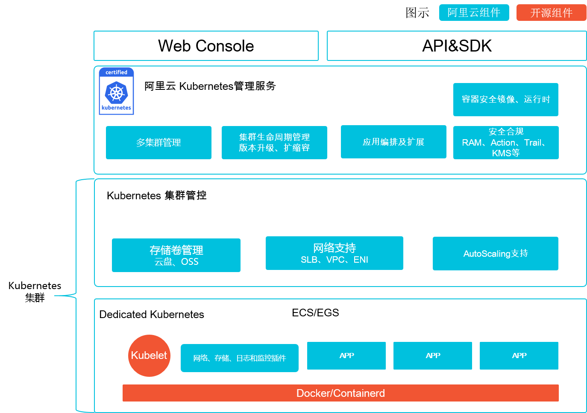
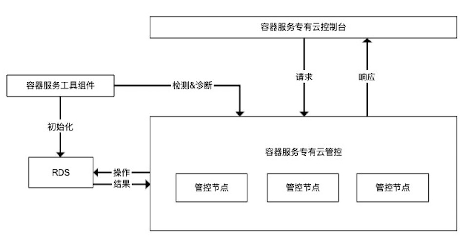
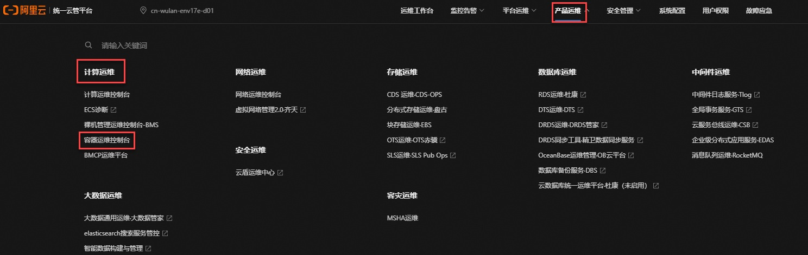
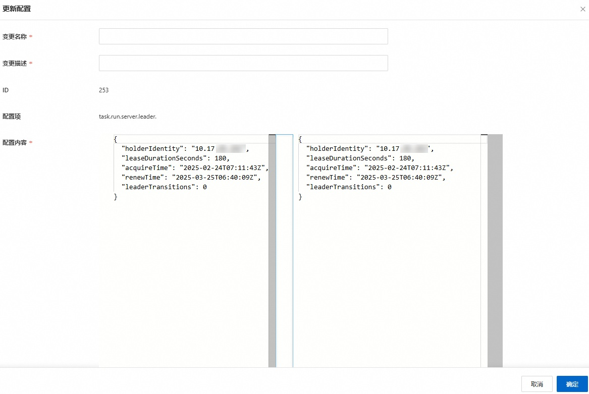
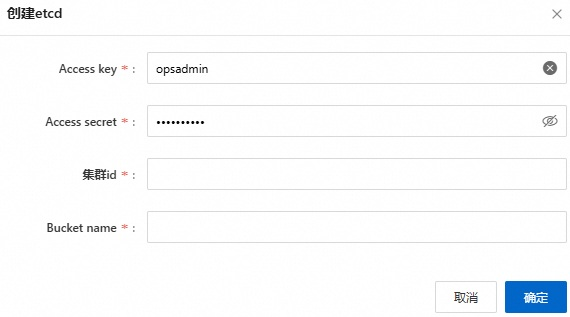

阿里云  
专有云  
容器服务Kubernetes版  
运维指南  
产品版本：V3.18.6  
文档版本：20250924

**目录**

- [1.使用前必读](#section-1)
- [2.产品架构](#section-2)
    - [2.1. 系统架构](#section-2-1)
    - [2.2. 组件架构](#section-2-2)
    - [2.3. 部署架构](#section-2-3)
    - [2.4. 服务角色列表](#section-2-4)
- [3.ACK集群运维](#section-3)
- [4.组件运维](#section-4)
    - [4.1. 组件列表](#section-4-1)
- [5.白屏变更](#section-5)
    - [5.1. K8s版本基线](#section-5-1)
    - [5.2. troopers配置](#section-5-2)
- [6.日志管理](#section-6)
- [7.操作审计](#section-7)
- [8.ETCD运维](#section-8)
    - [8.1. etcd备份](#section-8-1)

# 1.使用前必读

容器服务Kubernetes版提供容器相关服务，对于运行在Kubernetes集群中的应用，不当操作可能导致业务故障。本文介绍容器服务的使用须知和高危操作，帮助用户更好地预估和避免相关的操作风险。

**使用须知**

**数据面组件相关**

数据面组件指运行在用户ECS服务器上的系统组件，例如CoreDNS、Ingress、kube-proxy、terway、kubelet等。由于数据面组件运行在用户ECS服务器上，因此数据面组件运行的稳定性需要阿里云容器服务与用户共同维护。

在使用数据面组件时，请遵循以下建议：

- 使用数据面组件时，修改组件配置可能会导致组件功能异常，请谨慎修改组件配置。关于通过控制台管理组件的具体操作，请参见<strong>《容器服务Kubernetes版 用户指南》</strong>>**《组件》**>**《管理组件》**。

- 请勿直接使用IaaS层产品的OpenAPI来变更组件的运行环境，包括但不限定于使用ECS的OpenAPI更改ECS运行状态、修改Worker节点的安全组配置、更改Worker节点的网络配置以及通过负载均衡的OpenAPI修改SLB配置等，擅自改动IaaS层资源可能会导致数据面组件异常。

- 部分数据面组件受上游社区版组件影响，可能存在有Bug或漏洞，请注意及时升级组件，以避免开源组件Bug或漏洞导致业务受损。

**集群升级相关**

请务必通过容器服务的集群升级功能升级集群的K8s版本，自行升级K8s版本可能导致Kubernetes集群的稳定性和兼容性问题。具体操作，请参见<strong>《容器服务Kubernetes版 用户指南》</strong>>**《Kubernetes集群》**>**《集群》**>**《升级集群》**。

阿里云容器服务对集群升级提供以下支持：

- 提供集群K8s新版本的升级功能。

- 提供K8s新版本的版本说明文档，包括相较于前版本的变化。

- 提示升级到K8s新版本时因资源变化可能会发生的风险。

您在使用集群升级功能时，请遵循以下建议：

- 详细阅读K8s新版本的版本说明文档，并根据提示的升级风险确认集群和业务的状态，自行判断升级风险。更多信息，请参见<strong>《容器服务Kubernetes版 用户指南》</strong>><strong>《产品公告》</strong>和<strong>《容器服务Kubernetes版 用户指南》</strong>>**《Kubernetes集群》**>**《集群》**>**《升级集群》**。

- 由于集群升级不提供回滚功能，请做好充分的升级计划和预后备案。

**Kubernetes原生配置相关**

- 请勿擅自修改Kubernetes的关键配置，例如以下文件的路径、链接和内容：

  - /var/lib/kubelet

  - /var/lib/docker

  - /etc/kubernetes

  - /etc/kubeadm

  - /var/lib/containerd

- 在YAML模板中请勿使用Kubernetes集群预留的Annotation，否则会造成资源不可用、申请失败或异常等问题。以 `kubernetes.io/` 和 `k8s.io/` 开头的标签为核心组件预留标签。违规示例： `pv.kubernetes.io/bind-completed: "yes"` 。

**应用目录相关**

为了丰富Kubernetes应用，容器服务基于开源软件做了适配和二次开发，提供了应用目录功能，帮助用户快速部署应用。容器服务无法管控开源软件本身产生的缺陷，请知晓此风险。

**高危操作**

在使用容器服务过程中相关功能模块存在高危操作，可能会对业务稳定性造成较大影响。在使用前请认真了解以下高危操作及其影响。

**集群相关高危操作**

**分类**

**高危操作**

**影响**

**恢复方案**

删除API Server所使用的

导致集群不可操作。

不可恢复，请重新创建集群。

API Server

SLB。

将节点重新添加到集群自动创建的节点安全组中。具体操作，请参见<strong>《云服务器ECS 用</strong>

修改集群内节点安全组。

可能导致节点不可用。

**户指南》**>**《安全组》**>**《ECS实例加入安全组》**。

节点被销毁。

该节点不可用。

不可恢复。

重装操作系统。

节点上组件被删除。

节点移出后再加入集群。

Worker节点

自行升级节点组件版本。

可能导致节点无法使用。

回退到原始版本。

更改节点IP。

节点不可用。

改回原IP。

自行修改核心组件（kubelet、docker、

可能导致节点不可用。

按照官网推荐配置参数。

containerd等）参数。

尝试还原配置项或删除节点重

修改操作系统配置。

可能导致节点不可用。

新添加。

将节点重新添加到集群自动创建的节点安全组中。具体操作，请参见<strong>《云服务器ECS 用</strong>

修改集群内节点安全组。

可能导致Master节点不可用。

**户指南》**>**《安全组》**>**《ECS实例加入安全组》**。

节点被销毁。

该Master节点不可用。

不可恢复。

重装操作系统。

Master节点上组件被删除。

不可恢复。

自行升级Master或者etcd组

可能导致集群无法使用。

回退到原始版本。

件版本。

Master节点

删除或格式化节

（ACK专有

点/etc/kubernetes等核心目

该Master节点不可用。

不可恢复。

版集群）

录数据。

更改节点IP。

该Master节点不可用。

改回原IP。

自行修改核心组件（etcd、kube-apiserver、docker

可能导致Master节点不可用。

按照官网推荐配置参数。

等）参数。

自行更换Master或etcd证书

可能导致集群无法使用。

不可恢复。

自行增加或减少Master节点。

可能导致集群无法使用。

不可恢复。

<table>
  <tr>
    <td>其他</td>
    <td>通过RAM执行权限变更或修改操作。</td>
    <td>集群部分资源如负载均衡可能无法创建成功。</td>
    <td>恢复原先权限。</td>
  </tr>
</table>

**节点池相关高危操作**

| 高危操作 | 影响 | 恢复方案 |
| --- | --- | --- |
| 删除伸缩组。 | 导致节点池异常。 | 不可恢复，只能重建节点池。 |
| 通过kubectl移除节点。 | 节点池节点数显示和实际不符。 | 通过容器服务管理控制台或者节点池相关API移除指定节点。具体操作，请参见<strong>《容器服务Kubernetes版</strong><strong>用户指南》</strong>&gt;<strong>《Kubernetes集</strong><strong>群》</strong>&gt;<strong>《节点》</strong>目录下的<strong>《移除节</strong><strong>点》</strong>和<strong>《节点池管理》</strong>。 |
| 直接释放ECS实例。 | 可能导致节点池详情页面显示异常。 | 不可恢复。正确做法是通过容器服务管理控制台或者节点池相关API进行缩容。具体操作，请参见<strong>《容器服务</strong>Kubernetes版 用户指<strong>南》</strong>&gt;<strong>《Kubernetes集</strong><strong>群》</strong>&gt;<strong>《节点》</strong>目录下的<strong>《移除节</strong><strong>点》</strong>和<strong>《节点池管理》</strong>。 |
| 对开启自动伸缩的节点池手动扩容或缩容。 | 自动伸缩组件会根据策略自动调整节点数，导致结果与期望不符。 | 不可恢复。自动伸缩节点池无需手动干预。 |
| 修改ESS伸缩组的最大或最小实例数。 | 可能导致扩缩容异常。 | • 对于未开启自动伸缩组的节点池，ESS伸缩组最大和最小实例数改为默认值2000和0。 • 对于开启自动伸缩的节点池，将ESS伸缩组最大和最小实例数修改为与节点池最大和最小节点数一致。 |
| 添加已有节点前不做数据备份。 | 添加后实例上的数据丢失。 | 不可恢复。 • 手动添加已有节点前必须对要保留的所有数据做提前备份。 • 自动添加节点时会执行系统盘替盘操作，需要您提前备份保存在系统盘中的有用数据。 |

**网络与负载均衡相关高危操作**

| 高危操作 | 影响 | 恢复方案 |
| --- | --- | --- |
| 修改内核参数<code> net.ipv4.ip_forward=0 </code>。 | 网络不通。 | 修改内核参数为<code> net.ipv4.ip_forward=1 </code>。 |
| 修改内核参数： <code>• net.ipv4.conf.all.rp_fil</code> <code>ter = 1&#124;2</code> <code>• net.ipv4.conf.</code> <code>[ethX].rp_filter = 1&#124;2</code> 说明<code> ethX </code>代表所有以<code> eth </code>开头的网卡。 | 网络不通。 | 修改内核参数为： <code>• net.ipv4.conf.all.rp_fil</code> <code>ter = 0</code> <code>• net.ipv4.conf.</code> <code>[ethX].rp_filter = 0</code> |
| 修改内核参数<code> net.ipv4.tcp_tw_reuse = </code> <code>1 </code>。 | 导致Pod健康检查异常。 | 修改内核参数为<code> net.ipv4.tcp_tw_reuse = </code> <code>0 </code>。 |
| 修改内核参数<code> net.ipv4.tcp_tw_recycle </code> <code>= 1 </code>。 | 导致NAT异常。 | 修改内核参数<code> net.ipv4.tcp_tw_recycle </code> <code>= 0 </code>。 |
| 修改内核参数<code> net.ipv4.ip_local_port_r</code> <code>ange </code>。 | 导致网络偶发不通。 | 修改内核参数到默认值<code> net.ipv4.ip_local_port_r</code> <code>ange="32768 60999" </code>。 |
| 安装防火墙软件，例如Firewalld或者ufw等。 | 导致容器网络不通。 | 卸载防火墙软件并重启节点。 |
| 节点安全组配置未放通容器CIDR的53端口UDP。 | 集群内DNS无法正常工作。 | 按照官网推荐配置放通安全组。 |
| 修改或者删除ACK添加的SLB的标签。 | 导致SLB异常。 | 恢复SLB的标签。 |
| 通过负载均衡控制台修改ACK管理的SLB的配置，包括SLB、监听及虚拟服务器组。 | 导致SLB异常。 | 恢复SLB的配置。 |
| 移除Service中复用已有SLB的Annotation，即<code> service.beta.kubernetes.</code><code>io/alibaba-cloud-</code> <code>loadbalancer-id:</code> <code>${YOUR_LB_ID} </code>。 | 导致SLB异常。 | 在Service中添加复用已有SLB的Annotation。 说明复用已有SLB的Service无法直接修改为使用自动创建SLB的Service。您需要重新创建Service。 |
| 通过负载均衡控制台删除ACK创建的SLB。 | 可能导致集群网络异常。 | 通过删除Service的方式删除SLB。 |

<table>
  <tr>
    <td>在安装Nginx Ingress Controller组件的情况下手动删除kube-system命名空间下的<code> nginx-ingress-</code><code>lb </code> Service。</td>
    <td>Ingress Controller工作不正常，严重时产生崩溃。</td>
    <td>使用以下YAML新建一个同名Service。 <code>apiVersion: v1</code> <code>kind: Service</code> <code>metadata:</code> <code>annotations:</code> <code>labels:</code> <code>app: nginx-ingress-</code> <code>lb</code> <code>name: nginx-ingress-lb</code> <code>namespace: kube-system</code> <code>spec:</code> <code>externalTrafficPolicy:</code> <code>Local</code> <code>ports:</code> <code>- name: http</code> <code>port: 80</code> <code>protocol: TCP</code> <code>targetPort: 80</code> <code>- name: https</code> <code>port: 443</code> <code>protocol: TCP</code> <code>targetPort: 443</code> <code>selector:</code> <code>app: ingress-nginx</code> <code>type: LoadBalancer</code></td>
  </tr>
</table>

**存储相关高危操作**

| 高危操作 | 影响 | 恢复方案 |
| --- | --- | --- |
| 控制台手动解挂云盘。 | Pod写入报IO Error。 | 重启Pod，手动清理节点挂载残留。 |
| 节点上umount磁盘挂载路径 | Pod写入本地磁盘。 | 重启Pod。 |
| 节点上直接操作云盘。 | Pod写入本地磁盘。 | 不可恢复。 |
| 多个Pod挂载相同云盘。 | Pod写入本地磁盘或者报错IO Error。 | 确保一个云盘给一个Pod使用。 |
| 手动删除NAS挂载目录。 | Pod写入报IO Error。 | 重启Pod。 |
| 删除在用的NAS盘或挂载点。 | Pod出现IO Hang。 | 重启ECS节点。 |

**日志相关高危操作**

| 高危操作 | 影响 | 恢复方案 |
| --- | --- | --- |
| 删除宿主机/tmp/ccs-log-collector/pos目录。 | 日志重复采集。 | 不可恢复。该目录下的文件记录了日志的采集位置。 |
| 删除宿主机/tmp/ccs-log-collector/buffer目录。 | 日志丢失。 | 不可恢复。该目录是待消费的日志缓存文件。 |
| 删除aliyunlogconfig CRD资源。 | 日志采集失效。 | 重新创建删除的CRD以及对应的资源，但失效期间日志无法恢复。删除CRD会关联删除对应所有的实例，即使恢复CRD后还需要手动创建被删除的实例。 |
| 删除日志组件。 | 日志采集失效。 | 重新安装日志组件并手动恢复aliyunlogconfig CRD实例，删除期间日志无法恢复。删除日志组件相当于删除aliyunlogconfig CRD以及日志采集器Logtail，期间日志采集能力全部丢失。 |

# 2.产品架构

## 2.1. 系统架构

本文介绍容器服务Kubernetes版的系统架构。

容器服务基于原生Kubernetes进行适配和增强，简化集群的搭建和扩容等工作，整合阿里云虚拟化、存储、网络和安全能力，打造云端最佳的Kubernetes容器化应用运行环境。

| 产品特性 | 特性说明 |
| --- | --- |
| Dedicated集群形态 | 融合阿里云虚拟化技术，可使用ECS、EGS、神龙服务器作为集群节点，实例规格灵活配置，支持丰富的插件。 |
| 阿里云Kubernetes集群管控服务 | 支持强大的网络、存储、集群管理、水平扩容、应用扩展等特性。 |
| 阿里云Kubernetes管理服务 | 支持安全镜像，与阿里云日志服务、密钥管理服务等产品高度集成，提供一个安全合规的Kubernetes解决方案。 |
| 便捷、高效的使用方式 | 容器服务Kubernetes版提供Web Console、API和SDK。 |

## 2.2. 组件架构

本文介绍容器服务Kubernetes版的组件架构。

**分类**

**组件**

**说明**

负责集群、节点、应用等管控控制台

CosConsoleAliyunCom

界面

容器服务专有云控制台

Backend

Dashboard

管控后台

Troopers

RC

组件安装服务

反向通道服务

CloudAccessVpc

静态文件服务

Cert

容器服务专有云管控

组件证书签发服务

CertControl

管控侧镜像服务

Registry

API Server流量转发

Mirana

证书更新

Certificate

初始化数据，注册API

ControlInit

容器服务工具类组件

自检服务

ServiceTest

快捷诊断工具

DiagnosticTool

## 2.3. 部署架构

本文介绍容器服务Kubernetes版的部署架构。

| 组件 | 组件部署说明 |
| --- | --- |
| 容器服务专有云控制台 | 容器化部署 |
| 容器服务专有云管控 | 容器化部署 |
| 容器服务工具类组件 | 容器化部署 |

## 2.4. 服务角色列表

本文介绍容器服务Kubernetes版的服务角色列表。

**集群**

**服务**

**服务角色**

**说明**

**Project**

初始化数据；注册

ControlInit

API

管控后台

Troopers

反向通道服务

CloudAccessVpc

静态文件服务

Cert

组件证书签发服务

CertControl

管控侧镜像服务

Registry

AcsControlCluste

acs

acs-acs_control

r

API Server流量转

Mirana

发

Backend

dashboard

CosConsoleAliyun

控制台

Com

证书更新

Certificate

自检服务

ServiceTest

快捷诊断工具

DiagnosticTool

# 3.ACK集群运维

您可以通过ACK集群页面快速查看环境中所有创建集群的基本信息。

**操作步骤**

1. 在Apsara Uni-manager运维控制台的顶部菜单栏，选择**产品运维 > 计算运维 > 容器运维控制台**。

   

2. 在左侧导航栏单击**ACK集群**进入集群列表页面，您可以查看环境中所有集群的**集群数量**、**节点数量**、**K8s版本**、**操作系统**以及环境中所有集群的整体信息。

3. 在**集群列表**区域，您可以查看所有集群相关的信息，同时支持按照集群的**名称**、**状态**、**类型**以及**标签**搜索待查看的集群。

   | 集群信息 | 说明 |
   | --- | --- |
   | 集群ID/名称 | 集群的ID和名称。 |
   | 集群状态 | 集群目前的状态，例如运行中、创建失败等。 |
   | 标签 | 集群的标签。 |
   | 类型 | 集群的类型，显示为专有集群。 |
   | 节点数 | 集群的节点数。 |
   | 使用量 | 集群的CPU和内存使用量。 |
   | 版本 | 集群版本。 |
   | 创建时间 | 集群的创建时间。 |
   | 操作 | 可对集群执行的操作，例如您可以单击<strong>查看日志</strong>，查看集群的日志信息。 |

4. 在**集群ID/名称**列，定位目标集群后，单击集群名称即可进入单个集群详情页面，您可以查看集群的基本信息以及集群的**API Server 内网连接端点**、**Pod 网络 CIDR**、**Service CIDR**、**kube-proxy 代理模式**、**节点 IP 数量**、**网络插件**等信息。

# 4.组件运维

## 4.1. 组件列表

您可以通过组件列表页面快速查看所有组件的基本信息。

**操作步骤**

1. 在Apsara Uni-manager运维控制台的顶部菜单栏，选择**产品运维 > 计算运维 > 容器运维控制台**。

   

2. 在左侧导航栏选择**组件运维 > 组件列表**，您可以查看环境中所有组件的信息。

3. 在**组件列表**页面，您可以根据组件名称或版本筛选所需查看的组件，然后在组件**名称**列单击目标组件名称，即可进入**组件详情**页面。

   > **说明**
   >
   > 您还可以在目标组件右侧**操作**列，单击**查看集群**，查看与该组件关联的集群的状态。

4. 在**组件详情**页面，您可以查看该组件的基本信息，包括**组件名**、**组件 ID**、**组件类型**、**创建时间**、**组件描述**和**组件模板**。

# 5.白屏变更

## 5.1. K8s版本基线

您可以通过**K8S版本基线**页面快速查看基线信息。

**操作步骤**

1. 在Apsara Uni-manager运维控制台的顶部菜单栏，选择**产品运维 > 计算运维 > 容器运维控制台**。

   

2. 在左侧导航栏选择**白屏变更 > K8S版本基线**，您可以查看基线的**名称**、**基线类型**、**版本**、**集群类型**、**属性**、**创建时间**和可执行操作。您还可以按照基线名称搜索想要查看的基线。

   > **说明**
   >
   > 您可以在对应基线右侧的**操作**列，查看基线的YAML文件或JSON文件。

## 5.2. troopers配置

您可以通过troopers配置页面快速查看和编辑troopers配置的相关信息。

**操作步骤**

1. 在Apsara Uni-manager运维控制台的顶部菜单栏，选择**产品运维 > 计算运维 > 容器运维控制台**。

   

2. 在左侧导航栏选择**白屏变更 > troopers配置**，您可以查看配置项的名称、内容、创建时间、更新时间和可执行操作。您还可以按名称搜索想要查看的配置项。

3. 定位所需改的配置项，在对应的**配置内容**列单击**查看**，即可查看当前配置项的配置信息，您还可以单击右侧**操作**列下的**编辑**，更新当前配置项的配置信息。

   

# 6.日志管理

您可以通过日志管理页面搜索和查看troopers等服务日志。

**操作步骤**

1. 在Apsara Uni-manager运维控制台的顶部菜单栏，选择**产品运维 > 计算运维 > 容器运维控制台**。

   

2. 在左侧导航栏选择**日志管理**，您可以按照logstore和起止时间搜索需要查看的troopers等日志。

# 7.操作审计

您可以通过操作审计页面查看操作的相关信息。

**操作步骤**

1. 在Apsara Uni-manager运维控制台的顶部菜单栏，选择**产品运维 > 计算运维 > 容器运维控制台**。

   

2. 在左侧导航栏单击**操作审计**，您可以查看操作的**变更名称**、**变更描述**、**操作类型**、**操作对象**、**变更类型**、**状态**、**用户**。

   > **重要**
   >
   > 在对应变更的**操作**列，您可以只读方式**查看变更**，同时还可以**回滚变更**。

# 8.ETCD运维

## 8.1. etcd备份

您可以通过etcd备份记录页面备份容器服务的etcd数据并查看历史备份信息。

**操作步骤**

1. 在Apsara Uni-manager运维控制台的顶部菜单栏，选择**产品运维 > 计算运维 > 容器运维控制台**。

   

2. 在左侧导航栏选择**ETCD运维 > ETCD备份**，您可以查看历史etcd备份记录的**集群id**、**bucket**、**用户id**、**id**、**日志**、**创建时间**和**状态**。

3. 在页面左上角，单击**立刻备份**可以对etcd进行备份操作，在弹出的窗口中输入以下信息后，单击**确定**。

   

   | 配置项 | 说明 |
   | --- | --- |
   | Access key | 访问密钥。 |
   | Access secret | 访问密钥密码。 |
   | 集群id | 集群ID。 |
   | Bucket name | Bucket名称。 |
