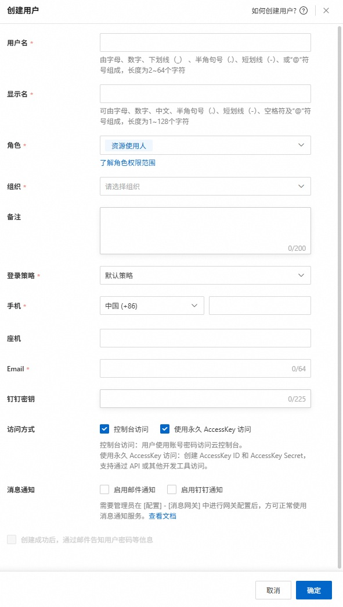
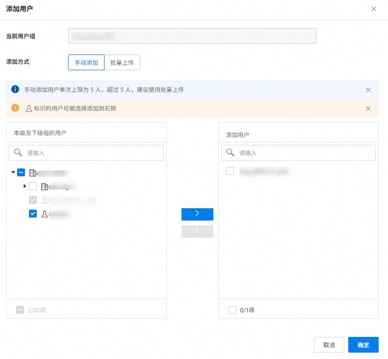
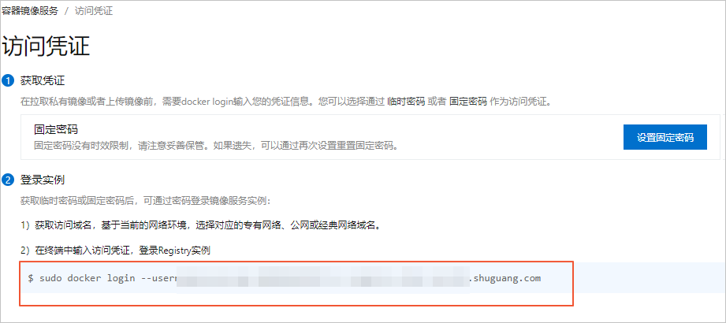
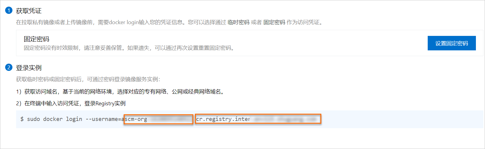
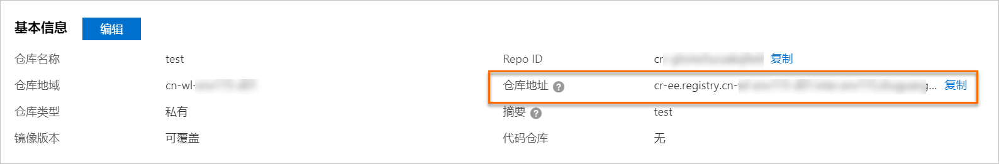

阿里云  
专有云  
容器镜像服务  
用户指南  
产品版本：V3.18.6  
文档版本：20260106

**目录**

- [1.什么是容器镜像服务](#section-1)
- [2.快速入门](#section-2)
    - [2.1. 使用流程](#section-2-1)
    - [2.2. 登录容器镜像服务控制台](#section-2-2)
- [3.容器镜像服务标准版](#section-3)
    - [3.1. 权限管理](#section-3-1)
        - [3.1.1. 创建用户和用户组](#section-3-1-1)
        - [3.1.2. 创建角色和绑定权限](#section-3-1-2)
        - [3.1.3. 仓库访问控制](#section-3-1-3)
    - [3.2. 创建命名空间](#section-3-2)
    - [3.3. 删除命名空间](#section-3-3)
    - [3.4. 创建镜像仓库](#section-3-4)
    - [3.5. 管理镜像仓库](#section-3-5)
    - [3.6. 删除镜像仓库](#section-3-6)
    - [3.7. 配置访问凭证](#section-3-7)
    - [3.8. 上传和下载镜像](#section-3-8)
    - [3.9. 同步容器镜像](#section-3-9)
    - [3.10. 配置触发器](#section-3-10)
    - [3.11. 使用容器镜像加签](#section-3-11)
- [4.容器镜像服务高级版](#section-4)
    - [4.1. 实例概览](#section-4-1)
    - [4.2. 权限管理](#section-4-2)
        - [4.2.1. 创建用户和用户组](#section-4-2-1)
        - [4.2.2. 创建角色和绑定权限](#section-4-2-2)
        - [4.2.3. 仓库访问控制](#section-4-2-3)
    - [4.3. 创建命名空间](#section-4-3)
    - [4.4. 删除命名空间](#section-4-4)
    - [4.5. 创建镜像仓库](#section-4-5)
    - [4.6. 管理镜像仓库](#section-4-6)
    - [4.7. 删除镜像仓库](#section-4-7)
    - [4.8. 配置访问凭证](#section-4-8)
    - [4.9. 上传和下载镜像](#section-4-9)
    - [4.10. 配置触发器](#section-4-10)
    - [4.11. 同账号同步实例](#section-4-11)
    - [4.12. 开启镜像版本不可变](#section-4-12)
    - [4.13. 清理镜像版本](#section-4-13)
    - [4.14. 使用免密组件拉取容器镜像](#section-4-14)
    - [4.15. 使用容器镜像加签](#section-4-15)

<a id="section-1"></a>

# 1.什么是容器镜像服务

容器镜像服务ACR是面向容器镜像、Helm Chart等符合OCI标准的云原生制品安全托管及高效分发平台。支持便捷的容器镜像权限管理、容器镜像同步分发、内容加签保障等能力，便于客户进行容器镜像全生命周期管理。容器镜像服务简化了Registry的搭建及运维工作，并联合容器服务等云产品，帮助企业降低交付复杂度，打造云原生应用一站式解决方案。

**产品类型**

**容器镜像服务标准版**

容器镜像服务标准版面向中小型企业客户，支持容器镜像的安全托管及高效分发，支持多个主账号，每个主账号支持15个命名空间，每个命名空间下支持1000个仓库（公开或私有），支撑100节点以内并发拉取规模。

**容器镜像服务高级版**

容器镜像服务高级版面向中大型企业客户，支持容器镜像、Helm Chart、Operator等符合OCI标准制品的安全托管及生命周期管理，支持多Region同步等高效分发场景，支持1000个命名空间，10万个仓库配额，支撑500节点以内并发拉取规模。

**产品功能**

**一级功能**

**二级功能**

**简介**

**标准版**

**高级版**

支持按照命名空间划分，安全托管

安全托管

支持

支持

容器镜像。

支持查询容器镜像版本，删除容器

生命周期管理

支持

支持

镜像仓库。

容器镜像

- 支持ASCM部门和资源集权限管

细粒度权限管

理。

支持

支持

理

- 支持用户权限管理。

版本不可变

支持镜像版本的不可变。

不支持

支持

制品管理

支持按照命名空间划分，安全托管

安全托管

不支持

支持

OCI制品。

支持查询制品版本，删除制品仓

生命周期管理

不支持

支持

库。

Helm Chart、Operator等OCI制品版本

- 支持ASCM部门和资源集权限管

细粒度权限管

理。

不支持

支持

理

- 支持用户权限管理。

版本不可能

支持OCI制品版本的不可变。

不支持

支持

支持容器镜像更新后，自动触发对

触发器

支持

支持

应触发器的事件。

支持手动触发某个镜像版本的同

手动同步镜像

步，实现多地域容器镜像的容灾备

支持

支持

份。

制品安全

基于同步规则，支持镜像推送后自

自动同步镜像

不支持

支持

动同步。

支持配置HTTPS加密协议分发容器

加密分发容器镜像

支持

支持

镜像。

支持容器镜像加签，保障镜像从分

制品安全

容器镜像加签

发到部署全链路一致性，避免中间

支持

支持

人攻击和非法镜像的更新及运行。

镜像安全扫描（与云安全扫描能力

支持容器镜像安全扫描，识别镜像

支持

支持

协作）

的漏洞风险。

在容器服务平台部署，支持免密拉

免密拉取

支持

支持

取配置，避免每次设置Secret。

部署集成

在容器服务平台部署，支持可视化

部署选择

支持

支持

选择ACR中的镜像仓库及版本。

<a id="section-2"></a>

# 2.快速入门

<a id="section-2-1"></a>

## 2.1. 使用流程

本文介绍容器镜像服务的使用流程。


**标准版实例使用流程**

1. 登录容器镜像服务控制台。

2. 创建命名空间，具体操作，请参见创建命名空间。

3. 创建镜像仓库，具体操作，请参见创建镜像仓库。

4. 上传和下载镜像，具体操作，请参见上传和下载镜像。

**高级版实例使用流程**

1. 登录容器镜像服务控制台。

2. 创建命名空间，具体操作，请参见创建命名空间。

3. 创建镜像仓库，具体操作，请参见创建镜像仓库。

4. 上传和下载镜像，具体操作，请参见上传和下载镜像。

<a id="section-2-2"></a>

## 2.2. 登录容器镜像服务控制台

您可按照以下的配置方法，登录到容器镜像服务管理控制台。

**前提条件**

- 登录Apsara Uni-manager运营控制台前，确认您已从部署人员处获取Apsara Uni-manager运营控制台的服务域名地址。

- 推荐使用Chrome浏览器。

**操作步骤**

1. 在浏览器地址栏中，输入Apsara Uni-manager运营控制台的服务域名地址，按回车键。

   

   > **说明**
   >
   > - 单击页面右上角的当前语言可以切换其它语言。
   >
   > - 授权登录是第三方认证中配置了全局IdP设置才会显示，且“授权登录”名称用户可按需自定义。
   >
   > - 由于浏览器证书过期或环境开启HTTPS认证等出现多次单击继续访问或无Apsara Uni-manager运营控制台地址入口等现象，此时需要安装证书才能正常访问。单击页面右上角的**浏览器证书安装**，可打开浏览器证书安装指南。

2. 输入正确的用户名及密码。

   > **说明**
   >
   > - 请向运营管理员获取登录控制台的用户名和密码。
   >
   > - 首次登录Apsara Uni-manager运营控制台时，需要修改登录用户名的密码，请按照提示完成密码修改。为提高安全性，密码长度必须为10~32位，且包含英文字母大小写、阿拉伯数字和特殊符号（感叹号（!）、at（@）、井号（#）、美元符号（$）、百分号（%）等）。

3. 单击**账号登录**。

4. 如果账号已激活MFA多因素认证，请根据以下两种情况进行操作：

   - **管理员强制开启MFA后的首次登录**

     <ol type="a">

     <li>

     在绑定虚拟MFA设备页面中，按页面提示步骤绑定MFA设备。

     </li>

     <li>

     按照步骤2重新输入账号和密码，单击**账号登录**。

     </li>

     </ol>

     <ol type="i" start="100">

     <li>

     输入6位MFA码后单击**认证**。

     </li>

     </ol>

   - **您已开启并绑定MFA**

     输入6位MFA码后单击**认证**。

     > **说明**
     >
     > 绑定并开启MFA的操作请参见管理多因素认证。

5. 在页面顶部的菜单栏中，选择**产品 > 计算 > 容器镜像服务ACR**。

6. 在**实例列表**页面选择实例进行容器镜像操作。

   - 单击**enterprise-edition**，您可以在高级版实例中创建命名空间、上传和下载镜像等操作。

   - 单击**标准实例**，您可以在标准版实例中创建命名空间、上传和下载镜像等操作。

7. 界面悬浮球的操作。

   - 点击悬浮球上的购物车图标可直接跳转至购物车界面；

   - 点击悬浮球上的箭头图标可展开或收起浮层菜单。

   > **说明**
   >
   > 悬浮球默认位于页面右下角，用户可将其拖动至所需位置。

<a id="section-3"></a>

# 3.容器镜像服务标准版

<a id="section-3-1"></a>

## 3.1. 权限管理

<a id="section-3-1-1"></a>

### 3.1.1. 创建用户和用户组

阿里云账号可以创建用户，并为用户赋予角色，以满足用户对系统的访问控制需求。

**前提条件**

- 登录Apsara Uni-manager运营控制台前，确认您已从部署人员处获取Apsara Uni-manager运营控制台的服务域名地址。

- 推荐使用Chrome浏览器。

**创建组织**

创建用户和用户组都需要提前创建组织。

1. 在浏览器地址栏中，输入Apsara Uni-manager运营控制台的服务域名地址，按回车键。

   

   > **说明**
   >
   > - 单击页面右上角的当前语言可以切换其它语言。
   >
   > - 授权登录是第三方认证中配置了全局IdP设置才会显示，且“授权登录”名称用户可按需自定义。
   >
   > - 由于浏览器证书过期或环境开启HTTPS认证等出现多次单击继续访问或无Apsara Uni-manager运营控制台地址入口等现象，此时需要安装证书才能正常访问。单击页面右上角的**浏览器证书安装**，可打开浏览器证书安装指南。

2. 以阿里云主账号登录Apsara Uni-manager运营控制台。

   请向运营管理员获取登录控制台的用户名和密码。

   > **说明**
   >
   > 首次登录Apsara Uni-manager运营控制台时，需要修改登录用户名的密码，请按照提示完成密码修改。为提高安全性，密码长度必须为8~20位，且至少包含以下任意两种类型：
   >
   > - 英文大写或小写字母（A~Z、a~z）
   >
   > - 阿拉伯数字（0~9）
   >
   > - 特殊符号（感叹号（！）、at（@）、井号（#）、美元符号（$）、百分号（%）等）

3. 单击**账号登录**。

4. 在页面顶部的导航栏中，选择**企业**。

5. 在左侧导航栏中单击**资源管理** > **组织管理**。

6. 在**组织管理**页面左侧组织树上选择目标节点（即上级组织），然后在右侧单击**创建组织**。

7. 在**添加组织**对话框，设置组织名称，然后单击**确定**。

   更多信息，请参见<strong>《统一云管平台 用户指南》</strong>>**《企业中心》**><strong>《资源管理》</strong>章节下的<strong>《组织管理》</strong>>**《创建组织》**。

**创建用户组**

角色无法直接与用户进行绑定，您可以为用户组绑定一个角色，用户组中的用户即可获得角色的权限。

1. 在页面顶部的导航栏中，选择**企业**。

2. 在左侧导航栏，选择**人员管理** > **用户组管理**。

3. 在**用户组管理**页面，单击**创建用户组**。

4. 在**创建用户组**对话框，设置<strong>用户组名、</strong>选择目标**组织**和**角色授权**，然后单击**确定**。

   更多信息，请参见<strong>《统一云管平台 用户指南》</strong>>**《企业中心》**><strong>《人员管理》</strong>章节下的<strong>《用户组管理》</strong>>**《创建用户组》**。

**创建用户**

您可以根据需要创建用户。

1. 在页面顶部的导航栏中，选择**企业**。

2. 在左侧导航栏，选择**人员管理** > **用户管理。**

3. 在**用户管理**页面，单击**系统用户**页签，然后单击**创建用户**。

4. 在**创建用户**对话框，设置用户基本信息，然后单击**确定**。

   更多信息，请参见<strong>《统一云管平台 用户指南》</strong>>**《企业中心》**><strong>《人员管理》</strong>章节下的<strong>《用户管理》</strong>>**《创建用户》**。

   

**添加用户到用户组**

用户添加到用户组后，即可享有用户组所绑定角色的权限。

1. 在页面顶部的导航栏中，选择**企业**。

2. 在左侧导航栏，选择**人员管理 > 用户组管理**。

3. 在**用户组管理**页面选择目标用户组，在其**操作**列单击**添加用户**。

4. 在**添加用户**对话框，选择组织下的目标用户并单击  图标，然后单击**确定**。

   更多信息，请参见<strong>《统一云管平台 用户指南》</strong>>**《企业中心》**><strong>《人员管理》</strong>章节下的<strong>《用户组管理》</strong>>**《用户组中添加用户》**。

   

<a id="section-3-1-2"></a>

### 3.1.2. 创建角色和绑定权限

容器镜像服务使用阿里云账号和RAM用户鉴权体系，且目前已支持RAM鉴权，您可以自定义创建角色并绑定权限策略，为用户赋予角色，以便更好的为用户分配权限。本文介绍创建角色、角色绑定用户组等操作。

**前提条件**

- 登录Apsara Uni-manager运营控制台前，确认您已从部署人员处获取Apsara Uni-manager运营控制台的服务域名地址。

- 推荐使用Chrome浏览器。

**创建角色**

1. 在浏览器地址栏中，输入Apsara Uni-manager运营控制台的服务域名地址，按回车键。

   

   > **说明**
   >
   > - 单击页面右上角的当前语言可以切换其它语言。
   >
   > - 授权登录是第三方认证中配置了全局IdP设置才会显示，且“授权登录”名称用户可按需自定义。
   >
   > - 由于浏览器证书过期或环境开启HTTPS认证等出现多次单击继续访问或无Apsara Uni-manager运营控制台地址入口等现象，此时需要安装证书才能正常访问。单击页面右上角的**浏览器证书安装**，可打开浏览器证书安装指南。

2. 以阿里云账号登录Apsara Uni-manager运营控制台。

   请向运营管理员获取登录控制台的用户名和密码。

   > **说明**
   >
   > 首次登录Apsara Uni-manager运营控制台时，需要修改登录用户名的密码，请按照提示完成密码修改。为提高安全性，密码长度必须为8~20位，且至少包含以下两种类型：
   >
   > - 英文大写或小写字母（A~Z、a~z）
   >
   > - 阿拉伯数字（0~9）
   >
   > - 特殊符号（感叹号（！）、at（@）、井号（#）、美元符号（$）、百分号（%）等）

3. 单击**账号登录**。

4. 在页面顶部的导航栏中，选择**企业**。

5. 在左侧导航栏，选择**权限管理** **> 角色授权**。

6. 在角色列表上方，单击<strong>创建自定义角色，</strong>进入**创建自定义角色**页面。

   您可以创建自定义角色、RAM角色授权、RAM授权，以便更好地分配权限，满足不同的功能的需求。具体操作，请参见<strong>《Apsara Uni-manager运营控制台 用户指南》</strong>>**《企业中心》**>**《权限管理》**>**《角色授权》**。

   - **创建自定义角色**

     <ol type="a">

     <li>

     在**基础配置**向导中，设置**角色名称**、**共享范围** 、**管理范围**等信息，然后单击**下一步**。

     <table>
       <tr>
         <th width="137">参数</th>
         <th>描述</th>
       </tr>
       <tr>
         <td>角色名称</td>
         <td><br>自定义角色名称，例如管理<code>ACR</code>权限。</td>
       </tr>
       <tr>
         <td>描述</td>
         <td>角色的备注信息，通常用来描述角色所具备的权限。</td>
       </tr>
       <tr>
         <td>共享范围</td>
         <td>请根据实际需要选择角色的共享范围：<br>• <strong>全局共享</strong>：默认选项，该角色可以被所有组织看见并使用。<br>• <strong>本组织内共享</strong>：该角色可以被用户所属的组织看见并使用。<br>• <strong>下级组织共享</strong>：该角色可以被用户所属组织及其下级组织看见并使用。</td>
       </tr>
       <tr>
         <td>管理范围</td>
         <td>代表该角色能管理的资源范围，结合被授权给的用户所在组织，可管理对应范围的资源。<br>• <strong>所有组织</strong>：表示此角色可以管理所有组织内的云产品资源。<br>• <strong>本组织及级联下级组织</strong>：表示此角色可以管理本组织及级联下级组织下的云资源。<br>• <strong>资源集</strong>：表示此角色只能管理某资源集下的云资源。</td>
       </tr>
       <tr>
         <td>自定义权限策略</td>
         <td>可启用或关闭自定义权限策略。</td>
       </tr>
     </table>

     </li>

     <li>

     设置**管理权限**，在权限列表勾选需要授权的管理权限点后，单击**下一步**。管理权限是为角色设置控制台相关维度的操作权限，如对组织、用户、资源集等操作进行授权。

     </li>

     </ol>

     <ol type="i" start="100">

     <li>

     设置**应用权限**，在权限列表勾选需要授权的云产品权限点后，单击**下一步**。应用权限是为角色设置云产品相关权限点，主要用于决定用户需要哪些云产品的哪些操作权限。如只需要为用户设置容器镜像服务的查看权限，则只需要在界面上勾选容器镜像服务下的查看资源权限即可。

     </li>

     <li value="500">

     设置**菜单权限**，在列表勾选需要授权的菜单入口后，单击**下一步**或**创建**。菜单权限是为角色设置菜单项来控制角色可查看到的菜单，用来实现入口的屏蔽。如只需要为用户设置容器镜像服务入口权限，则需要在界面上勾选容器镜像服务即可（系统自动勾选子节点）。

     </li>

     </ol>

   - **创建RAM角色授权**

     <ol type="a">

     <li>

     在创建自定义角色页面，展开页面下方的**高级创建**，单击**创建RAM角色授权**。

     </li>

     <li>

     设置**基础配置**，单击**下一步**。

     <table>
       <tr>
         <th width="89">参数</th>
         <th>说明</th>
       </tr>
       <tr>
         <td>角色名称</td>
         <td>自定义名称。</td>
       </tr>
       <tr>
         <td>描述</td>
         <td>（可选）角色描述信息。</td>
       </tr>
       <tr>
         <td>共享范围</td>
         <td>代表该角色的可见性范围。运营管理员创建时仅支持选择<strong>全局共享</strong>。<br>• <strong>全局共享</strong>：角色的共享范围为所有组织。<br>• <strong>本组织内共享</strong>：角色的共享范围为本级组织。<br>• <strong>下级组织共享</strong>：角色的共享范围为本级及下级组织使用。</td>
       </tr>
     </table>

     </li>

     </ol>

     <ol type="i" start="100">

     <li>

     在**自定义权限策略配置**页面，勾选权限策略，单击**下一步**。

     可以勾选已有权限策略，也可以单击**创建权限策略**自定义权限策略。自定义策略内容，请参见<strong>《仓库访问控制》</strong>。

     </li>

     <li value="500">

     在**信任策略配置**页面，选择**授信组织**和**授信云服务**，单击**下一步**。信任策略用来定义可以扮演RAM角色的实体，这里可以指定一级组织（即云账号）和云服务扮演RAM角色。

     </li>

     </ol>

     <ol type="a" start="5">

     <li>

     在**策略预览**页面，查看已选权限策略和信任策略内容，确认后单击**创建**，完成该RAM角色授权的创建。

     </li>

     </ol>

   - **创建RAM授权**

     <ol type="a">

     <li>

     在创建自定义角色页面，展开页面下方的**高级创建**，单击**创建RAM授权**。

     </li>

     <li>

     在**基本信息**中，填写RAM授权信息后，单击**创建RAM授权并配置**。

     <table>
       <tr>
         <th width="89">参数</th>
         <th>说明</th>
       </tr>
       <tr>
         <td>角色名称</td>
         <td>角色的名称。</td>
       </tr>
       <tr>
         <td>描述</td>
         <td>（可选）角色描述信息。</td>
       </tr>
       <tr>
         <td>共享范围</td>
         <td>代表该角色的可见性范围。运营管理员创建时仅支持选择<strong>全局共享</strong>。<br>• <strong>全局共享</strong>：角色的共享范围为所有组织。<br>• <strong>本组织内共享</strong>：角色的共享范围为本级组织。<br>• <strong>下级组织共享</strong>：角色的共享范围为本级及下级组织使用。</td>
       </tr>
     </table>

     </li>

     </ol>

     <ol type="i" start="100">

     <li>

     在**角色授权**向导页面，进行角色授权配置。

     <table>
       <tr>
         <th width="106">配置项</th>
         <th>说明</th>
       </tr>
       <tr>
         <td>用户组管理</td>
         <td>a. 单击<strong>用户组管理</strong>页签。<br>b. 单击<strong>添加用户组</strong>，在<strong>添加用户组</strong>对话框中选择目标用户组后，单击<strong>确定</strong>。您可以选择不绑定用户组，而在用户组页面绑定角色。具体操作，请参见为用户组绑定角色。</td>
       </tr>
       <tr>
         <td>权限管理</td>
         <td>a. 单击<strong>权限管理</strong>页签。<br>b. 单击<strong>添加权限策略</strong>，在<strong>添加权限策略</strong>对话框中选择权限策略，单击<strong>确定</strong>。如果现有权限策略不满足需求也自己创建权限策略。自定义策略内容，请参见<strong>《仓库访问控制》</strong>。</td>
       </tr>
     </table>

     </li>

     <li value="500">

     配置完成后，单击**确定**。

     </li>

     </ol>

**为用户组绑定角色**

为用户组绑定角色后，用户组内所有用户即获得该角色的权限。一个用户组只能绑定一个角色。

1. 在页面顶部的导航栏中，选择**企业**。

2. 在左侧导航栏，选择**人员管理** > **用户组管理**。

3. 在**用户组管理**页面选择目标用户组，单击其**操作**列下的**授权**。

4. 在**授权**对话框的**角色授权**下拉列表选择需要授予的角色，然后单击**确定**。

<a id="section-3-1-3"></a>

### 3.1.3. 仓库访问控制

您可以通过给用户授权，使用户拥有仓库的访问权限。本文介绍如何在不同的场景下配置仓库的访问控制。

**注意事项**

在对用户授权时，请特别关注下面的说明，以免您为用户授予过大的权限。

如果您为某一个用户授予阿里云所有资源的管理权限（即AdministratorAccess），无论您之前是否为该用户授予过镜像服务的权限，该用户都将拥有对镜像服务的全部权限。

**系统策略配置**

- AliyunContainerRegistryFullAccess

  用户拥有该授权后，对于镜像资源的权限等同于阿里云账号，可以做任意操作。

  ```json
  {
    "Statement": [
      {
        "Action": "cr:*",
        "Effect": "Allow",
        "Resource": "*"
      }
    ],
    "Version": "1"
  }
                      
  ```

- AliyunContainerRegistryReadOnlyAccess

  用户拥有该授权后，对于所有镜像资源有只读权限，例如：可以查看仓库列表，Pull镜像等。

  ```json
  {
    "Statement": [
      {
        "Action": [
          "cr:Get*",
          "cr:List*",
          "cr:PullRepository"
        ],
        "Effect": "Allow",
        "Resource": "*"
      }
    ],
    "Version": "1"
  }
                      
  ```

**典型场景策略配置**

- 场景1

  场景描述：授予用户某个命名空间（例如：juzhong）的读权限。用户登录镜像仓库后拉取所有该命名空间下的镜像，可以通过OpenAPI查看到该命名空间的信息及该命名空间下所有镜像仓库的相关信息。

  ```json
  {
    "Statement": [
      {
        "Action": [
          "cr:Get*",
          "cr:List*",
          "cr:PullRepository"
        ],
        "Effect": "Allow",
        "Resource": [
          "acs:cr:*:*:repository/juzhong/*"
        ]
      }
    ],
    "Version": "1"
  }
                      
  ```

  > 如果同时需要用户在控制台查看命名空间，需要进行如下授权。用户可以看到全量的命名空间及仓库
  >
  > **重要**
  >
  > 列表，但仅能Pull其中juzhong这个命名空间下的仓库。

  ```json
  {
    "Statement": [
      {
        "Action": [
          "cr:Get*",
          "cr:List*",
          "cr:PullRepository"
        ],
        "Effect": "Allow",
        "Resource": [
          "acs:cr:*:*:repository/juzhong/*"
        ]
      },
      {
        "Action": [
          "cr:ListNamespace",
          "cr:ListRepository"
        ],
        "Effect": "Allow",
        "Resource": [
          "*"
        ]
      }
    ],
    "Version": "1"
  }
                      
  ```

- 场景2

  场景描述：授权用户某个镜像仓库（例如：镜像仓库名为nginx，所属命名空间名为juzhong，所属地域为华东1）的所有权限。

  > 如需通过用户在控制台上管理镜像仓库，依然需要参考场景1配置。
  >
  > **重要**

  ```json
  {
    "Statement": [
      {
        "Action": [
          "cr:*"
        ],
        "Effect": "Allow",
        "Resource": [
          "acs:cr:cn-hangzhou:*:repository/juzhong/nginx"
        ]
      },
      {
        "Action": [
          "cr:Get*",
          "cr:List*"
        ],
        "Effect": "Allow",
        "Resource": [
          "acs:cr:*:*:repository/juzhong"
        ]
      }
    ],
    "Version": "1"
  }
                      
  ```

- 场景3

  场景描述：授予用户某命名空间的所有操作权限 。

  > 此场景仅可以通过OpenAPI调用。如果需要同时在控制台看到所有仓库，请参照场景1。
  >
  > **重要**

  ```json
  {
      "Statement": [
          {
              "Action": [
                  "cr:*"
              ],
              "Effect": "Allow",
              "Resource": [
                  "acs:cr:cn-hangzhou:*:repository/juzhong",
                  "acs:cr:cn-hangzhou:*:repository/juzhong/*"
              ]
          }
      ],
      "Version": "1"
  }
  ```

**镜像服务鉴权规则**

- 资源描述

  在通过用户进行授权时，资源的描述方式如下表所示：

  <table>
    <tr>
      <th width="108">资源类型</th>
      <th>授权策略中的资源描述</th>
    </tr>
    <tr>
      <td>repository</td>
      <td>acs:cr:$regionid:$accountid:repository/$namespacena me/$repositoryname</td>
    </tr>
  </table>

  参数说明如下表所示：

  | 参数名称 | 说明 |
  | --- | --- |
  | $regionid | 地域ID，可用星号（\*）代替。 |
  | $accountid | 云账号数字ID，可用星号（\*）代替。 |
  | $namespacename | 命名空间名称。 |
  | $repositoryname | 镜像仓库名称。 |

- 鉴权规则

  用户或者STS方式访问镜像服务API时，镜像服务会向用户进行权限检查，以确保调用者拥有相应权限。每个API会根据涉及到的资源以及API的语义来确定需要检查哪些资源的权限。每个API的鉴权规则如下表所示：

  | API | 鉴权Action | 鉴权Resource |
  | --- | --- | --- |
  | 创建命名空间 | cr:CreateNamespace | \* |
  | 删除命名空间 | cr:DeleteNamespace | acs:cr:$regionid:$accountid:reposit ory/$namespacename |
  | 更新命名空间信息 | cr:UpdateNamespace | acs:cr:$regionid:$accountid:reposit ory/$namespacename |
  | 获取指定命名空间 | cr:GetNamespace | acs:cr:$regionid:$accountid:reposit ory/$namespacename |
  | 获取命名空间列表 | cr:ListNamespace | \* |
  | 创建仓库 | cr:CreateRepository | acs:cr:$regionid:$accountid:reposit ory/$namespacename |
  | 删除仓库 | cr:DeleteRepository | acs:cr:$regionid:$accountid:reposit ory/$namespacename/$repositoryn ame |
  | 更新仓库信息 | cr:UpdateRepository | acs:cr:$regionid:$accountid:reposit ory/$namespacename/$repositoryn ame |
  | 查询仓库信息 | cr:GetRepository | acs:cr:$regionid:$accountid:reposit ory/$namespacename/$repositoryn ame |
  | 查询仓库列表信息 | cr:ListRepository | \* |
  | 根据命名空间查询仓库列表信息 | cr:ListRepository | \* |
  | 查询仓库标签信息 | cr:ListRepositoryTag | acs:cr:$regionid:$accountid:reposit ory/$namespacename/$repositoryn ame |
  | 删除镜像版本 | cr:DeleteRepositoryTag | acs:cr:$regionid:$accountid:reposit ory/$namespacename/$repositoryn ame |
  | 查询镜像Manifest信息 | cr:GetRepositoryManifest | acs:cr:$regionid:$accountid:reposit ory/$namespacename/$repositoryn ame |
  | 查询镜像层信息 | cr:GetRepositoryLayers | acs:cr:$regionid:$accountid:reposit ory/$namespacename/$repositoryn ame |
  | 获取临时Token | cr:GetAuthorizationToken | \* |
  | Pull镜像 | cr:PullRepository | acs:cr:$regionid:$accountid:reposit ory/$namespacename/$repositoryn ame |
  | Push镜像 | cr:PushRepository | acs:cr:$regionid:$accountid:reposit ory/$namespacename/$repositoryn ame |

<a id="section-3-2"></a>

## 3.2. 创建命名空间

您可在容器镜像服务页面创建命名空间，用作一些镜像仓库的集合。

**背景信息**

命名空间作为一些仓库的集合，推荐将一个公司或组织的仓库集中在一个命名空间下面。

- 以公司名称作为命名空间：aliyun、alibaba。

- 以团队、组织作为命名空间：team。

**操作步骤**

1. 登录容器镜像服务控制台。

2. 在**实例列表**页面单击**标准实例**。

3. 在标准实例管理页面左侧导航栏单击**命名空间**。

4. 在**命名空间**页面单击**创建命名空间**。

5. 在**创建命名空间**页面设置**组织**、**资源集**、**地域**、**共享范围**和**命名空间**名称，然后单击**确认订单**。

   > **说明**
   >
   > 您也可以选择单击**加入配置报价器**以便后续购买。

   <table>
     <tr>
       <th width="89">参数</th>
       <th>说明</th>
     </tr>
     <tr>
       <td>组织</td>
       <td>所创建的命名空间归属的组织。</td>
     </tr>
     <tr>
       <td>资源集</td>
       <td>所创建的命名空间归属的资源集。</td>
     </tr>
     <tr>
       <td>地域</td>
       <td>所创建的命名空间归属的地域。</td>
     </tr>
     <tr>
       <td>共享范围</td>
       <td>可选以下共享范围：<br>• <strong>本资源集</strong>。<br>• <strong>本组织及下级组织</strong>。<br>• <strong>本组织</strong>。</td>
     </tr>
     <tr>
       <td>命名空间</td>
       <td>长度限制2-30位，可填写小写英文字母、数字，可使用的分隔符包括“_”、“-”（分隔符不能在首位或末尾）。</td>
     </tr>
   </table>

**后续步骤**

您在创建镜像仓库时，可使用该命名空间作为镜像的集合。

<a id="section-3-3"></a>

## 3.3. 删除命名空间

本文介绍如何在标准版实例下删除命名空间。

**操作步骤**

1. 登录容器镜像服务控制台。

2. 在**实例列表**页面单击**标准实例**。

3. 在标准实例管理页面左侧导航栏单击**命名空间**。

4. 在**命名空间**页面，单击目标命名空间中**操作**列下的**删除**。

5. 在弹出的对话框中，勾选**确认删除**，然后单击**确定**。

<a id="section-3-4"></a>

## 3.4. 创建镜像仓库

您可通过容器镜像服务功能创建镜像仓库，从而上传您的容器镜像。

**操作步骤**

1. 登录容器镜像服务控制台。

2. 在**实例列表**页面单击**标准实例**。

3. 在标准实例管理页面左侧导航栏单击**镜像仓库**。

4. 在**镜像仓库**页面单击**创建镜像仓库**。

5. 在**创建仓库**页面上配置参数，然后单击**确认订单**。

   > **说明**
   >
   > 您也可以选择单击**加入配置报价器**以便后续购买。

   <table>
     <tr>
       <th width="89">参数</th>
       <th>说明</th>
     </tr>
     <tr>
       <td>组织</td>
       <td>所创建的镜像仓库归属的组织。</td>
     </tr>
     <tr>
       <td>资源集</td>
       <td>所创建的镜像仓库归属的资源集。</td>
     </tr>
     <tr>
       <td>地域</td>
       <td>所创建的镜像仓库归属的地域。</td>
     </tr>
     <tr>
       <td>共享范围</td>
       <td>可选以下共享范围：<br>• <strong>本资源集</strong>。<br>• <strong>本组织及下级组织</strong>。<br>• <strong>本组织</strong>。</td>
     </tr>
     <tr>
       <td>命名空间</td>
       <td>选择镜像仓库的<strong>命名空间</strong>。</td>
     </tr>
     <tr>
       <td>仓库名称</td>
       <td>输入镜像仓库的名称。格式：长度限制[1-64],支持小写字母、数字、中划线（-）、下划线（_） （不能以中划线和下划线开头或结尾）。</td>
     </tr>
     <tr>
       <td>摘要</td>
       <td>输入该镜像仓库的摘要信息。</td>
     </tr>
     <tr>
       <td>具体信息</td>
       <td>输入描述信息，长度上限为2000个字符。</td>
     </tr>
     <tr>
       <td>仓库类型</td>
       <td>支持<strong>公开仓库</strong>和<strong>私有仓库</strong>。</td>
     </tr>
   </table>

**后续步骤**

镜像仓库创建完毕后，您可单击目标镜像仓库右侧**操作**列的**管理**，进入镜像仓库**基本信息**页面，了解镜像仓库的操作指南。

<a id="section-3-5"></a>

## 3.5. 管理镜像仓库

本文介绍如何管理标准版实例的镜像仓库。

**编辑镜像仓库信息**

1. 登录容器镜像服务控制台。

2. 在**实例列表**页面单击**标准实例**。

3. 在标准实例管理页面左侧导航栏单击**镜像仓库**。

4. 在**镜像仓库**页面单击目标仓库中**操作**列下的**管理**。

5. 在**基本信息**页面，可看如下信息：

   - **操作指南**：指导用户登录实例、拉取推送镜像、镜像打标选择镜像仓库等。

   - **镜像描述**：对镜像进行描述。

6. 在**基本信息**页面，单击**编辑。**

7. 在**修改基本信息**页面设置**仓库类型**、**摘要**、**描述信息**然后单击**确定**。

   <table>
     <tr>
       <th width="89">参数</th>
       <th>描述</th>
     </tr>
     <tr>
       <td>仓库类型</td>
       <td>公开镜像默认需用户登录实例后才能拉取，如果您期望匿名拉取，请开启实例的公开匿名拉取配置。私有镜像需用户登录实例且有 Pull 操作授权才能拉取。</td>
     </tr>
     <tr>
       <td>摘要</td>
       <td>完善镜像仓库的信息摘要。</td>
     </tr>
     <tr>
       <td>描述信息</td>
       <td>对镜像仓库描述。</td>
     </tr>
   </table>

**触发器**

更多详情，请参见配置触发器。

**镜像版本**

1. 在**基本信息**页面，单击左侧导航栏**镜像版本**。

   可以查看镜像**版本**、**镜像ID**、**镜像版本状态**、**Digest**、**镜像大小**、**最后更新时间**。

2. 在目标镜像版本**操作**列中可执行以下操作：

   - 单击**删除**，在弹出的对话框中勾选**确定删除该版本的镜像**后，单击**确定**。

   - 单击**层信息**，查看镜像的每一层大小和每一层的构建元信息。

   - 单击**同步**，在**选择复制目标仓库**对话框，选择**待复制版本**及**目标仓库**后，单击**确定**。

**镜像同步**

更多详情，请参见同步容器镜像。

<a id="section-3-6"></a>

## 3.6. 删除镜像仓库

本文介绍如何在标准版实例下删除镜像仓库。

**操作步骤**

1. 登录容器镜像服务控制台。

2. 在**实例列表**页面单击**标准实例**。

3. 在标准实例管理页面左侧导航栏单击**镜像仓库**。

4. 在**镜像仓库**页面单击目标仓库中**操作**列下的**删除**。

5. 在弹出的对话框中，勾选**确认删除**，然后单击**确定**。

<a id="section-3-7"></a>

## 3.7. 配置访问凭证

通过配置访问凭证，可以更安全地管控容器镜像的上传和下载。本文介绍如何配置访问凭证。

**操作步骤**

1. 登录容器镜像服务控制台。

2. 在**实例列表**页面单击**标准实例**。

3. 在标准实例管理页面左侧导航栏单击**访问凭证**。

4. 在**访问凭证**页面，单击**设置固定密码**。

5. 在**设置固定密码**对话框中，输入**密码**和**确认密码**。然后单击**确定**。

6. <strong>可选：</strong>如需设置临时密码，具体操作，请参见<strong>《容器镜像服务开发指南》</strong>的<strong>《标准版API参考》</strong>章节的<strong>《GetAuthorizationToken》</strong>。

**相关操作**

您可以使用设置的固定密码或者临时密码登录容器镜像服务实例。

1. 在访问凭证页面查看登录命令。

   

2. 执行获取到的登录命令，并在返回结果中输入密码。

<a id="section-3-8"></a>

## 3.8. 上传和下载镜像

本文介绍如何上传和下载镜像。

**操作步骤**

1. 查看用户名。

   <ol type="i">

   <li>

   登录容器镜像服务控制台。

   </li>

   <li>

   在**实例列表**页面单击**标准实例**。

   </li>

   <li>

   在标准实例管理页面左侧导航栏单击**访问凭证**，在**访问凭证**页面查看用户名和仓库域名。

   

   </li>

   </ol>

2. 执行以下命令，登录镜像仓库。

   ```bash
   sudo docker login --username=<⽤户名> <仓库域名>
   ```

   在返回结果中输入开通服务时设置的密码。如果您忘记密码，您可以重新设置密码。具体操作，请参见配置访问凭证。

3. 上传和下载镜像。

   - 上传镜像

     <ol type="a">

     <li>

     执行以下命令，设置镜像标签。

     ```bash
     sudo docker tag <镜像ID> <仓库域名>/<命名空间名称>/<镜像仓库名称>:<镜像版本号>
     ```

     </li>

     <li>

     执行以下命令，上传镜像。

     ```bash
     sudo docker push <仓库域名>/<命名空间名称>/<镜像仓库名称>:<镜像版本号>                  
     ```

     </li>

     </ol>

   - 下载镜像执行以下命令，下载镜像。

     ```bash
     sudo docker pull <仓库域名>/<命名空间名称>/<镜像仓库名称>:<镜像版本号>
     ```

4. <strong>可选：</strong>修改镜像名称。

   <ol type="i">

   <li>

   执行以下命令，查看镜像ID。

   ```bash
   sudo docker images 
   ```

   </li>

   <li>

   执行以下命令，修改镜像名称。

   ```bash
   sudo docker tag <镜像ID> registryDomain/<命名空间名称>/<镜像仓库名称>:<镜像版本号>
   ```

   </li>

   </ol>

<a id="section-3-9"></a>

## 3.9. 同步容器镜像

容器镜像服务提供了跨数据中心同步功能，方便业务部署的时候可以从最近的数据中心获取容器镜像。

**前提条件**

- 已创建一个命名空间，请参见创建命名空间。

- 已在该命名空间下创建一个镜像仓库，请参见创建镜像仓库。

**操作步骤**

1. 登录容器镜像服务控制台。

2. 在**实例列表**页面单击**标准实例**。

3. 在标准实例管理页面左侧导航栏单击**镜像仓库**。

4. 在**镜像仓库**页面单击目标仓库中**操作**列下的**管理**。

5. 在镜像仓库详情页面左侧导航栏单击**镜像同步**。

6. 在镜像同步页面单击**创建复制任务**。

7. 在**选择复制目标仓库**对话框配置参数，单击**确定**。

   | 参数 | 说明 |
   | --- | --- |
   | 待复制版本 | 选择待同步的仓库版本。 |
   | 目标仓库 | 选择目标仓库的区域、命名空间和仓库名称，输入目标仓库的版本。 |

**执行结果**

在**镜像同步**页面可以看到镜像同步整个任务执行情况。

单击**详情**，可以查看镜像层粒度的同步执行情况。

<a id="section-3-10"></a>

## 3.10. 配置触发器

阿里云镜像服务为每个镜像仓库提供了触发器的功能，帮助用户在镜像构建成功后进行消息的推送，实现持续集成的后续流程。本文介绍如何使用触发器。

**触发器安全规则**

- HTTP服务：默认使用80端口。

  如果要使用其他端口，请在触发器URL末尾手动添加端口号，而且只能选择以下端口号：80、21、443、70、210、280、488、591、777、1025~65535。

- HTTPS服务：默认使用443端口。

  只支持默认的443端口，如果要使用其他端口号，请使用HTTP服务。

**创建触发器**

> **说明**
>
> 仓库的触发器可以订阅新版本镜像产生的事件，当产生新的镜像后，您会看到触发器的访问记录，包括请求的时间、请求的参数以及请求得到的结果。其中请求的参数提供了当前仓库的相关信息。在配置容器服务触发器之前，请先绑定仓库触发器。具体操作，请参考<strong>《容器服务Kubernetes版 用户指南》</strong>中的**Kubernetes集群 > 应用管理 > 使用应用触发器**章节。

1. 登录容器镜像服务控制台。

2. 在**实例列表**页面单击**标准实例**。

3. 在标准实例管理页面左侧导航栏单击**镜像仓库**。

4. 在**镜像仓库**页面单击目标仓库中**操作**列下的**管理**。

5. 在镜像仓库详情页面左侧导航栏单击**触发器**。

6. 在**触发器**页面单击**创建**。

7. 在**创建触发器**对话框中配置参数，然后单击**确定**。

   <table>
     <tr>
       <th width="109">参数</th>
       <th>说明</th>
     </tr>
     <tr>
       <td>名称</td>
       <td>触发器的名称。</td>
     </tr>
     <tr>
       <td>触发器URL</td>
       <td>输入在容器服务Kubernetes创建的触发器URL。</td>
     </tr>
     <tr>
       <td>触发方式</td>
       <td>支持设置<strong>全部触发</strong>、<strong>表达式触发</strong>、<strong>Tag触发</strong>。<br>• <strong>全部触发</strong>：只要镜像构建成功，就立即触发触发器。<br>• <strong>表达式触发</strong>：基于正则表达式来进行Tag的过滤，只有当符合正则表达式的Tag才会继续触发触发器。可以填写简单的正则表示，如<code> release-v.* </code>，则只有Tag为<code> release-v </code>开头的镜像版本在构建后，才会触发后续持续集成的流程；否则为未触发状态，访问记录中访问状态码将显示<strong>未触发</strong>。<br>• <strong>Tag触发</strong>：基于用户筛选的Tag列表来进行触发。可以在列表中筛选需要触发的Tag，最多可选10个，则只有当Tag在列表中时，才会在镜像构建后触发触发器；否则为未触发状态，访问记录中访问状态码将显示<strong>未</strong><strong>触发</strong>。</td>
     </tr>
   </table>

**更多操作**

**查看访问记录**

1. 在**触发器**页面，定位到目标触发器，在其**操作**列单击**访问记录**。

2. 在**访问记录**对话框可查看**访问状态码**、**访问时间**等信息。在目标访问记录**操作**列单击**详情**，可查看访问记录详情，包括请求的时间、请求的参数以及请求得到的结果。

**修改触发器**

1. 在**触发器**页面，定位到目标触发器，在其**操作**列单击**修改**。

2. 在**修改触发器**对话框，修改触发器配置，然后单击**确定**。

**删除触发器**

1. 在**触发器**页面，定位到目标触发器，在其**操作**列单击**删除**。

2. 在**删除确认**对话框，单击**确定**。

<a id="section-3-11"></a>

## 3.11. 使用容器镜像加签

在容器镜像管理中，您可以通过内容可信的机制保障镜像来源安全性。镜像的创建者可以对镜像做数字签名，数字签名将保存在容器镜像服务。

**安装配置工具**

1. 安装Aliyun Client。请参见安装阿里云CLI。

2. 执行以下命令配置Aliyun Client。

   ```text
   ./aliyun configure set \ --profile akProfile \ --mode AK \ --region cn-qingdao-env17-d01 \ --access-key-id yourAK \ --access-key-secret yourAK
   ```

3. GPG工具安装及配置后，执行以下命令导出公钥。

   ```text
   #查询pubKeyIdgpg --fingerprint#导出公钥gpg --armor --output public-key.txt --export yourUser
   ```

   > 专有云instanceId统一为default。
   >
   > **说明**

**容器镜像加签**

1. 执行以下命令确定镜像版本URL。

   ```bash
   echo image://region/instanceId/namespace/repo@digest | tee imageURL.txt#e.g.#echo image://cn-qingdao-env17-d01/default/kritis-
   test/busybox2@sha256:2f122941b5850006dbb7adda78d2ea5b382841ca6569fd174bd24c14bfff3dca > imageURL.txt
   ```

2. 执行以下命令使用gpg工具对镜像唯一URL进行加签，默认生成imageURL.txt.asc。

   ```text
   gpg --armor --sign imageURL.txt
   ```

   imageURL.txt.asc文件的文本内容如下。

   ```text
   -----BEGIN PGP MESSAGE-----
   owGbwMvMwMEo63vGqaX74wXGNXVJ3CmpaYmlOSV6JRUlcZy7vmfmJqanWunr****.......=O2TP-----END PGP MESSAGE-----
   ```

3. 执行以下命令创建命名元数据namesapce。

   ```text
   ./aliyun cr CreateMetadataNamespace --force --version 2018-12-01 --endpoint 
   cr.inter.env17e.shuguang.com --NamespaceName kritis-test-2 --Description "for test"
   ```

4. 执行以下命令创建签名note。

   ```bash
   cat <<EOF > note.json| jq{ "name": "/namespaces/kritis-test-2/notes/image-sign", 
   "LongDescription": "long", "ShortDescription": "short", "ExpirationTime": "2021-01-01T00:00:00Z",
   "Kind": "ATTESTATION", "Attestation": { "Hint": { "HumanReadableName": "ACR" } }}EOF
   ```

5. 执行以下命令创建occurrence，为镜像签名创建occurrence存入元数据服务。

   ```bash
   cat <<EOF > occurrence.json | jq{ "Name": "/namespaces/kritis-test-2/occurrences/randomId1", "NoteName": "/namespaces/kritis-test-2/notes/image-sign", "ResourceUri": "image://cn-qingdao-env17-d01/default/kritis-
   test/busybox2@sha256:2f122941b5850006dbb7adda78d2ea5b382841ca6569fd174bd24c14bff****", "Kind": "A
   TTESTATION", "Attestation": { "Signatures": [ { "Signature": $(cat imageURL.txt.asc|jq -R --slurp
   ), "PublicKeyId": "E5B5FF2AFC3A1D70FE3CE57C1D4DCC42848****" } ] }}EOF
   ```

   ```text
   ./aliyun cr CreateMetadataOccurrence --force --version 2018-12-01 --endpoint 
   cr.inter.env17e.shuguang.com --NamespaceName kritis-test-2 --OccurrenceName randomId1 --Occurrence "$(cat occurrence.json)"
   ```

6. 执行以下命令查询镜像签名。

   ```text
   #获取note下occurrence列表：./aliyun cr ListMetadataOccurrences --force --version 2018-12-01 --endpoint cr.inter.env17e.shuguang.com --NamespaceName kritis-test-2 --NoteName image-sign --PageNo 1 --PageSize 5#获取note下某个resource的occurrence列表：./aliyun cr ListMetadataOccurrences --force --version 2018-12-01 --endpoint cr.inter.env17e.shuguang.com --NamespaceName kritis-test-2 --NoteNameimage-sign --PageNo 1 --PageSize 5 --ResourceURIs '["image://cn-qingdao-env17-d01/default/kritis-test/busybox2@sha256:2f122941b5850006dbb7adda78d2ea5b382841ca6569fd174bd24c14bfff****"]'
   ```

**附录一：通过gpg命令生成publicKeyData**

1. 找到要使用的本地gpg key user。操作示例如下。

   > 下面例子中的user是 `abcdef@example.com` 。
   >
   > **说明**

   ```text
   gpg --list-keyspub rsa2048 2020-01-08 [SC] [有效⾄：2022-01-07] 
   7726310BC6E11E9B57B9CC08E2932E4363F3***uid [ 绝对 ] abcdef <abcdef@example.com>sub rsa2048 2020-01
   -08 [E] [有效⾄：2022-01-07]
   ```

2. 导出这个user的public key，并把public key的内容使用base64编码，得到我们所需的publicKeyData。

   ```bash
   $ gpg --armor --export <user> |base64 | tr -d '\n'# 比如上⾯的 user 是 abcdef@example.com，# 对应的命
   令则是：gpg --armor --export abcdef@example.com |base64 | tr -d '\n'# export publicKeyData=$(gpg --armor --export abcdef@example.com |base64 | tr -d '\n')
   ```

**附录二：获取image对应的digest格式**

可以通过以下方式快速找到某个image对应的digest格式（假设要查找的image是registry.acs.example.com/kritis-test/alpine:3.11）。

```bash
$ docker pull registry.acs.example.com/kritis-test/alpine:3.11$ docker images --digests | grep registry.acs.example.com/kritis-test/alpineregistry.acs.example.com/kritis-test/alpine 3.11 sha256:ddba4d27a7ffc3f86dd6c2f92041af252a1f23a8e742c90e6e1297bfa1bc0c45 e7d92cdc71fe 2 months ago 5.59MB
```

通过输出可知以上例子中对应的digest的值是**sha256:ddba4d27a7ffc3f86dd6c2f92041af252a1f23a8e742c90e6e1297bfa1bc0c45**，所以创建资源时应当使用**registry.acs.example.com/kritis-test/alpine:sha256:ddba4d27a7ffc3f86dd6c2f92041af252a1f23a8e742c90e6e1297bfa1bc0c45**作为image的值。

<a id="section-4"></a>

# 4.容器镜像服务高级版

<a id="section-4-1"></a>

## 4.1. 实例概览

查看容器镜像服务高级版实例信息。

1. 登录容器镜像服务控制台。

2. 在**实例列表**页面单击**enterprise-edition**。

3. 在**enterprise-edition**页面，单击左侧栏的**概览**。

   **实例信息**

   | 参数 | 描述 |
   | --- | --- |
   | 实例ID | 容器镜像服务唯一标识：cri-priv\*\*。 |
   | 付费类型 | - |
   | 实例规格 | 专有云高级版。 |
   | 地域 | 容器镜像服务实例地域：cn-qingdao-env\*\*\*。 |
   | 到期日期 | - |
   | 并发拉取支持 | 500节点。 |

   **仓库信息**

   | 参数 | 描述 |
   | --- | --- |
   | 仓库 | 创建仓库数量：100/100000。 |
   | 命名空间 | 创建命名空间数：15/1000。 |
   | OSS Bucket | - |
   | OSS Bucket存储量 | - |

   **基本功能**

   | 参数 | 描述 |
   | --- | --- |
   | 全球同步加速 | 支持跨云或跨地域自动同步，支持命名空间、仓库级别同步规则。 |
   | 内容可信 | 支持对容器镜像、Helm Charts 等 OCI 制品统一加签。 |
   | Helm Chart | 多版本 Helm Chart 等云原生制品全生命周期管理。 |

   **新手指引**

   | 参数 | 描述 |
   | --- | --- |
   | 访问凭证 | 设置访问密码。详细信息请参见配置访问凭证。 |
   | 命名空间 | 创建命名空间。详细信息请参见创建命名空间。 |
   | 镜像仓库 | 创建镜像仓库。详细信息请参见创建镜像仓库。 |

<a id="section-4-2"></a>

## 4.2. 权限管理

<a id="section-4-2-1"></a>

### 4.2.1. 创建用户和用户组

阿里云账号可以创建用户，并为用户赋予角色，以满足用户对系统的访问控制需求。

**前提条件**

- 登录Apsara Uni-manager运营控制台前，确认您已从部署人员处获取Apsara Uni-manager运营控制台的服务域名地址。

- 推荐使用Chrome浏览器。

**创建组织**

创建用户和用户组都需要提前创建组织。

1. 在浏览器地址栏中，输入Apsara Uni-manager运营控制台的服务域名地址，按回车键。

   

   > **说明**
   >
   > - 单击页面右上角的当前语言可以切换其它语言。
   >
   > - 授权登录是第三方认证中配置了全局IdP设置才会显示，且“授权登录”名称用户可按需自定义。
   >
   > - 由于浏览器证书过期或环境开启HTTPS认证等出现多次单击继续访问或无Apsara Uni-manager运营控制台地址入口等现象，此时需要安装证书才能正常访问。单击页面右上角的**浏览器证书安装**，可打开浏览器证书安装指南。

2. 以阿里云主账号登录Apsara Uni-manager运营控制台。

   请向运营管理员获取登录控制台的用户名和密码。

   > **说明**
   >
   > 首次登录Apsara Uni-manager运营控制台时，需要修改登录用户名的密码，请按照提示完成密码修改。为提高安全性，密码长度必须为8~20位，且至少包含以下任意两种类型：
   >
   > - 英文大写或小写字母（A~Z、a~z）
   >
   > - 阿拉伯数字（0~9）
   >
   > - 特殊符号（感叹号（！）、at（@）、井号（#）、美元符号（$）、百分号（%）等）

3. 单击**账号登录**。

4. 在页面顶部的导航栏中，选择**企业**。

5. 在左侧导航栏中单击**资源管理** > **组织管理**。

6. 在**组织管理**页面左侧组织树上选择目标节点（即上级组织），然后在右侧单击**创建组织**。

7. 在**添加组织**对话框，设置组织名称，然后单击**确定**。

   更多信息，请参见<strong>《统一云管平台 用户指南》</strong>>**《企业中心》**><strong>《资源管理》</strong>章节下的<strong>《组织管理》</strong>>**《创建组织》**。

**创建用户组**

角色无法直接与用户进行绑定，您可以为用户组绑定一个角色，用户组中的用户即可获得角色的权限。

1. 在页面顶部的导航栏中，选择**企业**。

2. 在左侧导航栏，选择**人员管理** > **用户组管理**。

3. 在**用户组管理**页面，单击**创建用户组**。

4. 在**创建用户组**对话框，设置<strong>用户组名、</strong>选择目标**组织**和**角色授权**，然后单击**确定**。

   更多信息，请参见<strong>《统一云管平台 用户指南》</strong>>**《企业中心》**><strong>《人员管理》</strong>章节下的<strong>《用户组管理》</strong>>**《创建用户组》**。

**创建用户**

您可以根据需要创建用户。

1. 在页面顶部的导航栏中，选择**企业**。

2. 在左侧导航栏，选择**人员管理** > **用户管理。**

3. 在**用户管理**页面，单击**系统用户**页签，然后单击**创建用户**。

4. 在**创建用户**对话框，设置用户基本信息，然后单击**确定**。

   更多信息，请参见<strong>《统一云管平台 用户指南》</strong>>**《企业中心》**><strong>《人员管理》</strong>章节下的<strong>《用户管理》</strong>>**《创建用户》**。

   

**添加用户到用户组**

用户添加到用户组后，即可享有用户组所绑定角色的权限。

1. 在页面顶部的导航栏中，选择**企业**。

2. 在左侧导航栏，选择**人员管理 > 用户组管理**。

3. 在**用户组管理**页面选择目标用户组，在其**操作**列单击**添加用户**。

4. 在**添加用户**对话框，选择组织下的目标用户并单击  图标，然后单击**确定**。

   更多信息，请参见<strong>《统一云管平台 用户指南》</strong>>**《企业中心》**><strong>《人员管理》</strong>章节下的<strong>《用户组管理》</strong>>**《用户组中添加用户》**。

   

<a id="section-4-2-2"></a>

### 4.2.2. 创建角色和绑定权限

容器镜像服务使用阿里云账号和RAM用户鉴权体系，且目前已支持RAM鉴权，您可以自定义创建角色并绑定权限策略，为用户赋予角色，以便更好的为用户分配权限。本文介绍创建角色、角色绑定用户组等操作。

**前提条件**

- 登录Apsara Uni-manager运营控制台前，确认您已从部署人员处获取Apsara Uni-manager运营控制台的服务域名地址。

- 推荐使用Chrome浏览器。

**创建角色**

1. 在浏览器地址栏中，输入Apsara Uni-manager运营控制台的服务域名地址，按回车键。

   

   > **说明**
   >
   > - 单击页面右上角的当前语言可以切换其它语言。
   >
   > - 授权登录是第三方认证中配置了全局IdP设置才会显示，且“授权登录”名称用户可按需自定义。
   >
   > - 由于浏览器证书过期或环境开启HTTPS认证等出现多次单击继续访问或无Apsara Uni-manager运营控制台地址入口等现象，此时需要安装证书才能正常访问。单击页面右上角的**浏览器证书安装**，可打开浏览器证书安装指南。

2. 以阿里云账号登录Apsara Uni-manager运营控制台。

   请向运营管理员获取登录控制台的用户名和密码。

   > **说明**
   >
   > 首次登录Apsara Uni-manager运营控制台时，需要修改登录用户名的密码，请按照提示完成密码修改。为提高安全性，密码长度必须为8~20位，且至少包含以下两种类型：
   >
   > - 英文大写或小写字母（A~Z、a~z）
   >
   > - 阿拉伯数字（0~9）
   >
   > - 特殊符号（感叹号（！）、at（@）、井号（#）、美元符号（$）、百分号（%）等）

3. 单击**账号登录**。

4. 在页面顶部的导航栏中，选择**企业**。

5. 在左侧导航栏，选择**权限管理** **> 角色授权**。

6. 在角色列表上方，单击<strong>创建自定义角色，</strong>进入**创建自定义角色**页面。

   您可以创建自定义角色、RAM角色授权、RAM授权，以便更好地分配权限，满足不同的功能的需求。具体操作，请参见<strong>《Apsara Uni-manager运营控制台 用户指南》</strong>>**《企业中心》**>**《权限管理》**>**《角色授权》**。

   - **创建自定义角色**

     <ol type="a">

     <li>

     在**基础配置**向导中，设置**角色名称**、**共享范围** 、**管理范围**等信息，然后单击**下一步**。

     <table>
       <tr>
         <th width="137">参数</th>
         <th>描述</th>
       </tr>
       <tr>
         <td>角色名称</td>
         <td><br>自定义角色名称，例如管理<code>ACR</code>权限。</td>
       </tr>
       <tr>
         <td>描述</td>
         <td>角色的备注信息，通常用来描述角色所具备的权限。</td>
       </tr>
       <tr>
         <td>共享范围</td>
         <td>请根据实际需要选择角色的共享范围：<br>• <strong>全局共享</strong>：默认选项，该角色可以被所有组织看见并使用。<br>• <strong>本组织内共享</strong>：该角色可以被用户所属的组织看见并使用。<br>• <strong>下级组织共享</strong>：该角色可以被用户所属组织及其下级组织看见并使用。</td>
       </tr>
       <tr>
         <td>管理范围</td>
         <td>代表该角色能管理的资源范围，结合被授权给的用户所在组织，可管理对应范围的资源。<br>• <strong>所有组织</strong>：表示此角色可以管理所有组织内的云产品资源。<br>• <strong>本组织及级联下级组织</strong>：表示此角色可以管理本组织及级联下级组织下的云资源。<br>• <strong>资源集</strong>：表示此角色只能管理某资源集下的云资源。</td>
       </tr>
       <tr>
         <td>自定义权限策略</td>
         <td>可启用或关闭自定义权限策略。</td>
       </tr>
     </table>

     </li>

     <li>

     设置**管理权限**，在权限列表勾选需要授权的管理权限点后，单击**下一步**。管理权限是为角色设置控制台相关维度的操作权限，如对组织、用户、资源集等操作进行授权。

     </li>

     </ol>

     <ol type="i" start="100">

     <li>

     设置**应用权限**，在权限列表勾选需要授权的云产品权限点后，单击**下一步**。应用权限是为角色设置云产品相关权限点，主要用于决定用户需要哪些云产品的哪些操作权限。如只需要为用户设置容器镜像服务的查看权限，则只需要在界面上勾选容器镜像服务下的查看资源权限即可。

     </li>

     <li value="500">

     设置**菜单权限**，在列表勾选需要授权的菜单入口后，单击**下一步**或**创建**。菜单权限是为角色设置菜单项来控制角色可查看到的菜单，用来实现入口的屏蔽。如只需要为用户设置容器镜像服务入口权限，则需要在界面上勾选容器镜像服务即可（系统自动勾选子节点）。

     </li>

     </ol>

   - **创建RAM角色授权**

     <ol type="a">

     <li>

     在创建自定义角色页面，展开页面下方的**高级创建**，单击**创建RAM角色授权**。

     </li>

     <li>

     设置**基础配置**，单击**下一步**。

     <table>
       <tr>
         <th width="89">参数</th>
         <th>说明</th>
       </tr>
       <tr>
         <td>角色名称</td>
         <td>自定义名称。</td>
       </tr>
       <tr>
         <td>描述</td>
         <td>（可选）角色描述信息。</td>
       </tr>
       <tr>
         <td>共享范围</td>
         <td>代表该角色的可见性范围。运营管理员创建时仅支持选择<strong>全局共享</strong>。<br>• <strong>全局共享</strong>：角色的共享范围为所有组织。<br>• <strong>本组织内共享</strong>：角色的共享范围为本级组织。<br>• <strong>下级组织共享</strong>：角色的共享范围为本级及下级组织使用。</td>
       </tr>
     </table>

     </li>

     </ol>

     <ol type="i" start="100">

     <li>

     在**自定义权限策略配置**页面，勾选权限策略，单击**下一步**。

     可以勾选已有权限策略，也可以单击**创建权限策略**自定义权限策略。自定义策略内容，请参见<strong>《仓库访问控制》</strong>。

     </li>

     <li value="500">

     在**信任策略配置**页面，选择**授信组织**和**授信云服务**，单击**下一步**。信任策略用来定义可以扮演RAM角色的实体，这里可以指定一级组织（即云账号）和云服务扮演RAM角色。

     </li>

     </ol>

     <ol type="a" start="5">

     <li>

     在**策略预览**页面，查看已选权限策略和信任策略内容，确认后单击**创建**，完成该RAM角色授权的创建。

     </li>

     </ol>

   - **创建RAM授权**

     <ol type="a">

     <li>

     在创建自定义角色页面，展开页面下方的**高级创建**，单击**创建RAM授权**。

     </li>

     <li>

     在**基本信息**中，填写RAM授权信息后，单击**创建RAM授权并配置**。

     <table>
       <tr>
         <th width="89">参数</th>
         <th>说明</th>
       </tr>
       <tr>
         <td>角色名称</td>
         <td>角色的名称。</td>
       </tr>
       <tr>
         <td>描述</td>
         <td>（可选）角色描述信息。</td>
       </tr>
       <tr>
         <td>共享范围</td>
         <td>代表该角色的可见性范围。运营管理员创建时仅支持选择<strong>全局共享</strong>。<br>• <strong>全局共享</strong>：角色的共享范围为所有组织。<br>• <strong>本组织内共享</strong>：角色的共享范围为本级组织。<br>• <strong>下级组织共享</strong>：角色的共享范围为本级及下级组织使用。</td>
       </tr>
     </table>

     </li>

     </ol>

     <ol type="i" start="100">

     <li>

     在**角色授权**向导页面，进行角色授权配置。

     <table>
       <tr>
         <th width="106">配置项</th>
         <th>说明</th>
       </tr>
       <tr>
         <td>用户组管理</td>
         <td>a. 单击<strong>用户组管理</strong>页签。<br>b. 单击<strong>添加用户组</strong>，在<strong>添加用户组</strong>对话框中选择目标用户组后，单击<strong>确定</strong>。您可以选择不绑定用户组，而在用户组页面绑定角色。具体操作，请参见为用户组绑定角色。</td>
       </tr>
       <tr>
         <td>权限管理</td>
         <td>a. 单击<strong>权限管理</strong>页签。<br>b. 单击<strong>添加权限策略</strong>，在<strong>添加权限策略</strong>对话框中选择权限策略，单击<strong>确定</strong>。如果现有权限策略不满足需求也自己创建权限策略。自定义策略内容，请参见<strong>《仓库访问控制》</strong>。</td>
       </tr>
     </table>

     </li>

     <li value="500">

     配置完成后，单击**确定**。

     </li>

     </ol>

**为用户组绑定角色**

为用户组绑定角色后，用户组内所有用户即获得该角色的权限。一个用户组只能绑定一个角色。

1. 在页面顶部的导航栏中，选择**企业**。

2. 在左侧导航栏，选择**人员管理** > **用户组管理**。

3. 在**用户组管理**页面选择目标用户组，单击其**操作**列下的**授权**。

4. 在**授权**对话框的**角色授权**下拉列表选择需要授予的角色，然后单击**确定**。

<a id="section-4-2-3"></a>

### 4.2.3. 仓库访问控制

您可以创建一个用户，并为用户赋予不同的权限策略，以满足不同用户对容器镜像服务的访问控制需求。本文介绍如何在不同的场景下配置仓库的访问控制。

**注意事项**

在对用户授权时，请特别关注下面的说明，以免您为用户授予过大的权限。

如果您为某一个用户授予阿里云所有资源的管理权限（即AdministratorAccess），无论您之前是否为该用户授予过镜像服务的权限，该用户都将拥有对镜像服务的全部权限。

**系统策略配置**

- AliyunContainerRegistryFullAccess用户拥有该授权后，对于镜像资源的权限等同于阿里云账号，可以做任意操作。

  ```json
  {
    "Statement": [
      {
        "Action": "cr:*",
        "Effect": "Allow",
        "Resource": "*"
      }
    ],
    "Version": "1"
  }
                      
  ```

- AliyunContainerRegistryReadOnlyAccess

  用户拥有该授权后，对于所有镜像资源有只读权限，例如：可以查看仓库列表，Pull镜像等。

  ```json
  {
    "Statement": [
      {
        "Action": [
          "cr:Get*",
          "cr:List*",
          "cr:Pull*"
        ],
        "Effect": "Allow",
        "Resource": "*"
      }
    ],
    "Version": "1"
  }               
  ```

**典型场景策略配置**

授予用户高级版实例下的某个命名空间的读写权限。

```json
{
  "Statement": [
    {
      "Effect": "Allow",
      "Action": [
        "cr:ListInstance*",
        "cr:GetInstance*",
        "cr:ListSignature*"
      ],
      "Resource": "*"
    },
    {
      "Action": [
        "cr:*"
      ],
      "Effect": "Allow",
      "Resource": [
        "acs:cr:*:*:repository/$instanceid/$namespace/*",
        "acs:cr:*:*:repository/$instanceid/$namespace"
      ]
    },
    {
      "Action": [
        "cr:List*"
      ],
      "Effect": "Allow",
      "Resource": [
        "acs:cr:*:*:repository/$instanceid/*",
        "acs:cr:*:*:repository/$instanceid/*/*"
      ]
    }
  ],
  "Version": "1"
}{
  "Statement": [
    {
      "Effect": "Allow",
      "Action": [
        "cr:ListInstance*",
        "cr:GetInstance*",
        "cr:ListSignature*"
      ],
      "Resource": "*"
    },
    {
      "Action": [
        "cr:*"
      ],
      "Effect": "Allow",
      "Resource": [
        "acs:cr:*:*:repository/$instanceid/$namespace/*",
        "acs:cr:*:*:repository/$instanceid/$namespace"
      ]
    },
    {
      "Action": [
        "cr:List*"
      ],
      "Effect": "Allow",
      "Resource": [
        "acs:cr:*:*:repository/$instanceid/*",
        "acs:cr:*:*:repository/$instanceid/*/*"
      ]
    }
  ],
  "Version": "1"
}
```

**镜像服务鉴权规则**

- 资源描述

  在通过RAM进行授权时，资源的描述方式如下表所示：

  <table>
    <tr>
      <th width="108">资源类型</th>
      <th>授权策略中的资源描述</th>
    </tr>
    <tr>
      <td>*</td>
      <td>acs:cr:$regionid:$accountid:*</td>
    </tr>
    <tr>
      <td>instance</td>
      <td>acs:cr:$regionid:$accountid:instance/$instanceid</td>
    </tr>
    <tr>
      <td>repository</td>
      <td>acs:cr:$regionid:$accountid:repository/$instanceid/*<br>acs:cr:$regionid:$accountid:repository/$instanceid<br>acs:cr:$regionid:$accountid:repository/$instanceid/$na mespacename/*<br>acs:cr:$regionid:$accountid:repository/$instanceid/$na mespacename/$repositoryname<br>acs:cr:$regionid:$accountid:repository/$instanceid/$na mespacename</td>
    </tr>
  </table>

  参数说明如下表所示：

  | 参数名称 | 说明 |
  | --- | --- |
  | regionid | 地域ID，可用星号（\*）代替。 |
  | accountid | 云账号数字ID，可用星号（\*）代替。 |
  | instanceid | 容器镜像服务高级版实例ID。 |
  | namespacename | 命名空间名称。 |
  | repositoryname | 镜像仓库名称。 |

- 鉴权规则

  RAM用户或者STS方式访问镜像服务API时，镜像服务会向RAM进行权限检查，以确保调用者拥有相应权限。每个API会根据涉及到的资源以及API的语义来确定需要检查哪些资源的权限。每个API的鉴权规则如下表所示：

  > **说明**
  >
  > \*表示通配符。

  | API | 鉴权Action | 鉴权Resource |
  | --- | --- | --- |
  | 获取用于登录实例的临时账号和临时密码 | cr:GetAuthorizationToken | \* |
  | 查询命名空间 | cr:GetNamespace | acs:cr:$regionid:$accountid:reposit ory/$instanceid/$namespacename |
  | 创建命名空间 | cr:CreateNamespace | acs:cr:$regionid:$accountid:reposit ory/$instanceid/$namespacename |
  | 查询命名空间列表 | cr:ListNamespace | acs:cr:$regionid:$accountid:reposit ory/$instanceid/\* |
  | 删除命名空间 | cr:DeleteNamespace | acs:cr:$regionid:$accountid:reposit ory/$instanceid/$namespacename |
  | 更新命名空间 | cr:UpdateNamespace | acs:cr:$regionid:$accountid:chart/$ instanceid/$chartnamespacename |
  | 查询仓库信息 | cr:GetRepository | acs:cr:$regionid:$accountid:reposit ory/$instanceid/$namespacename/$repositoryname |
  | 查询镜像仓库列表 | cr:ListRepository | acs:cr:$regionid:$accountid:reposit ory/$instanceid/$namespacename/\* |
  | 删除镜像仓库 | cr:DeleteRepository | acs:cr:$regionid:$accountid:reposit ory/$instanceid/$namespacename/$repositoryname |
  | 更新镜像仓库信息 | cr:UpdateRepository | acs:cr:$regionid:$accountid:reposit ory/$instanceid/$namespacename/$repositoryname |
  | 查询镜像版本（Tag）列表 | cr:ListRepositoryTag | acs:cr:$regionid:$accountid:reposit ory/$instanceid/$namespacename/$repositoryname |
  | 删除镜像 | cr:DeleteRepositoryTag | acs:cr:$regionid:$accountid:reposit ory/$instanceid/$namespacename/$repositoryname |
  | 获取某Tag对应镜像的层数据 | cr:GetRepositoryLayers | acs:cr:$regionid:$accountid:reposit ory/$instanceid/$namespacename/$repositoryname |
  | 查询镜像版本Manifest信息 | cr:GetRepositoryManifest | acs:cr:$regionid:$accountid:reposit ory/$instanceid/$namespacename/$repositoryname |
  | 更新镜像仓库触发器 | cr:UpdateWebHook | acs:cr:$regionid:$accountid:reposit ory/$instanceid/$namespacename/$repositoryname |

<a id="section-4-3"></a>

## 4.3. 创建命名空间

本文介绍如何在高级版实例下创建命名空间。

**操作步骤**

1. 登录容器镜像服务控制台。

2. 在**实例列表**页面单击**enterprise-edition**。

3. 在高级版实例管理页面左侧导航栏选择**仓库管理 > 命名空间**。

4. 在**命名空间**页面单击**创建命名空间**。

5. 在**创建命名空间**页面设置命名空间名称，是否自动创建仓库和默认仓库类型，然后单击**确认订单**。

   > **说明**
   >
   > 您也可以选择单击**加入配置报价器**以便后续购买。

   - 目前默认允许您直接推送镜像，系统自动根据仓库名称创建对应仓库。

     您可以通过将自动创建仓库设置为关闭，关闭这一自动创建仓库的功能。

   - 目前对于推送镜像自动创建的仓库，默认是私有的。

     您可以将默认仓库类型设置为公有，使得自动创建的仓库默认为公有。

   <table>
     <tr>
       <th width="121">参数</th>
       <th>说明</th>
     </tr>
     <tr>
       <td>组织</td>
       <td>所创建的命名空间归属的组织。</td>
     </tr>
     <tr>
       <td>资源集</td>
       <td>所创建的命名空间归属的资源集。</td>
     </tr>
     <tr>
       <td>地域</td>
       <td>所创建的命名空间归属的地域。</td>
     </tr>
     <tr>
       <td>共享范围</td>
       <td>可选以下共享范围：<br>• <strong>本资源集</strong>。<br>• <strong>本组织及下级组织</strong>。<br>• <strong>本组织</strong>。</td>
     </tr>
     <tr>
       <td>实例名称</td>
       <td>默认实例名称。</td>
     </tr>
     <tr>
       <td>命名空间</td>
       <td>输入命名空间的名称。长度为 2-120 位，可填写小写英文字母、数字，可使用的分隔符包括“_”、“-”、“.”（分隔符不能在首位或末位）。</td>
     </tr>
     <tr>
       <td>自动创建仓库</td>
       <td>是否自动创建仓库。</td>
     </tr>
     <tr>
       <td>默认仓库类型</td>
       <td>支持<strong>公开仓库</strong>和<strong>私有仓库</strong>。</td>
     </tr>
   </table>

<a id="section-4-4"></a>

## 4.4. 删除命名空间

本文介绍如何在高级版实例下删除命名空间。

1. 登录容器镜像服务控制台。

2. 在**实例列表**页面单击**enterprise-edition**。

3. 在**enterprise-edition**实例管理页面左侧导航栏单击**命名空间**。

4. 在**命名空间**页面单击目标命名空间中**操作**列下的**删除**。

5. 在弹出的对话框中，勾选**确定删除该命名空间，删除后不可恢复**，然后单击**确定**。

<a id="section-4-5"></a>

## 4.5. 创建镜像仓库

本文介绍如何在高级版实例下创建镜像仓库。

**操作步骤**

1. 登录容器镜像服务控制台。

2. 在**实例列表**页面单击**enterprise-edition**。

3. 在高级版实例管理页面左侧导航栏选择**仓库管理 > 镜像仓库**。

4. 在**镜像仓库**页面单击**创建镜像仓库**。

5. 在**创建镜像仓库**页面设置以下参数信息，然后单击**确认订单**。

   > **说明**
   >
   > 您也可以选择单击**加入配置报价器**以便后续购买。

   <table>
     <tr>
       <th width="89">参数</th>
       <th>说明</th>
     </tr>
     <tr>
       <td>组织</td>
       <td>所创建的镜像仓库归属的组织。</td>
     </tr>
     <tr>
       <td>资源集</td>
       <td>所创建的镜像仓库归属的资源集。</td>
     </tr>
     <tr>
       <td>地域</td>
       <td>所创建的镜像仓库归属的地域。</td>
     </tr>
     <tr>
       <td>共享范围</td>
       <td>所创建的镜像仓库的共享范围。支持选择<strong>本资源集</strong>、<strong>本组织及下级组织</strong>、<strong>本组织</strong>。</td>
     </tr>
     <tr>
       <td>命名空间</td>
       <td>选择镜像仓库的<strong>命名空间</strong>。</td>
     </tr>
     <tr>
       <td>仓库名称</td>
       <td>输入镜像仓库的名称，格式是长度为 2-64 个字符，可使用小写英文字母、数字，可使用分隔符“_”、“-”、“.”、“/”（分隔符不能在首位或末位）。</td>
     </tr>
     <tr>
       <td>仓库类型</td>
       <td>支持<strong>公开仓库</strong>和<strong>私有仓库</strong>。</td>
     </tr>
     <tr>
       <td>镜像版本</td>
       <td>是否打开镜像版本。打开后，该仓库下除latest之外的镜像版本均不可以覆盖，保证容器镜像版本一致性。</td>
     </tr>
     <tr>
       <td>摘要</td>
       <td>输入该镜像仓库的摘要信息。</td>
     </tr>
     <tr>
       <td>描述信息</td>
       <td>输入描述信息，长度上限为2000个字符。</td>
     </tr>
   </table>

<a id="section-4-6"></a>

## 4.6. 管理镜像仓库

本文介绍如何在高级版实例下管理镜像仓库。

**编辑镜像仓库信息**

1. 登录容器镜像服务控制台。

2. 在**实例列表**页面单击**enterprise-edition**。

3. 在**enterprise-edition**实例管理页面左侧导航栏单击**镜像仓库**。

4. 在**镜像仓库**页面，定位到目标仓库，可在**操作**列下执行以下操作：

   - 单击**置为私有**（仅公有类型支持），在弹框内单击**确定**，可将当前仓库置为私有。

   - 单击**管理**，在**基本信息**页面，可看到如下信息：

     - **镜像指南**：指导用户登录实例、拉取推送镜像、镜像打标选择镜像仓库等。

     - **Chart指南**：指导用户Helm3设置环境变量、登录实例、保存Tag版本，推送拉取版本、导出本地目录等。

     - **OCI制品指南**：指导用户登录、推送拉取OCI制品。

     - **镜像描述**：对镜像进行描述。

     在**基本信息**页面，单击**编辑**，在**修改基本信息**页面设置以下参数信息，然后单击**确定**。

     <table>
       <tr>
         <th width="89">参数</th>
         <th>描述</th>
       </tr>
       <tr>
         <td>仓库类型</td>
         <td>公开镜像默认需用户登录实例后才能拉取，如果您期望匿名拉取，请开启实例的公开匿名拉取配置。私有镜像需用户登录实例且有 Pull 操作授权才能拉取。</td>
       </tr>
       <tr>
         <td>镜像版本</td>
         <td>勾选后，该仓库下除 latest 之外的镜像版本均不可以覆盖，保证容器镜像版本一致性。</td>
       </tr>
       <tr>
         <td>镜像加速</td>
         <td>镜像加速旨在实现镜像数据的按需加载功能，允许仅下载和解压容器启动所必需的部分，而不是整个镜像，从而大幅提高应用部署速度和提升弹性体验。勾选后，该仓库下推送的原始镜像会自动转换为加速镜像。镜像转换时间取决于您的镜像大小，原始镜像不受任何影响。。</td>
       </tr>
       <tr>
         <td>摘要</td>
         <td>完善镜像仓库的信息摘要。</td>
       </tr>
       <tr>
         <td>描述信息</td>
         <td>对镜像仓库进行描述。</td>
       </tr>
     </table>

**触发器**

更多详情，请参见配置触发器。

**镜像版本**

1. 在**基本信息**页面，单击左侧导航栏**镜像版本**。

   可以查看容器镜像仓库中的镜像**版本**、**总镜像大小**、**镜像版本状态**、**最近更新时间**、**Digest**、**镜像大小**、**类型**、**操作系统/架构**。

2. 在目标镜像版本**操作**列中可执行以下操作：

   - 单击**同步**，在**选择复制目标仓库**对话框，选择**同步场景**、**目标仓库**以及是否**覆盖已有同名镜像**，然后单击**确定**。更多详情请参见手动同账号同步实例。

     此处仅支持选择跨地域的高级版实例下目标仓库。

   - 单击**镜像同步记录**，可查看当前镜像版本的同步记录详情。在目标同步任务**操作**列：

     - 单击**详情**，可查看该同步任务从源到目标的路径、以及制品级信息（**制品 Digest**、**类型**、**操作系统/架构**、**制品大小**、**已同步大小**、**同步状态**）和层级明细（**层 Digest**、**层大小**、**已同步大小**、**同步状态**），可核验该版本是否已完成同步及定位具体层的传输情况。

     - 单击**重新触发**，在弹框内单击**确定**，可重试该同步任务。

   - 单击**删除**，在弹出的对话框中勾选**确定删除该版本的镜像**后，单击**确定**。

   - 单击**层信息**，查看镜像的每一层大小和每一层的构建元信息。

**镜像同步**

1. 在**基本信息**页面，单击左侧导航栏**镜像同步**。

2. 在**镜像同步**页面，可执行以下操作：

   - 单击**创建复制任务**，在**选择复制目标仓库**对话框，选择**待复制版本**、**目标仓库**以及是否**覆盖已有同名镜像**，然后单击**确定**。更多详情请参见手动同账号同步实例。

   - 在目标同步任务**操作**列单击**详情**，可查看该同步任务从源到目标的路径，以及涉及的制品与各层的同步情况（**镜像层摘要**、**镜像大小**、**同步状态**）。

<a id="section-4-7"></a>

## 4.7. 删除镜像仓库

本文介绍如何在高级版实例下删除镜像仓库。

**操作步骤**

1. 登录容器镜像服务控制台。

2. 在**实例列表**页面单击**enterprise-edition**。

3. 在高级版实例管理页面左侧导航栏选择**镜像仓库**。

4. 在**镜像仓库**页面单击目标仓库中**操作**列下的**删除**。

5. 在弹出的对话框中，勾选**确认删除**，然后单击**确定**。

<a id="section-4-8"></a>

## 4.8. 配置访问凭证

您可以通过配置访问凭证来设置登录高级版实例的密码，更安全地管控容器镜像的上传和下载。本文介绍如何配置访问凭证。

**背景信息**

访问凭证独立于阿里云账号及密码。凭证信息包含两类：

- 固定密码：没有时效限制，请注意妥善保管。如果遗失，可以通过再次设置来重置固定密码。

- 临时密码：有效时间为1小时。若通过STS方式请求，临时密码的有效时间则等同于本次请求STS Token的有效时间。

**操作步骤**

1. 登录容器镜像服务控制台。

2. 在**实例列表**页面单击**enterprise-edition**。

3. 在高级版实例管理页面左侧导航栏选择**仓库管理 > 访问凭证**。

4. 在**访问凭证**页面，单击**设置固定密码**。

5. 在**设置固定密码**对话框中，输入**密码**和**确认密码**。然后单击**确定**。

6. <strong>可选：</strong>如需设置临时密码，具体操作，请参见<strong>《容器镜像服务开发指南》</strong>的<strong>《高级版API管理》</strong>的<strong>《GetAuthorizationToken》</strong>。

<a id="section-4-9"></a>

## 4.9. 上传和下载镜像

本文介绍如何将镜像上传至高级版实例，以及从高级版实例下载镜像。

**操作步骤**

1. 获取仓库地址。

   <ol type="i">

   <li>

   登录容器镜像服务控制台。

   </li>

   <li>

   在**实例列表**页面单击**enterprise-edition**。

   </li>

   <li>

   在高级版实例管理页面选择**仓库管理 > 镜像仓库**。

   </li>

   <li>

   在**镜像仓库**页面单击目标仓库的名称。在**基本信息**页面获取仓库地址。

   

   </li>

   </ol>

2. 执行以下令，登录高级版实例。

   ```bash
   docker login --username=<阿⾥云账号全名> <仓库地址>
   ```

   在返回结果中输入开通服务时设置的密码。如果您忘记密码，您可以重新设置密码。具体操作，请参见配置访问凭证。

3. 上传和下载镜像。

   - 上传镜像

     <ol type="a">

     <li>

     执行以下命令，给镜像设置标签。

     ```bash
     docker tag <镜像ID> <仓库地址>/<命名空间名称>/<镜像仓库名称>:<镜像版本号>
     ```

     </li>

     <li>

     执行以下命令，上传镜像至镜像仓库。

     ```bash
      docker push <仓库地址>/<命名空间名称>/<镜像仓库名称>:<镜像版本号>
     ```

     </li>

     </ol>

   - 下载镜像执行以下命令，从镜像仓库中下载镜像。

     ```bash
     docker pull <仓库地址>/<命名空间名称>/<镜像仓库名称>:<镜像版本号>
     ```

<a id="section-4-10"></a>

## 4.10. 配置触发器

阿里云镜像服务为每个镜像仓库提供了触发器的功能，帮助用户在镜像构建成功后进行消息的推送，实现持续集成的后续流程。本文介绍如何使用触发器。

**触发器安全规则**

- HTTP服务：默认使用80端口。

  如果要使用其他端口，请在触发器URL末尾手动添加端口号，而且只能选择以下端口号：80、21、443、70、210、280、488、591、777、1025~65535。

- HTTPS服务：默认使用443端口。

  只支持默认的443端口，如果要使用其他端口号，请使用HTTP服务。

**创建触发器**

> **说明**
>
> 仓库的触发器可以订阅新版本镜像产生的事件，当产生新的镜像后，您会看到触发器的访问记录，包括请求的时间、请求的参数以及请求得到的结果。其中请求的参数提供了当前仓库的相关信息。在配置容器服务触发器之前，请先绑定仓库触发器。具体操作，请参考<strong>《容器服务Kubernetes版 用户指南》</strong>中的**Kubernetes集群 > 应用管理 > 使用应用触发器**章节。

1. 登录容器镜像服务控制台。

2. 在**实例列表**页面单击**enterprise-edition**。

3. 在高级版实例管理页面左侧导航栏选择**仓库管理 > 镜像仓库**。

4. 在**镜像仓库**页面单击目标仓库的名称。

5. 在镜像仓库详情页面左侧导航栏单击**触发器**。

6. 在**触发器**页面单击**创建**。

7. 在**创建触发器**对话框中配置参数，然后单击**确定**。

   <table>
     <tr>
       <th width="109">参数</th>
       <th>说明</th>
     </tr>
     <tr>
       <td>名称</td>
       <td>触发器的名称。</td>
     </tr>
     <tr>
       <td>触发器URL</td>
       <td>输入在容器服务Kubernetes创建的触发器URL。</td>
     </tr>
     <tr>
       <td>触发方式</td>
       <td>支持设置<strong>全部触发</strong>、<strong>表达式触发</strong>、<strong>Tag触发</strong>。<br>• <strong>全部触发</strong>：只要镜像构建成功，就立即触发触发器。<br>• <strong>表达式触发</strong>：基于正则表达式来进行Tag的过滤，只有当符合正则表达式的Tag才会继续触发触发器。可以填写简单的正则表示，如<code> release-v.* </code>，则只有Tag为<code> release-v </code>开头的镜像版本在构建后，才会触发后续持续集成的流程；否则为未触发状态，访问记录中访问状态码将显示<strong>未触发</strong>。<br>• <strong>Tag触发</strong>：基于用户筛选的Tag列表来进行触发。可以在列表中筛选需要触发的Tag，最多可选10个，则只有当Tag在列表中时，才会在镜像构建后触发触发器；否则为未触发状态，访问记录中访问状态码将显示<strong>未</strong><strong>触发</strong>。</td>
     </tr>
   </table>

**更多操作查看访问记录**

1. 在**触发器**页面，定位到目标触发器，在其**操作**列单击**访问记录**。

2. 在**访问记录**对话框可查看**访问状态码**、**访问时间**等信息。在目标访问记录**操作**列单击**详情**，可查看访问记录详情，包括请求的时间、请求的参数以及请求得到的结果。

**修改触发器**

1. 在**触发器**页面，定位到目标触发器，在其**操作**列单击**修改**。

2. 在**修改触发器**对话框，修改触发器配置，然后单击**确定**。

**删除触发器**

1. 在**触发器**页面，定位到目标触发器，在其**操作**列单击**删除**。

2. 在**删除确认**对话框，单击**确定**。

<a id="section-4-11"></a>

## 4.11. 同账号同步实例

本文介绍如何使用手动和自动的方式将同账号下实例的镜像同步到另一个地域的实例中。

**自动同账号同步实例**

设置同账号同步实例规则，在源地域实例中上传镜像，将自动触发将该镜像同步到另一个地域的目标实例中。

1. 登录容器镜像服务控制台。

2. 在**实例列表**页面单击**enterprise-edition**。

3. 在高级版实例管理页面左侧导航栏选择**分发管理 > 实例同步**，然后在右侧页面单击**新建规则**。

4. 在**实例信息**配置向导中设置规则名称，**同步场景**为**同账号**，然后选择地域和目标实例名称，然后单击**下一步**。

5. 在**同步信息**配置向导中设置**同步级别**，可选按照**命名空间**和**仓库**同步，选择相应的命名空间或者仓库，设置仓库版本过滤规则，然后单击**创建同步规则**。

   在源地域实例中上传镜像时，自动触发实例同步。

   - 在高级版实例管理页面选择**分发管理 > 同步记录**，在**同步记录**页面可以看到同步任务的状态为同步成功，同时在目标实例中可以看到推送的镜像，说明同账号同步实例成功。

   - 在目标同步任务**操作**列：

     - 单击**详情**，可查看该同步任务从源到目标的路径、以及制品级信息（**制品 Digest**、**类型**、**操作系统/架构**、**制品大小**、**已同步大小**、**同步状态**）和层级明细（**层 Digest**、**层大小**、**已同步大小**、**同步状态**），可核验该版本是否已完成同步及定位具体层的传输情况。

     - 单击**重新触发**，在弹框内单击**确定**，可重试该同步任务。

**手动同账号同步实例**

通过配置同步规则，手动将源实例的镜像同步到另一个地域的目标实例中。

**方式一：在镜像版本页面操作**

1. 登录容器镜像服务控制台。

2. 在**实例列表**页面单击**enterprise-edition**。

3. 在高级版实例管理页面左侧导航栏选择**仓库管理 > 镜像仓库**。

4. 在**镜像仓库**页面单击目标仓库的名称。

5. 在仓库管理页面左侧导航栏单击**镜像版本**。

6. 在**镜像版本**页面单击目标镜像右侧**操作**列下的**同步**。

7. 在**选择复制目标仓库**对话框设置**同步场景**为**同账号**，按照地域、目标实例名称、命名空间、镜像仓库，仓库版本指定目标仓库，并设置是否**覆盖已有同名镜像**，然后单击**确定**。

   手动同账号同步规则创建完成后，将立即触发实例同步。

   - 您可以在**镜像版本**页面单击目标镜像右侧操作列下的**镜像同步记录**，然后在**镜像同步记录**页面可以看到同步任务的状态为**同步成功**，同时在目标实例中可以看到推送的镜像，说明手动同账号同步实例成功。

   - 在目标同步任务**操作**列：

     - 单击**详情**，可查看该同步任务从源到目标的路径、以及制品级信息（**制品 Digest**、**类型**、**操作系统/架构**、**制品大小**、**已同步大小**、**同步状态**）和层级明细（**层 Digest**、**层大小**、**已同步大小**、**同步状态**），可核验该版本是否已完成同步及定位具体层的传输情况。

     - 单击**重新触发**，在弹框内单击**确定**，可重试该同步任务。

**方式二：在镜像同步页面操作**

1. 登录容器镜像服务控制台。

2. 在**实例列表**页面单击**enterprise-edition**。

3. 在高级版实例管理页面左侧导航栏选择**仓库管理 > 镜像仓库**。

4. 在**镜像仓库**页面单击目标仓库的名称。

5. 在仓库管理页面左侧导航栏单击**镜像同步**。

6. 在**镜像同步**页面单击**创建复制任务**。

7. 在**选择复制目标仓库**对话框选择**待复制版本**，按照地域、产品类型、目标实例名称、命名空间、镜像仓库、仓库版本指定目标仓库，并设置是否**覆盖已有同名镜像**，然后单击**确定**。

   - 支持选择跨地域的高级版实例进行同步，同时还可以选择同一地域同实例下不同命名空间进行同步。

   - 手动同账号同步规则创建完成后，将立即触发实例同步。

     - 您可以在**镜像同步**页面看到同步任务的状态为**同步成功**，同时在目标实例中可以看到推送的镜像，说明手动同账号同步实例成功。

     - 在目标同步任务**操作**列单击**详情**，可查看该同步任务从源到目标的路径，以及涉及的制品与各层的同步情况（**镜像层摘要**、**镜像大小**、**同步状态**）。

<a id="section-4-12"></a>

## 4.12. 开启镜像版本不可变

容器镜像服务ACR支持镜像版本不可变功能，保证相同版本的镜像只被成功推送一次，从而避免人为误操作引起的镜像版本覆盖问题。现支持基于仓库级别的配置，开启镜像不可变功能后，除latest版本外，存量和新增的其他镜像版本均不可覆盖，保障您的容器镜像版本一致性。本文介绍如何开启镜像版本不可变。

**操作步骤**

1. 登录容器镜像服务控制台。

2. 在**实例列表**页面单击**enterprise-edition**。

3. 在高级版实例管理页面左侧导航栏选择**仓库管理 > 镜像仓库**。

4. 在镜像仓库页面选单击目标仓库**操作**列的**管理**。

5. 在基本信息页面单击**编辑**。

6. 在**修改基本信息**对话框，**镜像版本**选中**不可变**，然后单击**确定**。

   > **说明**
   >
   > 取消选中**不可变**，可以关闭镜像版本不可变功能。

**结果验证**

1. 使用 `docker push` 命令推送一个非latest版本的新镜像至相应的仓库。

   ```bash
    docker push <仓库地址>/<命名空间名称>/<镜像仓库名称>:v1
   ```

2. 再次推送与步骤1相同版本的镜像。

   推送过程将被阻断，出现如下镜像版本不可覆盖的提示。

   ```text
   The requested tag already exists and cannot be overwritten.
   ```

3. 使用 `docker push` 命令推送一个latest版本的新镜像至相应的仓库。

   ```bash
   docker push <仓库地址>/<命名空间名称>/<镜像仓库名称>:latest
   ```

4. 再次推送与步骤3相同版本的镜像。

   推送成功，推送的镜像覆盖了步骤3的镜像。

5. 关闭镜像版本不可变功能。具体操作见上文。

6. 推送与步骤1相同版本的镜像。

   推送成功，推送镜像覆盖了步骤1的镜像。

<a id="section-4-13"></a>

## 4.13. 清理镜像版本

容器镜像服务ACR支持批量清理实例的镜像版本。本文介绍如何通过设置版本保留策略来清理镜像版本。

**设置版本保留策略**

设置镜像版本保留策略后，保留策略外的镜像版本将被清理。

1. 登录容器镜像服务控制台。

2. 在**实例列表**页面单击**enterprise-edition**。

3. 在高级版实例管理页面左侧导航栏选择**仓库管理 > 版本管理**。

4. 在**版本管理**页面单击**创建保留策略**。

5. 在**创建保留策略**对话框，**清理范围**配置向导中设置清理范围，单击**下一步**。

   您可以选择按照**命名空间**或**仓库**清理镜像版本。

   - 命名空间：选择**命名空间**，则清理范围为该命名空间下的所有仓库。

   - 仓库：选择**仓库**，然后选择命名空间和仓库。清理范围为该命名空间下的指定仓库。

6. 在**保留策略**配置向导中配置参数，然后单击**保存**。

   | 参数 | 说明 |
   | --- | --- |
   | 保留最近推送的镜像（必填） | 设置需要保留的最近推送的镜像数量。 |
   | 保留镜像版本（选填） | 设置保留的最近推送的镜像数量之外，您还需要保留的镜像版本。<br>说明默认保留镜像版本为.\*，表示保留的最近推送的镜像数量之外，保留所有镜像版本。 |

**手动触发版本清理任务**

1. 在**版本管理**页面单击目标保留策略**操作**列的**立即执行**。

2. 在**提示**对话框中单击**确定**。

**查看任务列表**

1. 在**版本管理**页面的**任务列表**中，查看清理任务及状态。

2. 在目标任务的**操作**列，单击**查看**，查看清理任务详细记录。

**管理版本保留策略**

在**版本管理**页面，可对保留策略执行以下操作：

- 修改：定位到目标保留策略，单击**操作**列**修改**，修改已有保留策略后单击**保存**。

- 删除：定位到目标保留策略，单击**操作**列**删除**，在弹框中选中**确认删除该保留策略**后单击**确定**。

<a id="section-4-14"></a>

## 4.14. 使用免密组件拉取容器镜像

aliyun-acr-credential-helper是一个可以在ACK集群中免密拉取ACR标准版或高级版私有镜像的组件。该组件会默认安装在所有ACK集群中。本文列举三个场景介绍如何使用免密组件拉取私有镜像。

**前提条件**

- 已创建ACK集群。具体操作，请参见<strong>《容器服务Kubernetes版用户指南》</strong>的<strong>《创建Kubernetes集群》</strong>章节。

- 已通过kubectl工具连接集群。具体操作，请参见<strong>《容器服务Kubernetes版用户指南》</strong>的<strong>《通过kubectl连接Kubernetes集群》</strong>章节。

**注意事项**

- 在Kubernetes资源（例如无状态应用Deployment）模板中配置拉取凭证（imagePullSecret）会导致免密组件失效，如果需使用免密组件，请避免手工配置拉取凭证（imagePullSecret）。

- 如果部署的Kubernetes资源（例如无状态应用Deployment）使用了自定义的ServiceAccount，需先调整免密组件配置文件中Service-Account字段，使其作用于自定义的ServiceAccount，再进行部署资源操作。

- 确认Kubernetes集群所属地域与要拉取的镜像所在的地域是否一致，默认配置只可以拉取本地域的镜像。如果需要跨地域拉取镜像，请参见下面的场景二。

- 在集群中创建新的Service Account一段时间后，免密插件根据ACK集群默认权限生成的ACR私有镜像拉取Token才会更新到应用使用到的Service Account中， 使用Service Account的应用才会使用Token去拉取镜像。如果创建完Service Account之后立即创建应用则会出现因鉴权失败无法拉取的情况。

- 免密插件默认覆盖ACK中所有命名空间中默认的ServiceAccount中的**imagePullSecret**字段。被覆盖的ServiceAccount会随着对应kube-system命名空间中**acr-configuration**配置项中的**service-account**字段变动而变动。

- 在修改kube-system命名空间中的**acr-configuration**配置项时，请确认缩进是否与给出的场景的例子相同。建议直接复制对应场景的YAML内容到编辑器中，修改对应的值然后直接应用到集群，以保证YAML格式的正确性。

**升级并配置免密组件**

在使用免密组件拉取镜像前，您可能需要升级组件并对组件进行配置，操作步骤如下。

设置acr-configuration配置项。**方式一：通过控制台方式设置acr-configuration配置项。**

1. 登录容器服务控制台。具体操作，请参见<strong>《容器服务Kubernetes版用户指南》</strong>的<strong>《登录容器服务控制台》</strong>章节。

2. 在控制台左侧导航栏中，单击**集群**。

3. 在**集群列表**页面，单击目标集群下的名称。

4. 在**集群信息**页面左侧导航栏，选择**配置管理 > 配置项**。

5. 在**配置项**页面的上方命名空间下拉框中，选择**kube-system**，然后找到配置项**acr-configuration**，然后通过以下两种方式配置acr-configuration。

   - 方式一：单击其右侧的**编辑**，设置**配置项**的名称和值。

   - 方式二：单击其右侧的**YAML编辑**，设置**配置项**的名称和值。

   acr-configuration配置项的名称和值说明如下。

   | 配置项的名称 | 配置项的名称说明 | 配置项值 |
   | --- | --- | --- |
   | service-account | 使免密组件作用于指定的服务账号。 | 默认为<strong>default</strong>。<br>说明如果要配置多个请以半角逗号（,）分隔， 如果设置为“\*”， 表示支持所有命名空间下的所有ServiceAccount。 |
   | acr-registry-info | 容器镜像的实例信息数组，YAML多行字符串格式，每个实例以三元组方式配置。<br>说明实例信息三元组：<br>• instanceId：实例ID，企业版实例必须配置此项。<br>• domains：可选，默认为相应实例的所有域名。若要指定个别域名，多个以半角逗号（,）分隔。 | 默认值为空，表示免密拉取本地地域的默认容器镜像实例仓库。针对高级版容器镜像实例，配置示例如下：<br><code>- instanceId: "cri-xxx"</code><br><code>domains: "xxx.com,yyy.com"</code><br>针对标准版容器镜像实例，配置示例如下：<br><code>- instanceId:""</code><br><code>domains: "xxx.com,yyy.com"</code> |
   | watch-namespace | 期望能免密拉取镜像的Namespace。 | 默认值为<strong>default</strong>。<br>说明当取值为all时，表示期望所有Namespace都能免密拉取。如果需要配置多个Namespace时，以半角逗号（,）分隔。 |
   | expiring-threshold | 本地Cache Token过期阈值。 | 默认值为<strong>15m</strong>（建议使用15 min）。 |

**方式二：通过kubectl命令行的方式设置acr-configuration配置项。**

1. 执行以下命令打开acr-configuration配置项的编辑页。

   ```bash
   kubectl edit cm acr-configuration -n kube-system
   ```

2. 根据实际情况设置acr-configuration配置项的值。高级版和标准版容器镜像实例下设置acr-configuration配置项的示例如下：

   - 高级版

     ```yaml
     apiVersion:v1
     data:
     acr-api-version:"2018-12-01"
     acr-registry-info:|-
     -instanceId:"cri-xxx"
     expiring-threshold:15m
     service-account:default
     watch-namespace:all
     kind:ConfigMap
     metadata:
     name:acr-configuration
       namespace:kube-system
     selfLink:/api/v1/namespaces/kube-system/configmaps/acr-configuration
     ```

   - 标准版

     ```yaml
     apiVersion:v1
     data:
     acr-api-version:"2018-12-01"
     acr-registry-info:|-
     -instanceId:""
     expiring-threshold:15m
     service-account:default
     watch-namespace:all
     kind:ConfigMap
     metadata:
     name:acr-configuration
     namespace:kube-system
     selfLink:/api/v1/namespaces/kube-system/configmaps/acr-configuration
     ```

**场景一：拉取标准版实例和高级版实例的私有镜像**

ACK支持同时拉取标准版和高级版的私有镜像，只拉取高级版的私有镜像，只拉取标准版的私有镜像。根据您的使用场景，按照以下方式修改配置项**acr-configuration**中的**configMap**。配置步骤请参见上述配置组件。以下为配置内容：

- 配置拉取高级版的私有镜像。

  ```text
  data:    
      service-account: "default"    
      watch-namespace: "all"    
      expiring-threshold: "15m"    
      notify-email: "cs@aliyuncs.com"    
      acr-registry-info: |      
        - instanceId: "cri-xxx"      
          domains: "xxx.com,yyy.com"
  ```

- 配置拉取标准版的私有镜像。

  ```text
  data:     
      service-account: "default"
      watch-namespace: "all"
      expiring-threshold: "15m"
      notify-email: "cs@aliyuncs.com"
      acr-registry-info: |
        - instanceId: ""
          domains: "xxx.com,yyy.com"
  ```

- 配置同时拉取标准版和高级版的私有镜像。

  ```text
  data:
      service-account: "default"
      watch-namespace: "all"
      expiring-threshold: "15m"
      notify-email: "cs@aliyuncs.com"
      acr-registry-info: |
        - instanceId: ""
        - instanceId: "cri-xxxx"
  ```

<a id="section-4-15"></a>

## 4.15. 使用容器镜像加签

为了避免中间人攻击和非法镜像的更新及运行，ACR支持命名空间级别的自动加签，每次推送容器镜像后都会匹配加签规则自动加签，保障镜像从分发到部署的全链路一致性。

**创建非对称密钥**

1. 登录Apsara Uni-manager运营控制台。

2. 在页面顶部导航栏，选择**产品 > 安全 > 密钥管理服务**。

3. 在**用户主密钥**页面，单击**创建密钥**。

4. 在**创建密钥**页面，选择**组织**，系统默认填写**资源集**和**地域**信息。

5. 在**基本配置**区域，设置以下参数。

   > **说明**
   >
   > 容器签名功能需要非对称密钥算法的支持，创建KMS密钥时，密钥类型需选择EC或RSA，密钥用途需选择SIGN/VERIFY。其他参数根据业务配置。

   | 参数 | 说明 | 示例值 |
   | --- | --- | --- |
   | 密钥类型 | • 对称密钥的类型：<br>• Aliyun_AES_256<br>• 非对称密钥的类型：<br>• RSA_2048<br>• EC_P256<br>• EC_P256K | 非对称密钥的类型：<br>• RSA_2048<br>• EC_P256<br>• EC_P256K |
   | 密钥用途 | • ENCRYPT/DECRYPT：数据加密和解密。<br>• SIGN/VERIFY：产生和验证数字签名。 | SIGN/VERIFY |

6. 单击**确认订单**。

**授权容器镜像服务使用KMS密钥**

为了让ACR可以读取到您账号下的非对称密钥，需要在您的账号上配置以下RAM策略。

1. 登录Apsara Uni-manager运营控制台。

2. 在页面顶部导航栏，选择**企业 > 权限管理 > 角色授权**。

3. 单击**创建自定义角色**，展开**高级创建 > 创建RAM角色授权**。

4. 在角色授权页面创建AliyunContainerRegistryKMSRole角色

   <ol type="i">

   <li>

   **基础配置**

   - **角色名称**：AliyunContainerRegistryKMSRole。

   - **描述**：自定义。

   - **共享范围**：全局共享。

   单击**下一步**。

   </li>

   <li>

   **自定义权限策略配置。**

   <ol type="a">

   <li>

   单击**创建权限策略**，在**创建权限策略**页面输入如下参数：

   - **策略名称**：AliyunContainerRegistryKMSRolePolicy

   - **策略内容**：

     ```json
     {
       "Statement": [
         {
           "Effect": "Allow",
           "Action": [
             "kms:*"
           ],
           "Resource": "acs:kms:*:*:*"
         },
         {
           "Effect": "Allow",
           "Action": [
             "yundun-css:*"
           ],
           "Resource": "*"
         }
       ],
       "Version": "1"
     }
     ```

   然后单击**确定**。

   </li>

   <li>

   在**角色授权**页面的**选择权限策略**输入框中，输入**AliyunContainerRegistryKMSRolePolicy**并搜索。

   </li>

   </ol>

   <ol type="i" start="100">

   <li>

   勾选目标策略内容后，单击**下一步**。

   </li>

   </ol>

   </li>

   <li>

   **信任策略配置**

   **授信云服务**：选中**cr.aliyuncs.com**，然后单击**下一步**。

   </li>

   <li>

   **策略预览**

   单击**创建**完成AliyunContainerRegistryKMSRole角色的创建和授权。

   </li>

   </ol>

若多个组织需要使用镜像加签，则重复以下步骤为目标组织创建RAM角色。

1. 在页面顶部导航栏，选择**企业 > 权限管理 > 角色授权**

2. 在**角色授权**页面的输入框中，输入AliyunContainerRegistryKMSRole并搜索，然后单击目标角色名称。

3. 在**角色名称：AliyunContainerRegistryKMSRole**页面，单击**RAM角色**。

4. 在**RAM角色**页签，单击<strong>+ 新建</strong>，然后在搜索框中选中目标组织，单击**确定**。

**配置证明者及验签策略**

1. 登录Apsara Uni-manager运营控制台。

2. 在页面顶部的菜单栏中，选择**安全 > 主机安全 > 容器安全**。

3. 在左侧导航栏选择**运行时防护 > 容器签名**，创建证明者并关联相应的KMS密钥，用于容器镜像加签。

**配置镜像自动加签规则**

1. 登录容器镜像服务控制台。

2. 在**实例列表**页面单击**enterprise-edition**。

3. 在高级版实例管理页面左侧导航栏选择**安全可信 > 镜像加签**，然后单击**添加加签规则**。

4. 在**密钥配置**的配置向导中选择在安全中心创建的证明者关联KMS Key，然后单击**下一步**。

5. 在**加签配置**的配置向导中设置参数，然后单击**创建加签规则**。

   > **说明**
   >
   > 设置加签规则仅对该命名空间下所有新上传的镜像进行加签操作，存量的镜像不做加签操作。

   - **加签算法**：提供两种可选加签算法**RSA_PSS_SHA_256**或者**RSA_PKCS1_SHA_256**。

   - **加签范围**：目前支持命名空间级别自动加签，选择需要自动加签的命名空间。

   - **加签类型**：

     - **默认**：加签范围有镜像Digest和镜像版本信息，默认模式适用于当前实例下镜像数据的验签。

     - **极简**：加签范围仅有镜像Digest部分，不依赖镜像版本的信息。极简模式适用于跨实例镜像同步场景，镜像版本会变更对应镜像数据的验签。

   - **触发方式**：默认支持自动触发，每次推送镜像后，会自动触发加签。

**镜像验签**

关于镜像验签请参考<strong>《容器服务ACK用户指南》</strong>中**Kubernetes集群 > 组件 > 组件介绍**下的<strong>《kritis-validation-hook》</strong>章节。

> **说明**
>
> - 支持在容器服务Kubernetes版集群中使用组件进行自动验签，设置相应策略在验签失败时阻断镜像部署，推荐此方法。
>
> - 支持客户基于**密钥管理中心**验签功能、容器镜像服务镜像签名数据自行验签。
