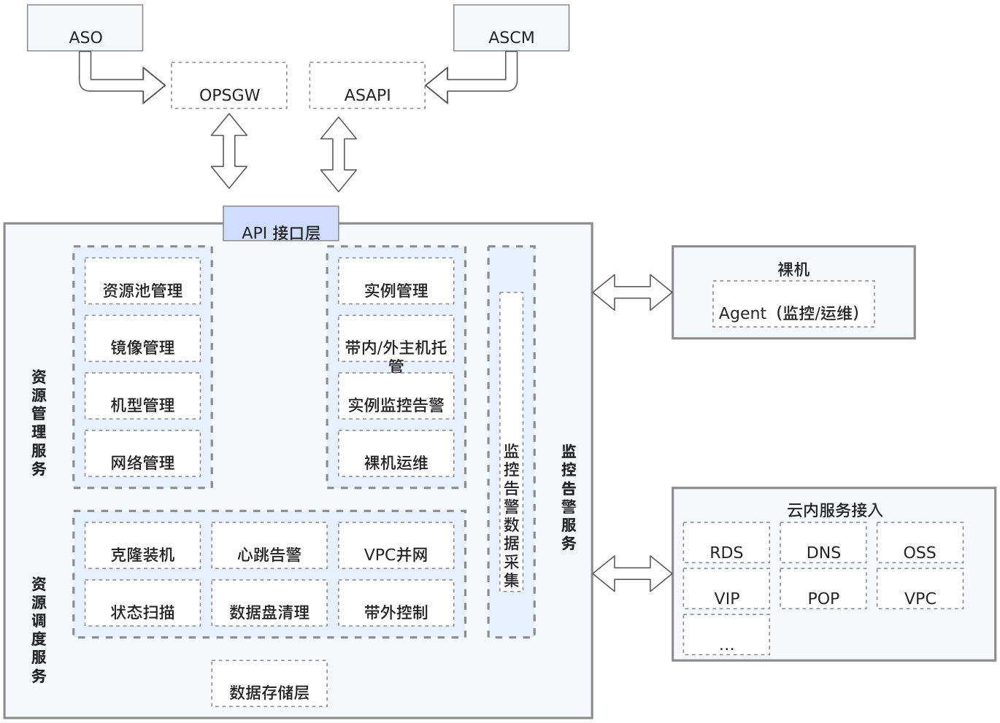

阿里云  
专有云  
裸机管理服务  
产品简介  
产品版本：V3.18.6  
文档版本：20251205

**目录**

- [1.产品详情](#section-1)
- [2.产品价值](#section-2)
- [3.应用场景](#section-3)
- [4.功能特性](#section-4)

# 1.产品详情

裸机管理BMS（BareMetal Mangement Service）是指将物理服务器通过云平台来按需和弹性的提供给租户使用的一种云服务，通常用来为核心数据库、关键应用系统、高性能计算等业务提供计算资源支撑。

裸机管理服务通过专有云统一运维界面进行管理，它可以直接对物理机执行节点级别的管理，包括物理机节点的添加、删除、电源管理、系统部署等操作。在完成基本的服务器上架以及相关准备工作后，管理员可在UI界面批量部署裸金属设备，部署完成后可使用裸金属设备创建裸金属主机，支持自定义安装操作系统（如x86下的AliOS/CentOS），并对裸金属主机进行全生命周期管理。

裸机管理BMS产品架构如下图所示：

# 2.产品价值

裸机管理服务是一整套通用的解决方案，可为应用提供专属的物理服务器，保障核心应用的高性能和稳定性。简单来说，裸机管理服务可认为是为服务器裸机安装相应的操作系统，并获取其配置信息，最后实现对裸金属主机的生命周期控制，例如开机、关机、重启等操作。整个操作过程仅需要保证服务器主机有网络并且通电即可。

裸机管理服务为用户提供了高性能的计算集群，为不适合虚拟化的应用提供了一种解决方案，扩展并增强了Aliclone能力，并且通过“共池”管理能力，触达企业传统IT应用领域，提升客户迁移上云的效率，助力客户业务更平滑上云。

# 3.应用场景

企业及政府机构面临多样化的IT基础设施需求。在高性能计算、安全合规、资源隔离等关键场景下，裸机管理服务已成为支撑核心业务系统的理想选择。本文将介绍裸机管理服务（BMS）的典型应用场景。

**直连硬件的场景**

某些计算任务依赖于特定的物理设备，这些硬件无法通过虚拟化技术进行透传或模拟。BMS可以直接访问硬件设备，适用于科研、制造、金融、电信等领域中对专用硬件强依赖的关键业务。

**高性能与低延迟的场景**

金融、电信等行业核心数据库对I/O延迟、吞吐和稳定性要求极高。BMS提供独享的CPU、内存和本地NVMe存储资源，确保不存在资源竞争。BMS还支持直接挂载高性能SAN/NAS存储阵列，保持原有存储架构不变。

**安全合规与可信可控的场景**

在金融、政务、能源、军工等对基础设施安全与合规要求严格的行业中，业务系统常面临多重控制需求。这些需求包括必须使用特定硬件、在资源层面实现强隔离、满足等保与密评要求，以及支持带外管理、安全启动、审计溯源等功能。裸机管理服务在资源层面是将整个实例只给一个租户独享，且租户间天然物理隔离，实例间不存在资源抢占。同时，BMS兼容多种系统，支持服务器的自动化部署与远程维护，提供带外托管能力，从而增强基础设施的可管可控性。适用于对安全合规、性能隔离及系统可控性有严格要求的关键应用场景。

**存量资源纳管与利旧的场景**

政企客户通常拥有大量已采购的物理服务器，这些服务器分布于不同部门或数据中心，面临管理分散和资源利用率低下的问题。裸机管理服务能够将这些服务器统一整合至云平台进行集中管理。同时，裸机管理服务还可对接传统存储阵列（如SAN、NAS），确保客户现有投资的有效利用及使用习惯的延续。

**云平台托管的场景**

传统企业客户往往拥有大量的存量虚拟化或第三方云平台（如VMware、OpenStack等）。由于嵌套虚拟化所带来的性能和兼容性问题，这类软件通常不适合在虚拟机中运行。因此，裸机管理服务能够有效支持这类应用，并促进存量云应用与现有全栈云产品的整合。该服务为这些平台提供独立的物理资源，能够直接部署在裸金属服务器上，从而避免虚拟化层的叠加，确保其高性能运行及功能的完整性。此服务广泛应用于金融、能源、制造等行业，帮助客户保护已有投资，实现新旧云体系的打通，构建融合、弹性且可扩展的全栈云架构。

# 4.功能特性

裸机管理服务包含裸机实例管理、托管实例管理两大服务模块，帮助客户实现物理服务器裸机的管理。

**裸机管理用户侧**

**功能**

**说明**

针对用户侧实例资源信息的运营管理需求，提供实例资源监控展示功

概览

能。该功能涵盖实例的总览信息和监控信息，具体包括实例状态监控、镜像信息、磁盘监控，以及对CPU、内存和网络负载的监控。

裸机实例主要提供以下功能：

- 实例的创建、批量创建、释放、重新申请以及资产运营管理功能的查询。

裸机实例

- 对存量实例实施远程运维操作，包括开关机、重启等功能。

- 提供用户对已申请的裸机实例进行资源集中监控的能力，可实现裸机

裸机实例管理

资源的CPU使用率、内存使用率、磁盘负载、网络负载以及服务器在线数量等相关资源监控的能力。

裸机实例告警提供了对用户所创建的裸机实例所产生的故障告警的监控

裸机实例告警

能力，并支持告警处理。

裸机实例监控为用户提供所创建裸机资源的运行状况信息，能够实现对裸机资源的CPU使用率、内存使用率、磁盘负载、系统负载及网络负载

裸机实例监控

等相关资源的监控。

针对用户侧实例资源信息运营管理的需求，提供实例资源大盘信息监控展示的能力。该功能包括产品检测、未处理告警和关键指标。

- 产品检测：产品检测提供了托管实例的健康度检测功能，通过相关数据项的检测，给出了4个维度的建议，分别为正常、风险、异常、建

概览

议。

- 未处理告警：提供了今日未处理的带外托管实例的故障告警数据，按P1-P4的告警级别分类展示。

- 关键指标：提供了带外托管实例总数的数据。

托管实例管理

针对用户侧存量服务器的带外托管能力需求，提供带外托管实例的添加、查询和释放等资产运营管理功能，以及存量带外托管实例的开关

带外托管实例

机、重启、监控、查询操作日志和带外控制台登录等远程运维操作功能。其中，添加带外托管实例的功能支持用户为所托管实例配置基本信息、机房信息和带外信息。

托管实例告警提供对实例资源中托管类型的裸机所产生的故障告警的监

托管实例告警

控与处理能力。在此基础上，故障告警做了已处理和未处理的分类管理，从而使操作更加简洁明了。

公共镜像

提供对公共镜像进行查询、状态变更及导出的功能。

针对用户在运营过程中对于镜像个性化管理的需求，提供自定义镜像的

镜像

查询、信息展示、管理操作及自定义上传功能。具体而言：

- 自定义上传功能允许配置上传镜像的区域信息、平台类型及系统架构

自定义镜像

类型，以便于对镜像进行分类管理。

- 信息展示内容包括镜像名称/ID、大小、架构、平台、格式、可用状态及创建时间等。

**裸机管理运维侧**

<table>
  <tr>
    <th colspan="2">功能</th>
    <th>说明</th>
  </tr>
  <tr>
    <td rowspan="3">基础配置</td>
    <td>机型管理</td>
    <td>机型管理为管理员提供了对机型的新增、查询、修改和删除功能。通过这些操作，管理员可以灵活地管理机型信息，以满足不断变化的业务需求。机型管理模块有助于确保机型信息的准确性和一致性，从而简化裸机实例的管理和部署。</td>
  </tr>
  <tr>
    <td>网络管理</td>
    <td>管理员可以根据实际需求查询并查看已存在子网的相关信息或获取新的子网信息。</td>
  </tr>
  <tr>
    <td>镜像管理</td>
    <td>镜像管理用于维护在裸机装机过程中所使用的镜像元数据，提供了自定义镜像的查询、状态管理、删除及导出等功能，以及公共镜像的查询、状态管理和导出等功能。管理员可以根据需求自定义上传所需的镜像。</td>
  </tr>
  <tr>
    <td colspan="2">实例管理</td>
    <td>实例管理主要提供实例的注册、批量注册、释放、重新注册以及查询资产运维管理等功能，支持按照实例名称、SN、子网IP、专有网络IP和带外IP对实例进行检索。同时，系统还提供上次操作日志的详细信息，并支持管理员对存量实例进行开关机、重启等远程运维操作。</td>
  </tr>
  <tr>
    <td rowspan="3">监控告警</td>
    <td>实例监控</td>
    <td>实例监控支持展示实例监控数据，提供管理员注册的裸机资源的相关运行状况信息，例如查看裸机实例的CPU使用率、内存相关指标及网络相关指标等。</td>
  </tr>
  <tr>
    <td>托管实例告警</td>
    <td>• 托管实例告警为管理员提供了处理租户侧托管实例产生的故障告警的能力。此功能使管理员能够及时发现并解决潜在问题，从而确保托管实例的稳定运行和高可用性。 • 托管实例告警能够显示托管实例的告警信息，并支持通过SN、告警类型、告警级别、告警次数、实例IP及起止时间等维度对告警进行检索。同时，该功能还支持标记告警项是否已处理。</td>
  </tr>
  <tr>
    <td>裸机实例告警</td>
    <td>裸机实例告警功能提供了管理员处理已注册裸机实例故障告警的能力，确保及时发现和解决潜在问题，保障裸机实例的稳定运行。裸机实例告警能够显示实例的告警信息，并支持通过SN、告警类型、告警级别、告警次数、实例IP及起止时间等维度对告警进行检索。同时，该功能还支持标记告警项是否已处理。</td>
  </tr>
</table>
