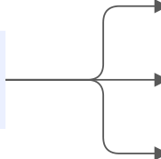
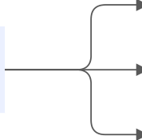
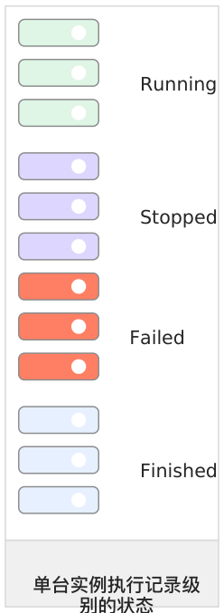
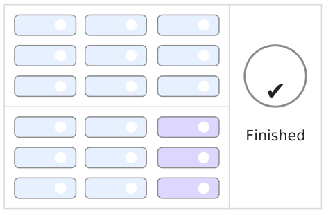
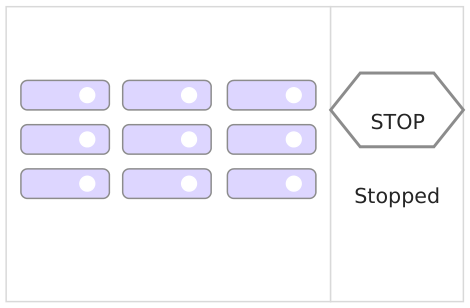
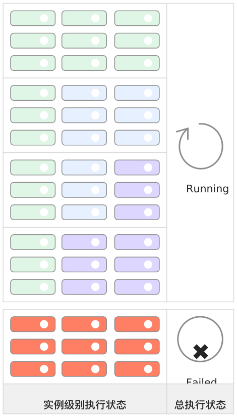
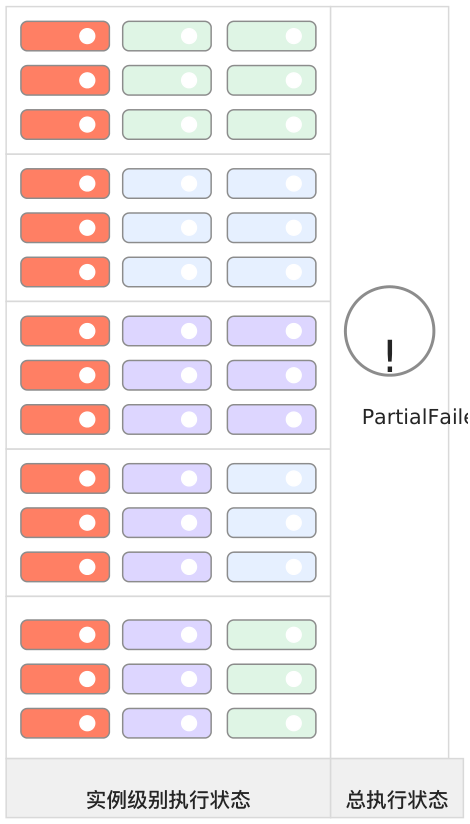

阿里云  
专有云  
裸机管理服务  
用户指南  
产品版本：V3.18.6  
文档版本：20251205

**目录**

- [1.什么是裸机管理BMS](#section-1)
- [2.快速入门](#section-2)
    - [2.1. 使用流程](#section-2-1)
    - [2.2. 登录裸机管理BMS控制台](#section-2-2)
- [3.裸机实例管理](#section-3)
    - [3.1. 概览](#section-3-1)
    - [3.2. 裸机实例](#section-3-2)
        - [3.2.1. 创建实例](#section-3-2-1)
        - [3.2.2. 批量创建实例](#section-3-2-2)
        - [3.2.3. 重新申请实例](#section-3-2-3)
        - [3.2.4. 释放实例](#section-3-2-4)
        - [3.2.5. 实例详情](#section-3-2-5)
        - [3.2.6. 查询实例](#section-3-2-6)
        - [3.2.7. 重启实例](#section-3-2-7)
        - [3.2.8. 停止实例](#section-3-2-8)
        - [3.2.9. 启动实例](#section-3-2-9)
        - [3.2.10. 挂载存储](#section-3-2-10)
        - [3.2.11. 绑定标签](#section-3-2-11)
        - [3.2.12. 删除标签](#section-3-2-12)
        - [3.2.13. 查询操作日志](#section-3-2-13)
        - [3.2.14. 远程登录](#section-3-2-14)
        - [3.2.15. 编辑属性](#section-3-2-15)
        - [3.2.16. 修改主机名](#section-3-2-16)
        - [3.2.17. 重置实例密码](#section-3-2-17)
        - [3.2.18. 修改实例释放保护](#section-3-2-18)
        - [3.2.19. 创建云助手激活码](#section-3-2-19)
        - [3.2.20. 登录带外控制台](#section-3-2-20)
    - [3.3. 镜像](#section-3-3)
        - [3.3.1. 自定义镜像上传](#section-3-3-1)
        - [3.3.2. 公共镜像](#section-3-3-2)
        - [3.3.3. 查询镜像](#section-3-3-3)
        - [3.3.4. 删除镜像](#section-3-3-4)
        - [3.3.5. 镜像状态管理](#section-3-3-5)
        - [3.3.6. 镜像导出](#section-3-3-6)
    - [3.4. 裸机实例监控](#section-3-4)
        - [3.4.1. 查看裸机实例监控信息](#section-3-4-1)
    - [3.5. 裸机实例告警](#section-3-5)
        - [3.5.1. 查询裸机实例告警](#section-3-5-1)
        - [3.5.2. 查看未处理告警](#section-3-5-2)
        - [3.5.3. 查看已处理告警](#section-3-5-3)
        - [3.5.4. 处理告警](#section-3-5-4)
    - [3.6. 密钥对](#section-3-6)
        - [3.6.1. 创建密钥对](#section-3-6-1)
        - [3.6.2. 绑定密钥对](#section-3-6-2)
        - [3.6.3. 解绑密钥对](#section-3-6-3)
        - [3.6.4. 删除密钥对](#section-3-6-4)
- [4.托管实例管理](#section-4)
    - [4.1. 概览](#section-4-1)
    - [4.2. 带外托管实例](#section-4-2)
        - [4.2.1. 添加带外托管实例](#section-4-2-1)
        - [4.2.2. 批量添加托管实例](#section-4-2-2)
        - [4.2.3. 重新托管](#section-4-2-3)
        - [4.2.4. 带外托管实例详情](#section-4-2-4)
        - [4.2.5. 查询带外托管实例](#section-4-2-5)
        - [4.2.6. 删除托管实例](#section-4-2-6)
        - [4.2.7. 重启托管实例](#section-4-2-7)
        - [4.2.8. 停止托管实例](#section-4-2-8)
        - [4.2.9. 启动托管实例](#section-4-2-9)
        - [4.2.10. 查询操作日志](#section-4-2-10)
        - [4.2.11. 编辑属性](#section-4-2-11)
        - [4.2.12. 登录带外控制台](#section-4-2-12)
    - [4.3. 托管实例告警](#section-4-3)
        - [4.3.1. 查询托管实例告警](#section-4-3-1)
        - [4.3.2. 查看未处理告警](#section-4-3-2)
        - [4.3.3. 查看已处理告警](#section-4-3-3)
        - [4.3.4. 处理告警](#section-4-3-4)
- [5.运维与监控](#section-5)
    - [5.1. 裸机云助手](#section-5-1)
        - [5.1.1. 云助手概述](#section-5-1-1)
        - [5.1.2. 使用云助手](#section-5-1-2)
            - [5.1.2.1. 查看命令列表](#section-5-1-2-1)
            - [5.1.2.2. 查看命令执行结果](#section-5-1-2-2)
            - [5.1.2.3. 创建命令](#section-5-1-2-3)
            - [5.1.2.4. 执行命令](#section-5-1-2-4)
            - [5.1.2.5. 克隆命令](#section-5-1-2-5)
            - [5.1.2.6. 删除命令](#section-5-1-2-6)

<a id="section-1"></a>

# 1.什么是裸机管理BMS

裸机管理BMS（BareMetal Mangement Service）是指将物理服务器通过云平台来按需和弹性的提供给租户使用的一种云服务，通常用来为核心数据库、关键应用系统、高性能计算等业务提供计算资源支撑。裸机管理BMS包括裸机实例管理、托管实例管理和运维与监控功能。

裸机管理服务通过专有云统一运维界面提供对裸机实例的全面管理。它允许管理员直接在节点级别执行物理机管理任务，包括但不限于裸机的添加、删除、电源管理和系统部署等。

在完成必要的服务器上架和准备工作后，管理员可以在 UI 界面中批量部署裸金属设备。部署完成后，裸金属设备可用于创建裸金属主机。裸机管理服务支持在裸金属主机上自定义安装操作系统（x86 架构下的Alibaba Cloud Linux/CentOS 、Arm架构下的Alibaba Cloud Linux/Ubuntu/Kylin），并提供全生命周期管理功能。

**裸机实例管理**

- **概览**：针对用户侧实例资源信息的运营管理需求，提供实例资源监控展示功能。该功能涵盖**实例总览**、**裸机服务**和资源的监控信息等。

  - **实例总览**展示**资源池实例总数**、**已申请实例总数**、**运行中实例总数**、**镜像总数**。

  - **裸机服务**展示已申请实例总数和各个状态的实例数量。

  - 资源的监控信息包括**CPU使用率**、**内存使用率**、**磁盘读写速率**、**系统负载**、**网络带宽**、**TCP连接状态**等。

- **裸机实例**主要提供以下功能：

  - 实例的创建、批量创建、释放、重新申请以及资产运营管理功能的查询。

  - 对存量实例实施远程运维操作，包括开关机、重启等功能。

  - 提供用户对已申请的裸机实例进行资源集中监控的能力，可实现裸机资源的CPU使用率、内存使用率、磁盘负载、网络负载以及服务器在线数量等相关资源监控的能力。

- **镜像**：用于维护裸机装机时使用的镜像元数据，包括**公共镜像**和**自定义镜像**。

  - **公共镜像**：提供对公共镜像进行查询、状态变更及导出的功能。

  - **自定义镜像**：针对用户在运营过程中对于镜像个性化管理的需求，提供自定义镜像的查询、信息展示、管理操作及自定义上传功能。具体而言：

    - 自定义上传功能允许配置上传镜像的区域信息、平台类型及系统架构类型，以便于对镜像进行分类管理。

    - 信息展示内容包括镜像名称/ID、大小、架构、平台、格式、可用状态及创建时间等。

- **裸机实例监控**为用户提供所创建裸机资源的运行状况信息，能够实现对裸机资源的CPU使用率、内存使用率、磁盘负载、系统负载及网络负载等相关资源的监控。

- **裸机实例告警**提供了对用户所创建的裸机实例所产生的故障告警的监控能力，并支持告警处理。

**托管实例管理**

- **概览**：托管实例管理提供托管主机的相关数据指标的全景展示功能，帮助用户及时掌控托管服务状态。该功能包括**产品检测**、**未处理告警**和**关键指标**。

  - **产品检测**：产品检测提供了托管实例的健康度检测功能，通过相关数据项的检测，给出了4个维度的建议，分别为正常、风险、异常、建议。

  - **未处理告警**：提供了今日未处理的带外托管实例的故障告警数据，按P1～P4的告警级别分类展示。

  - **关键指标**：提供了**带外托管总数**的数据。

- **带外托管实例**针对用户侧存量服务器的带外托管能力需求，提供带外托管实例的添加、查询和释放等资产运营管理功能，以及存量带外托管实例的开关机、重启、监控、查询操作日志和带外控制台登录等远程运维操作功能。其中，添加带外托管实例的功能支持用户为所托管实例配置基本信息、机房信息和带外信息。

- **托管实例告警**提供对实例资源中托管类型的裸机所产生的故障告警的监控与处理能力。在此基础上，故障告警做了已处理和未处理的分类管理，从而使操作更加简洁明了。

**运维与监控**

**裸机云助手**是基于ECS云助手，结合裸机BMS相关业务打造的原生自动化运维工具，通过免密码、免登录、无需使用跳板机的形式，在裸机上实现批量运维、执行命令（Shell、Powershell和Bat）等操作。典型的使用场景包括：安装卸载软件、启动或停止服务和执行一般的命令（或脚本）等。

<a id="section-2"></a>

# 2.快速入门

<a id="section-2-1"></a>

## 2.1. 使用流程

本节介绍裸机实例和托管实例的基本使用流程。

**裸机实例的基本使用流程**

使用裸机管理服务需要首先申请裸机配置裸机信息，然后通过查询观察裸机信息、释放裸机等操作实现裸机管理。

| 裸机实例的操作 | 操作说明 | 操作步骤 |
| --- | --- | --- |
| 创建实例 | 您可以通过配置基本信息，选择实例架构、规格，指定安装镜像，配置网络信息，设置实例名称，输入描述等来进行裸机申请。 | 创建实例 |
| 查询裸机 | 您可以根据实际需求查询并查看已存在实例的相关信息。 | 查询实例 |
| 释放裸机 | 您可以对实例列表中的裸机执行释放操作。裸机释放后，会进入资源池并重装。裸机释放成功后，用户可再次申请使用。 | 释放实例 |

**托管实例的基本使用流程**

| 托管实例的操作 | 操作说明 | 操作步骤 |
| --- | --- | --- |
| 添加带外托管实例 | 您可以新增带外托管的实例，实现带外实例的托管管理。 | 添加带外托管实例 |
| 查询带外托管实例 | 您可以根据实际需求查询并查看已存在托管实例的相关信息。 | 查询带外托管实例 |
| 删除带外托管实例 | 您可以对无需再进行托管的实例执行删除操作。 | 删除托管实例 |

<a id="section-2-2"></a>

## 2.2. 登录裸机管理BMS控制台

本节为您介绍如何登录到Apsara Uni-manage运营控制台，并进入裸机管理BMS控制台。

**前提条件**

- 您需要登录Apsara Uni-manager运营控制台后进入裸机管理BMS控制台，确认您已从部署人员处获取Apsara Uni-manager运营控制台的服务域名地址。

- 推荐使用Chrome浏览器。

**操作步骤**

1. 在浏览器地址栏中，输入Apsara Uni-manager运营控制台的访问地址，按回车键。

2. 输入正确的用户名及密码。

   *请向运营管理员获取登录控制台的用户名和密码。*

   > **说明**
   >
   > 首次登录Apsara Uni-manager运营控制台时，需要修改登录用户名的密码，请按照提示完成密码修改。为提高安全性，密码长度必须为 8~20 位，且至少包含以下两种类型：
   >
   > - 英文大写或小写字母（A~Z、a~z）
   >
   > - 阿拉伯数字（0~9）
   >
   > - 特殊符号（感叹号（！）、at（@）、井号（#）、美元符号（$）、百分号（%）等）
   >
   > *admin管理员账号具有所有权限，操作不受限，在运营管理中请慎重操作！*

3. 单击登录，进入Apsara Uni-manager运营控制台页面。

4. 在页面顶部的菜单栏中，选择 **产品 > 计算 > 裸机管理BMS**。

<a id="section-3"></a>

# 3.裸机实例管理

裸机实例管理主要提供了裸机实例的创建、查询、下线功能，镜像的管理功能，裸机实例的监控管理、裸机实例的告警及告警处理的功能。

<a id="section-3-1"></a>

## 3.1. 概览

概览页针对用户存量服务器提供实例资源大盘信息监控展示的能力，全景展示资源池实例总数、用户已申请实例总数、运行中实例总数、镜像、裸机服务相关使用占比、CPU使用率、内存使用率等相关数据指标，帮助用户及时掌控托管服务状态。

概览页面主要包含以下部分：

- **实例总览**

  - 资源池实例全景：统计**资源池实例总数**、**已申请实例总数**、**运行中实例总数**、**镜像总数**，提供资源使用的全局视角。

  - 资源规划辅助：通过实例总数与镜像类型的对比分析，帮助用户评估资源分配合理性，例如识别镜像复用率低的问题，优化镜像管理策略。

- **裸机服务**：提供实例运行状态监控，针对用户已申请的裸机实例，展示各状态（运行/关机/错误/其他）的裸机实例数量，以便全面概览裸机实例的健康状态。

- 资源监控与性能洞察

  - 核心指标监控：

    - CPU/内存使用率：实时追踪资源占用峰值，结合历史趋势，预判扩容需求。

    - 磁盘读写速率：监控I/O吞吐量，识别存储性能瓶颈。

    - 网络带宽与TCP连接状态：分析流量波动（如突发流量激增）及连接状态，辅助排查网络异常。

  - 系统负载分析：通过系统负载统计，结合CPU/内存使用率等核心指标，综合评估服务器负载压力，避免资源过载。

<a id="section-3-2"></a>

## 3.2. 裸机实例

裸机实例主要提供实例的创建、批量创建、释放、重新申请、查询资产运营管理功能以及对存量实例进行开关机、重启等远程运维操作的功能。

<a id="section-3-2-1"></a>

### 3.2.1. 创建实例

本节介绍如何创建实例。

**前提条件**

Apsara Uni-manager运维控制台裸机服务运维管理员已在资源池中注册好裸机。

**背景信息**

在裸机管理服务中，可以根据实际运营需求进行裸机实例的申请创建。

**操作步骤**

1. 登录裸机管理BMS控制台。

2. 在左侧导航栏中，选择**裸机实例管理 > 裸机实例**。

3. 在**裸机实例**页面，单击左上方的**创建实例**按钮。

4. 在弹出的**创建实例**页面中的**区域信息**区域，根据页面提示选择**组织、资源集、地域、可用区**，您也可以根据需求按照页面提示配置**云接入网关RAM角色授权**。

5. 在**实例**区域，选择**实例类型**、**架构**、**CPU厂商**、**GPU厂商**和**实例系列**，根据需求选择表格中给出的**实例规格**，实例规格包含实例**SN**、**实例名称**、**主机名**、**CPU数量**、**内存（GB）**、**镜像**等信息。

6. 在**配置已选择实例**区域，

   <ol type="i">

   <li>

   在**配置网络**区域，根据页面提示选择**专有网络VPC**、**交换机VSwitch**、**专有网络IP**。

   </li>

   <li>

   在**配置密码**区域，设置登录密码，登录名默认为root。

   </li>

   </ol>

7. 在**高级配置**区域，选择是否打开**实例释放保护**开关，根据提示配置**自定义脚本**。

8. 在**配置镜像、实例名称**区域，按要求设置实例名称、实例描述。可以选择**使用初始镜像**或者<strong>重新安装镜像，</strong>重装镜像可根据需要选择公共镜像或者自定义上传的镜像（镜像上传详情请参见镜像）。

9. 完成实例的创建。

   - 服务管理中已创建**裸机实例**服务：完成参数配置后，单击**确认订单**。

   - 服务管理中未创建**裸机实例**服务：完成参数配置后，单击**提交**。

<a id="section-3-2-2"></a>

### 3.2.2. 批量创建实例

裸机管理服务支持通过上传本地文件批量创建裸机实例。

**前提条件**

- Apsara Uni-manager运维控制台裸机服务运维管理员已在资源池中注册好裸机。

- 已具备设置好相关参数的本地.csv/xls/xlsx格式的批量上传文件。

**背景信息**

在裸机管理服务中，用户可以通过上传.xls等格式的文件对裸机实例进行批量创建。

**操作步骤**

1. 登录裸机管理BMS控制台。

2. 在左侧导航栏中，选择**裸机实例管理 > 裸机实例**。

3. 在**裸机实例**页面，单击左上方的**批量创建**按钮。

4. 在弹出的**批量创建**对话框中，根据页面提示选择**组织、资源集、地域、可用区**。

5. 在**上传文件**区域，根据模板格式要求填入各参数，并选择文件进行上传。

6. 单击**确定**按钮，完成裸机的批量创建。

**模板文件说明**

具体模板格式参照下表或下载模板文件（模板文件在批量创建对话框中下载）。

| \*实例类型 | \*架构 | \*机型 | \*S N | \*创建类型 | \*镜像类型 | \*镜像 | \*专有网络V P C | \*交换机V S w it c h | 专有网络I P | 登录名 | 登录密码 | \*主机名 | \*实例名称 | 实例描述 |
| --- | --- | --- | --- | --- | --- | --- | --- | --- | --- | --- | --- | --- | --- | --- |
| bms | x86_64 | test-mt | 123 456 | install _os | publi c | C e n t o s-7.9 -x 8 6 _6 4 | te st -v p c-0 1 | t e st -s u b n e t-0 1 | X X X.X X X.X X X.X X X | n a m e | p a s s w o r d | t e st -a p p ly -0 1 | t e st -a p pl y-0 1 |  |
| no_clone | x86_64 | test-mt | 654 321 | install _os | custo mize | A n ol is O S -8.6 | te st -v p c-0 1 | t e st -s u b n e t-0 1 | X X X.X X X.X X X.X X X | n a m e | p a s s w o r d | t e st -a p p ly -0 2 | t e st -a p pl y-0 2 |  |

> **说明**
>
> 模板中的相关主要参数注解如下（参数值不区分大小写）：
>
> - **架构**：CPU架构 （可填值为：x86_64/aarch64/sw_64）。
>
> - **机型**：机型。
>
> - **SN**：序列号。
>
> - **创建类型**：是否使用初始镜像（可填值为：origin_image使用初始镜像，install_os重新安装镜像）。
>
> - **镜像类型**：镜像类型（可填值为：public/customize）。
>
> - **专有网络VPC**：专有网络VPC ID。
>
> - **交换机VSwitch**：交换机VSwitch ID。
>
> - **专有网络IP**：用户指定的专有网络IP，当无指定IP时系统将自动分配IP。
>
> - **登录名**：系统登录用户名。
>
> - **登录密码**：系统登录用户密码。
>
> - **主机名**：hostname。
>
> - **实例名称**：用户自定义的实例名称。
>
> - **实例描述**：用户自定一的实例描述。

<a id="section-3-2-3"></a>

### 3.2.3. 重新申请实例

本节介绍如何重新申请实例，用户可以对已申请创建的裸机实例，通过重新申请实例进行重装机操作。

**前提条件**

- 已创建实例，详情请参见创建实例。

- 用户列表中的裸机状态需处于稳定状态（如：运行中、已停止、创建失败、无心跳等）。

**背景信息**

在裸机管理服务中，当机器出现故障情况或您因实际运营需求变化，可以对已申请的裸机进行重新申请部署。

**操作步骤**

1. 登录裸机管理BMS控制台。

2. 在左侧导航栏中，选择**裸机实例管理 > 裸机实例**。

3. 在**裸机实例**页面，查找待重新申请的实例所在的行，然后单击该行操作列的**重新申请**。

4. 在弹出的**重新创建**页面中，根据页面提示设置各参数，具体设置细则请参照创建实例。

5. 完成上述参数配置后，单击**提交**，完成实例的重新申请。

<a id="section-3-2-4"></a>

### 3.2.4. 释放实例

本节介绍如何释放裸机。

**前提条件**

- 已创建裸机，详情请参见创建实例。

- 实例列表中的裸机状态需处于稳定状态（如：运行中、已停止、创建失败、无心跳等）。

**背景信息**

支持用户对实例列表中的裸机执行释放操作。裸机释放后，会进入资源池并重装。裸机释放成功后，用户可再次申请使用。

**操作步骤**

方法a：

1. 登录裸机管理BMS控制台。

2. 在左侧导航栏中，选择**裸机实例管理 > 裸机实例**。

3. 在**裸机实例**页面，查找待释放裸机所在的行，然后单击该行操作列的**实例状态**。

4. 在弹出的下拉菜单中单击**释放实例**。

5. 在弹出的对话框中，可选择是否清理数据盘，如不勾选**清理数据盘**则只删除系统盘，勾选后则系统盘、数据盘一并删除。

6. 单击**释放**完成裸机的释放。

方法b：

1. 登录裸机管理BMS控制台。

2. 在左侧导航栏中，选择**裸机实例管理 > 裸机实例**。

3. 在**裸机实例**页面，查找待释放裸机所在的行，然后单击该行操作列的**管理**。

4. 在实例详情页单击右上角的**更多**按钮<strong>。</strong>

5. 在弹出的下拉菜单中单击**释放**。

6. 在弹出的对话框中，可选择是否清理数据盘，如不勾选**清理数据盘**则只删除系统盘，勾选后则系统盘、数据盘一并删除。

7. 单击**释放**完成裸机的释放。

<a id="section-3-2-5"></a>

### 3.2.5. 实例详情

您可以查看您账号下已创建的所有裸机实例的列表和单台实例的详情，包括实例的基本信息和配置信息等。

**在实例详情页面查看实例信息**

1. 登录裸机管理BMS控制台。

2. 在左侧导航栏中，选择**裸机实例管理 > 裸机实例**。

3. 单击实例名称，进入实例详情页面。

4. 默认进入**实例**页签，您可以查看实例的基本信息和配置信息，基本信息包括**实例ID/名称**、**SN**、**标签**、**组织/资源集**、**地域**、**可用区**、**主机名**、**云助手ID**、**在线状态**、**操作状态**、**电源状态**、**Agent**、**创建时间**和**实例描述**等。

5. 在配置信息中，您可以查看实例的**机型**、**GPU**、**实例释放保护**、**CPU**、**操作系统**、**网络**、**网卡**、**磁盘**和**GPU**信息。

<a id="section-3-2-6"></a>

### 3.2.6. 查询实例

本节介绍如何查询实例以及查看实例详细信息。

**前提条件**

已创建实例，详情请参见创建实例。

**背景信息**

您可以根据实际需求查询并查看已存在实例的相关信息。

**操作步骤**

1. 登录裸机管理BMS控制台。

2. 在左侧导航栏中，选择**裸机实例管理 > 裸机实例**。

3. 在**裸机实例**页面中，选择筛选条件并在搜索框中输入相应信息，然后单击**搜索图标**，查询出符合条件的实例。当前支持的筛选条件包括：实例名称、实例ID、SN、专有网络IP、带外IP、标签筛选。

4. 查找到裸机实例后，单击实例后面的**管理**，进入**实例**页面查看该物理机的详细信息，如实例名称、SN、区域信息、在线状态、电源状态、Agent状态、创建时间、裸机配置信息等。

<a id="section-3-2-7"></a>

### 3.2.7. 重启实例

本节介绍如何重启裸机。

**前提条件**

- 已创建裸机，详情请参见创建实例。

- 实例列表中的裸机状态需处于稳定状态（如：运行中、已停止、创建失败、无心跳等）。

**背景信息**

支持用户对指定的裸机执行重启操作，重启后，裸机状态变为重启中。

**操作步骤**

方法a：

1. 登录裸机管理BMS控制台。

2. 在左侧导航栏中，单击**裸机实例管理 > 裸机实例**。

3. 在**裸机实例**页面，查找待重启裸机所在的行，然后单击该行操作列的**实例状态**。

4. 在弹出的下拉菜单中单击**重启实例**。

5. 在弹出的对话框中，单击**确定**。

6. 在弹出的<strong>确认重启该实例吗？</strong>对话框中，单击<strong>确定，</strong>完成裸机的重启。

方法b：

1. 登录裸机管理BMS控制台。

2. 在左侧导航栏中，单击**裸机实例管理 > 裸机实例**。

3. 在**裸机实例**页面，查找待重启裸机所在的行，然后单击该行操作列的**管理**。

4. 在实例详情页单击右上角的**重启**按钮<strong>。</strong>

5. 在弹出的对话框中，单击**确定**。

6. 在弹出的<strong>确认重启该实例吗？</strong>对话框中，单击<strong>确定，</strong>完成裸机的重启。

<a id="section-3-2-8"></a>

### 3.2.8. 停止实例

您可对指定的裸机执行关机操作，关机后，裸机在线状态最终变为无心跳。本节介绍如何停止裸机实例。

**前提条件**

- 已创建裸机，详情请参见创建实例。

- 实例列表中的裸机状态需处于稳定状态（如：运行中、失败、无心跳等）。

**操作步骤**

方法a：

1. 登录裸机管理BMS控制台。

2. 在左侧导航栏中，选择**裸机实例管理 > 裸机实例**。

3. 在**裸机实例**页面，查找待关机裸机所在的行，然后单击该行操作列的**实例状态**。

4. 在弹出的下拉菜单中单击**停止实例**。

5. 在弹出的<strong>确认停止该实例吗？</strong>对话框中，单击<strong>确定，</strong>完成裸机的停止。

方法b：

1. 登录裸机管理BMS控制台。

2. 在左侧导航栏中，选择**裸机实例管理 > 裸机实例**。

3. 在**裸机实例**页面，查找待关机裸机所在的行，然后单击该行操作列的**管理**。

4. 在实例详情页单击右上角的**停止**按钮<strong>。</strong>

5. 在弹出的<strong>确认停止该实例吗？</strong>对话框中，单击<strong>确定，</strong>完成裸机的停止。

<a id="section-3-2-9"></a>

### 3.2.9. 启动实例

本节介绍如何开启裸机，用户可对指定的裸机执行开机操作，开机后，裸机状态变为正常。

**前提条件**

- 已创建裸机，详情请参见创建实例。

- 具有已经关机的裸机。

**操作步骤**

方法a：

1. 登录裸机管理BMS控制台。

2. 在左侧导航栏中，选择**裸机实例管理 > 裸机实例**。

3. 在**裸机实例**页面，查找待开机裸机所在的行，然后单击该行操作列的**实例状态**。

4. 在弹出的下拉菜单中单击**启动实例**。

5. 在弹出的对话框中，单击**确定**，完成裸机的开机。

方法b：

1. 登录裸机管理BMS控制台。

2. 在左侧导航栏中，选择**裸机实例管理 > 裸机实例**。

3. 在**裸机实例**页面，查找待开机裸机所在的行，然后单击该行操作列的**管理**。

4. 在实例详情页单击右上角的**启动**按钮<strong>。</strong>

5. 在弹出的对话框中，单击**确定**，完成裸机的开机。

<a id="section-3-2-10"></a>

### 3.2.10. 挂载存储

本节介绍如何给裸机实例挂载第三方存储。

**前提条件**

- 已创建实例，详情请参见创建实例。

- 待操作的裸机在线状态需处于运行中。

- 待操作的裸机操作状态需处于已完成。

**背景信息**

您可以根据实际需求给裸机实例挂载第三方存储，一台裸机可挂载多个存储。

**操作步骤**

1. 登录裸机管理BMS控制台。

2. 在左侧导航栏中，选择**裸机实例管理 > 裸机实例**。

3. 在**裸机实例**页面中，查找到目标裸机所在的行，然后单击该行操作列的**管理**，进入实例详情页面。

4. 在**实例详情**页面中单击**存储**页签，单击**挂载存储**按钮进入**批量挂载存储**页面。

5. 在**批量挂载存储**页面首先选择**存储类型**，根据不同存储类型配置其参数项<strong>，</strong>以ISCSI为例其包含的参数项分别为服务端IP/域名、服务端IQN、客户端IQN、客户端挂载路径、LumID、CHAP校验。

   > **说明**
   >
   > 目前存储类型支持3种，分别为：ISCSI、NFS、直接挂载。

6. 完成上述参数配置后，您可以单击下方**添加存储**按钮继续添加存储，或单击**提交**按钮完成存储挂载。

<a id="section-3-2-11"></a>

### 3.2.11. 绑定标签

本节介绍如何给裸机绑定标签，进行标签化分类管理。

**前提条件**

已创建裸机，详情请参见创建实例。

**背景信息**

- 支持用户对目标裸机实例绑定标签，进行标签化分类管理。

- 一台裸机实例至多可绑定20条标签。

**操作步骤**

1. 登录裸机管理BMS控制台。

2. 在左侧导航栏中，选择**裸机实例管理 > 裸机实例**。

3. 在**裸机实例**页面，查找目标裸机所在的行，在标签列中单击编辑图表按钮。

4. 在**编辑标签**弹窗中，选择已有或输入新的**标签键**和**标签值**。

5. 单击**确定**按钮，完成标签绑定。

> **说明**
>
> - 可同时创建最多20条标签，并绑定资源。
>
> - 标签键不能重复。

<a id="section-3-2-12"></a>

### 3.2.12. 删除标签

本节介绍如何给裸机解绑删除标签。

**前提条件**

- 已创建裸机，详情请参见创建实例。

- 已对裸机绑定标签，详情请参见绑定标签。

**背景信息**

支持用户对已绑定标签的裸机实例解绑删除标签。

**操作步骤**

1. 登录裸机管理BMS控制台。

2. 在左侧导航栏中，选择**裸机实例管理 > 裸机实例**。

3. 在**裸机实例**页面，查找目标裸机所在的行，在标签列中单击编辑图标按钮。

4. 在**编辑标签**弹窗中，找到目标标签所在行，单击后面删除图表按钮，单击后删除。

5. 单击**确定**按钮，完成标签删除。

<a id="section-3-2-13"></a>

### 3.2.13. 查询操作日志

本节介绍如何查看裸机实例的操作日志信息。

**前提条件**

已创建裸机，详情请参见创建实例。

**背景信息**

根据运营需求，支持用户查看指定的裸机操作日志信息。

**操作步骤**

1. 登录裸机管理BMS控制台。

2. 在左侧导航栏中，选择**裸机实例管理 > 裸机实例**。

3. 在**裸机实例**页面中，选择筛选条件并在搜索框中输入相应信息，然后单击**搜索**，查询出符合条件的裸机实例。当前支持的筛选条件包括：**实例名称**、**实例ID**、**SN**、**专有网络IP**、**带外IP**、**标签筛选**。

4. 查找到物理机后，单击**操作状态**（如：运行中、已停止、创建失败、无心跳）或后面的**操作日志。**

5. 在弹出的**操作日志**弹窗中，查看裸机状态的操作信息，如操作状态、状态子项、开始时间、执行状态、描述信息等。

<a id="section-3-2-14"></a>

### 3.2.14. 远程登录

本节介绍如何远程登录裸机。

**前提条件**

- 已创建裸机，详情请参见创建实例。

- 待操作的裸机在线状态需处于运行中。

- 待操作的裸机操作状态需处于已完成。

**背景信息**

支持用户对目标裸机实例进行WorkBench远程登录操作。

**操作步骤**

1. 登录裸机管理BMS控制台。

2. 在左侧导航栏中，选择**裸机实例管理 > 裸机实例**。

3. 在**裸机实例**页面，查找目标裸机所在的行，然后单击该行操作列的**远程登录**。

4. 在跳转的WorkBench页面输入**用户名**和**密码**进行登录操作。

<a id="section-3-2-15"></a>

### 3.2.15. 编辑属性

本节介绍如何修改裸机属性。

**前提条件**

已创建裸机，详情请参见创建实例。

**背景信息**

支持用户修改目标裸机实例的实例名称和实例描述。

**操作步骤**

1. 登录裸机管理BMS控制台。

2. 在左侧导航栏中，选择**裸机实例管理 > 裸机实例**。

3. 在**裸机实例**页面，查找待释放裸机所在的行，然后单击该行操作列的**管理**。

4. 在实例详情页单击右上角的**更多**按钮<strong>。</strong>

5. 在弹出的下拉菜单中点击**编辑属性**。

6. 在弹出的对话框中，填写要编辑的实例名称或者实例描述，单击**确定**完成裸机属性的编辑。

<a id="section-3-2-16"></a>

### 3.2.16. 修改主机名

本节介绍如何修改裸机主机名。

**前提条件**

- 已创建裸机，详情请参见创建实例。

- 实例列表中的裸机状态需处于稳定状态（如：运行中、已停止、创建失败、无心跳等）。

**背景信息**

支持用户修改目标裸机实例的主机名。

**操作步骤**

1. 登录裸机管理BMS控制台。

2. 在左侧导航栏中，选择**裸机实例管理 > 裸机实例**。

3. 在**裸机实例**页面，查找待释放裸机所在的行，然后单击该行操作列的**管理**。

4. 在实例详情页单击右上角的**更多**按钮<strong>。</strong>

5. 在弹出的下拉菜单中单击**修改主机名**。

6. 在弹出的对话框中，填写要修改的实主机名，单击**确定**完成裸机主机名的修改。

<a id="section-3-2-17"></a>

### 3.2.17. 重置实例密码

本节介绍如何重置实例密码。

**前提条件**

- 已创建裸机，详情请参见创建实例。

- 实例列表中的裸机状态需处于稳定状态（如：运行中、已停止、创建失败、无心跳等）。

**背景信息**

支持用户重置目标裸机实例的登录密码。

**操作步骤**

1. 登录裸机管理BMS控制台。

2. 在左侧导航栏中，选择**裸机实例管理 > 裸机实例**。

3. 在**裸机实例**页面，查找待释放裸机所在的行，然后单击该行操作列的**管理**。

4. 在实例详情页单击右上角的**更多**按钮<strong>。</strong>

5. 在弹出的下拉菜单中单击**重置实例密码**。

6. 在弹出的对话框中，填写新密码，并填写确认密码，单击**确定**完成裸机实例密码的重置。

<a id="section-3-2-18"></a>

### 3.2.18. 修改实例释放保护

如果您的实例承载了关键业务，可以为该实例开启实例释放保护，防止手动释放，有效避免因操作疏忽、团队成员沟通不及时等原因造成不可挽回的后果。本节介绍如何修改裸机实例释放保护。

**前提条件**

- 已创建裸机，详情请参见创建实例。

- 实例列表中的裸机状态需处于稳定状态（如：运行中、已停止、创建失败、无心跳等）。

**背景信息**

支持用户修改目标裸机实例的释放保护配置。

**操作步骤**

1. 登录裸机管理BMS控制台。

2. 在左侧导航栏中，选择**裸机实例管理 > 裸机实例**。

3. 在**裸机实例**页面，查找待释放裸机所在的行，然后单击该行操作列的**管理**。

4. 在实例详情页单击右上角的**更多**按钮<strong>。</strong>

5. 在弹出的下拉菜单中单击**修改实例释放保护**。

6. 在弹出的对话框中，选择或取消实例释放保护，单击**确定**修改实例释放保护。

<a id="section-3-2-19"></a>

### 3.2.19. 创建云助手激活码

本节介绍如何创建云助手激活码。

**前提条件**

- 已创建裸机，详情请参见创建实例。

- 实例列表中的裸机状态需处于稳定状态（如：运行中、已停止、创建失败、无心跳等）。

**背景信息**

支持用户创建云助手激活码，手动在裸机实例中安装云助手。

**操作步骤**

1. 登录裸机管理BMS控制台。

2. 在左侧导航栏中，选择**裸机实例管理 > 裸机实例**。

3. 在**裸机实例**页面，查找待释放裸机所在的行，然后单击该行操作列的**管理**。

4. 在实例详情页单击右上角的**更多**按钮<strong>。</strong>

5. 在弹出的下拉菜单中单击**创建云助手激活码**。

6. 在弹出的对话框中，根据提示复制或下载云助手激活码，单击**确定**关闭对话框。

<a id="section-3-2-20"></a>

### 3.2.20. 登录带外控制台

本节介绍如何登录裸机实例的带外控制台。

**前提条件**

- 已创建裸机，详情请参见创建实例。

- 所选实例已具备带外IP。

**背景信息**

根据运营需求，当实例所在机器存在故障情况下，支持用户登录实例的带外控制台进行故障排查。

**操作步骤**

1. 登录裸机管理BMS控制台。

2. 在左侧导航栏中，选择**裸机实例管理 > 裸机实例**。

3. 在**裸机实例**页面，查找所需实例所在的行，然后单击该行操作列的**管理**。

4. 在实例详情页单击右上角的**更多**按钮<strong>。</strong>

5. 在弹出的下拉菜单中单击**带外控制台**。

6. 在弹出的带外控制台登录页面中，输入账号信息，单击<strong>登录，</strong>完成实例带外控制台的登录操作。

<a id="section-3-3"></a>

## 3.3. 镜像

镜像管理用于维护裸机装机时使用的镜像元数据，提供了自定义镜像的查询、状态管理、删除、导出等功能，公共镜像的查询、状态管理、导出等功能，用户可根据需求自定义上传所需的镜像。

<a id="section-3-3-1"></a>

### 3.3.1. 自定义镜像上传

本节介绍如何上传自定义镜像。

**前提条件**

本地具有符合规格的自定义镜像文件。

**背景信息**

用户可以根据实际需求上传自定义的镜像文件，格式限制为tgz、qcow2。

**操作步骤**

1. 登录裸机管理BMS控制台。

2. 在左侧导航栏中，选择**裸机实例管理 > 镜像**。

3. 在**镜像**页面中，单击**自定义镜像**页签，单击**自定义镜像上传**按钮。

4. 在弹出的面板中，根据页面提示设置各参数，输入镜像名称，选择镜像适用平台以及系统架构等。

5. 选择本地镜像文件，支持上传的镜像格式为tgz、qcow2。

6. 单击**确定**按钮，完成镜像上传。

> **说明**
>
> 所登录环境证书会影响到镜像上传，请检查所登录环境证书有效期。如果所登录环境证书已过期，上传镜像时会提示**镜像上传失败**，可联系环境管理员或自行解决，自行解决方法如下：
>
> 1. 上传镜像文件报错后，打开浏览器开发者模式。
>
> 2. 在开发者控制台找到报错信息，并复制“https…”报错链接。
>
> 3. 将报错链接在新的标签页打开。
>
> 4. 在弹出的告警页面中，点选**高级**，并选择继续，之后会跳转至新的页面。
>
> 5. 完成上述操作后，便可继续上传镜像文件。

<a id="section-3-3-2"></a>

### 3.3.2. 公共镜像

本节介绍公共镜像如何使用。

**前提条件**

所登录环境中已具备相关镜像资源。

**背景信息**

- 目前平台提供tgz和qcow2格式的两种公共镜像。

- 默认情况下平台上会提供部分已经适配的公共镜像，如果公共镜像页面镜像信息为空或者公共镜像状态不是“可用”状态，请联系开发人员。

- 公共镜像的启用状态为“禁用”时，在裸机创建页面会查不到相应的镜像信息，需要在镜像管理页面通过镜像状态操作修改为“启用”。

- 部分公共镜像仅为兼容历史版本产品迁移使用，不支持镜像导出。

> **说明**
>
> 公共镜像不提供删除操作。

**操作步骤**

1. 登录裸机管理BMS控制台。

2. 在左侧导航栏中，选择**裸机实例管理 > 镜像**。

3. 在**镜像**页面中，单击左上角**公共镜像**页签。

4. 在公共镜像列表页面中列出了目前能获取到的所有公共镜像资源，并提供了镜像状态管理与镜像导出功能。

<a id="section-3-3-3"></a>

### 3.3.3. 查询镜像

本节介绍如何查询镜像以及查看镜像的详细信息。

**前提条件**

已具有公共镜像资源或已创建自定义镜像，详情请参见自定义镜像上传。

**背景信息**

用户可以根据实际需求查询并查看已存在镜像的相关信息。

**操作步骤**

1. 登录裸机管理BMS控制台。

2. 在左侧导航栏中，选择**裸机实例管理 > 镜像**。

3. 在**镜像**页面中，选择筛选条件并在搜索框中输入相应信息，然后单击**搜索图标**，查询出符合条件的镜像。当前支持的筛选条件包括：镜像名称、镜像ID。

4. 查找到镜像后，可以查看列表中该镜像的详细信息，例如镜像名称、ID、大小、架构、平台、格式、创建时间、可用状态、启用状态等。

<a id="section-3-3-4"></a>

### 3.3.4. 删除镜像

本节介绍如何删除镜像。

**前提条件**

已创建自定义镜像，详情请参见自定义镜像上传。

**背景信息**

支持删除指定名称的自定义镜像，删除时会一并删除镜像源文件，请谨慎操作。

**操作步骤**

1. 登录裸机管理BMS控制台。

2. 在左侧导航栏中，选择**裸机实例管理 > 镜像**。

3. 在**镜像**页面查找到需要删除的镜像，单击其后面的**删除镜像**。

4. 在弹出的对话框中，单击**确认**。

<a id="section-3-3-5"></a>

### 3.3.5. 镜像状态管理

本节介绍如何更改镜像状态。

**前提条件**

- 已具有公共镜像资源或已创建自定义镜像，详情请参见自定义镜像上传。

- 待更改镜像未被引用。

**背景信息**

支持更改指定镜像的状态，更改镜像状态为禁用后，该镜像则不能在装机时被引用；如果镜像已被引用，则不允许更改状态为禁用。

**禁用镜像**

**操作步骤**

1. 登录裸机管理BMS控制台。

2. 在左侧导航栏中，选择**裸机实例管理 > 镜像**。

3. 在**镜像**页面查找到需要更改状态的镜像，然后单击其后面的**启用状态**下拉按钮。

4. 在弹出的下拉菜单中单击**禁用镜像**。

5. 在状态列表中，该镜像可用状态变更为<strong>不可用，</strong>启用状态变为**禁用**。

**启用镜像**

**操作步骤**

1. 登录裸机管理BMS控制台。

2. 在左侧导航栏中，选择**裸机实例管理 > 镜像**。

3. 在**镜像**页面查找到需要更改状态且已被禁用的镜像，然后单击其后面的**启用状态**下拉按钮。

4. 在弹出的下拉菜单中单击**启用镜像**。

5. 在状态列表中，该镜像可用状态变更为<strong>可用，</strong>启用状态变为**启用**。

<a id="section-3-3-6"></a>

### 3.3.6. 镜像导出

本节介绍如何导出镜像。

**前提条件**

已具有公共镜像资源或已创建自定义镜像，详情请参见自定义镜像上传。

**背景信息**

支持将公共镜像和上传的自定义镜像导出到本地。

**操作步骤**

1. 登录裸机管理BMS控制台。

2. 在左侧导航栏中，选择**裸机实例管理 > 镜像**。

3. 在**镜像**页面查找到需要导出的镜像，然后单击其后面的**镜像导出**。

4. 单击**下载**，等待镜像下载完成。

<a id="section-3-4"></a>

## 3.4. 裸机实例监控

裸机实例监控提供用户所创建的裸机资源相关运行状况信息，例如查看裸机实例的基础数据指标、RDMA网络指标、GPU指标等监控数据。

**概述**

- **基础数据指标包含**：

  集群CPU总核数，集群内存总容量，集群磁盘总容量，集群磁盘使用率，服务器资源列表，集群平均CPU使用率，集群内存信息，集群内存平均使用率，集群系统平均负载，集群磁盘读写速率，集群网络带宽使用率。

- **RDMA网络指标包含**：

  RDMA 网络总览表、RDMA网络发送吞吐、RDMA网络接收吞吐、RDMA网络QP数、RDMA网络接口个数、网络状态异常个数、网络配置异常个数、集群RDMA吞吐。

- **GPU指标包含**：

  GPU总览表、集群GPU使用率、集群GPU显存使用率、集群GPU解码器使用率、集群GPU编码器使用率、集群GPU温度、集群GPU功率。

<a id="section-3-4-1"></a>

### 3.4.1. 查看裸机实例监控信息

本节介绍如何查看裸机实例的相关资源的运行状况信息。

**前提条件**

已申请裸机实例，详情请参见创建实例。

**背景信息**

提供用户对已申请的裸机实例进行资源集中监控的能力，可实现裸机资源的CPU使用率、内存使用率、磁盘负载、网络负载、服务器在线数量等相关资源监控的能力。

**操作步骤**

1. 登录裸机管理BMS控制台。

2. 在左侧导航栏中，选择**裸机实例管理 > 裸机实例监控**。

3. 在**裸机实例监控**页面中，用户可以查看裸机实例的基础数据指标（CPU总核数，内存总容量，磁盘总容量，磁盘使用率）、CPU使用率、内存使用率、磁盘读写速率、系统负载、网络带宽、TCP连接状态。

<a id="section-3-5"></a>

## 3.5. 裸机实例告警

裸机实例告警提供了用户所创建的裸机实例所产生的故障告警以及对告警的处理。

<a id="section-3-5-1"></a>

### 3.5.1. 查询裸机实例告警

本节介绍如何查询已申请的裸机实例的告警信息。

**前提条件**

已申请裸机实例，详情请参见创建实例<strong>。</strong>

**背景信息**

- 您可以根据实际需求查询并查看已申请实例的告警信息。

- 目前平台所产生的告警类型为：MemoryMonitor、OobMonitor、CPUMonitor、BoardMonitor、PowerMonitor。

- MemoryMonitor、CPUMonitor、BoardMonitor、PowerMonitor的告警级别均为P2·重要。

- OobMonitor的告警级别为P3·次要。

**操作步骤**

1. 登录裸机管理BMS控制台。

2. 在左侧导航栏中，选择**裸机实例管理 > 裸机实例告警**。

3. 在**裸机实例告警**页面中，选择筛选条件，然后单击**搜索**，查询出符合条件的裸机告警信息。当前支持的筛选条件包括：SN、告警类型、告警级别、告警次数、实例IP、起止时间。

4. 查找到裸机后，可以查看实例的相关告警信息。

<a id="section-3-5-2"></a>

### 3.5.2. 查看未处理告警

本节介绍如何查看已申请实例的未处理告警信息。

**前提条件**

已申请裸机实例，详情请参见创建实例<strong>。</strong>

**背景信息**

您可以根据实际需求查看已申请实例的未处理告警信息。

**操作步骤**

1. 登录裸机管理BMS控制台。

2. 在左侧导航栏中，选择**裸机实例管理 > 裸机实例告警**。

3. 在**裸机实例告警**页面中，单击**未处理**标签。

4. 在**未处理**告警页面中，可以查看所有实例未处理的告警信息。

<a id="section-3-5-3"></a>

### 3.5.3. 查看已处理告警

本节介绍如何查看已申请实例的已处理告警信息。

**前提条件**

已申请裸机实例，详情请参见创建实例<strong>。</strong>

**背景信息**

您可以根据实际需求查看已申请实例的已处理告警信息。

**操作步骤**

1. 登录裸机管理BMS控制台。

2. 在左侧导航栏中，选择**裸机实例管理 > 裸机实例告警**。

3. 在**裸机实例告警**页面中，单击**已处理**标签。

4. 在**已处理**告警页面中，可以查看所有实例已处理的告警信息。

<a id="section-3-5-4"></a>

### 3.5.4. 处理告警

本节介绍如何处理已申请实例的告警。

**前提条件**

已申请裸机实例，详情请参见创建实例<strong>。</strong>

**背景信息**

- 您可以根据实际需求处理已申请实例所产生的告警。

- 告警的处理方式分为忽略和已修复，具体处理方式请依据裸机实际处理情况选择。

- 告警的检测周期一般为30分钟/次。

**操作步骤**

1. 登录裸机管理BMS控制台。

2. 在左侧导航栏中，选择**裸机实例管理 > 裸机实例告警**。

3. 在**裸机实例告警**页面中，查找待处理告警所在的行，然后单击该行操作列的**新建事件单**。

4. 在弹出的对话框中，可根据实际处理状况来选择处理方式，例如若该告警为误报或者无需处理，处理方式可选择为**忽略**，填写**处理人**，说明告警**关闭原因**，单击<strong>确定，</strong>完成告警的处理。

5. 若现场运维人员根据该告警的提供的信息对裸机进行了现场修复并反馈给相关运维人员后，处理方式可选择为**已修复**，填写**处理人**，说明告警**关闭原因**，单击**确定**，完成告警的处理。

<a id="section-3-6"></a>

## 3.6. 密钥对

密钥对是一种安全便捷的登录认证方式，由公钥和私钥组成，仅支持Linux实例。

**功能优势**

相较于用户名和密码认证方式，密钥对有以下优势：

- 安全性：密钥对登录认证更为安全可靠。

  - 密钥对安全强度远高于常规用户口令，可以防止暴力破解。

  - 可以防止通过公钥推导出私钥。

- 便捷性： 如果您将公钥配置在Linux实例中，那么，在本地或者另外一台实例中，您可以使用私钥通过SSH命令或相关工具登录目标实例，而不需要输入密码。

**使用限制**

- 仅支持Linux实例。

- 目前，BMS只支持创建4096位的RSA密钥对。

- 通过控制台绑定密钥对时，一台Linux实例只能绑定一个密钥对，如果您的实例已经绑定密钥对，请先解绑密钥对，然后再绑定新的密钥对。如果您有使用多个密钥对登录实例的需求，可以在实例内部手动修改~/.ssh/authorized_keys文件，添加多个密钥对。

<a id="section-3-6-1"></a>

### 3.6.1. 创建密钥对

本文介绍如何在BMS控制台上创建密钥对。

**操作步骤**

1. 登录裸机管理BMS控制台。

2. 在左侧导航栏中，选择**裸机实例管理 > 密钥对**。

3. 单击**创建密钥对**。

4. 配置密钥对属性。

   <table>
     <tr>
       <th>类型</th>
       <th>配置项</th>
       <th>说明</th>
     </tr>
     <tr>
       <td rowspan="3">区域</td>
       <td>组织</td>
       <td>密钥对所属的组织，确保与专有网络的所属的组织相同。</td>
     </tr>
     <tr>
       <td>资源集</td>
       <td>密钥对所属的资源集，确保与专有网络的所属的资源集相同。</td>
     </tr>
     <tr>
       <td>地域</td>
       <td>密钥对所属的地域，确保与专有网络的所属的地域相同。</td>
     </tr>
     <tr>
       <td rowspan="2">基本配置</td>
       <td>密钥对名称</td>
       <td>密钥对名称不能和已有密钥对重复。长度为2~128个字符，不能以特殊字符及数字开头，只可包含特殊字符中的半角句号（.）、下划线（_）、短划线（-）和半角冒号（:）。</td>
     </tr>
     <tr>
       <td>创建类型</td>
       <td>您可以选择以下任一类型创建密钥对。建议您选择自动创建密钥对，并及时保存私钥。<br>• <strong>自动创建密钥对</strong>：系统会为您自动创建密钥对。创建完成后将自动下载私钥，您只有这一次下载私钥的机会，因此请妥善保存私钥文件。<br>• <strong>导入已有密钥对</strong>：在公钥内容文本框，输入Base64编码的公钥内容。</td>
     </tr>
   </table>

5. 单击**创建**。

6. （可选）修改密钥对的共享设置。

   <ol type="i">

   <li>

   找到对应密钥对，在操作列，选择

   **> 共享设置**。

   

   </li>

   <li>

   在弹出的共享设置对话框中，修改共享范围。

   > **说明**
   >
   > 密钥对可共享的范围，支持：**本资源集共享**、**本组织及下级组织**、**本组织共享**。

   </li>

   <li>

   单击**确定**。

   </li>

   </ol>

**执行结果**

创建成功后，浏览器自动下载私钥文件到本地电脑。

> **重要**
>
> 私钥文件只在创建密钥对时自动下载到本地，BMS控制台不会保存私钥文件。如果私钥文件丢失将无法找回，请您妥善保存。

**其他操作**

**批量绑定标签**：选中多个密钥对后，单击密钥对列表底部的**批量绑定标签**，添加标签，单击**确定**。

**批量解绑标签**：选中多个密钥对后，单击密钥对列表底部的**批量解绑标签**，确定**需要解绑的标签**，单击**确定**。

> **说明**
>
> 批量解绑是以标签键为单位进行解绑的，所以当你选择一个标签时，所有与其标签键相同的标签都会被选择。

<a id="section-3-6-2"></a>

### 3.6.2. 绑定密钥对

本文介绍如何绑定密钥对。

**背景信息**

目前单台裸金属服务器只支持绑定单个密钥对。若您选择已经绑定过其他密钥对的裸金属服务器，新绑定的密钥对将会覆盖以前绑定的密钥对。

**操作步骤**

1. 登录裸机管理BMS控制台。

2. 在左侧导航栏中，选择**裸机实例管理 > 密钥对**。

3. 您可以在筛选列表中（例如**密钥对名称**），选择筛选选项，并在搜索栏输入相应信息，密钥对列表中将自动展示符合搜索条件的密钥对。

   > **说明**
   >
   > 您也可以同时选择多个筛选选项逐级过滤，以便快速查找密钥对。

4. 在目标密钥对操作列，单击**绑定密钥对**。

5. 在弹出的绑定密钥对框中**选择裸机实例**，单击**确定**。

<a id="section-3-6-3"></a>

### 3.6.3. 解绑密钥对

本文介绍如何解绑密钥对。

**操作步骤**

1. 登录裸机管理BMS控制台。

2. 在左侧导航栏中，选择**裸机实例管理 > 密钥对**。

3. 您可以在筛选列表中（例如**密钥对名称**），选择筛选选项，并在搜索栏输入相应信息，密钥对列表中将自动展示符合搜索条件的密钥对。

   > **说明**
   >
   > 您也可以同时选择多个筛选选项逐级过滤，以便快速查找密钥对。

4. 在目标密钥对操作列，单击**解绑密钥对**。

5. 在弹出的解绑密钥对框中**选择裸机实例**，单击**确定**。

<a id="section-3-6-4"></a>

### 3.6.4. 删除密钥对

当您不再使用密钥对时，您可以删除密钥对，本文介绍如何删除密钥对。

**操作步骤**

1. 登录裸机管理BMS控制台。

2. 在左侧导航栏中，选择**裸机实例管理 > 密钥对**。

3. 选择一种方式删除密钥对。

   - 删除一个密钥对：找到待删除的密钥对，在**操作**列中，选择

     **> 删除**。

     

   - 批量删除密钥对：选中一个或多个待删除的密钥对 ，在密钥对列表页面底部，单击**删除**。

4. 在弹出的对话框，单击**删除**。

<a id="section-4"></a>

# 4.托管实例管理

托管实例管理主要提供了托管实例的添加、查询、修改和释放功能，托管实例的告警及告警处理的功能。

<a id="section-4-1"></a>

## 4.1. 概览

托管实例管理提供托管主机的相关数据指标的全景展示功能，帮助用户及时掌控托管服务状态。

**背景信息**

在托管实例的运维管理中，**产品检测**与**未处理告警**功能是保障系统稳定性与业务连续性的核心工具。通过实时监控与智能分析，您可以快速识别潜在风险、定位故障根源，并制定优化策略，从而降低运维复杂度，提升资源利用率。

**功能介绍**

- **产品检测**：产品检测功能通过采集托管实例的运行数据（如CPU负载、内存占用、电源情况等），结合预设的健康阈值模型，对实例状态进行动态评估，并输出四类健康状态：

  - 正常：实例运行指标均在安全范围内，无需干预。

  - 风险：部分指标接近阈值，需关注潜在性能瓶颈。

  - 异常：关键指标超出阈值，需立即排查。

  - 建议：针对非紧急问题提供建议。

- **未处理告警**

  - 提供了今日未处理的带外托管实例的故障告警数据，按P1～P4的告警级别分类展示。

    - P1：紧急。

    - P2：严重。

    - P3：警告。

    - P4：提示。

  - 支持单击**查看详情**，跳转至托管实例告警页查看告警详细信息。

- **关键指标**：关键指标模块提供带外托管实例的全局统计信息。

<a id="section-4-2"></a>

## 4.2. 带外托管实例

带外托管实例主要提供带外托管实例的添加、查询、释放等资产运营管理功能以及存量带外托管实例的开关机、重启、监控、查询操作日志、带外控制台登录等远程运维操作功能。

<a id="section-4-2-1"></a>

### 4.2.1. 添加带外托管实例

本节介绍如何新增带外托管实例。

**背景信息**

支持新增带外托管的实例，实现带外实例的托管管理。

**操作步骤**

1. 登录裸机管理BMS控制台。

2. 在左侧导航栏中，单击**托管实例管理 > 带外托管实例**。

3. 在**带外托管实例**页面，单击左上方的**托管实例**按钮。

4. 在弹出的**添加带外托管**页面中的**基本信息**区域，根据页面提示选择**组织**、**资源集**、**地域**、**可用区**。

5. 在**实例**区域，填入**SN**、**机房**、**房间**、**机柜**、**机位号**信息。

6. 在**带外信息**区域，依次设置**带外IP**、**带外用户名**、**带外密码**。

7. 在**实例名称**区域，按要求设置**实例名称**和**实例描述**。

8. 完成上述参数配置后，单击**提交**，完成带外托管实例的添加。

<a id="section-4-2-2"></a>

### 4.2.2. 批量添加托管实例

本节介绍如何批量添加带外托管实例。

**前提条件**

已具备设置好相关参数的本地.csv/xls/xlsx格式的批量上传文件。

**背景信息**

在裸机管理服务中，用户可以通过上传.xls等格式的文件实例进行批量托管。

**操作步骤**

1. 登录裸机管理BMS控制台。

2. 在左侧导航栏中，单击**托管实例管理 > 带外托管实例**。

3. 在**带外托管实例**页面，单击左上方的**批量托管**按钮。

4. 在弹出的**批量托管**对话框中，根据页面提示设置组织资源集等参数。

5. 在上传文件区域，根据模板格式要求填入各参数，并选择文件进行上传。

6. 单击**确定**按钮，完成实例的批量托管。

具体模板格式参照下表或下载模板文件，红色带\*为必填项（模板文件在批量托管对话框中下载）

| \*SN | \*机房 | \*房间 | \*机柜 | \*机位号 | \*带外IP | \*带外用户名 | \*带外密码 | \*实例名称 | 实例描述 |
| --- | --- | --- | --- | --- | --- | --- | --- | --- | --- |
| SN666 66666 | test | 1 | A01 | 1-1-1 | xxx.xxx.xxx | 用户名 | xxxx | test-vpc-01 |  |
| SN888 88888 | test | 2 | A01 | 2-1-1 | xxx.xxx.xxx | 用户名 | xxxx | test-vpc-01 |  |

<a id="section-4-2-3"></a>

### 4.2.3. 重新托管

本节介绍如何重新托管一个托管失败的实例，在裸机管理服务中，支持根据实际运营需求对实例进行重新托管部署。

**前提条件**

- 已登录裸机管理BMS控制台。

- 已添加带外托管实例，详情请参见添加带外托管实例。

- 托管实例列表中的实例状态需处于稳定状态（如：运行中、已停止、托管失败等）。

**操作步骤**

1. 登录裸机管理BMS控制台。

2. 在左侧导航栏中，单击**托管实例管理 > 带外托管实例**。

3. 在**带外托管实例**页面，查找待重新托管的实例所在的行，单击该行操作列的**重新托管**。

4. 在弹出的**重新托管**页面中，根据页面提示设置各参数，具体设置细则请参照添加带外托管实例。

5. 完成上述参数配置后，单击**提交**，完成实例的重新托管。

<a id="section-4-2-4"></a>

### 4.2.4. 带外托管实例详情

您可以查看您账号下的带外托管实例列表和详情信息，包括实例的基本信息和配置信息等。

**在实例详情页面查看实例信息**

1. 登录裸机管理BMS控制台。

2. 在左侧导航栏中，单击**托管实例管理 > 带外托管实例**。

3. 单击实例名称，进入实例详情页面，您可以查看实例的基本信息和配置信息，基本信息包括**实例ID**、**实例名称**、**SN**、**标签**、**组织**、**资源集**、**地域**、**可用区**、**操作状态**、**电源状态**、**创建时间**和**实例描述**等。

4. 在配置信息中，您可以查看实例的**带外IP**、**机房**、**房间**、**机柜**和**机位**信息。

<a id="section-4-2-5"></a>

### 4.2.5. 查询带外托管实例

本节介绍如何查询带外托管实例以及查看托管实例的详细信息，您可以根据实际需求查询并查看已存在托管实例的相关信息。

**前提条件**

已添加带外托管实例，详情请参见添加带外托管实例。

**操作步骤**

1. 登录裸机管理BMS控制台。

2. 在左侧导航栏中，单击**托管实例管理 > 带外托管实例**。

3. 在**带外托管实例**页面中，选择筛选条件并在搜索框中输入相应信息，然后单击**搜索**，查询出符合条件的托管实例。当前支持的筛选条件包括：**实例名称**、**实例ID**、**SN**、**带外IP**、**标签筛选**。

   > **说明**
   >
   > 支持**自动识别**关键字进行搜索。

4. 查找到物理机后，单击**实例名称**或后面的**管理**，进入**实例**页面查看该物理机的详细信息，如实例名称、SN、区域信息、在线状态、电源状态、Agent状态、创建时间，机房信息、网络信息等。

<a id="section-4-2-6"></a>

### 4.2.6. 删除托管实例

在实际运营中，支持用户对无需再进行托管的实例执行删除操作，本节介绍如何删除托管实例。

**前提条件**

已添加托管实例，详情请参见添加带外托管实例。

**操作步骤**

**方法a：**

1. 登录裸机管理BMS控制台。

2. 在左侧导航栏中，单击**托管实例管理 > 带外托管实例**。

3. 在**带外托管实例**页面，查找待释放实例所在的行，单击该行操作列的**实例状态**。

4. 在弹出的下拉菜单中单击**删除实例**。

5. 在弹出的对话框中，单击**删除**完成托管实例的释放。

**方法b：**

1. 登录裸机管理BMS控制台。

2. 在左侧导航栏中，单击**托管实例管理 > 带外托管实例**。

3. 在**带外托管实例**页面，查找待释放裸机所在的行，单击该行操作列的**管理。**

4. 在实例详情页单击右上角的**更多**按钮<strong>。</strong>

5. 在弹出的下拉菜单中单击**删除**。

6. 在弹出的对话框中，单击**删除**完成托管实例的释放。

<a id="section-4-2-7"></a>

### 4.2.7. 重启托管实例

支持用户对指定的托管实例执行重启操作，重启后，实例状态变为重启中，本节介绍如何重启托管实例。

**前提条件**

- 已添加托管实例，详情请参见添加带外托管实例。

- 待重启的实例状态为运行中。

**操作步骤**

**方法a：**

1. 登录裸机管理BMS控制台。

2. 在左侧导航栏中，单击**托管实例管理 > 带外托管实例**。

3. 在**带外托管实例**页面，查找待重启实例所在的行，单击该行操作列的**实例状态**。

4. 在弹出的下拉菜单中单击**重启实例**。

5. 在弹出的对话框中，单击**确定**。

6. 在弹出的二次**警告**对话框中，单击<strong>确定，</strong>完成实例的重启。

**方法b：**

1. 登录裸机管理BMS控制台。

2. 在左侧导航栏中，单击**托管实例管理 > 带外托管实例**。

3. 在**带外托管实例**页面，查找待重启实例所在的行，单击该行操作列的**管理**。

4. 在实例详情页单击右上角的**重启**按钮<strong>。</strong>

5. 在弹出的对话框中，单击**确定**。

6. 在弹出的二次**警告**对话框中，单击<strong>确定，</strong>完成实例的重启。

<a id="section-4-2-8"></a>

### 4.2.8. 停止托管实例

支持用户对指定的托管实例执行关机操作，关机后，实例状态变为关机中，本节介绍如何停止托管实例。

**前提条件**

- 已添加托管实例，详情请参见添加带外托管实例。

- 待关机的实例状态为运行中。

**操作步骤**

**方法a：**

1. 登录裸机管理BMS控制台。

2. 在左侧导航栏中，单击**托管实例管理 > 带外托管实例**。

3. 在**带外托管实例**页面，查找待关机实例所在的行，单击该行操作列的**实例状态**。

4. 在弹出的下拉菜单中单击**停止实例**。

5. 在弹出的对话框中，单击**确定**。

6. 在弹出的二次**警告**对话框中，单击<strong>确定，</strong>完成托管实例的关机。

**方法b：**

1. 登录裸机管理BMS控制台。

2. 在左侧导航栏中，单击**托管实例管理 > 带外托管实例**。

3. 在**带外托管实例**页面，查找待关机实例所在的行，单击该行操作列的**管理**。

4. 在实例详情页单击右上角的**停止**按钮<strong>。</strong>

5. 在弹出的对话框中，单击**确定**。

6. 在弹出的二次**警告**对话框中，单击<strong>确定，</strong>完成托管实例的关机。

<a id="section-4-2-9"></a>

### 4.2.9. 启动托管实例

支持用户对指定的带外托管实例执行开机操作，开机后，实例状态变为正常，本节介绍如何开启带外托管的实例。

**前提条件**

- 已添加托管实例，详情请参见添加带外托管实例。

- 具有已经关机的实例。

**操作步骤**

**方法a：**

1. 登录裸机管理BMS控制台。

2. 在左侧导航栏中，单击**托管实例管理 > 带外托管实例**。

3. 在**带外托管实例**页面，查找待开机实例所在的行，然后单击该行操作列的**实例状态**。

4. 在弹出的下拉菜单中点击**启动实例**。

5. 在弹出的对话框中，单击**确定**，完成托管实例的开机。

**方法b：**

1. 登录裸机管理BMS控制台。

2. 在左侧导航栏中，单击**托管实例管理 > 带外托管实例**。

3. 在**带外托管**页面，查找待开机实例所在的行，然后单击该行操作列的**管理**。

4. 在实例详情页点击右上角的**启动**按钮<strong>。</strong>

5. 在弹出的对话框中，单击**确定**，完成托管实例的开机。

<a id="section-4-2-10"></a>

### 4.2.10. 查询操作日志

您可以根据实际需求查看已存在托管实例的操作日志，本节介绍如何查询带外托管实例的操作日志信息。

**前提条件**

已添加托管实例，详情请参见添加带外托管实例。

**操作步骤**

1. 登录裸机管理BMS控制台。

2. 在左侧导航栏中，单击**托管实例管理 > 带外托管实例**。

3. 在**带外托管实例**页面中，选择筛选条件并在搜索框中输入相应信息，然后单击**搜索**，查询出符合条件的托管实例。当前支持的筛选条件包括：实例名称、实例ID、SN、带外IP、标签筛选。

4. 查找到裸机后，单击**操作状态**（如：运行中）或后面的**操作日志。**

5. 在弹出的**操作日志**弹窗中，查看裸机状态的操作信息，如操作状态、状态子项、开始时间、检查结果、描述信息。

<a id="section-4-2-11"></a>

### 4.2.11. 编辑属性

您可以修改目标裸机实例的实例名称和实例描述，本节介绍如何编辑带外托管实例属性。

**前提条件**

已添加托管实例，详情请参见添加带外托管实例。

**操作步骤**

1. 登录裸机管理BMS控制台。

2. 在左侧导航栏中，单击**托管实例管理 > 带外托管实例**。

3. 在**带外托管实例**页面，查找待释放裸机所在的行，单击该行操作列的**管理**。

4. 在实例详情页单击右上角的**更多**按钮<strong>。</strong>

5. 在弹出的下拉菜单中单击**编辑属性**。

6. 在弹出的对话框中，填写实例名称和实例描述，单击**确定**完成托管实例的属性编辑。

<a id="section-4-2-12"></a>

### 4.2.12. 登录带外控制台

在实际运营中，用户需要在带外控制台下对托管实例执行一些高级的操作命令时，本平台提供对所托管实例执行带外控制台的登录功能。本节介绍如何登录带外托管实例的带外控制台。

**前提条件**

已添加托管实例，详情请参见添加带外托管实例。

**操作步骤**

1. 登录裸机管理BMS控制台。

2. 在左侧导航栏中，单击**托管实例管理 > 带外托管实例**。

3. 在**带外托管实例**页面，查找所需实例所在的行，单击该行操作列的**管理**。

4. 在实例详情页单击右上角的**更多**按钮<strong>。</strong>

5. 在弹出的下拉菜单中单击**带外控制台**。

6. 在弹出的带外控制台登录页面中，输入账号信息，单击<strong>登录，</strong>完成托管实例的带外控制台的登录操作。

<a id="section-4-3"></a>

## 4.3. 托管实例告警

托管实例告警提供了用户已添加的托管实例所产生的故障告警以及对告警处理的功能。

<a id="section-4-3-1"></a>

### 4.3.1. 查询托管实例告警

本节介绍如何查询已托管实例的告警信息。

**前提条件**

已添加托管实例，详情请参见添加带外托管实例。

**背景信息**

- 您可以根据实际需求查询并查看已托管实例的告警信息。

- 目前平台所产生的告警类型为：MemoryMonitor、OobMonitor、CPUMonitor、BoardMonitor、PowerMonitor。

- MemoryMonitor、CPUMonitor、BoardMonitor、PowerMonitor的告警级别均为P2·重要。

- OobMonitor的告警级别为P3·次要。

**操作步骤**

1. 登录裸机管理BMS控制台。

2. 在左侧导航栏中，选择**托管实例管理 > 托管实例告警**。

3. 在**托管实例告警**页面中，选择筛选条件，然后单击**搜索**，查询出符合条件的托管实例。当前支持的筛选条件包括：SN、告警类型、告警级别、告警次数、裸机IP、起止时间。

4. 查找到裸机后，可以查看实例的相关告警信息。

<a id="section-4-3-2"></a>

### 4.3.2. 查看未处理告警

您可以根据实际需求查看已托管实例的未处理告警信息，本节介绍如何查看已托管实例的未处理告警信息。

**前提条件**

已添加托管实例，详情请参见添加带外托管实例。

**操作步骤**

1. 登录裸机管理BMS控制台。

2. 在左侧导航栏中，选择**托管实例管理 > 托管实例告警**。

3. 在**托管实例告警**页面中，单击**未处理**页签。

4. 在**未处理**告警页面中，可以查看所有托管实例的未处理的告警信息。

<a id="section-4-3-3"></a>

### 4.3.3. 查看已处理告警

您可以根据实际需求查看已托管实例的已处理告警信息，本节介绍如何查看已托管实例的已处理告警信息。

**前提条件**

已添加托管实例，详情请参见添加带外托管实例。

**操作步骤**

1. 登录裸机管理BMS控制台。

2. 在左侧导航栏中，选择**托管实例管理 > 托管实例告警**。

3. 在**托管实例告警**页面中，单击**已处理**页签。

4. 在**已处理**告警页面中，可以查看所有托管实例的已处理的告警信息。

<a id="section-4-3-4"></a>

### 4.3.4. 处理告警

本节介绍如何处理已托管实例的告警。

**前提条件**

已添加托管实例，详情请参见添加带外托管实例。

**背景信息**

- 您可以根据实际需求处理已托管实例的告警。

- 告警的处理方式分为忽略和已修复，具体处理方式请依据裸机实际处理情况选择。

- 告警的检测周期一般为30分钟/次。

**操作步骤**

1. 登录裸机管理BMS控制台。

2. 在左侧导航栏中，选择**托管实例管理 > 托管实例告警**。

3. 在**托管实例告警**页面中，查找待处理告警所在的行，单击该行操作列的**新建事件单**。

4. 在弹出的对话框中，可根据实际处理状况来选择处理方式，例如若该告警为误报或者无需处理，处理方式可选择为**忽略**，填写**处理人**，说明告警**关闭原因**，单击<strong>确定，</strong>完成告警的处理。

5. 若现场运维人员根据该告警提供的信息对裸机进行了现场修复并反馈给相关运维人员后，处理方式可选择为**已修复**，填写**处理人**，说明告警**关闭原因**，单击**确定**，完成告警的处理。

<a id="section-5"></a>

# 5.运维与监控

<a id="section-5-1"></a>

## 5.1. 裸机云助手

<a id="section-5-1-1"></a>

### 5.1.1. 云助手概述

裸机云助手是基于ECS云助手为基础，结合裸机BMS相关业务打造的原生自动化运维工具，通过免密码、免登录、无需使用跳板机的形式，在裸机上实现批量运维、执行命令（Shell、Powershell和Bat）等操作。典型的使用场景包括：安装卸载软件、启动或停止服务和执行一般的命令（或脚本）等。

**功能特性**

在实例处于**运行中**状态，并安装云助手客户端后，您可以通过裸机管理BMS控制台或者API，使用云助手对该实例进行下列操作。

- 在实例上运行Bat、PowerShell脚本（Windows实例）或Shell脚本（Linux实例）。

- 同一脚本命令可在多台安装了云助手客户端的实例上执行，实例间互不影响。

- 设置命令自定义参数，实现一份云助手命令在多种场景中使用。

> **说明**
>
> 云助手不会主动发起任何操作，所有操作都在您的可控范围内。

**应用场景**

云助手可帮您完成部署与运维任务，包括但不限于：

- 上传并运行自动化运维脚本

- 运行实例上已有的脚本

- 管理软件生命周期

- 部署代码或者应用

- 轮询进程

- 安装补丁或安装安全更新

- 从对象存储OSS或者yum源获取更新

- 修改主机名或用户登录密码

**使用限制**

- 只能通过API设置周期性云助手命令，且周期间隔不能小于10秒。

- 创建的Bat、PowerShell或者Shell脚本和自定义参数在Base64编码后，使用场景与文件大小说明如下：

  - 创建命令：综合大小不能超过18 KB。

  - 立即执行并保存命令：综合大小不能超过18 KB。

  - 立即执行但不保存命令：综合大小不能超过24 KB。

  - 上传文件：文件大小不能超过32 KB。

- 一条命令中，自定义参数的个数不能超过20个。

- 只能在以下操作系统中运行云助手命令：

  - Alibaba Cloud Linux

  - CentOS 7/8及更高版本

    > **说明**
    >
    > CentOS 8操作系统版本结束了生命周期（EOL），Linux社区已不再维护该操作系统版本。建议您切换到Anolis或Alinux。

  - Debian 9

  - OpenSUSE

  - SUSE Linux Enterprise Server 11/12/15及更高版本

  - Ubuntu 14/16/18及更高版本

  - Windows Server 2012/2016/2019及更高版本

**名词解释**

云助手的常用名词及其具体描述如下表所示。

<table>
  <tr>
    <td>常见名词</td>
    <td>说明</td>
  </tr>
  <tr>
    <td>云助手</td>
    <td>云助手官方名称，可以帮您在裸机实例上自动以及批量执行日常维护任务。所有阿里云地域均支持云助手服务。</td>
  </tr>
  <tr>
    <td>云助手客户端</td>
    <td>安装在裸机实例中的轻量级插件，所有在实例中完成的命令都会通过客户端完成。<br>• Windows操作系统中任务进程名称为AliyunService。<br>• Linux操作系统中任务进程名称为aliyun.service。</td>
  </tr>
  <tr>
    <td>云助手守护进程</td>
    <td>用于监控云助手客户端的资源消耗情况，上报云助手客户端的运行状态，以及当云助手客户端崩溃时重启客户端。<br>• 服务名称：<code> AssistDaemon </code><br>• 路径：/usr/local/share/assist-daemon/assist_daemon<strong>说明 </strong>目前云助手守护进程仅支持Linux操作系统。</td>
  </tr>
  <tr>
    <td>任务执行路径</td>
    <td>云助手会将用户的命令内容以文件形式先保存到实例上，然后再执行文件，具体保存路径如下：<br>• Linux：/tmp<br>• Windows：云助手安装路径/work/script</td>
  </tr>
  <tr>
    <td>命令</td>
    <td>需要在实例中执行的具体命令操作，如一份Shell脚本或者PowerShell脚本。</td>
  </tr>
  <tr>
    <td>自定义参数</td>
    <td>您在命令中设置的变量值，以{{key}}的形式表示，可以在执行命令时以{{"key":"value"}}的形式设置自定义参数的值。</td>
  </tr>
  <tr>
    <td>单次执行</td>
    <td>在一台或者多台实例中执行某个命令，即为一次执行（<code> Invocation </code>）。</td>
  </tr>
  <tr>
    <td>周期执行</td>
    <td>在一台或者多台实例中执行某个命令时，您可以指定执行时序或周期，周期性地执行命令进程。</td>
  </tr>
  <tr>
    <td>执行状态</td>
    <td>命令执行状态之间的关系。更多详情，请参见命令执行状态。</td>
  </tr>
</table>

**命令执行状态**

在一台实例上运行一条命令时，实例级别的状态如下表所示，对应的API字段是InvocationStatus。

<table>
  <tr>
    <td>API状态</td>
    <td>状态显示</td>
    <td>描述</td>
  </tr>
  <tr>
    <td><code>Running</code></td>
    <td>执行中</td>
    <td>命令正在被执行。</td>
  </tr>
  <tr>
    <td><code>Stopping</code></td>
    <td>停止中</td>
    <td>命令正在被停止执行。</td>
  </tr>
  <tr>
    <td><code>Stopped</code></td>
    <td>停止</td>
    <td>命令已经被停止。</td>
  </tr>
  <tr>
    <td><code>Finished</code></td>
    <td>已完成</td>
    <td>命令顺利执行完成。执行完成并不代表执行成功，您需要根据命令进程的实际输出信息（<code> Output </code>）及退出码（<code> ExitCode </code>）查看命令是否按预期执行成功。</td>
  </tr>
  <tr>
    <td><code>Failed</code></td>
    <td>命令执行失败</td>
    <td>命令无法被执行，或者进程过了超时时间（<code> Timeout </code>）后仍然未执行完成。</td>
  </tr>
</table>

**批量执行状态**

为便于管理批量执行或者周期执行，您可以从总执行状态、实例级别执行状态以及执行记录级别的状态概念出发管理命令运行的生命周期，对应的API字段是InvokeStatus。状态各级别之间的包含关系如下图所示。



第一次执行记录的状态

实例A的执行状态

第二次执行记录的状态

第三次执行记录的状态

……

总执行状态



第一次执行记录的状态

实例B的执行状态

第二次执行记录的状态

第三次执行记录的状态

……

- 在多台实例上运行一条命令，总执行状态说明如下表所示。

  <table>
    <tr>
      <td>API状态</td>
      <td>状态显示</td>
      <td>描述</td>
      <td>优先级</td>
    </tr>
    <tr>
      <td><code>Running</code></td>
      <td>执行中</td>
      <td>部分或全部实例级别执行状态为执行中（Running）。</td>
      <td>1</td>
    </tr>
    <tr>
      <td><code>Stopping</code></td>
      <td>停止中</td>
      <td>部分或全部实例级别执行状态为停止中（Stopping）。</td>
      <td>2</td>
    </tr>
    <tr>
      <td><code>Stopped</code></td>
      <td>已停止</td>
      <td>全部实例级别执行状态均为已停止（Stopped）。</td>
      <td>3</td>
    </tr>
    <tr>
      <td><code>Failed</code></td>
      <td>执行失败</td>
      <td>全部实例级别执行状态均为执行失败（Failed），或者部分为执行失败（Failed）且其余为已停止（Stopped）。</td>
      <td>4</td>
    </tr>
    <tr>
      <td><code>Finished</code></td>
      <td>执行完成</td>
      <td>全部实例级别执行状态均为执行完成（Finished），或者部分为执行完成（Finished）且其余为已停止（Stopped）。</td>
      <td>5</td>
    </tr>
    <tr>
      <td><code>PartialFailed</code></td>
      <td>部分失败</td>
      <td>实例级别执行状态中既包含执行失败（Failed），又包含执行完成（Finished）。</td>
      <td>6</td>
    </tr>
  </table>


下图为多台裸机实例同时做单次批量执行命令时，总执行状态与实例级别执行状态的关系。











别的状态

PartialFaile

- 周期命令的执行状态说明见下表所示。

  <table>
    <tr>
      <td>状态</td>
      <td>描述</td>
    </tr>
    <tr>
      <td>总执行状态</td>
      <td>除用户自行停止所有实例的执行之外，总执行状态一直维持为<strong>执行</strong><strong>中</strong>（<code> Running </code>）。</td>
    </tr>
    <tr>
      <td>实例级别执行状态</td>
      <td>除用户自行停止之外，实例级别执行状态一直维持为<strong>执行中</strong>（<code> Running </code>）。</td>
    </tr>
    <tr>
      <td>执行记录级别的状态</td>
      <td>具体请参见命令执行状态。</td>
    </tr>
  </table>

<a id="section-5-1-2"></a>

### 5.1.2. 使用云助手

<a id="section-5-1-2-1"></a>

#### 5.1.2.1. 查看命令列表

本节介绍如何查看云助手命令列表。

**操作步骤操作步骤**

1. 登录裸机管理BMS控制台。

2. 在左侧导航栏中，选择**运维与监控 > 裸机云助手**。

3. 在顶部菜单栏处，选择组织、资源集和地域。

4. 在**裸机云助手**页面<strong>，</strong>单击**命令列表**页签，查看命令列表。

<a id="section-5-1-2-2"></a>

#### 5.1.2.2. 查看命令执行结果

本文介绍云助手命令执行结果。

**控制台操作**

1. 登录裸机管理BMS控制台。

2. 在左侧导航栏中，选择**运维与监控 > 裸机云助手**。

3. 在顶部菜单栏处，选择组织、资源集和地域。

4. 在**裸机云助手**页面<strong>，</strong>单击**命令执行结果**页签，查看命令执行结果列表。

<a id="section-5-1-2-3"></a>

#### 5.1.2.3. 创建命令

云助手命令可以在裸机实例中快速完成运行自动化运维脚本、轮询进程、重置用户密码、安装或者卸载软件、更新应用以及安装补丁等日常任务。命令类型可以是Windows PowerShell脚本、Bat批处理命令和Linux Shell脚本，命令中支持自定义参数，方便设置变量值。

**前提条件**

- 实例的状态必须为**运行中**（Running）。

- 已安装云助手客户端。

**背景信息**

立即执行云助手命令时，您需要注意以下事项。

- 仅运营管理员、组织管理员和资源集管理员可以创建命令。

- 创建的脚本在Base64编码后，使用场景与文件大小说明如下：

  - 创建命令：不能超过18 KB。

  - 立即执行并保存命令：不能超过18 KB。

  - 立即执行但不保存命令：不能超过24 KB。

- 一份云助手命令中的自定义参数不能超过20个。

- 调用API执行命令时最多可以选择50台实例。

- 创建命令时，您需要自行测试命令的语法、逻辑或算法是否正确。

  例如，假设您已在实例中创建了一个/backup目录（ `mkdir /backup` ），以下Shell命令将在该目录中归档一份文件。

  ```bash
  #!/bin/bash 
  OF=/backup/my-backup-$(date +%Y%m%d).tgz
  tar -cf $OF {{file}}
  ```

  > **说明**
  >
  > 以上示例命令中， `{{file}}` 是一个自定义参数，您可以在执行命令时设置为需要归档的目标文件，如/app/usrcredential。自定义参数能满足动态取值以及一值多用的场景。对于具有安全敏感性的数据以及随环境变化的数据，建议您设置自定义参数，例如AccessKey、实例ID、授权码、时间参数、关键系统文件等。

**操作步骤**

1. 登录裸机管理BMS控制台。

2. 在左侧导航栏中，选择**运维与监控 > 裸机云助手**。

3. 在顶部菜单栏处，选择组织、资源集和地域。

4. 单击**创建/执行命令**。

5. 在**创建命令**页面，设置参数。

   参数类型

   参数

   描述

   组织

   选择实例所属的组织。

   资源归属

   资源集

   选择实例所属的资源集。

   选择命令来源。

   命令来源

   - **输入命令内容**：创建一个新命令。

   - **选择已保存的命令**：选择已创建的命令。

   命令名称

   设置命令名称。

   选择命令执行时间。

   - **立即执行**：单击**执行**或**执行并保存**后，立即执行命令。

   - **系统下一次启动后**：单击**执行**或**执行并保存后**，实例下次启动时

   执行计划

   执行命令。

   - **系统每次启动后**：单击**执行**或**执行并保存**后，实例每次启动时执行命令。

   选择命令类型。

   命令类型

   - Linux：选择**Shell**。

   - Windows：选择**Bat**或者**PowerShell**。

   命令内容

   编辑或者粘贴您的命令。

   选择是否启用参数。

   使用参数

   如果您开启了**使用参数**功能，在**命令内容**中以 `{{key}}` 格式设置自定义参数。

   命令信息

   设置**命令内容**中 `{{key}}` 自定义参数的取值。

   命令参数

   仅在开启了**使用参数**功能后可设置此参数。

   设置命令的描述信息。建议设置命令用途等信息，方便后续管理维

   命令描述

   护。

   在实例中执行命令的用户名称。

   执行用户

   默认情况下，在Linux实例中以root用户执行命令，在Windows实例中以System用户执行命令。

   自定义命令的执行路径。默认路径如下：

   - Linux：默认在root用户的/home目录。

   执行路径

   - Windows：默认在云助手客户端进程目录，例如，C:\\ProgramData\\aliyun\\assist\\$(version)。

   设置命令在实例中的**超时时间**，当执行命令的任务超时后，云助手将强制终止任务进程。

   单位为秒，仅支持输入正整数，默认为60秒，最小为10秒，超时时间设置范围为10～86400秒（即24小时）。

   超时时间

   > **说明**
   >
   > 如果您设置的**超时时间**小于10秒，为确保命令执行成功，会被系统设置为10秒。

   实例名称/SN/专有

   选中需要执行命令的目标实例。

   选择实例

   网络IP

   系统自动生成的可

   CLI命令

   根据执行参数及已选实例生成可执行的CLI命令

   执行的CLI命令

6. 单击**保存**、**执行并保存**或**执行**。

<a id="section-5-1-2-4"></a>

#### 5.1.2.4. 执行命令

创建云助手命令后，您可以在一台或者多台裸机实例中执行命令。多台实例间的执行状态和执行结果互相不影响。

**前提条件**

执行云助手命令前，目标实例必须满足以下条件：

- 状态处于**运行中**（ `Running` ）。

- 已安装云助手客户端。

> **重要**
>
> 仅运营管理员、组织管理员和资源集管理员可以执行云助手命令。

**背景信息**

- 调用API执行命令时最多可以选择50台实例。

- 通过裸机管理BMS控制台一次执行命令操作的实例数量大于50台时，系统会自动分批执行命令。

**操作步骤**

1. 登录裸机管理BMS控制台。

2. 在左侧导航栏中，选择**运维与监控 > 裸机云助手**。

3. 在顶部菜单栏处，选择组织、资源集和地域。

4. 找到目标云助手命令，在右侧**操作**列中，单击**执行**。

5. 在**执行命令**页面，配置执行参数。

   <ol type="i">

   <li>

   在**命令信息**中查看命令内容、设置命令参数和设置执行用户等。

   <table>
     <tr>
       <th width="89">名称</th>
       <th>描述</th>
     </tr>
     <tr>
       <td>命令名称</td>
       <td>命令名称。</td>
     </tr>
     <tr>
       <td>执行计划</td>
       <td>选择命令执行时间。<br>• <strong>立即执行</strong>：单击<strong>执行</strong>或<strong>执行并保存</strong>后，系统立即执行命令。<br>• <strong>系统下一次启动后</strong>：单击<strong>执行</strong>或<strong>执行并保存</strong>后，实例下次启动时执行命令。<br>• <strong>系统每次启动后</strong>：单击<strong>执行</strong>或<strong>执行并保存</strong>后，实例每次启动时执行命令。</td>
     </tr>
     <tr>
       <td>命令类型</td>
       <td>Shell/Bat/PowerShell。</td>
     </tr>
     <tr>
       <td>命令内容</td>
       <td>在<strong>命令内容</strong>编辑框中确认命令内容。</td>
     </tr>
     <tr>
       <td>使用参数</td>
       <td>是否使用参数。</td>
     </tr>
     <tr>
       <td>命令参数</td>
       <td>在<strong>命令参数</strong>文本框内，填写命令中自定义参数的取值。参数取值无数据类型格式限制。如果自定义参数在当前调用中无需传入取值，您可以使用空字符串代替。<br>说明如果您在新建命令时未选择<strong>使用参数</strong>，执行命令时不会出现<strong>命令参</strong><strong>数</strong>的配置。</td>
     </tr>
     <tr>
       <td>命令描述</td>
       <td>命令描述。</td>
     </tr>
     <tr>
       <td>执行用户</td>
       <td>在实例中执行命令的用户名称。您可以指定以某个实例中存在的用户执行命令，建议使用普通用户执行命令以降低安全风险 。默认情况下，在Linux实例中以root用户执行命令，在Windows实例中以System用户执行命令。</td>
     </tr>
     <tr>
       <td>选择实例</td>
       <td>选择要进行命令的实例，实例需处于运行中状态且安装云助手的客户端。</td>
     </tr>
     <tr>
       <td>CLI命令</td>
       <td>根据执行参数及已选实例生成可执行的CLI命令。</td>
     </tr>
   </table>

   </li>

   <li>

   在**选择实例**区域，选中一台或多台目标实例。

   </li>

   </ol>

6. 单击**执行**。

<a id="section-5-1-2-5"></a>

#### 5.1.2.5. 克隆命令

克隆命令相当于为一份云助手命令新增版本。您可以完全保留被克隆的命令的所有信息，也可以修改命令的名称、描述、类型、内容、执行路径或者超时时间。

**操作步骤**

> **重要**
>
> 仅运营管理员、组织管理员和资源集管理员可以克隆命令。

1. 登录裸机管理BMS控制台。

2. 在左侧导航栏中，选择**运维与监控 > 裸机云助手**。

3. 在顶部菜单栏处，选择组织、资源集和地域。

4. 找到需要克隆的云助手命令，在**操作**列中，单击**克隆**。

5. 在**克隆命令**页面中，完成以下配置。

   参数类型

   参数

   描述

   组织

   选择实例所属的组织。

   资源归属

   资源集

   选择实例所属的资源集。

   命令名称

   设置命令名称。

   选择命令执行时间。

   - **立即执行**：单击**执行**或**执行并保存**后，立即执行命令。

   - **系统下一次启动后**：单击**执行**或**执行并保存**后，实例下次启动时执行命令。

   执行计划

   - **系统每次启动后**：单击**执行**或**执行并保存**后，实例每次启动时执行命令。

   选择命令类型。

   命令类型

   - Linux：选择**Shell**。

   - Windows：选择**Bat**或者**Power Shell**。

   命令内容

   编辑或者粘贴您的命令。

   命令信息

   使用参数

   设置是否使用参数。

   设置命令的描述信息。建议设置命令用途等信息，方便后续管理维

   命令描述

   护。

   自定义命令的执行路径。默认路径如下：

   - Linux：默认在root用户的/home目录。

   执行路径

   - Windows：默认在云助手客户端进程目录，例如，C:\\ProgramData\\aliyun\\assist\\$(version)。

   设置命令在实例中的**超时时间**，当执行命令的任务超时后，云助手将强制终止任务进程。

   超时时间

   单位为秒，默认为60秒，最小为10秒。如果您设置的**超时时间**小于10秒，为确保命令执行成功，会被系统设置为10秒。

   CLI命令

   CLI命令

   根据执行参数及已选实例生成可执行的CLI命令。

6. 确认修改后，单击**保存**。

<a id="section-5-1-2-6"></a>

#### 5.1.2.6. 删除命令

在一个阿里云地域下，您可以保有的云助手命令有配额限制。建议您定期清理命令，保证充足的命令使用额度。

**操作步骤**

> **重要**
>
> 仅运营管理员、组织管理员和资源集管理员可以删除命令。

1. 登录裸机管理BMS控制台。

2. 在左侧导航栏中，选择**运维与监控 > 裸机云助手**。

3. 在顶部菜单栏处，选择组织、资源集和地域。

4. 找到需要删除的云助手命令，在右侧**操作**列表中，单击**删除**。

5. 在弹出的对话框中，单击**删除**。
