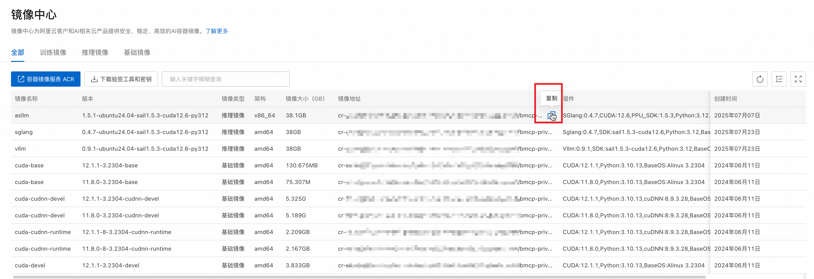
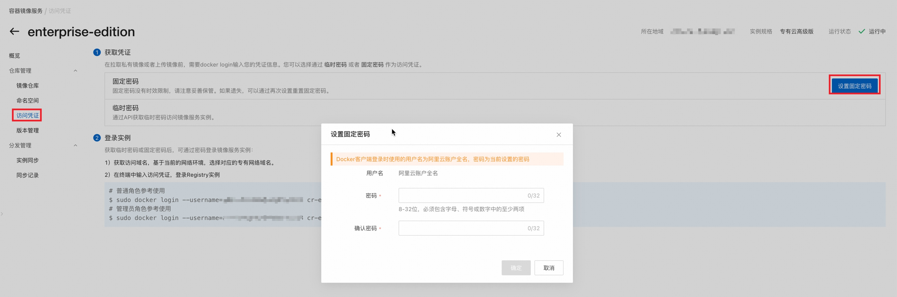
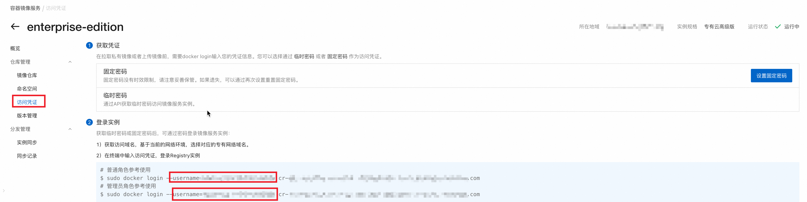
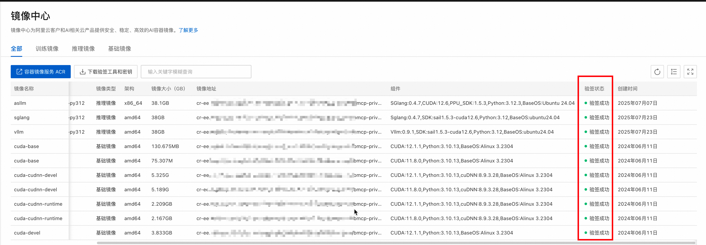

阿里云  
专有云  
裸金属算力平台 用户指南  
产品版本：V3.18.6  
文档版本：20251230

**目录**

- [1.什么是裸金属算力平台 BMCP](#section-1)
- [2.快速入门](#section-2)
    - [2.1. 使用流程](#section-2-1)
    - [2.2. 登录裸金属算力平台BMCP](#section-2-2)
- [3.概览](#section-3)
- [4.集群与节点](#section-4)
    - [4.1. 集群管理](#section-4-1)
        - [4.1.1. 裸金属-智算算力集群](#section-4-1-1)
            - [4.1.1.1. 创建集群](#section-4-1-1-1)
            - [4.1.1.2. 查看集群详情](#section-4-1-1-2)
            - [4.1.1.3. 集群扩容](#section-4-1-1-3)
            - [4.1.1.4. 集群缩容](#section-4-1-1-4)
            - [4.1.1.5. 删除集群](#section-4-1-1-5)
            - [4.1.1.6. 存储管理](#section-4-1-1-6)
            - [4.1.1.7. 查询操作记录](#section-4-1-1-7)
            - [4.1.1.8. 查看集群监控信息](#section-4-1-1-8)
        - [4.1.2. 容器-智算算力集群](#section-4-1-2)
            - [4.1.2.1. 创建集群](#section-4-1-2-1)
            - [4.1.2.2. 查看集群详情](#section-4-1-2-2)
            - [4.1.2.3. 集群扩容](#section-4-1-2-3)
            - [4.1.2.4. 集群缩容](#section-4-1-2-4)
            - [4.1.2.5. 集群删除保护](#section-4-1-2-5)
            - [4.1.2.6. 删除集群](#section-4-1-2-6)
            - [4.1.2.7. 查询操作日志](#section-4-1-2-7)
            - [4.1.2.8. 存储管理](#section-4-1-2-8)
            - [4.1.2.9. 跳转ACK控制台](#section-4-1-2-9)
            - [4.1.2.10. 软件实例](#section-4-1-2-10)
                - [4.1.2.10.1. 安装软件实例](#section-4-1-2-10-1)
                - [4.1.2.10.2. 查看软件实例详细信息](#section-4-1-2-10-2)
                - [4.1.2.10.3. 删除软件实例](#section-4-1-2-10-3)
                - [4.1.2.10.4. 访问AI开发控制台](#section-4-1-2-10-4)
                - [4.1.2.10.5. 启用集群运维服务](#section-4-1-2-10-5)
            - [4.1.2.11. 连接信息](#section-4-1-2-11)
                - [4.1.2.11.1. 通过kubectl连接Kubernetes集群](#section-4-1-2-11-1)
                - [4.1.2.11.2. 吊销集群的KubeConfig凭证](#section-4-1-2-11-2)
            - [4.1.2.12. 查看集群监控信息](#section-4-1-2-12)
        - [4.1.3. 裸金属-超算算力集群](#section-4-1-3)
            - [4.1.3.1. 创建集群](#section-4-1-3-1)
            - [4.1.3.2. 查看集群详情](#section-4-1-3-2)
            - [4.1.3.3. 集群扩容](#section-4-1-3-3)
            - [4.1.3.4. 集群缩容](#section-4-1-3-4)
            - [4.1.3.5. 删除集群](#section-4-1-3-5)
            - [4.1.3.6. 查询操作日志](#section-4-1-3-6)
    - [4.2. 节点管理](#section-4-2)
        - [4.2.1. 查看节点详情](#section-4-2-1)
        - [4.2.2. 管理节点状态](#section-4-2-2)
        - [4.2.3. 为节点挂载第三方存储](#section-4-2-3)
        - [4.2.4. 查看操作记录](#section-4-2-4)
        - [4.2.5. 查看节点监控信息](#section-4-2-5)
        - [4.2.6. 远程登录](#section-4-2-6)
        - [4.2.7. GPU虚拟化](#section-4-2-7)
- [5.回收站](#section-5)
- [6.应用服务](#section-6)
    - [6.1. 镜像中心](#section-6-1)
        - [6.1.1. 镜像验签](#section-6-1-1)
    - [6.2. 数据加速](#section-6-2)
        - [6.2.1. 镜像加速](#section-6-2-1)
        - [6.2.2. 缓存加速](#section-6-2-2)
        - [6.2.3. 配置Dragonfly的镜像仓库以实现加速](#section-6-2-3)
- [7.机型与镜像](#section-7)
    - [7.1. 节点机型](#section-7-1)
        - [7.1.1. 查询机型](#section-7-1-1)
        - [7.1.2. 修改机型](#section-7-1-2)
        - [7.1.3. 删除机型](#section-7-1-3)
    - [7.2. 裸机镜像](#section-7-2)
        - [7.2.1. 上传自定义镜像](#section-7-2-1)
        - [7.2.2. 查看公共镜像](#section-7-2-2)
        - [7.2.3. 查询自定义镜像](#section-7-2-3)
        - [7.2.4. 删除镜像](#section-7-2-4)
        - [7.2.5. 镜像状态管理](#section-7-2-5)
        - [7.2.6. 镜像导出](#section-7-2-6)
        - [7.2.7. 验证公共镜像完整性](#section-7-2-7)
- [8.网络与安全](#section-8)
    - [8.1. 专有网络VPC](#section-8-1)
    - [8.2. EVPC管理](#section-8-2)
    - [8.3. 通信库管理](#section-8-3)
    - [8.4. 安全组](#section-8-4)
        - [8.4.1. 安全组概述](#section-8-4-1)
        - [8.4.2. 管理安全组](#section-8-4-2)
        - [8.4.3. 管理安全组规则](#section-8-4-3)
        - [8.4.4. 管理安全组实例](#section-8-4-4)
    - [8.5. 密钥对](#section-8-5)
- [9.标签管理](#section-9)
    - [9.1. 查询标签](#section-9-1)
    - [9.2. 创建标签并绑定资源](#section-9-2)
- [10.计量数据](#section-10)
    - [10.1. 查看计量数据](#section-10-1)
- [11.运维管理](#section-11)
    - [11.1. 集群监控](#section-11-1)
    - [11.2. 事件监控](#section-11-2)
    - [11.3. 一键诊断](#section-11-3)
- [12.性能评测](#section-12)
    - [12.1. 创建评测任务](#section-12-1)
    - [12.2. 查看评测任务详情](#section-12-2)

<a id="section-1"></a>

# 1.什么是裸金属算力平台 BMCP

裸金属算力（Bare Metal Computing Platform，简称BMCP）平台是一个前沿的技术解决方案，旨在为高性能计算需求的企业和开发人员提供强大、灵活且高效的计算资源。该平台通过构建基于服务器的裸金属集群，为用户提供了一种无虚拟化层的直接硬件访问方式，从而确保了最大程度的性能输出和优化的资源利用率。

**特点和优势**

- 高性能：裸金属服务器提供不受虚拟化技术影响的原生硬件性能，使得计算密集型和存储密集型应用可以实现更高的执行效率。

- 专属资源使用：用户获得专属的物理服务器资源，这意味着不会有“邻居”干扰，保证了更稳定的计算和存储性能。

- 灵活配置：根据不同的应用需求，用户可以选择最适合的硬件配置，包括处理器、内存、存储和网络资源等，以实现最优的性能与成本平衡。

- 即时可用性：与传统的物理服务器部署相比，裸金属算力平台能够提供更快的部署速度，让用户能够迅速启动项目，缩短项目上线时间。

- 安全与隔离：由于用户对硬件资源具有完全的控制权，这提供了更高级别的安全性和隔离性，尤其适合对安全性和合规性要求较高的业务场景。

> **说明**
>
> 该裸金属算力平台是面向未来的企业级解决方案，适合需要处理大规模计算任务的科研机构、智能计算任务、大型互联网公司和金融行业等，为他们提供了一个既强大又灵活的计算环境。

**功能特性**

**概览**

- 概览页针对裸金属-智算算力集群、容器-智算算力集群和裸金属-超算算力集群提供资源大盘信息监控展示的能力，用于全局总览BMCP实例资源运营信息，助您优化资源配置，精确布局。汇聚资源操作入口，高效运营，便捷管理。

- 概览页用于展示**实例概览**、**算力资源统计**、**组织使用率排行**、**配额统计**、**资源告警**、**告警统计**和**告警趋势**。

  - **实例概览**包括：

    - **集群总数**：展示当前集群的总数量，并支持显示不同类型集群的数量。

    - **节点数**：展示节点的总数量，并支持显示各个芯片实例的节点数量。

    - **镜像数**：展示镜像的总数量，并支持显示不同类型镜像的数量。

  - **算力资源统计**包括GPU总算力、GPU卡数和CPU总算力。

  - **组织使用率排行**：

    - 支持按照芯片分类。

    - 支持按照实例分类，实例类型包括：智算基础实例、智算高网实例、智算纳管实例、高性能计算高网实例。

    - 支持查看近7天、近15天、近30天的资源使用率。

    - 支持查看组织使用率排行。

  - **配额统计**：

    - 支持按照实例规格（每个规格对应一台物理机）的配额展示。

    - 支持按照实例分类展示。

    - 包括算力使用情况、GPU 使用情况、CPU 使用情况及内存使用情况等。

  - **资源告警**：

    - 列出了资源告警信息。

    - 支持跳转至云监控的**报警历史**页面查看报警的详细信息。

  - **告警统计**：列出P1、P2、P3等级的告警数量及告警总数量。

  - **告警趋势**：支持查看近期的（近7天、近15天或近30天）告警趋势。

**集群与节点**

**集群**

**集群**是BMCP裸金属算力平台面向用户提供的一个很重要的管理对象，通过“集群管理”，用户可基于不同实例规格，构建业务所需的裸金属或者容器算力集群，配套提供集群的生命周期管理能力以及存储挂载、应用部署等增值能力。

- 支持一键创建裸金属、容器、高性能计算和训推优化等集群。

- 支持多种实例规格，包括智算通用、智算纳管、智算基础、高性能计算通用型和智算训推优化等。用户可根据自身业务特点选择合适的规格实例，以构建算力集群。

- 支持集群的创建、删除、扩容、缩容及集群监控等生命周期管理功能。

- 集群状态查看，包括集群的ID、名称、标签、状态、数量、资源情况及网络配置等基础信息。

- 支持并行文件系统的客户端集群部署及文件系统挂载等能力。

- 在创建及使用容器集群时，支持按需增量部署各类容器addon组件，包括数据缓存加速、镜像加速和弹性容错等组件。

**节点**

节点是BMCP裸金属算力平台面向用户提供的最小粒度的管理单元，通过“节点管理”，用户可查看当前集群各个节点的属性、运行状态等，支持节点操作，用于管理和使用节点资源。

- 支持远程登录、节点的启用与停用、重启以及节点监控等管理功能。

- 支持节点状态的查看，包括节点的ID、名称、状态、标签、所属集群及网络配置等基础信息。

- 针对智算纳管算力集群，支持基于NFS和iSCSI协议的远程文件系统挂载。

**应用服务**

**应用服务**是BMCP裸金属算力平台面向用户AI场景用户提供的一系列增值服务能力，包括镜像中心、数据加速等，基于阿里高性能算力集群能力的深度优化和迭代，可结合自身业务场景和属性，选择对应服务内容。

**镜像中心**

**镜像中心**提供了面向AI场景的各类基础镜像服务，包括**训练镜像**、**推理镜像**和**基础镜像**等，它是基于飞天企业版BMCP裸金属算力平台构建的高性能IaaS基础设施能力，并通过面向不同AI场景用户提供的一系列经过阿里深度优化的容器镜像服务市场。基于这些镜像构建的AI算力服务，能够更好地发挥算力集群的能力，保证业务、资源的兼容性和性能。

- **镜像中心**支持对全部、训练镜像、推理镜像和基础镜像的展示和搜索。

  - 训练镜像：提供可用于上层AI PaaS平台进行训练的标准镜像，集成BMCP算力平台集群能力，包括操作系统、训练框架、CUDA/ROCm、高网驱动等。

  - 推理镜像：提供可用于上层AI PaaS平台做推理的标准镜像，集成BMCP算力平台集群能力，包括操作系统、训练框架、CUDA/ROCm等。

  - 基础镜像：提供可用于上层AI PaaS平台训练与推理场景使用的基础模块/镜像，如NCCL优化等能力。

- 在**数据加速**页面中**创建镜像转换任务**后生成的DADI镜像会在镜像中心中透出，若要使用该镜像，需要确保所属ACK集群已部署“DADI镜像加速”Addon组件。

- 支持跳转至**容器镜像服务ACR**控制台。

**数据加速**

**数据加速**面向AI场景提供了一系列数据相关的加速服务能力，包括镜像加速、数据缓存加速等能力，用户可基于实际业务使用场景，按需开通相关服务能力。

- **镜像加速**功能支持DADI镜像加速，通过镜像加速按需加载功能，允许仅下载和解压容器启动所必需的部分，而不是整个镜像，从而大幅提高容器应用部署速度和提升弹性体验。

- **缓存加速**功能是面向典型AI场景如训练、推理等，提供镜像加速、数据缓存加速等训推优化的增值能力。

**机型与镜像**

**机型与镜像**功能属于BMCP裸金属算力平台管理的基础资源，包括当前平台可支持的实例规格对应的机型信息和裸机镜像信息等。

- **节点机型**：

  - 支持设置可管理裸金属的机型范围，添加机型后，方可在创建裸金属集群及实例时选到已经添加的机型。

  - 支持对机型进行增加、删除、修改及查询等操作。

- **裸机镜像**：

  - 裸机镜像用于维护裸机装机或创建集群时使用的镜像元数据，目前提供了多种选择，包括**自定义镜像**和**公共镜像**。

  - 提供了**自定义镜像**的查询、状态管理、删除、导出等功能。

  - 提供了**公共镜像**的查询、状态管理、导出等功能，您可以根据需求自定义上传所需的镜像。

**网络与安全**

**网络与安全**提供用于创建或维护算力集群时所需的网络信息，包括：

- **专有网络VPC**：用于BMCP裸金属算力平台创建集群时所依赖的VPC网络管理服务，支持跳转至专有网络VPC的控制台。

- **EVPC管理**：

  - EVPC（Enterprise Virtual Private Cloud）用于管理智算节点的RDMA网络。通过EVPC，可实现智算节点RDMA网段和子网的管理，以及不同智算集群间RDMA网络的隔离。

  - 支持创建、编辑、删除以及查询和查看EVPC功能。

  - 只有通用智算集群型实例支持配置EVPC。

- **安全组**：安全组是一种虚拟防火墙，用于控安全组内实例的入流量和出流量，实现对裸机实例流量细粒度的控制，阻止非法访问，从而提高实例的安全性。

- **密钥对**：提供一种安全便捷的登录认证方式，由公钥和私钥组成，可用于用户权限的有效管理。

**标签管理**

裸金属算力平台BMCP接入了Apsara Uni-manager运营控制台的标签管理，标签用于从不同维度对资源分类管理。

- 面向裸金属和容器资源的标签管理功能，支持按需进行自定义标签配置。

- 支持跳转至ASCM**资源运营 > 标签管理**功能。

**计量数据**

裸金属算力平台BMCP接入了Apsara Uni-manager运营控制台的计量管理，提供裸金属算力平台的资源数据统计功能。

- 支持基于容器、裸金属及节点级别的计量能力，能够提供GPU卡、CPU、内存等资源层面的计量。

- 支持跳转至ASCM**资源运营 > 计量管理**功能。

**运维管理**

运维管理提供**集群监控**、**事件监控**和**一键诊断**的功能，监控裸金属智算算力集群与容器智算算力集群中的各种性能指标（包括实例、GPU、RDMA等资源）和事件，帮助维护智算平台状态。

- **集群监控**提供集群层面的监控能力，包括基础监控、GPU监控、RDMA监控等多个监控项。

- **事件监控**对裸金属智算算力集群与容器智算算力集群中的各种事件进行监控，并支持配置事件报警。

  - 支持事件告警功能，包括算力集群GPU PCIE/驱动掉卡、计算引擎异常、PCIE链路带宽下降、NVLink故障等多项事件监控指标。

  - 支持配置事件报警，包括严重、警告、提示不同等级的事件监控。用户可按需创建不同的报警规则，可以定向告知不同权限人员。

  - 支持查看事件报警历史。

- **一键诊断**

  - 提供面向算力、网络、容器等资源的一键诊断能力，通过一键创建巡检任务，帮助用户快速定位集群故障。

  - 一键诊断支持多种巡检场景，及时对集群进行巡检可以帮助维护智算平台状态。

  - 裸金属集群算力巡检针对裸金属节点硬件问题，提供整机巡检和GPU巡检两部分功能，展示实时的健康状态信息。通过定期巡检物理服务器，可以发现潜在的硬件故障、性能瓶颈或其他问题，帮助及时解决和预防系统故障，保证智算集群的稳定性和可靠性。

  - 容器集群算力巡检针对容器集群的IaaS和PaaS层故障，提供了整机巡检、GPU巡检和k8s底座巡检，能够及时发现容器运行异常或健康状态指标异常。

<a id="section-2"></a>

# 2.快速入门

<a id="section-2-1"></a>

## 2.1. 使用流程

本节介绍裸金属算力平台 BMCP的基本使用流程，使用集群服务首先需要已具备可用的裸机（请在BMCP运维控制台上进行查看），然后根据需求选择裸金属-智算算力集群、容器-智算算力集群、裸金属-超算算力集群创建使用，可对集群进行扩容、缩容、删除等操作实现集群及节点的管理运维。

**操作说明**

- **创建集群**：用户可选择创建裸金属-智算算力集群、容器-智算算力集群、裸金属-超算算力集群，通过配置集群基本信息，选择组织资源集信息、网络信息、裸机实例、ECS实例规格、制定安装镜像等来完成集群的创建。

- <strong>集群扩容：</strong>支持用户对已创建的集群进行扩容操作，用户可在裸机管理BMS控制台中提前配置好需要裸机，在BMCP控制台中通过集群扩容功能添加所需裸机节点，并配置用户名及密码完成集群的扩容操作。

- **集群缩容**：支持用户对指定集群进行缩容操作，在BMCP控制台中通过集群缩容功能对指定的裸机节点进行缩容，裸机被缩容释放后，系统会自动删除裸机的OS并清理磁盘数据，重新释放回裸机资源池中。

> **说明**
>
> 以上仅为智算算力集群的操作说明。

<a id="section-2-2"></a>

## 2.2. 登录裸金属算力平台BMCP

本节为您介绍如何登录到Apsara Uni-manage运营控制台，并进入裸金属算力平台BMCP。

**前提条件**

- 您需要登录Apsara Uni-manage运营控制台后进入裸金属算力平台BMCP，请提前确认您已从部署人员处获取Apsara Uni-manage运营控制台的服务域名地址。

- 推荐使用Chrome浏览器。

**操作步骤**

1. 在浏览器地址栏中，输入Apsara Uni-manage运营控制台的访问地址，按回车键。

2. 输入正确的用户名及密码。

   *请向运营管理员获取登录控制台的用户名和密码。*

   > **说明**
   >
   > 首次登录ASCM控制台时，需要修改登录用户名的密码，请按照提示完成密码修改。为提高安全性，密码长度必须为 8~20 位，且至少包含以下两种类型：
   >
   > - 英文大写或小写字母（A~Z、a~z）
   >
   > - 阿拉伯数字（0~9）
   >
   > - 特殊符号（感叹号（！）、at（@）、井号（#）、美元符号（$）、百分号（%）等）
   >
   > *admin管理员账号具有所有权限，操作不受限，在运营管理中请慎重操作！*

3. 单击**登录**，进入Apsara Uni-manage运营控制台页面。

4. 在页面顶部的菜单栏中，选择**产品 > 计算 > 裸金属算力平台 BMCP**。

<a id="section-3"></a>

# 3.概览

本文介绍BMCP裸金属算力平台概览页的核心指标，包括算力资源、资源使用趋势、配额统计以及资源告警等关键信息。

<table>
  <tr>
    <th width="137">区域</th>
    <th>描述</th>
  </tr>
  <tr>
    <td>实例概览</td>
    <td>• 列出了该账号在所选组织、资源集、地域下的ECS信息，包括<strong>集群总数</strong>、<strong>节点数</strong>、<strong>镜像</strong><strong>数</strong>。<br>• <strong>集群总数</strong>：展示当前集群的总数量，并支持显示不同类型集群的数量。<br>• <strong>镜像数</strong>：展示镜像的总数量，并支持显示不同类型镜像的数量。<br>• <strong>节点数</strong>：展示节点的总数量，并支持显示各个芯片实例的节点数量。<br>说明节点数量受到配额限制，需要先确认配额管理中是否已经进行对应配置。详情请参见<strong>《Apsara Uni-manager运营控制台用户指南》</strong>中的<strong>《配额管理》</strong>章节。<br>• 您可以单击<strong>集群总数</strong>、<strong>镜像数</strong>，分别查看集群信息和镜像信息。</td>
  </tr>
  <tr>
    <td>算力资源统计</td>
    <td>列出了该账号在所选组织、资源集、地域下的算力资源信息，包括<strong>GPU总算力</strong>、<strong>GPU卡</strong><strong>数</strong>、<strong>CPU总算力</strong>。</td>
  </tr>
  <tr>
    <td>组织使用率排行</td>
    <td>列出了该组织及其下属组织近期的（近7天、近15天或近30天）<strong>资源使用趋势</strong>。支持分别查看智算基础型实例、智算高网型实例、智算纳管型实例和高性能计算高网型实例的资源使用趋势。此外，还支持按照芯片分类。<br>说明该模块受到配额限制，需要先确认配额管理中是否已经进行对应配置。详情请参见<strong>《Apsara Uni-manager运营控制台用户指南》</strong>中的<strong>《配额管理》</strong>章节。</td>
  </tr>
  <tr>
    <td>资源告警</td>
    <td>列出了该账号在所选组织、资源集、地域下的所有资源告警信息。您可以单击<strong>去处理</strong>，跳转至云监控的<strong>报警历史</strong>页面查看报警的详细信息。</td>
  </tr>
  <tr>
    <td>配额统计</td>
    <td>您可以在<strong>配额统计</strong>右侧的下拉框中选择GPU卡型号，并在<strong>配额统计</strong>区域的右侧选择<strong>智算高网</strong><strong>型实例</strong>、<strong>智算基础型实例</strong>以及<strong>高性能计算高网型实例</strong>。您可以查看该卡的算力总量、已分配量和已使用量，以及GPU的总量、已分配量和已使用量。同时，您也可以查看CPU的总量、已分配量和已使用量，以及内存的总量、已分配量和已使用量。<br>说明'-'为未设置，需要进入配额管理页进行对应配置。详情请参见<strong>《Apsara Uni-</strong><strong>manager运营控制台用户指南》</strong>中的<strong>《配额管理》</strong>章节。</td>
  </tr>
  <tr>
    <td>告警统计</td>
    <td>列出了该账号在所选组织、资源集、地域下的告警总数、P1告警数、P2告警数、P3告警数。</td>
  </tr>
  <tr>
    <td>告警趋势</td>
    <td>列出了该账号在所选组织、资源集、地域下近期的（近7天、近15天或近30天）告警趋势。</td>
  </tr>
</table>

<a id="section-4"></a>

# 4.集群与节点

<a id="section-4-1"></a>

## 4.1. 集群管理

<a id="section-4-1-1"></a>

### 4.1.1. 裸金属-智算算力集群

<a id="section-4-1-1-1"></a>

#### 4.1.1.1. 创建集群

本节介绍如何创建裸金属-智算算力集群。

**前提条件**

- 已经在BMCP运维控制台注册BMCP实例。

- 裸金属节点运行状态正常。

> **说明**
>
> 节点状态查询途径：Apsara Uni-manager运维控制台-BMCP运维平台。

**操作步骤**

1. 登录裸金属算力平台BMCP

2. 在左侧导航栏中，单击**集群与节点 > 集群管理**。

3. 在**集群管理**页面中，选择**裸金属-智算算力集群**页签。

4. 创建集群包括以下两种方式：

   - 方式一：单击**创建集群**。

   - 方式二：单击页面上方的**裸金属-智算算力集群**卡片中的**点击创建集群**。

5. 在弹出的**创建裸金属-智算算力集群**页面中的**基本配置**区域，根据页面提示选择**组织、资源集、地域、可用区**，授权组织**云接入网关RAM角色授权**。

   > **说明**
   >
   > - 如果提醒，该组织尚未进行云接入网关RAM角色授权，请点击右侧按钮进行授权，继续操作需要该组织先进行云接入网关RAM角色授权，在新页面授权完成后可点击右侧刷新按钮刷新状态。
   >
   > - 如果提醒，该组织已经进行了云接入网关RAM角色授权，可以继续操作集群创建。

6. 在**网络配置**区域选择**专有网络、交换机VSwitch**、智算高网型实例可以选择**RDMA网络 EVPC**。

7. 在**集群配置**区域，选择**集群实例规格**，配置节点、填入**集群名称**、**登录密码**、**确认密码**、**描述**和**标签**。参数的详细说明请参考下表填写。

   <table>
     <tr>
       <th width="121">配置项</th>
       <th>说明</th>
     </tr>
     <tr>
       <td>集群实例规格</td>
       <td>集群实例规格包括<strong>智算高网型实例</strong>、<strong>智算纳管型实例</strong>和<strong>智算基础型实例</strong>。<br>• 智算高网型实例是基于原生RDMA网络和高性能存储的GPU类型通用智算计算集群，支持云内RDMA网络及高性能存储服务。<br>• 智算纳管型实例是基于利旧纳管RDMA（IB/RoCE）网络和传统存储的GPU类型纳管智算计算集群，用于接入云外RDMA网络和第三方文件存储。<br>• 智算基础型实例是不带高网/高性能存储，支持基础网络的GPU基础型裸金属实例。</td>
     </tr>
     <tr>
       <td>接入方式</td>
       <td>可选<strong>CHSW接入</strong>和<strong>HSW接入</strong>。仅当<strong>集群实例规格</strong>为<strong>智算纳管型实例</strong>时有此参数。</td>
     </tr>
     <tr>
       <td>集群名称</td>
       <td>集群的名称。</td>
     </tr>
     <tr>
       <td>节点配置</td>
       <td>添加节点配置时：<br>• 智算高网型实例可以选择<strong>规格</strong>，配置<strong>节点数量</strong>。<br>• 智算纳管型实例可以选择<strong>节点</strong>、<strong>配置镜像</strong>。<br>• 智算基础型实例可以选择<strong>规格</strong>，配置<strong>节点数量</strong>。</td>
     </tr>
     <tr>
       <td>镜像创建类型</td>
       <td>• 仅智算基础型实例在节点配置时可配置。<br>• 当镜像创建类型选择为<strong>重新安装镜像</strong>时，可指定公共镜像进行安装。<br>• 仅PG8AP6M7S4G5VB2X7.32、PG8AP6M7S4G5VB2X7.03CH及QPG88P4M10G26B2.32机型支持指定公共镜像安装。</td>
     </tr>
     <tr>
       <td>登录密码</td>
       <td>设置用户登录密码。</td>
     </tr>
     <tr>
       <td>确认密码</td>
       <td>再次输入登录密码。</td>
     </tr>
     <tr>
       <td>描述</td>
       <td>对于所创建集群的简短描述。</td>
     </tr>
     <tr>
       <td>标签</td>
       <td>设置标签对集群进行简单说明，后期可以在高级搜索里根据标签快速筛选对应集群。</td>
     </tr>
   </table>

8. 在**高级配置**区域，配置**挂载三方存储**、**高性能存储**、**安全加固**。

   <ol type="i">

   <li>

   （可选）当需要挂载高性能存储时，勾选**高性能存储**，选择**文件系统**。

   > **说明**
   >
   > 只有智算高网型实例支持配置高性能存储服务。

   </li>

   <li>

   （可选）当需要挂载三方存储时，勾选**挂载三方存储**，选择**存储类型**，并填入**服务端IP/域名、服务端IQN、客户端IQN、客户端挂载路径**和**LunID**，再设置**CHAP校验**开关。

   > **说明**
   >
   > 只有智算纳管型实例支持配置挂载三方存储服务。

   </li>

   <li>

   默认启用安全加固功能，启用后将加载安骑士的默认策略，支持提供网站漏洞检查、云产品安全配置检查以及主机登录异常告警等多项安全功能。

   </li>

   </ol>

9. 完成上述参数配置后，单击**提交**，完成裸金属-智算算力集群的创建。

<a id="section-4-1-1-2"></a>

#### 4.1.1.2. 查看集群详情

本节介绍如何查询集群以及查看集群详细信息。

**前提条件**

已成功创建裸金属-智算算力集群，请参见创建集群。

**操作步骤**

1. 登录裸金属算力平台BMCP。

2. 在左侧导航栏中，单击**集群与节点 > 集群管理**。

3. 在**集群管理**页面中，选择**裸金属-智算算力集群**页签。

4. 查询算力集群。

   - 基础查询：

     <ol type="a">

     <li>

     支持自动识别，根据输入的值，自动识别匹配的字段。

     </li>

     <li>

     支持输入集群ID、集群名称、专有网络ID、EVPC网络ID或下拉选择标签。

     </li>

     </ol>

     <ol type="i" start="100">

     <li>

     单击  ，查询符合条件的集群。

     </li>

     </ol>

   - 高级筛选：

     <ol type="a">

     <li>

     单击**高级筛选**。

     </li>

     <li>

     支持自动识别，根据输入的值，自动识别匹配的字段。

     </li>

     </ol>

     <ol type="i" start="100">

     <li>

     支持同时输入集群ID、集群名称、专有网络ID、EVPC网络ID，选择标签。

     </li>

     <li value="500">

     单击**搜索**，进行精确查询。

     </li>

     </ol>

5. 单击对应集群操作列详情，可查看集群的**基本信息**、**集群节点**、**操作记录**和**监控**。

   <ol type="i">

   <li>

   基本信息

   基本信息页包含的信息如下表所示。

   <table>
     <tr>
       <th width="89">信息分类</th>
       <th>描述</th>
     </tr>
     <tr>
       <td>基本信息</td>
       <td>集群基本信息包括<strong>集群ID</strong>、<strong>集群名称</strong>、<strong>集群状态</strong>、<strong>节点数</strong>等信息。</td>
     </tr>
     <tr>
       <td>配置信息</td>
       <td>集群配置信息包括<strong>集群实例规格</strong>、CPU核数、内存大小、GPU显存大小、算力等信息。</td>
     </tr>
     <tr>
       <td>网络信息</td>
       <td>集群网络信息包括<strong>专有网络ID</strong>、<strong>专有网络名称</strong>、<strong>RDMA网络 EVPC</strong> <strong>ID</strong>、<strong>RDMA网络 EVPC名称</strong>等信息。</td>
     </tr>
     <tr>
       <td>存储信息</td>
       <td>集群存储信息包括高性能存储状态等。</td>
     </tr>
   </table>

   </li>

   <li>

   集群节点

   单击**集群节点**页签，即可查看当前集群中所有节点的信息，包括**节点名称/ID**、**在线状态**、**SN**、**节点IP**、**主机名**等。此页面还提供了查看节点详细信息、修改节点的状态、GPU虚拟化、移除节点等功能。更多节点管理功能，请参见管理节点状态。

   </li>

   <li>

   操作记录

   单击**操作记录**页签，即可查看集群的操作日志，操作日志分为**聚合日志**和**操作日志**。更多操作记录信息，请参见查询操作记录。

   </li>

   <li>

   监控

   单击**监控**页签，即可查看集群的监控信息，包括**基础监控**、**GPU监控**和**RDAM监控**。更多集群监控信息，请参见查看集群监控信息。

   </li>

   </ol>

<a id="section-4-1-1-3"></a>

#### 4.1.1.3. 集群扩容

本节介绍如何给裸金属-智算算力集群进行裸机节点的扩容操作。

**前提条件**

- 已创建裸金属-智算算力集群，详情请参见创建集群。

- 已具备在资源池中，运行状态正常的裸金属实例。

> **说明**
>
> 资源池实例状态查询途径：Apsara Uni-manager运维控制台-BMCP运维平台。

**背景信息**

当集群裸金属实例资源不足时，可扩容集群。

**操作步骤**

1. 登录裸金属算力平台BMCP。

2. 在左侧导航栏中，单击**集群与节点 > 集群管理**。

3. 在**集群管理**页面中，单击**裸金属-智算算力集群**页签。

4. 单击目标集群**操作**列的**扩容**。

5. 在**裸金属集群扩容**弹框中，查看并确认集群基本信息，选择**裸机专用VSwitch**，然后配置需要扩容的节点。

   > **说明**
   >
   > - 智算高网型实例可以选择**规格**，配置**节点数量**。
   >
   > - 智算纳管型实例可以选择**节点**，配置**镜像**。
   >
   > - 智算基础型实例可以选择**规格**，配置**节点数量**。
   >
   >   - 在选择规格后，可配置已选择规格的**镜像创建类型**。当镜像创建类型选择为**重新安装镜像**时，可指定公共镜像进行安装。
   >
   >   - 仅PG8AP6M7S4G5VB2X7.32、PG8AP6M7S4G5VB2X7.03CH及QPG88P4M10G26B2.32机型支持指定公共镜像安装。

6. 单击**提交**。

<a id="section-4-1-1-4"></a>

#### 4.1.1.4. 集群缩容

本节介绍如何给裸金属-智算算力集群进行裸机节点的缩容操作。

**前提条件**

- 已创建裸金属-智算算力集群，详情请参见创建集群。

- 在待缩容的集群中具备运行状态正常的裸机。

**背景信息**

当集群中的裸金属实例资源超额时，可实施缩容操作以优化资源分配并减少不必要的实例数量。

> **警告**
>
> 对集群中的裸机节点进行缩容存在一定的风险，请谨慎操作！

**操作步骤**

1. 登录裸金属算力平台BMCP。

2. 在左侧导航栏中，单击**集群与节点 > 集群管理**。

3. 在**集群管理**页面中，单击**裸金属-智算算力集群**页签。

4. 单击对应集群**操作**列的**缩容**。

5. 在**裸金属集群缩容**弹框中，核对集群基本信息，进行缩容配置。

   | 参数项 | 是否必选 | 说明 |
   | --- | --- | --- |
   | 选择节点 | 是 | 在<strong>选择节点</strong>列表中勾选待缩容的裸机节点。 |
   | 清理数据盘 | 否 | 若勾选，在缩容时会清理数据盘数据。 |
   | 冷冻时长（小时） | 否 | • BMCP节点在集群缩容后会被放置于回收站中。在冷冻时长内，您可以从回收站中将节点恢复至原集群；超过冷冻时长，节点将自动释放回资源池。<br>• 参数范围：1～720。 |

6. 集群缩容。

   <ol type="i">

   <li>

   服务管理中已创建云产品为**裸金属算力平台BMCP**、资源项为**裸金属-智算算力集群**的服务：确认相关参数，单击**确认订单**。

   </li>

   <li>

   服务管理中未创建云产品为**裸金属算力平台BMCP**、资源项为**裸金属-智算算力集群**的服务：确认相关参数，单击**提交**。

   </li>

   </ol>

   关于服务管理的更多信息，请参见《Apsara Uni-manager运营控制台 用户指南》 中的《服务管理》章节。

<a id="section-4-1-1-5"></a>

#### 4.1.1.5. 删除集群

本节介绍如何删除裸金属-智算算力集群。

**前提条件**

- 已创建裸金属-智算算力集群，详情请参见创建集群。

- 待删除的集群状态需处于稳定状态（运行中、创建失败、扩容失败、缩容失败）。

**背景信息**

- 支持用户对集群列表中的裸金属-智算算力集群执行删除操作。

- 集群删除后，集群中的裸机节点将被放置到回收站，冷冻时长到期后会释放进入资源池并重装。

> **警告**
>
> 删除集群存在一定的风险，请谨慎操作！

**操作步骤**

1. 登录裸金属算力平台BMCP。

2. 在左侧导航栏中选择**集群与节点 > 集群管理**。

3. 在**集群管理**页面中，单击**裸金属-智算算力集群页签**。

4. 找到对应集群，并单击**删除**按钮。

   <ol type="i">

   <li>

   方法1，找到目标集群所在行，单击该行**操作**列的**删除**按钮。

   </li>

   <li>

   方法2，找到目标集群所在行，单击该行**操作**列的**详情**按钮后进入**集群管理 > 集群详情**页面，单击右上角的**删除**按钮。

   </li>

   </ol>

5. 在弹出对话框上确认待删除的集群信息，配置删除信息。

   <table>
     <tr>
       <th width="152">参数项</th>
       <th>说明</th>
     </tr>
     <tr>
       <td>清理数据盘</td>
       <td>若勾选，在缩容时会清理数据盘数据。</td>
     </tr>
     <tr>
       <td>冷冻时长（小时）</td>
       <td>• BMCP节点在集群缩容后会被放置于回收站中。在冷冻时长内，您可以从回收站中将节点恢复至原集群；超过冷冻时长，节点将自动释放回资源池。<br>• 参数范围：1～720。</td>
     </tr>
   </table>

6. 删除集群 。

   <ol type="i">

   <li>

   服务管理中已创建云产品为**裸金属算力平台BMCP**、资源项为**裸金属-智算算力集群**的服务：单击**确认订单**。

   </li>

   <li>

   服务管理中未创建云产品为**裸金属算力平台BMCP**、资源项为**裸金属-智算算力集群**的服务：单击**删除**。

   </li>

   </ol>

   关于服务管理的更多信息，请参见《Apsara Uni-manager运营控制台 用户指南》 中的《服务管理》章节。

7. 在弹出的二次确认框中，输入“**确认删除**”，并单击“**确认删除**”按钮，完成删除集群操作。

<a id="section-4-1-1-6"></a>

#### 4.1.1.6. 存储管理

本文旨在介绍高性能存储的启用、停用、挂载与卸载操作。

**前提条件**

已创建裸金属-智算算力集群，详情请参见创建集群。

**启用高性能存储**

**使用限制**

- 仅智算高网类型的集群支持启用高性能存储。

- 节点的数量小于3的集群不支持启用高性能存储。

- 需要部署对应的高性能存储。

**操作步骤**

1. 登录裸金属算力平台BMCP。

2. 在左侧导航栏中，单击**集群与节点 > 集群管理**。

3. 在**集群管理**页面中，单击**裸金属-智算算力集群**页签。

4. 在页面中查找到目标集群所在的行，然后单击该行**操作**列的  。

5. 单击**存储管理 > 启用高性能存储**。

6. 选择**高性能存储类型**。

   支持BMCPFS和EFS类型的高性能存储。

7. 单击**确定**。

**停用高性能存储**

**操作步骤**

1. 登录裸金属算力平台BMCP。

2. 在左侧导航栏中，单击**集群与节点 > 集群管理**。

3. 在**集群管理**页面中，单击**裸金属-智算算力集群**页签。

4. 在页面中查找到目标集群所在的行，然后单击该行**操作**列的  。

5. 单击**存储管理 > 停用高性能存储**。

6. 单击**确定**。

**挂载高性能存储**

**使用前提**

已启用高性能存储。

**操作步骤**

1. 登录裸金属算力平台BMCP。

2. 在左侧导航栏中，单击**集群与节点 > 集群管理**。

3. 在**集群管理**页面中，单击**裸金属-智算算力集群**页签。

4. 在页面中查找到目标集群所在的行，然后单击该行**操作**列的  。

5. 单击**存储管理 > 挂载**。

6. 在**挂载**页面选择**高性能存储**，并填写**挂载路径**。

7. 单击**确定**。

**卸载高性能存储**

**操作步骤**

1. 登录裸金属算力平台BMCP。

2. 在左侧导航栏中，单击**集群与节点 > 集群管理**。

3. 在**集群管理**页面中，单击**裸金属-智算算力集群**页签。

4. 在页面中查找到目标集群所在的行，然后单击该行**操作**列的  。

5. 单击**存储管理 > 卸载**。

6. 单击**确定**。

<a id="section-4-1-1-7"></a>

#### 4.1.1.7. 查询操作记录

本节介绍如何查看裸金属-智算算力集群的操作记录信息，包括聚合日志和操作日志。

**前提条件**

已创建裸金属-智算算力集群，详情请参见创建集群。

**操作步骤**

1. 登录裸金属算力平台BMCP。

2. 在左侧导航栏中，单击**集群与节点 > 集群管理**。

3. 在**集群管理页**面中，单击**裸金属-智算算力集群**页签。

4. 在搜索框中输入相应信息，然后单击  ，查询出符合条件的集群。

   > **说明**
   >
   > - 支持通过**自动识别**、**集群ID**、**集群名称**、**专有网络ID**、**EVPC网络ID**、**标签筛选**查找目标集群。
   >
   > - 筛选选项中**集群ID**、**集群名称**、**专有网络ID**、**EVPC网络ID**支持模糊查询。
   >
   > - 您也可以先后选择多个筛选选项逐级过滤，以便快速查找集群。

5. 单击目标集群操作列的**详情**进入集群详情页。

6. 单击**操作记录**标签页，可查询操作日志或者聚合日志。

   <ol type="i">

   <li>

   聚合日志。

   <ol type="a">

   <li>

   查看**聚合日志**信息，包括操作类型、操作状态、描述信息和操作时间等。

   支持根据操作类型和操作时间进行筛选。

   <table>
     <tr>
       <th width="90">筛选选项</th>
       <th>说明</th>
     </tr>
     <tr>
       <td>操作类型</td>
       <td>操作类型包括创建集群、删除集群、扩容集群、缩容集群、启用高性能存储客户端集群和停用高性能存储客户端集群等。</td>
     </tr>
     <tr>
       <td>操作时间</td>
       <td>支持通过设置起始日期和结束日期进行聚合日志筛选。</td>
     </tr>
   </table>

   </li>

   <li>

   单击目标聚合日志的**操作详情**。

   查看聚合日志的详细信息，包括任务类型、子项、开始时间、执行状态和描述信息等。

   </li>

   </ol>

   <ol type="i" start="100">

   <li>

   在聚合日志操作详情页，单击任务类型列的**重试**，可重新执行失败的操作。

   </li>

   </ol>

   </li>

   <li>

   操作日志。

   <ol type="a">

   <li>

   单击**操作日志**页签。

   查看**操作日志**信息，包括操作名称、操作人、执行状态、操作源IP等。您可以在筛选项或高级筛选中，筛选符合您要求的操作日志。

   | 筛选选项 | 说明 |
   | --- | --- |
   | 操作人 | 支持输入操作人进行精准查询。 |
   | 操作名称 | 支持输入操作名称进行精准查询。 |
   | 执行状态 | 下拉列表选择执行状态<strong>成功</strong>或<strong>失败</strong>进行查询。 |
   | 操作源IP | 支持输入操作源IP进行精准查询。 |
   | 操作时间 | 选择操作的起始日期和结束日期进行查询。 |

   > **说明**
   >
   > - 默认操作日志保存时长为7天，如需调整，需联系管理员在配置 > 日志转存设置中修改保存时长。具体操作，请参见专有云文档中心《Apsara Uni-manager运营控制台 用户指南》文档的**配置中心 > 日志转储设置**章节。
   >
   > - 若通过转存设置延长保存时长，日志数据不会做前序时间的数据补充。
   >
   > - 高级筛选方式支持选择多个筛选选项进行逐级过滤。

   </li>

   <li>

   单击目标操作记录的**操作详情**，可查看详情信息。

   </li>

   </ol>

   </li>

   </ol>

<a id="section-4-1-1-8"></a>

#### 4.1.1.8. 查看集群监控信息

在集群管理中提供了集群监控的功能，您可以查看集群的基础监控信息、GPU监控信息、RDMA监控信息等。

**操作步骤**

1. 登录裸金属算力平台BMCP。

2. 在左侧导航栏中，单击**集群与节点 > 集群管理**。

3. 在**集群管理**页面中，选择**裸金属-智算算力集群**页签。

4. 单击目标集群操作列的**详情**。

5. 切换到**监控**页签。

6. 查看集群监控信息。

   <ol type="i">

   <li>

   查看**基础监控**。

   默认进入**基础监控**页签，您可以查看CPU使用率、内存使用率、磁盘使用率、系统负载、TCP连接数、网络带宽等信息。此外，您还可以选择查看监控数据的时间范围。

   </li>

   <li>

   查看GPU监控。

   切换到**GPU监控**页签，您可以查看**所有SM的平均值**、**PCIe总线传输的数据速率**、**NVLink传输的数据速率**、**NVLink接收的数据速率**、**GPU温度**、**GPU利用率**、**GPU功率**等信息。此外，您还可以选择查看监控数据的时间范围。

   </li>

   <li>

   查看RDMA监控。

   切换到**RDMA监控**页签，您可以查看**RDMA网络发送吞吐**、**RDMA网络接收吞吐**、**RDMA网络缓冲区溢出数**、**RDMA网络数据报文乱序数**等信息。此外，您还可以选择查看监控数据的时间范围。

   </li>

   </ol>

<a id="section-4-1-2"></a>

### 4.1.2. 容器-智算算力集群

<a id="section-4-1-2-1"></a>

#### 4.1.2.1. 创建集群

本节介绍如何创建容器-智算算力集群。

**前提条件**

- 已具备可创建容器-智算算力集群的专有网络和虚拟交换机。

- Master节点具备可选ECS实例规格。

- 在创建容器智算算力集群时，需确认待添加的BMCP Worker节点镜像是否符合要求，目前支持创建容器智算算力集群的BMCP镜像如下表所示。

  <table>
    <tr>
      <th>系统架构</th>
      <th>镜像版本</th>
      <th>内核版本</th>
      <th>说明</th>
    </tr>
    <tr>
      <td rowspan="3">AMD64/x86_6 4</td>
      <td>Alibaba Cloud Linux 3</td>
      <td>5.10.X</td>
      <td>智算高网型实例、智算纳管型实例和智算基础型实例均支持。</td>
    </tr>
    <tr>
      <td>Alibaba Cloud Linux 3 Pro</td>
      <td>5.10.X</td>
      <td>• 支持智算纳管型实例和部分机型的智算基础型实例。<br>• 支持的智算基础型实例的机型包括：<br>• 昆仑芯P800<br>• APG PG1 A910E</td>
    </tr>
    <tr>
      <td>Ubuntu 22.04</td>
      <td>5.15.X</td>
      <td>仅支持智算纳管型实例。</td>
    </tr>
    <tr>
      <td rowspan="2">ARM64</td>
      <td>Alibaba Cloud Linux 3 ARM版</td>
      <td>5.10.X</td>
      <td>智算高网型实例、智算纳管型实例和智算基础型实例均支持。</td>
    </tr>
    <tr>
      <td>Ubuntu 22.04 ARM版</td>
      <td>5.15.X</td>
      <td>仅支持智算纳管型实例。</td>
    </tr>
  </table>

- 已经在BMCP运维控制台注册BMCP实例。

- 裸金属节点运行状态正常。

**操作步骤**

1. 登录裸金属算力平台BMCP。

2. 在左侧导航栏中，单击**集群与节点 > 集群管理**。

3. 在**集群管理**页面中，选择**容器-智算算力集群**页签。

4. 创建集群包括以下两种方式：

   - 方式一：单击**创建集群**。

   - 方式二：单击页面上方的**容器-智算算力集群**卡片中的**点击创建集群**。

5. 在弹出的**创建容器-智算算力集群**页面中的配置**基本信息**。

   | 配置项 | 说明 |
   | --- | --- |
   | 组织 | 集群所属的组织。 |
   | 资源集 | 集群所属的资源集。 |
   | 地域 | 集群所属的地域。 |
   | 容器服务RAM角色授权 | • 如果提醒，该组织尚未进行容器服务RAM角色授权，请单击右侧按钮进行授权，继续操作需要该组织先进行容器服务RAM角色授权，在新页面授权完成后可单击右侧刷新按钮刷新状态。<br>• 如果提醒，该组织已经进行了容器服务RAM角色授权，可以继续操作。 |
   | 云接入网关RAM角色授权 | • 如果提醒，该组织尚未进行云接入网关RAM角色授权，请单击右侧按钮进行授权，继续操作需要该组织先进行云接入网关RAM角色授权，在新页面授权完成后可单击右侧刷新按钮刷新状态。<br>• 如果提醒，该组织已经进行了云接入网关RAM角色授权，可以继续操作集群创建。 |
   | 集群实例规格 | • 智算高网型实例：基于原生RDMA网络和高性能存储的GPU类型通用智算计算集群，支持云内RDMA网络及高性能存储。<br>• 智算纳管型实例：基于利旧纳管RDMA（IB/RoCE）网络和传统存储的GPU类型纳管智算计算集群，用于接入云外RDMA网络和第三方文件存储。<br>• 智算基础型实例：不带高网/高性能存储，支持基础网络的GPU基础型裸金属实例。<br>• 智算训推优化集群：基于APG硬件的深度优化的高性能算力集群，支持CPN网络和APFS存储。 |
   | 接入方式 | 可选<strong>CHSW接入</strong>和<strong>HSW接入</strong>。仅当<strong>集群实例规格</strong>为<strong>智算纳管型实例</strong>时有此参数。 |
   | 集群名称 | 长度为2～110个字符，不能以特殊字符及数字开头，只可包含特殊字符中的半角句号（.）、下划线（_）、短划线（-）和半角冒号（:）。 |
   | 登录密码 | 8～30 个字符，必须同时包含三项（大写字母、小写字母、数字、()\`~!@#$%^&amp;\*_-+=\| {}\[\]:;&lt;&gt;,.?/ 中的特殊符号，其中 Windows 实例不能以斜杠（/）开头。 |
   | 确认密码 | 再次输入登录密码。 |
   | 描述 | 对于所创建集群的简短描述。 |
   | 标签 | 设置标签对集群进行简单说明，后期可以在高级搜索里根据标签快速筛选对应集群。 |
   | 计费配置 | 仅当您的管理员在运营中心中配置了计费规则时才会展示此选项。关于计费规则的详细说明，请参见《Apsara Uni-manager运营控制台 用户指南》 中的《计费规则》章节。 |

6. 单击**下一步**，进行容器配置。

   **配置项**

   **说明**

   选择已创建的专有网络，或者单击**创建专有网络**即时创建专有网络，创建完

   

   成后，返回集群创建页面并单击

   图标，查看专有网络列表。创建专有网

   **专有网络**

   络的具体操作，请参见 专有云文档中心《专有网络VPC用户指南》中的《创建 和管理专有网络》章节。

   选择已创建的交换机，或者单击**创建交换机**即时创建交换机，创建完成后，

   

   返回集群创建页面并单击

   图标，查看交换机列表。创建交换机的具体操

   **虚拟交换机**

   作，请参见 专有云文档中心《专有网络VPC用户指南》中的《创建和管理

   **集群配置**

   交换机》 章节。

   **Kubernetes**

   选择Kubernetes版本。

   **版本**

   **RDMA网络**

   智算高网型实例和智算训推实例可以配置**RDMA网络 EVPC**。

   **EVPC**

   选择容器运行时。

   **容器运行时**

   **Master节点**

   Master节点实例数量仅支持3个或5个。

   **数量**

   节点规格仅与上方虚拟交换机数量对应，n个虚拟交换机对应n种实例规

   **Master节点**

   格，n的最大值与Master节点数量一致。

   **规格**

   **Master节点**

   **Master节点配**

   配置系统盘类型和大小。

   **系统盘**

   **置**

   选择操作系统。

   **操作系统**

   **Worker节点**

   **Worker节点选型**可选**ECS Worker节点**和**BMCP Worker节点**。

   **选型**

   - **Worker节点选型**选择**ECS Worker节点**后需配置。

   - 您可以选择多个实例规格作为备选，每个节点创建时，将从第一个规格开

   **ECS Worker**

   始尝试购买，直到创建成功。最终购买的实例规格可能随库存变化而不

   **节点规格**

   同。

   - 您可以单击**上移**、**下移**、**删除**对已选的规格进行管理。

   **ECS Worker**

   配置ECS Worker节点数量。

   **节点数量**

   **ECS Worker节点配置**

   **ECS Worker**

   配置ECS Worker节点系统盘，配置系统盘类型和大小。

   **节点系统盘**

   - 配置ECS Worker节点数据盘，配置数据盘类型、数据盘大小、加密。

   **ECS Worker**

   - 集群创建过程中，将自动格式化最后一块数据盘，并将

   **节点数据盘**

   `/var/lib/docker`  挂载到该数据盘。

   节点配置选项与**集群实例规格**有关。

   - **智算高网型实例**：配置**节点池名称**、**裸机专用VSwitch**、**选择规格**。

   - **智算纳管型实例**：配置**节点池名称**、**裸机专用VSwitch**、**选择节点**。

   - **智算基础型实例**：

   **节点配置**

   - 配置**节点池名称**、**裸机专用VSwitch**、**选择规格**。

   - 当镜像创建类型选择为**重新安装镜像**时，可指定公共镜像进行安装。

   - 仅PG8AP6M7S4G5VB2X7.32、PG8AP6M7S4G5VB2X7.03CH及QPG88P4M10G26B2.32机型支持指定公共镜像安装。

   **BMCP**

   - **智算训推实例**：配置**节点池名称**、**裸机专用VSwitch**、**选择规格**。

   **Worker节点配置**

   数据盘挂载功能支持将容器和镜像存储在数据盘。

   > **重要**
   >
   > - 如果BMCP节点已挂载数据盘，且最后一块数据盘的文件系统

   **数据盘挂载**

   > 尚未初始化，系统将自动将该数据盘格式化为ext4，以存放内容于/var/lib/docker和/var/lib/kubelet。数据盘内原有数据将会丢失，请务必注意备份数据。
   >
   > - 如果BMCP节点未挂载数据盘，则不会挂载新的数据盘。

   - 请填写有效的私有网段，即以下网段及其子网：10.0.0.0/8，172.16～31.0.0/12～16，192.168.0.0/16。

   **Pod 网络CIDR**

   - 不能与 VPC 网段 192.168.0.0/16 及 VPC 内已有 Kubernetes 集群使用的网段重复。创建成功后不能修改。

   - 可选范围：10.0.0.0/16～24,172.16～31.0.0/16～24,192.168.0.0/16～24。

   **Service CIDR**

   - 不能与 VPC 网段 192.168.0.0/16 及 VPC 内已有 Kubernetes 集群使用的网段重复，创建成功后不能修改。

   - **为专有网络配置SNAT**：若取消勾选该项，您需要自行为 VPC 创建 NAT网关并配置 SNAT 规则以保证 VPC 具有公网访问能力。如果您集群内的节点、应用等需要访问公网，建议您勾选此项。

   **配置SNAT**

   - **使用EIP暴露API Server**：选择不开放时，则无法通过外网访问集群API Server。

   - 不开启日志服务时，将无法使用集群审计功能。

   - **使用日志服务**：

   **日志服务**

   - **使用已有Project**：在列表中选择已有的Project.

   - **创建新Project**：将自动创建名称为 k8s-log-{ClusterID} 的Project。

   防止通过控制台或者API误删除集群。

   **集群删除保护**

   保证集群可用性，为防止其他产品通过控制台或API直接对集群中的裸机节点进行误删除释放 ，**实例保护**选项默认打开且无法变更。

   **实例保护**

   **高级配置**

   智算高网型实例支持配置**高性能存储**。高性能存储类型支持CPFS和APFS。

   **高性能存储**

   **智算纳管型实例**支持挂载三方存储。请在勾选后根据界面显示配置相应的存储信息。存储类型支持ISCSI、NFS和直接挂载，不同存储类型需要配置的参数不同。

   - **ISCSI**

     - **服务端IP/域名**

     - **服务端IQN**

     - **客户端IQN**

     - **客户端挂载路径**

     - **LunID**

     - **CHAP校验**

   **挂载三方存储**

   - **NFS**

     - **服务端IP/域名**

     - **服务端挂载路径**

     - **客户端挂载路径**

   - **直接挂载**

     - **服务端挂载路径**

     - **客户端挂载路径**

     - **挂载方式**

   **弹性数据缓存**

   需要启用集群运维服务并安装Fluid 数据缓存加速AI组件。

   **加速**

   加载安骑士默认策略，支持提供网站漏洞检查、云产品安全配置检查、主机

   **安全加固**

   登录异常告警等安全功能。

7. 完成上述参数配置后，单击**下一步**。

8. 配置**软件实例**。

   <ol type="i">

   <li>

   在**配置软件实例**阶段的**AI应用配置**区域，选择**集群运维服务**、**软件实例节点规格**、**软件实例节点数量**、**软件实例节点系统盘、SLB规格类型**、**SLB规格**、**SLB网络与实例类型。**

   > **说明**
   >
   > 集群运维服务默认打开，关闭的话不需要配置 **AI应用配置**区域。

   </li>

   <li>

   在**AI应用组件**区域，可以通过单击应用组件文案描述旁边的**查看AI应用组件**了解AI应用组件包，然后在下方选择需要配置的AI应用组件。

   > **说明**
   >
   > - **启用容器运维服务**：部署该模块后，基于BMCP租户&运维控制台，可针对容器算力集群提供AI任务拓扑展示、模型性能测评等功能
   >
   > - **启用AI开发工具**：基于开源Arena命令行工具、AI负载调度、弹性数据集加速、GPU异构资源管理等基础能力，提供简易的白屏化工具，可以在容器集群中简便、高效地运行各种AI任务，比如模型训练、测试和分析模型性能、部署模型推理服务等。
   >
   > - **启用Fluid 数据缓存加速**：一个开源的Kubernetes原生的分布式数据集编排和加速引擎，开启后可用于云原生场景下的数据密集型应用的数据访问加速。
   >
   > - **启用DADI 镜像加速**：containerd 容器社区支持的基于 overlaybd 块存储的镜像格式，在容器拉起时，从数据源站按需读取业务所需要的块数据来实现加速效果，开启后可构建DADI镜像服务。
   >
   > - **启用Dragonfly 镜像分发加速**：一个业界成熟的基于P2P的镜像、文件分发组件，以镜像layer 为粒度进行节点之间镜像互传，加速节点镜像下载，降低 registry 带宽压力。
   >
   > - **启用ASpeed套件**：包含ASpeed推理服务管控、推理请求调度、集群并行组件等深度优化组件， 可提供P/D分离、EP并行、多级KVCache缓存等特性。
   >
   > - **启用AI Operator套件**：基于开源K8s-Operator标准，用于节点加黑解黑，部署该模块后，可针对容器算力集群进行自愈操作。
   >
   > - **启用KGPU套件**：一个提供APG用户态虚拟化的云原生组件，支持算力和显存隔离，当前仅支持APG。
   >
   > - **启用GPS Suite NFD套件**：一个针对智算高网实例提供节点rdma资源识别以及针对BMCP节点调度特性识别打标的云原生组件。

   </li>

   <li>

   完成上述参数配置后，单击**下一步**。

   </li>

   </ol>

9. 在**信息确认**页签，检查完上述参数后，单击**提交**，完成容器-智算算力集群的创建。

<a id="section-4-1-2-2"></a>

#### 4.1.2.2. 查看集群详情

本节介绍如何查询集群以及查看集群的详细信息。

**前提条件**

已创建容器-智算算力集群，详情请参见创建集群。

**操作步骤**

1. 登录裸金属算力平台BMCP。

2. 在左侧导航栏中，单击**集群与节点 > 集群管理**。

3. 在**集群管理**页面中，选择**容器-智算算力集群**页签。

4. 查询算力集群。

   - 基础查询：

     <ol type="a">

     <li>

     支持自动识别，根据输入的值，自动识别匹配的字段。

     </li>

     <li>

     支持输入集群ID、集群名称、专有网络ID、EVPC网络ID或下拉选择标签。

     </li>

     </ol>

     <ol type="i" start="100">

     <li>

     单击  ，查询符合条件的集群。

     </li>

     </ol>

   - 高级筛选：

     <ol type="a">

     <li>

     单击**高级筛选**。

     </li>

     <li>

     支持自动识别，根据输入的值，自动识别匹配的字段。

     </li>

     </ol>

     <ol type="i" start="100">

     <li>

     支持同时输入集群ID、集群名称、专有网络ID、EVPC网络ID，选择标签。

     </li>

     <li value="500">

     单击**搜索**，进行精确查询。

     </li>

     </ol>

5. 单击对应集群**操作**列**详情**，可查看集群的**基本信息**、**集群节点**、**连接信息**、**软件实例**、**集群日志**、**操作记录**和**监控**。

   <ol type="i">

   <li>

   **基本信息**

   基本信息页包含的信息如下表所示。

   <table>
     <tr>
       <th width="89">信息分类</th>
       <th>描述</th>
     </tr>
     <tr>
       <td>基本信息</td>
       <td>集群基本信息包括<strong>集群ID</strong>、<strong>集群名称</strong>、<strong>集群状态</strong>、<strong>节点数</strong>等信息。</td>
     </tr>
     <tr>
       <td>配置信息</td>
       <td>集群配置信息包括<strong>集群实例规格</strong>、裸金属总CPU核数、裸金属总内存大小、裸金属总GPU显存大小、裸金属总算力、<strong>Kubernetes版本</strong>等信息。</td>
     </tr>
     <tr>
       <td>存储信息</td>
       <td>集群存储信息包括高性能存储状态等。</td>
     </tr>
     <tr>
       <td>集群资源</td>
       <td>展示容器服务集群管理的资源。<br>警告请勿删除或自行修改，以避免引发集群异常，影响集群内应用的正常运行。</td>
     </tr>
   </table>

   </li>

   <li>

   **集群节点**

   单击**集群节点**页签，即可查看当前集群中所有节点的信息，包括**节点名称/ID**、**在线状态**、**SN**、**节点IP**、**主机名**等。此页面还提供了节点远程登录、GPU虚拟化等功能。更多节点管理功能，请参见管理节点状态。

   </li>

   <li>

   **连接信息**

   连接信息页面提供了通过kubectl连接Kubernetes集群的配置方法，并可吊销集群的KubeConfig凭证，以保证集群的安全。详细内容，请参见连接信息。

   </li>

   <li>

   **软件实例**

   软件实例提供容器集群支持的云原生AI套件，详细内容，请参见软件实例。

   </li>

   <li>

   **集群日志**

   单击**集群日志**页签，即可查看集群系统运行日志。

   </li>

   <li>

   **操作记录**

   单击**操作记录**页签，即可查看集群的操作日志，操作日志分为**聚合日志**和**操作日志**。更多操作记录信息，请参见查询操作日志。

   </li>

   <li>

   **监控**

   单击**监控**页签，即可查看集群的监控信息，包括**基础监控**、**GPU监控**和**RDAM监控**。更多集群监控信息，请参见查看集群监控信息。

   </li>

   </ol>

<a id="section-4-1-2-3"></a>

#### 4.1.2.3. 集群扩容

本节介绍如何给容器-智算算力集群进行BMCP Worker节点的扩容操作。

**前提条件**

- 已创建容器-智算算力集群，详情请参见创建集群。

- 已经在BMCP运维控制台注册BMCP实例。

- 裸金属节点运行状态正常。

**操作步骤**

1. 登录裸金属算力平台BMCP。

2. 在左侧导航栏中，单击**集群与节点 > 集群管理**。

3. 在**集群管理**页面中，单击**容器-智算算力集群**页签。

4. 单击对应集群**操作**列的**扩容**。

5. 在**容器集群扩容**弹框中，查看并确认集群基本信息，然后进行扩容配置。

   <ol type="i">

   <li>

   在**ECS Worker节点配置**区域，选择**虚拟交换机**、<strong>实例规格，</strong>配置**实例数量、系统盘**、**数据盘**和**操作系统**。

   </li>

   <li>

   在**BMCP Worker节点配置**区域，配置**节点池**、**裸机专用VSwitch**、**数据盘挂载**，然后选择需要扩容的节点。

   > **说明**
   >
   > - 智算高网型实例可以选择**规格**，配置**节点数量**。
   >
   > - 智算纳管型实例可以选择**节点**、**配置镜像**。
   >
   > - 智算纳管型实例如果是版本升级前的存量数据，需要配置**可用区**。
   >
   > - 当镜像创建类型选择为**重新安装镜像**时，可指定公共镜像进行安装。
   >
   > - 仅PG8AP6M7S4G5VB2X7.32、PG8AP6M7S4G5VB2X7.03CH及QPG88P4M10G26B2.32机型支持指定公共镜像安装。

   数据盘挂载功能支持将容器和镜像存储在数据盘。

   > **重要**
   >
   > - 如果BMCP节点已挂载数据盘，且最后一块数据盘的文件系统尚未初始化，系统将自动将该数据盘格式化为ext4，用来存放内容/var/lib/docker和/var/lib/kubelet。数据盘内原有数据将会丢失，请务必注意备份数据。
   >
   > - 如果BMCP节点未挂载数据盘，则不会挂载新的数据盘。

   </li>

   </ol>

6. 单击**提交**。

<a id="section-4-1-2-4"></a>

#### 4.1.2.4. 集群缩容

本节介绍如何给容器-智算算力集群进行缩容操作。

**前提条件**

- 已创建容器-智算算力集群，详情请参见创建集群。

- 在待缩容的集群中具备可缩容的裸机。

**使用限制**

开启高性能存储的集群，缩容后的节点数量不得少于三个。有关高性能存储的详细内容，请参见存储管理。

> **警告**
>
> 对集群中的裸机节点进行缩容存在一定的风险，请谨慎操作！

**操作步骤**

1. 登录裸金属算力平台BMCP。

2. 在左侧导航栏中，单击**集群与节点 > 集群管理**。

3. 在**集群管理**页面中，单击**容器-智算算力集群**页签。

4. 单击对应集群**操作**列的**缩容**。

5. 在弹出的**容器集群缩容**页面中，核对集群基本信息，进行缩容配置。

   | 参数项 | 是否必选 | 说明 |
   | --- | --- | --- |
   | 选择BMCP Worker节点 | 是 | 在选择<strong>BMCP Worker节点</strong>，选择需要缩容的BMCP节点。 |
   | 选择ECS Worker节点 | 否 | 在<strong>选择ECS Worker节点</strong>，选择需要缩容的ECS节点。 |
   | 清理数据盘 | 否 | 若勾选，在缩容时会清理数据盘数据。 |
   | 冷冻时长（小时） | 否 | • BMCP节点在集群缩容后会被放置于回收站中。在冷冻时长内，您可以从回收站中将节点恢复至原集群；超过冷冻时长，节点将自动释放回资源池。<br>• 参数范围：1～720。 |

6. 集群缩容。

   <ol type="i">

   <li>

   服务管理中已创建云产品为**裸金属算力平台BMCP**、资源项为**容器-智算算力集群**的服务：确认相关参数，单击**确认订单**。

   </li>

   <li>

   服务管理中未创建云产品为**裸金属算力平台BMCP**、资源项为**容器-智算算力集群**的服务：确认相关参数，单击**提交**。

   </li>

   </ol>

   关于服务管理的更多信息，请参见《Apsara Uni-manager运营控制台 用户指南》 中的《服务管理》章节。

<a id="section-4-1-2-5"></a>

#### 4.1.2.5. 集群删除保护

开启集群删除保护功能后，可以防止误操作导致集群被删除，本节介绍如何打开或关闭容器-智算算力集群的删除保护开关。

**前提条件**

已创建容器-智算算力集群，详情请参见创建集群。

**背景信息**

支持用户对容器-智算算力集群的删除保护开关执行打开或关闭操作。

- 当集群删除保护开启时，在页面上无法直接删除集群。

- 若需删除集群则需要在集群详情页面关闭集群删除保护开关。

**操作步骤**

1. 登录裸金属算力平台BMCP。

2. 在左侧导航栏中，单击**集群与节点 > 集群管理**。

3. 在**集群管理**页面中，选择**容器-智算算力集群**页签。

4. 查询算力集群。

   - 基础查询：

     <ol type="a">

     <li>

     支持输入集群ID、集群名称、专有网络ID、EVPC网络ID或下拉选择标签。

     </li>

     <li>

     单击  ，查询符合条件的集群。

     </li>

     </ol>

   - 高级筛选：

     <ol type="a">

     <li>

     单击**高级筛选**。

     </li>

     <li>

     支持同时输入集群ID、集群名称、专有网络ID、EVPC网络ID，选择标签。

     </li>

     </ol>

     <ol type="i" start="100">

     <li>

     单击**搜索**，进行精确查询。

     </li>

     </ol>

5. 单击对应集群**操作**列**详情**，单击右上角**删除保护**开关，打开或关闭集群删除保护功能。

<a id="section-4-1-2-6"></a>

#### 4.1.2.6. 删除集群

本节介绍如何删除容器-智算算力集群。

**前提条件**

- 已创建容器-智算算力集群，详情请参见创建集群。

- 待删除的集群状态需处于稳定状态（运行中、创建失败、扩容失败、缩容失败）。

- 待删除的集群删除保护开关须处于关闭状态，详情请参见集群删除保护。

**背景信息**

- 支持用户对集群列表中的容器-智算算力集群执行删除操作。

- 集群删除后，集群中的裸机节点将被放置到回收站，冷冻时长到期后会释放进入资源池并重装。

  > **警告**
  >
  > 删除集群操作存在一定的风险，请谨慎操作！

**操作步骤**

1. 登录裸金属算力平台BMCP。

2. 在左侧导航栏中，单击**集群与节点 > 集群管理**。

3. 在**集群管理**页面中，单击**容器-智算算力集群**页签。

4. 在页面中查找到目标集群所在的行，然后单击该行**操作**列的  。

5. 在弹出对话框上确认待删除的集群信息，配置删除信息。

   <table>
     <tr>
       <th width="152">参数项</th>
       <th>说明</th>
     </tr>
     <tr>
       <td>清理数据盘</td>
       <td>若勾选，在缩容时会清理数据盘数据。</td>
     </tr>
     <tr>
       <td>冷冻时长（小时）</td>
       <td>• BMCP节点在集群缩容后会被放置于回收站中。在冷冻时长内，您可以从回收站中将节点恢复至原集群；超过冷冻时长，节点将自动释放回资源池。<br>• 参数范围：1～720。</td>
     </tr>
   </table>

6. 删除集群。

   <ol type="i">

   <li>

   服务管理中已创建云产品为**裸金属算力平台BMCP**、资源项为**容器-智算算力集群**的服务：确认相关参数，单击**确认订单**。

   </li>

   <li>

   服务管理中未创建云产品为**裸金属算力平台BMCP**、资源项为**容器-智算算力集群**的服务：确认相关参数，单击**删除**。

   </li>

   </ol>

   关于服务管理的更多信息，请参见《Apsara Uni-manager运营控制台 用户指南》 中的《服务管理》章节。

7. 在弹出的二次确认框中，输入“**确认删除**”，并单击“**确认删除**”按钮，完成删除集群操作。

<a id="section-4-1-2-7"></a>

#### 4.1.2.7. 查询操作日志

本节介绍如何查看容器-智算算力集群的操作日志信息。

**前提条件**

已创建容器-智算算力集群，详情请参见创建集群。

**操作步骤**

1. 登录裸金属算力平台BMCP

2. 在左侧导航栏中，单击**集群与节点 > 集群管理**。

3. 在**集群管理页**面中，单击**容器-智算算力集群**页签。

4. 在搜索框中输入相应信息，然后单击  ，查询出符合条件的集群。

5. 单击目标集群操作列的**详情**进入集群详情页。

6. 单击**操作记录**标签页，可查询操作日志或者聚合日志。

   <ol type="i">

   <li>

   聚合日志。

   <ol type="a">

   <li>

   查看**聚合日志**信息，包括操作类型、操作状态、描述信息和操作时间等。

   支持根据操作类型和操作时间进行筛选。

   <table>
     <tr>
       <th width="90">筛选选项</th>
       <th>说明</th>
     </tr>
     <tr>
       <td>操作类型</td>
       <td>操作类型包括创建集群、删除集群、扩容集群、缩容集群、安装AI套件、卸载AI套件、检测AI套件状态等。</td>
     </tr>
     <tr>
       <td>操作时间</td>
       <td>支持通过设置起始日期和结束日期进行聚合日志筛选。</td>
     </tr>
   </table>

   </li>

   <li>

   单击目标聚合日志的**操作详情**。

   查看聚合日志的详细信息，包括任务类型、子项、开始时间、执行状态和描述信息等。

   </li>

   </ol>

   <ol type="i" start="100">

   <li>

   在聚合日志操作详情页，单击任务类型列的**重试**，可重新执行失败的操作。

   </li>

   </ol>

   </li>

   <li>

   操作日志。

   <ol type="a">

   <li>

   单击**操作日志**页签。

   查看**操作日志**信息，包括操作名称、操作人、执行状态、操作源IP等。您可以在筛选项或高级筛选中，筛选符合您要求的操作日志。

   | 筛选选项 | 说明 |
   | --- | --- |
   | 操作人 | 支持输入操作人进行精准查询。 |
   | 操作名称 | 支持输入操作名称进行精准查询。 |
   | 执行状态 | 下拉列表选择执行状态<strong>成功</strong>或<strong>失败</strong>进行查询。 |
   | 操作源IP | 支持输入操作源IP进行精准查询。 |
   | 操作时间 | 选择操作的起始日期和结束日期进行查询。 |

   > **说明**
   >
   > - 默认操作日志保存时长为7天，如需调整，需联系管理员在配置 > 日志转存设置中修改保存时长。具体操作，请参见专有云文档中心《Apsara Uni-manager运营控制台 用户指南》文档的**配置中心 > 日志转储设置**章节。
   >
   > - 若通过转存设置延长保存时长，日志数据不会做前序时间的数据补充。
   >
   > - 高级筛选方式支持选择多个筛选选项进行逐级过滤。

   </li>

   <li>

   单击目标操作记录的**操作详情**，可查看详情信息。

   </li>

   </ol>

   </li>

   </ol>

<a id="section-4-1-2-8"></a>

#### 4.1.2.8. 存储管理

本文旨在介绍高性能存储的启用、停用、挂载与卸载操作。

**前提条件**

已创建容器-智算算力集群，详情请参见创建集群。

**启用高性能存储**

**使用限制**

- 仅智算高网类型的集群支持启用高性能存储。

- 节点的数量小于3的集群不支持启用高性能存储。

- 需要部署对应的高性能存储。

**操作步骤**

1. 登录裸金属算力平台BMCP。

2. 在左侧导航栏中，单击**集群与节点 > 集群管理**。

3. 在**集群管理**页面中，单击**容器-智算算力集群**页签。

4. 在页面中查找到目标集群所在的行，然后单击该行**操作**列的  。

5. 单击**存储管理 > 启用高性能存储**。

6. 选择**高性能存储类型**。

   支持BMCPFS和EFS类型的高性能存储。

7. 单击**确定**。

**停用高性能存储**

**操作步骤**

1. 登录裸金属算力平台BMCP。

2. 在左侧导航栏中，单击**集群与节点 > 集群管理**。

3. 在**集群管理**页面中，单击**容器-智算算力集群**页签。

4. 在页面中查找到目标集群所在的行，然后单击该行**操作**列的  。

5. 单击**存储管理 > 停用高性能存储**。

6. 单击**确定**。

**挂载高性能存储**

**使用前提**

已启用高性能存储。

**操作步骤**

1. 登录裸金属算力平台BMCP。

2. 在左侧导航栏中，单击**集群与节点 > 集群管理**。

3. 在**集群管理**页面中，单击**容器-智算算力集群**页签。

4. 在页面中查找到目标集群所在的行，然后单击该行**操作**列的  。

5. 单击**存储管理 > 挂载**。

6. 在**挂载**页面选择**高性能存储**，并填写**挂载路径**。

7. 单击**确定**。

**卸载高性能存储**

**操作步骤**

1. 登录裸金属算力平台BMCP。

2. 在左侧导航栏中，单击**集群与节点 > 集群管理**。

3. 在**集群管理**页面中，单击**容器-智算算力集群**页签。

4. 在页面中查找到目标集群所在的行，然后单击该行**操作**列的  。

5. 单击**存储管理 > 卸载**。

6. 单击**确定**。

<a id="section-4-1-2-9"></a>

#### 4.1.2.9. 跳转ACK控制台

本节介绍如何跳转容器-智算算力集群的ACK控制台。

**前提条件**

已创建容器-智算算力集群，详情请参见创建集群。

**操作步骤**

1. 登录裸金属算力平台BMCP。

2. 在左侧导航栏中，单击**集群与节点 > 集群管理**。

3. 在**集群管理**页面中，单击**容器-智算算力集群**页签。

4. 在页面中查找到目标集群所在的行，然后单击该行**操作**列的  。

5. 在弹出的下拉菜单中单击**跳转ACK控制台**。

6. 在跳转的**容器服务**页面中，选择**组织**、**地域**，并按需选择**角色授权访问**或**管理员权限访问**进行ACK控制台的访问。

   > **说明**
   >
   > - 角色授权访问：以当前用户的角色进行控制台跳转访问（高安全性，推荐使用）。
   >
   > - 管理员权限访问，以云产品的管理员账号进行控制台跳转访问。

<a id="section-4-1-2-10"></a>

#### 4.1.2.10. 软件实例

软件实例提供容器集群云原生AI扩展组件的管理功能。通过使用云原生AI扩展组件，可以充分发挥云原生架构和技术的优势，快速在Kubernetes容器平台上定制构建AI生产系统，并为AI/ML应用及系统提供全面的优化支持。

| 组件 | 说明 |
| --- | --- |
| 集群运维服务 | 打开该服务不会立即安装集群运维服务依赖的ECS实例资源，需要通过安装Addon触发。 |
| 容器运维服务 | 部署该模块后，基于BMCP租户及运维控制台，可为容器算力集群提供AI任务拓扑展示、模型性能评估等功能。 |
| AI开发工具 | 基于开源 Arena 命令行工具、AI 负载调度、弹性数据集加速、GPU 异构资源管理等基础能力，提供简易的白屏化工具，可以在容器集群中简便、高效地运行各种AI 任务，比如模型训练、测试和分析模型性能、部署模型推理服务等。<br>说明当前仅支持 NVIDIA GPU。 |
| Fluid数据缓存加速 | 一个开源的 Kubernetes 原生的分布式数据集编排和加速引擎，开启后可用于云原生场景下的数据密集型应用的数据访问加速。 |
| DADI镜像加速 | containerd 容器社区支持的基于 overlaybd 块存储的镜像格式，在容器拉起时，从数据源站按需读取业务所需要的块数据来实现加速效果，开启后可构建DADI镜像服务。 |
| Dragonfly镜像分发加速 | 一个业界成熟的基于 P2P 的镜像、文件分发组件，以镜像 layer 为粒度进行节点之间镜像互传，加速节点镜像下载，降低 registry 带宽压力。更多内容，请参见配置Dragonfly的镜像仓库以实现加速。 |
| AI Operator套件 | 基于开源 K8S-Operator 标准，用于节点加黑解黑，部署该模块后，可针对容器算力集群进行自愈操作。更多内容，请参见自愈事件单。 |
| ASpeed 套件 | 包含 ASpeed 推理服务管控、推理请求调度、集群并行组件等深度优化组件，<strong> </strong>可提供 P/D分离、EP 并行、多级 KVCache 缓存等特性。 |

<a id="section-4-1-2-10-1"></a>

##### 4.1.2.10.1. 安装软件实例

本节介绍软件实例的安装。

**前提条件**

- 已创建容器-智算算力集群，详情请参见创建集群。

**操作步骤**

1. 登录裸金属算力平台BMCP。

2. 在左侧导航栏中选择**集群与节点 > 集群管理**。

3. 在**集群管理**页面中选择**容器-智算算力集群**页签。

4. 查找到目标集群，然后单击该集群所在行**操作**列的**详情**。

5. 单击**软件实例**页签。

6. 选择需要安装的软件实例，单击**安装**。

7. 在弹出的确认框中，单击**确定**。

> **说明**
>
> - 支持的软件实例以界面为准。
>
> - 若您想要升级实例，可单击目标软件实例的**升级**。

<a id="section-4-1-2-10-2"></a>

##### 4.1.2.10.2. 查看软件实例详细信息

本节介绍如何查看容器-智算算力集群的软件实例详细信息。

**前提条件**

- 已创建容器-智算算力集群，详情请参见创建集群。

**操作步骤**

1. 登录裸金属算力平台BMCP。

2. 在左侧导航栏中选择**集群与节点 > 集群管理**。

3. 在**集群管理**页面中选择**容器-智算算力集群**页签。

4. 查找到目标集群，然后单击该集群所在行**操作**列的**详情**。

5. 单击**软件实例**页签，可查看所支持的软件实例及其名称、版本、安装状态等信息。

<a id="section-4-1-2-10-3"></a>

##### 4.1.2.10.3. 删除软件实例

本节介绍如何删除容器-智算算力集群已安装的软件实例。

**前提条件**

容器-智算算力集群已安装软件实例，详情请参见安装软件实例。

> **警告**
>
> 删除软件实例的操作具有一定的风险，请谨慎操作！

**操作步骤**

1. 登录裸金属算力平台BMCP。

2. 在左侧导航栏中，单击**集群与节点 > 集群管理**。

3. 在页面中查找到目标集群所在的行，然后单击该集群所在行**操作**列的**详情**。。

4. 在弹出的下拉菜单中单击**跳转AI开发控制台**。

5. 单击**软件实例**页签。

6. 选择需要删除的软件实例，单击**卸载**。

7. 在弹出的对话框中，单击**确定**。

<a id="section-4-1-2-10-4"></a>

##### 4.1.2.10.4. 访问AI开发控制台

本节介绍如何访问已安装AI套件的容器-智算算力集群的AI开发控制台。

**前提条件**

- 容器-智算算力集群已安装**AI开发工具**，详情请参见安装软件实例。

- 已经通过AI运维控制台获取K8S token。

**背景信息**

通过跳转到AI开发控制台可以对数据配置和模型的训练管理。

**操作步骤**

1. 登录裸金属算力平台BMCP。

2. 在左侧导航栏中，单击**集群与节点 > 集群管理**。

3. 在页面中查找到目标集群所在的行，然后单击该集群所在行**操作**列的**详情**。

4. 单击**软件实例**页签。

5. 单击**AI开发工具**的**详情**，即可访问AI开发控制台。

<a id="section-4-1-2-10-5"></a>

##### 4.1.2.10.5. 启用集群运维服务

本文介绍如何启用集群运维服务。

**背景信息**

打开该服务不会立即安装集群运维服务依赖的ECS实例资源，需要通过安装Addon来进行触发。

**操作步骤**

1. 登录裸金属算力平台BMCP。

2. 在左侧导航栏中，单击**集群与节点 > 集群管理**。

3. 单击目标集群所在行**操作**列的**详情**。

4. 单击**软件实例**页签。

5. 单击**集群运维服务**。

6. 在弹出的**软件实例配置**页面配置**虚拟交换机**、**ECS实例规格**、**实例数量**、**系统盘**、**操作系统**、**SLB规格类型**、**SLB规格**、**SLB网络与实例类型**等。

<a id="section-4-1-2-11"></a>

#### 4.1.2.11. 连接信息

连接信息功能用于获取公网内网环境下KubeConfig文件的配置内容，用于通过kubectl客户端访问集群。

<a id="section-4-1-2-11-1"></a>

##### 4.1.2.11.1. 通过kubectl连接Kubernetes集群

如果您需要从客户端计算机连接到Kubernetes集群，请使用Kubernetes命令行客户端 kubectl。

**操作步骤**

1. 登录裸金属算力平台BMCP。

2. 在左侧导航栏中，单击**集群与节点 > 集群管理**。

3. 在**集群管理**页面中，选择**容器-智算算力集群**页签。

4. 单击对应集群**操作**列**详情**。

5. 切换到**连接信息**页签。

6. 从Kubernetes 版本页面下载最新的kubectl客户端。

7. 安装和设置kubectl客户端。

   有关详细信息，参见 安装和设置 kubectl。

8. 配置集群凭据。

   <table>
     <tr>
       <th width="89">访问方式</th>
       <th>操作说明</th>
     </tr>
     <tr>
       <td>公网访问</td>
       <td>单击<strong>复制</strong>，将配置信息复制到计算机 $HOME/.kube/config 文件下。<br>说明您的集群没有暴露公网，仅支持在VPC内部访问。</td>
     </tr>
     <tr>
       <td>内网访问</td>
       <td>单击<strong>复制</strong>，将配置信息复制到计算机 $HOME/.kube/config 文件下。<br>说明您的集群没有暴露公网，仅支持在VPC内部访问。</td>
     </tr>
     <tr>
       <td>SSH</td>
       <td>请复制<strong>SSH</strong>页签中的命令并在机器上执行。</td>
     </tr>
   </table>

<a id="section-4-1-2-11-2"></a>

##### 4.1.2.11.2. 吊销集群的KubeConfig凭证

在常见的多租场景下，容器服务会为不同角色的用户签发带有其身份信息的KubeConfig凭证用于连接集群。当企业内部员工离职或是某签发KubeConfig遭到疑似泄露等情况发生时，吊销该集群的KubeConfig可有效保障集群的安全。本文主要介绍在容器服务中如何吊销自身的KubeConfig凭证。

**操作步骤**

> **重要**
>
> 吊销KubeConfig后，您将无法使用原KuberConfig连接集群，请谨慎操作。

1. 登录裸金属算力平台BMCP。

2. 在左侧导航栏中，单击**集群与节点 > 集群管理**。

3. 在**集群管理**页面中，选择**容器-智算算力集群**页签。

4. 单击对应集群**操作**列**详情**。

5. 切换到**连接信息**页签。

6. 单击吊销**KubeConfig**。

7. 在弹出的对话框中单击**确定**。

   > **说明**
   >
   > 吊销当前账号下该集群的KubeConfig凭证后，系统将自动为您分配新的KubeConfig凭证。

<a id="section-4-1-2-12"></a>

#### 4.1.2.12. 查看集群监控信息

在集群管理中提供了集群监控的功能，您可以查看集群的基础监控信息、GPU监控信息、RDMA监控信息、Aspeed推理服务监控信息等。本文将介绍如何查看集群的监控信息。

**操作步骤**

1. 登录裸金属算力平台BMCP。

2. 在左侧导航栏中，单击**集群与节点 > 集群管理**。

3. 在**集群管理**页面中，选择**容器-智算算力集群**页签。

4. 单击目标集群操作列的**详情**。

5. 切换到**监控**页签，查看集群监控信息。

   <ol type="i">

   <li>

   查看**基础监控**。

   默认进入**基础监控**页签，您可以查看CPU使用率、内存使用率、磁盘使用率、系统负载、TCP连接数、网络带宽等信息。此外，您还可以选择查看监控数据的时间范围。

   </li>

   <li>

   查看GPU监控。

   切换到**GPU监控**页签，您可以查看所有**GPU温度**、**GPU利用率**、**GPU功率**等信息。此外，您还可以选择查看监控数据的时间范围。

   </li>

   <li>

   查看RDMA监控。

   切换到**RDMA监控**页签，您可以查看**RDMA网络发送吞吐**、**RDMA网络接收吞吐**、**RDMA网络缓冲区溢出数**、**RDMA网络数据报文乱序数**等信息。此外，您还可以选择查看监控数据的时间范围。

   </li>

   <li>

   查看Aspeed监控。

   切换到**Aspeed监控**页签，您可以查看到推理服务相关的核心指标，例如每秒请求数、端到端延迟、首字延迟等。

   </li>

   <li>

   查看Aspeed管控监控。

   切换到**Aspeed管控监控**页签，您可以查看到API每秒请求数、API端到端延迟、API请求成功率等指标。

   </li>

   </ol>

   > **说明**
   >
   > - Aspeed监控和Aspeed管控监控仅在集群类型为容器-智算算力集群、集群实例规格为智算训推优化集群，且安装了Aspeed组件才支持。
   >
   > - Aspeed监控和Aspeed管控监控数据的采集依赖于产品可观测监控 Prometheus版。如需使用Aspeed监控和Aspeed管控监控功能，请您先购买并部署可观测监控 Prometheus版，以确保监控数据能够正常采集与展示。

<a id="section-4-1-3"></a>

### 4.1.3. 裸金属-超算算力集群

<a id="section-4-1-3-1"></a>

#### 4.1.3.1. 创建集群

本节介绍如何创建裸金属-超算算力集群。

**前提条件**

- 已经在BMCP运维控制台注册BMCP实例。

- 裸金属节点运行状态正常。

> **说明**
>
> 节点状态查询途径：Apsara Uni-manager运维控制台-BMCP运维平台。

**操作步骤**

1. 登录裸金属算力平台BMCP。

2. 在左侧导航栏中，单击**集群与节点 > 集群管理**。

3. 在**集群管理**页面中，选择**裸金属-超算算力集群**页签。

4. 创建集群包括以下两种方式：

   - 方式一：单击**创建集群**。

   - 方式二：单击页面上方的**裸金属-超算算力集群**卡片中的**点击创建集群**。

5. 在弹出的**创建裸金属-超算算力集群**页面中的**基本信息**区域，根据页面提示选择**组织、资源集、地域、可用区**。

6. 授权组织**云接入网关RAM角色授权**。

   > **说明**
   >
   > - 如果提醒，该组织尚未进行云接入网关RAM角色授权，请点击右侧按钮进行授权，继续操作需要该组织先进行云接入网关RAM角色授权，在新页面授权完成后可点击右侧刷新按钮刷新状态。
   >
   > - 如果提醒，该组织已经进行了云接入网关RAM角色授权，可以继续操作集群创建。

7. 配置**集群配置**，填入**集群名称、集群部署模式、调度器类型、登录密码**、**确认密码**、**描述**和**标签。**

   <table>
     <tr>
       <th width="121">配置项</th>
       <th>描述</th>
     </tr>
     <tr>
       <td>集群实例规格</td>
       <td><strong>高性能计算高网型实例</strong>：基于原生RoCE网络和CPFS存储的CPU类型的通用高性能计算集群。<strong>高性能计算纳管型实例</strong>：基于利旧纳管IB/RoCE网络和传统存储的CPU类型纳管高性能计算集群。</td>
     </tr>
     <tr>
       <td>接入方式</td>
       <td>仅集群实例规格为高性能计算纳管型实例由此配置。接入方式可选<strong>CHSW接</strong>入和<strong>HSW接入</strong>。</td>
     </tr>
     <tr>
       <td>集群名称</td>
       <td>集群的名称。</td>
     </tr>
     <tr>
       <td>登录密码</td>
       <td>用户登录密码。</td>
     </tr>
     <tr>
       <td>确认密码</td>
       <td>再次输入登录密码。</td>
     </tr>
     <tr>
       <td>描述</td>
       <td>对于所创建集群的简短描述。</td>
     </tr>
     <tr>
       <td>标签</td>
       <td>设置标签对集群进行简单说明，后期可以在高级搜索里根据标签快速筛选对应集群。</td>
     </tr>
   </table>

8. 配置**网络配置**，选择**专有网络**、**交换机VSwitch**、**RDMA网络 EVPC**。

9. 配置**BMCP 节点配置**，选择**裸机专用VSwitch**、规格、节点。

   > **说明**
   >
   > 集群实例规格为高性能计算高网型实例时选择规格。
   >
   > 集群实例规格为高性能计算纳管型实例时选择节点。

0. 配置高级配置。

   <ol type="i">

   <li>

   集群实例规格为高性能计算高网型实例时支持启用**高性能存储**，选择**文件系统**。

   </li>

   <li>

   集群实例规格为高性能计算纳管型实例时支持挂载**三方存储**。存储类型支持ISCSI、NFS和直接挂载，不同存储类型需要配置的参数不同。

   - **ISCSI**

     - **服务端IP/域名**

     - **服务端IQN**

     - **客户端IQN**

     - **客户端挂载路径**

     - **LunID**

     - **CHAP校验**

   - **NFS**

     - **服务端IP/域名**

     - **服务端挂载路径**

     - **客户端挂载路径**

   - **直接挂载**

     - **服务端挂载路径**

     - **客户端挂载路径**

     - **挂载方式**

   </li>

   </ol>

1. 完成上述参数配置后，单击**提交**，完成裸金属-超算算力集群的创建。

<a id="section-4-1-3-2"></a>

#### 4.1.3.2. 查看集群详情

本节介绍如何查询集群以及查看集群详细信息。

**前提条件**

已成功创建裸金属-超算算力集群，请参考创建集群。

**操作步骤**

1. 登录裸金属算力平台BMCP。

2. 在左侧导航栏中，单击**集群与节点 > 集群管理**。

3. 在**集群管理**页面中，选择**裸金属-超算算力集群**页签。

4. 查询算力集群。

   - 基础查询：

     <ol type="a">

     <li>

     支持自动识别，根据输入的值，自动识别匹配的字段。

     </li>

     <li>

     支持输入**集群ID**、**集群名称**、**专有网络ID**、**EVPC网络ID**或下拉选择标签。

     </li>

     </ol>

     <ol type="i" start="100">

     <li>

     单击  ，查询符合条件的集群。

     </li>

     </ol>

   - 高级筛选：

     <ol type="a">

     <li>

     单击**高级筛选**。

     </li>

     <li>

     支持自动识别，根据输入的值，自动识别匹配的字段。

     </li>

     </ol>

     <ol type="i" start="100">

     <li>

     支持同时输入集群ID、集群名称、专有网络ID、EVPC网络ID，选择标签。

     </li>

     <li value="500">

     单击**搜索**，进行精确查询。

     </li>

     </ol>

5. 单击对应集群操作列详情，可查看集群的**基本信息**、**集群节点**和**操作记录**。

   <ol type="i">

   <li>

   基本信息

   基本信息页包含的信息如下表所示。

   <table>
     <tr>
       <th width="89">信息分类</th>
       <th>描述</th>
     </tr>
     <tr>
       <td>基本信息</td>
       <td>集群基本信息包括<strong>集群ID</strong>、<strong>集群名称</strong>、<strong>集群状态</strong>、<strong>节点数</strong>等信息。</td>
     </tr>
     <tr>
       <td>配置信息</td>
       <td>集群配置信息包括<strong>集群实例规格</strong>、CPU核数、内存大小、GPU显存大小、算力等信息。</td>
     </tr>
     <tr>
       <td>网络信息</td>
       <td>集群网络信息包括<strong>专有网络ID</strong>、<strong>专有网络名称</strong>、<strong>RDMA网络 EVPC</strong> <strong>ID</strong>、<strong>RDMA网络 EVPC名称</strong>等信息。</td>
     </tr>
     <tr>
       <td>存储信息</td>
       <td>集群存储信息包括高性能存储状态等。</td>
     </tr>
   </table>

   </li>

   <li>

   集群节点

   单击**集群节点**页签，即可查看当前集群中所有节点的信息，包括**节点名称/ID**、**在线状态**、**SN**、**节点IP**、**主机名**等。此页面还提供了查看节点详细信息、修改节点的状态、移除节点等功能。更多节点管理功能，请参见管理节点状态。

   </li>

   <li>

   操作记录

   单击**操作记录**页签，即可查看集群的操作日志，操作日志分为**聚合日志**和**操作日志**。更多操作记录信息，请参见查询操作日志。

   </li>

   </ol>

<a id="section-4-1-3-3"></a>

#### 4.1.3.3. 集群扩容

本节介绍如何给裸金属-超算算力集群进行裸机节点的扩容操作。

**前提条件**

- 已创建裸金属-超算算力集群，详情请参见创建集群。

- 已具备在资源池中，运行状态正常的裸金属实例。

> **说明**
>
> 资源池实例状态查询途径：Apsara Uni-manager运维控制台-BMCP运维平台。

**背景信息**

当集群裸金属实例资源不足时，可扩容集群。

**操作步骤**

1. 登录裸金属算力平台BMCP。

2. 在左侧导航栏中，单击**集群与节点 > 集群管理**。

3. 在**集群管理**页面中，单击**裸金属-超算算力集群**页签。

4. 单击对应集群**操作**列的**扩容**。

5. 在**裸金属-超算集群扩容**弹框中，查看并确认集群的基本信息，并添加**节点配置**。

6. 单击**提交**。

<a id="section-4-1-3-4"></a>

#### 4.1.3.4. 集群缩容

本节介绍如何给裸金属-超算算力集群进行裸机节点的缩容操作。

**前提条件**

- 已创建裸金属-超算算力集群，详情请参见创建集群。

- 在待缩容的集群中具备运行状态正常的裸机。

**背景信息**

当集群中的裸金属实例资源超额时，可实施缩容操作以优化资源分配并减少不必要的实例数量。

> **警告**
>
> 对集群中的裸机节点进行缩容存在一定的风险，请谨慎操作！

**操作步骤**

1. 登录裸金属算力平台BMCP。

2. 在左侧导航栏中，单击**集群与节点 > 集群管理**。

3. 在**集群管理**页面中，单击**裸金属-超算算力集群**页签。

4. 单击对应集群**操作**列的**缩容**。

5. 在**裸金属-超算算力集群缩容**弹框中，核对集群基本信息，进行缩容配置。

   | 参数项 | 是否必选 | 说明 |
   | --- | --- | --- |
   | 选择节点 | 是 | 在<strong>选择节点</strong>列表中勾选待缩容的裸机节点。 |
   | 清理数据盘 | 否 | 若勾选，在缩容时会清理数据盘数据。 |
   | 冷冻时长（小时） | 否 | • BMCP节点在集群缩容后会被放置于回收站中。在冷冻时长内，您可以从回收站中将节点恢复至原集群；超过冷冻时长，节点将自动释放回资源池。<br>• 参数范围：1～720。 |

6. 单击**提交**。

<a id="section-4-1-3-5"></a>

#### 4.1.3.5. 删除集群

本节介绍如何删除裸金属-超算算力集群。

**前提条件**

- 已创建裸金属-超算算力集群，详情请参见创建集群。

- 待删除的集群状态需处于稳定状态（运行中、创建失败、扩容失败、缩容失败）。

**背景信息**

- 支持用户对集群列表中的裸金属-超算算力集群执行删除操作。

- 集群删除后，集群中的裸机节点将被放置到回收站，冷冻时长到期后会释放进入资源池并重装。

> **警告**
>
> 删除集群存在一定的风险，请谨慎操作！

**操作步骤**

1. 登录裸金属算力平台BMCP。

2. 在左侧导航栏中选择**集群与节点 > 集群管理**。

3. 在**集群管理**页面中，单击**裸金属-超算算力集群页签**。

4. 找到对应集群，并点击**删除**按钮。

   <ol type="i">

   <li>

   方法1，找到目标集群所在行，单击该行**操作**列的**删除**按钮。

   </li>

   <li>

   方法2，找到目标集群所在行，单击该行**操作**列的**详情**按钮后进入**集群管理 > 集群详情**页面，单击右上角的**删除**按钮。

   </li>

   </ol>

5. 在弹出对话框上确认待删除的集群信息，配置删除信息。

   <table>
     <tr>
       <th width="152">参数项</th>
       <th>说明</th>
     </tr>
     <tr>
       <td>清理数据盘</td>
       <td>若勾选，在缩容时会清理数据盘数据。</td>
     </tr>
     <tr>
       <td>冷冻时长（小时）</td>
       <td>• BMCP节点在集群缩容后会被放置于回收站中。在冷冻时长内，您可以从回收站中将节点恢复至原集群；超过冷冻时长，节点将自动释放回资源池。<br>• 参数范围：1～720。</td>
     </tr>
   </table>

6. 单击**提交**。

<a id="section-4-1-3-6"></a>

#### 4.1.3.6. 查询操作日志

本节介绍如何查看裸金属-超算算力集群的操作日志信息。

**前提条件**

已创建裸金属-超算算力集群，详情请参见创建集群。

**操作步骤**

1. 登录裸金属算力平台BMCP

2. 在左侧导航栏中，单击**集群与节点 > 集群管理**。

3. 在**集群管理页**面中，单击**裸金属-超算算力集群**页签。

4. 在搜索框中输入相应信息，然后单击  ，查询出符合条件的集群。

5. 单击目标集群操作列的**详情**进入集群详情页。

6. 单击**操作记录**标签页，可查询操作日志或者聚合日志。

   <ol type="i">

   <li>

   聚合日志。

   <ol type="a">

   <li>

   查看**聚合日志**信息，包括操作类型、操作状态、描述信息和操作时间等。

   支持根据操作类型和操作时间进行筛选。

   | 筛选选项 | 说明 |
   | --- | --- |
   | 操作类型 | 操作类型包括<strong>创建超算集群</strong>、<strong>删除超算集群</strong>、<strong>超算集群扩容</strong>和<strong>超算集群缩容</strong>等。 |
   | 操作时间 | 支持通过设置起始日期和结束日期进行聚合日志筛选。 |

   </li>

   <li>

   单击目标聚合日志的**操作详情**。

   查看聚合日志的详细信息，包括任务类型、子项、开始时间、执行状态和描述信息等。

   </li>

   </ol>

   <ol type="i" start="100">

   <li>

   在聚合日志操作详情页，单击任务类型列的**重试**，可重新执行失败的操作。

   </li>

   </ol>

   </li>

   <li>

   操作日志。

   <ol type="a">

   <li>

   单击**操作日志**页签。

   查看**操作日志**信息，包括操作名称、操作人、执行状态、操作源IP等。您可以在筛选项或高级筛选中，筛选符合您要求的操作日志。

   | 筛选选项 | 说明 |
   | --- | --- |
   | 操作人 | 支持输入操作人进行精准查询。 |
   | 操作名称 | 支持输入操作名称进行精准查询。 |
   | 执行状态 | 下拉列表选择执行状态<strong>成功</strong>或<strong>失败</strong>进行查询。 |
   | 操作源IP | 支持输入操作源IP进行精准查询。 |
   | 操作时间 | 选择操作的起始日期和结束日期进行查询。 |

   > **说明**
   >
   > - 默认操作日志保存时长为7天，如需调整，需联系管理员在配置 > 日志转存设置中修改保存时长。具体操作，请参见专有云文档中心《Apsara Uni-manager运营控制台 用户指南》文档的**配置中心 > 日志转储设置**章节。
   >
   > - 若通过转存设置延长保存时长，日志数据不会做前序时间的数据补充。
   >
   > - 高级筛选方式支持选择多个筛选选项进行逐级过滤。

   </li>

   <li>

   单击目标操作记录的**操作详情**，可查看详情信息。

   </li>

   </ol>

   </li>

   </ol>

<a id="section-4-2"></a>

## 4.2. 节点管理

节点是对应裸金属算力平台产品规格定义的最小单元，对应的是计算节点，是支持高性能的GPU服务器，用户可以选择其上部署的操作系统和其他云产品服务。

<a id="section-4-2-1"></a>

### 4.2.1. 查看节点详情

**操作步骤**

1. 登录裸金属算力平台BMCP。

2. 在左侧导航栏中，单击**集群与节点 > 节点管理**。

3. 在右侧操作栏单击**管理**，进入**节点管理**界面。

   在该页面，您可以查看节点的基本信息和配置信息，进行存储的挂载与卸载，以及查看操作记录和监控信息。

   <ol type="i">

   <li>

   **节点**

   节点信息页包含的信息如下表所示。

   | 信息分类 | 描述 |
   | --- | --- |
   | 基本信息 | 基本信息包括<strong>节点ID</strong>、<strong>节点名称</strong>、<strong>在线状态</strong>、<strong>电源状态</strong>、<strong>主机名</strong>等信息。 |
   | 配置信息 | 配置信息包括<strong>机型</strong>、<strong>CPU</strong>、<strong>操作系统</strong>、<strong>网络</strong>、<strong>网卡</strong>、<strong>磁盘</strong>、<strong>GPU</strong>等信息。 |

   </li>

   <li>

   **存储**

   支持挂载第三方存储，快速实现存储资源的灵活扩展与高效管理。更多内容，请参见为节点挂载第三方存储。

   </li>

   <li>

   **操作记录**

   单击**操作记录**页签，即可查看集群的操作日志，操作日志分为**聚合日志**和**操作日志**。更多操作记录信息，请参见查看操作记录。

   </li>

   <li>

   **监控**

   单击**监控**页签，即可查看集群的监控信息，包括**基础监控**、**GPU监控**和**RDAM监控**。更多集群监控信息，请参见查看节点监控信息。

   </li>

   </ol>

<a id="section-4-2-2"></a>

### 4.2.2. 管理节点状态

您可以对节点执行启动、重启和停止等操作。本文将介绍在裸金属-智算算力集群、容器-智算算力集群以及裸金属-超算算力集群中对裸金属节点状态的管理。

**前提条件**

- 已创建裸金属-智算算力集群、容器-智算算力集群或裸金属-超算算力集群，详情请参见创建集群、创建集群或创建集群。

- 集群中存在裸机节点。

**操作步骤**

1. 登录裸金属算力平台BMCP。

2. 在左侧导航栏中，单击**集群与节点 > 节点管理**。

3. 在节点列表右侧的操作栏中，单击**节点状态**。

4. 根据需求对节点进行**启动**、**重启**和**停止**操作。

<a id="section-4-2-3"></a>

### 4.2.3. 为节点挂载第三方存储

BMCP支持对第三方存储进行挂载。通过此功能，您可以无缝集成外部存储，快速实现存储资源的灵活扩展与高效管理。挂载完成后在节点详情页面能够看到挂载情况。本文将介绍如何为节点挂载第三方存储。

**前提条件**

- 已创建裸金属-智算算力集群、容器-智算算力集群或裸金属-超算算力集群，详情请参见创建集群、创建集群或创建集群。

- 集群中存在裸机节点。

- **智算纳管**和**智算基础**类型的节点支持**挂载存储**。

**操作步骤**

1. 登录裸金属算力平台BMCP。

2. 在左侧导航栏中，单击**集群与节点 > 节点管理**。

3. 单击目标**节点ID/名称**或操作列的**管理**，进入节点详情页。

4. 切换到**存储**页签。

5. 单击**挂载存储**。

6. 在批量挂载页配置存储信息，选择**存储类型**后，配置对应的参数。

   **存储类型**

   **参数**

   **是否必选**

   **说明**

   是

   输入服务端的IP或域名。

   **服务端IP/域名**

   是

   输入服务端IQN。

   **服务端IQN**

   默认值：iqn.2023-

   否

   **客户端IQN**

   04.com.alibaba.bms:cl ient-{sn}

   输入值表示对发现的LUN

   **ISCSI**

   进行分区、格式化和挂

   否

   载；若不输入，则表示仅

   **客户端挂载路径**

   发现iSCSI服务，且不进行挂载。

   可选值：数字0～100，

   否

   **LunID**

   默认为0。

   启用CHAP校验后，仅授

   否

   权用户方可建立连接，增

   **CHAP校验**

   强系统的安全性。

   是

   输入服务端的IP或域名。

   **服务端IP/域名**

   **NFS**

   是

   输入服务端挂载路径。

   **服务端挂载路径**

   是

   输入客户端挂载路径。

   **客户端挂载路径**

   是

   输入服务端挂载路径。

   **服务端挂载路径**

   是

   输入客户端挂载路径。

   **客户端挂载路径**

   **直接挂载**

   选择挂载方式。

   - 设备挂载：将已经分区格式化的设备挂载到指

   是

   **挂载方式**

   定目录。

   - 路径挂载：将文件系统目录挂载到指定目录。

7. 单击**添加存储**，可以配置多块存储信息，以实现批量挂载。

8. 单击**提交**。

> **说明**
>
> 您也可以在**节点管理**页面，找到对应节点，在操作列中单击**挂载存储**，以完成第三方存储的挂载。

<a id="section-4-2-4"></a>

### 4.2.4. 查看操作记录

本节介绍如何查看节点的操作记录信息，包括聚合日志和操作日志。

**操作步骤**

1. 登录裸金属算力平台BMCP。

2. 在左侧导航栏中，单击**集群与节点 > 节点管理**。

3. 单击**节点ID/名称**或**管理**，进入**节点详情**页面。

4. 切换到**操作记录**页签，可查询**操作日志**或者**聚合日志**。

   <ol type="i">

   <li>

   聚合日志。

   <ol type="a">

   <li>

   查看**聚合日志**信息，包括操作类型、操作状态、描述信息和操作时间等。

   支持根据操作类型和操作时间进行筛选。

   <table>
     <tr>
       <th width="90">筛选选项</th>
       <th>说明</th>
     </tr>
     <tr>
       <td>操作类型</td>
       <td>操作类型包括创建集群、删除集群、扩容集群、缩容集群、启用高性能存储客户端集群和停用高性能存储客户端集群等。</td>
     </tr>
     <tr>
       <td>操作时间</td>
       <td>支持通过设置起始日期和结束日期进行聚合日志筛选。</td>
     </tr>
   </table>

   </li>

   <li>

   单击目标聚合日志的**操作详情**。

   查看聚合日志的详细信息，包括任务类型、子项、开始时间、执行状态和描述信息等。

   </li>

   </ol>

   <ol type="i" start="100">

   <li>

   在聚合日志操作详情页，单击任务类型列的**重试**，可重新执行失败的操作。

   </li>

   </ol>

   </li>

   <li>

   操作日志。

   <ol type="a">

   <li>

   单击**操作日志**页签。

   查看**操作日志**信息，包括操作名称、操作人、执行状态、操作源IP等。您可以在筛选项或高级筛选中，筛选符合您要求的操作日志。

   | 筛选选项 | 说明 |
   | --- | --- |
   | 操作人 | 支持输入操作人进行精准查询。 |
   | 操作名称 | 支持输入操作名称进行精准查询。 |
   | 执行状态 | 下拉列表选择执行状态<strong>成功</strong>或<strong>失败</strong>进行查询。 |
   | 操作源IP | 支持输入操作源IP进行精准查询。 |
   | 操作时间 | 选择操作的起始日期和结束日期进行查询。 |

   > **说明**
   >
   > - 默认操作日志保存时长为7天，如需调整，需联系管理员在配置 > 日志转存设置中修改保存时长。具体操作，请参见专有云文档中心《Apsara Uni-manager运营控制台 用户指南》文档的**配置中心 > 日志转储设置**章节。
   >
   > - 若通过转存设置延长保存时长，日志数据不会做前序时间的数据补充。
   >
   > - 高级筛选方式支持选择多个筛选选项进行逐级过滤。

   </li>

   <li>

   单击目标操作记录的**操作详情**，可查看详情信息。

   </li>

   </ol>

   </li>

   </ol>

<a id="section-4-2-5"></a>

### 4.2.5. 查看节点监控信息

在节点管理中提供了节点监控的功能，您可以查看节点的基础监控信息、GPU监控信息、RDMA监控信息等。

**操作步骤**

1. 登录裸金属算力平台BMCP。

2. 在左侧导航栏中，单击**集群与节点 > 节点管理**。

3. 单击目标节点操作列的**管理**。

4. 切换到**监控**页签。

5. 查看节点监控信息。

   > **说明**
   >
   > - 展示的监控指标以您实际部署环境上的裸金属算力平台BMCP控制台显示为准。
   >
   > - 详细的监控内容，请参见监控指标说明。

   <ol type="i">

   <li>

   查看**基础监控**。

   默认进入**基础监控**页签，您可以查看CPU使用率、内存使用率、磁盘使用率、系统负载、TCP连接量、网络带宽等信息。此外，您还可以选择查看监控数据的时间范围。

   </li>

   <li>

   查看GPU监控。

   切换到**GPU监控**页签，您可以查看**所有SM的平均值**、**PCIe总线传输的数据速率**、**NVLink传输的数据速率**、**NVLink接收的数据速率**、**GPU温度**、**GPU利用率**、**GPU功率**等信息。此外，您还可以选择查看监控数据的时间范围。

   </li>

   <li>

   查看RDMA监控。

   切换到**RDMA监控**页签，您可以查看**RDMA网络发送吞吐**、**RDMA网络接收吞吐**、**RDMA网络缓冲区溢出数**、**RDMA网络数据报文乱序数**等信息。此外，您还可以选择查看监控数据的时间范围。

   </li>

   </ol>

<a id="section-4-2-6"></a>

### 4.2.6. 远程登录

**前提条件**

- 已创建裸金属-智算算力集群、容器-智算算力集群或裸金属-超算算力集群，详情请参见创建集群、创建集群或创建集群。

- 集群中存在裸机节点。

**操作步骤**

1. 登录裸金属算力平台BMCP。

2. 在左侧导航栏中，单击**集群与节点 > 节点管理**。

3. 单击目标节点操作列的**远程登录**可远程登录节点，进行运维操作。

4. 在弹出的workbench登录页，输入正确的端口、用户名和密码完成登录。

<a id="section-4-2-7"></a>

### 4.2.7. GPU虚拟化

**启用GPU虚拟化**

**注意事项**

- 当前仅支持部分A系列N卡和海光K100-AI机型。

- 开启硬件虚拟化时，请确保GPU上没有正在执行的任务，否则会开启失败。

- 海光K100-AI仅支持硬件虚拟化。

- 部分A系列N卡支持硬件虚拟化和内核虚拟化。然而，在裸金属集群中使用部分A系列N卡时，仅支持硬件虚拟化。

**操作步骤**

1. 登录裸金属算力平台BMCP。

2. 在左侧导航栏中，单击**集群与节点 > 节点管理**。

3. 单击目标**节点ID/名称**，进入节点详情页。

4. 在**GPU虚拟化**区域，单击右侧的**编辑**。

5. 在弹出的**GPU虚拟化**页面，修改虚拟化策略为**开启**。

6. 配置GPU虚拟化参数。

   虚拟化策略可选硬件虚拟化策略和内核虚拟化策略。

   > **说明**
   >
   > 在选择硬件虚拟化策略时，应注意：每块GPU卡均需要启用虚拟化功能。此外，在启用虚拟化时支持选择多种虚拟化规格。

7. 配置完成后，单击**确定**。

8. 您也可以在**集群与节点 > 集群管理**中开启GPU虚拟化。

   <ol type="i">

   <li>

   单击目标**集群ID/名称**或目标集群操作栏的**详情**，进入**集群详情**页面。

   </li>

   <li>

   单击**集群节点**页签。

   </li>

   <li>

   单击目标节点操作列的**GPU虚拟化**。

   </li>

   </ol>

**关闭GPU虚拟化**

1. 登录裸金属算力平台BMCP。

2. 在左侧导航栏中，单击**集群与节点 > 节点管理**。

3. 单击目标**节点ID/名称**，进入节点详情页。

4. 在**GPU虚拟化**区域，单击右侧的**编辑**。

5. 在弹出的**GPU虚拟化**页面，修改虚拟化策略为**关闭**。

6. 在弹出的确认框中，单击**确定**。

7. 单击**确定**。

8. 您也可以在**集群与节点 > 集群管理**中关闭GPU虚拟化。

   <ol type="i">

   <li>

   单击目标**集群ID/名称**或目标集群操作栏的**详情**，进入**集群详情**页面。

   </li>

   <li>

   单击**集群节点**页签。

   </li>

   <li>

   单击目标节点操作列的**GPU虚拟化**。

   </li>

   </ol>

<a id="section-5"></a>

# 5.回收站

回收站提供资源删除保护功能，防止误删操作对业务影响，提升运维安全防护，护航安全生产。

**彻底删除节点**

1. 登录裸金属算力平台BMCP。

2. 在左侧导航栏中，单击**回收站**。

3. 在回收站节点列表中，您可以查看处于回收站的节点的基本信息，包括**节点ID/名称**、**节点类型**及**回收站状态**等。

4. 筛选符合您要求的节点。

   <ol type="i">

   <li>

   方法一：在页面左上方，选择筛选选项，并在搜索栏中输入相关信息，系统将自动筛选符合条件的节点，并支持自动识别搜索条件以筛选出匹配的节点。

   </li>

   <li>

   方法二：单击高级筛选，选择多个筛选选项进行逐级过滤，然后单击**搜索**。

   </li>

   </ol>

5. 在目标节点的操作列，单击**彻底删除**。

6. 在弹出的**删除节点**框中确认节点信息，按需勾选**清理数据盘**。

7. 单击**确定**。

**恢复节点**

1. 登录裸金属算力平台BMCP。

2. 在左侧导航栏中，单击**回收站**。

3. 在回收站节点列表中，您可以查看处于回收站的节点的基本信息，包括**节点ID/名称**、**节点类型**及**回收站状态**等。

4. 筛选符合您要求的节点。

   <ol type="i">

   <li>

   方法一：在页面左上方，选择筛选选项，并在搜索栏中输入相关信息，系统将自动筛选符合条件的节点，并支持自动识别搜索条件以筛选出匹配的节点。

   </li>

   <li>

   方法二：单击高级筛选，选择多个筛选选项进行逐级过滤，然后单击**搜索**。

   </li>

   </ol>

5. 在目标节点的操作列，单击**恢复**。

6. 在弹出的确认信息框中，单击**恢复**。

**其他操作**

**批量彻底删除**：选中多个节点后，单击节点列表底部的**批量彻底删除**。

**批量恢复**：选中多个节点后，单击节点列表底部的**批量恢复**。

<a id="section-6"></a>

# 6.应用服务

基于裸金属算力平台可提供的AI相关PAAS、MAAS服务。

<a id="section-6-1"></a>

## 6.1. 镜像中心

镜像中心为阿里云客户和AI相关云产品提供安全、稳定、高效的AI容器镜像。裸金属算力平台BMCP接入了Apsara Uni-manager运营控制台的中的容器镜像服务，便于客户对集群所需的容器镜像进行全生命周期管理。

**操作步骤**

1. 登录裸金属算力平台BMCP。

2. 在左侧导航栏中，单击**应用服务 > 镜像中心**。

3. 在**镜像中心**页面中，可以查看全部镜像、**训练镜像**、**推理镜像**和**基础镜像**。

4. 在**全部**/**训练镜像**/**推理镜像**/**基础镜像**页签的搜索框中输入关键字进行模糊查询。

**其他操作**

您可以单击**镜像中心**左上角的**容器镜像服务ACR**跳转至容器镜像服务控制台。

> **说明**
>
> 容器镜像服务相关指南文档请参考《*飞天企业版 容器镜像服务 用户指南*》，如果具有专有云帮助中心权限，可以在专有云帮助中心以下地址查找：**专有云帮助中心 > 飞天企业版 > 计算服务 > 容器镜像服务** 。

<a id="section-6-1-1"></a>

### 6.1.1. 镜像验签

镜像验签可保障您在AI训练与推理场景中使用的容器镜像的完整性和安全性，我们对所有官方发布的容器镜像进行了数字签名。在拉取并运行镜像之前，您可以进行签名验签，以防止镜像被篡改或替换。本文介绍如何进行镜像验签。

**操作步骤**

1. 登录裸金属算力平台BMCP。

2. 在左侧导航栏中，单击**应用服务 > 镜像中心**。

3. 单击**下载验签工具和密钥**。

   下载的文件包括：

   <ol type="i">

   <li>

   cosign-linux-\*：验签工具。

   </li>

   <li>

   bmcp.pub：公钥。

   </li>

   </ol>

4. 获取镜像地址。

   在目标镜像**镜像地址**列，单击复制按钮即可复制镜像地址。

   

5. 获取用户名和密码。

   <ol type="i">

   <li>

   单击**容器镜像服务ACR**，跳转至容器镜像服务控制台。

   </li>

   <li>

   获取密码。

   单击**设置固定密码**。详细的访问凭证内容可参见<strong>《容器镜像服务 用户指南》</strong>的<strong>《配置访问凭证》</strong>章节。

   

   </li>

   <li>

   获取用户名。

   

   </li>

   </ol>

6. 验证镜像签名。

   - 平台会定时签名验证自检，验证结果将体现在**验签状态**中。请在使用前务必进行即时验证，以确保镜像的完整性和安全性。

     > **重要**
     >
     > 若签名验证失败，验签状态将显示为**未知**，请勿运行该镜像。

     

   - 使用cosign verify进行手动签名验证。

     ```text
     cosign verify \
       --registry-username=your_username \
       --registry-password=your_password \
       --key bmcp.pub \
       your_image_name:your_image_tag
     ```

     > **说明**
     >
     > your_username和your_password请参见获取用户名和密码。
     >
     > your_image_name:your_image_tag请替换成需要验证的镜像地址，获取镜像地址请参见获取镜像地址。

**其他验签方法**

1. 配置 Docker 启用签名校验。

   通过配置 Docker 的 notary 或使用 cosign policy controller 实现自动拦截未签名镜像。

   > **说明**
   >
   > Docker Content Trust (DCT) 与 cosign 不兼容，推荐使用 cosign 单独验证。

2. 结合K8s等集成到 CI/CD 流程在部署前加入验证步骤，自动化场景。

   ```yaml
   name: Verify image signature
   run: |
    cosign verify 
     --registry-username=your_username \
     --registry-password=your_password \
     --key bmcp.pub \
     {{ your_image_name:your_image_tag }}  
   ```

   > **说明**
   >
   > your_username和your_password请参见获取用户名和密码。
   >
   > your_image_name:your_image_tag请替换成需要验证的镜像地址，获取镜像地址请参见获取镜像地址。

**常见问题验签失败怎么办？**

- 检查网络是否能访问公钥 URL。

- 确认镜像名称和标签是否正确。

- 如需进一步协助，请联系技术支持并提供错误日志。

**能否跳过验证？**

未经过验证的镜像可能存在安全风险，因此不建议用户跳过此步骤。

**如何确认某个镜像已被签名？**

执行验证命令后，如返回有效签名，则表明已成功签名。

<a id="section-6-2"></a>

## 6.2. 数据加速

本文介绍镜像加速、数据缓存加速等训推优化的增值功能。

<a id="section-6-2-1"></a>

### 6.2.1. 镜像加速

本文介绍如何创建镜像转换任务。

**操作步骤**

1. 登录裸金属算力平台BMCP。

2. 在左侧导航栏中，单击**应用服务 > 数据加速**。

3. 在**镜像加速**页签中，支持原镜像地址模糊查询。

4. 单击  进行模糊查询。

5. 单击**创建镜像转换任务**，在弹窗中输入原镜像地址。

6. 单击**确定**即可完成镜像转换任务。

<a id="section-6-2-2"></a>

### 6.2.2. 缓存加速

本文介绍创建缓存加速实例、删除缓存加速实例和查看缓存加速实例。

**前提条件**

缓存加速功能依赖于ACK的ack-fluid组件。在使用缓存加速前，请确保ACK集群中已安装ack-fluid组件，具体步骤请参见<strong>《容器服务Kubernetes版用户指南》</strong>中的**Kubernetes集群 > 组件 > 组件介绍 > ack-fluid**章节。

**创建缓存加速实例**

1. 登录裸金属算力平台BMCP。

2. 在左侧导航栏中，单击**应用服务 > 数据加速**。

3. 单击**缓存加速**页签。

4. 单击**创建缓存加速实例**。

5. 在**基本信息**区域，配置**组织**、**资源集**、**地域**、**可用区**、**对象存储RAM角色授权**、**集群**、**缓存实例名称**、**描述**、**标签**。

6. 在实例配置区域，配置**规格**、**缓存实例容量（GB）**、**OSS域名**、**OSS挂载路径**、**实例命名空间**。

7. 单击**提交**。

**查看缓存加速实例**

1. 登录裸金属算力平台BMCP。

2. 在左侧导航栏中，单击**应用服务 > 数据加速**。

3. 单击**缓存加速**页签。

4. 在缓存加速实例列表，您可以查看缓存实例等**实例规格**、**所属集群ID**、**实例命名空间**等信息。

5. 选择筛选项，查找实例。

   支持通过**缓存实例ID**、**缓存实例名称**、**所属集群ID**、**实例命名空间**、标签进行筛选。

   您也可以单击高级筛选，选择多个筛选项进行过滤，然后单击搜索。

6. 单击目标实例**操作**列的**详情**，可以查看目标实例的详细信息。

**删除缓存加速实例**

> **重要**
>
> 该操作不可逆，有可能导致数据丢失，请谨慎操作。

1. 登录裸金属算力平台BMCP。

2. 在左侧导航栏中，单击**应用服务 > 数据加速**。

3. 单击**缓存加速**页签。

4. 删除一台或多台实例。

   - 删除一台实例：

     - 单击目标实例**操作**列的**删除**。

     - 在弹出的确认框，单击**删除**。

   - 批量删除实例：

     - 选中一台或多台待删除的实例，在实例列表底部，单击**删除**。

     - 在弹出的确认框，单击**删除**。

**创建应用容器体验加速效果**

您可以通过创建应用容器来使用缓存加速服务，或者提交机器学习作业来体验相关功能。本文以创建一个应用容器多次访问同一数据，并通过比较访问时间来展示缓存加速的效果。

**注意事项**

创建的缓存必须与Pod具有相同的组织、资源集、地域、可用区、集群、namespace。

**操作步骤**

1. 使用以下YAML文件样例，创建名为app.yaml 的文件。

   ```yaml
   apiVersion: v1
   kind: Pod
   metadata:
     name: demo-app
   spec:
     containers:
       - name: demo
         image: anolis-registry.cn-****.cr.aliyuncs.com/openanolis/nginx:1.14.1-8.6
         volumeMounts:
           - mountPath: /data
             name: hadoop
     volumes:
       - name: hadoop
         persistentVolumeClaim:
           claimName: hadoop
   ```

   > **说明**
   >
   > persistentVolumeClaim下的claimName需要与缓存创建时的缓存实例ID保持一致。

2. 执行以下命令，创建应用容器。

   ```bash
   kubectl create -f app.yaml
   ```

3. 执行以下命令，查看文件大小。

   ```bash
   kubectl exec -it demo-app -- bash
   du -sh /data/spark-3.0.1-bin-hadoop2.7.tgz
   ```

   预期输出：

   ```text
   210M    /data/spark-3.0.1-bin-hadoop2.7.tgz
   ```

4. 执行如下命令，查看文件的拷贝时间。

   ```text
   time cp /data/spark-3.0.1-bin-hadoop2.7.tgz /dev/null
   ```

   预期输出：

   ```text
   real    0m18.386s
   user    0m0.002s
   sys     0m0.105s
   ```

   从上述输出信息，可以知道文件拷贝时间消耗了18s。

5. 执行以下命令，查看此时Dataset的缓存情况。

   ```bash
   kubectl get dataset hadoop
   ```

   预期输出：

   ```text
   NAME     UFS TOTAL SIZE   CACHED   CACHE CAPACITY   CACHED PERCENTAGE   PHASE   AGE
   hadoop   210.00MiB       210.00MiB    2.00GiB        10.25%             Bound   1h
   ```

   从上述输出信息，可以知道210 MiB的数据已经都缓存到了本地。

6. 执行以下命令，删除之前的应用容器，新建相同的应用容器。

   > **说明**
   >
   > 这样做的目的是为了避免其他因素（例如：Page Cache）对结果造成影响。

   ```bash
   kubectl delete -f app.yaml && kubectl create -f app.yaml
   ```

7. 执行如下命令，查看文件拷贝时间。

   ```bash
   kubectl exec -it demo-app -- bash
   time cp /data/spark-3.0.1-bin-hadoop2.7.tgz /dev/null
   ```

   预期输出：

   ```text
   real    0m0.048s
   user    0m0.001s
   sys     0m0.046s
   ```

   从上述输出信息，可以知道进行文件的cp拷贝观察时间消耗48 ms，整个拷贝的时间缩短了300多倍。

   > **说明**
   >
   > 由于文件已经被缓存，第二次访问所需时间远小于第一次。

<a id="section-6-2-3"></a>

### 6.2.3. 配置Dragonfly的镜像仓库以实现加速

使用Dragonfly可以显著提高文件传输效率，本文将介绍如何指定Dragonfly的镜像仓库以实现加速。

**操作步骤**

在BMCP节点进行如下操作，本文以镜像仓库example.com为例，请根据实际镜像仓库进行替换：

> **重要**
>
> 请务必替换所有的example.com。

1. 修改 `/etc/containerd/config.toml` 。

   <ol type="i">

   <li>

   添加 `config_path = "/etc/containerd/certs.d"` ，如果已添加，此步骤请忽略。

   > **说明**
   >
   > `/etc/containerd/certs.d` 为containerd 社区的默认路径，您可自行调整至合适路径。

   </li>

   <li>

   配置加速镜像仓库。

   ```text
   [plugins."io.containerd.grpc.v1.cri".registry]

     #如需使⽤镜像加速功能，请⼿动添加config_path，并注释
   [plugins."io.containerd.grpc.v1.cri".registry]中其他配置。
     config_path = "/etc/containerd/certs.d"  
     
     #[plugins."io.containerd.grpc.v1.cri".registry.auths]
       # 配置加速镜像仓库 
       #[plugins."io.containerd.grpc.v1.cri".registry.configs."example.com"]   
   ```

   </li>

   </ol>

2. 配置hosts.toml文件。

   > **说明**
   >
   > 如存在多个镜像仓库，请对每个镜像仓库执行此步骤。

   <ol type="i">

   <li>

   创建加速镜像仓库目录。

   ```bash
   mkdir -p /etc/containerd/certs.d/example.com
   ```

   </li>

   <li>

   在该目录下，创建文件 `hosts.toml` ，并按照以下代码进行配置。

   ```text
   server = "https://example.com"

   [host]

     [host."http://127.0.0.1:65001"]
       capabilites = ["pull", "resolve"]
       skip_verify = true

       [host."http://127.0.0.1:65001".header]
         X-Dragonfly-Registry = ["https://example.com"]

     [host."https://example.com"]
       capabilites = ["pull", "resolve"]
       skip_verify = true
   ```

   </li>

   </ol>

3. 执行以下代码，重启containerd。

   ```bash
   systemctl restart containerd
   ```

**后续操作**

安装Dragonfly的具体步骤请参见<strong>《容器服务Kubernetes版用户指南》</strong>中的**Kubernetes集群 > 组件> 组件介绍 > ack-dragonfly**章节。您也可以按需修改数据库组件MySQL和Redis资源参数的方法，可参见同一章节中的相关配置说明。

<a id="section-7"></a>

# 7.机型与镜像

<a id="section-7-1"></a>

## 7.1. 节点机型

节点机型主要提供了机型的新增、查询、修改和删除功能，用户可新增、查询、修改和删除机型。

<a id="section-7-1-1"></a>

### 7.1.1. 查询机型

本节介绍如何查询机型以及查看机型的详细信息。

**前提条件**

已在BMCP运维控制台添加机型。

**操作步骤**

1. 登录裸金属算力平台BMCP。

2. 在左侧导航栏中，单击**机型与镜像 > 节点机型**。

3. 在**节点机型**页面中，支持输入机型名称和架构查询。

4. 单击  进行模糊查询。

<a id="section-7-1-2"></a>

### 7.1.2. 修改机型

本节介绍如何修改机型的配置信息。

**前提条件**

已创建机型。

**操作步骤**

1. 登录裸金属算力平台BMCP。

2. 在左侧导航栏中，单击**机型与镜像 > 节点机型。**

3. 在**节点机型**页面中，查找到需要修改的机型，然后单击该行**操作**列的**修改**。

4. 在弹出的**修改机型**对话框中，除**规格**和**机型名称**不能修改外，其他参数可以根据实际需要重新配置。

5. 完成上述参数配置后，单击**确定**，完成机型的修改。

<a id="section-7-1-3"></a>

### 7.1.3. 删除机型

本节介绍如何删除机型。

**前提条件**

- 已创建机型。

- 被实例引用的机型无法删除。

**背景信息**

支持用户删除指定名称的机型，如果该机型已经在BMCP运维控制台注册BMCP实例中被引用，则不允许删除。

> **警告**
>
> 删除机型具有一定的风险且操作不可逆，请谨慎操作！

**操作步骤**

1. 登录裸金属算力平台BMCP。

2. 在左侧导航栏中，单击**机型与镜像 > 节点机型。**

3. 在**节点机型**页面中，查找到需要修改的机型，然后单击该行**操作**列的**删除**。

4. 在弹出的对话框中，单击**确定**。

<a id="section-7-2"></a>

## 7.2. 裸机镜像

裸机镜像用于维护裸机装机或创建集群时使用的镜像元数据，提供了自定义镜像的查询、状态管理、删除、导出等功能，公共镜像的查询、状态管理、导出等功能，用户可根据需求自定义上传所需的镜像。

<a id="section-7-2-1"></a>

### 7.2.1. 上传自定义镜像

本节介绍如何上传自定义镜像。

**前提条件**

- 本地具有符合规格的tgz、qcow2自定义镜像文件。

- 所登录环境的证书文件没有过期。

**背景信息**

用户可以根据实际需求上传自定义的镜像文件，格式限制为tgz、qcow2。

**操作步骤**

1. 登录裸金属算力平台BMCP。

2. 在左侧导航栏中，单击**机型与镜像 > 裸机镜像。**

3. 在**裸机镜像**页面中，选择**自定义镜像**页签，单击**自定义镜像上传**。

4. 在弹出的对话框中，选择**地域**、**可用区**、**系统架构**、**平台**，输入**内核版本**和**镜像描述**等。

5. 单击**镜像上传**右侧的**选择文件**，选择本地保存的tgz或qcow2镜像文件，镜像文件上传后**镜像名称**会自动生成。

6. 单击**确定**，完成镜像上传。

   > **说明**
   >
   > 环境证书会影响到镜像上传，如果遇上传失败，请单击环境中的**单击此处**信任证书。

**异常问题处理**

如果所登录环境证书已过期，上传镜像时会提示**镜像上传失败**，请参考以下方案进行解决：

1. 上传镜像文件报错后，打开浏览器开发者模式。

2. 在开发者控制台找到报错信息，并复制“https…”报错链接。

3. 将报错链接在浏览器的新的标签页打开。

4. 在弹出的告警页面中，单击**高级**，并选择继续，之后会跳转至新的页面。

5. 完成上述操作后，请重新上传本地镜像文件。

<a id="section-7-2-2"></a>

### 7.2.2. 查看公共镜像

本节介绍公共镜像如何使用。

**前提条件**

目前所登录环境中已具备相关预制的公共镜像资源。

**背景信息**

- 目前平台提供.tgz和.qcow2两种格式的公共镜像。

- 平台默认会提供部分已经适配的公共镜像，如果公共镜像页面镜像信息为空或者公共镜像状态不是“可用”状态，请联系开发人员。

- 公共镜像的启用状态为**禁用**时，在配置镜像会查不到相应的镜像信息，需要在镜像管理页面通过镜像状态操作修改为“启用”。

- 部分公共镜像仅为兼容历史版本产品迁移使用，不支持镜像导出。

**操作步骤**

1. 登录裸金属算力平台BMCP。

2. 在左侧导航栏中，单击**机型与镜像 > 裸机镜像**。

3. 在**裸机镜像**页面中，单击**公共镜像**页签。

4. 在公共镜像列表页面中展示了目前能获取到的所有公共镜像资源，并提供了镜像状态管理与镜像导出功能。

<a id="section-7-2-3"></a>

### 7.2.3. 查询自定义镜像

本节介绍如何查询自定义镜像以及查看镜像的详细信息。

**前提条件**

已创建自定义镜像，详情请参见上传自定义镜像。

**操作步骤**

1. 登录裸金属算力平台BMCP。

2. 在左侧导航栏中，单击**机型与镜像 > 裸机镜像**。

3. 在**裸机镜像**页面中，输入**镜像名称**或**镜像ID**。

4. 单击  ，模糊查询符合条件的自定义镜像。

<a id="section-7-2-4"></a>

### 7.2.4. 删除镜像

本节介绍如何删除镜像。

**前提条件**

已创建自定义镜像，详情请参见上传自定义镜像。

> **说明**
>
> 删除镜像操作仅支持自定义镜像，公共镜像不支持删除。

**操作步骤**

1. 登录裸金属算力平台BMCP。

2. 在左侧导航栏中，单击**机型与镜像 > 裸机镜像**。

3. 在**裸机镜像**页面查询到需要删除的镜像，然后单击其**操作**列的**删除镜像**。

4. 在弹出的对话框中，单击**确定**。

<a id="section-7-2-5"></a>

### 7.2.5. 镜像状态管理

本节介绍如何更改镜像状态。

**前提条件**

- 已具有公共镜像资源或已上传自定义镜像。

- 待更改镜像状态的镜像未被引用。

**背景信息**

支持更改指定镜像的状态，更改镜像状态为禁用后，该镜像则不能在装机时被引用；如果镜像已被引用，则不允许更改状态为禁用。

**操作步骤**

- 禁用镜像

  <ol type="i">

  <li>

  登录裸金属算力平台BMCP。

  </li>

  <li>

  在左侧导航栏中，单击**机型与镜像 > 裸机镜像**。

  </li>

  <li>

  在**裸机镜像**页面查询到需要更改状态的镜像，然后单击**操作**列的**启用状态**。

  </li>

  <li>

  在弹出的下拉菜单中单击**禁用镜像**。

  禁用后该镜像**可用状态**变为**不可用，启用状态**变为**禁用**。

  </li>

  </ol>

- 启用镜像

  <ol type="i">

  <li>

  在**裸机镜像**页面查询到需要更改状态且已被禁用的镜像，然后单击**操作**列的**启用状态**。

  </li>

  <li>

  在弹出的下拉菜单中单击**启用镜像**。

  启用后该镜像**可用状态**变为**可用，启用状态**变为**启用**。

  </li>

  </ol>

<a id="section-7-2-6"></a>

### 7.2.6. 镜像导出

本节介绍如何导出镜像，支持将公共镜像和上传的自定义镜像导出到本地。

**前提条件**

已具有公共镜像资源或已创建自定义镜像，详情请参见上传自定义镜像。

**操作步骤**

1. 登录裸金属算力平台BMCP。

2. 在左侧导航栏中，单击**机型与镜像 > 裸机镜像**。

3. 单击**自定义镜像**页签或**公共镜像**页签。

4. 参考查询自定义镜像章节查询到需要导出的镜像，然后单击**操作**列的**镜像导出**。

5. 在弹框上选择本地保存的地址后，单击**下载**，等待镜像下载完成。

<a id="section-7-2-7"></a>

### 7.2.7. 验证公共镜像完整性

BMCP支持用户自验证公共镜像是否被篡改，本文介绍相关的操作步骤。

**操作步骤**

1. 登录裸金属算力平台BMCP。

2. 在左侧导航栏中，单击**机型与镜像 > 裸机镜像**。

3. 单击**公共镜像**页签。

4. 单击镜像列表上方的**下载公钥**。

5. 单击目标镜像**操作**列的**签名文件导出**。

6. 您可以使用如下命令查看镜像是否被篡改： `openssl dgst -sha256 -verify public.key -signature`

   ```text
   signature.bin imagefile 
   ```

   > **说明**
   >
   > - 在执行命令前，请确保公钥、签名文件、待验证的镜像都已下载。
   >
   > - 请根据实际替换如下三个参数：
   >
   >   - `public.key` 为下载的公钥。
   >
   >   - `signature.bin` 为下载的签名文档。
   >
   >   - `imagefile` 为需要验证的镜像文件名。

<a id="section-8"></a>

# 8.网络与安全

<a id="section-8-1"></a>

## 8.1. 专有网络VPC

**操作步骤**

1. 登录裸金属算力平台BMCP。

2. 在左侧导航栏中单击**网络与安全 > 专有网络VPC**，跳转到**专有网络**页面。

3. 在跳转的**专有网络**页面中，可进行专有网络管理。

4. 专有网络VPC相关指南文档请参考《*飞天企业版 专有网络* VPC *用户指南*》，如果具有专有云帮助中心权限，可以在专有云帮助中心以下地址查找：**专有云帮助中心 > 飞天企业版 > 网络服务 > 专有网络 VPC**。

<a id="section-8-2"></a>

## 8.2. EVPC管理

本文介绍如何创建、编辑和删除EVPC。

**背景信息**

- EVPC（Express Virtual Private Cloud）用于管理智算节点RDMA网络，通过EVPC实现智算节点RDMA网段和子网的管理、以及不同智算集群间RDMA网络的隔离。

- 只有通用智算集群型实例支持配置EVPC。

**创建EVPC**

1. 登录裸金属算力平台BMCP。

2. 在左侧导航栏中，单击**网络与安全 > EPVC管理**。

3. 在EVPC管理页单击**创建EVPC**。

4. 在弹出的**创建EVPC**页面中的**基本信息**区域，根据页面提示选择**组织**、**资源集**、**地域**、**可用区**。

5. 在**配置信息**区域，输入**EVPC名称**、**描述**和**标签**。

> **说明**
>
> - **EVPC名称**长度为2～128个字符，必须以字母或中文开头，可包含数字、半角句号（.）、下划线（_）和短划线（-）。
>
> - 描述长度为2~256个字符，不能以http://和https://开头。
>
> - 标签由区分大小写的键值对组成，您最多可以设置20个标签。 标签键不可以重复，最长为64个字符； 标签值可以为空，最长为128个字符。标签键和标签值都不能以“aliyun”、“acs:”、“https://”或“http://”开头。

**编辑EVPC**

1. 在EVPC管理页单击右侧操作栏的**编辑**。

2. 对**EVPC名称**和**描述**进行编辑调整。

**删除EVPC**

1. 在EVPC管理页单击右侧操作栏的**删除**。

2. 在弹出的**确定删除所选的EVPC吗**单击**确定**。

> **警告**
>
> 删除EVPC会对通用智算集群型实例的网络产生影响，请谨慎操作。

<a id="section-8-3"></a>

## 8.3. 通信库管理

本文介绍通信库的查询、下载和复制文件地址的操作。

**查询通信库**

**操作步骤**

1. 登录裸金属算力平台BMCP。

2. 在左侧导航栏中，单击**网络与安全 > EPVC管理**

3. 单击**通信库管理**页签。

4. 在通信库管理页左上方的搜索框中输入关键字进行模糊查找。

**复制文件地址**

**操作步骤**

1. 登录裸金属算力平台BMCP。

2. 在左侧导航栏中，单击**网络与安全 > EPVC管理**

3. 单击**通信库管理**页签。

4. 单击目标文件操作列的**复制文件地址**。

**下载**

**操作步骤**

1. 登录裸金属算力平台BMCP。

2. 在左侧导航栏中，单击**网络与安全 > EPVC管理**

3. 单击**通信库管理**页签。

4. 单击目标文件操作列的**下载**，即可开始下载。

<a id="section-8-4"></a>

## 8.4. 安全组

<a id="section-8-4-1"></a>

### 8.4.1. 安全组概述

安全组是一种虚拟防火墙，用于控制安全组内BMCP实例的入流量和出流量，从而提高BMCP实例的安全性。安全组具备数据包过滤能力，您可以基于安全组的特性和安全组规则的配置在云端划分安全域。

**基本概念**

- 安全组是BMCP实例的虚拟防火墙，用于设置单个或多个BMCP实例的网络访问控制。

- 安全组规则是您自定义的访问规则，用于控制安全组内实例的入方向访问和出方向访问。您可以根据业务需求，添加、修改安全组规则更精细地控制出入流量。

**背景信息**

- 新增、修改安全组规则后，会自动应用于安全组内所有实例。安全组规则支持针对IP地址、CIDR地址块、其他安全组。

- 如果一台实例加入了多个安全组，则所有安全组的安全组规则均应用于该实例。在检测到访问请求时，系统会逐一检查适用于实例的安全组规则，根据安全组规则的协议、端口、优先级等属性进行判断，匹配到允许访问的安全组规则时才会建立会话。

**安全组使用指导**

使用安全组控制实例流量的典型使用流程如下：

1. 创建安全组。

2. 添加安全组规则。

3. 将实例加入安全组。

4. 按需管理已有安全组和安全组规则。

> **说明**
>
> - 一个实例最多加入5个安全组。
>
> - 一个安全组内出方向和入方向规则数量总和不超过200条。
>
> - BMCP安全组默认放行所有流量，若要配置推荐使用黑名单方式，即配置需要禁止的流量规则。

<a id="section-8-4-2"></a>

### 8.4.2. 管理安全组

本文介绍如何创建、删除、修改安全组。

**创建安全组**

1. 登录裸金属算力平台BMCP。

2. 在左侧导航栏，单击**网络与安全 > 安全组**。

3. 在密钥对管理页单击**创建安全组**。

4. 在弹出的**创建密钥对**页面中的**区域**区域，根据页面提示选择**组织**、**资源集**、**地域**。

5. 在**基本配置**区域，填写**安全组名称**、**共享范围**、**VPC**、**安全组名称**、**描述**。

6. 点击**创建**。

> **说明**
>
> - 安全组名称要求2-128个字符，以字母或中文开头，支持数字和"_"、"-"、":"特殊字符，不能以http:// 或https://开头
>
> - 描述内容要求2-256个字符，以字母或中文开头，支持数字和"_"、"-"、"。"、"，"、"："特殊字符，不能以http:// 或https://开头

**修改安全组**

1. 登录裸金属算力平台BMCP。

2. 在左侧导航栏，单击**网络与安全 > 安全组**。

3. 在顶部菜单栏处，选择组织、资源集和地域。

4. 找到需要操作的安全组，在**操作**列中，单击**修改**。

5. 在弹出的**修改安全组**栏中，输入新的**安全组名称**和**描述**

6. 单击**确定**。

**删除安全组**

1. 登录裸金属算力平台BMCP。

2. 在左侧导航栏，单击**网络与安全 > 安全组**。

3. 在顶部菜单栏处，选择组织、资源集和地域。

4. 选择一种方式删除安全组。

   <ol type="i">

   <li>

   删除一个安全组；找到待删除的安全组，在操作列中，选择<strong>... > 删除</strong>

   </li>

   <li>

   批量删除安全组：选中一个或多个待删除的安全组 ，在安全组列表页面底部，单击**删除**。

   </li>

   </ol>

> **说明**
>
> - 当安全组内存在BMCP实例时不允许删除，请移除实例后再删除
>
> - 当安全组被其他安全组授权访问时不允许删除，请解除授权后再删除。

<a id="section-8-4-3"></a>

### 8.4.3. 管理安全组规则

本文介绍安全组添加、删除、修改、克隆规则的用法。

**前提条件**

添加安全组规则时，已对BMCP实例需要禁止访问的VPC网络进行了详细规划。

**背景信息**

安全组负责管理是否放行来自VPC内网络的访问请求。

添加安全组规则之前，请了解以下内容：

- 安全组出方向和入方向默认允许访问，您可以根据实际情况添加禁止访问的安全组规则。

- 安全组规则支持IPv4安全组规则和安全组授权访问规则。

- 每个安全组的入方向规则与出方向规则的总数不能超过200条。

**添加安全组规则**

1. 登录裸金属算力平台BMCP。

2. 在左侧导航栏，单击**网络与安全 > 安全组**。

3. 在顶部菜单栏处，选择组织、资源集和地域。

4. 找到需要操作的安全组，**操作**列中，单击**配置规则。**

5. 单击**入方向**或**出方向**添加规则。

6. 在**添加安全组规则**对话框，配置安全组规则和属性。

   <table>
     <tr>
       <td>配置项</td>
       <td>是否必选</td>
       <td>说明</td>
     </tr>
     <tr>
       <td>规则方向</td>
       <td>是</td>
       <td>• <strong>出方向</strong>：指BMCP实例访问VPC中其他实例上的资源。<br>• <strong>入方向</strong>：指VPC中其他实例上的资源访问BMCP实例。</td>
     </tr>
     <tr>
       <td>授权策略</td>
       <td>是</td>
       <td>• <strong>允许</strong>：放行该端口相应的访问请求。<br>• <strong>拒绝</strong>：直接丢弃数据包，不会返回任何回应信息。如果两个安全组规则其他都相同，只有授权策略不同，则<strong>拒绝</strong>策略生效，<strong>允</strong><strong>许</strong>策略不生效。</td>
     </tr>
     <tr>
       <td>协议类型</td>
       <td>是</td>
       <td>协议类型包括：<br>• <strong>ALL</strong>：可用于完全互相信任的应用场景。<br>• <strong>TCP</strong>：可用于允许或拒绝一个或几个连续的端口。<br>• <strong>UDP</strong>：可用于允许或拒绝一个或几个连续的端口。<br>• <strong>ICMP</strong>：使用<code> ping </code>程序检测实例之间的通信状况。<br>• <strong>GRE</strong>：用于VPN服务。</td>
     </tr>
     <tr>
       <td>端口范围</td>
       <td>是</td>
       <td>端口范围的设置受协议类型影响。<br>• 协议类型为<strong>ALL</strong>：显示为<strong>-1/-1</strong>，表示不限制端口。不能设置。<br>• 协议类型为<strong>TCP</strong>：自定义端口范围，有效的端口值是1~65535。必须采用&lt;开始端口&gt;/&lt;结束端口&gt;的格式。例如80/80表示端口80，1/22表示1到22端口。<br>• 协议类型为<strong>UDP</strong>：自定义端口范围，有效的端口值是1~65535。必须采用&lt;开始端口&gt;/&lt;结束端口&gt;的格式。例如80/80表示端口80，1/22表示1到22端口。<br>• 协议类型为<strong>ICMP</strong>：显示为<strong>-1/-1</strong>，表示不限制端口。不能设置。<br>• 协议类型为<strong>GRE</strong>：显示为<strong>-1/-1</strong>，表示不限制端口。不能设置。</td>
     </tr>
     <tr>
       <td>优先级</td>
       <td>是</td>
       <td>设置优先级。默认值为1，即最高优先级，可设置范围1~100。</td>
     </tr>
     <tr>
       <td>授权类型</td>
       <td>是</td>
       <td>• <strong>IPv4地址段访问</strong>：授权IPv4地址或地址段访问本安全组中的ECS实例。<br>• <strong>安全组访问</strong>：授权本账号下某个安全组中的BMCP实例访问本安全组中的BMCP实例。</td>
     </tr>
     <tr>
       <td>授权对象</td>
       <td>是</td>
       <td>授权对象的设置受授权类型影响。授权类型为<strong>IPv4地址段访问</strong>：<br><br><br>• 填写单一IP地址或者CIDR网段格式，例如：<code>192.0.2.1</code>或<code>192.0.2.0/24</code>。<br>• 支持多组授权对象，用英文逗号（,）隔开。<br>• 如果填写<br><br><code>0.0.0.0/0</code>表示允许或拒绝所有IP地址的访问，设置时请务必谨慎。授权类型为<strong>安全组访问</strong>：选择安全组ID。必须为同一个专有网络VPC中的安全组。</td>
     </tr>
     <tr>
       <td>描述</td>
       <td>否</td>
       <td>安全组规则描述信息，方便后续管理。长度为1~512个英文或中文字符，不能以http://和https://开头。完成添加安全组规则后，您可以找到对应安全组规则，单击<strong>操作</strong>列中的<strong>修改</strong><strong>描述</strong>进行修改。</td>
     </tr>
   </table>

7. 单击**确定**。

**修改安全组属性**

1. 登录裸金属算力平台BMCP。

2. 在左侧导航栏，单击**网络与安全 > 安全组**。

3. 在顶部菜单栏处，选择组织、资源集和地域。

4. 找到需要操作的密钥对，在**操作**列中，单击**配置规则**。

5. 在安全组规则列表中，选择安全组规则的**入方向**或**出方向**。

6. 找到待修改的安全组规则，在**操作**列中，单击**修改属性**。

7. 在**修改属性**对话框，修改安全组规则属性。

8. 单击**确定**。

**修改安全组描述**

1. 登录裸金属算力平台BMCP。

2. 在左侧导航栏，单击**网络与安全 > 安全组**。

3. 在顶部菜单栏处，选择组织、资源集和地域。

4. 找到需要操作的密钥对，在**操作**列中，单击**配置规则**。

5. 在安全组规则列表中，选择安全组规则的**入方向**或**出方向**。

6. 找到待修改的安全组规则，在**操作**列中，单击**修改描述**。

7. 在**修改描述**对话框，修改安全组规则描述。

8. 单击**确定**。

**克隆安全组**

1. 登录裸金属算力平台BMCP。

2. 在左侧导航栏，单击**网络与安全 > 安全组**。

3. 在顶部菜单栏处，选择组织、资源集和地域。

4. 找到需要操作的密钥对，在**操作**列中，单击**配置规则**。

5. 在安全组规则列表中，选择安全组规则的**入方向**或**出方向**。

6. 找到待修改的安全组规则，在**操作**列中，单击**克隆**。

**删除安全组**

1. 登录裸金属算力平台BMCP。

2. 在左侧导航栏，单击**网络与安全 > 安全组**。

3. 在顶部菜单栏处，选择组织、资源集和地域。

4. 找到需要操作的密钥对，在**操作**列中，单击**配置规则**。

5. 在安全组规则列表中，选择安全组规则的**入方向**或**出方向**。

6. 找到待修改的安全组规则，选择一种方式删除安全组规则。

   <ol type="i">

   <li>

   删除一个规则：在**操作**列中，单击**删除**。

   </li>

   <li>

   批量删除规则：选中一个或多个待删除的规则 ，在安全组规则列表页面底部，单击**删除**。

   </li>

   </ol>

<a id="section-8-4-4"></a>

### 8.4.4. 管理安全组实例

本文主要介绍将BMCP加入安全组，移出安全组的步骤。

**前提条件**

加入安全组实例时，已规划安全组内控制网络访问的规则。

**背景信息**

安全组用于设置单台或多台BMCP实例的网络访问控制，它是重要的网络安全隔离手段。1台BMCP实例最多不能超过5个安全组。

**BMCP实例加入安全组**

1. 登录裸金属算力平台BMCP。

2. 在左侧导航栏，单击**网络与安全 > 安全组**。

3. 在顶部菜单栏处，选择组织、资源集和地域。

4. 找到需要操作的安全组，**操作**列中，选择<strong>... > 管理实例</strong>。

5. 进入**安全组内实例**页签。您可以在实例列表中查看已加入当前安全组内的BMCP实例信息。

6. 单击**添加实例**。

7. 在实例列表中选择待加入安全组的实例。

8. 单击**确定**。

**BMCP实例移出安全组**

1. 登录裸金属算力平台BMCP。

2. 在左侧导航栏，单击**网络与安全 > 安全组**。

3. 在顶部菜单栏处，选择组织、资源集和地域。

4. 找到需要操作的安全组，**操作**列中，选择<strong>... > 管理实例</strong>。

5. 进入**安全组内实例**页签。您可以在实例列表中查看已加入当前安全组内的BMCP实例信息。

6. 选择一个或多个需要移出安全组的实例。在实例列表底部单击**移出安全组**。

7. 单击**确定**。

<a id="section-8-5"></a>

## 8.5. 密钥对

本文介绍如何创建、删除密钥对及密钥对如何绑定、解绑实例。

密钥对是一种安全便捷的登录认证方式，由公钥和私钥组成，仅支持Linux实例。

**创建密钥对**

1. 登录裸金属算力平台BMCP

2. 在左侧导航栏，单击**网络与安全 > 密钥对**。

3. 在密钥对管理页单击**创建密钥对**，

4. 在弹出的**创建密钥对**页面中的**区域**区域，根据页面提示选择**组织**、**资源集**、**地域**。

5. 在**基本配置**区域，填写**密钥对名称**，选择**自动创建密钥对**。

6. 点击**创建**，创建成功后，浏览器自动下载私钥文件到本地电脑。

> **说明**
>
> - 密钥对名称长度为2-128个字符，不能以特殊字符及数字开头，只可包含特殊字符中的"."、"_"、"-"和":"。

**导入密钥对**

1. 登录裸金属算力平台BMCP

2. 在左侧导航栏，单击**网络与安全 > 密钥对**。

3. 在密钥对管理页单击**创建密钥对**。

4. 在弹出的**创建密钥对**页面中的**区域**区域，根据页面提示选择**组织**、**资源集**、**地域**。

5. 在**基本配置**区域，填写**密钥对名称**，选择**导入密钥对**。

6. 在**公钥内容**中填入自己的密钥对的公钥。

7. 点击**创建**。

> **说明**
>
> - 密钥对名称长度为2-128个字符，不能以特殊字符及数字开头，只可包含特殊字符中的"."、"_"、"-"和":"

**绑定实例**

1. 登录裸金属算力平台BMCP

2. 在左侧导航栏，单击**网络与安全 > 密钥对**。

3. 在顶部菜单栏处，选择组织、资源集和地域。

4. 找到需要操作的密钥对，在**操作**列中，单击**绑定密钥对**。

5. 在**选择BMCP实例**栏中，单击需要绑定该密钥对的BMCP实例名称，该实例将移入右侧栏中。

> **说明**
>
> 如果您需要选中或移动所有实例，则可以单击列表下方的**移动全部**。

6. 单击**确定**。

> **说明**
>
> - 一台实例只能绑定一个密钥对。如果实例已经绑定了密钥对，绑定新密钥对后，新密钥自动替换原有的密钥。
>
> - 完成绑定后，您可以找到对应密钥对，单击**操作**列中的**相关实例**，查看已绑定该密钥对的所有实例。
>
> - 完成绑定后，原密码仍然有效，此时同时支持密码和私钥登录。

**解绑实例**

1. 登录裸金属算力平台BMCP。

2. 在左侧导航栏，单击**网络与安全 > 密钥对**。

3. 在顶部菜单栏处，选择组织、资源集和地域。

4. 找到需要操作的密钥对，在**操作**列中，单击**解绑密钥对**。

5. 在**选择BMCP实例**栏中，单击需要绑定该密钥对的BMCP实例名称，该实例将移入右侧栏中。

   <ol type="i">

   <li>

   如果您需要选中或移动所有实例，则可以单击列表下方的**移动全部**。

   </li>

   </ol>

6. 单击**确定**。

**删除密钥对**

1. 登录裸金属算力平台BMCP。

2. 在左侧导航栏，单击**网络与安全 > 密钥对**。

3. 在顶部菜单栏处，选择组织、资源集和地域。

4. 找到需要操作的密钥对，在**操作**列中，单击**解绑密钥对**。

5. 选择一种方式删除密钥对。

   <ol type="i">

   <li>

   删除一个密钥对；找到待删除的密钥对，在操作列中，选择<strong>... > 删除</strong>。

   </li>

   <li>

   批量删除密钥对：选中一个或多个待删除的密钥对 ，在密钥对列表页面底部，单击**删除**。

   </li>

   </ol>

- 在弹出的对话框，单击**删除**。

> **说明**
>
> 当密钥对当前有绑定的BMCP实例时不允许删除，请解绑后再删除。

**查看绑定实例**

1. 登录裸金属算力平台BMCP。

2. 在左侧导航栏，单击**网络与安全 > 密钥对**。

3. 在顶部菜单栏处，选择组织、资源集和地域。

4. 找到需要操作的密钥对，在**操作**列中，单击**相关实例**。

5. 界面跳转至管理节点状态页面。并将筛选条件置为该密钥对。

6. 可查看绑定该密钥对的所有BMCP实例。

<a id="section-9"></a>

# 9.标签管理

裸金属算力平台 BMCP接入了Apsara Uni-manager运营控制台的标签管理。标签用于从不同维度对资源分类管理。

<a id="section-9-1"></a>

## 9.1. 查询标签

标签由标签键和标签值组成。您可以在标签管理中，查看标签键中包含的所有标签值及其绑定资源的相关信息。

**操作步骤**

1. 登录裸金属算力平台BMCP。

2. 在左侧导航栏中，单击**标签管理**。

3. 在跳转的**标签管理**页面，在左侧的**标签键**列表中单击目标标签键的名称。

4. 单击  可查看当前标签键的全部标签值及其绑定云产品的个数。

5. （可选）在**标签管理**页面左侧的标签键列表中，单击  图标，在**筛选条件**对话框中，分别选择**资源所在的**

   **组织**、**资源所在的资源集**、**资源所在的地域**或**关键字**，单击**确认**筛选目标标签键。

<a id="section-9-2"></a>

## 9.2. 创建标签并绑定资源

本文为您介绍如何创建标签并绑定资源。

**操作步骤**

1. 登录裸金属算力平台BMCP。

2. 在左侧导航栏中单击**标签管理**。

3. 在跳转的**标签管理**页面左侧的**标签键**列表中，单击**创建标签并绑定资源**。

   <ol type="i">

   <li>

   在**创建标签并绑定资源**对话框中，选择已有或输出入新的**标签键**和**标签值**，完成后单击**下一步**。

   > **说明**
   >
   > 可同时创建最多20个标签，并绑定资源。标签键不能重复。

   </li>

   <li>

   在**创建标签并绑定资源**对话框中，**选择资源所在的组织和资源集**、**选择资源所在的区域**、**选择云产品**，完成后单击**下一步**。

   > **说明**
   >
   > 最多可选择50个云产品实例。

   </li>

   <li>

   确认所创建的标签及所选的云产品实例信息，完成后单击**确认**。

   </li>

   </ol>

<a id="section-10"></a>

# 10.计量数据

裸金属算力平台 BMCP接入了Apsara Uni-manager运营控制台的计量管理，提供裸金属算力平台的资源数据统计。

<a id="section-10-1"></a>

## 10.1. 查看计量数据

裸金属算力平台BMCP接入Apsara Uni-manager运营控制台计量管理，提供裸金属算力平台 BMCP产品的资源实例数量，按照时间维度、组织维度、资源集维度和地域维度进行统计展示和导出。

**操作步骤**

1. 登录裸金属算力平台BMCP。

2. 在左侧导航栏中单击**计量数据**，跳转到**计量管理**页面。

3. 在跳转的**计量管理**页面中，在**云产品**下拉列表中选择**裸金属-智算算力集群**，单击**搜索**，查看集群资源的明细计量数据。

   您可以根据实际需要继续设置**组织**、**资源集**、**地域**、**时间**、**实例ID**进行筛选；单击页面右上角  图标，

   可将当前查询接口以xlsx文件格式导出至本地。

   > **说明**
   >
   > 在控制台查看和导出.xlsx文件时，最多只能查看或导出1000条计量数据。如需查询更多计量数据，需要调用计量查询接口进行获取。

<a id="section-11"></a>

# 11.运维管理

<a id="section-11-1"></a>

## 11.1. 集群监控

本文介绍如何查看裸金属智算算力集群与容器智算算力集群的集群监控。

**背景信息**

- 该页面提供裸金属智算算力集群与容器智算算力集群中的各种性能指标，包括实例、GPU、RDMA等资源的监控。

  > **说明**
  >
  > 展示的监控指标以您实际部署环境上的裸金属算力平台BMCP控制台显示为准。

- 监控指标数据来源于云监控CMS平台。

**查看集群监控**

**操作步骤**

1. 登录裸金属算力平台BMCP。

2. 在左侧导航栏中选择**运维管理**，跳转到**集群监控**页面。

3. 当前页面包含以下三个部分，从不同角度分析和统计集群监控信息。在页面最上方下拉框中可以选择目标集群，查看对应的集群监控信息，支持自定义时间段。

4. 查看**集群监控**。

   | 监控项 | 说明 |
   | --- | --- |
   | CPU使用率 (%) | 当前CPU的使用百分比，反映CPU负载情况，过高可能导致任务延迟。 |
   | 内存使用率 (%) | 已使用内存占总内存的比例，持续过高可能引发内存溢出（OOM）。 |
   | 磁盘使用率 (%) | 已用磁盘空间占总磁盘空间的百分比，用于预警磁盘满风险。 |
   | 系统负载load1 (value) | 过去1分钟内的平均系统负载，反映系统繁忙程度。 |
   | 系统负载load5 (value) | 过去5分钟内的平均系统负载，比load1更平滑，反映中期趋势。 |
   | 系统负载load15 (value) | 过去15分钟内的平均系统负载，反映长期系统负载趋势。 |
   | tcp连接数 (count) | 当前系统建立的TCP连接总数，过高可能表示网络压力大或存在异常连接。 |
   | 网络下载带宽 (MB/s) | 网络接口每秒接收的数据量，反映下行流量压力。 |
   | 网络流入带宽 (MB/s) | 同“网络下载带宽”，指数据从网络进入本机的速度。 |

5. 查看**GPU监控**。

   | 监控项 | 说明 |
   | --- | --- |
   | GPU温度 (°) | 当前GPU温度，温度过高可能影响性能。 |
   | GPU功率 (W) | 当前GPU功率，反映负载强度。 |
   | GPU利用率 (%) | 当前GPU利用率。 |
   | GPU编码器利用率(%) | 当前GPU编码器的利用率。 |
   | GPU解码器利用率(%) | 当前GPU解码器的利用率。 |
   | GPU帧缓存使用率(%) | 当前显存使用量占总显存容量的百分比。 |

6. 查看**RDMA监控**。

   | 监控项 | 说明 |
   | --- | --- |
   | RDMA网络发送吞吐(MB/s) | RDMA网络每秒发送的数据量，反映发送性能。 |
   | RDMA网络接收吞吐(MB/s) | RDMA网络每秒接收的数据量，反映接收性能。 |
   | RDMA网络缓冲区溢出数 (count) | 接收端缓冲区不足导致数据包被丢弃的次数，过高表示接收能力不足。 |
   | RDMA网络数据报文乱序数 (count) | RDMA传输中报文未按序到达的次数，可能导致性能下降或重传。 |
   | RDMA本机CQE错误数 (count) | 本机完成队列（CQE）中记录的错误数量，如无效请求、资源不足等，反映本地RDMA操作异常。 |
   | 对端RNR NAK包数(count) | 对端设备因资源未就绪（Receive Not Ready）而返回的NAK（否定确认）包数量，过多表示接收端处理不及时。 |

7. 查看**Aspeed监控**。

   选择维度指标和实例名称。

   | 监控项 | 说明 |
   | --- | --- |
   | 每秒请求数 (QPS) (req/s) | 在过去2分钟内，服务平均每秒接收的请求数。 |
   | 端到端延迟 (s) | 在过去2分钟内，所有推理请求的端到端延迟的平均值。 |
   | 首字延迟 (s) | 在过去2分钟内，每个实例的首个 Token 平均生成时间。 |
   | 词间延迟 (s) | 在过去2分钟内，每个实例的平均词间生成时间。 |
   | 在途请求数 (count) | 实时反映每个实例正在处理的请求数量。 |
   | 排队请求数 (count) | 实时反映每个实例在队列中等待处理的请求数量。 |
   | 平均 Prompt 长度(tokens) | 在过去2分钟内，每个实例收到的请求的 Prompt 平均长度。 |
   | 前缀缓存命中率 (%) | 每个实例的前缀缓存命中率。 |
   | 平均生成长度(tokens) | 在过去2分钟内，每个实例生成的回复的平均长度。 |
   | 生成吞吐率(tokens/s) | 每个实例的生成吞吐率。 |
   | KV 缓存使用率 (%) | 实时反映每个实例的 KV 缓存使用率。。 |

8. 查看**Aspeed管控监控**。

   | 监控项 | 说明 |
   | --- | --- |
   | API每秒请求数 (QPS) (req/s) | 在过去2分钟内，所有 API 的平均每秒请求数。 |
   | API端到端延迟 (s) | 在过去2分钟内，每个 API 的平均请求延迟。 |
   | API请求成功率 (%) | 在过去2分钟内，每个 API 的请求成功率。 |
   | API工作流失败总数(count) | 在过去2分钟内，每个 API 触发的工作流失败次数的总和。 |

> **说明**
>
> - Aspeed监控和Aspeed管控监控仅在集群类型为容器-智算算力集群、集群实例规格为智算训推优化集群，且安装了Aspeed组件才支持。
>
> - Aspeed监控和Aspeed管控监控数据的采集依赖于产品可观测监控 Prometheus版。如需使用Aspeed监控和Aspeed管控监控功能，请您先购买并部署可观测监控 Prometheus版，以确保监控数据能够正常采集与展示。

<a id="section-11-2"></a>

## 11.2. 事件监控

本文介绍如何查看裸金属智算算力集群与容器智算算力集群的事件监控以及配置事件报警规则的相关操作。

**查看事件监控**

1. 登录裸金属算力平台BMCP。

2. 在左侧导航栏中选择**运维管理 > 事件监控**。

3. 在最上方可以根据**事件等级**、**事件名称**、关键字和**起始时间**对事件进行搜索。

4. 在**系统事件分布图**区域，可以查看各时间点的事件数量分布情况。

5. 在**系统事件**区域，单击事件操作列的详情，可以查看事件的名称、等级、资源ID等信息。

**事件报警规则**

**创建事件报警规则**

1. 登录裸金属算力平台BMCP。

2. 在左侧导航栏中选择**运维管理 > 事件监控**。

3. 选择**事件报警规则**页签，单击左上角**创建事件报警规则**。

4. 配置参数。

   | 配置项 | 说明 |
   | --- | --- |
   | 报警规则名称 | 必填项，长度不超过255个字符。 |
   | 产品 | 默认值为<strong>裸金属算力平台BMCP</strong>，且不可更改。 |
   | 事件等级 | 支持选择<strong>提示</strong>、<strong>严重</strong>和<strong>警告</strong>三种等级，若不选择则为所有事件等级。 |
   | 事件名称 | 默认为所有事件。 |
   | 报警回调 | 必须使用域名（以http://或https://开头），不能使用IP。 |
   | 报警联系人 | 支持选择多个报警联系人。 |

5. 单击**确认**。

**查看事件报警规则**

1. 登录裸金属算力平台BMCP。

2. 在左侧导航栏中选择**运维管理 > 事件监控**。

3. 在**事件报警规则**页，您可以查看已有的事件报警规则。

   您可以根据**规则名称**查询事件报警规则。

**相关操作**

您还可以单击目标事件报警规则**操作**列的**编辑**、**启用**、**禁用**和**删除**按钮对事件报警规则进行管理。

**查看事件报警历史**

1. 登录裸金属算力平台BMCP。

2. 在左侧导航栏中选择**运维管理 > 事件监控**。

3. 选择**事件报警历史**页签，在最上方根据事件的**规则ID**，**规则名称**和**起始时间**进行筛选，查看对应的报警历史。

4. 单击右上角  图标可以进行刷新，设置展示格式和规则等操作。

**自愈事件单**

**背景知识**

使用此功能需要先安装 AI Operator 套件。更多内容，请参见安装软件实例。

**操作步骤**

1. 登录裸金属算力平台BMCP。

2. 在左侧导航栏中选择**运维管理 > 事件监控**。

3. 选择**自愈事件单**页签。

4. 单击自愈事件列表上方的集群下拉框。

5. 在弹出的选择集群页面，选择集群，单击**确定**。

6. 管理自愈事件。

   <ol type="i">

   <li>

   查看事件详情。

   在**已结单**、**超时单**、**已通过**、**已拒绝**的页签下，单击目标事件**操作**列的**详情**即可查看事件的详细信息。

   事件的详细信息如下表所示。

   | 信息分类 | 描述 |
   | --- | --- |
   | 流程信息 | 包括事件的处理流程及各个阶段的处理状态。 |
   | 基本信息 | 包括<strong>事件单编号</strong>、<strong>状态</strong>、<strong>节点 ID</strong>、<strong>节点名称</strong>等。 |
   | 问题描述 | 包括事件单的<strong>问题说明</strong>和<strong>问题影响</strong>。 |
   | 操作记录 | 包括事件单的<strong>操作内容</strong>、<strong>操作事件</strong>和<strong>描述</strong>等。 |

   </li>

   <li>

   审批事件。

   <ol type="a">

   <li>

   默认进入**待审批**页，单击目标事件**操作**列的**审批**。

   </li>

   <li>

   在弹出的**事件单详情**页中，单击**处理**。

   <table>
     <tr>
       <th width="89">选择结果</th>
       <th>操作步骤</th>
     </tr>
     <tr>
       <td>通过</td>
       <td>a. 单击<strong>确定</strong>。<br>b. 在<strong>请输入确认信息</strong>框中输入“<strong>我确认已知悉运维操作风险，仍要继续执行</strong>”。<br>重要通过审批后实例将进入运维状态，运维状态下实例不可用，运行在该实例上的所有作业状态均会受到影响，请务必谨慎确认是否审批通过。<br>c. 单击<strong>确定</strong>。</td>
     </tr>
     <tr>
       <td>拒绝</td>
       <td>单击<strong>确定</strong>。</td>
     </tr>
   </table>

   </li>

   </ol>

   </li>

   </ol>

<a id="section-11-3"></a>

## 11.3. 一键诊断

本文介绍如何对裸金属智算算力集群与容器智算算力集群进行一键巡检。

**背景信息**

- 一键诊断支持多种巡检场景，及时对集群进行巡检可以帮助维护智算平台状态。

- 裸金属集群算力巡检针对裸金属节点硬件问题，提供整机巡检和GPU巡检两部分功能，向用户展示实时的健康状态信息。通过定期巡检物理服务器，可以发现潜在的硬件故障、性能瓶颈或其他问题，帮助及时解决和预防系统故障，保证智算集群的稳定性和可靠性。

- 容器集群算力巡检针对容器集群的IaaS和PaaS层故障，提供了整机巡检、GPU巡检和k8s底座巡检，能够及时发现容器运行异常或健康状态指标异常。

> **重要**
>
> 若本次检测包含耗时诊断项或压力测试，会占用GPU资源，请确认本次操作不会对业务造成影响。

**操作步骤**

1. 登录裸金属算力平台BMCP。

2. 在左侧导航栏中选择**运维管理 > 一键诊断**。

3. 在**一键诊断**页面左上方，单击**一键巡检**。

4. 依次输入**任务名称**，选择**集群类型**和对应的集群，并配置**巡检项**。

5. 单击**确定**。

<a id="section-12"></a>

# 12.性能评测

性能评测是通过收集机器学习模型在复杂拓扑下的关键性能指标来测算集群的算力利用率和加速比，帮助识别潜在的性能问题。

<a id="section-12-1"></a>

## 12.1. 创建评测任务

**操作步骤**

1. 登录裸金属算力平台BMCP。

2. 在左侧导航栏中选择**性能评测**。

3. 单击性能评测任务列表上方的**创建评测任务**。

4. 在基本信息区域，配置参数。

   <table>
     <tr>
       <th width="89">参数项</th>
       <th>描述</th>
     </tr>
     <tr>
       <td>组织</td>
       <td>选择待评测集群所属的组织。</td>
     </tr>
     <tr>
       <td>资源集</td>
       <td>选择待评测集群所属的资源集。</td>
     </tr>
     <tr>
       <td>地域</td>
       <td>选择待评测集群所属的地域。</td>
     </tr>
     <tr>
       <td>任务名称</td>
       <td>评测任务的名称，长度为2～128个字符，必须以字母或中文开头，可包含数字、半角句号（.）、下划线（_）和短划线（-）。</td>
     </tr>
     <tr>
       <td>任务类型</td>
       <td>选择评测的任务类型，取值范围：<br>• 训练<br>• 推理</td>
     </tr>
     <tr>
       <td>描述</td>
       <td>评测任务的描述，长度为2~256个字符，不能以http://和https://开头。</td>
     </tr>
     <tr>
       <td>标签</td>
       <td>选择已有的标签，或者填写标签键和标签值即时创建标签。 标签由一对标签键和标签值组成。使用标签标识具有相同特征的资源后，例如所属组织或用途相同的资源，您可以基于标签方便地检索和管理资源。 最多支持设置20对标签。</td>
     </tr>
   </table>

5. 在任务配置区域，配置参数。

   <table>
     <tr>
       <th width="121">参数项</th>
       <th>描述</th>
     </tr>
     <tr>
       <td>评测集群</td>
       <td>选择需要评测性能的集群。</td>
     </tr>
     <tr>
       <td>容器运维服务</td>
       <td>该集群已经安装了容器运维服务，可以继续操作。该集群未安装容器运维服务，单击右侧<strong>去安装</strong>即时安装。</td>
     </tr>
     <tr>
       <td>AI开发工具</td>
       <td>该集群已经安装了AI开发工具，可以继续操作。该集群未安装AI开发工具，请单击右侧<strong>去安装</strong>即时安装</td>
     </tr>
     <tr>
       <td>选择模型</td>
       <td>选择模型，支持输入<strong>模型名称</strong>精确搜索。也可以通过<strong>模型名称</strong>和<strong>框架</strong>进行<strong>高级筛选</strong>。</td>
     </tr>
     <tr>
       <td>任务训练规模</td>
       <td>选择任务训练规模，规模不能为空，且不大于评测可用卡数或模型推荐规模。支持添加多个子任务。</td>
     </tr>
   </table>

6. 单击**提交**。

<a id="section-12-2"></a>

## 12.2. 查看评测任务详情

**操作步骤**

1. 登录裸金属算力平台BMCP。

2. 在左侧导航栏中选择**性能评测**。

3. 查询性能评测任务。

   <ol type="i">

   <li>

   基础查询：

   <ol type="a">

   <li>

   支持自动识别，根据输入的值，自动识别匹配的字段。

   </li>

   <li>

   支持输入**任务ID**、**任务名称**、**创建人**或下拉选择标签。

   </li>

   </ol>

   <ol type="i" start="100">

   <li>

   单击  ，查询符合条件的任务。

   </li>

   </ol>

   </li>

   <li>

   高级筛选：

   <ol type="a">

   <li>

   单击**高级筛选**。

   </li>

   <li>

   支持自动识别，根据输入的值，自动识别匹配的字段。

   </li>

   </ol>

   <ol type="i" start="100">

   <li>

   支持同时输入**任务ID**、**任务名称**、**创建人**，选择标签。

   </li>

   <li value="500">

   单击**搜索**，进行查询。

   </li>

   </ol>

   </li>

   </ol>

4. 在目标评测任务操作列，单击**详情**。

   <ol type="i">

   <li>

   默认进入**基本信息**页。

   基本信息页包含的信息如下表所示。

   <table>
     <tr>
       <th width="105">信息分类</th>
       <th>描述</th>
     </tr>
     <tr>
       <td>基本信息</td>
       <td>任务的基本信息，包括<strong>任务名称</strong>、<strong>任务ID</strong>、<strong>状态</strong>、<strong>任务类型</strong>等。</td>
     </tr>
     <tr>
       <td>配置信息</td>
       <td>任务的配置信息，包括<strong>评测集群ID</strong>、<strong>评测集群名称</strong>、<strong>模型</strong>、<strong>框架</strong>、<strong>数据集</strong>、<strong>GPU数</strong><strong>量</strong>等。</td>
     </tr>
     <tr>
       <td>吞吐</td>
       <td>单位：samples/s。表示单位时间内处理的样本数量。</td>
     </tr>
     <tr>
       <td>GPU显存</td>
       <td>单位：GB。GPU显存包括<strong>峰值显存分配</strong>、<strong>峰值显存占用</strong>和<strong>显存总量</strong>。<br>• 峰值显存分配：运行期间由训练任务向驱动请求的显存峰值容量（GB），包含已保留但尚未实际占用的缓存块，反映训练任务从系统层面请求的最大显存。<br>• 峰值显存占用：运行期间实际被张量/上下文等训练时实际使用的显存峰值容量（GB），不含分配器空闲缓存，反映业务真实最高内存需求。<br>• 显存总量：GPU可供分配的物理显存总容量（GB）。</td>
     </tr>
     <tr>
       <td>Tflops</td>
       <td>单位时间内训练任务中模型有效执行的浮点运算次数。</td>
     </tr>
     <tr>
       <td>算力利用率</td>
       <td>• mfu模型算力利用率：模型每秒有效执行的浮点运算次数（FLOPs）占理论每秒最大浮点运算次数的比例。<br>• hfu硬件算力利用率：硬件每秒执行的浮点运算次数（FLOPs）占理论每秒最大浮点运算次数的比例。</td>
     </tr>
     <tr>
       <td>加速比</td>
       <td>吞吐量随卡数的变化与规模拓展的比率，体现模型在集群上的性能扩展性。加速比值越接近1，性能拓展性越好。</td>
     </tr>
   </table>

   </li>

   <li>

   单击**子任务**页签，您可以对子任务进行管理。

   <ol type="a">

   <li>

   删除子任务：在目标子任务**操作**列，单击**删除任务**。

   </li>

   <li>

   查看运行配置：在目标子任务**操作**列，单击**运行配置**。

   </li>

   </ol>

   <ol type="i" start="100">

   <li>

   查看任务日志：在目标子任务**操作**列，单击**任务日志**。

   </li>

   </ol>

   </li>

   <li>

   单击**事件流水线**页签。

   查看子任务的**前向计算**、**后向计算**和**优化器步进**的阶段耗时数据、**阶段耗时分布**以及**阶段耗时走势等**。

   </li>

   </ol>
