阿里云  
专有云  
裸金属算力平台 运维指南  
产品版本：V3.18.6  
文档版本：20251230

**目录**

- [1.运维概述](#section-1)
- [2.快速入门](#section-2)
    - [2.1. BMCP运维平台](#section-2-1)
    - [2.2. 使用流程](#section-2-2)
    - [2.3. 登录BMCP运维平台](#section-2-3)
- [3.概览](#section-3)
- [4.可视化监控](#section-4)
    - [4.1. 作业路径分析](#section-4-1)
- [5.告警管理](#section-5)
    - [5.1. 资源事件告警](#section-5-1)
    - [5.2. 作业事件告警](#section-5-2)
- [6.集群管理](#section-6)
    - [6.1. 计算](#section-6-1)
        - [6.1.1. 集群](#section-6-1-1)
            - [6.1.1.1. 查看计算集群详情](#section-6-1-1-1)
        - [6.1.2. 节点](#section-6-1-2)
            - [6.1.2.1. 查看计算节点详情](#section-6-1-2-1)
            - [6.1.2.2. 操作计算节点](#section-6-1-2-2)
    - [6.2. 存储](#section-6-2)
    - [6.3. 网络](#section-6-3)
        - [6.3.1. 获取子网](#section-6-3-1)
- [7.资源管理](#section-7)
    - [7.1. 计算](#section-7-1)
        - [7.1.1. 服务器](#section-7-1-1)
            - [7.1.1.1. 查看服务器详情](#section-7-1-1-1)
            - [7.1.1.2. 注册资源](#section-7-1-1-2)
            - [7.1.1.3. 管理服务器资源状态](#section-7-1-1-3)
            - [7.1.1.4. 远程登录服务器](#section-7-1-1-4)
            - [7.1.1.5. 重新注册服务器](#section-7-1-1-5)
            - [7.1.1.6. 服务器资源使能](#section-7-1-1-6)
        - [7.1.2. GPU卡](#section-7-1-2)
            - [7.1.2.1. 查看GPU详情](#section-7-1-2-1)
    - [7.2. 存储](#section-7-2)
        - [7.2.1. 查看文件系统详情](#section-7-2-1)
        - [7.2.2. 查看服务器资源详情](#section-7-2-2)
        - [7.2.3. 查看计算节点缓存](#section-7-2-3)
    - [7.3. 网络](#section-7-3)
        - [7.3.1. 网元](#section-7-3-1)
            - [7.3.1.1. 查询网元详情](#section-7-3-1-1)
- [8.巡检诊断](#section-8)
    - [8.1. 诊断](#section-8-1)
        - [8.1.1. 集群/节点](#section-8-1-1)
        - [8.1.2. 作业](#section-8-1-2)
- [9.基础配置](#section-9)
    - [9.1. 机型管理](#section-9-1)
        - [9.1.1. 添加机型](#section-9-1-1)
        - [9.1.2. 查询机型](#section-9-1-2)
        - [9.1.3. 修改机型](#section-9-1-3)
        - [9.1.4. 删除机型](#section-9-1-4)
    - [9.2. 镜像管理](#section-9-2)
        - [9.2.1. 自定义镜像](#section-9-2-1)
        - [9.2.2. 公共镜像](#section-9-2-2)
    - [9.3. GPU配置](#section-9-3)
        - [9.3.1. 添加GPU](#section-9-3-1)
        - [9.3.2. 查询GPU](#section-9-3-2)
        - [9.3.3. 修改GPU](#section-9-3-3)
        - [9.3.4. 删除GPU](#section-9-3-4)
- [10.日志管理](#section-10)
    - [10.1. 集群/节点](#section-10-1)
- [11.事件中心](#section-11)

<a id="section-1"></a>

# 1.运维概述

本文介绍裸金属算力平台（BareMetal Computing Platform，简称BMCP）BMCP运维的目的、要求、注意事项、以及寻求帮助的方式。

**目的**

本手册指导维护人员对裸金属算力平台进行预防性地维护，确保系统长期稳定运行。维护人员可以根据本手册的指导，处理维护过程中发现的系统问题。如果根据本手册无法解决系统问题，请寻求阿里云工程师的技术支持。

**要求**

- 维护人员必须拥有IT行业技能，包括计算机网络知识、计算机操作知识、问题分析排查能力。

- 维护人员必须经过阿里云系统岗前培训，学习必要的阿里云系统知识，包括但不限于系统原理、组网、特性使用和维护工具的使用。

> **重要**
>
> 在维护操作过程中，维护人员务必遵守操作规章，确保人身安全和系统安全。对用户数据严格保密，未经用户书面许可，禁止复制、传播用户数据。

**注意事项**

为了系统的稳定运行，避免意外事故的发生，维护人员需遵循以下事项：

- 分层分权管理：

  对网络、设备、系统、数据实行分层分权管理，相应业务的维护人员仅拥有完成自身角色任务相对应的权限，防止越权操作而引起系统故障。

- 系统安全：

  - 在对系统进行任何操作前，需清楚地了解操作的结果，避免危险操作影响系统运行。

  - 在操作过程中遇到的问题，需清楚记录以便问题排查和故障处理。

- 人身和数据安全：

  - 操作电气设备时，必须根据设备要求做好安全措施。

  - 需使用安全的设备接入业务网络。

  - 未经授权，严禁对数据进行复制和传播。

**寻求帮助**

维护人员在系统维护过程中，需要相关帮助，可以联系阿里云技术支持获取帮助。

<a id="section-2"></a>

# 2.快速入门

<a id="section-2-1"></a>

## 2.1. BMCP运维平台

裸金属算力（BareMetal Computing Platform，简称BMCP）运维平台是一个前沿的运维技术解决方案，专注于智算、高性能计算和双算融合场景，构建了基于Intel架构的高性能计算体系，和基于NVIDIA架构的智算体系，均兼容国产软硬件生态。该平台为运维人员提供算力拓扑可视化的资源运维系统，通过作业任务与调度链路视角实现计算、网络和存储的一体化运维管理，从而显著提升了运维效能。

**特点和优势**

- 全栈设备管理

  提供面向多租户的算力归一化运维平台产品，覆盖计算、存储和网络资源端到端拓扑运维能力。

- 多架构兼容的算力供给

  - 支持业界主流的 intel cpu+nvidia gpu 训推平台。

  - 支持海光 CPU+海光 GPU、鲲鹏 CPU+昇腾 NPU 的国产软硬件生态平台，保障算力供应自主可控。

- 可视化实时监控

  可视化节点-链路-网元三级拓扑监控，通过时间切片染色的方式展示计算、存储和网络资源的实时状态监控，监控结果直观可见。

- 作业路径分析

  作业路径分析展示拓扑视图，实现租户作业视角在运维面的投射，按作业粒度实现精准监控、告警、诊断、日志采集等运维动作。

- 智能设备巡检和故障诊断

  利用硬件设备状态和日志数据的智能分析，实现多层级的巡检能力，提前消除集群任务作业风险；

  实现集群和计算任务粒度的分层诊断功能，能够快速锁定故障点位，以便实施隔离或维修等运维动作。

- ROI 提升

  支持众多厂商消费级和数据中心级的 GPU 卡利旧，盘活存量算力资源，提升 ROI。

**说明**

该裸金属算力运维平台是面向未来的企业级运维解决方案，适合需要处理大规模计算任务的科研机构、智能计算任务、大型互联网公司和金融行业等，为他们提供了一个强大灵活的资源运维平台。

**功能特性**

- **作业路径分析**

  作业任务在数据面的智能拓扑分析，对作业任务全生命周期内的节点、GPU、RDMA网卡、RDMA网元和链路等算网资源的可视化管理。

- **资源管理**

  资源管理汇聚承载业务的物理资源，实现计算、存储及网络资源的统一管理

- **告警管理**

  监控算力资源的各种稳定性指标，包括节点、GPU、RDMA等资源，对异常事件实时告警

- **集群管理**

  集群管理汇聚承载业务的算力逻辑资源，实现计算、存储及网络逻辑资源的统一管理。

- **巡检诊断**

  支持多种诊断场景，快速锁定算力平台故障点位

- **日志管理**

  日志管理支持集群、节点等维度的日志导出，提升整体运维效率和系统可靠性

<a id="section-2-2"></a>

## 2.2. 使用流程

本节将介绍BMCP运维平台的基本使用流程。通过本服务，用户可以查看7天内的训练/推理任务拓扑图，观察任务的GPU/网卡/交换机使用情况以及各种流量指标。

<a id="section-2-3"></a>

## 2.3. 登录BMCP运维平台

本节为您介绍如何登录到运维控制台，并进入BMCP运维平台。

**前提条件**

- 您需要登录ASO运维控制台后进入裸金属算力平台BMCP，请提前确认您已从部署人员处获取ASO运维控制台的服务域名地址。

- 推荐使用Chrome浏览器。

**操作步骤**

1. 在浏览器地址栏中，输入ASO运维控制台的访问地址，按回车键。

2. 输入正确的用户名及密码。

   *请向运营管理员获取登录控制台的用户名和密码。*

   > **说明**
   >
   > 首次登录ASO控制台时，需要修改登录用户名的密码，请按照提示完成密码修改。为提高安全性，密码长度必须为 8~20 位，且至少包含以下两种类型：
   >
   > - 英文大写或小写字母（A~Z、a~z）
   >
   > - 阿拉伯数字（0~9）
   >
   > - 特殊符号（感叹号（！）、at（@）、井号（#）、美元符号（$）、百分号（%）等）
   >
   > *opsadmin管理员账号具有所有权限，操作不受限，在运维管理中请慎重操作！*

3. 单击**登录**，进入ASO运维控制台页面。

4. 在页面顶部的菜单栏中，选择**产品运维 > 计算运维 > BMCP运维平台**。

<a id="section-3"></a>

# 3.概览

本文介绍BMCP运维平台概览页的内容。概览数据包括告警统计、资源数据、算力统计、管控服务信息等多个方面。

**告警看板**

告警看板中展示计算、网络、存储类别的告警统计。

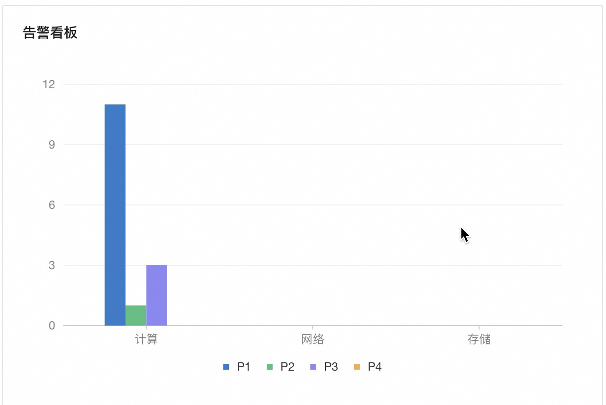

**资源统计**

资源统计中涵盖智算集群、超算集群、存储集群的资源数据。

- 智算集群的总数、服务器数、实例数。

  - 智算集群包括**裸金属-智算算力集群**和**容器-智算算力集群**等。

  - 智算实例包括**智算高网**型实例、**智算纳管**型实例、**智算基础**型实例等。

  - 智算实例仅包括裸金属实例，不包括ECS实例。

- 超算集群的总数、服务器数、实例数。

  - 超算集群包括**裸金属-超算算力集群**等。

  - 超算实例包括**高性能高网**型实例等。

- 存储集群的总数、服务器数、文件系统数。

  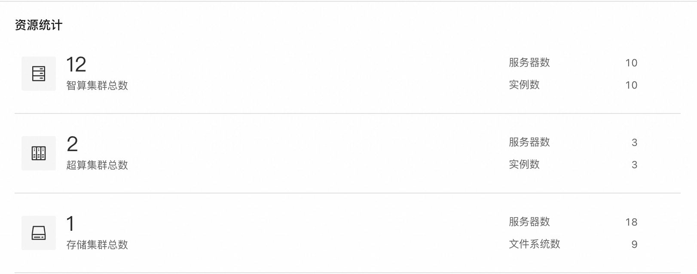

**资源看板**

资源看板中包含智算资源、超算资源和存储资源的使用情况。

> **说明**
>
> - 超算资源不包括智算集群中的CPU核及内存。
>
> - 智算资源不包括超算集群中的GPU卡数和显存。

- 智算资源（GPU卡数量和显存大小）

  - 单击下拉框可以筛选GPU卡类型，如**英伟达**、**海光**等，筛选后只显示对应类型GPU卡的数量及其显存总量。

    > **说明**
    >
    > 可选的GPU卡类型已界面为准。

  - 展示资源的已分配、未分配、总量和分配率。

    - 已分配的资源数量表示已分配给租户的资源数量。

    - 未分配的资源数量表示资源池中的资源数量。

    - 总量表示已分配给租户的资源数量和资源池中的资源数量之和。

    - 分配率表示（资源池中的资源数量）/（已分配给租户的资源数量+资源池中的资源数量）✖️ 100%。

  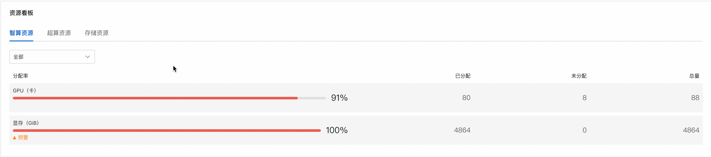

- 超算资源（CPU核数量和内存大小）

  - 单击下拉框可以筛选CPU卡类型，如**英特尔**、**海光**等，筛选后只显示对应类型CPU核的数量及其内存总量。

    > **说明**
    >
    > 可选的GPU卡类型已界面为准。

  - 展示资源的已分配、未分配、总量和分配率。

    - 已分配的资源数量表示已分配给租户的资源数量。

    - 未分配的资源数量表示资源池中的资源数量。

    - 总量表示已分配给租户的资源数量和资源池中的资源数量之和。

    - 分配率表示（资源池中的资源数量）/（已分配给租户的资源数量+资源池中的资源数量）✖️ 100%。

  

- 存储资源

  - 单击下拉框可选存储资源类型，如**APFS**、**CPFS**，筛选后将仅显示对应类型的存储资源使用情况。

  - 展示存储资源的**已使用**、**已分配**、**总量**和**使用率**。

  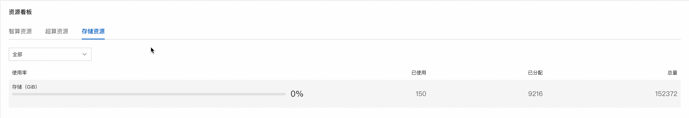

**算力看板**

算力看板中包含GPU卡算力和CPU卡算力使用情况。

- GPU卡算力（单位为TFLOPS）

  - 单击下拉框可以筛选GPU卡类型，筛选后只显示对应类型GPU卡的算力使用情况。

  - 展示时序范围不可选择，算力看板会展示近一周以及当天的总算力、已分配算力、算力分配率。

- CPU卡算力（单位为TFLOPS）

  - 单击下拉框可以筛选CPU卡类型，筛选后只显示对应类型CPU卡的算力使用情况。

  - 展示时序范围不可选择，算力看板会展示近一周以及当天的总算力、已分配算力、算力分配率。

> **说明**
>
> - CPU算力均为超算CPU算力，不包括智算集群中的CPU算力。
>
> - GPU算力均为智算CPU算力，不包括超算集群中的GPU算力。

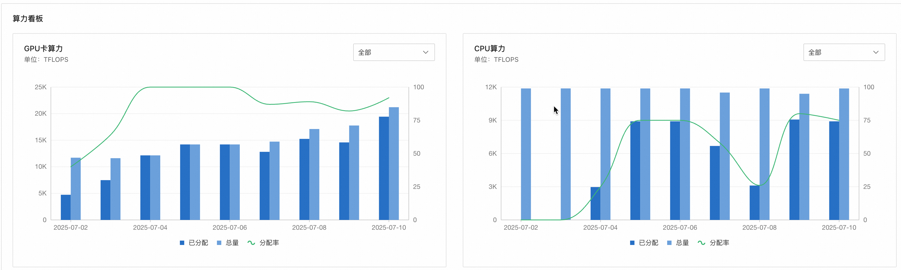

**管控服务**

管控服务模块中展示计算、网络、存储类别管控服务的服务状态。服务状态可为**异常**或**已达终态**。其中**异常**表明对应服务未完成部署，**已达终态**表明对应服务已完成部署。

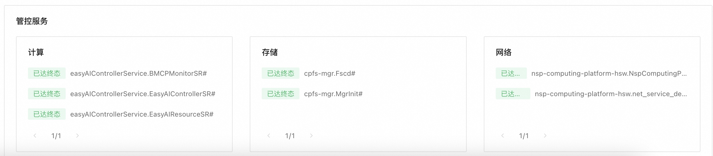

<a id="section-4"></a>

# 4.可视化监控

<a id="section-4-1"></a>

## 4.1. 作业路径分析

本节介绍如何使用作业路径分析。

**使用限制**

仅Hygon DCUK100-AI、APG PG1 A910E和昆仑芯P800支持作业路径分析。

**前提条件**

任务所在集群安装了ai-task-inspector组件，如果还未安装，可以通过**BMCP-集群管理-软件实例**安装容器运维服务。

> **说明**
>
> 任务可以通过很多产品发起，如PAI或AI Studio等，只要该任务占用了BMCP节点的GPU资源，就可以使用作业路径分析功能。

**操作步骤**

1. 登录BMCP运维平台。

2. 在左侧导航栏中，单击**作业路径分析**。

3. 在**作业路径分析**页面中，通过筛选项寻找**作业ID**，选择完成后，单击**搜索**。

   > **说明**
   >
   > - 先选择**起止时间**，最长允许查询当前时间7天以前的任务。
   >
   > - **节点ID**不是必选项，如果选择了**节点ID**，**集群ID**会自动填写为该节点所在的集群。
   >
   > - **集群ID**和**命名空间**都是必选项，最后选择**作业ID**。
   >
   > - **作业信息**是默认折叠的，可以通过单击左侧的
   >
   >   展开，展开后展示作业状态、占用的资源和
   >
   >   
   >
   >   作业起止时间等信息。

4. 单击**作业详情**，右侧会展开**作业基本信息**和**监控**页面。在**作业基本信息**页面可以看到作业占用的节点列表，在**监控**页面可以看到作业占用节点的平均CPU利用率等指标。

5. 单击**作业视图**，选择**时间片**，下方画布会显示这个时间片内作业的拓扑结构和资源占用，其中拓扑结构包括**GPU卡、RDMA卡、交换机**等元件和他们之间的链路关系；资源占用包括GPU使用率、RDMA网卡带宽占用等指标。

   > **说明**
   >
   > 鼠标划入GPU卡、RDMA等元件，会显示具体的元件名称和资源占用。

<a id="section-5"></a>

# 5.告警管理

<a id="section-5-1"></a>

## 5.1. 资源事件告警

本文档介绍了资源事件告警页面功能，以及如何通过创建事件单来处理告警。

**前提条件**

- CMS产品已部署并终态。

> **说明**
>
> 资源事件告警强依赖CMS产品，使用前请确认CMS产品已经部署并到达终态。

**操作步骤**

1. 登录BMCP运维平台。

2. 在左侧导航栏中，单击**告警管理**。

3. 在**资源事件告警**页面中，可以看到局点内告警列表。

   默认进入**计算**页签。

   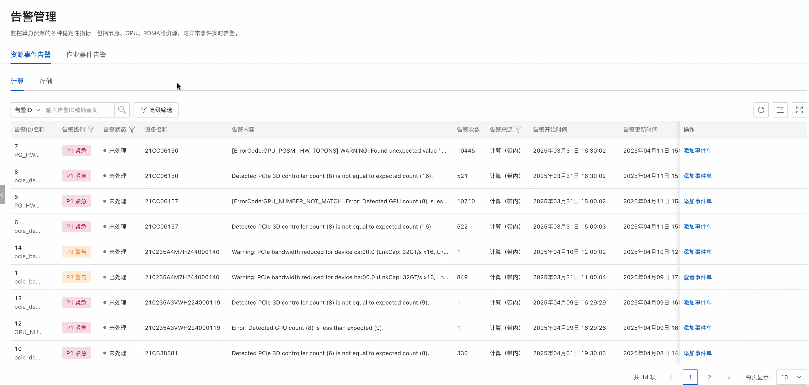

4. 查看**计算**告警。

   <ol type="i">

   <li>

   您可以通过**告警级别、告警状态、告警来源、告警ID**等对告警进行筛选；单击**高级筛选**可以使用告警ID、告警名称、日期对告警进行组合筛选。

   > **说明**
   >
   > 告警级别包括：**紧急、严重、警告、提示。**
   >
   > 告警状态包括<strong>：已处理、未处理。</strong>
   >
   > 告警来源包括：**计算（带内）、计算（带外）、网络。**

   </li>

   <li>

   对于状态为“未处理”的告警，可以点击**添加事件单**按钮对其进行处理，处理后该条告警状态会变为“已处理”。

   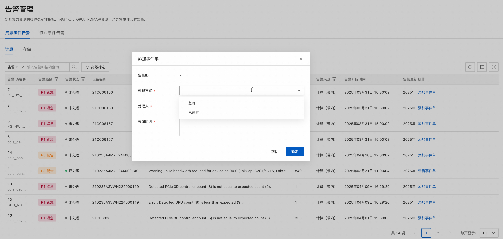

   > **说明**
   >
   > 处理方式包括忽略（认为该告警无需处理）和已修复（该告警对应的故障已被处理）。

   </li>

   </ol>

5. 单击**存储**页签，查看**存储**告警。

   您可以通过**告警级别、告警状态、告警名称、告警内容**、**告警开始时间**等对告警进行筛选；单击**高级筛选**可以使用告警名称、告警内容、日期对告警进行组合筛选。

   > **说明**
   >
   > 告警级别包括：**紧急、严重、警告、提示。**
   >
   > 告警状态包括<strong>：已处理、未处理。</strong>
   >
   > 告警来源包括：**计算（带内）、计算（带外）、网络。**

<a id="section-5-2"></a>

## 5.2. 作业事件告警

本文档介绍如何查看作业告警。

1. 登录BMCP运维平台。

2. 在左侧导航栏中，单击**告警管理**。

3. 在**作业事件告警**页面中，可以根据作业属性，通过作业所在的**集群ID**、**命名空间Namespace**，和**作业ID**来唯一定位一个作业，点击查询展示该作业生命周期内全部关联的告警。

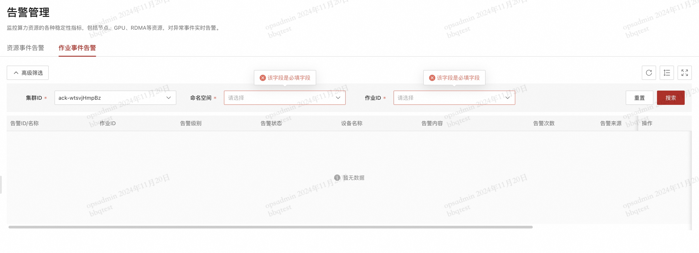

<a id="section-6"></a>

# 6.集群管理

<a id="section-6-1"></a>

## 6.1. 计算

<a id="section-6-1-1"></a>

### 6.1.1. 集群

<a id="section-6-1-1-1"></a>

#### 6.1.1.1. 查看计算集群详情

本节介绍了如何查询BMCP集群及其集群详情（集群基本信息、集群中节点信息、集群操作日志），查询范围包括裸金属-智算算力集群、容器-智算算力集群、裸金属-超算算力集群。

**前提条件**

已在Apsara Uni-manager运营控制台创建BMCP集群。

**操作步骤**

1. 登录BMCP运维平台。

2. 在左侧导航栏中，单击**集群管理**。

3. 单击**计算 > 集群**页签。

   该页面展示了局点内所有租户拥有的计算集群。

4. 查询计算集群：

   - 基础查询：

     <ol type="a">

     <li>

     支持输入集群ID、集群名称或下拉选择标签。

     </li>

     <li>

     单击  ，模糊查询符合条件的集群。

     </li>

     </ol>

   - 高级筛选：

     <ol type="a">

     <li>

     单击**高级筛选**。

     </li>

     <li>

     支持同时输入集群ID、集群名称或下拉选择标签。

     </li>

     </ol>

     <ol type="i" start="100">

     <li>

     单击**搜索**，进行所选条件复合模糊查询.

     </li>

     </ol>

5. 单击对应集群操作列**详情**，可查看集群的**基本信息**、**集群节点**和**操作记录**。

   <ol type="i">

   <li>

   **基本信息**

   基本信息页包括的信息如下表所示。

   <table>
     <tr>
       <th width="89">信息分类</th>
       <th>描述</th>
     </tr>
     <tr>
       <td>基本信息</td>
       <td>基本信息包括集群ID、集群名称、集群状态、节点数和创建事件等。</td>
     </tr>
     <tr>
       <td>配置信息</td>
       <td>配置信息包括集群实例规格、CPU核数、内存大小、GPU显存大小和算力等。</td>
     </tr>
     <tr>
       <td>存储信息</td>
       <td>存储信息包括高性能存储状态等。</td>
     </tr>
   </table>

   </li>

   <li>

   **集群节点**

   单击**集群节点**页签，即可查看分配到该集群中的**裸金属节点**，无法查看分配到该集群中的**ECS节点**。节点信息包括**节点名称/ID**、**在线状态**、**SN**、**节点IP**、**机型**等。您可以单击目标节点**操作**列的**详情**查看节点的详细信息。更多节点详情内容，请参见查看计算节点详情。

   </li>

   <li>

   **监控**

   单击**监控**页签，即可查看集群的监控信息，包括内存使用率、集群负载和连接数等。

   </li>

   <li>

   **操作日志**

   单击操作日志页签，即可查看集群的操作日志。可依据操作类型和操作事件查看该集群的历史操作日志。

   <ol type="a">

   <li>

   单击**操作类型**会弹出下拉框，从中选择一个标签（如：创建集群、删除集群、扩容集群、缩容集群等）即会立刻筛选出对应操作类型的**操作日志**。若不选会展示所有类型的**操作日志**

   </li>

   <li>

   单击**操作时间**选择**起始日期**与**结束日期**（均可精确到秒）并单击**确定**，会筛选出从起始日期到结束日期内的**操作日志**

   </li>

   </ol>

   <ol type="i" start="100">

   <li>

   单击**操作详情**可以查看该操作内部的原子步骤及其详细信息。

   </li>

   </ol>

   </li>

   </ol>

<a id="section-6-1-2"></a>

### 6.1.2. 节点

<a id="section-6-1-2-1"></a>

#### 6.1.2.1. 查看计算节点详情

本节介绍了如何查询BMCP计算节点及其节点详情（节点基本信息、节点操作日志），查询范围包括已分配给裸金属-智算算力集群、容器-智算算力集群、裸金属-超算算力集群的节点，以及资源池中未分配的节点。

**操作步骤**

1. 登录BMCP运维平台。

2. 在左侧导航栏中，单击**集群管理**。

3. 在**集群管理**页面中，单击**计算 > 节点**页签进入页面。该页面展示了局点内所有租户拥有的计算节点以及资源池中的计算节点。

4. 查询计算节点：

   - 基础查询：

     <ol type="a">

     <li>

     支持输入节点ID、节点名称、SN、所属集群ID、子网IP、专有网络IP、带外IP或下拉选择标签。

     </li>

     <li>

     单击  ，模糊查询符合条件的节点。

     </li>

     </ol>

   - 高级筛选：

     <ol type="a">

     <li>

     单击**高级筛选**。

     </li>

     <li>

     支持同时输入节点ID、节点名称、SN、所属集群ID、子网IP、专有网络IP、带外IP。

     </li>

     </ol>

     <ol type="i" start="100">

     <li>

     单击**搜索**，进行所选条件复合模糊查询。

     </li>

     </ol>

5. 单击对应节点操作列**详情**，可查看节点的**基本信息**、**监控**和**操作日志**。

   <ol type="i">

   <li>

   基本信息

   基本信息页包含的信息如下表所示。

   <table>
     <tr>
       <th width="89">信息分类</th>
       <th>描述</th>
     </tr>
     <tr>
       <td>基本信息</td>
       <td><strong>基本信息</strong>包括<strong>节点ID</strong>、<strong>节点名称</strong>、<strong>SN</strong>、<strong>地域</strong>、<strong>可用区</strong>等信息</td>
     </tr>
     <tr>
       <td>配置信息</td>
       <td><strong>配置信息</strong>包括节点的<strong>CPU</strong>、<strong>GPU</strong>、<strong>操作系统</strong>、<strong>网络</strong>、<strong>网卡</strong>、<strong>磁盘</strong>等硬件固件信息。</td>
     </tr>
   </table>

   </li>

   <li>

   监控

   单击**监控**页签，即可查看节点的监控信息，包括CPU使用率、内存使用率、负载、连接数等。

   </li>

   <li>

   操作日志

   单击操作日志页签，可依据操作类型查看该节点的历史操作日志。

   <ol type="a">

   <li>

   单击**操作类型**会弹出下拉框，从中选择一个标签（如：申请实例、重新申请、运维实例、挂载实例、挂载存储、卸载存储、请求异常等）即会立刻筛选出对应操作类型的**操作日志**。若不选则不过滤，会展示该节点所有类型的**操作日志**。

   </li>

   <li>

   单击**操作时间**选择**起始日期**与**结束日期**（均精确到日）并单击**确定**，会筛选出从起始日期00:00:00到结束日期23:59:59内的**操作日志**。

   </li>

   </ol>

   <ol type="i" start="100">

   <li>

   单击**操作详情**可以查看该操作内部的全部原子步骤及其详细信息。

   </li>

   </ol>

   </li>

   </ol>

6. 单击对应节点操作列**节点状态**，可对该节点进行操作，具体操作规则参考操作计算节点。

7. 单击对应节点操作列**资源使能**，可对该节点进行操作，具体操作规则参考操作计算节点。

<a id="section-6-1-2-2"></a>

#### 6.1.2.2. 操作计算节点

本节介绍了如何对资源池中未分配的BMCP节点进行操作。

**前提条件**

BMCP节点已注册。

**操作步骤**

1. 登录BMCP运维平台。

2. 在左侧导航栏中，单击**集群管理 > 计算 > 节点**进入节点页面，或继续单击**详情**进入详情页。对节点的操作在列表页与详情页均可进行。

3. 对节点进行**资源使能操作**。

   <ol type="i">

   <li>

   确认节点类型为**智算高网**且资源属主为**资源池**，**运维侧**仅可对**资源池**中的**智算高网型节点**进行**资源使能**操作。

   <ol type="a">

   <li>

   在列表页中单击**资源使能**，已启用资源使能的节点**启用**按钮为灰色，不可选用，单击**禁用**后此节点不可被添加到集群中。

   </li>

   <li>

   在列表页中单击**资源使能**，已禁用资源使能的节点**禁用**按钮为灰色，不可选用，单击**启用**后此节点可被添加到集群中。

   </li>

   </ol>

   <ol type="i" start="100">

   <li>

   在详情页中，若节点已禁用**资源使能**，可单击**更多 > 资源使能 > 启用**，启用后此节点可被添加到集群中。

   </li>

   <li value="500">

   在详情页中，若节点已启用**资源使能**，可单击**更多 > 资源使能 > 禁用**，禁用后此节点不可被添加到集群中。

   </li>

   </ol>

   </li>

   </ol>

4. 对节点进行**节点状态操作**。

   <ol type="i">

   <li>

   确认资源属主为**资源池**，**运维侧**仅可对**资源池**中的未分配节点进行**节点状态**操作。

   <ol type="a">

   <li>

   在列表页中单击节点状态，会展示当前节点可进行的操作，不可进行的操作会置灰。从中选择单击一项后会执行相应的操作。

   </li>

   <li>

   在详情页中，会直观展示当前节点可进行的操作，不可进行的操作会置灰。从中选择单击一项后会执行相应的操作。

   </li>

   </ol>

   </li>

   </ol>

5. 修改节点信息。

   <ol type="i">

   <li>

   修改网关端口：进入**集群管理 > 计算 > 节点 > 节点详情**，单击**更多 > 修改网关端口**即可修改节点网关对应的网关端口，从下拉框中选择可用的网关端口，单击**确定**后生效。

   </li>

   <li>

   修改节点名称&描述：进入**集群管理 > 计算 > 节点 > 节点详情**，单击**更多 > 编辑属性**即可修改节点的名称和描述，单击**确定**后生效。

   </li>

   </ol>

6. 登录带外控制台。

   进入**集群管理 > 计算 > 节点 > 节点详情**，单击**更多 > 带外控制台**即可进入该机器的带外控制台。

<a id="section-6-2"></a>

## 6.2. 存储

**查看存储集群详情**

1. 登录BMCP运维平台。

2. 在左侧导航栏中，单击**集群管理**。

3. 在**集群管理**页面中，单击**存储**。

4. 查看集群的健康状态、磁盘类型、文件系统类型、节点数量等信息。

5. 查找目标集群。

   您可以在集群列表右上方的搜索框中输入**集群ID**进行精确查询。

6. 单击目标集群**操作**列的**详情**，查看集群的详细信息。

   - 在**集群详情**页签，查看**文件系统数量**、**节点数量**、**文件系统类型**、**健康状态**、**磁盘类型**等信息。

   - 在**集群节点**页签，查看节点的**管理IP**、**SN**、**机型**、**CPU架构**、**内存**等信息。

     支持通过节点名称精确查询。

   - 在**服务**页签，查看服务角色和状态。

     支持通过服务名称模糊查询。

     您可以单击目标服务角色**操作**列的**Tianji运维**。

   - 在**监控**页签，查看监控信息。

**查看客户端集群详情**

1. 登录BMCP运维平台。

2. 在左侧导航栏中，单击**集群管理**。

3. 在**集群管理**页面中，单击**存储**。

4. 单击**客户端集群**。

   查看集群的状态、类型、节点数量、Quorum节点数量、**挂载文件系统**等信息。

5. 查找目标集群。

   您可以在集群列表右上方的搜索框中输入**集群名称**进行精确查询。

6. 单击目标集群**操作**列的**详情**，查看集群的详细信息。

   - 在**集群详情**页签，查看集群的节点数量、Quorum节点数量、基本信息和配置信息。

   - 在**集群节点**页签，查看节点类型、节点状态等基本信息。

     您也可以单击目标节点**操作**列的**详情**，查看节点的详细信息，包括节点的基本信息、配置信息、监控信息和操作日志。

<a id="section-6-3"></a>

## 6.3. 网络

<a id="section-6-3-1"></a>

### 6.3.1. 获取子网

本节介绍了如何查询以及更新当前局点内全量云接入交换机的信息。

**操作步骤**

1. 登录BMCP运维平台。

2. 在左侧导航栏中，单击**集群管理**。

3. 单击**网络**页签。

   该页面展示了局点内所有云接入交换机，交换机类型包括**HSW**、**CHSW**。展示内容包括每个交换机的**子网名称**、**IP范围**、**网关**、**描述**、**更新时间**等。

4. 在列表页上方，输入**子网名称**进行**模糊查询**。

5. 单击**获取子网**，即可实时获取当前局点内新加入的云接入交换机并同步到页面上。

<a id="section-7"></a>

# 7.资源管理

<a id="section-7-1"></a>

## 7.1. 计算

<a id="section-7-1-1"></a>

### 7.1.1. 服务器

<a id="section-7-1-1-1"></a>

#### 7.1.1.1. 查看服务器详情

本节介绍了如何查询局点内的全量物理服务器列表及其详细信息。

**操作步骤**

1. 登录BMCP运维平台。

2. 在左侧导航栏中，单击**资源管理**。

   默认进入**计算 > 服务器**页签，该页面展示了局点内所有物理服务器。

3. 查询服务器：

   - 基础查询：

     <ol type="a">

     <li>

     支持输入主机名、SN、机型或下拉选择标签。

     </li>

     <li>

     单击  ，模糊查询符合条件的服务器。

     </li>

     </ol>

   - 高级筛选：

     <ol type="a">

     <li>

     单击**高级筛选**。

     </li>

     <li>

     支持同时输入主机名、SN、机型。

     </li>

     </ol>

     <ol type="i" start="100">

     <li>

     单击**搜索**，进行所选条件复合模糊查询。

     </li>

     </ol>

5. 单击目标服务器操作列**详情**，可查看服务器的**基本信息**、**监控**和**操作日志**。

   <ol type="i">

   <li>

   基本信息

   基本信息包含的信息如下表所示。

   <table>
     <tr>
       <th width="89">信息分类</th>
       <th>描述</th>
     </tr>
     <tr>
       <td>基本信息</td>
       <td>基本信息包括<strong>资源ID</strong>、<strong>资源名</strong>称、<strong>SN</strong>、<strong>地狱</strong>、<strong>可用区</strong>等信息。</td>
     </tr>
     <tr>
       <td>配置信息</td>
       <td>配置信息包括服务器的<strong>机型</strong>、<strong>CPU</strong>、<strong>GPU</strong>、<strong>操作系统</strong>、<strong>网络</strong>、<strong>网卡信息</strong>、<strong>磁盘</strong><strong>信息</strong>等硬件固件信息。</td>
     </tr>
   </table>

   </li>

   <li>

   监控

   单击**监控**页签，您可以查看指定时间内的CPU使用率、内存使用率、负载、磁盘读、磁盘写、连接数等监控数据。

   </li>

   <li>

   操作日志

   单击**操作日志**页签，可依据操作类型和操作时间查看该服务器的历史操作日志。

   <ol type="a">

   <li>

   单击**操作类型**会弹出下拉框，从中选择一个标签（如：申请实例、重新申请、运维实例、挂载实例、挂载存储、卸载存储等）即会立刻筛选出对应操作类型的**操作日志**。若不选择，则不过滤，会展示该节点所有类型的**操作日志**。

   </li>

   <li>

   单击**操作时间**选择**起始日期**与**结束日期**（均精确到日）并单击**确定**，会筛选出从起始日期00:00:00到结束日期23:59:59内的**操作日志**。

   </li>

   </ol>

   <ol type="i" start="100">

   <li>

   单击**操作详情**可以查看该操作内部的全部原子步骤及其详细信息。

   </li>

   </ol>

   </li>

   </ol>

<a id="section-7-1-1-2"></a>

#### 7.1.1.2. 注册资源

本文介绍如何注册服务器资源。

**操作步骤**

1. 登录BMCP运维平台。

2. 在左侧导航栏中，单击**资源管理**。

   默认进入**计算 > 服务器**页签，该页面展示了局点内所有物理服务器

3. 在服务器列表上方，单击**注册资源**。

4. 在弹出的**选择接入方式**框，配置接入方式。

   | 参数项 | 说明 |
   | --- | --- |
   | 接入方式 | 接入方式可选：<br>• CHSW接入<br>• HSW接入 |
   | 待纳管资源 | 选择待纳管的资源。 |

5. 单击**确定**。

6. 在弹出的注册资源界面。

   <ol type="i">

   <li>

   配置**基本信息**。

   选择**地域**和**可用区**。

   </li>

   <li>

   配置**资源**信息。

   | 参数项 | 说明 |
   | --- | --- |

   <table>
     <tr>
       <td>资源类型</td>
       <td>• 当接入方式选择<strong>CHSW接入</strong>时，资源类型可选值：<br>• <strong>高性能计算纳管</strong>：使用云平台提供的标准镜像初始化裸金属服务器，开启裸金属实例。<br>• 当接入方式选择<strong>HSW接入</strong>时，资源类型可选值：<br>• <strong>智算纳管</strong>：使用云平台提供的标准镜像初始化裸金属服务器，开启裸金属实例。<br>• <strong>带内纳管</strong>：不修改原有设备上的操作系统，开启裸金属实例。<br>• <strong>高性能计算纳管</strong>：使用云平台提供的标准镜像初始化裸金属服务器，开启裸金属实例。</td>
     </tr>
     <tr>
       <td>架构</td>
       <td>选择资源的架构，可选值：<br>• x86_64<br>• aarch64<br>• sw_64</td>
     </tr>
     <tr>
       <td>机型</td>
       <td>选择机型，如没有可选机型，请先添加机型。</td>
     </tr>
     <tr>
       <td>SN</td>
       <td>• 长度为2～128个字符，不能以特殊字符开头，只可包含特殊字符中的半角句号（.）、下划线（_）、短划线（-）和半角冒号（:）。<br>• 当接入方式选择<strong>CHSW接入</strong>时不需要填写此项。</td>
     </tr>
     <tr>
       <td>设备型号</td>
       <td>• 设备型号为大小写字母数字组合，长度需小于128位。<br>• 当接入方式选择<strong>CHSW接入</strong>时不需要填写此项。</td>
     </tr>
     <tr>
       <td>机房</td>
       <td>• 机房为大小写字母数字组合，长度需小于128位。<br>• 当接入方式选择<strong>CHSW接入</strong>时不需要填写此项。</td>
     </tr>
     <tr>
       <td>房间</td>
       <td>• 长度为2-128个字符，支持输入数字、大小写字母、短划线（-）、下划线（_），示例：1-1-1。<br>• 当接入方式选择<strong>CHSW接入</strong>时不需要填写此项。</td>
     </tr>
     <tr>
       <td>机柜</td>
       <td>• 长度为3个字符，需以大写字母开头，01~24的正整数结尾，例如：F02。<br>• 当接入方式选择<strong>CHSW接入</strong>时不需要填写此项。</td>
     </tr>
     <tr>
       <td>机位号</td>
       <td>• 机位号为1～48的正整数。<br>• 当接入方式选择<strong>CHSW接入</strong>时不需要填写此项。</td>
     </tr>
     <tr>
       <td>维保时间</td>
       <td>选择维保时间。</td>
     </tr>
   </table>

   </li>

   <li>

   配置**镜像**信息。

   | 参数项 | 说明 |
   | --- | --- |
   | 镜像类型 | <strong>镜像类型</strong>可选<strong>公共镜像</strong>、<strong>自定义镜像</strong>。 |
   | 公共/自定义镜像 | 选择镜像。 |

   </li>

   <li>

   配置**网络**信息。

   <table>
     <tr>
       <th width="137">参数项</th>
       <th>说明</th>
     </tr>
     <tr>
       <td>物理机网关</td>
       <td>当接入方式选择<strong>CHSW接入</strong>时不需要填写此项。</td>
     </tr>
     <tr>
       <td>物理机网关端口</td>
       <td>当接入方式选择<strong>CHSW接入</strong>时不需要填写此项。</td>
     </tr>
     <tr>
       <td>子网</td>
       <td>当接入方式选择<strong>CHSW接入</strong>时不需要填写此项。</td>
     </tr>
     <tr>
       <td>子网IP</td>
       <td>当接入方式选择<strong>CHSW接入</strong>时不需要填写此项。</td>
     </tr>
     <tr>
       <td>带外信息</td>
       <td>带外信息默认无需填写，若需要填写，则选择<strong>展开</strong>。</td>
     </tr>
     <tr>
       <td>带外IP</td>
       <td>仅带外信息选择<strong>展开</strong>时必填。</td>
     </tr>
     <tr>
       <td>带外用户名</td>
       <td>仅带外信息选择<strong>展开</strong>时必填。长度为2～128个字符，需以大小写字母开头，支持输入数字和特殊字符，支持的特殊字符包括 ~ ! @ # $ % ^ &amp; * () - _ = + | [ { } ] ; : .。</td>
     </tr>
     <tr>
       <td>带外密码</td>
       <td>仅带外信息选择<strong>展开</strong>时必填。长度为1～128个字符。</td>
     </tr>
   </table>

   </li>

   <li>

   配置**密码**。

   <table>
     <tr>
       <th width="89">参数项</th>
       <th>说明</th>
     </tr>
     <tr>
       <td>登录名</td>
       <td>默认为root，不支持修改。</td>
     </tr>
     <tr>
       <td>登录密码</td>
       <td>密码长度为8~30 个字符，且必须同时包含大写字母、小写字母、数字、特殊字符中的三项。支持的特殊字符包括 ()`~!@#$%^&amp;*_-+=|{}[]:;'&lt;&gt;,.?/。</td>
     </tr>
     <tr>
       <td>确认密码</td>
       <td>再次输入您的登录密码。<strong>确认密码</strong>需要与<strong>登录密码</strong>一致。<br>重要请牢记您所设置的密码，如遗忘可登录裸金属管理运维控制台重置密码。</td>
     </tr>
   </table>

   </li>

   <li>

   配置**资源名称**。

   <table>
     <tr>
       <th width="89">参数项</th>
       <th>说明</th>
     </tr>
     <tr>
       <td>资源名称</td>
       <td>• 长度为2～128个字符，支持大写字母、小写字母、数字、短划线（-）和半角句号（.），且必须以大小写字母或数字开头。<br>• 当接入方式选择<strong>CHSW接入</strong>时不需要填写此项。</td>
     </tr>
     <tr>
       <td>主机名</td>
       <td>• 输入主机名。<br>• 当接入方式选择<strong>CHSW接入</strong>时不需要填写此项。</td>
     </tr>
     <tr>
       <td>资源描述</td>
       <td>长度为0～1000个字符。</td>
     </tr>
   </table>

   </li>

   </ol>

7. 完成配置后，单击**确定**。

<a id="section-7-1-1-3"></a>

#### 7.1.1.3. 管理服务器资源状态

本文介绍如何对服务器资源执行启动、重启、停止、删除、释放操作。

**操作步骤**

1. 登录BMCP运维平台。

2. 在左侧导航栏中，单击**资源管理**。

   默认进入**计算 > 服务器**页签，该页面展示了局点内所有物理服务器。

3. 筛选目标服务器。

4. 在目标服务器**操作**列，单击**资源状态**。

   您可以对单个资源执行启动、重启、停止、删除、释放操作。

5. 您也可以选择一个或多个服务器资源，然后单击服务器列表底部的**删除资源**和**释放资源**。

<a id="section-7-1-1-4"></a>

#### 7.1.1.4. 远程登录服务器

本文介绍如何远程登录服务器。

**前提条件**

服务器状态是运行中。

**操作步骤**

1. 登录BMCP运维平台。

2. 在左侧导航栏中，单击**资源管理**。

   默认进入**计算 > 服务器**页签，该页面展示了局点内所有物理服务器。

3. 筛选目标服务器。

4. 在目标服务器**操作**列，单击**远程登录**。

5. 在弹出的登录界面上输入密码，单击**确定**。

<a id="section-7-1-1-5"></a>

#### 7.1.1.5. 重新注册服务器

本文介绍如何重新注册服务器。

**操作步骤**

1. 登录BMCP运维平台。

2. 在左侧导航栏中，单击**资源管理**。

3. 在**资源管理**页面中，单击**计算**页签。

   该页面展示了局点内所有物理服务器

4. 在目标服务器操作列，单击  图标，然后单击**重新注册**。

5. 在**重新注册**页面完成基本信息、资源、镜像、网络、密码、资源名称的配置。

   <ol type="i">

   <li>

   在**基本信息**区域，配置**地域**和**可用区**。

   </li>

   <li>

   在**资源**区域，配置**资源类型**、**架构**、**机型**、**SN**、**设备型号**、**机房**、**房间**、**机柜**、**SN**、**机位号**、**维保时间**。

   </li>

   <li>

   在**镜像**区域，配置镜像类型、镜像。

   </li>

   <li>

   在**网络**区域，配置**物理机网关**、**物理机网关端口**、**子网**、**子网IP**、**带外信息**。

   </li>

   <li>

   在**配置密码**区域，配置**登录密码**以及**确认密码**。

   密码长度为8~30 个字符，且必须同时包含大写字母、小写字母、数字、特殊字符中的三项。

   支持的特殊字符包括 ()\`~!@#$%^&\*_-+=|{}[]:;'<>,.?/。

   > **重要**
   >
   > 请牢记您所设置的密码，如遗忘可登录裸金属管理运维控制台重置密码。

   </li>

   <li>

   在**资源名称**区域，配置**资源名称**、**主机名**、**资源描述**。

   > **说明**
   >
   > 资源名称：长度为2～128个字符，支持大写字母、小写字母、数字、短划线(-)和半角句号（.），且必须以大小写字母或数字开头

   </li>

   </ol>

6. 完成配置后，单击**确定**。

<a id="section-7-1-1-6"></a>

#### 7.1.1.6. 服务器资源使能

本文介绍如何启用和禁用服务器资源。

**前提条件**

服务器**资源属主**为**资源池**。

**启用资源**

1. 登录BMCP运维平台。

2. 在左侧导航栏中，单击**资源管理**。

   默认进入**计算 > 服务器**页签，该页面展示了局点内所有物理服务器。

3. 筛选目标服务器。

4. 在目标服务器**操作**列，单击  图标。

5. 单击**资源使能 > 启用**。

6. 在弹出的确认框，单击确定。

**禁用资源**

> **重要**
>
> 禁用后该资源将无法添加到集群。

1. 登录BMCP运维平台。

2. 在左侧导航栏中，单击**资源管理**。

   默认进入**计算 > 服务器**页签，该页面展示了局点内所有物理服务器。

3. 筛选目标服务器。

4. 在目标服务器**操作**列，单击  图标。

5. 单击**资源使能 > 禁用**。

6. 在弹出的确认框，单击确定。

<a id="section-7-1-2"></a>

### 7.1.2. GPU卡

<a id="section-7-1-2-1"></a>

#### 7.1.2.1. 查看GPU详情

本节介绍了如何查询局点内已装机的裸金属机器上的GPU卡资源列表以及每张GPU卡的具体信息。

**前提条件**

裸金属机器完成装机后才可查询到机器上拥有的GPU卡。

**操作步骤**

1. 登录BMCP运维平台。

2. 在左侧导航栏中，单击**资源管理**。

3. 在**资源管理**页面中，点击**计算 > GPU卡**页签进入页面。该页面展示了局点内所有已装机服务器上的GPU卡资源。

4. 查询GPU：

   - 基础查询：

     <ol type="a">

     <li>

     支持GPU ID、所属节点ID、GPU型号或下拉选择标签。

     </li>

     <li>

     单击  ，模糊查询符合条件的GPU卡。

     </li>

     </ol>

   - 高级筛选：

     <ol type="a">

     <li>

     单击**高级筛选**。

     </li>

     <li>

     支持同时输入GPU ID、所属节点ID、GPU型号。

     </li>

     </ol>

     <ol type="i" start="100">

     <li>

     单击**搜索**，进行所选条件复合模糊查询。

     </li>

     </ol>

5. 单击对应GPU卡操作列**详情**，可查看GPU卡的**基本信息**。

   基本信息页包含的信息如下表所示。

   <table>
     <tr>
       <th width="111">信息分类</th>
       <th>描述</th>
     </tr>
     <tr>
       <td>GPU卡信息</td>
       <td>包括<strong>GPU ID</strong>、<strong>所属节点</strong>、<strong>所属服务器</strong>、<strong>厂商</strong>、<strong>GPU型号</strong>、<strong>显存容量</strong>、<strong>算力</strong>等信息。</td>
     </tr>
     <tr>
       <td>配置信息</td>
       <td>包括<strong>VBIOS版本</strong>、<strong>驱动名称</strong>、<strong>驱动版本</strong>、<strong>BusInfo</strong>等信息。</td>
     </tr>
   </table>

<a id="section-7-2"></a>

## 7.2. 存储

<a id="section-7-2-1"></a>

### 7.2.1. 查看文件系统详情

本文介绍如何查看文件系统资源的详情。

**操作步骤**

1. 登录BMCP运维平台。

2. 在左侧导航栏中，单击**资源管理**。

3. 在**资源管理**页面中，单击**存储**页签。

   默认进入**文件系统页签**。

4. 您可以在文件系统列表上方的搜索框中输入**文件系统名称**进行筛选。也可以单击**高级筛选**，使用**文件系统名称**进行筛选。

5. 单击目标文件系统**存储集群**列的名称。

   查看文件系统的存储集群信息，包括集群文件系统数量、节点数量、容量、健康状态、文件系统类型、集群节点信息、服务角色、监控信息等。

6. 单击目标文件系统**客户端集群**列的名称。

   查看文件系统的客户端集群信息，包括节点数量、Quorum节点数量、集群类型、挂载文件系统路径、缓存的最大文件数量、工作线程、集群节点等信息。

7. 单击目标文件系统**操作**列的详情。

   查看文件系统的详情，包括文件系统名称、存储集群、客户端集群、规格、监控信息等。

<a id="section-7-2-2"></a>

### 7.2.2. 查看服务器资源详情

本文介绍如何查看服务器资源的信息。

**操作步骤**

1. 登录BMCP运维平台。

2. 在左侧导航栏中，单击**资源管理**。

3. 在**资源管理**页面中，单击**存储**页签。

   默认进入**文件系统页签**。

4. 单击**服务器**页签。

   您可以在服务器列表上方的搜索框中输入**主机名**、**IP**、**SN**进行筛选。也可以单击**高级筛选**，使用**主机名**、**IP**、**SN**进行组合查询。

5. 单击目标服务器**存储集群ID**列的ID。

   查看目标服务器的存储集群信息，包括集群文件系统数量、节点数量、容量、健康状态、文件系统类型、集群节点信息、服务角色、监控信息等。

<a id="section-7-2-3"></a>

### 7.2.3. 查看计算节点缓存

本文介绍如何查看计算节点缓存资源的详情。

**操作步骤**

1. 登录BMCP运维平台。

2. 在左侧导航栏中，单击**资源管理**。

3. 在**资源管理**页面中，单击**存储**页签。

   默认进入**文件系统页签**。

4. 单击**计算节点缓存**页签。

   您可以在缓存实例列表上方的搜索框中选择**集群ID**进行筛选。

5. 单击缓存实例**操作**列的**详情**。

   查看缓存实例的详细信息，包括**基本信息**、**worker相关配置参数**、**fuse相关配置参数**。

   - **基本信息**包括**实例标签**、**命名空间**、**读写类型**、**缓存节点数量**、**fuse状态**等。

   - **worker相关配置参数**包括**服务端口**、**后端文件系统**、**缓存页大小**、**回源数据块**等。

   - **fuse相关配置参数**包括**内核缓存**、**缓存分片大小**、**聚合fuse请求大小**、**异步IO类型**等。

<a id="section-7-3"></a>

## 7.3. 网络

<a id="section-7-3-1"></a>

### 7.3.1. 网元

<a id="section-7-3-1-1"></a>

#### 7.3.1.1. 查询网元详情

本节介绍了如何查询局点内全部网元资源（包括DSW、RDSW、HSW、CHSW、EHSW、RASW等）。

**前提条件**

无

**操作步骤**

1. 登录BMCP运维平台。

2. 在左侧导航栏中，单击**资源管理**。

3. 在**资源管理**页面中，点击**网络 > 网元**页签进入页面。该页面展示了局点内所有网元资源。

4. 查询网元：

   - 基础查询：

     <ol type="a">

     <li>

     支持网元名称、管理IP下拉选择标签。

     </li>

     <li>

     单击  ，模糊查询符合条件的网元。

     </li>

     </ol>

   - 高级筛选：

     <ol type="a">

     <li>

     单击**高级筛选**。

     </li>

     <li>

     支持同时输入网元名称、管理IP。

     </li>

     </ol>

     <ol type="i" start="100">

     <li>

     单击**搜索**，进行所选条件复合模糊查询。

     </li>

     </ol>

5. 单击对应网元操作列**详情**，可查看网元的**基本信息**。

6. 在**网元详情 > 基本信息**中，包含了GPU卡的**基本信息**和**端口**。

7. 查询端口。

   - 基础查询：

     <ol type="a">

     <li>

     支持端口名称下拉选择标签。

     </li>

     <li>

     单击  ，模糊查询符合条件的网元。

     </li>

     </ol>

   - 高级筛选：

     <ol type="a">

     <li>

     单击**高级筛选**。

     </li>

     <li>

     支持输入端口名称。

     </li>

     </ol>

     <ol type="i" start="100">

     <li>

     单击**搜索**，进行所选条件复合模糊查询。

     </li>

     </ol>

<a id="section-8"></a>

# 8.巡检诊断

<a id="section-8-1"></a>

## 8.1. 诊断

<a id="section-8-1-1"></a>

### 8.1.1. 集群/节点

本节介绍如何对集群或节点进行诊断。

> **重要**
>
> 若本次检测包含耗时诊断项或压力测试，会占用GPU资源，请确认本次操作不会对业务造成影响。

**操作步骤**

1. 登录BMCP运维平台。

2. 在左侧导航栏中，单击**巡检诊断**。

3. 在**巡检诊断**页面中，单击**诊断**页签进入页面，在集群/节点页面中，可以对集群或节点创建诊断任务，并查看诊断结果。

4. 单击**创建任务**按钮可以发起任务，依次指定任务名称，选择对集群或节点诊断，并确定诊断范围后，选择诊断项目。

5. 单击**确定**，发起任务。

6. 检索历史诊断任务，可以使用单个检索条件进行检索，包括使用任务ID精确匹配、使用任务名称模糊查询、使用时间范围进行查询，也可以点击高级筛选对三个条件进行复合筛选。

7. 取消诊断任务。

   单击目标任务**操作**列的**取消**。

8. 查看诊断结果。

   当诊断状态变更为已完成后，可单击操作列的**详情**查看诊断结果。

<a id="section-8-1-2"></a>

### 8.1.2. 作业

本节介绍如何对作业任务涉及到的集群进行诊断。

> **重要**
>
> 若本次检测包含耗时诊断项或压力测试，会占用GPU资源，请确认本次操作不会对业务造成影响。

**操作步骤**

1. 登录BMCP运维平台。

2. 在左侧导航栏中，单击**巡检诊断**。

3. 单击**诊断**页签。

4. 在作业页面中，可以根对作业任务涉及到的集群创建诊断任务，并查看诊断结果。

5. 单击创建任务按钮可以发起任务，依次指定**任务名称**、**集群ID**、**命名空间**、**作业ID**后，选择**诊断项**。

6. 单击**确定**，发起任务。

7. 检索历史作业诊断任务，可以使用集群ID、命名空间、作业ID三个条件对作业诊断进行复合筛选。

8. 取消诊断任务。

   单击目标任务**操作**列的**取消**可中断当前的诊断任务。

9. 查看诊断结果。

   当诊断状态变更为已完成后，可单击**详情**查看诊断结果。

<a id="section-9"></a>

# 9.基础配置

<a id="section-9-1"></a>

## 9.1. 机型管理

<a id="section-9-1-1"></a>

### 9.1.1. 添加机型

本文介绍如何添加机型。

**背景信息**

**智算/带内纳管**和**高性能纳管**的机型可通过**添加机型**增加，其余类型的机型将在朱雀规划阶段自动导入。

**操作步骤**

1. 登录BMCP运维平台。

2. 单击**基础配置 > 机型管理**。

3. 单击机型列表左上方的**添加机型**。

4. 配置参数。

   | 配置项 | 是否必填 | 说明 |
   | --- | --- | --- |
   | 机型类型 | 是 | 选择机型的类型，取值范围：<br>• 智算/带内纳管<br>• 高性能纳管<br>说明支持的机型类型以您实际部署环境上的控制台显示为准。 |
   | 机型名称 | 是 | 输入机型名称。 |
   | CPU架构 | 是 | 选择CPU的架构。 |
   | CPU厂商 | 是 | 选择CPU的厂商。 |
   | CPU型号 | 是 | 输入CPU的型号。 |
   | CPU个数 | 是 | 输入CPU的个数。 |
   | 内存 | 是 | 输入内存大小，单位为G。 |
   | 磁盘大小 | 是 | 输入磁盘大小，单位为G。 |
   | 磁盘类型 | 是 | 大写英文字母组成。例如：HDD、SSD、SATA。 |
   | GPU厂商 | 否 | 选择GPU厂商。 |
   | GPU型号 | 否 | 选择GPU型号。 |
   | GPU数量 | 否 | 输入GPU数量 |
   | 网卡个数 | 是 | 输入网卡个数。 |
   | 网卡类型 | 是 | 选择网卡类型。 |
   | 机器的U数 | 是 | 输入机器的U数。 |
   | 厂商名 | 是 | 以字母或中文开头，支持数字，支持下划线（_）、短划线（-）、半角句号（.）、半角冒号（:）、半角逗号（,）等特殊字符，长度为2～128个字符。 |
   | 服务器额定功率 | 是 | 输入服务器额定功率。 |
   | CPU最小安全频率 | 否 | 输入CPU最小安全频率。 |
   | 描述 | 否 | 输入描述信息。 |

5. 单击**确定**。

<a id="section-9-1-2"></a>

### 9.1.2. 查询机型

本文介绍如何查询机型。

**操作步骤**

1. 登录BMCP运维平台。

2. 单击**基础配置 > 机型管理**。

3. 在**机型管理**页面中，支持输入机型名称进行模糊查询。

4. 单击  进行模糊查询。

<a id="section-9-1-3"></a>

### 9.1.3. 修改机型

本文介绍如何修改机型。

**操作步骤**

1. 登录BMCP运维平台。

2. 单击**基础配置 > 机型管理**。

3. 单击目标机型**操作**列的**修改**。

4. 在弹出的**修改机型**页面对机型参数进行修改。

<a id="section-9-1-4"></a>

### 9.1.4. 删除机型

本文介绍如何删除机型。

**操作步骤**

1. 登录BMCP运维平台。

2. 单击**基础配置 > 机型管理**。

3. 单击目标机型**操作**列的**删除**。

4. 在弹出的确认框中，单击**确定**。

> **警告**
>
> 删除机型之前，请确保无实例使用此机型，删除操作不可逆。

<a id="section-9-2"></a>

## 9.2. 镜像管理

在BMCP运维平台，您可以对当前的自定义镜像和公共镜像进行管理。

<a id="section-9-2-1"></a>

### 9.2.1. 自定义镜像

**上传自定义镜像**

1. 登录BMCP运维平台。

2. 单击**基础配置 > 镜像管理**。

   默认进入**自定义镜像**页签。

3. 单击镜像列表左上方的**自定义镜像上传**。

4. 配置参数。

   | 配置项 | 是否必选 | 说明 |
   | --- | --- | --- |
   | 地域 | 是 | 请选择镜像所属的地域。 |
   | 可用区 | 是 | 请选择镜像所属的可用区。 |
   | 镜像名称 | 是 | 镜像名称会在选择文件后自动生成。 |
   | 系统架构 | 是 | 请选择镜像的系统架构。 |
   | 平台 | 是 | 请选择镜像的平台。 |
   | 内核版本 | 否 | 请输入镜像的内核版本。 |
   | 镜像描述 | 否 | 请输入镜像的描述。 |
   | 镜像上传 | 是 | 选择文件，从本地上传镜像。 |

   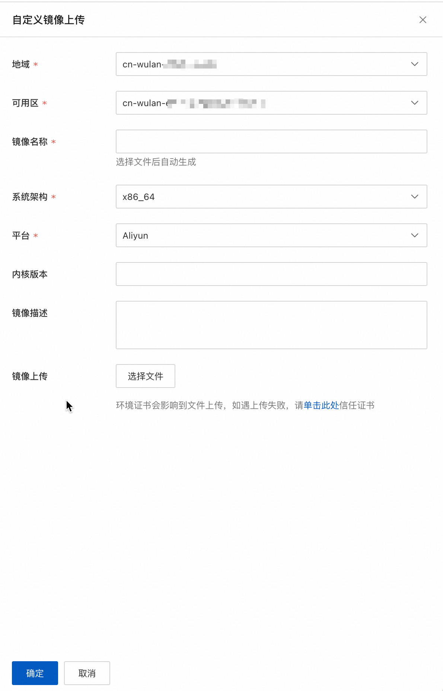

5. 单击**确定**。

**管理自定义镜像**

您可以对自定义镜像进行**删除**、**启用状态**、**禁用状态**、**镜像导出**等操作。

**操作步骤**

1. 登录BMCP运维平台。

2. 单击左侧导航栏的**基础配置 > 镜像管理**。

   默认进入**自定义镜像**页签。

3. 在镜像列表上方，您可以通过镜像名称或镜像ID进行模糊查询。

4. 镜像管理操作。

   <ol type="i">

   <li>

   删除镜像

   <ol type="a">

   <li>

   单击目标镜像**操作**列的**删除镜像**。

   </li>

   <li>

   在弹出的确认框中确认无误后，单击**确定**。

   > **重要**
   >
   > 删除镜像之前，请确保无实例使用此镜像，删除操作不可逆。

   </li>

   </ol>

   </li>

   <li>

   启用镜像

   单击目标镜像**操作**列的**启用状态 > 启用镜像**。

   </li>

   <li>

   禁用镜像

   单击目标镜像**操作**列的**启用状态 > 禁用镜像**。

   </li>

   <li>

   镜像导出

   单击目标镜像**操作**列的**镜像导出**，镜像将会下载至本地。

   </li>

   </ol>

<a id="section-9-2-2"></a>

### 9.2.2. 公共镜像

您可以对公共镜像进行启用、禁用、镜像导出、签名文件导出等操作。

**管理公共镜像**

您可以对公共镜像进行启用、禁用、镜像导出等操作。

**操作步骤**

1. 登录BMCP运维平台。

2. 单击左侧导航栏的**基础配置 > 镜像管理**。

   默认进入**自定义镜像**页签。

3. 单击**公共镜像**页签。

4. 在镜像列表上方，您可以通过镜像名称或镜像ID进行模糊查询。

5. 镜像管理操作。

   <ol type="i">

   <li>

   **启用镜像**

   单击目标镜像**操作**列的**启用状态 > 启用镜像**。

   </li>

   <li>

   **禁用镜像**

   单击目标镜像**操作**列的**启用状态 > 禁用镜像**。

   </li>

   <li>

   **镜像导出**

   单击目标镜像**操作**列的**镜像导出**，镜像将会下载至本地。

   </li>

   <li>

   **签名文件导出**

   单击目标镜像**操作**列的**签名文件导出**，签名文件将会下载至本地。

   </li>

   </ol>

**验证镜像完整性**

BMCP支持用户自验证公共镜像是否被篡改。

**操作步骤**

1. 登录BMCP运维平台。

2. 单击左侧导航栏的**基础配置 > 镜像管理**。

   默认进入**自定义镜像**页签。

3. 单击**公共镜像**页签。

4. 单击镜像列表上方的**下载公钥**。

5. 单击目标镜像**操作**列的**签名文件导出**。

6. 您可以使用如下命令查看镜像是否被篡改： `openssl dgst -sha256 -verify public.key -signature`

   ```text
   signature.bin imagefile 
   ```

   > **说明**
   >
   > - 在执行命令前，请确保公钥、签名文件、待验证的镜像都已下载。
   >
   > - 请根据实际替换如下三个参数：
   >
   >   - `public.key` 为下载的公钥。
   >
   >   - `signature.bin` 为下载的签名文档。
   >
   >   - `imagefile` 为需要验证的镜像文件名。

<a id="section-9-3"></a>

## 9.3. GPU配置

<a id="section-9-3-1"></a>

### 9.3.1. 添加GPU

本文介绍如何添加GPU。

**操作步骤**

1. 登录BMCP运维平台。

2. 单击**基础配置 > GPU配置**。

3. 单击机型列表左上方的**添加GPU**。

4. 配置参数。

   | 配置项 | 是否必填 | 说明 |
   | --- | --- | --- |
   | GPU厂商 | 是 | 输入GPU厂商名称。 |
   | GPU厂商（中文） | 否 | 输入GPU厂商的中文名称。 |
   | GPU型号 | 是 | 输入GPU型号。 |
   | GPU型号（中文） | 否 | 输入GPU型号的中文名称。 |
   | GPU显存大小 | 是 | 输入GPU显存大小，单位为G。 |
   | TFLOPS | 是 | 输入TFLOPS。 |

   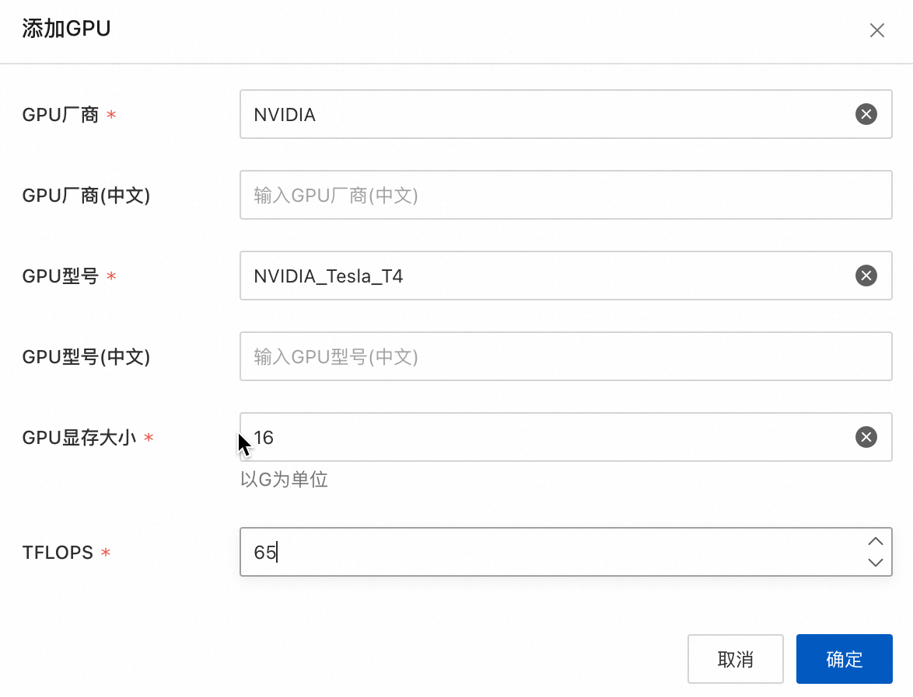

5. 单击**确定**。

<a id="section-9-3-2"></a>

### 9.3.2. 查询GPU

本文介绍如何查询GPU。

**操作步骤**

1. 登录BMCP运维平台。

2. 单击**基础配置 > GPU配置**。

3. 在**GPU配置**页面中，支持输入**GPU型号**进行查询。

4. 单击  进行模糊查询。

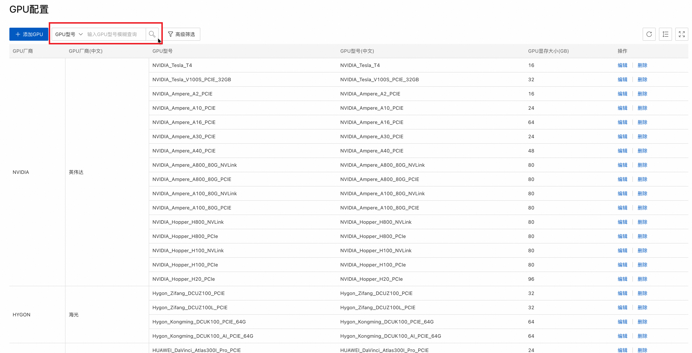

<a id="section-9-3-3"></a>

### 9.3.3. 修改GPU

本文介绍如何修改已添加的GPU信息。

**操作步骤**

1. 登录BMCP运维平台。

2. 单击**基础配置 > GPU配置**。

3. 单击目标GPU**操作**列的**编辑**。

4. 修改参数。您可以修改GPU厂商（中文）、GPU型号（中文）、GPU显存大小、TFLOPS等参数。

   > **说明**
   >
   > GPU厂商和GPU型号不支持修改。

   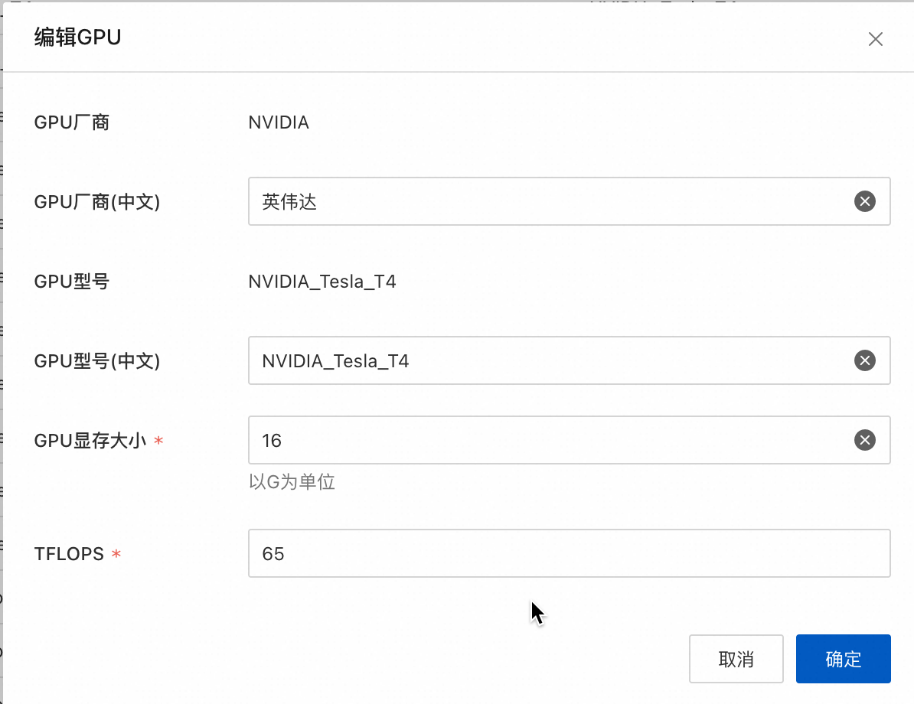

5. 单击**确定**。

<a id="section-9-3-4"></a>

### 9.3.4. 删除GPU

本文介绍如何删除已添加的GPU。

**操作步骤**

1. 登录BMCP运维平台。

2. 单击**基础配置 > GPU配置**。

3. 单击目标GPU操作列的**删除**。

4. 确认GPU信息无误后，单击**确定**。


<a id="section-10"></a>

# 10.日志管理

<a id="section-10-1"></a>

## 10.1. 集群/节点

本节介绍如何拉取集群或节点上的日志。

1. 登录BMCP运维平台。

2. 在左侧导航栏中，单击**日志管理**。

3. 在**日志管理**页面中，单击**集群/节点日志**页签进入页面。

4. 在集群/节点页面中，可以对集群或节点创建日志拉取任务，并下载日志压缩文件包结果。

5. 单击**创建任务**按钮可以发起日志拉取任务，依次指定**任务名称**，选择**日志类型**，并确定拉取范围后，选择**时间范围**。

6. 单击**确定**，发起任务。

7. 单击日志拉取任务记录的**详情**可以查看日志拉取任务的信息。

8. 勾选日志拉取任务，单击**导出日志**，可以下载对应的日志压缩文件包。

<a id="section-11"></a>

# 11.事件中心

事件中心提供对事件单的管理功能，您可以查看事件单的基本信息（例如事件单编号、状态等）、对事件单进行审批等操作。

**操作步骤**

1. 登录BMCP运维平台。

2. 在左侧导航栏，单击**事件中心**。

3. 在事件单列表上方，可以输入**事件单编号**进行搜索。

4. 在目标事件单操作列，单击**审批**。

5. 在弹出的**事件单详情**页，可以看到事件的**流程信息**、**基本信息**和**问题描述**。

6. 单击**处理**。

7. 选择审批**结果**。

   <ol type="i">

   <li>

   结果选择**通过**：在二次确认界面，手动输入“**我确认已知悉运维操作风险，仍要继续执行**”，单击**确定**。

   </li>

   <li>

   结果选择**拒绝**：单击**确定**。

   </li>

   </ol>

**其他操作**

**修复结单**：审批结果为通过的事件单，可以在**事件单详情**页，单击**修复结单**，单击**确定**。

查看事件单详情：审批完成后，单击事件单列表的操作列中的**详情**，可以查看事件单详细信息。
