阿里云  
专有云  
运维编排  
开发指南  
产品版本：V3.18.6  
文档版本：20250529

**目录**

- [1.Action通用属性](#section-1)
- [2.原子动作](#section-2)
    - [2.1. API类动作](#section-2-1)
        - [2.1.1. ACS::ExecuteAPI](#section-2-1-1)
        - [2.1.2. ACS::WaitFor](#section-2-1-2)
        - [2.1.3. ACS::CheckFor](#section-2-1-3)
        - [2.1.4. 支持的云产品列表](#section-2-1-4)
    - [2.2. 触发器类动作](#section-2-2)
    - [2.3. 控制类动作](#section-2-3)
        - [2.3.1. 审批ACS::Approve](#section-2-3-1)
        - [2.3.2. 选择ACS::Choice](#section-2-3-2)
        - [2.3.3. 通知ACS::Notify](#section-2-3-3)
        - [2.3.4. 睡眠ACS::Sleep](#section-2-3-4)
    - [2.4. 嵌套类动作](#section-2-4)
        - [2.4.1. 嵌套ACS::Template](#section-2-4-1)
- [3.云产品动作](#section-3)
    - [3.1. 弹性计算（ECS）类](#section-3-1)
    - [3.2. 钉钉（DingTalk）类](#section-3-2)
- [4.执行](#section-4)
    - [4.1. 执行概述](#section-4-1)
    - [4.2. 全自动执行](#section-4-2)
    - [4.3. 单步执行](#section-4-3)
    - [4.4. 查看执行详情](#section-4-4)
    - [4.5. 取消执行](#section-4-5)
    - [4.6. 删除执行](#section-4-6)
    - [4.7. 查看执行日志](#section-4-7)
    - [4.8. 状态转换图](#section-4-8)

<a id="section-1"></a>

# 1.Action通用属性

动作（Action）定义了一个具体的操作，是操作的最小单位。

**动作类型**

动作分为以下几种类型：

- 原子动作（Atom Action）

- API动作（API Action）

- 触发器动作（Trigger Action）

- 控制类动作（Control Action）

- 嵌套类动作（ACS::Template）

- 云产品动作（Cloud Product Action）

- 弹性计算（ECS）类

- 关系型数据库（RDS）类

- 钉钉（DingTalk）类

**名称格式**

动作（Action）的名称格式为 `ACS::<name>` 。

**通用属性**

除非某个Action有特殊说明，否则每个Action都具有以下通用属性。

```yaml
---
Tasks:
  - Name: task_name_1
    Action: 'Action类型'
    Description: describe the purpose of the task
    OnError: 'ACS::END/<other-task-name>' # 默认ACS::END
    OnSuccess: 'ACS::NEXT/<other-task-name>/ACS::END' # 默认ACS::NEXT 
    Properties:
      Service: ECS/RDS/RAM
      API: DeleteInstance/CreateDBInstance/CreateRamRole
      Parameters:
        InstanceId: "i-XXX"
    Outputs:
      Output_parameter_name_1:
        Type: String/List
        ValueSelector": ".Key1"
```

**Action通用定义**

- Name：合法字符为：[a-zA-Z0-9-_]，长度限制200个内，不允许包含冒号（:）。

- Action：必须为以下类型之一，原子action，云产品动作。以 `ACS::` 开头。

- Description：描述当前task的用途。

- Properties：详细信息，请参见ACS::ExecuteAPI。

**流程控制类**

- `OnError`：`ACS::END` ：默认，此任务出错时，中断执行。

- `OnSuccess`：`ACS::NEXT` ：默认，此任务成功时，后续如有任务，继续向后执行。

- `OnError: <task_name>` ：此任务出错时执行指定的任务。

- `OnSuccess: <task_name>` ：此任务成功时执行指定的任务。

**示例**

如下模板：执行云助手命令。

- YAML格式：

```text
FormatVersion: OOS-2019-06-01
Description: Creates a cloud assistant command and triggers it on one ECS instance.
Parameters:
  regionId:
    Description: The ID of region.
    Type: String
    Default: '{{ ACS::RegionId }}'
  commandContent:
    Description: The content of command.
    Type: String
  instanceId:
    Description: The ID of ECS instance that will invoke command.
    Type: String
    MinLength: 1
    MaxLength: 30
  commandType:
    Description: The type of command.
    Type: String
    AllowedValues:
    - RunBatScript
    - RunPowerShellScript
    - RunShellScript
  workingDir:
    Description: The directory where the created command runs on the ECS instances.
    Type: String
    Default: ""
  timeout:
    Description: The value of the invocation timeout period of a command on ECS instances.
    Type: Number
    Default: 600
Tasks:
- Name: runCommand
  Action: 'ACS::ExecuteAPI'
  Description: Executes a cloud assistant command.
  Properties:
    Service: ECS
    API: RunCommand
    Parameters:
      RegionId: '{{ regionId }}'
      CommandContent: '{{ commandContent }}'
      InstanceIds:
        - '{{instanceId}}'
      Name: '{{ ACS::ExecutionId }}'
      Type: '{{ commandType }}'
      WorkingDir: '{{ workingDir }}'
      Timeout: '{{ timeout }}'
  Outputs:
    invokeId:
      Type: String
      ValueSelector: InvokeId
- Name: untilInvocationReady
  Action: ACS::WaitFor
  Description: Waits for the command to be completed.
  OnError: ACS::END
  Retries: 20
  Properties:
    Service: ECS
    API: DescribeInvocations
    Parameters:
      RegionId: '{{ regionId }}'
      InvokeId: '{{ runCommand.invokeId }}'
    DesiredValues:
    - Finished
    StopRetryValues:
    - Failed
    PropertySelector: Invocations.Invocation[].InvokeStatus
- Name: describeInvocationResults
  Action: ACS::ExecuteAPI
  Description: Views the command output of a cloud assistant command in the specified E
CS
    instance.
  Properties:
    Service: ECS
    API: DescribeInvocationResults
    Parameters:
      RegionId: '{{ regionId }}'
      InvokeId: '{{ runCommand.invokeId }}'
  Outputs:
    invocationResult:
      Type: String
      ValueSelector: 'Invocation.InvocationResults.InvocationResult[].Output'
- Name: checkInvocationResult
  Action: 'ACS::CheckFor'
  Description: Check the command exitcode of a cloud assistant command.
  OnError: 'ACS::END'
  Properties:
    Service: ECS
    API: DescribeInvocationResults
    Parameters:
      RegionId: '{{ regionId }}'
      InvokeId: '{{ runCommand.InvokeId }}'
    PropertySelector: 'Invocation.InvocationResults.InvocationResult[].ExitCode'
    DesiredValues:
      - 0
Outputs:
  invocationOutput:
    Type: String
    Value:
      'Fn::Base64Decode': '{{ describeInvocationResults.invocationResult }}'
```

- JSON格式：

```json
{
  "FormatVersion": "OOS-2019-06-01",
  "Description": "Creates a cloud assistant command and triggers it on one ECS instance.",
  "Parameters": {
    "regionId": {
      "Description": "The ID of region.",
      "Type": "String",
      "Default": "{{ ACS::RegionId }}"
    },
    "commandContent": {
      "Description": "The content of command.",
      "Type": "String"
    },
    "instanceId": {
      "Description": "The ID of ECS instance that will invoke command.",
      "Type": "String",
      "MinLength": 1,
      "MaxLength": 30
    },
    "commandType": {
      "Description": "The type of command.",
      "Type": "String",
      "AllowedValues": [
        "RunBatScript",
        "RunPowerShellScript",
        "RunShellScript"
      ]
    },
    "workingDir": {
      "Description": "The directory where the created command runs on the ECS 
instances.",
      "Type": "String",
      "Default": ""
    },
    "timeout": {
      "Description": "The value of the invocation timeout period of a command on ECS instances.",
      "Type": "Number",
      "Default": 600
    }
  },
  "Tasks": [
    {
      "Name": "runCommand",
      "Action": "ACS::ExecuteAPI",
      "Description": "Executes a cloud assistant command.",
      "Properties": {
        "Service": "ECS",
        "API": "RunCommand",
        "Parameters": {
          "RegionId": "{{ regionId }}",
          "CommandContent": "{{ commandContent }}",
          "InstanceIds": [
            "{{instanceId}}"
          ],
          "Name": "{{ ACS::ExecutionId }}",
          "Type": "{{ commandType }}",
          "WorkingDir": "{{ workingDir }}",
          "Timeout": "{{ timeout }}"
        }
      },
      "Outputs": {
        "invokeId": {
          "Type": "String",
          "ValueSelector": "InvokeId"
        }
      }
    },
    {
      "Name": "untilInvocationReady",
      "Action": "ACS::WaitFor",
      "Description": "Waits for the command to be completed.",
      "OnError": "ACS::END",
      "Retries": 20,
      "Properties": {
        "Service": "ECS",
        "API": "DescribeInvocations",
        "Parameters": {
          "RegionId": "{{ regionId }}",
          "InvokeId": "{{ runCommand.invokeId }}"
        },
        "DesiredValues": [
          "Finished"
        ],
        "StopRetryValues": [
          "Failed"
        ],
        "PropertySelector": "Invocations.Invocation[].InvokeStatus"
      }
    },
    {
      "Name": "describeInvocationResults",
      "Action": "ACS::ExecuteAPI",
      "Description": "Views the command output of a cloud assistant command in the specified ECS instance.",
      "Properties": {
        "Service": "ECS",
        "API": "DescribeInvocationResults",
        "Parameters": {
          "RegionId": "{{ regionId }}",
          "InvokeId": "{{ runCommand.invokeId }}"
        }
      },
      "Outputs": {
        "invocationResult": {
          "Type": "String",
          "ValueSelector": "Invocation.InvocationResults.InvocationResult[].Output"
        }
      }
    },
    {
      "Name": "checkInvocationResult",
      "Action": "ACS::CheckFor",
      "Description": "Check the command exitcode of a cloud assistant command.",
      "OnError": "ACS::END",
      "Properties": {
        "Service": "ECS",
        "API": "DescribeInvocationResults",
        "Parameters": {
          "RegionId": "{{ regionId }}",
          "InvokeId": "{{ runCommand.InvokeId }}"
        },
        "PropertySelector": "Invocation.InvocationResults.InvocationResult[].ExitCode",
        "DesiredValues": [
          0
        ]
      }
    }
  ],
  "Outputs": {
    "invocationOutput": {
      "Type": "String",
      "Value": {
        "Fn::Base64Decode": "{{ describeInvocationResults.invocationResult }}"
      }
    }
  }
}
```

**任务输出**

Task级别的Outputs由输出Type和输出ValueSelector组成。如果声明多个输出项，则用逗号分隔开。请参见下列示例的语法结构。

**示例**

如下模板：获取指定状态的所有ECS实例。

- YAML格式：

```text
FormatVersion: OOS-2019-06-01
Description: Views the ECS instances by specifying instance status.
Parameters:
  regionId:
    Description: The ID of region.
    Type: String
    Default: '{{ ACS::RegionId }}'
  status:
    Description: The ECS instances status for query instances.
    Type: String
Tasks:
- Name: describeInstances
  Action: ACS::ExecuteAPI
  Description: Views the ECS instances by specifying instance status.
  Properties:
    Service: ECS
    API: DescribeInstances
    Parameters:
      RegionId: '{{ regionId }}'
      Status: '{{ status }}'
  Outputs:
    instanceIds:
      Type: List
      ValueSelector: Instances.Instance[].InstanceId
Outputs:
  instanceIds:
    Type: List
    Value: '{{ describeInstances.instanceIds }}'
```

- Json格式：

```json
{  "FormatVersion": "OOS-2019-06-01",  "Description": "Views the ECS instances by specifying instance status.",  "Parameters": {    "regionId": {      "Description": "The ID of region.",      "Type": "String",      "Default": "{{ ACS::RegionId }}"    },    "stat
us": {      "Description": "The ECS instances status for query instances.",      
"Type": "String"    }  },  "Tasks": [    {      "Name": "describeInstances",      "Actio
n": "ACS::ExecuteAPI",      "Description": "Views the ECS instances by specifying instance status.",      "Properties": {        "Service": "ECS",        "API": 
"DescribeInstances",        "Parameters": {          "RegionId": "{{ regionId }}",      
"Status": "{{ status }}"        }      },      "Outputs": {        "instanceIds": {     
"Type": "List",          "ValueSelector": "Instances.Instance[].InstanceId"        }    
}    }  ],  "Outputs": {    "instanceIds": {      "Type": "List",      "Value": "{{ desc
ribeInstances.instanceIds }}"    }  }}
```

**输出名称（必需）**

输出项的标识符，在模板中具有唯一性。如示例中的InstanceIds。

**Type（必需）**

输出项的类型，如 `String` 、 `List` 等。

<strong>ValueSelector（必需）</strong>在任务调用Api执行完成时，将输出的属性值。支持JQ selector，对于该API返回值，如".Instances",".Instances.Instance[].Status"。

<a id="section-2"></a>

# 2.原子动作

<a id="section-2-1"></a>

## 2.1. API类动作

<a id="section-2-1-1"></a>

### 2.1.1. ACS::ExecuteAPI

**用途**

此Action可以用来调用某个云产品（如ECS）的OpenAPI。如果OpenAPI是一个异步调用，则您可以使用ACS::WaitFor来等待其资源达到预期的状态。请参考ACS::WaitFor动作。

**语法**

**RPC风格API**

> **说明**
>
> Tasks.Properties.API就是云产品API的Action，所以无需在Tasks.Properties.Parameters中填写Action。

- YAML格式

```text
Tasks:
  - Name: executeAPITaskExample
    Action: ACS::ExecuteAPI
    Properties:
      Service: ECS # 必填，云产品code name，即RAM ARN⾥⾯的云产品code name。⼤⼩写不敏感。如ECS, RDS, FC...
      API: DescribeInstances # 必填，云产品的API名称。⼤⼩写不敏感。如ECS API 
"DescribeInstances"
      AutoPaging: false # 可选，对于⽀持分⻚的OpenAPI，是否⾃动翻⻚以获取所有的结果，默认：true
      Parameters:  # 调⽤OpenAPI所需要的参数，具体参考具体的API帮助
        Parameter1: Value1
        Parameter2: Value2
    Outputs: 
      OutputParameter1: 
        ValueSelector: 'jq selector' # jq的选择器语法，以OpenAPI的返回作为JSON输入，jq的语法请
参考 https://stedolan.github.io/jq/
        Type: String/Boolean/List(Array)/Number/Object
```

- JSON格式（请参考YAML注释说明）

```json
{
  "Tasks": [
    {
      "Name": "executeAPITaskExample",
      "Action": "ACS::ExecuteAPI",
      "Properties": {
        "Service": "ECS",
        "API": "DescribeInstances",
        "AutoPaging": false,
        "Parameters": {
          "Parameter1": "Value1",
          "Parameter2": "Value2"
        }
      },
      "Outputs": {
        "OutputParameter1": {
          "ValueSelector": "jq selector",
          "Type": "String/Boolean/List(Array)/Number/Object"
        }
      }
    }
  ]
}
```

**ROA风格API**

- YAML格式

```text
Tasks:
  - Name: executeAPITaskExample2
    Action: ACS::ExecuteAPI
    Properties:
      Service: OOS # 必填，云产品code name，即RAM ARN⾥⾯的云产品code name。⼤⼩写不敏感。如OOS
、ECS, RDS, FC...
      API: PutBucket # 必填，云产品的API名称。⼤⼩写不敏感。如OOS API "PutBucket"。
      Method: PUT  # 必填，该API HTTP请求⽅法。
      URI: ''  # 该AP对应的I统⼀资源标识符。
      Headers: # 选填，源API中请求头，定义在Headers部分，如下形式进⾏传递。
        requestHeader1: 'requestHeader1Value'
      Parameters: # 选填，源API中的公共参数，定义在Parameters部分，
        commonParameter1: 'commonParameter1Value'
        commonParameter2: 'commonParameter2Value'
        # 选填，源API中的请求元素，定义在Body部分，通过xml⽅式进⾏传递。
      Body: |
        <?xml version="1.0" encoding="UTF-8"?> <supKey1> <parameter1> Value1
        </parameter1> <parameter2> Value2 </parameter2> </supKey1>
```

- JSON格式（请参考YAML注释说明）

```json
{
  "Tasks": [
    {
      "Name": "executeAPITaskExample2",
      "Action": "ACS::ExecuteAPI",
      "Properties": {
        "Service": "OOS",
        "API": "PutBucket",
        "Method": "PUT",
        "URI": "",
        "Headers": {
          "requestHeader1": "requestHeader1Value"
        },
        "Parameters": {
          "commonParameter1": "commonParameter1Value",
          "commonParameter2": "commonParameter2Value"
        },
        "Body": "<?xml version=\"1.0\" encoding=\"UTF-8\"?> <supKey1> <parameter1> 
Value1\n</parameter1> <parameter2> Value2 </parameter2> </supKey1>\n"
      }
    }
  ]
}
```

**示例**

**RPC示例模版**

以下为含ECS云产品DescribeInstances API的模版。

- YAML格式

```text
FormatVersion: OOS-2019-06-01
Description: Views the ECS instances by specifying instance status.
Parameters:
  status:
    Description: The ECS instances status for query instances.
    Type: String
Tasks:
- Name: describeInstances
  Action: ACS::ExecuteAPI
  Description: Views the ECS instances by specifying instance status.
  Properties:
    Service: ECS
    API: DescribeInstances
    Parameters:
      Status: '{{ status }}'
  Outputs:
    instanceIds:
      Type: List
      ValueSelector: Instances.Instance[].InstanceId
Outputs:
  instanceIds:
    Type: List
    Value: '{{ describeInstances.instanceIds }}'
```

- JSON格式

```json
{
  "FormatVersion": "OOS-2019-06-01",
  "Description": "Views the ECS instances by specifying instance status.",
  "Parameters": {
    "status": {
      "Description": "The ECS instances status for query instances.",
      "Type": "String"
    }
  },
  "Tasks": [
    {
      "Name": "describeInstances",
      "Action": "ACS::ExecuteAPI",
      "Description": "Views the ECS instances by specifying instance status.",
      "Properties": {
        "Service": "ECS",
        "API": "DescribeInstances",
        "Parameters": {
          "Status": "{{ status }}"
        }
      },
      "Outputs": {
        "instanceIds": {
          "Type": "List",
          "ValueSelector": "Instances.Instance[].InstanceId"
        }
      }
    }
  ],
  "Outputs": {
    "instanceIds": {
      "Type": "List",
      "Value": "{{ describeInstances.instanceIds }}"
    }
  }
}
```

**ROA示例模版**

以下为含OSS云产品PutBucket API的模版。

- YAML格式

```text
FormatVersion: OOS-2019-06-01
Description:
  en: Create multiple buckets in different region at the same time.
  zh-cn: 同时创建多个不同区域的Bucket。
Parameters:
  Regions:
    Description:
      en: The region id..
      zh-cn: 区域Id。
    Type: List
  BucketName:
    Description:
      en: The bucket name.
      zh-cn: Bucket名称。
    Type: String
  DataRedundancyType:
    Description:
      en: Specifies the data disaster tolerance type of the bucket.
      zh-cn: 指定Bucket的数据容灾类型。
    Type: String
    AllowedValues:
      - LRS
      - ZRS
  StorageClass:
    Description:
      en: Specify the bucket storage type.
      zh-cn: 指定Bucket存储类型。
    Type: String
    AllowedValues:
      - Standard
      - IA
      - Archive
  XOssAcl:
    Description:
      en: Specify bucket access rights.
      zh-cn: 指定Bucket访问权限。
    Type: String
    AllowedValues:
      - public-read-write
      - public-read
      - private
  RateControl:
    Description:
      en: Concurrency ratio of task execution.
      zh-cn: 任务执⾏的并发比率。
    Type: Json
    AssociationProperty: RateControl
  OOSAssumeRole:
    Description: The RAM role to be assumed by OOS.
    Type: String
    Default: OOSServiceRole
RamRole: '{{ OOSAssumeRole }}'
Tasks:
  - Name: PutBucket
    Action: 'ACS::ExecuteAPI'
    Description:
      en: Create buckets in different regions.
      zh-cn: 创建不同区域的Bucket。
    Properties:
      Service: OSS
      API: PutBucket
      Method: PUT
      URI: ''
      Headers:
        x-oss-acl: '{{ XOssAcl }}'
      Parameters:
        BucketName: '{{ BucketName }}-{{ACS::TaskLoopItem}}'
        RegionId: '{{ACS::TaskLoopItem}}'
      Body: |
        <?xml version="1.0" encoding="UTF-8"?>
        <CreateBucketConfiguration>
          <StorageClass>{{ StorageClass }}</StorageClass>
          <DataRedundancyType>{{ DataRedundancyType }}</DataRedundancyType>
        </CreateBucketConfiguration>
    Loop:
      Items: '{{ Regions }}'
      RateControl: '{{ RateControl }}'
      Outputs:
        imageIds:
          AggregateType: 'Fn::ListJoin'
          AggregateField: imageIds
    Outputs:
      imageIds:
        Type: String
        ValueSelector: .
```

- JSON格式

```json
{
  "FormatVersion": "OOS-2019-06-01",
  "Description": {
    "en": "Create multiple buckets in different region at the same time.",
    "zh-cn": "同时创建多个不同区域的Bucket。"
  },
  "Parameters": {
    "Regions": {
      "Description": {
        "en": "The region id..",
        "zh-cn": "区域Id。"
      },
      "Type": "List"
    },
    "BucketName": {
      "Description": {
        "en": "The bucket name.",
        "zh-cn": "Bucket名称。"
      },
      "Type": "String"
    },
    "DataRedundancyType": {
      "Description": {
        "en": "Specifies the data disaster tolerance type of the bucket.",
        "zh-cn": "指定Bucket的数据容灾类型。"
      },
      "Type": "String",
      "AllowedValues": [
        "LRS",
        "ZRS"
      ]
    },
    "StorageClass": {
      "Description": {
        "en": "Specify the bucket storage type.",
        "zh-cn": "指定Bucket存储类型。"
      },
      "Type": "String",
      "AllowedValues": [
        "Standard",
        "IA",
        "Archive"
      ]
    },
    "XOssAcl": {
      "Description": {
        "en": "Specify bucket access rights.",
        "zh-cn": "指定Bucket访问权限。"
      },
      "Type": "String",
      "AllowedValues": [
        "public-read-write",
        "public-read",
        "private"
      ]
    },
    "RateControl": {
      "Description": {
        "en": "Concurrency ratio of task execution.",
        "zh-cn": "任务执⾏的并发比率。"
      },
      "Type": "Json",
      "AssociationProperty": "RateControl"
    },
    "OOSAssumeRole": {
      "Description": "The RAM role to be assumed by OOS.",
      "Type": "String",
      "Default": "OOSServiceRole"
    }
  },
  "RamRole": "{{ OOSAssumeRole }}",
  "Tasks": [
    {
      "Name": "PutBucket",
      "Action": "ACS::ExecuteAPI",
      "Description": {
        "en": "Create buckets in different regions.",
        "zh-cn": "创建不同区域的Bucket。"
      },
      "Properties": {
        "Service": "OSS",
        "API": "PutBucket",
        "Method": "PUT",
        "URI": "",
        "Headers": {
          "x-oss-acl": "{{ XOssAcl }}"
        },
        "Parameters": {
          "BucketName": "{{ BucketName }}-{{ACS::TaskLoopItem}}",
          "RegionId": "{{ACS::TaskLoopItem}}"
        },
        "Body": "<?xml version=\"1.0\" encoding=\"UTF-8\"?
>\n<CreateBucketConfiguration>\n  <StorageClass>{{ StorageClass }}</StorageClass>\n  <DataRedundancyType>{{ DataRedundancyType }}
</DataRedundancyType>\n</CreateBucketConfiguration>\n"
      },
      "Loop": {
        "Items": "{{ Regions }}",
        "RateControl": "{{ RateControl }}",
        "Outputs": {
          "imageIds": {
            "AggregateType": "Fn::ListJoin",
            "AggregateField": "imageIds"
          }
        }
      },
      "Outputs": {
        "imageIds": {
          "Type": "String",
          "ValueSelector": "."
        }
      }
    }
  ]
}
```

<a id="section-2-1-2"></a>

### 2.1.2. ACS::WaitFor

**用途**

使用该动作可以等待资源进入预期的状态。通过调用云产品的OpenAPI去查询指定资源的状态，直到资源的状态和预期的一致。如通过调用ECS的OpenAPI `RunInstances` 创建资源后，可以通过调用 `ACS::WaitFor` 等待实例被创建完成，即其状态为运行中（Running）。

**语法**

- YAML格式：

  ```text
  Tasks:
    - Name: waitForTaskExample
      Action: ACS::WaitFor
      Properties: 
        # 以下属性和ACS::ExecuteAPI⼀致，请参考ACS::ExecuteAPI语法说明。
        Service: ECS
        API: DescribeInstances
        Parameters: 
          InstanceId: i-12345678abcedfg
        # 以下属性为ACS::WaitFor的特殊属性
        PropertySelector: "jq selector" # 必填，需要等待的具体的API返回值，参考ACS::ExecuteAP
  I中的ValueSelector说明
        StopRetryValues: # 可选，⼀旦任务PropertySelector结果为status1状态时终⽌任务等待及API
  重试。比如status1为Stopped时，⼀旦API返回结果筛选后为Stopped，则该任务执⾏停⽌。
          - status1
        DesiredValues: # DesiredValue，NotDesiredValues 必填其⼀，指上⾯截取的值要匹配到以下值
  之⼀，匹配则表示成功，否则会超时然后失败。
          - value1
          - value2
        NotDesiredValues: # DesiredValue，NotDesiredValues 必填其⼀，指上⾯截取的值要不匹配到
  以下的所有值，全都不匹配则表示成功，否则会超时然后失败。
          - value3
          - value4
      Retries: #可选，表示最⼤重试次数，填写正整数，如5。
      DelayType: #Exponential(默认)，Constant，Linear。Exponential类型的重试间隔为：2 ^ times(重试次数)；Constant类型的重试间隔固定为Delay；Linear类型的重试间隔为：Delay + BackOff * times(重试次数)。
      Delay: #DelayType为Constant或Linear时需要添加此属性，表示重试间隔时间，填写正整数，如10，表
  示重试间隔为10s，
      Backoff: #DelayType为Linear时需要添加此属性，表示重试间隔补偿时间，填写正整数。
      Outputs:  #WaitFor动作所在的任务⽀持输出，当任务满⾜NotDesiredValues/DesiredValues的条件
  时，任务执⾏成功后会返回输出参数的。
        ValueSelector: # jq的选择器语法，以OpenAPI的返回作为JSON输入，jq的语法请参考 
  https://stedolan.github.io/jq
        Type: String/Boolean/List(Array)/Number/Object
  ```

- J常SON格式（请参考YAML注释说明）：

  ```json
  {
    "Tasks": [
      {
        "Name": "waitForTaskExample",
        "Action": "ACS::WaitFor",
        "Properties": {
          "Service": "ECS",
          "API": "DescribeInstances",
          "Parameters": {
            "InstanceId": "i-12345678abcedfg"
          },
          "PropertySelector": "jq selector",
          "StopRetryValues":["status1"],
          "DesiredValues": [
            "value1",
            "value2"
          ],
          "NotDesiredValues": [
            "value3",
            "value4"
          ]
        },
      "Outputs": {
          "OutputParameter1": {
            "ValueSelector": "jq selector",
            "Type": "String/Boolean/List(Array)/Number/Object"
          }
        }
      }
    ]
  }
  ```

**示例**

如下模板：启动一台指定实例，通过调用WaitFor等待实例的状态变为Running。

- YAML格式：

  ```yaml
  ---
  FormatVersion: OOS-2019-06-01
  Parameters:
    InstanceId:
      Description: the instance id that you will start.
      Type: String
  Tasks:
  - Name: startInstance
    Action: ACS::ExecuteAPI
    Description: start instance with specified parameters
    Properties:
      Service: ECS
      API: StartInstance
      Parameters:
        InstanceId: '{{ InstanceId }}'
  - Name: untilInstanceReady
    Action: ACS::WaitFor
    Description: describe instances with specified parameters
    Properties:
      Service: ECS
      API: DescribeInstances
      Parameters:
        InstanceIds:
        - '{{ InstanceId }}'
      PropertySelector: Instances.Instance[].Status
      DesiredValues:
      - Running
  ```

- JSON格式：

  ```json
  {
      "FormatVersion": "OOS-2019-06-01",
      "Parameters": {
          "InstanceId": {
              "Description": "the instance id that you will start.",
              "Type": "String"
          }
      },
      "Tasks": [
          {
              "Name": "startInstance",
              "Action": "ACS::ExecuteAPI",
              "Description": "start instance with specified parameters",
              "Properties": {
                  "Service": "ECS",
                  "API": "StartInstance",
                  "Parameters": {
                      "InstanceId": "{{ InstanceId }}"
                  }
              }
          },
          {
              "Name": "untilInstanceReady",
              "Action": "ACS::WaitFor",
              "Description": "describe instances with specified parameters",
              "Properties": {
                  "Service": "ECS",
                  "API": "DescribeInstances",
                  "Parameters": {
                      "InstanceIds": [ "{{ InstanceId }}"]
                  },
                  "PropertySelector": "Instances.Instance[].Status",
                  "DesiredValues": [ "Running" ],
              }
          }
      ]
  }
  ```

<a id="section-2-1-3"></a>

### 2.1.3. ACS::CheckFor

**用法**

该动作用来检查云产品资源是否符合预期状态，如是预期状态，则任务执行成功。否则，任务执行失败。通常用来做前置检查。如要停止某ECS实例，则可以先检查该ECS实例的状态是运行中状态（Running），如果不是Running，则不执行停止操作。

**语法**

此语法格式除了 `Type` 为 `ACS::CheckFor` 以外的所有字段和 `ACS::WaitFor` 一致，请参考ACS::WaitFor语法和说明。

- YAML格式

```text
Tasks:
  - Name: checkForTaskExample
    Action: ACS::CheckFor
    Properties: 
      # 以下属性和ACS::ExecuteAPI⼀致，请参考ACS::ExecuteAPI语法说明。
      Service: ECS
      API: DescribeInstances
      Parameters: 
        InstanceId: i-12345678abcedfg
      # 以下属性为ACS::CheckFor的特殊属性
      PropertySelector: "jq selector" # 必填，需要等待的具体的API返回值，参考ACS::ExecuteAPI
中的ValueSelector说明
      DesiredValues: # DesiredValue，NotDesiredValues 必填其⼀，指上⾯截取的值要匹配到以下值之
⼀，匹配则表示成功，否则会超时然后失败。
        - value1
        - value2
      NotDesiredValues: # DesiredValue，NotDesiredValues 必填其⼀，指上⾯截取的值要不匹配到以
下的所有值，全都不匹配则表示成功，否则会超时然后失败。
        - value3
        - value4
    Outputs: # CheckFor动作所在的任务⽀持输出，当任务满⾜NotDesiredValues/DesiredValues的条件
时，任务执⾏成功后会返回输出参数的值。
      OutputParameter1: 
        ValueSelector: 'jq selector' # jq的选择器语法，以OpenAPI的返回作为JSON输入，jq的语法请
参考 https://stedolan.github.io/jq/
        Type: String/Boolean/List(Array)/Number/Object
```

- JSON格式（请参考YAML注释说明）

```json
{
    "Tasks": [
        {
            "Name": "checkForTaskExample",
            "Action": "ACS::CheckFor",
            "Properties": {
                "Service": "ECS",
                "API": "DescribeInstances",
                "Parameters": {
                    "InstanceId": "i-12345678abcedfg"
                },
                "PropertySelector": "jq selector",
                "DesiredValues": [
                    "value1",
                    "value2"
                ],
                "NotDesiredValues": [
                    "value3",
                    "value4"
                                    ]
                          }，
  "Outputs": {
        "OutputParameter1": {
          "ValueSelector": "jq selector",
          "Type": "String/Boolean/List(Array)/Number/Object"
        }
      }
        }
            ]
}
```

**示例**

如下模板：为指定磁盘创建快照。用CheckFor检查特定实例是否处于Running或Stopped状态。

- YAML格式：

```text
FormatVersion: OOS-2019-06-01
Parameters:
  DiskId:
    Description: the disk id of the snap shot to copy 
    Type: String
  InstanceId:
    Description: the instances id  of the snap shot to copy 
    Type: String
  SnapshotName:
    Description: snap shot name of the new snap
    Type: String
Tasks:
- Name: checkInstanceReady
 Action: ACS::CheckFor
  Properties:
   Service: ECS
    API: DescribeInstances
    DesiredValues:
    - Running
    - Stopped
    Parameters:
      InstanceIds:
      - '{{ InstanceId }} '
    PropertySelector: Instances.Instance[].Status
- Name: createSnapshot
 Action: ACS::ExecuteAPI
  Properties:
   Service: ECS
    API: CreateSnapshot
    Parameters:
      DiskId: '{{ DiskId }}'
      SnapshotName: '{{ SnapshotName }}'
  Outputs:
      SnapshotId:
        Type: String
        ValueSelector: SnapshotId
- Name: waitSnapshotsReady
 Action: ACS::WaitFor
  Properties:
   Service: ECS
    API: DescribeSnapshots
    DesiredValues:
    - accomplished
    Parameters:
      SnapshotIds:
      - '{{ createSnapshot.SnapshotId }}'
    PropertySelector: Snapshots.Snapshot[].Status
Outputs:
  SnapshotId:
    Type: String
    Value: '{{ createSnapshot.SnapshotId }}'
```

- JSON格式：

```json
{
    "FormatVersion": "OOS-2019-06-01",
    "Parameters": {
        "DiskId": {
            "Description": "the disk id of the snap shot to copy ",
            "Type": "String"
        },
        "InstanceId": {
            "Description": "the instances id  of the snap shot to copy ",
            "Type": "String"
        },
        "SnapshotName": {
            "Description": "snap shot name of the new snap",
            "Type": "String"
        }
    },
    "Tasks": [
        {   
            "Name": "checkInstanceReady",
            "Action": "ACS::CheckFor",
            "Properties": {
                "Service": "ECS",
                "API": "DescribeInstances",
                "DesiredValues": ["Running", "Stopped"],
                "Parameters": {
                    "InstanceIds": ["{{ InstanceId }} "]
                },
                "PropertySelector": "Instances.Instance[].Status"
            }
        },
        {   
            "Name": "createSnapshot",
            "Action": "ACS::ExecuteAPI",
            "Properties": {
                "Service": "ECS",
                "API": "CreateSnapshot",
                "Parameters": {
                    "DiskId": "{{ DiskId }}",
                    "SnapshotName": "{{ SnapshotName }}"
                }
            },
            "Outputs": {
                "SnapshotId": {
                    "Type": "String",
                    "ValueSelector": "SnapshotId"
                }
            }
        },
        {   
            "Name": "waitSnapshotsReady",
            "Action": "ACS::WaitFor",
            "Properties": {
                "Service": "ECS",
                "API": "DescribeSnapshots",
                "DesiredValues": ["accomplished"],
                "Parameters": {
                    "SnapshotIds": ["{{ createSnapshot.SnapshotId }}"]
                },
                "PropertySelector": "Snapshots.Snapshot[].Status"
            }
        }
    ],
    "Outputs": {
        "SnapshotId": {
            "Type": "String",
            "Value": "{{ createSnapshot.SnapshotId }}"
        }
    }
}
```

<a id="section-2-1-4"></a>

### 2.1.4. 支持的云产品列表

API类动作目前支持以下云产品，表格以产品简称排序。

您如需其他云产品，请加钉钉群（群号：23330931）联系，我们将尽快满足您的需求。

| 产品简称 | 产品中文名 | API版本号 |
| --- | --- | --- |
| ECS | 云服务器 | v20140526 |
| HDR | 混合云容灾 | v20170925 |

<a id="section-2-2"></a>

## 2.2. 触发器类动作

<a id="section-2-3"></a>

## 2.3. 控制类动作

<a id="section-2-3-1"></a>

### 2.3.1. 审批ACS::Approve

用于审批任务的动作。

**用途**

在自动化运维的一些场景中，有些特殊的操作需要被特殊关注，例如删除重要资源，或使用费用较高的实例等。如果把这些操作也纳入自动化的范畴，您可能会担心失去控制，超过预算。若不纳入自动化的范畴，又会导致这些操作退化到手工执行或其他非自动化方式。审批动作能够让您在自动化和特殊关注之间寻找一个平衡。

当执行一个模板中包括审批动作，且执行到审批动作这一步时，OOS执行引擎会暂停执行，执行进入等待中状态，并发送一个包含通知的审批链接到管理员用户。在访问审批链接后，管理员可根据业务需求做出决定，同意或拒绝，同意后则OOS引擎继续执行后续任务，拒绝后引擎停止执行，执行状态为取消（Cancelled）。

**语法**

**Webhook**

对于钉钉，可以通过Webhook的方式支持。

- YAML格式

```text
Tasks:
  - Name: approvalTask
    Action: ACS::Approve
    Properties:
          AppendExecutionLink: 'true' # 是否附加执⾏详情链接，可选项true和false。ACS::Approve
动作默认为true。
          Approvers: ["user1", "user2"， "user3"] # 待审批的RAM⼦账号名字。
      MinRequiredApprovals: 2  # 审批通过时⾄少需要赞同的⼈数。
      NotifyType: WebHook
      WebHook:
        URI: url # 必填，webhook地址，如https://oapi.dingtalk.com/robot/send?access_token=
xxxxxx
        Headers: # 可选，Http请求的Headers，如Content-Type
          Content-Type: 'application/json; charset=utf-8'
        Content: # 必填，根据具体的Webhook要求提供，如钉钉webhook要求如下：https://open-doc.dingtalk.com/docs/doc.htm?treeId=257&articleId=105735&docType=1 
          msgtype: text
          text:
            content: 'the approve notify to user'  # 必填，发送审批通知的内容。
          at:  # 在钉钉群中@的⽤户
            atMobiles: # 可选，@群⾥⾯的指定⽤户，此处的⼿机号为⽤户注册钉钉的⼿机号。
                        - 138albb1234
                        - 130albb1234
            isAtAll: 'false'  # 可选，是否@所有⽤户，可选true 或 false，默认为false。
```

- JSON格式（请参照YAML注释说明）

```json
{
  "Tasks": [
    {
      "Name": "approvalTask",
      "Action": "ACS::Approve",
      "Properties": {
        "AppendExecutionLink": "true",
        "Approvers": [
          "user1",
          "user2",
          "user3"
        ],
        "MinRequiredApprovals": 2,
        "NotifyType": "WebHook",
        "WebHook": {
          "URI": "url",
          "Headers": {
            "Content-Type": "application/json; charset=utf-8"
          },
          "Content": {
            "msgtype": "text",
            "text": {
              "content": "the approve notify to user"
            },
            "at": {
              "atMobiles": [
                "138albb1234",
                "130albb1234"
              ],
              "isAtAll": "false"
            }
          }
        }
      }
    }
  ]
}
```

**示例**

以下模板：在删除实例前需要审批。

- YAML格式

```yaml
---
FormatVersion: OOS-2019-06-01
Description:
  en: Bulky restarts the ECS instances with Approval.
  zh-cn: 批量重启ECS实例带审批。
  name-en: BulkyRebootInstancesWithApproval
  name-zh-cn: 批量重启ECS实例带审批
Parameters:
  targets:
    Type: Json
    AssociationProperty: Targets
    AssociationPropertyMetadata:
      ResourceType: 'ALIYUN::ECS::Instance'
  rateControl:
    Description:
      en: Concurrency ratio of task execution.
      zh-cn: 任务执⾏的并发比率。
    Type: Json
    AssociationProperty: RateControl
    Default:
      Mode: Concurrency
      MaxErrors: 0
      Concurrency: 100%
  webHookUrl:
    Description:
      en: >-
        The webHook url of dingtalk group assistant,
        e.g.https://oapi.dingtalk.com/robot/send?access_token=1234zxcvaksdq31414.
      zh-cn: >-
        钉钉群助⼿的webhook地址，形如https://oapi.dingtalk.com/robot/send?
access_token=1234zxcvaksdq31414。
    Type: String
  atMobiles:
    Description:
      en: >-
        The telephone numbers of member in dingtalk group assistant @, when
        notify comes.
      zh-cn: 当群助⼿向钉钉群中发送审批通知时，要被@的群成员注册钉钉所⽤⼿机号。
    Type: List
    Default:
      - '12345678901'
  atAll:
    Description:
      en: 'assistant @ all members in dingtalk group or not, when notify comes.'
      zh-cn: 当群助⼿向钉钉群中发送审批通知时是否@所有⼈。
    Type: String
    Default: 'false'
  OOSAssumeRole:
    Description:
      en: The RAM role to be assumed by OOS.
      zh-cn: OOS扮演的RAM⾓⾊。
    Type: String
    Default: OOSServiceRole
RamRole: '{{ OOSAssumeRole }}'
Tasks:
  - Name: getInstance
    Description:
      en: Views the ECS instances.
      zh-cn: 获取ECS实例。
    Action: 'ACS::SelectTargets'
    Properties:
      ResourceType: 'ALIYUN::ECS::Instance'
      Filters:
        - '{{ targets }}'
    Outputs:
      instanceIds:
        Type: List
        ValueSelector: 'Instances.Instance[].InstanceId'
      instanceNames:
        Type: List
        ValueSelector: 'Instances.Instance[].InstanceName'
  - Name: approveRestart
    Action: 'ACS::Approve'
    Properties:
      NotifyType: WebHook
      WebHook:
        URI: '{{webhookUrl}}'
        Headers:
          Content-Type: application/json
        Content:
          msgtype: text
          text:
            content: >-
              Notify: please approve instances restart, instance names to
              approve  are {{getInstance.instanceNames}}, sent by
              {{ACS::RegionId}} oos {{ACS::ExecutionId}}.
          at:
            atMobiles: '{{atMobiles}}'
            isAtAll: '{{atAll}}'
  - Name: rebootInstance
    Action: 'ACS::ECS::RebootInstance'
    Description:
      en: Restarts the ECS instances.
      zh-cn: 重启实例。
    Properties:
      instanceId: '{{ ACS::TaskLoopItem }}'
    Loop:
      RateControl: '{{ rateControl }}'
      Items: '{{ getInstance.instanceIds }}'
Outputs:
  instanceIds:
    Type: List
    Value: '{{ getInstance.instanceIds }}'
```

- JSON格式

```json
{
  "FormatVersion": "OOS-2019-06-01",
  "Description": {
    "en": "Bulky restarts the ECS instances with Approval.",
    "zh-cn": "批量重启ECS实例带审批。",
    "name-en": "BulkyRebootInstancesWithApproval",
    "name-zh-cn": "批量重启ECS实例带审批"
  },
  "Parameters": {
    "targets": {
      "Type": "Json",
      "AssociationProperty": "Targets",
      AssociationPropertyMetadata: {
        "ResourceType": "ALIYUN::ECS::Instance"
      }
    },
    "rateControl": {
      "Description": {
        "en": "Concurrency ratio of task execution.",
        "zh-cn": "任务执⾏的并发比率。"
      },
      "Type": "Json",
      "AssociationProperty": "RateControl",
      "Default": {
        "Mode": "Concurrency",
        "MaxErrors": 0,
        "Concurrency": "100%"
      }
    },
    "webHookUrl": {
      "Description": {
        "en": "The webHook url of dingtalk group assistant, 
e.g.https://oapi.dingtalk.com/robot/send?access_token=1234zxcvaksdq31414.",
        "zh-cn": "钉钉群助⼿的webhook地址，形如https://oapi.dingtalk.com/robot/send?access_token=1234zxcvaksdq31414。"
      },
      "Type": "String"
    },
    "atMobiles": {
      "Description": {
        "en": "The telephone numbers of member in dingtalk group assistant @, when 
notify comes.",
        "zh-cn": "当群助⼿向钉钉群中发送审批通知时，要被@的群成员注册钉钉所⽤⼿机号。"
      },
      "Type": "List",
      "Default": [
        "12345678901"
      ]
    },
    "atAll": {
      "Description": {
        "en": "assistant @ all members in dingtalk group or not, when notify comes.",
        "zh-cn": "当群助⼿向钉钉群中发送审批通知时是否@所有⼈。"
      },
      "Type": "String",
      "Default": "false"
    },
    "OOSAssumeRole": {
      "Description": {
        "en": "The RAM role to be assumed by OOS.",
        "zh-cn": "OOS扮演的RAM⾓⾊。"
      },
      "Type": "String",
      "Default": "OOSServiceRole"
    }
  },
  "RamRole": "{{ OOSAssumeRole }}",
  "Tasks": [
    {
      "Name": "getInstance",
      "Description": {
        "en": "Views the ECS instances.",
        "zh-cn": "获取ECS实例。"
      },
      "Action": "ACS::SelectTargets",
      "Properties": {
        "ResourceType": "ALIYUN::ECS::Instance",
        "Filters": [
          "{{ targets }}"
        ]
      },
      "Outputs": {
        "instanceIds": {
          "Type": "List",
          "ValueSelector": "Instances.Instance[].InstanceId"
        },
        "instanceNames": {
          "Type": "List",
          "ValueSelector": "Instances.Instance[].InstanceName"
        }
      }
    },
    {
      "Name": "approveRestart",
      "Action": "ACS::Approve",
      "Properties": {
        "NotifyType": "WebHook",
        "WebHook": {
          "URI": "{{webhookUrl}}",
          "Headers": {
            "Content-Type": "application/json"
          },
          "Content": {
            "msgtype": "text",
            "text": {
              "content": "Notify: please approve instances restart, instance names to 
approve  are {{getInstance.instanceNames}}, sent by {{ACS::RegionId}} oos 
{{ACS::ExecutionId}}."
            },
            "at": {
              "atMobiles": "{{atMobiles}}",
              "isAtAll": "{{atAll}}"
            }
          }
        }
      }
    },
    {
      "Name": "rebootInstance",
      "Action": "ACS::ECS::RebootInstance",
      "Description": {
        "en": "Restarts the ECS instances.",
        "zh-cn": "重启实例。"
      },
      "Properties": {
        "instanceId": "{{ ACS::TaskLoopItem }}"
      },
      "Loop": {
        "RateControl": "{{ rateControl }}",
        "Items": "{{ getInstance.instanceIds }}"
      }
    }
  ],
  "Outputs": {
    "instanceIds": {
      "Type": "List",
      "Value": "{{ getInstance.instanceIds }}"
    }
  }
}
```

<a id="section-2-3-2"></a>

### 2.3.2. 选择ACS::Choice

**用途**

根据条件判断结果来选择接下来将执行的任务。比如对一个实例重启前，要查询该实例的状态，根据状态结果选择将执行的任务，若该实例为运行中，那么执行对实例重启的任务；若该实例为已停止，执行对实例启动的任务，若以上状态均不是，则执行查询实例状态的任务。

**语法**

- YAML格式

```text
Tasks:
- Name: chooseNextTaskToRun # 任务名称
  Action: ACS::Choice
  Properties:
    DefaultTask:  task1  #执⾏完该chooseNextTaskToRun任务，若无Choices中条件满⾜时，默认将执⾏
名称为task1的任务。task1不允许是对参数引⽤获取的任务名，其必须是确定的字符串格式的任务名称。
    Choices:
      - When: condition1  # 待判断的条件1。
        NextTask: task2  # 当condition1为true时，执⾏完该chooseNextTaskToRun任务，将执⾏名称
为task2的任务。task2不允许是对参数引⽤获取的任务名，其必须是确定的字符串格式的任务名称。
      - When: condition2 # 待判断的条件2。
        NextTask: task3 # 当condition2为true时，执⾏完该chooseNextTaskToRun任务，将执⾏名称为task3的任务。task3不允许是对参数引⽤获取的任务名，其必须是确定的字符串格式的任务名称。
                # 如有需要，Choices中还可有多个When判断条件。
                #...
```

- JSON格式（请参照YAML注释说明）

```json
{
  "Tasks": [{
      "Name": "chooseNextTaskToRun",
      "Action": "ACS::Choice",
      "Properties": {
        "DefaultTask": "task1",
        "Choices": [
          {
            "When": "condition1",
            "NextTask": "task2"
          },
          {
            "When": "condition2",
            "NextTask": "task3"
          }]}}]
}
```

**示例**

- YAML格式

```text
FormatVersion: OOS-2019-06-01
Description:
  en: Bulky restarts the ECS instances.
  zh-cn: 批量重启ECS实例。
  name-en: ACS-ECS-BulkyRebootInstances
  name-zh-cn: 批量重启ECS实例
Parameters:
  targets:
    Type: Json
    AssociationProperty: Targets
    AssociationPropertyMetadata:
      ResourceType: 'ALIYUN::ECS::Instance'
  rateControl:
    Description:
      en: Concurrency ratio of task execution.
      zh-cn: 任务执⾏的并发比率。
    Type: Json
    AssociationProperty: RateControl
  OOSAssumeRole:
    Description:
      en: The RAM role to be assumed by OOS.
      zh-cn: OOS扮演的RAM⾓⾊。
    Type: String
    Default: OOSServiceRole
RamRole: '{{ OOSAssumeRole }}'
Tasks:
  - Name: getInstance
    Description:
      en: Views the ECS instances.
      zh-cn: 获取ECS实例。
    Action: 'ACS::SelectTargets'
    Properties:
      ResourceType: 'ALIYUN::ECS::Instance'
      Filters:
        - '{{ targets }}'
    Outputs:
      instanceIds:
        Type: List
        ValueSelector: 'Instances.Instance[].InstanceId'
  - Name: describeInstances
    Action: ACS::ExecuteAPI
    Description: Views A ECS instances Status.
    Properties:
      Service: ECS
      API: DescribeInstances
      Parameters:
        InstanceIds: '{{ getInstance.instanceIds }}'
    Outputs:
      status:
        Type: String
        ValueSelector: Instances.Instance[].Status
  - Name: whetherStatusRunning
    Action: 'ACS::Choice'
    Properties:
      DefaultTask: describeInstancesFinally
      Choices:
        - When:
            'Fn::Equals':
              - Running
              - '{{ describeInstances.status }}'
          NextTask: rebootInstance
        - When:
            'Fn::Equals':
              - Stopped
              - '{{ describeInstances.status }}'
          NextTask: startInstance
  - Name: startInstance
    Action: 'ACS::ECS::StartInstance'
    Description:
      en: Starts the ECS instances.
      zh-cn: 启动实例。
    Properties:
      instanceId: '{{ ACS::TaskLoopItem }}'
    Loop:
      RateControl: '{{ rateControl }}'
      Items: '{{ getInstance.instanceIds }}'
  - Name: rebootInstance
    Action: 'ACS::ECS::RebootInstance'
    Description:
      en: Restarts the ECS instances.
      zh-cn: 重启实例。
    Properties:
      instanceId: '{{ ACS::TaskLoopItem }}'
    Loop:
      RateControl: '{{ rateControl }}'
      Items: '{{ getInstance.instanceIds }}'
  - Name: describeInstancesFinally
    Action: ACS::ExecuteAPI
    Description: Views the ECS instances Status.
    Properties:
      Service: ECS
      API: DescribeInstances
      Parameters:
        InstanceIds: '{{ getInstance.instanceIds }}'
    Outputs:
      status:
        Type: String
        ValueSelector: Instances.Instance[].Status
Outputs:
  instanceIds:
    Type: List
    Value: '{{ getInstance.instanceIds }}'
                        
```

- JSON格式

```json
{
"FormatVersion": "OOS-2019-06-01",
"Description": {
"en": "Bulky restarts the ECS instances.",
"zh-cn": "批量重启ECS实例。",
"name-en": "ACS-ECS-BulkyRebootInstances",
"name-zh-cn": "批量重启ECS实例"
},
"Parameters": {
"targets": {
"Type": "Json",
"AssociationProperty": "Targets",
"AssociationPropertyMetadata": {
    "ResourceType": "ALIYUN::ECS::Instance"
}
},
"rateControl": {
"Description": {
    "en": "Concurrency ratio of task execution.",
    "zh-cn": "任务执⾏的并发比率。"
},
"Type": "Json",
"AssociationProperty": "RateControl"
},
"OOSAssumeRole": {
"Description": {
    "en": "The RAM role to be assumed by OOS.",
    "zh-cn": "OOS扮演的RAM⾓⾊。"
},
"Type": "String",
"Default": "OOSServiceRole"
}
},
"RamRole": "{{ OOSAssumeRole }}",
"Tasks": [
{
"Name": "getInstance",
"Description": {
    "en": "Views the ECS instances.",
    "zh-cn": "获取ECS实例。"
},
"Action": "ACS::SelectTargets",
"Properties": {
    "ResourceType": "ALIYUN::ECS::Instance",
    "Filters": [
      "{{ targets }}"
    ]
},
"Outputs": {
    "instanceIds": {
      "Type": "List",
      "ValueSelector": "Instances.Instance[].InstanceId"
    }
}
},
{
"Name": "describeInstances",
"Action": "ACS::ExecuteAPI",
"Description": "Views A ECS instances Status.",
"Properties": {
    "Service": "ECS",
    "API": "DescribeInstances",
    "Parameters": {
      "InstanceIds": "{{ getInstance.instanceIds }}"
    }
},
"Outputs": {
    "status": {
      "Type": "String",
      "ValueSelector": "Instances.Instance[].Status"
    }
}
},
{
"Name": "whetherStatusRunning",
"Action": "ACS::Choice",
"Properties": {
    "DefaultTask": "describeInstancesFinally",
    "Choices": [
      {
        "When": {
          "Fn::Equals": [
            "Running",
            "{{ describeInstances.status }}"
          ]
        },
        "NextTask": "rebootInstance"
      },
      {
        "When": {
          "Fn::Equals": [
            "Stopped",
            "{{ describeInstances.status }}"
          ]
        },
        "NextTask": "startInstance"
      }
    ]
}
},
{
"Name": "startInstance",
"Action": "ACS::ECS::StartInstance",
"Description": {
    "en": "Starts the ECS instances.",
    "zh-cn": "启动实例。"
},
"Properties": {
    "instanceId": "{{ ACS::TaskLoopItem }}"
},
"Loop": {
    "RateControl": "{{ rateControl }}",
    "Items": "{{ getInstance.instanceIds }}"
}
},
{
"Name": "rebootInstance",
"Action": "ACS::ECS::RebootInstance",
"Description": {
    "en": "Restarts the ECS instances.",
    "zh-cn": "重启实例。"
},
"Properties": {
    "instanceId": "{{ ACS::TaskLoopItem }}"
},
"Loop": {
    "RateControl": "{{ rateControl }}",
    "Items": "{{ getInstance.instanceIds }}"
}
},
{
"Name": "describeInstancesFinally",
"Action": "ACS::ExecuteAPI",
"Description": "Views the ECS instances Status.",
"Properties": {
    "Service": "ECS",
    "API": "DescribeInstances",
    "Parameters": {
      "InstanceIds": "{{ getInstance.instanceIds }}"
    }
},
"Outputs": {
    "status": {
      "Type": "String",
      "ValueSelector": "Instances.Instance[].Status"
    }
}
}
],
"Outputs": {
"instanceIds": {
"Type": "List",
"Value": "{{ getInstance.instanceIds }}"
}}}
```

<a id="section-2-3-3"></a>

### 2.3.3. 通知ACS::Notify

**用途**

该动作可以用在运维任务完成后用户需要被告知的场景。如在购买ECS实例完成以后，发送一个钉钉通知便于您对账单有实时的了解。

**语法**

当前支持Webhook和Mail两种通知类型，定义方式如下。

**Webhook**

- YAML格式

```text
Tasks:
  - Name: notifyTask
    Action: ACS::Notify
    Properties:
      NotifyType: WebHook
          AppendExecutionLink: 'false' # 是否附加执⾏详情链接，可选项true和false。ACS::Notify
动作默认为false。
      WebHook:
        URI: url # 必填，webhook地址，如https://oapi.dingtalk.com/robot/send?access_token=
xxxxxx
        Headers: # 可选，Http请求的Headers，如Content-Type
          Content-Type: 'application/json; charset=utf-8'
        Content: # 必填，根据具体的Webhook要求提供，如钉钉webhook要求如下：https://open-doc.dingtalk.com/docs/doc.htm?treeId=257&articleId=105735&docType=1 
          msgtype: text
          text: 
            content: 'this is a dingtalk message with a parameter {{ p1 }}'
```

- JSON格式（请参照YAML注释说明）

```json
{
  "Tasks": [
    {
      "Name": "notifyTask",
      "Action": "ACS::Notify",
      "Properties": {
        "NotifyType": "WebHook",
        "AppendExecutionLink": "false",
        "WebHook": {
          "URI": "url",
          "Headers": {
            "Content-Type": "application/json; charset=utf-8"
          },
          "Content": {
            "msgtype": "text",
            "text": {
              "content": "this is a dingtalk message with a parameter {{ p1 }}"
            }
          }
        }
      }
    }
  ]
}
```

**Mail**

- YAML格式

```text
Tasks:
  - Action: ACS::Notify
    Name: testNotifyByMail
    Properties:
        NotifyType: Mail
        Mail:
                Host: SMTPHostAddress # SMTP 服务器主机地址如 smtp.example1.com
            Port: SMTPPort # SMTP 服务器端⼝如 465
            Username: sender  # 代发送的邮箱⽤户如 usr001@example1.com
            Password: senderPassword # 代发送的邮箱密码如 123456zxcv
            Subject: mailSubject # 邮件主题如 hello world
            Body: mailBody # 邮件正⽂如 hello world ！！！
            From: senderAddress # 邮件来⾃如 usr001@example1.com
            To:  receiverAddresses        # 收件⼈邮箱地址列表如 
[usr1234@example2.com,usr123@example2.com]
```

- JSON格式（请参照YAML注释说明）

```json
{
  "Tasks": [
    {
      "Action": "ACS::Notify",
      "Name": "testNotifyByMail",
      "Properties": {
        "NotifyType": "Mail",
        "Mail": {
          "Host": "SMTPHostAddress",
          "Port": "SMTPPort",
          "Username": "sender",
          "Password": "senderPassword",
          "Subject": "mailSubject",
          "Body": "mailBody",
          "From": "senderAddress",
          "To": "receiverAddresses"
        }
      }
    }
  ]
}
```

**示例**

- YAML格式

```yaml
---
FormatVersion: OOS-2019-06-01
Outputs:
    InstanceIds:
        Type: List
        Value: ' {{ runInstances.InstanceIds }} '
Parameters:
    ImageId:
        Description: the image id for the new instances.
        Type: String
    InstanceType:
        Description: the Instance Type for the new instances.
        Type: String
    OOSAssumeRole:
        Default: OOSServiceRole
        Description: oos assume this role to execution task
        Type: String
    SecurityGroupId:
        Description: the security group id for the new instances.
        Type: String
    VSwitchId:
        Description: the virtual switch id for the new instances.
        Type: String
RamRole: '{{OOSAssumeRole}}'
Tasks:
-   Action: ACS::ExecuteAPI
    Description: 'run instances with specified parameters'
    Name: runInstances
    Outputs:
        InstanceIds:
            Type: List
            ValueSelector: .InstanceIdSets.InstanceIdSet[]
    Properties:
        API: RunInstances
        Parameters:
            ImageId: '{{ ImageId }}'
            InstanceType: '{{ InstanceType }}'
            SecurityGroupId: '{{ SecurityGroupId }}'
            VSwitchId: '{{ VSwitchId }}'
        Service: ECS
-   Action: ACS::Notify
    Name: test_notify
    Properties:
        NotifyType: WebHook
        WebHook:
            Content:
                msgtype: text
                text: 
                        content: 
            Headers:
                Content-Type: application/json
            URI: https://oapi.dingtalk.com/robot/send?access_token=your_access_token
```

- JSON格式

```json
{
    "FormatVersion": "OOS-2019-06-01",
    "Outputs": {
        "InstanceIds": {
            "Type": "List"
            "Value": " {{ runInstances.InstanceIds }} "
        }
    },
    "Parameters": {
        "ImageId": {
            "Description": "the image id for the new instances.",
            "Type": "String"
        },
        "InstanceType": {
            "Description": "the Instance Type for the new instances.",
            "Type": "String"
        },
        "SecurityGroupId": {
            "Description": "the security group id for the new instances.",
            "Type": "String"
        },
        "VSwitchId": {
            "Description": "the virtual switch id for the new instances.",
            "Type": "String"
        },
          "OOSAssumeRole": {
                      "Type": "String",
                      "Description":  "oos assume this role to execution task",
                      "Default": "OOSServiceRole"
    }
    },
    "RamRole": "{{OOSAssumeRole}}",
    "Tasks": [
        {
            "Action": "ACS::ExecuteAPI",
            "Description": "run instances with specified parametersl",
            "Name": "runInstances",
            "Outputs": {
                "InstanceIds": {
                    "Type": "List",
                    "ValueSelector": ".InstanceIdSets.InstanceIdSet[]"
                }
            },
            "Properties": {
                "API": "RunInstances",
                "Parameters": {
                    "ImageId": "{{ ImageId }}",
                    "InstanceType": "{{ InstanceType }}",
                    "SecurityGroupId": "{{ SecurityGroupId }}",
                    "VSwitchId": "{{ VSwitchId }}"
                },
                "Service": "ECS"
            }
        },
       {
      "Name": "test_notify",
      "Action": "ACS::Notify",
      "Properties": {
        "NotifyType": "WebHook",
        "WebHook": {
          "URI": "https://oapi.dingtalk.com/robot/send?access_token=your_access_token",
          "Headers": {
            "Content-Type": "application/json"
          },
          "Content": {
            "msgtype": "text",
            "text": {
              "content":"test"
            }
          }
        }
      }
    } 
    ]
}
```

<a id="section-2-3-4"></a>

### 2.3.4. 睡眠ACS::Sleep

**用途**

该动作可以适用于运维过程中需要等待的场景。如新创建的带应用的ECS实例需要预热一段时间，然后再进行后续的运维操作。

**语法**

- YAML格式

```text
Tasks:
  - Name: sleepTask # 任务名称
    Action: ACS::Sleep
    Properties:
      Duration: PT15M # 必填，需要睡眠的时间⻓度
```

- JSON格式（请参照YAML注释说明）

```json
{
  "Tasks": [
    {
      "Name": "sleepTask",
      "Action": "ACS::Sleep",
      "Properties": {
        "Duration": "PT15M"
      }
    }
  ]
}
```

**说明**

**Duration**

- 采取ISO8601标准进行时间长度定义。

- 限制：最短1秒钟，最长4小时。

- 不区分大小写。

示例：

- 1S或1s，简略写法，表示1秒钟

- 1M或1m，简略写法，表示1分钟。

- 1H或1h，简略写法，表示1小时。

- 1H2M，简略写法，表示1小时2分钟。

- PT1H2M，标准写法，表示1小时2分钟。

<a id="section-2-4"></a>

## 2.4. 嵌套类动作

<a id="section-2-4-1"></a>

### 2.4.1. 嵌套ACS::Template

调用其他的模板作为子模板进行嵌套执行。

**用途**

嵌套动作（ACS::Template）可以调用其他的模板作为子模板进行嵌套执行。利用该动作，您可以将一个复杂的模板进行模块化分解，拆分成多个子模板进行调用，也可以将常见的运维操作定义成一个可复用的子模板。另外云产品动作是OOS提供的常见类型云产品操作模版，您通过嵌套云产品动作可更便捷地进行嵌套调用。

**语法**

- 通用格式（适用于所有可被嵌套模版）

  - YAML

    ```text
    Tasks:
    - Name: callChildTemplate1
      Action: ACS::Template
      Properties:
        TemplateName: child_template_name # 必填，⼦模板名称
        TemplateVersion: v2 # 可选，默认取最新的版本。
        Parameters:  # 可选，⼦模板，根据⼦模板的参数提供参数。
          ParameterName1: value1
    ```

  - JSON（请参考YAML注释说明）

    ```json
    {
    "Tasks": [
      {
        "Name": "callChildTemplate1",
        "Action": "ACS::Template",
        "Properties": {
          "TemplateName": "child_template_name","TemplateVersion": "v2",
          "Parameters": {
            "ParameterName1": "value1"
          }
        }
      }
    ]
    }                                
    ```

- 简化格式（仅适用于嵌套云产品动作）

  - YAML

    ```text
    Tasks:
    - Name: taskName # 必填，任务名称，如runMyInstances
      Action: CloudProductActionName1  # 必填，云产品动作名称，如ACS::ECS::RunInstances
      Properties:
        ParameterName1: value1 # 可选，根据云产品动作需要的参数进⾏提供，如ImageId。
    ```

  - JSON（请参考YAML注释说明）

    ```json
    {
    "Tasks": [
      {
        "Name": "taskName",
        "Action": "CloudProductActionName1",
        "Properties": {
          "ParameterName1": "parameterName1"
        }
      }
    ]
    }
    ```

**限制**

嵌套动作有如下限制：

- 模板不能嵌套自身。

- 不能循环嵌套，即A嵌套B，B嵌套C，然后C嵌套A。

- 总的嵌套层数不能超过3层。

- 云产品动作属于一层嵌套，循环任务不属于嵌套。

**示例**

通过嵌套云产品动作 `ACS::ECS::CreateImage` 为ECS实例创建镜像。

- 通用定义格式（适用于所有可被嵌套模版）

  - YAML

  ```yaml
  ---
  FormatVersion: OOS-2019-06-01
  Description: Creates a custom image.
  Parameters:
    imageName:
      Description: The image name.
      Type: String
    instanceId:
      Description: The ID of the instance.
      Type: String
      AllowedPattern: i-[A-Za-z0-9]*
      MinLength: 1
      MaxLength: 30
    OOSAssumeRole:
      Type: String
      Description: oos assume this role to execution task
      Default: OOSServiceRole
  RamRole: '{{OOSAssumeRole}}'
  Tasks:
  - Name: createImage
    Action: ACS::Template
    Description: Creates a custom image.
    Properties:
      TemplateName: 'ACS::ECS::CreateImage'
      Parameters:
        ImageName: '{{ imageName }}'
        InstanceId: '{{ instanceId }}'
    Outputs:
      imageId:
        Type: String
        ValueSelector: ImageId
  Outputs:
    imageId:
      Type: String
      Value: '{{ createImage.imageId }}'        
  ```

  - JSON

  ```json
  {
      "FormatVersion": "OOS-2019-06-01",
      "Description": "Creates a custom image.",
      "Parameters": {
          "imageName": {
              "Description": "The image name.",
              "Type": "String"
          },
          "instanceId": {
              "Description": "The ID of the instance.",
              "Type": "String",
              "AllowedPattern": "i-[A-Za-z0-9]*",
              "MinLength": 1,
              "MaxLength": 30
          },
          "OOSAssumeRole": {
              "Type": "String",
              "Description": "oos assume this role to execution task",
              "Default": "OOSServiceRole"
          }
      },
      "RamRole": "{{OOSAssumeRole}}",
      "Tasks": [
          {
              "Name": "createImage",
              "Action": "ACS::Template",
              "Description": "Creates a custom image.",
              "Properties": {
                  "TemplateName": "ACS::ECS::CreateImage",
                  "Parameters": {
                      "ImageName": "{{ imageName }}",
                      "InstanceId": "{{ instanceId }}"
                  }
              },
              "Outputs": {
                  "imageId": {
                      "Type": "String",
                      "ValueSelector": "ImageId"
                  }
              }
          }
      ],
      "Outputs": {
          "imageId": {
              "Type": "String",
              "Value": "{{ createImage.imageId }}"
          }
      }
  }        
  ```

- 简化定义格式（仅适用于云产品动作）

  - YAML

  ```yaml
  ---
  FormatVersion: OOS-2019-06-01
  Description: Creates a new Image from existing ECS Instance.
  Parameters:
    InstanceId:
      Description: the Instance Type for the new instances
      Type: String
    ImageName:
      Description:  name of the new image
      Type: String
    OOSAssumeRole:
      Type: String
      Description: oos assume this role to execution task
      Default: OOSServiceRole
  RamRole: "{{OOSAssumeRole}}"
  Tasks:
    - Name: createImage
      Action: ACS::ECS::CreateImage
      Properties:
        ImageName: "{{ ImageName }}"
        InstanceId: "{{ InstanceId }}"
      Outputs:
        ImageId:
          ValueSelector: ImageId
          Type: String
  Outputs:
    ImageId:
      Type: String
      Value: "{{ createImage.ImageId }}"
  ```

  - JSON

  ```json
  {
    "FormatVersion": "OOS-2019-06-01",
    "Description": "Creates a new Image from existing ECS Instance.",
    "Parameters": {
      "InstanceId": {
        "Description": "the Instance Type for the new instances",
        "Type": "String"
      },
      "ImageName": {
        "Description": "name of the new image",
        "Type": "String"
      },
      "OOSAssumeRole": {
        "Type": "String",
        "Description": "oos assume this role to execution task",
        "Default": "OOSServiceRole"
      }
    },
    "RamRole": "{{OOSAssumeRole}}",
    "Tasks": [
      {
        "Name": "createImage",
        "Action": "ACS::ECS::CreateImage",
        "Properties": {
          "ImageName": "{{ ImageName }}",
          "InstanceId": "{{ InstanceId }}"
        },
        "Outputs": {
          "ImageId": {
            "ValueSelector": "ImageId",
            "Type": "String"
          }
        }
      }
    ],
    "Outputs": {
      "ImageId": {
        "Type": "String",
        "Value": "{{ createImage.ImageId }}"
      }
    }
  }
  ```

<a id="section-3"></a>

# 3.云产品动作

<a id="section-3-1"></a>

## 3.1. 弹性计算（ECS）类

本文介绍了各场景下的弹性计算（ECS）类云产品动作（包括其用途、涉及的API以及具体参数和输出、内容链接），您通过嵌套动作即可对云产品动作进行嵌套调用，关于具体如何调用云产品动作请参见嵌套ACS::Template。

**实例操作**

| 云产品动作名称 | 用途 | 相关的OpenAPI | 参数 | 动作输出 |
| --- | --- | --- | --- | --- |
| ACS::ECS::Descri beInstancesByTa g | 根据Tag查询实例ID | DescribeInstance s | • tagKey：String类型<br>• tagValue：String类型 | instanceIds：List类型 |
| ACS::ECS::RunIns tances | 启动一个或多个ECS实例 | • RunInstances<br>• DescribeInstan ces | • imageId：String类型<br>• instanceType：String类型<br>• securityGroupI d：String类型<br>• vSwitchId：String类型<br>• amount：String类型 | instanceIds：List类型 |
| ACS::ECS::RunIns tancesFromTemp late | 根据启动模板创建ECS实例 | • RunInstances<br>• DescribeInstan ces | • launchTemplat eId：String类型<br>• launchTemplat eName：String类型<br>• amount：Number类型 | instanceIds：List类型 |
| ACS::ECS::DeleteI nstance | 删除一个ECS实例 | DeleteInstance | instanceId：String类型 | - |
| ACS::ECS::StartIn stance | 启动一个ECS实例 | • StartInstance<br>• DescribeInstan ces | instanceId：String类型 | - |
| ACS::ECS::StopIn stance | 停止一个ECS实例 | • StopInstance<br>• DescribeInstan ces | instanceId：String类型 | - |
| ACS::ECS::Reboot Instance | 重启一个ECS实例 | • RebootInstanc e<br>• DescribeInstan ces | instanceId：String类型 | - |
| ACS::ECS::Descri beInstancesByNa me | 根据实例名称查询实例 | DescribeInstance s | instanceName：String类型 | instanceIds：List类型 |
| ACS::ECS::Descri beInstancesBySta tus | 根据实例状态查询实例 | DescribeInstance s | status：String类型 | instanceIds：List类型 |

**实例修改**

| 云产品动作名称 | 用途 | 相关的OpenAPI | 参数 | 动作输出 |
| --- | --- | --- | --- | --- |
| ACS::ECS::Resize Disk | 扩容一块数据盘 | • DescribeInstan ces<br>• ResizeDisk<br>• DescribeDisks<br>• RebootInstanc e | • diskId：String类型<br>• instanceId：String类型<br>• newSize：String类型 | - |
| ACS::ECS::ModifyI nstanceVpcAttrib ute | 修改一台ECS实例的专有网络VPC属性 | • StopInstance<br>• DescribeInstan ces<br>• ModifyInstance VpcAttribute | • instanceId：String类型<br>• vSwitchId：String类型 | - |
| ACS::ECS::ResetP assword | 修改一台ECS实例的密码 | • ModifyInstance Attribute<br>• RebootInstanc e<br>• DescribeInstan ces | • instanceId：String类型<br>• password：String类型 | instanceId：String类型 |
| ACS::ECS::Modify VncPassword | 修改一台ECS实例VNC密码 | • ModifyInstance VncPasswd<br>• RebootInstanc e<br>• DescribeInstan ces | • instanceId：String类型<br>• vncPassword：String类型 | - |
| ACS::ECS::Modify PrepaySpec | 升级或者降低预付费实例规格 | • StopInstance<br>• DescribeInstan ces<br>• ModifyPrepayI nstanceSpec<br>• StartInstance | • instanceId：String类型<br>• autoPay：String类型<br>• instanceType：String类型 | orderId：String类型 |
| ACS::ECS::Attach Disk | 安装磁盘 | • AttachDisk<br>• DescribeDisks | • instanceId：String类型<br>• diskId：String类型 | - |
| ACS::ECS::Detach Disk | 卸载磁盘 | • DetachDisk<br>• DescribeDisks | • instanceId：String类型<br>• diskId：String类型 | - |

**云助手**

| 云产品动作名称 | 用途 | 相关的OpenAPI | 参数 | 动作输出 |
| --- | --- | --- | --- | --- |
| ACS::ECS::Install CloudAssistant | 表示安装云助手 | • ModifyInstance Spec<br>• RebootInstanc e<br>• DescribeInstan ces<br>• DescribeCloud AssistantStatus | instanceId：String类型 | - |
| ACS::ECS::RunCo mmand | 表示执行远程命令 | • CreateComma nd<br>• InvokeComma nd<br>• DescribeInvoc ations<br>• DescribeInvoc ationResults<br>• DeleteComma nd | • instanceId：String类型<br>• commandCont ent：String类型<br>• commandType：String类型 | invocationResult：String类型 |

**其他**

| 云产品动作名称 | 用途 | 相关的OpenAPI | 参数 | 动作输出 |
| --- | --- | --- | --- | --- |
| ACS::ECS::CreateI mage | 表示创建镜像 | • DescribeInstan ces<br>• CreateImage<br>• DescribeImage s | • instanceId：String类型<br>• imageName：String类型 | imageId：String类型 |
| ACS::ECS::Create Snapshot | 表示创建快照 | • DescribeInstan ces<br>• CreateSnapsho t | • instanceId：String类型<br>• diskId：String类型<br>• snapshotName：String类型 | snapshotId：String类型 |
| ACS::ECS::ResetD isk | 表示回滚磁盘 | • StopInstance<br>• DescribeInstan ces<br>• ResetDisk | • instanceId：String类型<br>• diskId：String类型<br>• snapshotId：String类型 | - |
| ACS::ECS::Create AndAttachDisk | 表示创建并且安装磁盘 | • DescribeInstan ces<br>• CreateDisk<br>• DescribeDisks<br>• AttachDisk | • instanceId：String类型<br>• diskName：String类型<br>• zoneId：String类型<br>• diskCategory：String类型<br>• size：String类型 | diskId：String类型 |
| ACS::ECS::Replac eSystemDisk | 表示更换系统盘 | • StopInstance<br>• DescribeInstan ces<br>• ReplaceSyste mDisk<br>• StartInstance | • instanceId：String类型<br>• imageId：String类型 | - |
| ACS::ECS::ReInit Disk | 表示初始化云盘 | • DescribeDisks<br>• DescribeInstan ces<br>• ReInitDisk<br>• StartInstance | diskId：String类型 | - |
| ACS::ECS::Allocat ePublicIpAddress | 表示为一台实例分配一个公网IP地址 | • DescribeInstan ces<br>• AllocatePublicI pAddress<br>• RebootInstanc e | instanceId：String类型 | - |
| ACS::ECS::Create AndAttachNetwor kInterface | 创建并安装网卡 | • DescribeInstan ces<br>• CreateNetwork Interface<br>• AttachNetwork Interface | • instanceId：String类型<br>• securityGroupI d：String类型<br>• vSwitchId：String类型 | networkInterfaceI d：String类型 |
| ACS::ECS::DeleteI mage | 删除镜像 | DeleteImage | imageId：String类型 | - |
| ACS::ECS::InstallL ogtail | 安装日志服务 | • DescribeInstan ces<br>• CreateComma nd<br>• InvokeComma nd<br>• DescribeInvoc ations<br>• DescribeInvoc ationResults<br>• DeleteComma nd | • instanceId：String类型<br>• logTailUserDefi nedId：String类型<br>• OOSAssumeRo le：String类型 | • exitCode：String类型<br>• invocationResu lt：String类型 |

<a id="section-3-2"></a>

## 3.2. 钉钉（DingTalk）类

本文介绍了钉钉（DingTalk）类云产品动作（包括其用途、参数和输出、内容链接），您通过嵌套动作即可对云产品动作进行嵌套调用，关于具体如何调用云产品动作请参见嵌套ACS::Template。

| 云产品动作名称 | 用途 | 参数 | 动作输出 |
| --- | --- | --- | --- |
| ACS::Notify::DingTalk Webhook | 通过WebHook发送通知到钉钉 | • webhook：String类型<br>• msgtype：String类型<br>• text：Json类型<br>• link：Json类型<br>• markdown：Json类型<br>• at：Json类型 | - |
| ACS::Approve::DingTal kWebhook | 通过WebHook发送关于待审批事项的钉钉通知。此刻起，执行开始处于等待状态，直到待审批事项被同意或拒绝后，执行会根据审批结果继续或终止 | • webhook：String类型<br>• msgtype：String类型<br>• text：Json类型<br>• link：Json类型<br>• markdown：Json类型<br>• at：Json类型 | - |

<a id="section-4"></a>

# 4.执行

<a id="section-4-1"></a>

## 4.1. 执行概述

您可以对公共模版或自定义模版创建执行，同时OOS支持多种执行方式便于您更好地使用。

**执行方式**

- 自动执行：建议您先在测试环境使用，以便完全了解模板所进行的运维操作，并且结果符合预期，然后才在生产环境进行。

- 全自动执行：模版中定义的所有任务依次自动执行。

- 带风险提醒的执行：当执行到模版中定义的不可恢复性操作任务时（如删除、释放、停止类操作等），执行会切换为 **等待中** 状态，直到您对该任务执行完成了的审批操作其才会进行下一步。

- 单步执行：类似于调试（Debug）功能。当您需要详细地了解每一个任务的执行时，建议使用单步执行模式。

**风险提醒**

- 高风险操作需要二次确认：当一个运维任务的操作是不可撤销类型时，如删除ECS实例，您需要二次确认是否进行操作。建议您在执行新模板时，优先考虑此选择。

- 了解风险，无需确认：当您已经熟悉了模板所编排的所有任务后，您可以选择此模式跳过二次确认。

<a id="section-4-2"></a>

## 4.2. 全自动执行

使用运维编排（OOS）可对平台提供的公共模版或您自定义的模版进行执行创建，如果您对模版中所有任务的风险已充分了解，则可选择 客户了解风险，无需确认 的风险确认模式来启动全自动执行，下面来介绍启动公共模版执行的步骤。

1. 登录**运维编排管理控制台**。

2. 单击 **公共模版** ，选择您要执行的公共模版，单击 **创建执行** 。

   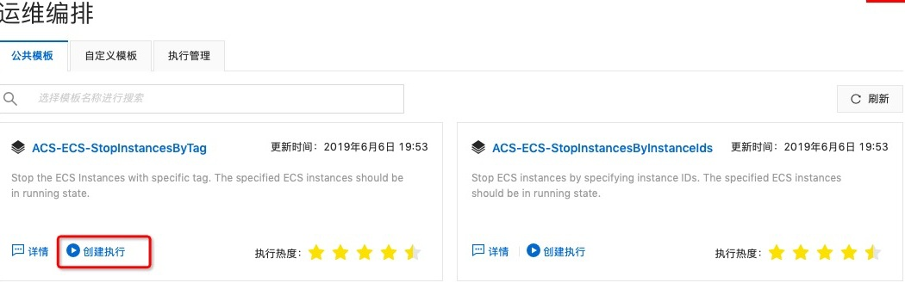

3. 单击 **下一步：设置参数** 。

   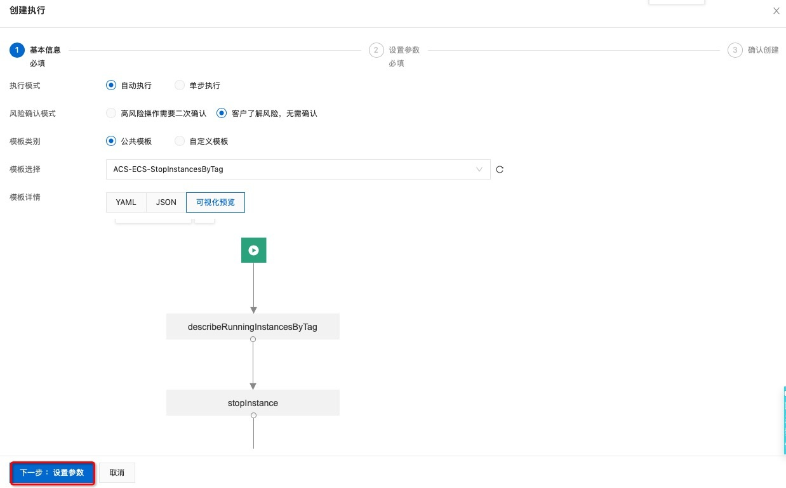

4. 输入该模版所需参数。为确保创建执行成功，请按如下操作确认OOS将使用的RAM角色的授权策略。请单击 **查看授权策略** ，然后登录**RAM控制台**，先确认OOS将使用的RAM角色已存在，再确认此RAM角色已具备模版执行所需的授权策略（即该角色已被授权策略的权限不低于 **查看授权策略** 的结果）。若OOS将使用的RAM角色仍未创建，或者此角色已创建但还没有模版执行所需授权策略。请单击 **自动授权策略**完成策略的授权。您也可单击 **前往RAM手动授权策略** 并参考 **最佳实践 为OOS服务设置RAM权限**章节通过手动设置完成策略授权。

   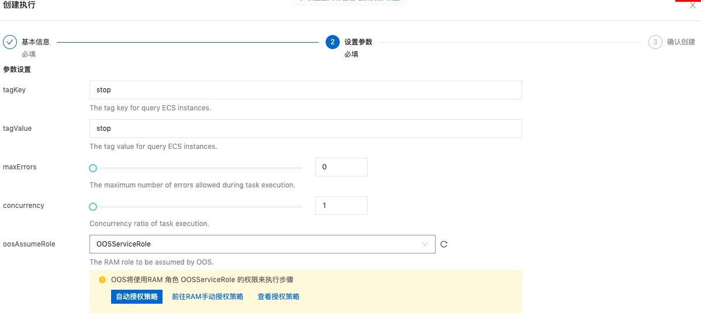

5. 单击 **下一步：确认创建** 。

6. 单击 **创建执行** 。

   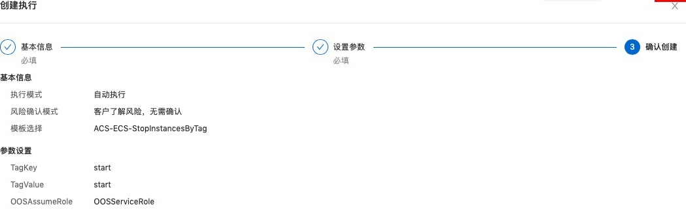

7. 您在执行管理栏中选择刚创建的执行，单击 **详情** ，查看执行状态。

   

<a id="section-4-3"></a>

## 4.3. 单步执行

使用运维编排（OOS）可对平台提供的公共模版或您自定义的模版进行执行创建。如果您想手动执行模版中的单个任务，可以创建执行时选择单步执行模式，下面介绍如何在控制台下进行单步调试。

1. 登录**运维编排管理控制台**。

2. 单击 **公共模版** ，选择您要执行的公共模版，单击 **创建执行** 。

   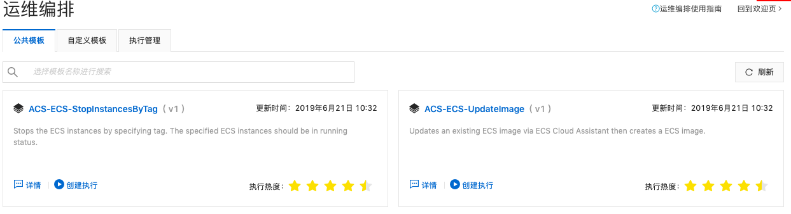

3. 单击 **单步执行。**

   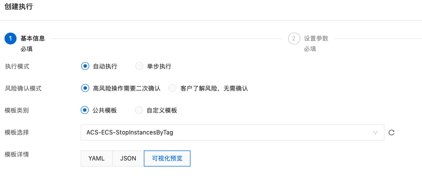

4. 单击 **下一步：设置参数** 。

   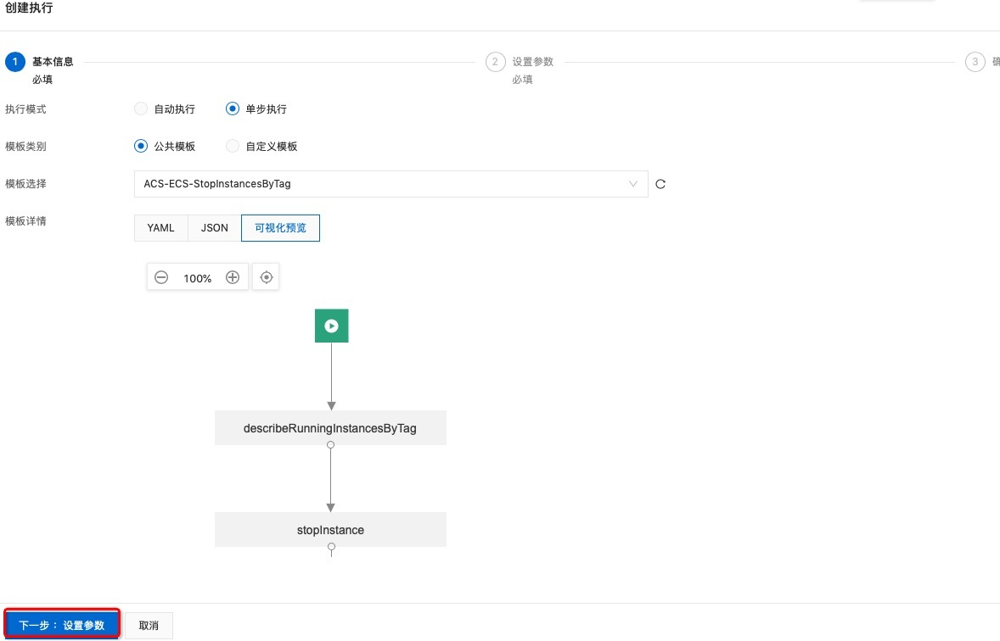

5. 输入该模版所需参数。为确保创建执行成功，请按如下操作确认OOS将使用的RAM角色的授权策略。 请单击 **查看授权策略** ，然后登录**RAM控制台**，先确认OOS将使用的RAM角色已存在，再确认此RAM角色已具备模版执行所需的授权策略（即该角色已被授权策略的权限不低于 **查看授权策略** 的结果）。若OOS将使用的RAM角色仍未创建，或者此角色已创建但还没有模版执行所需授权策略。请单击 **自动授权策略**完成策略的授权。您也可单击 **前往RAM手动授权策略** 并参考 **最佳实践 为OOS服务设置RAM权限**章节通过手动设置完成策略授权。

   

6. 单击 **下一步：确认创建** 。

7. 单击 **创建执行** 。

   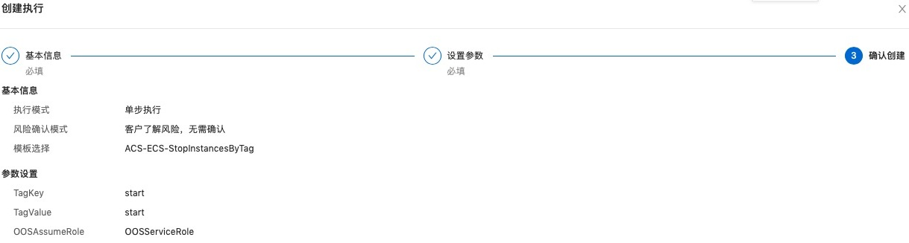

8. 您可在执行管理栏中找到刚创建的执行，单击 **详情** 进行查看。

   

9. 单击 **设置下一步** 。

   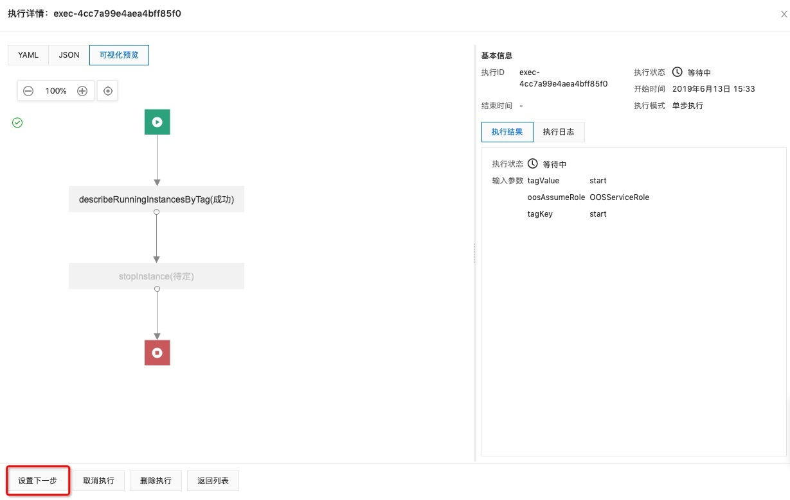

0. 单击 **确认。**

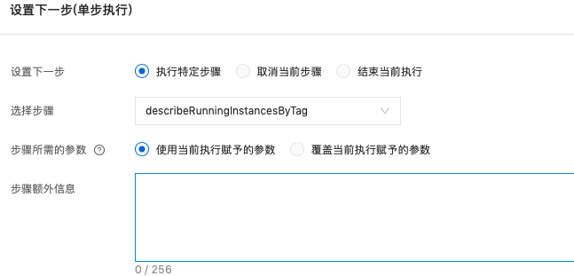

1. 单击 **执行日志** 。查看在调试任务执行情况。

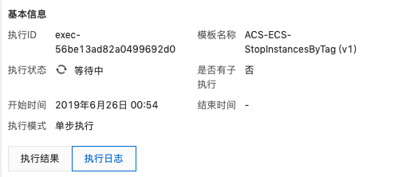

<a id="section-4-4"></a>

## 4.4. 查看执行详情

在使用运维编排（OOS）过程中，您随时可通过查看执行详情了解已存在执行的相关信息。

1. 登录**运维编排管理控制台**。

2. 单击 **执行管理** 。

3. 在执行列表中选择要查看的执行，单击 **详情** 。

   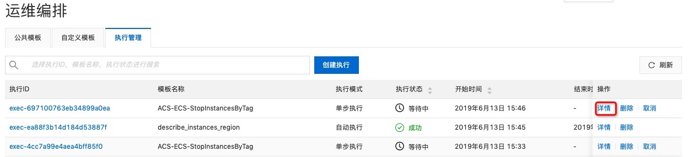

4. 您可在执行详情页面查看到执行如下相关信息。

   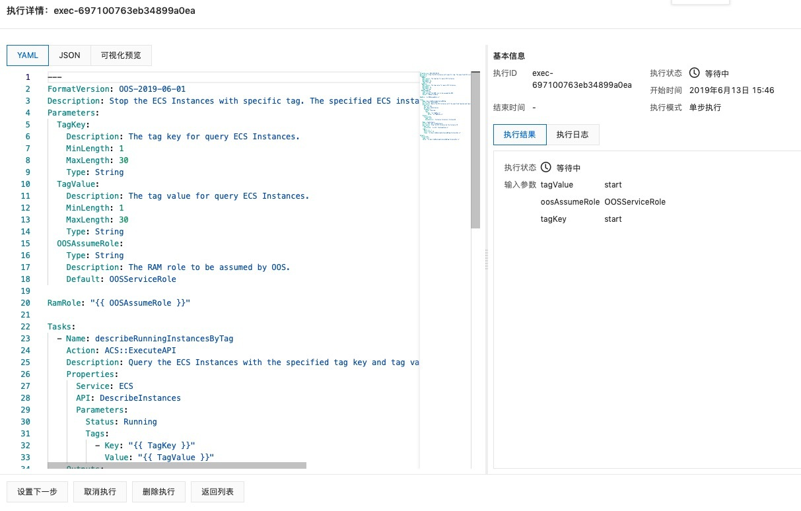

5. 单击 **可视化预览** ，可查看当前各任务执行状态。

   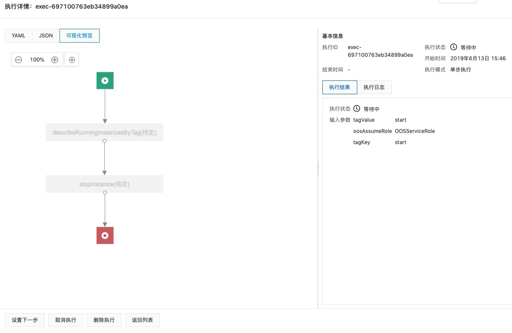

<a id="section-4-5"></a>

## 4.5. 取消执行

在使用运维编排（OOS）过程中，您可对执行进行取消操作。

1. 登录**运维编排管理控制台**。

2. 查看某个执行的详情。

3. 单击 **取消执行** 。

   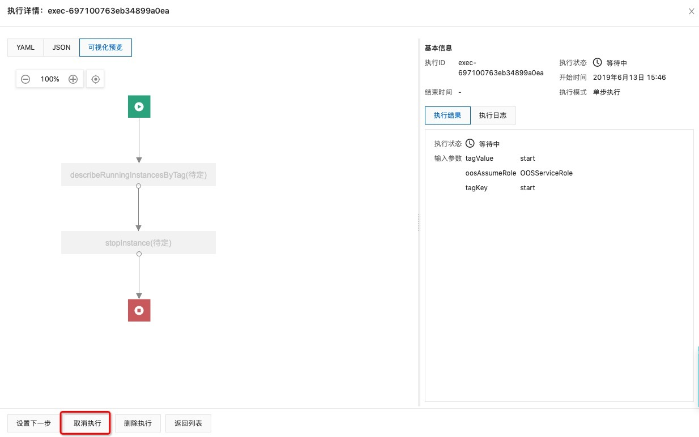

4. 单击 **确定** 取消执行。

   

<a id="section-4-6"></a>

## 4.6. 删除执行

在使用运维编排（OOS）过程中，您可对最终状态的执行进行删除操作；如待删除的执行处于非最终态（如等待中或运行中等），您取消该类执行后则可对其删除。

1. 登录**运维编排管理控制台**。

2. 单击 **执行管理** 。

3. 在执行列表中选择可删除的执行， **单击删除** 。

   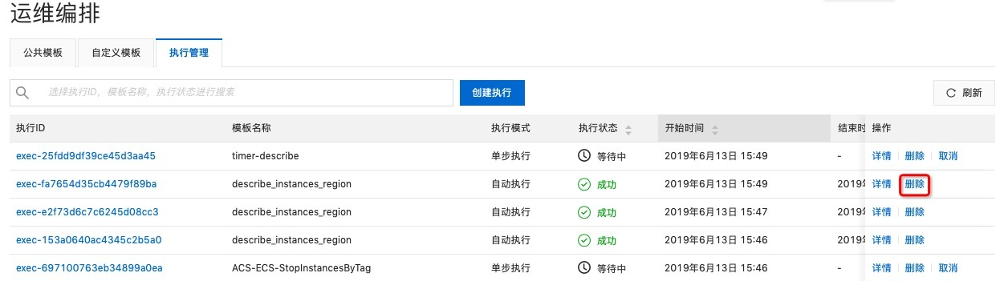

4. 单击 **确定** 删除执行。

   

<a id="section-4-7"></a>

## 4.7. 查看执行日志

您可以通过日志来了解执行的过程，且日志能够很好的帮助您定位和解决问题。

**查询日志方式**

**控制台查询**

1. 登录**运维编排管理控制台**。

2. 在 **执行管理** 页中，找到要查询的执行ID，并单击 **详情** 。

3. 单击 **执行日志** 。

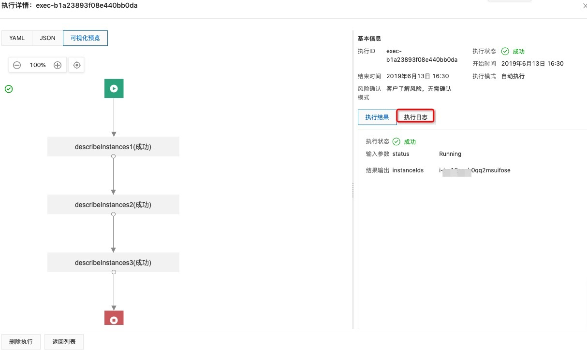

<a id="section-4-8"></a>

## 4.8. 状态转换图

**状态转换图**

一个执行创建的初始状态为Started，直到最终状态可能进行多种状态转换，以下为状态转换图。

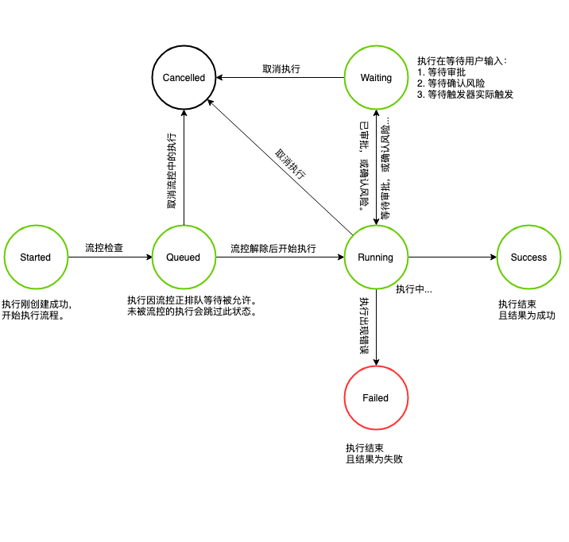

**状态说明**

| Status | 状态 | 说明 |
| --- | --- | --- |
| Started | 已启动 | 表示一个Execution被启动了。当用户创建执行后，Execution立即进入的状态。 |
| Queued | 排队中 | 表示一个Execution因流控正排队等待被允许。大部分情况下，您启动的Execution会跳过此状态直接进入到Running状态。 |
| Running | 执行中 | 表示一个Execution正在执行。 |
| Success | 成功 | 表示一个Execution执行结束且结果为成功。 |
| Failed | 失败 | 表示一个Execution执行结束且结果为失败。 |
| Cancelled | 已取消 | 表示一个Execution由于被取消而结束执行。 |
| Waiting | 等待中 | 表示一个Execution在等待外界的输入。 <strong>有Trigger时：当Execution</strong>有一个Trigger Action时，等待Trigger发生。如时间Trigger，则在目标时刻到来前处于此状态。有Approve时：当Execution有一个Approve&gt;有Approve时：当Execution有一个Approve Action时，等待对该执行有审批权限的用户来批准。 |


**说明** 最终状态 表示Success、Failed、Cancelled这类的状态，此类状态下Execution即已结束，不再进行任何后续执行。
