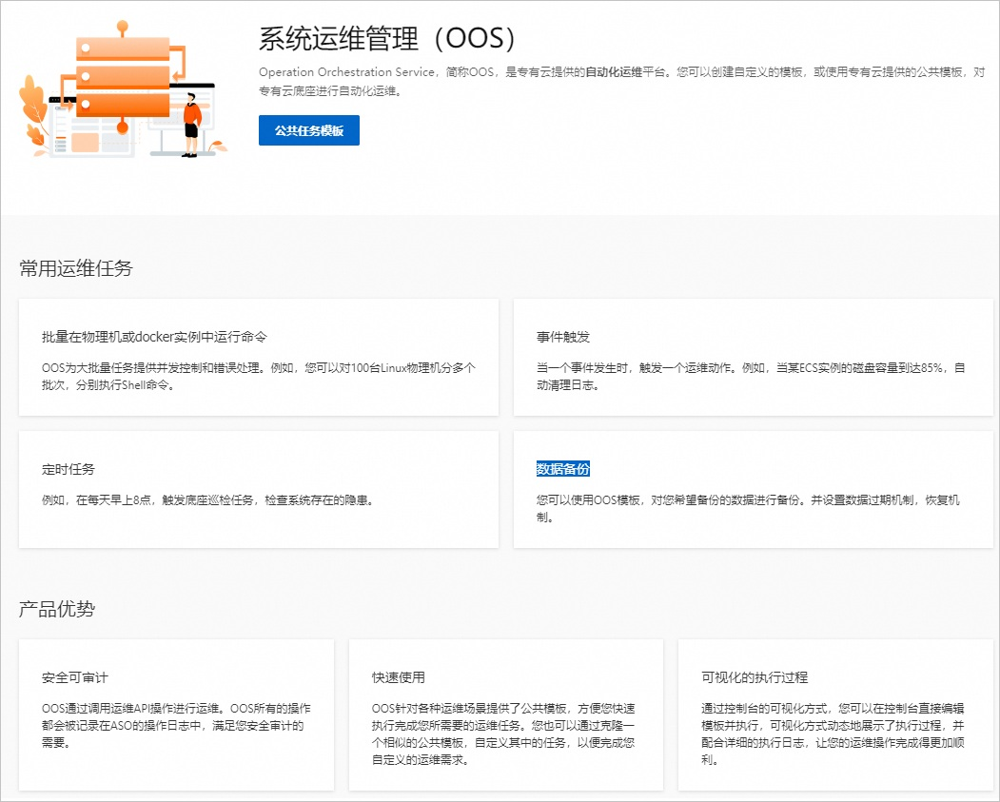
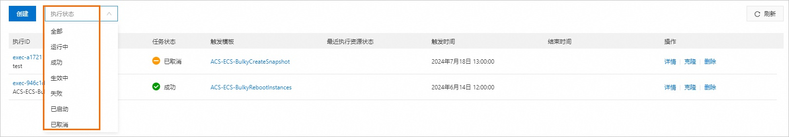
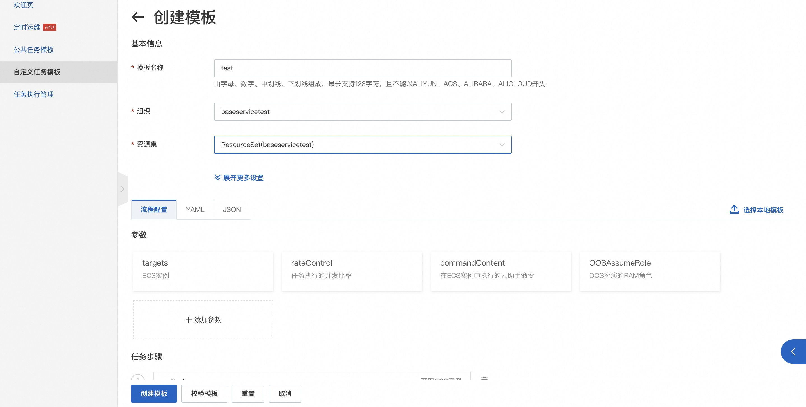
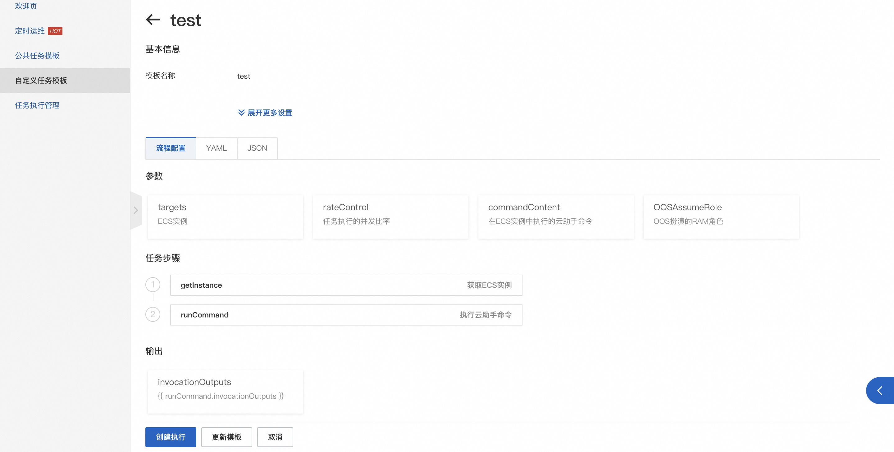
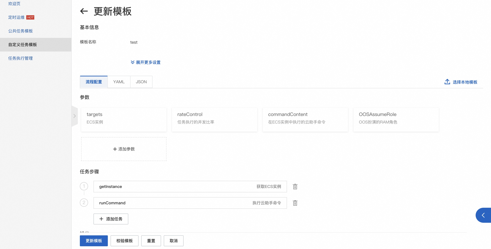
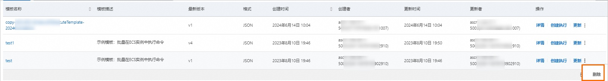
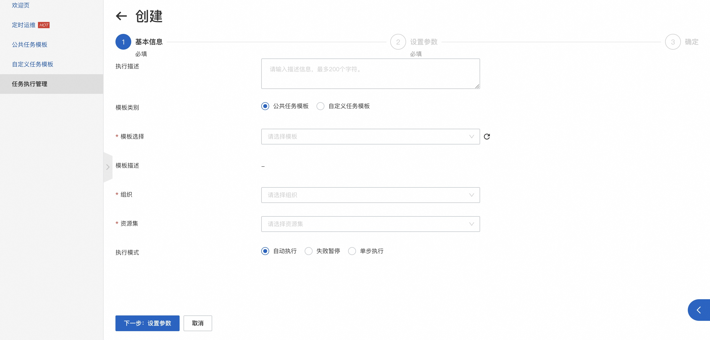
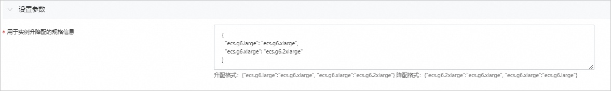
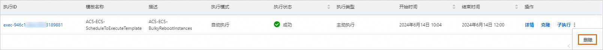
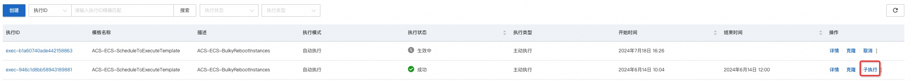

阿里云  
专有云  
运维编排  
用户指南  
产品版本：V3.18.6  
文档版本：20250627

**目录**

- [1.登录运维编排OOS控制台](#section-1)
- [2.欢迎页](#section-2)
- [3.定时运维](#section-3)
- [4.公共任务模板](#section-4)
- [5.自定义任务模板](#section-5)
    - [5.1. 模板概述](#section-5-1)
    - [5.2. 模版语法](#section-5-2)
        - [5.2.1. 模板结构](#section-5-2-1)
        - [5.2.2. 概览](#section-5-2-2)
        - [5.2.3. 任务（Task）](#section-5-2-3)
        - [5.2.4. 模板输出（Output）](#section-5-2-4)
        - [5.2.5. 内置函数（Builtin-Functions）](#section-5-2-5)
        - [5.2.6. 任务循环](#section-5-2-6)
    - [5.3. 创建模板](#section-5-3)
    - [5.4. 创建执行](#section-5-4)
    - [5.5. 查询模板](#section-5-5)
    - [5.6. 更新模板](#section-5-6)
    - [5.7. 删除模板](#section-5-7)
- [6.任务执行管理](#section-6)

<a id="section-1"></a>

# 1.登录运维编排OOS控制台

本章节介绍如何登录运维编排OOS控制台。

**前提条件**

- 登录Apsara Uni-manager运营控制台前，确认您已从部署人员处获取Apsara Uni-manager运营控制台的服务域名地址。

- 推荐使用Chrome浏览器。

**操作步骤**

1. 在浏览器地址栏中，输入Apsara Uni-manager运营控制台的服务域名地址，按回车键。

2. 输入正确的用户名及密码。

   > **说明**
   >
   > - 请向运营管理员获取登录控制台的用户名和密码。
   >
   > - 首次登录Apsara Uni-manager运营控制台时，需要修改登录用户名的密码，请按照提示完成密码修改。为提高安全性，密码长度必须为10~32位，且包含英文字母大小写、阿拉伯数字和特殊符号（感叹号（!）、at（@）、井号（#）、美元符号（$）、百分号（%）等）。

3. 单击**账号登录**。

4. 如果账号已激活MFA多因素认证，请根据以下两种情况进行操作：

   - 管理员强制开启MFA后的首次登录：

     <ol type="a">

     <li>

     在绑定虚拟MFA设备页面中，按页面提示步骤绑定MFA设备。

     </li>

     <li>

     按照步骤2重新输入账号和密码，单击**登录**。

     </li>

     </ol>

     <ol type="i" start="100">

     <li>

     输入6位MFA码后单击**认证**。

     </li>

     </ol>

   - 您已开启并绑定MFA：

     输入6位MFA码后单击**认证**。

     > 绑定并开启MFA的操作请参见<strong>《Apsara Uni-manager运营控制台用户指南》</strong>中的
     >
     > **说明**
     >
     > 章节<strong>《绑定并开启虚拟MFA设备》</strong>。

5. 在页面顶部的导航栏，选择**产品 > 迁移与运维管理 > 运维编排 OOS**。

<a id="section-2"></a>

# 2.欢迎页

登录运维编排OOS控制台后，系统默认进入**欢迎页**。



该页面展示了如下关键信息：

- 单击**公共任务模板**，可跳转至公共模板栏。

- 在**常用运维任务**区域，您可以看到以下日常运维任务及详细说明：

  - 批量在物理机或docker实例中运行命令

  - 事件触发

  - 定时任务

  - 数据备份

- 在**产品优势**区域，您可以看到以下产品优势及详细说明：

  - 安全可审计

  - 快速使用

  - 可视化执行过程

<a id="section-3"></a>

# 3.定时运维

本文介绍定时运维任务的相关操作，包括创建执行、任务筛选、查看详情、克隆执行、删除执行和取消执行。

**操作步骤**

登录运维编排OOS控制台后，在左侧导航栏单击**定时运维**，您可以进行以下操作。

**创建执行**

1. 单击**创建**，进入**创建定时运维任务**页面。

   

2. 配置定时运维任务信息。

   <ol type="i">

   <li>

   定时设置。定时类型包括：

   - 立即执行。

   - 仅在指定时间执行一次。

   - 周期性重复执行。

   </li>

   <li>

   选择模板。

   在搜索框中使用模板名称过滤出目标模板，选中即可。

   </li>

   <li>

   设置参数。

   选择的模板不同，此处需要填写的参数也存在差异，请根据界面实际展示的参数情况进行填写。

   </li>

   <li>

   高级选项。

   - **描述**：您可以对创建的定时运维任务进行详细描述，以便后续识别。

   - **保存模板**：按需选择是否需要将该任务保存为模板。

   </li>

   </ol>

3. 单击**立即执行**。

**任务筛选**

在**执行状态**下拉框中，可以根据不同的任务状态筛选出目标任务。



**查看详情**

找到目标执行任务，单击**操作**列下的**详情**，可查看定时执行的详细信息。


**克隆执行**

1. 找到目标执行任务，单击**操作**列下的**克隆**。

   

2. 参考操作步骤中的配置任务信息，配置相关参数。

3. 单击**立即执行**。

**删除执行**

1. 找到目标执行任务，单击**操作**列下的**删除**。

   

2. 在**删除执行**对话框中，单击**确**定。

   

**取消执行**

1. 针对**生效中**的任务，如果不需要，可以单击**操作**列下的**取消**。

   

2. 在**取消执行**对话框中，单击**确**定。

   

   取消后，在任务列表中，可以看到任务状态为**已取消**。

   

<a id="section-4"></a>

# 4.公共任务模板

我们提供了多种场景的模板供您选择，如下为当前支持的场景及模板。

**模板分类**

**名称**

**描述（用途）**

修改按量付费实例的规格

ACS-ECS-ModifyInstanceSpec

批量停止ECS实例

ACS-ECS-BulkyStopInstances

批量扩容磁盘

ACS-ECS-BulkyResizeDisk

实例管理

批量重启ECS实例

ACS-ECS-BulkyRebootInstances

批量删除ECS按量付费实例

ACS-ECS-BulkyDeleteInstances

批量启动ECS实例

ACS-ECS-BulkyStartInstances

执行命令

批量在ECS实例上运行命令

ACS-ECS-BulkyRunCommand

删除ECS镜像

ACS-ECS-DeleteImage

镜像管理

创建ECS镜像

ACS-ECS-CreateImage

数据备份

批量创建快照

ACS-ECS-BulkyCreateSnapshot

ACS-RDS-

释放RDS实例的外网地址

ReleaseInstancePublicConnection

开启RDS实例的SQL洞察（SQL审

安全审计

ACS-RDS-BulkyModifySQLCollectorPolicy

计）功能

从RDS实例IP白名单分组里删除

ACS-RDS-BulkyModifySecurityIpsByInstanceIPArray

0.0.0.0/0

定时停止ECS实例

ACS-ECS-ScheduleToStopInstances

定时重启ECS实例

ACS-ECS-ScheduleToRebootInstances ACS-ECS-

定时开启和停止ECS实例

ScheduleToStartAndStopInstances

定时运行

定时启动ECS实例

ACS-ECS-ScheduleToStartInstances

ACS-ECS-

定时停止和开启ECS实例

ScheduleToStopAndStartInstances

定时执行指定模板

ACS-ECS-ScheduleToExecuteTemplate

ACS-ESS-

创建一个新ECS镜像并更新伸缩配置

CreateImageAndUpdateScalingConfigurati

中的镜像ID

on

弹性伸缩管理

通过运行命令更新一个已存在的ECS

ACS-ESS-

镜像后创建一个新ECS镜像并更新伸

UpdateScalingConfigurationImage

缩配置中的镜像ID

跨地域复制

批量克隆ECS实例

ACS-ECS-BulkyCloneInstances

其他

更新镜像

ACS-ECS-UpdateImage

您可以在选择目标模板后，单击**创建执行**以执行此公共模板。操作详情请查看**任务执行管理**中的操作步骤。


<a id="section-5"></a>

# 5.自定义任务模板

<a id="section-5-1"></a>

## 5.1. 模板概述

OOS使用模板来定义所需要编排的运维操作，模板内容支持YAML和JSON两种格式，模板分为公共模板和自定义模板两种类型。为了方便您快速使用OOS，OOS提供了公共模板供您直接使用和参考，请在使用之前仔细审查模板所要执行的操作，并优先在测试环境观察使用的效果。您也可以编写自定义模板来编写您所需要的运维操作。

<a id="section-5-2"></a>

## 5.2. 模版语法

<a id="section-5-2-1"></a>

### 5.2.1. 模板结构

模板是一段JSON或YAML格式的文本，使用UTF-8编码。模板定义了版本、参数、任务、顺序、输入和输出等，您可以通过执行模板来定义需要的运维操作。

**语法**

- YAML格式

```yaml
---
FormatVersion: OOS-2019-06-01 # 必填，版本，OOS-2019-06-01
Description: "" # 可选，描述，可⽤于说明模板的⽤途，⽬的等。
Parameters: # 可选，参数，允许您在执⾏时再提供具体的参数值。具体请参考参数⽂档。
RamRole: # 可选，⾓⾊，执⾏时OOS会扮演此⾓⾊调⽤各云产品的OpenAPI，默认为：OOSServiceRole。
Tasks: # 必填，任务，模板最重要的组成部分，定义了具体的动作细节。每⼀个任务都是⼀个动作的具象化使⽤。多
个任务默认按照从上到下的顺序依次串⾏执⾏。如果某个任务是⼀个循环（Loop）任务，则在该任务内部可能出现并
发的⼦执⾏。具体请参考任务⽂档。
Outputs: # 可选，模板输出，⽤于输出⼀些资源属性等有⽤信息。可以通过 API 或控制台获取输出的内容。具体
请参考模板输出⽂档。
  
```

- JSON格式（请参考YAML注释说明）

```json
{
  "FormatVersion": "OOS-2019-06-01",
  "Description": "",
  "Parameters": {},
  "RamRole": "",
  "Tasks": [],
  "Outputs": {}
}
```

<a id="section-5-2-2"></a>

### 5.2.2. 概览

在创建和执行模板时，使用参数（Parameters）可提高模板灵活性和可复用性。

**定义参数**

根据模板的需要，您可以在模板（Template）中的Parameters字段内定义参数，包括参数名、参数描述和参数类型、默认值以及校验规则等。

**参数语法**

YAML

JSON

```text
Parameters:
  parameter-name-1: # 参数名，有效字符为[a-zA-Z0-9\_-]，不允许有空格。建议采⽤⾸字⺟⼩写的骆驼式
⻛格，如instanceId。
    Type: String # 可选，类型，⽀持List, Number, String, Boolean, Json。默认: String
    Description: description # 可选，描述，描述参数的⽤途
    AssociationProperty: DateTime # 可选，此处可以指定某些类型参数的属性，效果是会更便于您创建执
⾏时设置参数。⼀旦对参数指定了某属性， 当创建执⾏设置参数时，控制台中该参数输入框将不再是⼀个简单的参数
框，⽽会变为更易于输入参数的展示形式，比如变为⼀个下拉框，下拉框中包含参数的可选项，或者变为可选择时间的tab或者代码编辑框等。假如该参数⽬的是想获得⼀个InstanceType，则可以指定属性为
ALIYUN::ECS::Instance::InstanceType，那么设置参数parameter-name-1时，输入该参数的位置则会展示
⼀个下拉框，下拉框包含所有可选择的InstanceType；如果该参数⽬的是想获得⼏⾏的shell，那么⼀个⼩⼩的参数
输入框可能不太便于您输入shell，此时则可以指定属性为Code，当设置参数时，该参数的位置将是⼀个代码编辑框
。当前⽀持的属性包括ALIYUN::ECS::Instance::InstanceType、
ALIYUN::ECS::SecurityGroup::SecurityGroupId、ALIYUN::VPC::VSwitch::VSwitchId、ALIYUN::EC
S::Image::ImageId、Targets、RateControl、Code、DateTime、Cron、TimeZone ；当然如果您指定属性
同时想细粒度定义属性也是可以的，通过如下AssociationPropertyMetadata关键字既可实现，比如属性指定为
DateTime，那么您可通过在AssociationPropertyMetadata关键字中定义时间⽇期格式，来确定您最终设置该参
数的展示形式。
    AssociationPropertyMetadata:
      Format: 'YYYY-MM-DDThh:mm:ssZ'   # 对AssociationProperty展示属性的形式进⾏具体定义，定
义该关键字后，参数parameter-name-1的展示形式将是经筛选后符合AssociationPropertyMetadata定义的形
式，比如经Format: 'YYYY-MM-DDThh:mm:ssZ'进⼀步定义后，时间tab将是可选⽇期+时间的形式进⾏展示；若本
关键字值为Format: hh:mm:ssZ，那么时间tab则将只是可选时间的形式展示。
    Default: default-value # 可选，默认值，参数的默认值
    AllowedValues: # 可选，包含参数允许值的列表。
      - value1
      - value2
    AllowedPattern: regular-expression # 可选，参数的值必须匹配的正则表达式，适⽤于String
    MinLength: 1 # 可选，参数值的最⼩⻓度（即参数值⻓度 = MinLength），适⽤于String
    MaxLength: 10 # 可选，参数值的最⼤⻓度（即参数值⻓度 = MaxLength），适⽤于String
```

**引用参数**

在Tasks字段的属性内您可以引用上述定义的参数。引用的语法如下：

```text
"some text {{ parameter_name }} some text {{parameter_name_2}} ..."                
```

举例如下：

注意，因为YAML的语法特点，引用参数时，需要在英文半角的双引内进行。

```text
"{{ parameter-name }}" # 直接引⽤
"this is the {{ parameter-name }}" # 在⼀个固定的字符串中引⽤
"hello {{ parameter-last-name }} {{ parameter-first-name }}" # 在⼀个固定的字符串中引⽤多个
参数
```

**伪参数**

为了方便获取执行中的执行环境等信息，OOS提供了伪参数，这些参数您无需定义即可直接使用。目前支持的伪参数如下，如您需要更多的伪参数，请开工单联系我们并提供您的使用场景，我们将尽快反馈和支持。

| 名称 | 类型 | 用途 | 示例 |
| --- | --- | --- | --- |
| ACS::TemplateName | String | 执行使用的模板名称 | test |
| ACS::ExecutionId | String | 执行ID | exec-2123445567 |
| ACS::RegionId | String | 执行所在地域 | cn-hangzhou |
| ACS::AccountId | String | 执行所在的账号 | 1234567890\*\*\*\* |
| ACS::TaskLoopItem | String | 代表Loop的items中被迭代的元素 | i-bpzxcvb1234\*\*\*\* |
| ACS::OOSUtilVersion | String | OOS代理版本 | 1.01 |
| ACS::CurrentDate | String | 当前UTC日期 | 2020-12-29T |
| ACS::CurrentUTCTime | String | 当前UTC时间 | 2020-12-29T10:00:30Z |
| ACS::ExecuteUser | String | 触发执行的RAM用户名称 | zhangsan |
| ACS::ExecuteUserType | String | 触发执行的RAM类型 | RamRole或RamUser或AlibabaCloudAccount |

<a id="section-5-2-3"></a>

### 5.2.3. 任务（Task）

任务（Task）是模板中最重要的组成部分，它定义了每一个具体的运维操作，每一个任务的类型叫做动作。OOS提供了非常丰富的动作供您使用，这些动作包括了一些常见的云产品动作，如ECS，RDS等。如您需要其他云产品常见动作但是OOS暂未提供，您可以联系我们并提供使用场景，另外还可以使用原子动作自行编写，以便您能够立即进行系统运维管理和执行。

**通用属性**

任务在模板中的语法如下：

- YAML格式

```text
Tasks:
  - Name: TaskName1 # 必填，任务名称，有效字符为[a-zA-Z0-9_-]，即英⽂字⺟数字下划线中划线，⻓度限
制200个字符。建议使⽤驼峰式命名，如StartInstance。
    When: Condition1 # 选填，通过对某条件判断，确定是否执⾏该任务，当条件结果为true时执⾏该任务；当
条件结果为false时，忽略该任务并向下执⾏。
    Action: TaskType # 必填，任务类型（也叫动作），请参考动作相关的⽂档。
    Description: description # 可选，描述，描述当前任务的⽤途。
    Properties: # 根据所使⽤的动作不同，具体的属性列表不同，请参考动作相关的⽂档。
      Property1: Value1 # 动作所依赖的属性和值。
      Property2: Value2 # 当Property为Parameters时，则此处的传入参数名称定义参考原OpenApi。若
原OpenApi所需参数中不含有“.”,则此处命名则为原参数名；；若原OpenApi所需参数中含有“.”且不是Tag相关的
，则参数命名时去除“.”，比如ModifyInstanceSpec Api 中Temporary.InternetMaxBandwidthOut参数，则
在此处的参数命名为TemporaryInternetMaxBandwidthOut；若原OpenApi所需参数中含有“.”是Tag相关的，则
参数命名时，参数命名为Tags，形如 "Tags": [{"Key": tagKey1,"Value": tagValue1 }]。
    Outputs:  # 当前任务的输出参数，可以⽤作后续任务的输入或模板的输出。
      outputParameterName1:
        Type: # 可选，表示对输出参数类型的声明，⽀持的基本类型有String, Number, Boolean, List，J
son，默认String。注意：outputParameterName1的输出值会按照该处的声明类型Type对ValueSelector筛选
结果进⾏包装来⽣成。当Type为List时，ValueSelector的筛选结果会被放到 [] 中输出，比如筛选结果为"i-12345zxcv"，那么最终输出的值则会是["i-12345zxcv"]；当Type为非List类型时，ValueSelector的筛选结果
会直接作为输出值。比如Type为String，筛选结果为"i-12345zxcv"，那么最终输出值就是"i-12345zxcv"。
        ValueSelector: "jq selector" # 如Task是⼀个OpenAPI调⽤时，把OpenAPI的调⽤结果当做⼀个
JSON输入，应⽤jq从该JSON中截取所需要的值，请参考云产品动作和公共模板等具体例⼦。
    # 流程控制参数
    OnError: "ACS::END/ACS::NEXT/other-task-name" # 可选，定义了当前任务执⾏出现错误时的执⾏流
程，默认：END，即终⽌整个执⾏。
    OnSuccess: "ACS::NEXT/other-task-name/ACS::END" # 可选，定义了当前任务执⾏成功后的执⾏流程
，默认：NEXT，即下⼀个任务。
```

- JSON格式（请参考YAML注释说明）

```json
{
  "Tasks": [
    {
      "Name": "TaskName1",
      "Action": "TaskType",
      "When": "Condition",
      "Description": "description",
      "Properties": {
        "Property1": "Value1",
        "Property2": "Value2"
      },
      "Outputs": {
        "outputParameterName1": {
          "Type": null,
          "ValueSelector": "jq selector"
        }
      },
      "OnError": "ACS::END/ACS::NEXT/other-task-name",
      "OnSuccess": "ACS::NEXT/other-task-name/ACS::END",
    }
  ]
}
```

<a id="section-5-2-4"></a>

### 5.2.4. 模板输出（Output）

除了模板中的每个任务可以有输出，模板也是可以有输出的，其可用来呈现模板执行成功后得到的重要数据。另外若该模板作为子模板被嵌套时，父模板中嵌套该子模板的任务可以通过定义其任务输出参数来对子模板的输出进行引用，具体是通过ValueSelector筛选子模板的输出参数名，以此获得子模板的输出值，而此值则会作为任务输出参数的值，这样父模板的其他任务就可以通过引用嵌套任务的输出参数来达到对子模板输出的引用。

例如，A模板的任务有创建ECS实例的运维操作，且A模板的输出是被成功创建的ECS实例ID，那么查看A模板执行结果时则很方便就能看到模板输出的ECS实例ID，假设A模板被B模板作为子模板嵌套使用了，且B模板任务一是对A模板的嵌套任务，B模板任务二是对被嵌套A模板输出的所有ECS实例ID进行重启，那么此时A模板的输出首先会被B模板的任务一的输出参数筛选得到，然后任务二再引用任务一的输出的参数从而获得ECS实例ID。

**语法**

模板输出的值可以是模板内所有可被引用的参数的值。任务的输出参数、伪参数以及模板Parameters部分定义的参数，它们的值均可被模板输出参数引用并作为模板的输出值。

单个输出：

- YAML语法

```text
Outputs:
  OutputParameterName: # 必填，参数名，有效字符为[a-zA-Z0-9_-]，即英⽂半⾓字⺟数字下划线中划线，
⻓度限制200个字符。
    Type: String # 可选，YAML, JSON格式⽀持的基本类型String, Number, Boolean, 
List(Array)，Object，默认String。
    Value: "{{ TaskName.OutputParameterName }}" # 必填，参数值，通常为某个任务的输出。
```

- JSON格式（请参考YAML注释说明）

```json
{
  "Outputs": {
    "OutputParameterName": {
      "Type": "String",
      "Value": "{{ TaskName.OutputParameterName }}"
    }
  }
}
```

多个输出：

- YAML语法

```text
Outputs:
  OutputParameterName1: 
    Type: String # 可选，YAML, JSON格式⽀持的基本类型String, Number, Boolean, 
List(Array)，Object，默认String。
    Value: "{{ TaskName1.OutputParameterName }}" # 必填，参数值，通常为某个任务的输出。
  OutputParameterName2: # 必填，参数名，有效字符为[a-zA-Z0-9_-]，即英⽂半⾓字⺟数字下划线中划线，
⻓度限制200个字符。
    Type: String # 可选，YAML, JSON格式⽀持的基本类型String, Number, Boolean, 
List(Array)，Object，默认String。
    Value: "{{ TaskName2.OutputParameterName }}" # 必填，参数值，通常为某个任务的输出。
  OutputParameterName3: # 必填，参数名，有效字符为[a-zA-Z0-9_-]，即英⽂半⾓字⺟数字下划线中划线，
⻓度限制200个字符。
    Type: String # 可选，YAML, JSON格式⽀持的基本类型String, Number, Boolean, 
List(Array)，Object，默认String。
    Value: "{{ TaskName3.OutputParameterName }}" # 必填，参数值，通常为某个任务的输出。
```

- JSON格式（请参考YAML注释说明）

```json
{
  "Outputs": {
    "OutputParameterName1": {
      "Type": "String",
      "Value": "{{ TaskName1.OutputParameterName }}"
    }
    "OutputParameterName2": {
      "Type": "String",
      "Value": "{{ TaskName2.OutputParameterName }}"
    }
    "OutputParameterName3": {
      "Type": "String",
      "Value": "{{ TaskName3.OutputParameterName }}"
    }
  }
}
```

<a id="section-5-2-5"></a>

### 5.2.5. 内置函数（Builtin-Functions）

OOS提供了多个内置函数，使您更加方便的处理模板的参数及输出。

**函数说明**

- Fn::Base64Encode：返回输入字符串的Base64编码结果。

- Fn::Base64Decode：返回输入字符串的Base64解码结果。

- Fn::MergeMapToList：将多个Map合并成一个以Map为元素的列表。

- Fn::MergeMap：将列表中多个Map合并成一个Map。

- Fn::Join：将一组值连接起来，用特定分隔符隔开。

- Fn::Select：数据元容器通过查询索引返回的单个数据元。

- Fn::Split：通过指定分隔符对字符串进行切片，并返回所有切片组成的列表。

- Fn::Replace：将字符串中指定子字符串用新字符串替换。

- Fn::Min：返回列表中最小元素。

- Fn::Max：返回列表中最大元素。

- Fn::First：返回列表中第一个元素。

- Fn::Last：返回列表中最后一个元素。

- Fn::ListJoin：将多个参数转换成列表。

- Fn::Equals：比较两个值是否相等。

- Fn::If：根据判断条件真假返回不同的值。

- Fn::Not：对值取否操作。

- Fn::AddHour：对一个UTC时间向后推移N小时。

- Fn::FormatUTCTime：按不同单位精度进行格式化UTC时间。

- Fn::Eval：执行字符串中的单行表达式，并返回执行结果。

- Fn::CalculateTimeByOpsWindow：当指定一个时间窗口后，该函数会根据函数的执行时间点，产生下一个在窗口区间的时间点。

- Fn::And：逻辑与。

- Fn::Or： 逻辑或。

- Fn::Intersection：取多个数组的交集。

- Fn::Union：取多个数组的并集。

- Fn::Difference：取多个数组的并集与交集的差集。

- Fn::Jq：对JSON对象进行筛选，获取目标属性值。

- Fn::MapJoin：将两个List组合成一个Map，组合时，会把第一个List内的所有值，作为Map中每个键值对的键，会把第二个List内的值，作为Map中每个键值对。

- Fn::IsIpInCIDR：判断指定的IP是否在指定的CIDR网段内。

- Fn::Sub：将输入字符串中的变量替换为指定的值。

- Fn::DurationBetween：返回两个时间点之间的时长。

- Fn::Escape：转义字符串。

- Fn::ConvertMapToList：转化JSON对象为Key、Value格式的列表。

**使用函数**

内建函数的使用主要由内置函数名和待处理参数组成。调用函数的声明表达式即表示函数处理参数后返回的结果，且表达式作为函数返回的结果可以像其他参数一样被引用。

**Fn::Base64Encode**

返回输入字符串的Base64编码结果。

**声明**

```json
{"Fn::Base64Encode": "StringToBeBase64"}        
```

**参数**

StringToBeBase64：要进行Base64编码的String。

**返回值**

Base64方式表示的原始字符串。

**示例**

```json
{"Fn::Base64Encode": "hello"}        
```

**示例返回**

```text
"aGVsbG8="
```

**Fn::Base64Decode**

返回Base64字符串的解码结果。

**声明**

```json
{"Fn::Base64Decode": "Base64ToBeString"}
```

**参数**

Base64ToBeString：Base64编码方式表示的String。

**返回值**

Base64解码后的原始String。

**示例**

```json
{"Fn::Base64Decode": "aGVsbG8="}        
```

**示例返回**

```text
"hello"
```

**Fn::MergeMapToList**

将多个Map合并成一个以Map为元素的列表。

**声明**

```json
{"Fn::MergeMapToList": "aListConatinsDicts"}
```

**参数**

aListConatinsDicts：含有多个映射的List。

**返回值**

一个以Map为元素的List。

**示例1**

```json
{
  "Fn::MergeMapToList": [
    {
      "key_1": [
        "kye_1_item_1",
        "kye_1_item_2"
      ]
    },
    {
      "key_2": [
        "kye_2_item_1",
        "kye_2_item_2"
      ]
    },
    {
      "key_3": [
        "kye_3_item_1",
        "kye_3_item_2"
      ]
    }
  ]
}
```

**示例1返回**

```json
[
  {
    "key_1": "kye_1_item_1",
    "key_2": "kye_2_item_1",
    "key_3": "kye_3_item_1"
  },
  {
    "key_1": "kye_1_item_2",
    "key_2": "kye_2_item_2",
    "key_3": "kye_3_item_2"
  }
]
```

**示例2**

```json
{
  "Fn::MergeMapToList": [
    {
      "key_1": [
        "kye_1_item_1",
        "kye_1_item_2"
      ]
    },
    {
      "key_2": [
        "kye_2_item_1",
        "kye_2_item_2",
        "key_2_item_3"
      ]
    },
    {
      "key_3": [
        "kye_3_item_1",
        "kye_3_item_2"
      ]
    }
  ]
}
```

**示例2返回**

```json
[  
   {
      "key_1": "kye_1_item_1", 
      "key_2": "kye_2_item_1",
      "key_3": "kye_3_item_1"
    },
    {
      "key_1": "kye_1_item_2", 
      "key_2": "kye_2_item_2",
      "key_3": "kye_3_item_2"
    },
    {
      "key_1": "kye_1_item_2", 
      "key_2": "kye_2_item_3",
      "key_3": "kye_3_item_2"
    }
]  
```

**Fn::MergeMap**

将列表中多个Map合并成一个Map。

**声明**

```json
{  "Fn::MergeMap": "aListConatinsDicts"}
```

**参数**aListConatinsDicts：含有多个映射的List。

**返回值**

List中多个Map合并成的一个Map。

**示例**

```json
{
  "Fn::MergeMap": [
    {
      "key_1": "value_1"
    },
    {
      "key_2": "value_2"
    }
  ]
}
```

**示例返回**

```json
{"key_1": "value_1","key_2": "value_2"}
```

**Fn::Join**

将一组值连接起来，用特定分隔符隔开。

**声明**

```json
{"Fn::Join": ["Connector","aListContainsString"]}                
```

**参数**

Connector：作为连接符String。

aListContainsString：包含字符串的List。

**返回值**

List内多个元素连接后的字符串。

**示例**

```json
{
  "Fn::Join": [
    ",",
    [
      "a",
      "b",
      "c"
    ]
  ]
}
```

**示例返回**

```text
"a,b,c"
```

**Fn::Select**

数据元容器通过查询索引返回的单个数据元。

**声明**

```json
{"Fn::Select": ["Index","Container"]}
```

**参数**

Index：被查询Container的索引String或Number。

Container：被查询的List或Map。

**返回值**

查询指定索引返回的结果。

**示例1**

```json
{
  "Fn::Select": [
    "IpAddress",
    {
      "IpAddress": [
        "192.168.1.123",
        "192.168.1.234"
      ]
    }
  ]
}
```

**示例1返回**

```json
["192.168.1.123","192.168.1.234"]
```

**示例2**

```json
{
  "Fn::Select": [
    "1",
    [
      "192.168.1.123",
      "192.168.1.234"
    ]
  ]
}
```

**示例2返回**

```text
"192.168.1.234"
```

**Fn::Split**

通过指定分隔符对字符串进行切片，并返回所有切片组成的列表。

**声明**

```json
{"Fn::Split": ["Separator","StringToSeprate"]}
```

**参数**

Separator：作为分隔符的String。

StringToSeprate：将被按分隔符分成一个List的String。

**返回值**

StringToSeprate按分隔符分成的一个List。

**示例**

```json
{
  "Fn:: Split": [",","a,b,c"]
}
```

**示例返回**

```json
[
  "a",
  "b",
  "c"
]
```

**Fn::Replace**

将字符串中指定子字符串用新字符串替换。

**声明**

```json
{  "Fn::Replace": [{"$varName": "StringToReplaceWith"}, "StringToReplace"]}
```

**参数**

$varName：占位符，以$开始后面连接普通参数名即可，其中$后面参数名命名要求同模板参数名。

StringToReplaceWith：占位符将被替换成的值。

StringToReplace：将被替换的值（含占位符），如"$varName is foo"。

**返回值**

若参数StringToReplaceWith是"baz"，则返回为"baz is foo"。

**示例**

```json
{  "Fn::Replace": [{"$varName": "baz"},    "$varName is foo"  ]}
```

**示例返回**

```text
"baz is foo"
```

**Fn::Min**

返回列表中最小元素。

**声明**

```json
{"Fn::Min": "aList"}
```

**参数**

aList：一个含有元素的List；List中元素类型可以为string,int,datetime,None，各元素必须为同一类型。

**返回值**

忽略值为None的元素，返回List中最小的元素，若集合元素全部为None则返回None。

**示例**

```json
{
  "Fn::Min": ["123","234"]
}
```

**示例返回**

```text
"123"
```

**Fn::Max**

返回列表中最大元素。

**声明**

```json
{"Fn::Max": "aList"}
```

**参数**

aList：一个含有元素的List；List中元素类型可以为string、int、datetime、None，各元素必须为同一类型。

**返回值**

忽略值为None的元素，返回List中最大的元素，若集合元素全部为None则返回None。

**示例**

```json
{
  "Fn::Max": ["123","234"]
}
```

**示例返回**

```text
"234"
```

**Fn::First**

返回列表中第一个元素。

**声明**

```json
{  "Fn::First": "aList"}
```

**参数**

aList：一个含有元素的List；List中元素类型不限。

**返回值**输出为集合中迭代返回的第一个元素；对loop来说，按照Items中迭代返回的Item生成的task execution id进行排序。

**示例**

```json
{
  "Fn::First": ["123","234"]
}
```

**示例返回**

```text
"123"
```

**Fn::Last**

返回列表中最后一个元素。

**声明**

```json
{"Fn::Last": "aList"}
```

**参数**

aList：一个含有元素的List；List中元素类型不限。

**返回值**

输出为集合中迭代返回的最后一个元素；对loop来说，按照Items中迭代返回的Item生成的task execution id进行排序。

**示例**

```json
{
  "Fn::Last": ["123","234"]
}
```

**示例返回**

```text
"234"
```

**Fn::ListJoin**

将多个参数转换成列表。

**声明**

```json
{"Fn::ListJoin": "IterableContainer"}
```

**参数**

IterableContainer是一个可迭代的集合，集合中元素类型不限。

**返回值**

将集合转换成List输出。

**示例**

```json
{"Fn::ListJoin": ["a",2, 3]}
```

**示例返回**

```json
["a",2,3]
```

**Fn::Equals**

比较两个值是否相等。如果两个值相等，则返回true；如果不相等，则返回false。

**声明**

```json
{  "Fn::Equals": ["parameter1", "parameter2"]}
```

**参数**

parameter1，parameter2为两个任意类型值。

**返回值**

如果两个值相等，则返回true；如果不相等，则返回false。

**示例**

```json
{  "Fn::Equals": ["Running","Stopped"]}
```

**示例返回**

```text
false
```

**Fn::If**

如果指定的条件计算为true，则返回一个值；如果指定的条件计算为false，则返回另一个值。

**声明**

```json
{
  "Fn::If": [
    "condition",
    "value_if_true",
    "value_if_false"
  ]
}
```

**参数**

condition_name：待判断的条件参数。

value_if_true：当指定的条件计算为true时，返回此值。

value_if_false：当指定的条件计算为false时，返回此值。

**返回值**

当条件计算为true时，返回value_if_true。

当条件计算为false时，返回value_if_false。

**示例**

```json
{"Fn::If": [false,"Stopped","Running"]}
```

**示例返回**

```text
"Running"
```

**Fn::Or**

逻辑或操作。

**声明**

```json
{"Fn::Or": ["condition1","condition2"]}
```

**参数**

condition1、condition2：将进行逻辑或的条件。

**返回值**

当condition1和condition2均为false时，返回false；否则，返回true。

**示例**

```json
{"Fn::Or": [true,false]}
```

**示例返回**

```text
true
```

**Fn::And**

逻辑或操作。

**声明**

```json
{"Fn::And": [ "condition1", "condition2"]}
```

**参数**

condition1、condition2·：将要进行逻辑与的条件。

**返回值**

当condition1和condition2均为true时，返回true；否则，返回false。

**示例**

```json
{"Fn::And": [true,false]}
```

**示例返回**

```text
false
```

**Fn::Not**

对值取否操作。

**声明**

```json
{"Fn::Not": "condition"}
```

**参数**condition：将要取否的条件。

**返回值**

当condition为true时，返回false；当condition为false时，返回true。

**示例**

```json
{"Fn::Not": true}
```

**示例返回**

```text
false
```

**Fn::AddHour**

表示对一个UTCT时间向后推移N小时，使其成为一个新的UTC时间。

**声明**

```json
{"Fn::AddHour": ["utc_time", "hours_count"  ]}
```

**参数**

utc_time：一个要向后推移的UTC时间。

hours_count：要向后推移的小时数，限取整数。

**返回值**

utc_time被推移hours_count小时后的新UTC时间。

**示例**

```json
{  "Fn::AddHour": ["2019-06-01T02:12:45Z", 6]}
```

**示例返回**

```text
"2019-06-01T08:12:45Z"
```

**Fn::FormatUTCTime**

表示对一个UTC时间按不同单位精度进行格式化，生成的新时间其精度只保留到需要的时间单位。

**声明**

```text
Fn::FormatUTCTime: ["utc_time", "to_be_utc_time_format"]        
```

**参数**

utc_time：待被格式化的UTC时间。

to_be_utc_time_format：将要把utc_time格式化成的新时间格式。

**返回值**

新格式的时间。

**示例**

```json
{  "Fn::FormatUTCTime": ["2019-06-01T02:12:45Z","%Y-%m-%dT%H:%MZ"]}
```

**示例返回**

```text
"2019-06-01T02:12Z"
```

**Fn::Eval**

表示执行一个字符串中的表达式（不支持表达式中含换行），并返回执行结果。 **声明**

```json
{
  "Fn::Eval": [
    "expression"
  ]
}
```

**参数**

expression：被执行的表达式（如运算式）。

**返回值**

表达式执行结果。

**示例**

```json
{  "Fn::Eval": ["1+3*2+3%2+1"]}
```

**示例返回**

```text
9
```

Fn::CalculateTimeByOpsWindow

表示您指定了24h中的一个时间段后，Fn::CalculateTimeByOpsWindow会根据函数的执行时间点，产生下一个在该时间段中的时间点。具体时间点产生规则为，当函数执行的时间点恰好在当天的时间段中时，产生的时间点将是函数执行时间+1min对应的时间点；当函数执行的时间点不在当天时间段中，且早于当天时间段的开始时间，则产生的时间点将是函数执行的当天时间段中的某个随机时间点；当函数执行的时间点不在当天时间段中，且晚于当天时间段的结束时间，则产生的时间点将是函数执行当天的下一天对应时间段中的某个随机时间点。

**声明**

```text
Fn::CalculateTimeByOpsWindow: [ "startTime", "endTime" ]
```

**参数**

startTime：24h中某时间段的开始时间（如01:00:00Z）。

endTime：24h中某时间段的结束时间（如03:00:00Z）。

**返回值**

下一个在指定时间段中的UTC时间点字符串。

**示例**

```json
{  "Fn::CalculateTimeByOpsWindow": ["01:00:00Z", "03:00:00Z"]}
```

**示例返回**

```text
"2019-09-24T01:01:00Z"
```

**Fn::Jq**

对JSON对象进行筛选，返回其中的某部分。

**声明**

```json
{  "Fn::Jq": [ "type", "jqSelector", "jsonObject" ]}                
```

**参数**

type：可选"First"或"All"，其中First表示只返回第一个结果，All表示返回所有结果。

jqSelector：jq筛选语句，详细可参考https://yq.aliyun.com/articles/714479。

jsonObject：被筛选的JSON对象。

**返回值**

JSON对象经jq表达式筛选后返回的结果。

**示例1**

```json
{
  "Fn::Jq": [
    "First",".PrivateIpAddress.IpAddress",
{
  "PrivateIpAddress": {
    "IpAddress": [
      "192.168.1.123", "192.168.1.234"
    ]
  },
  "VpcId": "vpc-xzxbamns",
  "VSwitchId": "vsw-zxcdsa"
}
}
```

**示例1返回**

```text
"192.168.1.123"
```

**示例2**

```json
{
  "Fn::Jq": [
    "All",".PrivateIpAddress.IpAddress",
{
  "PrivateIpAddress": {
    "IpAddress": [
      "192.168.1.123", "192.168.1.234"
    ]
  },
  "VpcId": "vpc-xzxbamns",
  "VSwitchId": "vsw-zxcdsa"
}
}
```

**示例2返回**

```json
["192.168.1.123", "192.168.1.234"]
```

**Fn::Intersection**

对多个数组取交集，返回共同包含的值。

**声明**

```json
{  "Fn::Intersection": [ list1, list2]}                
```

**参数**

list1、list2：要取交集的数组。

**返回值**

一个数组，其中的元素是多个数组共同包含的值。

**示例**

```json
{  "Fn::Intersection": [["i-1","i-2"],["i-1","i-3"]]}
```

**示例返回**

```json
["i-1"]
```

**Fn::Union**

对多个数组中的元素去重后合并为一个数组，返回合并后的新数组。

**声明**

```json
{  "Fn::Union": [ list1, list2]}                
```

**参数**

list1、list2：要合并的数组。

**返回值**

一个数组，其中的元素是多个数组的并集。

**示例**

```json
{
  "Fn::Union": [
    [
      "i-1",
      "i-2"
    ],
    [
      "i-1",
      "i-3"
    ]
  ]
}
```

**示例返回**

```json
["i-1","i-2","i-3"]
```

**Fn::Difference**

查看多个数组的并集与交集的差集，返回包含差集结果的新数组。

**声明**

```json
{  "Fn::Difference": [ list1, list2]}                
```

**参数**

list1、list2：要筛选存在不同元素的数组。

**返回值**

一个数组，其元素是多个数组的并集与交集的差集。

**示例**

```json
{
  "Fn::Difference": [
    ["i-1","i-2"],
    ["i-1"]]
}
```

**示例返回**

```json
["i-2"]
```

**Fn::MapJoin**

将两个List组合成一个Map，组合时，会把第一个List内的所有值，作为Map中每个键值对的键，会把第二个List内的值，作为Map中每个键值对的值。

**声明**

```text
{'Fn::MapJoin': [List1, List2] } 
```

**参数**

aListConatinsDicts：含有多个映射的List。

**返回值**

一个Map，其中每个键值对的键是List1的对应元素，每个键值对的值是List2的对应元素。

**示例**

```text
{'Fn::MapJoin': [['i-1', 'i-2', 'i-3'], [1, 2, 3]] } 
```

**示例返回**

```text
{'i-1': 1, 'i-2': 2, 'i-3': 3}
```

**Fn::IsIpInCIDR**

判断指定的IP是否在指定的CIDR网段内。

**声明**

```text
{'Fn::IsIpInCIDR': [Ip, CIDR] } 
```

**参数**

Ip、CIDR

**返回值**

true or false

**示例**1

```text
{'Fn::IsIpInCIDR': ["10.0.1.159", "192.168.0.0/16"] } 
```

**示例1返回**

```text
false
```

**示例**2

```text
{'Fn::IsIpInCIDR': ["192.168.255.0", "192.168.0.0/16"] } 
```

**示例2返回**

```text
true
```

**Fn::Sub**

将输入字符串中的变量替换为指定的值。

**声明**

```text
{'Fn::Sub': [TargetString, JSON]} 
```

**参数**

TargetString、JSON

**返回值**

String

**示例**

```json
{
    "Fn::Sub": [
        "Var1: ${Var1}, Var2: ${Var2}",
        {
            "Var1": "Var1Value",
            "Var2": "Var2Value"
        }
    ]
}
```

**示例返回**

```text
"Var1: Var1Value, Var2: Var2Value"
```

**Fn::DurationBetween**

返回两个时间点之间的时长。

**声明**

```text
{'Fn::DurationBetween': [DateTime_1, DateTime_2]} 
```

**参数**

DateTime_1、DateTime_2

**返回值**

String

**示例**

```json
{
    "Fn::DurationBetween": [
        "12:00:00",
        "13:00:00"
    ]
}
```

**示例返回**

```text
PT3600S
```

**Fn::Escape**

转义字符串。

**声明**

```text
{'Fn::Escape': [String, ShellType] } 
```

**参数**

String、ShellType

> **说明**
>
> ShellType目前仅支持PowerShell

**返回值**

String

**示例**

```json
{
    "Fn::Sub": [
        '{"ACS:File":{"Collection":"Enabled","Filters":"[{\\"Path\\": 
\\"/home/admin/test\\",\\"Pattern\\":
[\\"*\\"],\\"Recursive\\":false}]"},"ACS:Application":{"Collection":"Enabled"}, "ACS:Network":{"Collection":"Enabled"}}',
        'PowerShell'
    ]
}
```

**示例返回**

```text
'{\\"ACS:File\\":{\\"Collection\\":\\"Enabled\\",\\"Filters\\":\\"[{\\\\\\"Path\\\\\\": 
\\\\\\"/home/admin/test\\\\\\",\\\\\\"Pattern\\\\\\":
[\\\\\\"*\\\\\\"],\\\\\\"Recursive\\\\\\":false}]\\"},\\"ACS:Application\\":{\\"Collection\\":\\"Enabled\\"}, \\"ACS:Network\\":{\\"Collection\\":\\"Enabled\\"}}'
```

**Fn::ConvertMapToList**

转化JSON对象为Key、Value格式的列表。

**声明**

```text
{'Fn::ConvertMapToList': [JSON/JSONString] } 
```

**参数**

JSON

**返回值**

List

**示例**1

```json
{
    "Fn::ConvertMapToList": [
        {
            "key1": "value1",
            "key2": "value2"
        }
    ]
}
```

**示例1返回**

```json
[
  {
    "Key": "key1",
    "Value": "value1"
  },
  {
    "Key": "key2",
    "Value": "value2"
  }
]
```

**示例**2

```json
{
    "Fn::ConvertMapToList": [
        "{\"key1\": \"value1\", \"key2\": \"value2\"}"
    ]
}
```

**示例2返回**

```json
[
  {
    "Key": "key1",
    "Value": "value1"
  },
  {
    "Key": "key2",
    "Value": "value2"
  }
]
```

<a id="section-5-2-6"></a>

### 5.2.6. 任务循环

OOS提供了Task的特殊属性Loop，其用来支持对单个任务的循环。

API类action和云产品action的任务可支持循环，功能性的action（如Trigger、Sleep等）的任务不支持循环。

任务循环支持并发，不过单步模式执行下循环的任务则自动调整为依次执行无并发。

**限制**

Loop Items的个数限制当前最大为1000个。

**语法**

- YAML语法结构

```yaml
---
Tasks:
  - Name: TaskName1 # 必填，任务名称，有效字符为[a-zA-Z0-9_-]，即英⽂字⺟数字下划线中划线，⻓度限
制200个字符。建议使⽤驼峰式命名，如StartInstance。
    Action: TaskType # 必填，任务类型（也叫动作），请参考动作相关的⽂档。
    Description: description # 可选，描述，描述当前任务的⽤途。
    Properties: # 根据所使⽤的动作不同，具体的属性列表不同，请参考动作相关的⽂档。
      Property1: Value1 # 动作所依赖的属性和值。
    Outputs:  # 当前任务的输出参数，可以⽤作后续任务的输入或模板的输出。
      OutputParameterName1:
        Type: TypeName # 可选，输出参数类型，默认为String。
        ValueSelector: "jq selector" # 如Task是⼀个OpenAPI调⽤时，把OpenAPI的调⽤结果当做⼀个
JSON输入，应⽤jq从该JSON中截取所需要的值，请参考云产品动作和公共模板等具体例⼦。
    Loop:
      Items: [i-id1,i-id2,i-id3,i-id4] #必填，循环元素，可接受⼀个包含Item的List，遍历List得到
的元素，将作为循环任务每次执⾏时的参数；还可接受⼀个可被解析为List的参数名，如
{{describeInstance.InstanceIds}}。
      RateControl:
          MaxErrors: 0 # 可选，允许数值或百分比的定义⽅式，如10或10%，默认为0。
          Mode: "Batch/Concurrency" # 必填，循环执⾏速率控制的模式，可选项为Concurrency或Batch
；Concurrency表示并发执⾏，Batch表示分批执⾏。
          Batch:  [1, 2, 3] # 可选，该参数在Mode=Batch时⽣效，表示分批控制。定义⽅式参考下⽂批次
的控制。
          ConcurrencyInBatches: [1, 1, 1]  #可选，该参数在Mode=Batch时⽣效，表示Batch模式下对
每批次的并发度控制，默认20，定义⽅式为[]内填写每批对应的并发数。
          Concurrency: 1 # 可选，该参数在Mode=Concurrency时⽣效，表示所有执⾏并发数控制，允许数
值或百分比。默认为1。
          BatchPauseOption: "FirstBatchPause/Automatic/EveryBatchPause" # 可选，该参数在Mo
de=Batch时⽣效，表示分批模式下，每批执⾏完成后暂停选项。可选项
FirstBatchPause/Automatic/EveryBatchPause分别表示⾸批暂停，⾃动执⾏不暂停，每批暂停。
      Outputs:
        FinalOutputParameterName1: #循环任务经函数处理后输出的参数名称。
          AggregateType: BuiltInFunctionName1 # 选择⼀种内置函数⽅式对输出进⾏聚合如Fn::Sum、F
n::Max、Fn::ListJoin。
          AggregateField: OutputParameterName1 # 循环的元素执⾏输出的参数名称。
```

- JSON语法结构（请参考YAML注释说明）

```json
{
  "Tasks": [
    {
      "Name": "TaskName1",
      "Action": "TaskType",
      "Description": "description",
      "Properties": {
        "Property1": "Value1"
      },
      "Outputs": {
        "OutputParameterName1": {
          "Type": "TypeName",
          "ValueSelector": "jq selector"
        }
      },
      "Loop": {
        "Items": [
          "i-id1",
          "i-id2",
          "i-id3",
          "i-id4"
        ],
        "RateControl": {
          "MaxErrors": 0,
          "Mode": "Concurrency/Batch",
          "Batch": [
            1,
            2,
            3
          ],
          "ConcurrencyInBatches": [
            1,
            1,
            1
          ],
          "Concurrency": 1,
          "BatchPauseOption": "FirstBatchPause/Automatic/EveryBatchPause"
        },
        "Outputs": {
          "FinalOutputParameterName1": {
            "AggregateType": "BuiltInFunctionName1",
            "AggregateField": "OutputParameterName1"
          }
        }
      }
    }
  ]
}
```

**循环列表Items**

Items接受一个List，如一个直接的List：[item1, item2, item3]。

Items也可以是一个List类型的参数名，如上一个Task的List类型Outputs。

- Items为一个List。

  - YAML

  ```text
  Loop:
    Items: [item1,item2,item3,item4] # ⼀个包含Item的List，如[i-id1,i-id2,i-id3,i-id4]，Items迭代作为Loop所在Task执⾏的参数。     
  ```

  - JSON（请参考YAML注释说明）

  ```json
  {
    "Items": [
      "item1",
      "item2",
      "item3",
      "item4"
    ]
  }  
  ```

- Items为一个List类型的参数名。

  - YAML

  ```text
  Items: '{{ParameterName1}}' # ⼀个可被解析为List类型的参数名，如
  describeInstance.InstanceIds；Items迭代作为Loop所在Task执⾏的参数。 
  ```

  - JSON（请参考YAML注释说明）

  ```json
  {
    "Items": "{{ParameterName1}}"
  }  
  ```

**循环执行速率控制**

分两种模式：

1. 并发数控制，保持这个并发数的执行速率，直到所有item执行结束。

2. 批次控制，把item明确地分成多个批次，然后一个批次运行完再运行下一个批次，若上一个批次未全部完成的情况下，下一个批次不会开始。

**并发数的控制（Concurrency）**

- 如Items是10个item，并发是3，且会保持一直有3个item在并发，直到没有更多未执行的item。

  - YAML

  ```text
  Concurrency: 3 # 允许数值或百分比表并发控制，如3。
  Mode: Concurrency
  ```

  - JSON（请参考YAML注释说明）

  ```json
  {
    "Concurrency": 3,
    "Mode": "Concurrency"
  }
  ```

- 如Items是10个item，并发是20%，表示20%\*10=2的并发，且会保持一直有2个item在并发，直到没有更多未执行的item。

  - YAML

  ```text
  Concurrency: 20% # 可选，允许数值或百分比的定义⽅式，如20%。
  Mode: Concurrency
  ```

  - JSON（请参考YAML注释说明）

  ```json
  {
    "Concurrency": "20%",
    "Mode": "Concurrency"
  }
  ```

**批次的控制（Batch）**

- 如Items是10个item，批次是[3]，会将item分为大小为3的多个批次，结果为3，3，3，1，一共4个批次（假设item的执行结果都是成功）。

  - YAML

  ```text
  Batch: [1, 2, 3] # 可选，允许List内含数值或百分比的⽅式定义表批次控制，如[3]。
  Mode: Batch
  ```

  - JSON（请参考YAML注释说明）

  ```json
  {
    "Batch": [
      1,
      2,
      3
    ],
    "Mode": "Batch"
  }
  ```

- 如Items是10个item，批次是[30%]，表示第一个批次是3，会将item分为大小为10\*30%=3的多个批次，结果为3，3，3，1，一共4个批次（假设item的执行结果都是成功）：

  - YAML

  ```text
  Batch: [30%] # 可选，允许List内含数值或百分比的⽅式定义表批次控制，如[30%]。
  Mode: Batch
       
  ```

  - JSON（请参考YAML注释说明）

  ```json
  {
    "Batch": [
      "30%"
    ],
    "Mode": "Batch"
  }
  ```

- 如Items是10个item，批次是[3,10%,30%]，表示第一个批次是3，第二个批次是总量的10%，第三个及以后批次为[30%]，结果为3，1，3，3一共4个批次（假设item的执行结果都是成功）

  - YAML

  ```text
  Mode: Batch
  Batch: [3, 10%,30%] # 可选，允许List内含多个数值或百分比的⽅式定义表批次控制，如[3, 10%,30%]。
       
  ```

  - JSON（请参考YAML注释说明）

  ```json
  {
    "Mode": "Batch",
    "Batch": [
      3,
      "10%",
      "30%"
    ]
  }
  ```

**错误控制MaxErrors**

在Loop中，您也可以定义MaxErrors，其意义如下：

1. 允许数值或百分比（表现为Items乘以百分比）的定义方式，如10，或10%。默认为0，即任何错误都会暴露到loop-task级别。

2. Loop里面的第一个Item，总会被执行。

3. 是否能够执行到第二个Item或后续的Item取决于实际MaxErrors和ErrorCount的关系。

   - 当实际ErrorCount>MaxErrors时，后续的Item停止执行，且当前Loop所在任务标记为失败。

   - 当实际的ErrorCount<=MaxErrors时，则持续向下执行。

4. 根据ErrorCount>MaxErrorsLoop判定Loop所在任务的执行状态，如果大于则是Failed，否则是Success。

- 数值方式定义。

  - YAML

    ```text
    MaxErrors: 2 # 可选，允许数值或百分比的定义⽅式，如2，表示允许最⼤ErrorCount为2。
    ```

  - JSON（请参考YAML注释说明）

    ```json
    {
     "MaxErrors": 2 
    }
    ```

- 百分比方式定义。

  - YAML

    ```text
    MaxErrors:  25% # 可选，允许数值或百分比的定义⽅式，如25%，共4个Item则表示允许最⼤ErrorCount
    为25%*4=1。
    ```

  - JSON（请参考YAML注释说明）

    ```json
    {
     "MaxErrors": "25%"
    }
    ```

**循环输出Loop Outputs**

Task或template的Loop也支持outputs，由于Loop的实际outputs中包含多个Item的outputs，因此Loop最终的outputs需要把多个子任务outputs进行聚合，您可通过定义AggreateType来选择不同内置函数的聚合方式。

定义AggreateType。

- YAML

```text
AggregateType: Fn::Max # 选择⼀种内置函数对Loop输出进⾏聚合，如Fn::Max，表示把所有⼦任务输出的Numer类型的最⼤的OutputParameterName1作为Loop的输出值。
```

- JSON（请参考YAML注释说明）

```json
{
"AggregateType": "Fn::Max"
}  
```

**示例**

**并发模式**

- YAML格式

```text
FormatVersion: OOS-2019-06-01
Description: Creates one or more ECS instances.
Parameters:
  regionId:
    Description: The ID of region.
    Type: String
    Default: '{{ ACS::RegionId }}'
  imageId:
    Description: The ID of the image resource that you specify when you create the
      instance.
    Type: String
    AllowedPattern: '[A-Za-z0-9_\-\.]*'
    MinLength: 1
    MaxLength: 100
  instanceType:
    Description: The type of the instance.
    Type: String
    AllowedPattern: ecs\.[A-Za-z0-9\.\-]*
    MaxLength: 30
    MinLength: 1
  securityGroupId:
    Description: The ID of the security group to which the instance belongs.
    Type: String
    AllowedPattern: sg-[A-Za-z0-9]*
    MaxLength: 30
    MinLength: 1
  vSwitchId:
    Description: The ID of the VSwitch.
    Type: String
    AllowedPattern: vsw-[A-Za-z0-9]*
    MaxLength: 30
    MinLength: 1
  amount:
    Description: The specified number of instances you want to create.
    Type: Number
    Default: 1
  internetMaxBandwidthIn:
    Description: The maximum inbound public bandwidth.
    Type: Number
    Default: 200
  internetMaxBandwidthOut:
    Description: The maximum outbound public bandwidth.
    Type: Number
    Default: 0
Tasks:
- Name: runInstances
  Action: ACS::ExecuteAPI
  Description: Creates one or more instances.
  Properties:
    Service: ECS
    API: RunInstances
    Parameters:
      RegionId: '{{ regionId }}'
      Amount: '{{ amount }}'
      ImageId: '{{ imageId }}'
      InstanceType: '{{ instanceType }}'
      SecurityGroupId: '{{ securityGroupId }}'
      VSwitchId: '{{ vSwitchId }}'
      InternetMaxBandwidthIn: '{{ internetMaxBandwidthIn }}'
      InternetMaxBandwidthOut: '{{ internetMaxBandwidthOut }}'
  Outputs:
    instanceIds:
      Type: List
      ValueSelector: InstanceIdSets.InstanceIdSet[]
- Name: untilInstanceReady
  Action: ACS::WaitFor
  Description: Waits for the created instances to be Running.
  Properties:
    Service: ECS
    API: DescribeInstances
    Parameters:
      RegionId: '{{ regionId }}'
      InstanceIds:
      - '{{ ACS::TaskLoopItem }}'
    DesiredValues:
    - Running
    PropertySelector: Instances.Instance[].Status
  Loop:
    RateControl:
      Mode: Concurrency
      MaxErrors: 0
      Concurrency: 1
    Items: '{{ runInstances.instanceIds }}'
Outputs:
  instanceIds:
    Type: List
    Value: '{{ runInstances.instanceIds }}'
   
```

- JSON格式

```json
{
  "FormatVersion": "OOS-2019-06-01",
  "Description": "Creates one or more ECS instances.",
  "Parameters": {
    "regionId": {
      "Description": "The ID of region.",
      "Type": "String",
      "Default": "{{ ACS::RegionId }}"
    },
    "imageId": {
      "Description": "The ID of the image resource that you specify when you create theinstance.",
      "Type": "String",
      "AllowedPattern": "[A-Za-z0-9_\\-\\.]*",
      "MinLength": 1,
      "MaxLength": 100
    },
    "instanceType": {
      "Description": "The type of the instance.",
      "Type": "String",
      "AllowedPattern": "ecs\\.[A-Za-z0-9\\.\\-]*",
      "MaxLength": 30,
      "MinLength": 1
    },
    "securityGroupId": {
      "Description": "The ID of the security group to which the instance belongs.",
      "Type": "String",
      "AllowedPattern": "sg-[A-Za-z0-9]*",
      "MaxLength": 30,
      "MinLength": 1
    },
    "vSwitchId": {
      "Description": "The ID of the VSwitch.",
      "Type": "String",
      "AllowedPattern": "vsw-[A-Za-z0-9]*",
      "MaxLength": 30,
      "MinLength": 1
    },
    "amount": {
      "Description": "The specified number of instances you want to create.",
      "Type": "Number",
      "Default": 1
    },
    "internetMaxBandwidthIn": {
      "Description": "The maximum inbound public bandwidth.",
      "Type": "Number",
      "Default": 200
    },
    "internetMaxBandwidthOut": {
      "Description": "The maximum outbound public bandwidth.",
      "Type": "Number",
      "Default": 0
    }
  },
  "Tasks": [
    {
      "Name": "runInstances",
      "Action": "ACS::ExecuteAPI",
      "Description": "Creates one or more instances.",
      "Properties": {
        "Service": "ECS",
        "API": "RunInstances",
        "Parameters": {
          "RegionId": "{{ regionId }}",
          "Amount": "{{ amount }}",
          "ImageId": "{{ imageId }}",
          "InstanceType": "{{ instanceType }}",
          "SecurityGroupId": "{{ securityGroupId }}",
          "VSwitchId": "{{ vSwitchId }}",
          "InternetMaxBandwidthIn": "{{ internetMaxBandwidthIn }}",
          "InternetMaxBandwidthOut": "{{ internetMaxBandwidthOut }}"
        }
      },
      "Outputs": {
        "instanceIds": {
          "Type": "List",
          "ValueSelector": "InstanceIdSets.InstanceIdSet[]"
        }
      }
    },
    {
      "Name": "untilInstanceReady",
      "Action": "ACS::WaitFor",
      "Description": "Waits for the created instances to be Running.",
      "Properties": {
        "Service": "ECS",
        "API": "DescribeInstances",
        "Parameters": {
          "RegionId": "{{ regionId }}",
          "InstanceIds": [
            "{{ ACS::TaskLoopItem }}"
          ]
        },
        "DesiredValues": [
          "Running"
        ],
        "PropertySelector": "Instances.Instance[].Status"
      },
      "Loop": {
        "RateControl": {
          "Mode": "Concurrency",
          "MaxErrors": 0,
          "Concurrency": 1
        },
        "Items": "{{ runInstances.instanceIds }}"
      }
    }
  ],
  "Outputs": {
    "instanceIds": {
      "Type": "List",
      "Value": "{{ runInstances.instanceIds }}"
    }
  }
}
```

**分批模式**

- YAML格式

```text
FormatVersion: OOS-2019-06-01
Description: Creates one or more ECS instances.
Parameters:
  regionId:
    Description: The ID of region.
    Type: String
    Default: '{{ ACS::RegionId }}'
  imageId:
    Description: The ID of the image resource that you specify when you create the
      instance.
    Type: String
    AllowedPattern: '[A-Za-z0-9_\-\.]*'
    MinLength: 1
    MaxLength: 100
  instanceType:
    Description: The type of the instance.
    Type: String
    AllowedPattern: ecs\.[A-Za-z0-9\.\-]*
    MaxLength: 30
    MinLength: 1
  securityGroupId:
    Description: The ID of the security group to which the instance belongs.
    Type: String
    AllowedPattern: sg-[A-Za-z0-9]*
    MaxLength: 30
    MinLength: 1
  vSwitchId:
    Description: The ID of the VSwitch.
    Type: String
    AllowedPattern: vsw-[A-Za-z0-9]*
    MaxLength: 30
    MinLength: 1
  amount:
    Description: The specified number of instances you want to create.
    Type: Number
    Default: 1
  internetMaxBandwidthIn:
    Description: The maximum inbound public bandwidth.
    Type: Number
    Default: 200
  internetMaxBandwidthOut:
    Description: The maximum outbound public bandwidth.
    Type: Number
    Default: 0
Tasks:
- Name: runInstances
  Action: ACS::ExecuteAPI
  Description: Creates one or more instances.
  Properties:
    Service: ECS
    API: RunInstances
    Parameters:
      RegionId: '{{ regionId }}'
      Amount: '{{ amount }}'
      ImageId: '{{ imageId }}'
      InstanceType: '{{ instanceType }}'
      SecurityGroupId: '{{ securityGroupId }}'
      VSwitchId: '{{ vSwitchId }}'
      InternetMaxBandwidthIn: '{{ internetMaxBandwidthIn }}'
      InternetMaxBandwidthOut: '{{ internetMaxBandwidthOut }}'
  Outputs:
    instanceIds:
      Type: List
      ValueSelector: InstanceIdSets.InstanceIdSet[]
- Name: untilInstanceReady
  Action: ACS::WaitFor
  Description: Waits for the created instances to be Running.
  Properties:
    Service: ECS
    API: DescribeInstances
    Parameters:
      RegionId: '{{ regionId }}'
      InstanceIds:
      - '{{ ACS::TaskLoopItem }}'
    DesiredValues:
    - Running
    PropertySelector: Instances.Instance[].Status
  Loop:
    RateControl:
      Mode: Concurrency
      MaxErrors: 0
      Concurrency: 1
    Items: '{{ runInstances.instanceIds }}'
Outputs:
  instanceIds:
    Type: List
    Value: '{{ runInstances.instanceIds }}'
   
```

- JSON格式

```json
{
  "FormatVersion": "OOS-2019-06-01",
  "Description": "Creates one or more ECS instances.",
  "Parameters": {
    "regionId": {
      "Description": "The ID of region.",
      "Type": "String",
      "Default": "{{ ACS::RegionId }}"
    },
    "imageId": {
      "Description": "The ID of the image resource that you specify when you create theinstance.",
      "Type": "String",
      "AllowedPattern": "[A-Za-z0-9_\\-\\.]*",
      "MinLength": 1,
      "MaxLength": 100
    },
    "instanceType": {
      "Description": "The type of the instance.",
      "Type": "String",
      "AllowedPattern": "ecs\\.[A-Za-z0-9\\.\\-]*",
      "MaxLength": 30,
      "MinLength": 1
    },
    "securityGroupId": {
      "Description": "The ID of the security group to which the instance belongs.",
      "Type": "String",
      "AllowedPattern": "sg-[A-Za-z0-9]*",
      "MaxLength": 30,
      "MinLength": 1
    },
    "vSwitchId": {
      "Description": "The ID of the VSwitch.",
      "Type": "String",
      "AllowedPattern": "vsw-[A-Za-z0-9]*",
      "MaxLength": 30,
      "MinLength": 1
    },
    "amount": {
      "Description": "The specified number of instances you want to create.",
      "Type": "Number",
      "Default": 1
    },
    "internetMaxBandwidthIn": {
      "Description": "The maximum inbound public bandwidth.",
      "Type": "Number",
      "Default": 200
    },
    "internetMaxBandwidthOut": {
      "Description": "The maximum outbound public bandwidth.",
      "Type": "Number",
      "Default": 0
    }
  },
  "Tasks": [
    {
      "Name": "runInstances",
      "Action": "ACS::ExecuteAPI",
      "Description": "Creates one or more instances.",
      "Properties": {
        "Service": "ECS",
        "API": "RunInstances",
        "Parameters": {
          "RegionId": "{{ regionId }}",
          "Amount": "{{ amount }}",
          "ImageId": "{{ imageId }}",
          "InstanceType": "{{ instanceType }}",
          "SecurityGroupId": "{{ securityGroupId }}",
          "VSwitchId": "{{ vSwitchId }}",
          "InternetMaxBandwidthIn": "{{ internetMaxBandwidthIn }}",
          "InternetMaxBandwidthOut": "{{ internetMaxBandwidthOut }}"
        }
      },
      "Outputs": {
        "instanceIds": {
          "Type": "List",
          "ValueSelector": "InstanceIdSets.InstanceIdSet[]"
        }
      }
    },
    {
      "Name": "untilInstanceReady",
      "Action": "ACS::WaitFor",
      "Description": "Waits for the created instances to be Running.",
      "Properties": {
        "Service": "ECS",
        "API": "DescribeInstances",
        "Parameters": {
          "RegionId": "{{ regionId }}",
          "InstanceIds": [
            "{{ ACS::TaskLoopItem }}"
          ]
        },
        "DesiredValues": [
          "Running"
        ],
        "PropertySelector": "Instances.Instance[].Status"
      },
      "Loop": {
        "RateControl": {
          "Mode": "Concurrency",
          "MaxErrors": 0,
          "Concurrency": 1
        },
        "Items": "{{ runInstances.instanceIds }}"
      }
    }
  ],
  "Outputs": {
    "instanceIds": {
      "Type": "List",
      "Value": "{{ runInstances.instanceIds }}"
    }
  }
}
```

<a id="section-5-3"></a>

## 5.3. 创建模板

本文介绍如何创建自定义任务模板。

**操作步骤**

1. 登录运维编排OOS控制台。

2. 在左侧导航栏，单击**自定义任务模板**。

3. 在**自定义任务模板**页面，单击**创建模板**。

4. 在**基本信息**区域，设置模板基本信息，包括**模板名称**、**组织**和**资源集**，单击**展开更多设置**，还可以手动添加**版本描述**。

   

5. 在**流程配置**中，查看模板的**参数**、**任务步骤**和**输出**，您可以手动增加或删除对应参数。

6. 选择**YAML**或**JSON**页签，使用UTF-8编码方式配置对应格式的模板内容。您也可以单击右侧**选择本地模板**，将本地模板自行上传使用。

7. 配置完成后，单击**校验模板**，校验无误后单击**创建模板**完成创建。您也可以直接单击**创建模板**，系统将自动进行校验。

<a id="section-5-4"></a>

## 5.4. 创建执行

本文介绍如何通过模板直接创建执行任务。

**操作步骤**

1. 登录运维编排OOS控制台。

2. 在左侧导航栏，单击**自定义任务模板**。

3. 找到目标模板，单击右侧**操作**列下的**创建执行**，

4. 配置**基本信息**，包括**执行描述**、**模板类别**、**模板选择**、**版本选择**、**模板描述**、**组织**、**资源集**和**执行模式**，配置完成后单击**下一步：设置参数**。

5. 设置参数信息。

   <table>
     <tr>
       <th>类别</th>
       <th>配置项</th>
       <th>参数</th>
     </tr>
     <tr>
       <td>targets</td>
       <td>选择目标</td>
       <td>• 手动选择实例<br>• 指定实例标签<br>• 选择全部</td>
     </tr>
     <tr>
       <td rowspan="3">rateControl</td>
       <td>执行模式</td>
       <td>• 并发控制<br>• 批次控制</td>
     </tr>
     <tr>
       <td>并发速率<br>说明指定一个数值或者百分比来控制并发速率。</td>
       <td>• 指定数值<br>• 指定百分比</td>
     </tr>
     <tr>
       <td>最大错误次数<br>说明指定任务在停止前的最大错误次数，可以是数值或者百分比，默认值是0，表示有1个错误时整个任务就会失败结束。若设置为100%则表示无论遇到多少错误整个执行都会成功。</td>
       <td>• 指定数值<br>• 指定百分比</td>
     </tr>
     <tr>
       <td>commandContent</td>
       <td>在ECS实例中执行的云助手命令</td>
       <td>-</td>
     </tr>
     <tr>
       <td>OOSAssumeRole</td>
       <td>OOS扮演的RAM角色</td>
       <td>• 当前账号的已有权限<br>• 指定RAM角色，使用该角色的权限</td>
     </tr>
   </table>

6. 配置完成后单击**下一步：确定**。

7. 检查信息是否准确，可回退步骤进行修改，确认无误后单击**创建**。您可以在**任务执行管理**页面查看已创建的执行。

<a id="section-5-5"></a>

## 5.5. 查询模板

本文介绍如何查询自定义任务模板。

**操作步骤**

1. 登录运维编排OOS控制台。

2. 在左侧导航栏，单击**自定义任务模板**。

3. 在模板列表页面，可查看已有模板的基本信息，包括模板名称、模板描述、最新版本、格式、创建时间、创建者、更新时间、更新者、操作选项等。

4. 找到目标模板，单击右侧**操作**列下的**详情**。

   - 在模板详情页，单击**流程配置**，可以更直观地展现模板结构。

   - 在模板详情页，单击**YAML**或者**JSON**，查看模板详细内容，包括模板具体定义的参数、输出、任务等。

     

<a id="section-5-6"></a>

## 5.6. 更新模板

本文介绍如何更新自定义任务模板。

**操作步骤**

1. 登录运维编排OOS控制台。

2. 在左侧导航栏，单击**自定义任务模板**。

3. 找到目标模板，单击右侧**操作**列下的**更新**。

4. 完成模板内容的修改后，单击**更新模板**。

   

<a id="section-5-7"></a>

## 5.7. 删除模板

本文介绍如何删除自定义任务模板。

**操作步骤**

1. 登录运维编排OOS控制台。

2. 在左侧导航栏，单击**自定义任务模板**。

3. 找到目标模板，单击右侧**操作**列下的**删除**。

   

4. 在**删除模板**对话框，单击确定。

   

<a id="section-6"></a>

# 6.任务执行管理

**操作步骤**

登录运维编排OOS控制台后，在左侧导航栏单击**任务执行管理**，您可以进行以下操作。

**创建执行**

1. 单击**创建**。

2. 配置基本信息。

   

   基本信息说明：

   <table>
     <tr>
       <th width="89">参数</th>
       <th>说明</th>
     </tr>
     <tr>
       <td>执行描述</td>
       <td>您可以描述此次执行任务的详细说明。</td>
     </tr>
     <tr>
       <td>模板类别</td>
       <td>按需选择模板类型：<br>• 公共任务模板<br>• 自定义任务模板</td>
     </tr>
     <tr>
       <td>模板选择</td>
       <td>选择<strong>模板类别</strong>后，需要在模板下拉框中选择目标模板。</td>
     </tr>
     <tr>
       <td>版本选择</td>
       <td>仅当<strong>模板类别</strong>选择为<strong>自定义任务模板</strong>时，该参数才会呈现。</td>
     </tr>
     <tr>
       <td>模板描述</td>
       <td>当前模板的说明。</td>
     </tr>
     <tr>
       <td>组织</td>
       <td>组织通常是专有云平台中最高层次的管理单位。组织的主要作用是将云资源、用户、以及权限等进行逻辑上的隔离，确保不同组织之间的数据、资源访问是独立且安全的。可以选择对应的组织。</td>
     </tr>
     <tr>
       <td>资源集</td>
       <td>资源集是在组织内部进一步细分的资源管理单位，用于将具有相似特性的云资源集合在一起。可以选择对应的资源集。</td>
     </tr>
     <tr>
       <td>执行模式</td>
       <td>目前支持三种模式，按需选择即可。<br>• 自动执行<br>• 失败暂停<br>• 单步执行</td>
     </tr>
   </table>

3. 设置参数信息。每个模板的参数不一样，下面以单个模板的参数为例：

   <ol type="i">

   <li>

   设置参数：需要设置用于实例升降配的规格信息。

   

   </li>

   <li>

   选择实例：需要选择目标地域和目标ECS实例。

   

   </li>

   <li>

   高级选项：配置OOS的RAM角色。

   

   </li>

   </ol>

4. 单击**下一步：确定**。

5. 单击**创建**。

**执行详情**

找到目标执行任务，单击**操作**列下的**详情**，可查看执行任务的详细信息。


**克隆执行**

1. 找到目标执行任务，单击**操作**列下的**克隆**。

   

2. 参考创建执行中的基本信息配置和设置参数信息，完成信息配置。

3. 单击**下一步：确定**。

4. 单击**创建**。

**删除执行**

1. 找到目标执行任务，单击**操作**列下的**删除**。

   

2. 在**删除执行**对话框中，单击**确**定。

   

**查看子执行**

1. 找到目标执行任务，单击**操作**列下的**子执行**（只有执行嵌套模板才会产生子执行）。

   
