阿里云  
专有云  
运维编排  
运维指南  
产品版本：V3.18.6  
文档版本：20250529

**目录**

- [1.入门概述](#section-1)
- [2.新建模版](#section-2)
- [3.创建执行](#section-3)
- [4.批量操作实例](#section-4)
- [5.定时开关机](#section-5)
- [6.带宽临时升级](#section-6)
- [7.创建或更新镜像](#section-7)
- [8.定时运维](#section-8)
- [9.常见问题](#section-9)

<a id="section-1"></a>

# 1.入门概述

本快速入门指引您快速创建一个运维编排模板，并执行模板。

本快速入门包含以下操作：

1. 新建模版

以一个简单的示例模版为例，介绍如何新建模板，详情请参见新建模版。

2. 创建执行

选择新建的模版创建执行任务并启动执行，详情请参见创建执行。

<a id="section-2"></a>

# 2.新建模版

本示例中，创建一个简单的示例模版，输入为ECS实例的某个特定状态（比如Running或者Stopped），输出为此账号下处于该特定状态的ECS实例的ID列表。该模版会执行DescribeInstances的OpenAPI，并自动翻页进行查询。如果此账号下符合该特定状态的ECS实例数量小于1000，则将全部列出，否则，列出前1000个。关于限制的详情，请参见使用限制。

**操作步骤**

1. 登录专有云运维编排管理控制台（141）。

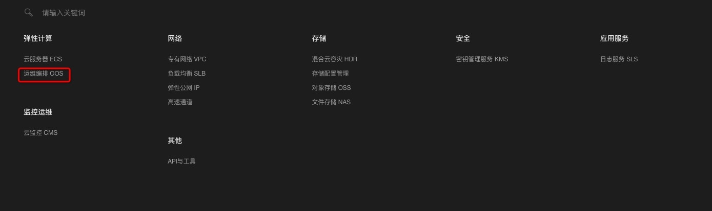

2. 选择我的模板，单击 **创建模版** ，单击 **空白模版** 。

   

3. 在基本信息区域，配置模板参数。

   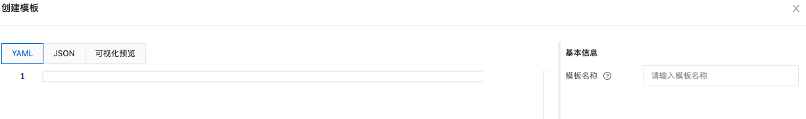

4. 输入 **模版名称** ，本示例中为DescribeInstances。

5. 在 **模版详情** 区域，选择 **YAML** 格式，并输入以下示例模板。您可以修改此模版，增加多个Task，调用任意的OpenAPI。

```yaml
---
 Description: DescribeInstances
 FormatVersion: OOS-2019-06-01
 Parameters:
     Status:
         Description: Running or Stopped
         Type: String
 Tasks:
   - Name: describeInstances
     Action: ACS::ExecuteAPI
     Properties:
         Service: ECS
         API: DescribeInstances
         Parameters:
             Status: "{{ Status }}"
     Outputs:
         InstanceIds:
             Type: List
             ValueSelector: .Instances.Instance[].InstanceId
 Outputs:
     InstanceIds:
         Type: List
         Value: "{{ describeInstances.InstanceIds }}"
```

4. 单击 **创建模版** 。

<a id="section-3"></a>

# 3.创建执行

创建模板后，您需要为该模板创建执行并启动执行。

**操作步骤**

1. 登录**运维编排管理控制台**。

2. 在**我的模版**页面，选择新建的模版DescribeInstances，然后单击**创建执行** 。

3. 在**创建执行**页面，设置**基本信息** 。

   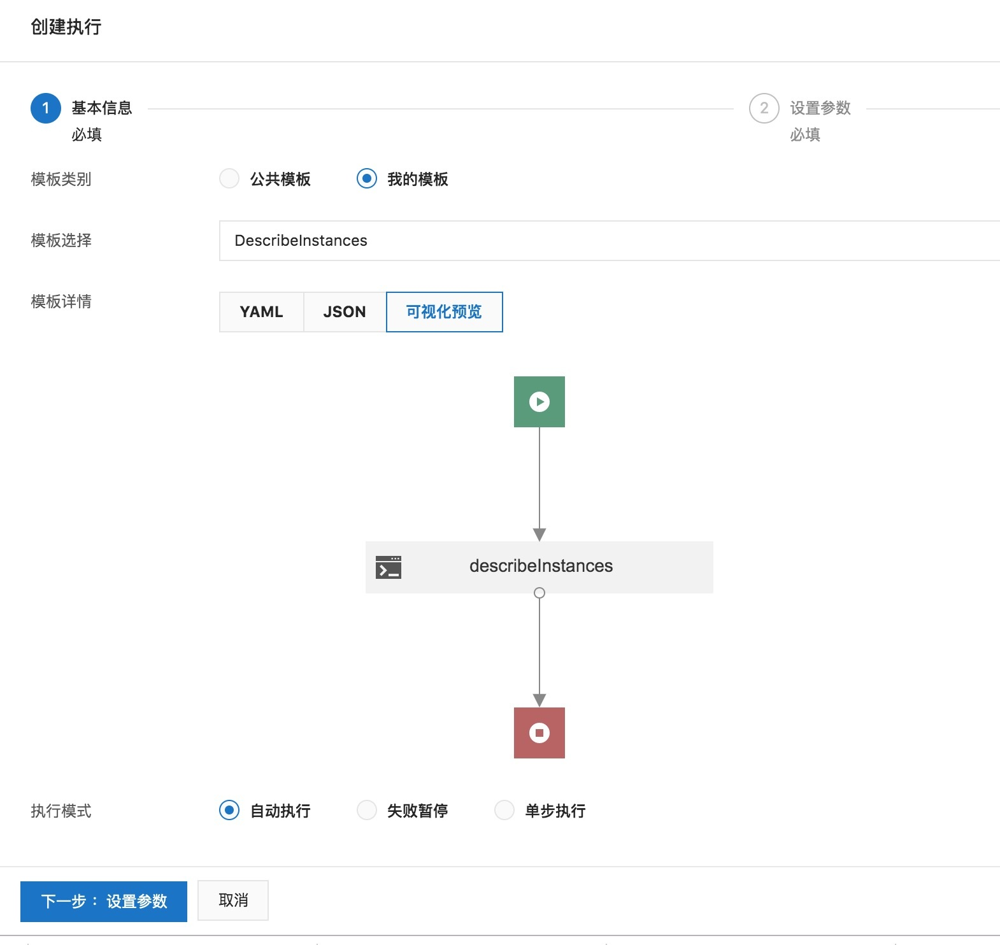

   本示例中，选择 **执行模式** 为 **自动执行** 。参数解释如下：

<table>
  <tr>
    <th width="90">参数</th>
    <th>描述</th>
  </tr>
  <tr>
    <td>执行模式</td>
    <td>自动执行：确认创建后，将自动执行。单步执行：确认创建后，需要手动开启执行。</td>
  </tr>
  <tr>
    <td>失败暂停</td>
    <td>若为循环任务，当子任务执行有失败时，执行会暂停，等待您调整并决定是否继续执行。</td>
  </tr>
  <tr>
    <td>模板类别</td>
    <td>公共模版：平台提供的常用场景的模版。自定义模版：根据自身需求您创建的模版。</td>
  </tr>
  <tr>
    <td>模板选择</td>
    <td>选择您新建的模板。</td>
  </tr>
</table>

4. 单击**下一步：设置参数**，输入需要设置的参数。本示例的模板中有参数 **Status** ，设置该参数的值为**Stopped** 。

   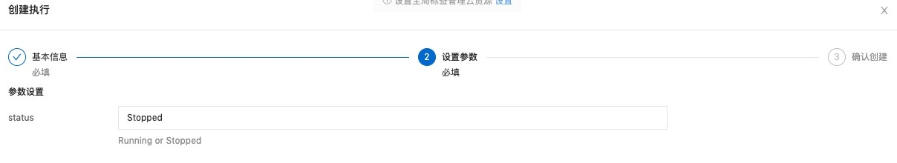

5. 单击**下一步：确认创建** 。

6. 单击**创建执行**。

7. 返回**执行管理** 页面，查看提交的执行。

- 如果选择了**自动执行** ，则自动开始执行。执行完毕后， **执行状态** 显示 **成功** 。

- 如果选择了**单步执行**或**高风险操作需要二次确认**，则需要手动开始执行。

8. 单击**执行ID**或**详情**页面，查看执行状态。

   

<a id="section-4"></a>

# 4.批量操作实例

**背景**

当您需批量对ECS实例做相同操作时，通过OOS批量操作实例可轻松搞定，当前支持的操作类型包括 **发送远程命令** （如Linux Shell、Windows Bat、Windows PowerShell），以及 **基本运维操作** （如启动、停止、重启、初始化系统盘和更换系统盘），也支持 **实例属性修改** （如修改实例名称、HostName、实例描述）。

**操作步骤**

1. 登录运维编排管理控制台。

2. 单击 **常用运维任务** 中的 **批量操作实例。**

3. 首先 <strong>选择操作。</strong>可选择 **发送远程命令** 或 **实例操作** ，本示例选择 **发送远程命令** 中的 **Linux Shell** 并输入df-h。

   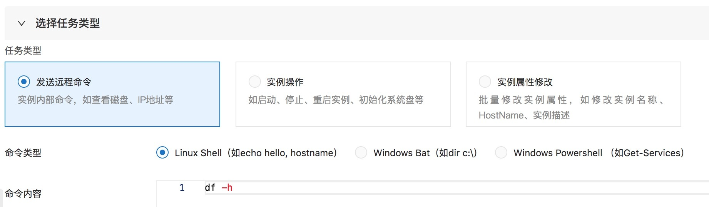

4. 然后 **选择实例** 。**实例选取方式** 支持多种类型，有 **手动选择实例** 、 **指定实例标签** 、 **指定实例资源组** 以及 **上传CSV文件** 。本示例选择 **指定实例标签** 。

   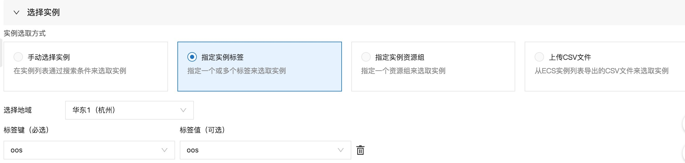

5. 最后设置 **高级控制** 。**执行模式** 可选择 **自动执行** 和 **失败暂停** 。**并发和批次控制** 可设置 **并发速率** 和 **最大错误数** 。**并发速率** 可以选择 **并发控制** 和 **批次控制** ，本示例选择 **并发控制。**

   

6. 单击 **立即执行** 。

7. 在 **执行管理** 中可查看刚刚创建的执行，若创建执行成功，且执行状态处于运行中，则表示命令已开始执行。

8. 当执行状态转换为成功时，则表示命令执行成功。

9. 如需更多了解执行情况，您可单击该执行的 **详情** ，查看 **执行日志** 。

<a id="section-5"></a>

# 5.定时开关机

**背景**

当您需批量对ECS实例开关机状态进行管理时，通过OOS定时开关机可轻松搞定，当前支持每天以及指定每周中具体某些天的方式进行定时开关机。

**操作步骤**

1. 登录运维编排服务OOS管理控制台。

2. 单击**常用运维任务**中的**定时开关机** 。

3. 首先**选择任务类型**，填写 **任务名称**，选择执行周期方式、任务类型、开关机时间对应的**时区**，选择**开机时间** ，选择**关机时间**，选择任务结束时间<strong>。开机时间</strong>和**关机时间**间隔要不少于10分钟。

   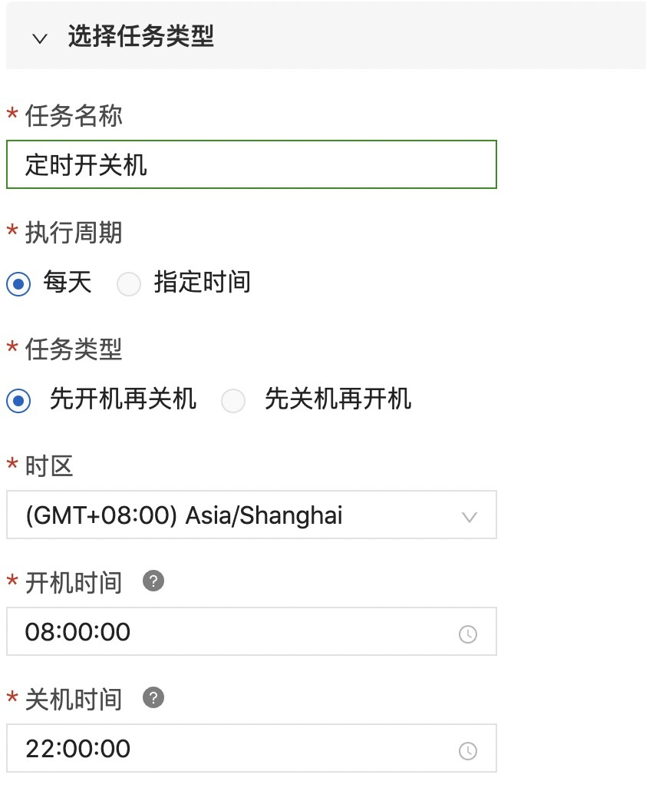

   

4. 选择**停机模式** 。

   

5. 选择**休眠模式**。相比停止实例，休眠实例后再次启动实例，ECS实例会自动恢复至休眠前的应用程序状态，便于您快速进入休眠前ECS实例的运行状态，另休眠的限制请参照ECS相关文档说明。

   

6. **执行使用到的权限的来源**选择**指定RAM角色，使用该角色的权限**，并选择具体的RAM角色**OOSAssumeRole**。本示例**OOSAssumeRole**选择了OOSServiceRole。如果您的账号还没有可选的**OOSAssumeRole**，请参见为OOS服务设置RAM权限进行设置。如果您已知晓如何为OOS服务设置RAM权限，也可直接单击 **选择操作** 中的蓝色字体 **查看授权策略** 和 **前往RAM手动授权策略** 快速完成RAM权限的设置。

7. 然后单击 **选择实例** ，单击 **指定实例标签** ，单击 **+添加** 。**实例选取方式** 有两种，分别是 **手动选择实例**和 **指定实例标签** 。本示例选择 **指定实例标签** ，并输入了预设的分组实例标签键值。

   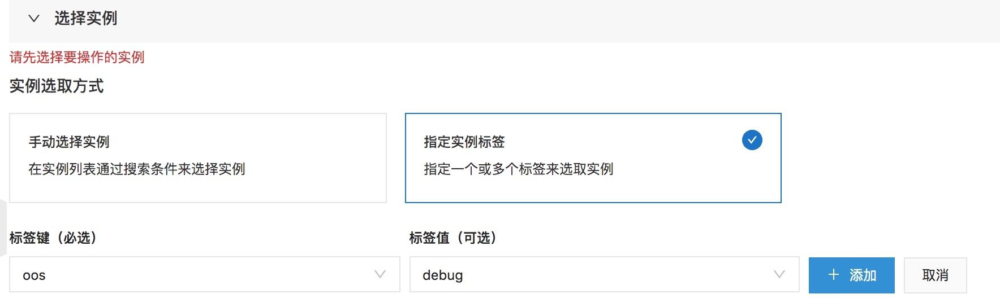

8. 最后单击 **高级控制** 。**并发和批次控制** 可设置 **并发速率和最大错误数** 。**并发速率** 可以选择 **并发控制** 和**批次控制** ，本示例选择 **并发控制** 。

   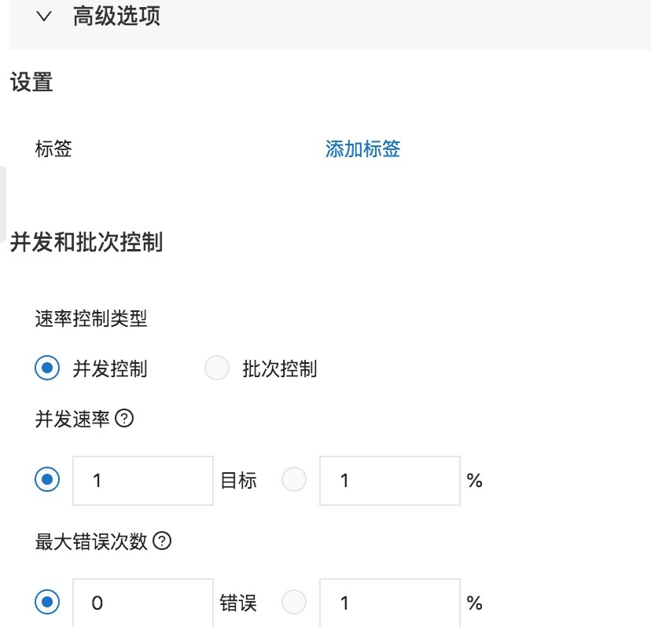

9. 单击 **确认风险并执行** 。

0. 在 **执行管理** 中可查看刚刚创建的执行，若创建执行成功，且执行状态处于等待中，则表示定时开关机任务已设置成功。

1. 当开关机时间到来时，执行状态将转换为运行中，ECS实例将被自动开机或关机。

2. 如需更多了解执行情况，您可单击该执行的 **详情** ，查看 **执行日志** 。

<a id="section-6"></a>

# 6.带宽临时升级

通过OOS定时进行带宽的临时升级。

**背景**

当您需进行带宽临时升级时，通过OOS带宽临时升级可轻松搞定，当前支持每天以及指定每周中具体某些天的方式，在其具体时间段进行升级。关于资费情况，当您设置完参数后，可在执行同一行右侧看到每个周期价格参考，示例参见操作步骤最后一张图。

**操作步骤**

1. 登录运维编排服务OOS控制台。

2. 单击**常用运维任务**中的**带宽临时升级**。

3. 单击**创建**。

4. 进行**参数设置。**

5. **执行周期**可选择**每天**或**指定时间**。本示例选择**每天。**

6. 在**时区**列表中，选择**时区**。选择 **带宽升级开始时间**，填写**带宽升级持续时间（小时）**，填写<strong>公网最大出带宽（Mb/s）</strong>和**任务结束时间**。

   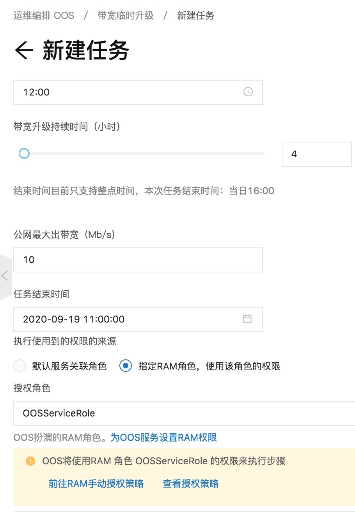

7. **执行使用到的权限的来源**可选择**指定RAM角色，使用该角色的权限**，并选择具体的RAM角色**OOSAssumeRole**。本示例**OOSAssumeRole**选择了OOSServiceRole。如果您的账号还没有可选的 **OOSAssumeRole**，请参见为OOS服务设置RAM权限进行设置。如果您已知晓如何为OOS服务设置RAM权限，也可直接单击蓝色字体的**查看授权策略**并**前往RAM手动授权策略**快速完成RAM权限的设置，其中所需的完整授权策略也可参考如下JSON。

```json
{
    "Version": "1",
    "Statement": [
        {
            "Action": "oos:*",
            "Resource": "*",
            "Effect": "Allow"
        },
        {
            "Action": "ram:PassRole",
            "Resource": "*",
            "Effect": "Allow",
            "Condition": {
                "StringEquals": {
                    "acs:Service": "oos.aliyuncs.com"
                }
            }
        },
        {
            "Action": [
                "ecs:DescribeInstances",
                "ecs:ModifyInstanceNetworkSpec"
            ],
            "Resource": "*",
            "Effect": "Allow"
        }
    ]
}
```

8. 然后单击**选择实例**，单击**手动选择实例**，选择目标实例。**实例选取方式**有多种，分别是 **手动选择实例** 、**指定实例标签、指定实例资源组等** 。

   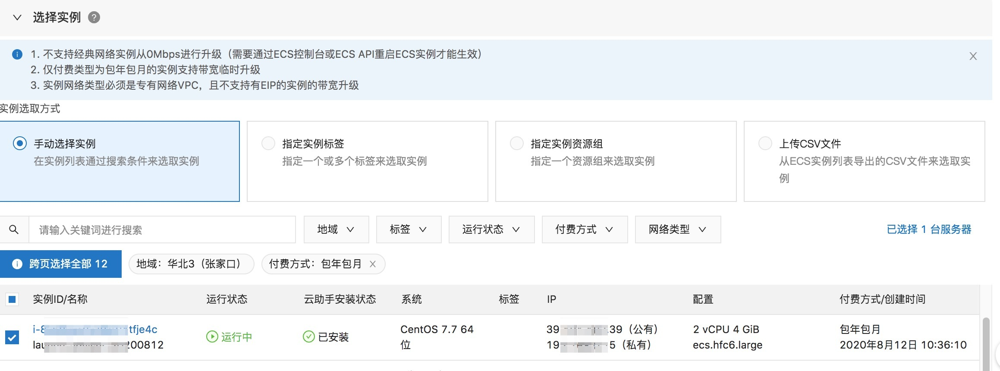

9. 最后单击**高级控制。并发和批次控制**可设置**并发速率和最大错误数**。关于并发相关名词详细内容可参考任务循环文档。**并发速率**可以选择**并发控制**和**批次控制**，本示例选择**并发控制**。

   

0. 此时在右下角可查看到带宽收费参考，如了解收费情况后，单击**立即执行**。


<a id="section-7"></a>

# 7.创建或更新镜像

OOS常用运维任务之创建或更新镜像。

**背景**

当您在使用ECS的时，要时常地面临更新软件等情况，如运行的后端服务版本更新，安全打补丁等，通过创建或更新镜像可轻松搞定。当前支持从已有的实例创建镜像，或者更新镜像。

**操作步骤**

1. 登录运维编排服务OOS管理控制台。

2. 单击**常用运维任务**中的**创建或更新镜像**。

3. 单击**通用设置。**

4. 可选择**从已有实例创建镜像**或<strong>更新镜像。</strong>本示例选择**从已有实例创建镜像。**

5. 填写**新镜像名称。**

6. 执行使用到的权限的来源可选择当前账号的已有权限或者指定RAM角色，使用该角色的权限。本示例选择指定RAM角色，使用该角色的权限，并选择的角色为OOSServiceRole。如果您的账号还没有可选的OOSAssumeRole ，请参见为OOS服务设置RAM权限进行设置。如果您已知晓如何为OOS服务设置RAM权限，也可直接单击蓝色字体的查看授权策略并前往RAM手动授权策略快速完成RAM权限的设置，其中执行所需的完整授权策略可参考下文JSON。

   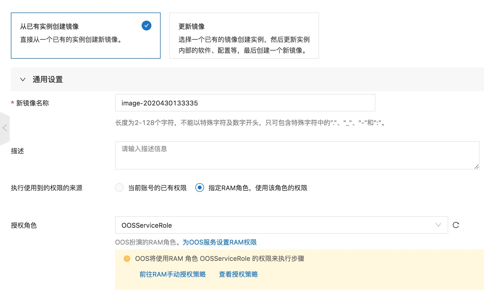

   从已有实例创建镜像的权限策略：更新镜像的权限策略：

```json
{
  "Version": "1",
  "Statement": [
    {
      "Action": [
        "ecs:CreateImage",
        "ecs:DescribeImages",
        "ecs:ModifyImageSharePermission",
        "ecs:CopyImage",
        "ecs:RunCommand",
        "ecs:DescribeInvocationResults",
        "ecs:DescribeRegions",
        "ecs:DescribeInstances",
        "ecs:DescribeInvocations"
      ],
      "Resource": "*",
      "Effect": "Allow"
    },
    {
      "Action": [
        "ess:ModifyScalingConfiguration"
      ],
      "Resource": "*",
      "Effect": "Allow"
    },
    {
      "Action": "oos:*",
      "Resource": "*",
      "Effect": "Allow"
    },
    {
      "Action": "ram:PassRole",
      "Resource": "*",
      "Effect": "Allow",
      "Condition": {
        "StringEquals": {
          "acs:Service": "oos.aliyuncs.com"
        }
      }
    }
  ]
}
```

```json
{
  "Version": "1",
  "Statement": [
    {
      "Action": "oos:*",
      "Resource": "*",
      "Effect": "Allow"
    },
    {
      "Action": "ram:PassRole",
      "Resource": "*",
      "Effect": "Allow",
      "Condition": {
        "StringEquals": {
          "acs:Service": "oos.aliyuncs.com"
        }
      }
    },
    {
      "Action": [
        "ecs:RunCommand",
        "ecs:RunInstances",
        "ecs:StopInstance",
        "ecs:DescribeRegions",
        "ecs:DeleteInstance",
        "ecs:CreateImage",
        "ecs:DescribeImages",
        "ecs:ModifyImageSharePermission",
        "ecs:CopyImage",
        "ecs:RebootInstance",
        "ecs:DescribeInvocationResults",
        "ecs:InstallCloudAssistant",
        "ecs:DescribeCloudAssistantStatus",
        "ecs:DescribeInstances",
        "ecs:DescribeInvocations"
      ],
      "Resource": "*",
      "Effect": "Allow"
    },
    {
      "Action": [
        "ess:ModifyScalingConfiguration"
      ],
      "Resource": "*",
      "Effect": "Allow"
    }
  ]
}
```

7. 单击**选择实例。**

   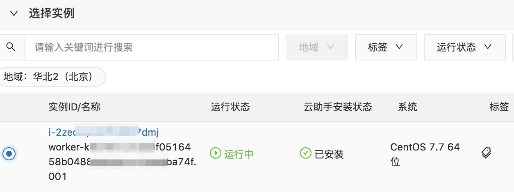

8. 单击<strong>发送远程命令。</strong>本示例选择**Linux Shell**。

   

9. 单击**立即执行**。

0. 在**执行管理**中可查看刚刚创建的执行，若创建执行成功，且执行状态处于运行中，则表示此时正在创建或者更新镜像。

1. 如需更多了解执行情况，您可单击该执行的**详情**，查看**执行日志**。

<a id="section-8"></a>

# 8.定时运维

**背景**

当您需在某个时间点做一些运维操作时，通过OOS**定时运维**可轻松搞定，当前支持的定时类型包括仅在指定时间执行一次，以及周期性重复执行。

**操作步骤**

1. 登录运维编排服务OOS管理控制台。

2. 单击**定时运维**。

3. 选择**定时类型**。可选择**仅在指定时间执行一次**或**周期性重复执行**，本示例选择**仅在指定时间执行一次**，然后选择**执行时间**和**时区**。

   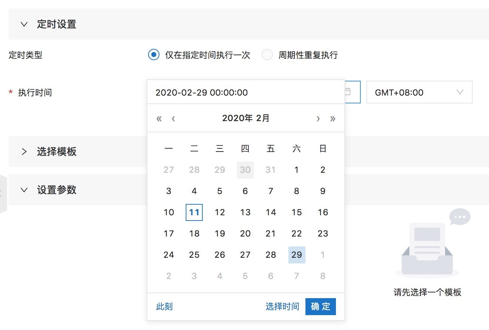

4. 然后**选择模板**。可**选择模板**有两种类型，分别是**公共模版**和**我的模版**，本示例选择一个**公共模版**。

   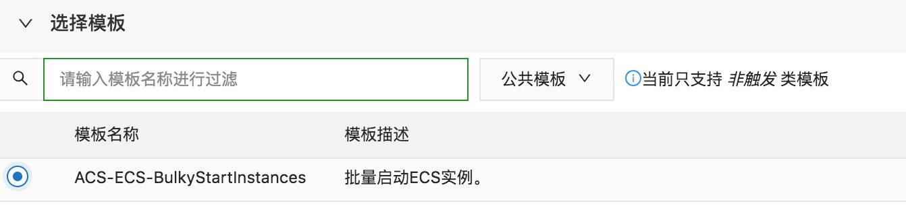

5. 最后 **设置参数**，设置方法和为普通模板参数设置方法一致。

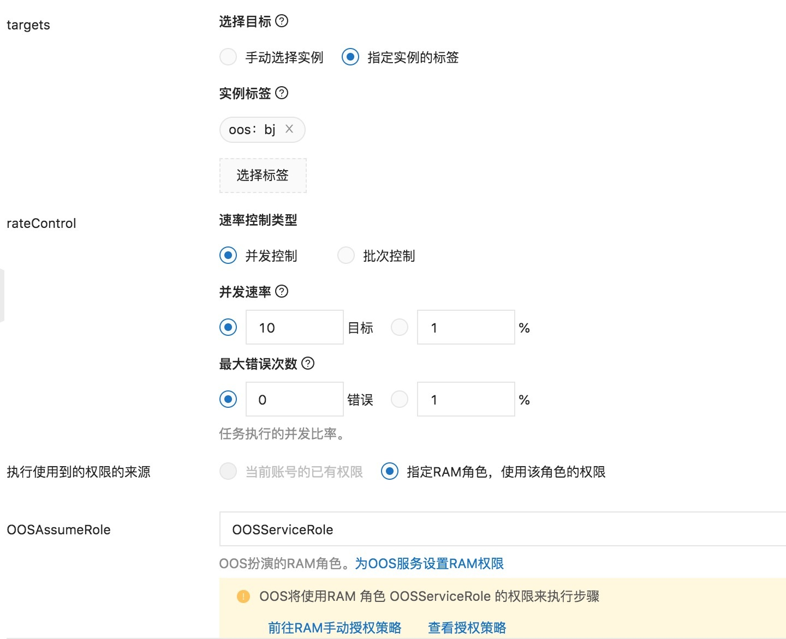

6. 单击**立即执行**。

7. 在**执行管理**中可查看刚刚创建的执行，若创建执行成功，且执行状态处于等待中，则表示定时运维任务已创建成功。

8. 如需更多了解执行情况，您可单击该执行的**详情**，查看**执行日志**。

<a id="section-9"></a>

# 9.常见问题

本文汇总了使用OOS时的常见问题。

- 子账户进行操作，报错：User has no permission to do the action: (ListTemplates)

- 子账户进行操作，报错：User has no permission to do the action: (PassRole)

- 执行模板时遇到报错：Assumes role failed. Code: EntityNotExist.Role, msg: The role not exists: acs:111111:role/OOSServiceRole.

- 执行模板时报错：Assumes role failed. Code: NoPermission, msg: You are not authorized to do this action. You should be authorized by RAM.

**子账户进行操作，报错：User has no permission to do the action: (ListTemplates)**

原因：子账户权限不够，不能执行OOS的指定API。

解决办法：以管理员或者主账户身份，登录**RAM控制台**，对报错的子账户进行适当授权，授权范围可以是相关API，也可是所有API，下面样例 `"Action": "oos:*"` 则是对所有API授权，详情请参见**账户访问控制**。

```json
{
  "Statement": [
      {
          "Effect": "Allow",
          "Action": "oos:*",
          "Resource": "*"
      }
  ],
  "Version": "1"
}
```

**子账户进行操作，报错：User has no permission to do the action: (PassRole)**

原因：子账户没有PassRole权限，不能以指定的Role执行运维编排。

解决办法：以管理员或者主账户身份，在**RAM控制台**，对子账户做适当的PassRole授权，参见**账户访问控制**。

```json
{
  "Statement": [
      {
          "Effect": "Allow",
          "Action": "oos:*",
          "Resource": "*"
      }
  ],
  "Version": "1"
}
```

**执行模板时遇到报错：Assumes role failed. Code: EntityNotExist.Role, msg: The role not exists: acs:111111:role/OOSServiceRole.**

原因：没有为OOS服务创建默认的RAM角色。

解决办法：主账户或者管理员登录**RAM控制台**>的RAM访问控制，增加对应的RAM角色OOSServiceRole。请参见**为OOS服务设置RAM权限**。

**执行模板时报错：Assumes role failed. Code: NoPermission, msg: You are not authorized to do this action. You should be authorized by RAM.**

原因： 对应的RAM角色没有给OOS服务配置信任策略。

解决办法：主账户或者管理员登录**RAM控制台**的RAM访问控制，增加对应的RAM角色OOSServiceRole。请参见**为OOS服务设置RAM权限**

1. 登录**RAM控制台**，在角色中输入"OOSServiceName"进行搜索：

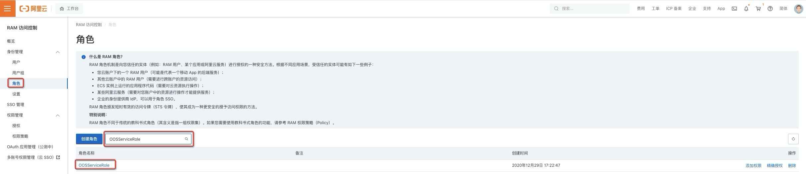

2. 点击信任策略：

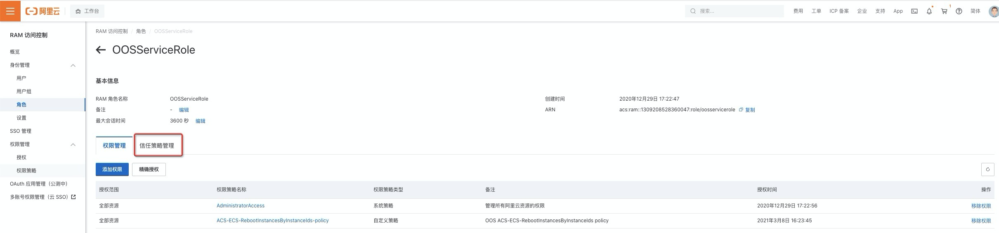

3. 修改信任策略：

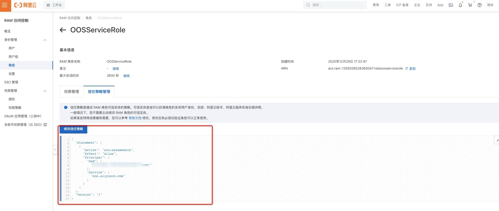

将信任策略修改为如下内容：

```json
{
  "Statement": [
      {
          "Action": "sts:AssumeRole",
          "Effect": "Allow",
          "Principal": {
              "Service": [
                  "oos.aliyuncs.com"
              ]
          }
      }
  ],
  "Version": "1"
}
```
