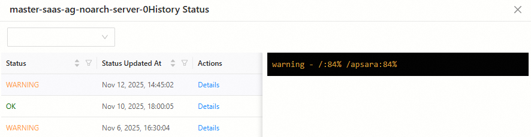
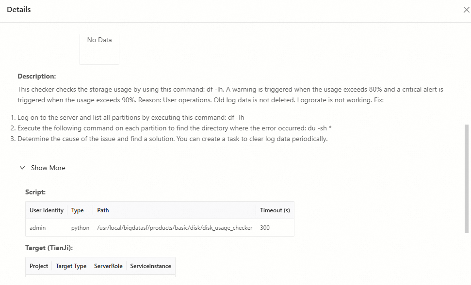
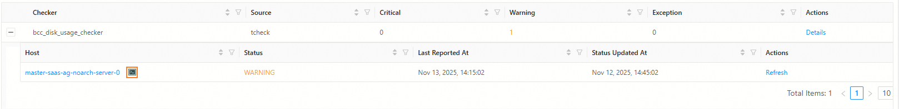

Alibaba Cloud  
Apsara Stack  
Apsara Big Data Manager  
Operations and Maintenance  
Guide  
Product Version: v3.18.6-2607  
Document Version: 20260825

**Table of Contents**

- [1.Routine maintenance](#section-1)
    - [1.1. Perform routine maintenance](#section-1-1)
    - [1.2. View the health of a cluster in the ABM console](#section-1-2)
    - [1.3. Troubleshooting](#section-1-3)
- [2.Backup and restore](#section-2)

# 1.Routine maintenance

## 1.1. Perform routine maintenance

You can perform routine maintenance on Apsara Big Data Manager (ABM) in the Apsara Infrastructure Management console.

**Inspections in the Apsara Infrastructure Management console**

1. Log in to the ABM console.

2. In the upper-left corner of the ABM console, click the  icon and select **TIANJI** to go to the

   homepage of the Apsara Infrastructure Management console.

3. In the left-side navigation pane, choose **Resource Management > Product & Cluster O&M**.

4. In the **Products** list, search for the product or cluster that you want to check, and make sure that all containers have reached the desired state.

**Monitoring items and alert handling**

- Monitor hardware components

  The system retains logs for 30 days and automatically deletes historical logs. If a disk alert is triggered when a large volume of logs exhausts disk space, contact technical support.

- System exception

  If a system exception occurs during the inspection, handle the exception in the ABM console. If the exception message is unclear, contact technical support.

## 1.2. View the health of a cluster in the ABM console

In the Apsara Big Data Manager (ABM) console, the Degree of health page allows you to view the monitoring items of each big data service and the alerts of different levels of severity and check the monitoring items and alerts again after the alerts are handled.

**View and handle ABM alerts**

ABM cluster alerts are classified into Critical, Warning, and Exception alerts. You need to handle these alerts in time, especially Critical and Warning alerts.

1. After you log on to the ABM console, the **Dashboard** page appears by default.

   To return to the **Dashboard** page from another page, click the  icon in the upper-left

   corner and select **ABM**.

2. On the **Instrument cluster** page, click the **Degree of heath** tab. The Degree of heath page appears.

   This page displays all the monitoring items and check results of the cluster.

3. On the **Degree of health** page, click the  icon on the left of a checker. You can view all

   hosts where the checker is run.

4. Click a hostname. In the panel that appears, find the alert that you want to manage and click **Details** in the Actions column to view the cause of the alert.

   

5. Click **Details** in the Actions column of a checker with an alert and view the solutions to the alert in the dialog box that appears.

   

6. Handle the alert based on the solutions.

   You may need to log in to the host when handling the alert. For more information, see the Log in to a host section of this topic.

7. After you handle an alert for a host, click **Refresh** in the Actions column of the host to perform real-time inspection on the checker for the host again. This way, you can check whether the alert is cleared.

**Log in to a host**

You may need to log in to a host to handle alerts or other issues that occur on the host.

1. On the **Degree of health** page, click the  icon to expand a checker with alerts.

2. Click the  icon next to a hostname. The **TerminalService** page appears.

   

3. On the **TerminalService** page, click the hostname in the left-side navigation pane to log in to the host.

## 1.3. Troubleshooting

**Common failures**

- **Logon failure**

  If you failed to log on to ABM, clear the cache and cookies in your web browser, and then try again.

  Based on the logon failure message that appears, check whether the following issues exist:

  - The password that you entered is incorrect.

  - Your account has been locked.

  - Your account has been disabled.

- **Other failures**

  Contact technical support.

# 2.Backup and restore

**Back up data**

ABM uses a high-availability database. You do not need to manually back up data. To obtain full backup data, contact technical support.

**Restore data**

You do not need to restore data for ABM.
