Alibaba Cloud  
Apsara Stack  
DataWorks  
Operations and Maintenance  
Guide  
Product Version: v3.18.6-2607  
Document Version: 20260825

**Table of Contents**

- [1.Common administration tools and commands](#section-1)
    - [1.1. View the servers on which a service is deployed](#section-1-1)
    - [1.2. View cluster resources](#section-1-2)
    - [1.3. View service registration variables](#section-1-3)
    - [1.4. Commands to restart services](#section-1-4)
    - [1.5. View logs of a failed instance](#section-1-5)
    - [1.6. Rerun multiple instances at a time](#section-1-6)
    - [1.7. Stop multiple instances at a time](#section-1-7)
    - [1.8. Commonly used Linux commands](#section-1-8)
    - [1.9. View the slot usage of resource groups](#section-1-9)
- [2.Process daily administration operations](#section-2)
    - [2.1. Daily check](#section-2-1)
        - [2.1.1. Check the service status and server information](#section-2-1-1)
        - [2.1.2. Check the status of a gateway server](#section-2-1-2)
        - [2.1.3. Monitor service roles and servers](#section-2-1-3)
    - [2.2. View logs of the services](#section-2-2)
    - [2.3. Scale out the cluster that runs the base-biz-gateway service](#section-2-3)
    - [2.4. Scale in the cluster that runs the base-biz-gateway service](#section-2-4)
    - [2.5. Restart the BaseBizTenant service](#section-2-5)
    - [2.6. Restart the Redis service](#section-2-6)
    - [2.7. Restart the BaseBizDmc service](#section-2-7)
    - [2.8. Restart the BaseBizAlisa service](#section-2-8)
    - [2.9. Restart the BaseBizPhoenix service](#section-2-9)
    - [2.10. Restart the BaseBizCdpGateway service](#section-2-10)
    - [2.11. Restart the dataworks-dataservice service](#section-2-11)
    - [2.12. Restart the BaseBizCdpGateway service](#section-2-12)
    - [2.13. Configure a resource group in a multi-region environment](#section-2-13)
    - [2.14. Configure a resource group for Data Integration in a multi-region environment](#section-2-14)
- [3.O&M by using Apsara Big Data Manager](#section-3)
    - [3.1. Log on to Apsara Bigdata Manager](#section-3-1)
    - [3.2. Monitoring](#section-3-2)
        - [3.2.1. Dashboard](#section-3-2-1)
        - [3.2.2. Resource library](#section-3-2-2)
        - [3.2.3. Health](#section-3-2-3)
        - [3.2.4. Reports](#section-3-2-4)
    - [3.3. O&M](#section-3-3)
        - [3.3.1. DataWorks O&M overview](#section-3-3-1)
        - [3.3.2. Service O&M](#section-3-3-2)
            - [3.3.2.1. Data Warehouse](#section-3-3-2-1)
                - [3.3.2.1.1. DataWorks service overview](#section-3-3-2-1-1)
                - [3.3.2.1.2. DataWorks service roles](#section-3-3-2-1-2)
                - [3.3.2.1.3. DataWorks service slots](#section-3-3-2-1-3)
                - [3.3.2.1.4. DataWorks service nodes](#section-3-3-2-1-4)
                - [3.3.2.1.5. DataWorks projects](#section-3-3-2-1-5)
                - [3.3.2.1.6. DataWorks service business insights](#section-3-3-2-1-6)
                - [3.3.2.1.7. DataWorks service configurations](#section-3-3-2-1-7)
                - [3.3.2.1.8. DataWorks cluster scaling](#section-3-3-2-1-8)
            - [3.3.2.2. Data Integration](#section-3-3-2-2)
                - [3.3.2.2.1. Data Integration overview](#section-3-3-2-2-1)
                - [3.3.2.2.2. View Data Integration instances](#section-3-3-2-2-2)
                - [3.3.2.2.3. View historical analysis information](#section-3-3-2-2-3)
        - [3.3.3. Cluster O&M](#section-3-3-3)
            - [3.3.3.1. Cluster overview](#section-3-3-3-1)
            - [3.3.3.2. Cluster health](#section-3-3-3-2)
        - [3.3.4. Host O&M](#section-3-3-4)
            - [3.3.4.1. Host overview](#section-3-3-4-1)
            - [3.3.4.2. Host service roles](#section-3-3-4-2)
    - [3.4. Management](#section-3-4)
        - [3.4.1. Overview](#section-3-4-1)
        - [3.4.2. Jobs](#section-3-4-2)
            - [3.4.2.1. Overview](#section-3-4-2-1)
            - [3.4.2.2. Jobs](#section-3-4-2-2)
                - [3.4.2.2.1. Manually run a job](#section-3-4-2-2-1)
                - [3.4.2.2.2. View cron jobs](#section-3-4-2-2-2)
                - [3.4.2.2.3. View the execution history of a job](#section-3-4-2-2-3)
                - [3.4.2.2.4. View the job execution history](#section-3-4-2-2-4)
        - [3.4.3. Health management](#section-3-4-3)
            - [3.4.3.1. Monitoring configuration](#section-3-4-3-1)
            - [3.4.3.2. Inspection management](#section-3-4-3-2)
        - [3.4.4. Operation audit](#section-3-4-4)
- [4.Deep inspection](#section-4)
    - [4.1. Overview](#section-4-1)
    - [4.2. Introduction to DataWorks service roles](#section-4-2)
    - [4.3. Inspect clusters](#section-4-3)
    - [4.4. Inspect the base_meta project](#section-4-4)
    - [4.5. Inspect the BaseBizAlisa service](#section-4-5)
    - [4.6. Inspect the BaseBizPhoenix service](#section-4-6)
    - [4.7. Inspect the BaseBizCdp service](#section-4-7)
    - [4.8. Appendix: Log in to a database](#section-4-8)
- [5.Common issues and solutions](#section-5)
    - [5.1. Nodes remain in the Pending (Resources) state](#section-5-1)
    - [5.2. An out-of-memory (OOM) error occurs when synchronizing data from an Oracle database](#section-5-2)
    - [5.3. A task does not run at the specified time](#section-5-3)
    - [5.4. What do I do if the number and usage of tables are not displayed on the Data Map page?](#section-5-4)
    - [5.5. Logs are not automatically cleaned up](#section-5-5)

<a id="section-1"></a>

# 1.Common administration tools and commands

<a id="section-1-1"></a>

## 1.1. View the servers on which a service is deployed

This topic describes how to view the servers on which a service is deployed.

**Procedure**

1. Log in to the **Apsara Infrastructure Management** console.

   Log in to the Apsara Uni-manager Operations Console. In the top navigation bar, choose **Platform Operation > Apsara Infrastructure Management > Resource Management**.

2. Go to the details page of your cluster. In this example, the BasicCluster cluster of the base service is used.

   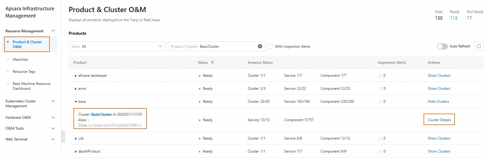

3. On the Services tab, find the **base-baseBizApp** service and click its name to go to the **Component Details** page. In the Components section, click a service and view the servers on which the service is deployed.

   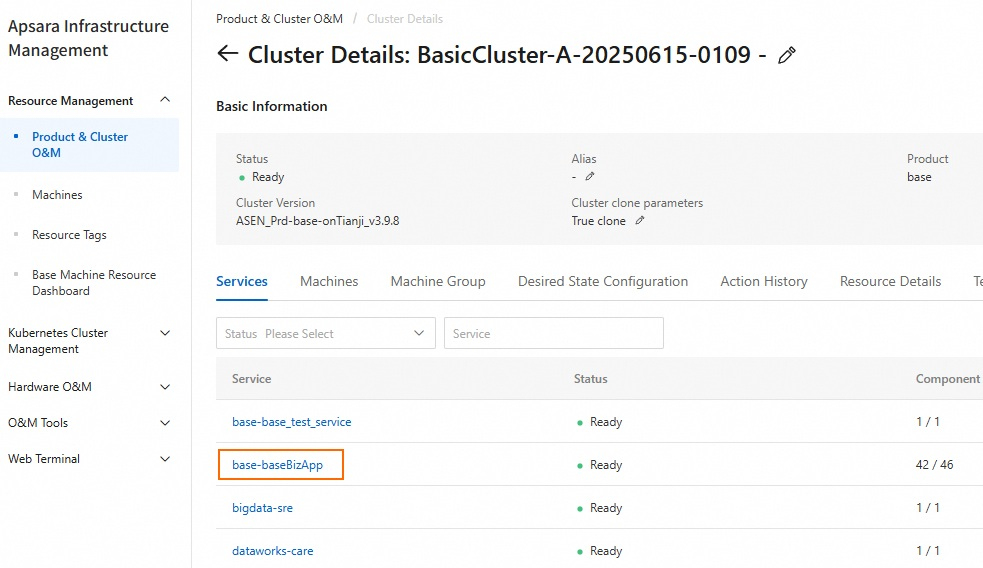

<a id="section-1-2"></a>

## 1.2. View cluster resources

This topic describes how to view the applications, resources, status, and version of a cluster.

**Procedure**

1. Log in to the **Apsara Infrastructure Management** console.

   Log in to the Apsara Uni-manager Operations Console. In the top navigation bar, choose **Platform Operation > Apsara Infrastructure Management > Resource Management**.

2. Go to the details page of your cluster. In this example, the BasicCluster cluster of the base service is used.

   

3. Click the **Resource Details** tab. You can filter resources in the cluster by **Resource Name**, **Related Version**, **Type**, and **Resource Status**.

   Find the resource that you want to view and click the  icon in the **Resource Application**

   **Result** column to view the application details. For example, if you want to log in to the database of a specific application, you can view detailed logon information about the database in the **Resource Application Parameters** message.

<a id="section-1-3"></a>

## 1.3. View service registration variables

This topic describes how to view the registration variables of a service.

**Procedure**

1. Log on to the Apsara Infrastructure Management console.

   Log in to the Apsara Uni-manager Operations Console. In the top navigation bar, choose **Platform Operation > Apsara Infrastructure Management > Resource Management**.

2. In the left-side navigation pane, choose **O&M Tools > Service Registration Variable Dashboard**.

3. On the Service Registration Variable Dashboard page, switch the filter condition type to search for the service that you want to view.

4. Find the service and click the  icon next to the value in the **Service Registration**

   column to view the details of the registration variables of the service.

   > **Note**
   >
   > If a large amount of data exists, you can click the data displayed in the **Service Registration** column to view the content in the Registration Variables message.

**Change the domain name of a service**

If you use Apsara Stack V3.18.2 or later, the domain names in the registration information of specific services are changed. The following table describes the changes.

**Baseline**

**Service name**

**Before change**

**After change**

base-biz-

ide.${global:internet-

ide.${global:console-

commonbase

domain}

private-domain}

base-biz-

dashboard.${global:interne

dashboard.${global:consol

dashboard

t-domain}

e-private-domain}

di.${global:internet-

di.${global:console-

base-biz-diide

domain}

private-domain}

dmc.${global:internet-

dmc.${global:console-

base-biz-dmc

domain}

private-domain}

cloudsso.${global:internet-

cloudsso.${global:console-

base-biz-sso

domain}

private-domain}

base-biz-

wkbench.${global:internet-

wkbench.${global:console

wkbench

domain}

-private-domain}

bff.${global:internet-

bff.${global:console-

dataworks-bff

domain}

private-domain}

dataworks-

ms.cdn.${global:internet-

cdn.${global:console-

dataworks-cdn

domain}

private-domain}

dataworks-

setting.${global:internet-

setting.${global:console-

dataos-panel

domain}

private-domain}

approval.${global:internet-

approval.${global:console-

domain}

private-domain}

dataworks-dsm-guard

guard.${global:internet-

guard.${global:console-

domain}

private-domain}

lsp.${global:internet-

lsp.${global:console-

dataworks-lsp

domain}

private-domain}

dataworks-

message.${global:internet-

message.${global:console

message-center

domain}

-private-domain}

dataworks-

nav.${global:internet-

nav.${global:console-

navigation

domain}

private-domain}

dataworks-

nodemarket.${global:intern

nodemarket.${global:cons

nodemarket

et-domain}

ole-private-domain}

service-base-baseBizApp

ms.${global:internet-

ms.${global:console-

domain}

private-domain}

dwexcel-pivot-

dwexcel-pivot-server-

server.ms.${global:internet

ms.${global:console-

-domain}

private-domain}

pg-

pg-service-

service.ms.${global:interne

ms.${global:console-

t-domain}

private-domain}

morse-

morse-engine-

engine.ms.${global:interne

ms.${global:console-

t-domain}

private-domain} dw-emr-meta-manager-

dw-emr-meta-

ms.${global:console-

manager.ms.${global:inter

private-domain}

net-domain}

mysql-

mysql-service-

service.ms.${global:interne

ms.${global:console-

t-domain}

private-domain}

dataworks-plugin

model.${global:internet-domain}

model.${global:intranet-domain}

indicator.${global:internet-domain}

indicator.${global:intranet-domain}

N/A

dsd.${global:internet-domain}

dsd.${global:intranet-domain}

layer.${global:internet-domain}

layer.${global:intranet-domain}

dschain.dw.${global:region

dschain-

}.${global:internet-

dw.${global:console-

domain}

private-domain}

service-base-

dschain

dschain

dschain-

dschain-intra-

intra.dw.${global:region}.$

dw.${global:intranet-

{global:intranet-domain}

domain}

datastudio-er-model-

datastudio-er-model-web-

web.ms.${global:internet-

ms.${global:console-

domain}

private-domain}

datastudio-er-model-

datastudio-er-model-api-

api.ms.${global:internet-

ms.${global:console-

domain}

private-domain}

service-base-

datablau-plugin

datablau-

datablau-modelstore-

datablau

modelstore.ms.${global:int

ms.${global:console-

ernet-domain}

private-domain}

datablau-

datablau-store-

store.ms.${global:internet-

ms.${global:console-

domain}

private-domain}

datablau-

datablau-central-

central.ms.${global:interne

ms.${global:console-

t-domain}

private-domain}

model-

service-base-

dataworks-

model.${global:console-

engine.ms.${global:interne

modelengine

modelengine

private-domain}

t-domain}

service-base-

dsgadvanced.${global:inter

dsgadvanced.${global:con

dsg

dsgadvanced

net-domain}

sole-private-domain}

service-base-

dataworks-

migration.${global:internet

migration.${global:consol

migassist

migration

-domain}

e-private-domain}

service-dataworks-

dataworks-

holostudio.${global:interne

holostudio.${global:consol

holostudio

holostudio

t-domain}

e-private-domain}

service-dataworks-

dataworks-

gs.${global:internet-

gs.${global:console-

graphstudio

graphstudio

domain}

private-domain}

ss.${global:internet-

service-dataworks-

ss.${global:console-

domain}

ssweb

streamstudio

private-domain}

service-dataworks-

base-biz-

dqc.${global:internet-

dqc.${global:console-

dqc

dqcsupervisor

domain}

private-domain}

service-dataworks-

dataworks-

dataassets.${global:interne

dataassets.${global:consol

dataassets

dataassets

t-domain}

e-private-domain}

service-dataworks-

assetv2.${global:internet-

assetv2.${global:console-

dataworks-asset

asset

domain}

private-domain}

<table>
  <tr>
    <td>service-dataworks-dataservice</td>
    <td>dataservice_web</td>
    <td>ds.${global:internet-domain}</td>
    <td>ds.${global:console-private-domain}</td>
  </tr>
  <tr>
    <td>service-dataworks-realtime</td>
    <td>dwexcel</td>
    <td>da.${global:internet-domain}</td>
    <td>da.${global:console-private-domain}</td>
  </tr>
  <tr>
    <td>service-dataworks-dsgapp</td>
    <td>dsg</td>
    <td>dsg.${global:internet-domain}</td>
    <td>dsg.${global:console-private-domain}</td>
  </tr>
  <tr>
    <td>service-dataworks-openplatform</td>
    <td>dataworks-openplatform</td>
    <td>openplatform.${global:inter net-domain}</td>
    <td>openplatform.${global:con sole-private-domain}</td>
  </tr>
  <tr>
    <td>service-dataworks-governance</td>
    <td>dataworks-datagovernance</td>
    <td>dgc.${global:internet-domain}</td>
    <td>dgc.${global:console-private-domain}</td>
  </tr>
</table>

<a id="section-1-4"></a>

## 1.4. Commands to restart services

Enter the container that runs the service as an admin user, and then run the following commands to restart services.

> **Note**
>
> Only admin users can run the following commands to restart the service.

- To restart the base-biz-cdp service, run the  `/home/admin/cdp_server/bin/appctl.sh     restart`  command.

- To restart the base-biz-gateway service, run the

  ```text
   /home/admin/alisatasknode/target/alisatasknode/bin/serverctl
  ```

  `restart`  command.

- To restart other services, run the  `/home/admin/base-biz-[application name]/bin/jbossctl       restart`  command.

  For example, to restart the base-biz-alisa service, run  `/home/admin/base-biz-`

```text
alisa/bin/jbossctl
```

`restart` .

<a id="section-1-5"></a>

## 1.5. View logs of a failed instance

This topic describes how to view logs of a failed instance in Operation Center.

**Procedure**

1. Log on to the DataWorks console.

2. On the DataStudio page, click  in the upper-left corner and choose **All Products >**

   **Operation Center**.

3. On the **Dashboard** page, click **Failed** in the **Instances** section. The **Cycle Instance** page appears. On this page, you can view all the instances that failed to run in the current workspace.

4. Click the target instance, and then right-click the failed node on the DAG that appears on the right side of the page.

5. Select **View Runtime Log**.

<a id="section-1-6"></a>

## 1.6. Rerun multiple instances at a time

You can use the batch rerun feature of DataWorks to rerun multiple instances at a time.

**Procedure**

1. Log on to the DataWorks console.

2. On the DataStudio page, click  in the upper-left corner and choose **All Products >**

   **Operation Center**.

3. On the **Dashboard** page, click **Failed** in the **Instances** section. The **Cycle Instance** page appears. On this page, you can view all the instances that failed to run in the current workspace.

4. Select the instances to be rerun.

5. Choose **More > Rerun** in the lower-left corner.

6. In the message that appears, click **Rerun**.

<a id="section-1-7"></a>

## 1.7. Stop multiple instances at a time

You can use the batch stop feature of DataWorks to stop multiple instances at a time.

**Procedure**

1. Log on to the DataWorks console.

2. On the DataStudio page, click  in the upper-left corner and choose **All Products >**

   **Operation Center**.

3. On the **Dashboard** page, click **Running** in the **Instances** section. The **Cycle Instance** page appears. On this page, you can view all the running instances in the current workspace.

   > **Note**
   >
   > You can stop only instances that are running.

4. Select the instances that you want to stop.

5. Choose **More > Stop** in the lower-left corner.

6. In the message that appears, click **Stop**.

<a id="section-1-8"></a>

## 1.8. Commonly used Linux commands

This topic describes the commonly used Linux commands.

**Display workloads in the Linux system: top**

View the three numbers after load average, which indicate the workload averages for the last 5, 10, and 15 minutes, respectively. If you divide one of these numbers by the quantity of logical CPUs and the result is greater than 5, the Linux system is overloaded.

**List the sizes of files: du**

You can run the  `du -sh`  command with a file name added at the end to view the size of the specified file. If you run the  `du -sh *`  command, you can view the sizes of all the files in the current directory.

**List processes in the Linux system: ps**

You can run the  `ps -ef`  command to view the processes that are running in the Linux system.

**Search for strings: grep**

To search for a string in a specified log file and display all lines that contain the string, run the command in the following format:

```text
grep ["String"] [File name]
```

To search for a string in a specified file and display only the first few lines that contain the string, run the command in the following format:

```text
grep -C Number of lines ["String"] [File name] 
```

> **Note**
>
> The -C parameter is an uppercase letter. Set its value to a number.

To search for a string in a specified file and display only the last few lines that contain the string, run the command in the following format:

```text
grep -A Number of lines ["String"] [File name]
```

**Terminate processes: kill**

You can run the  `kill -9`  command with the PID of a process added at the end to terminate the process.

**docker commands**

List all containers:  `docker ps -a`

List the logs of a container:  `docker logs [Container ID]`

Log on to a container:  `docker exec -it [Container ID] bash`

<a id="section-1-9"></a>

## 1.9. View the slot usage of resource groups

This topic describes how to view the slot usage of a resource group.

Scenario: When a large number of nodes are waiting for resources in Operation Center, you can run a set of commands to view the slot usage of each resource group.

First, log on to the base-biz-alisa database. In an Apsara Stack V3 environment, select base from the Project drop-down list on the Clusters page in Apsara Infrastructure Management. Locate the base-biz-alisa service whose type is db in the filtered results. Right-click the Result column and choose Show More from the shortcut menu to obtain the connection information of the database. Then, run a MySQL command to log on to the database based on the obtained information.

Run the following command to view the top 10 nodes by execution duration:

```sql
select task_id,gateway,slot,create_time from alisa_task where status=2 order by create_time limit 10;
```

Run the following command to view the top 10 nodes by slot usage:

```sql
select task_id,gateway,slot,create_time from alisa_task where status=2 order by slot desc limit 10;
```

Run the following command to view the total number of nodes for each slot. Based on the command output, you can find out nodes that occupy a large number of slot resources.

```sql
select slot,count(*) from alisa_task where status=2 group by slot;
```

Run the following command to view the slot usage of each resource group:

```sql
select exec_target,sum(slot) from alisa_task where status=2 group by exec_target;
```

View the status of each gateway server. If the values of live and active_type are 1 for any gateway server, the gateway server fails.

```sql
select * from alisa_node;
```

<a id="section-2"></a>

# 2.Process daily administration operations

<a id="section-2-1"></a>

## 2.1. Daily check

<a id="section-2-1-1"></a>

### 2.1.1. Check the service status and server information

This topic describes how to view the basic information about a cluster, server status, and the number of servers at desired state.

**Procedure**

1. Log in to the **Apsara Infrastructure Management** console.

   Log in to the Apsara Uni-manager Operations Console. In the top navigation bar, choose **Platform Operation > Apsara Infrastructure Management > Resource Management**.

2. In the left-side navigation pane, choose **Resource Management > Machines**.

3. On the Machines page, find the server that you want to manage and click **Machine Status Dashboard** in the **Actions** column. On the page that appears, view the basic information and process status of the server.

   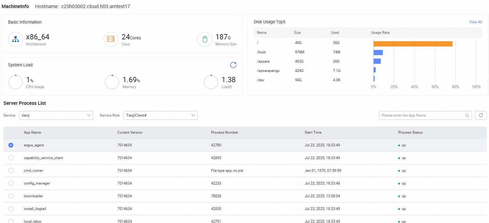

<a id="section-2-1-2"></a>

### 2.1.2. Check the status of a gateway server

This topic describes how to check the status of a gateway server.

**Procedure**

1. Log in to the **Apsara Infrastructure Management** console.

   Log in to the Apsara Uni-manager Operations Console. In the top navigation bar, choose **Platform Operation > Apsara Infrastructure Management > Resource Management**.

2. Go to the BasicCluster details page.

   

3. Click the Resource Details tab. On the **Resource Details** tab, enter **dpbizalisa** in the **Resource Name** field, and filter resources of the **db** type.

4. Find the resource that you want to view and click the  icon in the Resource Application

   Result column to view the address, username, and password used to log in to the database.

   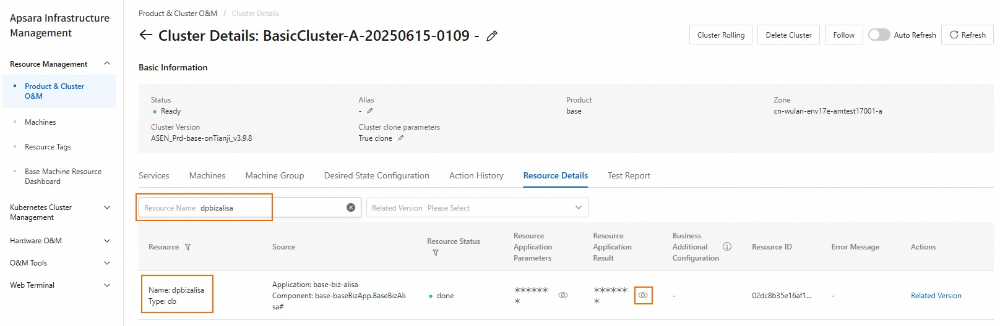

5. Connect to the database and run the following MySQL command to query the node information:

   ```sql
   Select * from alisa_node;
   ```

   If -1 or 0 is returned for the **active_type** or **live** parameter, the service is abnormal. In this case, contact Apsara Stack technical support.

<a id="section-2-1-3"></a>

### 2.1.3. Monitor service roles and servers

This topic describes how to view the details of monitored service roles and servers.

**Procedure**

1. Log in to the **Apsara Infrastructure Management** console.

   Log in to the Apsara Uni-manager Operations Console. In the top navigation bar, choose **Platform Operation > Apsara Infrastructure Management > Resource Management**.

2. Go to the details page of your cluster. In this example, the BasicCluster cluster of the base service is used.

   

3. Click the **Services** tab, find the **base-baseBizApp** service and click its name to go to the Components Details page.

4. In the **Components** section, find the component that you want to manage and click its name. On the right side of the page, view the servers on which the component is deployed.

5. Find the server that you want to manage and choose **Component Information > Metrics** in the **Actions** column.

6. In the **Component Metrics** dialog box, view the information on the **Component Metrics** and **Machine Metrics** tabs.

<a id="section-2-2"></a>

## 2.2. View logs of the services

Logs of the gateway service are stored in  `/home/admin/alisatasknode/logs/alisatasknode.log` .

Logs of the cdp services are stored in  `/home/admin/cdp_server/logs/cdp_server.log` .

Logs of other services are stored in  `/home/admin/base-biz-[service name]/base-biz-[service name].log` .

For example, the logs of the base-biz-phoenix service are stored in  `/home/admin/base-biz-phoenix/base-biz-phoenix.log` .

<a id="section-2-3"></a>

## 2.3. Scale out the cluster that runs the base-biz-gateway service

This topic describes how to scale out the base cluster that runs the base-biz-gateway service.

**Prerequisites**

The system is conducive to change. For example, make sure that the storage space is sufficient, and verify the prerequisites such as the permissions on the files, the owners and paths of the files, and the software version.

- The base cluster is at desired state and works as expected.

- A screenshot of the key initial configurations of the cluster is saved.

- IP addresses do not conflict. If you want to use a new buffer cluster for the scale-out operation, make sure that the IP addresses that Deployment Planner assigns to the servers in the cluster are not used in the current environment. This prevents exceptions due to IP address conflicts after the scale-out.

**Procedure**

1. Create a buffer cluster.

   Skip this step if an existing buffer cluster has idle servers and the physical machine, memory, CPU, and disk size of the idle servers are the same as those of current servers that run the base-biz-gateway service.

   Note: In the scale-out procedure, use actual parameter values and IP addresses instead of the parameter values in this example.

   > **Note**
   >
   > When you plan to scale out the cluster by using Deployment Planner, make sure that the name of the new buffer cluster is different from that of any existing buffer cluster.

   <ol type="i">

   <li>

   Copy and paste _tianji_imports to the /apsarapangu/disk3/u_disk/ directory of the OPS1 server and run the following command in the tianji_zhuque_sdk directory:

   ```text
   ./tianji_zhuque_exchanger.py import --skip_packages -o ${Desired state of Apsara Infrastructure Management} -c tianji_dest.conf
   ```

   </li>

   <li>

   Log in to the **Apsara Infrastructure Management console**. In the left-side navigation

   </li>

   </ol>

   pane, choose **Resource Management > Product & Cluster O&M**. In the **Products** section of the Product & Cluster O&M page, find the **buffer** service.

   <ol type="i" start="3">

   <li>

   Find the buffer cluster that you want to view and click Cluster Details in the Actions

   </li>

   </ol>

   column to go to the details page of the cluster. On this page, view the status of servers in the cluster.

   <ol type="i" start="4">

   <li>

   Run the following commands on the OPS1 server to call API operations to query scale-out information:

   ```bash
   cd /cloud/app/tianji-tools/PrivateCloudTool#/tianji_ops_tool/current
   ln -s 
   /cloud/data/bootstrap_controller/BootstrapController#/bootstrap_controller/tianji_des
   conf clt2.conf
   ./tianji_clt machinestatus -c buffer --config clt2.conf
   ```

   </li>

   </ol>

2. Scale in the buffer cluster by moving idle servers to the default cluster.

   > **Note**
   >
   > You can use the default cluster to scale out the cluster that runs the base-biz-cdp and base-biz-gateway services.

   <ol type="i">

   <li>

   On the **Cluster Details** page, click the **Desired State Configuration** tab.

   </li>

   <li>

   Click the **machine_group.conf** file.

   </li>

   </ol>

   Make sure that the value of the **scalable** parameter is **true** for the new buffer cluster.

   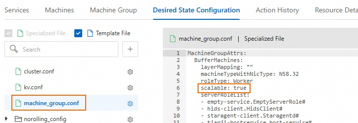

   <ol type="i" start="3">

   <li>

   Run the following commands on the OPS1 server to scale in the buffer cluster:

   </li>

   </ol>

   ```bash
   cd /cloud/app/tianji-tools/PrivateCloudTool#/tianji_ops_tool/current
   ln -s 
   /cloud/data/bootstrap_controller/BootstrapController#/bootstrap_controller/tianji_des
   conf clt2.conf (If a message indicating that a soft link already exists appears after you run this command, proceed with the next command.)
   ./tianji_ops_tool.py contract_nc -c [buffer cluster name] -l [Hostname of the server to be removed], [Hostname of the server to be removed],.... --config clt2.conf -s
   [SRG name]
   ```

   | Parameter | Description |
   | --- | --- |
   | -c | The name of the buffer cluster that you want to scale in, which starts with buffer-cluster. |
   | -l | The list of hostnames of servers to be removed. Separate multiple hostnames with commas (,). |
   | -s | The name of the service resource group (SRG) to which the servers belong. You can find the SRG name in the machine_group.conf file of the buffer cluster. |
   | -config | The tianji_clt file.<br>Note<br>These commands cannot contain Chinese characters. |

   <ol type="i" start="4">

   <li>

   On the **Product & Cluster O&M** page, verify whether the servers are removed.

   </li>

   <li>

   Run the following commands on the OPS1 server to call API operations to query scale-in information:

   ```bash
   cd /cloud/app/tianji-tools/PrivateCloudTool#/tianji_ops_tool/current
   ln -s 
   /cloud/data/bootstrap_controller/BootstrapController#/bootstrap_controller/tianji_des
   conf clt2.conf (If a message indicating that a soft link already exists appears after you run this command, proceed with the next command.)
   ./tianji_clt machinestatus -c default --config clt2.conf
   ```

   </li>

   <li>

   Go to the details page of the new buffer cluster and check whether the configurations of the servers are deleted from the machine_group.conf file. If the configurations of the servers still exist, delete them from the machine_group.conf file and then submit a rolling task.

   </li>

   </ol>

3. Add servers to the base cluster and specify the name of the SRG to which the servers belong.

   <ol type="i">

   <li>

   In the left-side navigation pane of the **Apsara Infrastructure Management** console, choose Resource Management > **Product & Cluster O&M**.

   </li>

   <li>

   On the **Product & Cluster O&M** page, find the base cluster.

   </li>

   <li>

   Click **Cluster Details** in the Actions column. On the Cluster Details page, verify whether

   </li>

   </ol>

   the **Cluster clone parameters** is set to **True clone**.

   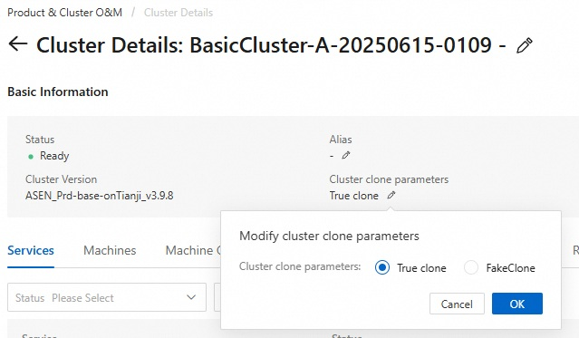

   <ol type="i" start="4">

   <li>

   Run the following commands to perform scaling. A rolling task is triggered after you run these commands.

   ```bash
   cd /cloud/app/tianji-tools/PrivateCloudTool#/tianji_ops_tool/current
   ln -s 
   /cloud/data/bootstrap_controller/BootstrapController#/bootstrap_controller/tianji_des
   conf clt2.conf (If a message indicating that a soft link already exists appears after you run this command, proceed with the next command.)
   ```

   To add servers to the cluster that runs the base-biz-gateway service, run the following command:

   ```text
   ./tianji_ops_tool.py expand_nc -c [base cluster name] -s BaseGwGroup -l 
   [machine1,machine2] --config clt2.conf
   ```

   To add servers to the cluster that runs the base-biz-cdp service, run the following command:

   ```text
   ./tianji_ops_tool.py expand_nc -c [BasicCluster cluster name] -s BaseCdpGwGroup -l 
   [machine1,machine2] --config clt2.conf
   ```

   </li>

   <li>

   Run the following command to call an API operation to query the scaling result:

   ```bash
   curl http://127.0.0.1:7070/api/v3/column/m.*?m.id=[machine hostname]
   ```

   </li>

   <li>

   Log in to the OpsClone container and run the following command to view the clone status:

   ```text
   /home/tops/bin/python /root/opsbuild/bin/opsbuild.py acli list --status=ALL -n 10000 | vim -
   ```

   </li>

   </ol>

4. Export the file that contains the information about the recent desired state.

   After you complete the scale-out, export the file that contains the information about the recent desired state to Deployment Planner. This ensures the success of subsequent scale-in and scale-out operations.

5. Verify the result.

   <ol type="i">

   <li>

   Check the heartbeat logs of the servers.

   Open the terminal of each added server, log on to the gateway container, and then run the  `tail -f /home/admin/alisatasknode/logs/heartbeat.log`  command.

   If the logs are refreshed every 5 seconds, the heartbeat service is run as expected.

   </li>

   <li>

   Query the database information and check whether the servers are online.

   </li>

   </ol>

   Log in to the **Apsara Infrastructure Management console**. Go to the **Cluster Details** page of the base cluster, click the **Resource Details** tab, and then search for the **base-**

   **biz-alisa** service of the **db** type. Click the  icon in the **Resource Application Result**

   column to view the database connection information.

   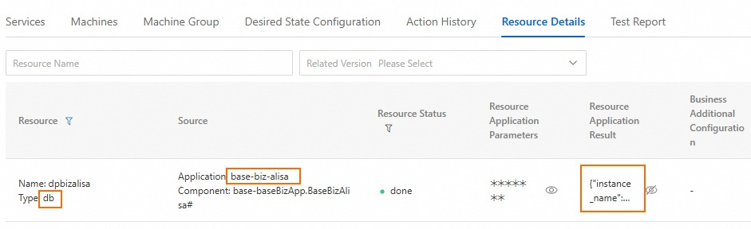

   Connect to the database by executing a MySQL command and run the  `select * from alisa_node;`  command. The information about all servers that run the base-biz-gateway service appears.

   Check the values of the live and active_type parameters for each added server. If both the values are 1, the server is online.

<a id="section-2-4"></a>

## 2.4. Scale in the cluster that runs the base-biz-gateway service

**Usage notes**

If a server that runs the base-biz-gateway service fails, you can redeploy the server after it is repaired.

If you want to remove a healthy server from the cluster that runs the base-biz-gateway service, perform the steps described in this topic.

> **Note**
>
> Before you remove a healthy server, perform an on-site check to ensure that the following conditions are met:
>
> - No business applications are running on the server.
>
> - The hostname of the server is correct.

**Procedure**

Perform checks before the scale-in

1. Perform an on-site check.

   Collect the detailed information about the server to be removed and the cluster of the server.

2. Make sure that the value of the scalable parameter is true for the service resource group (SRG) of the server to be removed. If the value is false, change it to true and submit a rolling task.

   Log in to the Apsara Infrastructure Management console. In the left-side navigation pane, choose **Resource Management > Product & Cluster O&M**. On the Product & Cluster O&M page, find the base cluster and click Cluster Details in the Actions column to go to the cluster details page. On the Desired State Configuration tab, click the **machine_group.conf** file and verify whether the value of the scalable parameter is true.

   

Stop the base-biz-gateway service

1. Log in to the server to be removed and run the  `ps -ef|grep gateway`  command to obtain the container ID of the base-biz-gateway service.

2. Run the  `docker exec -it [container-id] bash`  command to log on to the container.

3. Switch to the admin account and run the  `/home/admin/alisatasknode/target/alisatasknode/bin/servervtl stop`  command.

4. Run the  `ps -ef|grep java`  command to check whether any process is running on the server. If a running process exists, run the  `kill -9 [process ID]`  command to terminate the process.

5. Delete the program directories from the server.

   Clean up the disks of the server. Skip this step if you want to clone the server.

   ```text
   #rm -rf /home/admin/*
   ```

   ```text
   #rm -rf /opt/taobao/tbdpapp/
   ```

Scale in the cluster by moving servers to the default cluster

1. Run the following commands on the OPS1 server to scale in the cluster:

   ```bash
   cd /cloud/app/tianji-tools/PrivateCloudTool#/tianji_ops_tool/current
   ln -s 
   /cloud/data/bootstrap_controller/BootstrapController#/bootstrap_controller/tianji_dest.
   nf clt2.conf (If a message indicating that a soft link already exists appears after you run this command, proceed with the next command.)
   ./tianji_ops_tool.py contract_nc -c [clusterName] -l [machineList] --config 
   tianji_clt.conf -s [SRGname]
   ```

   Parameters:

   - -c: the name of the base cluster to be scaled in. To obtain the cluster name, go to the Product & Cluster O&M page and search for the base cluster. This parameter is required.

   - -l: the hostname of the server to be removed. Separate multiple hostnames with commas (,). This parameter is required.

   - -s: the name of the SRG to which the server to be removed belongs. This parameter is required. To view the SRG name, find the machine_group.conf file of the base cluster and view the SRG name in the file.

     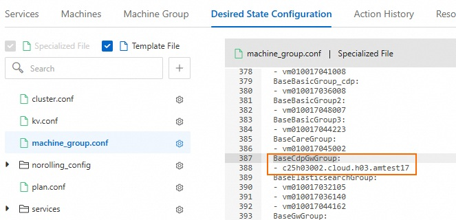

   - -config: the tianji_clt configuration file. This parameter is required.

     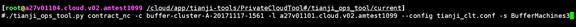

2. After you run the preceding commands, check whether the scale-in operation succeeds in the Apsara Infrastructure Management console.

   You can follow the preceding steps to scale in a cluster by moving servers to the default cluster in Apsara Infrastructure Management. If you want to remove a server from Apsara Infrastructure Management, perform the steps described in the following section.

Remove a server from Apsara Infrastructure Management

1. In the left-side navigation pane, choose **Resource Management > Machines**.

2. On the Machines page, click **Publish/Unpublish**. On the page that appears, click the **Machine Unpublishing** tab.

3. Find the server that you want to remove.

   <ol type="i">

   <li>

   Search for the server to be removed by hostname in the left-side Machines section. You can only remove servers in the default cluster.

   </li>

   <li>

   If the server can be removed, the server is displayed on the right side of the page. Click

   </li>

   </ol>

   **Clear** in the Actions column to remove the server.

Verify the result

1. Check whether a server is moved from your cluster to the default cluster.

   In the left-side navigation pane, choose **Resource Management > Machines**. On the Machines page, search for the server by hostname and check whether it is in the default cluster.

2. Check whether a server is removed from Apsara Infrastructure Management

   In the left-side navigation pane, choose **Resource Management > Machines**. On the Machines page, search for the server by hostname. If you cannot find the server in the search results, the server is removed.

3. You can also run the following command on the OPS1 server to call the GetMachineInfo operation to check whether the server is removed from Apsara Infrastructure Management:

   ```bash
   curl http://127.0.0.1:7070/api/v5/GetMachineInfo?hostname=$hostname
   ```

   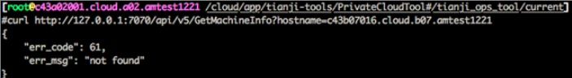

<a id="section-2-5"></a>

## 2.5. Restart the BaseBizTenant service

This topic describes how to restart the BaseBizTenant service on the Component Details page.

**Go to the Component Details page**

1. Log in to the **Apsara Infrastructure Management** console.

   Log in to the Apsara Uni-manager Operations Console. In the top navigation bar, choose **Platform Operation > Apsara Infrastructure Management > Resource Management**.

2. Go to the details page of your cluster. In this example, the BasicCluster cluster of the base service is used.

   

3. On the **Services** tab, find the **base-baseBizApp** service and click its name to go to the **Component Details** page.

**Restart the BaseBizTenant service**

1. In the Components section, find **BaseBizTenant** and click its name.

2. Find the server on which the service is deployed and click its name to go to the server details page.

3. Click **Terminal** in the upper-right corner.

4. In the left-side navigation pane, click the server name. The configuration tab appears on the right side of the page.

5. Enter  `docker ps|grep tenant`  in the code editor and press Enter to view the server ID.

   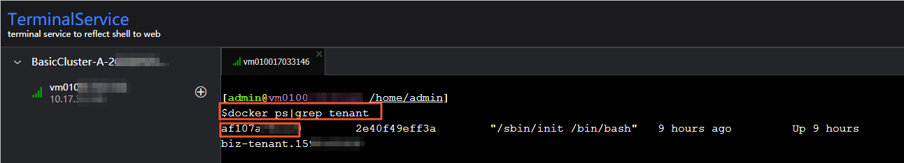

6. Enter  `docker exec -it yourID bash`  in the code editor and press Enter to go to the corresponding container.

   > **Note**
   >
   > You need to replace *yourID* with a container ID.

7. Enter  `su - admin`  in the code editor and press Enter to switch to the admin account.

8. Enter  `/home/admin/base-biz-tenant/bin/jbossctl restart`  in the code editor and press Enter to restart the BaseBizTenant service.

   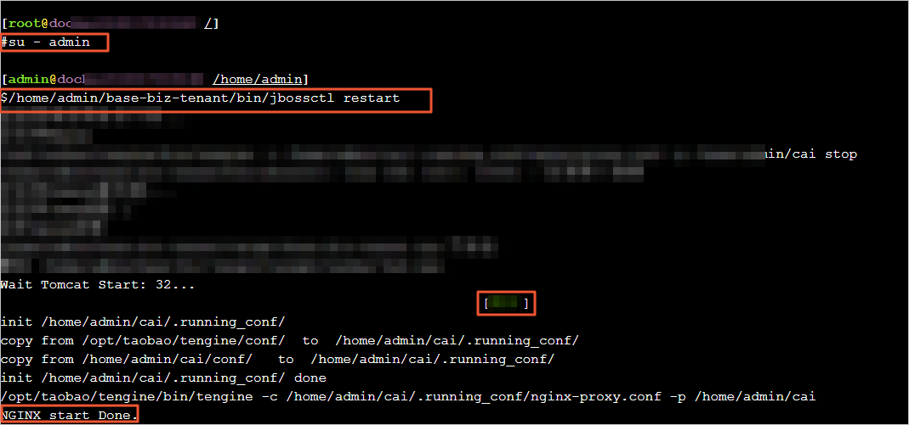

   If the **OK** and **NGINX start Done** messages appear, the BaseBizTenant service is restarted.

<a id="section-2-6"></a>

## 2.6. Restart the Redis service

This topic describes how to restart the Redis service on the Component Details page.

**Go to the Component Details page**

1. Log in to the **Apsara Infrastructure Management** console.

   Log in to the Apsara Uni-manager Operations Console. In the top navigation bar, choose **Platform Operation > Apsara Infrastructure Management > Resource Management**.

2. Go to the details page of your cluster. In this example, the BasicCluster cluster of the base service is used.

   

3. On the **Services** tab, find the **base-baseBizApp** service and click its name to go to the **Component Details** page.

**Restart the Redis service**

1. In the Components section, find the **Redis1** service and click its name.

2. Find the server on which the service is deployed and click its name to go to the server details page.

3. Click **Terminal** in the upper-right corner.

4. In the left-side navigation pane, click the server name. The configuration tab appears on the right side of the page.

5. Enter  `docker ps|grep redis`  in the code editor and press Enter to view the server ID.

   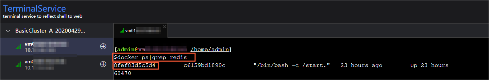

6. Enter  `docker exec -it yourID bash`  in the code editor and press Enter to go to the corresponding container.

   > **Note**
   >
   > You need to replace *yourID* with a container ID.

7. Enter the following statements in the code editor and press Enter to restart the Redis service:

   ```text
   /etc/init.d/redis restart
   ```

   ```text
   /etc/init.d/redis-sentinel restart
   ```

   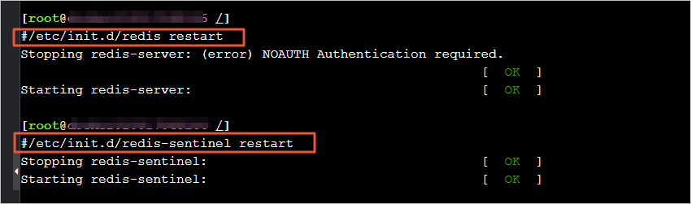

<a id="section-2-7"></a>

## 2.7. Restart the BaseBizDmc service

This topic describes how to restart the BaseBizDmc service on the Component Details page.

**Go to the Component Details page**

1. Log in to the **Apsara Infrastructure Management** console.

   Log in to the Apsara Uni-manager Operations Console. In the top navigation bar, choose **Platform Operation > Apsara Infrastructure Management > Resource Management**.

2. Go to the details page of your cluster. In this example, the BasicCluster cluster of the base service is used.

   

3. On the **Services** tab, find the **base-baseBizApp** service and click its name to go to the **Component Details** page.

**Restart the BaseBizDmc service**

1. In the Components section, find the **BaseBizDmc** service and click its name.

2. Find the server on which the service is deployed and click its name to go to the server details page.

3. In the left-side navigation pane, click the server name. The configuration tab appears on the right side of the page.

4. Enter  `docker ps|grep dmc`  in the code editor and press Enter to view the server ID.

   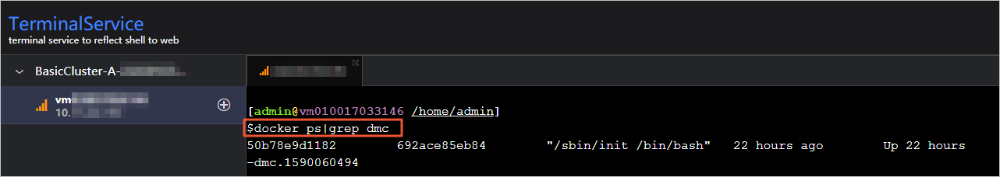

5. Enter  `docker exec -it yourID bash`  in the code editor and press Enter to go to the corresponding container.

   > **Note**
   >
   > You need to replace *yourID* with a container ID.

   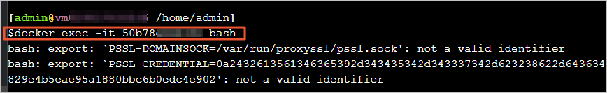

6. Enter  `su - admin`  in the code editor and press Enter to switch to the admin account.

   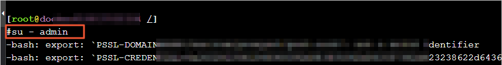

7. Enter  `/home/admin/base-biz-dmc/bin/jbossctl restart`  in the code editor and press Enter to restart the BaseBizDmc service.

   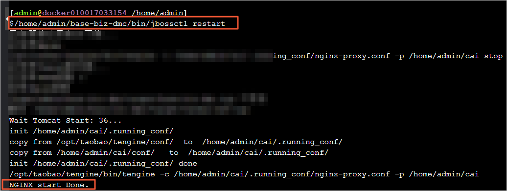

   If the **OK** and **NGINX start Done** messages appear, the BaseBizDmc service is restarted.

<a id="section-2-8"></a>

## 2.8. Restart the BaseBizAlisa service

This topic describes how to restart the BaseBizAlisa service on the Component Details page.

**Go to the Component Details page**

1. Log in to the **Apsara Infrastructure Management** console.

   Log in to the Apsara Uni-manager Operations Console. In the top navigation bar, choose **Platform Operation > Apsara Infrastructure Management > Resource Management**.

2. Go to the details page of your cluster. In this example, the BasicCluster cluster of the base service is used.

   

3. On the **Services** tab, find the **base-baseBizApp** service and click its name to go to the **Component Details** page.

**Restart the BaseBizAlisa service**

1. In the Components section, find the **BaseBizAlisa** service and click its name.

2. Find the server on which the service is deployed and click its name to go to the server details page.

3. Click **Terminal** in the upper-right corner.

4. In the left-side navigation pane, click the server name. The configuration tab appears on the right side of the page.

5. Enter  `docker ps|grep alisa`  in the code editor and press Enter to view the server ID.

   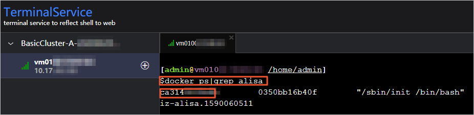

6. Enter  `docker exec -it yourID bash`  in the code editor and press Enter to go to the corresponding container.

   > **Note**
   >
   > You need to replace *yourID* with a container ID.

7. Enter  `su - admin`  in the code editor and press Enter to switch to the admin account.

8. Enter  `/home/admin/base-biz-alisa/bin/jbossctl restart`  in the code editor and press Enter to restart the BaseBizAlisa service.

   If the **OK** and **NGINX start Done** messages appear, the BaseBizAlisa service is restarted.

   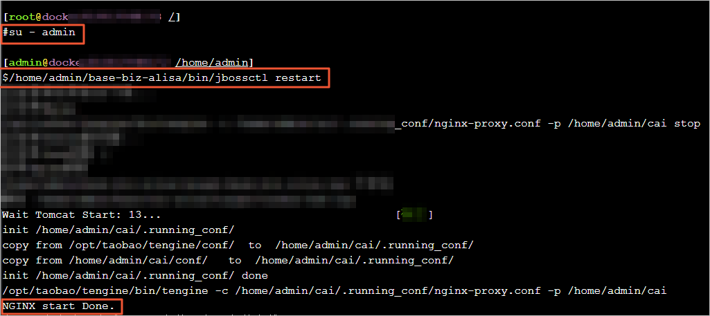

<a id="section-2-9"></a>

## 2.9. Restart the BaseBizPhoenix service

This topic describes how to restart the BaseBizPhoenix service on the Component Details page.

**Go to the Component Details page**

1. Log in to the **Apsara Infrastructure Management** console.

   Log in to the Apsara Uni-manager Operations Console. In the top navigation bar, choose **Platform Operation > Apsara Infrastructure Management > Resource Management**.

2. Go to the details page of your cluster. In this example, the BasicCluster cluster of the base service is used.

   

3. On the **Services** tab, find the **base-baseBizApp** service and click its name to go to the **Component Details** page.

**Restart the BaseBizPhoenix service**

1. In the Components section, find the **BaseBizPhoenix** service and click its name.

2. Find the server on which the service is deployed and click its name to go to the server details page.

3. Click **Terminal** in the upper-right corner.

4. In the left-side navigation pane, click the server name. The configuration tab appears on the right side of the page.

5. Enter  `docker ps|grep phoenix`  in the code editor and press Enter to view the server ID.

   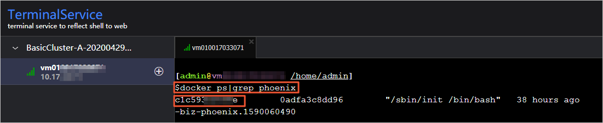

6. Enter  `docker exec -it yourID bash`  in the code editor and press Enter to log on to the corresponding container.

   > **Note**
   >
   > You need to replace *yourID* with the container ID.

7. Enter  `su - admin`  in the code editor and press Enter to switch to the admin account.

8. Enter  `/home/admin/base-biz-phoenix/bin/jbossctl restart`  in the code editor and press Enter to restart the BaseBizPhoenix service.

   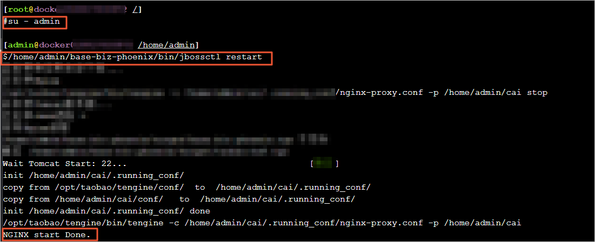

   If the **OK** and **NGINX start Done** messages appear, the BaseBizPhoenix service is restarted.

<a id="section-2-10"></a>

## 2.10. Restart the BaseBizCdpGateway service

This topic describes how to restart the BaseBizCdpGateway service on the Component Details page.

**Go to the Component Details page**

1. Log in to the **Apsara Infrastructure Management** console.

   Log in to the Apsara Uni-manager Operations Console. In the top navigation bar, choose **Platform Operation > Apsara Infrastructure Management > Resource Management**.

2. Go to the details page of your cluster. In this example, the BasicCluster cluster of the base service is used.

   

3. On the **Services** tab, find the **base-baseBizApp** service and click its name to go to the **Component Details** page.

**Restart the BaseBizCdpGateway service**

1. In the Components section, find the **BaseBizCdpGateway** service and click its name.

2. Find the server on which the service is deployed and click its name to go to the server details page.

3. Click **Terminal** in the upper-right corner.

4. In the left-side navigation pane, click the server name. The configuration tab appears on the right side of the page.

5. Enter  `docker ps|grep gateway`  in the code editor and press Enter to view the server ID.

   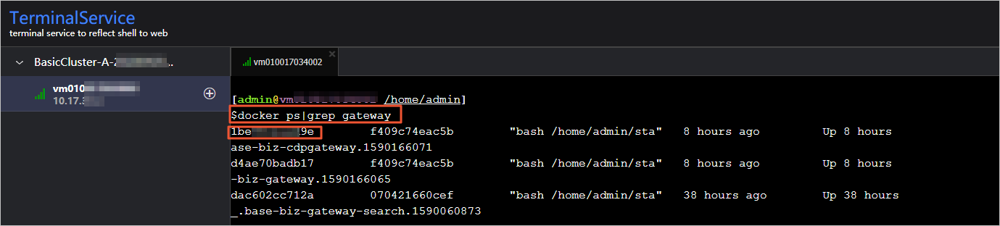

6. Enter  `docker exec -it yourID bash`  in the code editor and press Enter to enter the corresponding container.

   > **Note**
   >
   > You need to replace *yourID* with a container ID.

   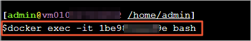

7. Enter  `su - admin`  in the code editor and press Enter to switch to the admin account.

8. Enter  `/home/admin/alisatasknode/target/alisatasknode/bin/serverctl restart`  in the code editor and press Enter to restart the BaseBizCdpGateway service.

<a id="section-2-11"></a>

## 2.11. Restart the dataworks-dataservice service

**Procedure**

1. Log in to the **Apsara Infrastructure Management** console.

   Log in to the Apsara Uni-manager Operations Console. In the top navigation bar, choose **Platform Operation > Apsara Infrastructure Management > Resource Management**.

2. Go to the details page of a cluster. In this example, the BaseExchangeCluster cluster is used.

   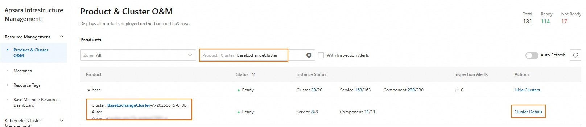

3. On the **Services** tab, find the **dataworks-dataservice** service and click its name to go to the Component Details page.

4. On the Component Details page, click the component that you want to manage. The server information is displayed on the right side of the page.

   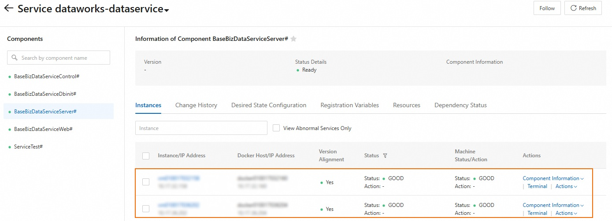

5. Click Terminal in the Actions column of a server. Run the  `docker ps|grep phoenix` command to obtain the container ID.

   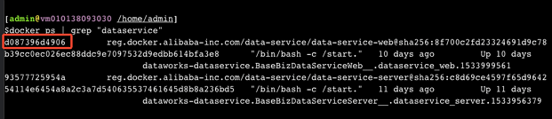

6. Run the  `docker exec -it [Container ID] bash`  command to log on to the container.

7. Switch to the admin account and run the  `/home/admin/data-service-web/bin/jbossctl restart`  command to restart the service.

   If you are restarting the server, run the  `/home/admin/data-service-server/bin/jbossctl restart`  command.

8. If the service is in the **OK** state and the command output displays [ OK] -- SUCCESS at the end, the dataworks-dataservice service is restarted.

   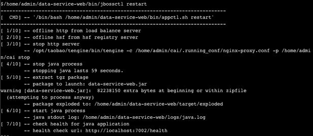

   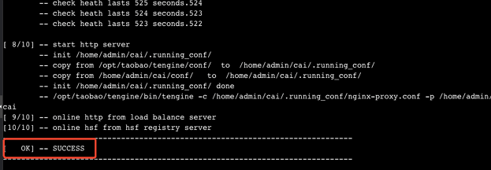

<a id="section-2-12"></a>

## 2.12. Restart the BaseBizCdpGateway service

**Procedure**

1. Log in to the **Apsara Infrastructure Management** console.

   Log in to the Apsara Uni-manager Operations Console. In the top navigation bar, choose **Platform Operation > Apsara Infrastructure Management > Resource Management**.

2. Go to the details page of your cluster. In this example, the BasicCluster cluster of the base service is used.

   

3. On the Services tab, find the **base-baseBizApp** service and click its name to go to the Component Details page.

   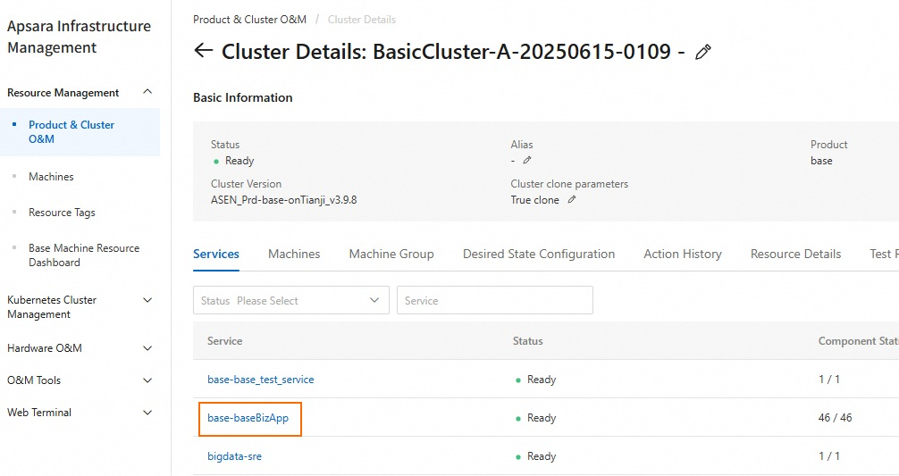

4. In the Components section, find the BaseBizCdpGateway service and click its name. The servers on which the BaseBizCdpGateway service is deployed appear on the right side of the page.

   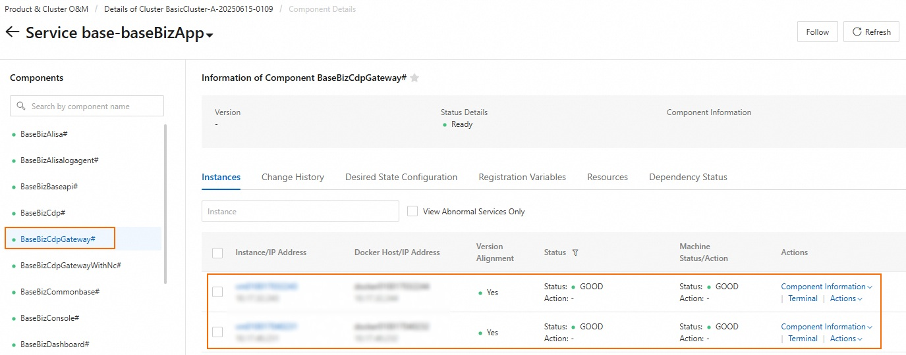

5. Click Terminal in the Actions column of a server. Run the  `docker ps|grep gateway` command to obtain the container ID.

6. Run the  `docker exec -it [Container ID] bash`  command to log on to the container.

7. Switch to the admin account and run the  `/home/admin/alisatasknode/target/alisatasknode/bin/serverctl restart`  command to restart the service.

   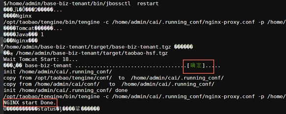

8. After you restart the service, run the  `ps -ef|grep java`  command to check whether the process is started.

   > **Note**
   >
   > The preceding steps can be performed to restart the BaseBizCdpGateway service that is deployed in a container.

**Restart the BaseBizCdpGateway service deployed on physical machines**

Perform the following steps to restart the BaseBizCdpGateway service that is deployed on physical machines:

1. Log in to the Apsara Infrastructure Management console, and go to the details page of the BasicCluster cluster. Click the Resource Details tab. On the Resource Details tab, find the base-biz-alisa service of the db type and view the value in the Resource Application Result column to obtain the database connection information.

2. Run the  `select * from alisa_node;`  command in the database to view all information about the BaseBizCdpGateway service. Then, you can log on to the cluster by using the obtained IP address and perform O&M operations on the BaseBizCdpGateway service.

   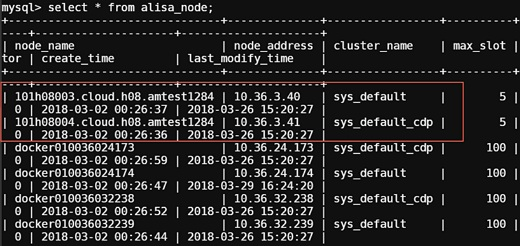

3. Log in to the server on which the BaseBizCdpGateway service is deployed, switch to the admin account, and then run the  `/home/admin/alisatasknode/target/alisatasknode/bin/serverctl restart`  command.

<a id="section-2-13"></a>

## 2.13. Configure a resource group in a multi-region environment

In a multi-region environment, nodes in all regions are run on the resource group named sys_default in the central region by default. This is the cause of resource preemption and node backlog. To resolve the issues, you must isolate resources and enable level-1 scheduling nodes in your region to run on your own resource groups.

**Prerequisites**

- Idle Elastic Compute Service (ECS) instance resources are available in a region rather than the central region. You can view the idle resources in the Apsara Infrastructure Management Framework console.

- Resource groups are created in DataWorks and resources are isolated.

- A custom resource group is specified as the default resource group in your workspace.

- Historical nodes that are run on the original default resource group are migrated to the new resource group. This is a high-risk operation.

**Create a resource group**

1. Go to the Schedule Resources page in DataWorks.

   <ol type="i">

   <li>

   Log on to the DataWorks console.

   </li>

   <li>

   Click the  icon in the upper-left corner and choose **All Products > Project**

   </li>

   </ol>

   **Management**.

   <ol type="i" start="3">

   <li>

   In the left-side navigation pane, click **Schedule Resources**.

   </li>

   </ol>

2. On the **Schedule Resources** page, click **Add scheduling resources** in the upper-right corner.

3. In the **Add scheduling resources** dialog box, set the **Resource Name** and **Belonging workspace** parameters. In this example, the resource name is **region_test**. The resource group belongs to a tenant that is a level-1 department. All workspaces that are created by the tenant can use this resource group, whereas other tenants need to create their own resource groups.

   After a resource group is created, a cluster that corresponds to the resource group is also created. In the background database, you can view the resource group in the **alisa_group** table and view the cluster in the **alisa_cluster** table.

4. Click **Confirm**. After you create the resource group, you can log on to the dpbizalisa background database to view detailed information about the resource group and cluster.

   ```sql
   select group_name,group_display_name,cluster_name,max_slot where 
   group_display_name='xxxx';
   select cluster_name,username,password from alisa_cluster where cluster_name ='xxxx';
   // max_slot: the number of slots that are assigned to the current resource group. Thenumber is determined based on actual resources and requirements. You must set the number of slots to a proper value.
   // group_display_name: the name of the custom resource group.
   // cluster_name: the name of the cluster that corresponds to the custom resource group.
   ```

**Migrate ECS instances to a new cluster**

1. To migrate an ECS instance, run the following command:

   ```sql
   update alisa_node set cluster_name='xxxxxx' where node_name='${hostname}';
   ```

2. To set the number of slots in the resource group to a proper value, run the following command:

   ```sql
   update alisa_group set max_slot = xxxx where group_display_name='region_test';
   ```

3. Restart the base-biz-alisa service. For more information, see Restart the BaseBizAlisa service.

   > **Note**
   >
   > Both base-biz-alisa services need to be restarted. After one base-biz-alisa
   >
   > service is restarted, you can restart the other.

**Specify the custom resource group as the default resource group in your workspace**

1. Log on to the dwphoenix background database to view data.

   ```sql
   select resource_group_id,name,identifier,is_default,project_env from phoenix_resgroup 
   where name = 'region_test';
   // resource_group_id: the ID of the resource group in the phoenix database.
   // name: the name of the resource group.
   // identifier: the name of the resource group in the alisa database.
   // project_env: the production environment or the development environment.
   select * from phoenix_app_resgroup where app_id=xxxx;
   // app_id: the ID of the project. The app_id parameter is equivalent to the project_id parameter that is described in other topics.
   ```

2. Specify a new resource group as the default resource group in your workspace.

   ```sql
   create table phoenix_app_resgroup_20200108_bak as select * from phoenix_app_resgroup; 
   // Back up the table.
   update phoenix_app_resgroup set is_default=1 where is_default=0 and app_id=xxxx;
   update phoenix_app_resgroup set is_default=0 where app_id=xxxx and 
   resource_group_id=1;
   select * from phoenix_app_resgroup where app_id=xxxx; // View data again after the change.
   ```

   > **Note**
   >
   > After the change, one workspace has only two data entries whose
   >
   > is_default value is 1. If the preceding result is not displayed, the change is invalid. You must check the operations you have performed.
   >
   > The resource group belongs to a tenant so that you must change the default resource group for all workspaces that are created by the tenant.

**Change the resource group for multiple nodes at a time**

You can change the resource group for multiple nodes at a time on the Operation Center page. If a large number of nodes exist, you must perform the change operation multiple times on the page until the resource group is changed for all the nodes. If you do not want to change the resource group in that way, you can change the resource group for all the nodes at a time in the scheduled database. However, this is a high-risk operation. To change the resource group in the database, you must perform the operations based on your business requirements. You must write the code based on the data in the current environment by following the template. In this example, the resource group for nodes in the datam4 workspace is changed to the resource group named region_test in the following way:

1. Log on to the dwphoenix database that corresponds to the base-biz-phoenix service.

2. Query the ID of the resource group named sys_default. The obtained value is used as the default ID.

   ```sql
   select resource_group_id from phoenix_resgroup where name='Default Group';
   ```

   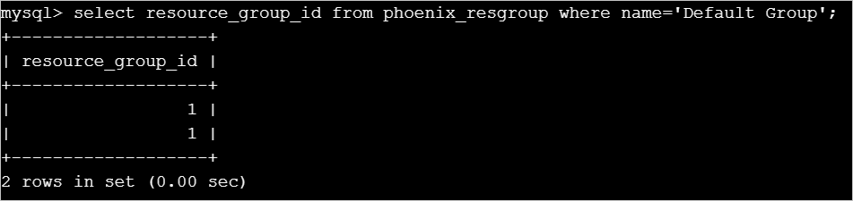

3. Query the ID of the resource group named region_test. The obtained value is used as the region_test_id value.

   ```sql
   select resource_group_id from phoenix_resgroup where name='region_test';
   ```

   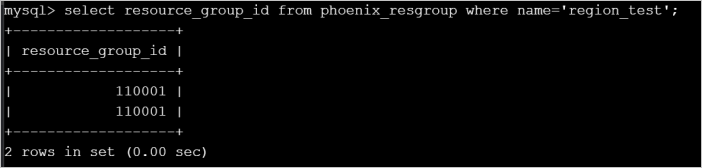

4. Query the ID of the required workspace. The obtained value is used as the app_id value.

   ```sql
   select app_id from phoenix_app_config where name="datam4";
   ```

5. Change the resource group for historical nodes in the workspace that you want to change to the new resource group named region_test.

   ```sql
   create table phoenix_node_def_20200108_bak as select * from phoenix_node_def; // Backup the table.
   update phoenix_node_def set resgroup_id={region_test_id} where resource_group_id={Default ID} and app_id={app_id};
   ```

   This way, the resource group for historical nodes in the datam4 workspace is changed to the resource group named region_test. After the resource group is changed, test whether all the historical nodes can be run as expected.

<a id="section-2-14"></a>

## 2.14. Configure a resource group for Data Integration in a multi-region environment

This topic describes how to configure a resource group for Data Integration in a multi-region environment.

**Procedure**

1. On the Data Integration page in DataWorks, create a custom resource group.

   This custom resource group must be real and can be used. In this example, you can specify the Elastic Compute Service (ECS) instance on which the **region_group** custom resource group is hosted as the default ECS instance to run nodes.

   <ol type="i">

   <li>

   Log on to the DataWorks console.

   </li>

   <li>

   Click the  icon in the upper-left corner and choose **All Products > Data Aggregation**

   </li>

   </ol>

   **> Data Integration**.

   <ol type="i" start="3">

   <li>

   In the left-side navigation pane, click **Custom Resource Group**.

   </li>

   <li>

   Click **Add Resource Group** in the upper-right corner.

   </li>

   </ol>

2. In the **Add Resource Group** wizard, perform the following steps:

   <ol type="i">

   <li>

   In the **Create Resource Group** step, set the **Resource Group Name** parameter.

   > **Note**
   >
   > The name can contain letters, digits, and underscores (_), and must start
   >
   > with a letter.

   </li>

   <li>

   Click **Next**.

   </li>

   <li>

   In the **Add Server** step, set the parameters as required.

   </li>

   <li>

   Click **Next**.

   </li>

   <li>

   Perform the steps that are described in the **Install Agent** step.

   > **Note**
   >
   > If an error occurs when you run the  `install.sh`  command or you need
   >
   > to run it again, run the  `rm –rf install.sh`  command in the same directory as the  `install.sh`  command to delete the generated file. Then, run the  `install.sh` command again.
   >
   > The commands to run during the installation and initialization process differ for each user. Run relevant commands based on the instructions on the initialization interface.

   </li>

   <li>

   Click **Next**.

   </li>

   <li>

   In the **Test Connection** step, click **Refresh** and check the status of the ECS instance.

   </li>

   <li>

   Click **Complete**.

   </li>

   </ol>

   Resource groups that you have created on the Data Integration page can be used only in workspaces to which they belong. If you create a resource group in Workspace A, this resource group cannot be used in Workspace B. If you need to use a resource group in Workspace B, perform the preceding steps to create one in Workspace B.

3. View the newly created resource group in the alisa database.

   ```sql
   select * from alisa_group where group_display_name='region_group'\G;
   ```

   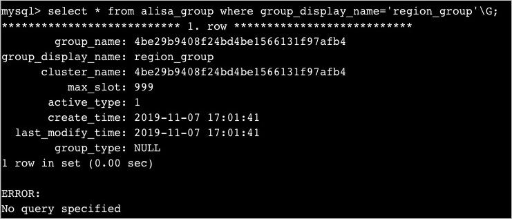

4. Create an alisa cluster. To deploy services in a new region, you must first create an alisa cluster. You can find the dpbizalisa database and execute the following SQL statements in this database:

   ```text
   insert ignore into alisa_cluster(
    cluster_name,
    cluster_display_name,
    username,
    password,
    create_time,
    last_modify_time
    )
    values(
    'sys_region_cdp_${regionId}',
    'sys_region_cdp_${regionId}',
    'private_cluster',
    'tyn3n71c2oyhah447m6fnfuq',
    now(),
    now()
    );
   ```

   Replace **${regionId}** in the code with an actual value. You can log on to the Apsara Infrastructure Management console and go to the **Cluster Configuration** tab to view the cluster file.

5. Migrate the ECS instance that you have bound to the custom resource group to this cluster.

   ```sql
   update alisa_node set cluster_name='sys_region_cdp_${regionId}' where node_name='ECS instance name';
   ```

   > **Note**
   >
   > You must check the name of the ECS instance in the current region.

6. Mount the cluster that is created in this region to the resource group.

   ```sql
   update alisa_group set cluster_name='sys_region_cdp_${regionId}' where 
   group_name='4be29b9408f24bd4be1566131f97afb4';
   ```

   In the code, **group_name** indicates the resource group name that is specified in Step 2.

7. Log on to the Apsara Infrastructure Management console and restart the BaseBizAlisa service.

8. On the configuration tab of a sync node, select the name of the required custom resource group, and save and commit the node. The preceding steps describe how to create a resource group in a region for the first time. If you need to create resource groups for multiple workspaces, repeat steps 1, 2, 3, 6, and 7 to create resource groups as required. To perform the rollback operation, run the following command:

   ```sql
   update alisa_group set cluster_name='4be2***' where group_name='4be2***';
   ```

   > **Note**
   >
   > **group_name** and **cluster_name** indicate the name and cluster name of
   >
   > the custom resource group.

<a id="section-3"></a>

# 3.O&M by using Apsara Big Data Manager

<a id="section-3-1"></a>

## 3.1. Log on to Apsara Bigdata Manager

This topic describes how to log on to Apsara Bigdata Manager.

**Prerequisites**

- The endpoint of the Apsara Uni-manager Operations Console and the username and password that are used to log in to the console are obtained from a deployment engineer or an administrator.

  The endpoint of the Apsara Uni-manager Operations Console is in the following format: *regi on-id*.ops.console.*intranet-domain-id*.

- A supported browser is used. We recommend that you use Google Chrome.

**Procedure**

1. Open your browser.

2. In the address bar, enter the endpoint of the Apsara Uni-manager Operations Console. Press the ENTER key.

   

   > **Note**
   >
   > You can click the current language in the upper-right corner to switch to another language. Simplified Chinese and English are supported.

3. Enter your username and password.

   > **Note**
   >
   > - Obtain the username and password that are used to log on to the Apsara Uni-manager Operations Console from a deployment engineer or an administrator.
   >
   > - If you enter an invalid password for three consecutive times, the system enables the image verification logon feature. If you enter an invalid password for five consecutive times, the account is locked. Contact the administrator to unlock the account.
   >
   > - The first time that you log on to the Apsara Uni-manager Operations Console, change the password for your username as prompted.
   >
   >   To enhance security, your password must meet the following requirements:
   >
   >   - The password contains uppercase and lowercase letters.
   >
   >   - The password contains digits.
   >
   >   - The password contains at least one of the following special characters: ! @ # $ %
   >
   >   - The password is 10 to 20 characters in length.

4. Click **Agree to Private Policy and Log On**.

5. After you log on to the Apsara Uni-manager Operations Console, click **Product O&M** in the top menu bar.

6. Select **Big Data O&M > General Big Data O&M · Apsara Bigdata Manager**, and the Dashboard page of Apsara Bigdata Manager opens automatically.

<a id="section-3-2"></a>

## 3.2. Monitoring

<a id="section-3-2-1"></a>

### 3.2.1. Dashboard

The Apsara Bigdata Manager (ABM) dashboard displays key operation information about DataWorks. It also provides more information about alerts for DataWorks. This helps you understand the overall status of the big data service. In addition, the dashboard supports automatic data refresh and full-screen display.

**Go to the dashboard**

After you log in to the ABM console, the **Instrument cluster** page appears by default. To

return to the **Instrument cluster** page, click the  icon in the upper-left corner and then

click **ABM**.

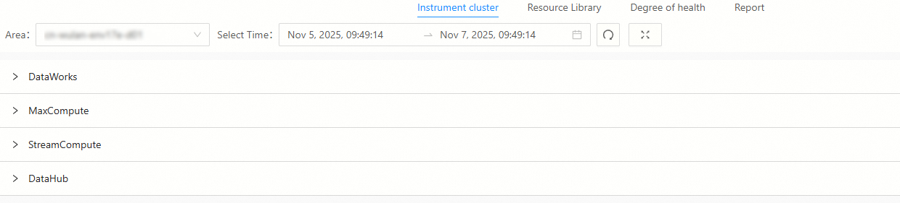

In the upper-left corner of the **Instrument cluster** page, you can select a **region** from the **Area** drop-down list to view the cluster status of each big data service in the region.

**View key operation metrics for DataWorks**

The Instrument cluster page displays key operation metrics for **DataWorks**. To view these metrics, click the **DataWorks** section on the **Instrument cluster** page.

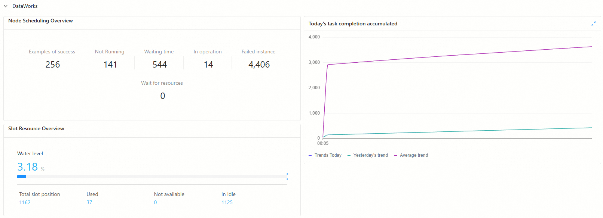

The **DataWorks** section displays the overview of node scheduling, overview of slot usage, and trend chart of completed tasks for a DataWorks cluster.

**Specify a time range to view metric data**

By default, the Instrument cluster page displays cluster metric data from the last two days. You can specify a time range to view the metric data.

In the **Select Time** section of the **Instrument cluster** page, specify the start time and end time by year, month, and day, and then click **OK** to display the metric data for the specified time range.

**Full-screen display**

The dashboard supports full-screen display. This feature allows you to view the status of big data services.

At the top of the **Instrument cluster** page, click the  icon to display the **Instrument**

**cluster** page in full-screen mode.

<a id="section-3-2-2"></a>

### 3.2.2. Resource library

The Resource Library page displays the resource usage of DataWorks. This topic describes how to go to the Resource Library page and view the resource information of DataWorks.

**Go to the Resource Library page**

1. Log in to the Apsara Big Data Manager (ABM) console.

   > **Note**
   >
   > After you log in to the ABM console, the **Instrument cluster** page appears by default. To return to the **Instrument cluster** page, click the
   >
   > icon in the upper-left corner
   >
   > 
   >
   > and then click **ABM**.

2. On the **Instrument cluster** page, click the **Resource Library** tab. The Resource Library page appears.

**View the resource library of DataWorks**

In the left-side navigation pane of the **Resource Library** page, click **DataWorks**. On the page that appears, you can view the resource usage in DataWorks.

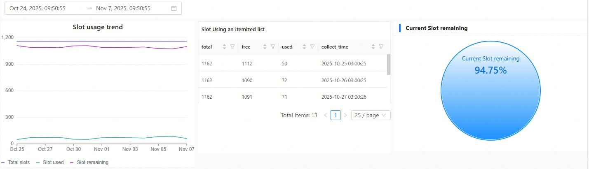

For DataWorks, the Resource Library page displays the trend chart of slot usage, records of slot usage, and proportion of idle slots.

**Other chart and table operations**

You can filter or sort records of CU usage and storage usage based on a column to facilitate information retrieval. For more information, see **Common operations** in the **ABM documentation**.

<a id="section-3-2-3"></a>

### 3.2.3. Health

In the Apsara Big Data Manager (ABM) console, the Degree of health page allows you to view the monitoring items of DataWorks and the alerts of different severity levels and check the monitoring items and alerts again after the alerts are handled.

**Procedure**

1. Log in to the ABM console.

   After you log in to the **ABM** console, the **Instrument cluster** tab appears by default. You

   can click the  icon in the upper-left corner and choose **Data Development >**

   **DataWorks**.

2. In the top navigation bar, click **Monitoring**.

3. Click the **Degree of health** tab to view the health check result.

   The Degree of health page displays the monitoring items, monitoring sources, severity level, and monitoring details. You can filter data based on your business requirements.

<a id="section-3-2-4"></a>

### 3.2.4. Reports

In the Apsara Big Data Manager (ABM) console, the Report page allows you to view the inspection results of DataWorks.

**Procedure**

1. Log in to the ABM console.

   After you log in to the **ABM** console, the **Instrument cluster** tab appears by default. You

   can click the  icon in the upper-left corner and choose **Data Development >**

   **DataWorks**.

2. In the top navigation bar, click **Monitoring**.

3. Click the **Report** tab to view the reports.

   The Report page displays the following information about each report: ID, Report Name, Product, Template Name, Instance Type, Created By, and Created At. You can also view the details about each report.

<a id="section-3-3"></a>

## 3.3. O&M

<a id="section-3-3-1"></a>

### 3.3.1. DataWorks O&M overview

This topic describes the DataWorks O&M features supported by Apsara Big Data Manager (ABM) and how to use the DataWorks O&M features.

**O&M modules**

ABM provides the service, cluster, and host O&M modules for DataWorks. The following table describes the modules.

**Module**

**Sub-module**

**Description**

Displays the key O&M metrics, including service overview, service status, instance scheduling information, and slot

Overview

usage. You can also view the trend chart of the total number of completed tasks.

Service role

Displays the service roles of DataWorks.

Displays information about slot usage in DataWorks and

Slot

allows you to change the number of slots in resource groups and hosts.

Instance

Displays information about instances.

Displays the projects of each tenant and allows you to

Project

change the default resource group of projects and nodes.

Service operation and maintenance

Displays the number of tasks created or modified on the

Business insights

> Data workshop

previous day by type and the corresponding trend chart.

Allows you to modify the configurations of DataWorks

Configuration

service roles based on your business requirements.

Restart service

Allows you to restart the base-biz-alisa service.

alisa

Scale-up for normal hosts and

Allows you to add or remove physical hosts in DataWorks.

scale-down for normal hosts

Displays information in the following charts: Current operating status, Three-way dependency-total number of

Overview

calls, Three-way dependency-call response time Max(ms), Tripartite Dependency-Call Failure Rate(ErrorRate), and Three-way dependency-QPS number of failed calls.

Service operation and maintenance

Displays the number of tasks of the current day by status

> Data

Instance

and allows you to view the trend chart of multi-dimensional

Integration

analysis on the tasks of the current day.

Displays the trend charts of multi-dimensional analysis and

Historical

time consumption analysis and the information about top

analysis

tasks.

Displays the key metrics and health check results of a

Overview

cluster in the Running Health, CPU, DISK, LOAD, MEMORY, and PACKAGE sections.

Cluster O&M

Displays all monitoring metrics of a cluster. You can view the details of monitoring metrics, solutions to the alerts

Health

triggered by the monitoring metrics, and status of each monitoring metric. You can also log on to a host and manually perform checks on the host.

Displays the information about a host in the Machine

Overview

Information, Machine Service Role Status, CPU, DISK, LOAD, MEMORY, and PACKAGE sections.

Host O&M

Displays the information about service roles, including the

Service role

cluster, service instance, and role name.

**Work with DataWorks O&M features**

1. Log in to the ABM console.

2. Click the  icon in the upper-left corner and choose **Data Development > DataWorks**.

3. In the upper-right corner of the page that appears, click **Operation and maintenance**. The **Overview** tab of **Data workshop** under **Service operation and maintenance** appears.

   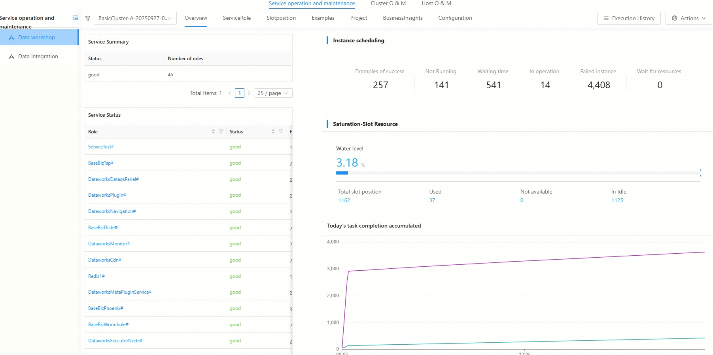

<a id="section-3-3-2"></a>

### 3.3.2. Service O&M

<a id="section-3-3-2-1"></a>

#### 3.3.2.1. Data Warehouse

<a id="section-3-3-2-1-1"></a>

##### 3.3.2.1.1. DataWorks service overview

The DataWorks Overview page displays the key operation metrics, including service overview, service status, instance scheduling information, and slot usage. On this page, you can also view the trend chart of the total number of finished tasks.

**Go to the DataWorks service overview page**

1. Log in to the Apsara Big Data Manager (ABM) console.

2. Click the  icon in the upper-left corner and choose Data Development > **DataWorks**.

3. In the top navigation bar, click **Operation and maintenance**. The **Overview** tab of **Data workshop** under **Service operation and maintenance** appears.

**Service summary**

This section displays the numbers of available services, unavailable services, and services that are being upgraded.

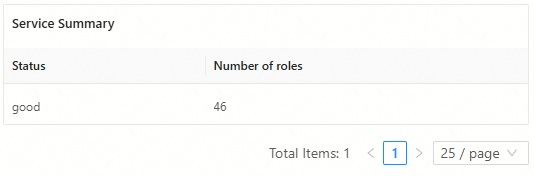

**Service status**

This section displays all DataWorks service roles and their status. You can also view the expected and actual numbers of hosts at desired state for each service role.

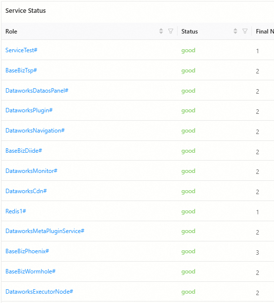

**Instance scheduling**

This section displays the number of successful instances, number of instances not running, waiting duration, number of running instances, number of failed instances, and number of instances waiting for resources.

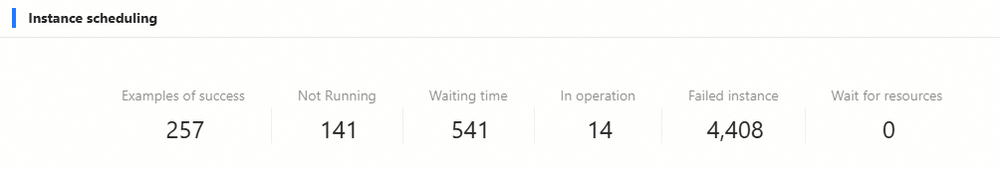

**Slot usage**

This section displays the total number of slots, the number of used slots, the number of unavailable slots, and the number of idle slots for DataWorks.

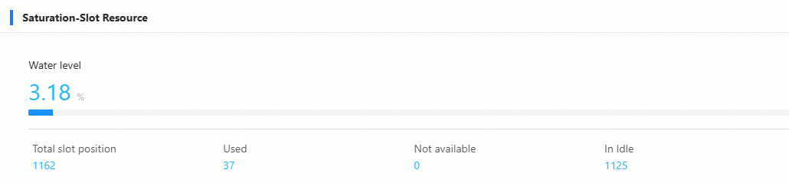

> **Note**
>
> Slots are resources that can be used by DataWorks for instance scheduling.

**Total number of finished tasks**

This section displays the trend chart of the total number of finished tasks. The trend chart displays the trend lines of the number of tasks finished yesterday, the number of tasks finished today, and the average number of tasks finished each day over time in different colors.

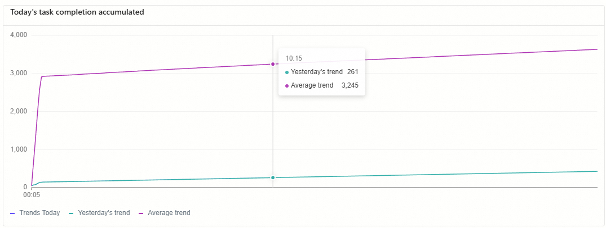

<a id="section-3-3-2-1-2"></a>

##### 3.3.2.1.2. DataWorks service roles

The Service Roles tab displays information about DataWorks service roles, such as the role name, status, and expected and actual numbers of hosts in the desired state.

**Go to the Service Roles tab**

1. Log on to the Apsara Big Data Manager (ABM) console.

2. Click the  icon in the upper-left corner and select **DataWorks**.

3. On the page that appears, click **O&M** in the upper-right corner. The **Overview** tab under **Data Warehouse** on the **Services** tab appears.

4. Select a cluster from the drop-down list and click the **Service Roles** tab.

   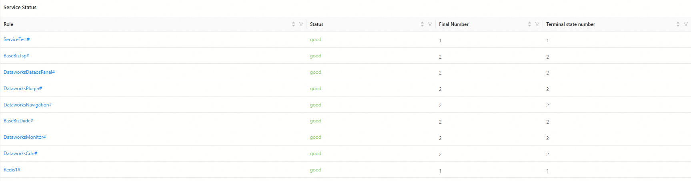

   The **Service Roles** tab displays information about all service roles, including the role status and expected and actual numbers of hosts in the desired state. The service role status can be **good**, **bad**, or **upgrading**.

**Supported operations on the Service Roles tab**

On the **Service Roles** tab, you can filter or sort service roles by column to facilitate information retrieval.

<a id="section-3-3-2-1-3"></a>

##### 3.3.2.1.3. DataWorks service slots

Slots are resources used to process tasks. Apsara Big Data Manager (ABM) allows you to view the slot information of DataWorks clusters, resource groups, and hosts. The information includes the maximum number of slots, the number of used slots, and slot usage. You can also view the usage of host resources, including the CPU, memory, and disk, migrate resource groups, modify the number of slots for resource groups or hosts, and modify the host status.

**Terms**

The resources required by Data Integration tasks are measured in data migration units (DMUs). A DMU contains a specific amount of resources, including CPU, memory, and network resources. It represents the minimum processing capability of a Data Integration task to synchronize data.

Resources measured by DMU are allocated by slot. Each DMU occupies two slots.

**Go to the DataWorks slot page**

1. Log in to the ABM console.

2. Click the  icon in the upper-left corner and choose Data Development > **DataWorks**.

3. In the top navigation bar, click **Operation and maintenance**. The **Overview** tab of **Data workshop** under **Service operation and maintenance** appears.

4. Select a cluster from the drop-down list and click the **Slotposition** tab.

**Cluster slots**

Click the **Cluster** tab on the **Slotposition** tab.

The **Cluster** tab displays the slot overview of all DataWorks clusters, including the total number of slots, the numbers of used slots and available slots, and slot usage. It also displays the cluster status.

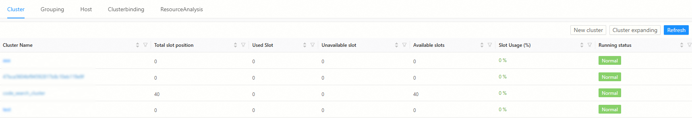

To view the slot details of a cluster, click the name of the cluster in the **Cluster Name** column.

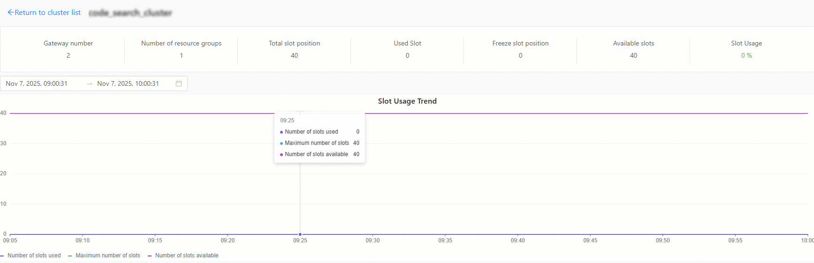

In the upper part of the cluster details page, you can view the numbers of gateways, resource groups, slots, used slots, frozen slots, and available slots, and the slot usage of the cluster. You can also view the trend chart of slot usage over time in the lower part of the page. The trend chart displays trend lines for the number of used slots, the maximum number of slots, and the number of available slots in different colors.

You can click a metric name below the chart to display or hide the related trend line. A highlighted metric name indicates that the related trend line is displayed, whereas a dimmed metric name indicates that the related trend line is hidden.

**Create a cluster**

1. In the upper-right corner of the **Cluster** tab, click **New cluster**.

2. In the **Add a new cluster** panel, configure the parameters.

   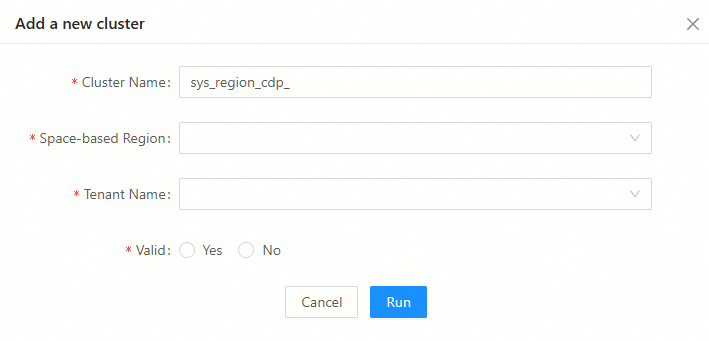

   | Parameter | Description |
   | --- | --- |
   | Cluster Name | The name of the cluster. |
   | Space-based Region | The region of the cluster. |
   | Tenant Name | The tenant to which the cluster belongs. |
   | Valid | The status of the cluster. Valid values: <strong>Yes</strong> and <strong>No</strong>. |

3. Click **Run**.

**Scale out a cluster**

1. In the upper-right corner of the **Cluster** tab, click **Cluster expanding**.

2. In the **Migrate a node cluster** dialog box, configure the parameters.

   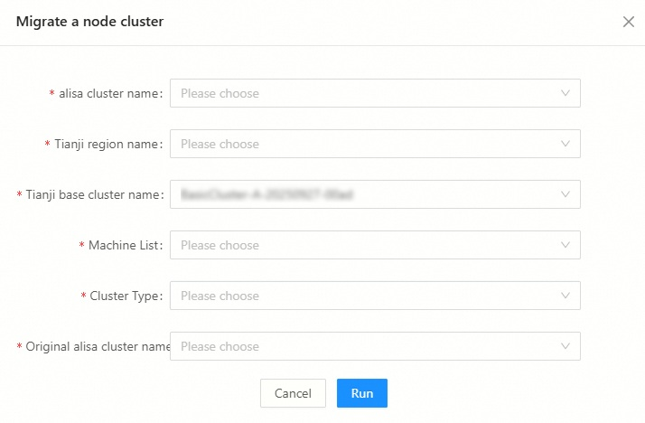

   | Parameter | Description |
   | --- | --- |
   | alisa cluster name | The name of the destination cluster. |
   | Tianji region name | The region of the cluster. |
   | Tianji base cluster name | The base cluster in Apsara Infrastructure Management. |
   | Machine List | The host. |
   | Cluster Type | The cluster type. |
   | Original alisa cluster name | The name of the source cluster. |

3. Click **Run**.

**Resource group slots**

Click the **Grouping** tab on the **Slotposition** tab.

The **Grouping** tab displays the slot overview of all DataWorks resource groups, including the maximum number of slots, the numbers of used slots and available slots, and slot usage. It also displays the name, cluster, project, and status of each resource group.


To view the slot details of a resource group, click the ID of the resource group in the **Resource group identity** column.


In the upper part of the resource group details page, you can view the current slot information of the resource group, such as the numbers of used slots, the maximum number of slots, the ratio of tasks under the resource group to tasks in the project, and the distribution of node types. You can also view the trend chart of slot usage over time, the nodes that occupy the slots, and the owners in the lower part of the page. The trend chart displays trend lines for the number of used slots, the maximum number of slots, and the number of available slots in different colors.

You can click a metric name below the chart to display or hide the related trend line. A highlighted metric name indicates that the related trend line is displayed, whereas a dimmed metric name indicates that the related trend line is hidden.

**Create a resource group**

1. In the upper-right corner of the **Grouping** tab, click **New resource group**.

2. In the **Add a resource group** panel, configure the parameters.

   

   | Parameter | Description |
   | --- | --- |
   | Cluster Name | The cluster associated with the resource group. |
   | Resource Group Name | The name of the resource group. |
   | Maximum slot position | The maximum number of slots. |
   | Resource group identity | The ID of the resource group. |

3. Click **Run**.

**Change the number of slots for a resource group**

If the number of slots for a resource group is insufficient or excessive, you can change this number to add or remove resources for the resource group.

1. On the **Grouping** tab, find the resource group that you want to manage and click **modify the slots** in the Operation column.

2. In the panel that appears, modify the **Maximum number of slots** parameter.

3. Click **Run**.

**Migrate a resource group**

If the cluster associated with a resource group has insufficient slots but does not support more slots, you can associate the resource group with another cluster.

1. On the **Grouping** tab, find the resource group that you want to manage and click **Migrate the cluster** in the Operation column.

2. In the panel that appears, modify the **Target Cluster** parameter.

3. Click **Run**.

**Host slots**

Click the **Host** tab on the **Slotposition** tab.

The **Host** tab displays the slot overview of all DataWorks hosts, including the maximum number of slots, the number of used slots, and the slot usage. It also displays the resource usage (including the CPU, memory, and disk), IP address, cluster, status, activeness, and monitoring status of each host.


To view the slot details of a host, click the name of the host in the **Host name** column.


In the upper part of the host details page, you can view the current slot information of the host, such as the number of used slots and the maximum number of slots. You can also view the trend chart of slot usage and resource usage (including the CPU, memory, and disk) over time in the lower part of the page. The trend chart displays trend lines for metrics in different colors.

You can click a metric name below the chart to display or hide the related trend line. A highlighted metric name indicates that the related trend line is displayed, whereas a dimmed metric name indicates that the related trend line is hidden.

**Modify the host status**

A host can be in the Normal, Not available, or Suspend state. You can modify the host status based on your business requirements.

1. On the **Host** tab, find the host that you want to manage and click **modification status** in the Operation column.

2. In the panel that appears, modify the **Status** parameter.

3. Click **Run**.

**Change the number of slots for a host**

If the number of slots for a host is insufficient or excessive, you can change this number to add or remove resources for the host.

1. On the **Host** tab, find the host that you want to manage and click **modify slots** in the Operation column.

2. In the panel that appears, modify the **Maximum number of slots** parameter.

3. Click **Run**.

**Scale out or in a cluster**

For more information, see DataWorks cluster scaling.

**Cluster association**

Click the **Clusterbinding** tab on the **Slotposition** tab.

The **Clusterbinding** tab displays the information about clusters on which the base-biz-alisa service is deployed, including tenant ID, tenant name, Apsara Infrastructure Management region, cluster name, cluster type, and status. You can perform operations on the clusters.


**Associate a cluster**

1. On the **Clusterbinding** tab, find the cluster that you want to manage and click **relational binding** in the **Operation** column.

2. In the **ABM Alisa relational binding** dialog box, configure the **Tenant Name** and **Space-based Region** parameters.

3. Click **Run**.

**Modify the status of a cluster**

1. On the **Clusterbinding** tab, find the cluster that you want to manage and click **modification stature** in the **Operation** column.

2. In the **Modify abm alisa status** dialog box, configure the **Cluster Status** parameter.

   Valid values: **Yes** (valid) and **No** (invalid).

3. Click **Run**.

**Modify the type of a cluster**

1. On the **Clusterbinding** tab, find the cluster that you want to manage and click **High-risk action** in the **Operation** column.

2. In the **[Fault Repair Operation]-[High Risk Operation] Modify the scheduling cluster type** dialog box, configure the **Cluster Type** parameter.

   Valid values: **Scheduling cluster** and **Synchronous cluster**.

3. Click **Run**.

**Resource analysis**

Click the **ResourceAnalysis** tab on the **Slotposition** tab.

The **ResourceAnalysis** tab displays information about the dpbizalisa database, including the number of dirty data records, status and type distribution of current tasks, distribution of occupied resource groups, and ongoing task instances.


**View runtime logs**

1. On the **ResourceAnalysis** tab, find the task that you want to manage and click **running log** in the **Operation** column.

2. In the **Running log** panel, view the runtime logs.

3. Click **Compare Versions** to view the differences.

**Terminate a task**

1. On the **ResourceAnalysis** tab, select the task that you want to manage and click **Terminate task**.

2. In the panel that appears, click **Run**.

<a id="section-3-3-2-1-4"></a>

##### 3.3.2.1.4. DataWorks service nodes

The Nodes tab displays the nodes that are created by users in DataWorks. You can filter or sort nodes to facilitate information retrieval.

**Go to the Nodes tab**

1. Log on to the Apsara Big Data Manager (ABM) console.

2. Click the  icon in the upper-left corner and select **DataWorks**.

3. On the page that appears, click **O&M** in the upper-right corner. The **Overview** tab under **Data Warehouse** on the **Services** tab appears.

4. Select a cluster from the drop-down list and click **Nodes**. The **Nodes** tab appears.

   

   The **Nodes** tab displays the node information of the current cluster, including the workspace name, node name, node ID, data timestamp, owner, status, start time, end time, duration, priority, type, and instance ID.

**Filter nodes by status**

In the upper part of the **Nodes** tab, the numbers of nodes in all states are displayed. You can click a state to view the corresponding nodes. By default, nodes in the **Running** state are displayed.

**Filter nodes by time**

You can select a time period, including the date and time, in the upper-left corner of the node list to view the nodes in the corresponding time period.


**Supported operations on the Nodes tab**

You can filter nodes, sort nodes by column, and customize columns on the Nodes tab.

<a id="section-3-3-2-1-5"></a>

##### 3.3.2.1.5. DataWorks projects

DataWorks provides a list of tenant projects on DataWorks. You can filter and sort the projects in the Apsara Big Data Manager (ABM) console.

**Go to the DataWorks project page**

1. Log in to the ABM console.

2. Click the  icon in the upper-left corner and choose Data Development > **DataWorks**.

3. In the top navigation bar, click **Operation and maintenance**. The **Overview** tab of **Data workshop** under **Service operation and maintenance** appears.

4. Select a cluster from the drop-down list and click the **Project** tab.

   

   The **Project** tab displays the project ID, project name, MaxCompute engine name, environment, tenant ID, project owner, ID of the default resource group, and identifier of the default resource group.

**Update the default resource group for a project or node**

Updating the default resource group for a project is similar to updating the default resource group for a node. In this example, the default resource group of a project is updated.

1. On the **Project** tab, find the project that you want to manage and click **Update project default Resource Group** in the **Actions** column.

2. In the **Update project default Resource Group** dialog box, select a resource group from the **Target resource group identity** drop-down list.

   

3. Click **Run**.

**Other operations supported for DataWorks projects**

- Filter projects

  You can filter projects by **Tenant Name** and **Environment**. Select a tenant name or an

  environment and click the  icon to filter projects.

- Sort projects

  You can sort projects by column in ascending or descending order. You can click the 

  icon to the right of a column to sort existing projects.

  The  icon indicates that the projects are sorted in ascending order, whereas the  icon

  indicates that the projects are sorted in descending. The  icon indicates that project

  sorting is canceled.

- Export project information

  Click **Export** in the upper-right corner of the **Tenant Project List** section.

<a id="section-3-3-2-1-6"></a>

##### 3.3.2.1.6. DataWorks service business insights

DataWorks service business insights include the overview of the number of new or modified auto triggered tasks of different types, the top 10 tasks, the trend chart of the number of new or modified auto triggered tasks, and the node change information.

**Go to the DataWorks service business insight page**

1. Log in to the Apsara Big Data Manager (ABM) console.

2. Click the  icon in the upper-left corner and choose Data Development > **DataWorks**.

3. In the top navigation bar, click **Operation and maintenance**. The **Overview** tab of **Data workshop** under **Service operation and maintenance** appears.

4. Select a cluster from the drop-down list and click the **BusinessInsights** tab. The **Overview** tab appears.

   

   The **Overview** tab displays the overview of the number of new or modified auto triggered tasks of different types, the top 10 tasks, and the trend chart of the number of new or modified auto triggered tasks. You can select **New** or **Modification** from the **Node Operation** drop-down list to view the corresponding overview information and trend chart.

**View node changes**

1. On the **BusinessInsights** tab, click the **NodeChange** tab.

2. Configure the **Aggregation cycle**, **Project**, **Environment**, **Node Operation**, **Node Type**,

   **Scheduling Type**, and **Scheduling period** parameters as needed, and click the  icon to

   filter nodes.

   

   The node list displays the project ID, node ID, node name, tenant ID, environment, timing, scheduling type, recurrence, task type, submission date, creation time, and modification time of each node. You can filter, sort, and export the node information based on your business requirements.

<a id="section-3-3-2-1-7"></a>

##### 3.3.2.1.7. DataWorks service configurations

DataWorks allows you to modify the configuration items of the service roles of DataWorks based on your business requirements.

**Go to the DataWorks service configuration page**

1. Log in to the Apsara Big Data Manager (ABM) console.

2. Click the  icon in the upper-left corner and choose Data Development > **DataWorks**.

3. In the top navigation bar, click **Operation and maintenance**. The **Overview** tab of **Data workshop** under **Service operation and maintenance** appears.

4. Select a cluster from the drop-down list and click the **Configuration** tab.

   

**Modify a configuration item**

1. On the **Configuration** tab, find the configuration item that you want to modify and click **Modification** in the **Actions** column.

2. In the **Modifying Configuration Item Values** panel, modify the **configValue** parameter.

3. Click **Run**.

<a id="section-3-3-2-1-8"></a>

##### 3.3.2.1.8. DataWorks cluster scaling

Apsara Big Data Manager (ABM) supports DataWorks cluster scale-out and scale-in. To scale out a cluster, you can add physical hosts in the default cluster of Apsara Infrastructure Management to the cluster. To scale in a cluster, you can move physical hosts from the cluster to the default cluster of Apsara Infrastructure Management.

**Backgroundinformation Bacgoud**

**Background information**

In Apsara Stack, the scale-out operation on a cluster is complex. You must configure a new physical host on Deployment Planner so that the host can be added to the default cluster of Apsara Infrastructure Management. The default cluster of Apsara Infrastructure Management is considered an idle resource pool in which resources are available. The default cluster can provide resources for scaling out business clusters. To scale out a cluster, you can add physical hosts in the default cluster of Apsara Infrastructure Management to a business cluster. To scale in a cluster, you can move physical hosts from a business cluster to the default cluster of Apsara Infrastructure Management.

When you scale out a DataWorks cluster, ABM adds physical hosts in the default cluster to the DataWorks cluster. When you scale in a DataWorks cluster, ABM removes physical hosts from the DataWorks cluster to the default cluster. The service roles of physical hosts in DataWorks include **BaseBizCdpGatewayWithNc#** and **BaseBizGatewayWithNc#**. DataWorks cluster scaling supports only the two service roles.

**Prerequisites**

- Scale-out

  - The physical hosts to be added to a DataWorks cluster are available in the default cluster of Apsara Infrastructure Management.

  - The service role of the template host is **BaseBizCdpGatewayWithNc#** or **BaseBizGatewayWithNc#**.

- Scale-in

  The service role of the template host is **BaseBizCdpGatewayWithNc#** or **BaseBizGatewayWithNc#**.

> **Note**
>
> To view the hosts with the **BaseBizCdpGatewayWithNc#** or **BaseBizCdpGatewayWithNc#** service role, go to the **ServiceRole** tab and click **BaseBizCdpGatewayWithNc#** or **BaseBizGatewayWithNc#** to go to the Apsara Infrastructure Management console.

**Scale out a DataWorks cluster**

You can add multiple hosts to a DataWorks cluster at a time to scale out the cluster. To achieve this, you must specify an existing host as the template host. During the scale-out, the configurations of the template host are copied to the hosts so that the hosts can be added to the cluster at a time.

1. Log in to the ABM console.

2. Click the  icon in the upper-left corner and choose Data Development > **DataWorks**.

3. In the top navigation bar, click **Operation and maintenance**. The **Overview** tab of **Data workshop** under **Service operation and maintenance** appears.

4. Select a cluster from the drop-down list and click the **Slotposition** tab.

5. On the **Slotposition** tab, click the **Host** tab. In the host list, select a physical host whose service role is **BaseBizCdpGatewayWithNc#** or **BaseBizGatewayWithNc#** as the template host.

   

6. Click **General host expanding** in the upper-right corner. In the panel that appears, configure the parameters.

   

   Parameter description:

   - **Refer Hostname**: the name of the template host. By default, the name of the selected host is used.

   - **Hostname**: the name of the host that you want to add to the DataWorks cluster. Enter the name of an available host in the default cluster for scale-out. If you want to add multiple hosts, enter multiple hostnames and separate the hostnames with commas (,).

7. Click **Run**.

8. View the scale-out status.

   Move the pointer over **Actions** in the upper-right corner and click **Execution History** next to **Ordinary host expansion** to view the scale-out history.

   

   The scale-out may require a long period. In the Current Status column, **RUNNING** indicates that the execution is in progress, **SUCCESS** indicates that the execution is successful, and **FAILED** indicates that the execution fails.

   You can click **Details** in the Details column to view the steps and progress of the execution.

   If **FAILED** is displayed in the Current Status column, click **Details** in the Details column to locate the failure cause. For more information, see Locate the cause of a scaling failure.

**Scale in a DataWorks cluster**

You can remove physical hosts from a DataWorks cluster to the default cluster of Apsara Infrastructure Management to scale in the DataWorks cluster.

1. Log in to the ABM console.

2. Click the  icon in the upper-left corner and choose Data Development > **DataWorks**.

3. In the top navigation bar, click **Operation and maintenance**. The **Overview** tab of **Data workshop** under **Service operation and maintenance** appears.

4. Select a cluster from the drop-down list and click the **Slotposition** tab.

5. On the **Slotposition** tab, click the **Host** tab. In the host list, select a physical host whose service role is **BaseBizCdpGatewayWithNc#** or **BaseBizGatewayWithNc#** as the template host.

6. Click **General host drawing** in the upper-right corner. In the panel that appears, configure the parameters.

   

   Parameter description:

   - **Hostname**: the name of the host that you want to remove from the DataWorks cluster. By default, the name of the selected host is used.

   - **Biz Name**: the service role of the host that you want to remove from the DataWorks cluster. Select the actual server role from the drop-down list. Valid values: **base-biz-cdpgatewaywithnc#** and **base-biz-gatewaywithnc#**.

7. Click **Run**.

8. View the scale-in status.

   Move the pointer over **Actions** in the upper-right corner and click **Execution History** next to **Common Host Shrinkage** to view the scale-in history.

   

   The scale-in may require a long period. In the Current Status column, **RUNNING** indicates that the execution is in progress, **SUCCESS** indicates that the execution is successful, and **FAILED** indicates that the execution fails.

   You can click **Details** in the Details column to view the steps and progress of the execution.

   If **FAILED** is displayed in the Current Status column, click **Details** in the Details column to locate the failure cause. For more information, see Locate the cause of a scaling failure.

**Locate the cause of a scaling failure**

The method for locating the cause of a scale-out failure and that of a scale-in failure are similar. This section describes how to locate the cause of a scale-out failure.

1. Log in to the ABM console.

2. Click the  icon in the upper-left corner and choose Data Development > **DataWorks**.

3. In the top navigation bar, click **Operation and maintenance**. The **Overview** tab of **Data workshop** under **Service operation and maintenance** appears.

4. Move the pointer over **Actions** in the upper-right corner and click **Execution History** next to **Ordinary host expansion** to view the scale-out history.

5. In the panel that appears, click **Details** in the Details column of a failed execution to locate the failure cause.

   

   You can also view the parameter settings, server details, script, and runtime parameters to identify the cause of the failure.

<a id="section-3-3-2-2"></a>

#### 3.3.2.2. Data Integration

<a id="section-3-3-2-2-1"></a>

##### 3.3.2.2.1. Data Integration overview

The Overview tab of Data Integration displays information in the Task Scheduling Overview, Today's Tasks, Third-party Dependencies - Total Requests, Third-party Dependencies -Response Time (milliseconds), Third-party Dependencies - Request Error Rate, and Third-party Dependencies - Failed Requests sections.

**Procedure**

1. Log on to the Apsara Big Data Manager (ABM) console.

2. Click the  icon in the upper-left corner and select **DataWorks**.

3. In the upper-right corner of the page that appears, click **O&M**. The **Overview** tab of **Data Warehouse** under **Services** appears.

4. In the left-side navigation pane, click Data Integration. The **Overview** tab under Data Integration appears.

   After you configure the **Aggregation Period** parameter and select a time period, you can view information in the following sections:

   - **Task Scheduling Overview**

   - **Today's Tasks**

     

   - **Third-party Dependencies - Response Time (milliseconds)**

     

   - **Third-party Dependencies - Total Requests**

     

   - **Third-party Dependencies - Request Error Rate**

     

   - **Third-party Dependencies - Failed Requests**

     

<a id="section-3-3-2-2-2"></a>

##### 3.3.2.2.2. View Data Integration instances

This topic describes how to view information of Data Integration instances and analyze data from multiple dimensions such as synchronized data volume, synchronization speed, and number of instances.

**Go to the instance information page**

1. Log in to the Apsara Big Data Manager (ABM) console.

2. Click the  icon in the upper-left corner and choose Data Development > **DataWorks**.

3. In the top navigation bar, click **Operation and maintenance**. The **Overview** tab of **Data workshop** under **Service operation and maintenance** appears.

4. In the left-side navigation pane, click **Data Integration**. The **Overview** tab appears.

5. Click the **Examples** tab. The **Exampleoftheday** tab appears.

**View the instances for the current day**

On the **Exampleoftheday** tab, you can filter instances by configuring parameters such as **Project Name**, **Resource Group**, **Host**, **Status**, **Read plug-in type**, **Write plug-in type**, and **Data Source**.

You can also click the request ID, synchronization script number, or resource group name of an instance to view the corresponding details.

- After you click the request ID, you can view the event type, source IP address, and start time of the instance.

  

- After you click the synchronization script number, you can view the following information:

  - In the **Operation summary by day** section, you can view the trends of the synchronized data volume, synchronization speed, and time consumed by day.

  - In the **Homework by Dot** section, you can view the trends of the synchronized data volume, synchronization speed, and time consumed by fixed interval.

  - In the **Mission End State Historical Trends** section, you can view the trends of successful, failed, and killed instances.

- After you click the resource group name, you can view the slot usage of the resource group.

  

After you view the corresponding details, you can click **Back to List** to return to the **Exampleoftheday** tab.

On this tab, you can also view the number of initialized, submitted, pending, ongoing, failed, and successful instances.


**View multi-dimensional analysis information**

On the **Multidimensionalanalysisoftheday** tab, you can filter data by configuring parameters such as **Project Name**, **Resource Group**, **Host**, **Status**, **Read plug-in type**, **Write plug-in type**, and **Data Source**. Then, you can view analysis information from multiple dimensions such as synchronized data volume, synchronization speed, and number of instances.


<a id="section-3-3-2-2-3"></a>

##### 3.3.2.2.3. View historical analysis information

On the historical analysis information page, you can view information about multi-dimensional analysis, execution time analysis, and instance rankings.

**Go to the historical analysis information page**

1. Log in to the Apsara Big Data Manager (ABM) console.

2. Click the  icon in the upper-left corner and choose **Data Development > DataWorks**.

3. In the top navigation bar, click **Operation and maintenance**. The **Overview** tab of **Data workshop** under **Service operation and maintenance** appears.

4. In the left-side navigation pane, click **Data Integration**. The **Overview** tab appears.

5. Click the **Historicalanalysis** tab. The **MultidimensionalAnalysis** tab appears.

**View multi-dimensional analysis information**

On the **MultidimensionalAnalysis** tab, you can filter data by configuring parameters such as **Project Name**, **Resource Group**, **Host**, **Status**, **Read plug-in type**, **Write plug-in type**, and **Data Source**. Then, you can view analysis information from multiple dimensions such as synchronized data volume, synchronization speed, time consumed, and number of tasks.

**View execution time analysis information**

On the **Time-consuminganalysis** tab, you can filter data by configuring parameters such as **Project Name**, **Resource Group**, **Host**, **Status**, **Read plug-in type**, **Write plug-in type**, and **Data Source** to view the time consumption treads of instances.

**View the top instances**

On the **Thetoptask** tab, you can filter instances within the specified time range by configuring parameters such as **Project Name**, **Resource Group**, **Host**, **Status**, **Read plug-in type**, **Write plug-in type**, and **Data Source**. Then, you can sort the instances by conditions such as time consumed or data volume and view the top instances.

<a id="section-3-3-3"></a>

### 3.3.3. Cluster O&M

<a id="section-3-3-3-1"></a>

#### 3.3.3.1. Cluster overview

The Overview tab displays the key metrics and health check results of a cluster in the Health Check, CPU, DISK, LOAD, MEMORY, and PACKAGE sections.

**Go to the Overview tab**

1. Log in to the Apsara Big Data Manager (ABM) console.

2. Click the  icon in the upper-left corner and select **DataWorks**.

3. On the DataWorks page, click **Operation and maintenance** in the upper-right corner.

4. On the **Operation and maintenance** page, click the **Cluster O&M** tab.

5. In the upper-left corner of the **Cluster O&M** page, select a cluster from the drop-down list. Then, click the **Overview** tab.

   

**Health Check**

This section displays the number of check items of the cluster and the respective number of Critical, Warning, and Exception alerts.


Click **View Details** to view the health check details on the Health tab.

**CPU**

The CPU chart shows the trend lines of the total CPU utilization, CPU utilization for running code in kernel space, and CPU utilization for running code in user space for the cluster over time in different colors.

In the upper-right corner of the chart, click the  icon to zoom in on the chart.

You can specify the start time and end time in the upper-right corner of the enlarged chart to view the CPU utilization of the cluster within the specified period of time.


**DISK**

The DISK chart shows the trend line of the storage usage for the cluster over time.

In the upper-right corner of the chart, click the  icon to zoom in on the chart.


You can specify the start time and end time in the upper-right corner of the enlarged chart to view the storage usage of the cluster within the specified period of time.

**LOAD**

The LOAD chart shows the trend lines of the average loads for every 1 minute, every 5 minutes, and every 15 minutes for the cluster over time in different colors.

In the upper-right corner of the chart, click the  icon to zoom in on the chart.


You can specify the start time and end time in the upper-right corner of the enlarged chart to view the average loads for every 1 minute, every 5 minutes, and every 15 minutes for the cluster within the specified period of time.

**MEMORY**

The MEMORY chart shows the trend lines of the memory usage, total memory size, used memory size, size of memory used by buffers, and available memory size for the cluster over time in different colors.

In the upper-right corner of the chart, click the  icon to zoom in on the chart.


You can specify the start time and end time in the upper-right corner of the enlarged chart to view the memory usage of the cluster within the specified period of time.

**PACKAGE**

The PACKAGE chart shows the trend lines of the numbers of dropped packets, error packets, received packets, and sent packets for the cluster over time in different colors. These trend lines reflect the data transmission status of the cluster.

In the upper-right corner of the chart, click the  icon to zoom in on the chart.


You can specify the start time and end time in the upper-right corner of the enlarged chart to view the data transmission status of the cluster within the specified period of time.

<a id="section-3-3-3-2"></a>

#### 3.3.3.2. Cluster health

On the Health tab, you can view all checkers of a cluster, including the checker details, check results for the hosts in the cluster, and methods to clear alerts (if any). In addition, you can log on to a host and perform manual checks on the host.

**Go to the Health tab**

1. Log in to the Apsara Big Data Manager (ABM) console.

2. Click the  icon in the upper-left corner and select **DataWorks**.

3. On the DataWorks page, click **Operation and maintenance** in the upper-right corner.

4. On the **Operation and maintenance** page, click the **Cluster O&M** tab.

5. On the **Cluster O&M** tab, select a cluster. Then, click the **Health** tab. The **Health** tab for the selected cluster appears.

   

   On the **Health** tab, you can view all checkers for the cluster and the check results for the hosts in the cluster. The following alerts may be reported on a host: **Critical**, **Warning**, and **Exception**. The alerts are represented in different colors. You must handle the alerts at the earliest opportunity, especially the **Critical** and **Warning** alerts.

**View the details of a checker**

1. On the **Health** tab, find the checker that you want to view and click **Details** in the **Actions** column. In the dialog box that appears, view the details of the checker.

   The following information about the checker is displayed: **Name**, **Source**, **Alias**, **Application**, **Type**, **Default Parameters**, **Custom Parameters**, and **Description**. The methods to clear alerts are provided in the description.

2. Click **Show More** to view more information about the checker.

   

   You can view more information in the **Script**, **Target (TianJi)**, **Default Threshold**, and **Custom Threshold** sections.

**View the hosts for which alerts are reported and the causes for the alerts**

You can view the check history and check results of a check item on a host.

1. On the **Health** tab, click the  icon on the left of a check item to show all alerts that are

   triggered by the check item. You can view all hosts on which the check item is run.

   

2. Click a hostname. In the panel that appears, find the alert that you want to manage and click **Details** in the Actions column to view the cause of the alert.

   

**Handle alerts**

On the **Health** tab, find the check item for which alerts are reported and click **Details** in the Actions column. In the Details dialog box, view the methods to clear alerts.


**Run a checker again**

After you handle an alert for a host, click **Refresh** in the Actions column of the host to run the checker again for the host. This way, you can check whether the alert is cleared.

<a id="section-3-3-4"></a>

### 3.3.4. Host O&M

<a id="section-3-3-4-1"></a>

#### 3.3.4.1. Host overview

The Overview page displays the information about a host in the Machine Information, Server Role Status, CPU, DISK, LOAD, MEMORY, and PACKAGE sections.

**Go to the Overview tab**

1. Log in to the ABM console.

2. Click the  icon in the upper-left corner and select **DataWorks**.

3. On the DataWorks page, click **Operation and maintenance** in the upper-right corner.

4. On the **Operation and maintenance** page, click the **Host O&M** tab.

5. On the left side of the **Host O&M** page, select a host. Then, click the **Overview** tab.

   

   This tab displays the detailed information about a host, the status of service roles, and the trend charts of key metrics.

**CPU**

The CPU chart shows the trend lines of the total CPU utilization, CPU utilization for running code in kernel space, and CPU utilization for running code in user space for the host over time in different colors.

In the upper-right corner of the chart, click the  icon to zoom in on the chart.


You can specify the start time and end time in the upper-right corner of the enlarged chart to view the CPU utilization of the host in the specified period.

**DISK**

The DISK chart shows the storage usage of the host over time in different colors.

In the upper-right corner of the chart, click the  icon to zoom in on the chart.


You can specify the start time and end time in the upper-right corner of the enlarged chart to view the storage usage of the host in the specified period.

**LOAD**

The LOAD chart shows the trend lines of the average loads for every 1 minute, every 5 minutes, and every 15 minutes for the host over time in different colors.

In the upper-right corner of the chart, click the  icon to zoom in on the chart.


You can specify the start time and end time in the upper-right corner of the enlarged chart to view the average loads for every 1 minute, every 5 minutes, and every 15 minutes for the host in the specified period.

**MEMORY**

The MEMORY chart shows the trend lines of the memory usage, total memory size, used memory size, size of memory used by buffers, size of memory used by the page cache, and available memory size for the host over time in different colors.

In the upper-right corner of the chart, click the  icon to zoom in on the chart.


You can specify the start time and end time in the upper-right corner of the enlarged chart to view the memory usage of the host in the specified period.

**PACKAGE**

The PACKAGE chart shows the trend lines of the numbers of dropped packets, error packets, received packets, and sent packets for the host over time in different colors. These trend lines reflect the data transmission status of the host.

In the upper-right corner of the chart, click the  icon to zoom in on the chart.


You can specify the start time and end time in the upper-right corner of the enlarged chart to view the data transmission status of the host in the specified period.

<a id="section-3-3-4-2"></a>

#### 3.3.4.2. Host service roles

The Service Role tab displays the information about service roles, including cluster, service instance, and role name.

**Go to the Service Role tab**

1. Log in to the ABM console.

2. Click the  icon in the upper-left corner and select **DataWorks**.

3. On the DataWorks page, click **Operation and maintenance** in the upper-right corner.

4. On the **Operation and maintenance** page, click the **Host O&M** tab.

5. On the left side of the **Host O&M** page, select a host. Then, click the **Service Role** tab.

   

<a id="section-3-4"></a>

## 3.4. Management

<a id="section-3-4-1"></a>

### 3.4.1. Overview

The management module is the configuration and software management center of Apsara Big Data Manager (ABM). As the core module that supports personalized O&M on big data services, it provides features such as job services, health management, process services, operational audit, and data log management to improve O&M efficiency and management capabilities.

The management module provides the following features:

- Job Services: allows you to run jobs to perform O&M operations on big data services.

- Health Management: allows you to create health check items and apply them to service hosts.

- Process Services: allows you to view pending and completed manual tasks, view process information including flowcharts and XML definitions, and view the information about process instances in different states, such as Running, Complete, Exception, and Terminated.

- Operational Audit: allows you to view the job execution records and other service O&M operations in ABM.

- Data Log Management: allows you to collect logs from Logstores of databases such as MySQL, PolarDB, and PolarDB-X, as well as data logs of DataWorks, DataHub, and Hologres. The collected data logs are stored in a specific sls-pub Project, which are used to address issues of inconsistent and insufficiently accessible data logs, audit logs, and data metrics across databases and big data services.

<a id="section-3-4-2"></a>

### 3.4.2. Jobs

<a id="section-3-4-2-1"></a>

#### 3.4.2.1. Overview

This topic introduces the key concepts, user interface (UI) layout, and core modules of the Big Data Steward job service. It covers how to create, run, and manage manual jobs and scheduled jobs. The service supports both manual triggers and automated scheduling to help you maintain your big data products efficiently.

**Background**

Big Data Steward maintains big data products by running jobs. A job is a task performed on the physical devices in a cluster. The job service UI primarily consists of the **Execution** page.

**Key concepts**

The following concepts are related to jobs:

- Manual job: a job that requires manual execution and has no scheduler configured.

- Scheduled job: a job configured with a scheduler to run automatically at specified times.

**Execution page**


The **Execution** page includes the following modules:

| Module | Description |
| --- | --- |
| Manual job | • View and run manual jobs, and view their execution history.<br>• Search, copy, export, and delete jobs. |
| Scheduled job | • Enable or disable, view, and run scheduled jobs, and view their execution history.<br>• Search, copy, export, and delete jobs. |
| Execution history | • View the execution history of manual jobs, scheduled jobs, and other job types.<br>• Search, view details, and preview. |

<a id="section-3-4-2-2"></a>

#### 3.4.2.2. Jobs

<a id="section-3-4-2-2-1"></a>

##### 3.4.2.2.1. Manually run a job

After a regular job is created, you must manually execute it to complete O&M operations. You can also manually trigger a cron job as needed. In this example, DataWorks is used to describe how to manually run a job in Apsara Big Data Manager (ABM). You can select a service, configure execution parameters, and view execution records. This helps you flexibly perform O&M tasks.

**Prerequisites**

An ABM administrator account is obtained.

**Procedure**

1. Log in to the ABM console.

2. Click the  icon in the upper-left corner and choose Data Development > DataWorks.

3. In the top navigation bar, click **Management**.

4. In the left-side navigation pane, click **Job Services**.

5. On the **Job Execution** page, click the **Jobs** tab.

   If you need to manually run a cron job, click the **Cron Jobs** tab. The procedure for manually running a cron job is the same as that for a regular job. In this example, a regular job is executed.

6. On the **Jobs** page, find a job and click **Run** in the Actions column.

   

7. In the dialog box that appears, configure the required parameters in the **Configure target group and parameters** step and click **Next Step**.

   

8. In the **Confirm Risk** step, click **Confirm**.

   

   > **Note**
   >
   > A record is automatically generated on the **Execution History** tab. For more information, see View the job execution history.

9. On the Job Execution page, click **Start** at the top to run the job.

   If you exit the job execution page without performing any operations, you can find the execution record on the **Execution History** tab and click **View** in the **Actions** column to go to the detailed execution page.

<a id="section-3-4-2-2-2"></a>

##### 3.4.2.2.2. View cron jobs

A cron job is enabled by default and automatically executed. On the Cron Jobs tab, you can view and manage existing jobs. You can manually run, copy, export, or delete existing jobs.

**Prerequisites**

An Apsara Big Data Manager (ABM) administrator account is obtained.

**Procedure**

1. Log in to the ABM console.

2. Click the  icon in the upper-left corner and choose Data Development > DataWorks.

3. In the top navigation bar, click **Management**.

4. In the left-side navigation pane, click **Job Services**.

5. On the **Job Execution** page, click the **Cron Jobs** tab.

   

6. On the Cron Jobs tab, all cron jobs are in the **Active** state. You can click the following buttons in the Actions column of a job to perform corresponding operations:

   - **View**: View the detailed configurations of the job.

   - **History**: View the execution history of the job.

   - **Execute**: Manually trigger an immediate execution.

   - **Copy**: Create a job based on the current job.

   - **Export**: Export job configurations.

   - **Delete**: Delete the cron job. After the cron job is deleted, it is no longer automatically executed.

<a id="section-3-4-2-2-3"></a>

##### 3.4.2.2.3. View the execution history of a job

Apsara Big Data Manager (ABM) allows you to view the execution history of a specific job to learn its execution status.

**Background information**

After you confirm to run a job, ABM generates logs for the job execution. You can learn the execution status by using the log data.

The **Execution History** tab provides the following features:

- Provides information such as the trigger mode, status, start time, and end time of each job.

- Provides job execution details and parameter configuration information, and allows you to download job execution details.

- Allows you to perform operations depending on the job status. For example, you can run a job that is not started or retry a job that is in an abnormal state.

This topic describes how to view the execution history of a regular job. You can follow a similar procedure to view the execution history of a cron job.

**Prerequisites**

An ABM administrator account is obtained.

**Procedure**

1. Log on to Apsara Bigdata Manager.

2. Click the  icon in the upper-left corner and choose Data Development > DataWorks.

3. In the top menu bar, click **Management**.

4. In the navigation pane on the left, click **Job Service**.

5. On the **Job Execution** page, click the **Jobs** tab.

6. On the **Jobs** tab, click **History** in the Actions column of a regular job. The **Execution History** tab appears.

   On the **Execution History** tab, you can view the execution history of this job. For more information, see View the job execution history.

<a id="section-3-4-2-2-4"></a>

##### 3.4.2.2.4. View the job execution history

DataWorks allows you to view the execution history of a specific job or all jobs.

**Background information**

After you confirm to run a job, DataWorks generates logs for the job execution. You can learn the execution status by using the log data.

The **Execution History** tab provides the following features:

- Provides information such as the trigger mode, status, start time, and end time of each job.

- Provides job execution details and parameter configuration information, and allows you to download job execution details.

- Allows you to perform operations depending on the job status. For example, you can run a job that is not started or retry a job that is in an abnormal state.

This topic describes how to view the execution history of a regular job. You can follow a similar procedure to view the execution history of a cron job.

**Prerequisites**

An Apsara Big Data Manager (ABM) administrator account is obtained.

**Go to the execution history page of a job**

1. Log on to Apsara Bigdata Manager.

2. Click the  icon in the upper-left corner and choose Data Development > DataWorks.

3. In the top menu bar, click **Management**.

4. In the navigation pane on the left, click **Job Service**.

5. On the **Job Execution** page, click the **Jobs** tab.

6. On the **Jobs** tab, click **History** in the Actions column of a regular job. The **Execution History** tab appears.

   You can view the execution history of this job on the **Execution History** tab. For more information, see View the execution history.

**View the execution history**

1. If the number of historical records is large on the **Execution History** tab, you can specify the instance name, time range, and execution status, and then click **Search** to query historical records that meet the conditions.

2. Click **Details** in the **Actions** column of a record to view the job execution details.

   The following table describes the operations that you can perform on records in different states.

   **Execution**

   **Supported**

   **Procedure**

   **status**

   **feature**

   Click **Parameter Configuration** in the upper-right corner

   View parameter

   of the job details page, and select **Context Parameters**

   settings

   or **Global Parameters** to view the context parameters or global parameters of the job.

   Click **Download Execution Details** in the upper-right corner of the job details page to download the job execution details to your computer. The job execution

   Download

   details are saved in a TXT file.

   execution details

   The execution details record the **JSON** and **raw data** of job execution.

   - On the **Servers** tab of a step, click **View Details** in the Actions column of a server. The execution details of the

   All states

   step on the server, including the execution output, appear in the Execution Details section.

   View the

   - If the step contains a script, the **Script Content** and

   execution details

   **Execution Parameters** tabs will appear. You can view

   of steps

   the script content and the script execution parameters.

   - If the step contains a command, the **Commands** and **Execution Parameters** tabs will appear. You can view the command content and the command execution parameters.

   If the job is in the running state, you can click **Refresh** in

   Refresh the page

   the upper-right corner of the job details page to view the latest execution status.

   Click **Start** in the upper-right corner of the job details page

   Start the job

   to start the job.

   Pending

   Click **Cancel** in the upper-right corner of the job details

   Cancel the job

   page to cancel the job.

   Complete the

   At the manual step that you want to perform, follow the

   manual

   instructions and click **OK** to go to the next step.

   operation

   Roll back to the

   Unconfirmed

   At the manual step that you want to perform, click

   complete status

   **Rollback** to roll back to the complete status of the

   of the previous

   previous step.

   step

   Cancel the job

   Click **Cancel** to cancel the job.

   Retry the step

   In the step that has exceptions, click **Retry** to execute the

   that has

   step again.

   exceptions

   Skip the step

   In the step that has exceptions, click **Skip** to skip this step

   that has

   and execute the subsequent steps.

   exceptions

   Roll back to the complete status

   In the step that has exceptions, click **Rollback** to roll back

   of the previous

   to the complete status of the previous step.

   step

   In the step that has exceptions, click **Reset** to reset the step to the **Pending** state.

   Reset the step that has

   When the step that has exceptions is reset to the Pending

   exceptions to the

   state, the execution status becomes **Paused**. You can click

   Pending state

   **Continue** in the upper-right corner of the job details page to execute the step again.

   Exception

   - On the **Servers** tab of a step, click **View Details** in the Actions column of a certain server. The execution details of the step on the server, including the execution output and error message, appear in the Execution Details section.

     After you view the details of the server that has exceptions during the execution, you can click **Skip** to

   View the

   skip this server. Alternatively, you can click **Retry** to

   execution details

   execute the step again on the server.

   of steps that have exceptions

   - If the step contains a script, the **Script Content** and **Execution Parameters** tabs will appear. You can view the script content and the script execution parameters.

   - If the step contains a command, the **Commands** and **Execution Parameters** tabs will appear. You can view the command content and the command execution parameters.

   Retry the failed

   In the failed step, click **Retry** to execute the step again.

   step

   Skip the failed

   In the failed step, click **Skip** to skip this step and execute

   step

   the subsequent steps.

   Roll back to the complete status

   In the failed step, click **Rollback** to roll back to the

   of the previous

   complete status of the previous step.

   step

   In the failed step, click **Reset** to reset the step to the **Pending** state.

   Reset the failed

   When the failed step is reset to the Pending state, the

   step to the

   execution status becomes **Paused**. You can click

   Pending state

   **Continue** in the upper-right corner of the job details page to execute the step again.

   Failure

   - On the **Servers** tab of a step, click **View Details** in the Actions column of a certain server. The execution details of the step on the server, including the execution output and error message, appear in the Execution Details section.

     After you view the details of the server that has exceptions during the execution, you can click **Skip** to skip this server. Alternatively, you can click **Retry** to execute the step again on the server.

   View the

   - If the step contains a script, the **Script Content** and

   execution details

   **Execution Parameters** tabs will appear. You can view

   of failed steps

   the script content and the script execution parameters.

   - If the step contains a command, the **Commands** and **Execution Parameters** tabs will appear. You can view the command content and the command execution parameters.

   Click **Cancel** in the upper-right corner of the job details

   Cancel the job

   page to cancel the job.

<a id="section-3-4-3"></a>

### 3.4.3. Health management

<a id="section-3-4-3-1"></a>

#### 3.4.3.1. Monitoring configuration

E-MapReduce Butler provides built-in scheduling items and monitoring items for each product. These items help you detect product failures, generate alarms, and resolve issues promptly.

**Prerequisites**

- You have an E-MapReduce Butler account with the necessary operational permissions for the product.

- You have obtained the alarm source and check items for the monitoring items.

**Background information**

A scheduling item runs a scheduling script on all machines associated with a specified tianji role. This process generates raw alarm data, which includes details like the triggering scheduling item, the machine, the alarm level, and the result data. This raw data is then reported to and stored in the ABM database.

A monitoring item mounts the raw alarm data generated by scheduling items to the corresponding product page in ABM. You can configure different filter policies to display only the alarm results for specific monitoring items.

Scheduling items are built-in and cannot be created. You can, however, create monitoring items. You can modify parameters for both item types, such as their enabled status, runtime parameters, and description. For monitoring items, you can also configure and delete mount points.

**Accessing the management page**

1. Log on to E-MapReduce Butler.

2. In the upper-left corner, click the  icon and select your target product.

3. In the top navigation bar, click **Management** to go to the management page.

**Scheduling management**

**Scheduling item details and mount points**

The mount points for scheduling items are built-in and cannot be added, modified, or deleted. A scheduling item's mount point corresponds to all machines that are associated with the tianji role that runs the scheduling script.

1. In the left-side navigation pane, click **health management**. By default, you are directed to the **monitoring configuration > scheduling** page.

   The **Scheduling** page displays all scheduling items for the current product.

2. On the **Scheduling** page, click **View** next to a scheduling item to see its details.

   

   The details include the check item name, alias, description, and handling steps.

3. Click the  icon next to a scheduling item to view its mount points.

   

**Edit a scheduling item**

You can configure a scheduling item's parameters, such as its scheduling interval and runtime parameters, and enable or disable the item.

1. In the left-side navigation pane, click **health management**. By default, you are directed to the **monitoring configuration > scheduling** page.

2. On the **Scheduling** page, click **Edit** next to a scheduling item. In the dialog box that appears, configure the parameters.

   

   **Type**: **System Default** means that parameters such as **Scheduling Interval** and **Parameter List** use the default system configurations. **Custom** means that you can customize these parameters.

   > **Note**
   >
   > The **scheduling interval** is configured by using **crontab** syntax.

3. After you configure the parameters, click **OK**. A success message appears.

**View the faulty machine list**

This section shows you how to view all faulty machines in the current cluster.

1. In the left-side navigation pane, click **health management**. By default, you are directed to the **monitoring configuration > scheduling** page.

2. In the upper-right corner, click **faulty machine list** to view the faulty machines in the cluster.

   The faulty machine list shows all faulty machines in the current cluster and the role of each machine in the Apsara Infrastructure Management Platform.

**Monitoring management**

**Add a monitoring item**

1. In the left-side navigation pane, click **health management**. By default, you are directed to the **monitoring configuration > scheduling** page.

2. Click the **Monitoring** tab to go to the monitoring page.

   The **Monitoring** page displays all monitoring items for the current product.

3. Click **Create monitoring item** and configure the parameters.

   

4. After you configure the parameters, click **OK**. A success message appears.

**Edit a monitoring item**

You can modify the name and description of a monitoring item, and enable or disable it. The alarm source and check item for a monitoring item are built-in and cannot be modified.

1. In the left-side navigation pane, click **health management**. By default, you are directed to the **monitoring configuration > scheduling** page.

2. Click the **Monitoring** tab to go to the monitoring page.

   The **Monitoring** page displays all monitoring items for the current product.

3. Click **Edit** next to the monitoring item that you want to modify.

   

4. After you configure the parameters, click **OK**. A success message appears.

**Add a mount point**

A monitoring item uses mount points to display its raw alarm data on the O&M pages for different products in ABM.

1. In the left-side navigation pane, click **health management**. By default, you are directed to the **monitoring configuration > scheduling** page.

2. Click the **Monitoring** tab to go to the monitoring page.

3. Click the  icon next to a monitoring item to view its mount points.

   

4. Click **Add Mount Point** below the mount point list and set the parameters in the dialog box that appears.

   

   The key parameters are described as follows:

   | Parameter | Description |
   | --- | --- |
   | Mount point | From the drop-down list, select the product and O&amp;M page to mount the check results for the monitoring item. For example, <strong>odps/host</strong> mounts the results to the host O&amp;M page for MaxCompute. |
   | Filter policy | The options are:<br>• <strong>All</strong>: Displays all alarm records that the monitoring item generates.<br>• <strong>Custom product tree filter</strong>: Filters alarms from the monitoring item based on the filter configured in the product tree node.<br>• <strong>Product tree node name match</strong>: Matches alarm records with the name of the current node. |
   | Enable | Enable or disable the mount point. |

5. After you configure the parameters, click **OK**. A success message appears.

**Delete a mount point from a monitoring item**

1. Go to the management page. In the navigation pane on the left, click **Health Management**. The **Monitoring Configuration > Scheduling** page appears by default.

2. Click the **Monitoring** tab to open the monitoring page.

3. Click the  icon next to a monitoring item to view its mount points.

4. Click **Delete** next to the target mount point. In the dialog box that appears, click **OK**. A success message appears.

**Delete a monitoring item**

1. Go to the management page. In the navigation pane on the left, click **Health Management**. The **Monitoring Configuration > Scheduling** page appears by default.

2. Click the **Monitoring** tab to go to the monitoring page.

3. Click **Delete** for the target monitoring item. In the confirmation dialog box, click **OK**. A success message appears.

<a id="section-3-4-3-2"></a>

#### 3.4.3.2. Inspection management

The inspection management feature of Apsara Big Data Manager (ABM) allows you to configure inspection scenarios, inspection items, and scenario combinations based on your business requirements.

**Prerequisites**

Your ABM account is granted the required permissions on services on which you want to perform O&M.

**Go to the Management page**

1. Log in to the ABM console.

2. Click the  icon in the upper-left corner and select DataWorks.

3. In the top navigation bar, click **Management** to go to the Management page.

**Create a scenario**

1. In the left-side navigation pane, click **Health Management**. On the page that appears, choose **Patrol Configuration > Scenes**.

2. In the upper-right corner of the Scenes tab, click **Create Scene**. In the Create Scene panel, configure the parameters based on your business requirements.

   

3. Click **Submit**.

   After the scenario is created, you can perform operations on the scenario, such as **Edit**, **Start Patrol**, and **Manage Patrol Items**. You can also click **Execution History** to view the execution history.

**Create an inspection item**

1. In the left-side navigation pane, click **Health Management**. On the page that appears, choose **Patrol Configuration > Patrol Items**.

2. In the upper-right corner of the Patrol Items tab, click **Create Patrol Item**.

3. In the **Create Patrol Item** panel, configure the parameters based on your business requirements.

   

4. Click **Submit**.

   After the inspection item is created, you can perform operations on the inspection item, such as **Edit** and **Delete**.

**Create a scenario combination**

1. In the left-side navigation pane, click **Health Management**. On the page that appears, choose **Patrol Configuration > Scenario Combination**.

2. In the upper-right corner of the Scenario Combination tab, click **Create Scene**.

3. In the **Create Scene** panel, configure the parameters.

   

4. Click **Submit**.

   After the scenario is created, you can perform operations on the scenario combination, such as **Edit** and **Manage Patrol Items**. You can also click **Execution History** to view the execution history.

<a id="section-3-4-4"></a>

### 3.4.4. Operation audit

The operation audit feature allows you to view the **O&M** operation history of the current big data service managed by Apsara Big Data Manager (ABM). The details of each operation are provided for data retrieval and fault locating.

**Prerequisites**

Your ABM account is granted the required permissions on the services on which you want to perform O&M.

**Background information**

You can view operation audit logs by service. For example, to view the operation audit logs of a big data service, you must go to the service page first.

> **Note**
>
> The Operational Audit page displays only the **O&M** operation history of a big data service. Note that the O&M operations of job services are not included.

**Procedure**

1. Log in to the ABM console.

2. In the upper-left corner, click the  icon and select the big data service whose O&M

   operation history you want to view.

3. In the top navigation bar, click **Management**. In the left-side navigation pane, click **Operational Audit**.

   The **Operational Audit** page displays the **O&M** operation history of the current big data service, including various parameters such as Operation Name, Operation ID, Risk, Current Status, Submitted At, Started At, Ended At, Operator, Type, Parameters, and Details.

4. Click **Details** for an operation to view the O&M operation details.

   

   You can also view the specific causes of failed steps.

   

5. If an O&M operation fails, you can view the cause of the failure.

6. When the task is in the Not Started, Pending, Exception, or Failure state, perform the operations listed in the following table based on your situation.

   | Status | Supported operation |
   | --- | --- |
   | Not Started | • Click <strong>Start</strong> to start the task.<br>• Click <strong>Parameter Configuration</strong> to view the parameter configuration of the task.<br>• Click <strong>Cancel</strong> to cancel the task. |
   | Pending | • Follow the instructions and click <strong>OK</strong> to go to the next step.<br>• Click <strong>Rollback</strong> to roll back to the complete status of the previous step.<br>• Click <strong>Parameter Configuration</strong> to view the parameter configuration of the task.<br>• Click <strong>Cancel</strong> to cancel the task. |
   | Exception | • Click <strong>Retry</strong> to run the step again.<br>• Click <strong>Skip</strong> to skip this step and execute the subsequent steps.<br>• Click <strong>Rollback</strong> to roll back to the complete status of the previous step.<br>• Click <strong>Parameter Configuration</strong> to view the parameter configuration of the task.<br>• Click <strong>Cancel</strong> to cancel the task. |
   | Failure | • Click <strong>Retry</strong> to run the step again.<br>• Click <strong>Skip</strong> to skip this step and execute the subsequent steps.<br>• Click <strong>Rollback</strong> to roll back to the complete status of the previous step.<br>• Click <strong>Parameter Configuration</strong> to view the parameter configuration of the task.<br>• Click <strong>Cancel</strong> to cancel the task. |

7. To download the O&M operation execution logs, click **Download Execution Details** at the top to save the logs to your on-premises machine.

<a id="section-4"></a>

# 4.Deep inspection

<a id="section-4-1"></a>

## 4.1. Overview

DataWorks deep inspection covers and collects the monitoring alerts, resource usage, and key metrics of DataWorks. This allows you to check the health status of DataWorks in a visualized manner, prevent unexpected risks before major issues or faults occur, and ensure service stability.

> **Note**
>
> Apsara Big Data Manager does not revoke inspection reports. However, the
>
> risks generated in all inspection reports and the corresponding thresholds are collected.

DataWorks deep inspection covers the following items:

- Inspect clusters

- Inspect the base_meta project

- Inspect the BaseBizAlisa service

- Inspect the BaseBizPhoenix service

- Inspect the BaseBizCdp service

<a id="section-4-2"></a>

## 4.2. Introduction to DataWorks service roles

This topic describes the common service roles of DataWorks and how to view the service roles.

**Background information**

DataWorks has 43 service roles. The following table describes the service roles.

| Service role | Description | Quantity | Form | Port | High reliability |
| --- | --- | --- | --- | --- | --- |
| BaseBizSso | Single sign-on (SSO) | 2 | Container | 7001 | Yes |
| BaseBizWkbench | O&amp;M center | 2 | Container | 7001 | Yes |
| Redis1 | Redis service | 1 | Container | 6379/26379 | Yes |
| Redis2 | Redis service | 2 | Container | 6379/26389 | Yes |
| BaseBizDmc | Data map | 2 | Container | 7001 | Yes |
| BaseBizBaseapi | API scheduling | 2 | Container | 7001 | Yes |
| BaseBizDbinit | Database initialization | 1 | Container | N/A | N/A |
| BaseBizPhoenix | Scheduling engine | 3 | Container | 7001 | Yes |
| BaseBizAlisa | Execution engine | 2 | Container | 7001 | Yes |
| BaseBizConsole | Apsara Stack console | 2 | Container | 7001 | Yes |
| BaseBizTenant | Tenant | 2 | Container | 7001 | Yes |
| BaseBizMetaserv ice | Metadata | 2 | Container | 7001 | Yes |
| BaseBizMario | Real-time synchronization | 2 | Container | 7001 | Yes |
| BaseBizDashboar d | Data integration dashboard | 2 | Container | 7001 | Yes |
| BaseBizCdp | Offline synchronization scheduling | 2 | Container | 7001 | Yes |
| BaseBizGateway | Scheduling gateway deployed in Docker | 2 | Container | 7001 | Yes |
| BaseBizCdpGate way | Offline synchronization gateway deployed in Docker | 2 | Container | 8000 | Yes |
| BaseBizGateway Search | Gateway for code search and backup or restoration | 2 | Container | 8000 | Yes |
| BaseBizGateway WithNc | Scheduling gateway deployed on a physical server | At least one | Physical server | 8000 | N/A |
| BaseBizCdpGate wayWithNc | Offline synchronization gateway deployed on a physical server | At least one | Physical server | 8000 | N/A |
| BaseBizCommon base | DataStudio | 4 | Container | 7001 | Yes |
| ServiceTest | Smoke testing | 1 | Container | N/A | N/A |
| DataworksDatao sPanel | Workspace and tenant management | 2 | Container | 7001 | Yes |
| DataworksMessa geCenter | Notification center | 2 | Container | 7001 | Yes |
| BaseBizTsp | Code repository service | 2 | Container | 7001 | Yes |
| DataworksMosad | Intelligent monitoring | 2 | Container | 7001 | Yes |
| BaseBizDiide | Data synchronization | 2 | Container | 7001 | Yes |
| DataworksNavig ation | Public header | 2 | Container | 7001 | Yes |
| BaseBizWormhol e | Wormhole service | 2 | Container | 7001 | Yes |
| BaseBizDataOsA piInit | POP API registration | 1 | Container | N/A | N/A |
| DataworksDsmG uard | Security center | 2 | Container | 7001 | Yes |
| BaseBizGateway StreamX | Real-time synchronization gateway | 2 | Container | 8000 | Yes |
| BaseBizAlisaloga gent | Alisa log agent | 2 | Container | 7001 | Yes |
| DataworksExecut orNode | Real-time execution engine node | 2 | Container | 7001 | Yes |
| DataworksExecut orManager | Real-time execution engine manager | 2 | Container | 7001 | Yes |
| DataworksNode market | Custom node | 2 | Container | 7001 | Yes |
| DataworksMeasu re | Metering | 2 | Container | 7001 | Yes |
| DataworksLsp | Language Server Protocol (LSP)-based intelligent code editor | 2 | Container | 7001 | Yes |
| DataworksPlugin | Microservices framework | 2 | Container | 7001 | Yes |
| DataworksCdn | Frontend service | 2 | Container | 7001 | Yes |
| DataworksMetaPl uginService | Metadata plug-in service | 2 | Container | 7001 | Yes |
| BaseBizOps | O&amp;M assistant | 2 | Container | 7001 | Yes |
| DataworksElastic search | Elasticsearch service | 3 | Container | 9200/9300/9114 | Yes |

**View service roles**

1. Log on to the Apsara Uni-manager Operations Console. In the top navigation bar, choose Platform Operation > Apsara Infrastructure Management > Resource Management. In the left-side navigation pane, choose Resource Management > Product & Cluster O&M. On the **Product & Cluster O&M** page, enter **base** in the **Product | Cluster** search box and press the Enter key.

2. Find the DataWorks cluster that you want to manage and click **Cluster Details** in the **Actions** column. The **Cluster Details** page appears.

3. On the **Services** tab, find the service that you want to query and click **Details** in the Actions column. The service role is displayed in the left-side Components pane.

**BaseBizSso#**

- Role description This service role provides the SSO logon service and depends on the BaseBizDbinit# and Redis1# service roles.

- RMA or restart

  The physical servers on which the service role is deployed support the Remote Maintenance Agent (RMA) or can be restarted. You must restart the physical servers in batches.

- Reclone

  The physical server on which the service role is deployed supports the reclone operation. You need to perform the operation on physical servers in batches.

- Logs

  Log path:  `/home/admin/base-biz-sso/logs`

- Monitoring

  Check whether the service role is in the desired state in the Apsara Infrastructure Management console. For more information, see the View service roles section of this topic.

**BaseBizWkbench#**

- Role description

  This service role provides the features of an O&M center and depends on the BaseBizDbinit#, BaseBizTenant#, and Redis1# service roles.

- RMA or restart

  The physical servers on which the service role is deployed support the RMA or can be restarted. You must restart the physical servers in batches.

- Reclone

  The physical server on which the service role is deployed supports the reclone operation. You need to perform the operation on physical servers in batches.

- Logs

  Log path:  `/home/admin/base-biz-wkbench/logs`

- Monitoring

  Check whether the service role is in the desired state in the Apsara Infrastructure Management console. For more information, see the View service roles section of this topic.

**Redis1#**

- Role description

  This service role provides the Redis service and does not depend on other service roles.

- RMA or restart

  None.

- Reclone

  The physical server on which the service role is deployed supports the reclone operation.

- Logs

  Log path:  `/var/log/redis/redis.log and /var/log/redis/sentinel.log`

- Monitoring

  Check whether the service role is in the desired state in the Apsara Infrastructure Management console. For more information, see the View service roles section of this topic.

**Redis2#**

- Role description

  This service role provides the Redis service and depends on the Redis1# service role.

- RMA or restart

  None.

- Reclone

  The physical server on which the service role is deployed supports the reclone operation.

- Logs

  Log path:  `/var/log/redis/redis.log and /var/log/redis/sentinel.log`

- Monitoring

  Check whether the service role is in the desired state in the Apsara Infrastructure Management console. For more information, see the View service roles section of this topic.

**BaseBizDmc#**

- Role description

  This service role provides the features of Data Map and depends on the BaseBizDbinit# service role.

- RMA or restart

  The physical servers on which the service role is deployed support the RMA or can be restarted. You must restart the physical servers in batches.

- Reclone

  The physical server on which the service role is deployed supports the reclone operation. You need to perform the operation on physical servers in batches.

- Logs

  Log path:  `/home/admin/base-biz-dmc/logs`

- Monitoring

  Check whether the service role is in the desired state in the Apsara Infrastructure Management console. For more information, see the View service roles section of this topic.

**BaseBizBaseapi#**

- Role description

  This service role schedules the API service and depends on the BaseBizDbinit# and BaseBizTenant# service roles.

- RMA or restart

  None.

- Reclone

  The physical server on which the service role is deployed supports the reclone operation.

- Logs

  Log path:

  ```bash
  -- View the status of all Docker containers and obtain the docker_id parameter of the
  BaseBizBaseapi container.
  docker ps -a;
  -- Retrieve the logs of the container. You need to use this command to retrieve logs because the volume of logs is large.  
  docker logs $docker_id; 
  ```

- Monitoring

  Check whether the service role is in the desired state in the Apsara Infrastructure Management console. For more information, see the View service roles section of this topic.

**BaseBizDbinit#**

- Role description

  This service role provides the database initialization service and does not depend on other service roles.

- RMA or restart

  None.

- Reclone

  The physical server on which the service role is deployed supports the reclone operation.

- Logs

  Log path:

  ```bash
  -- View the status of all Docker containers and obtain the docker_id parameter of the
  BaseBizDbinit container.
  docker ps -a;
  -- Retrieve the logs of the container. You need to use this command to retrieve logs because the volume of logs is large.  
  docker logs $docker_id ; 
  ```

- Monitoring

  Check whether the service role is in the desired state in the Apsara Infrastructure Management console. For more information, see the View service roles section of this topic.

**BaseBizPhoenix#**

- Role description

  This service role provides the schedule engine and features such as generating instances of auto triggered nodes, and depends on the BaseBizDbinit# service role.

- RMA or restart

  The physical servers on which the service role is deployed support the RMA or can be restarted. You must restart the physical servers in batches.

- Reclone

  The physical server on which the service role is deployed supports the reclone operation. You need to perform the operation on physical servers in batches.

- Logs

  Log path:  `/home/admin/base-biz-phoenix/logs`

- Monitoring Check whether the service role is in the desired state in the Apsara Infrastructure Management console. For more information, see the View service roles section of this topic.

**BaseBizAlisa#**

- Role description

  This service role provides the execution engine and depends on the BaseBizDbinit# service role.

- RMA or restart

  The physical servers on which the service role is deployed support the RMA or can be restarted. You must restart the physical servers in batches.

- Reclone

  The physical server on which the service role is deployed supports the reclone operation. You need to perform the operation on physical servers in batches.

- Logs

  Log path:  `/home/admin/base-biz-alisa/logs`

- Monitoring

  Check whether the service role is in the desired state in the Apsara Infrastructure Management console. For more information, see the View service roles section of this topic.

**BaseBizConsole#**

- Role description

  This service role provides the Apsara Stack console and depends on the BaseBizDbinit# service role.

- RMA or restart

  The physical servers on which the service role is deployed support the RMA or can be restarted. You must restart the physical servers in batches.

- Reclone

  The physical server on which the service role is deployed supports the reclone operation. You need to perform the operation on physical servers in batches.

- Logs

  Log path:  `/home/admin/base-biz-console/logs`

- Monitoring

  Check whether the service role is in the desired state in the Apsara Infrastructure Management console. For more information, see the View service roles section of this topic.

**BaseBizTenant#**

- Role description

  This service role provides the tenant service and depends on the BaseBizDbinit#, DataworksMessageCenter#, and Redis1# service roles.

- RMA or restart

  The physical servers on which the service role is deployed support the RMA or can be restarted. You must restart the physical servers in batches.

- Reclone

  The physical server on which the service role is deployed supports the reclone operation. You need to perform the operation on physical servers in batches.

- Logs

  Log path:  `/home/admin/base-biz-tenant/logs`

- Monitoring

  Check whether the service role is in the desired state in the Apsara Infrastructure Management console. For more information, see the View service roles section of this topic.

**BaseBizMetaservice#**

- Role description

  This service role provides the metadata service and depends on the BaseBizAlisa#, BaseBizBaseapi#, BaseBizDbinit#, BaseBizPhoenix#, and BaseBizTenant# service roles.

- RMA or restart

  The physical servers on which the service role is deployed support the RMA or can be restarted. You must restart the physical servers in batches.

- Reclone

  The physical server on which the service role is deployed supports the reclone operation. You need to perform the operation on physical servers in batches.

- Logs

  Log path:  `/home/admin/base-biz-metaservice/logs`

- Monitoring

  Check whether the service role is in the desired state in the Apsara Infrastructure Management console. For more information, see the View service roles section of this topic.

**BaseBizMario#**

- Role description

  This service role provides the real-time synchronization service and depends on the BaseBizAlisa#, BaseBizDbinit#, and BaseBizTenant# service roles.

- RMA or restart

  The physical servers on which the service role is deployed support the RMA or can be restarted. You must restart the physical servers in batches.

- Reclone

  The physical server on which the service role is deployed supports the reclone operation. You need to perform the operation on physical servers in batches.

- Logs

  Log path:  `/home/admin/base-biz-mario/logs`

- Monitoring

  Check whether the service role is in the desired state in the Apsara Infrastructure Management console. For more information, see the View service roles section of this topic.

**BaseBizDashboard#**

- Role description

  This service role provides the Data Integration dashboard and depends on the BaseBizAlisa#, BaseBizDbinit#, and BaseBizTenant# service roles.

- RMA or restart The physical servers on which the service role is deployed support the RMA or can be restarted. You must restart the physical servers in batches.

- Reclone

  The physical server on which the service role is deployed supports the reclone operation. You need to perform the operation on physical servers in batches.

- Logs

  Log path:  `/home/admin/base-biz-dashboard/logs`

- Monitoring

  Check whether the service role is in the desired state in the Apsara Infrastructure Management console. For more information, see the View service roles section of this topic.

**BaseBizCdp#**

- Role description

  This service role provides the offline synchronization scheduling service and depends on the BaseBizDbinit# service role.

- RMA or restart

  The physical servers on which the service role is deployed support the RMA or can be restarted. You must restart the physical servers in batches.

- Reclone

  The physical server on which the service role is deployed supports the reclone operation. You need to perform the operation on physical servers in batches.

- Logs

  Log path:  `/home/admin/base-biz-cdp/logs`

- Monitoring

  Check whether the service role is in the desired state in the Apsara Infrastructure Management console. For more information, see the View service roles section of this topic.

**BaseBizGateway#**

- Role description

  This service role provides the scheduling gateway deployed in Docker and depends on the BaseBizDbinit# service role.

- RMA or restart

  The physical servers on which the service role is deployed support the RMA or can be restarted. You must restart the physical servers in batches.

- Reclone

  The physical server on which the service role is deployed supports the reclone operation. You need to perform the operation on physical servers in batches.

- Logs

  Log path:  `/home/admin/alisatasknode/logs`

- Monitoring

  Check whether the service role is in the desired state in the Apsara Infrastructure Management console. For more information, see the View service roles section of this topic.

**BaseBizCdpGateway#**

- Role description

  This service role provides the offline synchronization gateway deployed in Docker and depends on the BaseBizAlisa# service role.

- RMA or restart

  The physical servers on which the service role is deployed support the RMA or can be restarted. You must restart the physical servers in batches.

- Reclone

  The physical server on which the service role is deployed supports the reclone operation. You need to perform the operation on physical servers in batches.

- Logs

  Log path:  `/home/admin/alisatasknode/logs`

- Monitoring

  Check whether the service role is in the desired state in the Apsara Infrastructure Management console. For more information, see the View service roles section of this topic.

**BaseBizGatewaySearch#**

- Role description

  This service role provides the gateway for code search and backup or restoration and depends on the BaseBizAlisa# service role.

- RMA or restart

  The physical servers on which the service role is deployed support the RMA or can be restarted. You must restart the physical servers in batches.

- Reclone

  The physical server on which the service role is deployed supports the reclone operation. You need to perform the operation on physical servers in batches.

- Logs

  Log path:  `/home/admin/alisatasknode/logs`

- Monitoring

  Check whether the service role is in the desired state in the Apsara Infrastructure Management console. For more information, see the View service roles section of this topic.

**BaseBizGatewayWithNc#**

- Role description

  This service role provides the scheduling gateway deployed on a physical server and depends on the BaseBizAlisa# service role.

- RMA or restart

  The physical servers on which the service role is deployed support the RMA or can be restarted. You must restart the physical servers in batches.

- Reclone

  The physical server on which the service role is deployed supports the reclone operation. You need to perform the operation on physical servers in batches.

- Logs

  Log path:  `/home/admin/alisatasknode/logs`

- Monitoring Check whether the service role is in the desired state in the Apsara Infrastructure Management console. For more information, see the View service roles section of this topic.

**BaseBizCdpGatewayWithNc#**

- Role description

  This service role provides the offline synchronization gateway deployed on a physical server and depends on the BaseBizAlisa# service role.

- RMA or restart

  The physical servers on which the service role is deployed support the RMA or can be restarted. You must restart the physical servers in batches.

- Reclone

  The physical server on which the service role is deployed supports the reclone operation. You need to perform the operation on physical servers in batches.

- Logs

  Log path:  `/home/admin/alisatasknode/logs`

- Monitoring

  Check whether the service role is in the desired state in the Apsara Infrastructure Management console. For more information, see the View service roles section of this topic.

**BaseBizCommonbase#**

- Role description

  This service role provides the features of DataStudio and depends on the BaseBizDbinit#, BaseBizTenant#, and Redis1# service roles.

- RMA or restart

  The physical servers on which the service role is deployed support the RMA or can be restarted. You must restart the physical servers in batches.

- Reclone

  The physical server on which the service role is deployed supports the reclone operation. You need to perform the operation on physical servers in batches.

- Logs

  Log path:  `/home/admin/base-biz-commonbase/logs`

- Monitoring

  Check whether the service role is in the desired state in the Apsara Infrastructure Management console. For more information, see the View service roles section of this topic.

**ServiceTest#**

- Role description

  This service role provides the smoke testing service. You can create smoke testing instances and verify features by using this service role, which is deployed as a Docker container. This service role depends on the BaseBizCommonbase# and BaseBizMetaservice# service roles.

- RMA or restart

  None.

- Reclone

  The physical server on which the service role is deployed supports the reclone operation.

- Logs

  Log path:

  ```bash
  -- View the status of all Docker containers and obtain the docker_id parameter of the
  ServiceTest container.
  docker ps -a;
  -- Retrieve the logs of the container. You need to use this command to retrieve logs because the volume of logs is large.  
  docker logs $docker_id; 
  ```

- Monitoring

  Check whether the service role is in the desired state in the Apsara Infrastructure Management console. For more information, see the View service roles section of this topic.

**DataworksDataosPanel#**

- Role description

  This service role provides the workspace and tenant management services and depends on the BaseBizDbinit# and BaseBizTenant# service roles.

- RMA or restart

  The physical servers on which the service role is deployed support the RMA or can be restarted. You must restart the physical servers in batches.

- Reclone

  The physical server on which the service role is deployed supports the reclone operation. You need to perform the operation on physical servers in batches.

- Logs

  Log path:  `/home/admin/dataworks-dataos-panel/logs`

- Monitoring

  Check whether the service role is in the desired state in the Apsara Infrastructure Management console. For more information, see the View service roles section of this topic.

**DataworksMessageCenter#**

- Role description

  This service role provides the features of Notification Center and depends on the BaseBizDbinit# service role.

- RMA or restart

  The physical servers on which the service role is deployed support the RMA or can be restarted. You must restart the physical servers in batches.

- Reclone

  The physical server on which the service role is deployed supports the reclone operation. You need to perform the operation on physical servers in batches.

- Logs

  Log path:  `/home/admin/dataworks-message-center/logs`

- Monitoring

  Check whether the service role is in the desired state in the Apsara Infrastructure Management console. For more information, see the View service roles section of this topic.

**BaseBizTsp#**

- Role description

  This service role provides the code repository service and depends on the BaseBizDbinit# service role.

- RMA or restart

  The physical servers on which the service role is deployed support the RMA or can be restarted. You must restart the physical servers in batches.

- Reclone

  The physical server on which the service role is deployed supports the reclone operation. You need to perform the operation on physical servers in batches.

- Logs

  Log path:  `/home/admin/base-biz-tsp/logs`

- Monitoring

  Check whether the service role is in the desired state in the Apsara Infrastructure Management console. For more information, see the View service roles section of this topic.

**DataworksMosad#**

- Role description

  This service role provides the intelligent monitoring service and depends on the BaseBizDbinit# service role.

- RMA or restart

  The physical servers on which the service role is deployed support the RMA or can be restarted. You must restart the physical servers in batches.

- Reclone

  The physical server on which the service role is deployed supports the reclone operation. You need to perform the operation on physical servers in batches.

- Logs

  Log path:  `/home/admin/dataworks-mosad/logs`

- Monitoring

  Check whether the service role is in the desired state in the Apsara Infrastructure Management console. For more information, see the View service roles section of this topic.

**BaseBizDiide#**

- Role description

  This service role provides the Data Integration service and depends on the BaseBizDbinit# service role.

- RMA or restart

  The physical servers on which the service role is deployed support the RMA or can be restarted. You must restart the physical servers in batches.

- Reclone

  The physical server on which the service role is deployed supports the reclone operation. You need to perform the operation on physical servers in batches.

- Logs

  Log path:  `/home/admin/base-biz-diide/logs`

- Monitoring Check whether the service role is in the desired state in the Apsara Infrastructure Management console. For more information, see the View service roles section of this topic.

**DataworksNavigation#**

- Role description

  This service role provides public headers and depends on the BaseBizDbinit# and BaseBizTenant# service roles.

- RMA or restart

  The physical servers on which the service role is deployed support the RMA or can be restarted. You must restart the physical servers in batches.

- Reclone

  The physical server on which the service role is deployed supports the reclone operation. You need to perform the operation on physical servers in batches.

- Logs

  Log path:  `/home/admin/dataworks-navigation/logs`

- Monitoring

  Check whether the service role is in the desired state in the Apsara Infrastructure Management console. For more information, see the View service roles section of this topic.

**BaseBizWormhole#**

- Role description

  This service role provides the wormhole service and depends on the BaseBizDbinit# and Redis1# service roles.

- RMA or restart

  The physical servers on which the service role is deployed support the RMA or can be restarted. You must restart the physical servers in batches.

- Reclone

  The physical server on which the service role is deployed supports the reclone operation. You need to perform the operation on physical servers in batches.

- Logs

  Log path:  `/home/admin/base-biz-wormhole/logs`

- Monitoring

  Check whether the service role is in the desired state in the Apsara Infrastructure Management console. For more information, see the View service roles section of this topic.

**BaseBizDataOsApiInit#**

- Role description

  This service role provides the POP API registration service and depends on the BaseBizTenant# service role.

- RMA or restart

  None.

- Reclone

  The physical server on which the service role is deployed supports the reclone operation.

- Logs Log path:

  ```bash
  -- View the status of all Docker containers and obtain the docker_id parameter of the
  BaseBizDataOsApiInit container.
  docker ps -a;
  -- Retrieve the logs of the container. You need to use this command to retrieve logs because the volume of logs is large.  
  docker logs $docker_id; 
  ```

- Monitoring

  Check whether the service role is in the desired state in the Apsara Infrastructure Management console. For more information, see the View service roles section of this topic.

**DataworksDsmGuard#**

- Role description

  This service role provides the features of Security Center and depends on the BaseBizTenant# and DataworksNavigation# service roles.

- RMA or restart

  The physical servers on which the service role is deployed support the RMA or can be restarted. You must restart the physical servers in batches.

- Reclone

  The physical server on which the service role is deployed supports the reclone operation. You need to perform the operation on physical servers in batches.

- Logs

  Log path:  `/home/admin/dsm-guard/logs/loginlogs`

- Monitoring

  Check whether the service role is in the desired state in the Apsara Infrastructure Management console. For more information, see the View service roles section of this topic.

**BaseBizGatewayStreamX#**

- Role description

  This service role provides the real-time synchronization gateway and depends on the BaseBizAlisa# service role.

- RMA or restart

  The physical servers on which the service role is deployed support the RMA or can be restarted. You must restart the physical servers in batches.

- Reclone

  The physical server on which the service role is deployed supports the reclone operation. You need to perform the operation on physical servers in batches.

- Logs

  Log path:  `/home/admin/alisatasknode/logs`

- Monitoring

  Check whether the service role is in the desired state in the Apsara Infrastructure Management console. For more information, see the View service roles section of this topic.

**BaseBizAlisalogagent#**

- Role description This service role provides the Alisa log agent and depends on the BaseBizAlisa# service role.

- RMA or restart

  The physical servers on which the service role is deployed support the RMA or can be restarted. You must restart the physical servers in batches.

- Reclone

  The physical server on which the service role is deployed supports the reclone operation. You need to perform the operation on physical servers in batches.

- Logs

  Log path:  `/home/admin/base-biz-alisalogagent/logs`

- Monitoring

  Check whether the service role is in the desired state in the Apsara Infrastructure Management console. For more information, see the View service roles section of this topic.

**DataworksExecutorNode#**

- Role description

  This service role provides the real-time execution engine node and depends on the BaseBizAlisa# service role.

- RMA or restart

  The physical servers on which the service role is deployed support the RMA or can be restarted. You must restart the physical servers in batches.

- Reclone

  The physical server on which the service role is deployed supports the reclone operation. You need to perform the operation on physical servers in batches.

- Logs

  Log path:  `/home/admin/dataworks-executor-node/logs`

- Monitoring

  Check whether the service role is in the desired state in the Apsara Infrastructure Management console. For more information, see the View service roles section of this topic.

**DataworksExecutorManager#**

- Role description

  This service role provides the real-time execution engine manager and depends on the BaseBizAlisa# service role.

- RMA or restart

  The physical servers on which the service role is deployed support the RMA or can be restarted. You must restart the physical servers in batches.

- Reclone

  The physical server on which the service role is deployed supports the reclone operation. You need to perform the operation on physical servers in batches.

- Logs

  Log path:  `/home/admin/dataworks-executor-manager/logs`

- Monitoring Check whether the service role is in the desired state in the Apsara Infrastructure Management console. For more information, see the View service roles section of this topic.

**DataworksNodemarket#**

- Role description

  This service role provides the custom node and depends on the BaseBizAlisa# service role.

- RMA or restart

  The physical servers on which the service role is deployed support the RMA or can be restarted. You must restart the physical servers in batches.

- Reclone

  The physical server on which the service role is deployed supports the reclone operation. You need to perform the operation on physical servers in batches.

- Logs

  Log path:  `/home/admin/dataworks-nodemarket/logs`

- Monitoring

  Check whether the service role is in the desired state in the Apsara Infrastructure Management console. For more information, see the View service roles section of this topic.

**DataworksMeasure#**

- Role description

  This service role provides the metering service and depends on the BaseBizTenant# service role.

- RMA or restart

  The physical servers on which the service role is deployed support the RMA or can be restarted. You must restart the physical servers in batches.

- Reclone

  The physical server on which the service role is deployed supports the reclone operation. You need to perform the operation on physical servers in batches.

- Logs

  Log path:  `/home/admin/dataworks-measure/logs`

- Monitoring

  Check whether the service role is in the desired state in the Apsara Infrastructure Management console. For more information, see the View service roles section of this topic.

**DataworksLsp#**

- Role description

  This service role provides the LSP-based intelligent code editor and does not depend on other service roles.

- RMA or restart

  The physical servers on which the service role is deployed support the RMA or can be restarted. You must restart the physical servers in batches.

- Reclone

  The physical server on which the service role is deployed supports the reclone operation. You need to perform the operation on physical servers in batches.

- Logs Log path:  `/home/admin/dataworks-lsp/logs`

- Monitoring

  Check whether the service role is in the desired state in the Apsara Infrastructure Management console. For more information, see the View service roles section of this topic.

**DataworksPlugin#**

- Role description

  This service role provides the microservices framework and depends on the BaseBizDbinit# service role.

- RMA or restart

  The physical servers on which the service role is deployed support the RMA or can be restarted. You must restart the physical servers in batches.

- Reclone

  The physical server on which the service role is deployed supports the reclone operation. You need to perform the operation on physical servers in batches.

- Logs

  Log path:  `/home/admin/dataworks-plugin/logs`

- Monitoring

  Check whether the service role is in the desired state in the Apsara Infrastructure Management console. For more information, see the View service roles section of this topic.

**DataworksCdn#**

- Role description

  This service role provides the frontend service and does not depend on other service roles.

- RMA or restart

  The physical servers on which the service role is deployed support the RMA or can be restarted. You must restart the physical servers in batches.

- Reclone

  The physical server on which the service role is deployed supports the reclone operation. You need to perform the operation on physical servers in batches.

- Logs

  Log path:  `/home/admin/dataworks-cdn/logs`

- Monitoring

  Check whether the service role is in the desired state in the Apsara Infrastructure Management console. For more information, see the View service roles section of this topic.

**DataworksMetaPluginService#**

- Role description

  This service role provides the metadata plug-in service and depends on the BaseBizDbinit# service role.

- RMA or restart

  The physical servers on which the service role is deployed support the RMA or can be restarted. You must restart the physical servers in batches.

- Reclone The physical server on which the service role is deployed supports the reclone operation. You need to perform the operation on physical servers in batches.

- Logs

  Log path:  `/home/admin/dataworks-mps/logs`

- Monitoring

  Check whether the service role is in the desired state in the Apsara Infrastructure Management console. For more information, see the View service roles section of this topic.

**BaseBizOps#**

- Role description

  This service role provides the features of O&M Assistant and depends on the BaseBizDbinit# and Redis1# service roles.

- RMA or restart

  The physical servers on which the service role is deployed support the RMA or can be restarted. You must restart the physical servers in batches.

- Reclone

  The physical server on which the service role is deployed supports the reclone operation. You need to perform the operation on physical servers in batches.

- Logs

  Log path:  `/home/admin/base-tenant-ops/logs`

- Monitoring

  Check whether the service role is in the desired state in the Apsara Infrastructure Management console. For more information, see the View service roles section of this topic.

**DataworksElasticsearch#**

- Role description

  This service role provides the Elasticsearch service and depends on the Redis1# and Redis2# service roles.

- RMA or restart

  The physical servers on which the service role is deployed support the RMA or can be restarted. You must restart the physical servers in batches.

- Reclone

  The physical server on which the service role is deployed supports the reclone operation. You need to perform the operation on physical servers in batches.

- Logs

  Log path:  `/home/admin/elasticsearch-6.8.23/logs`

- Monitoring

  Check whether the service role is in the desired state in the Apsara Infrastructure Management console. For more information, see the View service roles section of this topic.

<a id="section-4-3"></a>

## 4.3. Inspect clusters

Cluster inspection helps you monitor the status of components and services. This topic describes how to use inspect clusters.

**Procedure**

1. Check the final state of the clusters on which DataWorks depends.

   This step checks whether the clusters on which DataWorks depends are in the desired state. If a cluster or service role is not in the desired state, request technical support.

   <ol type="i">

   <li>

   Inspect the ODPS cluster.

   </li>

   <li>

   Inspect the metabase cluster.

   </li>

   </ol>

2. Check the final state of the DataWorks clusters.

   This step checks whether the DataWorks clusters are in the desired state. If a cluster or service role is not in the desired state, request technical support.

   - Log on to the Apsara Uni-manager Operations Console. In the top navigation bar, choose **Platform Operation** > **Apsara Infrastructure Management** > **Resource Management**. On the Product & Cluster O&M page, check whether DataWorks clusters in the base category are in the desired state.

     

   - Check whether the clusters for other features are in the desired state.

     If you have not purchased clusters for other features, the features are not deployed. Skip this step. For more information, see the Clusters of other features section of this topic.

3. Inspect the disk usage.

   This step checks the usage of all disks related to DataWorks. If the usage of a disk exceeds the threshold, clean up the disk. If you cannot clean up a disk, request technical support.

   In the left-side navigation pane, choose **Resource Management** > **Base Machine Resource Dashboard**. Find the DataWorks machines and check the disk usage in the Local Dedicated Disk and Local Shared Disk columns.

4. Inspect the metabase.

   This step checks whether the databases related to DataWorks are working as expected. If database resources are insufficient, request technical support.

   <ol type="i">

   <li>

   In the top-navigation bar, choose **Product Operation** > **Databases** > **ApsaraDB Operations and Maintenance System**.

   </li>

   <li>

   In the left-side navigation pane, choose **Instance management** > **Instance List**. Click

   </li>

   </ol>

   the name of the DataWorks database instance that you want to view to go to the instance details page.

   <ol type="i" start="3">

   <li>

   In the **Performance Information** section, check the disk usage metrics.

   </li>

   </ol>

**Clusters of other features**

The following table describes the clusters of other features.

| Service or component | feature | Cluster (Apsara Infrastructure Management) |
| --- | --- | --- |
| Data Map | DataWorksMetaFeature | BaseMapCluster- |
| Data Assets | DataWorksCapitalFeature | BaseAssetCluster- |
| Data Map Agility Edition | DataWorksMetaAgilityFeature | BaseMapCluster- |
| Data Assets Agility Edition | DataWorksCapitalAgilityFeature | BaseAssetCluster- |
| Data Quality | DataWorksDqcFeature | DataWorksDqcCluster- |
| DataService Studio | DataworkChangeFeature | BaseExchangeCluster- |
| Data Analysis | DataWorksRealtimeFeature | BaseRealtimeCluster- |
| Standard Technology Components | DataWorksStandardFeature | BaseStandardCluster- |
| Advanced Technology Components | DataWorksAdvancedFeature | BaseAdvancedCluster- |
| AppStudio | DataWorksAppStudio | DataWorksAppStudioCluster- |
| StreamStudio | DataWorksStreamStudio | DataWorksStreamStudioCluster - |
| GraphStudio | DataWorksGraphstudio | DataWorksGraphstudioCluster- |
| HoloStudio | DataWorksHoloStudio | DataWorksHoloStudioCluster- |
| Engine Operation Center Standard Edition | EngineOpsStandard | DataWorksEngineManageStand ardCluster- |
| Engine Operation Center Advanced Edition | EngineOpsAdvanced | DataWorksEngineManageAdvan cedCluster- |
| Migration Assistant Standard Edition | MigAssistStandard | MigAssistStandardCluster- |
| Migration Assistant Advanced Edition | MigAssistAdvanced | MigAssistAdvancedCluster- |
| Real-time Synchronization | DataSyncRTStandardFeature | DataSyncRTStandardCluster- |
| Data Modeling | DatamodDmpFeature | DatamodDmpCluster- |
| Resource Group for Data Scheduling and Data Integration | DataWorksGateway | GatewayExtCluster- |
| Resource Group for DataService Studio | DataworkChangeExtFeature | BaseExchangeCluster- |
| Data Security Guard (OEM) | DataworkdsDSFeature | BaseSecurityCluster- |
| Data Security Guard Enhancement Package (OEM) | DsgAdvanced | DsgAdvancedCluster- |
| Data Safety Chain (OEM) | DataworkDschainFeature | BaseSecurityChainCluster- |
| DataBlau (OEM) | BaseDatablauFeature | BaseDatablauCluster- |
| Secure Multi-party Computation (OEM) | BaseMorseFeature | BaseMorseCluster- |

<a id="section-4-4"></a>

## 4.4. Inspect the base_meta project

The base_meta project is a metadata project of DataWorks. The project is used to process data of DataWorks offline. This topic describes how to inspect the base_meta project to check the status of the tasks in the base_meta project.

**Procedure**

To inspect the project, you must log on to the base_meta project. Perform the following steps to log on to the base_meta project:

1. Log in to the **Apsara Infrastructure Management** console.

   Log in to the Apsara Uni-manager Operations Console. In the top navigation bar, choose **Platform Operation > Apsara Infrastructure Management > Resource Management**.

2. Obtain the logon address of the base_meta project.

   <ol type="i">

   <li>

   On the Product & Cluster O&M page, find the BasicCluster of the base service.

   

   </li>

   <li>

   Click Cluster Details in the Actions column to go to the **Cluster Details** page. Click the

   </li>

   </ol>

   Resource Details tab. On the **Resource Details** tab, enter **base-biz-commonbase** in the **Resource Name** field and filter resources of the **dns** type.

   <ol type="i" start="3">

   <li>

   View the value of the **Resource Application Result** column to obtain the logon address

   </li>

   </ol>

   of the base_meta project.

   

3. Obtain the username and password of the base_meta project.

   <ol type="i">

   <li>

   Go to the details page of the MaxCompute cluster.

   

   </li>

   <li>

   Click the Resource Details tab. On the **Resource Details** page, enter **base_admin** in the

   </li>

   </ol>

   **Resource Name** field.

   <ol type="i" start="3">

   <li>

   Find base_admin and click the  icon in the **Resource Application Result** column to

   </li>

   </ol>

   obtain the username and password that are used to log on to the base_meta project.

   

4. Log in to the base_meta project in the DataWorks console.

5. Go to the Operation Center page to view the status of the MaxCompute project.

   If the MaxCompute project is not running, contact technical support for troubleshooting.

<a id="section-4-5"></a>

## 4.5. Inspect the BaseBizAlisa service

You can inspect the BaseBizAlisa service to check the status of the service. The BaseBizAlisa service is used to manage remote tasks and gateways. This topic describes how to inspect the BaseBizAlisa service.

**Procedure**

1. Check the status of gateways.

   A gateway is a basic hardware unit for DataWorks to run tasks. The following roles are involved:

   - base-baseBizApp.BaseBizGateway#

   - base-baseBizApp.BaseBizCdpGateway#

   - base-baseBizApp.BaseBizGateway#

   - base-baseBizApp.BaseBizCdpGateway#

   - base-baseBizApp.BaseBizGatewaySearch#

   - base-baseBizApp.BaseBizGatewayStreamX#

   You can check the status of the BaseBizAlisa service in the metadatabase of the service.

   <ol type="i">

   <li>

   Log on to the dpbizalisa database. For more information, see Appendix: Log in to a database.

   </li>

   <li>

   Check the number of gateways.

   </li>

   </ol>

   Execute the following statements to check the number of gateways in different scenarios:

   - Total number of standard gateways:  `select`

```text
node_name,node_address,cluster_name,max_slot,live,active_type from 
```

```text
dpbizalisa.alisa_node; 
```

- Number of Level-1 scheduling gateways:  `select`

```text
node_name,node_address,cluster_name,max_slot,live,active_type from 
```

```text
dpbizalisa.alisa_node where cluster_name='sys_default'; 
```

- Number of Level-2 scheduling gateways:  `select`

```text
node_name,node_address,cluster_name,max_slot,live,active_type from 
```

```text
dpbizalisa.alisa_node where cluster_name='sys_default_cdp'; 
```

- Number of non-standard gateways deployed on ECS:  `select`

```text
node_name,node_address,cluster_name,max_slot,active_type,live from alisa_node where 
```

```text
node_name not regexp 'cloud|docker'; 
```

- Total number of slots per cluster:  `select cluster_name,sum(max_slot) from`

  ```text
  dpbizalisa.alisa_node group by cluster_name; 
  ```

<ol type="i" start="3">

<li>

Execute the  `select * from alisa_node;`  statement to query the alisa_node table. The

</li>

</ol>

following figure shows the sample result.


If the value of the  `active_type`  or  `live`  field is not 1, the corresponding gateway is disabled or is under repair. Contact technical support to troubleshoot the issue.

2. Check whether a backlog of tasks exists.

   If multiple records whose values of the  `status`  field are 2 and the number of the records is not decreasing, contact technical support to troubleshoot the issue.

   <ol type="i">

   <li>

   Log on to the dpbizalisa database. For more information, see Appendix: Log in to a database.

   </li>

   <li>

   Execute the  `select count(1),status from dpbizalisa.alisa_task group by status;`

   </li>

   </ol>

   statement to check whether a backlog of tasks exists.

3. Inspect the dirty data of the service.

   This step helps you check whether the service is running as expected. If dirty data exists and cannot be cleared automatically, contact technical support to troubleshoot the issue.

   <ol type="i">

   <li>

   Log on to the dpbizalisa database. For more information, see Appendix: Log in to a database.

   </li>

   <li>

   Check the dirty data of the service.

   </li>

   </ol>

   Execute the following statements:

   ```sql
     select count(*) alisa_task_callback from dpbizalisa.alisa_task_callback where 
   task_id not in (select task_id from alisa_task); 

     select count(*) alisa_task_release from dpbizalisa.alisa_task_release where 
   task_id not in (select task_id from alisa_task); 

     select count(*) alisa_task_on_node from dpbizalisa.alisa_task_on_node where 
   task_id not in (select task_id from alisa_task); 
   ```

<a id="section-4-6"></a>

## 4.6. Inspect the BaseBizPhoenix service

The BaseBizPhoenix service is used to schedule tasks. You need to check whether the metadatabase of the service needs to be cleared. This topic describes how to inspect the BaseBizPhoenix service.

**Procedure**

Perform the following steps to check whether the amount of historical data stored in the system is too large:

1. Log on to the dpbizphoenix database. For more information, see Appendix: Log in to a database.

2. Check the amount of data. Execute the following statements to view the amount of data in different scenarios:

   - Number of instances that are scheduled per day:  `select bizdate,count(*) from`

     ```text
     phoenix_task_inst where dag_type = 0 group by bizdate desc limit 10; 
     ```

   - Total number of instances:  `select count(*) from dpbizphoenix.phoenix_task_inst;`

   - Amount of data in the phoenix_task_relation table:  `select count(*) from`

     ```text
     phoenix_task_relation; 
     ```

   - Amount of data in the phoenix_dag_inst table:  `select count(*) from phoenix_dag_inst;`

   - Amount of data in the phoenix_schedule_event table:  `select count(*) from`

     ```text
     phoenix_schedule_event; 
     ```

   If the amount of data is too large, the system may be affected, and you need to manually clear the data. For example, if the phoenix_task_inst table contains more than one million data records, the table needs to be cleared.

<a id="section-4-7"></a>

## 4.7. Inspect the BaseBizCdp service

The BaseBizCdp service provides multiple features. For example, the service is used to manage data sources, parse data integration tasks, and start data integration tasks. This topic describes how to inspect the BaseBizCdp service.

**Procedure**

Perform the following steps to check whether the  `t_instance`  table has more than 100,000 data records:

1. Log on to the dwcdp database. For more information, see Appendix: Log in to a database.

2. Execute the  `select count(*) from t_instance;`  statement to check the amount of data in the table.

**Result**

If the number of data records exceeds 100,000, the system may be affected, and you need to manually clear the data.

<a id="section-4-8"></a>

## 4.8. Appendix: Log in to a database

This topic describes how to log in to a database.

**Procedure**

To log in to a database, perform the following steps.

1. Log in to the **Apsara Infrastructure Management** console.

   Log in to the Apsara Uni-manager Operations Console. In the top navigation bar, choose **Platform Operation > Apsara Infrastructure Management > Resource Management**.

2. Go to the BasicCluster details page.

   > **Note**
   >
   > You must go to the cluster details page for the corresponding service to obtain the logon address of the database to which you want to log in. In this example, the base service is used. You need to select the service based on your business scenario.

   

3. On the **Resource Details** tab of the **Cluster Details** page, filter resources of the **db** type. View the value in the Resource Application Result column of the corresponding database and obtain the name of and connection information about the database. Then, log in the database based on the connection information.

   

<a id="section-5"></a>

# 5.Common issues and solutions

<a id="section-5-1"></a>

## 5.1. Nodes remain in the Pending (Resources) state

**Symptom**

After you log on to the DataWorks console and click **Operation Center** in the upper-right corner of the console, the following issue occurs on the **Dashboard** page that appears: The instances of many recurring nodes remain in the Pending (Resources) state for a long period of time.

**Causes**

The issue may occur due to any one of the following four reasons:

- A gateway server is overloaded or offline and its status value is -1 in the database.

- The slots that handle concurrent jobs are fully occupied.

- The disk on a gateway server is full.

- The system time of servers in the base cluster is out of sync with the time of the Network Time Protocol (NTP) server.

**Solutions**

To resolve this issue, follow these steps:

- Check the status of a gateway server in the database.

  <ol type="i">

  <li>

  Log on to the database that hosts the base-biz-alisa service. In Apsara Stack V3, you can find the database endpoint from the resource list of the base cluster in Apsara Infrastructure Management.

  </li>

  <li>

  Run the  `select * from alisa_node;`  command to check the values of the active_type

  </li>

  </ol>

  and live fields. If the value of the live field is -1, the server is offline. If the value of the active_type field is -1, the server is overloaded.

  > **Note**
  >
  > In either case, use SSH to connect to the gateway server and then check
  >
  > the server load and heartbeat.
  >
  > - Run the  `tail -f/home/admin/alisatasknode/logs/heartbeat.log`  command to check the heartbeat of the gateway server.
  >
  >   If the heartbeat log is updated every five seconds, the heartbeat is normal. Otherwise, check the configuration files for an error.
  >
  > - Run the top command to display the load of the gateway server.
  >
  >   The status of the server becomes -1 in the database as a result of the high load. In this case, check whether the CPU and memory are overloaded. You can find out the high-load processes in the output of the top command.
  >
  >   You can run the  `ps -ef|greppid`  command to view processes of the specified node and identify which process causes the high load. To terminate a process, run the  `kill -9 [process ID]`  command. After the load drops, check whether the status of the server resumes to 1.

- Check whether the slots that handle concurrent jobs are fully occupied. Log on to the database that hosts the base-biz-alisa service and run the following statements:

  ```sql
  select group_name,max_slot from alisa_group where group_name like '%default%';
  select exec_target,sum(slot) from alisa_task where status=2 group by exec_target;
  ```

  Compare the query results of the two statements.

  - The first statement returns the maximum number of slots that can be assigned in each resource group.

  - The second statement returns the number of slots that are occupied in each resource group.

  If the query results of the two statements are the same or almost the same, all resource groups run out of slots. In this case, if a large number of nodes are running, the subsequent nodes do not run until the preceding nodes are completed.

  Run the following statement to list the top 10 nodes that require the longest runtime:

  ```sql
  select task_id,gateway,slot,create_time from alisa_task where status=2 and create_time>current_time order by create_time desc limit 10;
  ```

  Log on to the gateway server and run the  `ps -ef|grep task_id`  command.

  > **Note**
  >
  > Replace task_id in this command with one of the node IDs that are returned
  >
  > by the preceding SELECT statement. You can obtain the node name from the command output.

  Then, you can troubleshoot the node. If required, run the  `kill -9`  command to terminate the node and release resources immediately. Otherwise, new nodes can start only after the existing nodes are completed.

- Check whether the disk on a gateway server is full.

  Log on to the gateway server and run the  `df -h`  command to check whether the disk attached to /home/admin is full. If the disk is full, run the  `du-sh`  command to identify the files in the /home/admin directory that consume a large amount of space. You can manually remove some large log files from the /home/admin/alisatasknode/taskinfo/directory.

- Check the system time of servers in the base cluster against the time of the NTP server.

  <ol type="i">

  <li>

  Log on to the database that hosts the base-biz-alisa service and run the  `select now();` command to view the current time of the database.

  </li>

  <li>

  Check the system time of servers in the base cluster against the time of the database.

  </li>

  <li>

  Run the date command on the servers to check whether the system time of each server

  </li>

  </ol>

  is synchronized with the time of the database. If the time difference is greater than 30 seconds, the base-biz-alisa service may fail. In this case, synchronize the system time of servers in the base cluster with the time of the NTP server.

  > **Note**
  >
  > In Apsara Stack V3, you can find the servers of the base cluster in the
  >
  > service list in the Apsara Infrastructure Management console and follow the proceeding steps to resolve the issue.

- Rename the phoenix folder to change it to a .bak file and restart the base-biz-alisa service. If the issue persists after you perform the preceding steps, run the following command on the gateway server:

  ```bash
  cd /home/admin/alisatasknode/taskinfo/prevDay/phoenix/
  ```

  > **Note**
  >
  > Replace prevDay in this command with the date of the previous day in the
  >
  > format YYYYMMDD, for example, 20180306.

  In this directory, run the  `mkdir test`  command. If the error message "Cannot create directory too many links" appears, the issue occurs because the number of subdirectories in the directory has reached the maximum and you cannot create more subdirectories. To resolve this issue, follow these steps:

  <ol type="i">

  <li>

  Rename the /home/admin/alisatasknode/taskinfo/20180306/phoenix directory as /home/admin/alisatasknode/taskinfo/20180306/phoenix.bak.

  </li>

  <li>

  Run the following command to restart the base-biz-alisa service:

  </li>

  </ol>

  ```bash
  sudo su admin -c 
  "/home/admin/alisatasknode/target/alisatasknode/bin/serverctlrestart"
  ```

  > **Note**
  >
  > This is a rare problem which tends to occur when a gateway server uses
  >
  > the third extended (ext3) file system.

<a id="section-5-2"></a>

## 5.2. An out-of-memory (OOM) error occurs when synchronizing data from an Oracle database

**Description**

During the data synchronization from an Oracle database to MaxCompute or other platforms, an  `java.lang.OutOfMemoryError: Java heap space`  error is displayed in the task log.

**Cause**

This issue is often caused by a large volume of data in the data synchronization task, which causes a JVM OOM error.

**Solution**

Set a low fetchsize value.

Use MySQL statements to connect to the cdp database, and modify the template configuration of the Oracle reader plug-in by changing the fetchsize value from 1024 to 128. Run the following statement:

```sql
update t_plugin_template set template=replace(template,'1024','128') where 
name='oracle' and type='reader';
```

Rerun the task after the fetchsize value is changed. To reset the fetchsize value, run the following statement:

```sql
update t_plugin_template set template=replace(template,'128','1024') where 
name='oracle' and type='reader';
```

<a id="section-5-3"></a>

## 5.3. A task does not run at the specified time

**Description**

A periodic task does not run, and no data is displayed in the overview.

**Solution**

1. Check whether periodic scheduling is enabled in this workspace.

   On the Workspace Configuration page in Workspace Management, ensure that the periodic scheduling is enabled.

2. If it is enabled, check whether the phoenix service runs properly. Connect to the phoenix database and run the following statement.

   ```sql
   select to_char(to_timestamp(next_fire_time/1000),'YYYY-MM-DDHH24:MI:SS') from qrtz_triggers;
   ```

   If the output contains 00:00:00 of the next day, the service is running properly. If not, you need to check whether the time of the two base-biz-phoenix containers are different.

   If the two containers have the same system time, you need to switch to the admin account and run the  `/home/admin/base-biz-phoenix/bin/jbossctl restart`  command to restart the phoenix service, and then check the time again.

3. After the time is corrected, you can run tasks that failed to run on the previous day. Run the following command in either of the phoenix containers. Note that you can run this command only once.

   ```bash
   curl -v -H "Accept:application/json"-H "Content-type: application/json"-X POST -d'{"opCode":11,"opSEQ":12345,"opUser":"067605","name":"SYSTEM","bizdate":"2017-04-2300:00:00","gmtdate":"2017-04-2400:00:00"}' 
   http://localhost:7001/engine/2.0/flow/create_unified_daily
   ```

   > **Note**
   >
   > bizdate refers to the previous day, and gmtdate refers to the current day.
   >
   > Modify the command if needed before running it.

<a id="section-5-4"></a>

## 5.4. What do I do if the number and usage of tables are not displayed on the Data Map page?

**Description**

The number and usage of tables are not displayed on the Data Map page.

**Solution**

1. Log in to the Apsara Infrastructure Management console and go to the details page of the MaxCompute cluster.

   

2. Click the Resource Details tab. On the Resource Details tab, search for the base_admin resource of the accesskey type.

   

3. Find the resource that you want to manage and view the value in the Resource Application Result column to obtain the username and password.

4. Use the obtained username and password to log in to the base_meta project.

   > **Note**
   >
   > To log in to the base_meta project, enter the domain name of the base_meta project in the address bar of your browser. By default, the domain name is in the following format: ide.Apsara Stack second-level domain.

5. Go to the Operation Center page of the base_meta project.

   If a failed task exists, rerun the task. After the task is rerun, check whether data is displayed on the Data Map page as expected. If the task fails to be rerun, contact Apsara Stack technical support for troubleshooting.

<a id="section-5-5"></a>

## 5.5. Logs are not automatically cleaned up

**Description**

Logs are not cleaned up automatically because of an error.

**Solution**

Follow the following steps to clean up the logs manually.

1. Establish a terminal session to the VM.

2. Run the following command to clean up real-time analysis logs.

   ```text
   find /home/admin/cai/logs/cronolog/ -mtime +7 -type f -exec rm –rf  {} \;
   find /home/admin/dw-realtime-analysis/logs/ -mtime +7 -type f -exec rm -rf {} \;
   ```

3. Run the following command to clean up base-biz-diide application logs.

   ```text
   find /home/admin/cai/logs/cronolog/ -mtime +7 -type f -exec rm –rf  {} \;
   find /home/admin/base-biz-diide/logs/ -mtime +7 -type f -exec rm -rf {} \;
   ```

4. Run the following command to clean up base-biz-cdp application logs.

   ```text
   find /home/admin/cai/logs/cronolog/ -mtime +7 -type f -exec rm –rf  {} \;
   find /home/admin/base-biz-cdp/logs/ -mtime +7 -type f -exec rm -rf {} \;
   ```
