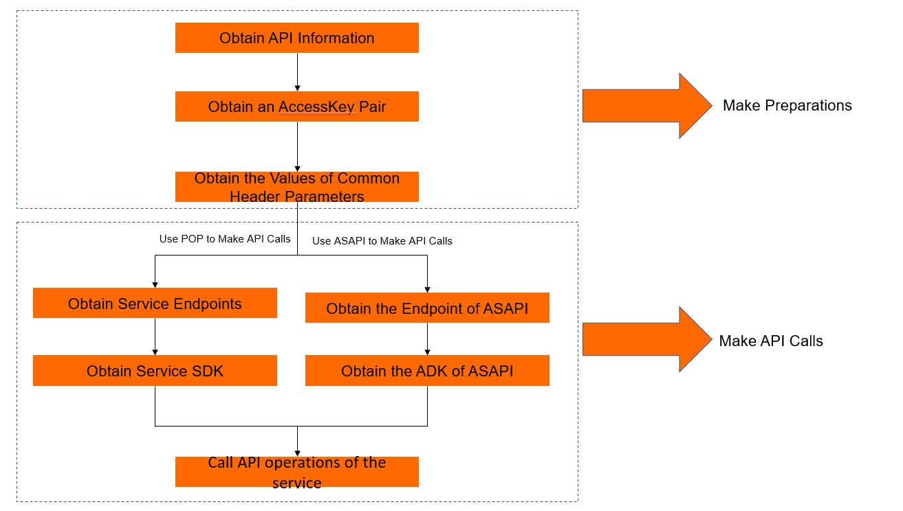
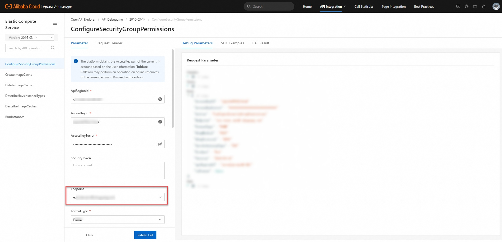

Alibaba Cloud  
Apsara Stack  
Elasticsearch  
Developer Guide  
Product Version: v3.18.6-2607  
Document Version: 20260825

**Table of Contents**

- [1.Interact using RESTful APIs](#section-1)
- [2.Interact using the Python API](#section-2)
    - [2.1. Preparations](#section-2-1)
    - [2.2. Basic operation examples](#section-2-2)
    - [2.3. Complete operation example](#section-2-3)
    - [2.4. Performance optimization suggestions](#section-2-4)
    - [2.5. FAQ](#section-2-5)
    - [2.6. Use the Java API to access a cluster](#section-2-6)
        - [2.6.1. Connect to an instance](#section-2-6-1)
        - [2.6.2. Create an index](#section-2-6-2)
        - [2.6.3. Write data](#section-2-6-3)
        - [2.6.4. Query data](#section-2-6-4)
        - [2.6.5. Delete an index](#section-2-6-5)
- [3.Interact with OpenAPI](#section-3)
    - [3.1. Process of API calls](#section-3-1)
    - [3.2. Preparations](#section-3-2)
        - [3.2.1. Obtain API information and its endpoint](#section-3-2-1)
        - [3.2.2. Obtain AccessKey credentials](#section-3-2-2)
        - [3.2.3. Obtain an STS AccessKey pair](#section-3-2-3)
        - [3.2.4. Obtain the values of common headers](#section-3-2-4)
    - [3.3. Use POP to make API calls](#section-3-3)
        - [3.3.1. Java version](#section-3-3-1)
        - [3.3.2. SDK for Go](#section-3-3-2)
        - [3.3.3. Python Version](#section-3-3-3)
    - [3.4. SLB instances](#section-3-4)
        - [3.4.1. Create a Notebook modeling instance](#section-3-4-1)
            - [3.4.1.1. CreateInstance](#section-3-4-1-1)
            - [3.4.1.2. ListZones](#section-3-4-1-2)
            - [3.4.1.3. ListDeploymentArchs](#section-3-4-1-3)
            - [3.4.1.4. ListNetworkTypes](#section-3-4-1-4)
            - [3.4.1.5. ListEsVersions](#section-3-4-1-5)
            - [3.4.1.6. ListCpubrands](#section-3-4-1-6)
            - [3.4.1.7. ListAvailiableSpecs](#section-3-4-1-7)
            - [3.4.1.8. ListStorageClass](#section-3-4-1-8)
        - [3.4.2. Instance management](#section-3-4-2)
            - [3.4.2.1. ListInstance](#section-3-4-2-1)
            - [3.4.2.2. DescribeInstance](#section-3-4-2-2)
            - [3.4.2.3. RestartInstance](#section-3-4-2-3)
            - [3.4.2.4. UpdateInstance](#section-3-4-2-4)
            - [3.4.2.5. DeleteInstance](#section-3-4-2-5)
            - [3.4.2.6. DescribeElasticsearchHealth](#section-3-4-2-6)
            - [3.4.2.7. UpdateDescription](#section-3-4-2-7)
            - [3.4.2.8. UpdateAdminPassword](#section-3-4-2-8)
            - [3.4.2.9. ListAllNode](#section-3-4-2-9)
            - [3.4.2.10. GetElasticsearchPodInfo](#section-3-4-2-10)
            - [3.4.2.11. UpdateElasticsearchSettings](#section-3-4-2-11)
            - [3.4.2.12. GetElasticsearchSettings](#section-3-4-2-12)
            - [3.4.2.13. GetElasticsearchPodLogs](#section-3-4-2-13)
            - [3.4.2.14. UpdateInstanceSettings](#section-3-4-2-14)
        - [3.4.3. Snapshots](#section-3-4-3)
            - [3.4.3.1. CreateSnapshot](#section-3-4-3-1)
            - [3.4.3.2. ListSnapshots](#section-3-4-3-2)
            - [3.4.3.3. DescribeSnapshotSetting](#section-3-4-3-3)
            - [3.4.3.4. ListSnapshotRepoInfos](#section-3-4-3-4)
            - [3.4.3.5. GetSnapshotRepoInfo](#section-3-4-3-5)
            - [3.4.3.6. UpdateSnapshotSetting](#section-3-4-3-6)
        - [3.4.4. Manage dictionaries](#section-3-4-4)
            - [3.4.4.1. ListDicts](#section-3-4-4-1)
            - [3.4.4.2. ListDictInformation](#section-3-4-4-2)
            - [3.4.4.3. UpdateDict](#section-3-4-4-3)
            - [3.4.4.4. UpdateSynonymsDicts](#section-3-4-4-4)
            - [3.4.4.5. UpdateHotIkDicts](#section-3-4-4-5)
        - [3.4.5. Plug-in](#section-3-4-5)
            - [3.4.5.1. ListPlugins](#section-3-4-5-1)
            - [3.4.5.2. ListKibanaPlugins](#section-3-4-5-2)
            - [3.4.5.3. InstallKibanaSystemPlugin](#section-3-4-5-3)
            - [3.4.5.4. UninstallKibanaPlugin](#section-3-4-5-4)
            - [3.4.5.5. InstallSystemPlugin](#section-3-4-5-5)
            - [3.4.5.6. InstallUserPlugins](#section-3-4-5-6)
            - [3.4.5.7. UninstallPlugin](#section-3-4-5-7)
            - [3.4.5.8. GetConfigFiles](#section-3-4-5-8)
            - [3.4.5.9. UpdateConfigFiles](#section-3-4-5-9)
            - [3.4.5.10. DeleteConfigFile](#section-3-4-5-10)
        - [3.4.6. security-configuration-discontinued](#section-3-4-6)
            - [3.4.6.1. ListInstanceCertificateFinger](#section-3-4-6-1)
            - [3.4.6.2. ListUserSecurityInfo](#section-3-4-6-2)
            - [3.4.6.3. UpdateUserSecurityInfo](#section-3-4-6-3)
            - [3.4.6.4. ModifyAclWhiteIps](#section-3-4-6-4)
            - [3.4.6.5. DisableHttps](#section-3-4-6-5)
            - [3.4.6.6. EnableHttps](#section-3-4-6-6)
            - [3.4.6.7. ListGlobalFeatures](#section-3-4-6-7)
- [4.Appendixes](#section-4)
    - [4.1. STS overview](#section-4-1)
        - [4.1.1. What is STS?](#section-4-1-1)
        - [4.1.2. Obtain an STS token](#section-4-1-2)

<a id="section-1"></a>

# 1.Interact using RESTful APIs

Elasticsearch uses RESTful APIs. All operations, such as creating, retrieving, updating, and deleting data, and configuring aliases, are performed through HTTP APIs. This topic describes how to use RESTful APIs.

**References**

- Single-document APIs:

  - Index API

  - Get API

  - Delete API

  - Update API

- Multi-document APIs:

  - Multi Get API

  - Bulk API

  - Delete By Query API

  - Update By Query API

  - Reindex API

**Interact using a REST client**

Client access supports only the HTTP and TCP methods. Use the official Elasticsearch Java REST Client.

**Interact using the Java API**

Elasticsearch provides built-in clients for Java users, including TransportClient and Java REST Client. TransportClient was deprecated in Elasticsearch 7.0 and completely removed in 8.0. Therefore, use the Java REST Client for development. For more information about the Java API, see the official Java API documentation and the Java API usage guide.

> **Note**
>
> The Elasticsearch version of the Java client must match the version of the Elasticsearch cluster. Otherwise, compatibility issues may occur.

**REST API (HTTP) request parameters**

Use a RESTful API or the curl command to communicate with Elasticsearch on port 9200.

> **Note**
>
> Elasticsearch provides official clients for many programming languages, such as Groovy, JavaScript, .NET, PHP, Perl, Python, and Ruby. Many community-provided clients and plugins are also available. Find them in Community Contributed Clients.

A curl command (HTTP) consists of the following parts.

```bash
curl -X<VERB> '<PROTOCOL>://<HOST>:<PORT>/<PATH>?<QUERY_STRING>' -d '<BODY>'
```

| Parameter | Description |
| --- | --- |
| VERB | The HTTP method. Valid values are GET, POST, PUT, HEAD, and DELETE. |
| PROTOCOL | <code> http </code> or <code> https </code> protocol (available only when an <code> https </code> proxy is in front of Elasticsearch). |
| HOST | The hostname of any node in the Elasticsearch cluster. For a local node, use localhost. |
| PORT | The port on which the Elasticsearch HTTP service runs. The default is 9200. |
| PATH | The API path. For example, <strong>_count</strong> returns the number of documents in the cluster. A <strong>PATH</strong> can contain multiple components, such as <code> _cluster/stats </code> or <code> _nodes/stats/jvm </code>. |
| QUERY_STRING | Optional query request parameters. For example, the <code> ?pretty </code> parameter makes the returned JSON data easier to read. |
| BODY | The request body in JSON format. This parameter is optional. |

**REST API (HTTP) request examples**

Run the following command to count the number of documents in an Elasticsearch cluster.

```bash
curl -XGET 'http://localhost:9200/_count?pretty' -d '
{ 
  "query": { 
    "match_all": {} 
  }
}'
```

The following result is returned.

```json
{ 
    "count" : 0, 
    "_shards" : { 
        "total" : 5, 
        "successful" : 5, 
        "failed" : 0 
     }
}
```

Use  `curl -i`  to display the HTTP request header. For example,  `curl -i -XGET 'localhost:9200/'` . The following example shows a complete request.

```bash
curl -i -XGET 'localhost:9200/_count?pretty' -d '
{ 
    "query": { 
        "match_all": {} 
    }
}'
```

The following example shows a shorthand request.

```text
GET /_count
{ 
    "query": { 
        "match_all": {} 
    }
}
```

<a id="section-2"></a>

# 2.Interact using the Python API

This topic describes how to use Python to access Alibaba Cloud Elasticsearch version 7.10. It covers client installation, connection configuration, basic operations, and end-to-end testing. Developers can use this guide to quickly learn how to work with Elasticsearch in Python.

<a id="section-2-1"></a>

## 2.1. Preparations

This topic describes the preparations required to use Python to access Alibaba Cloud Elasticsearch version 7.10, including environment requirements, dependency installation, network configuration, client initialization, connection configuration, and authentication setup.

**Environment requirements**

- Python version: 3.6 or later

- Elasticsearch version: 7.10.0 (compatible with Alibaba Cloud Elasticsearch 7.10)

- Dependency libraries:  `elasticsearch>=7.10.0` ,  `urllib3`

**Install dependencies**

You can install the required libraries in a Python virtual environment:

```bash
pip install "elasticsearch>=7.10.0"
```

**Network configuration requirements**

Meet the following requirements based on your network configuration method:

- Public network access: Enable the public endpoint for your instance in the Alibaba Cloud Management Console and add your server’s public IP address to the whitelist.

- VPC access: If your application runs on Alibaba Cloud, deploy it in the same VPC as your Elasticsearch instance and use the private endpoint for lower latency and more secure connections.

- Connection pool: In high concurrency scenarios, configure the connection pool size appropriately to avoid exhausting available connections.

**Client initialization and connection configuration**

**Basic connection configuration**

```python
from elasticsearch import Elasticsearch

# Basic configuration - HTTP connection
es = Elasticsearch(
    hosts=['{ES cluster endpoint}:9200'],  # Replace with your ES cluster endpoint
    http_auth=('username', 'password'),  # Replace with your username and password
    scheme="http",
    port=9200,
    timeout=30
)

# Test the connection
try:
    info = es.info()
    print("Connection successful!", info.get('version'))
except Exception as e:
    print(f"Connection failed: {e}")
```

**HTTPS connection configuration**

For production environments, use an HTTPS encrypted connection.

```python
import ssl
from elasticsearch import Elasticsearch

# HTTPS connection configuration
es = Elasticsearch(
    hosts=['{ES cluster endpoint}:443'],
    http_auth=('username', 'password'),
    use_ssl=True,
    verify_certs=False,  # Set to True in production and provide valid certificates
    ssl_show_warn=False,
    timeout=30
)
```

**Connection pool configuration**

For high concurrency scenarios, configure the connection pool.

```python
from elasticsearch import Elasticsearch
from urllib3.poolmanager import PoolManager
import urllib3

# Configure connection pool parameters
es = Elasticsearch(
    hosts=['{ES cluster endpoint}:9200'],
    http_auth=('username', 'password'),
    maxsize=50,  # Maximum connections
    timeout=30,
    connection_class=urllib3.PoolManager,
    # Other connection parameters
    retry_on_timeout=True,
    max_retries=10
)
```

**Authentication configuration**

Alibaba Cloud Elasticsearch requires Basic Authentication to validate access permissions. Use the username and password configured when you created the instance as your credentials. In the client connection configuration, explicitly specify these credentials using the  `http_auth` parameter to ensure request validity.

```python
from elasticsearch import Elasticsearch

# Authenticate using username and password
es = Elasticsearch(
    hosts=['{ES cluster endpoint}:9200'],
    http_auth=('access_username', 'access_password'),
    scheme="http",
    port=9200,
    timeout=30
)
```

<a id="section-2-2"></a>

## 2.2. Basic operation examples

This topic provides basic operation examples, including indexing documents, searching documents, aggregate queries, and deleting documents.

**Index documents**

```python
from datetime import datetime

# Index a single document
doc = {
    'author': 'kimchy',
    'text': 'Elasticsearch: cool. bonsai cool.',
    'timestamp': datetime.now(),
}

res = es.index(index="test-index", doc_type='_doc', id=1, body=doc)
print(res['result'])

# Retrieve the document
res = es.get(index="test-index", doc_type='_doc', id=1)
print(res['_source'])
```

**Search documents**

```text
# Simple search
res = es.search(index="test-index", body={"query": {"match_all": {}}})
print("Got %d Hits:" % res['hits']['total']['value'])
for hit in res['hits']['hits']:
    print("%(timestamp)s %(author)s: %(text)s" % hit["_source"])
```

**Aggregate query**

```text
# Aggregation example
agg_body = {
    "aggs": {
        "popular_tags": {
            "terms": {
                "field": "tags.keyword"
            }
        }
    }
}

res = es.search(index="my-index", body=agg_body)
for bucket in res['aggregations']['popular_tags']['buckets']:
    print(bucket['key'], bucket['doc_count'])
```

**Delete documents**

```text
# Delete a document by ID
res = es.delete(index="test-index", doc_type='_doc', id=1)
print(res['result'])
```

<a id="section-2-3"></a>

## 2.3. Complete operation example

This topic provides a complete operation example for performing basic Create, Read, Update, and Delete (CRUD) operations.

```python
from datetime import datetime
from elasticsearch import Elasticsearch, exceptions

class ElasticSearchClient:
    def __init__(self, hosts, username, password, index_name):
        # Initialize the ES client
        self.es_client = Elasticsearch(
            hosts=hosts,
            http_auth=(username, password),
            scheme='http',
            timeout=30,
            maxsize=50
        )
        self.index_name = index_name
        
    def create_index(self):
        """Create an index"""
        mapping = {
            "mappings": {
                "properties": {
                    "title": {"type": "text"},
                    "content": {"type": "text"},
                    "timestamp": {"type": "date"}
                }
            }
        }
        
        try:
            if not self.es_client.indices.exists(index=self.index_name):
                response = self.es_client.indices.create(index=self.index_name, 
body=mapping)
                print(f"Index created successfully: {response}")
            else:
                print("Index already exists")
        except exceptions.RequestError as e:
            print(f"Error creating index: {e}")

    def add_document(self, doc_id, doc_data):
        """Add a document"""
        try:
            response = self.es_client.index(
                index=self.index_name,
                doc_type='_doc',  # Fixed as _doc in ES 7.x and later
                id=doc_id,
                body=doc_data
            )
            print(f"Document added successfully: {response}")
            return response
        except exceptions.RequestError as e:
            print(f"Error adding document: {e}")
            
    def get_document(self, doc_id):
        """Retrieve a document"""
        try:
            response = self.es_client.get(
                index=self.index_name,
                doc_type='_doc',
                id=doc_id
            )
            return response['_source']
        except exceptions.NotFoundError:
            print("Document does not exist")
            return None
            
    def search_documents(self, query):
        """Search documents"""
        try:
            response = self.es_client.search(
                index=self.index_name,
                body=query
            )
            return response
        except exceptions.RequestError as e:
            print(f"Search error: {e}")
            return None
            
    def delete_document(self, doc_id):
        """Delete a document"""
        try:
            response = self.es_client.delete(
                index=self.index_name,
                doc_type='_doc',
                id=doc_id
            )
            print(f"Document deleted successfully: {response}")
            return response
        except exceptions.NotFoundError:
            print("Document to delete does not exist")
            return None
            
    def close_connection(self):
        """Close the connection"""
        self.es_client.transport.close()

# Usage example
if __name__ == "__main__":
    # Replace with your actual ES connection information
    ES_HOSTS = ['{your-es-host}:9200']
    ES_USERNAME = '{your-username}'
    ES_PASSWORD = '{your-password}'
    INDEX_NAME = 'demo-index'
    
    # Create a client instance
    es_client = ElasticSearchClient(ES_HOSTS, ES_USERNAME, ES_PASSWORD, INDEX_NAME)
    
    # Test all features
    try:
        # Create an index
        es_client.create_index()
        
        # Add a document
        sample_doc = {
            'title': 'Python Elasticsearch Demo',
            'content': 'This is an example of accessing Elasticsearch using Python',
            'timestamp': datetime.now()
        }
        es_client.add_document('1', sample_doc)
        
        # Retrieve a document
        doc = es_client.get_document('1')
        print("Retrieved document:", doc)
        
        # Search documents
        query = {
            "query": {
                "match": {
                    "title": "Python"
                }
            }
        }
        results = es_client.search_documents(query)
        if results:
            print("Number of search results:", results['hits']['total']['value'])
            
        # Cleanup - delete the document (delete as needed in actual use)
        # es_client.delete_document('1')
        
    finally:
        # Close the connection
        es_client.close_connection()
```

<a id="section-2-4"></a>

## 2.4. Performance optimization suggestions

This topic provides suggestions for improving performance.

You can optimize performance in the following ways:

- The ES product is fully compatible with Elasticsearch 7.10. We recommend that you use tools such as Tongyi Lingma to perform checks.

- Use the bulk API to process large amounts of data.

- Adjust the timeout value to balance response time and resource consumption.

- Use the Elasticsearch caching mechanism.

- Create appropriate indexes on frequently queried fields.

<a id="section-2-5"></a>

## 2.5. FAQ

This topic describes how to troubleshoot common issues that occur when you run search operations with the Python client.

```python
from elasticsearch import Elasticsearch, exceptions

try:
    # Run the ES operation
    res = es.search(index="non-existent-index", body={"query": {"match_all": {}}})
except exceptions.NotFoundError:
    print("Index does not exist")
except exceptions.ConnectionError:
    print("Connection error")
except Exception as e:
    print(f"Other error: {e}")
```

This code sample applies to the following Alibaba Cloud Elasticsearch development scenarios. It demonstrates how to use the Python client to properly catch and handle exceptions when you run search operations:

- Index existence validation During development or debugging, you can quickly verify whether a target index exists. Catch the  `NotFoundError`  exception to determine if the index is missing. This lets you trigger a subsequent index creation or data initialization flow.

- Connection status check You can catch the  `ConnectionError`  exception to check the network connectivity between the client and the Elasticsearch cluster, authentication configurations such as the username and password, or cluster availability. This ensures that the connection parameters are correct.

- Fault tolerance design for production environments In a production system, you can use exception handling to prevent the program from crashing if a search operation fails. You can also provide helpful error messages or log records to help operations and maintenance (O&M) engineers quickly identify the issue.

- General error debugging You can catch unexpected exceptions, such as insufficient permissions or query syntax errors, and output detailed error messages to help developers diagnose issues and optimize the code.

<a id="section-2-6"></a>

## 2.6. Use the Java API to access a cluster

<a id="section-2-6-1"></a>

### 2.6.1. Connect to an instance

This topic describes how to connect to a Elasticsearch instance by using a Java High Level REST Client.

**maven dependency**

Take Elasticsearch 7.10 as an example. The following table lists the Maven dependencies.

```text
!" -- highLevelClient dependencies -->
  <dependency>
      <groupId>org.elasticsearch.client</groupId>
      <artifactId>elasticsearch-rest-high-level-client</artifactId>
      <version>7.10.0</version>
  </dependency>
  <dependency>
      <groupId>org.elasticsearch.client</groupId>
      <artifactId>elasticsearch-rest-client</artifactId>
      <version>7.10.0</version>
  </dependency>
```

> **Important**
>
> - The version of the elasticsearch-rest-high-level-client used by the Java client must be the same as the version of the Elasticsearch cluster.
>
> - elasticsearch-rest-high-level-client version 5.5.3 is unavailable. If you want to access a Elasticsearch cluster of version 5.5.3, you can use the elasticsearch-rest-client of version 5.6.2.

**Code example**

```text
@Bean("myRestHighLevelClient")
public RestHighLevelClient elasticsearchRestClient(){

   // The endpoint of the cluster. 
   HttpHost httpHost = new HttpHost(hostName, 9200);

   // Build a connection object. 
   RestClientBuilder builder = RestClient.builder(httpHost);

   // Specify the username and password. By adding the username and password to the request header, you can prevent the access times from doubling if the first request does not include the account and password. 
   String credentialsString = username + ":" + password;
   byte[] encodedBytes = Base64.getEncoder().encode(credentialsString.getBytes());
   Header[] headers = {new BasicHeader(AUTHORIZATION, "Basic " + new 
String(encodedBytes))};
   builder.setDefaultHeaders(headers);

    // Configure the connection latency. 
   builder.setRequestConfigCallback(requestConfigBuild->{
     // Establish connection timeout settings. 
     requestConfigBuild.setConnectTimeout(10*1000)
        .setSocketTimeout(15*1000)
        .setConnectionRequestTimeout(10*1000);
     return requestConfigBuild;
   });
   // Configure the number of connections. 
   builder.setHttpClientConfigCallback(httpClientBuilder->{
     httpClientBuilder.setMaxConnTotal(1000)
       .setMaxConnPerRoute(1000);
     return httpClientBuilder;
   });
   return new RestHighLevelClient(builder);
}
```

<a id="section-2-6-2"></a>

### 2.6.2. Create an index

This topic describes how to create an index by using the Java API.

**Create indexes for versions other than V5.5.3**

The following example creates an index by High Level REST Client. This example is applicable only to non-Elasticsearch 5.5.3 versions.

> **Note**
>
> High Level REST Client is not supported in Elasticsearch 5.5.3.

**Code example**

When you create an index, an index of Elasticsearch 7.0 or earlier contains five primary shards and one secondary shard by default. Elasticsearch an index of 7.0 or later contains one primary shard and one secondary shard by default. The following code provides an example on how to customize the settings and mappings of an index:

```text
// Specify the index name. 
CreateIndexRequest createIndexRequest = new CreateIndexRequest("index_name");
// Create an index. 
CreateIndexResponse createIndexResponse = 
restHighLevelClient.indices().create(createIndexRequest, RequestOptions.DEFAULT);
// The request parameters must be adjusted for 6.3.2 and later. 
//CreateIndexResponse createIndexResponse = 
restHighLevelClient.indices().create(createIndexRequest);
```

**Definitions**

```text
createIndexRequest.settings(Settings.builder()
                     .put("index.number_of_shards",3)
                     .put("index.number_of_replicas",3));
```

**Mapping definition**

- createIndexRequest.mapping (7.0 and later versions

  ```text
    "{\n" +
    "  \"properties\": {\n" +
    "    \"message\": {\n" +
    "      \"type\": \"text\"\n" +
    "    }\n" +
    "  }\n" +
    "}",
    XContentType.JSON);
  ```

- 7.0 the following versions

  > **Note**
  >
  > 7.0 versions later support mapping types. You must add the type type and
  >
  > level to the mapping.

  ```text
  createIndexRequest.mapping(
    "_doc",
    "{\n" +
    "  \"_doc\": {\n" +
    "    \"properties\": {\n" +
    "      \"message\": {\n" +
    "        \"type\": \"text\"\n" +
    "      }\n" +
    "    }\n" +
    "  }\n" +
    "}",
    XContentType.JSON);
  ```

**Create indexes in V5.5.3**

The following example creates an index by Low Level REST Client. This is applicable only to Elasticsearch 5.5.3.

**Low Level Client configuration**

```text
@Bean("lowClient")
public RestClient restClient(){
  // Set hostName to the cluster endpoint. 
  HttpHost httpHost = new HttpHost(hostName, 9200);

  // Specify the username and password. The verification of the username and password is placed in the request header to prevent the first request without the username and password from doubling the number of accesses. 
  String credentialsString = username + ":" + password;
  byte[] encodedBytes = Base64.getEncoder().encode(credentialsString.getBytes());
  Header[] headers = {new BasicHeader(AUTHORIZATION, "Basic " + new 
String(encodedBytes))};

  RestClientBuilder builder = RestClient.builder(httpHost);
  builder.setDefaultHeaders(headers);

  return builder.build();
}
```

**Example of creating an index in JSON form**

```text
public String createIndex(){
    String jsonString = "{" +
            "\"settings\":{" +
                "\"index\":{" +
                    "\"number_of_shards\": 3," +
                    "\"number_of_replicas\": 1" +
                    "}" +
                "}" +
            "}";
    HttpEntity entity = new NStringEntity(jsonString, ContentType.APPLICATION_JSON);
    try {
        Response response = client.performRequest("PUT", "/index_name", 
Collections.emptyMap(), entity);
        return response.toString();
    }
    catch (IOException e) {
        e.printStackTrace();
    }
    return "request failed";
}
```

**Example of creating an index in Map form**

```text
public String createIndex() throws IOException {
  Map<String,Object> indexMap = new HashMap<>();
  Map<String,String> settings = new HashMap<>();
  settings.put("number_of_shards","3");
  settings.put("number_of_replicas","1");
  indexMap.put("settings",settings);
  StringEntity entity = new StringEntity(new JSONObject(indexMap).toString(), ContentType.APPLICATION_JSON);
  try {
    Response response = client.performRequest("PUT", "/index_name", 
Collections.emptyMap(), entity);
    return response.toString();
  }
  catch (IOException e) {
    e.printStackTrace();
  }
  return "request failed";
}
```

<a id="section-2-6-3"></a>

### 2.6.3. Write data

This topic describes how to use the Java API to write data to a Elasticsearch cluster, including single write and bulk write (batch write).

**Single write**

In the case of single write data, after specifying the document id, if the document id does not exist, the document is created. If the id exists, the corresponding document is updated. If you do not specify a document ID, the document ID is randomly generated by the Elasticsearch. Example:

- Write data

  ```text
  in JSON format // The index to be written. 
  IndexRequest request = new IndexRequest("index_name");
  // The ID of the document. 
  request.id("6");
  // The type of the document. It must be included in versions earlier than 7.x. In 5.5.3, it cannot start with an underscore (_). 
  request.type("_doc");
  // The written information. 
  String jsonString = "{" +
    "\"user\":\"kimchy\"," +
    "\"postDate\":\"2013-01-30\"," +
    "\"message\":\"trying out Elasticsearch\"" +
    "}";
  request.source(jsonString, XContentType.JSON);
  // In V6.3.2 and earlier, the RequestOptions.DEFAULT parameter is not required. 
  IndexResponse response = restHighLevelClient.index(request, RequestOptions.DEFAULT);
  ```

- Write data

  ```text
  as a map // The index to write. 
  IndexRequest request = new IndexRequest("index_name");
  // The ID of the document. 
  request.id("6");
  // The type of the document. It must be included in versions earlier than 7.x. In 5.5.3, it cannot start with an underscore (_). 
  request.type("_doc");
  // The written information. 
  Map<String, String> map = new HashMap<String, String>();
  map.put("user","kimchy");
  map.put("postDate","2013-01-30");
  map.put("message","trying out Elasticsearch");
  request.source(map);
  // In V6.3.2 and earlier, the RequestOptions.DEFAULT parameter is not required. 
  IndexResponse response = restHighLevelClient.index(request,RequestOptions.DEFAULT);
  ```

**Bulk write**

You can specify or not specify the id when writing bulk data. If you do not specify this parameter, the parameter is randomly generated by the Elasticsearch. Example:

- BulkRequest request=new BulkRequest() of the 7.x version

  ```text
  ;
  request.add(new IndexRequest("index_name").id("299")
              .source(XContentType.JSON,"field", "foo"));
  request.add(new IndexRequest("index_name").id("399")
              .source(XContentType.JSON,"field", "bar"));
  request.add(new IndexRequest("index_name").id("499")
              .source(XContentType.JSON,"field", "baz"));
  BulkResponse response = restHighLevelClient.bulk(request,RequestOptions.DEFAULT);
  ```

- BulkRequest request=new BulkRequest() of the 6.x version

  ```text
  ;
  request.add(new IndexRequest("index_name").id("1").type("_doc")
              .source(XContentType.JSON,"field", "foo"));
  request.add(new IndexRequest("index_name").id("2").type("_doc")
              .source(XContentType.JSON,"field", "bar"));
  request.add(new IndexRequest("index_name").id("3").type("_doc")
              .source(XContentType.JSON,"field", "baz"));
  // In V6.3.2 and later, the RequestOptions.DEFAULT parameter is not required. 
  BulkResponse response = restHighLevelClient.bulk(request, RequestOptions.DEFAULT);
  ```

- V5.5.3

  ```text
  // Write requests must include a type. The name of the type cannot start with an underscore (_). 
  BulkRequest request = new BulkRequest();
  request.add(new IndexRequest("index_name").id("1").type("doc")
              .source(XContentType.JSON,"field", "foo"));
  request.add(new IndexRequest("index_name").id("2").type("doc")
              .source(XContentType.JSON,"field", "bar"));
  request.add(new IndexRequest("index_name").id("3").type("doc")
              .source(XContentType.JSON,"field", "baz"));
  BulkResponse response = restHighLevelClient.bulk(request);
  ```

<a id="section-2-6-4"></a>

### 2.6.4. Query data

This topic describes how to use the Java API to query data in a Elasticsearch cluster.

**match all search**

You can specify an index name during  `new SearchRequest()`  to query documents in an index. You can also directly query documents in all indexes without specifying a specific index. Example:

```text
SearchRequest searchRequest=new SearchRequest("index_name");
SearchSourceBuilder searchSourceBuilder = new SearchSourceBuilder();
searchSourceBuilder.query(QueryBuilders.matchAllQuery());
searchRequest.source(searchSourceBuilder);
// In V6.3.2 and later, the RequestOptions.DEFAULT parameter is not required. 
SearchResponse response = 
restHighLevelClient.search(searchRequest,RequestOptions.DEFAULT);
```

**term search**

sourceBuilder not only allows you to set the query, but also allows you to set the search results by using from and size. Example:

```text
SearchSourceBuilder sourceBuilder=new SearchSourceBuilder();
sourceBuilder.query(QueryBuilders.termQuery("user", "kimchy"));
// Retrieve data from the beginning of the document in the result. 
sourceBuilder.from(0);
// Return several pieces of document data. 
sourceBuilder.size(5);
sourceBuilder.timeout(new TimeValue(60, TimeUnit.SECONDS));
SearchRequest searchRequest = new SearchRequest();
searchRequest.indices("index_name");
searchRequest.source(sourceBuilder);
// In V6.3.2 and later, the RequestOptions.DEFAULT parameter is not required. 
SearchResponse response = 
restHighLevelClient.search(searchRequest,RequestOptions.DEFAULT);
```

**score search**

Elasticsearch queries have scores, and the scores are used to sort and filter search results. If you want to customize the score, you can use  `sourceBuilder.sort()`  to support four customization methods: Field, Score, GeoDistance, and ScriptSortBuilder, which are to sort documents based on fields, scores, geographic locations, and more custom scores. Example:

```text
SearchSourceBuilder sourceBuilder=new SearchSourceBuilder();
// Arrange the fields in descending order based on the company field. 
sourceBuilder.sort(new FieldSortBuilder("company.keyword").order(SortOrder.DESC));
sourceBuilder.size(30);
SearchRequest request = new SearchRequest("index_name");
request.source(sourceBuilder);
// In V6.3.2 and later, the RequestOptions.DEFAULT parameter is not required. 
SearchResponse search = restHighLevelClient.search(request,RequestOptions.DEFAULT);
```

**Aggregation search**

Example:

```text
SearchSourceBuilder sourceBuilder=new SearchSourceBuilder();
// Run an aggregate query named "by_company" based on the company subfield. company is not of the keyword type, and its subfield company.keyword is of the keyword type. 
TermsAggregationBuilder aggregation = AggregationBuilders.terms("by_company")
  .field("company.keyword");
sourceBuilder.aggregation(aggregation);
SearchRequest request = new SearchRequest("index_name");
request.source(sourceBuilder);
SearchResponse search = restHighLevelClient.search(request,RequestOptions.DEFAULT);
```

> **Important**
>
> You can aggregate only fields of the Keyword type. If you aggregate
>
> fields of other types, an error illegal_argument_exception is reported.

<a id="section-2-6-5"></a>

### 2.6.5. Delete an index

This topic describes how to use the Java API to delete an index.

**Sample code for versions other than 5.5.3**

The following example deletes an index by High Level REST Client. This is applicable only to non-Elasticsearch 5.5.3 versions.

> **Note**
>
> High Level REST Client is not supported in Elasticsearch 5.5.3.

```text
DeleteIndexRequest request = new DeleteIndexRequest("index_name");
// For versions earlier than 7.x, you must specify the type parameter. 
//request.type("doc");
// In V6.3.2 and later, the RequestOptions.DEFAULT parameter is not required. 
AcknowledgedResponse response = restHighLevelClient.indices().delete(request, RequestOptions.DEFAULT);
```

**Sample code for version 5.5.3**

The following example deletes an index by Low Level REST Client. This is applicable only to Elasticsearch 5.5.3.

**Low Level REST Client configuration**

```text
@Bean("lowClient")
public RestClient restClient(){
  // Set hostName to the cluster endpoint. 
  HttpHost httpHost = new HttpHost(hostName, 9200);

  // Specify the username and password. The verification of the username and password is placed in the request header to prevent the first request without the username and password from doubling the number of accesses. 
  String credentialsString = username + ":" + password;
  byte[] encodedBytes = Base64.getEncoder().encode(credentialsString.getBytes());
  Header[] headers = {new BasicHeader(AUTHORIZATION, "Basic " + new 
String(encodedBytes))};

  RestClientBuilder builder = RestClient.builder(httpHost);
  builder.setDefaultHeaders(headers);

  return builder.build();
}
```

**Example of deleting an index**

```text
public String deleteIndex(){
    try {
        Response response = client.performRequest("DELETE", "/index_name", 
Collections.emptyMap());
        return response.toString();
    }
    catch (IOException e) {
        e.printStackTrace();
    }
    return "request failed";
}
```

<a id="section-3"></a>

# 3.Interact with OpenAPI

<a id="section-3-1"></a>

## 3.1. Process of API calls

You can use POP Gateway or the Apsara Stack API (ASAPI) gateway to call Apsara Stack API operations. From Apsara Stack Enterprise V3.16.0, POP Gateway is used by default to ensure that user experience is consistent with that in Alibaba Cloud public cloud. This topic describes how to use POP Gateway to call Apsara Stack API operations.

> **Note**
>
> You can continue to use the ASAPI gateway to call Apsara Stack API operations in Apsara Stack that is earlier than V3.16.0. For more information, see Process of API calls by using ASAPI, Generate an endpoint for ASAPI , and Obtain an SDK package for ASAPI.

**Flowchart**



**Procedure**

1. Obtain an AccessKey pair.

   For more information about how to obtain the AccessKey pair, see Obtain an AccessKey pair or Obtain an AccessKey pair from STS.

   > **Note**
   >
   > If you want to make API calls to use the Apsara Uni-manager Management Console or other Apsara Stack services, we recommend that you use the AccessKey pair of a personal account.

2. Obtain the region ID.

   For more information about how to obtain the value of the RegionID parameter, see Obtain header parameters.

3. Obtain the organization ID and resource set ID.

   You can call the GetOrganizationList operation to obtain the organization ID. For more information, see *GetOrganizationList* in *Apsara Uni-manager Management Console Develop er Guide*.

   You can call the ListResourceGroup operation to obtain the resource set ID. For more information, see *ListResourceGroup* in *Apsara Uni-manager Management Console Develope r Guide*.

   > **Note**
   >
   > When you call an operation, specify the  `<x-acs-organizationid>`  and  `<x-acs-resourcegroupid>,`  header parameters. The organization ID &lt;x-acs-organizationid> and resource set ID &lt;x-acs-resourcegroupid> specify the organization and resource set to which a resource belong. This implements isolated query of instance resources.
   >
   > - If you do not specify the  `<x-acs-organizationid>`  parameter, the organization to which the current user belongs is obtained by default.
   >
   > - If you do not specify the  `<x-acs-resourcegroupid>`  parameter, no resource set IDs are specified by default. If you specify a resource set ID, you must specify an organization ID.

4. Obtain the API reference of a service.

   For more information about how to view, use, and obtain the developer guide of a specific service, and understand the features and usage methods of operations, see Usage notes.

5. Obtain the endpoint of the service.

6. Obtain the service SDK and use the SDK to call an operation of the service.

<a id="section-3-2"></a>

## 3.2. Preparations

<a id="section-3-2-1"></a>

### 3.2.1. Obtain API information and its endpoint

To call an API operation of a cloud service, you must obtain information about the operation, including the service code, operation name, and API version.

**Background information**

The information on the API Directory page of the Apsara Uni-manager Management Console is for reference only. For more information about how to call API operations, see the developer guides of cloud services. If the information on the API Directory page differs from that in the developer guide of the corresponding cloud service, the information in the developer guide prevails.

**Procedure**

1. Log on to the Apsara Uni-manager Management Console.

2. In the top menu bar, choose **Products** > **Development Tools** > **API & SDK**> **OpenAPI Explorer**.

3. On the **OpenAPI Explorer** page, choose **API Integration** > **API Debugging**.

   

4. In the left-side navigation pane, select the cloud service that you want to manage.

5. From the **Version** drop-down list, select the API version.

6. In the API list, you can view all API operations of the current version.

7. Select the corresponding API operation and obtain the POP endpoint information of the cloud service under the parameter name.

   

<a id="section-3-2-2"></a>

### 3.2.2. Obtain AccessKey credentials

Access credentials are assigned by Resource Access Management (RAM) or Security Token Service (STS). You can use either type of access credential for authentication when you make an API request. This topic describes how to obtain an access credential that is assigned by RAM.

**Background information**

An AccessKey pair is used to verify the identity of a request sender. An AccessKey pair consists of an AccessKey ID and an AccessKey secret that are used to implement symmetric encryption. The AccessKey ID is used to identify a user. The AccessKey secret is used to encrypt the signature string.

You can use RAM or STS to assign an access credential for authentication.

- RAM: assigns an AccessKey pair that consists of an AccessKey ID and an AccessKey secret.

- Use STS to assign an AccessKey ID, an AccessKey secret, and a security token to a third party. For more information, see Obtain an access credential assigned by STS.

The Apsara Uni-manager Management Console provides AccessKey pairs to personal accounts and organizations. Only the administrators of level-1 organizations and operations administrators can obtain the AccessKey pairs of organizations. We recommend that you use the AccessKey pairs of personal accounts to call the API operations of the Apsara Uni-manager Management Console and cloud services. If you use the AccessKey pair of a personal account, configure the header parameters that are described in the following table for access control. Otherwise, an error that indicates insufficient permissions may occur.

> **Warning**
>
> The AccessKey pair of a personal account is managed by the permission system of the Apsara Uni-manager Management Console and has limited permissions. The AccessKey pair of an organization has greater permissions. If you want to use such an AccessKey pair, make sure that your operation is allowed by an administrator to ensure security.

| Header | Description |
| --- | --- |
| x-acs-regionid | The region ID. Example: cn-hangzhou-\*. |
| x-acs-organizationid | The organization ID in the Apsara Uni-manager Management Console. For more information about how to obtain an organization ID, see <strong>GetOrganizationList</strong> in <strong>Apsara Uni-manager</strong> <strong>Management Console Developer Guide</strong>. |
| x-acs-resourcegroupid | The resource set ID in the Apsara Uni-manager Management Console. For more information about how to obtain a resource set ID, see <strong>ListResourceGroup</strong> in <strong>Apsara Uni-manager</strong> <strong>Management Console Developer Guide</strong>. |
| x-acs-instanceid | The ID of the instance on which you want to perform the operation. For example, you can use the ID of an Elastic Compute Service (ECS) instance obtained from the ECS instance list. |

**Obtain the AccessKey pair of a personal account**

To obtain the AccessKey pair of a personal account, perform the following steps:

1. Log in to the Apsara Uni-manager Management Console.

2. Click the avatar in the upper-right corner of the page and click **User Information**.

3. In the **AccessKey Pair** section, view the AccessKey pair.

   

   > **Note**
   >
   > The AccessKey pair provides full permissions on cloud resources within your account. You must keep the AccessKey pair strictly confidential.

**Obtain the AccessKey pair of an organization**

To obtain the AccessKey pair of an organization, perform the following steps:

1. Log on to the Apsara Uni-manager Management Console as an administrator.

2. In the top navigation bar, click **Enterprise**.

3. In the left-side navigation pane, choose **Resources > Organizations**.

4. In the organization list, click the name of the level-1 organization whose AccessKey pair you want to obtain.

5. On the right side of the page, click **Manage AccessKey Pairs**.

6. In the dialog box that appears, view the AccessKey pair of the organization.

<a id="section-3-2-3"></a>

### 3.2.3. Obtain an STS AccessKey pair

This topic describes how to use Security Token Service (STS) to call API operations in Apsara Stack.

**Background information**

Apsara Stack STS allows you to manage temporary access credentials for your Apsara Stack resources. You can use STS to call API operations in Apsara Stack.

An access credential assigned by STS consists of an AccessKey ID, an AccessKey secret, and a security token. When you use STS to call API operations, these three elements are required.

**Procedure**

1. Obtain the Apsara Stack Resource Name (ARN) of your  `Resource Access Management (RAM) role` .

   <ol type="i">

   <li>

   Log in to the Apsara Uni-manager Management Console.

   </li>

   <li>

   In the upper-right corner of the homepage, click the profile picture, and then click **User**

   </li>

   </ol>

   **Information**.

   <ol type="i" start="3">

   <li>

   On the page that appears, click **View Current Role Policy**.

   </li>

   </ol>

   In the **View Policies of Current Role** dialog box, view the ARN of your  `RAM Role` .

2. Obtain the access credential assigned by STS.

   > **Note**
   >
   > Replace the variables in the following sample code with actual values. Remove the angle brackets (<>) from the final code.
   >
   > The following section describes the variables:
   >
   > - &lt;yourRegionID>: Replace this variable with your region ID.
   >
   > - &lt;yourAccessKeyID>: Replace this variable with your AccessKey ID.
   >
   > - &lt;yourAccessKeySecret>: Replace this variable with your AccessKey secret.
   >
   > - &lt;yourRoleSessionName>: Replace this variable with the name of the current session.
   >
   > - Replace &lt;yourRoleArn> with your actual RAM role.
   >
   > - Replace "sts.aliyuns.com" with the actual STS endpoint.

   ```xml
   public static void main(String[] args) {
       // Create and initialize a DefaultAcsClient instance. 
       // Replace the values with your actual region ID, AccessKey ID, and AccessKey secret.
       DefaultProfile profile = DefaultProfile.getProfile("<yourRegionID>", "
   <yourAccessKeyID>", "<yourAccessKeySecret>");
       HttpClientConfig clientConfig = HttpClientConfig.getDefault();
       clientConfig.setIgnoreSSLCerts(true);
       clientConfig.setProtocolType(ProtocolType.HTTPS);
       profile.setHttpClientConfig(clientConfig);
       IAcsClient client = new DefaultAcsClient(profile);
       String assumeRole = callAssumeRole(client);
       if (StringUtils.isEmpty(assumeRole)) return;
       JSONObject assumeRoleJson = JSONObject.parseObject(assumeRole);
       JSONObject credentials = assumeRoleJson.getJSONObject("Credentials");
       // Obtain the STS triplet.
       String stsAK = credentials.getString("AccessKeyId");
       String stsSK = credentials.getString("AccessKeySecret");
       String stsToken = credentials.getString("SecurityToken");
   }

   private static String callAssumeRole(IAcsClient client) {
       CommonRequest request = new CommonRequest();
       // Replace "sts.aliyuns.com" with the actual STS endpoint. The general format is sts-vpc.${global:region}.${global:internet-domain}.
       request.setSysDomain("sts.aliyuns.com");
       request.setSysProduct("Sts");
       request.setSysAction("AssumeRole");
       request.setSysVersion("2015-04-01");
       request.setSysMethod(MethodType.POST);
       request.setHttpContentType(FormatType.FORM);
       // Set the business parameter to the alias of the session. Replace "<yourRoleSessionName>" with the actual value.
       request.putQueryParameter("RoleSessionName", "<yourRoleSessionName>");
       // The ARN of the role that you assume. Replace "<yourRoleArn>" with the actual Ram Role ARN obtained in the previous step.
       request.putQueryParameter("RoleArn", "<yourRoleArn>");
       try {
           CommonResponse response = client.getCommonResponse(request);
           return response.getData();
       } catch (ServerException e) {
           System.out.println(e.getErrCode());
           System.out.println(e.getErrMsg());
       } catch (ClientException e) {
           System.out.println(e.getErrCode());
           System.out.println(e.getErrMsg());
       }
       return null;
   }
   ```

3. Use the STS AccessKey triplet to call an API operation of a cloud product. The following code provides an example on how to call an API operation of a Elasticsearch  `UpdateDescription` .

   > **Note**
   >
   > In the following sample code, you must replace the variable parameters with your actual information. The angle brackets (<>) are not retained in the final code.
   >
   > The variable parameters involved in substitution are as follows:
   >
   > - &lt;yourRegionID>. Replace it with your actual region ID.
   >
   > - Replace &lt;yourStsAccesskeyID> with your actual STS Accesskey ID.
   >
   > - Replace &lt;yourStsAccessKeySecret> with your actual STS Accesskey Secret.
   >
   > - &lt;yourStsToken>. Replace it with the security token in the STS triplet.
   >
   > - &lt;yourResourceGroupID>. Replace it with your actual resource set ID.
   >
   > - Replace &lt;yourOrganizationID> with your actual organization ID.

   ```xml
   public static void main(String[] args) {
       // Replace "<yourRegionID>" with your actual region ID.
       // Replace "<yourStsAccessKeyID>", "<yourStsAccessKeySecret>" with the AccessKey 
   ID and AccessKeySecret in the STS triplet obtained in the previous step.
       DefaultProfile profile = DefaultProfile.getProfile("<yourRegionID>", "
   <yourStsAccesskey>", "<yourStsAccessSecret>");
       HttpClientConfig clientConfig = HttpClientConfig.getDefault();
       clientConfig.setIgnoreSSLCerts(true);
       clientConfig.setProtocolType(ProtocolType.HTTPS);
       profile.setHttpClientConfig(clientConfig);
       IAcsClient client = new DefaultAcsClient(profile);
       CommonRequest request = new CommonRequest();
       request.setSysDomain("elasticsearch.aliyuncs.com");
       request.setSysProduct("Elasticsearch");
       request.setSysAction("UpdateDescription");
       request.setSysVersion("2017-06-13);
       request.setSysMethod(MethodType.POST);
       String requestBody = "" +
                   "{}";
       request.setHttpContentType(requestBody.getBytes(), "utf-8", FormatType.JSON);
       request.putHeadParameter("Content-Type", "application/json");
       // Replace "<yourRegionID>" with your actual region ID.
       request.putHeadParameter("x-acs-regionid", "<yourRegionID>");
       // Replace "<yourStsToken>" with the SecurityToken in the STS triplet that you obtained in the previous step.
       request.putQueryParameter("SecurityToken", "<yourStsToken>");
       // Optional. Replace it with your actual resource set ID.
       // request.putHeadParameter("x-acs-resourcegroupid", "<yourResourceGroupID>");
       // Required. Replace it with your actual organization ID.
       request.putHeadParameter("x-acs-organizationid", "<yourOrganizationID>");
       try {
           CommonResponse response = client.getCommonResponse(request);
           System.out.println(response.getData());
       } catch (ServerException e) {
           System.out.println(e.getErrCode());
           System.out.println(e.getErrMsg());
       } catch (ClientException e) {
           System.out.println(e.getErrCode());
           System.out.println(e.getErrMsg());
       }
   }
   ```

<a id="section-3-2-4"></a>

### 3.2.4. Obtain the values of common headers

You must specify multiple request headers when you call Apsara Stack API operations. This topic describes the common request headers and how to obtain the values of the request headers. This topic also describes the return values of specific parameters after you call API operations.

**Common request headers**

| Name | Description |
| --- | --- |
| x-acs-regionid | The region ID. For more information about how to obtain region IDs, see Obtain a region ID. |
| x-acs-organizationid | The ID of the organization in the Apsara Uni-manager Management Console. For more information about how to obtain organization IDs, see Obtain an organization ID. |
| x-acs-resourcegroupid | The ID of the resource set in the Apsara Uni-manager Management Console. For more information about how to obtain resource set IDs, see Obtain a resource set ID. |
| x-acs-instanceid | The ID of the instance that you want to manage.For more information about how to obtain instance IDs, see Obtain an instance ID. |

**Query a region ID**

1. Log on to the Apsara Uni-manager Management Console as an administrator.

2. In the top navigation bar, click **Enterprise**.

3. In the left-side navigation pane, choose **Resources** > **Regions**.

4. On the Regions page, find the organization that you want to view and click its name in the organization tree.

5. In the **Region List** section, view the **Region Name**.

**Obtain the organization ID**

You can call the API operation to obtain the organization ID. For more information about how to obtain the organization ID, see *GetOrganizationList* in *Apsara Uni-manager Operations Console Developer Guide*.

**Obtain the resource set ID**

You can call the API operation to obtain the ID of a resource set. For more information about how to obtain the ID, see *ListResourceGroup* in *Apsara Uni-manager Operations Console Developer Guide*.

**Obtain the instance ID**

You can obtain the ID of the Alibaba Cloud Elasticsearch instance from the instance list in the Apsara Uni-manager Operation console. To obtain the ID, perform the following steps:

1. Log on to the Apsara Uni-manager Operations console.

2. In the top navigation bar, choose **Products** > **Big Data** > **Elasticsearch on Kubernetes**.

3. Select the **organization** and **region** where the Elasticsearch instance resides.

   > **Note**
   >
   > - If you are an operations administrator, select the root organization to log on.
   >
   > - If you are an organization administrator, select the organization to which you belong to log on.

4. Click **Role Authorized Access** or **Administrator Access**.

   > **Note**
   >
   > - **Role-based Authorized Access**: The RAM user is used as the RAM user to access the console.
   >
   > - **Administrator Access**: You can access the console as a product administrator.

5. In the left-side navigation pane, click **Elasticsearch** **Instances**.

6. View the **Instance ID** in the instance list.

**Response parameters**

If you call the API operation of a list instance, the following value is added by default.

| Parameter | Description |
| --- | --- |
| ResourceGroupName | The name of the resource set. |
| ResourceGroup | The ID of the resource set. |
| DepartmentName | The name of an organization. |
| Department | The ID of an organization. |

<a id="section-3-3"></a>

## 3.3. Use POP to make API calls

<a id="section-3-3-1"></a>

### 3.3.1. Java version

Before you call the SDK for Java to access the endpoint of a cloud service by using the Point of Presence (POP) gateway, you must familiarize yourself with the call style of the cloud service. The following call styles are supported: remote procedure call (RPC) and resource-oriented architecture (ROA).

**Prerequisites**

We recommend that you use CommonRequest to call Apsara Stack API operations. To view the recommended SDK version and sample code, perform the following operations: Log on to the Apsara Uni-manager Management Console. In the top navigation bar, choose **Products** > **Development Tools** > **OpenAPI Explorer**. In the top navigation bar of the page that appears, choose **API Integration** > **SDK Sample Code**.

> **Important**
>
> We recommend that you do not download SDKs from SDK Center and use them in Apsara Stack. SDKs for the Alibaba Cloud public cloud may not support Apsara Stack API operations and may have compatibility issues. Proceed with caution.

**Use CommonRequest to call API operations**

The following sample code provides an example on how to call RPC APIs. In this example, the DescribeApiGroups operation of API Gateway is called, and the API version is 2016-07-14.

Sample code:

```xml
import com.aliyuncs.CommonRequest;
import com.aliyuncs.CommonResponse;
import com.aliyuncs.DefaultAcsClient;
import com.aliyuncs.IAcsClient;
import com.aliyuncs.exceptions.ClientException;
import com.aliyuncs.exceptions.ServerException;
import com.aliyuncs.http.MethodType;
import com.aliyuncs.profile.DefaultProfile;

public class DescribeApiGroups {

    public static void main(String[] args) {
        // Create and initialize a DefaultAcsClient instance. 
        DefaultProfile profile = DefaultProfile.getProfile("<your-regionid>", "
<yourAccessKeyId>", "<yourAccessSecret>");

        // Ignore SSL certificate verification.
        // HttpClientConfig clientConfig = HttpClientConfig.getDefault();
        // clientConfig.setIgnoreSSLCerts(true);
        // Specify the timeout period for a connection.
        // clientConfig.setConnectionTimeoutMillis(3000L);
        // Specify the read timeout period.
        // clientConfig.setReadTimeoutMillis(10000L);
        // profile.setHttpClientConfig(clientConfig);
        
        IAcsClient client = new DefaultAcsClient(profile);
        // Create an API request and set parameters. 
        CommonRequest request = new CommonRequest();
        // Specify the request mode.
        request.setSysMethod(MethodType.POST);
        // Set the endpoint of the cloud service.
        request.setSysDomain("<apigatewayEndpoint>");
        // Set the version of the access interface.
        request.setSysVersion("2016-07-14");
        // Set the LocationProduct.
        request.setSysLocationProduct("apigateway");
        // Set the name of the provider.
        request.setSysAction("DescribeApiGroups");
        
        // When you use sts ak to call the RPC interface, you need to add the SecurityToken field to the parameter.
        // request.putBodyParameter("SecurityToken", "<your-SecurityToken>");

        // Business parameters
        request.putQueryParameter("PageSize", "10");
        request.putQueryParameter("PageNumber", "1");

        // The required value. The description of the call source.
        request.putHeadParameter("x-acs-caller-sdk-source", "ApiTestDemo");
        // Optional. This parameter is required for earlier versions of Enterprise Edition V3.15.0.
        request.putHeadParameter("x-acs-regionid", "<your-regionid>");
        // (Optional) Specify the ID of the resource set.
        request.putHeadParameter("x-acs-resourcegroupid", "<your-resourcegroupid>");
        // (Required) Specify the organization ID.
        request.putHeadParameter("x-acs-organizationid", "<your-organizationid>");
        // (Optional) You must specify this parameter when you modify or delete 
resources.
        // request.putHeadParameter("x-acs-instanceid", "<your-instanceid>");

        try {
            // Initiate the request and handle the response or exception. 
            CommonResponse response = client.getCommonResponse(request);
            System.out.println(response.getData());
        } catch (ServerException e) {
            e.printStackTrace();
        } catch (ClientException e) {
            System.out.println("ErrCode:" + e.getErrCode());
            System.out.println("ErrMsg:" + e.getErrMsg());
            System.out.println("RequestId:" + e.getRequestId());
        }

    }
}
```

ROA calls. Sample API information: Product (Elasticsearch) Interface (GetNamespaceList) Version (2016-06-07).

Call the following example:

```java
import com.aliyuncs.CommonRequest;
import com.aliyuncs.CommonResponse;
import com.aliyuncs.DefaultAcsClient;
import com.aliyuncs.IAcsClient;
import com.aliyuncs.exceptions.ClientException;
import com.aliyuncs.exceptions.ServerException;
import com.aliyuncs.profile.DefaultProfile;
public class Sample {
    /**
     * DemoAPI: DescribeInstance
     */
    public static void main(String[] args) {
        // Create and initialize a DefaultAcsClient instance.
        DefaultProfile profile = DefaultProfile.getProfile(
            "<yourRegionID>", // Replace the value with your actual region ID.
            "<yourAccessKeyID>", // Replace with your AccessKey ID.
            "<yourAccessKeySecret>"); // Replace the value with your AccessKey secret.
        HttpClientConfig clientConfig = HttpClientConfig.getDefault();
        clientConfig.setIgnoreSSLCerts(true);
        clientConfig.setProtocolType(ProtocolType.HTTP);
        /**
        Optional. Configure the HTTP proxy based on your business requirements.
        You can configure the HTTP proxy in the following way:
        clientConfig.setHttpProxy("<http://192.168.XX.XX:33XX>");
        Specify the IP address and port of the proxy.
        */
        profile.setHttpClientConfig(clientConfig);
        IAcsClient client = new DefaultAcsClient(profile);
        // Create an API request and set parameters.
        CommonRequest request = new CommonRequest();
        // The actual request method of the API. For more information, see the API development documentation.
        request.setMethod(MethodType.GET);
        request.setDomain("<elasticsearch.aliyuncs.com>");
        request.setSysProduct("Elasticsearch");
        request.setSysVersion("2017-06-13");
        request.setSysUriPattern("/openapi/instances/<yourInstanceID>");
        request.putHeadParameter("Content-Type", "application/json");
        request.putHeadParameter("x-acs-resourcegroupid", "<yourResourceGroupID>");// Optional. Replace it with your actual resource set ID.
        request.putHeadParameter("x-acs-organizationid", "<yourOrganizationID>");// Required. Replace the value with your actual organization ID.
        request.putHeadParameter("x-acs-caller-sdk-source","ApiTestDemo");// Required. 
The call source.
        request.putHeadParameter("x-acs-regionid", "<yourRegionID>");// Optional. This parameter is required for Enterprise Edition V3.15.0 and earlier. Replace it with your actual region ID.
        // request.putHeadParameter("x-acs-instanceid", "<yourInstanceID>");// 
Optional. This parameter is required when you modify, delete, or query the details of asingle instance. Replace it with your actual instance ID.
        // The business parameter. If the request method is GET, DELETE, or if the ContentType parameter is set to application/x-www-form-urlencoded, use the following methodto pass the parameter
        request.putQueryParameter("page_number", "1");
        request.putQueryParameter("page_size", "5");
        String requestBody = "{}";
        /**
        When you use an STS AccessKey pair to call an interface, you must add the SecurityToken field to the parameter.
        The calling method is as follows:
        String requestBody = "{\"SecurityToken\": \"<yourSecurityToken>\"}";
        Replace with the actual token.
        */
        /** 
        If the request method is POST or PUT and ContentType is set to 
application/json,
        String requestBody = "
{\"page_number\":\"1\",\"page_size\":\"5\",\"SecurityToken\", \"<your-
SecurityToken>\"}";
        request.setHttpContent(requestBody.getBytes(), "utf-8", FormatType.JSON);
        */
        try {
            CommonResponse response = client.getCommonResponse(request);
            System.out.println(response.getData());
        } catch (ServerException e) {
            // TODO Auto-generated catch block
            e.printStackTrace();
        } catch (ClientException e) {
            // TODO Auto-generated catch block
            e.printStackTrace();
        }
    }
}
```

> **Important**
>
> When you use HTTPS to access OpenAPI operations, the SDK enables SSL/TLS certificate verification by default. If your code environment does not have a certificate environment, the certificate verification fails.
>
> To ensure communication security in the production environment, we recommend that you keep it enabled. If certificate verification must be ignored in the test environment, you can set the following parameters:
>
> Java
>
> ```text
> HttpClientConfig clientConfig = HttpClientConfig.getDefault();
> // Specify that the server certificate is not verified.
> clientConfig.setIgnoreSSLCerts(true)
> ```

<a id="section-3-3-2"></a>

### 3.3.2. SDK for Go

This topic describes how to use the Point of Presence (POP) gateway to call the SDK for Go.

**Prerequisites**

We recommend that you use CommonRequest to call Apsara Stack API operations. To view the recommended SDK version and sample code, perform the following operations: Log on to the Apsara Uni-manager Management Console. In the top navigation bar, choose **Products** > **Development Tools** > **OpenAPI Explorer**. In the top navigation bar of the page that appears, choose **API Integration** > **SDK Sample Code**.

> **Important**
>
> We recommend that you do not download SDKs from SDK Center and use them in Apsara Stack. SDKs for the Alibaba Cloud public cloud may not support Apsara Stack API operations and may have compatibility issues. Proceed with caution.

**Background information**

Remote procedure call (RPC) and resource-oriented architecture (ROA) styles are supported for API calls.

**Use CommonRequest to call API operations**

The following sample code provides an example on how to call RPC APIs. In this example, the DescribeApiGroups operation of API Gateway is called, and the API version is 2016-07-14.

The following example shows how to call Java API operations for LindormTable SQL to access Lindorm wide tables.

```go
package main

import (
    "fmt"
    "github.com/aliyun/alibaba-cloud-sdk-go/sdk"
    "github.com/aliyun/alibaba-cloud-sdk-go/sdk/requests"
  
)

func main() {
    client, err := sdk.NewClientWithAccessKey("<your-RegionID>", "<AccessKey ID>", "<AccessKey Secret>")

    request := requests.NewCommonRequest()
    
    request.Method = "POST"
    request.Domain = "<ApigatewayEndpoint>"
    request.Version = "2016-07-14"
    request.ApiName = "DescribeApiGroups"
    request.Product = "apigateway"
    // When you call the RPC operation by using STS AK, you must add the SecurityToken parameter.
    // request.QueryParams["SecurityToken"]="<your-SecurityToken>"

    // The required value. The description of the call source.
    request.Headers["x-acs-caller-sdk-source"] = "ApiTestDemo"
    // Optional. This parameter is required for earlier versions of Enterprise Edition 
V3.15.0.
    request.Headers["x-acs-regionid"] = "<your-RegionID>"
    // (Optional) Specify the ID of the resource set.
    request.Headers["x-acs-resourcegroupid"] = "<your-ResourceGroupID>"
    // Required. Specify the organization ID.
    request.Headers["x-acs-organizationid"] = "<your-OrganizationID>"
    // (Optional) You must specify this parameter when you modify or delete resources.
    // request.Headers["x-acs-instanceid"] = "<your-InstanceID>"

    response, err := client.ProcessCommonRequest(request)
    if err != nil {
        panic(err)
    }
    fmt.Print(response.GetHttpContentString())
}
```

Sample API information for ROA calls: Product (Elasticsearch) Interface (GetNamespaceList) Version (2016-06-07).

Call the following example:

```go
package main
import (
    "github.com/aliyun/alibaba-cloud-sdk-go/sdk/requests"
    "github.com/aliyun/alibaba-cloud-sdk-go/sdk"
    "fmt"
)
func main() {
    client, err := sdk.NewClientWithAccessKey(
        "<yourRegionID>", // Replace the value with your actual region ID.
        "<yourAccessKeyID>", // Replace with your AccessKey ID.
        "<yourAccessKeySecret>") // Replace the value with your AccessKey secret.
    if err != nil {
        panic(err)
    }
    request := requests.NewCommonRequest()
    request.Method = "GET"
    request.Domain = "elasticsearch.aliyuncs.com" // The URL of the request. This is anexample value. Replace the value with the actual URL.
    request.Product = "Elasticsearch"
    request.Version = "2017-06-13"
    // Specify the PathPattern parameter because it is a RESTful interface.
    request.PathPattern = "/openapi/instances/<yourInstanceID>"
    // When you use STS AccessKey to call the ROA operation, you must add the x-acs-security-token field to the header.
    // request.Headers["x-acs-security-token"] = "<yourSecurityToken>"
    // The required value. The description of the call source.
    request.Headers["x-acs-caller-sdk-source"] = "ApiTestDemo"
    // Optional. This parameter is required for Enterprise Edition V3.15.0 and earlier versions.
    request.Headers["x-acs-regionid"] = "<yourRegionID>"
    // Optional. Replace it with your actual resource set ID.
    request.Headers["x-acs-resourcegroupid"] = "<yourResourceGroupID>"
    // Required. Replace it with your actual organization ID.
    request.Headers["x-acs-organizationid"] = "<yourOrganizationID>"
    // Optional. If you need to modify, delete, or view the details of a single instance, replace it with your actual instance ID.
    // request.Headers["x-acs-instanceid"] = "<yourInstanceID>"
    // The business parameters. If the request method is GET, DELETE, or ContentType isset to application/x-www-form-urlencoded, use the following methods to pass data:
    // request.QueryParams["page_number"] =  "1"
    // request.QueryParams["page_size"] = "5"
    // If the API request method is POST or PUT and the ContentType parameter is set toapplication/json, data is transferred by using the following methods:
    // body := "{\"page_number\":\"1\",page_size:\"5\"}"
    // request.SetContent([]byte(body))
    // request.SetContentType("application/json")
    response, err := client.ProcessCommonRequest(request)
    if err != nil {
        panic(err)
    }
    fmt.Print(response.GetHttpContentString())
}
```

**Configure proxies**

You can configure a proxy by using one of the following methods when you call API operations:

- Method 1: Configure a proxy by using environment variables.

  Specify the HTTP_PROXY and HTTPS_PROXY environment variables, or specify the NO_PROXY environment variable.

  Sample code:

  ```go
  import (
      "os"
  )
  func main(){
   os.Setenv("HTTP_PROXY", "http://x.x.x.x:xxxx") // Specify the HTTP_PROXY environment 
  variable.
   os.Setenv("HTTPS_PROXY", "https://x.x.x.x:xxxx") // Specify the HTTPS_PROXY environment variable.
  }
  ```

- Method 2: Configure a proxy on the client.

  Sample code:

  ```text
  // The proxy that is configured on the client takes precedence over the proxy that isconfigured by using environment variables.
  client.SetHttpProxy("http://x.x.x.x:xxxx")   // Configure the HTTP proxy.
  client.GetHttpProxy()                          // Query the HTTP proxy.

  client.SetHttpsProxy("https://x.x.x.x:xxxx")   // Configure the HTTPS proxy.
  client.GetHttpsProxy()                           // Query the HTTPS proxy.

  client.SetNoProxy("127.0.0.1,localhost")     // Configure the proxy whitelist.
  client.GetNoProxy()                          // Query the proxy whitelist.
  ```

**SSL verification**

**Digest**

You can configure SSL certificate verification for requests.

- If you set the HTTPSInsecure parameter to  `true` , SSL certificate verification is disabled. To ensure security, we recommend that you enable SSL certificate verification.

- If you set the HTTPSInsecure parameter to  `false` , SSL certificate verification is enabled. By default, certificate authority (CA) certificates on the OSs are used.

**Default value**

```text
 false 
```

**Configuration methods**

> **Important**
>
> By default, if you send API requests over HTTPS, the SDK enables certificate verification to verify the validity of SSL certificates. If no certificate is configured in the development environment, an error that indicates the certificate verification fails is reported. To ensure communication security in the production environment, we recommend that you enable certificate verification. If certificate verification must be disabled in the test environment, you can configure the following settings:

```text
// If you specify the HTTPSInsecure parameter for the request, the setting takes effectonly for the current request.
request.SetHTTPSInsecure(true)                           // Set the HTTPSInsecure parame
ter for the request to true.
isInsecure := request.GetHTTPSInsecure()                 // Query the setting of the HTT
PSInsecure parameter for the request.
```

The HTTPSInsecure setting takes effect for the client only when you do not specify the HTTPSInsecure parameter for the request.

```text
// If you specify the HTTPSInsecure parameter for the client, the setting takes effect for all requests that are initiated by the client. 
client.SetHTTPSInsecure(true)                         // Set the HTTPSInsecure parameter 
for the client to true.
isInsecure := client.GetHTTPSInsecure()               // Query the setting of the HTTPSI
nsecure parameter for the client.
```

<a id="section-3-3-3"></a>

### 3.3.3. Python Version

This topic describes how to POP Python SDK call the API operations of cloud services.

**Prerequisites**

Currently, we recommend that you use CommonRequest to call Apsara Stack. To view the recommended SDK version and sample code, log on to the Apsara Uni-manager Operations console, choose **Products** > **Application Services** > **Developer Portal**, and choose **API Integration** > **SDK Examples**.

> **Important**
>
> We recommend that you do not download SDKs from the SDK Center to use them in Apsara Stack. Public cloud SDKs may not support Apsara Stack APIs and may have compatibility issues. Exercise caution when you use SDKs.

**Background information**

You can call an API operation only by using RPC.

**CommonRequest call example**

The ROA call. Example: Product (Elasticsearch), API (DescribeInstances), and Version (2014-05-26).

The sample code is as follows:

```python
from aliyunsdkcore.client import AcsClient
from aliyunsdkcore.request import CommonRequest
######
# API:CS-DescribeInstance
######
# Replace the values with your AccessKey ID, AccessKey secret, and region ID.
client = AcsClient('{<yourAccessKeyID>}', '{<yourAccessKeySecret>}', 
'{<yourRegionID>}')
request = CommonRequest()
request.set_product('Elasticsearch')
request.set_version('2017-06-13')
request.set_uri_pattern('/openapi/instances/<yourInstanceID>') # Pattern 
request.set_domain('<elasticsearch.aliyuncs.com>') # The domain name of the product. This is a sample value. Replace it with your actual product endpoint.
# or:
# request = CommonRequest(product='Elasticsearch', version='2017-06-13', 
uri_pattern='/openapi/instances/<yourInstanceID>', domain='elasticsearch.aliyuns.com')
######
# Specify the request protocol type. HTTPS or HTTP is supported. The default value is H
TTP.
# Set HTTPS as follows:
# request.set_protocol_type('https') 
######
request.set_accept_format('json')
request.set_method('GET')
request.add_header('Content-Type', 'application/json')
# Optional. Replace with your actual resource set ID.
request.add_header("x-acs-resourcegroupid", "<yourResourceGroupID")
# Required. Replace it with your actual organization ID.
request.add_header("x-acs-organizationid", "<yourOrganizationID>")
# Required. The description of the call source.
request.add_header("x-acs-caller-sdk-source","ApiTestDemo")
# Optional. This parameter is required for Enterprise Edition V3.15.0 and earlier versions. Replace it with your actual region ID.
request.add_header("x-acs-regionid", "<yourRegionID>")
# Optional. This parameter is required when you modify, delete, or query the details ofa single instance. Replace the parameter with your actual instance ID.
# request.add_header("x-acs-instanceid", "<yourInstanceID>")
# Business parameters. If the request method is GET, DELETE, or ContentType is set to application/x-www-form-urlencoded,
request.add_query_param("page_number", "1")
request.add_query_param("page_size", "5")
######
# When you use an STS AccessKey pair to call an interface, you must add the SecurityToken parameter.
# Call the method as follows:
# body = '''{\"SecurityToken\", \"<yourSecurityToken>\"}'''
# Replace it with your actual SecurityToken.
######
######
# If the API request method is POST or PUT and the ContentType parameter is set to application/json, data is transferred by using the following methods:
# body = '{"page_number":"1",page_size"5":"SecurityToken","":"<your-SecurityToken>"}'
# request.set_content(body.encode('utf-8'))
######
response = client.do_action_with_exception(request)
print(str(response, encoding = 'utf-8'))
```

**Set Proxy**

You can configure a proxy for an API call by specifying the HTTP_PROXY or HTTPS_PROXY environment variable.

The following example shows how to call Java API operations for LindormTable SQL to access Lindorm wide tables.

```text
# Configure the HTTPS proxy. 
os.environ["HTTPS_PROXY"] = "http://x.x.x.x:xxxx"

# Configure the HTTP proxy.
os.environ["HTTP_PROXY"] = "https://x.x.x.x:xxxx"
```

**HTTPS**

This section describes how to send an API request over HTTPS.

**Use HTTPS**

By default, the SDK uses HTTPS as the request protocol.

```python
from aliyunsdkecs.request.v20140526.DescribeInstancesRequest import 
DescribeInstancesRequest
from aliyunsdkcore.client import AcsClient
client = AcsClient(
    region_id='<region_id>',  # Specify the region ID.
)

request = DescribeInstancesRequest()
request.set_protocol_type('https')  # Use the HTTPS protocol.

client.do_action_with_exception(request)   
```

**Disable certificate verification**

> **Important**
>
> - By default, if you send API requests over HTTPS, the SDK enables certificate verification to verify the validity of SSL/TLS certificates. If no certificate is configured in the development environment, an error that indicates the certificate verification fails is reported.
>
> - To ensure communication security in the production environment, we recommend that you enable certificate verification. If certificate verification must be disabled in the test environment, you can set the  `verify`  parameter to false.

```python
from aliyunsdkcore.client import AcsClient
client = AcsClient(
    region_id='<region_id>',  # Specify the region ID.
    verify=False  # Disable SSL certificate verification.
)
```

**Enable certificate verification**

```python
from aliyunsdkcore.client import AcsClient
client = AcsClient(
    region_id='<region_id>',  # Specify the region ID.
    verify='./cacert.pem'  # Specify the path of the certificate authority (CA) certificate.
)
```

<a id="section-3-4"></a>

## 3.4. SLB instances

<a id="section-3-4-1"></a>

### 3.4.1. Create a Notebook modeling instance

<a id="section-3-4-1-1"></a>

#### 3.4.1.1. CreateInstance

Creates an Elasticsearch instance.

**Request headers**

This operation uses only common request headers. For more information, see the Common request parameters documentation.

**Request syntax**

```http
POST /openapi/instances HTTP/1.1
```

**Request parameters**

| Parameter Name | Type | Loca tion | Required | Example | Description |
| --- | --- | --- | --- | --- | --- |
| description | Strin g | Body | No | es-cn-31am74f06w73n\*\*\*\* | Instance name. |
| esAdminPa ssword | Strin g | Body | Yes | \*\*\*\* | Password |
| zoneCount | Integ er | Body | Yes | 1 | Number of zones. |
| networkCo nfig | Obje ct | Body | Yes | - | Network configuration. |
| -vsArea | Strin g | Body | Yes | cn-hangzhou | Zone where the instance is deployed. |
| -type | Strin g | Body | Yes | ANYTUNNEL | Network type. Valid values: VPC and ANYTUNNEL. |
| -vpcId | Strin g | Body | No | vpc-xxx | VPC ID. |
| -vswitchId | Strin g | Body | No | vs-xxx | vSwitch ID. |
| esVersion | Strin g | Body | Yes | 7.10.0_ali1.6.0 | The version number. |
| dataNode | Bool ean | Body | No | TRUE | Indicates whether data nodes exist. |
| nodeSpec | Obje ct | Body | No | - | Configuration for data nodes. |
| -spec | Strin g | Body | No | 8C 32Gi | Specifications for data nodes. |
| -diskType | Strin g | Body | No | fast-disks | Disk type for data nodes. |
| -disk | Integ er | Body | No | 500 | Disk size for data nodes, in GiB. |
| nodeAmou nt | Integ er | Body | Yes | 2 | Number of data nodes. |
| haveKiban a | Bool ean | Body | No | TRUE | Is Kibana available? |
| kibanaCon figuration | Obje ct | Body | No | - | Kibana configuration. |
| -spec | Strin g | Body | No | 8C 32Gi | Specifications for Kibana. |
| advanced DedicateM aster | Bool ean | Body | No | FALSE | Indicates whether dedicated master nodes exist. |
| masterNod eConfigura tion | Obje ct | Body | No | - | Configuration for dedicated master nodes. |
| -spec | Strin g | Body | No | 8C 32Gi | Specifications for dedicated master nodes. |
| -diskType | Strin g | Body | No | fast-disks | Disk type for dedicated master nodes. |
| -disk | Integ er | Body | No | 500 | Disk size for dedicated master nodes, in GiB. |
| -amount | Integ er | Body | No | 3 | Number of dedicated master nodes. |
| haveClient Node | Bool ean | Body | No | FALSE | Indicates whether client nodes exist. |
| clientNode Configurati on | Obje ct | Body | No | - | Configuration for client nodes. |
| -spec | Strin g | Body | No | 8C 32Gi | Coordinator node specifications. |
| -amount | Integ er | Body | No | 3 | Number of client nodes. |
| cpuType | Obje ct | Body | No | - | CPU information. |
| -cpuBrand | Strin g | Body | No | Intel | CPU chip types. |
| -defaultTyp e | Bool ean | Body | No | true | Indicates whether the default CPU architecture is enforced. |
| kibanaPass word | Strin g | Body | No | \*\*\*\* | Password for the Kibana service. Required if you enable Kibana. |
| monitorPa ssword | Strin g | Body | Yes | \*\*\*\* | Password for the monitoring service. Some monitoring features depend on this account. |

**Response data**

| Parameter Name | Type | Example | Description |
| --- | --- | --- | --- |
| RequestId | String | FDF34727-1664-44C1-A8DA-3EB72D60206E | Request ID. |
| Result | - | - | The request returns results. |
| -instanceId | String | es-cn-xxx | Instance ID. |

The response contains only the parameters listed in the preceding table. Other parameters are for reference only and must not be used in your code.

**Examples**

Sample request

```http
POST /openapi/instances HTTP/1.1

##body
{
  "region": "cn-qingdao-env66-d01",
  "zoneCount": 1,
  "networkConfig": {
    "vsArea": "cn-qingdao-env66-amtest11001-a",
    "type": "vpc",
    "vpcId": "vpc-9hm2gli36hm45gxif****",
    "vswitchId": "vsw-9hm2oy9kt0wnhonus****"
  },
  "esVersion": "7.10.0_ali1.6.0",
  "dataNode": true,
  "nodeSpec": {
    "spec": "8C 32Gi",
    "diskType": "fast-disks",
    "disk": 500
  },
  "nodeAmount": 3,
  "haveKibana": false,
  "advancedDedicateMaster": false,
  "haveClientNode": false,
  "description": "gyytest-0a",
  "esAdminPassword": "****",
  "instanceCategory": "x-pack",
  "cpuType":{
      "cpuBrand": "Intel",
    "defaultType": true
  }
}
```

Example of a successful response

`JSON`  format

```json
{
    "RequestId": "138F3AA4-DC09-46C2-BCD5-BD959A7E972C",
    "Result": {
        "instanceId": "es-cn-xxxxxx",
        "region": "cn-qingdao-env66-d01",
        "zoneCount": 1,
        "networkConfig": {
            "vsArea": "cn-qingdao-env66-amtest11001-a",
            "type": "vpc",
            "vpcId": "vpc-9hm2gli36hm45gxif****",
            "vswitchId": "vsw-9hm2oy9kt0wnhonus****"
        },
        "esVersion": "7.10.0_ali1.6.0",
        "dataNode": true,
        "nodeSpec": {
            "spec": "8C 32Gi",
            "diskType": "fast-disks",
            "disk": 500
        },
        "nodeAmount": 3,
        "haveKibana": false,
        "kibanaConfiguration": {},
        "advancedDedicateMaster": false,
        "masterNodeConfiguration": {},
        "haveClientNode": false,
        "clientNodeConfiguration": {},
        "description": "gyytest-0a",
        "esAdminPassword": "****",
        "instanceCategory": "x-pack"
    }
}
```

`XML`  format

```xml
<RequestId>138F3AA4-DC09-46C2-BCD5-BD959A7E972C</RequestId>
<Result>
  <instanceId>es-cn-xxxxxx</instanceId>
  <region>cn-qingdao-env66-d01</region>
  <zoneCount>1</zoneCount>
  <networkConfig>
    <vsArea>cn-qingdao-env66-amtest11001-a</vsArea>
    <type>vpc</type>
    <vpcId>vpc-9hm2gli36hm45gxif****</vpcId>
    <vswitchId>vsw-9hm2oy9kt0wnhonus****</vswitchId>
  </networkConfig>
  <esVersion>7.10.0_ali1.6.0</esVersion>
  <dataNode>true</dataNode>
  <nodeSpec>
    <spec>8C 32Gi</spec>
    <diskType>fast-disks</diskType>
    <disk>500</disk>
  </nodeSpec>
  <nodeAmount>3</nodeAmount>
  <haveKibana>false</haveKibana>
  <kibanaConfiguration  />
  <advancedDedicateMaster>false</advancedDedicateMaster>
  <masterNodeConfiguration  />
  <haveClientNode>false</haveClientNode>
  <clientNodeConfiguration  />
  <description>gyytest-0a</description>
  <esAdminPassword>****</esAdminPassword>
  <instanceCategory>x-pack</instanceCategory>
</Result>
```

**Error codes**

| HTTP status code | Error code | Error message | Description |
| --- | --- | --- | --- |
| 400 | InstanceNotFound | The instanceId provided does not exist | The specified instance ID does not exist. |

<a id="section-3-4-1-2"></a>

#### 3.4.1.2. ListZones

Before you create an Elasticsearch instance, call the ListZones operation to retrieve a list of zones where ES instances can be created.

**Request headers**

This operation uses only common request headers. For more information, see Common request parameters.

**Request syntax**

```http
GET /openapi/listZones HTTP/1.1
```

This operation has no request parameters.

**Response data**

| Parameter Name | Type | Example | Description |
| --- | --- | --- | --- |
| RequestId | String | FDF34727-1664-44C1-A8DA-3EB72D60206E | The request ID. |
| Result | String | \["cn-hangzhou-a","cn-hangzhou-b"\] | The list of zones. |

**Examples**

Request example

```http
GET /openapi/listZones HTTP/1.1
```

Successful response example

`JSON`  format

```json
{
  "Result": [
    "cn-hangzhou-a",
    "cn-hangzhou-b"
  ],
  "RequestId": "2C1B46F2-D827-4C05-B8C2-5A823EC3C306"
}
```

`XML`  format

```xml
<Result>cn-hangzhou-a</Result>
<Result>cn-hangzhou-b</Result>
<RequestId>2C1B46F2-D827-4C05-B8C2-5A823EC3C306</RequestId>
```

**Error codes**

| HTTP status code | Error code | Error message | Description |
| --- | --- | --- | --- |
| 400 | InstanceNotFound | The instanceId provided does not exist | The specified instance ID does not exist. |

<a id="section-3-4-1-3"></a>

#### 3.4.1.3. ListDeploymentArchs

Call ListDeploymentArchs when you create an Elasticsearch cluster to retrieve the supported deployment architectures and zone list for the specified region.

**Request headers**

This operation uses only common request headers. For more information, see the common request parameters documentation.

**Request syntax**

```http
GET /openapi/archs HTTP/1.1
```

Only common parameters are required.

**Response data**

| Parameter name | Type | Example | Description |
| --- | --- | --- | --- |
| RequestId | String | FDF34727-1664-44C1-A8DA-3EB72D60206E | Request ID. |
| Result | - | - | The result is returned. |
| -app | String | elasticsearch | Cluster type. |
| -zoneNum | String | 3 | Number of zones. |
| -info | - | - | Zone information. |
| --zoneName | String | es-cn-xxx | Zone name. |
| --roles |  | \[worker,master\] | Supported role types. |

**Examples**

Sample request

```http
GET /openapi/archs HTTP/1.1
```

Sample success response

`JSON`  format

```json
{
 "RequestId":"FDF34727-1664-44C1-A8DA-3EB72D60206E",
 "Result":[
  {
   "app":"elasticsearch",
   "info":[
    {
     "roles":"[worker,master]",
     "zoneName":"es-cn-xxx"
    }
   ],
   "zoneNum":"3"
  }
 ]
}
```

`XML`  format

```xml
<RequestId>FDF34727-1664-44C1-A8DA-3EB72D60206E</RequestId>
<Result>
 <info>
  <roles>[worker,master]</roles>
  <zoneName>es-cn-xxx</zoneName>
 </info>
 <zoneNum>3</zoneNum>
</Result>
```

<a id="section-3-4-1-4"></a>

#### 3.4.1.4. ListNetworkTypes

Call ListNetworkTypes to obtain the network type architecture.

**Request headers**

This operation uses only common request headers. For more information, see Common request parameters.

**Request syntax**

```http
GET /openapi/networkType HTTP/1.1
```

This operation has no request parameters.

**Response data**

| Parameter Name | Type | Example | Description |
| --- | --- | --- | --- |
| RequestId | String | FDF34727-1664-44C1-A8DA-3EB72D60206E | The request ID. |
| Result | List | \["singleTunnel"\] | A list of network access methods. Valid values: singleTunnel and anyTunnel. |

**Examples**

Request example

```http
GET /openapi/networkType HTTP/1.1
```

Response example

`JSON`  format

```json
{
  "RequestId": "FDF34727-1664-44C1-A8DA-3EB72D60206E",
  "Result": ["singleTunnel"]
}
```

`XML`  format

```xml
<RequestId>FDF34727-1664-44C1-A8DA-3EB72D60206E</RequestId>
<Result>singleTunnel</Result>
```

<a id="section-3-4-1-5"></a>

#### 3.4.1.5. ListEsVersions

Retrieves the available versions for an Elasticsearch cluster.

**Request headers**

This operation uses only common request headers. For more information, see Common request parameters.

**Request syntax**

```http
GET /openapi/listEsVersions HTTP/1.1
```

**Request parameters**

| Parame ter name | Typ e | Positi on | Require d | Example | Description |
| --- | --- | --- | --- | --- | --- |
| recomme nd | Boole an | Query | Yes | es-cn-xxx | The instance ID. |
| cpuBrand | Strin g | Query | No | Intel | CPU type:<br>• Intel<br>• AMD |
| zones | Array | Query | No | \["aa","bb"\] | The list of zones. |

**Response data**

| Parameter Name | Type | Example | Description |
| --- | --- | --- | --- |
| RequestId | String | F99407AB-2FA9-489E-A259-40CF6DCC47D9 | The request ID. |
| Result | String | \["6.7", "7.10"\] | The list of instance versions. |

**Examples**

Request example

```http
GET /openapi/listEsVersions HTTP/1.1
&recommend=es-cn-xxx
```

Successful response

`JSON`  format

```json
{
    "RequestId": "44D5D2A7-0B8F-4497-A3E4-BB7A53ABD2CF",
    "Result": ["6.7", "7.10"]
}
```

`XML`  format

```xml
<RequestId>44D5D2A7-0B8F-4497-A3E4-BB7A53ABD2CF</RequestId>
<Result>6.7</Result>
<Result>7.10</Result>
```

**Error codes**

| HTTP status code | Error code | Error message | Description |
| --- | --- | --- | --- |
| 400 | InstanceNotFound | The instanceId provided does not exist | The specified instance ID does not exist. |

<a id="section-3-4-1-6"></a>

#### 3.4.1.6. ListCpubrands

Call ListCpubrands to retrieve a list of CPU architectures.

**Request headers**

This operation uses only common request headers. For more information, see the Common Request Parameters document.

**Request syntax**

```http
GET /openapi/cpubrands HTTP/1.1
```

**Request parameters**

| Parame ter name | Typ e | Locati on | Require d | Example | Description |
| --- | --- | --- | --- | --- | --- |
| zoneId | Strin g | Query | No | cn-xxx-b | ID of the zone. |

**Response data**

| Parameter name | Type | Example | Description |
| --- | --- | --- | --- |
| RequestId | String | FDF34727-1664-44C1-A8DA-3EB72D60206E | Request ID. |
| Result | — | - | Response result. |
| -cpuArch | String | x86 | CPU architecture. |
| -cpuBrand | String | Intel | CPU type |
| -cpuId | String | FT-2000+/64 | CPU model. |
| -defaultType | Boolean | true | Enabled by default. |

**Examples**

Sample request

```http
GET /openapi/cpubrands HTTP/1.1
&zoneId=cn-xx-b
```

Sample success response

`JSON`  format

```json
{
 "RequestId":"FDF34727-1664-44C1-A8DA-3EB72D60206E",
 "Result":{
  "cpuBrand":"Intel",
  "cpuId":"FT-2000+/64",
  "cpuArch":"x86",
  "defaultType":true
 }
}
```

`XML`  format

```xml
<RequestId>FDF34727-1664-44C1-A8DA-3EB72D60206E</RequestId>
<Result>
 <cpuBrand>Intel</cpuBrand>
 <cpuId>FT-2000+/64</cpuId>
 <cpuArch>x86</cpuArch>
 <defaultType>true</defaultType>
</Result>
```

<a id="section-3-4-1-7"></a>

#### 3.4.1.7. ListAvailiableSpecs

When creating an Elasticsearch instance, call ListAvailiableSpecs to retrieve the available node specifications for different node types.

**Request Headers**

This API uses common request headers and does not have any special request headers. For more information, see the common request parameters document.

**Request Syntax**

```http
GET /openapi/assist/actions/[Node]-availiable-specs HTTP/1.1
```

**Request Parameters**

| Parame ter Name | Typ e | Locati on | Require d | Example | Description |
| --- | --- | --- | --- | --- | --- |
| node | Strin g | Path | Yes | node | Node type:<br>• node (data node)<br>• worker (data node)<br>• master (master node)<br>• client_node (client node)<br>• kibana_node (Kibana node) |
| vsArea | Strin g | Query | No | cn-hangzhou-\* | The zone where the instance resides. |
| instanceId | Strin g | Query | No | es-cn-xxxxxxxx | Instance ID. |

**Response Data**

| Parameter Name | Type | Example | Description |
| --- | --- | --- | --- |
| RequestId | String | F99407AB-2FA9-489E-A259-40CF6DCC47D9 | Request ID. |
| Result | String | \["2C 4G"\] | List of specifications. |

**Examples**

Request Example

```http
GET /openapi/assist/actions/[Node]-availiable-specs HTTP/1.1
&node=node
```

Normal Response Example

`JSON`  format

```json
{
 "RequestId":"F99407AB-2FA9-489E-A259-40CF6DCC47D9",
 "Result":"["2C 4G"]"
}
```

`XML`  format

```xml
<RequestId>44D5D2A7-0B8F-4497-A3E4-BB7A53ABD2CF</RequestId>
<Result>2C 4G</Result>
```

**Error Codes**

| HttpCo de | Error Code | Error Message | Description |
| --- | --- | --- | --- |
| 400 | InstanceNotFound | The instanceId provided does not exist | The provided instance ID does not exist. |

<a id="section-3-4-1-8"></a>

#### 3.4.1.8. ListStorageClass

When you create an Elasticsearch instance, you can call ListStorageClass to retrieve the available disk types for the current node and their corresponding minimum and maximum storage capacities.

**Request Headers**

This API uses common request headers and has no special request headers. For more information, see the common request parameters document.

**Request Syntax**

```http
GET /openapi/assist/actions/listStorageClass HTTP/1.1
```

**Request Parameters**

| Parame ter Name | Typ e | Locati on | Require d | Example | Description |
| --- | --- | --- | --- | --- | --- |
| role | Strin g | Query | Yes | data | Node type:<br>• data (data node)<br>• master (dedicated master node)<br>• coordinating (client node, not supported yet) |
| showShar ed | Boole an | Query | No | true | Display shared storage types. This parameter is valid only when \`role\` is set to \`master\`. |

**Response Data**

| Parameter Name | Type | Example | Description |
| --- | --- | --- | --- |
| RequestId | String | FDF34727-1664-44C1-A8DA-3EB72D60206E | Request ID. |
| Result | Struct | - | The result of the current request. |
| -storageClassN ame | String | fast-disk | The name of the disk type. |
| -order | Integer | 0 | The display order. |
| -shared | Boolean | false | Indicates whether the storage is shared.Shared storage types are not displayed when \`role\` is \`data\`. |
| -minSize | Integer | 10 | The minimum disk size. |
| -maxSize | Integer | 500 | The maximum disk size. |

**Examples**

Request example

```http
GET /openapi/assist/actions/listStorageClass HTTP/1.1
&role=data
```

Normal response example

`JSON`  format

```json
{
 "RequestId":"FDF34727-1664-44C1-A8DA-3EB72D60206E",
 "Result":[
  {
   "shared":false,
   "storageClassName":"fast-disk",
   "minSize":10,
   "maxSize":500,
   "order":0
  }
 ]
}
```

`XML`  format

```xml
<RequestId>FDF34727-1664-44C1-A8DA-3EB72D60206E</RequestId>
<Result>
  <shared>false</shared>
  <storageClassName>fast-disk</storageClassName>
  <minSize>10</minSize>
  <maxSize>500</maxSize>
  <order>0</order>
</Result>
```

**Error Codes**

| HttpCo de | Error Code | Error Message | Description |
| --- | --- | --- | --- |
| 400 | InstanceNotFound | The instanceId provided does not exist | The provided instance ID does not exist. |

<a id="section-3-4-2"></a>

### 3.4.2. Instance management

<a id="section-3-4-2-1"></a>

#### 3.4.2.1. ListInstance

Call ListInstance to retrieve a list of information about all instances.

**Request header**

This operation uses common request headers. No special request headers are required. For more information, see the Common request parameters document.

**Request syntax**

```http
GET /openapi/instances HTTP/1.1
```

**Request parameters**

| Parame ter Name | Typ e | Positi on | Require d | Example | Description |
| --- | --- | --- | --- | --- | --- |
| instanceId | Strin g | Query | No | es-cn-31am74f06w73n\*\*\*\* | The ID of the instance. |
| descriptio n | Strin g | Query | No | test | The name of the instance. |
| esVersion | Strin g | Query | No | 6.7 | The version of the instance. |
| vpcId | Strin g | Query | No | vpc-8ftt3y3kh7yyubb1l\*\*\*\* | The ID of the VPC. |
| zoneId | Strin g | Query | No | cn-wulan-env230-amtest230001-a | The ID of the zone. |

**Response parameters**

| Parameter name | Type | Example | Description |
| --- | --- | --- | --- |
| RequestId | String | 138F3AA4-DC09-46C2-BCD5-BD959A7E972C | The unique ID of the request. |
| Result | Struct | \[\] | The list of instance information. |
|  |  |  |  |
| Parameter name | Type | Example | Description |

<table>
  <tr>
    <td>-instanceId</td>
    <td>String</td>
    <td>es-cn-31am74f06w73n** **</td>
    <td>The ID of the instance.</td>
  </tr>
  <tr>
    <td>-zoneCount</td>
    <td>Integer</td>
    <td>1</td>
    <td>The number of zones.</td>
  </tr>
  <tr>
    <td>-nodeSpec</td>
    <td>Object</td>
    <td>{}</td>
    <td>The settings for the data node.</td>
  </tr>
  <tr>
    <td>--disk</td>
    <td>Integer</td>
    <td>500</td>
    <td>The disk space.</td>
  </tr>
  <tr>
    <td>--storageClassN ame</td>
    <td>String</td>
    <td>fast-disks</td>
    <td>The disk type.</td>
  </tr>
  <tr>
    <td>--diskType</td>
    <td>String</td>
    <td>fast-disks</td>
    <td>The disk type.</td>
  </tr>
  <tr>
    <td>--spec</td>
    <td>String</td>
    <td>8C 32Gi</td>
    <td>The specifications.</td>
  </tr>
  <tr>
    <td>-haveKibana</td>
    <td>Boolean</td>
    <td>true</td>
    <td>Indicates whether a Kibana node is enabled.</td>
  </tr>
  <tr>
    <td>-kibanaConfigu ration</td>
    <td>Object</td>
    <td>{}</td>
    <td>The configuration of the Kibana node.</td>
  </tr>
  <tr>
    <td>--spec</td>
    <td>String</td>
    <td>2C 4Gi</td>
    <td>The specifications.</td>
  </tr>
  <tr>
    <td>--amount</td>
    <td>Integer</td>
    <td>1</td>
    <td>The number of nodes.</td>
  </tr>
  <tr>
    <td>-advancedDedi cateMaster</td>
    <td>Boolean</td>
    <td>true</td>
    <td>Indicates whether a dedicated master node is enabled.</td>
  </tr>
  <tr>
    <td>--disk</td>
    <td>Integer</td>
    <td>500</td>
    <td>The disk space.</td>
  </tr>
  <tr>
    <td>--storageClassN ame</td>
    <td>String</td>
    <td>fast-disks</td>
    <td>The disk type.</td>
  </tr>
  <tr>
    <td>--diskType</td>
    <td>String</td>
    <td>fast-disks</td>
    <td>The disk type.</td>
  </tr>
  <tr>
    <td>--spec</td>
    <td>String</td>
    <td>8C 32Gi</td>
    <td>The specifications.</td>
  </tr>
</table>

| Parameter name | Type | Example | Description |
| --- | --- | --- | --- |
| -haveClientNod e | Boolean | true | Does the cluster include a coordinator node? |
| -clientNodeCon figuration | Object | {} | The configuration of the client node. |
| --disk | Integer | 500 | The disk space. |
| --storageClassN ame | String | fast-disks | The disk type. |
| --diskType | String | fast-disks | The disk type. |
| --spec | String | 8C 32Gi | The specifications. |
| -clusterTasks | Struct | \[\] | Information about the task. |
| --startTime | Long | The start time of the task. | The time when the task started. |
| --taskType | String | CLUSTER_CREATE | The type of the task. Valid values: UNKNOWN, CLUSTER_CREATE, SPEC_PATCH, PASSWORD_MODIFY, ES_CONFIG_MODIFY, PLUGIN_INSTALL, PLUGIN_UNINSTALL, and CLUSTER_RESTART. |
| --stateType | String | OK | The status of the task. Valid values: OK (completed), CREATING (creating), and UPDATING (running). |
| -createdAt | String | 2018-07-13T03:58:07.253Z | The time when the instance was created. |
| -slbAddress | String | 192.168.\*\*\*.245 | The IP address of the Server Load Balancer (SLB) instance for the Elasticsearch (ES) cluster. |
| -kibanaPort | Integer | 443 | The port used to access Kibana. |
| -kibanaProtocol | String | https | The protocol used to access Kibana. |
| -kibanaDomain | String | es-cn-31am74f06w73n\*\* \*\*-kibana.es-bingo.intra.env230.shuguang.com | The endpoint used to access Kibana. |
| -port | Integer | 9200 | The port used to access ES. |
| -protocol | String | http | The protocol used to access ES. |
| -domain | String | es-cn-xxx.es-bingo.xxxcom | The endpoint used to access ES. |
| -esVersion | String | 6.8.13_ali1.3.0 | The version of the instance. |
| -kibanaSlbAddr ess | String | 10.230.61.\*\*\* | The IP address of the SLB instance for the Kibana node. |
| -updatedAt | String | 2022-10-11T09:44:29.625Z | The time when the instance was last updated. |
| -networkConfig | Object | {} | The network configuration. |
| --type | String | vpc/anytunnel | The network type. Valid values: vpc and anytunnel. |
| --vpcId | String | vpc-abc | The ID of the VPC. |
| --vswitchId | String | vsw-abc | The ID of the virtual switch. |
| --vsArea | String | cn-hangzhou-b | The ID of the zone where the instance is deployed. |
| -cpuType | Object | {} | Information about the CPU architecture. |
| --cpuBrand | String | intel | The type of the CPU chip. |
| --defaultType | Boolean | true | This setting is enabled by default. |

The response includes the parameters described in the preceding table. Additional parameters may appear in the response but are provided for reference only. Your program must not depend on these parameters.

**Examples**

Request example

```http
GET /openapi/instances HTTP/1.1
```

Response example

`JSON`  format

```json
{
    "RequestId": "138F3AA4-DC09-46C2-BCD5-BD959A7E972C",
    "Result": [
        {
            "clientNodeConfiguration": {},
            "clusterTasks": [
                {
                    "taskType": "CLUSTER_CREATE",
                    "stateType": "OK",
                    "startTime": 1665457395125,
                    "nodeInfoList": []
                }
            ],
            "zoneInfos": [
                {
                    "clusterVswitchId": "vsw-8ftehwy5aft5ohffn****",
                    "zoneId": "cn-wulan-env230-amtest230001-a",
                    "clusterVpcId": "vpc-8ftt3y3kh7yyubb1l****",
                    "status": "NORMAL"
                }
            ],
            "kibanaSlbAddress": "10.230.61.***",
            "createdAt": "2022-10-11T03:03:15.245Z",
            "protocol": "HTTP",
            "haveClientNode": false,
            "kibanaDomain": "es-cn-31am74f06w73n****-kibana.es-
bingo.intra.env230.shuguang.com",
            "esVersion": "6.8.13_ali1.3.0",
            "updatedAt": "2022-10-11T09:44:29.625Z",
            "zoneCount": 1,
            "version": "6.8.13_ali1.3.0",
            "nodeSpec": {
                "disk": 500,
                "storageClassName": "fast-disks",
                "diskType": "fast-disks",
                "spec": "8C 32Gi"
            },
            "warmNode": false,
            "kibanaProtocol": "HTTPS",
            "port": 9200,
            "validateMode": "all",
            "domain": "es-cn-31am74f06w73n****.es-bingo.intra.env230.shuguang.com",
            "force": false,
            "kibanaConfiguration": {
                "amount": 1,
                "disk": 0,
                "spec": "2C 4Gi"
            },
            "advancedDedicateMaster": false,
            "status": "active",
            "description": "source",
            "haveKibana": true,
            "instanceId": "es-cn-31am74f06w73n****",
            "kibanaPort": 443,
            "masterConfiguration": {},
            "nodeAmount": 3,
            "instanceType": "elasticsearch",
            "networkConfig": {
                "vswitchId": "vsw-8ftehwy5aft5ohff****",
                "vsArea": "cn-wulan-env230-amtest23****-a",
                "vpcId": "vpc-8ftt3y3kh7yyubb1l****",
                "type": "vpc",
                "whiteIpGroupList": []
            },
            "slbAddress": "192.168.231.***",
            "dataNode": true,
            "esConfig": {
                "cluster.routing.allocation.awareness.attributes": "node_name,zone",
                "cluster.routing.allocation.awareness.force.node_name.values": "abcd",
                "node.attr.node_name": "${K8S_NODE_NAME}"
            },
            "warmNodeConfiguration": {},
            "cpuType": {
                "cpuBrand": "intel",
                "defaultType": true
            }
        }
    ]
}
```

`XML`  format

```xml
<RequestId>138F3AA4-DC09-46C2-BCD5-BD959A7E972C</RequestId>
<Result>
  <clientNodeConfiguration  />
  <clusterTasks>
    <taskType>CLUSTER_CREATE</taskType>
    <stateType>OK</stateType>
    <startTime>1665457395125</startTime>
    <nodeInfoList  />
  </clusterTasks>
  <zoneInfos>
    <clusterVswitchId>vsw-8ftehwy5aft5ohffn****</clusterVswitchId>
    <zoneId>cn-wulan-env230-amtest230001-a</zoneId>
    <clusterVpcId>vpc-8ftt3y3kh7yyubb1l****</clusterVpcId>
    <status>NORMAL</status>
  </zoneInfos>
  <kibanaSlbAddress>10.230.61.***</kibanaSlbAddress>
  <createdAt>20221011T03:03:15.245Z</createdAt>
  <protocol>HTTP</protocol>
  <haveClientNode>false</haveClientNode>
  <kibanaDomain>es-cn-31am74f06w73n****-kibana.es-
bingo.intra.env230.shuguang.com</kibanaDomain>
  <esVersion>6.8.13_ali1.3.0</esVersion>
  <updatedAt>2022-10-11T09:44:29.625Z</updatedAt>
  <zoneCount>1</zoneCount>
  <version>6.8.13_ali1.3.0</version>
  <nodeSpec>
    <disk>500</disk>
    <storageClassName>fast-disks</storageClassName>
    <diskType>fast-disks</diskType>
    <spec>8C 32Gi</spec>
  </nodeSpec>
  <warmNode>false</warmNode>
  <kibanaProtocol>HTTPS</kibanaProtocol>
  <port>9200</port>
  <validateMode>all</validateMode>
  <domain>es-cn-31am74f06w73n****.es-bingo.intra.env230.shuguang.com</domain>
  <force>false</force>
  <kibanaConfiguration>
    <amount>1</amount>
    <disk>0</disk>
    <spec>2C 4Gi</spec>
  </kibanaConfiguration>
  <advancedDedicateMaster>false</advancedDedicateMaster>
  <status>active</status>
  <description>source</description>
  <haveKibana>true</haveKibana>
  <instanceId>es-cn-31am74f06w73n****</instanceId>
  <kibanaPort>443</kibanaPort>
  <masterConfiguration  />
  <nodeAmount>3</nodeAmount>
  <instanceType>elasticsearch</instanceType>
  <networkConfig>
    <vswitchId>vsw-8ftehwy5aft5ohff****</vswitchId>
    <vsArea>cn-wulan-env230-amtest23****-a</vsArea>
    <vpcId>vpc-8ftt3y3kh7yyubb1l****</vpcId>
    <type>vpc</type>
    <whiteIpGroupList  />
  </networkConfig>
  <slbAddress>192.168.231.***</slbAddress>
  <dataNode>true</dataNode>
  <esConfig>
    
<cluster.routing.allocation.awareness.attributes>node_name,zone</cluster.routing.allocati
.awareness.attributes>
    
<cluster.routing.allocation.awareness.force.node_name.values>abcd</cluster.routing.alloca
on.awareness.force.node_name.values>
    <node.attr.node_name>${K8S_NODE_NAME}</node.attr.node_name>
  </esConfig>
  <warmNodeConfiguration  />
  <cpuType>
    <cpuBrand>intel</cpuBrand>
    <defaultType>true</defaultType>
  </cpuType>
</Result>
```

**Error codes**

| HTTP status code | Error code | Error message | Description |
| --- | --- | --- | --- |
| 401 | UserUnauthorized | Authentication required | Valid identity authentication information is not provided.Check the configuration of your AccessKey. |
| 401 | SubAccountNoPer mission | Aliyun sub account has no permission, please authorize your sub account in Aliyun RAM | The RAM user does not have the required permissions.Grant the required permissions to the RAM user in the Resource Access Management (RAM) console. |

<a id="section-3-4-2-2"></a>

#### 3.4.2.2. DescribeInstance

Queries the details of a specified instance.

**Request header**

This operation uses common request headers. No specific request headers are required. For more information, see Common request parameters.

**Request syntax**

```http
GET /openapi/instances/[InstanceId] HTTP/1.1
```

**Request parameters**

| Parame ter Name | Typ e | Positi on | Require d | Example | Description |
| --- | --- | --- | --- | --- | --- |
| InstanceId | Strin g | Path | Yes | es-cn-s9dsk3k4k\*\*\*\* | The instance ID. |

**Returned data**

| Parameter Name | Type | Example | Description |
| --- | --- | --- | --- |
| instanceId | String | es-cn-xxx | The instance ID. |
| zoneCount | Integer | 1 | The number of zones. |
| nodeSpec | - | - | The data node settings. |
| -disk | Integer | 500 | The disk space. |
| -storageClassN ame | String | fast-disks | The disk type. |
| -diskType | String | fast-disks | The disk type. |
| -spec | String | 8C 32Gi | The specifications. |
| haveKibana | Boolean | true | Indicates whether a Kibana node is enabled. |
| kibanaConfigu ration | - | - | The Kibana node configuration. |
| -spec | String | 2C 4Gi | The Kibana node specifications. |
| -amount | Integer | 1 | The number of Kibana nodes. |
| advancedDedi cateMaster | Boolean | true | Indicates whether a master node is enabled. |
| -disk | Integer | 500 | The disk space. |
| -storageClassN ame | String | fast-disks | The disk type. |
| -diskType | String | fast-disks | The disk type. |
| -spec | String | 8C 32Gi | The specifications. |
| haveClientNod e | Boolean | true | Indicates whether a client node exists. |
| clientNodeCon figuration | - | - | The client node configuration. |
| -disk | Integer | 500 | The disk space. |
| -storageClassN ame | String | fast-disks | The disk type. |
| -diskType | String | fast-disks | The disk type. |
| -spec | String | 8C 32Gi | The specifications. |
| clusterTasks | - | - | The list of tasks. |
| -startTime | Long | 1665457395125 | The start time of the task. |
| -taskType | String | CLUSTER_CREATE | The task type. Valid values:<br>• UNKNOWN: Undefined.<br>• CLUSTER_CREATE: Creates a cluster.<br>• SPEC_PATCH: Upgrades or downgrades the cluster specifications.<br>• PASSWORD_MODIFY: Modifies the password.<br>• ES_CONFIG_MODIFY: Modifies the configuration file.<br>• PLUGIN_INSTALL: Installs a plugin.<br>• PLUGIN_UNINSTALL: Uninstalls a plugin.<br>• CLUSTER_RESTART: Restarts the cluster. |
| -stateType | String | OK | Supported task statuses:<br>• OK: Completed.<br>• CREATING: In progress.<br>• UPDATING: In progress. |
| createdAt | String | 2018-07-13T03:58:07.253Z | The time when the instance was created. |
| slbAddress | String | 10.230.111\* | The IP address of the SLB instance. |
| kibanaPort | Integer | 443 | The Kibana access port. |
| kibanaProtocol | String | https | The Kibana access protocol. |
| kibanaDomain | String | es-cn-31am74f06w73n\*\* \*\*-kibana.es-bingo.intra.env230.shuguang.com | The Kibana endpoint. |
| port | Integer | 9200 | The ES access port. |
| protocol | String | http | The ES access protocol. |
| domain | String | es-cn-xxx.es-bingo.xxxcom | The ES endpoint. |
| esVersion | String | 6.8.13_ali1.3.0 | The instance version. |
| kibanaSlbAddr ess | String | 10.230.111.\* | The IP address of the SLB instance for the Kibana node. |
| updatedAt | String | 2022-10-11T09:44:29.625Z | The time when the instance was last modified. |
| networkConfig | - | - | The network configuration. |
| -type | String | vpc/anytunnel | The network type. |
| -vpcId | String | vpc-abc | The VPC ID. |
| -vswitchId | String | vsw-abc | The ID of the virtual switch. |
| -vsArea | String | cn-hangzhou-b | The zone where the instance resides. |
| cpuType | - | - | The CPU architecture information. |
| -cpuBrand | String | intel | The CPU chip type. |
| -defaultType | Boolean | true | Is default control enabled? |

The response includes only the parameters described in the preceding table. Any other parameters that may be returned are for reference only. Do not programmatically rely on these parameters.

**Examples**

Request example

```http
GET /openapi/instances/[InstanceId] HTTP/1.1
&InstanceId=es-cn-s9dsk3k4k****
```

Response example

`JSON`  format

```json
{
 "clientNodeConfiguration":{
  "disk":500,
  "storageClassName":"fast-disks",
  "diskType":"fast-disks",
  "spec":"8C 32Gi"
 },
 "cpuType":{
  "cpuBrand":"intel",
  "defaultType":true
 },
 "clusterTasks":[
  {
   "taskType":"CLUSTER_CREATE",
   "stateType":"OK",
   "startTime":1665457395125
  }
 ],
 "networkConfig":{
  "vswitchId":"vsw-abc",
  "vsArea":"cn-hangzhou-b",
  "vpcId":"vpc-abc",
  "type":"vpc/anytunnel"
 },
 "zoneCount":1,
 "kibanaSlbAddress":"10.230.111.*",
 "slbAddress":"10.230.111*",
 "nodeSpec":{
  "disk":500,
  "storageClassName":"fast-disks",
  "diskType":"fast-disks",
  "spec":"8C 32Gi"
 },
 "haveKibana":true,
 "createdAt":"2018-07-13T03:58:07.253Z",
 "protocol":"http",
 "instanceId":"es-cn-xxx",
 "kibanaProtocol":"https",
 "haveClientNode":true,
 "kibanaPort":443,
 "port":9200,
 "domain":"es-cn-xxx.es-bingo.xxxcom",
 "kibanaConfiguration":{
  "amount":1,
  "spec":"2C 4Gi"
 },
 "kibanaDomain":"es-cn-31am74f06w73n****-kibana.es-bingo.intra.env230.shuguang.com",
 "advancedDedicateMaster":{
  "disk":500,
  "storageClassName":"fast-disks",
  "diskType":"fast-disks",
  "spec":"8C 32Gi"
 },
 "esVersion":"6.8.13_ali1.3.0",
 "updatedAt":"2022-10-11T09:44:29.625Z"
}
```

`XML`  format

```xml
<RequestId>138F3AA4-DC09-46C2-BCD5-BD959A7E972C</RequestId>
<Result>
  <clientNodeConfiguration  />
  <clusterTasks>
    <taskType>CLUSTER_CREATE</taskType>
    <stateType>OK</stateType>
    <startTime>1665457395125</startTime>
    <nodeInfoList  />
  </clusterTasks>
  <kibanaSlbAddress>10.230.61.226</kibanaSlbAddress>
  <createdAt>2022-10-11T03:03:15.245Z</createdAt>
  <protocol>HTTP</protocol>
  <haveClientNode>false</haveClientNode>
  <kibanaDomain>es-cn-31am74f06w73n****-kibana.es-
bingo.intra.env230.shuguang.com</kibanaDomain>
  <esVersion>6.8.13_ali1.3.0</esVersion>
  <updatedAt>2022-10-11T09:44:29.625Z</updatedAt>
  <zoneCount>1</zoneCount>
  <version>6.8.13_ali1.3.0</version>
  <nodeSpec>
    <disk>500</disk>
    <storageClassName>fast-disks</storageClassName>
    <diskType>fast-disks</diskType>
    <spec>8C 32Gi</spec>
  </nodeSpec>
  <warmNode>false</warmNode>
  <kibanaProtocol>HTTPS</kibanaProtocol>
  <port>9200</port>
  <domain>es-cn-31am74f06w73n****.es-bingo.intra.env230.shuguang.com</domain>
  <kibanaConfiguration>
    <amount>1</amount>
    <disk>0</disk>
    <spec>2C 4Gi</spec>
  </kibanaConfiguration>
  <advancedDedicateMaster>false</advancedDedicateMaster>
  <status>active</status>
  <description>source</description>
  <haveKibana>true</haveKibana>
  <instanceId>es-cn-31am74f06w73n****</instanceId>
  <kibanaPort>443</kibanaPort>
  <masterConfiguration  />
  <nodeAmount>3</nodeAmount>
  <instanceType>elasticsearch</instanceType>
  <networkConfig>
    <vswitchId>vsw-8ftehwy5aft5ohffn****</vswitchId>
    <vsArea>cn-wulan-env230-amtest230001-a</vsArea>
    <vpcId>vpc-8ftt3y3kh7yyubb1l****</vpcId>
    <type>vpc</type>
    <whiteIpGroupList  />
  </networkConfig>
  <slbAddress>192.168.231.***</slbAddress>
  <dataNode>true</dataNode>
  <esConfig>
    
<cluster.routing.allocation.awareness.attributes>node_name,zone</cluster.routing.allocati
.awareness.attributes>
    
<cluster.routing.allocation.awareness.force.node_name.values>abcd</cluster.routing.alloca
on.awareness.force.node_name.values>
    <node.attr.node_name>${K8S_NODE_NAME}</node.attr.node_name>
  </esConfig>
  <warmNodeConfiguration  />
  <cpuType>
    <cpuBrand>intel</cpuBrand>
    <defaultType>true</defaultType>
  </cpuType>
</Result>
```

**Error codes**

| HTTP status code | Error code | Error message | Description |
| --- | --- | --- | --- |
| 400 | InstanceNotFound | The instanceId provided does not exist | The specified instance ID does not exist. |

<a id="section-3-4-2-3"></a>

#### 3.4.2.3. RestartInstance

You can call the RestartInstance operation to restart an ES cluster.

**Request headers**

This operation uses common request headers. For more information, see Common request parameters.

**Request syntax**

```http
POST /openapi/instances/[InstanceId]/actions/restart HTTP/1.1
```

**Request parameters**

| Parame ter Name | Typ e | Locati on | Require d | Example | Description |
| --- | --- | --- | --- | --- | --- |
| InstanceId | Strin g | Path | Yes | es-cn-xxx | The instance ID. |
| force | Boole an | Query | No | false | Specifies whether to force a restart. |

**Returned Data**

| Parameter name | Type | Example | Description |
| --- | --- | --- | --- |
| RequestId | String | FDF34727-1664-44C1-A8DA-3EB72D60206E | The request ID. |
| Result | - | - | The request returns a result. |
| -instanceId | String | es-cn-xxx | The instance ID. |

**Examples**

Request example

```http
POST /openapi/instances/[InstanceId]/actions/restart HTTP/1.1
{
"InstanceId":"es-cn-xxx"
}
```

Successful response example

`JSON`  format

```json
{
 "RequestId":"FDF34727-1664-44C1-A8DA-3EB72D60206E",
 "Result":{
  "instanceId":"es-cn-xxx"
 }
}
```

`XML`  format

```xml
<RequestId>FDF34727-1664-44C1-A8DA-3EB72D60206E</RequestId>
<Result>
  <instanceId>es-cn-xxx</instanceId>
</Result>
```

**Error codes**

| HTTP status code | Error code | Error message | Description |
| --- | --- | --- | --- |
| 400 | InstanceActivating | Instance is activating | The instance is being activated and cannot be restarted. |
| 400 | InstanceNotFound | The instanceId provided does not exist | The specified instance ID does not exist. Check the status of the instance and try again. |

<a id="section-3-4-2-4"></a>

#### 3.4.2.4. UpdateInstance

Call the UpdateInstance operation to modify the configuration of an Elasticsearch cluster. You can modify the configuration of only one node type at a time.

**Request headers**

This operation uses common request headers. It has no special request headers. For more information, see the documentation on common request parameters.

**Request syntax**

```http
PUT /openapi/instances/[InstanceId] HTTP/1.1
```

**Request parameters**

| Parame ter name | Typ e | Locati on | Require d | Example | Description |
| --- | --- | --- | --- | --- | --- |
| nodeSpec | Objec t | Body | No | - | Data node configuration. |
| -spec | Strin g | Body | No | 8C 32Gi | Data node specifications. |
| -diskType | Strin g | Body | No | fast-disks | Data node disk type. |
| -disk | Integ er | Body | No | 500 | Data node disk size, in GB. |
| nodeAmo unt | Integ er | Body | No | 2 | Number of data nodes. |
| kibanaCon figuration | Objec t | Body | No | - | Kibana configuration. |
| -spec | Strin g | Body | No | 8C 32Gi | Kibana specifications. |
| kibanaPas sword | Boole an | Body | No | \*\*\*\* | Kibana password.Required when you enable a new Kibana node. |
| masterNo deConfigu ration | Objec t | Body | No | - | Dedicated master node configuration. |
| -spec | Strin g | Body | No | 8C 32Gi | Dedicated master node specifications. |
| -diskType | Strin g | Body | No | fast-disks | Dedicated master node disk type. |
| -disk | Integ er | Body | No | 500 | Dedicated master node disk size, in GB. |
| -amount | Integ er | Body | No | 3 | Number of dedicated master nodes. |
| clientNod eConfigur ation | Objec t | Body | No | - | Client node configuration. |
| -spec | Strin g | Body | No | 8C 32Gi | Coordinator node specifications |
| -amount | Integ er | Body | No | 3 | Number of client nodes. |

**Response data**

| Parameter name | Type | Example | Description |
| --- | --- | --- | --- |
| RequestId | String | FDF34727-1664-44C1-A8DA-3EB72D60206E | Request ID. |
| Result | Object | - | Instance name returned. |
| -instanceId | String | es-cn-xxx | Instance ID. |

The response is guaranteed to include only the parameters that are described in the preceding table. Any parameters that are not described in the table are for reference only. Do not create programmatic dependencies on these parameters.

**Examples**

Request example

```text
POST /openapi/instances

// Body
{
  "region": "cn-qingdao-env66-d01",
  "zoneCount": 1,
  "networkConfig": {
    "vsArea": "cn-qingdao-env66-amtest11001-a",
    "type": "vpc",
    "vpcId": "vpc-9hm2gli36hm45gxif****",
    "vswitchId": "vsw-9hm2oy9kt0wnhonus****"
  },
  "esVersion": "7.10.0_ali1.6.0",
  "dataNode": true,
  "nodeSpec": {
    "spec": "8C 32Gi",
    "diskType": "fast-disks",
    "disk": 500
  },
  "nodeAmount": 3,
  "haveKibana": false,
  "advancedDedicateMaster": false,
  "haveClientNode": false,
  "description": "gyytest-0a",
  "esAdminPassword": "Admin@ga****",
  "instanceCategory": "x-pack",
  "cpuType":{
      "cpuBrand": "intel",
    "defaultType": true
  }
}
```

Sample normal response

`JSON`  format

```json
{
    "RequestId": "138F3AA4-DC09-46C2-BCD5-BD959A7E972C",
    "Result": {
        "instanceId": "es-cn-xxxxxx",
        "region": "cn-qingdao-env66-d01",
        "zoneCount": 1,
        "networkConfig": {
            "vsArea": "cn-qingdao-env66-amtest11001-a",
            "type": "vpc",
            "vpcId": "vpc-9hm2gli36hm45gxif****",
            "vswitchId": "vsw-9hm2oy9kt0wnhonus****"
        },
        "esVersion": "7.10.0_ali1.6.0",
        "dataNode": true,
        "nodeSpec": {
            "spec": "8C 32Gi",
            "diskType": "fast-disks",
            "disk": 500
        },
        "nodeAmount": 3,
        "haveKibana": false,
        "kibanaConfiguration": {},
        "advancedDedicateMaster": false,
        "masterNodeConfiguration": {},
        "haveClientNode": false,
        "clientNodeConfiguration": {},
        "description": "gyytest-0a",
        "esAdminPassword": "Admin@ga****",
        "instanceCategory": "x-pack"
    }
}
```

`XML`  format

```xml
<RequestId>138F3AA4-DC09-46C2-BCD5-BD959A7E972C</RequestId>
<Result>
  <instanceId>es-cn-xxxxxx</instanceId>
  <region>cn-qingdao-env66-d01</region>
  <zoneCount>1</zoneCount>
  <networkConfig>
    <vsArea>cn-qingdao-env66-amtest11001-a</vsArea>
    <type>vpc</type>
    <vpcId>vpc-9hm2gli36hm45gxif****</vpcId>
    <vswitchId>vsw-9hm2oy9kt0wnhonus****</vswitchId>
  </networkConfig>
  <esVersion>7.10.0_ali1.6.0</esVersion>
  <dataNode>true</dataNode>
  <nodeSpec>
    <spec>8C 32Gi</spec>
    <diskType>fast-disks</diskType>
    <disk>500</disk>
  </nodeSpec>
  <nodeAmount>3</nodeAmount>
  <haveKibana>false</haveKibana>
  <kibanaConfiguration  />
  <advancedDedicateMaster>false</advancedDedicateMaster>
  <masterNodeConfiguration  />
  <haveClientNode>false</haveClientNode>
  <clientNodeConfiguration  />
  <description>gyytest-0a</description>
  <esAdminPassword>Admin@ga****</esAdminPassword>
  <instanceCategory>x-pack</instanceCategory>
</Result>
```

**Error codes**

| HTTP code | Error code | Error message | Description |
| --- | --- | --- | --- |
| 400 | InstanceNotFound | The instanceId provided does not exist | The specified instance ID does not exist. Check the instance status and retry. |

<a id="section-3-4-2-5"></a>

#### 3.4.2.5. DeleteInstance

Call the DeleteInstance operation to release an Elasticsearch instance.

**Request headers**

This operation uses only common request headers. For more information, see Common request parameters.

**Request syntax**

```http
DELETE /openapi/instances/[InstanceId] HTTP/1.1
```

**Request parameters**

| Parame ter Name | Typ e | Positi on | Require d | Example | Description |
| --- | --- | --- | --- | --- | --- |
| InstanceId | Strin g | Path | Yes | es-cn-xxxx | The ID of the instance to release. |

**Returned Data**

| Parameter Name | Type | Example | Description |
| --- | --- | --- | --- |
| instanceId | String | es-cn-xxx | The instance ID. |
| zoneCount | Integer | 1 | The number of zones. |
| nodeSpec | Object | {} | The settings for data nodes. |
| -disk | Integer | 500 | The disk space. |
| -storageClassN ame | String | fast-disks | The disk type. |
| -diskType | String | fast-disks | The disk type. |
| -spec | String | 8C 32Gi | The node specifications. |
| haveKibana | Boolean | true | Indicates whether a Kibana node is enabled. |
| kibanaConfigu ration | Object | {} | The configuration of the Kibana node. |
| -spec | String | 2C 4Gi | The node specifications. |
| -amount | Integer | 1 | The number of nodes. |
| advancedDedi cateMaster | Boolean | true | Indicates whether a Master node is enabled. |
| haveClientNod e | Boolean | true | Indicates whether a client node exists. |
| clientNodeCon figuration | Object | {} | The configuration of the client node. |
| -disk | Integer | 500 | The disk space. |
| -storageClassN ame | String | fast-disks | The disk type. |
| -diskType | String | fast-disks | The disk type. |
| -spec | String | 8C 32Gi | The node specifications. |
| clusterTasks | - | \[\] | The task information. |
| -startTime | Long | 1665457395125 | The time when the task started. Unit: ms. |
| -taskType | String | CLUSTER_RESTART | The type of the task. Valid values: UNKNOWN, CLUSTER_CREATE, SPEC_PATCH, PASSWORD_MODIFY, ES_CONFIG_MODIFY, PLUGIN_INSTALL, PLUGIN_UNINSTALL, and CLUSTER_RESTART. |
| -stateType | String | OK | The status of the task. Valid values: OK, CREATING, and UPDATING. |
| createdAt | String | 2018-07-13T03:58:07.253Z | The time when the instance was created. |
| slbAddress | String | \*.\*.\*.\* | The SLB IP address of the ES cluster. |
| kibanaPort | Integer | 443 | The Kibana access port. |
| kibanaProtocol | String | https | The Kibana access protocol. |
| kibanaDomain | String | es-cn-31am74f06w73n\*\* \*\*-kibana.es-bingo.intra.env230.shuguang.com | The Kibana endpoint. |
| port | Integer | 9200 | The ES access port. |
| protocol | String | http | The ES access protocol. |
| domain | String | es-cn-xxx.es-bingo.xxxcom | The ES endpoint. |
| esVersion | String | 6.8.13_ali1.3.0 | The Milvus Version. |
| kibanaSlbAddr ess | String | \*.\*.\*.\* | The SLB IP address of the Kibana node. |
| updatedAt | String | 2022-10-11T09:44:29.625Z | The time when the instance was modified. |
| networkConfig | Object | {} | The network configuration. |
| -type | String | vpc/anytunnel | The network type. |
| -vpcId | String | vpc-abc | The VPC ID. |
| -vswitchId | String | vsw-abc | The virtual switch ID. |
| -vsArea | String | cn-hangzhou-b | The zone where the instance is located. |
| cpuType | Object | {} | The CPU architecture information. |
| -cpuBrand | String | intel | The CPU chip type. |
| -defaultType | Boolean | true | Determines whether to control by default. |

The response includes only the parameters described in the preceding table. Your program should not rely on any other parameters that may be returned.

**Examples**

Request example

```http
DELETE /openapi/instances/[InstanceId] HTTP/1.1
&InstanceId=es-cn-xxxx
```

Response example

`JSON`  format

```json
{
    "RequestId": "138F3AA4-DC09-46C2-BCD5-BD959A7E972C",
    "Result": {
        "clientNodeConfiguration": {},
        clusterTasks: [
            {
                "taskType": "CLUSTER_CREATE",
                "stateType": "OK",
                "startTime": 1665457395125,
                "nodeInfoList": []
            }
        ],
        "kibanaSlbAddress": "10.230.61.226",
        "createdAt": "2022-10-11T03:03:15.245Z",
        "protocol": "HTTP",
        "haveClientNode": false,
        "kibanaDomain": "es-cn-31am74f06w73n****-kibana.es-
bingo.intra.env230.shuguang.com",
        "esVersion": "6.8.13_ali1.3.0",
        "updatedAt": "2022-10-11T09:44:29.625Z",
        "zoneCount": 1,
        "version": "6.8.13_ali1.3.0",
        "nodeSpec": {
            "disk": 500,
            "storageClassName": "fast-disks",
            "diskType": "fast-disks",
            "spec": "8C 32Gi"
        },
        "warmNode": false,
        "kibanaProtocol": "HTTPS",
        "port": 9200,
        "domain": "es-cn-31am74f06w73n****.es-bingo.intra.env230.shuguang.com",
        "kibanaConfiguration": {
            "amount": 1,
            "disk": 0,
            "spec": "2C 4Gi"
        },
        "advancedDedicateMaster": false,
        "status": "active",
        "description": "source",
        "haveKibana": true,
        "instanceId": "es-cn-31am74f06w73n****",
        "kibanaPort": 443,
        "masterConfiguration": {},
        "nodeAmount": 3,
        "instanceType": "elasticsearch",
        "networkConfig": {
            "vswitchId": "vsw-8ftehwy5aft5ohffn****",
            "vsArea": "cn-wulan-env230-amtest230001-a",
            "vpcId": "vpc-8ftt3y3kh7yyubb1l****",
            "type": "vpc",
            "whiteIpGroupList": []
        },
        "slbAddress": "192.168.231.***",
        "dataNode": true,
        "esConfig": {
            "cluster.routing.allocation.awareness.attributes": "node_name,zone",
            "cluster.routing.allocation.awareness.force.node_name.values": "abcd",
            "node.attr.node_name": "${K8S_NODE_NAME}"
        },
        "warmNodeConfiguration": {},
        "cpuType": {
            "cpuBrand": "intel",
            "defaultType": true
        }
    }
}
```

`XML`  format

```xml
<RequestId>138F3AA4-DC09-46C2-BCD5-BD959A7E972C</RequestId>
<Result>
  <clientNodeConfiguration  />
  <clusterTasks>
    <taskType>CLUSTER_CREATE</taskType>
    <stateType>OK</stateType>
    <startTime>1665457395125</startTime>
    <nodeInfoList  />
  </clusterTasks>
  <kibanaSlbAddress>10.230.61.226</kibanaSlbAddress>
  <createdAt>2022-10-11T03:03:15.245Z</createdAt>
  <protocol>HTTP</protocol>
  <haveClientNode>false</haveClientNode>
  <kibanaDomain>es-cn-31am74f06w73n****-kibana.es-
bingo.intra.env230.shuguang.com</kibanaDomain>
  <esVersion>6.8.13_ali1.3.0</esVersion>
  <updatedAt>2022-10-11T09:44:29.625Z</updatedAt>
  <zoneCount>1</zoneCount>
  <version>6.8.13_ali1.3.0</version>
  <nodeSpec>
    <disk>500</disk>
    <storageClassName>fast-disks</storageClassName>
    <diskType>fast-disks</diskType>
    <spec>8C 32Gi</spec>
  </nodeSpec>
  <warmNode>false</warmNode>
  <kibanaProtocol>HTTPS</kibanaProtocol>
  <port>9200</port>
  <domain>es-cn-31am74f06w73n****.es-bingo.intra.env230.shuguang.com</domain>
  <kibanaConfiguration>
    <amount>1</amount>
    <disk>0</disk>
    <spec>2C 4Gi</spec>
  </kibanaConfiguration>
  <advancedDedicateMaster>false</advancedDedicateMaster>
  <status>active</status>
  <description>source</description>
  <haveKibana>true</haveKibana>
  <instanceId>es-cn-31am74f06w73n****</instanceId>
  <kibanaPort>443</kibanaPort>
  <masterConfiguration  />
  <nodeAmount>3</nodeAmount>
  <instanceType>elasticsearch</instanceType>
  <networkConfig>
    <vswitchId>vsw-8ftehwy5aft5ohffn****</vswitchId>
    <vsArea>cn-wulan-env230-amtest230001-a</vsArea>
    <vpcId>vpc-8ftt3y3kh7yyubb1l****</vpcId>
    <type>vpc</type>
    <whiteIpGroupList  />
  </networkConfig>
  <slbAddress>192.168.231.***</slbAddress>
  <dataNode>true</dataNode>
  <esConfig>
    
<cluster.routing.allocation.awareness.attributes>node_name,zone</cluster.routing.allocati
.awareness.attributes>
    
<cluster.routing.allocation.awareness.force.node_name.values>abcd</cluster.routing.alloca
on.awareness.force.node_name.values>
    <node.attr.node_name>${K8S_NODE_NAME}</node.attr.node_name>
  </esConfig>
  <warmNodeConfiguration  />
  <cpuType>
    <cpuBrand>intel</cpuBrand>
    <defaultType>true</defaultType>
  </cpuType>
</Result>
```

**Error codes**

| HTTP status code | Error code | Error message | Description |
| --- | --- | --- | --- |
| 400 | InstanceNotFound | The instanceId provided does not exist | The specified instance ID does not exist. Check whether the instance ID is correct or whether the instance has been deleted. |

<a id="section-3-4-2-6"></a>

#### 3.4.2.6. DescribeElasticsearchHealth

Call DescribeElasticsearchHealth to retrieve the health status of an Elasticsearch cluster.

**Request Headers**

This operation has no special request headers. For more information about common request headers, see Common request parameters.

**Request Syntax**

```http
GET /openapi/instances/[InstanceId]/elasticsearch-health HTTP/1.1
```

**Request Parameters**

| Parame ter Name | Typ e | Locati on | Require d | Example | Description |
| --- | --- | --- | --- | --- | --- |
| InstanceId | Strin g | Path | Yes | es-cn-xxxxxxxxxxx | Instance ID. |

**Response Data**

| Parameter Name | Type | Example | Description |
| --- | --- | --- | --- |
| RequestId | String | FDF34727-1664-44C1-A8DA-3EB72D60206E | Request ID. |
| Result | String | GREEN | Current cluster health status:<br>• GREEN<br>• RED<br>• YELLOW |

**Examples**

Sample request

```http
GET /openapi/instances/[InstanceId]/elasticsearch-health HTTP/1.1
&InstanceId=es-cn-xxxxxxxxxxx
```

Sample response

`JSON`  format

```json
{
 "RequestId":"FDF34727-1664-44C1-A8DA-3EB72D60206E",
 "Result":"GREEN"
}
```

`XML`  format

```xml
<RequestId>FDF34727-1664-44C1-A8DA-3EB72D60206E</RequestId>
<Result>GREEN</Result>
```

**Error Codes**

| HttpCo de | Error Code | Error Message | Description |
| --- | --- | --- | --- |
| 400 | InstanceActivating | Instance is activating. | The instance is activating. Try again later. |
| 400 | InstanceNotFound | The instanceId provided does not exist. | The specified instance ID does not exist. Confirm the instance ID is correct. |

<a id="section-3-4-2-7"></a>

#### 3.4.2.7. UpdateDescription

Call UpdateDescription to update the name of an Alibaba Cloud Elasticsearch instance.

**Request Headers**

This API uses common request headers. It does not have any special request headers. For more information, see the common request parameters document.

**Request Syntax**

```http
POST /openapi/instances/[InstanceId]/description HTTP/1.1
```

**Request Parameters**

| Parame ter Name | Typ e | Locati on | Require d | Example | Description |
| --- | --- | --- | --- | --- | --- |
| InstanceId | Strin g | Path | Yes | es-cn-31am74f06w73n\*\*\*\* | Instance ID. |
| descriptio n | Strin g | body | Yes | test | The new instance name. |

**Response Data**

| Parameter Name | Type | Example | Description |
| --- | --- | --- | --- |
| RequestId | String | FDF34727-1664-44C1-A8DA-3EB72D60\*\*\*\* | Request ID. |
| Result | Object | - | The response contains the current cluster configuration. |
| -description | String | gyytest-0a | The updated instance name. |

**Examples**

Request Example

```http
POST /openapi/instances/[InstanceId]/description HTTP/1.1
&InstanceId=es-cn-31am74f06w73n****
&description=test
```

Normal Response Example

`JSON`  format

```json
{
    "RequestId": "138F3AA4-DC09-46C2-BCD5-BD959A7E972C",
    "Result": {
        "instanceId": "es-cn-xxxxxx",
        "region": "cn-qingdao-env66-d01",
        "zoneCount": 1,
        "networkConfig": {
            "vsArea": "cn-qingdao-env66-amtest11001-a",
            "type": "vpc",
            "vpcId": "vpc-9hm2gli36hm45gxif****",
            "vswitchId": "vsw-9hm2oy9kt0wnhonus****"
        },
        "esVersion": "7.10.0_ali1.6.0",
        "dataNode": true,
        "nodeSpec": {
            "spec": "8C 32Gi",
            "diskType": "fast-disks",
            "disk": 500
        },
        "nodeAmount": 3,
        "haveKibana": false,
        "kibanaConfiguration": {},
        "advancedDedicateMaster": false,
        "masterNodeConfiguration": {},
        "haveClientNode": false,
        "clientNodeConfiguration": {},
        "description": "gyytest-0a",
        "esAdminPassword": "Admin@ga****",
        "instanceCategory": "x-pack"
    }
}
```

`XML`  format

```xml
<RequestId>138F3AA4-DC09-46C2-BCD5-BD959A7E972C</RequestId>
<Result>
  <instanceId>es-cn-xxxxxx</instanceId>
  <region>cn-qingdao-env66-d01</region>
  <zoneCount>1</zoneCount>
  <networkConfig>
    <vsArea>cn-qingdao-env66-amtest11001-a</vsArea>
    <type>vpc</type>
    <vpcId>vpc-9hm2gli36hm45gxif****</vpcId>
    <vswitchId>vsw-9hm2oy9kt0wnhonus****</vswitchId>
  </networkConfig>
  <esVersion>7.10.0_ali1.6.0</esVersion>
  <dataNode>true</dataNode>
  <nodeSpec>
    <spec>8C 32 Gi</spec>
    <diskType>fast-disks</diskType>
    <disk>500</disk>
  </nodeSpec>
  <nodeAmount>3</nodeAmount>
  <haveKibana>false</haveKibana>
  <kibanaConfiguration />
  <advancedDedicateMaster>false</advancedDedicateMaster>
  <masterNodeConfiguration />
  <haveClientNode>false</haveClientNode>
  <clientNodeConfiguration />
  <description>gyytest-0a</description>
  <esAdminPassword>Admin@ga****</esAdminPassword>
  <instanceCategory>x-pack</instanceCategory>
</Result>
```

**Error Codes**

| HttpCo de | Error Code | Error Message | Description |
| --- | --- | --- | --- |
| 400 | InstanceActivating | Instance is activating. | The instance is activating.Cannot perform the update operation. |
| 400 | InstanceNotFound | The instanceId provided does not exist. | The provided instance ID does not exist. Check the instance status and retry. |

<a id="section-3-4-2-8"></a>

#### 3.4.2.8. UpdateAdminPassword

Call the UpdateAdminPassword operation to modify the access password for an ES cluster.

**Request headers**

This operation uses only common request headers. For more information, see Common request parameters.

**Request syntax**

```http
POST /openapi/instances/[InstanceId]/admin-pwd HTTP/1.1
```

**Request parameters**

| Parame ter Name | Typ e | Positi on | Require d | Example | Description |
| --- | --- | --- | --- | --- | --- |
| InstanceId | Strin g | Path | No | es-cn-xxx | The instance ID. |
| esAdminP assword | Strin g | Body | No | xxxx | The new cluster password. |

**Response data**

| Parameter Name | Type | Example | Description |
| --- | --- | --- | --- |
| RequestId | String | FDF34727-1664-44C1-A8DA-3EB72D60206E | The request ID. |
| Result | Boolean | true | Indicates whether the request was successful. |

**Examples**

Request example

```text
POST /openapi/instances/es-cn-xxx/admin-pwd

## Body
{
  "esAdminPassword": "Admin@ga****"
}
```

Response example

`JSON`  format

```json
{
    "RequestId": "138F3AA4-DC09-46C2-BCD5-BD959A7E972C",
    "Result": true
}
```

`XML`  format

```xml
<RequestId>138F3AA4-DC09-46C2-BCD5-BD959A7E972C</RequestId>
<Result>true</Result>
```

**Error codes**

| HTTP status code | Error code | Error message | Description |
| --- | --- | --- | --- |
| 400 | InstanceActivating | Instance is activating. | The instance is being activated. The password cannot be modified. |
| 400 | InstanceNotFound | The instanceId provided does not exist. | The specified instance ID does not exist. Check the instance status and retry the request. |

<a id="section-3-4-2-9"></a>

#### 3.4.2.9. ListAllNode

Call ListAllNode to retrieve information about all nodes in a specified cluster.

**Request headers**

This operation uses only common request headers. For more information, see Common request parameters.

**Request syntax**

```http
GET /openapi/instances/[InstanceId]/nodes HTTP/1.1
```

**Request parameters**

| Parame ter Name | Typ e | Positi on | Require d | Example | Description |
| --- | --- | --- | --- | --- | --- |
| InstanceId | Strin g | Path | Yes | es-cn-xxx | The instance ID. |

**Response Data**

| Parameter name | Type | Example | Description |
| --- | --- | --- | --- |
| RequestId | String | F99407AB-2FA9-489E-A259-40CF6DCC47D9 | The request ID. |
| Result | - | - | Returns the result. |
| -host | String | es-cn-xz6f5gmrr1q5841ti -\*\*\*\*-0 | The IP address of the node. |
| -port | Integer | 9200 | The port of the node. |
| -zoneId | String | cn-hangzhou-b | The zone where the node is located. |
| -nodeType | String | WORKER | The type of the node:<br>• MASTER: dedicated master node<br>• WORKER: hot node<br>• WORKER_WARM: warm node<br>• COORDINATING: client node<br>• KIBANA: Kibana node |
| -health | String | GREEN | The health status of the node:<br>• GREEN<br>• YELLOW<br>• RED<br>• GRAY |
| -processState | String | Running | The runtime state of the node. |
| -workTime | String | 0 days 19 hours 31 minutes | The runtime of the node. |

The response contains only the parameters listed in the preceding table. Other parameters that may be returned are for reference only. Do not programmatically depend on them.

**Examples**

Request example

```http
GET /openapi/instances/[InstanceId]/nodes HTTP/1.1
&InstanceId=es-cn-xxx
```

Response examples

`JSON`  format

```json
{
 "RequestId":"F99407AB-2FA9-489E-A259-40CF6DCC47D9",
 "Result":[
  {
   "port":9200,
   "processState":"Running",
   "host":"es-cn-xz6f5gmrr1q5841ti-****-0",
   "zoneId":"cn-hangzhou-b",
   "health":"GREEN",
   "nodeType":"WORKER",
   "workTime":"0 days 19 hours 31 minutes"
  }
 ]
}
```

`XML`  format

```xml
<RequestId>F99407AB-2FA9-489E-A259-40CF6DCC47D9</RequestId>
<Result>
  <port>9200</port>
  <processState>Running</processState>
  <host>es-cn-xz6f5gmrr1q5841ti-****-0</host>
  <zoneId>cn-hangzhou-b</zoneId>
  <health>GREEN</health>
  <nodeType>WORKER</nodeType>
  <workTime>0 days 19 hours 31 minutes</workTime>
</Result>
```

<a id="section-3-4-2-10"></a>

#### 3.4.2.10. GetElasticsearchPodInfo

Call GetElasticsearchPodInfo to retrieve pod information for an Elasticsearch cluster.

**Request headers**

This operation uses only common request headers. For more information, see the documentation about common request parameters.

**Request syntax**

```http
GET /openapi/instances/[InstanceId]/pod-info/[PodName] HTTP/1.1
```

**Request parameters**

| Parame ter name | Typ e | Locati on | Require d | Example | Description |
| --- | --- | --- | --- | --- | --- |
| InstanceId | Strin g | Path | Yes | es-cn-xxx | The instance ID. |
| PodName | Strin g | Path | Yes | es-cn-xxx-data-0 | The node name. |

**Response data**

| Parameter name | Type | Example | Description |
| --- | --- | --- | --- |
| RequestId | String | FDF34727-1664-44C1-A8DA-3EB72D60206E | The request ID. |
| Result | Map | { "metadata": {}, "apiVersion": "v1", "kind": "Pod", "spec": {}, "status": {} } | The response result. |

**Examples**

Sample request

```http
GET /openapi/instances/[InstanceId]/pod-info/[PodName] HTTP/1.1
&InstanceId=es-cn-xxx
&PodName=es-cn-xxx-data-0
```

Sample successful response

`JSON`  format

```json
{
    "RequestId": "ADCC3CFD-5E19-4AE7-AFFA-DD716C916145",
    "Result": {
        "metadata": {},
        "apiVersion": "v1",
        "kind": "Pod",
        "spec": {},
        "status": {}
    }
}
```

`XML`  format

```xml
<RequestId>ADCC3CFD-5E19-4AE7-AFFA-DD716C916145</RequestId>
<Result>
  <metadata  />
  <apiVersion>v1</apiVersion>
  <kind>Pod</kind>
  <spec  />
  <status  />
</Result>
```

**Error codes**

| HTTP status code | Error code | Error message | Description |
| --- | --- | --- | --- |
|  | InstanceNotFound | The specified instance does not exist. Check the instance status and try again. | The specified instance does not exist. Check the instance status and try again. |

<a id="section-3-4-2-11"></a>

#### 3.4.2.11. UpdateElasticsearchSettings

Call UpdateElasticsearchSettings to modify the white screen configuration of a Elasticsearch instance.

**Request header**

This interface uses common request headers without special request headers. See the public request parameters documentation.

**Request syntax**

```text
PATCH|POST /openapi/instances/[InstanceId]/actions/es-settings HTTP/1.1
```

**Parameters**

| Parame ter Name | Typ e | Positi on | Require d | Description | Limit |
| --- | --- | --- | --- | --- | --- |
| InstanceId | Strin g | Path | Yes | es-cn-xxxxxxxx | The instance ID. |

| Parameter | Type | Position | Required | Descriptio n | Limit |
| --- | --- | --- | --- | --- | --- |
| esConfig | Map | body | Yes | "action.destru ctive_requires _name": "false" | The request body. |

**The data returned.**

| Parameter | Type | Description | Limit |
| --- | --- | --- | --- |
| RequestId | String | F0A8A039-930D-5EC1-97C8-\*\*\*\*\*\*\*\*\*\*\*\* | The ID of the request. |
|  |  | {"clientNodeConfigu ration": {}, "clusterTasks": \[ {"taskType": "ES_CONFIG_MODI FY", "stateType": "OK", "startTime": 1739321868248, "nodeInfoList": \[\] }, |  |
|  |  |  |  |
| Parameter | Type | { "taskType": Description "CLUSTER_CREATE | Limit |
|  |  | ", "stateType": "OK", "startTime": 1738982911582, "nodeInfoList": \[\] }\], "publicIpWhitelist": \[\], "zoneInfos": \[ {"zoneId": "cn-wulan-env\*\*\*-amtest\*\*\*\*\*\*-a", "status": "NORMAL" } \], "haveElasticDataN ode": false, "ignoreStatus": false, "enableKibanaPubli cNetwork": false, "createdAt": "2025-02-08T02:48:31.832Z", "protocol": "HTTP", "enablePublic": false, "haveClientNode": false, "privateNetworkIp WhiteList": \[\], "archType": "exclusive", "esVersion": "5.5.3", "updatedAt": "2025-02-08T02:48:31.832Z", "enableKibanaPriva teNetwork": false, "zoneCount": 1, "version": "5.5.3", "nodeSpec": {"disk": 20, "storageClassNam e": "yoda-lvm", "diskType": "yoda-lvm", "spec": "1C 2Gi" }, "dictList": \[\], "extendConfigs": \[{"maintainEndTime": "06:00Z", "maintainStartTime ": "02:00Z", "configType": "maintainTime" } \], "ikHotDicts": \[\], "warmNode": false, "kibanaProtocol": "HTTPS", "port": 9200, "validateMode": "all", "domain": |  |
|  |  |  |  |
| Parameter | Type | "test553.es-Description essen.intra.env\*\*\*. | Limit |
| Result | String | shuguang.com", "force": false, "kibanaConfigurati on": {}, "esAclWhiteIpList": \[ { "whiteIpType": "PRIVATE_ES", "vpcId": "vpc-4defdx20iplmzsgtd \*\*\*\*", "ips": \["192.XX.XX.1/2" \] }\], "advancedDedicate Master": false, "status": "active", "cpuType": {"cpuBrand": "Intel", "defaultType": false }, "dryRun": false, "inited": true, "elasticDataNodeC onfiguration": {}, "serviceVpc": true, "esIPBlacklist": \[\], "description": "test553.es-essen", "haveKibana": false, "haveCerebro": false, "paymentType": "postpaid", "kibanaIPWhitelist": \[\], "instanceId": "test553.es-essen", "masterConfigurati on": {}, "lockTime": 0, "resourceGroupId": "", "kibanaPrivateIPW hitelist": \[\], "nodeAmount": 3, "productType": "generalBusiness", "customerLabels": \[\], "aliwsDicts": \[\], "logEnhancement": false, "instanceType": "elasticsearch", "networkConfig": {"vsArea": "cn-wulan-env\*\*\*-amtest\*\*\*\*\*\*-a", "type": "anytunnel"}, "esDefaultConfigKe y": \["cluster.routing.all ocation.awareness.attributes", | Responses. |
|  |  |  |  |
| Parameter | Type | "cluster.routing.all Description ocation.awareness. | Limit |
|  |  | force.node_name.v alues", "node.attr.node_na me" \], "slbAddress": "10.XX.XX.251", "dataNode": true, "esIPWhitelist": \[\], "esConfig": {"action.destructive _requires_name": "false" }, "endTime": 0, "haveGrafana": false, "synonymsDicts": \[\], "vpcInstanceId": "test553", "dedicateMaster": false, "warmNodeConfigu ration": {}, "advancedSetting": |  |

{} } }

**Examples**

Sample requests

```text
PATCH|POST /openapi/instances/[InstanceId]/actions/es-settings HTTP/1.1
```

Sample success responses

`JSON`  format

```json
{
  "RequestId": "52F6650B-307A-4312-A303-7C621145****",
  "Result": {
      "clientNodeConfiguration": {},
      "clusterTasks": [
          {
              "taskType": "ES_CONFIG_MODIFY",
              "stateType": "OK",
              "startTime": 1739321868248,
              "nodeInfoList": []
          },
          {
              "taskType": "CLUSTER_CREATE",
              "stateType": "OK",
              "startTime": 1738982911582,
              "nodeInfoList": []
          }
      ],
      "publicIpWhitelist": [],
      "zoneInfos": [
          {
              "zoneId": "cn-wulan-env***-amtest******-a",
              "status": "NORMAL"
          }
      ],
      "haveElasticDataNode": false,
      "ignoreStatus": false,
      "enableKibanaPublicNetwork": false,
      "createdAt": "2025-02-08T02:48:31.832Z",
      "protocol": "HTTP",
      "enablePublic": false,
      "haveClientNode": false,
      "privateNetworkIpWhiteList": [],
      "archType": "exclusive",
      "esVersion": "5.5.3",
      "updatedAt": "2025-02-08T02:48:31.832Z",
      "enableKibanaPrivateNetwork": false,
      "zoneCount": 1,
      "version": "5.5.3",
      "nodeSpec": {
          "disk": 20,
          "storageClassName": "yoda-lvm",
          "diskType": "yoda-lvm",
          "spec": "1C 2Gi"
      },
      "dictList": [],
      "extendConfigs": [
          {
              "maintainEndTime": "06:00Z",
              "maintainStartTime": "02:00Z",
              "configType": "maintainTime"
          }
      ],
      "ikHotDicts": [],
      "warmNode": false,
      "kibanaProtocol": "HTTPS",
      "port": 9200,
      "validateMode": "all",
      "domain": "test553.es-essen.intra.env***.shuguang.com",
      "force": false,
      "kibanaConfiguration": {},
      "esAclWhiteIpList": [
          {
              "whiteIpType": "PRIVATE_ES",
              "vpcId": "vpc-4defdx20iplmzsgtd****",
              "ips": [
                  "192.XX.XX.1/2"
              ]
          }
      ],
      "advancedDedicateMaster": false,
      "status": "active",
      "cpuType": {
          "cpuBrand": "Intel",
          "defaultType": false
      },
      "dryRun": false,
      "inited": true,
      "elasticDataNodeConfiguration": {},
      "serviceVpc": true,
      "esIPBlacklist": [],
      "description": "test553.es-essen",
      "haveKibana": false,
      "haveCerebro": false,
      "paymentType": "postpaid",
      "kibanaIPWhitelist": [],
      "instanceId": "test553.es-essen",
      "masterConfiguration": {},
      "lockTime": 0,
      "resourceGroupId": "",
      "kibanaPrivateIPWhitelist": [],
      "nodeAmount": 3,
      "productType": "generalBusiness",
      "customerLabels": [],
      "aliwsDicts": [],
      "logEnhancement": false,
      "instanceType": "elasticsearch",
      "networkConfig": {
          "vsArea": "cn-wulan-env***-amtest******-a",
          "type": "anytunnel"
      },
      "esDefaultConfigKey": [
          "cluster.routing.allocation.awareness.attributes",
          "cluster.routing.allocation.awareness.force.node_name.values",
          "node.attr.node_name"
      ],
      "slbAddress": "10.XX.XX.251",
      "dataNode": true,
      "esIPWhitelist": [],
      "esConfig": {
          "action.destructive_requires_name": "false"
      },
      "endTime": 0,
      "haveGrafana": false,
      "synonymsDicts": [],
      "vpcInstanceId": "test553",
      "dedicateMaster": false,
      "warmNodeConfiguration": {},
      "advancedSetting": {}
  }
      
}
```

`XML`  format

```xml
<RequestId>52F6650B-307A-4312-A303-7C621145****</RequestId>
<Result>
 <clientNodeConfiguration  />
 <clusterTasks>
  <taskType>ES_CONFIG_MODIFY</taskType>
  <stateType>OK</stateType>
  <startTime>1739321868248</startTime>
  <nodeInfoList  />
 </clusterTasks>
 <clusterTasks>
  <taskType>CLUSTER_CREATE</taskType>
  <stateType>OK</stateType>
  <startTime>1738982911582</startTime>
  <nodeInfoList  />
 </clusterTasks>
 <publicIpWhitelist  />
 <zoneInfos>
  <zoneId>cn-wulan-env***-amtest******-a</zoneId>
  <status>NORMAL</status>
 </zoneInfos>
 <haveElasticDataNode>false</haveElasticDataNode>
 <ignoreStatus>false</ignoreStatus>
 <enableKibanaPublicNetwork>false</enableKibanaPublicNetwork>
 <createdAt>2025-02-08T02:48:31.832Z</createdAt>
 <protocol>HTTP</protocol>
 <enablePublic>false</enablePublic>
 <haveClientNode>false</haveClientNode>
 <privateNetworkIpWhiteList  />
 <archType>exclusive</archType>
 <esVersion>5.5.3</esVersion>
 <updatedAt>2025-02-08T02:48:31.832Z</updatedAt>
 <enableKibanaPrivateNetwork>false</enableKibanaPrivateNetwork>
 <zoneCount>1</zoneCount>
 <version>5.5.3</version>
 <nodeSpec>
  <disk>20</disk>
  <storageClassName>yoda-lvm</storageClassName>
  <diskType>yoda-lvm</diskType>
  <spec>1C 2Gi</spec>
 </nodeSpec>
 <dictList  />
 <extendConfigs>
  <maintainEndTime>06:00Z</maintainEndTime>
  <maintainStartTime>02:00Z</maintainStartTime>
  <configType>maintainTime</configType>
 </extendConfigs>
 <ikHotDicts  />
 <warmNode>false</warmNode>
 <kibanaProtocol>HTTPS</kibanaProtocol>
 <port>9200</port>
 <validateMode>all</validateMode>
 <domain>test553.es-essen.intra.env***.shuguang.com</domain>
 <force>false</force>
 <kibanaConfiguration  />
 <esAclWhiteIpList>
  <whiteIpType>PRIVATE_ES</whiteIpType>
  <vpcId>vpc-4defdx20iplmzsgtd****</vpcId>
  <ips>192.XX.XX.1/2</ips>
 </esAclWhiteIpList>
 <advancedDedicateMaster>false</advancedDedicateMaster>
 <status>active</status>
 <cpuType>
  <cpuBrand>Intel</cpuBrand>
  <defaultType>false</defaultType>
 </cpuType>
 <dryRun>false</dryRun>
 <inited>true</inited>
 <elasticDataNodeConfiguration  />
 <serviceVpc>true</serviceVpc>
 <esIPBlacklist  />
 <description>test553.es-essen</description>
 <haveKibana>false</haveKibana>
 <haveCerebro>false</haveCerebro>
 <paymentType>postpaid</paymentType>
 <kibanaIPWhitelist  />
 <instanceId>test553.es-essen</instanceId>
 <masterConfiguration  />
 <lockTime>0</lockTime>
 <resourceGroupId  />
 <kibanaPrivateIPWhitelist  />
 <nodeAmount>3</nodeAmount>
 <productType>generalBusiness</productType>
 <customerLabels  />
 <aliwsDicts  />
 <logEnhancement>false</logEnhancement>
 <instanceType>elasticsearch</instanceType>
 <networkConfig>
  <vsArea>cn-wulan-env***-amtest******-a</vsArea>
  <type>anytunnel</type>
 </networkConfig>
 
<esDefaultConfigKey>cluster.routing.allocation.awareness.attributes</esDefaultConfigKey>

 
<esDefaultConfigKey>cluster.routing.allocation.awareness.force.node_name.values</esDefaul
onfigKey>
 <esDefaultConfigKey>node.attr.node_name</esDefaultConfigKey>
 <slbAddress>10.XX.XX.251</slbAddress>
 <dataNode>true</dataNode>
 <esIPWhitelist  />
 <esConfig>
  <action.destructive_requires_name>false</action.destructive_requires_name>
 </esConfig>
 <endTime>0</endTime>
 <haveGrafana>false</haveGrafana>
 <synonymsDicts  />
 <vpcInstanceId>test553</vpcInstanceId>
 <dedicateMaster>false</dedicateMaster>
 <warmNodeConfiguration  />
 <advancedSetting  />
</Result>
```

**Error code**

| HttpCo de | Error code | Error message | Examples |
| --- | --- | --- | --- |
| 400 | InstanceActivating | InstanceActivating | Instance is activating. |
| 400 | InstanceNotFound | InstanceNotFound | The instanceId provided does not exist. |

<a id="section-3-4-2-12"></a>

#### 3.4.2.12. GetElasticsearchSettings

Call GetElasticsearchSettings to obtain the white screen configuration information of the Elasticsearch instance.

**Request header**

This interface uses common request headers without special request headers. See the public request parameters documentation.

**Request syntax**

```http
GET /openapi/instances/[InstanceId]/actions/es-settings HTTP/1.1
```

**Parameters**

| Parame ter Name | Typ e | Positi on | Require d | Description | Limit |
| --- | --- | --- | --- | --- | --- |
| InstanceId | Strin g | Path | Yes | es-cn-xxxxxxxx | The ID of the instance. |

**Return data**

| Parameter Name | Type | Examples | Description |
| --- | --- | --- | --- |
| Result | Array | "Result":\[ { "key": "apack.accesslog.e nabled", "value": true, "keyDesc": "Access log audit function, only supported in 7.10.0", "valueDesc": "Boolean value, value range \[true/false\], default value: true", "needRestart": true} } \] | Responses. |
| -key | String | apack.accesslog.en abled | The name of the parameter. |
| -value | String | true | The value of the parameter. |
| -keyDesc | String | The access log audit feature is supported only in V7.10.0. | The description of the parameter. |
| -valueDesc | String | A Boolean value.Valid values: true and false. Default value: true. | The description of the value. |
| -needRestart | Boolean | true | Indicates whether a restart is required. |
| RequestId | String | F0A8A039-930D-5EC1-97C8-\*\*\*\*\*\*\*\*\*\*\*\* | The ID of the request. |

**Examples**

Sample requests

```http
GET /openapi/instances/[InstanceId]/actions/es-settings HTTP/1.1
```

Sample success responses

`JSON`  format

```json
{
  "RequestId": "52F6650B-307A-4312-A303-7C621145****",
  "Result":[
    {
        "key": "apack.accesslog.enabled",
        "value": true,
        "keyDesc": "The access log audit feature is supported only in 7.10.0",
        "valueDesc": "Boolean value. Valid values: true and false. Default value: true",
        "needRestart": true
    },
    {
        "key": "apack.accesslog.search.enabled",
        "value": true,
        "keyDesc": "The search request field printing feature is supported only in 
7.10.0",
        "valueDesc": "Boolean value. Valid values: true and false. Default value: true",
        "needRestart": true
    },
    {
        "key": "thread_pool.write.queue_size",
        "value": 10000,
        "keyDesc": "Document write queue size",
        "valueDesc": "A positive integer. Valid values: [There are no fixed maximum or minimum values to adjust this value based on the cluster size and write operation requirements.]Defaultvalue:10000",
        "needRestart": true
    },
    {
        "key": "thread_pool.search.queue_size",
        "value": 1000,
        "keyDesc": "Document search queue size",
        "valueDesc": "positive integer. Valid values: 1000 to 10000 based on the size and load of the cluster. Default value: 1000",
        "needRestart": true
    },
    {
        "key": "cluster.routing.allocation.disk.watermark.flood_stage",
        "value": true,
        "keyDesc": "When the disk usage reaches this threshold, the Elasticsearch marks 
the node as unallocable and attempts to move all shards from this node to another node.
The shards on the node are set to read-only indexes",
        "valueDesc": "String. Default value: 95%. It can also be set to static field (available disk space) such as 500MB and 100g",
        "needRestart": true
    },
    {
        "key": "action.auto_create_index",
        "value": true,
        "keyDesc": "Whether to allow the system to automatically create an index if 
there is no corresponding index after a new document is received",
        "valueDesc": "Boolean value. Valid values: true and false. Default value: true",
        "needRestart": true
    },
    {
        "key": "action.destructive_requires_name",
        "value": false,
        "keyDesc": "Whether you need to specify the index name when deleting an index",
        "valueDesc": "Boolean value. Valid values: true and false. Default value: false
",
        "needRestart": true
    },
    {
        "key": "cluster.routing.allocation.disk.watermark.low",
        "value": "80%",
        "keyDesc": "When the disk usage reaches this threshold, the Elasticsearch stops 
allocating new shards to the node. For newly created indexes, the primary shard is not affected, but the replica shard is affected",
        "valueDesc": "String. Default value: 85%. It can also be set to static field (available disk space) such as 500MB and 100g",
        "needRestart": true
    },
    {
        "key": "cluster.routing.allocation.disk.watermark.high",
        "value": true,
        "keyDesc": "When the disk usage reaches this threshold, the Elasticsearch will try to move the existing shards from this node to other nodes, which will affect the allocation of all shards",
        "valueDesc": "String. Default value: 90%. It can also be set to static field (available disk space) such as 500MB and 100g",
        "needRestart": true
    }
]
      
}
```

`XML`  format

```xml
<RequestId>52F6650B-307A-4312-A303-7C621145****</RequestId>
<Result>
 <key>apack.accesslog.enabled</key>
 <value>true</value>
 <keyDesc> The access log audit feature is supported only in V7.10.0 </keyDesc>
 <valueDesc> Boolean value. Valid values: true and false. Default value: true. </valueDesc>
 <needRestart>true</needRestart>
</Result>
<Result>
 <key>apack.accesslog.search.enabled</key>
 <value>true</value>
 <keyDesc> The search request field printing feature is supported only in 7.10.0 </keyDesc>
 <valueDesc> Boolean value. Valid values: true and false. Default value: true. </valueDesc>
 <needRestart>true</needRestart>
</Result>
<Result>
 <key>thread_pool.write.queue_size</key>
 <value>10000</value>
 <keyDesc> Document write queue size </keyDesc>
 <valueDesc> is a positive integer. The value can be adjusted based on the size of the cluster and write operation requirements. There is no fixed maximum or minimum value. ]
Default value: 10000</valueDesc>
 <needRestart>true</needRestart>
</Result>
<Result>
 <key>thread_pool.search.queue_size</key>
 <value>1000</value>
 <keyDesc> Document search queue size </keyDesc>
 <valueDesc> positive integer, value range [1000~10000, adjusted according to cluster size and load] Default value: 1000</valueDesc>
 <needRestart>true</needRestart>
</Result>
<Result>
 <key>cluster.routing.allocation.disk.watermark.flood_stage</key>
 <value>true</value>
 <keyDesc> When the disk usage reaches this threshold, the Elasticsearch marks the nodeas unallocatable and tries to move all shards from this node to another node. The shards on the node are set to read-only indexes. </keyDesc>
 <valueDesc> string, default value:95%, can also be set to static field (available diskspace) such as 500mb, 100g</valueDesc>
 <needRestart>true</needRestart>
</Result>
<Result>
 <key>action.auto_create_index</key>
 <value>true</value>
 <keyDesc> Whether to allow the system to automatically create an index if there is no corresponding index after a new document is received. </keyDesc>
 <valueDesc> Boolean value. Valid values: true and false. Default value: true. </valueDesc>
 <needRestart>true</needRestart>
</Result>
<Result>
 <key>action.destructive_requires_name</key>
 <value>false</value>
 <keyDesc> Whether the index name needs to be explicitly specified when deleting an index. </keyDesc>
 <valueDesc> Boolean value. Valid values: true and false. Default value: false. </value
Desc>
 <needRestart>true</needRestart>
</Result>
<Result>
 <key>cluster.routing.allocation.disk.watermark.low</key>
 <value>80%</value>
 <keyDesc> When the disk usage reaches this threshold, the Elasticsearch stops allocating new shards to the node. The primary shard of the newly created index is not affected, but the replica shard is affected. </keyDesc>
 <valueDesc> string, default value:85%, can also be set to static field (available diskspace) such as 500mb, 100g</valueDesc>
 <needRestart>true</needRestart>
</Result>
<Result>
 <key>cluster.routing.allocation.disk.watermark.high</key>
 <value>true</value>
 <keyDesc> When the disk usage reaches this threshold, the Elasticsearch will try to move the existing shards from this node to other nodes, which will affect the allocation of all shards. </keyDesc>
 <valueDesc> string, default value:90%, can also be set to static field (available diskspace) such as 500mb, 100g</valueDesc>
 <needRestart>true</needRestart>
</Result>
```

<a id="section-3-4-2-13"></a>

#### 3.4.2.13. GetElasticsearchPodLogs

Call the GetElasticsearchPodLogs operation to retrieve the log records of a pod in a specified Elasticsearch instance.

**Request headers**

This operation uses common request headers. No special request headers are required. For more information, see Common request parameters.

**Request syntax**

```http
GET /openapi/instances/[InstanceId]/pod-logs/[PodName] HTTP/1.1
```

**Request parameters**

| Parame ter Name | Typ e | Positi on | Require d | Example | Description |
| --- | --- | --- | --- | --- | --- |
| InstanceId | Strin g | Path | Yes | es-cn-6ja1ro4jt000c\*\*\*\* | The instance ID. |
| PodName | Strin g | Path | Yes | pod-name | The pod name. |
| lines | Integ er | Query | No | 50 | The number of lines to display. |
| since | Integ er | Query | No | 2018-01-01 12:00:00 | The time when the mobile user registered with your service, in <code>yyyy-MM-dd</code> <code>HH:mm:ss </code> format. If the registration time is later than the time when the carrier released the number, the number is not a recycled number.Otherwise, the number is a recycled number.<br><em>If a carrier releases</em> <em>a single phone</em> <em>number multiple</em> <em>times, the system</em> <em>uses the time of the</em> <em>most recent release</em> <em>for its evaluation.</em> |

**Response data**

| Parameter Name | Type | Example | Description |
| --- | --- | --- | --- |
| RequestId | String | 52F6650B-307A-4312-A303-7C62114500A7 | The request ID. |
| Result | String | es-cn-6ja1ro4jt000c\*\*\*\* | The system returns the result. |

**Examples**

Request example

```http
GET /openapi/instances/[InstanceId]/pod-logs/[PodName] HTTP/1.1
&InstanceId=es-cn-6ja1ro4jt000c****
&PodName=pod-name
&<Common request parameters>
```

Example of a successful response

`JSON`  format

```json
{
 "RequestId":"52F6650B-307A-4312-A303-7C62114500A7",
 "Result":"es-cn-6ja1ro4jt000c****"
}
```

`XML`  format

```xml
<RequestId>52F6650B-307A-4312-A303-7C62114500A7</RequestId>
<Result>es-cn-6ja1ro4jt000c****</Result>
```

<a id="section-3-4-2-14"></a>

#### 3.4.2.14. UpdateInstanceSettings

You can call the UpdateInstanceSettings operation to update the configuration of an Alibaba Cloud Elasticsearch instance.

**Note**

When you call this operation, note the following:

You cannot update the configuration when the instance status is activating, invalid, or inactive.

**Request headers**

This operation uses only common request headers. For more information, see Common request parameters.

**Request syntax**

```text
PATCH|POST /openapi/instances/[InstanceId]/instance-settings HTTP/1.1
```

**Request parameters**

| Parame ter Name | Typ e | Locati on | Require d | Example | Description |
| --- | --- | --- | --- | --- | --- |
| InstanceId | Strin g | Path | Yes | es-cn-nif1q9o8r0008\*\*\*\* | The instance ID. |
| clientToke n | Strin g | Query | No | 123e4567-e89b-12d3-a456-426655440000 | Ensures the idempotence of the request. The client generates this value, which must be unique across different requests and contain no more than 64 ASCII characters. |

| Parameter | Type | Location | Required | Example | Descriptio n |
| --- | --- | --- | --- | --- | --- |
| updateStrate gy | String | Query | No | normal | The change strategy for Elasticsearch operations such as index updates, cluster upgrades, and service deployments.Valid values:blue_g reen: Blue-green deployment.Run two identical environments (blue and green) in parallel to enable seamless switching.nor mal: In-place update. Apply changes directly in the current environment (for example, upgrades or scaling) without additional resources.int elligent: Intelligent update. The system automatically analyzes the change type and environment status to dynamically select the optimal strategy (either blue-green or in-place). |

**RequestBody**

The request body must include the esConfig parameter to specify the YML parameters that you want to update. For more information about YML parameters, see Configure YML parameters.

The following example shows how to adjust the document write queue size for Alibaba Cloud Elasticsearch V6.x, V7.x, and V8.x.

```json
{
    "esConfig": {
        "thread_pool.write.queue_size": 500
    }
}
```

**Response data**

| Parameter Name | Type | Example | Description |
| --- | --- | --- | --- |
| RequestId | String | 52F6650B-307A-4312-A303-7C62114500A7 | The request ID. |

The response also includes the Result parameter. For more information, see ListInstance.

**Examples**

Sample request

```text
PATCH|POST /openapi/instances/[InstanceId]/instance-settings HTTP/1.1
&InstanceId=es-cn-nif1q9o8r0008****
&Common request parameters
```

Sample success response

`JSON`  format

```json
{
 "RequestId":"52F6650B-307A-4312-A303-7C62114500A7"
}
```

`XML`  format

```xml
<RequestId>52F6650B-307A-4312-A303-7C62114500A7</RequestId>
```

**Error codes**

| HttpCo de | Error code | Error message | Description |
| --- | --- | --- | --- |
| 400 | InstanceActivating | InstanceActivating | Instance is activating. |
| 400 | InstanceNotFound | InstanceNotFound | The instanceId provided does not exist. |

<a id="section-3-4-3"></a>

### 3.4.3. Snapshots

<a id="section-3-4-3-1"></a>

#### 3.4.3.1. CreateSnapshot

Call the CreateSnapshot operation to create a snapshot replica of an instance.

**Request Headers**

This API uses only common request headers and has no special request headers. For more information, see the common request parameters document.

**Request Syntax**

```http
POST /openapi/instances/[InstanceId]/snapshots HTTP/1.1
```

**Request Parameters**

| Parame ter Name | Typ e | Locati on | Require d | Example | Description |
| --- | --- | --- | --- | --- | --- |
| InstanceId | Strin g | Path | Yes | es-cn-xxx | Instance ID. |

**Response Data**

| Parameter Name | Type | Example | Description |
| --- | --- | --- | --- |
| Result | Boolean | true | Indicates whether the snapshot replica was successfully created. |
| RequestId | String | FDF34727-1664-44C1-A8DA-3EB72D60206E | Request ID. |

**Examples**

Request example

```http
POST /openapi/instances/[InstanceId]/snapshots HTTP/1.1
{
"InstanceId":"es-cn-xxx"
}
```

Normal response example

`JSON`  format

```json
{
 "RequestId":"FDF34727-1664-44C1-A8DA-3EB72D60206E",
 "Result":true
}
```

`XML`  format

```xml
<RequestId>FDF34727-1664-44C1-A8DA-3EB72D60206E</RequestId>
<Result>true</Result>
```

**Error Codes**

| HttpCo de | Error Code | Error Message | Description |
| --- | --- | --- | --- |
| 401 | StsRoleAccountNoP ermission | StsRoleAccountNoPermission | Role account has no permission or expired. |
| 401 | SubAccountNoPer mission | SubAccountNoPermission | Aliyun sub account has no permission, please authorize your sub account in Aliyun RAM. |

<a id="section-3-4-3-2"></a>

#### 3.4.3.2. ListSnapshots

Call ListSnapshots to retrieve a list of snapshots for an Elasticsearch cluster.

**Request headers**

This operation uses only common request headers. For more information, see the documentation for common request parameters.

**Request syntax**

```http
GET /openapi/instances/[InstanceId]/snapshots HTTP/1.1
```

**Request parameters**

| Parame ter name | Typ e | Locati on | Require d | Example | Description |
| --- | --- | --- | --- | --- | --- |
| InstanceId | Strin g | Path | Yes | es-cn-xxx | The instance ID. |
| page | Strin g | Query | No | 1 | The number of pages. |
| size | Integ er | Query | No | 10 | The number of entries per page. |

**Response data**

| Parameter name | Type | Example | Description |
| --- | --- | --- | --- |
| RequestId | String | E1EB6B19-DF6F-4F15-A34B-9B1A2D5E3BEF | The request ID. |
| Result | Struct | - | Returns the result. |
| -id | String | snapshot-1 | The snapshot ID. |
|  |  |  |  |
| Parameter name | Type | Example | Description |

<table>
  <tr>
    <td>-status</td>
    <td>String</td>
    <td>SUCCESS</td>
    <td>The snapshot status:<br>• IN_PROGRESS: The task is running.<br>• SUCCESS: The snapshot completed successfully.<br>• FAILED: The snapshot failed.<br>• PARTIAL: Partially completed</td>
  </tr>
  <tr>
    <td>-startTime</td>
    <td>Long</td>
    <td>156848066</td>
    <td>The start time, in milliseconds since the Unix epoch.</td>
  </tr>
  <tr>
    <td>-endTime</td>
    <td>Long</td>
    <td>358794445</td>
    <td>The end time, in milliseconds since the Unix epoch.</td>
  </tr>
</table>

**Examples**

Sample request

```http
GET /openapi/instances/[InstanceId]/snapshots HTTP/1.1
&InstanceId=es-cn-xxx
```

Sample success response

`JSON`  format

```json
{
 "RequestId":"E1EB6B19-DF6F-4F15-A34B-9B1A2D5E3BEF",
 "Result":[
  {
   "startTime":156848066,
   "id":"snapshot-1",
   "endTime":358794445,
   "status":"SUCCESS"
  }
 ]
}
```

`XML`  format

```xml
<RequestId>E1EB6B19-DF6F-4F15-A34B-9B1A2D5E3BEF</RequestId>
<Result>
  <startTime>11111111</startTime>
  <id>snapshot-1</id>
  <endTime>1111111</endTime>
  <status>SUCCESS</status>
</Result>
```

**Error codes**

| HTTP status code | Error code | Error message | Description |
| --- | --- | --- | --- |
| 400 | InstanceActivating | Instance is activating. | The instance is still activating.Try again later. |
| 400 | InstanceNotFound | The instanceId provided does not exist. | The specified instance ID does not exist. Check the instance status and try again. |

<a id="section-3-4-3-3"></a>

#### 3.4.3.3. DescribeSnapshotSetting

Call DescribeSnapshotSetting to view the data backup configuration of a specified cluster.

**Request Headers**

This operation uses common request headers. No special request headers are required. For more information, see the common request parameters document.

**Request Syntax**

```http
GET /openapi/instances/[InstanceId]/snapshot-setting HTTP/1.1
```

**Request Parameters**

| Parame ter Name | Typ e | Locati on | Require d | Example | Description |
| --- | --- | --- | --- | --- | --- |
| InstanceId | Strin g | Path | Yes | es-cn-xxx | Instance ID. |

**Response Data**

| Parameter Name | Type | Example | Description |
| --- | --- | --- | --- |
| RequestId | String | FDF34727-1664-44C1-A8DA-3EB72D60206E | Request ID. |
| Result | - | - | Result. |
| -quartzRegex | String | 0 0 04 ? \* THU,SAT | Backup cycle, using a cron expression. |
| -enable | Boolean | true | Is backup enabled. |
| -repoName | String | backup | Backup repository name. |

**Examples**

Request Example

```http
GET /openapi/instances/[InstanceId]/snapshot-setting HTTP/1.1
&InstanceId=es-cn-xxx
```

Normal Response Example

`JSON`  format

```json
{
 "RequestId":"FDF34727-1664-44C1-A8DA-3EB72D60206E",
 "Result":{
  "quartzRegex":"0 0 04 ? * THU,SAT",
  "enable":true,
  "repoName":"backup"
 }
}
```

`XML`  format

```xml
<RequestId>FDF34727-1664-44C1-A8DA-3EB72D60206E</RequestId>
<Result>
 <quartzRegex>0 0 04 ? * THU,SAT</quartzRegex>
 <enable>true</enable>
 <repoName>backup</repoName>
</Result>
```

**Error Codes**

| HTTP Code | Error Code | Error Message | Description |
| --- | --- | --- | --- |
| 404 | InstanceNotFound | The specified cluster does not exist. Check the cluster status and try again. | The specified cluster does not exist. Check the cluster status and try again. |

<a id="section-3-4-3-4"></a>

#### 3.4.3.4. ListSnapshotRepoInfos

Call the ListSnapshotRepoInfos operation to retrieve a list of snapshot repositories.

**Request headers**

This operation uses common request headers. No special request headers are required. For more information, see Common request parameters.

**Request syntax**

```http
GET /openapi/snapshot-repos HTTP/1.1
```

This operation has no request parameters.

**Response data**

| Parameter name | Type | Example | Description |
| --- | --- | --- | --- |
| RequestId | String | FDF34727-1664-44C1-A8DA-3EB72D60206E | The ID of the request. |
| Result | - | - | Return value. |
| -settings | - | - | The repository settings. |
| --bucket | String | test-bucket | The name of the OSS bucket. |
| --access_key_id | String | xxxxx | The AccessKey ID of the Alibaba Cloud account. |
| --endpoint | String | oss-cn-wulan-enxxxxxx.shuguan g.com | The access path of the OSS repository. |
| --secret_access_key | String | xxxxx | The Access Key Secret of the Alibaba Cloud account. |
| -name | String | test-bucket | The name of the repository. |
| -type | String | oss | The type of the repository. The value is oss. |

**Examples**

Request example

```http
GET /openapi/snapshot-repos HTTP/1.1
```

Response example

`JSON`  format

```json
{
 "RequestId":"FDF34727-1664-44C1-A8DA-3EB72D60206E",
 "Result":[
  {
   "name":"test-bucket",
   "settings":[
    {
     "bucket":"test-bucket",
     "access_key_id":"xxxxx",
     "endpoint":"oss-cn-wulan-enxxxxxx.shuguang.com",
     "secret_access_key":"xxxxx"
    }
   ],
   "type":"oss"
  }
 ]
}
```

`XML`  format

```xml
<RequestId>FDF34727-1664-44C1-A8DA-3EB72D60206E</RequestId>
<Result>
  <name>test-bucket</name>
  <settings>
    <bucket>test-bucket</bucket>
    <access_key_id>xxxxx</access_key_id>
    <endpoint>oss-cn-wulan-enxxxxxx.shuguang.com</endpoint>
    <secret_access_key>xxxxx</secret_access_key>
  </settings>
  <type>oss</type>
</Result>
```

<a id="section-3-4-3-5"></a>

#### 3.4.3.5. GetSnapshotRepoInfo

Call the GetSnapshotRepoInfo operation to retrieve information about the snapshot repository of a specified instance.

**Request header**

This operation uses common request headers. No special request headers are required. For more information, see Common request parameters.

**Request syntax**

```http
GET /openapi/snapshot-repos/[SnapshotRepoName] HTTP/1.1
```

**Request parameters**

| Parame ter Name | Typ e | Locati on | Require d | Example | Description |
| --- | --- | --- | --- | --- | --- |
| Snapshot RepoNam e | Strin g | Path | Yes | es-cn-xxx | The instance ID. |

**Response data**

| Parameter Name | Type | Example | Description |
| --- | --- | --- | --- |
| RequestId | String | FDF34727-1664-44C1-A8DA-3EB72D60206E | The request ID. |
| Result | - | - | Return value. |
| -name | String | test-bucket | The name of the repository. |
| -type | String | oss | The repository type is OSS. |
| -settings | - | - | The repository settings. |
| --bucket | String | test-bucket | The name of the OSS bucket. |
| --access_key_id | String | xxxxx | The AccessKey ID of your Alibaba Cloud account. |
| --endpoint | String | oss-cn-wulan-enxxxxxx.shuguan g.com | The endpoint of the OSS repository. |
| --secret_access_key | String | xxxxx | The AccessKey secret of your Alibaba Cloud account. |

**Examples**

Request example

```http
GET /openapi/snapshot-repos/[SnapshotRepoName] HTTP/1.1
&SnapshotRepoName=es-cn-xxx
```

Response example

`JSON`  format

```json
{
 "RequestId":"FDF34727-1664-44C1-A8DA-3EB72D60206E",
 "Result":{
  "name":"test-bucket",
  "settings":{
   "bucket":"test-bucket",
   "access_key_id":"xxxxx",
   "endpoint":"oss-cn-wulan-enxxxxxx.shuguang.com",
   "secret_access_key":"xxxxx"
  },
  "type":"oss"
 }
}
```

`XML`  format

```xml
<RequestId>FDF34727-1664-44C1-A8DA-3EB72D60206E</RequestId>
<Result>
 <name>test-bucket</name>
 <settings>
  <bucket>test-bucket</bucket>
  <access_key_id>xxxxx</access_key_id>
  <endpoint>oss-cn-wulan-enxxxxxx.shuguang.com</endpoint>
  <secret_access_key>xxxxx</secret_access_key>
 </settings>
 <type>oss</type>
</Result>
```

<a id="section-3-4-3-6"></a>

#### 3.4.3.6. UpdateSnapshotSetting

Updates the data backup configuration of a specified instance.

**Request header**

This operation uses only common request headers. For more information, see Common request parameters.

**Request syntax**

```text
POST|PUT /openapi/instances/[InstanceId]/snapshot-setting HTTP/1.1
```

**Request parameters**

| Parame ter Name | Typ e | Locati on | Require d | Example | Description |
| --- | --- | --- | --- | --- | --- |
| InstanceId | Strin g | Path | Yes | es-cn-oew1rgiev0009\*\*\*\* | The instance ID. |

**RequestBody** Specify the following parameters in the request body to update the data backup configuration.

| Parameter | Type | Required | Example | Description |
| --- | --- | --- | --- | --- |
| quartzRegex | String | No | 0 0 01 ? \* \* \* | The start time of the automatic backup. This parameter is required when enable is set to true. |
| enable | Boolean | Yes | true | Specifies whether to enable scheduled backups. |

The following code provides an example.

```json
{
    "quartzRegex":"0 0 01 ? * * *",
    "enable":true
}
```

**Response data**

| Parameter Name | Type | Example | Description |
| --- | --- | --- | --- |
| RequestId | String | 52F6650B-307A-4312-A303-7C62114500A7 | The request ID. |
| Result | Struct | es-cn-xxxxxxxx | The result that is returned. |
| -quartzRegex | String | 0 0 01 ? \* \* \* | The start time of the automatic backup. |
| -enable | Boolean | true | Indicates whether automatic backup is enabled. |

**Examples**

Sample request

```text
POST|PUT /openapi/instances/[InstanceId]/snapshot-setting HTTP/1.1
&InstanceId=es-cn-oew1rgiev0009****
&Common request parameters
```

Sample response

`JSON`  format

```json
{
 "RequestId":"52F6650B-307A-4312-A303-7C62114500A7",
 "Result":{
  "quartzRegex":"0 0 01 ? * * *",
  "enable":true
 }
}
```

`XML`  format

```xml
<RequestId>52F6650B-307A-4312-A303-7C62114500A7</RequestId>
<Result>
 <quartzRegex>0 0 01 ? * * *</quartzRegex>
 <enable>true</enable>
</Result>
```

**Error codes**

| HTTP status code | Error code | Error message | Description |
| --- | --- | --- | --- |
| 400 | InstanceActivating | InstanceActivating | The instance is being activated. |
| 400 | InstanceNotFound | InstanceNotFound | The specified instance ID does not exist. |

<a id="section-3-4-4"></a>

### 3.4.4. Manage dictionaries

<a id="section-3-4-4-1"></a>

#### 3.4.4.1. ListDicts

Retrieves a list of dictionaries that are installed on a specified Elasticsearch cluster.

**Request headers**

This operation uses only common request headers. For more information, see Common request parameters.

**Request syntax**

```http
GET /openapi/instances/[InstanceId]/dicts HTTP/1.1
```

**Request parameters**

| parame ter name | Typ e | Locati on | Require d | Example | Description |
| --- | --- | --- | --- | --- | --- |
| InstanceId | Strin g | Path | Yes | es-cn-xxx | The instance ID. |
| analyzerT ype | Strin g | Query | Yes | ALI_WS | The dictionary type:<br>• IK_HOT: IK rolling update dictionary<br>• IK: IK cold update dictionary<br>• SYNONYMS: Synonyms<br>• ALI_WS: aliws dictionary |

**Response data**

| Parameter name | Type | Example | Description |
| --- | --- | --- | --- |
| RequestId | String | F99407AB-2FA9-489E-A259-40CF6DCC47D9 | The request ID. |
| Result | Map | - | The result of the request. |
| -fileSize | Long | 1024 | The dictionary file size. |
| -downloadUrl | String | http://xxx/xxx/xx | The dictionary download URL. |
| -sourceType | String | OSS | The dictionary source:<br>• UPLOAD: Uploaded<br>• OSS: OSS<br>• ORIGIN: Previously installed |
| -type | String | SYNONYMS | The dictionary type:<br>• STOP: Stop words<br>• MAIN: Main dictionary<br>• SYNONYMS: Synonyms<br>• ALI_WS: aliws dictionary |
| -name | String | sync | The dictionary name. |

**Examples**

Request example

```http
GET /openapi/instances/[InstanceId]/dicts HTTP/1.1
&InstanceId=es-cn-xxx
&analyzerType=ALI_WS
```

Response example

`JSON`  format

```json
{
    "RequestId": "44D5D2A7-0B8F-4497-A3E4-BB7A53ABD2CF",
    "Result":{
      "fileSize": "1024",
      "downloadUrl": "http://xxx/xxx/xx",
      "sourceType": "OSS",
      "type": "SYNONYMS",
      "name": "sync"
    }
}
```

`XML`  format

```xml
<RequestId>44D5D2A7-0B8F-4497-A3E4-BB7A53ABD2CF</RequestId>
<Result>
  <fileSize>1024</fileSize>
  <downloadUrl>http://xxx/xxx/xx</downloadUrl>
  <sourceType>OSS</sourceType>
  <type>SYNONYMS</type>
  <name>sync</name>
</Result>
```

<a id="section-3-4-4-2"></a>

#### 3.4.4.2. ListDictInformation

You can call the ListDictInformation operation to retrieve the OSS information for the dictionary of an Elasticsearch instance.

**Request headers**

This operation uses only common request headers. For more information, see Common request parameters.

**Request syntax**

```http
GET /openapi/instances/[InstanceId]/dict/_info HTTP/1.1
```

**Request parameters**

| Parame ter name | Typ e | Locati on | Require d | Example | Description |
| --- | --- | --- | --- | --- | --- |
| instanceId | Strin g | Path | Yes | es-cn-xxx | The instance ID. |
| bucketNa me | Strin g | Query | Yes | oss-test | The OSS bucket name. |
| key | Strin g | Query | Yes | synonym.txt | The OSS file path. |
| analyzerT ype | Strin g | Query | No | SYNONYMS | The dictionary type. |

**Response data**

| Parameter name | Type | Example | Description |
| --- | --- | --- | --- |
| RequestId | String | F99407AB-2FA9-489E-A259-40CF6DCC47D9 | The request ID. |
| Result | - | - | The response result. |
| -fileSize | Long | 1024 | The file size. |
| -ossObject | - | - | The OSS information. |
| --key | String | test.text | The OSS file path. |
| --bucketName | String | tegt | The OSS bucket name. |
| --etag | String | 5B3C1A2E0563E1B 002CC607C\*\*\*\* | The OSS ETag. This is the 32-character uppercase MD5 hash of the synonym file content. |

**Examples**

Sample request

```http
GET /openapi/instances/[InstanceId]/dict/_info HTTP/1.1
&instanceId=es-cn-xxx
&bucketName=oss-test
&key=synonym.txt
```

Sample success response

`JSON`  format

```json
{
    "RequestId": "44D5D2A7-0B8F-4497-A3E4-BB7A53ABD2CF",
    "Result":{
      "fileSize": "1024",
      "ossObject": {
        "key":"test.text",
        "bucketName": "tegt",
        "etag":"ESOJAPJJE93"
      }
    }
}
```

`XML`  format

```xml
<RequestId>44D5D2A7-0B8F-4497-A3E4-BB7A53ABD2CF</RequestId>
<Result>
  <fileSize>1024</fileSize>
  <ossObject>
    <key>test.text</key>
    <bucketName>tegt</bucketName>
    <etag>ESOJAPJJE93</etag>
  </ossObject>
</Result>
```

**Error codes**

| HTTP status code | Error code | Error message | Description |
| --- | --- | --- | --- |
| 400 | ComponentCodeVa lueError | component value is disable | The component parameter value is invalid or disabled. |
| 401 | UserNotOpen | Aliyun account is not open elasticsearch | Your Alibaba Cloud account has not enabled the Elasticsearch service. |
| 401 | StsRoleAccountNoP ermission | Role account has no permission or expired | The role account has no permissions or the credentials have expired. |
| 401 | SubAccountNoPer mission | Aliyun sub account has no permission, please authorize your sub account in Aliyun RAM | The RAM user has no permissions. Grant permissions to the RAM user in the RAM console. |
| 401 | UserUnauthorized | Authentication required | Authentication failed. Provide valid credentials. |

<a id="section-3-4-4-3"></a>

#### 3.4.4.3. UpdateDict

Updates the IK dictionary of an Elasticsearch instance.

**Request Headers**

This operation uses common request headers. No special request headers are used. For more information, see the documentation about common request parameters.

**Request Syntax**

```http
PUT /openapi/instances/[InstanceId]/dict HTTP/1.1
```

**Request Parameters**

| Parame ter Name | Typ e | Locati on | Require d | Example | Description |
| --- | --- | --- | --- | --- | --- |
| InstanceId | Strin g | Path | Yes | es-cn-xxx | The instance ID. |
| body | Array | Body | Yes | - | The request body. |
| -name | Strin g | Body | Yes | 1.txt | The name of the uploaded dictionary file. |
| -ossObject | Objec t | Body | Yes | - | The description of the OSS storage file. |
| --bucketNa me | Strin g | Body | Yes | search-cloud-test-cn-shenzhen | The name of the OSS bucket. |
| --key | Strin g | Body | Yes | synonym_txt/1.txt | The full path of the object. |
| -sourceTyp e | Strin g | Body | Yes | OSS | The type of the synonym source. Only OSS is supported. |

**Response Data**

| Parameter Name | Type | Example | Description |
| --- | --- | --- | --- |
| RequestId | String | 5FFD9ED4-C2EC-4E89-B22B-1ACB6FE1DE9E | The request ID. |
| Result | Struct | - | The returned result. |
| -name | String | deploy_0.dic | The file name of the uploaded OSS file. |
| -fileSize | Long | 220 | The size of the synonym file in bytes. |
| -sourceType | String | OSS | The data source type, such as OSS. |
| -ossObject | - | - | The description of the OSS storage file. |
| --bucketName | String | jcj-oss-new | The name of the project in the OSS data source. |
| --key | String | es_hot_dic/ik_main.dic | The path of the IK hot dictionary file in OSS. |
| --etag | String | 65B94FC97AE79A5 67791D9A5689C50 38 | The 32-bit uppercase MD5 value of the synonym file content. |

**Examples**

Sample request

```http
PUT /openapi/instances/[InstanceId]/dict HTTP/1.1
{
"InstanceId":"es-cn-xxx",
"body":""
}
```

Sample normal response

`JSON`  format

```json
{
 "RequestId":"5FFD9ED4-C2EC-4E89-B22B-1ACB6FE1DE9E",
 "Result":[
  {
   "fileSize":220,
   "sourceType":"OSS",
   "name":"deploy_0.dic",
   "ossObject":[
    {
     "bucketName":"jcj-oss-new",
     "etag":"65B94FC97AE79A567791D9A5689C5038",
     "key":"es_hot_dic/ik_main.dic"
    }
   ]
  }
 ]
}
```

`XML`  format

```xml
<RequestId>5FFD9ED4-C2EC-4E89-B22B-1ACB6FE1DE9E</RequestId>
<Result>
  <fileSize>220</fileSize>
  <sourceType>OSS</sourceType>
  <name>deploy_0.dic</name>
  <ossObject>
    <bucketName>jcj-oss-new</bucketName>
    <etag>65B94FC97AE79A567791D9A5689C5038</etag>
    <key>es_hot_dic/ik_main.dic</key>
  </ossObject>
</Result>
```

**Error Codes**

| HttpCo de | Error Code | Error Message | Description |
| --- | --- | --- | --- |
| 400 | InstanceActivating | Instance is activating. | The instance is activating.Retry later. |
| 400 | InstanceNotFound | The instanceId provided does not exist. | The specified instance ID does not exist. Check the instance status and ID. |

<a id="section-3-4-4-4"></a>

#### 3.4.4.4. UpdateSynonymsDicts

Updates the synonym dictionaries for a cluster.

**Request headers**

This operation uses common request headers. No special request headers are required. For more information, see Common request parameters.

**Request syntax**

```http
PUT /openapi/instances/[InstanceId]/synonymsDict HTTP/1.1
```

**Request parameters**

| Parame ter Name | Typ e | Positi on | Require d | Example | Description |
| --- | --- | --- | --- | --- | --- |
| InstanceId | Strin g | Path | Yes | es-cn-xxx | The instance ID. |
| body | Array | Body | Yes | - | The request body. |
| -name | Strin g | Body | Yes | deploy_0.dic | The name of the dictionary file to upload. |
| -ossObject | Objec t | Body | Yes | - | A description of the file stored in OSS. |
| --bucketNa me | Strin g | Body | Yes | search-cloud-test-cn-shenzhen | The name of the OSS bucket. |
| --key | Strin g | Body | Yes | user_dict/dict_0.dic | The full path of the object. |
| -sourceTyp e | Strin g | Body | Yes | OSS | The source type of the synonym dictionary.Only OSS is supported. |

**Response data**

| Parameter Name | Type | Example | Description |
| --- | --- | --- | --- |
| RequestId | String | 5FFD9ED4-C2EC-4E89-B22B-1ACB6FE1DE9E | The request ID. |
| Result | Struct | - | The returned result. |
| -name | String | ik_main | The name of the uploaded OSS file. |
| -fileSize | Long | 6 | The size of the synonym dictionary file in bytes. |
| -sourceType | String | OSS | The type of the data source, such as OSS. |
| -ossObject | Struct | - | A description of the file stored in OSS. |
| --bucketName | String | jcj-oss-new | The project name in the OSS data source. |
| --key | String | es_hot_dic/ik_main.dic | The path of the IK hot dictionary file in OSS. |
| --etag | String | 65B94FC97AE79A5 67791D9A5689C50 38 | The 32-digit uppercase MD5 hash of the synonym dictionary file content. |

**Examples**

Request example

```text
PUT /openapi/instances/es-cn-xxxx/synonymsDict

# Request body
[
    {
        "name":"deploy_0.dic",
        "ossObject":{
            "bucketName":"search-cloud-test-cn-hangzhou",
            "key":"user_dict/dict_0.dic"
        },
        "sourceType":"OSS"
    }
]
```

Successful response example

`JSON`  format

```json
{
    "Result":[
        {
            "name":"deploy_0.dic",
            "fileSize":220,
            "sourceType":"OSS"
        },
        {
            "name":"SYSTEM_MAIN.dic",
            "fileSize":2782602,
            "sourceType":"ORIGIN"
        },
        {
            "name":"SYSTEM_STOPWORD.dic",
            "fileSize":132,
            "sourceType":"ORIGIN"
        }
    ],
    "RequestId":"7C5622CC-B312-426F-85AA-B0271A009E0C"
}
```

`XML`  format

```xml
<Result>
  <name>deploy_0.dic</name>
  <fileSize>220</fileSize>
  <sourceType>OSS</sourceType>
</Result>
<Result>
  <name>SYSTEM_MAIN.dic</name>
  <fileSize>2782602</fileSize>
  <sourceType>ORIGIN</sourceType>
</Result>
<Result>
  <name>SYSTEM_STOPWORD.dic</name>
  <fileSize>132</fileSize>
  <sourceType>ORIGIN</sourceType>
</Result>
<RequestId>7C5622CC-B312-426F-85AA-B0271A009E0C</RequestId>
```

**Error codes**

| HTTP status code | Error code | Error message | Description |
| --- | --- | --- | --- |
| 400 | InstanceActivating | Instance is activating | The instance is being activated. Try again later. |
| 400 | InstanceNotFound | The instanceId provided does not exist | The specified instance ID does not exist. Check the instance status and try again. |

<a id="section-3-4-4-5"></a>

#### 3.4.4.5. UpdateHotIkDicts

Updates the IK hot word dictionary for a cluster.

**Request Headers**

This operation uses only common request headers. For more information, see the common request parameters document.

**Request Syntax**

```http
PUT /openapi/instances/[InstanceId]/ik-hot-dict HTTP/1.1
```

**Request Parameters**

| Parame ter Name | Typ e | Locati on | Require d | Example | Description |
| --- | --- | --- | --- | --- | --- |
| InstanceId | Strin g | Path | Yes | es-cn-xxx | Instance ID. |
| body | Array | Body | Yes | \[{"name":"deploy_0.dic","ossObject": {"bucketName":"search-cloud-test-cn-hangzhou","key":"user_d ict/dict_0.dic"},"sourceT ype":"OSS"}\] | Request body. |
| -name | Strin g | Body | Yes | 1.txt | Name of the uploaded dictionary file. |
| -ossObject | Objec t | Body | Yes | {"bucketName":"search-cloud-test-cn-shenzhen","key":"synon ym_txt/1.txt"} | Description of the OSS storage file. |
| --bucketNa me | Strin g | Body | Yes | search-cloud-test-cn-shenzhen | Name of the OSS bucket. |
| --key | Strin g | Body | Yes | synonym_txt/1.txt | Full path of the object. |
| -sourceTyp e | Strin g | Body | Yes | OSS | Source type of the synonym. Only OSS is supported. |

**Response Data**

| Parameter Name | Type | Example | Description |
| --- | --- | --- | --- |
| RequestId | String | 5FFD9ED4-C2EC-4E89-B22B-1ACB6FE1DE9E | Request ID. |
| Result | - | - | Response result. |
| -name | String | ik_main | File name of the corresponding OSS file. |
| -fileSize | Long | 6 | Size of the synonym file in bytes. |
| -sourceType | String | OSS | Data source type, such as OSS. |
| -ossObject | - | - | Description of the OSS storage file. |
| --bucketName | String | jcj-oss-new | Project name in the OSS data source. |
|  |  |  |  |
| Parameter Name | Type | Example | Description |

<table>
  <tr>
    <td>--key</td>
    <td>String</td>
    <td>es_hot_dic/ik_main.dic</td>
    <td>Path to the IK hotword dictionary file in OSS.</td>
  </tr>
  <tr>
    <td>--etag</td>
    <td>String</td>
    <td>65B94FC97AE79A5 67791D9A5689C50 38</td>
    <td>32-bit uppercase MD5 value of the synonym file content.</td>
  </tr>
</table>

**Examples**

Sample request

```text
PUT /openapi/instances/[InstanceId]/ik-hot-dict

#body
[
    {
        "name":"deploy_0.dic",
        "ossObject":{
            "bucketName":"search-cloud-test-cn-hangzhou",
            "key":"user_dict/dict_0.dic"
        },
        "sourceType":"OSS"
    }
]
```

Sample normal response

`JSON`  format

```json
{
    "Result":[
        {
            "name":"deploy_0.dic",
            "fileSize":220,
            "sourceType":"OSS"
        },
        {
            "name":"SYSTEM_MAIN.dic",
            "fileSize":2782602,
            "sourceType":"ORIGIN"
        },
        {
            "name":"SYSTEM_STOPWORD.dic",
            "fileSize":132,
            "sourceType":"ORIGIN"
        }
    ],
    "RequestId":"7C5622CC-B312-426F-85AA-B0271A009E0C",
}
```

`XML`  format

```xml
<Result>
  <name>deploy_0.dic</name>
  <fileSize>220</fileSize>
  <sourceType>OSS</sourceType>
</Result>
<Result>
  <name>SYSTEM_MAIN.dic</name>
  <fileSize>2782602</fileSize>
  <sourceType>ORIGIN</sourceType>
</Result>
<Result>
  <name>SYSTEM_STOPWORD.dic</name>
  <fileSize>132</fileSize>
  <sourceType>ORIGIN</sourceType>
</Result>
<RequestId>7C5622CC-B312-426F-85AA-B0271A009E0C</RequestId>
```

**Error Codes**

| HTTP Code | Error Code | Error Message | Description |
| --- | --- | --- | --- |
| 400 | InstanceActivating | Instance is activating | The instance is activating. Try again later. |
| 400 | InstanceNotFound | The instanceId provided does not exist | The specified instance ID does not exist. Check the instance status and ID. |

<a id="section-3-4-5"></a>

### 3.4.5. Plug-in

<a id="section-3-4-5-1"></a>

#### 3.4.5.1. ListPlugins

Call the ListPlugins operation to retrieve a list of all installed and uninstalled plugins for an Elasticsearch cluster.

**Request headers**

This operation uses only common request headers. For more information, see Common request parameters.

**Request syntax**

```http
GET /openapi/instances/[InstanceId]/plugins HTTP/1.1
```

**Request parameters**

| Parame ter name | Typ e | Locati on | Require d | Example | Description |
| --- | --- | --- | --- | --- | --- |
| InstanceId | Strin g | Path | Yes | es-cn-xxxxxxxx | The instance ID. |
| name | Strin g | Query | No | analysis-ik | The plugin name. |
| page | Integ er | Query | No | 5 | The page number. |
| size | Integ er | Query | No | 20 | The number of entries per page. |
| source | Strin g | Query | No | SYSTEM | The plugin source:<br>• SYSTEM: system plugin<br>• USER: user-defined plugin |

**Response data**

| Parameter name | Type | Example | Description |
| --- | --- | --- | --- |
| RequestId | String | 5A5D8E74-565C-43DC-B031-29289FA9BAD6 | The request ID. |
| Result | Struct | - | The list of plugins returned by this request. |
| -name | String | analysis-ik | The plugin name. |
| -state | String | INSTALLED | The plugin state:<br>• INSTALLED: installed<br>• UNINSTALLED: not installed |
| -source | String | SYSTEM | The plugin source type:<br>• SYSTEM<br>• User |
| -description | String | IK analysis plug-in for Elasticsearch. | The plugin description. |
| -configMutable | Boolean | false | Indicates whether the plugin is configurable. |
| Headers | Map | - | Message header |
| -X-Total-Count | Integer | 2 | The total number of plugins in the list. |

**Examples**

Sample request

```http
GET /openapi/instances/[InstanceId]/plugins HTTP/1.1
&InstanceId=es-cn-xxxxxxxx
```

Sample success response

`JSON`  format

```json
{
    "RequestId":"5A5D8E74-565C-43DC-B031-29289FA9BAD6",
    "Headers":{
    "XTotalCount":2
    },
    "Result":[
    {
    "name":"analysis-ik",
    "description":"IK analysis plug-in for Elasticsearch.",
    "state":"INSTALLED",
    "source":"SYSTEM",
    "configMutable":false
    }
    ]
}
```

`XML`  format

```xml
<RequestId>5A5D8E74-565C-43DC-B031-29289FA9BAD6</RequestId>
<Headers>
  <XTotalCount>2</XTotalCount>
</Headers>
<Result>
  <name>analysis-ik</name>
  <description>IK analysis plug-in for Elasticsearch.</description>
  <state>INSTALLED</state>
  <source>SYSTEM</source>
  <configMutable>false</configMutable>
</Result>
```

**Error codes**

| HTTP status code | Error code | Error message | Description |
| --- | --- | --- | --- |
| 400 | InstanceActivating | Instance is activating. | The instance is still activating.Try again later. |
| 400 | InstanceNotFound | The instanceId provided does not exist. | The specified instance ID does not exist. |

<a id="section-3-4-5-2"></a>

#### 3.4.5.2. ListKibanaPlugins

Call ListKibanaPlugins to retrieve the list of plugins for the Kibana nodes of an Elasticsearch instance.

**Request header**

This operation uses common request headers. No special request headers are required. For more information, see Common request parameters.

**Request syntax**

```http
GET /openapi/instances/[InstanceId]/kibana-plugins HTTP/1.1
```

**Request parameters**

| Parame ter Name | Typ e | Positi on | Require d | Example | Description |
| --- | --- | --- | --- | --- | --- |
| InstanceId | Strin g | Path | Yes | es-cn-oew1q8bev0002\*\*\*\* | The instance ID. |
| page | Strin g | Query | No | 1 | The page number of the instance list. The default value is 1. |
| size | Integ er | Query | No | 10 | The number of entries to return on each page for a paged query. |

**Returned data**

| Parameter Name | Type | Example | Description |
| --- | --- | --- | --- |
| Result | Array | es-cn-xxxxxxxx | The return value. |
| Description | String | test | The description of the plugin. |
| -specificationUr l | String | https://xxxx.html | The URL of the plugin's documentation. |
| -state | String | active | The installation state of the plugin. Valid values:<br>• INSTALLED: Installed<br>• UNINSTALLED: Not installed<br>• INSTALLING: Installing<br>• UNINSTALLING: Uninstalling<br>• UPGRADING: Upgrading<br>• FAILED: Installation failed<br>• UNKNOWN: The creation status cannot be obtained because the cluster is disconnected. |
| -source | String | Local | The source of the plugin. Valid values:<br>• USER: Custom plugin<br>• SYSTEM: System-preinstalled plugin |
|  |  |  |  |
| Parameter Name | Type | Example | Description |

<table>
  <tr>
    <td>-name</td>
    <td>String</td>
    <td>test</td>
    <td>The name of the plugin.</td>
  </tr>
  <tr>
    <td>RequestId</td>
    <td>String</td>
    <td>52F6650B-307A-4312-A303-7C62114500A7</td>
    <td>The request ID.</td>
  </tr>
  <tr>
    <td>Headers</td>
    <td>Struct</td>
    <td>*****</td>
    <td>Returns the headers.</td>
  </tr>
  <tr>
    <td>X-Total-Count</td>
    <td>Integer</td>
    <td>10</td>
    <td>The number of returned data entries.</td>
  </tr>
</table>

**Examples**

Request example

```http
GET /openapi/instances/[InstanceId]/kibana-plugins HTTP/1.1
&InstanceId=es-cn-oew1q8bev0002****
&<Common request parameters>
```

Response example

`JSON`  format

```json
{
 "RequestId":"52F6650B-307A-4312-A303-7C62114500A7",
 "Headers":{
  "XTotalCount":10
 },
 "Result":[
  {
   "specificationUrl":"https://xxxx.html",
   "name":"test",
   "description":"test",
   "state":"active",
   "source":"Local",
   "configMutable":"true"
  }
 ]
}
```

`XML`  format

```xml
<RequestId>52F6650B-307A-4312-A303-7C62114500A7</RequestId>
<Headers>
 <XTotalCount>10</XTotalCount>
</Headers>
<Result>
 <specificationUrl>https://xxxx.html</specificationUrl>
 <name>test</name>
 <description>test</description>
 <state>active</state>
 <source>Local</source>
 <configMutable>true</configMutable>
</Result>
```

**Error codes**

| HTTP status code | Error code | Error message | Description |
| --- | --- | --- | --- |
| 400 | InstanceActivating | InstanceActivating | Instance is activating. |
| 400 | InstanceNotFound | InstanceNotFound | The instanceId provided does not exist. |

<a id="section-3-4-5-3"></a>

#### 3.4.5.3. InstallKibanaSystemPlugin

Call InstallKibanaSystemPlugin to install a Kibana system plugin. The Kibana instance must have at least 2 CPU cores and 4 GB of memory.

**Request header**

This operation uses common request headers. No special request headers are required. For more information, see Common parameters.

**Request syntax**

```http
POST /openapi/instances/[InstanceId]/kibana-plugins/system/actions/install HTTP/1.1
```

**Request parameters**

| Parame ter Name | Typ e | Locati on | Require d | Example | Description |
| --- | --- | --- | --- | --- | --- |
| InstanceId | Strin g | Path | Yes | es-cn-n6w1o1x0w00\*\*\*\*\*\* | The instance ID. |
| clientToke n | Strin g | Query | No | 123e4567-e89b-12d3-a456-426655440000 | A client token to ensure the idempotence of the request. This token is generated by the client and must be unique for each request. The token can be up to 64 ASCII characters in length. |

**Returned Data**

| Parameter Name | Type | Example | Description |
| --- | --- | --- | --- |
| Result | List | \["bsearch_querybui lder"\] | The list of plugins that were requested for installation. |
| RequestId | String | 52F6650B-307A-4312-A303-7C62114500A7 | The request ID. |

**Examples**

Request example

```http
POST /openapi/instances/[InstanceId]/kibana-plugins/system/actions/install HTTP/1.1
{
"InstanceId":"es-cn-n6w1o1x0w00******"
}
```

Response example

`JSON`  format

```json
{
 "RequestId":"52F6650B-307A-4312-A303-7C62114500A7",
 "Result":["bsearch_querybuilder"]
}
```

`XML`  format

```xml
<RequestId>52F6650B-307A-4312-A303-7C62114500A7</RequestId>
<Result>[bsearch_querybuilder]</Result>
```

**Error codes**

| HTTP status code | Error code | Error message | Description |
| --- | --- | --- | --- |
| 400 | InstanceActivating | InstanceActivating | The instance is being activated. |
| 400 | InstanceNotFound | InstanceNotFound | The specified instance ID does not exist. |

<a id="section-3-4-5-4"></a>

#### 3.4.5.4. UninstallKibanaPlugin

The UninstallKibanaPlugin operation uninstalls a Kibana plugin.

**Request headers**

This operation uses common request headers and does not have any special request headers. For more information, see Common request parameters.

**Request parameters**

| Parame ter Name | Typ e | Positi on | Require d | Example | Description |
| --- | --- | --- | --- | --- | --- |
| InstanceId | Strin g | Path | Yes | es-cn-6ja1ro4jt000c\*\*\*\* | The instance ID. |
| clientToke n | Strin g | Query | No | 5A2CFF0E-5718-45B5-9D4D-70B3FF\*\*\*\* | A client token used to ensure the idempotence of the request. The client generates this value. The value must be unique among different requests and can be up to 64 ASCII characters in length. |

**Return Data**

| Parameter Name | Type | Example | Description |
| --- | --- | --- | --- |
| Result | List | \["bsearch_querybui lder"\] | The result of the request. This is a list of the uninstalled plugins. |
| RequestId | String | 5FFD9ED4-C2EC-4E89-B22B-1ACB6FE1D\*\*\*\* | The request ID. |

**Examples**

Request example

```http
POST /openapi/instances/[InstanceId]/kibana-plugins/actions/uninstall HTTP/1.1
{
"InstanceId":"es-cn-6ja1ro4jt000c****"
}
```

Response example

`JSON`  format

```json
{
 "RequestId":"5FFD9ED4-C2EC-4E89-B22B-1ACB6FE1D****",
 "Result":"[\"bsearch_querybuilder\"]"
}
```

`XML`  format

```xml
<RequestId>5FFD9ED4-C2EC-4E89-B22B-1ACB6FE1D****</RequestId>
<Result>[&quot;bsearch_querybuilder&quot;]</Result>
```

**Error codes**

| HTTP status code | Error code | Error message | Description |
| --- | --- | --- | --- |
| 400 | InstanceActivating | InstanceActivating | Instance is activating. |
| 400 | InstanceNotFound | InstanceNotFound | The instanceId provided does not exist. |

<a id="section-3-4-5-5"></a>

#### 3.4.5.5. InstallSystemPlugin

Installs system plugins on a specified instance.

**Request header**

This operation uses only common request headers. For more information, see Common request parameters.

**Request syntax**

```http
POST /openapi/instances/[InstanceId]/plugins/system/actions/install HTTP/1.1
```

**Request parameters**

| Parame ter Name | Typ e | Locati on | Require d | Example | Description |
| --- | --- | --- | --- | --- | --- |
| InstanceId | Strin g | path | Yes | es-cn-xxx | The instance ID. |
| body | List | body | Yes | \["pluginNmae1","name2 "\] | The names of the plugins. |

**Response data**

| Parameter name | Type | Example | Description |
| --- | --- | --- | --- |
| RequestId | String | F99407AB-2FA9-489E-A259-40CF6DCC47D9 | The request ID. |
| Result | List&lt;-&gt; | \["name1"\] | The list of plugins requested for installation. |

**Examples**

Request example

```http
POST /openapi/instances/[InstanceId]/plugins/system/actions/install HTTP/1.1
{
"InstanceId":"es-cn-xxx",
"body":"[\"pluginName1\",\"pluginName2\"]"
}
```

Successful response example

`JSON`  format

```json
{
    "Result": ["bsearch_querybuilder"],
    "RequestId": "5A5D8E74-565C-43DC-B031-29289FA9BAD6"
}
```

`XML`  format

```xml
<Result>bsearch_querybuilder</Result>
<RequestId>5A5D8E74-565C-43DC-B031-29289FA9BAD6</RequestId>
```

**Error codes**

| HTTP status code | Error code | Error message | Description |
| --- | --- | --- | --- |
| 400 | InstanceActivating | Instance is activating. | The instance is being activated. The installation cannot be performed. |
| 400 | InstanceNotFound | The instanceId provided does not exist. | The provided instance ID does not exist. |

<a id="section-3-4-5-6"></a>

#### 3.4.5.6. InstallUserPlugins

Call InstallUserPlugins to install custom user plugins for a specified instance.

**Request headers**

This operation uses common request headers. No special request headers are required. For more information, see Common request parameters.

**Request syntax**

```http
POST /openapi/instances/[InstanceId]/plugins/user/actions/install HTTP/1.1
```

**Request parameters**

| Parame ter Name | Typ e | Locati on | Require d | Example | Description |
| --- | --- | --- | --- | --- | --- |
| InstanceId | Strin g | Path | Yes | es-cn-xxx | The instance ID. |
| body | List | Body | Yes | \["pluginName1","name2 "\] | The plugin names. |

**Response data**

| Parameter Name | Type | Example | Description |
| --- | --- | --- | --- |
| RequestId | String | F99407AB-2FA9-489E-A259-40CF6DCC47D9 | The request ID. |
| Result | List | \["bsearch_querybui lder"\] | The list of plugins requested for installation. |

**Examples**

Request example

```http
POST /openapi/instances/[InstanceId]/plugins/user/actions/install HTTP/1.1
{
    "InstanceId": "es-cn-xxx",
    "body": [
        "pluginName1",
        "name2"
    ]
}
```

Successful response examples

`JSON`  format

```json
{
    "Result": ["bsearch_querybuilder"],
    "RequestId": "5A5D8E74-565C-43DC-B031-29289FA9BAD6"
}
```

`XML`  format

```xml
<Result>bsearch_querybuilder</Result>
<RequestId>5A5D8E74-565C-43DC-B031-29289FA9BAD6</RequestId>
```

**Error codes**

| HTTP status code | Error code | Error message | Description |
| --- | --- | --- | --- |
| 400 | InstanceActivating | Instance is activating. | The instance is being activated. |
| 400 | InstanceNotFound | The instanceId provided does not exist. | The specified instance ID does not exist. |

<a id="section-3-4-5-7"></a>

#### 3.4.5.7. UninstallPlugin

Use the UninstallPlugin operation to uninstall an Elasticsearch cluster plugin.

**Request headers**

This operation uses common request headers. No special request headers are used. For more information, see Common request headers.

**Request syntax**

```http
POST /openapi/instances/[InstanceId]/plugins/actions/uninstall HTTP/1.1
```

**Request parameters**

| Parame ter Name | Typ e | Locati on | Require d | Example | Description |
| --- | --- | --- | --- | --- | --- |
| InstanceId | Strin g | path | Yes | es-cn-xxx | The ID of the instance. |
| body |  | body | Yes | \["pluginName1","name2 "\] | The name of the plugin. |

**Response parameters**

| Parameter Name | Type | Example | Description |
| --- | --- | --- | --- |
| RequestId | String | F99407AB-2FA9-489E-A259-40CF6DCC47D9 | The ID of the request. |
| Result | List ↔ | \["bsearch_querybui lder"\] | A list of the ES cluster plugins that you requested to uninstall. |

**Examples**

Request example

```http
POST /openapi/instances/[InstanceId]/plugins/actions/uninstall HTTP/1.1
{
    "InstanceId": "es-cn-xxx",
    "body": [
        "pluginName1",
        "name2"
    ]
}
```

Sample responses

`JSON`  format

```json
{
    "Result": ["bsearch_querybuilder"],
    "RequestId": "5A5D8E74-565C-43DC-B031-29289FA9BAD6"
}
```

`XML`  format

```xml
<Result>bsearch_querybuilder</Result>
<RequestId>5A5D8E74-565C-43DC-B031-29289FA9BAD6</RequestId>
```

**Error codes**

| HTTP status code | Error code | Error message | Description |
| --- | --- | --- | --- |
| 400 | InstanceActivating | Instance is activating. | The instance is being activated. The uninstall operation cannot be performed. |
| 400 | InstanceNotFound | The instanceId provided does not exist. | The specified instance ID does not exist. |

<a id="section-3-4-5-8"></a>

#### 3.4.5.8. GetConfigFiles

Call GetConfigFiles to retrieve information about plugin configuration files.

**Request headers**

This operation uses only common request headers. For more information, see the documentation for common request parameters.

**Request syntax**

```http
GET /openapi/instances/[InstanceId]/config-files HTTP/1.1
```

**Request parameters**

| Parame ter name | Typ e | Locati on | Require d | Example | Description |
| --- | --- | --- | --- | --- | --- |
| InstanceId | Strin g | Path | Yes | es-cn-xxx | Instance ID. |
| pluginNa me | Strin g | Query | Yes | aliyun-knn | Plugin name. |

**Response data**

| Parameter name | Type | Example | Description |
| --- | --- | --- | --- |
| RequestId | String | FDF34727-1664-44C1-A8DA-3EB72D60206E | Request ID. |
| Result |  | { "aliyun-knn":"text"} | Request results.<br>• Key: file name<br>• Value: file content |

**Examples**

Sample request

```http
GET /openapi/instances/[InstanceId]/config-files HTTP/1.1
&InstanceId=es-cn-xxx
&pluginName=aliyun-knn
```

Example of a successful response

`JSON`  format

```json
{
    "RequestId": "138F3AA4-DC09-46C2-BCD5-BD959A7E972C",
    "Result": {
      "aliyun-knn":"text"
    }
}
```

`XML`  format

```xml
<RequestId>138F3AA4-DC09-46C2-BCD5-BD959A7E972C</RequestId>
<Result>
  <aliyun-knn>text</aliyun-knn>
</Result>
```

**Error codes**

| HTTP status code | Error code | Error message | Description |
| --- | --- | --- | --- |
| 400 | InstanceActivating | Instance is activating. | The instance is still activating.Try again later. |
| 400 | InstanceNotFound | The instanceId provided does not exist. | The specified instance ID does not exist. Check the instance status and try again. |

<a id="section-3-4-5-9"></a>

#### 3.4.5.9. UpdateConfigFiles

Call UpdateConfigFiles to update a plugin configuration file.

**Request headers**

This operation uses only common request headers. For more information, see the documentation for common request parameters.

**Request syntax**

```http
POST /openapi/instances/[InstanceId]/config-files HTTP/1.1
```

**Request parameters**

| Parame ter name | Typ e | Locati on | Require d | Example | Description |
| --- | --- | --- | --- | --- | --- |
| InstanceId | Strin g | Path | Yes | es-cn-xxx | The instance ID. |
| pluginNa me | Strin g | Body | Yes | aliyun-knn | The plugin name. |
| fileName | Strin g | Body | Yes | knn | The configuration file name. |
| content | Strin g | Body | Yes | xxxxx | The configuration file content. |

**Response data**

| Parameter name | Type | Example | Description |
| --- | --- | --- | --- |
| RequestId | String | FDF34727-1664-44C1-A8DA-3EB72D60206E | The request ID. |
| Result | Boolean | true | Indicates whether the plugin was updated successfully. |

**Examples**

Sample request

```http
POST /openapi/instances/[InstanceId]/config-files HTTP/1.1
{
  "InstanceId": "es-cn-xxx",
  "pluginName": "aliyun-knn",
  "fileName": "knn",
  "content": "xxxxx"
}
```

Successful response example

`JSON`  format

```json
{
  "RequestId": "FDF34727-1664-44C1-A8DA-3EB72D60206E",
  "Result": true
}
```

`XML`  format

```xml
<RequestId>FDF34727-1664-44C1-A8DA-3EB72D60206E</RequestId>
<Result>true</Result>
```

**Error codes**

| HTTP status code | Error code | Error message | Description |
| --- | --- | --- | --- |
| 400 | InstanceActivating | Instance is activating. | The instance is still activating.Wait and try again later. |
| 400 | InstanceNotFound | The instanceId provided does not exist. | The specified instance ID does not exist. Check the instance status and try again. |

<a id="section-3-4-5-10"></a>

#### 3.4.5.10. DeleteConfigFile

You can call DeleteConfigFile to delete a plugin configuration.

**Request Headers**

This API uses common request headers. It does not require any special request headers. For more information, see the common request parameters document.

**Request Syntax**

```http
DELETE /openapi/instances/[InstanceId]/config-files HTTP/1.1
```

**Request Parameters**

| Parame ter Name | Typ e | Locati on | Require d | Example | Description |
| --- | --- | --- | --- | --- | --- |
| InstanceId | Strin g | Path | Yes | es-cn-xxx | The instance ID. |
| pluginNa me | Strin g | Query | Yes | aliyun-knn | The plugin name. |
| fileName | Strin g | Query | Yes | knn | The configuration file name. |

**Response Data**

| Parameter Name | Type | Example | Description |
| --- | --- | --- | --- |
| RequestId | String | FDF34727-1664-44C1-A8DA-3EB72D60206E | The request ID. |
| Result | Boolean | true | Indicates whether the plugin was deleted successfully. |

**Examples**

Request Example

```http
DELETE /openapi/instances/[InstanceId]/config-files HTTP/1.1
&InstanceId=es-cn-xxx
&pluginName=aliyun-knn
&fileName=knn
```

Normal Response Example

`JSON`  Format

```json
{
 "RequestId":"FDF34727-1664-44C1-A8DA-3EB72D60206E",
 "Result":true
}
```

`XML`  Format

```xml
<RequestId>FDF34727-1664-44C1-A8DA-3EB72D60206E</RequestId>
<Result>true</Result>
```

**Error Codes**

| HttpCo de | Error Code | Error Message | Description |
| --- | --- | --- | --- |
| 400 | InstanceActivating | Instance is activating. | The instance is activating. Try again later. |
| 400 | InstanceNotFound | The instanceId provided does not exist. | The specified instance ID does not exist. Check the instance status and try again. |

<a id="section-3-4-6"></a>

### 3.4.6. security-configuration-discontinued

<a id="section-3-4-6-1"></a>

#### 3.4.6.1. ListInstanceCertificateFinger

Call ListInstanceCertificateFinger to view Elasticsearch certificate information.

**Request headers**

This operation uses common request headers and does not require any special request headers. For more information, see the common request parameters document.

**Request syntax**

```http
GET /openapi/instances/[InstanceId]/certificates HTTP/1.1
```

**Request parameters**

| Parame ter name | Typ e | Locati on | Require d | Example | Description |
| --- | --- | --- | --- | --- | --- |
| instanceId | Strin g | Path | Yes | es-cn-xxxx | Instance ID. |

**Response data**

| Parameter name | Type | Example | Description |
| --- | --- | --- | --- |
| RequestId | String | FDF34727-1664-44C1-A8DA-3EB72D60206E | Request ID. |
| Result | List&lt;-&gt; | - | Response result. |
| -name | String | test | Certificate name. |
| -finger | String | \*\*\*\*\*\*\*\*\*\*\*\*\* | Certificate fingerprint, SHA-256 encoded fingerprint information. |

**Examples**

Request example

```http
GET /openapi/instances/[InstanceId]/certificates HTTP/1.1
&instanceId=es-cn-xxxx
```

Normal response example

`JSON`  format

```json
{
 "RequestId":"FDF34727-1664-44C1-A8DA-3EB72D60206E",
 "Result":{
  "finger":"*************",
  "name":"test"
 }
}
```

`XML`  format

```xml
<RequestId>FDF34727-1664-44C1-A8DA-3EB72D60206E</RequestId>
<Result>
 <finger>xxx</finger>
 <name>xxx</name>
</Result>
```

<a id="section-3-4-6-2"></a>

#### 3.4.6.2. ListUserSecurityInfo

You can call ListUserSecurityInfo to view the security information for user accounts in a specified instance.

**Request header**

This operation uses only common request headers. For more information, see Common request parameters.

**Request syntax**

```http
GET /openapi/instances/[InstanceId]/securitys HTTP/1.1
```

**Request parameters**

| Parame ter name | Typ e | Positi on | Require d | Example | Description |
| --- | --- | --- | --- | --- | --- |
| instanceId | Strin g | Path | Yes | es-cn-xx | The instance ID. |

**Response data**

| Parameter Name | Type | Example | Description |
| --- | --- | --- | --- |
| RequestId | String | FDF34727-1664-44C1-A8DA-3EB72D60206E | The request ID. |
| Result | - | - | The returned result. |
| -userName | String | fast-disk | The username. |
| -roles | List | \["aa","vv"\] | The list of roles. |
| -ipWhitelist | List | \["127.0.0.1","192.\* \*\*.1.1"\] | The IP address whitelist for access. |
| -kibanaAuth | Boolean | false | Indicates whether the user can access Kibana. |
| -builtIn | Boolean | false | Indicates whether the user is a built-in user.<br>• true: The user is a built-in user.<br>• false: The user is a custom user. |

**Examples**

Request example

```http
GET /openapi/instances/[InstanceId]/securitys HTTP/1.1
&instanceId=es-cn-xx
```

Response example

`JSON`  format

```json
{
  "RequestId":"FDF34727-1664-44C1-A8DA-3EB72D60206E",
  "Result":[
    {
        "userName": "fast-disk",
    "roles": ["aa","vv"],
        "ipWhitelist": ["127.0.0.1","192.***.1.1"],
    "kibanaAuth": false,
      "builtIn": false
    }
  ]
}
```

`XML`  format

```xml
<RequestId>FDF34727-1664-44C1-A8DA-3EB72D60206E</RequestId>
<Result>
  <userName>fast-disk</userName>
  <roles>aa</roles>
  <roles>vv</roles>
  <ipWhitelist>127.0.0.1</ipWhitelist>
  <ipWhitelist>192.***.1.1</ipWhitelist>
  <kibanaAuth>false</kibanaAuth>
  <builtIn>false</builtIn>
</Result>
```

<a id="section-3-4-6-3"></a>

#### 3.4.6.3. UpdateUserSecurityInfo

Call UpdateUserSecurityInfo to modify user security information.

**Request headers**

This operation uses only common request headers. For more information, see the common request parameters documentation.

**Request syntax**

```http
POST /openapi/instances/[InstanceId]/securitys HTTP/1.1
```

**Request parameters**

| Parame ter name | Typ e | Locati on | Require d | Example | Description |
| --- | --- | --- | --- | --- | --- |
| userName | Strin g | Body | Yes | elastic | Username. |
| type | Strin g | Body | Yes | ipWhitelist | Type of update. Valid values: password, ipWhitelist, kibanaAuth. |
| ipWhitelist |  | Body | No | \["127.0.0.1","192.\*\*\*.1.1 "\] | IP address whitelist for access. |
| kibanaAut h | Boole an | Body | No | false | Specifies whether the user can access Kibana. |
| password | Strin g | Body | No | xxxx | User password. |
| InstanceId | Strin g | Path | Yes | es-cn-xxxxxxxx | Instance ID. |
| clientToke n | Strin g | Query | No | 1AFAE64ED1BE-432BA9\*\*\*\* | Idempotency token. We recommend using a UUID to uniquely identify this request. |

**Response data**

| Parameter name | Type | Example | Description |
| --- | --- | --- | --- |
| RequestId | String | FDF34727-1664-44C1-A8DA-3EB72D60206E | Request ID. |
| Result | Boolean | true | Indicates whether the update succeeded. |

**Examples**

Sample request

```http
POST /openapi/instances/[InstanceId]/securitys HTTP/1.1
{
  "userName": "elastic",
  "type": "ipWhitelist",
  "InstanceId": "es-cn-xxxxxxxx"
}
```

Sample success response

`JSON`  format

```json
{
  "RequestId": "FDF34727-1664-44C1-A8DA-3EB72D60206E",
  "Result": true
}
```

`XML`  format

```xml
<RequestId>FDF34727-1664-44C1-A8DA-3EB72D60206E</RequestId>
<Result>true</Result>
```

**Error codes**

| HTTP status code | Error code | Error message | Description |
| --- | --- | --- | --- |
| 400 | InstanceActivating | Instance is activating. | The instance is still activating.You cannot perform this operation. |
| 400 | InstanceNotFound | The instanceId provided does not exist. | The specified instance ID does not exist. |

<a id="section-3-4-6-4"></a>

#### 3.4.6.4. ModifyAclWhiteIps

Call the ModifyAclWhiteIps operation to configure an internal IP address whitelist for the Elasticsearch instance.

**Request header**

This interface uses common request headers without special request headers. See the public request parameters documentation.

**Request syntax**

```http
POST /openapi/instances/[InstanceId]/actions/modify-acl-white-ips HTTP/1.1
```

**Parameters**

| Parame ter Name | Typ e | Positi on | Require d | Description | Limit |
| --- | --- | --- | --- | --- | --- |
| InstanceId | Strin g | Path | Yes | es-cn-xxxxxxxxxxx | The instance ID. |

| Parameter | Type | Position | Required | Descriptio n | Limit |
| --- | --- | --- | --- | --- | --- |
| modifyMode | String | body | No | Cover | The modification method.Optional value: Cover: overwrites the original IP address whitelist with the value of the ips parameter.Append: adds the IP address specified in the ips parameter to the original IP address whitelist of the specified VPC. Delete: deletes the IP address whitelist of a specified VPC. |
| aclWhiteIp | Object | body | Yes |  | The configuration of the whitelist. |
| └ vpcId | String | body | Yes | vpc-xxxxvpcId | The endpoint of the VPC. |
| └ whiteIpType | String | body | Yes |  | The type of the PRIVATE_ESIP whitelist.Valid values: PRIVATE_KIBA NA:Kibana intranet whitelist.PRIVATE_ES:E lasticsearch intranet whitelist.PUBLIC_ES:El asticsearch Internet whitelist.PUBLIC_KIBA NA:Kibana Internet whitelist. |
| └ ips | Array of String | body | No | {"192.XX.XX.189"} | The list of IP addresses. If the instance is of the anytunnel type, this field is optional. If the instance is of the Singletunnel type, this field is required. |

**Return data**

| Parameter Name | Type | Description | Limit |
| --- | --- | --- | --- |
| RequestId | String | F0A8A039-930D-5EC1-97C8-\*\*\*\*\*\*\*\*\*\*\*\* | The request ID. |
| Result | Boolean | true | Responses. |

**Examples**

Sample requests

```text
POST /openapi/instances/es-cn-xxxxx/actions/modify-acl-white-ips
Content-Type:application/json
{
  "modifyMode": "Cover", 
  "aclWhiteIp": {
    "vpcId": "vpc-9ygeq48rs786h2sbb****",
    "whiteIpType": "PRIVATE_ES",
    "ips": [  
       "192.XX.XX.189",
       "192.XX.XX.188"
    ]
  }
}
```

Sample success responses

`JSON`  format

```json
{
 "RequestId":"F0A8A039-930D-5EC1-97C8-************",
 "Result":true
}
```

`XML`  format

```xml
<RequestId>F0A8A039-930D-5EC1-97C8-************</RequestId>
<Result>true</Result>
```

**Error code**

| HttpCo de | Error code | Error message | Description |
| --- | --- | --- | --- |
| 400 | InstanceActivating | InstanceActivating | Instance is activating. |
| 400 | InstanceNotFound | InstanceNotFound | The instanceId provided does not exist. |

<a id="section-3-4-6-5"></a>

#### 3.4.6.5. DisableHttps

You can call the CloseHttps operation to disable HTTPS.

**Request header**

This interface uses common request headers without special request headers. See the public request parameters documentation.

**Request syntax**

```http
POST /openapi/instances/[InstanceId]/actions/disable-https HTTP/1.1
```

**Parameters**

| Parame ter Name | Typ e | Positi on | Require d | Description | Limit |
| --- | --- | --- | --- | --- | --- |
| InstanceId | Strin g | Path | Yes | es-cn-xxxxxxxx | The instance ID. |

**The data returned.**

| Parameter | Type | Description | Limit |
| --- | --- | --- | --- |
| RequestId | String | F0A8A039-930D-5EC1-97C8-\*\*\*\*\*\*\*\*\*\*\*\* | The request ID. |
| Result | String | es-cn-xxxxxxxx | Responses. |

**Examples**

Sample requests

```http
POST /openapi/instances/[InstanceId]/actions/disable-https HTTP/1.1
```

Sample success responses

`JSON`  format

```json
{
  "RequestId": "52F6650B-307A-4312-A303-7C621145****",
  "Result": "es-cn-xxxxxxxx"
}
```

`XML`  format

```xml
<RequestId>52F6650B-307A-4312-A303-7C621145****</RequestId>
<Result>es-cn-xxxxxxxx</Result>
```

**Error code**

| HttpCo de | Error code | Error message | Examples |
| --- | --- | --- | --- |
| 400 | InstanceActivating | InstanceActivating | Instance is activating. |
| 400 | InstanceNotFound | InstanceNotFound | The instanceId provided does not exist. |

<a id="section-3-4-6-6"></a>

#### 3.4.6.6. EnableHttps

Enables HTTPS.

**Request header**

This interface uses common request headers without special request headers. See the public request parameters documentation.

**Request syntax**

```http
POST /openapi/instances/[InstanceId]/actions/enable-https HTTP/1.1
```

**Parameters**

| Parame ter Name | Typ e | Positi on | Require d | Description | Limit |
| --- | --- | --- | --- | --- | --- |
| InstanceId | Strin g | Path | Yes | es-cn-xxxxxxxx | The ID of the instance. |

**Return data**

| Parameter Name | Type | Examples | Description |
| --- | --- | --- | --- |
| RequestId | String | 52F6650B-307A-4312-A303-7C62114500A7 | The ID of the request. |
| Result | String | es-cn-xxxxxxxx | Responses. |

**Examples**

Sample requests

```http
POST /openapi/instances/[InstanceId]/actions/enable-https HTTP/1.1
```

Sample success responses

`JSON`  format

```json
{
 "RequestId":"52F6650B-307A-4312-A303-7C62114500A7",
 "Result":"es-cn-xxxxxxxx"
}
```

`XML`  format

```xml
<RequestId>52F6650B-307A-4312-A303-7C62114500A7</RequestId>
<Result>es-cn-xxxxxxxx</Result>
```

**Error code**

| HttpCo de | Error code | Error message | Examples |
| --- | --- | --- | --- |
| 400 | InstanceActivating | InstanceActivating | Instance is activating. |
| 400 | InstanceNotFound | InstanceNotFound | The instanceId provided does not exist. |

<a id="section-3-4-6-7"></a>

#### 3.4.6.7. ListGlobalFeatures

Retrieves the global features of Elasticsearch.

**Request headers**

This operation uses only common request headers. For more information, see Common request parameters.

**Request syntax**

```text
GET /openapi/global-features
```

**Returned data**

| Parameter Name | Type | Example | Description |
| --- | --- | --- | --- |
| RequestId | String | 52F6650B-307A-4312-A303-7C62114500A7 | The request ID. |
| Result | Map | {} | The response. |

The following table describes the parameters of the Result object.

| Parameter | Type | Example | Nullable | Description |
| --- | --- | --- | --- | --- |
| └esNetwork | String | vpc | No | The network type. Valid values: vpc and k8sNetwork. |
| esSupportApplyU pdate | boolean | true | No | Indicates whether a restart is supported. |
| esSupportDataNo deAffinity | boolean | true | No | Indicates whether the <strong>discretize</strong> data nodes feature is supported. |
| esSupportOverrid eBuiltinPlugin | boolean | true | No | Indicates whether updates for built-in plug-ins are supported. |
| esSupportUpdate StrategyForce | boolean | true | No | Indicates whether a forced restart is supported. |
|  |  |  |  |  |
| Parameter | Type | Example | Nullable | Description |

<table>
  <tr>
    <td>└showMigrate</td>
    <td>boolean</td>
    <td>false</td>
    <td>No</td>
    <td>Indicates whether the migration module is displayed.</td>
  </tr>
</table>

**Examples**

Sample request

```http
GET /openapi/global-features HTTP/1.1
```

Sample responses

`JSON`  format

```json
{
  "RequestId": "52F6650B-307A-4312-A303-7C62114500A7",
  "Result": {
      "esNetwork": "vpc",
      "esSupportOverrideBuiltinPlugin": true,
      "esSupportUpdateStrategyForce": true,
      "showMigrate": false,
       "esSupportDataNodeAffinity": true,
       "esSupportApplyUpdate": true
  }
}
```

`XML`  format

```xml
<RequestId>52F6650B-307A-4312-A303-7C62114500A7</RequestId>
<Result>
 <esNetwork>vpc</esNetwork>
 <esSupportOverrideBuiltinPlugin>true</esSupportOverrideBuiltinPlugin>
 <esSupportUpdateStrategyForce>true</esSupportUpdateStrategyForce>
 <showMigrate>false</showMigrate>
 <esSupportDataNodeAffinity>true</esSupportDataNodeAffinity>
 <esSupportApplyUpdate>true</esSupportApplyUpdate>
</Result>
```

<a id="section-4"></a>

# 4.Appendixes

<a id="section-4-1"></a>

## 4.1. STS overview

<a id="section-4-1-1"></a>

### 4.1.1. What is STS?

Security Token Service (STS) allows you to manage temporary credentials to your Apsara Stack resources. Resource Access Management (RAM) provides RAM users and RAM roles. A RAM role does not have permanent identity credentials. A RAM role can be assumed to access Apsara Stack resources by using an issued STS token. When the STS token is issued, you can specify a validity period and access permissions for the STS token.

**Use a RAM user to obtain an STS token**

An authorized RAM user can use an AccessKey pair to call the AssumeRole operation. This way, the RAM user can obtain an STS token of a RAM role and can use the STS token to access Apsara Stack resources.

**Benefits**

- STS tokens help reduce the risks of AccessKey pair leaks. An AccessKey pair is a long-term credential for a RAM user.

- STS tokens are temporary credentials. You can specify the validity period for STS tokens. After STS tokens expire, they become invalid. Therefore, you do not need to rotate the STS tokens on a regular basis.

- You can attach custom policies to STS tokens for flexible and fine-grained authorization.

<a id="section-4-1-2"></a>

### 4.1.2. Obtain an STS token

You can call the AssumeRole operation to obtain a Security Token Service (STS) token. A Resource Access Management (RAM) user can use the STS token to assume a RAM role whose trusted entity is an Alibaba Cloud account.

**Request parameters**

| Parameter | Type | Requir ed | Example | Description |
| --- | --- | --- | --- | --- |
| Action | String | Yes | Obtain an STS token | The operation that you want to perform. Set the value to AssumeRole. |
| RoleArn | String | Yes | acs:ram::123456 789012\*\*\*\*:role/adminrole | The Alibaba Cloud Resource Name (ARN) of the RAM role.<br>The trusted entity of the RAM role is an Alibaba Cloud account. |
| RoleSessionNa me | String | Yes | alice | The custom name of the role session.<br>Set this parameter based on your business requirements. In most cases, you can set this parameter to the identity of the API caller. For example, you can specify a username. You can specify <strong>RoleSessionName</strong> to identify API callers that assume the same RAM role in ActionTrail logs. This allows you to track the users that perform the operations.<br>The value must be 2 to 64 characters in length, and can contain letters, digits, periods (.), at signs (@), hyphens (-), and underscores (_). |
| Policy | String | No | {"Statement": \[{"Action": \["\*"\],"Effect": "Allow","Resourc e": \["\*"\]}\],"Version":" 1"} | The policy that specifies the permissions of the returned STS token.You can use this parameter to grant the STS token fewer permissions than the permissions granted to the RAM role. Details:<br>• If you specify this parameter, the permissions of the returned STS token are the permissions that are included in the value of this parameter and owned by the RAM role.<br>• If you do not specify this parameter, the returned STS token has all the permissions of the RAM role.<br>The value of the parameter must be 1 to 1,024 characters in length. |

**Response parameters**

| Parameter | Type | Example | Description |
| --- | --- | --- | --- |
| RequestId | String | 6894B13B-6D71-4EF5-88FA-F32781734A7F | The request ID. |
| Credentials | N/A | None | The STS credentials. |
| AccessKeyId | String | STS.L4aBSCSJVMuK g5U1\*\*\*\* | The AccessKey ID. |
| AccessKeySecret | String | wyLTSmsyPGP1ohv vw8xYgB29dlGI8KM iH2pK\*\*\*\* | The AccessKey secret. |
| SecurityToken | String | \*\*\*\*\*\*\*\* | The STS token. |
| Expiration | String | 2015-04-09T11:52:19Z | The time when the STS token expires. |
| AssumedRoleUser | N/A | None | The temporary identity that you use to assume the RAM role. |
| Arn | String | acs:ram::12345678 9012\*\*\*\*:role/admi nrole/alice | The ARN of the temporary identity that you use to assume the RAM role. |
| AssumedRoleId | String | 34458433936495\*\* \*\*:alice | The ID of the temporary identity that you use to assume the RAM role. |

**Examples**

**Add Project Object Model (POM) dependencies**

The Alibaba Cloud core library is required. Perform the following steps to add the Alibaba Cloud core library to POM:

```xml
    <dependency>
      <groupId>com.aliyun</groupId>
      <artifactId>aliyun-java-sdk-core</artifactId>
      <version>[4.4.9,5.0.0)</version>
    </dependency>
```

**Call an API operation to obtain the STS 3-tuple.**

In the following sample code, the  `Sts::AssumeRole::2015-04-01`  operation is used to obtain the 3-tuple.

```xml
package com.aliyuns.test;

import com.alibaba.fastjson.JSONObject;
import com.aliyuncs.CommonRequest;
import com.aliyuncs.CommonResponse;
import com.aliyuncs.DefaultAcsClient;
import com.aliyuncs.IAcsClient;
import com.aliyuncs.exceptions.ClientException;
import com.aliyuncs.exceptions.ServerException;
import com.aliyuncs.http.FormatType;
import com.aliyuncs.http.HttpClientConfig;
import com.aliyuncs.http.MethodType;
import com.aliyuncs.http.ProtocolType;
import com.aliyuncs.profile.DefaultProfile;
import org.apache.commons.lang3.StringUtils;

public class STSAccessKeyDemo {
    public static void main(String[] args) {
        // Create and initialize a DefaultAcsClient instance. 
        DefaultProfile profile = DefaultProfile.getProfile("<yourRegionID>", "
<yourAccessKeyID>", "<yourAccessKeySecret>");
        HttpClientConfig clientConfig = HttpClientConfig.getDefault();
        clientConfig.setIgnoreSSLCerts(true);
        clientConfig.setProtocolType(ProtocolType.HTTPS);
        profile.setHttpClientConfig(clientConfig);
        IAcsClient client = new DefaultAcsClient(profile);
        CommonRequest request = new CommonRequest();
        // Replace "sts.aliyuns.com" with the actual endpoint of STS. In most cases, the endpoint is in the following format: sts-vpc.${global:region}.${global:internet-domain}.
        request.setSysDomain("sts.aliyuns.com");
        request.setSysProduct("Sts");
        request.setSysAction("AssumeRole");
        request.setSysVersion("2015-04-01");
        request.setSysMethod(MethodType.POST);
        request.setHttpContentType(FormatType.FORM);
        // Replace "<yourRoleSessionName>" with the alias that you specify for the current role session.
        request.putQueryParameter("RoleSessionName", "<yourRoleSessionName>");
        // Replace "<yourRoleArn>" with the actual ARN that you obtained for the RAM role in the preceding step.
        request.putQueryParameter("RoleArn", "<yourRoleArn>");
        try {
            CommonResponse response = client.getCommonResponse(request);
            String assumeRole = response.getData();
            if (StringUtils.isEmpty(assumeRole)) return;
            JSONObject assumeRoleJson = JSONObject.parseObject(assumeRole);
            JSONObject credentials = assumeRoleJson.getJSONObject("Credentials");
            // Obtain the STS 3-tuple.
            String stsAK = credentials.getString("AccessKeyId");
            String stsSK = credentials.getString("AccessKeySecret");
            String stsToken = credentials.getString("SecurityToken");
            System.out.println("stsAk: " + stsAK +"\nstsSk: " + stsSK + "\nstsToken: " 
+ stsToken);
        } catch (ServerException e) {
            System.out.println(e.getErrCode());
            System.out.println(e.getErrMsg());
        } catch (ClientException e) {
            System.out.println(e.getErrCode());
            System.out.println(e.getErrMsg());
        }
    }
}
```

**Sample requests**

In the following sample code, the  `DescribeZones`  operation in Elastic Compute Service (ECS) is used.

```xml
package com.aliyuns.test;

import com.aliyuncs.CommonRequest;
importcom.aliyuncs.CommonResponse;
import com.aliyuncs.DefaultAcsClient;
import com.aliyuncs.IAcsClient;
import com.aliyuncs.exceptions.ClientException;
import com.aliyuncs.exceptions.ServerException;
import com.aliyuncs.http.FormatType;
import com.aliyuncs.http.HttpClientConfig;
import com.aliyuncs.http.MethodType;
import com.aliyuncs.http.ProtocolType;
import com.aliyuncs.profile.DefaultProfile;

public class DescribeZonesDemo {
    public static void main(String[] args) {
        // Replace "<yourRegionID>" with the actual region ID.
        // Replace "<yourStsAccesskey>" and "<yourStsAccessKeySecret>" with the 
AccessKey ID and AccessKey secret in the 3-tuple that you obtained in the preceding step.
        DefaultProfile profile = DefaultProfile.getProfile("<yourRegionID>", "
<yourStsAccessKey>", "<yourStsAccessKeySecret>");
        HttpClientConfig clientConfig = HttpClientConfig.getDefault();
        clientConfig.setIgnoreSSLCerts(true);
        clientConfig.setProtocolType(ProtocolType.HTTPS);
        profile.setHttpClientConfig(clientConfig);
        IAcsClient client = new DefaultAcsClient(profile);
        CommonRequest request = new CommonRequest();
        request.setSysDomain("ecs.aliyuns.com");
        request.setSysProduct("Ecs");
        request.setSysAction("DescribeZones");
        request.setSysVersion("2014-05-26");
        request.setSysMethod(MethodType.POST);
        request.setHttpContentType(FormatType.FORM);
        //Replace "<yourRegionID>" with the actual region ID.
        request.putHeadParameter("x-acs-regionid", "<yourRegionID>");
        // Replace "<yourStsToken>" with the STS token in the 3-tuple that you obtained 
in the preceding step.
        request.putQueryParameter("SecurityToken", "<yourStsToken>");
        // Specify the resource set ID. This parameter is optional.
        // request.putHeadParameter("x-acs-resourcegroupid", "<yourResourceGroupID>");
        // Specify the organization ID. This parameter is required.
        request.putHeadParameter("x-acs-organizationid", "<yourOrganizationID>");
        try {
            CommonResponse response = client.getCommonResponse(request);
            System.out.println(response.getData());
        } catch (ServerException e) {
            System.out.println(e.getErrCode());
            System.out.println(e.getErrMsg());
        } catch (ClientException e) {
            System.out.println(e.getErrCode());
            System.out.println(e.getErrMsg());
        }
    }
}
```

**Error codes**

| HttpCode | Error code | Error message | Description |
| --- | --- | --- | --- |
| 400 | InvalidParameter | The parameter RoleArn is wrongly formed. | The error message returned because the ARN format of the RAM role is invalid. |
| 400 | InvalidParameter.Role Arn | The parameter RoleArn is wrongly formed. | The error message returned because the ARN format of the RAM role is invalid. |
| 400 | InvalidParameter.Role SessionName | The parameter RoleSessionName is wrongly formed. | The error message returned because the value of the RoleSessionName parameter is in an invalid format. The value must be 2 to 64 characters in length, and can contain letters, digits, periods (.), at signs (@), hyphens (-), and underscores (_). |
| 400 | InvalidParameter.Dura tionSeconds | The Min/Max value of DurationSeconds is 15min/1hr. | The error message returned because the value of the DurationSeconds parameter is invalid.The minimum value is 900, and the maximum value is equal to the value of the MaxSessionDuration parameter. |
| 400 | InvalidParameter.Polic yGrammar | The parameter Policy has not passed grammar check. | The error message returned because the syntax of the policy is invalid. |
| 400 | InvalidParameter.Polic ySize | The size of Policy must be smaller than 1024 bytes. | The error message returned because the length of the specified policy string exceeds the upper limit. The policy string can be up to 1,024 characters in length. |
| 403 | NoPermission | You are not authorized to do this action. You should be authorized by RAM. | The error message returned because the STS token does not have the required permissions. |
| 404 | EntityNotExist.Role | The specified Role not exists. | The error message returned because the specified RAM role does not exist. |
| 500 | InternalError | STS Server Internal Error happened. | The error message returned because an internal server error has occurred. |
