Alibaba Cloud  
Apsara Stack  
MaxCompute  
User Guide  
Product Version: v3.18.6-2607  
Document Version: 20260825

**Table of Contents**

- [1.What is MaxCompute?](#section-1)
- [2.Usage notes](#section-2)
- [3.Preparations](#section-3)
    - [3.1. Log on to the Apsara Uni-manager Management Console](#section-3-1)
    - [3.2. Create a task account](#section-3-2)
    - [3.3. Create a project](#section-3-3)
    - [3.4. Create a quota group](#section-3-4)
- [4.Quick start](#section-4)
    - [4.1. Overview](#section-4-1)
    - [4.2. Configure the MaxCompute client](#section-4-2)
    - [4.3. Add and remove users](#section-4-3)
    - [4.4. Grant and view permissions](#section-4-4)
        - [4.4.1. Overview](#section-4-4-1)
        - [4.4.2. ACL-based access control](#section-4-4-2)
        - [4.4.3. Policy-based access control](#section-4-4-3)
        - [4.4.4. Query permissions](#section-4-4-4)
    - [4.5. Create roles and grant permissions](#section-4-5)
    - [4.6. Create or delete a table](#section-4-6)
        - [4.6.1. Create a table](#section-4-6-1)
        - [4.6.2. Query table information](#section-4-6-2)
        - [4.6.3. Delete a table](#section-4-6-3)
    - [4.7. Import or export data](#section-4-7)
    - [4.8. Run SQL](#section-4-8)
        - [4.8.1. Overview](#section-4-8-1)
        - [4.8.2. SELECT](#section-4-8-2)
        - [4.8.3. INSERT](#section-4-8-3)
        - [4.8.4. JOIN](#section-4-8-4)
        - [4.8.5. Other limits](#section-4-8-5)
    - [4.9. Compile and use UDFs](#section-4-9)
        - [4.9.1. Overview](#section-4-9-1)
        - [4.9.2. UDF examples](#section-4-9-2)
        - [4.9.3. UDAF example](#section-4-9-3)
        - [4.9.4. UDTF example](#section-4-9-4)
    - [4.10. Write and run a MapReduce program](#section-4-10)
- [5.Basic concepts and common commands](#section-5)
    - [5.1. Terms](#section-5-1)
    - [5.2. Common commands](#section-5-2)
        - [5.2.1. Overview](#section-5-2-1)
        - [5.2.2. Project operations](#section-5-2-2)
        - [5.2.3. Table operations](#section-5-2-3)
        - [5.2.4. Instance operations](#section-5-2-4)
        - [5.2.5. Resource operations](#section-5-2-5)
        - [5.2.6. Function operations](#section-5-2-6)
        - [5.2.7. Time zone configuration operations](#section-5-2-7)
        - [5.2.8. Tunnel operations](#section-5-2-8)
        - [5.2.9. Other operations](#section-5-2-9)
- [6.MaxCompute Tunnel](#section-6)
    - [6.1. Overview](#section-6-1)
    - [6.2. Introduction to the tools](#section-6-2)
    - [6.3. Selection of tools to migrate data to the cloud](#section-6-3)
    - [6.4. Tunnel SDK overview](#section-6-4)
        - [6.4.1. Overview](#section-6-4-1)
        - [6.4.2. TableTunnel](#section-6-4-2)
        - [6.4.3. InstanceTunnel](#section-6-4-3)
        - [6.4.4. UploadSession](#section-6-4-4)
        - [6.4.5. DownloadSession](#section-6-4-5)
        - [6.4.6. TunnelBufferedWriter](#section-6-4-6)
    - [6.5. Tunnel SDK example](#section-6-5)
        - [6.5.1. Example of simple uploads](#section-6-5-1)
        - [6.5.2. Example of simple downloads](#section-6-5-2)
        - [6.5.3. Example of multi-thread uploads](#section-6-5-3)
        - [6.5.4. Example of multi-thread downloads](#section-6-5-4)
        - [6.5.5. Example of uploading data by using BufferedWriter](#section-6-5-5)
        - [6.5.6. Example of uploading data by using BufferedWriter in multithreading mode](#section-6-5-6)
        - [6.5.7. Examples of uploading and downloading data of complex data types](#section-6-5-7)
    - [6.6. Appendix](#section-6-6)
        - [6.6.1. FAQ related to data upload and download by using MaxCompute Tunnel](#section-6-6-1)
        - [6.6.2. Common tunnel error codes](#section-6-6-2)
- [7.Multi-engine support](#section-7)
    - [7.1. MaxCompute MapReduce](#section-7-1)
        - [7.1.1. Overview](#section-7-1-1)
            - [7.1.1.1. MapReduce](#section-7-1-1-1)
            - [7.1.1.2. MapReduce 2](#section-7-1-1-2)
        - [7.1.2. Limits](#section-7-1-2)
        - [7.1.3. Features](#section-7-1-3)
            - [7.1.3.1. Run command](#section-7-1-3-1)
            - [7.1.3.2. Concepts](#section-7-1-3-2)
                - [7.1.3.2.1. Map/Reduce](#section-7-1-3-2-1)
                - [7.1.3.2.2. Sorting](#section-7-1-3-2-2)
                - [7.1.3.2.3. Partition](#section-7-1-3-2-3)
                - [7.1.3.2.4. Combiner](#section-7-1-3-2-4)
            - [7.1.3.3. Submit a job](#section-7-1-3-3)
            - [7.1.3.4. Inputs and outputs](#section-7-1-3-4)
            - [7.1.3.5. Use resources](#section-7-1-3-5)
            - [7.1.3.6. Run jobs in local mode](#section-7-1-3-6)
        - [7.1.4. SDK introduction](#section-7-1-4)
            - [7.1.4.1. Overview of major MapReduce APIs](#section-7-1-4-1)
            - [7.1.4.2. API description](#section-7-1-4-2)
                - [7.1.4.2.1. MapperBase](#section-7-1-4-2-1)
                - [7.1.4.2.2. ReducerBase](#section-7-1-4-2-2)
                - [7.1.4.2.3. TaskContext](#section-7-1-4-2-3)
                - [7.1.4.2.4. JobConf](#section-7-1-4-2-4)
                - [7.1.4.2.5. JobClient](#section-7-1-4-2-5)
                - [7.1.4.2.6. RunningJob](#section-7-1-4-2-6)
                - [7.1.4.2.7. InputUtils](#section-7-1-4-2-7)
                - [7.1.4.2.8. OutputUtils](#section-7-1-4-2-8)
                - [7.1.4.2.9. Pipeline](#section-7-1-4-2-9)
            - [7.1.4.3. Compatibility with Hadoop MapReduce](#section-7-1-4-3)
        - [7.1.5. Data types](#section-7-1-5)
        - [7.1.6. Sample programs](#section-7-1-6)
            - [7.1.6.1. WordCount example](#section-7-1-6-1)
            - [7.1.6.2. MapOnly example](#section-7-1-6-2)
            - [7.1.6.3. MultipleInOut example](#section-7-1-6-3)
            - [7.1.6.4. MultiJobs example](#section-7-1-6-4)
            - [7.1.6.5. SecondarySort example](#section-7-1-6-5)
            - [7.1.6.6. Resource usage example](#section-7-1-6-6)
            - [7.1.6.7. Counter usage example](#section-7-1-6-7)
            - [7.1.6.8. Grep example](#section-7-1-6-8)
            - [7.1.6.9. Join example](#section-7-1-6-9)
            - [7.1.6.10. Sleep example](#section-7-1-6-10)
            - [7.1.6.11. Unique example](#section-7-1-6-11)
            - [7.1.6.12. Sort example](#section-7-1-6-12)
            - [7.1.6.13. Partitioned table input examples](#section-7-1-6-13)
            - [7.1.6.14. Pipeline example](#section-7-1-6-14)
- [8.MaxCompute MCP Server](#section-8)
- [9.PyODPS](#section-9)
    - [9.1. Overview](#section-9-1)
    - [9.2. Getting started](#section-9-2)
    - [9.3. Use PyODPS in DataWorks](#section-9-3)
    - [9.4. Use PyODPS in an on-premises environment](#section-9-4)
        - [9.4.1. Install PyODPS](#section-9-4-1)
        - [9.4.2. Use PyODPS on an on-premises environment](#section-9-4-2)
    - [9.5. Basic operations](#section-9-5)
        - [9.5.1. Overview](#section-9-5-1)
        - [9.5.2. Projects](#section-9-5-2)
        - [9.5.3. Tables](#section-9-5-3)
        - [9.5.4. SQL](#section-9-5-4)
        - [9.5.5. Task instances](#section-9-5-5)
        - [9.5.6. Resources](#section-9-5-6)
        - [9.5.7. Functions](#section-9-5-7)
        - [9.5.8. XFlow and models](#section-9-5-8)
        - [9.5.9. SQLAlchemy](#section-9-5-9)
    - [9.6. DataFrame](#section-9-6)
        - [9.6.1. Overview](#section-9-6-1)
        - [9.6.2. DataFrame quick start](#section-9-6-2)
        - [9.6.3. Create a DataFrame object](#section-9-6-3)
        - [9.6.4. Sequence](#section-9-6-4)
        - [9.6.5. Collection](#section-9-6-5)
        - [9.6.6. Execution](#section-9-6-6)
        - [9.6.7. Column operations](#section-9-6-7)
        - [9.6.8. Aggregation](#section-9-6-8)
        - [9.6.9. Sort, deduplicate, sample, and scale data](#section-9-6-9)
        - [9.6.10. Use UDFs and the third-party Python libraries](#section-9-6-10)
        - [9.6.11. Use custom functions](#section-9-6-11)
        - [9.6.12. Use third-party packages in PyODPS DataFrame UDFs](#section-9-6-12)
        - [9.6.13. MapReduce API](#section-9-6-13)
        - [9.6.14. Merge data](#section-9-6-14)
        - [9.6.15. Window functions](#section-9-6-15)
        - [9.6.16. Plotting](#section-9-6-16)
        - [9.6.17. Debugging](#section-9-6-17)
    - [9.7. Configurations](#section-9-7)
    - [9.8. Generate a third-party package for PyODPS](#section-9-8)
    - [9.9. Best practices](#section-9-9)
        - [9.9.1. Runtime environments of PyODPS DataFrame](#section-9-9-1)
        - [9.9.2. Reference a third-party package in a PyODPS node](#section-9-9-2)
        - [9.9.3. Use a PyODPS node to query data based on specific criteria](#section-9-9-3)
        - [9.9.4. Use a PyODPS node to pass parameters](#section-9-9-4)
        - [9.9.5. Use a PyODPS node to read data from a partitioned table](#section-9-9-5)
        - [9.9.6. View a first-level partition with PyODPS](#section-9-9-6)
        - [9.9.7. PyODPS: Sequence and execution](#section-9-9-7)
        - [9.9.8. Use a PyODPS node to aggregate data](#section-9-9-8)
        - [9.9.9. Use a PyODPS node to perform column operations](#section-9-9-9)
        - [9.9.10. Use a PyODPS node to sort data](#section-9-9-10)
        - [9.9.11. Use a PyODPS node to deduplicate data](#section-9-9-11)
        - [9.9.12. Use a PyODPS node to sample data](#section-9-9-12)
        - [9.9.13. Use a PyODPS node to scale data](#section-9-9-13)
        - [9.9.14. Use a PyODPS node to process null values](#section-9-9-14)
    - [9.10. FAQ about PyODPS](#section-9-10)
    - [9.11. PyODPS API overview](#section-9-11)
- [10.Java sandbox limitations](#section-10)
- [11.MaxCompute feature enhancement packages](#section-11)
    - [11.1. Joint computing enhancement package](#section-11-1)
        - [11.1.1. Overview](#section-11-1-1)
        - [11.1.2. Use VolumeFs in Spark on MaxCompute](#section-11-1-2)
        - [11.1.3. Spark on MaxCompute](#section-11-1-3)
            - [11.1.3.1. Overview](#section-11-1-3-1)
            - [11.1.3.2. Project resources](#section-11-1-3-2)
            - [11.1.3.3. Environment settings](#section-11-1-3-3)
                - [11.1.3.3.1. Decompress the Spark on MaxCompute release package](#section-11-1-3-3-1)
                - [11.1.3.3.2. Set environment variables](#section-11-1-3-3-2)
                - [11.1.3.3.3. Configure Spark-defaults.conf](#section-11-1-3-3-3)
            - [11.1.3.4. Quick start](#section-11-1-3-4)
            - [11.1.3.5. Demo](#section-11-1-3-5)
            - [11.1.3.6. Common cases](#section-11-1-3-6)
                - [11.1.3.6.1. WordCount example](#section-11-1-3-6-1)
                - [11.1.3.6.2. OSS access example](#section-11-1-3-6-2)
                - [11.1.3.6.3. MaxCompute table read and write example](#section-11-1-3-6-3)
                - [11.1.3.6.4. MaxCompute Table Spark-SQL example](#section-11-1-3-6-4)
                - [11.1.3.6.5. MaxCompute Table PySpark example](#section-11-1-3-6-5)
                - [11.1.3.6.6. MLlib example](#section-11-1-3-6-6)
                - [11.1.3.6.7. Example of Spark Streaming-NetworkWordCount](#section-11-1-3-6-7)
            - [11.1.3.7. Maven dependencies](#section-11-1-3-7)
            - [11.1.3.8. Special notes](#section-11-1-3-8)
                - [11.1.3.8.1. Running mode](#section-11-1-3-8-1)
                - [11.1.3.8.2. Spark Streaming tasks](#section-11-1-3-8-2)
                - [11.1.3.8.3. Job diagnosis](#section-11-1-3-8-3)
            - [11.1.3.9. APIs supported by Spark](#section-11-1-3-9)
                - [11.1.3.9.1. Spark Shell](#section-11-1-3-9-1)
                - [11.1.3.9.2. Spark R](#section-11-1-3-9-2)
                - [11.1.3.9.3. Spark SQL](#section-11-1-3-9-3)
                - [11.1.3.9.4. Spark JDBC](#section-11-1-3-9-4)
            - [11.1.3.10. Dynamic resource allocation of Spark](#section-11-1-3-10)
            - [11.1.3.11. FAQ of Spark on MaxCompute](#section-11-1-3-11)
        - [11.1.4. OSS data source](#section-11-1-4)
            - [11.1.4.1. Overview](#section-11-1-4-1)
            - [11.1.4.2. Use a built-in extractor to read data from OSS](#section-11-1-4-2)
                - [11.1.4.2.1. Overview](#section-11-1-4-2-1)
                - [11.1.4.2.2. Create an external table](#section-11-1-4-2-2)
                - [11.1.4.2.3. Query an external table](#section-11-1-4-2-3)
                - [11.1.4.2.4. MSCK REPAIR TABLE](#section-11-1-4-2-4)
                - [11.1.4.2.5. Read data from the CSV or TSV files compressed in the GZIP format](#section-11-1-4-2-5)
            - [11.1.4.3. Use a custom extractor to read data from OSS](#section-11-1-4-3)
                - [11.1.4.3.1. Overview](#section-11-1-4-3-1)
                - [11.1.4.3.2. Define a storage handler](#section-11-1-4-3-2)
                - [11.1.4.3.3. Define an extractor](#section-11-1-4-3-3)
                - [11.1.4.3.4. Compile and package code](#section-11-1-4-3-4)
                - [11.1.4.3.5. Create an external table](#section-11-1-4-3-5)
                - [11.1.4.3.6. Query an external table](#section-11-1-4-3-6)
            - [11.1.4.4. Use a custom extractor to read external unstructured data](#section-11-1-4-4)
            - [11.1.4.5. Data partitions](#section-11-1-4-5)
                - [11.1.4.5.1. Overview](#section-11-1-4-5-1)
                - [11.1.4.5.2. Standard path format for partitioned data on OSS](#section-11-1-4-5-2)
                - [11.1.4.5.3. Custom directories of partition data in OSS](#section-11-1-4-5-3)
                - [11.1.4.5.4. Access fully-customized non-partitioned data subsets](#section-11-1-4-5-4)
            - [11.1.4.6. Output OSS data](#section-11-1-4-6)
                - [11.1.4.6.1. Create an external table](#section-11-1-4-6-1)
                - [11.1.4.6.2. Write data to a TSV text file by using an INSERT statement on an external table](#section-11-1-4-6-2)
                - [11.1.4.6.3. Write data to an unstructured file by using an INSERT statement on an external table](#section-11-1-4-6-3)
                - [11.1.4.6.4. Migrate data between different storage media by using MaxCompute](#section-11-1-4-6-4)
            - [11.1.4.7. STS mode authorization for OSS](#section-11-1-4-7)
        - [11.1.5. Tablestore data source](#section-11-1-5)
            - [11.1.5.1. Overview](#section-11-1-5-1)
            - [11.1.5.2. Use MaxCompute to read and calculate data in Tablestore](#section-11-1-5-2)
                - [11.1.5.2.1. Create an external table](#section-11-1-5-2-1)
                - [11.1.5.2.2. Use an external table to access Tablestore data](#section-11-1-5-2-2)
            - [11.1.5.3. Write data from MaxCompute to Tablestore](#section-11-1-5-3)
        - [11.1.6. AnalyticDB data source](#section-11-1-6)
            - [11.1.6.1. Overview](#section-11-1-6-1)
            - [11.1.6.2. Write data to AnalyticDB](#section-11-1-6-2)
                - [11.1.6.2.1. Create an external table](#section-11-1-6-2-1)
                - [11.1.6.2.2. Write and query data](#section-11-1-6-2-2)
            - [11.1.6.3. Read data from AnalyticDB](#section-11-1-6-3)
        - [11.1.7. RDS data source](#section-11-1-7)
            - [11.1.7.1. Introduction](#section-11-1-7-1)
            - [11.1.7.2. Write data to RDS](#section-11-1-7-2)
                - [11.1.7.2.1. Create an external table](#section-11-1-7-2-1)
                - [11.1.7.2.2. Write and query data](#section-11-1-7-2-2)
            - [11.1.7.3. Read data from RDS](#section-11-1-7-3)
        - [11.1.8. Unstructured data access and processing (inside MaxCompute)](#section-11-1-8)
            - [11.1.8.1. Overview](#section-11-1-8-1)
            - [11.1.8.2. Create a volume external table](#section-11-1-8-2)
                - [11.1.8.2.1. Create table syntax](#section-11-1-8-2-1)
                - [11.1.8.2.2. Create tables using the built-in StorageHandler](#section-11-1-8-2-2)
                - [11.1.8.2.3. Create a table with a custom StorageHandler](#section-11-1-8-2-3)
            - [11.1.8.3. Access a volume external table](#section-11-1-8-3)
    - [11.2. Security enhancement package](#section-11-2)
        - [11.2.1. Label-based access control](#section-11-2-1)
        - [11.2.2. MaxCompute permission system enhancements](#section-11-2-2)
        - [11.2.3. Storage encryption](#section-11-2-3)
    - [11.3. Intelligent metadata enhancement package](#section-11-3)
        - [11.3.1. Metadata capabilities](#section-11-3-1)
        - [11.3.2. Information schema](#section-11-3-2)
            - [11.3.2.1. Overview of Information Schema](#section-11-3-2-1)
            - [11.3.2.2. Metadata views](#section-11-3-2-2)
            - [11.3.2.3. Information Schema FAQ](#section-11-3-2-3)
    - [11.4. MaxCompute multi-region deployment](#section-11-4)
        - [11.4.1. MaxCompute multi-region deployment](#section-11-4-1)
        - [11.4.2. Multi-region deployment](#section-11-4-2)
        - [11.4.3. Examples of multi-region deployment](#section-11-4-3)
            - [11.4.3.1. Synchronize table data across clusters](#section-11-4-3-1)
            - [11.4.3.2. Query primary/standby cluster data sync status](#section-11-4-3-2)
            - [11.4.3.3. Cross-region direct read](#section-11-4-3-3)
            - [11.4.3.4. Cross-region join](#section-11-4-3-4)
- [12.Security solution](#section-12)
    - [12.1. Target users](#section-12-1)
    - [12.2. Quick start](#section-12-2)
    - [12.3. User authentication](#section-12-3)
    - [12.4. Project user and authorization management](#section-12-4)
        - [12.4.1. Overview](#section-12-4-1)
        - [12.4.2. User management](#section-12-4-2)
        - [12.4.3. Role management](#section-12-4-3)
        - [12.4.4. ACL-based authorization](#section-12-4-4)
        - [12.4.5. View permissions](#section-12-4-5)
        - [12.4.6. Download permission control](#section-12-4-6)
    - [12.5. Cross-project resource sharing](#section-12-5)
        - [12.5.1. Overview](#section-12-5-1)
        - [12.5.2. Package usage](#section-12-5-2)
            - [12.5.2.1. Package creator operations](#section-12-5-2-1)
            - [12.5.2.2. User operations for packages](#section-12-5-2-2)
    - [12.6. Project protection](#section-12-6)
        - [12.6.1. Data protection overview](#section-12-6-1)
        - [12.6.2. Data protection mechanism](#section-12-6-2)
        - [12.6.3. Exporting data from a protected project](#section-12-6-3)
        - [12.6.4. Resource sharing and data protection](#section-12-6-4)
    - [12.7. Project security configuration](#section-12-7)
    - [12.8. Authorization policies](#section-12-8)
        - [12.8.1. Policy overview](#section-12-8-1)
        - [12.8.2. Key policy concepts](#section-12-8-2)
        - [12.8.3. Access policy structure](#section-12-8-3)
            - [12.8.3.1. Access policy language structure](#section-12-8-3-1)
            - [12.8.3.2. Statement structure](#section-12-8-3-2)
            - [12.8.3.3. Condition block structure](#section-12-8-3-3)
            - [12.8.3.4. Condition operator types](#section-12-8-3-4)
            - [12.8.3.5. Condition keywords](#section-12-8-3-5)
        - [12.8.4. Access policy norm](#section-12-8-4)
            - [12.8.4.1. Principal naming conventions](#section-12-8-4-1)
            - [12.8.4.2. Resource naming conventions](#section-12-8-4-2)
            - [12.8.4.3. Action naming conventions](#section-12-8-4-3)
            - [12.8.4.4. Condition key naming conventions](#section-12-8-4-4)
            - [12.8.4.5. Access policy sample](#section-12-8-4-5)
        - [12.8.5. Differences between Policy and ACL](#section-12-8-5)
        - [12.8.6. Limits](#section-12-8-6)
    - [12.9. Collection of security statements](#section-12-9)
        - [12.9.1. Project security configuration](#section-12-9-1)
        - [12.9.2. Permission management in a project](#section-12-9-2)
        - [12.9.3. Share resources with packages](#section-12-9-3)
- [13.Frequently-used tools](#section-13)
    - [13.1. MaxCompute console](#section-13-1)
        - [13.1.1. Usage notes](#section-13-1-1)
        - [13.1.2. Install the MaxCompute client](#section-13-1-2)
        - [13.1.3. MaxCompute client configuration](#section-13-1-3)
    - [13.2. Eclipse development plugin](#section-13-2)
        - [13.2.1. Install the Eclipse development plug-in](#section-13-2-1)
        - [13.2.2. Create a project](#section-13-2-2)
        - [13.2.3. MapReduce running example](#section-13-2-3)
            - [13.2.3.1. Run a WordCount program](#section-13-2-3-1)
            - [13.2.3.2. Run a custom MapReduce program](#section-13-2-3-2)
        - [13.2.4. UDF development and running example](#section-13-2-4)
            - [13.2.4.1. Local debug UDF programs](#section-13-2-4-1)
                - [13.2.4.1.1. Run a UDF from the menu bar](#section-13-2-4-1-1)
                - [13.2.4.1.2. Use the right-click shortcut menu to run a UDF](#section-13-2-4-1-2)
            - [13.2.4.2. Run a UDF](#section-13-2-4-2)
    - [13.3. Logview](#section-13-3)
        - [13.3.1. Use LogView to view job information](#section-13-3-1)
        - [13.3.2. Use LogView V2.0 to view job information](#section-13-3-2)
- [14.FAQ about MaxCompute](#section-14)

<a id="section-1"></a>

# 1.What is MaxCompute?

MaxCompute is a data processing platform developed by Alibaba Group to process large amounts of data. MaxCompute provides channels for data uploads and downloads, a range of computing and analysis features including MaxCompute SQL and MaxCompute MapReduce, and comprehensive security solutions.

MaxCompute is used to store and compute large amounts of structured data. It provides warehousing solutions for large amounts of data, as well as big data analytics and modeling services.

As data collection techniques are becoming increasingly diverse and comprehensive, industries are amassing larger amounts of data. The data amount has increased from 100 GB, 1 TB to even 1 PB, far exceeding the processing capabilities of traditional software. Analysis tasks for large amounts of data often require distributed computing instead of a single server. However, distributed computing models require skilled data analysts and are difficult to maintain. To use a distributed computing model, data analysts must understand business requirements and underlying computing models.

MaxCompute is designed to provide an intuitive approach to analyze and process large amounts of data. You can analyze big data without deep knowledge of distributed computing. MaxCompute is widely implemented within Alibaba Group for multiple scenarios. The scenarios include data warehousing and Business Intelligence (BI) analysis for large Internet enterprises, website log analysis, e-commerce transaction analysis, and exploration of user characteristics and interests.

MaxCompute provides the following features:

- Data channels

  - Tunnel: provides highly concurrent offline data upload and download services.concurrent offline data upload and download services. MaxCompute Tunnel enables you to upload or download large amounts of data to or from MaxCompute. MaxCompute Tunnel provides a Java API.

- Computing and analysis

  - SQL: MaxCompute stores data in tables and allows data queries by using SQL statements. MaxCompute can be used as traditional database software. However, it is capable of processing terabytes and petabytes of data. The SQL syntax of MaxCompute complies with the ANSI99 specification and is compatible with all TPCDS queries and Hive. However, MaxCompute is different from Oracle and MySQL. In addition, the MaxCompute SQL engine is optimized for high throughput, cost-effectiveness, and stable output. Even though, MaxCompute cannot guarantee millisecond-level response for high QPS query tasks in batch processing scenarios. MaxCompute SQL is easy to learn. You can get started with MaxCompute SQL based on your prior experience of database operations, without a deep knowledge of distributed computing.

  - MapReduce: First proposed by Google, MapReduce is a distributed data processing model that has gained extensive attention and been used in a wide range of business scenarios. This document briefly describes the MapReduce model. You must have a basic knowledge of distributed computing and relevant programming experience before you use MapReduce. MapReduce provides a Java API.

  - Graph: an iterative graph computing framework provided by MaxCompute. Graph computing jobs use graphs to build models. A graph is a collection of vertices and edges that have values. MaxCompute Graph performs iterations to edit graphs, enable graphs to evolve, and obtain analysis results.

  - Unstructured data access and processing in integrated computing scenarios: MaxCompute SQL cannot directly process external data, such as unstructured data from Object Storage Service (OSS). Data must be imported to MaxCompute tables by using relevant tools before computation. The MaxCompute team introduces the unstructured data processing framework to the MaxCompute system architecture to handle this issue.

    MaxCompute allows you to create external tables to process data from the following data sources:

    - Internal data sources: OSS, Tablestore, AnalyticDB for MySQL, ApsaraDB RDS, Apsara File Storage for HDFS, and Taobao Distributed Data Layer (TDDL)

    - External data sources: open source Hadoop Distributed File System (HDFS), ApsaraDB for MongoDB, and ApsaraDB for HBase

  - Unstructured data access and processing in MaxCompute: MaxCompute reads and writes volumes to store and process unstructured data, which otherwise must be stored in an external storage system.

- Spark on MaxCompute: a big data analytics engine developed by Alibaba Cloud. It is used to provide big data processing capabilities for Alibaba, government agencies, and enterprises. For more information, see Spark on MaxCompute.

- Elasticsearch on MaxCompute: an enterprise-class full-text retrieval system developed by Alibaba Cloud to retrieve large amounts of data. It provides near-real-time (NRT) search for government agencies and enterprises. For more information, see Elasticsearch on MaxCompute.

- SDK: a toolkit provided for developers.

- Security solution: MaxCompute provides powerful security features to ensure data security.

<a id="section-2"></a>

# 2.Usage notes

You can selectively read topics in this document based on your requirements. This topic provides reading recommendations based on your roles.

**MaxCompute beginners**

If you are a beginner in MaxCompute, we recommend that you first familiarize yourself with the following topics:

- What is MaxCompute: This topic provides the MaxCompute overview and describes its features. It helps you obtain a general knowledge of MaxCompute.

- Getting started: This topic describes how to download and configure the client, create a table, grant permissions, import data, and export data. It also describes how to run SQL jobs, user-defined functions (UDFs), and MapReduce programs.

- Terms and common statements: This topic introduces the basic terms of MaxCompute and commonly used statements in MaxCompute. This module helps you familiarize yourself with operations on MaxCompute.

- Frequently used tools: This topic describes how to download, configure, and use the commonly used tools in MaxCompute before you analyze data.

**Data analysts**

If you are a data analyst, we recommend that you familiarize yourself with the following topics:

MaxCompute SQL: The topic describes how to query and analyze large amounts of data stored in MaxCompute. MaxCompute SQL provides the following features:

- Allows you to use the Create, Drop, and Alert DDL statements to manage tables and partitions.

- Allows you to execute the following DML statements:

  - You can use the SELECT statement to select data records in a table and the WHERE clause to query data records that meet specific conditions. These statements help you search for data records.

  - You can join two tables by using equi-joins.

  - You can use the GROUP BY clause to aggregate columns.

  - You can use the INSERT OVERWRITE or INSERT INTO statement to insert data records into another table.

  - You can use SELECT TRANSFORM to simplify the reference of script code.

- Allows you to use built-in functions and UDFs to complete a variety of computations.

- Allows you to use user-defined types (UDTs) to reference classes or objects of third-party programming languages in SQL statements and therefore to obtain data or call methods.

- Allows you to use UDJs to implement flexible cross-table and multi-table custom operations and reduce the detailed operations on the underlying distributed systems by using methods such as MapReduce.

- Allows you to collect statistics on tables and configure table lifecycles.

- Supports regular expressions.

**Users with development experience**

If you have development experience, understand the distributed architecture, and want to obtain data analytics capabilities that SQL cannot deliver, we recommend that you read the following advanced functional topics of MaxCompute:

- MaxCompute MapReduce: a MapReduce programming model for Java. You can use the Java API provided by MapReduce to write MapReduce programs and process MaxCompute data.

- MaxCompute Graph: a processing framework for iterative graph computing. A graph consists of vertices and edges, both of which contain values. MaxCompute Graph performs iterations to edit graphs, enable graphs to evolve, and obtain analysis results.

- Eclipse plug-in: an integrated development environment (IDE) to help you complete development by using MapReduce, UDFs, and Graph SDK for Java.

- SDK for Java: a toolkit provided for developers.

- MaxCompute Tunnel: enables you to upload or download large amounts of data to or from MaxCompute at a time.

**Project owners or administrators**

If you are a project owner or an administrator, we recommend that you familiarize yourself with the following topics:

Create a project: A project is a basic organizational unit of MaxCompute and is used to isolate users and control access requests.

Grant and view permissions: A project owner or an administrator of a project can grant a user the permissions to perform certain operations on objects, such as tables, tasks, and resources in MaxCompute. The permissions include the read, write, and view permissions.

Security solution: This topic describes how to grant permissions to users, share resources across projects, configure data protection for projects, and perform policy-based authorization.

<a id="section-3"></a>

# 3.Preparations

<a id="section-3-1"></a>

## 3.1. Log on to the Apsara Uni-manager Management Console

This topic describes how to log on to the Apsara Uni-manager Management Console.

**Prerequisites**

- The URL of the Apsara Uni-manager Management Console is obtained from the deployment personnel.

- A web browser is available. We recommend that you use Google Chrome.

**Procedure**

> **Important**
>
> In Apsara Stack V3.18.2 and later, you can use platform-side Web Application Firewall (WAF) from the Apsara Uni-manager Operations Console and tenant-side WAF from the Apsara Uni-manager Management Console.

1. Enter the URL of the Apsara Uni-manager Management Console in the address bar and press the Enter key.

2. Enter your username and password.

   Obtain the username and password from an operations administrator.

   > **Note**
   >
   > The first time you log on to the Apsara Uni-manager Management Console, you must change the password of your account. The password must be 8 to 20 characters in length and contain at least two of the following character types:
   >
   > - Uppercase or lowercase letters
   >
   > - Digits
   >
   > - Special characters such as exclamation points (!), at signs (@), number signs (#), dollar signs ($), and percent signs (%).

3. Click **Log On**.

4. If multi-factor authentication (MFA) is enabled for your account, perform the corresponding operations in the following scenarios:

   - The first time you log on to the Apsara Uni-manager Management Console after MFA is enabled by the administrator.

     <ol type="a">

     <li>

     On the Bind Virtual MFA Device page, bind an MFA device.

     </li>

     <li>

     Re-enter the username and password as in Step 2 and click **Log On**.

     </li>

     </ol>

     <ol type="i" start="100">

     <li>

     Enter a six-digit MFA verification code and click **Authenticate**.

     </li>

     </ol>

   - You have enabled MFA and bound an MFA device.

     Enter a six-digit MFA verification code and click **Authenticate**.

     > **Note**
     >
     > For more information, see the **"Manage MFA"** section in **Apsara Uni-manager Management Console User Guide**.

<a id="section-3-2"></a>

## 3.2. Create a task account

This topic describes how to create a task account.

**Procedure**

1. Log in to the Apsara Uni-manager Management Console as an administrator.

2. In the top navigation bar, choose **Products > Big Data Computing > MaxCompute**. Then, the **Overview** page appears.

3. In the left-side navigation pane, click **Task Alibaba Cloud Account**. On the Task Accounts page, click **Create Account**.

4. In the Create Account dialog box, configure the parameters and click **Submit**. The following table describes the parameters.

   | Parameter | Description |
   | --- | --- |
   | Name | The name of the task account. |
   | Organization | The organization to which the task account belongs. |
   | Description | The description of the task account. This parameter is optional. |

**(Optional) What to do next**

- Search for a task account

  You can enter a keyword into the **Account Name** search box to search for a task account in fuzzy match mode.

- Modify a task account

  To modify a task account, you can click **Modify** in the **Actions** column of the task account. You can modify the name and description of the task account.

- Customize the columns displayed in the task account list

  You can click the  icon in the upper-right corner to customize the columns displayed in

  the task account list, such as **Account Primary Key** and **Account ID**. By default, the **Account Name** column is displayed.

<a id="section-3-3"></a>

## 3.3. Create a project

This topic describes how to create a MaxCompute project.

**Access the project creation page**

1. Log on to the Apsara Uni-manager Operation Console as an administrator.

2. In the top menu bar, choose **Product > Big Data Computing > MaxCompute** to go to the **Overview** page.

3. In the left-side navigation pane, click **Project Management** to go to the **Project Management** page.

4. Click **Create Project** to go to the **Create MaxCompute Project** configuration page.

**Create a MaxCompute project**

On the **Create MaxCompute Project** configuration page, follow these steps to configure the parameters.

**(Optional) Select a service catalog**

> **Note**
>
> - You can integrate MaxCompute projects with Service Catalog for operational governance. Once a project is added to the catalog, you can configure its page parameters and enable features like pricing inquiries and approval workflows.
>
> - After you create a Service Catalog, you can see the **billing method** when you **create a MaxCompute project**. Currently, only **pay-as-you-go** is supported.
>
> - If you have not created a Service Catalog, you can skip this step.

1. If you have created a Service Catalog, select it on the page.

2. Click **OK** to go to the **Create MaxCompute Project** page<strong>.</strong>

**Region settings**

When configuring the **region** settings, the parameters differ for disaster recovery and non-disaster recovery projects. Follow the steps that apply to your project type.

**Non-disaster recovery project configuration**

| Parameter | Description |
| --- | --- |
| Organization/Resource Set | The organization and resource set where the project will be created.This is required. |
| Region | The region where the project will be created. This is required.<br>Note<br>If MaxCompute is deployed in a unitized mode in a unit region, selecting that region makes other regions unavailable (grayed out). |
| Chip Architecture | The chip architecture. |
| Intra-city Disaster Recovery | For a non-disaster recovery project, this switch must be turned off. |
| Cluster | When creating a project, you can choose to create a single-cluster project based on your needs.<br>Important<br>• Single-cluster projects do not support disaster recovery.<br>• The cluster alias can be modified. To do this, go to the Apsara Infrastructure Management Console &gt; Resource Management &gt; Product Cluster O&amp;M page. Search for the target cluster in the <strong>Product List</strong>, and click the edit icon next to its <strong>alias</strong>. The modified alias is synchronized to the MaxCompute project space in the Apsara Uni-manager Operation Console. |

**Disaster recovery project configuration**

When creating a project with intra-city disaster recovery, you must follow the constraints below to ensure high availability, resource consistency, and hardware compatibility.

**Constraints**

- **Chip architecture compatibility for primary/standby clusters**

  To ensure stability during a failover, the compute chips of the primary and standby clusters must be compatible.

  | Chip architecture | Description | Cross-use |
  | --- | --- | --- |
  | Both primary and standby clusters are based on the x86 instruction set architecture | and use any combination of Intel and Hygon chips. | Allowed |
  | Cross-instruction-set-architecture pairing | The primary and standby clusters use different architectures, such as <code> x86 </code> and <code> ARM </code> (for example, Intel vs. Kunpeng/Phytium). This pairing is prohibited because the instruction sets are incompatible. | Prohibited |
  | Heterogeneous pairing within the ARM architecture | Even within the ARM ecosystem, pairing Huawei Kunpeng and Phytium chips is prohibited due to differences in microarchitecture, separate firmware ecosystems, and inconsistent performance characteristics. | Prohibited |

- **Role and failover policy limitations for intra-city disaster recovery**

  - **Default behavior**: In intra-city disaster recovery mode, the roles of the primary and standby clusters are fixed. Automatic and manual failovers are not supported, which means the standby cluster cannot be promoted to primary.

  - **Service impact**: The standby cluster serves only as a cold or warm standby instance and cannot be promoted. To restore service, you must recreate the project.

**Parameter configuration**

| Parameter | Description |
| --- | --- |
| Organization/Resource Set | The organization and resource set where the project will be created.This is required. |
| Region | The region where the project will be created. This is required.<br>Note<br>If MaxCompute is deployed in a unitized mode in a unit region, selecting that region makes other regions unavailable (grayed out). |
| Chip Architecture | The chip architecture. |
| Intra-city Disaster Recovery | Enables the creation of a disaster recovery project.<br>Important<br>Click <strong>Intelligent Disaster Recovery Guide</strong> under <strong>Intra-city</strong> <strong>Disaster Recovery</strong> for more detailed instructions. |
| Disaster Recovery Cluster | After you enable intra-city disaster recovery, you can create a multi-cluster project.<br>Important<br>When you create a disaster recovery project, in addition to selecting the default compute cluster, you must also select a compute cluster in the peer data center as the disaster recovery compute cluster. Additionally, after a disaster recovery project is created, data is not synchronized between the primary/standby clusters by default. You must log on to <strong>Data Steward</strong> to enable data synchronization. For more information, see the <strong>Data Steward &gt; User Guide &gt; ABM &gt;</strong> Business O&amp;M &gt; Create and configure a MaxCompute <strong>intra-city disaster recovery project</strong> section. |

**Resource information**

| Parameter | Description |
| --- | --- |
| Quota Group | Select a quota group within the cluster.<br>Note<br>When you create a disaster recovery project, this parameter is unavailable by default. |
| Requested Logical Storage Space (GB) | The amount of logical storage space to request for the project. This value cannot exceed the total available space.<br>Note<br>For a disaster recovery project, the <strong>Requested Logical</strong> <strong>Storage Space</strong> of the standby cluster changes to match the value set for the primary cluster<strong>.</strong><br>• <strong>Quota source</strong>: The standby cluster inherits its CU quota from the primary cluster.<br>• <strong>User operation restrictions</strong>:<br>• You cannot independently request, modify, or release the CU quota of the standby cluster.<br>• In the console, the CU field for the standby cluster is read-only and only displays the synchronized information. |

**Security enhancement settings**

| Parameter | Description |
| --- | --- |
| Federated Computing Enhancement Package | Enables features for federated computing. This feature is disabled by default. |
| Enable Encryption | Specifies whether to enable encryption. The default value is No. |
| Encryption Method | This parameter is hidden by default. It appears when you select <strong>Yes</strong> for Enable Encryption. Available encryption algorithms include AESCTR, AES256, RC4, and SM4. |
| Encryption Key | This parameter is hidden by default. It appears when you select <strong>Yes</strong> for Enable Encryption. By default, the project creates its own key. |

**Basic information**

| Parameter | Description |
| --- | --- |
| Project Name | The name of the project. |
| Task Cloud Account | The name of the task cloud account. If you do not have one, see Prepare a task cloud account to learn how to create and configure one. |

After you configure the parameters, click **Confirm Order** to create the MaxCompute project.

> **Note**
>
> If you did not enable **Service Catalog**, this button is labeled **Submit**.

**View project details**

On the **Project Management** page, you can view information for all projects, such as **Quota Group Name**, **Configured Logical Storage Space**, **Endpoint**, and **Disaster Recovery Status**. Click a project name to go to the **Project Details** page, where you can view **Instance Details** and **Operation Logs**.

- Instance Details

  Select the **Instance Details** tab to view the project's encryption settings, VPC settings, and other information.

- Operation Logs

  Select the **Operation Logs** tab to view the number of API calls for the project over the past week in a bar chart. You can also view or filter log information in the log list. Click **Operation Details** in the Actions column of a log entry to view its basic information and API call details.

  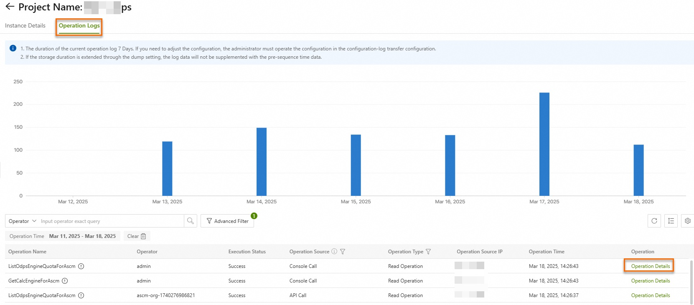

**Project management**

**Manage logical storage space**

1. Click the name of a MaxCompute project to go to its **Project Details** page.

2. In the **Instance Details > Region Settings** section, click **Edit** in the **Actions** column for the target instance.

3. You can manage the configured logical storage space based on a previously created Service Catalog.

**Define project tags**

On the **Project Management** page, you can define and add tags to your projects for easier categorization, searching, and filtering.

1. Hover over the **Tags** column for a project to display the edit icon  .

2. Click the edit icon  . In the **Edit Tags** dialog box, add a new tag or select an existing **Tag**

   **Key** and **Tag Value**.

   > **Note**
   >
   > - Each tag key must be unique.
   >
   > - You can add up to 20 tags at a time.
   >
   > - If you need to manage tags in a unified way, see the **Unified Cloud Management Platform User Guide > Operation Center > Resource Operation > Tag Management** section for more information.

3. Click **OK**. After the tags are saved, click **Close**.

4. The added tags are now visible on the **Project Management** page.

   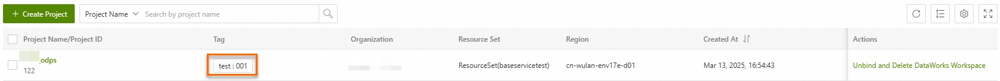

   After adding tags, you can use the **Filter by Tag** feature to select a **Tag Key** or **Tag Value** to find specific projects.

**Delete a project**

- If the project is not bound to a DataWorks workspace

  On the **Project Management** page, click **Delete** in the **Actions** column for the target project. In the **Delete MaxCompute Project** dialog box, review the risks, select the confirmation checkbox, and click **OK**.

- If the project is bound to a DataWorks workspace

  On the **Project Management** page, click **Unbind and Delete DataWorks Workspace** in the **Actions** column for the target project. Follow the on-screen instructions to go to the DataWorks platform to unbind and delete the workspace. Then, return to the MaxCompute **Project Management** page to delete the project.

> **Important**
>
> After you delete a project, you have seven days to contact an administrator to restore it. If the project is not restored within this period, it is permanently deleted. All data, UDFs, resources, and permission configurations become unrecoverable.

**Restore a project**

On the **Project Management** page, click **Restore** in the **Actions** column for the target project. Follow the instructions in the dialog box to contact a system administrator. The project administrator must complete the restoration within seven days after the project is marked for **deletion**.

> **Note**
>
> If the project is not restored within this period, it is permanently deleted. All data, UDFs, resources, and permission configurations become unrecoverable.

**Appendix: Create a service catalog**

1. In the top menu bar, click **Operations > Service Operation**.

2. In the left-side navigation pane, find **Service Catalog > Service Management**.

3. Click **Create Service** to go to the **Create Service** page.

4. When **creating a service**, select the target **Product** (**MaxCompute**) and associated resource (**Project**).

5. Configure other parameters such as **Service Name** and **Authorization Type** as prompted.

   > **Note**
   >
   > For more information about the parameters, see the **Unified Cloud Management Platform User Guide > Operation Center > Service Operation > Service Catalog** section.

6. After you **Submit** and create the Service Catalog, you can use it to create MaxCompute projects and manage changes to the **Configured Logical Storage Space**.

<a id="section-3-4"></a>

## 3.4. Create a quota group

This topic describes how to manage the lifecycle of a MaxCompute quota group, including creating, querying, modifying, sharing, and overselling CU resources. Learn how to efficiently allocate, adjust, and optimize your computing resources.

**Access the Create Quota Group page**

1. Log on to the Apsara Uni-manager Operation Console as an administrator.

2. In the top navigation bar, choose **Products > Big Data Computing > Cloud-native Big Data Computing Service MaxCompute** to open the **Overview** page.

3. In the left-side navigation pane, click **Quota Group Management** to open the **Quota Group Management** page.

4. Click **Create Quota Group** to open the **Create Quota Group** configuration page.

**Create a quota group**

On the **Create Quota Group** page, configure the following parameters.

1. (Optional) Select a service catalog.

   > **Note**
   >
   > - You can integrate MaxCompute projects with a service catalog for operational governance. After a service is published, you can configure its page parameters, enable price inquiries, and set up approval workflows.
   >
   > - If you have not created a service catalog, you can skip this step.

   <ol type="i">

   <li>

   If you have already created a service catalog, select the desired service catalog.

   </li>

   <li>

   Click **OK** to go to the **Create Quota Group** page<strong>.</strong>

   </li>

   </ol>

2. Enter the required project information.

   - **Region information**

     | Parameter | Description |
     | --- | --- |
     | Organization /Resource set | The organization and resource set where the quota group will be created. |
     | Region | The region where the cluster is deployed.<br>Note<br>If MaxCompute is deployed in a cell region, you can select the target cell region to create the quota group. |
     | Cluster | The cluster where the quota group will be created. |

   - **Basic information**

     | Parameter | Description |
     | --- | --- |
     | Quota group name | The name of the quota group. |
     | Sharing scope | The scope to which the quota group can be shared. The available scopes are Share within this resource set, Share within this organization and its sub-organizations, and Share within this organization. |
     | Number of CUs | The number of CUs to allocate to this quota group. The value must be greater than 0.<br>Note<br>The available quantity is limited by cluster resources. If a cluster has <code> 0 </code> remaining quota groups, select a different cluster with sufficient quota groups. |

3. (Optional) Review the configuration overview.

   In the **Configuration Overview** panel on the right, you can perform the following actions:

   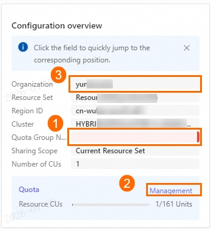

   - Review parameter configurations

     The **Configuration Overview** panel validates required fields in real time. If a required field is empty, the corresponding item is highlighted in red.

   - Manage quotas

     Click **Manage** to open the quota management page and set quota limits for the quota group. For more details, see the **Operations Center > Quota Management** chapter of the **Unified Cloud Management Platform User Guide**.

     > **Note**
     >
     > When setting quotas, consider the quota group's expected CU usage to prevent creation failures from an insufficient quota.

   - Navigate to settings quickly

     Click an item to quickly jump to its configuration field.

4. Click **Confirm Order** to create the quota group.

   > **Note**
   >
   > If the **service catalog** feature is not enabled, the button is labeled **Submit**.

**Manage a quota group**

**Query quota group information**

Filter the list by entering keywords in the **Quota Group Name** or **Cluster Name** search boxes.

> **Note**
>
> If MaxCompute is deployed in a cell region, you can click the **Region** drop-down list and switch to a different cell region to view the quota groups within it.

**CU resource overselling**

You can enable CU resource overselling if, for example, you have sold many CUs but their utilization is low. This feature is disabled by default.

- If CU resource overselling is enabled, the quota group list on the **Quota Group Management** page displays **CU upper limit**. In this case, you cannot modify the number of CUs.

- If CU resource overselling is disabled, the quota group list on the **Quota Group Management** page displays **guaranteed CU**. In this case, you can modify the number of CUs.

Procedure:

1. Navigate to **Apsara Stack O&M Platform > Platform O&M > Control Service O&M > UniConsole Control R&D Platform**.

2. In the **Product List**, search for **ODPS**.

3. In the Actions column, click **Switch List** and find the **ODPS Overselling Display Switch**.

4. Click **Modify Switch Status** on the right. In the **View Initial Status of Feature Switch** dialog box, configure the settings as needed and click **OK**.

**Modify the number of CUs**

To modify a quota group, find it in the list and click **Modify Number of CUs** in the **Actions** column.

> **Note**
>
> If you have created a service catalog, you can apply operational governance when adjusting the number of CUs for a quota group.

**Share a quota group**

To share a quota group, find it in the list and click **Sharing Settings** in the **Actions** column. In the **Sharing Settings** dialog box, select a **Sharing Scope**, such as **Share within this resource set**, **Share within this organization and its sub-organizations**, or **Share within this organization**, and then click **OK**.

**Delete a quota group**

To delete a quota group, find it in the list and click **Delete** in the **Actions** column.

**Customize the quota group display**

You can click the  icon in the upper-right corner to customize the columns displayed in the

**quota group** list. By default, only the **Quota Group Name** column is shown.

**Appendix: Create a service catalog**

1. In the top toolbar, click **Operations > Service Operations**.

2. In the left-side navigation pane, choose **Service Catalog > Service Management**.

3. Click **Create Service** to go to the **Create Service** page.

4. When you **Create Service**, select the target **Product** (**Cloud-native Big Data Computing Service MaxCompute**) and the associated resource (**Quota Group**).

5. Configure other parameters as prompted, such as **Service Name** and **Authorization Type**.

   > **Note**
   >
   > For more information about the parameters, see the **Unified Cloud Management Platform User Guide > Operations Center > Service Operations > Service Catalog > Service Management** chapter.

6. After you click **Submit** to create the service catalog, you can create a MaxCompute project based on this catalog and manage changes to the **quota group CUs**.

<a id="section-4"></a>

# 4.Quick start

<a id="section-4-1"></a>

## 4.1. Overview

This topic describes the procedure to use MaxCompute. It provides you with step-by-step instructions on basic MaxCompute operations.

The following figure shows the procedure to use MaxCompute.

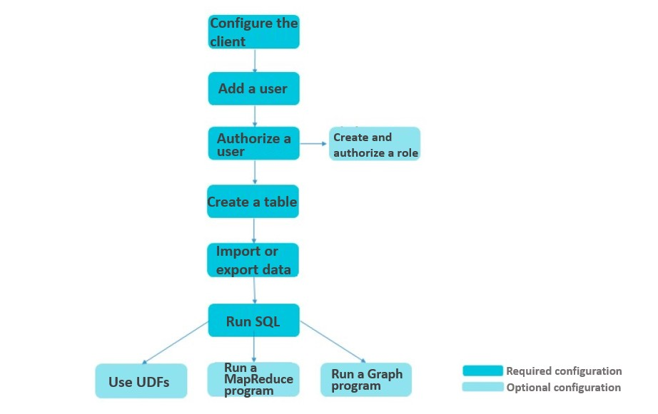

1. Configure the client.

   You must install and configure the client to access MaxCompute projects and use all the features of MaxCompute. For more information, see MaxCompute client.

2. Add a user.

   Except for the project owner, all users must be manually added to a project and granted permissions before they can perform operations on the project.

3. Authorize a user.

   After you add a user, you must authorize the user to perform operations on the project. A user can perform operations on the project only after the user is authorized.

4. (Optional) Create and authorize a role.

   It is time-consuming to authorize each user in a project that contains a large number of users. Project administrators can use roles to grant users a specified set of permissions. After you authorize a role, all users who assume this role are granted the same permissions.

5. Create a table.

   After a user is added to a project and authorized, the user can use MaxCompute. Table operations are the most basic operations in MaxCompute.

6. Import or export data.

   You can use the SDK provided by MaxCompute Tunnel to write your own Java programs and import or export data.

7. Execute SQL statements.

   You can familiarize yourself with the limits on a few common SQL statements. For more information about how to execute SQL statements, see MaxCompute SQL.

8. Perform the following optional operations:

   - Use UDFs.

     After you install the MaxCompute client, you can try to use user-defined functions (UDFs). MaxCompute supports user-defined scalar functions, user-defined aggregate functions (UDAFs), and user-defined table-valued functions (UDTFs).

   - Run a MapReduce program.

     After you install the MaxCompute client, you can run a MapReduce program.

   - Run a Graph program.

     After you install the MaxCompute client, you can run a Graph program.

<a id="section-4-2"></a>

## 4.2. Configure the MaxCompute client

You can access MaxCompute projects and use MaxCompute features by using the MaxCompute client. This topic describes how to download, configure, and run the MaxCompute client.

**Prerequisites**

JRE 1.8 is installed on your on-premises machine because the MaxCompute client is developed in Java. You have a task account and have obtained the **AccessKey ID** and **AccessKey secret** of the task account.

> **Note**
>
> A project is created, and the **AccessKey ID** and **AccessKey secret** are obtained before you configure the MaxCompute client.

**Procedure**

1. Download the client package to your on-premises machine.

2. Decompress the package to a folder that contains the following subfolders:

   ```text
   bin/ 
   conf/ 
   lib/ 
   plugins/
   ```

3. Edit the **odps_config.ini** file in the conf folder. The file contains the following configuration information:

   ```text
   project_name=my_project
   access_id=*******************
   access_key=*********************
   end_point= <Endpoint of MaxCompute>
   ```

   - **access_id** and **access_key** are the AccessKey pair of the task account. **access_id** corresponds to the **AccessKey ID**, and **access_key** corresponds to the **AccessKey Secret**. To obtain the AccessKey pair of the task account, perform the following steps: Log on to the Apsara Uni-manager Management Console. In the top navigation bar, click **Enterprise**. In the left-side navigation pane of the page that appears, choose Resources > **Organizations**. On the Organizations page, click **Manage AccessKey Pairs**.

   - **project_name=my_project** specifies the project that you want to access. This is the default project that is accessed each time you log on to the client. If you do not configure this parameter, you must run the  `use <project_name>;`  command to access the project after you log on to the client.

   - You must set **end_point** to the endpoint of MaxCompute. The endpoint varies based on the user account.

     > **Important**
     >
     > On the premise of security, you must ensure that odpscmd and end_point of MaxCompute are interconnected.

4. After you modify the configuration file, run the **odpscmd** file in the bin directory in Linux or the odpscmd.bat file in Windows. Then, you can execute SQL statements and run related commands. Example:

   ```sql
   create table tbl1(id bigint);
   insert overwrite table tbl1 select count(*) from tbl1;
   select 'welcome to MaxCompute!' from tbl1;
   ```

   > **Note**
   >
   > For more information about SQL statements, see MaxCompute SQL.
   >
   > You can run the  `help;`  command to obtain help information about all commands or the  `help <keyword>;`  command to obtain help information about related commands. For example, you can run the  `help table;`  command to obtain help information about table operations. You can run the  `quit;`  or  `q;`  command to exit the client.

<a id="section-4-3"></a>

## 4.3. Add and remove users

To perform operations in a MaxCompute project, users who are not project Owners must be added to the project and granted the required permissions. This topic describes how a project Owner can add and remove users from a project.

**Usage notes**

If you are a project Owner, read this section carefully. If you are not a project Owner, you must ask the project Owner to add you to the project.

To check if you are a project Owner, follow these steps:

1. Run the  `whoami;`  command in the client to find your username.

2. Run the following command to check your permissions. If the command returns  `Project Owner` , you are the project Owner:

   ```text
   SHOW grants FOR <username>;
   ```

   The value for  `username`  is the username that you obtained in Step 1.

**List users**

To check if a user is already in the current project, run the following command:

```text
LIST users;
```

**Add a user**

- Command format:

  ```text
  ADD USER ALIYUN$<userid>;
  ```

- Parameter:

  `userid` : The ID of the cloud account. To learn how to obtain a cloud account ID, see Prepare a task cloud account.

- Example:

  Add a user whose cloud account ID is  `ascm-dw-1**********28`  to the current project:

  ```text
  ADD USER ALIYUN$ascm-dw-1**********28;
  ```

> **Note**
>
> - After a user is added, they cannot perform operations in the MaxCompute project until the project Owner grants them permissions. The user can then operate only within the scope of the granted permissions.
>
> - To learn how to grant permissions, see User authorization and permission management.

**Remove a user**

- Command format:

  ```text
  REMOVE USER ALIYUN$<userid>;
  ```

  `userid` : The ID of the cloud account to remove. To learn how to obtain a cloud account ID, see Prepare a task cloud account.

- Parameter:

  `userid` : The ID of the cloud account. To find the IDs of all users in the project, run the  `list users;`  command.

- Example:

  Remove a user whose cloud account ID is  `ascm-dw-1**********28`  from the current project:

  ```text
  REMOVE USER ALIYUN$ascm-dw-1**********28;
  ```

  - Before you remove a user, revoke all their permissions.

    > **Note**
    >
    > If you remove a user without revoking their permissions, the project retains those permissions. If you add the user back to the project, their previous permissions are automatically restored.

  - For more information, see User management.

<a id="section-4-4"></a>

## 4.4. Grant and view permissions

<a id="section-4-4-1"></a>

### 4.4.1. Overview

After you add a user, you must authorize the user to perform operations on the project. A user can perform operations on the project only after the user is authorized.

Authorization is a process of granting permissions to perform operations on objects, such as tables, tasks, and resources, in MaxCompute. The permissions include read, write, and view permissions.

The following topics are intended for project administrators. If you are a regular MaxCompute user, make sure that you have obtained the required permissions.

MaxCompute provides two authorization mechanisms. For more information, see ACL-based access control and Policy-based access control.

<a id="section-4-4-2"></a>

### 4.4.2. ACL-based access control

This topic describes the command syntax for access control list (ACL)-based authorization and provides examples on how to use the GRANT command to assign operation permissions to users or roles.

**Applicable scope**

- ACL-based authorization in MaxCompute applies to the following objects: projects, tables, functions, resources, instances, and tasks.

- Each type of object requires different operation permissions. For more information, see ACL-based authorization.

**Authorization command**

```sql
GRANT actions ON object TO subject
REVOKE actions ON object FROM subject
actions ::= action_item1, action_item2, ...
object ::= project project_name | TABLE schema_name |
           instance inst_name | FUNCTION func_name |
           resource res_name
subject ::= USER full_username | role role_name
```

**Example**

The project administrator can grant permissions to organization accounts (Apsara Stack tenant accounts), task accounts (Apsara Stack tenant accounts), and Resource Access Management (RAM) users in the organization.

> **Note**
>
> To add a RAM user of another organization, you must add the organization account of the other organization to the project before you can add the RAM user of the organization.

- Scenario 1: Assume that  `ali***@aliyun.com`  is a new member of the project  `test_project_a` . The project administrator can run the following command to grant the user the permissions to submit jobs, create tables, and view existing objects in the project.

  ```sql
  -- Open the project. 
  USE test_project_a;
  -- Add the user to the project. 
  ADD USER aliyun$ali***@aliyun.com;

  -- Create a role named worker. 
  CREATE role worker;
  -- Assign the worker role to the added member. 
  GRANT worker TO aliyun$ali***@aliyun.com;

  --Authorization method 1: Grant the CreateInstance, CreateResource, CreateFunction, CreateTable, and List permissions on all objects in the test_project_a project to the worker role. 
  GRANT CreateInstance, CreateResource, CreateFunction, CreateTable, List ON PROJECT test_project_a TO ROLE worker;
  ----Authorization method 2: Grant all instance permissions to the worker role. 
  GRANT ALL ON instance instance_name TO Role worker;
  ```

- Scenario 2: Assume that Allen is a RAM user that belongs to  `ali***@aliyun.com` . The project administrator can run the following command to grant permissions to the RAM user under the Apsara Stack tenant account of the organization:

  ```text
  -- Add a RAM user.  
  ADD USER ram$ali***@aliyun.com:Allen; 

  -- Create a role named worker. 
  CREATE role worker;

  -- Assign the worker role to the added member. 
  GRANT worker TO ram$ali***@aliyun.com:Allen; 
  ```

<a id="section-4-4-3"></a>

### 4.4.3. Policy-based access control

This topic describes the commands that you can use for policy-based access control and provides examples on how to configure a policy.

Policy-based access control is subject-based authorization. For more information, see Authorization policies.

Commands:

```text
GET POLICY; 
-- Read the project policy.
PUT POLICY <policyFile>; 
-- Specify or overwrite the project policy.
GET POLICY ON ROLE <roleName>; 
-- Read the policy of a role in the project.
PUT POLICY <policyFile> ON ROLE <roleName>; 
-- Specify or overwrite the policy of a role in the project.
```

Example on how to configure a policy:

```json
{
"Version": "1",
"Statement": [
{
"Effect": "Deny", 
"Action": [
"odps:*"
],
"Resource": "acs:odps:*:projects/$user_project_name/tables/*",
 "Condition": {
"StringEquals": { 
"odps:TaskType": [
"DT"
]
}
}
},
{
"Effect": "Allow",
 "Action": [
"odps:List",
"odps:Read", 
"odps:Describe", 
"odps:Select"
],
"Resource": [
 "acs:odps:*:projects/$user_project_name/tables/a", 
"acs:odps:*:projects/$user_project_name"
],
"Condition": {
 "StringEquals": {
"odps:TaskType": [
                 "SQL"
                   ]
          }
   }
}
]
}
```

> **Note**
>
> The preceding example disables the Tunnel feature of $user_project_name,
>
> and grants the user the LIST, READ, DESCRIBE, and SELECT permissions only on the project and table a in the project.

<a id="section-4-4-4"></a>

### 4.4.4. Query permissions

You can execute a statement to query user permissions in MaxCompute.

Execute the following statement to query the permissions of a user:

```text
show grants for $user_name;
```

> **Note**
>
> For more information, see View permissions.

<a id="section-4-5"></a>

## 4.5. Create roles and grant permissions

When a project space has many users, granting permissions to each user individually is tedious. To simplify this, a project administrator can group users with the same permission requirements into a role. All users assigned to a role automatically inherit its permissions.

**User and role association rules**

Multiple users can be assigned to a single role, and a single user can be assigned to multiple roles.

**Create a role**

**Syntax**

```text
CREATE role <roleName>;
```

**Example**

```text
CREATE role player;
```

**Grant a role to a user**

**Syntax**

```text
GRANT <roleName> TO <full_username>;
```

**Example**

```text
GRANT player TO bo***@aliyun.com;
```

**Delete a role**

**Syntax**

```text
DROP role <roleName>;
```

**Example**

```text
DROP role player;
```

> **Note**
>
> Before you delete a role, remove all users from it.

**Role authorization**

Granting permissions to a role is similar to granting them to a user. For instructions, see Grant and view user permissions. For more information about roles, see Role management.

<a id="section-4-6"></a>

## 4.6. Create or delete a table

<a id="section-4-6-1"></a>

### 4.6.1. Create a table

This topic describes how to create a table.

Syntax:

```sql
create table [if not exists] table_name
[(col_name data_type [comment col_comment], ...)] [comment table_comment]
[partitioned by (col_name data_type [comment col_comment], ...)] [lifecycle days]
[as select_statement]
-- You can also execute the following statement to create a table:
create table [if not exists] table_name
like existing_table_name
```

Examples:

```sql
create table test1 (key string); 
-- Create a non-partitioned table.
create table test2 (key bigint) partitioned by (pt string, ds string); 
-- Create a partitioned table.
create table test3 (key boolean) partitioned by (pt string, ds string) lifecycle 100; 
-- Create a table that has a lifecycle specified.
create table test4 like test3; 
-- Create a table named test4 that has the same attributes, such as the field type and partition type, as those of test3. The only difference between the two tables is the lifecycle.
create table test5 as select * from test2;
-- Create a table named test5. However, the partitioning and lifecycle attributes are not replicated to the destination table. Only data of test2 is replicated to test5.
```

You can specify partitions and lifecycles for MaxCompute tables. For more information about how to create a table, see Create a table. For more information about how to modify partitions, see Add a partition and Delete a partition. For more information about how to modify lifecycle settings, see Modify the lifecycle of a table.

<a id="section-4-6-2"></a>

### 4.6.2. Query table information

This topic describes how to query table information.

Syntax:

```text
desc <table_name>;
```

Examples:

```text
desc test3; 
-- Query information about test3.
desc test4; 
-- Query information about test4.
```

<a id="section-4-6-3"></a>

### 4.6.3. Delete a table

This topic describes how to delete a table.

Syntax:

```text
drop table [if exists] table_name;
```

Examples:

```text
drop table test2;
```

> **Note**
>
> For more information, see Delete a table.

<a id="section-4-7"></a>

## 4.7. Import or export data

This topic describes how to compile Java programs by using the MaxCompute Tunnel SDK and import data to or export data from MaxCompute.

For more information about data import and export, see Tunnel SDK example.

<a id="section-4-8"></a>

## 4.8. Run SQL

<a id="section-4-8-1"></a>

### 4.8.1. Overview

This topic describes the precautions when you execute SQL statements.

For more information about how to execute SQL statements, see MaxCompute SQL.

Take note of the following points when you use MaxCompute SQL:

- The SQL syntax of MaxCompute is different from the SQL syntax of Oracle or MySQL. You cannot directly migrate SQL statements from other database engines to MaxCompute.

- MaxCompute SQL does not respond to queries in real time. It requires a few minutes to return query results, instead of seconds or milliseconds.

<a id="section-4-8-2"></a>

### 4.8.2. SELECT

This topic describes limits of the SELECT statements.

The following limits apply to the SELECT statements:

- The key of the GROUP BY clause can be the name of a column in the input table, or the expression composed of columns in the input table. However, the key of the GROUP BY clause cannot be the output column of the SELECT operation.

  ```sql
  select substr(col2, 2) from tbl group by substr(col2, 2);
  -- This statement can be executed because the key of the GROUP BY clause is the expression composed of columns in the input table. 
  select col2 from tbl group by substr(col2, 2);
  -- This statement cannot be executed because the key of the GROUP BY clause is not included in the columns of the SELECT operation. 
  select substr(col2, 2) as c from tbl group by c;
  -- This statement cannot be executed because the key of the GROUP BY clause is the alias of an output column of the SELECT operation.
  ```

  > **Note**
  >
  > In most cases, the GROUP BY operation precedes the SELECT operation during the parsing of SQL statements. Therefore, GROUP BY uses only the column names in the input table or expressions of columns as keys.

- The key of the ORDER BY, SORT BY, or DISTRIBUTE BY clause must be the alias of an output column of the SELECT operation.

  ```sql
  select col2 as c from tbl order by col2 limit 100;
  -- This statement cannot be executed because the key of the ORDER BY clause is not the alias of an output column of the SELECT operation. 
  select col2 from tbl order by col2 limit 100;
  -- This statement can be executed. If an output column of the SELECT operation does not have an alias, the column name is used as the alias.
  ```

  > **Note**
  >
  > In most cases, the SELECT operation is performed before the ORDER BY, SORT BY, and DISTRIBUTE BY clauses during the parsing of SQL statements. Therefore, only the aliases of output columns from the SELECT operation can be used as keys of these clauses.

- `ORDER BY`  cannot be used at the same time with  `DISTRIBUTE BY`  or  `SORT BY` . Similarly, `GROUP BY`  cannot be used at the same time with  `DISTRIBUTE BY`  or  `SORT BY` .

For more information about the SELECT statements, see SELECT.

<a id="section-4-8-3"></a>

### 4.8.3. INSERT

This topic describes the limits of the INSERT statements.

The following limits apply to the INSERT statements:

- If you execute an INSERT statement to insert data into a partition, the partition key columns cannot be included in the SELECT clause.

  ```text
  insert overwrite table sale_detail_insert partition (sale_date='2017', 
  region='china') select shop_name, customer_id, total_price, sale_date, region from sale_detail;
  -- An error is returned. The sale_date and region columns are partition key columns and cannot be included in the INSERT statement that is used to insert data into staticpartitions.
  ```

- If you execute an INSERT statement to insert data into dynamic partitions, the dynamic partition key columns must be included in the SELECT clause.

  ```text
  insert overwrite table sale_detail_dypart partition (sale_date='2017', region) selectshop_name,customer_id,total_price from sale_detail;
  -- An error is returned. If you execute an INSERT statement to insert data into dynamic partitions, the dynamic partition key columns must be included in the SELECT clause.
  ```

For more information about the INSERT statements, see INSERT.

<a id="section-4-8-4"></a>

### 4.8.4. JOIN

This topic describes the limits on JOIN statements.

Limits:

- MaxCompute SQL supports the following JOIN operations:LEFT OUTER JOIN, RIGHT OUTER JOIN, FULL OUTER JOIN, INNER JOIN, NATURAL JOIN, and implicit JOIN.

- MaxCompute SQL supports a maximum of 128 parallel JOIN operations.

For more information about JOIN statements, see JOIN.

<a id="section-4-8-5"></a>

### 4.8.5. Other limits

This topic describes other limits on MaxCompute SQL.

- MaxCompute SQL supports a maximum of 256 concurrent UNION operations.

- MaxCompute SQL supports a maximum of 256 concurrent INSERT OVERWRITE or INSERT INTO operations.

<a id="section-4-9"></a>

## 4.9. Compile and use UDFs

<a id="section-4-9-1"></a>

### 4.9.1. Overview

This topic describes how to write and run a MaxCompute user-defined function (UDF).

MaxCompute supports user-defined scalar functions, user-defined aggregate functions (UDAFs), and user-defined table-valued functions (UDTFs).

> **Note**
>
> - If you want to write a UDF program, you can upload UDF code to your project as a resource and execute the required statement to create a UDF.
>
> - This topic provides code examples of user-defined scalar functions, UDAFs, and UDTFs.

<a id="section-4-9-2"></a>

### 4.9.2. UDF examples

This topic describes the complete workflow for developing a MaxCompute user-defined function (UDF): writing code, packaging it, adding a resource, registering the function, and calling it. These examples help you quickly develop and use UDFs to extend your SQL processing capabilities.

**Procedure**

1. Write the code.

   You must implement the function logic and compile the code using the MaxCompute UDF framework.

   ```java
   package org.alidata.odps.udf.examples;
   import com.aliyun.odps.udf.UDF;
   public final class Lower extends UDF {
       public String evaluate(String s) {
           if (s == null) {
               return null;
           }
           return s.toLowerCase();
       }
   }
   ```

   Package the preceding code into a JAR package named my_lower.jar.

2. Add a resource.

   Before running a UDF, you must add its code to MaxCompute as a resource. For a Java UDF, you must package the code into a JAR package and add it as a JAR resource. The UDF framework automatically loads the JAR package to run your UDF.

   Example command to add a JAR resource:

   ```text
   ADD jar my_lower.jar;
   ```

   > **Note**
   >
   > If a resource with the same name exists, rename the JAR package and update its name in the relevant commands. Alternatively, you can use the -f option to overwrite the existing JAR resource.

3. Register the UDF.

   Uploading the JAR package does not register the UDF. You must explicitly register the function to assign it a unique name and link that name to its class in the JAR resource.

   Example command to register the UDF:

   ```text
   CREATE FUNCTION test_lower AS org.alidata.odps.udf.examples.Lower USING my_lower.jar;
   ```

   The following example shows how to use this function in an SQL statement:

   ```sql
   SELECT test_lower('A') FROM my_test_table;
   ```

<a id="section-4-9-3"></a>

### 4.9.3. UDAF example

This topic provides the code example of a user-defined aggregate function (UDAF) for your reference.

UDAFs are registered in the same way as UDFs and are used in the same way as built-in aggregate functions.

UDAF code example:

```java
package org.alidata.odps.udf.examples;
import com.aliyun.odps.io.LongWritable;
import com.aliyun.odps.io.Text;
import com.aliyun.odps.io.Writable;
import com.aliyun.odps.udf.Aggregator;
import com.aliyun.odps.udf.UDFException;
/**
 * project: example_project
 * table: wc_in2
 * partitions: p2=1,p1=2
 * columns: colc,colb,cola
 */
public class UDAFExample extends Aggregator {
  @Override
  public void iterate(Writable arg0, Writable[] arg1) throws UDFException {
    LongWritable result = (LongWritable) arg0;
    for (Writable item : arg1) {
      Text txt = (Text) item;
      result.set(result.get() + txt.getLength());
    }
  }
  @Override
  public void merge(Writable arg0, Writable arg1) throws UDFException {
    LongWritable result = (LongWritable) arg0;
    LongWritable partial = (LongWritable) arg1;
    result.set(result.get() + partial.get());
  }
  @Override
  public Writable newBuffer() {
    return new LongWritable(0L);
  }
  @Override
  public Writable terminate(Writable arg0) throws UDFException {
    return arg0;
  }
}
```

<a id="section-4-9-4"></a>

### 4.9.4. UDTF example

This topic provides a sample UDTF that you can use as a reference to develop your own functions.

**Sample code**

Registering and using a UDTF is similar to a UDF. The following code is an example.

```java
package org.alidata.odps.udtf.examples;
import com.aliyun.odps.udf.UDTF;
import com.aliyun.odps.udf.UDTFCollector;
import com.aliyun.odps.udf.annotation.Resolve;
import com.aliyun.odps.udf.UDFException;

@Resolve({"string,bigint->string,bigint"})
public class MyUDTF extends UDTF{
    @Override
    public void process(Object[] args) throws UDFException {
        String a = (String) args[0];
        long b = (long) args[1];
        for (String t: a.split("\\s+")) {
            forward(t, b);
        }
    }
}
```

<a id="section-4-10"></a>

## 4.10. Write and run a MapReduce program

This topic describes how to write and run a MapReduce program.

**Prerequisites**

- JDK 1.8 is installed.

- The MaxCompute client is configured. For more information, see Configure the client.

**Procedure**

1. Create input and output tables. Example:

   ```sql
   create table wc_in (key string, value string); 
   create table wc_out (key string, cnt bigint);
   ```

   > **Note**
   >
   > For more information about the statements that are used to create tables,
   >
   > see Create a table.

2. Insert data into the wc_in table. You can use one of the following methods to insert data:

   - Run Tunnel commands to upload data. The following code shows the data that you want to insert into the table. You must create a kv.txt file on your computer and save the data to the file. In this example, the kv.txt file is saved in D:\\.

     ```text
     238,val_238
     186,val_86
     186,val_86
     ```

     Run the following command to upload the data:

     ```text
     Tunnel upload D:\kv.txt wc_in;
     ```

   - Execute the following SQL statement to insert the data:

     ```sql
     INSERT INTO TABLE wc_in VALUES ('238',' val_238'),('186','val_86'),
     ('186','val_86');
     ```

3. Write a MaxCompute program and compile it.

   - MaxCompute provides the Eclipse plug-in to help you develop MapReduce programs and debug them on your computer.

   - You must create a MaxCompute project in Eclipse. Then, write a MapReduce program in this project. After local debugging succeeds, upload the compiled program (JAR package) to MaxCompute.

4. Add the JAR package as a project resource. In this example, the JAR package is named **word-count-1.0.jar**.

   ```text
   add jar word-count-1.0.jar;
   ```

5. Run the JAR command on the MaxCompute client.

   ```text
   jar -resources word-count-1.0.jar -classpath /home/resources/word-count-1.0.jar com.taobao.jingfan.wordcount wc_in wc_out;
   ```

   > **Note**
   >
   > If the Java program uses resources, use the **-resources** option to specify
   >
   > the resources.

6. View the command output on the MaxCompute client.

   ```sql
   select * from wc_out;
   ```

<a id="section-5"></a>

# 5.Basic concepts and common commands

<a id="section-5-1"></a>

## 5.1. Terms

This topic describes the basic terms of MaxCompute.

**Project**

A basic organizational unit of MaxCompute. Similar to a database or schema in a traditional database system, a project is used to isolate multiple users and control access requests. A user can have permissions on multiple projects. After authorization, you can access objects, such as tables, resources, functions, and instances in a project from another project.

You can run the use project command to access a project. Example:

```text
use al_project
-- Access a project named al_project.
```

> **Note**
>
> After you run the preceding command, you access a project named al_project and manage objects that belong to this project, regardless of which project you are in.

**Table**

A data storage unit of MaxCompute. Logically, a table is a two-dimensional structure that consists of rows and columns, in which each row represents a record and each column represents the values of the same data type. One record can contain one or more columns. The column names and types constitute the schema of this table. All data in MaxCompute is stored in tables. Table columns support all data types in MaxCompute. Tables are the input and output objects of all MaxCompute computing tasks. You can create a table, delete a table, and import data into a table.

You can define partitions for a table to process data more efficiently. You can specify some fields in the table as partition key columns. In most cases, partitions within a table are analogous to directories within a file system. Each value of a partition key column is called a partition in MaxCompute. You can group multiple fields of a table to a single partition to create a multi-level partition. Multi-level partitions are analogous to multi-level directories. If you specify the name of the partition that you want to access, MaxCompute scans only the specified partition. This makes data processing more efficient and reduces costs.

**Data type**

The values in a column of a MaxCompute table must be of a specific data type. The following table describes the basic data types that are supported by MaxCompute and their valid values.

Table 1. Basic data types

| Data type | Introduced in MaxCompute V2.0 | Constant | Description | Valid values |
| --- | --- | --- | --- | --- |
| TINYINT | Yes | 1Y,-127Y | The 8-bit signed integer type. | -128 to 127 |
| SMALLINT | Yes | 32767S,-100S | The 16-bit signed integer type. | -32768 to 32767 |
| INT | Yes | 1000,-15645787 | The 32-bit signed integer type. | -2 31 to 2 31-1 |
| BIGINT | No | 100000000000L,-1L | The 64-bit signed integer type. | -2 63+1 to 2 63-1 |
| STRING | No | "abc",'bcd',"aliba ba" ,'inc' | The string, which supports UTF-8 encoding. The character behavior encoded in other formats is not defined. | The size of all values in a column of the STRING type cannot exceed 8 MB. |
| FLOAT | Yes | None | The 32-bit binary floating point type. | N/A |
| BOOLEAN | No | True,False | The BOOLEAN type. | True or False |
| DOUBLE | No | 3.1415926 1E+7 | The 64-bit binary floating point type. | -1.0 <em>10</em>308 ~ 1.0 <em>10</em>308 |
| DATETIME | No | Datetime '2017-11-11 00:00:00' | The DATETIME type. The standard system time is UTC+8. | 0001-01-01 00:00:00.000 ~ 9999- 12-31 23:59:59.999 |
| DECIMAL | No | 3.5BD, 99999999999.99 99999BD | The precise numeric type based on the decimal system. | Integral part: -1036+1 to 1036-1<br>Decimal places: round to 10-18 |
| VARCHAR | Yes | None | The variable-length character type, in which n specifies the length. | 1 to 65535 |
| CHAR | Yes | None | The fixed-length character type, in which n specifies the length. If the length does not reach the specified value, extra spaces are automatically filled but are not involved in the comparison. | 1 to 255 |
| BINARY | Yes | None | The binary data type. | The size of all values in a column of the BINARY type cannot exceed 8 MB. |
| TIMESTAMP | Yes | Timestamp '2017-11-11 00:00:00.123456 789' | The TIMESTAMP type. The timestamp is independent of time zones. | 0001-01-01 00:00:00.000000 000 ~ 9999- 12-31 23:59:59.999999 999 |

If you want to use new data types introduced in the MaxCompute V2.0 data type edition, you must add one of the following configurations to enable the MaxCompute V2.0 data type edition:  `set odps.sql.type.system.odps2=true;`  (for a session) or  `setproject odps.sql.type.system.odps2=true;`  (for a project). Otherwise, the following error message may appear:  `xxxx type is not enabled in current mode` . The data types listed in the preceding table can contain NULL values.

> **Note**
>
> Only lowercase letters can be used in the preceding flags.

Take note of the following points when you use the new data types in MaxCompute V2.0:

- If you add  `set odps.sql.type.system.odps2=true;`  for a session, the following changes occur:

  - The semantics of the **INT** keyword changes. **INT** in an SQL statement indicates a 32-bit integer.

  - The semantics of an integer constant changes.  `Select 1 + a;`  is used in this example.

    - If the MaxCompute V2.0 data type edition is disabled, the integer constant is processed as the **BIGINT** type. If the length of the constant exceeds the range for the **BIGINT** type, the integer constant is processed as the **DOUBLE** type.

    - If the MaxCompute V2.0 data type edition is enabled, integer constants are preferentially processed as the **INT** type, and the value 1 is 1 of the 32-bit integer type.

    - If the integer constant is processed as the **INT** type, inconsistency may occur in function prototypes during subsequent operations. In addition, the actions of peripheral tools and subsequent jobs may be changed due to the tables that contain new data types and that are generated after data is written to a disk.

  - The rules for implicit conversions of data types change.

    If the MaxCompute V2.0 data type edition is enabled, some implicit type conversions may be disabled. For example, if the data type is converted from **STRING** to **BIGINT**, from **STRING** to **DATETIME**, from **DOUBLE** to **BIGINT**, from **DECIMAL** to **DOUBLE**, or from **DECIMAL** to **BIGINT**, precision may be reduced or errors may occur. In this case, you can use the CAST function to force the data type conversion.

    Implicit type conversions greatly affect functions and INSERT statements. For example, an INSERT statement can be executed if the MaxCompute V2.0 data type edition is disabled, but an error is returned if the data type edition is enabled.

  - For some operations or built-in functions that use new data types for parameters and return values, if the MaxCompute V2.0 data type edition is disabled, these operations or built-in functions are directly ignored. If the MaxCompute V2.0 data type edition is enabled, these operations or built-in functions can be used. Take note of the following items:

    - Some built-in functions can be used only after the MaxCompute V2.0 data type edition is enabled. The built-in functions include the functions that return the values of the **INT** type, such as **YEAR**, **QUARTER**, **MONTH**, **DAY**, **HOUR**, **MINUTE**, **SECOND**, **MILLISECOND**, **NANOSECOND**, **DAYOFMONTH**, and **WEEKOFYEAR**. The parameters of these functions can be of the INT type, and the BIGINT overload is used for these functions. These functions can be implemented by using the **DATEPART** built-in function.

    - The resolution of user-defined functions (UDFs) changes.

  - The parsing of the **BIGINT** keyword changes.

  - The data types supported by partition key columns change.

    - If the MaxCompute V2.0 data type edition is disabled, the data type of a partition key column can only be **STRING**.

    - If the MaxCompute V2.0 data type edition is enabled, the data type of a partition key column can be **STRING**, **VARCHAR**, **CHAR**, **TINYINT**, **SMALLINT**, **INT**, or **BIGINT**.

    - If the MaxCompute V2.0 data type edition is disabled, partition fields in INSERT operations are processed as the **STRING** type.

  - The execution rules of LIMIT statements in SET operations change.

    The  `Select * from t1 union all select * from t2 limit 10;`  statement is used in this example.

    - If the MaxCompute V2.0 data type edition is disabled, the preceding statement is expressed as  `Select * from t1 union all select * from ( select * from t2 limit 10) t2;` .

    - If the MaxCompute V2.0 data type edition is enabled, the preceding statement is expressed as  `Select * from (select * from t1 union all select * from t2 ) limit 10;` .

    These changes also apply to UNION, INTERSECT, EXCEPT, ORDER BY, DISTRIBUTE BY, SORT BY, and CLUSTER BY.

  - The parsing of data types in IN expressions changes.

    The  `a in (1, 2, 3)`  expression is used in this example.

    - If the MaxCompute V2.0 data type edition is disabled, all the values enclosed in the parentheses () must be of the same type.

    - If the MaxCompute V2.0 data type edition is enabled, all the values enclosed in the parentheses () are implicitly converted into the same type.

- If a constant of the **INT** type exceeds the range for the **INT** type, the constant is processed as the **BIGINT** type. If the constant exceeds the range for the **BIGINT** type, the constant is processed as the **DOUBLE** type. If you do not set  `odps.sql.type.system.odps2`  to true, the constant conversion is retained. However, an alert is reported, indicating that the **INT** type is processed as **BIGINT**. If such issue exists in your scripts, we recommend that you rewrite your scripts and convert these types into **BIGINT** to prevent confusion.

- Constants of the **VARCHAR** type can be implicitly converted into the **STRING** type.

- Constants of the **STRING** type can be combined. For example,  `'abc' 'xyz'`  can be combined as  `'abcxyz'` . Different parts can be written in different rows.

- Time values do not include the millisecond part. You can add  `-dfp`  to Tunnel commands to display milliseconds in the time values.

MaxCompute supports complex data types. The following table lists their definitions and constructors.

Table 2. Complex data types

| Data type | Definition | Constructor |
| --- | --- | --- |
| ARRAY | array&lt; int &gt;;<br>array&lt; struct&lt; a:int, b:string &gt;&gt; | array(1, 2, 3);<br>array(array(1, 2);<br>array(3, 4)) |
| MAP | map&lt; string, string &gt;;<br>map&lt; smallint, array&lt; string&gt;&gt; | map("k1", "v1","k2", "v2");<br>map(1S, array('a', 'b'), 2S, array('x', 'y')) |
| STRUCT | struct&lt; x:int, y:int&gt;;<br>struct&lt; field1:bigint, field2:array&lt; int&gt;, field3:map&lt; int, int&gt;&gt; | named_struct('x', 1, 'y', 2);<br>named_struct('field1', 100L, 'field2', array(1, 2), 'field3', map(1, 100, 2, 200) |
| JSON | JSON | JSON '123' |

If PyODPS is used, you can use one of the following methods to enable the MaxCompute V2.0 data type edition:

- Execute  `o.execute_sql('set odps.sql.type.system.odps2=true;query_sql', hints= {"odps.sql.submit.mode" : "script"})` .

- Use DataFrame. For example, you can set the hints parameter to specify an immediately executed method, such as persist, execute, or to_pandas. The settings in the following figure are valid only for a single job.

  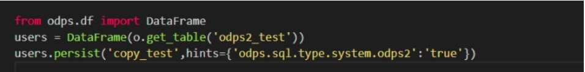

- If you use DataFrame to enable the MaxCompute V2.0 data type edition and want the settings to globally take effect, add the configuration  `options.sql.use_odps2_extension = True` .

**Resource**

A unique concept in MaxCompute. To implement UDF and MapReduce features, you must use resources.

- MaxCompute SQL UDFs: After you write a UDF, you must package it into a JAR file and upload the package to MaxCompute as a resource. When you run the UDF, MaxCompute automatically downloads the JAR file and obtains the code to run the UDF. JAR files are a type of MaxCompute resource. When you upload a JAR file, a resource is created in MaxCompute.

- MaxCompute MapReduce: After you write a MapReduce program, you must package it into a JAR file and upload the file to MaxCompute as a resource. When you run a MapReduce job, the MapReduce framework automatically downloads the JAR file and obtains the code to run the MapReduce job.

  > **Note**
  >
  > - Some limits are imposed on how MaxCompute UDFs and MapReduce access resources. For more information, see Limits.
  >
  > - You can also upload tables or text files to MaxCompute as different types of resources. You can read or use these resources when you run UDFs or MapReduce jobs. MaxCompute provides APIs for you to read and use resources. For more information, see UDTF description.

MaxCompute supports the following resource types:

- File

- Table: tables in MaxCompute.

- JAR: compiled JAR files.

- Archive: compressed files identified by the resource name extension. Supported file types include .zip, .tgz, .tar, and .jar.

- Py: Python scripts used by Python UDFs.

> **Note**
>
> For more information about resource operations, see Resource operations.

**UDF**

MaxCompute provides SQL computing capabilities. You can use the built-in functions in MaxCompute SQL statements to complete some computing and counting tasks. If these built-in functions do not meet your business requirements, you can use the Java APIs that MaxCompute provides to develop UDFs. UDFs are classified into user-defined scalar-valued functions, user-defined aggregate functions (UDAFs), and user-defined table-valued functions (UDTFs).

After you write the UDF code, you must package the code into a JAR file, upload the file to MaxCompute as a resource, and then register this UDF in MaxCompute. To use a UDF in MaxCompute, you need to only specify its name and parameters in an SQL statement as you do when you use built-in functions of MaxCompute.

> **Note**
>
> For more information about UDF operations, see Function operations.

**Task**

A basic computing unit of MaxCompute. SQL and MapReduce features are all implemented as tasks. MaxCompute parses most of the tasks that you submit, especially computing tasks, such as SQL DML statements and MapReduce tasks. Then, MaxCompute generates a task execution plan based on the parsing results.

An execution plan consists of several dependent stages. An execution plan can be logically defined as a directed graph. Vertices of the graph represent stages, and edges of the graph represent dependencies between stages. MaxCompute executes the stages based on the dependencies in the graph (execution plan). A stage has multiple processes, also known as workers. The workers in each stage work together to complete data computations for the stage. Different workers in a stage process different data, but they all use the same execution logic.

When you run a computing task, the task is converted into an instance. You can perform operations on this instance. For example, you can obtain the status of the instance and terminate the instance.

Some MaxCompute tasks, such as SQL DDL statements, are not computing tasks. These tasks read and modify only metadata in MaxCompute. MaxCompute cannot generate execution plans for these tasks.

> **Important**
>
> MaxCompute does not convert all requests into tasks. For example, project, resource, UDF, and instance operations are not executed as tasks.

**Task instance**

Some MaxCompute tasks are converted into instances during the execution process. An instance has two stages: Running and Terminated. Instances that are in the Running stage are also in the Running state. Instances that are in the Terminated stage can be in the Success, Failed, or Canceled state. You can query or modify the status of a running task by using the instance ID provided by MaxCompute. Example:

```text
status <instance_id>;
-- Query the status of an instance. 
kill <instance_id>;
-- Terminate an instance. After you run the kill command, the status of the instance changes to Canceled.
```

**Resource quota**

A per-process limit on the use of system resources. Two types of quotas are involved: storage and computing. The storage quota is the upper limit of the storage resources configured for a project. If the storage usage approaches the storage quota, an alert is triggered. The computing quota limits the use of memory and CPU resources. The memory and CPUs for the processes that are run in a project at the same time cannot exceed the computing quota.

**ACID semantics**

This section describes the atomicity, consistency, isolation, durability (ACID) semantics of MaxCompute parallel write jobs.

**Terms**

- Operation: a single job submitted in MaxCompute.

- Data object: an object that stores data, such as a non-partitioned table or a partition.

- INTO jobs: an SQL job that contains the INTO keyword, such as INSERT INTO and DYNAMIC INSERT INTO.

- OVERWRITE jobs: an SQL job that contains the OVERWRITE keyword, such as INSERT OVERWRITE and DYNAMIC INSERT OVERWRITE.

- Data upload by using Tunnel: an INTO or OVERWRITE job.

**ACID semantics**

- Atomicity: An operation is completely performed or not performed at all. An operation is not partially performed.

- Consistency: The integrity of data objects is maintained when an operation is performed.

- Isolation: An operation is independent of other parallel operations.

- Durability: After an operation is complete, modified data is permanently valid and not lost even if a system failure occurs.

**Description of ACID semantics in MaxCompute**

- Atomicity

  - When multiple jobs conflict with each other, MaxCompute ensures that only one job succeeds.

  - The atomicity of the CREATE, OVERWRITE, and DROP operations on a single table or partition is ensured.

  - The atomicity of cross-table operations, such as MULTI-INSERT, cannot be ensured.

  - In extreme cases, the following operations may not be atomic:

    - The DYNAMIC INSERT OVERWRITE operation that is performed on more than 10,000 partitions.

    - An INTO operation. The atomicity of INTO operations cannot be ensured because data cleansing fails during a transaction rollback. However, the data cleansing failure does not cause the loss of original data.

- Consistency

  - The consistency can be ensured for OVERWRITE jobs.

  - If an INTO job fails due to a conflict, data from the failed job may remain.

- Isolation

  - For non-INTO operations, MaxCompute ensures that read operations are submitted.

  - For INTO operations, some read operations may not be submitted.

- Durability

  MaxCompute ensures data durability.

<a id="section-5-2"></a>

## 5.2. Common commands

<a id="section-5-2-1"></a>

### 5.2.1. Overview

MaxCompute allows you to perform operations on objects, such as projects, tables, resources, and instances. You can run command and execute statements on the client or use SDKs to perform operations on these objects.

This topic describes how to run the commands and execute the statements on the MaxCompute client.

> **Note**
>
> - For more information about how to download and configure the client, see Configure the client.
>
> - For more information about the SDKs, see SDK for Java.

<a id="section-5-2-2"></a>

### 5.2.2. Project operations

This document describes common commands for managing projects, including how to enter and view them, and how to manage the recycle bin.

**Create and delete projects**

MaxCompute does not provide commands to create or delete projects. You can perform these operations in the Apsara Uni-manager console.

- For more information about how to create a project, see Create a project.

- To delete a project, navigate to the **MaxCompute** service in the Apsara Uni-manager console and click **project management**. On the **project management** page, find the project you want to delete and click **Delete** in the **Actions** column.

**Enter a project**

**Command format**

```text
USE <project_name>;
```

**Usage**

After you enter a project, you can directly access all its objects.

> **Note**
>
> If the specified project does not exist, or if you do not have permission to access the project, the command returns an error and the client exits.

**Examples**

- Enter the project named  `my_project` .

  ```text
  USE my_project;
  ```

  > **Note**
  >
  > - This command is run from the client.
  >
  > - You must have permission to access  `my_project` .
  >
  > - All MaxCompute command keywords, project names, table names, and column names are case-insensitive.

- For example, to view the table test_src in the  `my_project`  project, run the following command:

  ```sql
  SELECT * FROM test_src;
  ```

  MaxCompute automatically searches for the table in the  `my_project`  project. If the table is not found, the command returns an error and the client exits.

- If you are in the my_project project and want to access the  `test_src`  table in another project,  `my_project2` , you must specify the project name as shown below.

  ```sql
  SELECT * FROM my_project2.test_src;
  ```

  This command returns data from the  `test_src`  table in the  `my_project2`  project, not from the  `test_src`  table in  `my_project` .

**List projects**

**Command format**

```text
LIST projects;
```

**Usage**

Lists all MaxCompute projects that you are authorized to access.

**Manage the recycle bin**

- To view the objects in the recycle bin, use the following command syntax.

  ```text
  SHOW recyclebin;
  ```

  Lists the details of objects in the current project's recycle bin.

  > **Note**
  >
  > Only the Project Owner can run this command.

- To purge all objects from the recycle bin of the current project, use the following command syntax.

  ```text
  purge ALL;
  ```

  Permanently deletes all objects in the recycle bin for the current project and reclaims storage space.

  > **Note**
  >
  > Only the Project Owner can run this command.

- To purge a specific table from the recycle bin, use the following command syntax.

  ```text
  purge TABLE tblname;
  ```

  Permanently deletes the specified table from the recycle bin and reclaims its storage space.

  > **Note**
  >
  > - If the table still exists, only the Project Owner or users with write permission on the table can run this command.
  >
  > - If the table has already been deleted, only the Project Owner can run this command.

<a id="section-5-2-3"></a>

### 5.2.3. Table operations

This topic describes common statements for table operations.

**CREATE TABLE**

Syntax

```sql
CREATE [EXTERNAL] TABLE [IF NOT EXISTS] table_name
[(col_name data_type [DEFAULT value] [COMMENT col_comment], ...)]
[COMMENT table_comment]
[PARTITIONED BY (col_name data_type [COMMENT col_comment], ...)]
[LIFECYCLE days];

CREATE TABLE [IF NOT EXISTS] table_name
[AS select_statement | LIKE existing_table_name];
```

Description: creates a table.

Examples:

```sql
CREATE TABLE IF NOT EXISTS sale_detail( shop_name STRING,
customer_id STRING, total_price DOUBLE)
PARTITIONED BY (sale_date STRING,region STRING); 
-- Create a partitioned table named sale_detail if no table with this name exists.
```

> **Note**
>
> - Table and column names are not case-sensitive.
>
> - A table or column name can contain only letters, digits, and underscores (_) and must start with a letter. It cannot exceed 128 bytes in length. Otherwise, an error is returned.
>
> - A comment must be a valid string and cannot exceed 1,024 bytes in length. Otherwise, an error is returned.
>
> - For more information about the statement, see Create a table.

**CHANGE OWNER**

Syntax

```sql
ALTER TABLE table_name CHANGEOWNER to new_owner;
```

Description: changes the owner of a table.

Examples:

```sql
ALTER TABLE test1 CHANGEOWNER to 'ALIYUN$xxx@aliyun.com';
-- Change the owner of the test1 table to ALIYUN$xxx@aliyun.com.
```

**DROP TABLE**

Syntax

```text
DROP TABLE [IF EXISTS] table_name;
```

Description: drops a table.

> **Note**
>
> If you do not specify IF EXISTS and the table does not exist, an error is returned. If you specify IF EXISTS, a success message is returned, regardless of whether the table exists.

Parameters:

**table_name**: the name of the table you want to drop.

Examples:

```text
DROP TABLE sale_detail; 
-- If the table exists, a success message is returned. 
DROP TABLE IF EXISTS sale_detail; 
-- A success message is returned regardless of whether the sale_detail table exists.
```

**Query table information**

Syntax

```text
DESC <table_name>;
-- Query information about a table or view. 
DESC extended <table_name>; 
-- Query information about an external table.
```

Description: query information about specific tables. Output fields include Owner, Project, CreateTime, LastDDLTime, LastModifiedTime, InternalTable, Size, Native Columns, Partition Columns, and Extended Info. The Owner field indicates the owner of the table. The Project field indicates the project to which the table belongs. The CreateTime field indicates the time when the table was created. The LastDDLTime field indicates the last time when a DDL statement is executed for the table. The LastModifiedTime field indicates the last time when the table data was modified. The InternalTable field indicates that the queried object is a table. The value of this field is always YES. The Size field indicates the storage occupied by table data, in bytes. The Native Columns field shows the names, data types, and comments of standard columns. The Partition Columns field shows the names, data types, and comments of partition key columns. The Extended Info field shows information about an external table, including the storage handler and location.

Parameters:

**table_name**: In the first statement, this parameter specifies the name of the table or view. In the second statement, this parameter specifies the name of the external table.

Examples:

Execute the following statement to query information about a partitioned table:

```text
DESC sale_detail; 
```

The following result is returned:

```text
+------------------------------------------------------------------------------------+
| Owner: ALIYUN$odpsuser@aliyun.com | Project: test_project                          |
| TableComment:                                                                      |
+------------------------------------------------------------------------------------+
| CreateTime:               2014-01-01 17:32:13                                      |
| LastDDLTime:              2014-01-01 17:57:38                                      |
| LastModifiedTime:         1970-01-01 08:00:00                                      |
+------------------------------------------------------------------------------------+
| InternalTable: YES      | Size: 0                                                  |
+------------------------------------------------------------------------------------+
| Native Columns:                                                                    |
+------------------------------------------------------------------------------------+
| Field           | Type       | Comment                                             |
+------------------------------------------------------------------------------------+
| shop_name       | string     |                                                     |
| customer_id     | string     |                                                     |
| total_price     | double     |                                                     |
+------------------------------------------------------------------------------------+
| Partition Columns:                                                                 |
+------------------------------------------------------------------------------------+
| sale_date       | string     |                                                     |
| region          | string     |                                                     |
+------------------------------------------------------------------------------------+
```

> **Note**
>
> - If the queried object is a non-partitioned table, the **Partition Columns** field is not displayed.
>
> - If the queried object is a view, the **InternalTable** field is replaced with **VirtualView** whose value is always **YES**, and the **Size** field is replaced with **ViewText**. The ViewText field defines **View**, such as **select \* from src**. For more information about views, see Create a view.

**View partition information**

Syntax

```text
desc table_name partition(pt_spec);
```

Description: queries information about a partition.

Examples:

Execute the following statement to query information about a partition:

```text
desc meta.m_security_users partition (ds='20151010');
```

The following result is returned:

```text
+------------------------------------------------------------------------------------+
| PartitionSize: 2109112                                                             |
+------------------------------------------------------------------------------------+
| CreateTime:               2015-10-10 08:48:48                                      |
| LastDDLTime:              2015-10-10 08:48:48                                      |
| LastModifiedTime:         2015-10-11 01:33:35                                      |
+------------------------------------------------------------------------------------+
OK
```

**SHOW TABLES and SHOW TABLES LIKE**

Syntax

```text
SHOW TABLES;
SHOW TABLES like 'chart';
```

Description:

- **SHOW TABLES**: queries all tables in the current project.

- **SHOW TABLES like 'chart'**: queries the tables whose names match **chart** in the current project. You can use regular expressions in the statement to filter tables.

Examples:

Execute the following statement to query all tables in the current project:

```text
show tables;
```

Execute the following statement to query the tables whose names match **ods_brand**:

```text
show tables like 'ods_brand*';
```

The following result is returned:

```text
ALIYUN$odps_user@aliyun.com:ods_brand
......
```

> **Note**
>
> - **odps_user@aliyun.com**: the name of the user who creates the table.
>
> - **ods_brand**: the name of the table.

**Show Partitions**

Syntax

```text
SHOW PARTITIONS <table_name>;
```

Description: queries all partitions of a table.

Parameters:

**table_name**: the name of the table that you want to query. If the table does not exist or is a non-partitioned table, an error is returned.

Examples:

Execute the following statement to query all partitions of a table:

```text
SHOW PARTITIONS table_name;
```

The following result is returned:

```text
partition_col1=col1_value1/partition_col2=col2_value1
partition_col1=col1_value2/partition_col2=col2_value2
```

> **Note**
>
> - **partition_col1** and **partition_col2**: the partition key columns of the table.
>
> - **col1_value1**, **col2_value1**, **col1_value2**, and **col2_value2**: the values in the partition key columns.

<a id="section-5-2-4"></a>

### 5.2.4. Instance operations

This topic describes common statements for instance operations.

**Show Instances and Show P**

Syntax

```text
SHOW INSTANCES [FROM startdate TO enddate] [number];
SHOW P [FROM startdate TO enddate] [number];
SHOW INSTANCES [-all];
SHOW P [-all];
SHOW P -p <project name>;
```

Description: These statements are used to query information about instances that you created.

Parameters:

- **startdate** and **enddate**: the beginning and end of the time range to query. Information about the instances created within the specified period is returned. The dates must be in the **yyyy-mm-dd** format. These parameters are optional. If the parameters are not specified, information about instances that you created in the last three days is returned.

- **number**: the number of instances to return. Information about the specified **number** of instances submitted at the time nearest to the current time is returned in chronological order. If this parameter is not specified, information about all instances that meet the requirements is returned.

- **-all**: indicates that information about the instances executed in the current project is returned. By default, a maximum of 50 records are returned. You can execute this statement only if you have the LIST permission on the current project. If you want the system to return more records, you must configure the **-limit number** parameter. For example, you can configure  `show p -all -limit 100`  to enable the system to return information about 100 instances executed in the current project.

- **project name**: the name of the project. The account that you use must be a member of the project.

Output fields include StartTime, RunTime, Status, InstanceID, and Query. The values of StartTime and RunTime are in seconds. The Query field indicates the SQL statement that corresponds to the instance. The following code provides an example of the output:

Execute the following statement to query the information about instances created by the current user:

```text
show p;
```

The following result is returned:

```text
StartTime             RunTime  Status   InstanceID                    Owner       Query2015-04-28 13:57:55   1s       Success  20150428xxxxxxxxxxxxxxxxxx   
ALIYUN$xxxxx@aliyun-inner.com       select * from tab_pack_priv limit 20;
...    ...    ...    ...    ...    ...
...    ...    ...    ...    ...    ...
```

An instance can be in one of the following states:

- Running: The instance is running.

- Success: The instance operation succeeds.

- Waiting: The instance is waiting to run.

- Failed: The job fails, but the data in the destination table is not modified.

- Suspended: The instance is suspended.

- Cancelled: The instance is stopped.

**Status Instance**

Syntax

```text
status instance_id;
```

Description: This statement is used to query the status of a specific instance. Valid values: Success, Failed, Running, and Cancelled.

> **Note**
>
> If the instance is not created by the current user, an error is returned.

Parameter: **instance_id** indicates the ID of the instance whose status you want to query. This parameter uniquely identifies an instance.

Example:

Execute the following statement to query the status of the instance whose ID is 20131225123xxxxxxxxxxxxxxx.

```text
status 20131225123xxxxxxxxxxxxxxx;
```

The following result is returned:

```text
Success
```

**Top Instance**

Syntax

```text
top instance;
top instance -all;
```

> **Note**
>
> Only project owners or administrators can execute the statement.

Description:

- **top instance**: queries information about running jobs that are submitted by the current user in the current project. Output fields include InstanceID, Owner, Type, StartTime, Progress, Status, Priority, RuntimeUsage (CPU/MEM), TotalUsage (CPU/MEM), and QueueingInfo (POS/LEN).

- **top instance -all**: queries information about all jobs that are running in the current project. By default, a maximum of 50 records are returned. If you want to return more records, configure the **-limit number** parameter.

**Kill Instance**

Syntax

```text
kill <instance_id>;
```

Description: This statement is used to stop an instance. You can stop an instance only in the Running state. Note that this is an abnormal process. The execution result of this statement only indicates that the system has received the request and does not indicate that the job has been stopped. Therefore, you must run the  `status`  command to query the instance status.

Parameter: **instance_id** indicates the ID of the instance. This parameter uniquely identifies an instance. The value of this parameter must be the ID of a running instance. Otherwise, an error is returned.

Example:

```text
kill 20131225123xxxxxxxxxxxxxxx;
-- Stop the instance whose ID is 20131225123xxxxxxxxxxxxxxx.
```

**Desc Instance**

Syntax

```text
desc instance <instance_id>;
```

Description: This statement is used to query job information based on the instance ID. Output fields include Query, Owner, Startime, Endtime, and Status.

Parameter: **instance_id** indicates the ID of the instance. This parameter uniquely identifies an instance.

Example:

-- Execute the following statement to query information about the job that corresponds to the instance whose ID is 20150715xxxxxxxxxxxxxxx.

```text
desc instance 20150715xxxxxxxxxxxxxxx;
```

The following result is returned:

```text
ID                                      20150715xxxxxxxxxxxxxxx
Owner                                   ALIYUN$XXXXXX@alibaba-inc.com
StartTime                               2015-07-15 18:34:41
EndTime                                 2015-07-15 18:34:42
Status                                  Terminated
console_select_query_task_1436956481295 Success
Query                                   select * from mj_test;
```

`Status`  indicates the status of the job.  `console_select_query_task_1436956481295`  is the status of the command that is run in the job.

**Wait Instance**

Syntax

```text
wait instance_id;
```

Description: This statement is used to obtain the operational logs of the job based on the instance ID. The returned information includes a LogView URL. You can log on to LogView to view log details.

> **Note**
>
> You can obtain the LogView URL of an instance created for more than three days. However, you cannot use the URL to go to LogView because the URL expires and is cleared.

Parameter: **instance_id** indicates the ID of the instance. This parameter uniquely identifies an instance.

Example:

Execute the following statement to query the operational logs of the job that corresponds to the instance whose ID is 20170925161122379gxxxxxx.

```text
wait 20170925161122379gxxxxxx;
```

The following result is returned:

```text
ID = 20170925161122379g3xxxxxx
Log view:
http://logview.odps.aliyun.com/logview/?
h=http://service.odps.aliyun.com/api&p=alian&i=201709251611223xxxxxxdqp&token=XXXXXXvbiI6
EifQ==
Job Queueing...
Summary:
resource cost: cpu 0.05 Core * Min, memory 0.05 GB * Min
inputs:
        alian.bank_data: 41187 (588232 bytes)
outputs:
        alian.result_table: 8 (640 bytes)
Job run time: 2.000
Job run mode: service job
Job run engine: execution engine
M1:
        instance count: 1
        run time: 1.000
        instance time:
                min: 1.000, max: 1.000, avg: 1.000
        input records:
                TableScan_REL5213301: 41187  (min: 41187, max: 41187, avg: 41187
)
        output records:
                StreamLineWrite_REL5213305: 8  (min: 8, max: 8, avg: 8)
R2_1:
        instance count: 1
        run time: 2.000
        instance time:
                min: 2.000, max: 2.000, avg: 2.000
        input records:
                StreamLineRead_REL5213306: 8  (min: 8, max: 8, avg: 8)
        output records:
                TableSink_REL5213309: 8  (min: 8, max: 8, avg: 8)
```

<a id="section-5-2-5"></a>

### 5.2.5. Resource operations

This topic describes common statements for resource operations.

**Add a resource**

Syntax:

```text
add file <local_file> [as alias] [comment 'cmt'][-f];
add archive <local_file> [as alias] [comment 'cmt'][-f];
add table <table_name> [partition (spec)] [as alias] [comment 'cmt'][-f]; 
add jar <local_file.jar> [comment 'cmt'][-f];
add py <local_file.py> [comment 'cmt'][-f];
```

Description: The statements are used to add resources to MaxCompute.

| Parameter | Description |
| --- | --- |
| file/archive/table/jar/py | The type of the resource. |
| local_file | The path of the file that you want to add. The file name is used as the resource name. A resource name is a unique identifier of a resource. |
| table_name | The name of the MaxCompute table. |
| \[partition (spec)\] | If the resource that you want to add is a partitioned table, MaxCompute takes only a partition, not the whole partitioned table, as a resource. |
| alias | The name of the resource. If this parameter is not specified, the file name is used as the resource name. This feature does support JAR and PY resources. |
| \[comment 'cmt'\] | The comment of the resource. |
| \[-f\] | If a resource with the same name exists, this operation overwrites the existing resource. If this parameter is not specified and a resource with the same name exists, the operation fails. |

Examples:

-- Add a table resource whose alias is sale.res to MaxCompute.

```text
add table sale_detail partition (ds='20170602') as sale.res comment 'sale detail on 201706 02' -f;
```

The following result is returned:

```text
OK: Resource 'sale.res' have been updated.
```

> **Note**
>
> The size of each resource file cannot exceed 500 MB. The total size of
>
> resource files referenced by a single SQL or MapReduce job cannot exceed 2,048 MB.

**Delete a resource**

Syntax:

```text
DROP RESOURCE <resource_name>;
```

Description: This statement is used to delete an existing resource.

Parameters:

**resource_name**: the name of the resource that you want to delete.

Examples:

Execute the following statement to delete an existing resource:

```text
DROP RESOURCE getaddr.jar;
```

The following result is returned:

```text
Confirm to "DROP RESOURCE getaddr.jar" (yes/no)? y
-- Enter y to confirm your input.
OK
```

**Query resources**

Syntax:

```text
LIST RESOURCES;
```

Description: This statement is used to query all resources in the current project.

Examples:

Execute the following statement to query all resources in the current project:

```text
list resources;
```

The following result is returned:

```text
Resource Name      Comment      Last Modified Time        Type
1234.txt                        2014-02-27 07:07:56       file
mapred.jar                      2014-02-27 07:07:57       jar
```

**Download a resource**

Syntax:

```text
GET RESOURCE <resource_name> <path>;
```

Description: This statement is used to download a resource from MaxCompute to your computer. You can download file, JAR, archive, and PY resources, but not table resources.

Parameters:

- **resource_name**: the name of the resource that you want to download.

- **path**: the path to save the resource.

Examples:

Execute the following statement to download a resource from MaxCompute to your computer:

```text
get resource odps-udf-examples.jar d:\;
```

The following result is returned:

```text
OK
```

<a id="section-5-2-6"></a>

### 5.2.6. Function operations

This topic describes common statements for function operations.

**Create a function**

Syntax:

```text
CREATE  FUNCTION <function_name> AS <package_to_class> USING<resource_list>;
```

The following table describes the parameters in the statement.

| Parameter | Description |
| --- | --- |
| function_name | The name of the user-defined function (UDF). This name is used in SQL statements to reference this function. |
| package_to_class | For a Java UDF, package_to_class indicates a <strong>fully qualified</strong> <strong>class name</strong>. It consists of names from the top-level package name all the way to the class name for UDF implementation.For a Python UDF, package_to_class indicates the Python script name and class name. The value must be enclosed in a pair of single quotation marks ('). |
| resource_list | The list of resources that the UDF uses. The list must include the resource where the UDF code is located. Make sure that the resources are uploaded to MaxCompute before you register the function. If the user code reads resource files by using the <strong>distributed cache</strong> API, this list must also include all resource files that are read by the UDF. Separate the resource names with commas (,). The resource list must be enclosed in a pair of single quotation marks ('). If you want to specify the project where the resource is located, configure this parameter in the <strong>&lt;project_name&gt;/resources/&lt;resource_name&gt;</strong> format. |

Examples:

- For example, the Java UDF class **org.alidata.odps.udf.examples.Lower** is in my_lower.jar. Execute the following statement to create the **my_lower** function:

  ```text
  CREATE FUNCTION test_lower AS 'org.alidata.odps.udf.examples.Lower'
  USING 'my_lower.jar';
  ```

- For example, the Python UDF class MyLower is in the pyudf_test.py script of the **test_project** project. Execute the following statement to create the **my_lower** function:

  ```text
  create function my_lower as 'pyudf_test.MyLower'
  using 'pyudf_test.py';
  ```

- For example, the Java UDF class **com.aliyun.odps.examples.udf.UDTFResource** is in udtfexample1.jar and the function depends on the file resource **file_resource.txt**, table resource **table_resource1**, and archive resource **test_archive.zip**. Execute the following statement to create the **test_udtf** function:

  ```text
  create function test_udtf as 'com.aliyun.odps.examples.udf.UDTFResource' 
  using 'udtfexample1.jar, file_resource.txt, table_resource1,test_archive.zip';
  ```

> **Note**
>
> - Similar to resource file names, function names must be unique.
>
> - Only project owners have the permissions to use UDFs to overwrite built-in functions. If you use a UDF that overwrites a built-in function, warning information is included in the Summary parameter after the SQL statement is executed.

**Delete a function**

Syntax:

```text
DROP FUNCTION  <function_name>;
```

Parameters:

**function_name**: the name of the function that you want to delete.

Examples:

```text
DROP FUNCTION test_lower;
```

**Query functions**

Syntax:

```text
LIST FUNCTIONS;
-- Query all UDFs in the current project. 
LIST FUNCTIONS -p project_name;
-- Query all UDFs in a specific project.
```

<a id="section-5-2-7"></a>

### 5.2.7. Time zone configuration operations

This topic describes how to use a SET command to configure the time zone for a MaxCompute project.

**Time zone configurations**

The default time zone of a MaxCompute project is UTC+8. Time-related built-in functions and the fields of the DATETIME, TIMESTAMP, and DATE types are calculated based on UTC+8. You can use one of the following methods to configure the time zone:

- **Session level**: Execute the  `set odps.sql.timezone=<timezoneid>;`  statement along with a computing statement for execution.

  Examples:

  Run the following command to set the time zone to Asia/Tokyo:

  ```text
  set odps.sql.timezone=Asia/Tokyo;
  ```

  Run the following command to query the current time in the current time zone:

  ```text
  select getdate();
  ```

  The following result is returned:

  ```text
  +------------+
  | _c0        |
  +------------+
  | 2018-10-30 23:49:50 |
  +------------+
  ```

- **Project level**: Execute the  `setProject odps.sql.timezone=<timezoneid>;`  statement. Only the project owner has the permission to execute this statement.

  > **Important**
  >
  > After the time zone of a project is configured, the time zone is used for all time computing, and the data of existing jobs is affected. Exercise caution when you perform this operation. We recommend that you configure time zones only for new projects.

**Limits and precautions**

- SQL built-in date functions, user-defined functions (UDFs), user-defined types (UDTs), user-defined joins (UDJs), and SELECT TRANSFORM allow you to obtain the timezone attribute of a project to configure the time zone.

- A time zone must be configured in the format such as Asia/Shanghai, which supports daylight saving time. Do not configure it in the GMT+9 format.

- If the time zone of the SDK differs from the time zone of the project, you must configure the GMT time zone to convert the data type from DATETIME into STRING.

- After you configure the time zone, the output time may be different from the real time after you run the related SQL statements by using DataWorks. For data that is between the years 1900 and 1928, the time difference is 352 seconds. For data that is before the year 1900, the time difference is 9 seconds.

- MaxCompute, SDK for Java, and the related client are updated to ensure that DATETIME data stored in MaxCompute is accurate across multiple time zones. The updated versions of the client and SDK have the **-oversea** suffix. The update may affect the display of DATETIME data earlier than January 1, 1928 in MaxCompute.

- If the time zone is not UTC+8, we recommend that you update SDK for Java and the client. This ensures that the SQL-based computing results and data transferred by using Tunnel after January 1, 1900 are accurate and consistent. After the update, for the DATETIME data that is earlier than January 1, 1900, the SQL-based computing results and data transferred by using Tunnel commands may still have a difference of 343 seconds. For the DATETIME data between January 1, 1900 and January 1, 1928 uploaded before the update, the time in the new version is 352 seconds earlier.

- If you do not update SDK for Java and the client to the version with the **-oversea** suffix, the SQL-based computing results and data transferred by using Tunnel still have differences. For data that is earlier than January 1, 1900, the time difference is 9 seconds. For data that is between January 1, 1900 and January 1, 1928, the time difference is 352 seconds.

  > **Note**
  >
  > The modification of time zone configurations for the new client or SDK for Java does not affect the time zone configuration in DataWorks. Therefore, the time zones may vary. You must evaluate the impact on scheduled tasks in DataWorks.

- If you use a third-party client that is connected to MaxCompute by using Java Database Connectivity (JDBC), you must configure the time zone on the client to ensure time consistency between the client and the server.

- MaxCompute MapReduce, Platform for AI (PAI), and MaxCompute Graph support the time zone configuration.

- MaxCompute Spark supports the time zone configuration.

  - If tasks are submitted to a MaxCompute computing cluster, the time zone of the project can be automatically obtained.

  - If tasks are submitted from spark-shell, spark-sql, or pyspark in **yarn-client** mode, you must configure the Spark-defaults.conf parameter of the driver and add **spark.driver.extraJavaOptions -Duser.timezone=America/Los_Angeles**. The **timezone** parameter indicates the time zone that you want to use.

<a id="section-5-2-8"></a>

### 5.2.8. Tunnel operations

This topic describes the core commands of Tunnel:  `upload` ,  `download` ,  `resume` ,  `show` , `purge` , and  `help` , which are used for uploading and downloading data, resuming transfers, querying status, clearing history, and obtaining help.

**Tunnel commands**

**Command syntax**

You can run the  `tunnel help;`  subcommand to obtain help information. The output is as follows.

```text
Usage: tunnel <subcommand> [options] [args]
Type 'tunnel help <subcommand>' for help on a specific subcommand.
Available subcommands:
    upload (u)
    download (d)
    resume (r)
    show (s)
    purge (p)
    help (h)
tunnel is a command for uploading data to / downloading data from ODPS.
```

**Parameters**

| Command | Description |
| --- | --- |

<table>
  <tr>
    <td>upload</td>
    <td>Uploads data to a MaxCompute table. You can upload a file or a directory (first-level only). Each upload operation supports writing data to a single table or a single partition. For a partitioned table, you must specify the target partition. For a multi-level partitioned table, you must specify the last-level partition.<br><code>tunnel upload log.txt test_project.test_table/p1="b1",p2="b2";</code><br><code>-- Upload data from log.txt to the p1="b1",p2="b2" partition of the</code><br><code>test_table table (a two-level partitioned table) in the test_project</code><br><code>project.</code><br><code>tunnel upload  log.txt  test_table --scan=true;</code><br><code>-- Upload data from log.txt to the test_table table. The scan</code><br><code>parameter scans the data in log.txt to ensure it matches the schema</code><br><code>of test_table. If the data does not match, Tunnel returns an error</code><br><code>and stops the upload.</code></td>
  </tr>
  <tr>
    <td>download</td>
    <td>Downloads data from a MaxCompute table or partition to a local file. Each download operation can only write to a single file. For a partitioned table, you must specify the target partition. For a multi-level partitioned table, you must specify the last-level partition.<br><code>tunnel download test_project.test_table/p1="b1",p2="b2"</code><br><code>test_table.txt;</code><br><code>-- Download data from the p1="b1",p2="b2" partition of the</code><br><code>test_project.test_table table (a two-level partitioned table) to the</code><br><code>test_table.txt file.</code></td>
  </tr>
  <tr>
    <td>resume</td>
    <td>Resumes a failed file or directory upload interrupted by a network issue or a Tunnel service error. This command applies only to upload operations. Each upload or download is called a session. To resume a session, specify its session ID.<br><code>tunnel resume;</code></td>
  </tr>
  <tr>
    <td>show</td>
    <td>Displays information about historical sessions.<br><code>tunnel show history -n 5;</code><br><code>-- Display the detailed commands for the last five upload or download</code><br><code>sessions.</code><br><code>tunnel show log;</code><br><code>-- Display the log of the last upload or download session.</code></td>
  </tr>
  <tr>
    <td>purge</td>
    <td>Purges the session directory. By default, this command removes logs older than 3 days.<br><code>tunnel purge 5;</code><br><code>-- Purge logs older than 5 days.</code></td>
  </tr>
  <tr>
    <td>help</td>
    <td>Displays help for Tunnel.</td>
  </tr>
</table>

**Upload**

**Purpose**

Imports data from a local file to a MaxCompute table. By default, data is appended.

**Command syntax**

You can run the  `tunnel help upload;`  subcommand to obtain help information. The output is as follows.

```text
usage: tunnel upload [options] <path> <[project.]table[/partition]>

              upload data from local file
 -acp,-auto-create-partition <ARG>   auto create target partition if not
                                     exists, default false
 -bs,-block-size <ARG>               block size in MiB, default 100
 -c,-charset <ARG>                   specify file charset, default ignore.
                                     set ignore to download raw data
 -cf,-csv-format <ARG>               use csv format (true|false), default
                                     false. When uploading in csv format,
                                     file splitting not supported.
 -cp,-compress <ARG>                 compress, default true
 -dbr,-discard-bad-records <ARG>     specify discard bad records
                                     action(true|false), default false
 -dfp,-date-format-pattern <ARG>     specify date format pattern, default
                                     yyyy-MM-dd HH:mm:ss
 -fd,-field-delimiter <ARG>          specify field delimiter, support
                                     unicode, eg \u0001. default ","
 -h,-header <ARG>                    if local file should have table
                                     header, default false
 -mbr,-max-bad-records <ARG>         max bad records, default 1000
 -ni,-null-indicator <ARG>           specify null indicator string,
                                     default ""(empty string)
 -ow,-overwrite <true | false>       overwrite specified table or
                                     partition, default: false
 -rd,-record-delimiter <ARG>         specify record delimiter, support
                                     unicode, eg \u0001. default "\n"
 -s,-scan <ARG>                      specify scan file
                                     action(true|false|only), default true
 -sd,-session-dir <ARG>              set session dir, default
                                     /apsara/odps/odps/odps_tools/clt/plug
                                     ins/dship
 -ss,-strict-schema <ARG>            specify strict schema mode. If false,
                                     extra data will be abandoned and
                                     insufficient field will be filled
                                     with null. Default true
 -t,-threads <ARG>                   number of threads, default 1
 -te,-tunnel_endpoint <ARG>          tunnel endpoint
 -time,-time <ARG>                   keep track of upload/download elapsed
                                     time or not. Default false
 -tz,-time-zone <ARG>                time zone, default local timezone:
                                     Asia/Shanghai
Example:
    tunnel upload log.txt test_project.test_table/p1="b1",p2="b2"
```

**Parameters**

| Parameter | Description |
| --- | --- |
| <code>path</code> | The path and name of the data file to upload. |
| <code>[project.]tabl</code><br><code>e[/partition]</code> | The name of the destination table. For a partitioned table, you must specify the last-level partition. If the table is not in the current project, you must also specify the project name. |
| <code>-acp</code> | Specifies whether to automatically create the destination partition if it does not exist. The default value is <code> false </code>. |
| <code>-bs</code> | The size of each upload data block in mebibytes (MiB). 1 MiB = 1,024 × 1,024 bytes. The default is 100. |
| <code>-c</code> | The character set of the local data file. The default value is UTF-8. |
| <code>-cf</code> | Specifies whether the file is in CSV format. The default value is <code> false </code>. |
| <code>-cp</code> | Compresses the file locally before uploading to reduce network traffic. Enabled by default. |
| <code>-dbr</code> | Specifies whether to ignore bad records (e.g., rows with incorrect column counts or mismatched data types). If <code> true </code>, non-conforming records are ignored. If <code> false </code>, Tunnel returns an error, and the upload fails without affecting the destination table. Disabled by default. |
| <code>-dfp</code> | The format for DATETIME data types. The default is <strong><code> yyyy-MM-dd HH:mm:ss </code></strong>.For example, use <code> 'yyyy-MM-dd HH:mm:ss.SSS' </code> for millisecond precision. |
| <code>-fd</code> | The field delimiter for the local data file. The default is a comma (,). |
| <code>-h</code> | Specifies whether the data file includes a table header. If <code> true </code>, the first row of the file is skipped. Disabled by default. |
| <code>-mbr</code> | The maximum number of bad records to tolerate. If this number is exceeded, the upload is terminated. The default value is 1,000. |
| <code>-ni</code> | The null indicator string. The default is an empty string (""). |
| <code>-ow</code> | Specifies whether to overwrite the table or partition with the uploaded data. The default value is <code> false </code>, which appends the data. |
| <code>-rd</code> | The default record delimiter for local data files is <code> \n </code> on Linux and <code> \r\n </code> on Windows. |
| <code>-s</code> | Specifies whether to scan the local file before import. Set to <code> true </code> (default) to scan the file and import if valid, <code> false </code> to import without scanning, or <code> only </code> to scan without importing. |
| <code>-sd</code> | Specify the path to the Session directory. The default is <code> D:/console/plugins/dship/lib/.. </code> (the path where the plugins/dship/lib directory is located). |
| <code>-ss</code> | Enables or disables strict schema mode. When <code> true </code> (default), the source data schema must exactly match the table schema. When <code> false </code>, extra columns in the source data are discarded, and missing columns are filled with NULL. |
| <code>-t</code> | The number of parallel threads to use for the upload. The default value is 1. |
| <code>-te</code> | The endpoint of the Tunnel service. |
| <code>-time</code> | Tracks and displays the elapsed time for the upload. Disabled by default. |
| <code>-tz</code> | The time zone for the operation. Defaults to the client's local time zone (e.g., Asia/Shanghai). |

**Examples**

1. Run the following command to create a partitioned table named sale_detail.

   ```sql
   CREATE TABLE IF NOT EXISTS sale_detail(
       shop_name STRING,
       customer_id STRING,
        total_price DOUBLE)
   PARTITIONED BY (sale_date STRING,region STRING);
   ```

2. Run the following command to add a partition to the sale_detail table.

   ```sql
   ALTER TABLE sale_detail ADD PARTITION (sale_date='201312', region='hangzhou');
   ```

3. Prepare the data file data.txt with the following content and save it to d:\\data.txt.

   ```text
   shop9,97,100
   shop10,10,200
   shop11,11
   ```

   > **Note**
   >
   > The third row of this file does not match the schema of the sale_detail table. The sale_detail table has three columns, but this row has only two columns.

4. Run the following command to upload the data.txt file to the sale_detail partitioned table.

   ```text
   tunnel u d:\data.txt sale_detail/sale_date=201312,region=hangzhou -s false;
   ```

   Because data.txt contains bad records, the upload fails and returns a session ID and an error message.

   ```text
   Upload session: 20150610xxxxxxxxxxx70a002ec60c
   Start upload:d:\data.txt
   Total bytes:41 Split input to 1 blocks
   2017-06-10 16:39:22 upload block: '1'
   ERROR: column mismatch -,expected 3 columns, 2 columns found, please check     data or delimiter
   ```

5. Run the following command to verify the data.

   ```sql
   SELECT * FROM sale_detail WHERE sale_date='201312';
   ```

   Because of the bad records, the data import failed, and the table contains no data.

   ```text
   ID = 20150610xxxxxxxxxxxvc61z5
   +-----------+-------------+-------------+-----------+--------+
   | shop_name | customer_id | total_price | sale_date | region |
   +-----------+-------------+-------------+-----------+--------+
   +-----------+-------------+-------------+-----------+--------+
   ```

6. Use the show command to find the session ID of the failed upload.

   ```text
   tunnel show history;
   ```

   The following result is returned.

   ```text
   20150610xxxxxxxxxxx70a002ec60c  failed  'u --config-file 
   /D:/console/conf/odps_config.ini --project odpstest_ay52c_ay52 --endpoint http://service.cn-shanghai.maxcompute.aliyun.com/api --id UlxxxxxxxxxxxrI1 --key 
   2m4r3WvTxxxxxxxxxx0InVke7UkvR d:\data.txt 
   sale_detail/sale_date=201312,region=hangzhou -s false'
   ```

7. Modify the data.txt file to match the schema of the sale_detail table.

   ```text
   shopx,x_id,100
   shopy,y_id,200
   ```

8. Run the resume command to retry the upload. 20150610xxxxxxxxxxx70a002ec60c is the session ID of the failed upload.

   ```text
   tunnel resume 20150610xxxxxxxxxxx70a002ec60c --force;
   ```

   The following result is returned.

   ```text
   start resume
   20150610xxxxxxxxxxx70a002ec60c
   Upload session: 20150610xxxxxxxxxxx70a002ec60c
   Start upload:d:\data.txt
   Resume 1 blocks 
   2015-06-10 16:46:42     upload block: '1'
   2015-06-10 16:46:42     upload block complete, blockid=1
   upload complete, average speed is 0 KB/s
   OK
   ```

9. Run the following command to verify the data.

   ```sql
   SELECT * FROM sale_detail WHERE sale_date='201312';
   ```

   The following result indicates that the upload was successful.

   ```text
    ID = 20150610xxxxxxxxxxxa741z5
    +-----------+-------------+-------------+-----------+--------+
    | shop_name | customer_id | total_price | sale_date | region |
    +-----------+-------------+-------------+-----------+--------+
    | shopx     | x_id        | 100.0       | 201312    | hangzhou|
    | shopy     | y_id        | 200.0       | 201312    | hangzhou|
    +-----------+-------------+-------------+-----------+--------+
   ```

**Download**

**Purpose**

Downloads data from a MaxCompute table or the result of a specified instance to a local file.

**Command syntax**

You can obtain help information by using the  `tunnel help download;`  subcommand. The output is as follows.

```text
Usage: tunnel download [options] <[project.]table[/partition]> <path>

              download data to local file
 -c,-charset <ARG>                 specify file charset, default ignore.
                                   set ignore to download raw data
 -cf,-csv-format <ARG>             use csv format (true|false), default
                                   false. When uploading in csv format,
                                   file splitting not supported.
 -ci,-columns-index <ARG>          specify the columns index(starts from
                                   0) to download, use comma to split each
                                   index
 -cn,-columns-name <ARG>           specify the columns name to download,
                                   use comma to split each name
 -cp,-compress <ARG>               compress, default true
 -dfp,-date-format-pattern <ARG>   specify date format pattern, default
                                   yyyy-MM-dd HH:mm:ss
 -e,-exponential <ARG>             When download double values, use
                                   exponential express if necessary.
                                   Otherwise at most 20 digits will be
                                   reserved. Default false
 -fd,-field-delimiter <ARG>        specify field delimiter, support
                                   unicode, eg \u0001. default ","
 -h,-header <ARG>                  if local file should have table header,
                                   default false
    -limit <ARG>                   specify the number of records to
                                   download
 -ni,-null-indicator <ARG>         specify null indicator string, default
                                   ""(empty string)
 -rd,-record-delimiter <ARG>       specify record delimiter, support
                                   unicode, eg \u0001. default "\r\n"
 -sd,-session-dir <ARG>            set session dir, default
                                   D:\software\odpscmd_public\plugins\dship
 -t,-threads <ARG>                 number of threads, default 1
 -te,-tunnel_endpoint <ARG>        tunnel endpoint
 -time,-time <ARG>                 keep track of upload/download elapsed
                                   time or not. Default false
 -tz,-time-zone <ARG>              time zone, default local timezone:
                                   Asia/Shanghai
usage: tunnel download [options] instance://<[project/]instance_id> <path>

              download instance result to local file
 -c,-charset <ARG>                 specify file charset, default ignore.
                                   set ignore to download raw data
 -cf,-csv-format <ARG>             use csv format (true|false), default
                                   false. When uploading in csv format,
                                   file splitting not supported.
 -ci,-columns-index <ARG>          specify the columns index(starts from
                                   0) to download, use comma to split each
                                   index
 -cn,-columns-name <ARG>           specify the columns name to download,
                                   use comma to split each name
 -cp,-compress <ARG>               compress, default true
 -dfp,-date-format-pattern <ARG>   specify date format pattern, default
                                   yyyy-MM-dd HH:mm:ss
 -e,-exponential <ARG>             When download double values, use
                                   exponential express if necessary.
                                   Otherwise at most 20 digits will be
                                   reserved. Default false
 -fd,-field-delimiter <ARG>        specify field delimiter, support
                                   unicode, eg \u0001. default ","
 -h,-header <ARG>                  if local file should have table header,
                                   default false
    -limit <ARG>                   specify the number of records to
                                   download
 -ni,-null-indicator <ARG>         specify null indicator string, default
                                   ""(empty string)
 -rd,-record-delimiter <ARG>       specify record delimiter, support
                                   unicode, eg \u0001. default "\r\n"
 -sd,-session-dir <ARG>            set session dir, default
                                   D:\software\odpscmd_public\plugins\dshi
 -t,-threads <ARG>                 number of threads, default 1
 -te,-tunnel_endpoint <ARG>        tunnel endpoint
 -time,-time <ARG>                 keep track of upload/download elapsed
                                   time or not. Default false
 -tz,-time-zone <ARG>              time zone, default local timezone:
                                   Asia/Shanghai
Example:
    tunnel download test_project.test_table/p1="b1",p2="b2" log.txt // Download data from a specified table.
    tunnel download instance://test_project/test_instance log.txt   // Download the result of a specified instance.
```

**Parameters**

| Parameter | Description |
| --- | --- |
| <code>path</code> | The local path and filename for the downloaded file. |
| <code>[project.]tabl</code><br><code>e[/partition]</code> | The name of the source table to download. For a partitioned table, you must specify the last-level partition. If the table is not in the current project, you must also specify the project name. |
| <code>[project/]inst</code><br><code>ance_id</code> | The ID of the instance whose results you want to download. |
| <code>-fd</code> | The field delimiter for the local data file. The default is a comma (,). |
| <code>-rd</code> | The record delimiter for the local data file. The default is <strong><code> \r\n </code></strong>. |
| <code>-dfp</code> | The format for DATETIME data types. The default is <strong><code> yyyy-MM-dd HH:mm:ss </code></strong>. |
| <code>-ni</code> | The null indicator string. The default is an empty string (""). |
| <code>-c</code> | The character set of the local data file. The default is UTF-8. |
| <code>-cf</code> | Specifies whether the file is in CSV format. The default value is <code> false </code>. |
| <code>-ci</code> | The column indexes to download, starting from 0. Use commas (,) to separate multiple indexes. |
| <code>-cp</code> | Specifies the column names to download. Use commas (,) to separate multiple names. |
| <code>-e</code> | For DOUBLE type values, specifies whether to use exponential notation. If <code> false </code> (default), values are written with a maximum of 20 digits of precision. |
| <code>-h</code> | Includes a header row with column names in the downloaded file. Disabled by default.<br>Note<br>You cannot use <strong><code> -h=true </code></strong> and <strong><code> threads&gt;1 </code></strong> (multi-threading) together. |
| <code>-limit</code> | The maximum number of records to download. |
| <code>-tz</code> | The time zone. The default is the local time zone, such as Asia/Shanghai. |
| <code>-time</code> | Specifies whether to track the time elapsed during the download. The default value is <code> false </code>. |
| <code>-te</code> | The Tunnel endpoint. |
| <code>-t</code> | The number of parallel threads to use for the download. The default value is 1. |
| <code>-sd</code> | Specifies the path of the Session directory. The default is <code> D:/console/plugins/dship/lib/.. </code> (the parent directory of the <code> plugins/dship/lib </code> directory). |

**Examples**

1. Run the following command to query the sale_detail table.

   ```sql
   SELECT * FROM sale_detail;
   ```

   The following result is returned.

   ```text
   ID = 20170724071705393ge3csfb8
   ... ...
   ```

2. Run the following command to download the execution results to a local file.

   ```text
   tunnel download instance://20170724071705393ge3csfb8 result;
   ```

   The following result indicates that the download was successful.

   ```text
   2017-07-24 15:18:47  -  new session: 2017072415184785b6516400090ca8    total lines: 82017-07-24 15:18:47  -  file [0]: [0, 8), result
   downloading 8 records into 1 file
   2017-07-24 15:18:47  -  file [0] start
   2017-07-24 15:18:48  -  file [0] OK. total: 44 bytes
   download OK
   ```

**InstanceTunnel downloads**

After you enable the  **`use_instance_tunnel`**  option in the MaxCompute client, SELECT queries automatically use InstanceTunnel to download results. This helps avoid timeout errors and data volume limits when fetching SQL query results from the MaxCompute platform. You can enable this option in two ways:

- This option is enabled by default in the  **`odps_config.ini`**  file of the client, and  **`instance_tunnel_max_record`**  is set to 10,000 by default.

  ```text
  # download sql results by instance tunnel
  use_instance_tunnel=true
  # the max records when download sql results by instance tunnel
  instance_tunnel_max_record=10000
  ```

  > **Note**
  >
  > The  **`instance_tunnel_max_record`**  parameter sets the maximum number of records to download from SQL query results through InstanceTunnel. If this parameter is not set, the number of records is unlimited.

- Set  `console.sql.result.instancetunnel`  to  `true`  to enable this feature.

  ```text
  SET console.sql.result.instancetunnel=true;
  ```

**Resume**

**Purpose**

Resumes a failed data upload session.

**Command syntax**

You can use the  `tunnel help resume;`  subcommand to obtain help information. The output is as follows.

```text
Usage: tunnel resume [session_id] [--force]
              resume an upload session
 -f,-force   force resume
Example:
    tunnel resume
```

**Parameters**

- `session_id` : The session ID of the failed upload. This parameter is required.

- -f, --force: Forces the session to resume.

**Examples**

Run the following command to resume an upload session. 20170610xxxxxxxxxxx70a002ec60c is the session ID of the failed upload.

```text
tunnel resume 20170610xxxxxxxxxxx70a002ec60c --force;
```

The following result is returned.

```text
start resume
201706101639224880870a002ec60c
Upload session: 201706101639224880870a002ec60c
Start upload:d:\data.txt
Resume 1 blocks
2017-06-10 16:46:42 upload block: '1'
2017-06-10 16:46:42 upload block complete, blockid=1
upload complete, average > speed is 0 KB/s
OK
```

**Show**

**Purpose**

Displays session history.

**Command syntax**

You can run the  `tunnel help show;`  subcommand to obtain help information. The output is as follows.

```text
Usage: tunnel show history [options]
              show session information
 -n,-number <ARG>   lines
Example:
       tunnel show history -n 5
       tunnel show log
```

**Parameters**

`-n`  specifies the number of lines to display.

**Purge**

**Purpose**

Purges the session directory.

**Command syntax**

You can run the  `tunnel help purge;`  subcommand to obtain help information. The output is as follows.

```text
usage: tunnel purge [n]
              force session history to be purged.([n] days before, default
              3 days)
Example:
    tunnel purge 5
```

**Parameters**

`n`  is the number of days to retain historical logs. The default is 3 days.

<a id="section-5-2-9"></a>

### 5.2.9. Other operations

This topic describes common commands for other operations.

**Alias command**

**Purpose**

The ALIAS command creates an alias for a resource. This allows you to reference different resources by using a fixed name in your MaxCompute MapReduce or user-defined function (UDF) code without modifying the code.

**Command format**

```text
ALIAS <alias>=<real>;
```

**Parameters**

- **alias**: The alias for the resource.

- **real**: The original name of the resource.

**Examples**

```text
ADD TABLE src_part PARTITION (ds='20171208') AS res_20171208;
ADD TABLE src_part PARTITION (ds='20171209') AS res_20171209;
-- Add the resources res_20171208 and res_20171209.
ALIAS resName=res_20171208;
jar -resources resName -libjars work.jar -classpath ./work.jar com.company.MainClass args ...;
-- Create an alias resName for the resource res_20171208 and call it.
ALIAS resName=res_20171209;
jar -resources resName -libjars work.jar -classpath ./work.jar com.company.MainClass args ...;
-- Create an alias resName for the resource res_20171209 and call it.
```

> **Note**
>
> In the preceding examples, the resource alias **resName** references different resource tables in two separate jobs. This allows the code to read different data without modification.

**Set**

**Purpose**

Use the SET command to configure MaxCompute system variables or custom variables to control the behavior of MaxCompute.

**Command format**

```text
SET <KEY>=<VALUE>
```

The following SET commands are supported by MaxCompute SQL and the new version of MapReduce.

```text
SET odps.stage.mapper.mem=
-- Sets the memory size for each Map worker. Unit: MB. Default: 1024 MB.
SET odps.stage.reducer.mem=
-- Sets the memory size for each Reduce worker. Unit: MB. Default: 1024 MB.
SET odps.stage.joiner.mem=
-- Sets the memory size for each Join worker. Unit: MB. Default: 1024 MB.
SET odps.stage.mem=
-- Sets the memory size for all workers in a specific MaxCompute task. This property has a lower priority than the preceding three settings. Unit: MB. No default value.
SET odps.stage.mapper.split.size=
-- Modifies the input data size for each Map worker, which is the split size of the input file. This indirectly controls the number of workers in each Map stage. Unit: MB. Default: 256 MB.
SET odps.stage.reducer.num=
-- Modifies the number of Reduce workers. No default value.
SET odps.stage.joiner.num=
-- Modifies the number of Join workers. No default value.
SET odps.stage.num=
-- Modifies the parallelism of workers across all stages for a specified MaxCompute task. This property has a lower priority than the preceding three settings. No default value.
```

The following SET commands are supported in earlier versions of MaxCompute MapReduce.

```text
SET odps.mapred.map.memory=
-- Sets the memory size for each Map worker. Unit: MB. Default: 1024 MB.
SET odps.mapred.reduce.memory=
-- Sets the memory size for each Reduce worker. Unit: MB. Default: 1024 MB.
SET odps.mapred.map.split.size=
-- Modifies the input data size for each Map worker, which is the split size of the input file. This indirectly controls the number of workers in each Map stage. Unit: MB. Default: 256 MB.
SET odps.mapred.reduce.tasks=
-- Modifies the number of workers in each Reduce stage. No default value.
```

**Parameters**

- **KEY**: The property name.

- **VALUE**: The property value.

**Examples**

- Adjust the pre-allocated buffer size for a single column of a complex data type during a table write to improve performance.

  ```text
  SET odps.sql.executionengine.coldata.deep.buffer.size.max=1048576;
  ```

- Set the amount of data read by each mapper to 256 MB.

  ```text
  SET odps.stage.mapper.split.size=256;
  ```

**SetProject**

**Purpose**

Use the SetProject command to set project properties. If you omit **&lt;KEY>=&lt;VALUE>**, the command displays the current project property configuration.

**Command format**

```text
setproject ["<KEY>=<VALUE>"];
```

**Parameters**

The following table describes the project properties.

| Parameter | Permission | Description | Values |
| --- | --- | --- | --- |
| odps.table.drop.ign orenonexistent | All users | Specifies whether to report an error when dropping a non-existent table. If set to True, no error is reported. | True or False |
| odps.instance.priori ty.autoadjust | ProjectOwner | Specifies whether to automatically adjust task priorities to prioritize smaller jobs. | True or False |
| odps.instance.priori ty.level | ProjectOwner | Adjusts the priority of tasks within the project. | 1 to 3<br>Note<br>1 indicates the highest priority. |
| odps.security.ip.whi telist | ProjectOwner | Specifies the IP whitelist for accessing the project. | A list of IP addresses separated by commas (,). |
| odps.table.lifecycle | ProjectOwner | <strong>Optional</strong>: The lifecycle clause is optional when you create a table. If you do not specify a lifecycle, the table is retained indefinitely.<br><strong>mandatory</strong>: The lifecycle clause is required.<br><strong>inherit</strong>: If you do not specify a lifecycle, the lifecycle of the table is the value of odps.table.lifecycle.<strong>value</strong>. | <strong>optional</strong>, <strong>mandatory</strong>, or inherit |
| odps.table.lifecycle.value | ProjectOwner | The default lifecycle value. | 1 to 37231<br>Note<br>The default value is 37231. |
| odps.instance.remai n.days | ProjectOwner | The retention period for instance information. | 3 to 30 |
| odps.task.sql.outerj oin.ppd | ProjectOwner | Specifies whether to push down filter conditions in a <strong>full</strong> <strong>outer join</strong> operation. | True or False |
| odps.function.strict mode | ProjectOwner | Specifies whether a built-in function returns NULL (False) or reports an error (True) when it encounters dirty data. | True or False |
| odps.task.sql.write.s tr2null | ProjectOwner | Specifies whether to treat an empty string as NULL (True). | True or False |

**Export project metadata**

**Purpose**

Exports project metadata to a local file. The file contains a series of statements accepted by odpscmd that you can use to rebuild a project.

**Command format**

```bash
export <projectname> <local_path>;
```

**Show flags**

**Purpose**

Displays parameters set with the SET command.

> **Note**
>
> This command takes effect only at the project level.

**Command format**

```text
SHOW flags;
```

**Cost estimation (COST SQL command)**

**Purpose**

Estimates the cost of an SQL statement, including input data size, the number of UDFs, and SQL complexity.

**Command format**

```text
cost sql <SQL statement>;
```

**Example**

To estimate the cost of an SQL statement, run the following command:

```text
cost sql SELECT DISTINCT project_name, user_name FROM meta.m_security_users distribute 
BY project_name sort BY project_name;
```

The command returns the following output:

```text
ID = 20190715113033121xxxxxxx
Input:65727592 Bytes
UDF:0
Complexity:1.0
```

<a id="section-6"></a>

# 6.MaxCompute Tunnel

<a id="section-6-1"></a>

## 6.1. Overview

This topic describes how to upload data to MaxCompute or download data from MaxCompute. This topic also describes related limits.

MaxCompute provides two types of channels for data uploads and downloads:

- DataHub: This channel is used to upload or download data in real time. It includes the OGG, Flume, Logstash, and Fluentd plug-ins.

- Tunnel: This channel is used to upload or download large amounts of data at a time. It includes the MaxCompute client, DataWorks, DTS, Sqoop, Kettle plug-in, and MaxCompute Migration Assist (MMA).

DataHub and Tunnel provide their own SDKs. A variety of data upload and download tools are derived from the SDKs.

The tools can meet the data upload and download requirements of most common scenarios in which data is migrated to the cloud.

**Tunnel service connections**

DataHub and Tunnel use different endpoints in different network environments. You must also select different endpoints to connect to the service.

**Limits**

- Limits on Tunnel-based data uploads:

  - You cannot run Tunnel commands to upload or download data of the ARRAY, MAP, or STRUCT type.

  - No limits are specified for the upload speed. The upload speed depends on the network bandwidth and server performance.

  - The number of retries is limited. If the number of retries exceeds the limit, the next block is uploaded. After data is uploaded, you can execute the **select count(\*) from table_name** statement to check whether any data is lost.

  - By default, a project supports a maximum of 2,000 concurrent Tunnel connections.

  - On the server, the lifecycle of a session is 24 hours. A session can be shared among processes and threads on the server, but you must make sure that each block ID is unique.

  - MaxCompute ensures the validity of concurrent writes based on atomicity, consistency, isolation, durability (ACID).

- Limits on DataHub-based data uploads:

  - The size of each field cannot exceed its upper limit.

    > **Note**
    >
    > The size of a string cannot exceed 8 MB.

  - During an upload, multiple data records are packaged.

- Limits on TableTunnel SDK interfaces:

  - A block ID must be greater than or equal to 0 but less than 20,000. The size of the data that you want to upload in a block cannot exceed 100 GB.

  - The lifecycle of a session is 24 hours. If you want to transfer large amounts of data, more than 24 hours are required. In this case, we recommend that you transfer the data in multiple sessions.

  - The lifecycle of an HTTP request that corresponds to a RecordWriter is 120 seconds. If no data flows over an HTTP connection within 120 seconds, the server closes the connection.

<a id="section-6-2"></a>

## 6.2. Introduction to the tools

MaxCompute supports a wide range of data upload and download tools. The source code for most of the tools can be found and maintained on the open source community GitHub. You can select the appropriate tools to upload and download data based on usage scenarios. This topic describes these tools.

**Alibaba Cloud services**

- Data Integration of DataWorks (Tunnel)

  Data Integration of DataWorks is a stable, efficient, and scalable data synchronization platform. It is designed to provide full offline and incremental real-time data synchronization, integration, and exchange services for the heterogeneous data storage systems on Alibaba Cloud.

  Data synchronization tasks support the following data sources: MaxCompute, ApsaraDB RDS (MySQL, SQL Server, and PostgreSQL), Oracle, FTP, AnalyticDB, OSS, ApsaraDB for Memcache, and PolarDB-X.

- MaxCompute client (Tunnel)

  Based on the batch data tunnel SDK, the client provides built-in Tunnel commands for data uploads and downloads.

- DTS (Tunnel)

  Data Transmission Service (DTS) is an Alibaba Cloud data service that supports data exchange among multiple data sources, such as Relational Database Management System (RDBMS), NoSQL, and Online Analytical Processing (OLAP). It provides data transmission features, such as data migration, real-time data subscription, and real-time data synchronization.

  DTS supports data synchronization from ApsaraDB RDS and MySQL instances to MaxCompute tables. Other data sources are not supported.

**Open source products**

The projects that correspond to each product are open-sourced. You can visit aliyun-maxcompute-data-collectors to view details.

- Sqoop (Tunnel)

  Sqoop 1.4.6 in the community is further developed to provide enhanced MaxCompute support. It imports data from relational databases such as MySQL and data from HDFS or Hive to MaxCompute tables. It also exports data from MaxCompute tables to relational databases such as MySQL.

- Kettle (Tunnel)

  Kettle is an open source extract, transform, load (ETL) tool that is developed in Java. It runs on Windows, UNIX, or Linux, and provides graphic interfaces for you to define the data transmission topology by using drag-and-drop components.

- Apache Flume (DataHub)

  - Apache Flume is a distributed and reliable system. It efficiently collects large volumes of log data from different data sources and then aggregates and stores the data in a centralized data storage. It supports multiple Source and Sink plug-ins.

  - The DataHub Sink plug-in of Apache Flume allows you to upload log data to DataHub in real time and archive the data in MaxCompute tables.

- Fluentd (DataHub)

  - Fluentd is an open source software product. It collects logs, such as application logs, system logs, and access logs, from various sources. It allows you to use plug-ins to filter log data and store the data in different data processors, including MySQL, Oracle, MongoDB, Hadoop, and Treasure Data.

  - The DataHub plug-in of Fluentd allows you to upload log data to DataHub in real time and archive the data in MaxCompute tables.

- Logstash (DataHub)

  - Logstash is an open source log collection and processing framework. The logstash-output-datahub plug-in allows you to import data to DataHub. This tool can be easily configured to collect and transmit data. It can be used together with MaxCompute or StreamCompute to easily create an all-in-one streaming data solution from data collection to analytics.

  - The DataHub plug-in of Logstash allows you to upload log data to DataHub in real time and archive the data in MaxCompute tables.

- OGG (DataHub)

  The DataHub plug-in of OGG allows you to incrementally synchronize data in an Oracle database to DataHub in real time and archive the data in MaxCompute tables.

- MMA

  MaxCompute Migration Assist (MMA) uses Meta Carrier to access your Hive metastore service and capture Hive metadata. It then generates DDL statements that are used to create MaxCompute tables and partitions, as well as Hive UDTF SQL statements for data migration.

<a id="section-6-3"></a>

## 6.3. Selection of tools to migrate data to the cloud

MaxCompute provides a variety of data upload and download tools, which can be used in different scenarios to migrate data to the cloud. This topic describes the selection of data transmission tools in three typical scenarios.

**Hadoop data migration**

You can use MaxCompute Migration Assist (MMA), Sqoop, and DataWorks to migrate Hadoop data.

- If you use DataWorks, DataX is required.

- If you use Sqoop, a MapReduce job runs on the original Hadoop cluster for distributed data transmission to MaxCompute.

- If you use MMA, Meta Carrier is required to access your Hive metastore service and capture Hive metadata. Then, MMA generates DDL statements that are used to create MaxCompute tables and partitions, as well as Hive UDTF SQL statements for data migration.

**Synchronization of data in a database**

To synchronize data from a database to MaxCompute, you must select a tool based on the database type and synchronization policy.

- Use DataWorks for offline batch synchronization. DataWorks supports a wide range of database types, such as MySQL, SQL Server, and PostgreSQL.

- Use the OGG plug-in for real-time synchronization of data in an Oracle database.

- Use DTS for real-time synchronization of data in an ApsaraDB RDS database.

**Log collection**

You can use tools such as Flume, Fluentd, and Logstash to collect logs.

<a id="section-6-4"></a>

## 6.4. Tunnel SDK overview

<a id="section-6-4-1"></a>

### 6.4.1. Overview

Data upload and download tools provided by MaxCompute are developed based on Tunnel SDK. This topic describes the major APIs of Tunnel SDK.

The usage of the SDK varies based on its version. For more information, see SDK Java Doc.

| API | Description |
| --- | --- |
| TableTunnel | The entry class that is used to access MaxCompute Tunnel. |
| TableTunnel.UploadS ession | A session that uploads data to a MaxCompute table. |
| TableTunnel.Downlo adSession | A session that downloads data from a MaxCompute table. |
| InstanceTunnel | The entry class that is used to access MaxCompute Tunnel. |
| InstanceTunnel.Dow nloadSession | A session that downloads data from a MaxCompute SQL instance. The SQL instance must start with the SELECT keyword and is used to query data. |

> **Note**
>
> - If you use Maven, you can search for odps-sdk-core in the Maven repository to find the latest version of the SDK for Java. You can configure the Maven dependency in the following way:
>
>   ```xml
>   <dependency>
>       <groupId>com.aliyun.odps</groupId>
>       <artifactId>odps-sdk-core</artifactId>
>       <version>0.36.2</version>
>   </dependency>
>   ```
>
> - The endpoint of MaxCompute Tunnel supports automatic routing based on the MaxCompute endpoint settings.

<a id="section-6-4-2"></a>

### 6.4.2. TableTunnel

Create  `UploadSession`  and  `DownloadSession`  objects to manage data transfers efficiently. This topic describes how to use the  `TableTunnel`  interface, how it works, and its limitations.

**Usage notes**

`TableTunnel`  is the entry class for the MaxCompute Tunnel service. It supports data uploads and downloads for tables but not views.

**Interface definition**

The  `TableTunnel`  interface is defined as follows.

```java
public class TableTunnel {
public DownloadSession createDownloadSession(String projectName, String tableName);
public DownloadSession createDownloadSession(String projectName, String tableName, PartitionSpec partitionSpec);
public UploadSession createUploadSession(String projectName, String tableName);
public UploadSession createUploadSession(String projectName, String tableName, PartitionSpec partitionSpec);
public DownloadSession getDownloadSession(String projectName, String tableName, PartitionSpec partitionSpec, String id);
public DownloadSession getDownloadSession(String projectName, String tableName, String id);
public UploadSession getUploadSession(String projectName, String tableName, 
PartitionSpec partitionSpec, String id);
public UploadSession getUploadSession(String projectName, String tableName, String id);
public void setEndpoint(String endpoint);
}
```

**Interface**

- Lifecycle: Begins when a TableTunnel instance is created and ends when the program terminates.

- TableTunnel provides methods to create UploadSession and DownloadSession objects. Data is uploaded and downloaded by using the **TableTunnel.UploadSession** and **TableTunnel.DownloadSession** sessions, respectively.

  > **Note**
  >
  > - An upload or download process for a table or partition is called a session. A session consists of one or more HTTP requests to the Tunnel RESTful API.
  >
  > - In the same session, opening a RecordWriter multiple times with the same Block ID causes data to be overwritten, and only the data uploaded by the last RecordWriter to call the **close()** method is retained. This feature can be used to retry failed block uploads.

**How it works**

1. **RecordWriter.write()** uploads data to a file in a temporary directory.

   2. **`RecordWriter.close()`**  moves the corresponding file from the temporary directory to the

   data directory.

3. **session.commit()** moves all files from the corresponding data directory to the directory of the corresponding table and updates the table metadata. This action commits the data to the table, making it visible to other MaxCompute tasks, such as SQL and MapReduce.

**Limitations**

- A Block ID must be in the range [0, 20000). The maximum size for a single block upload is  `100 GB` .

- Each session is identified by a Session ID and times out after 24 hours. Data transfers expected to take longer than 24 hours must be split into multiple sessions.

- The timeout for a  `RecordWriter` 's HTTP request is  `120s` . The server closes the connection if no data flows over it for  `120s` .

  > **Note**
  >
  > HTTP has its own 8 KB buffer, which means that a call to **RecordWriter.write()** does not guarantee that data immediately flows over the HTTP connection. You can call **TunnelRecordWriter.flush()** to forcibly flush the data from the buffer.

- When writing log data to MaxCompute, unpredictable data arrival times can cause  `RecordWriter`  timeouts. Therefore:

  - Avoid opening a new  `RecordWriter`  for each data record. This practice creates a large number of small files because each  `RecordWriter`  corresponds to a single file. This can severely degrade the performance of subsequent operations in MaxCompute.

  - Buffer at least  `64 MB`  of data in your application before using a single  `RecordWriter` to write the data in one batch.

- A  `RecordReader`  times out after  `300s` .

<a id="section-6-4-3"></a>

### 6.4.3. InstanceTunnel

This topic describes the InstanceTunnel API.

InstanceTunnel is an entry class to access the MaxCompute Tunnel service. You can use InstanceTunnel to download the execution results of an SQL instance that executes a SELECT statement.

**Definition**

The following code shows the definition of the InstanceTunnel API:

```java
public class InstanceTunnel{
 public DownloadSession createDownloadSession(String projectName, String instanceID);
 public DownloadSession createDownloadSession(String projectName, String instanceID, boolean limitEnabled);
 public DownloadSession getDownloadSession(String projectName, String id);
 }
```

Parameters:

- **projectName**: the name of a project.

- **instanceID**: the ID of an instance.

**Limits**

InstanceTunnel provides an easy way to obtain instance execution results. However, it is subject to the following permission limits to ensure data security:

- If the number of data records is less than or equal to 10,000, all users who have read permissions on the specified instance can use InstanceTunnel to download the data records. The same rule applies to data queries by calling a RESTful API.

- If the number of data records is greater than 10,000, only users who have the read permissions on all the source tables from which the specified instance queries data can use InstanceTunnel to download the data records.

<a id="section-6-4-4"></a>

### 6.4.4. UploadSession

The UploadSession interface supports block upload and includes an automatic retry mechanism to help you manage data uploads to MaxCompute tables. This topic describes the interface definition, its lifecycle, request modes, and overwrite mode for data submission.

**Interface definition**

The UploadSession interface is defined as follows.

```java
public class UploadSession {
    UploadSession(Configuration conf, String projectName, String tableName, String partitionSpec) throws TunnelException;
    UploadSession(Configuration conf, String projectName, String tableName, String partitionSpec, String uploadId) throws TunnelException;
    public void commit(Long[] blocks);
    public Long[] getBlockList();
    public String getId();
    public TableSchema getSchema();
    public UploadSession.Status getStatus();
    public Record newRecord();
    public RecordWriter openRecordWriter(long blockId);
    public RecordWriter openRecordWriter(long blockId, boolean compress);
    public RecordWriter openBufferedWriter();
    public RecordWriter openBufferedWriter(boolean compress);
}
```

> **Important**
>
> - Block IDs must be unique within a single upload session. Do not reuse a block ID after it has been used to open a RecordWriter, write data, and complete an upload by calling the **close** and **commit** methods.
>
> - The maximum size for a single block is  `100 GB` . For optimal performance, we recommend writing more than  `64 MB`  of data to each block. Using smaller blocks can severely degrade computing performance.
>
> - Each session has a server-side lifecycle of 24 hours.
>
> - A network operation is triggered for every  `8 KB`  of data written. If no network activity occurs within  `120s` , the server closes the connection. The writer then becomes unusable, and you must open a new writer to resume the upload.
>
> - We recommend using the **openBufferedWriter** interface for uploads. This interface abstracts block ID management and provides an internal data buffer and an automatic retry mechanism.
>
> - The  `Commit`  phase of  `UploadSession`  includes an  `overwrite`  switch to support committing data in  `overwrite`  mode. Committing data in  `overwrite`  mode overwrites the existing data in a table or partition with the data from the current commit.
>
>   **Important**
>
>   Submitting data from multiple concurrent sessions in **overwrite** mode can lead to undefined behavior and compromise data integrity. You must manage the concurrency of commit operations when using  `overwrite`  mode.

**Usage**

- **Lifecycle**: An upload instance exists from its creation until the program terminates.

- **Create an upload instance**: You can create an instance by calling its constructor or by using TableTunnel.

  - Request mode: synchronous.

  - The server creates a session for the upload and generates a unique upload ID for the upload. You can retrieve this ID by calling  `getId` .

- **Upload data**:

  - Request mode: synchronous.

  - Call **openRecordWriter** to create a RecordWriter instance. The block ID parameter, which must be an integer from 0 to 19,999, identifies the data block and its position in the table. If an upload fails, you can use the block ID to retry uploading that specific block.

- **Check upload status**:

  - Request mode: synchronous.

  - Call  `getStatus`  to get the upload status.

  - Call  `getBlockList`  to get the list of successfully uploaded block IDs. You can compare this list with the list of block IDs you intended to upload to identify and re-upload any that failed.

- **Complete the upload**:

  - Request mode: synchronous.

  - Call the **commit(Long[] blocks)** method. The **blocks** parameter specifies the list of successfully uploaded block IDs. The server validates this list.

  - This feature strengthens data integrity checks. If the list of block IDs you provide does not match the list on the server, the commit operation will fail.

  - You can retry a failed commit operation.

- **Status reference**:

  - UNKNOWN: The initial status of a newly created session.

  - NORMAL: The upload session is active and ready for operations.

  - CLOSING: When you call the **Complete** method (to complete the upload), the server will first set the state to CLOSING.

  - CLOSED: The upload is complete (that is, the data has been moved to the result table's directory).

  - EXPIRED: Upload timeout.

  - CRITICAL: Service error.

<a id="section-6-4-5"></a>

### 6.4.5. DownloadSession

This topic describes the DownloadSession API.

This API is used to download data from MaxCompute tables.

**Definition**

The following code defines the DownloadSession API:

```java
public class DownloadSession {
    DownloadSession(Configuration conf, String projectName, String tableName,
                    String partitionSpec) throws TunnelException
    DownloadSession(Configuration conf, String projectName, String tableName,
                    String partitionSpec, String downloadId) throws TunnelException
    public String getId()
    public long getRecordCount()
    public TableSchema getSchema()
    public TableTunnel.DownloadStatus getStatus()
    public RecordReader openRecordReader(long start, long count)
    public RecordReader openRecordReader(long start, long count, boolean compress)
}
```

**Description**

- Lifecycle: indicates the period from the time a download instance is created to the time data is downloaded.

- Download instance: You can call the constructor method or use TableTunnel to create a download instance.

  - Request mode: synchronous.

  - The server creates a session for the download instance and generates a unique download ID to identify the download instance. You can call the  `getId`  method on the client to obtain the download ID.

  - This operation results in high overheads. The server creates indexes for data files. If a large number of data files exists, it takes a long time to create indexes for the data files.

  - The server returns the total number of records. You can start multiple download sessions at the same time to download data based on the total number of data records.

- Data download

  - Request mode: asynchronous.

  - Call the **openRecordReader** API to generate a RecordReader instance. The **start** parameter identifies the start position of the data record in this download session. The value of this parameter starts from 0 and must be greater than or equal to 0. The count parameter identifies the number of data records that are downloaded in this session. The value of the count parameter must be greater than 0.

- Download status

  - Request mode: synchronous.

  - Call the  `getStatus`  method to obtain the download status.

- Status description

  - UNKNOWN: This is the initial state when the server creates a download session.

  - NORMAL: The download object is created.

  - CLOSED: The download is complete.

  - EXPIRED: The download session times out.

<a id="section-6-4-6"></a>

### 6.4.6. TunnelBufferedWriter

The TunnelBufferedWriter interface simplifies the data upload process. You can adjust the buffer size and configure a retry strategy to optimize upload performance and reduce the risk of connection timeouts.

**Usage Usage**

The data upload process can be complex due to server-side constraints such as block management and connection timeouts. To simplify this process, the SDK provides TunnelBufferedWriter, an advanced implementation of the RecordWriter interface.

**Interface definition**

The TunnelBufferedWriter class is defined as follows.

```java
public class TunnelBufferedWriter implements RecordWriter {
    public TunnelBufferedWriter(TableTunnel.UploadSession session, CompressOption option) throws IOException;
    public long getTotalBytes();
    public void setBufferSize(long bufferSize);
    public void setRetryStrategy(RetryStrategy strategy);
    public void write(Record r) throws IOException;
    public void close() throws IOException;
}
```

**Interface**

- **Lifecycle**: The lifecycle begins when a RecordWriter is created and ends when the data upload completes.

- **Create a TunnelBufferedWriter instance**: Call the **openBufferedWriter** method of an UploadSession object.

- **Data upload**: The **write** method first writes data to a local buffer. When the buffer is full, the SDK uploads the data in batches. This approach helps prevent connection timeouts. If an upload fails, the SDK automatically retries the operation.

- **Complete an upload**: To complete an upload, call the **close** method, and then the **commit** method of the UploadSession object.

- **Buffer control**: You can use the **setBufferSize** method to specify the buffer size in bytes. We recommend setting the buffer size to at least  `64 MB`  to prevent the server from generating too many small files, which can degrade performance. The minimum allowed size is  `1 MB`  and the maximum is  `1000 MB` . The default size of  `64 MB`  is suitable for most cases.

- **Configure the retry strategy**: You can choose from three backoff strategies: exponential backoff (EXPONENTIAL_BACKOFF), linear backoff (LINEAR_BACKOFF), and constant backoff (CONSTANT_BACKOFF). For example, the following code sets the maximum number of retries for the write operation to 6. Before each retry, the client waits for  `4s` ,  `8s` ,  `16s` ,  `32s` ,  `64s` , and  `128s`  respectively (an exponential backoff sequence starting at 4s).

  ```text
  RetryStrategy retry = new 
  RetryStrategy(6,4,RetryStrategy.BackoffStrategy.EXPONENTIAL_BACKOFF);
  writer = (TunnelBufferedWriter) uploadSession.openBufferedWriter();
  writer.setRetryStrategy(retry);
  ```

  > **Note**
  >
  > For most cases, we recommend using the default backoff settings.

<a id="section-6-5"></a>

## 6.5. Tunnel SDK example

<a id="section-6-5-1"></a>

### 6.5.1. Example of simple uploads

This topic provides an example of simple uploads.

Example:

```java
import java.io.IOException;
import java.util.Date;
import com.aliyun.odps.Column;
import com.aliyun.odps.Odps;
import com.aliyun.odps.PartitionSpec;
import com.aliyun.odps.TableSchema;
import com.aliyun.odps.account.Account;
import com.aliyun.odps.account.AliyunAccount;
import com.aliyun.odps.data.Record;
import com.aliyun.odps.data.RecordWriter;
import com.aliyun.odps.tunnel.TableTunnel;
import com.aliyun.odps.tunnel.TunnelException;
import com.aliyun.odps.tunnel.TableTunnel.UploadSession;
public class UploadSample {
  private static String accessId = "<your access id>";
  private static String accessKey = "<your access Key>";
  private static String tunnelUrl = "<your tunnel endpoint>";
  private static String odpsUrl = "<your odps endpoint>";
  private static String project = "<your project>";
  private static String table = "<your table name>";
  private static String partition = "<your partition spec>";
  public static void main(String args[]) {
    Account account = new AliyunAccount(accessId, accessKey);
    Odps odps = new Odps(account);
    odps.setEndpoint(odpsUrl);
    odps.setDefaultProject(project);
    try {
      TableTunnel tunnel = new TableTunnel(odps);
      tunnel.setEndpoint(tunnelUrl);
      PartitionSpec partitionSpec = new PartitionSpec(partition);
      UploadSession uploadSession = tunnel.createUploadSession(project,
          table, partitionSpec);
      System.out.println("Session Status is : "
          + uploadSession.getStatus().toString());
      TableSchema schema = uploadSession.getSchema();
      // After data is prepared, open a writer to start writing data to a block.
      // If you write a small amount of data to a block, a large number of small files are generated. This severely deteriorates computing performance. We strongly recommend that you write more than 64 MB of data to a block at a time. The amount of data that can be written to the same block must be less than 100 GB.
      // You can calculate the total amount of data that is written to a block by usingthe following formula: Total amount of data = Average amount of data in each write operation × Number of write operations. The total amount of data must be greater than 64 MB, but less than 100 GB.
      RecordWriter recordWriter = uploadSession.openRecordWriter(0);
      Record record = uploadSession.newRecord();
      for (int i = 0; i < schema.getColumns().size(); i++) {
        Column column = schema.getColumn(i);
        switch (column.getType()) {
          case BIGINT:
            record.setBigint(i, 1L);
            break;
          case BOOLEAN:
            record.setBoolean(i, true);
            break;
          case DATETIME:
            record.setDatetime(i, new Date());
            break;
          case DOUBLE:
            record.setDouble(i, 0.0);
            break;
          case STRING:
            record.setString(i, "sample");
            break;
          default:
            throw new RuntimeException("Unknown column type: "
                + column.getType());
        }
      }
      for (int i = 0; i < 10; i++) {
        // Write data to the server. A network transmission process is triggered each time 8 KB of data is written.
        // If no network transmission is performed within 120s, the server closes the connection. In this case, the writer becomes unavailable and you must rewrite data.
        recordWriter.write(record);
      }
      recordWriter.close();
      uploadSession.commit(new Long[]{0L});
      System.out.println("upload success!") ;
    } catch (TunnelException e) {
      e.printStackTrace();
    } catch (IOException e) {
      e.printStackTrace();
    }
  }
}
```

<a id="section-6-5-2"></a>

### 6.5.2. Example of simple downloads

This topic provides an example of simple downloads.

Example:

```java
import java.io.IOException; import java.util.Date;
import com.aliyun.odps.Column; import com.aliyun.odps.Odps;
import com.aliyun.odps.PartitionSpec; import com.aliyun.odps.TableSchema; import com.aliyun.odps.account.Account;
import com.aliyun.odps.account.AliyunAccount; import com.aliyun.odps.data.Record;
import com.aliyun.odps.data.RecordReader; import com.aliyun.odps.tunnel.TableTunnel;
import com.aliyun.odps.tunnel.TableTunnel.DownloadSession; import 
com.aliyun.odps.tunnel.TunnelException;
public class DownloadSample {
private static String accessId = "<your access id>"; private static String accessKey = 
"<your access Key>";
private static String tunnelUrl = "<your tunnel endpoint>";
private static String odpsUrl = "<your odps endpoint>";
private static String project = "<your project>"; private static String table = "<your table name>";
private static String partition = "<your partition spec>";
public static void main(String args[]) {
Account account = new AliyunAccount(accessId, accessKey); Odps odps = new Odps(account)
; odps.setEndpoint(odpsUrl);
odps.setDefaultProject(project);
TableTunnel tunnel = new TableTunnel(odps); tunnel.setEndpoint(tunnelUrl);
PartitionSpec partitionSpec = new PartitionSpec(partition); try {
DownloadSession downloadSession = tunnel.createDownloadSession(project, table, partitionSpec);
System.out.println("Session Status is : "
+ downloadSession.getStatus().toString());
long count = downloadSession.getRecordCount(); System.out.println("RecordCount is: " + count);
RecordReader recordReader = downloadSession.openRecordReader(0, count);
Record record;
while ((record = recordReader.read()) ! = null) { consumeRecord(record, 
downloadSession.getSchema());
}
recordReader.close();
} catch (TunnelException e) { e.printStackTrace();
} catch (IOException e1) { e1.printStackTrace();
}
}
private static void consumeRecord(Record record, TableSchema schema) { for (int i = 0; 
i < schema.getColumns().size(); i++) {
Column column = schema.getColumn(i); String colValue = null;
switch (column.getType()) { case BIGINT: {
Long v = record.getBigint(i);
colValue = v == null ? null : v.toString(); break;
}
case BOOLEAN: {
Boolean v = record.getBoolean(i); colValue = v == null ? null : v.toString(); break;
}
case DATETIME: {
Date v = record.getDatetime(i); colValue = v == null ? null : v.toString(); break;
}
case DOUBLE: {
Double v = record.getDouble(i); colValue = v == null ? null : v.toString(); break;
}
case STRING: {
String v = record.getString(i);
colValue = v == null ? null : v.toString(); break;
}
default:
throw new RuntimeException("Unknown column type: "
+ column.getType());
}
System.out.print(colValue == null ? "null" : colValue); if (i ! = 
schema.getColumns().size())
System.out.print("\t");
}
System.out.println();
}
}
```

<a id="section-6-5-3"></a>

### 6.5.3. Example of multi-thread uploads

This topic provides an example of multi-thread uploads.

Example:

```java
import java.io.IOException;
import java.util.ArrayList;
import java.util.Date;
import java.util.concurrent.Callable;
import java.util.concurrent.ExecutorService;
import java.util.concurrent.Executors;
import com.aliyun.odps.Column;
import com.aliyun.odps.Odps;
import com.aliyun.odps.PartitionSpec;
import com.aliyun.odps.TableSchema;
import com.aliyun.odps.account.Account;
import com.aliyun.odps.account.AliyunAccount;
import com.aliyun.odps.data.Record;
import com.aliyun.odps.data.RecordWriter;
import com.aliyun.odps.tunnel.TableTunnel;
import com.aliyun.odps.tunnel.TunnelException;
import com.aliyun.odps.tunnel.TableTunnel.UploadSession;
class UploadThread implements Callable<Boolean> {
  private long id;
  private RecordWriter recordWriter;
  private Record record;
  private TableSchema tableSchema;
  public UploadThread(long id, RecordWriter recordWriter, Record record, TableSchema tableSchema) {
    this.id = id;
    this.recordWriter = recordWriter;
    this.record = record;
    this.tableSchema = tableSchema;
  }
  @Override
  public Boolean call() {
    for (int i = 0; i < tableSchema.getColumns().size(); i++) {
      Column column = tableSchema.getColumn(i);
      switch (column.getType()) {
        case BIGINT:
          record.setBigint(i, 1L);
          break;
        case BOOLEAN:
          record.setBoolean(i, true);
          break;
        case DATETIME:
          record.setDatetime(i, new Date());
          break;
        case DOUBLE:
          record.setDouble(i, 0.0);
          break;
        case STRING:
          record.setString(i, "sample");
          break;
        default:
          throw new RuntimeException("Unknown column type: "
              + column.getType());
      }
    }
    try {
      for (int i = 0; i < 10; i++) {
        // Write data to the server. A network transmission process is triggered each time 8 KB of data is written.
        // If no network transmission is performed within 120s, the server closes the connection. In this case, the writer becomes unavailable and you must rewrite data.
        recordWriter.write(record);
      }
      recordWriter.close();
    } catch (IOException e) {
      e.printStackTrace();
      return false;
    }
    return true;
  }
}
public class UploadThreadSample {
  private static String accessId = "<your access id>";
  private static String accessKey = "<your access Key>";
  private static String tunnelUrl = "<your tunnel endpoint>";
  private static String odpsUrl = "<your odps endpoint>";
  private static String project = "<your project>";
  private static String table = "<your table name>";
  private static String partition = "<your partition spec>";
  private static int threadNum = 10;:
  public static void main(String args[]) {
    Account account = new AliyunAccount(accessId, accessKey);
    Odps odps = new Odps(account);
    odps.setEndpoint(odpsUrl);
    odps.setDefaultProject(project);
    try {
      TableTunnel tunnel = new TableTunnel(odps);
      tunnel.setEndpoint(tunnelUrl);
      PartitionSpec partitionSpec = new PartitionSpec(partition);
      UploadSession uploadSession = tunnel.createUploadSession(project,
          table, partitionSpec);
      System.out.println("Session Status is : "
          + uploadSession.getStatus().toString());
      ExecutorService pool = Executors.newFixedThreadPool(threadNum);
      ArrayList<Callable<Boolean>> callers = new ArrayList<Callable<Boolean>>();
      // After data is prepared, open a writer to start writing data in multi-thread mode to a block.
      // If you write a small amount of data to a block, a large number of small files are generated. This severely deteriorates computing performance. We strongly recommend that you write more than 64 MB of data to a block at a time. The amount of data that can be written to the same block must be less than 100 GB.
      // You can calculate the total amount of data that is written to a block by usingthe following formula: Total amount of data = Average amount of data in each write operation × Number of write operations. The total amount of data must be greater than 64 MB, but less than 100 GB.
      for (int i = 0; i < threadNum; i++) {
        RecordWriter recordWriter = uploadSession.openRecordWriter(i);
        Record record = uploadSession.newRecord();
        callers.add(new UploadThread(i, recordWriter, record, 
uploadSession.getSchema()));
      }
      pool.invokeAll(callers);
      pool.shutdown();
      Long[] blockList = new Long[threadNum];
      for (int i = 0; i < threadNum; i++)
        blockList[i] = Long.valueOf(i);
      uploadSession.commit(blockList);
      System.out.println("upload success!") ;
    } catch (TunnelException e) {
      e.printStackTrace();
    } catch (IOException e) {
      e.printStackTrace();
    } catch (InterruptedException e) {
      e.printStackTrace();
    }
  }
}
```

<a id="section-6-5-4"></a>

### 6.5.4. Example of multi-thread downloads

This topic provides an example of multi-thread downloads.

Example:

```java
import java.io.IOException;
import java.util.ArrayList; import java.util.Date; import java.util.List;
import java.util.concurrent.Callable;
import java.util.concurrent.ExecutionException; import 
java.util.concurrent.ExecutorService; import java.util.concurrent.Executors;
import java.util.concurrent.Future;
import com.aliyun.odps.Column; import com.aliyun.odps.Odps;
import com.aliyun.odps.PartitionSpec; import com.aliyun.odps.TableSchema; import com.aliyun.odps.account.Account;
import com.aliyun.odps.account.AliyunAccount; import com.aliyun.odps.data.Record;
import com.aliyun.odps.data.RecordReader; import com.aliyun.odps.tunnel.TableTunnel;
import com.aliyun.odps.tunnel.TableTunnel.DownloadSession; import 
com.aliyun.odps.tunnel.TunnelException;
class DownloadThread implements Callable<Long> { private long id;
private RecordReader recordReader; private TableSchema tableSchema;
public DownloadThread(int id,
RecordReader recordReader, TableSchema tableSchema) { this.id = id;
this.recordReader = recordReader; this.tableSchema = tableSchema;
}
@Override
public Long call() {
Long recordNum = 0L; try {
Record record;
while ((record = recordReader.read()) ! = null) { recordNum++;
System.out.print("Thread " + id + "\t"); consumeRecord(record, tableSchema);
}
recordReader.close();
} catch (IOException e) { e.printStackTrace();
}
return recordNum;
}
private static void consumeRecord(Record record, TableSchema schema) { for (int i = 0; 
i < schema.getColumns().size(); i++) {
Column column = schema.getColumn(i); String colValue = null;
switch (column.getType()) { case BIGINT: {
Long v = record.getBigint(i);
colValue = v == null ? null : v.toString(); break;
}
case BOOLEAN: {
Boolean v = record.getBoolean(i); colValue = v == null ? null : v.toString(); break;
}
case DATETIME: {
Date v = record.getDatetime(i); colValue = v == null ? null : v.toString(); break;
}
case DOUBLE: {
Double v = record.getDouble(i); colValue = v == null ? null : v.toString(); break;
}
case STRING: {
String v = record.getString(i);
colValue = v == null ? null : v.toString(); break;
}
default:
throw new RuntimeException("Unknown column type: "
+ column.getType());
}
System.out.print(colValue == null ? "null" : colValue); if (i ! = 
schema.getColumns().size())
System.out.print("\t");
}
System.out.println();
}
}
public class DownloadThreadSample {
private static String accessId = "<your access id>"; private static String accessKey = 
"<your access Key>";
private static String tunnelUrl = "<your tunnel endpoint>";
private static String odpsUrl = "<your odps endpoint>";
private static String project = "<your project>"; private static String table = "<your table name>";
private static String partition = "<your partition spec>";
private static int threadNum = 10; public static void main(String args[]) {
Account account = new AliyunAccount(accessId, accessKey);
Odps odps = new Odps(account); odps.setEndpoint(odpsUrl); 
odps.setDefaultProject(project);
TableTunnel tunnel = new TableTunnel(odps); tunnel.setEndpoint(tunnelUrl);
PartitionSpec partitionSpec = new PartitionSpec(partition); DownloadSession 
downloadSession;
try {
downloadSession = tunnel.createDownloadSession(project, table, partitionSpec);
System.out.println("Session Status is : "
+ downloadSession.getStatus().toString());
long count = downloadSession.getRecordCount(); System.out.println("RecordCount is: " + count);
ExecutorService pool = Executors.newFixedThreadPool(threadNum); 
ArrayList<Callable<Long>> callers = new ArrayList<Callable<Long>>();
long start = 0;
long step = count / threadNum;
for (int i = 0; i < threadNum - 1; i++) {
RecordReader recordReader = downloadSession.openRecordReader( step * i, step);
callers.add(new DownloadThread( i, recordReader, downloadSession.getSchema()));
}
RecordReader recordReader = downloadSession.openRecordReader(step * (threadNum - 1), count
+ ((threadNum - 1) * step));
callers.add(new DownloadThread( threadNum - 1, recordReader, 
downloadSession.getSchema()));
Long downloadNum = 0L;
List<Future<Long>> recordNum = pool.invokeAll(callers); for (Future<Long> num : recordNum)
downloadNum += num.get(); System.out.println("Record Count is: " + downloadNum); pool.shutdown();
} catch (TunnelException e) { e.printStackTrace();
} catch (IOException e) { e.printStackTrace();
} catch (InterruptedException e) { e.printStackTrace();
} catch (ExecutionException e) { e.printStackTrace();
}
}
}
```

<a id="section-6-5-5"></a>

### 6.5.5. Example of uploading data by using BufferedWriter

This topic provides an example on how to upload data by using BufferedWriter of the MaxCompute Tunnel SDK.

Example:

```text
// Initialize the code of MaxCompute and MaxCompute Tunnel.
RecordWriter writer = null;
TableTunnel.UploadSession uploadSession = tunnel.createUploadSession(projectName, table
Name);
try {
  int i = 0;
  // Construct a BufferedWriter for MaxCompute Tunnel SDK.
  writer = uploadSession.openBufferedWriter();
  Record product = uploadSession.newRecord();
  for (String item : items) {
    product.setString("name", item);
    product.setBigint("id", i);
    // Call the write() method of BufferedWriter to write data.
    writer.write(product);
    i += 1;
  }
} finally {
  if (writer ! = null) {
    // Close BufferedWriter of MaxCompute Tunnel SDK.
    writer.close();
  }
}
// Commit the upload session to end the data upload.
uploadSession.commit();
```

<a id="section-6-5-6"></a>

### 6.5.6. Example of uploading data by using BufferedWriter in multithreading mode

This topic provides an example on how to upload data by using BufferedWriter of Tunnel SDK in multithreading mode.

Example:

```java
class UploadThread extends Thread {
  private UploadSession session;
  private static int RECORD_COUNT = 1200;
  public UploadThread(UploadSession session) {
    this.session = session;
  }
  @Override
  public void run() {
    RecordWriter writer = up.openBufferedWriter();
    Record r = up.newRecord();
    for (int i = 0; i < RECORD_COUNT; i++) {
      r.setBigint(0, i);
      writer.write(r);
    }
    writer.close();
  }
};
public class Example {
  public static void main(String args[]) {
   // Initialize the code of MaxCompute and MaxCompute Tunnel.
   TableTunnel.UploadSession uploadSession = tunnel.createUploadSession(projectName, tableName);
   UploadThread t1 = new UploadThread(up);
   UploadThread t2 = new UploadThread(up);
   t1.start();
   t2.start();
   t1.join();
   t2.join();
   uploadSession.commit();
}
```

<a id="section-6-5-7"></a>

### 6.5.7. Examples of uploading and downloading data of complex data types

This topic provides examples of uploading and downloading data of complex data types by using the SDK of MaxCompute Tunnel.

**Upload data of complex data types**

Example:

```text
RecordWriter recordWriter = uploadSession.openRecordWriter(0);
ArrayRecord record = (ArrayRecord) uploadSession.newRecord();
// Prepare data.
List arrayData = Arrays.asList(1, 2, 3);
Map<String, Long> mapData = new HashMap<String, Long>();
mapData.put("a", 1L);
mapData.put("c", 2L);
List<Object> structData = new ArrayList<Object>();
structData.add("Lily");
structData.add(18);
// Pass data into a record.
record.setArray(0, arrayData);
record.setMap(1, mapData);
record.setStruct(2, new SimpleStruct((StructTypeInfo) 
schema.getColumn(2).getTypeInfo(), structData));
// Write the record to RecordWriter.
recordWriter.write(record);
```

**Download data of complex data types**

Example:

```text
RecordReader recordReader = downloadSession.openRecordReader(0, 1);
// Read a record.
ArrayRecord record1 = (ArrayRecord)recordReader.read();
// Obtain data of the ARRAY type.
List field0 = record1.getArray(0);
List<Long> longField0 = record1.getArray(Long.class, 0);
// Obtain data of the MAP type.
Map field1 = record1.getMap(1);
Map<String, Long> typedField1 = record1.getMap(String.class, Long.class, 1);
// Obtain data of the STRUCT type.
Struct field2 = record1.getStruct(2);
```

**Upload and download data of complex data types**

Example:

```java
import java.io.IOException;
import java.util.ArrayList;
import java.util.Arrays;
import java.util.HashMap;
import java.util.List;
import java.util.Map;
import com.aliyun.odps.Odps;
import com.aliyun.odps.PartitionSpec;
import com.aliyun.odps.TableSchema;
import com.aliyun.odps.account.Account;
import com.aliyun.odps.account.AliyunAccount;
import com.aliyun.odps.data.ArrayRecord;
import com.aliyun.odps.data.RecordReader;
import com.aliyun.odps.data.RecordWriter;
import com.aliyun.odps.data.SimpleStruct;
import com.aliyun.odps.data.Struct;
import com.aliyun.odps.tunnel.TableTunnel;
import com.aliyun.odps.tunnel.TableTunnel.UploadSession;
import com.aliyun.odps.tunnel.TableTunnel.DownloadSession;
import com.aliyun.odps.tunnel.TunnelException;
import com.aliyun.odps.type.StructTypeInfo;
public class TunnelComplexTypeSample {
  private static String accessId = "<your access id>";
  private static String accessKey = "<your access Key>";
  private static String odpsUrl = "<your odps endpoint>";
  private static String project = "<your project>";
  private static String table = "<your table name>";
  // Partition in a partitioned table, such as "pt=\'1\',ds=\'2\'".
  // If the table is not a partitioned table, you do not need to execute the following statement.
  private static String partition = "<your partition spec>";
  public static void main(String args[]) {
    Account account = new AliyunAccount(accessId, accessKey);
    Odps odps = new Odps(account);
    odps.setEndpoint(odpsUrl);
    odps.setDefaultProject(project);
    try {
      TableTunnel tunnel = new TableTunnel(odps);
      PartitionSpec partitionSpec = new PartitionSpec(partition);
      //---------- Upload data ---------------
      // Create an upload session for the table.
      // The table schema is {"col0": ARRAY<BIGINT>, "col1": MAP<STRING, BIGINT>, "col2
": STRUCT<name:STRING,age:BIGINT>}.
      UploadSession uploadSession = tunnel.createUploadSession(project, table, 
partitionSpec);
      // Obtain the table schema.
      TableSchema schema = uploadSession.getSchema();
      // Open RecordWriter.
      RecordWriter recordWriter = uploadSession.openRecordWriter(0);
      ArrayRecord record = (ArrayRecord) uploadSession.newRecord();
      // Prepare data.
      List arrayData = Arrays.asList(1, 2, 3);
      Map<String, Long> mapData = new HashMap<String, Long>();
      mapData.put("a", 1L);
      mapData.put("c", 2L);
      List<Object> structData = new ArrayList<Object>();
      structData.add("Lily");
      structData.add(18);
      // Pass data into a record.
      record.setArray(0, arrayData);
      record.setMap(1, mapData);
      record.setStruct(2, new SimpleStruct((StructTypeInfo) 
schema.getColumn(2).getTypeInfo(), structData));
      // Write the record to RecordWriter.
      recordWriter.write(record);
      // Close RecordWriter.
      recordWriter.close();
      // Commit the upload session to complete the upload.
      uploadSession.commit(new Long[]{0L});
      System.out.println("upload success!") ;
      //---------- Download data ---------------
      // Create a download session for the table.
      // The table schema is {"col0": ARRAY<BIGINT>, "col1": MAP<STRING, BIGINT>, "col2
": STRUCT<name:STRING, age:BIGINT>}.
      DownloadSession downloadSession = tunnel.createDownloadSession(project, table, partitionSpec);
      schema = downloadSession.getSchema();
      // Open RecordReader.
      RecordReader recordReader = downloadSession.openRecordReader(0, 1);
      // Use RecordReader to read a record.
      ArrayRecord record1 = (ArrayRecord)recordReader.read();
      // Obtain data of the ARRAY type.
      List field0 = record1.getArray(0);
      List<Long> longField0 = record1.getArray(Long.class, 0);
      // Obtain data of the MAP type.
      Map field1 = record1.getMap(1);
      Map<String, Long> typedField1 = record1.getMap(String.class, Long.class, 1);
      // Obtain data of the STRUCT type.
      Struct field2 = record1.getStruct(2);
      System.out.println("download success!") ;
    } catch (TunnelException e) {
      e.printStackTrace();
    } catch (IOException e) {
      e.printStackTrace();
    }
  }
}
```

<a id="section-6-6"></a>

## 6.6. Appendix

<a id="section-6-6-1"></a>

### 6.6.1. FAQ related to data upload and download by using MaxCompute Tunnel

This topic provides answers to some frequently asked questions about data upload and download by using MaxCompute Tunnel.

**What is MaxCompute Tunnel?**

MaxCompute Tunnel is a data tunnel that is used to upload data to or download data from MaxCompute. View data cannot be uploaded or downloaded by using MaxCompute Tunnel.

**Are duplicate block IDs allowed in an upload session?**

No, duplicate block IDs are not allowed in an upload session. If you use a block ID to open a RecordWriter, write data, and then call the **close** and **commit** methods in an upload session, you cannot use this block ID to open another RecordWriter. Valid values of block IDs: [0, 20000).

**What is the maximum size of a block?**

The maximum size of a block is 100 GB. We recommend that data of greater than 64 MB be written to each block. Each block corresponds to a file. We recommend that you write at least 64 MB of data to each block.

**Can a session be shared among processes or threads? What is the lifecycle of a session?**

Each session has a 24-hour lifecycle on the server. A session can be used within the 24 hours after it is created and can be shared among processes or threads. You must make sure that the block ID of each session is unique. You can perform the following steps to upload data:

1. Create a session.

2. Estimate the amount of data.

3. Assign blocks to threads, for example, assign blocks with the IDs of 0 to 100 to Thread 1 and assign blocks with the IDs of 100 to 200 to Thread 2.

4. Prepare data.

5. Upload data.

6. Commit all blocks to which data is written.

**What do I do if read or write operations time out or an I/O exception occurs?**

If you upload data, a network action is triggered each time the RecordWriter writes data of 8 KB. If no network action is triggered within 120 seconds, the server closes the connection, and the RecordWriter stops writing data. You must start another RecordWriter to write data.

If you download data, the RecordReader works in the similar way as the RecordWriter. If no network I/O occurs for a long period of time, the server closes the connection. We recommend that you perform read operations without calling other system API operations.

**Which SDKs are supported by MaxCompute Tunnel?**

MaxCompute Tunnel supports only SDK for Java.

**Does MaxCompute Tunnel allow multiple clients to upload the same table at the same time?**

Yes, MaxCompute Tunnel allows multiple clients to upload the same table at the same time.

**Is MaxCompute Tunnel suitable for batch upload or streaming upload?**

MaxCompute Tunnel is suitable for batch upload. It is not suitable for streaming upload.

**Do I need to create partitions before I upload data by using MaxCompute Tunnel?**

Yes, MaxCompute Tunnel does not automatically create partitions.

**What is the relationship between Dship and MaxCompute Tunnel?**

Dship is a tool that uploads and downloads data by using MaxCompute Tunnel.

**Is data uploaded by using MaxCompute Tunnel appended to an existing file or is the data in the file overwritten by the uploaded data?**

The uploaded data is appended to the existing file.

**What is the routing feature of MaxCompute Tunnel?**

The routing feature allows the SDK of MaxCompute Tunnel to obtain the endpoint of MaxCompute Tunnel by setting the MaxCompute endpoint. Therefore, you can run the SDK of MaxCompute Tunnel after you set the MaxCompute endpoint.

**When data is uploaded by using MaxCompute Tunnel, what is the appropriate size of data in each block?**

The size of data in each block is determined based on a number of factors, such as the network conditions, real-time performance requirements, data usage, and small files in clusters. In most cases, if the amount of data is large and data is continuously uploaded, the data size can be 64 MB to 256 MB. If data is uploaded once a day, the data size can be about 1 GB.

**The timeout error message appears when data is downloaded by using MaxCompute Tunnel. Why?**

This issue is usually caused by an incorrect endpoint. You can check the endpoint configuration by using different methods, for example, use Telnet to check network connectivity.

**The following error message appears when data is downloaded by using MaxCompute Tunnel. Why?**

```text
You have NO privilege 'odps:Select' on {acs:odps:*:projects/XXX/tables/XXX}. project 'X
XX' is protected
```

The reason is that data protection is enabled for the project from which data is downloaded. The data download you performed aims to transfer data from the project to another project. You can perform data download only after the project owner authorizes you to perform this operation.

**The following error message appears when data is uploaded by using MaxCompute Tunnel. Why?**

```text
ErrorCode=FlowExceeded, ErrorMessage=Your flow quota is exceeded.**
```

The maximum number of concurrent upload or download requests is exceeded. By default, the quota for concurrent requests allowed by MaxCompute Tunnel is 2,000. A request counts against the quota after the request is sent and complete. If you encounter similar errors, we recommend that you use one of the following solutions to resolve the issue:

- Make the system work in sleep mode and try again after the system awakes.

- Increase the quota for the project. Before you perform this operation, contact the administrator to estimate the traffic pressure.

- Report the issue to the project owner to locate and control the requests that consume most resources.

<a id="section-6-6-2"></a>

### 6.6.2. Common tunnel error codes

This topic describes common tunnel error codes.

The following table describes the common tunnel error codes.

| ErrorCode | Cause | Recommended solution |
| --- | --- | --- |
| NoSuchPartition | The partition does not exist. | Tunnel commands cannot be used to create partitions. Create partitions before you upload or download data. |
| InvalidProjectTab le | The project name or table name is invalid. | Rename the project or table to ensure that a valid project or table name is used. |
| NoSuchProject | The specified project does not exist. | Check whether the project name is valid. |
| NoSuchTable | The specified table does not exist. | Check whether the table name is valid. |
| StatusConflict | The session expires or has been committed. | Recreate a session. |
| MalformedDataSt ream | The data format is invalid. | If the network connection is closed, reconnect it. If the schema is inconsistent with the table schema, make them consistent. |
| InvalidPartitionS pec | The partition information is invalid. | Check partition information. An example of a valid partition is <strong>pt='1',ct='2017'</strong>. |
| InvalidRowRange | The number of rows exceeds the upper limit or is 0. | Check related parameters. |
| Unauthorized | The account information, such as the AccessKey ID or AccessKey secret, is invalid, or the time gap between the local device and the server is more than 15 minutes. | Configure a valid <strong>AccessKey ID</strong> or <strong>AccessKey secret</strong> or make sure that the maximum time gap between the local device and the server is 15 minutes. |
| DataStoreError | A storage error occurs. | Contact the administrator. |
| NoPermission | You are not authorized to perform this operation or you have configured an IP address whitelist. | Check whether the granted permissions are correct. |
| MissingPartitionS pec | The partition information is not specified. If you want to perform operations on a partitioned table, the partition information must be specified. | Specify the partition information. |
| TableModified | Table data is modified by other tasks during data uploading or downloading. | Recreate a session. |
| FlowExceeded | The parallelism exceeds the quota. | Check and control parallelism. Before you increase the parallelism, contact the project owner or administrator to evaluate the traffic pressure. |
| InvalidResourceS pec | The information of the project, table, or partition is inconsistent with that specified for the session. | Check related information and try again later. |
| MethodNotAllowe d | The method to export views is not supported. | Use other methods. |
| InvalidColumnSpe c | The column name is invalid. | Rename the column to ensure that a valid column name is specified for data downloading. |
| DataVersionConfl ict | Cross-cluster replication is performed. | Try again later. |
| InternalServerErr or | An internal error occurs. | Try again later or contact the administrator. |

<a id="section-7"></a>

# 7.Multi-engine support

<a id="section-7-1"></a>

## 7.1. MaxCompute MapReduce

<a id="section-7-1-1"></a>

### 7.1.1. Overview

<a id="section-7-1-1-1"></a>

#### 7.1.1.1. MapReduce

This topic describes the MapReduce programming interfaces supported by MaxCompute.

MaxCompute provides the following types of MapReduce programming APIs:

- MaxCompute MapReduce: the native MapReduce API of MaxCompute, which runs fast and allows you to develop a program without the need to expose file systems.

- Extended MaxCompute MapReduce (MR2): an extension of MaxCompute MapReduce, which supports the logic used to schedule complex jobs. The implementation method is the same as that of MaxCompute MapReduce.

> **Note**
>
> - The basic concepts, job submission, input and output, and resource usage of the two types of APIs are similar. The only difference lies in SDKs for Java.
>
> - You cannot use MapReduce to read data from or write data to external tables.

**Scenarios**

MapReduce supports the following scenarios:

- Search: web crawling, inverted index, and PageRank.

- Analysis of web access logs:

  - Analyze and summarize the characteristics of user behavior, such as web browsing and online shopping. The analysis can be used to deliver personalized recommendations.

  - Analyze user access behavior.

- Statistical analysis of texts:

  - Word count and term frequency-inverse document frequency (TFIDF) analysis of popular novels.

  - Statistical analysis of references to academic papers and patent documents.

  - Wikipedia data analysis.

- Mining of large amounts of data: mining of unstructured data, spatio-temporal data, and image data.

- Machine learning: supervised learning, unsupervised learning, and classification algorithms, such as decision trees and support vector machines (SVMs).

- Natural language processing (NLP):

  - Training and forecast based on big data.

  - Construction of a co-occurrence matrix, mining of frequent itemset data, and duplicate document detection based on existing libraries.

- Advertisement recommendations: forecast of the click-through rate (CTR) and conversion rate (CVR).

**Procedure**

A MapReduce program processes data in two stages in sequence: map and reduce. You can specify the logic to process data in the map and reduce stages. However, the logic must comply with the conventions of the MapReduce framework. The following procedure shows how the MapReduce framework processes data:

1. Before you perform map operations, make sure that input data is **partitioned**. After partitioning, the input data is divided into equally sized blocks that are called partitions. Each partition is processed as the input of a single map worker.

2. After partitioning, multiple map workers start processing the data in parallel. Each map worker separately reads data in partitions, computes the data, and exports the result to a reduce worker.

   > **Note**
   >
   > To generate data, a map worker must specify a key for each output record. The key determines the reduce worker for which the data record is targeted. Multiple keys may correspond to a single reduce worker. Data records with the same key are sent to the same reduce worker. A single reduce worker may receive data records with different keys.

3. Before MapReduce enters the reduce stage, the MapReduce framework sorts data based on key values to make data records with the same key adjacent. If you specify a **combiner**, the MapReduce framework calls the combiner to combine data records with the same key.

   > **Note**
   >
   > You can define the logic of the combiner. Unlike the typical MapReduce framework, MaxCompute MapReduce requires the input and output parameters of the combiner to be consistent with reduce workers. This process is generally called **shuffle**.

4. When the MapReduce program enters the reduce stage, data records with the same key are sent to the same reduce worker. A single reduce worker may receive data records from multiple map workers. Each reduce worker performs the reduce operation on multiple data records with the same key. After the reduce operation, all data records with the same key are converted into a single value.

5. The MapReduce framework generates the result.

The following example describes the concepts of MaxCompute MapReduce for WordCount at different stages.

In this example, a file named a.txt exists, and each line of the file contains a digit. You want to count the number of times each digit appears. Each digit is called a word, and the number of times it is used represents the count. The following figure shows how MaxCompute MapReduce counts the words.

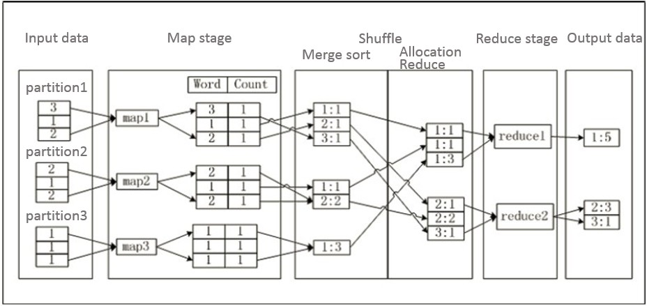

1. The a.txt file is partitioned, and data in each partition is used as the input of a single map worker.

2. The input is processed by the map worker. During this process, the Count parameter is set to 1 for each obtained word, and the **&lt;Word, Count>** pair is used as a word data key of the output.

3. In the early phase of shuffle, the output of each map worker is sorted by key value (word value). After data records are sorted, the records are combined. To perform this operation, you must accumulate the count values that share the same key value to generate a **&lt;Word, Count>** pair. This process is called the sorting and combining process.

4. In the late phase of shuffle, data is sent to the reduce workers. The reduce workers sort the received data records based on the key values.

5. In the reduce stage, each reduce worker uses the same logic as combiner to process data, and accumulates the count value with the same key value (word value) to obtain the output result.

> **Note**
>
> All the MaxCompute data is stored in tables. Therefore, the input and output data of MaxCompute MapReduce can be saved only as tables. You cannot specify the output format, and no interfaces similar to file systems are provided.

<a id="section-7-1-1-2"></a>

#### 7.1.1.2. MapReduce 2

This topic describes MapReduce 2 (MR2) supported by MaxCompute.

In MapReduce, data must be stored in a MaxCompute table or distributed file system, such as a Hadoop Distributed File System (HDFS), after each round of MapReduce operations. Typically, MapReduce runs multiple MapReduce jobs at the same time. After each job is complete, data is written to disks. However, data may need to be read only once in subsequent map operations to prepare for the shuffle operation. In this case, redundant I/O operations are performed on the disk.

The computing scheduling logic of MaxCompute supports more complicated programming models. Reduce operations can be consecutively performed without having a map operation in between. MaxCompute supports MR2 to allow reduce operations to be consecutively performed after a map operation.

MR2 supported by MaxCompute changes the underlying scheduling and I/O model to avoid redundant I/O operations when you run a job.

Hadoop ChainMapper and ChainReducer also support map or reduce operations in a chained fashion. However, they are essentially different from MR2.

Hadoop ChainMapper and ChainReducer follow the working mechanism used by MapReduce. They allow more than one map operation to be performed after a map or reduce operation. A map or reduce operation cannot be followed by reduce operations. This way, you can reuse the preceding map operation logic to split a map or reduce operation into multiple map stages. This does not change the underlying scheduling or I/O model.

<a id="section-7-1-2"></a>

### 7.1.2. Limits

This topic describes the limits of MapReduce.

- The memory consumed by a map or reduce worker can be 256 MB to 12 GB. By default, a single map or reduce worker occupies 2,048 MB memory of the MapReduce framework, and occupies 1,024 MB heap memory of a JVM.

- The number of resources referenced by a single task cannot exceed 256. A partitioned table is considered one resource. The number of input data records for a single task cannot exceed 1,024 and the number of output data records for a single task cannot exceed 256. The number of custom counters in a single task cannot exceed 64. The total bytes of resources referenced by a single task cannot exceed 2 GB.

- The number of map workers in a job is calculated by the MapReduce framework based on the split size. If no input table is specified, you can use **odps.stage.mapper.num** to specify the number of map workers. The number is in the range of 1 to 100,000.

- By default, the number of reduce workers in a job is one fourth of the number of map workers. You can set the number to a value that ranges from 0 to 2000. If reducers process much more data than mappers, the data processing in the reduce stage is time-consuming. A maximum of 2,000 reducers can be created.

- The maximum number of retries that are allowed for a map or reduce worker is 3. Exceptions that do not allow retries may cause jobs to fail.

- If the MapReduce program works in local mode, the default number of map workers is 2 and the default number of reduce workers is 1. The maximum number of map workers or reduce workers cannot exceed 100. The default number of download records is 100 and the number cannot exceed 10,000.

- The number of times that a map or reduce worker repeatedly reads a resource cannot exceed 64.

- The MapReduce framework determines the number of map workers based on the split size.

- Each column of the STRING type in a MaxCompute table cannot exceed 8 MB in length.

- If a map or reduce worker does not read or write data, or stops sending heartbeats by using `context.progress()` , the default timeout period is 600 seconds.

- When a MapReduce task references a table resource, the supported data types are BIGINT, DOUBLE, STRING, DATETIME, and BOOLEAN. An error is reported for tables of other data types.

- MapReduce does not read OSS data.

- MapReduce does not support the data types that are added to MaxCompute V2.0.

<a id="section-7-1-3"></a>

### 7.1.3. Features

<a id="section-7-1-3-1"></a>

#### 7.1.3.1. Run command

This topic describes the command that is used to run MapReduce jobs.

The MaxCompute client provides a jar command for running MapReduce jobs. Syntax:

```text
Usage: jar [<GENERIC_OPTIONS>] <MAIN_CLASS> [ARGS]
-conf <configuration_file> Specify an application configuration file
-classpath <local_file_list> classpaths used to run mainClass
-D <name>=<value> Property value pair, which will be used to run mainClass
-local Run job in local mode
-resources <resource_name_list> file/table resources used in mapper or reducer, seperate by comma
```

Parameters:

- **-conf &lt;configuration file>**: the JobConf configuration file.

- **-classpath &lt;local_file_list>**: the **classpath** that is used to run a MapReduce job in local mode. This parameter specifies the relative and absolute paths of the JAR package where the main function is located.

- **-D &lt;prop_name>=&lt;prop_value>**: the Java property of **&lt;mainClass>** for a MaxCompute job that runs in local mode. You can specify multiple Java properties for a MaxCompute job.

- **-local**: specifies that a MapReduce job runs in local mode. This parameter is used for program debugging.

- **-resources &lt;resource_name_list>**: the resources that are used to run a MapReduce job. You must specify the names of the resources in which the Map or Reduce function is located in **resource_name_list**.

  > **Note**
  >
  > If the Map or Reduce function reads data from other MaxCompute
  >
  > resources, you must add the names of these resources to **resource_name_list**. Resource names in resource_name_list are separated by commas (,). If you use cross-project resources, add  `PROJECT_NAME/resources/`  before the resource name, for example,  `resources otherproject/resources/resfile` .

You can use the **-conf &lt;configuration file>** parameter to specify the JobConf file. This file contains the settings of JobConf in the SDK. Example of a JobConf file:

```xml
<configuration>
<property>
<name>import.filename</name>
<value>resource.txt</value>
</property>
</configuration>
```

In the preceding example, the JobConf file defines the import.filename variable. The value of this variable is resource.txt. You can obtain the value of this variable by calling the JobConf interface in MapReduce. You can also call the JobConf interface in the SDK for the same purpose.

Example:

```text
jar -resources mapreduce-examples.jar -classpath mapreduce-examples.jar
org.alidata.odps.mr.examples.WordCount wc_in wc_out
add file data/src.txt
jar -resources src.txt,mapreduce-examples.jar -classpath mapreduce-examples.jar org.alidata.odps.mr.examples.WordCount wc_in wc_out
add file data/a.txt
add table wc_in as test_table add jar work.jar
jar -conf odps-mapred.xml -resources a.txt,test_table,work.jar
-classpath work.jar:otherlib.jar
-D import.filename=resource.txt org.alidata.odps.mr.examples.WordCount args
```

<a id="section-7-1-3-2"></a>

#### 7.1.3.2. Concepts

<a id="section-7-1-3-2-1"></a>

##### 7.1.3.2.1. Map/Reduce

This topic describes Map and Reduce, which are basic concepts in MaxCompute MapReduce.

If a map or reduce task runs, the setup(), map() or reduce(), and cleanup() methods are called. The setup() method is called before the map() or reduce() method. Each worker calls the setup() method only once. The cleanup() method is called after the map() or reduce() method. Each worker calls the cleanup() method only once.

> **Note**
>
> For more information about the usage examples, see Sample programs.

<a id="section-7-1-3-2-2"></a>

##### 7.1.3.2.2. Sorting

This topic describes sorting, a basic concept in MaxCompute MapReduce.

Some columns in the key records generated by a map can be used as sort columns. These columns do not support a custom comparator. You can select a few sort columns as group columns. These columns do not support a custom group comparator. Sort columns are used to sort your data, whereas group columns are used for secondary sorting.

> **Note**
>
> For more information about the detailed examples, see Secondary sorting example.

<a id="section-7-1-3-2-3"></a>

##### 7.1.3.2.3. Partition

This topic describes partition, a basic concept in MaxCompute MapReduce.

MaxCompute allows you to configure partition key columns and custom partitioners. Partition key columns take precedence over custom partitioners. Partitioners are used to allocate data generated by a mapper to different reducers based on the partition logic.

<a id="section-7-1-3-2-4"></a>

##### 7.1.3.2.4. Combiner

This topic describes the combiner function, a basic concept in MaxCompute MapReduce.

The combiner function combines adjacent records at the shuffle stage. You can determine whether to use the combiner function based on your business logic.

The combiner function is the optimization of the MapReduce computing framework. The combiner logic is the same as the reducer logic. After a mapper generates data, the framework combines the data with the same key at the map stage.

> **Note**
>
> For detailed examples, see Sample programs.

<a id="section-7-1-3-3"></a>

#### 7.1.3.3. Submit a job

This topic describes how to run a JAR command on the MaxCompute client to submit a MapReduce job.

The MaxCompute client provides a JAR command to submit MapReduce jobs. Command syntax:

```text
jar [<GENERIC_OPTIONS>] <MAIN_CLASS> [ARGS];
        -conf <configuration_file>         Specify an application configuration file
        -resources <resource_name_list>    file\table resources used in mapper or 
reducer, seperate by comma
        -classpath <local_file_list>       classpaths used to run mainClass
        -D <name>=<value>                  Property value pair, which will be used to ru
n mainClass
        -l                                 Run job in local mode
```

Parameters:

- **-conf &lt;configuration file>**: the JobConf file. This file can affect the settings of JobConf in an SDK.

  Template of a JobConf file:

  ```xml
  <configuration>
         <property>
            <name>import.filename</name>
            <value>resource.txt</value>
         </property>
      </configuration>        
  ```

  In the preceding template, the JobConf file defines the import.filename variable. The value of this variable is resource.txt. You can obtain the value of this variable over the JobConf interface in MapReduce. You can also call the JobConf interface in an SDK to obtain the value of the variable. For more information, see Resource usage example.

  Example:

  ```text
  add jar data\mapreduce-examples.jar;
      jar -resources mapreduce-examples.jar -classpath data\mapreduce-examples.jar
          org.alidata.odps.mr.examples.WordCount wc_in wc_out;
      add file data\src.txt;
      add jar data\mapreduce-examples.jar;
      jar -resources src.txt,mapreduce-examples.jar -classpath data\mapreduce-examples.jar
          org.alidata.odps.mr.examples.WordCount wc_in wc_out;
      add file data\a.txt;
      add table wc_in as test_table;
      add jar data\work.jar;
      jar -conf odps-mapred.xml -resources a.txt,test_table,work.jar
          -classpath data\work.jar:otherlib.jar
          -D import.filename=resource.txt org.alidata.odps.mr.examples.WordCount args;
  ```

- **-resources &lt;resource_name_list>**: the resources that are used to run a MapReduce job. In most cases, resource_name_list specifies the name of the resource in which the MAP or REDUCE function is located.

  > **Note**
  >
  > If the MAP or REDUCE function reads data from other MaxCompute resources, you must add the names of these resources to resource_name_list. Separate resource names with commas (,). If you want to use resources across projects, you must add  `PROJECT/resources/`  before resource_name_list. Example:  `-resources otherproject/resources/resfile` .

- **-classpath &lt;local_file_list>**: the **classpath** that is used to run a MapReduce job in local mode. This parameter specifies the relative and absolute paths of the JAR package that encapsulates the main function. Package names are separated by default file delimiters. In most cases, semicolons (;) are used as the default file delimiter in the Windows operating system, and commas (,) are used as the default file delimiter in the Linux operating system. If you run a MapReduce job on a cloud server, separate package names with commas (,).

  > **Note**
  >
  > In most cases, the main function and the MAP or REDUCE function are encapsulated into the same package. If you run the related program, mapreduce-examples.jar is specified in the following parameters: -resources &lt;resource_name_list> and -classpath &lt;local_file_list>. However, -resources &lt;resource_name_list> references the MAP or REDUCE function and is run in a distributed environment, whereas -classpath &lt;local_file_list> references the main function and is run in local mode with the specified JAR package that is saved in a local directory.

- **-D &lt;name>=&lt;value>**: the Java attribute of **&lt;mainClass>** when you run a MapReduce job in local mode. You can define multiple Java attributes.

- **-l**: specifies that the MapReduce job is run in local mode. This parameter is used for program debugging.

Example:

```text
jar -conf \home\admin\myconf -resources a.txt,example.jar -classpath 
..\lib\example.jar:.\other_lib.jar -D java.library.path=.\native;
```

<a id="section-7-1-3-4"></a>

#### 7.1.3.4. Inputs and outputs

This topic describes the inputs and outputs of MapReduce jobs in MaxCompute.

- The inputs and outputs of MapReduce jobs in MaxCompute support built-in data types of MaxCompute, including BIGINT, DOUBLE, STRING, DATETIME, and BOOLEAN. User-defined data types are not supported.

- MapReduce supports input data from multiple tables with different schemas. You can use the map function to obtain the table information that corresponds to the current record.

- MapReduce supports null values as input data but does not support views as input data.

- A reduce job can write data to different tables or different partitions of a table. The destination tables or partitions can have different schemas. You can specify labels to distinguish outputs. If you want to use the default output, you do not need to specify a label. MapReduce does not support a function without output returned.

> **Note**
>
> For more information about input and output examples, see MultipleInOut
>
> example.

<a id="section-7-1-3-5"></a>

#### 7.1.3.5. Use resources

This topic describes how MapReduce uses resources.

You can use the Map or Reduce function to read data from MaxCompute resources. A Map or Reduce worker loads resources to the memory for you to write code.

> **Note**
>
> For a detailed example, see Resource usage example.

<a id="section-7-1-3-6"></a>

#### 7.1.3.6. Run jobs in local mode

MaxCompute allows you to debug MapReduce jobs in local mode. This topic describes the differences between running MapReduce jobs in local mode and distributed mode, and provides examples for running MapReduce jobs in local mode.

**Introduction to the local mode**

Before you run a job in local mode, you can specify the  `-local`  option in the JAR command to simulate the running of the MapReduce job. This way, you can perform debugging on the job in local mode.

During job running, the client downloads the metadata and data of the input table, metadata of the output table, and resources that are required for debugging in local mode from MaxCompute. The downloaded data is saved to a local directory named warehouse.execution

After the job is complete, the computing results are saved to a file in the warehouse directory. If the input table and required resources are downloaded to the warehouse directory, MapReduce directly references the data and files in the directory next time, instead of downloading the data again.

**Differences between the local mode and the distributed mode**

A MapReduce job that runs in local mode starts multiple map and reduce tasks to process data. These tasks run in sequence rather than in parallel. The simulated running process is different from an actual distributed running process in the following aspects:

- **Rows in the input table**: A maximum of 100 rows of data can be downloaded in local mode.

- **Resource usage**: In distributed mode, MaxCompute limits the size of resources that can be referenced. However, no limits are imposed on the size of resources in local mode.

- **Security**: MaxCompute MapReduce and user-defined functions (UDFs) are limited by a Java sandbox in distributed mode. However, no limits are imposed in local mode.

**Examples**

The following code shows an example of a MapReduce job in local mode:

```text
    odps:my_project> jar -l com.aliyun.odps.mapred.example.WordCount wc_in wc_out
    Summary:
    counters: 10
        map-reduce framework
                combine_input_groups=2
                combine_output_records=2
                map_input_bytes=4
                map_input_records=1
                map_output_records=2
                map_output_[wc_out]_bytes=0
                map_output_[wc_out]_records=0
                reduce_input_groups=2
                reduce_output_[wc_out]_bytes=8
                reduce_output_[wc_out]_records=2
    OK
```

> **Note**
>
> For more information about the sample code of WordCount, see WordCount example.

If this is the first time you run a debugging command in local mode, a directory named warehouse is created in the current directory after the command is run. The following code shows the directory structure of warehouse.

```xml
<warehouse>
   |____my_project (project directory)
          |____ <__tables__>
          |       |__wc_in (table data directory)
          |       |      |____ data (file)
          |       |      |
          |       |      |____ <__schema__> (file)
          |       |__wc_out (table data directory)
          |               |____ data (file)
          |               |
          |               |____ <__schema__> (file)
          |
          |____ <__resources__>
                  |
                  |___table_resource_name (table resource)
                  |         |____<__ref__>
                  |
                  |___ file_resource_name (file resource)
```

- Directories at the same level as my_project indicate projects. Directories at the same level as wc_in and wc_out indicate data tables. The table data that you read or write by using the JAR command is downloaded to directories at this level.

- The schema file stores the metadata of a table. The following code defines the file format:

  ```text
    project=local_project_name
    table=local_table_name
    columns=col1_name:col1_type,col2_name:col2_type
    partitions=p1:STRING,p2:BIGINT    -- In this example, you do not need to specify this field.
  ```

  > **Note**
  >
  > Separate the name and data type of a column with a colon (:). Separate columns with commas (,). The project and table names that are in the **projectname.tablename** format must be declared at the beginning of the schema file. Separate the declaration and column definition with a comma (,), for example, **project_name.table_name,col1_name:col1_type,col2_name:col2_type,…….**.

- The data file in the tables directory stores the table data. The number of columns and column data must match the definition in the schema file. Separate columns with commas (,).

For example, the schema file in the wc_in directory contains the following data:

```text
my_project.wc_in,key:STRING,value:STRING
```

In this case, the data file contains the following data:

```text
0,2
```

The client downloads the metadata and part of the data of a table from MaxCompute and saves the data to the preceding files. The next time you run this example program, the client directly uses the data in the wc_in directory, instead of downloading it again.

> **Note**
>
> Data can be downloaded from MaxCompute only for MapReduce jobs that run in local mode.

For example, the schema file in the wc_out directory contains the following data:

```text
my_project.wc_out,key:STRING,cnt:BIGINT
```

In this case, the data file contains the following data:

```text
0,1
2,1
```

The client downloads the metadata of the wc_out table from MaxCompute and saves the data to the schema file. After a job is complete, the results are saved to the data file.

> **Note**
>
> - You can also edit the schema and data files and save the files in corresponding table directories.
>
> - If you run a job in local mode and the client detects that the table directory exists, the client does not download the information about this table from MaxCompute. The local table directory can contain a table that does not exist in MaxCompute.

<a id="section-7-1-4"></a>

### 7.1.4. SDK introduction

<a id="section-7-1-4-1"></a>

#### 7.1.4.1. Overview of major MapReduce APIs

This topic describes major MapReduce APIs.

If you use Maven, you can obtain Maven dependencies from the Maven Central Repository.

```xml
<dependency>
    <groupId>com.aliyun.odps</groupId>
    <artifactId>odps-sdk-mapred</artifactId>
    <version>0.36.2-public</version>
</dependency>
```

| API | Description |
| --- | --- |
| MapperBase | The base class that custom Map functions must inherit. A mapper converts the records in the input table to key-value pairs and passes the key-value pairs to a reducer. Alternatively, a mapper can directly write the key-value pairs to a result table by skipping the Reduce stage. The jobs that skip the Reduce stage and directly return computing results are called map-only jobs. |
| ReducerBase | The base class that custom Reduce functions must inherit. A reducer reduces a set of values that are associated with a key. |
| TaskContext | Describes the context of a task. The task context is an input parameter of multiple member functions of MapperBase and ReducerBase. |
| JobClient | Submits and manages jobs. Jobs can be submitted in blocking mode (synchronous) or non-blocking mode (asynchronous). |
| RunningJob | Defines a running job. The objects of this class are used to track the instances on which MapReduce jobs are running. |
| JobConf | Describes the configuration of a MapReduce job. The JobConf object is defined in the main function. Then, a job client submits a job to MaxCompute based on the JobConf object. |

<a id="section-7-1-4-2"></a>

#### 7.1.4.2. API description

<a id="section-7-1-4-2-1"></a>

##### 7.1.4.2.1. MapperBase

This topic covers the key methods of the MapperBase interface.

**Key methods**

| Method | Description |
| --- | --- |
| void cleanup(TaskContext context) | Called once at the end of the Map phase, after the final call to the Map method. |
| void map(long key, Record record, TaskContext context) | Processes each record from the input table. |
| void setup(TaskContext context) | Called once at the start of the Map phase, before the first call to the Map method. |

<a id="section-7-1-4-2-2"></a>

##### 7.1.4.2.2. ReducerBase

ReducerBase defines the main methods for the Reduce phase.

**Main methods**

| API | Description |
| --- | --- |
| void cleanup(TaskContext context) | Called at the end of the Reduce phase, after the final call to the Reduce method. |
| void reduce(Record key, Iterator&lt;Record&gt; values, TaskContext context) | Processes records from the input table. |
| void setup(TaskContext context) | Called at the beginning of the Reduce phase, before the first call to the Reduce method. |

<a id="section-7-1-4-2-3"></a>

##### 7.1.4.2.3. TaskContext

This topic describes the main methods of the  `TaskContext`  interface.

**API reference**

| Method | Description |
| --- | --- |
| TableInfo\[\] getOutputTableInfo() | Returns information about the output tables. |
| Record createOutputRecord() | Creates a record object for the default output table. |
| Record createOutputRecord(String label) | Creates a record object for the output table specified by the label. |
| Record createMapOutputKeyRecord() | Creates a record object for the Map output key. |
| Record createMapOutputValueRecord() | Creates a record object for the Map output value. |
| void write(Record record) | Writes a record to the default output. Use this method in the Reducer to write data; it can be called multiple times. |
| void write(Record record, String label) | Writes a record to the output specified by the label. Use this method in the Reducer to write data; it can be called multiple times. |
| void write(Record key, Record value) | Writes a key-value record to the intermediate output. Use this method in the Mapper to write data; it can be called multiple times. |
| BufferedInputStream readResourceFileAsStream(String resourceName) | Reads a file resource. |
| Iterator&lt;Record&gt; readResourceTable(String resourceName) | Reads a table resource. |
| Counter getCounter(Enum&lt;?&gt; name) | Returns the Counter object for the specified enumeration name. |
| Counter getCounter(String group, String name) | Returns the Counter object for the specified group and name. |
| void progress() | Reports a heartbeat to the MapReduce framework. Call this method to prevent a task from timing out, especially if a user-defined method runs for a long time without interacting with the framework. By default, a task times out after 10 minutes of inactivity. |

> **Note**
>
> - This method prevents the framework from terminating a long-running worker due to a timeout. It acts as a heartbeat to the framework, not as a way to report the worker's completion progress.
>
> - By default, the timeout for a worker in MaxCompute MapReduce is 10 minutes, a non-modifiable system configuration. If a worker fails to send a heartbeat by calling the  `progress()`  method within 10 minutes, the framework will forcibly terminate the worker, and the MapReduce task will fail. To avoid this, periodically call the  `progress()`  method in your Mapper and Reducer functions.

<a id="section-7-1-4-2-4"></a>

##### 7.1.4.2.4. JobConf

This topic describes the main methods in the JobConf interface.

**Main methods**

| Method | Description |
| --- | --- |
| void setResources(String resourceNames) | Declares the resources for the job. During execution, Mappers and Reducers can access only these declared resources through the TaskContext object. |
| void setMapOutputKeySchema(Column\[\] schema) | Sets the schema of the output Key from the Mapper. |
| void setMapOutputValueSchema(Column\[\] schema) | Sets the schema of the output Value from the Mapper. |
| void setOutputKeySortColumns(String\[\] cols) | Sets the sort columns for the output Key from the Mapper. |
| void setOutputGroupingColumns(String\[\] cols) | Sets the grouping columns for the Key. |
| void setMapperClass(Class&lt;? extends Mapper&gt; theClass) | Sets the Mapper class for the job. |
| void setPartitionColumns(String\[\] cols) | Sets the partition columns for the job, which default to all columns in the Mapper's output Key. |
| void setReducerClass(Class&lt;? extends Reducer&gt; theClass) | Sets the Reducer class for the job. |
| void setCombinerClass(Class&lt;? extends Reducer&gt; theClass) | Sets the Combiner class for the job. A Combiner functions as a local Reducer, processing the output from a single Mapper on the map side. |
| void setSplitSize(long size) | Sets the input split size in MB. The default is 256 MB. |
| void setNumReduceTasks(int n) | Sets the number of Reducer tasks, which defaults to one-quarter of the Mapper task count. |
| void setMemoryForMapTask(int mem) | Sets the memory in MB for each Worker in a Mapper task. The default is 2048 MB. |
| void setMemoryForReduceTask(int mem) | Sets the memory in MB for each Worker in a Reducer task. The default is 2048 MB. |
| void setOutputSchema(Column\[\] schema, String label) | Sets the output schema for the specified label.With multiple outputs, each output requires a unique label. |

> **Note**
>
> - Typically, the grouping columns are a subset of the sort columns. Both the sort columns and partition columns must be included in the Key.
>
> - On the map side, the framework calculates a hash value for each output Record based on the partition columns. This hash value determines which Reducer receives the Record. The Records are then sorted based on the sort columns.
>
> - On the reduce side, the framework sorts incoming Records by the sort columns and then groups them based on the specified grouping columns. All Records with identical values in the grouping columns are processed together in a single call to the Reducer function.

<a id="section-7-1-4-2-5"></a>

##### 7.1.4.2.5. JobClient

This topic describes the main methods of the JobClient interface.

**Main methods**

| Method | Description |
| --- | --- |
| static RunningJob runJob(JobConf job) | Submits a MapReduce job and blocks (synchronously) until it completes. |
| static RunningJob submitJob(JobConf job) | Submits a MapReduce job asynchronously (non-blocking), returning immediately. |

<a id="section-7-1-4-2-6"></a>

##### 7.1.4.2.6. RunningJob

Describes the key methods of the RunningJob interface.

**Key methods**

| Method | Description |
| --- | --- |
| String getInstanceID() | Returns the job instance ID. You can use this ID to view the running log and manage the job. |
| boolean isComplete() | Checks whether the job has completed. |
| boolean isSuccessful() | Checks whether the job instance succeeded. |
| void waitForCompletion() | Blocks execution until the job instance is complete. This method is typically used for an asynchronous job. |
| JobStatus getJobStatus() | Returns the status of the job instance. |
| void killJob() | Terminates the job. |
| Counters getCounters() | Returns the job's Counters. |

<a id="section-7-1-4-2-7"></a>

##### 7.1.4.2.7. InputUtils

This topic describes the key functions in the InputUtils class.

**Key functions**

| Function | Description |
| --- | --- |
| static void addTable(TableInfo table, JobConf conf) | Adds a table to the job input. You can call this function multiple times to append additional tables to the input queue. |
| static void setTables(TableInfo \[\] tables, JobConf conf) | Sets the job's input to the specified list of tables. |

<a id="section-7-1-4-2-8"></a>

##### 7.1.4.2.8. OutputUtils

This topic describes the main functions of OutputUtils.

**Main functions**

| Function | Description |
| --- | --- |
| static void addTable(TableInfo table, JobConf conf) | Adds a table to the job output. Subsequent calls append new tables to the output queue. |
| static void setTables(TableInfo\[\] tables, JobConf conf) | Adds multiple tables to the job output. |

<a id="section-7-1-4-2-9"></a>

##### 7.1.4.2.9. Pipeline

This topic details the key interfaces of the Pipeline class.

**Key interfaces**

The  `Pipeline`  is the main class for MR2. You can build a  `Pipeline`  with  `Pipeline.builder` .

```text
public Builder addMapper(Class<? extends Mapper> mapper);

public Builder addMapper(Class<? extends Mapper> mapper,Column[] keySchema, Column[] valueSchema, String[] sortCols,SortOrder[] order, String[] partCols,Class<? extends Partitioner> theClass, String[] groupCols);
    
public Builder addReducer(Class<? extends Reducer> reducer);
    
public Builder addReducer(Class<? extends Reducer> reducer,Column[] keySchema, Column[]valueSchema, String[] sortCols,SortOrder[] order, String[] partCols,Class<? extends Partitioner> theClass, String[] groupCols);
    
public Builder setOutputKeySchema(Column[] keySchema);

public Builder setOutputValueSchema(Column[] valueSchema);

public Builder setOutputKeySortColumns(String[] sortCols);

public Builder setOutputKeySortOrder(SortOrder[] order);

public Builder setPartitionColumns(String[] partCols);

public Builder setPartitionerClass(Class<? extends Partitioner> theClass);

public Builder setOutputGroupingColumns(String[] cols);
```

**Example code**

```text
    Job job = new Job();
    Pipeline pipeline = Pipeline.builder()
     .addMapper(TokenizerMapper.class)
     .setOutputKeySchema(
         new Column[] { new Column("word", OdpsType.STRING) })
     .setOutputValueSchema(
         new Column[] { new Column("count", OdpsType.BIGINT) })
     .addReducer(SumReducer.class)
     .setOutputKeySchema(
         new Column[] { new Column("count", OdpsType.BIGINT) })
     .setOutputValueSchema(
         new Column[] { new Column("word", OdpsType.STRING),
         new Column("count", OdpsType.BIGINT) })
     .addReducer(IdentityReducer.class).createPipeline();
    job.setPipeline(pipeline);  
    job.addInput(...);
    job.addOutput(...);
    job.submit();
```

The example code creates a MapReduce task in the main function that chains two Reduce operations after one Map operation. Familiarity with the basic usage of MapReduce makes using MR2 straightforward.

> **Note**
>
> - Before using MR2, you should be familiar with the basic usage of MapReduce.
>
> - `JobConf`  can configure only MapReduce tasks that consist of a single Map stage followed by a single Reduce stage.

<a id="section-7-1-4-3"></a>

#### 7.1.4.3. Compatibility with Hadoop MapReduce

This topic describes the compatibility between specific MaxCompute MapReduce interfaces and Hadoop MapReduce.

**Compatibility with Hadoop MapReduce**

The following table describes whether specific MaxCompute MapReduce interfaces are compatible with Hadoop MapReduce.

**Category**

**Interface**

**Compatible**

void map(KEYIN key, VALUEIN value,

Yes

org.apache.hadoop.mapreduce. Mapper.Context context)

void run(org.apache.hadoop.mapred

Yes

uce.Mapper.Context context)

Mapper

void setup(org.apache.hadoop.mapr

Yes

educe.Mapper.Context context)

void cleanup(org.apache.hadoop.ma

Yes

preduce.Reducer.Context context)

void reduce(KEYIN key, VALUEIN value, org.apache.hadoop.mapreduce.

Yes

Reducer.Context context)

Reducer

void run(org.apache.hadoop.mapred

Yes

uce.Reducer.Context context)

void setup(org.apache.hadoop.mapr

Yes

educe.Reducer.Context context)

int getPartition(KEY key, VALUE

Partitioner

Yes

value, int numPartitions)

MapContext, which extends

InputSplit getInputSplit()

No. An exception is reported.

TaskInputOutputContext

nextKey()

Yes

ReduceContext

getValues()

Yes

Yes

getCurrentKey()

getCurrentValue()

Yes

getOutputCommitter()

No. An exception is reported.

TaskInputOutputContext

nextKeyValue()

Yes

write(KEYOUT key, VALUEOUT

Yes

value) getCounter(Enum&lt;?>

Yes

counterName)

getCounter(String groupName,

Yes

String counterName)

setStatus(String msg)

Empty implementation.

TaskAttemptContext

getStatus()

Empty implementation.

getTaskAttemptID()

No. An exception is reported.

getProgress()

No. An exception is reported.

progress()

Yes

addArchiveToClassPath(Path

No

archive)

addCacheArchive(URI uri)

No

addCacheFile(URI uri)

No

addFileToClassPath(Path file)

No

cleanupProgress()

No

createSymlink()

No. An exception is reported.

failTask(TaskAttemptID taskId)

No

getCompletionPollInterval(Confi

Empty implementation.

guration conf)

getCounters()

Yes

getFinishTime()

Yes

getHistoryUrl()

Yes

getInstance()

Yes

getInstance(Cluster ignored)

Yes

getInstance(Cluster ignored,

Yes

Configuration conf)

getInstance(Configuration conf)

Yes

getInstance(Configuration conf,

Empty implementation.

String jobName)

getInstance(JobStatus status,

No. An exception is reported.

Configuration conf)

getJobFile()

No. An exception is reported.

getJobName()

Empty implementation.

getJobState()

No. An exception is reported.

getPriority()

No. An exception is reported.

getProgressPollInterval(Configu

Empty implementation.

ration conf)

getReservationId()

No. An exception is reported.

getSchedulingInfo()

No. An exception is reported.

getStartTime()

Yes

getStatus()

No. An exception is reported.

getTaskCompletionEvents(int

No. An exception is reported.

startFrom)

getTaskCompletionEvents(int

No. An exception is reported.

startFrom, int numEvents) getTaskDiagnostics(TaskAttem

No. An exception is reported.

ptID taskid)

getTaskOutputFilter(Configurati

No. An exception is reported.

on conf)

getTaskReports(TaskType type)

No. An exception is reported.

getTrackingURL()

Yes

isComplete()

Yes

isRetired()

No. An exception is reported.

isSuccessful()

Yes

isUber()

Empty implementation.

killJob()

Yes

killTask(TaskAttemptID taskId)

No

mapProgress()

Yes

monitorAndPrintJob()

Yes

reduceProgress()

Yes

setCacheArchives(URI[]

No. An exception is reported.

archives)

Job

setCacheFiles(URI[] files)

No. An exception is reported.

setCancelDelegationTokenUpon

No. An exception is reported.

JobCompletion(boolean value)

setCombinerClass(Class&lt;?

Yes

extends Reducer> cls)

setCombinerKeyGroupingComp aratorClass(Class&lt;? extends

Yes

RawComparator> cls)

setGroupingComparatorClass(Cl ass&lt;? extends

Yes

RawComparator> cls)

setInputFormatClass(Class&lt;?

Empty implementation.

extends InputFormat> cls)

setJar(String jar)

Yes

setJarByClass(Class&lt;?> cls)

Yes

setJobName(String name)

Empty implementation.

setJobSetupCleanupNeeded(bo

Empty implementation.

olean needed)

setMapOutputKeyClass(Class&lt;?

Yes

> theClass)

setMapOutputValueClass(Class

Yes

&lt;?> theClass)

setMapperClass(Class&lt;?

Yes

extends Mapper> cls)

setMapSpeculativeExecution(bo

Empty implementation.

olean speculativeExecution)

setMaxMapAttempts(int n)

Empty implementation.

setMaxReduceAttempts(int n)

Empty implementation.

setNumReduceTasks(int tasks)

Yes

setOutputFormatClass(Class&lt;?

No. An exception is reported.

extends OutputFormat> cls)

setOutputKeyClass(Class&lt;?>

Yes

theClass) setOutputValueClass(Class&lt;?>

Yes

theClass)

setPartitionerClass(Class&lt;?

Yes

extends Partitioner> cls)

setPriority(JobPriority priority)

No. An exception is reported.

setProfileEnabled(boolean

Empty implementation.

newValue)

setProfileParams(String value)

Empty implementation.

setProfileTaskRange(boolean

Empty implementation.

isMap, String newValue)

setReducerClass(Class&lt;?

Yes

extends Reducer> cls)

setReduceSpeculativeExecution

Empty implementation.

(boolean speculativeExecution)

setReservationId(ReservationId

No. An exception is reported.

reservationId)

setSortComparatorClass(Class<

No. An exception is reported.

? extends RawComparator> cls)

setSpeculativeExecution(boolea

Yes

n speculativeExecution)

setTaskOutputFilter(Configurati on conf,

No. An exception is reported.

org.apache.hadoop.mapreduce. Job.TaskStatusFilter newValue)

setupProgress()

No. An exception is reported.

setUser(String user)

Empty implementation.

setWorkingDirectory(Path dir)

Empty implementation.

submit()

Yes

toString()

No. An exception is reported.

waitForCompletion(boolean

Yes

verbose)

mapreduce.map.java.opts

Empty implementation.

mapreduce.reduce.java.opts

Empty implementation.

mapreduce.map.memory.mb

Empty implementation.

mapreduce.reduce.memory.mb

Empty implementation.

mapreduce.task.io.sort.mb

Empty implementation.

mapreduce.map.sort.spill.perce

Empty implementation.

nt

Empty implementation.

mapreduce.task.io.soft.factor

mapreduce.reduce.merge.inme

Empty implementation.

m.thresholds

mapreduce.reduce.shuffle.merg

Empty implementation.

e.percent

mapreduce.reduce.shuffle.input

Empty implementation.

.buffer.percent

mapreduce.reduce.input.buffer.

Empty implementation.

percent

Task Execution & Environment

Empty implementation.

mapreduce.job.id

mapreduce.job.jar

Empty implementation.

mapreduce.job.local.dir

Empty implementation.

mapreduce.task.id

Empty implementation.

mapreduce.task.attempt.id

Empty implementation.

mapreduce.task.is.map

Empty implementation.

mapreduce.task.partition

Empty implementation.

mapreduce.map.input.file

Empty implementation.

mapreduce.map.input.start

Empty implementation.

mapreduce.map.input.length

Empty implementation.

mapreduce.task.output.dir

Empty implementation.

cancelDelegationToken(Token &lt;DelegationTokenIdentifier>

No. An exception is reported.

token)

close()

Empty implementation.

displayTasks(JobID jobId, String

No. An exception is reported.

type, String state)

getAllJobs()

No. An exception is reported.

getCleanupTaskReports(JobID

No. An exception is reported.

jobId)

getClusterStatus()

No. An exception is reported.

getClusterStatus(boolean

No. An exception is reported.

detailed)

getDefaultMaps()

No. An exception is reported.

getDefaultReduces()

No. An exception is reported.

getDelegationToken(Text

No. An exception is reported.

renewer) getFs()

No. An exception is reported.

getJob(JobID jobid)

No. An exception is reported.

getJob(String jobid)

No. An exception is reported.

getJobsFromQueue(String

No. An exception is reported.

queueName)

getMapTaskReports(JobID jobId)

No. An exception is reported.

getMapTaskReports(String

No. An exception is reported.

jobId)

getQueueAclsForCurrentUser()

No. An exception is reported.

getQueueInfo(String

No. An exception is reported.

queueName)

getQueues()

No. An exception is reported.

JobClient

getReduceTaskReports(JobID

No. An exception is reported.

jobId)

getReduceTaskReports(String

No. An exception is reported.

jobId)

getSetupTaskReports(JobID

No. An exception is reported.

jobId)

getStagingAreaDir()

No. An exception is reported.

getSystemDir()

No. An exception is reported.

getTaskOutputFilter()

No. An exception is reported.

getTaskOutputFilter(JobConf

No. An exception is reported.

job)

init(JobConf conf)

No. An exception is reported.

isJobDirValid(Path jobDirPath,

No. An exception is reported.

FileSystem fs)

jobsToComplete()

No. An exception is reported.

monitorAndPrintJob(JobConf

No. An exception is reported.

conf, RunningJob job)

renewDelegationToken(Token< DelegationTokenIdentifier>

No. An exception is reported.

token)

run(String[] argv)

No. An exception is reported.

runJob(JobConf job)

Yes

setTaskOutputFilter(JobClient.T

No. An exception is reported.

askStatusFilter newValue)

setTaskOutputFilter(JobConf job, JobClient.TaskStatusFilter

No. An exception is reported.

newValue)

submitJob(JobConf job)

Yes

submitJob(String jobFile)

No. An exception is reported.

deleteLocalFiles()

No. An exception is reported.

deleteLocalFiles(String subdir)

No. An exception is reported.

normalizeMemoryConfigValue(l

Empty implementation.

ong val)

setCombinerClass(Class&lt;?

Yes

extends Reducer> theClass)

setCompressMapOutput(boolea

Empty implementation.

n compress)

setInputFormat(Class&lt;? extends InputFormat>

No. An exception is reported.

theClass) setJar(String jar)

No. An exception is reported.

setJarByClass(Class cls)

No. An exception is reported.

setJobEndNotificationURI(String

No. An exception is reported.

uri)

setJobName(String name)

Empty implementation.

setJobPriority(JobPriority prio)

No. An exception is reported.

setKeepFailedTaskFiles(boolean

No. An exception is reported.

keep)

setKeepTaskFilesPattern(String

No. An exception is reported.

pattern)

setKeyFieldComparatorOptions(

No. An exception is reported.

String keySpec)

setKeyFieldPartitionerOptions(S

No. An exception is reported.

tring keySpec)

setMapDebugScript(String

Empty implementation.

mDbgScript)

setMapOutputCompressorClass (Class&lt;? extends

Empty implementation.

CompressionCodec> codecClass)

setMapOutputKeyClass(Class&lt;?

Yes

> theClass)

setMapOutputValueClass(Class

Yes

&lt;?> theClass)

setMapperClass(Class&lt;?

Yes

extends Mapper> theClass)

setMapRunnerClass(Class&lt;? extends MapRunnable>

No. An exception is reported.

theClass) setMapSpeculativeExecution(bo

Empty implementation.

olean speculativeExecution)

setMaxMapAttempts(int n)

Empty implementation.

setMaxMapTaskFailuresPercent

Empty implementation.

(int percent)

setMaxPhysicalMemoryForTask(

Empty implementation.

long mem)

setMaxReduceAttempts(int n)

Empty implementation.

setMaxReduceTaskFailuresPerc

Empty implementation.

ent(int percent)

JobConf

setMaxTaskFailuresPerTracker(i

Empty implementation.

nt noFailures)

setMaxVirtualMemoryForTask(l

Empty implementation.

ong vmem)

setMemoryForMapTask(long

Yes

mem)

setMemoryForReduceTask(long

Yes

mem)

setNumMapTasks(int n)

Yes

setNumReduceTasks(int n)

Yes

setNumTasksToExecutePerJvm(

Empty implementation.

int numTasks)

setOutputCommitter(Class&lt;? extends OutputCommitter>

No. An exception is reported.

theClass)

setOutputFormat(Class&lt;? extends OutputFormat>

Empty implementation.

theClass) setOutputKeyClass(Class&lt;?>

Yes

theClass)

setOutputKeyComparatorClass(Class&lt;? extends

No. An exception is reported.

RawComparator> theClass)

setOutputValueClass(Class&lt;?>

Yes

theClass)

setOutputValueGroupingCompa rator(Class&lt;? extends

No. An exception is reported.

RawComparator> theClass)

setPartitionerClass(Class&lt;?

Yes

extends Partitioner> theClass)

setProfileEnabled(boolean

Empty implementation.

newValue)

setProfileParams(String value)

Empty implementation.

setProfileTaskRange(boolean

Empty implementation.

isMap, String newValue)

setQueueName(String

No. An exception is reported.

queueName)

setReduceDebugScript(String

Empty implementation.

rDbgScript)

setReducerClass(Class&lt;?

Yes

extends Reducer> theClass)

setReduceSpeculativeExecution

Empty implementation.

(boolean speculativeExecution)

setSessionId(String sessionId)

Empty implementation.

setSpeculativeExecution(boolea

No. An exception is reported.

n speculativeExecution)

setUseNewMapper(boolean

Yes

flag) setUseNewReducer(boolean

Yes

flag)

setUser(String user)

Empty implementation.

setWorkingDirectory(Path dir)

Empty implementation.

FileInputFormat

N/A

No. An exception is reported.

TextInputFormat

N/A

Yes

InputSplit

mapred.min.split.size

No. An exception is reported.

FileSplit

map.input.file

No. An exception is reported.

RecordWriter

N/A

No. An exception is reported.

RecordReader

N/A

No. An exception is reported.

OutputFormat

N/A

No. An exception is reported.

abortJob(JobContext

No. An exception is reported.

jobContext, int status)

abortJob(JobContext context,

No. An exception is reported.

JobStatus.State runState)

abortTask(TaskAttemptContext

No. An exception is reported.

taskContext)

abortTask(TaskAttemptContext

No. An exception is reported.

taskContext)

cleanupJob(JobContext

No. An exception is reported.

jobContext)

cleanupJob(JobContext context)

No. An exception is reported.

commitJob(JobContext

No. An exception is reported.

jobContext)

OutputCommitter

commitJob(JobContext context)

No. An exception is reported.

commitTask(TaskAttemptConte

No. An exception is reported.

xt taskContext)

needsTaskCommit(TaskAttempt

No. An exception is reported.

Context taskContext)

needsTaskCommit(TaskAttempt

No. An exception is reported.

Context taskContext)

setupJob(JobContext

No. An exception is reported.

jobContext)

setupJob(JobContext

No. An exception is reported.

jobContext)

setupTask(TaskAttemptContext

No. An exception is reported.

taskContext)

setupTask(TaskAttemptContext

No. An exception is reported.

taskContext)

getDisplayName()

Yes

getName()

Yes

getValue()

Yes

Counter

increment(long incr)

Yes

setValue(long value)

Yes

setDisplayName(String

Yes

displayName)

CACHE_ARCHIVES

No. An exception is reported.

CACHE_ARCHIVES_SIZES

No. An exception is reported.

CACHE_ARCHIVES_TIMESTAMPS

No. An exception is reported.

No. An exception is reported.

CACHE_FILES

CACHE_FILES_SIZES

No. An exception is reported.

CACHE_FILES_TIMESTAMPS

No. An exception is reported.

CACHE_LOCALARCHIVES

No. An exception is reported.

CACHE_LOCALFILES

No. An exception is reported.

CACHE_SYMLINK

No. An exception is reported.

addArchiveToClassPath(Path

No. An exception is reported.

archive, Configuration conf)

addArchiveToClassPath(Path archive, Configuration conf,

No. An exception is reported.

FileSystem fs)

addCacheArchive(URI uri,

No. An exception is reported.

Configuration conf)

addCacheFile(URI uri,

No. An exception is reported.

Configuration conf)

addFileToClassPath(Path file,

No. An exception is reported.

Configuration conf)

addFileToClassPath(Path file, Configuration conf, FileSystem

No. An exception is reported.

fs)

addLocalArchives(Configuration

No. An exception is reported.

conf, String str)

addLocalFiles(Configuration

No. An exception is reported.

conf, String str)

checkURIs(URI[] uriFiles, URI[]

No. An exception is reported.

uriArchives)

createAllSymlink(Configuration conf, File jobCacheDir, File

No. An exception is reported.

workDir)

DistributedCache

createSymlink(Configuration

No. An exception is reported.

conf)

getArchiveClassPaths(Configura

No. An exception is reported.

tion conf)

getArchiveTimestamps(Configu

No. An exception is reported.

ration conf)

getCacheArchives(Configuratio

No. An exception is reported.

n conf)

getCacheFiles(Configuration

No. An exception is reported.

conf)

getFileClassPaths(Configuration conf)

No. An exception is reported.

getFileStatus(Configuration

No. An exception is reported.

conf, URI cache)

getFileTimestamps(Configuratio

No. An exception is reported.

n conf)

getLocalCacheArchives(Configu

No. An exception is reported.

ration conf)

getLocalCacheFiles(Configurati

No. An exception is reported.

on conf)

getSymlink(Configuration conf)

No. An exception is reported.

getTimestamp(Configuration

No. An exception is reported.

conf, URI cache)

setArchiveTimestamps(Configur

No. An exception is reported.

ation conf, String timestamps)

setCacheArchives(URI[] archives, Configuration conf)

No. An exception is reported.

setCacheFiles(URI[] files,

No. An exception is reported.

Configuration conf)

setFileTimestamps(Configuratio

No. An exception is reported.

n conf, String timestamps)

setLocalArchives(Configuration

No. An exception is reported.

conf, String str)

setLocalFiles(Configuration

No. An exception is reported.

conf, String str)

IsolationRunner

N/A

No. An exception is reported.

Profiling

N/A

Empty implementation.

Debugging

N/A

Empty implementation.

Data Compression

N/A

Yes

Skipping Bad Records

N/A

No. An exception is reported.

mapred.acls.enabled

No. An exception is reported.

mapreduce.job.acl-view-job

No. An exception is reported.

mapreduce.job.acl-modify-job

No. An exception is reported.

Job Authorization

mapreduce.cluster.administrato

No. An exception is reported.

rs

mapred.queue.queue-name.acl-

No. An exception is reported.

administer-jobs

MultipleInputs

N/A

No. An exception is reported.

MultipleOutputs

N/A

Yes

<table>
  <tr>
    <td>org.apache.hadoop.mapreduce.lib.db</td>
    <td>N/A</td>
    <td>No. An exception is reported.</td>
  </tr>
  <tr>
    <td>org.apache.hadoop.mapreduce.security</td>
    <td>N/A</td>
    <td>No. An exception is reported.</td>
  </tr>
  <tr>
    <td>org.apache.hadoop.mapreduce.lib.jobcontrol</td>
    <td>N/A</td>
    <td>No. An exception is reported.</td>
  </tr>
  <tr>
    <td>org.apache.hadoop.mapreduce.lib.chain</td>
    <td>N/A</td>
    <td>No. An exception is reported.</td>
  </tr>
</table>

<a id="section-7-1-5"></a>

### 7.1.5. Data types

This topic describes the data types supported by MapReduce.

MapReduce supports the following data types: BIGINT, DOUBLE, STRING, DATETIME, BOOLEAN, and DECIMAL. The following table lists the mappings between MaxCompute data types and Java data types.

| MaxCompute SQL Type | Java Type |
| --- | --- |
| BIGINT | LONG |
| DOUBLE | DOUBLE |
| DECIMAL | BIGDECIMAL |
| BOOLEAN | BOOLEAN |
| STRING | STRING |
| DATETIME | DATE |

<a id="section-7-1-6"></a>

### 7.1.6. Sample programs

<a id="section-7-1-6-1"></a>

#### 7.1.6.1. WordCount example

This topic provides a WordCount example.

Example:

```java
package com.aliyun.odps.mapred.open.example;
import java.io.IOException;
import java.util.Iterator;
import com.aliyun.odps.data.Record;
import com.aliyun.odps.data.TableInfo;
import com.aliyun.odps.mapred.JobClient;
import com.aliyun.odps.mapred.MapperBase;
import com.aliyun.odps.mapred.ReducerBase;
import com.aliyun.odps.mapred.conf.JobConf;
importcomaliyunodpsmapredutilsInputUtils;
import com.aliyun.odps.mapred.utils.OutputUtils;
import com.aliyun.odps.mapred.utils.SchemaUtils;
public class WordCount {
    public static class TokenizerMapper extends MapperBase {
        private Record word;
        private Record one;
        @Override
            public void setup(TaskContext context) throws IOException {
            word = context.createMapOutputKeyRecord();
            one = context.createMapOutputValueRecord();
            one.set(new Object[] { 1L });
            System.out.println("TaskID:" + context.getTaskID().toString());
        }
        @Override
            public void map(long recordNum, Record record, TaskContext context)
            throws IOException {
            for (int i = 0; i < record.getColumnCount(); i++) {
                word.set(new Object[] { record.get(i).toString() });
                context.write(word, one);
            }
        }
    }
    /**
       * A combiner class that combines map output by sum them.
       **/
    public static class SumCombiner extends ReducerBase {
        private Record count;
        @Override
            public void setup(TaskContext context) throws IOException {
            count = context.createMapOutputValueRecord();
        }
        // The combiner implements the same interface as that of the reducer. The combiner allows you to immediately run a local reduce job on the mapper to reduce the outputof the mapper.
        @Override
            public void reduce(Record key, Iterator<Record> values, TaskContext 
context)
            throws IOException {
            long c = 0;
            while (values.hasNext()) {
                Record val = values.next();
                c += (Long) val.get(0);
            }
            count.set(0, c);
            context.write(key, count);
        }
    }
    /**
       * A reducer class that just emits the sum of the input values.
       **/
    public static class SumReducer extends ReducerBase {
        private Record result = null;
        @Override
            public void setup(TaskContext context) throws IOException {
            result = context.createOutputRecord();
        }
        @Override
            public void reduce(Record key, Iterator<Record> values, TaskContext 
context)
            throws IOException {
            long count = 0;
            while (values.hasNext()) {
                Record val = values.next();
                count += (Long) val.get(0);
            }
            result.set(0, key.get(0));
            result.set(1, count);
            context.write(result);
        }
    }
    public static void main(String[] args) throws Exception {
        if (args.length ! = 2) {
            System.err.println("Usage: WordCount <in_table> <out_table>");
            System.exit(2);
        }
        JobConf job = new JobConf();
        job.setMapperClass(TokenizerMapper.class);
        job.setCombinerClass(SumCombiner.class);
        job.setReducerClass(SumReducer.class);
        // Configure the schema that defines the intermediate output of the mapper as key-value pairs. The intermediate output of the mapper exists as records.
        job.setMapOutputKeySchema(SchemaUtils.fromString("word:string"));
        job.setMapOutputValueSchema(SchemaUtils.fromString("count:bigint"));
        // Configure information about input and output tables.
        InputUtils.addTable(TableInfo.builder().tableName(args[0]).build(), job);
        OutputUtils.addTable(TableInfo.builder().tableName(args[1]).build(), job);
        JobClient.runJob(job);
    }
}
```

<a id="section-7-1-6-2"></a>

#### 7.1.6.2. MapOnly example

This topic provides a MapOnly example of MapReduce.

For MapOnly jobs, a mapper directly generates key-value pairs to MaxCompute tables. You need only to specify output tables. You do not need to specify the key-value metadata for the output of a mapper.

Example:

```java
package com.aliyun.odps.mapred.open.example;
import java.io.IOException;
import com.aliyun.odps.data.Record;
import com.aliyun.odps.mapred.JobClient;
import com.aliyun.odps.mapred.MapperBase;
import com.aliyun.odps.mapred.conf.JobConf;
import com.aliyun.odps.mapred.utils.SchemaUtils;
import com.aliyun.odps.mapred.utils.InputUtils;
importcomaliyunodpsmapredutilsOutputUtils;
import com.aliyun.odps.data.TableInfo;
public class MapOnly {
    public static class MapperClass extends MapperBase {
        @Override
            public void setup(TaskContext context) throws IOException {
            boolean is = context.getJobConf().getBoolean("option.mapper.setup", false);
            // The main function executes the following logic only if 
option.mapper.setup is set to true in the JobConf file:
            if (is) {
                Record result = context.createOutputRecord();
                result.set(0, "setup");
                result.set(1, 1L);
                context.write(result);
            }
        }
        @Override
            public void map(long key, Record record, TaskContext context) throws 
IOException {
            boolean is = context.getJobConf().getBoolean("option.mapper.map", false);
            // The main function executes the following logic only if option.mapper.map 
is set to true in the JobConf file:
            if (is) {
                Record result = context.createOutputRecord();
                result.set(0, record.get(0));
                result.set(1, 1L);
                context.write(result);
            }
        }
        @Override
            public void cleanup(TaskContext context) throws IOException {
            boolean is = context.getJobConf().getBoolean("option.mapper.cleanup", 
false);
            // The main function executes the following logic only if 
option.mapper.cleanup is set to true in the JobConf file:
            if (is) {
                Record result = context.createOutputRecord();
                result.set(0, "cleanup");
                result.set(1, 1L);
                context.write(result);
            }
        }
    }
    public static void main(String[] args) throws Exception {
        if (args.length ! = 2 && args.length ! = 3) {
            System.err.println("Usage: OnlyMapper <in_table> <out_table> 
[setup|map|cleanup]");
            System.exit(2);
        }
        JobConf job = new JobConf();
        job.setMapperClass(MapperClass.class);
        // For MapOnly jobs, the number of reducers must be explicitly set to 0.
        job.setNumReduceTasks(0);
        // Configure information about input and output tables.
        InputUtils.addTable(TableInfo.builder().tableName(args[0]).build(), job);
        OutputUtils.addTable(TableInfo.builder().tableName(args[1]).build(), job);
        if (args.length == 3) {
            String options = new String(args[2]);
            // You can specify key-value pairs in the JobConf file, and use getJobConf of the context to query the configurations in a mapper.
            if (options.contains("setup")) {
                job.setBoolean("option.mapper.setup", true);
            }
            if (options.contains("map")) {
                job.setBoolean("option.mapper.map", true);
            }
            if (options.contains("cleanup")) {
                job.setBoolean("option.mapper.cleanup", true);
            }
        }
        JobClient.runJob(job);
    }
}
```

<a id="section-7-1-6-3"></a>

#### 7.1.6.3. MultipleInOut example

This topic provides a MultipleInOut example.

MaxCompute jobs can read data from multiple input tables and write data to multiple output tables. To read data from multiple input tables, you must make sure that the input tables have the same number of columns and the same data types. These requirements do not apply to output tables.

Example:

```java
package com.aliyun.odps.mapred.open.example;
import java.io.IOException;
import java.util.Iterator;
import java.util.LinkedHashMap;
import com.aliyun.odps.data.Record;
import com.aliyun.odps.data.TableInfo;
import com.aliyun.odps.mapred.JobClient;
import com.aliyun.odps.mapred.MapperBase;
import com.aliyun.odps.mapred.ReducerBase;
import com.aliyun.odps.mapred.TaskContext;
import com.aliyun.odps.mapred.conf.JobConf;
import com.aliyun.odps.mapred.utils.InputUtils;
import com.aliyun.odps.mapred.utils.OutputUtils;
import com.aliyun.odps.mapred.utils.SchemaUtils;
/**
     * Multi input & output example.
     **/
public class MultipleInOut {
    public static class TokenizerMapper extends MapperBase {
        Record word;
        Record one;
        @Override
            public void setup(TaskContext context) throws IOException {
            word = context.createMapOutputKeyRecord();
            one = context.createMapOutputValueRecord();
            one.set(new Object[] { 1L });
        }
        @Override
            public void map(long recordNum, Record record, TaskContext context)
            throws IOException {
            for (int i = 0; i < record.getColumnCount(); i++) {
                word.set(new Object[] { record.get(i).toString() });
                context.write(word, one);
            }
        }
    }
    public static class SumReducer extends ReducerBase {
        private Record result;
        private Record result1;
        private Record result2;
        @Override
            public void setup(TaskContext context) throws IOException {
            // Create a record for each output and add labels to distinguish outputs.
            result = context.createOutputRecord();
            result1 = context.createOutputRecord("out1");
            result2 = context.createOutputRecord("out2");
        }
        @Override
            public void reduce(Record key, Iterator<Record> values, TaskContext 
context)
            throws IOException {
            long count = 0;
            while (values.hasNext()) {
                Record val = values.next();
                count += (Long) val.get(0);
            }
            long mod = count % 3;
            if (mod == 0) {
                result.set(0, key.get(0));
                result.set(1, count);
                // If you do not specify a label, the default output is used.
                context.write(result);
            } else if (mod == 1) {
                result1.set(0, key.get(0));
                result1.set(1, count);
                context.write(result1, "out1");
            } else {
                result2.set(0, key.get(0));
                result2.set(1, count);
                context.write(result2, "out2");
            }
        }
        @Override
            public void cleanup(TaskContext context) throws IOException {
            Record result = context.createOutputRecord();
            result.set(0, "default");
            result.set(1, 1L);
            context.write(result);
            Record result1 = context.createOutputRecord("out1");
            result1.set(0, "out1");
            result1.set(1, 1L);
            context.write(result1, "out1");
            Record result2 = context.createOutputRecord("out2");
            result2.set(0, "out2");
            result2.set(1, 1L);
            context.write(result2, "out2");
        }
    }
    // Convert partition strings such as "ds=1/pt=2" to MAP.
    public static LinkedHashMap<String, String> convertPartSpecToMap(
        String partSpec) {
        LinkedHashMap<String, String> map = new LinkedHashMap<String, String>();
        if (partSpec ! = null && ! partSpec.trim().isEmpty()) {
            String[] parts = partSpec.split("/");
            for (String part : parts) {
                String[] ss = part.split("=");
                if (ss.length ! = 2) {
                    throw new RuntimeException("ODPS-0730001: error part spec format: "
                                               + partSpec);
                }
                map.put(ss[0], ss[1]);
            }
        }
        return map;
    }
    public static void main(String[] args) throws Exception {
        String[] inputs = null;
        String[] outputs = null;
        if (args.length == 2) {
            inputs = args[0].split(",");
            outputs = args[1].split(",");
        } else {
            System.err.println("MultipleInOut in... out...") ;
            System.exit(1);
        }
        JobConf job = new JobConf();
        job.setMapperClass(TokenizerMapper.class);
        job.setReducerClass(SumReducer.class);
        job.setMapOutputKeySchema(SchemaUtils.fromString("word:string"));
        job.setMapOutputValueSchema(SchemaUtils.fromString("count:bigint"));
        // Parse input table strings.
        for (String in : inputs) {
            String[] ss = in.split("\\|");
            if (ss.length == 1) {
                InputUtils.addTable(TableInfo.builder().tableName(ss[0]).build(), job);
            } else if (ss.length == 2) {
                LinkedHashMap<String, String> map = convertPartSpecToMap(ss[1]);
                
InputUtils.addTable(TableInfo.builder().tableName(ss[0]).partSpec(map).build(), job);
            } else {
                System.err.println("Style of input: " + in + " is not right");
                System.exit(1);
            }
        }
        // Parse output table strings.
        for (String out : outputs) {
            String[] ss = out.split("\\|");
            if (ss.length == 1) {
                OutputUtils.addTable(TableInfo.builder().tableName(ss[0]).build(), job);
            } else if (ss.length == 2) {
                LinkedHashMap<String, String> map = convertPartSpecToMap(ss[1]);
                
OutputUtils.addTable(TableInfo.builder().tableName(ss[0]).partSpec(map).build(), job);
            } else if (ss.length == 3) {
                if (ss[1].isEmpty()) {
                    LinkedHashMap<String, String> map = convertPartSpecToMap(ss[2]);
                    
OutputUtils.addTable(TableInfo.builder().tableName(ss[0]).partSpec(map).build(), job);
                } else {
                    LinkedHashMap<String, String> map = convertPartSpecToMap(ss[1]);
                    
OutputUtils.addTable(TableInfo.builder().tableName(ss[0]).partSpec(map)
                                         .label(ss[2]).build(), job);
                }
            } else {
                System.err.println("Style of output: " + out + " is not right");
                System.exit(1);
            }
        }
        JobClient.runJob(job);
    }
} 
```

<a id="section-7-1-6-4"></a>

#### 7.1.6.4. MultiJobs example

This topic provides a MultiJobs example.

Example:

```java
package com.aliyun.odps.mapred.open.example;
import java.io.IOException;
import java.util.Iterator;
import com.aliyun.odps.data.Record;
import com.aliyun.odps.data.TableInfo;
import com.aliyun.odps.mapred.JobClient;
import com.aliyun.odps.mapred.MapperBase;
import com.aliyun.odps.mapred.RunningJob;
import com.aliyun.odps.mapred.TaskContext;
import com.aliyun.odps.mapred.conf.JobConf;
import com.aliyun.odps.mapred.utils.InputUtils;
import com.aliyun.odps.mapred.utils.OutputUtils;
import com.aliyun.odps.mapred.utils.SchemaUtils;
/**
     * MultiJobs
     *
     * Running multiple job
     *
     **/
public class MultiJobs {
    public static class InitMapper extends MapperBase {
        @Override
            public void setup(TaskContext context) throws IOException {
            Record record = context.createOutputRecord();
            long v = context.getJobConf().getLong("multijobs.value", 2);
            record.set(0, v);
            context.write(record);
        }
    }
    public static class DecreaseMapper extends MapperBase {
        @Override
            public void cleanup(TaskContext context) throws IOException {
            // Obtain the variable values that are defined in the main function from JobConf.
            long expect = context.getJobConf().getLong("multijobs.expect.value", -1);
            long v = -1;
            int count = 0;
            // Read the data from the output table of the previous job.
            Iterator<Record> iter = context.readResourceTable("multijobs_res_table");
            while (iter.hasNext()) {
                Record r = iter.next();
                v = (Long) r.get(0);
                if (expect ! = v) {
                    throw new IOException("expect: " + expect + ", but: " + v);
                }
                count++;
            }
            if (count ! = 1) {
                throw new IOException("res_table should have 1 record, but: " + count);
            }
            Record record = context.createOutputRecord();
            v--;
            record.set(0, v);
            context.write(record);
            // Set the counter. The counter value can be obtained in the main function after the job is complete.
            context.getCounter("multijobs", "value").setValue(v);
        }
    }
    public static void main(String[] args) throws Exception {
        if (args.length ! = 1) {
            System.err.println("Usage: TestMultiJobs <table>");
            System.exit(1);
        }
        String tbl = args[0];
        long iterCount = 2;
        System.err.println("Start to run init job.") ;
        JobConf initJob = new JobConf();
        initJob.setLong("multijobs.value", iterCount);
        initJob.setMapperClass(InitMapper.class);
        InputUtils.addTable(TableInfo.builder().tableName("mr_empty").build(), 
initJob);
        OutputUtils.addTable(TableInfo.builder().tableName(tbl).build(), initJob);
        initJob.setMapOutputKeySchema(SchemaUtils.fromString("key:string"));
        initJob.setMapOutputValueSchema(SchemaUtils.fromString("value:string"));
        // Explicitly set the number of reducers to 0 for map-only jobs.
        initJob.setNumReduceTasks(0);
        JobClient.runJob(initJob);
        while (true) {
            System.err.println("Start to run iter job, count: " + iterCount);
            JobConf decJob = new JobConf();
            decJob.setLong("multijobs.expect.value", iterCount);
            decJob.setMapperClass(DecreaseMapper.class);
            InputUtils.addTable(TableInfo.builder().tableName("mr_empty").build(), 
decJob);
            OutputUtils.addTable(TableInfo.builder().tableName(tbl).build(), decJob);
            // Explicitly set the number of reducers to 0 for map-only jobs.
            decJob.setNumReduceTasks(0);
            RunningJob rJob = JobClient.runJob(decJob);
            iterCount--;
            // If the specified number of iterations is reached, exit the loop.
            if (rJob.getCounters().findCounter("multijobs", "value").getValue() == 0) {
                break;
            }
        }
        if (iterCount ! = 0) {
            throw new IOException("Job failed.") ;
        }
    }
}
```

<a id="section-7-1-6-5"></a>

#### 7.1.6.5. SecondarySort example

This topic provides a SecondarySort example.

Example:

```java
package com.aliyun.odps.mapred.open.example;
import java.io.IOException;
import java.util.Iterator;
import com.aliyun.odps.data.Record;
import com.aliyun.odps.mapred.JobClient;
import com.aliyun.odps.mapred.MapperBase;
import com.aliyun.odps.mapred.ReducerBase;
import com.aliyun.odps.mapred.TaskContext;
import com.aliyun.odps.mapred.conf.JobConf;
import com.aliyun.odps.mapred.utils.SchemaUtils;
import com.aliyun.odps.mapred.utils.InputUtils;
import com.aliyun.odps.mapred.utils.OutputUtils;
import com.aliyun.odps.data.TableInfo;
/**
     *
     * This is an example ODPS Map/Reduce application. It reads the input table that
     * must contain two integers per record. The output is sorted by the first and
     * second number and grouped on the first number.
     *
     **/
public class SecondarySort {
    /**
       * Read two integers from each line and generate a key, value pair as ((left,
       * right), right).
       **/
    public static class MapClass extends MapperBase {
        private Record key;
        private Record value;
        @Override
            public void setup(TaskContext context) throws IOException {
            key = context.createMapOutputKeyRecord();
            value = context.createMapOutputValueRecord();
        }
        @Override
            public void map(long recordNum, Record record, TaskContext context)
            throws IOException {
            long left = 0;
            long right = 0;
            if (record.getColumnCount() > 0) {
                left = (Long) record.get(0);
                if (record.getColumnCount() > 1) {
                    right = (Long) record.get(1);
                }
                key.set(new Object[] { (Long) left, (Long) right });
                value.set(new Object[] { (Long) right });
                context.write(key, value);
            }
        }
    }
    /**
       * A reducer class that just emits the sum of the input values.
       **/
    public static class ReduceClass extends ReducerBase {
        private Record result = null;
        @Override
            public void setup(TaskContext context) throws IOException {
            result = context.createOutputRecord();
        }
        @Override
            public void reduce(Record key, Iterator<Record> values, TaskContext 
context)
            throws IOException {
            result.set(0, key.get(0));
            while (values.hasNext()) {
                Record value = values.next();
                result.set(1, value.get(0));
                context.write(result);
            }
        }
    }
    public static void main(String[] args) throws Exception {
        if (args.length ! = 2) {
            System.err.println("Usage: secondarysrot <in> <out>");
            System.exit(2);
        }
        JobConf job = new JobConf();
        job.setMapperClass(MapClass.class);
        job.setReducerClass(ReduceClass.class);
        // Set multiple columns as keys.
        //compare first and second parts of the pair
        job.setOutputKeySortColumns(new String[] { "i1", "i2" });
        //partition based on the first part of the pair
        job.setPartitionColumns(new String[] { "i1" });
        //grouping comparator based on the first part of the pair
        job.setOutputGroupingColumns(new String[] { "i1" });
        //the map output is LongPair, Long
        job.setMapOutputKeySchema(SchemaUtils.fromString("i1:bigint,i2:bigint"));
        job.setMapOutputValueSchema(SchemaUtils.fromString("i2x:bigint"));
        InputUtils.addTable(TableInfo.builder().tableName(args[0]).build(), job);
        OutputUtils.addTable(TableInfo.builder().tableName(args[1]).build(), job);
        JobClient.runJob(job);
        System.exit(0);
    }
}
```

<a id="section-7-1-6-6"></a>

#### 7.1.6.6. Resource usage example

This topic provides an example of using resources in MapReduce.

Example:

```java
package com.aliyun.odps.mapred.open.example;
import java.io.BufferedInputStream;
import java.io.FileNotFoundException;
import java.io.IOException;
import com.aliyun.odps.data.Record;
import com.aliyun.odps.data.TableInfo;
import com.aliyun.odps.mapred.JobClient;
import com.aliyun.odps.mapred.MapperBase;
import com.aliyun.odps.mapred.TaskContext;
import com.aliyun.odps.mapred.conf.JobConf;
import com.aliyun.odps.mapred.utils.InputUtils;
import com.aliyun.odps.mapred.utils.OutputUtils;
import com.aliyun.odps.mapred.utils.SchemaUtils;
/**
     * Upload
     *
     * Import data from text file into table
     *
     **/
public class Upload {
    public static class UploadMapper extends MapperBase {
        @Override
            public void setup(TaskContext context) throws IOException {
            Record record = context.createOutputRecord();
            StringBuilder importdata = new StringBuilder();
            BufferedInputStream bufferedInput = null;
            try {
                byte[] buffer = new byte[1024];
                int bytesRead = 0;
                String filename = context.getJobConf().get("import.filename");
                bufferedInput = context.readResourceFileAsStream(filename);
                while ((bytesRead = bufferedInput.read(buffer)) ! = -1) {
                    String chunk = new String(buffer, 0, bytesRead);
                    importdata.append(chunk);
                }
                String lines[] = importdata.toString().split("\n");
                for (int i = 0; i < lines.length; i++) {
                    String[] ss = lines[i].split(",");
                    record.set(0, Long.parseLong(ss[0].trim()));
                    record.set(1, ss[1].trim());
                    context.write(record);
                }
            } catch (FileNotFoundException ex) {
                throw new IOException(ex);
            } catch (IOException ex) {
                throw new IOException(ex);
            } finally {
            }
        }
        @Override
            public void map(long recordNum, Record record, TaskContext context)
            throws IOException {
        }
    }
    public static void main(String[] args) throws Exception {
        if (args.length ! = 2) {
            System.err.println("Usage: Upload <import_txt> <out_table>");
            System.exit(2);
        }
        JobConf job = new JobConf();
        job.setMapperClass(UploadMapper.class);
        // Specify the resource name, which can be obtained in the map stage by using the JobConf interface.
        job.set("import.filename", args[0]);
        // Explicitly set the number of reducers to 0 for MapOnly jobs.
        job.setNumReduceTasks(0);
        job.setMapOutputKeySchema(SchemaUtils.fromString("key:bigint"));
        job.setMapOutputValueSchema(SchemaUtils.fromString("value:string"));
        InputUtils.addTable(TableInfo.builder().tableName("mr_empty").build(), job);
        OutputUtils.addTable(TableInfo.builder().tableName(args[1]).build(), job);
        JobClient.runJob(job);
    }
}
```

> **Note**
>
> You can use one of the following methods to set the JobConf file:
>
> - Use the JobConf interface in the SDK. This method is used in this example.
>
> - Use the **-conf** parameter in a jar command to specify a new JobConf file.

<a id="section-7-1-6-7"></a>

#### 7.1.6.7. Counter usage example

This topic provides an example on how to use counters in MapReduce.

**Sample code**

You can use the setup, map, reduce, and cleanup APIs of the Map or Reduce function to obtain custom counters and perform related operations. The following code shows an example:

```java
package com.aliyun.odps.mapred.open.example;
import java.io.IOException;
import java.util.Iterator;
import com.aliyun.odps.counter.Counter;
import com.aliyun.odps.counter.Counters;
import com.aliyun.odps.data.Record;
import com.aliyun.odps.mapred.JobClient;
import com.aliyun.odps.mapred.MapperBase;
import com.aliyun.odps.mapred.ReducerBase;
import com.aliyun.odps.mapred.RunningJob;
import com.aliyun.odps.mapred.conf.JobConf;
import com.aliyun.odps.mapred.utils.SchemaUtils;
import com.aliyun.odps.mapred.utils.InputUtils;
import com.aliyun.odps.mapred.utils.OutputUtils;
import com.aliyun.odps.data.TableInfo;
/**
     *
     * User Defined Counters
     *
     **/
public class UserDefinedCounters {
    enum MyCounter {
        TOTAL_TASKS, MAP_TASKS, REDUCE_TASKS
    }
    public static class TokenizerMapper extends MapperBase {
        private Record word;
        private Record one;
        @Override
            public void setup(TaskContext context) throws IOException {
            super.setup(context);
            Counter map_tasks = context.getCounter(MyCounter.MAP_TASKS);
            Counter total_tasks = context.getCounter(MyCounter.TOTAL_TASKS);
            map_tasks.increment(1);
            total_tasks.increment(1);
            word = context.createMapOutputKeyRecord();
            one = context.createMapOutputValueRecord();
            one.set(new Object[] { 1L });
        }
        @Override
            public void map(long recordNum, Record record, TaskContext context)
            throws IOException {
            for (int i = 0; i < record.getColumnCount(); i++) {
                word.set(new Object[] { record.get(i).toString() });
                context.write(word, one);
            }
        }
    }
    public static class SumReducer extends ReducerBase {
        private Record result = null;
        @Override
            public void setup(TaskContext context) throws IOException {
            result = context.createOutputRecord();
            Counter reduce_tasks = context.getCounter(MyCounter.REDUCE_TASKS);
            Counter total_tasks = context.getCounter(MyCounter.TOTAL_TASKS);
            reduce_tasks.increment(1);
            total_tasks.increment(1);
        }
        @Override
            public void reduce(Record key, Iterator<Record> values, TaskContext 
context)
            throws IOException {
            long count = 0;
            while (values.hasNext()) {
                Record val = values.next();
                count += (Long) val.get(0);
            }
            result.set(0, key.get(0));
            result.set(1, count);
            context.write(result);
        }
    }
    public static void main(String[] args) throws Exception {
        if (args.length != 2) {
            System.err
                .println("Usage: TestUserDefinedCounters <in_table> <out_table>");
            System.exit(2);
        }
        JobConf job = new JobConf();
        job.setMapperClass(TokenizerMapper.class);
        job.setReducerClass(SumReducer.class);
        job.setMapOutputKeySchema(SchemaUtils.fromString("word:string"));
        job.setMapOutputValueSchema(SchemaUtils.fromString("count:bigint"));
        InputUtils.addTable(TableInfo.builder().tableName(args[0]).build(), job);
        OutputUtils.addTable(TableInfo.builder().tableName(args[1]).build(), job);
        RunningJob rJob = JobClient.runJob(job);
        // If the job is successful, the values of the custom counters in the job are returned. 
        Counters counters = rJob.getCounters();
        long m = counters.findCounter(MyCounter.MAP_TASKS).getValue();
        long r = counters.findCounter(MyCounter.REDUCE_TASKS).getValue();
        long total = counters.findCounter(MyCounter.TOTAL_TASKS).getValue();
        System.exit(0);
    }
}
```

<a id="section-7-1-6-8"></a>

#### 7.1.6.8. Grep example

This topic provides a Grep example.

Example:

```java
package com.aliyun.odps.mapred.open.example;
import java.io.IOException;
import java.util.Iterator;
import java.util.regex.Matcher;
import java.util.regex.Pattern;
import com.aliyun.odps.data.Record;
import com.aliyun.odps.data.TableInfo;
import com.aliyun.odps.mapred.JobClient;
import com.aliyun.odps.mapred.Mapper;
import com.aliyun.odps.mapred.MapperBase;
import com.aliyun.odps.mapred.ReducerBase;
import com.aliyun.odps.mapred.RunningJob;
import com.aliyun.odps.mapred.TaskContext;
import com.aliyun.odps.mapred.conf.JobConf;
import com.aliyun.odps.mapred.utils.InputUtils;
import com.aliyun.odps.mapred.utils.OutputUtils;
import com.aliyun.odps.mapred.utils.SchemaUtils;
/**
     *
     * Extracts matching regexs from input files and counts them.
     *
     **/
public class Grep {
    /**
       * RegexMapper
       **/
    public class RegexMapper extends MapperBase {
        private Pattern pattern;
        private int group;
        private Record word;
        private Record one;
        @Override
            public void setup(TaskContext context) throws IOException {
            JobConf job = (JobConf) context.getJobConf();
            pattern = Pattern.compile(job.get("mapred.mapper.regex"));
            group = job.getInt("mapred.mapper.regex.group", 0);
            word = context.createMapOutputKeyRecord();
            one = context.createMapOutputValueRecord();
            one.set(new Object[] { 1L });
        }
        @Override
            public void map(long recordNum, Record record, TaskContext context) throws 
IOException {
            for (int i = 0; i < record.getColumnCount(); ++i) {
                String text = record.get(i).toString();
                Matcher matcher = pattern.matcher(text);
                while (matcher.find()) {
                    word.set(new Object[] { matcher.group(group) });
                    context.write(word, one);
                }
            }
        }
    }
    /**
       * LongSumReducer
       **/
    public class LongSumReducer extends ReducerBase {
        private Record result = null;
        @Override
            public void setup(TaskContext context) throws IOException {
            result = context.createOutputRecord();
        }
        @Override
            public void reduce(Record key, Iterator<Record> values, TaskContext 
context) throws IOException {
            long count = 0;
            while (values.hasNext()) {
                Record val = values.next();
                count += (Long) val.get(0);
            }
            result.set(0, key.get(0));
            result.set(1, count);
            context.write(result);
        }
    }
    /**
       * A {@link Mapper} that swaps keys and values.
       **/
    public class InverseMapper extends MapperBase {
        private Record word;
        private Record count;
        @Override
            public void setup(TaskContext context) throws IOException {
            word = context.createMapOutputValueRecord();
            count = context.createMapOutputKeyRecord();
        }
        /**
         * The inverse function. Input keys and values are swapped.
         **/
        @Override
            public void map(long recordNum, Record record, TaskContext context) throws 
IOException {
            word.set(new Object[] { record.get(0).toString() });
            count.set(new Object[] { (Long) record.get(1) });
            context.write(count, word);
        }
    }
    /**
       * IdentityReducer
       **/
    public class IdentityReducer extends ReducerBase {
        private Record result = null;
        @Override
            public void setup(TaskContext context) throws IOException {
            result = context.createOutputRecord();
        }
        /** Writes all keys and values directly to output. **/
        @Override
            public void reduce(Record key, Iterator<Record> values, TaskContext 
context) throws IOException {
            result.set(0, key.get(0));
            while (values.hasNext()) {
                Record val = values.next();
                result.set(1, val.get(0));
                context.write(result);
            }
        }
    }
    public static void main(String[] args) throws Exception {
        if (args.length < 4) {
            System.err.println("Grep <inDir> <tmpDir> <outDir> <regex> [<group>]");
            System.exit(2);
        }
        JobConf grepJob = new JobConf();
        grepJob.setMapperClass(RegexMapper.class);
        grepJob.setReducerClass(LongSumReducer.class);
        grepJob.setMapOutputKeySchema(SchemaUtils.fromString("word:string"));
        grepJob.setMapOutputValueSchema(SchemaUtils.fromString("count:bigint"));
        InputUtils.addTable(TableInfo.builder().tableName(args[0]).build(), grepJob);
        OutputUtils.addTable(TableInfo.builder().tableName(args[1]).build(), grepJob);
        // Set the regular expression for grepJob.
        grepJob.set("mapred.mapper.regex", args[3]);
        if (args.length == 5) {
            grepJob.set("mapred.mapper.regex.group", args[4]);
        }
        @SuppressWarnings("unused")
            RunningJob rjGrep = JobClient.runJob(grepJob);
        // Specify the output of grepJob as the input of sortJob.
        JobConf sortJob = new JobConf();
        sortJob.setMapperClass(InverseMapper.class);
        sortJob.setReducerClass(IdentityReducer.class);
        sortJob.setMapOutputKeySchema(SchemaUtils.fromString("count:bigint"));
        sortJob.setMapOutputValueSchema(SchemaUtils.fromString("word:string"));
        InputUtils.addTable(TableInfo.builder().tableName(args[1]).build(), sortJob);
        OutputUtils.addTable(TableInfo.builder().tableName(args[2]).build(), sortJob);
        sortJob.setNumReduceTasks(1); // write a single file
        sortJob.setOutputKeySortColumns(new String[] { "count" });
        @SuppressWarnings("unused")
            RunningJob rjSort = JobClient.runJob(sortJob);
    }
}
```

<a id="section-7-1-6-9"></a>

#### 7.1.6.9. Join example

This topic provides a Join example.

The MaxCompute MapReduce framework does not support Join operations. However, you can join data by using a custom map or reduce function.

Example:

```java
package com.aliyun.odps.mapred.open.example;
import java.io.IOException;
import java.util.ArrayList;
import java.util.Iterator;
import java.util.List;
import org.apache.commons.logging.Log;
import org.apache.commons.logging.LogFactory;
import com.aliyun.odps.data.Record;
import com.aliyun.odps.data.TableInfo;
import com.aliyun.odps.mapred.JobClient;
import com.aliyun.odps.mapred.MapperBase;
import com.aliyun.odps.mapred.ReducerBase;
import com.aliyun.odps.mapred.conf.JobConf;
import com.aliyun.odps.mapred.utils.InputUtils;
import com.aliyun.odps.mapred.utils.OutputUtils;
import com.aliyun.odps.mapred.utils.SchemaUtils;
/**
     * Join, mr_Join_src1/mr_Join_src2(key bigint, value string), mr_Join_out(key
     * bigint, value1 string, value2 string)
     *
     */
public class Join {
    public static final Log LOG = LogFactory.getLog(Join.class);
    public static class JoinMapper extends MapperBase {
        private Record mapkey;
        private Record mapvalue;
        private long tag;
        @Override
            public void setup(TaskContext context) throws IOException {
            mapkey = context.createMapOutputKeyRecord();
            mapvalue = context.createMapOutputValueRecord();
            tag = context.getInputTableInfo().getLabel().equals("left") ? 0 : 1;
        }
        @Override
            public void map(long key, Record record, TaskContext context)
            throws IOException {
            mapkey.set(0, record.get(0));
            mapkey.set(1, tag);
            for (int i = 1; i < record.getColumnCount(); i++) {
                mapvalue.set(i - 1, record.get(i));
            }
            context.write(mapkey, mapvalue);
        }
    }
    public static class JoinReducer extends ReducerBase {
        private Record result = null;
        @Override
            public void setup(TaskContext context) throws IOException {
            result = context.createOutputRecord();
        }
        // Each input of the reduce function is the records that have the same key.
        @Override
            public void reduce(Record key, Iterator<Record> values, TaskContext 
context)
            throws IOException {
            long k = key.getBigint(0);
            List<Object[]> leftValues = new ArrayList<Object[]>();
            // Records are sorted based on the combination of the key and tag. This ensures that records in the left table are passed to the reduce function first when the reduce function performs the Join operation.
            while (values.hasNext()) {
                Record value = values.next();
                long tag = (Long) key.get(1);
                // Data in the left table is first cached in memory.
                if (tag == 0) {
                    leftValues.add(value.toArray().clone());
                } else {
                    // Data in the right table is joined with all data in the left table
.
                    // The sample code has poor performance and is only used as an examp
le. We recommend that you do not use the code in your production environment.
                    for (Object[] leftValue : leftValues) {
                        int index = 0;
                        result.set(index++, k);
                        for (int i = 0; i < leftValue.length; i++) {
                            result.set(index++, leftValue[i]);
                        }
                        for (int i = 0; i < value.getColumnCount(); i++) {
                            result.set(index++, value.get(i));
                        }
                        context.write(result);
                    }
                }
            }
        }
    }
    public static void main(String[] args) throws Exception {
        if (args.length ! = 3) {
            System.err.println("Usage: Join <input table1> <input table2> <out>");
            System.exit(2);
        }
        JobConf job = new JobConf();
        job.setMapperClass(JoinMapper.class);
        job.setReducerClass(JoinReducer.class);
        job.setMapOutputKeySchema(SchemaUtils.fromString("key:bigint,tag:bigint"));
        job.setMapOutputValueSchema(SchemaUtils.fromString("value:string"));
        job.setPartitionColumns(new String[]{"key"});
        job.setOutputKeySortColumns(new String[]{"key", "tag"});
        job.setOutputGroupingColumns(new String[]{"key"});
        job.setNumReduceTasks(1);
        
InputUtils.addTable(TableInfo.builder().tableName(args[0]).label("left").build(), job);
        
InputUtils.addTable(TableInfo.builder().tableName(args[1]).label("right").build(), job)
;
        OutputUtils.addTable(TableInfo.builder().tableName(args[2]).build(), job);
        JobClient.runJob(job);
    }
}
```

<a id="section-7-1-6-10"></a>

#### 7.1.6.10. Sleep example

This topic provides a Sleep example.

Example:

```java
package com.aliyun.odps.mapred.open.example;
import java.io.IOException;
import com.aliyun.odps.mapred.JobClient;
import com.aliyun.odps.mapred.MapperBase;
import com.aliyun.odps.mapred.conf.JobConf;
public class Sleep {
  private static final String SLEEP_SECS = "sleep.secs";
  public static class MapperClass extends MapperBase {
    // No data is entered, the map function is not executed, and the related logic can be written only into setup.
    @Override
    public void setup(TaskContext context) throws IOException {
      try {
        // Obtain the number of sleep seconds set in JobConf.
        Thread.sleep(context.getJobConf().getInt(SLEEP_SECS, 1) * 1000);
      } catch (InterruptedException e) {
        throw new RuntimeException(e);
      }
    }
  }
  public static void main(String[] args) throws Exception {
    if (args.length ! = 1) {
      System.err.println("Usage: Sleep <sleep_secs>");
      System.exit(-1);
    }
    JobConf job = new JobConf();
    job.setMapperClass(MapperClass.class);
    // This instance is also a MapOnly job and the number of reducers must be set to 0.
    job.setNumReduceTasks(0);
    // The number of mappers must be specified by the user because no input table is provided.
    job.setNumMapTasks(1);
    job.set(SLEEP_SECS, args[0]);
    JobClient.runJob(job);
  }
}
```

<a id="section-7-1-6-11"></a>

#### 7.1.6.11. Unique example

This topic provides a Unique example.

Example:

```java
package com.aliyun.odps.mapred.open.example;
import java.io.IOException;
import java.util.Iterator;
import com.aliyun.odps.data.Record;
import com.aliyun.odps.data.TableInfo;
import com.aliyun.odps.mapred.JobClient;
import com.aliyun.odps.mapred.MapperBase;
import com.aliyun.odps.mapred.ReducerBase;
import com.aliyun.odps.mapred.TaskContext;
import com.aliyun.odps.mapred.conf.JobConf;
import com.aliyun.odps.mapred.utils.InputUtils;
import com.aliyun.odps.mapred.utils.OutputUtils;
import com.aliyun.odps.mapred.utils.SchemaUtils;
/**
     * Unique Remove duplicate words
     *
     **/
public class Unique {
    public static class OutputSchemaMapper extends MapperBase {
        private Record key;
        private Record value;
        @Override
            public void setup(TaskContext context) throws IOException {
            key = context.createMapOutputKeyRecord();
            value = context.createMapOutputValueRecord();
        }
        @Override
            public void map(long recordNum, Record record, TaskContext context)
            throws IOException {
            long left = 0;
            long right = 0;
            if (record.getColumnCount() > 0) {
                left = (Long) record.get(0);
                if (record.getColumnCount() > 1) {
                    right = (Long) record.get(1);
                }
                key.set(new Object[] { (Long) left, (Long) right });
                value.set(new Object[] { (Long) left, (Long) right });
                context.write(key, value);
            }
        }
    }
    public static class OutputSchemaReducer extends ReducerBase {
        private Record result = null;
        @Override
            public void setup(TaskContext context) throws IOException {
            result = context.createOutputRecord();
        }
        @Override
            public void reduce(Record key, Iterator<Record> values, TaskContext 
context)
            throws IOException {
            result.set(0, key.get(0));
            while (values.hasNext()) {
                Record value = values.next();
                result.set(1, value.get(1));
            }
            context.write(result);
        }
    }
    public static void main(String[] args) throws Exception {
        if (args.length > 3 || args.length < 2) {
            System.err.println("Usage: unique <in> <out> [key|value|all]");
            System.exit(2);
        }
        String ops = "all";
        if (args.length == 3) {
            ops = args[2];
        }
        // The input group of Reduce is determined by the value of the 
setOutputGroupingColumns parameter. If this parameter is not specified, the default value MapOutputKeySchema is used.
        // Key Unique
        if (ops.equals("key")) {
            JobConf job = new JobConf();
            job.setMapperClass(OutputSchemaMapper.class);
            job.setReducerClass(OutputSchemaReducer.class);
            
job.setMapOutputKeySchema(SchemaUtils.fromString("key:bigint,value:bigint"));
            
job.setMapOutputValueSchema(SchemaUtils.fromString("key:bigint,value:bigint"));
            job.setPartitionColumns(new String[] { "key" });
            job.setOutputKeySortColumns(new String[] { "key", "value" });
            job.setOutputGroupingColumns(new String[] { "key" });
            job.set("tablename2", args[1]);
            job.setNumReduceTasks(1);
            job.setInt("table.counter", 0);
            InputUtils.addTable(TableInfo.builder().tableName(args[0]).build(), job);
            OutputUtils.addTable(TableInfo.builder().tableName(args[1]).build(), job);
            JobClient.runJob(job);
        }
        // Key&Value Unique
        if (ops.equals("all")) {
            JobConf job = new JobConf();
            job.setMapperClass(OutputSchemaMapper.class);
            job.setReducerClass(OutputSchemaReducer.class);
            
job.setMapOutputKeySchema(SchemaUtils.fromString("key:bigint,value:bigint"));
            
job.setMapOutputValueSchema(SchemaUtils.fromString("key:bigint,value:bigint"));
            job.setPartitionColumns(new String[] { "key" });
            job.setOutputKeySortColumns(new String[] { "key", "value" });
            job.setOutputGroupingColumns(new String[] { "key", "value" });
            job.set("tablename2", args[1]);
            job.setNumReduceTasks(1);
            job.setInt("table.counter", 0);
            InputUtils.addTable(TableInfo.builder().tableName(args[0]).build(), job);
            OutputUtils.addTable(TableInfo.builder().tableName(args[1]).build(), job);
            JobClient.runJob(job);
        }
        // Value Unique
        if (ops.equals("value")) {
            JobConf job = new JobConf();
            job.setMapperClass(OutputSchemaMapper.class);
            job.setReducerClass(OutputSchemaReducer.class);
            
job.setMapOutputKeySchema(SchemaUtils.fromString("key:bigint,value:bigint"));
            
job.setMapOutputValueSchema(SchemaUtils.fromString("key:bigint,value:bigint"));
            job.setPartitionColumns(new String[] { "value" });
            job.setOutputKeySortColumns(new String[] { "value" });
            job.setOutputGroupingColumns(new String[] { "value" });
            job.set("tablename2", args[1]);
            job.setNumReduceTasks(1);
            job.setInt("table.counter", 0);
            InputUtils.addTable(TableInfo.builder().tableName(args[0]).build(), job);
            OutputUtils.addTable(TableInfo.builder().tableName(args[1]).build(), job);
            JobClient.runJob(job);
        }
    }
}
```

<a id="section-7-1-6-12"></a>

#### 7.1.6.12. Sort example

This Sort example for MaxCompute MapReduce demonstrates how to fragment a small dataset and produce globally sorted output by defining an IdentityMapper and an IdentityReducer, configuring a JobConf, specifying the input and output tables, and submitting a job.

**Code example**

```java
package com.aliyun.odps.mapred.open.example;
import java.io.IOException;
import java.util.Date;
import com.aliyun.odps.data.Record;
import com.aliyun.odps.data.TableInfo;
import com.aliyun.odps.mapred.JobClient;
import com.aliyun.odps.mapred.MapperBase;
import com.aliyun.odps.mapred.TaskContext;
import com.aliyun.odps.mapred.conf.JobConf;
import com.aliyun.odps.mapred.example.Identity.IdentityReducer;
import com.aliyun.odps.mapred.utils.InputUtils;
import com.aliyun.odps.mapred.utils.OutputUtils;
import com.aliyun.odps.mapred.utils.SchemaUtils;
/**
     * This simple MapReduce program uses the framework only to fragment and sort
     * the input values.
     *
     **/
public class Sort {
 static int printUsage() {
  System.out.println("sort <input> <output>");
  return -1;
 }
 /**
       * Implements the identity function by mapping the first two columns of a
       * record to the output.
       *
       **/
 public static class IdentityMapper extends MapperBase {
  private Record key;
  private Record value;
  @Override
   public void setup(TaskContext context) throws IOException {
   key = context.createMapOutputKeyRecord();
   value = context.createMapOutputValueRecord();
  }
  @Override
   public void map(long recordNum, Record record, TaskContext context)
   throws IOException {
   key.set(new Object[] { (Long) record.get(0) });
   value.set(new Object[] { (Long) record.get(1) });
   context.write(key, value);
  }
 }
 /**
       * The main entry point for the sort program. Invoke this method to submit
       * the map/reduce job.
       *
       * @throws IOException
       *           if communication problems occur with the job tracker.
       **/
 public static void main(String[] args) throws Exception {
  JobConf jobConf = new JobConf();
  jobConf.setMapperClass(IdentityMapper.class);
  jobConf.setReducerClass(IdentityReducer.class);
  // To achieve a global sort, the number of reducers is set to 1. This directs all data to a single reducer.
  // This method is suitable only for small datasets. For larger datasets, consider other approaches, such as TeraSort.
  jobConf.setNumReduceTasks(1);
  jobConf.setMapOutputKeySchema(SchemaUtils.fromString("key:bigint"));
  jobConf.setMapOutputValueSchema(SchemaUtils.fromString("value:bigint"));
  InputUtils.addTable(TableInfo.builder().tableName(args[0]).build(), jobConf);
  OutputUtils.addTable(TableInfo.builder().tableName(args[1]).build(), jobConf);
  Date startTime = new Date();
  System.out.println("Job started: " + startTime);
  JobClient.runJob(jobConf);
  Date end_time = new Date();
  System.out.println("Job ended: " + end_time);
  System.out.println("The job took " + (end_time.getTime() - startTime.getTime()) / 1000 + " seconds.");
 }
}
```

<a id="section-7-1-6-13"></a>

#### 7.1.6.13. Partitioned table input examples

This topic provides code examples for using MaxCompute MapReduce and the SDK to read data from a partitioned table. You will learn how to configure a MapReduce job and specify input partitions.

**Code examples**

- Example 1:

  ```java
  public static void main(String[] args) throws Exception {
      JobConf job = new JobConf();
      ...
          LinkedHashMap<String, String> input = new LinkedHashMap<String, String>();
      input.put("pt", "123456");
      
  InputUtils.addTable(TableInfo.builder().tableName("input_table").partSpec(input).build(
  job);
      LinkedHashMap<String, String> output = new LinkedHashMap<String, String>();
      output.put("ds", "654321");
      
  OutputUtils.addTable(TableInfo.builder().tableName("output_table").partSpec(output).bui
  (), job);
      JobClient.runJob(job);
  }
  ```

- Example 2:

  ```java
  package com.aliyun.odps.mapred.open.example;
  ...
      public static void main(String[] args) throws Exception {
      if (args.length != 2) {
          System.err.println("Usage: WordCount <in_table> <out_table>");
          System.exit(2);
      }
      JobConf job = new JobConf();
      job.setMapperClass(TokenizerMapper.class);
      job.setCombinerClass(SumCombiner.class);
      job.setReducerClass(SumReducer.class);
      job.setMapOutputKeySchema(SchemaUtils.fromString("word:string"));
      job.setMapOutputValueSchema(SchemaUtils.fromString("count:bigint"));
      Account account = new AliyunAccount("my_access_id", "my_access_key");
      Odps odps = new Odps(account);
      odps.setEndpoint("odps_endpoint_url");
      odps.setDefaultProject("my_project");
      Table table = odps.tables().get(tblname);
      TableInfoBuilder builder = TableInfo.builder().tableName(tblname);
      for (Partition p : table.getPartitions()) {
          if (applicable(p)) {
              LinkedHashMap<String, String> partSpec = new LinkedHashMap<String, 
  String>();
              for (String key : p.getPartitionSpec().keys()) {
                  partSpec.put(key, p.getPartitionSpec().get(key));
              }
              InputUtils.addTable(builder.partSpec(partSpec).build(), job);
          }
      }
      OutputUtils.addTable(TableInfo.builder().tableName(args[1]).build(), job);
      JobClient.runJob(job);
  }
  ```

  > **Note**
  >
  > - This example uses the MaxCompute and MapReduce SDKs to create a MapReduce job that reads data from a partition range.
  >
  > - This snippet of the main function is for demonstration only and cannot be compiled or run directly.
  >
  > - In the example, the  `applicable`  function contains user-defined logic for selecting input partitions for the MapReduce job.

<a id="section-7-1-6-14"></a>

#### 7.1.6.14. Pipeline example

This topic provides a Pipeline example.

Example:

```java
package com.aliyun.odps.mapred.open.example;
import java.io.IOException;
import java.util.Iterator;
import com.aliyun.odps.Column;
import com.aliyun.odps.OdpsException;
import com.aliyun.odps.OdpsType;
import com.aliyun.odps.data.Record;
import com.aliyun.odps.data.TableInfo;
import com.aliyun.odps.mapred.Job;
import com.aliyun.odps.mapred.MapperBase;
import com.aliyun.odps.mapred.ReducerBase;
import com.aliyun.odps.pipeline.Pipeline;
public class WordCountPipelineTest {
    public static class TokenizerMapper extends MapperBase {
        Record word;
        Record one;
        @Override
            public void setup(TaskContext context) throws IOException {
            word = context.createMapOutputKeyRecord();
            one = context.createMapOutputValueRecord();
            one.setBigint(0, 1L);
        }
        @Override
            public void map(long recordNum, Record record, TaskContext context)
            throws IOException {
            for (int i = 0; i < record.getColumnCount(); i++) {
                String[] words = record.get(i).toString().split("\\s+");
                for (String w : words) {
                    word.setString(0, w);
                    context.write(word, one);
                }
            }
        }
    }
    public static class SumReducer extends ReducerBase {
        private Record value;
        @Override
            public void setup(TaskContext context) throws IOException {
            value = context.createOutputValueRecord();
        }
        @Override
            public void reduce(Record key, Iterator<Record> values, TaskContext 
context)
            throws IOException {
            long count = 0;
            while (values.hasNext()) {
                Record val = values.next();
                count += (Long) val.get(0);
            }
            value.set(0, count);
            context.write(key, value);
        }
    }
    public static class IdentityReducer extends ReducerBase {
        private Record result;
        @Override
            public void setup(TaskContext context) throws IOException {
            result = context.createOutputRecord();
        }
        @Override
            public void reduce(Record key, Iterator<Record> values, TaskContext 
context)
            throws IOException {
            while (values.hasNext()) {
                result.set(0, key.get(0));
                result.set(1, values.next().get(0));
                context.write(result);
            }
        }
    }
    public static void main(String[] args) throws OdpsException {
        if (args.length ! = 2) {
            System.err.println("Usage: WordCountPipeline <in_table> <out_table>");
            System.exit(2);
        }
        Job job = new Job();
        /***
         * During pipeline construction, if you do not specify OutputKeySortColumns, PartitionColumns, and OutputGroupingColumns for a mapper, the framework uses OutputKey ofthe mapper as the default values of these parameters.
         ***/
        Pipeline pipeline = Pipeline.builder()
            .addMapper(TokenizerMapper.class)
            .setOutputKeySchema(
            new Column[] { new Column("word", OdpsType.STRING) })
            .setOutputValueSchema(
            new Column[] { new Column("count", OdpsType.BIGINT) })
            .setOutputKeySortColumns(new String[] { "word" })
            .setPartitionColumns(new String[] { "word" })
            .setOutputGroupingColumns(new String[] { "word" })
            .addReducer(SumReducer.class)
            .setOutputKeySchema(
            new Column[] { new Column("word", OdpsType.STRING) })
            .setOutputValueSchema(
            new Column[] { new Column("count", OdpsType.BIGINT)})
            .addReducer(IdentityReducer.class).createPipeline();
        // Add the pipeline to JobConf. If you want to configure a combiner, use JobConf.
        job.setPipeline(pipeline);
        // Configure the input and output tables.
        job.addInput(TableInfo.builder().tableName(args[0]).build());
        job.addOutput(TableInfo.builder().tableName(args[1]).build());
        // Submit the job and wait for the job to complete.
        job.submit();
        job.waitForCompletion();
        System.exit(job.isSuccessful() == true ? 0 : 1);
    }
}
```

<a id="section-8"></a>

# 8.MaxCompute MCP Server

MaxCompute uses the MCP protocol. You can call APIs through the Apsara Assistant-hosted mode to retrieve project instance information. You can also deploy your own MCP Server to integrate with platforms such as AI Studio, Alibaba Cloud Model Studio Agent, Dify, and Cherry Studio to run ODPS SQL queries. This lets you build natural language-driven data query agents and create an end-to-end intelligent data processing flow, from query to visualization.

**Support for MCP pattern**

- Apsara Assistant-hosted mode

  The Apsara Assistant-hosted mode works out of the box. No configuration is required. You can access it directly through large models.

- Deploy your own MCP Server

  You can deploy the server in your applications, agents, or AI environments.

**Apsara Assistant-hosted mode**

> **Note**
>
> Before you can use the Apsara Assistant-hosted mode, you must enable Apsara Assistant. For more information, see the **Unified Cloud Management Platform > Apsara Assistant User Guide**.

1. Log on to the Apsara Uni-manager Management Console as an administrator.

2. In the top menu bar, choose **Products > Big Data > MaxCompute** to go to the **Overview** page.

3. View the list of system-preset MCPs.

   In the navigation pane on the left, choose **AI Column > AI-native Interface-MCP Service** to view the list of system-preset MCPs. The system provides the following preset tools:

   | Tool Name | API Called | Description |
   | --- | --- | --- |
   | Query instance list | ListCalcEnginesForAscm | Lists the project instances for the current user to help you view and manage your instances. |
   | Query instance details | GetCalEngineForAscm | Lists details for a specified project instance, such as its name, organization, region, Endpoint, and disaster recovery information. This helps you query instance configuration details and assists with instance management and O&amp;M. |

4. Use Apsara Assistant to call the preset tools.

   <ol type="i">

   <li>

   At the top of the page, click the  icon in the toolbar to open the **Apsara Assistant**

   dialog box.

   </li>

   <li>

   At the bottom of the dialog box, click the  icon, turn on the **MCP** switch, and then click

   </li>

   </ol>

   the  icon to open the **Select MCP** dialog box.

   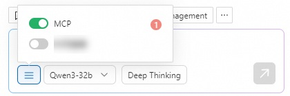

   <ol type="i" start="3">

   <li>

   Select the existing MaxCompute MCP (**MaxCompute**).

   </li>

   <li>

   Click **OK** to return to the dialog box. Describe your query in natural language, for example "Query the list of project instances for the current user".

   </li>

   <li>

   Click the  icon on the right to send and execute the instruction.

   </li>

   <li>

   After the task execution is complete, view the results.

   </li>

   </ol>

**Deploy your own MCP Server**

1. Download the MCP service package.

2. Deploy the package on an ECS instance, in a container, or on an on-premises server.

3. Integrate with an application or agent. Embed MCP as a backend service into an AI application, agent, or Robotic Process Automation (RPA) flow.

4. Call MCP features using RESTful APIs. To grant read-only access to table data in a project instance through MCP, you must grant the required permissions to the user. For more information, see ACL authorization.

<a id="section-9"></a>

# 9.PyODPS

<a id="section-9-1"></a>

## 9.1. Overview

PyODPS is an SDK for Python of MaxCompute. PyODPS provides a simple and convenient Python programming interface. This way, you can use Python to write code for MaxCompute jobs, query MaxCompute tables and views, and manage MaxCompute resources. PyODPS provides features that are similar to the features of the MaxCompute CLI tool. For example, you can use PyODPS to upload and download files, create tables, and execute MaxCompute SQL statements to query data. PyODPS also provides specific advanced features. For example, you can use PyODPS to commit MapReduce tasks and run MaxCompute user-defined functions (UDFs). This topic describes the use scenarios and supported platforms of PyODPS and the precautions when you use PyODPS.

**Scenarios**

For more information about the use scenarios of PyODPS, see the following topics:

- Getting started

- Use a PyODPS node to read data from a partitioned table

- Use a PyODPS node to pass parameters

- Reference a third-party package in a PyODPS node

- Use a PyODPS node to read data from the level-1 partition of the specified table

- Use a PyODPS node to query data based on specific criteria

- Use a PyODPS node to perform sequence operations

**Supported platforms**

PyODPS can run in an on-premises environment, DataWorks, and Machine Learning Platform for AI (PAI) Notebooks.

> **Important**
>
> To prevent an out of memory (OOM) error caused by the consumption of a large amount of memory, we recommend that you do not download full data to your on-premises machine for data processing, regardless of which type of platform is used to run the PyODPS nodes. We recommend that you commit computing tasks to MaxCompute for distributed execution. For more information about the comparison between the data processing methods, see Precautions in this topic.

- On-premises environment: You can install and use PyODPS in an on-premises environment. For more information, see Use PyODPS in an on-premises environment.

- DataWorks: PyODPS is installed on PyODPS nodes in DataWorks. You can develop PyODPS nodes in the DataWorks console and run the nodes at regular intervals. For more information, see Use PyODPS in DataWorks.

- PAI Notebooks: You can also install and run PyODPS in the Python environment of PAI. PyODPS is installed in the built-in images of PAI, such as the custom Python component of Machine Learning Designer, and can be directly used. In PAI Notebooks, you can perform basic operations related to PyODPS. For more information, see Overview of basic operations and Overview of DataFrame.

**Precautions**

Do not download full data to your on-premises machine and run PyODPS. PyODPS is an SDK and can run on various clients, such as a PC, DataWorks (PyODPS nodes in DataStudio), and PAI Notebooks.

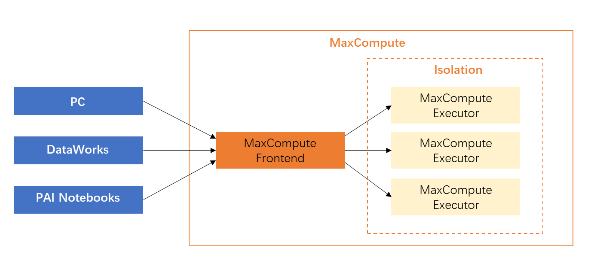

PyODPS allows you to download data to an on-premises machine by using different methods. For example, you can use Tunnel commands, the execute command, or the to_pandas method to download data. Therefore, multiple users who initially use PyODPS attempt to download data to an on-premises machine and upload the data to MaxCompute after the data is processed. In most cases, this data processing method is inefficient and does not take advantage of the large-scale parallel computing capability of MaxCompute.

| Data processing method | Description | Scenario |
| --- | --- | --- |

<table>
  <tr>
    <td>Download data to an on-premises machine for processing (This method is not recommende d because an OOM error may occur.)</td>
    <td>For example, a PyODPS node in DataWorks has a built-in PyODPS package and the required Python environment. The PyODPS node works as a client runtime container that has limited resources. The PyODPS node does not use the computing resources of MaxCompute and has limits on the memory.</td>
    <td>PyODPS provides the <code> to_pandas </code> method, which can be used to directly convert MaxCompute data into the pandas DataFrame data structure.However, the to_pandas method is suitable only for obtaining small-scale data for on-premises development and debugging, but not for large-scale data processing. When this method is called, data download is triggered and a large amount of data in MaxCompute is downloaded to the on-premises machine. If the to_pandas method is called to convert data into the pandas DataFrame data structure on the on-premises machine for subsequent data processing, the large-scale parallel computing capability of MaxCompute is not used at all. If the amount of data is large, the OOM error is likely to occur in the memory of a single machine.</td>
  </tr>
  <tr>
    <td>Commit computing tasks to MaxCompute for distributed execution (recommende d)</td>
    <td>We recommend that you use the Distributed DataFrame (DDF) feature of PyODPS. This feature can commit major computing tasks to MaxCompute for distributed execution, instead of downloading and processing data on the client on which a PyODPS node runs.This is the key to the effective use of PyODPS.</td>
    <td>We recommend that you call the PyODPS DataFrame interface to process data. In most cases, if you want to process each row of data in a table and write the data back to the table, or split a row of data into multiple rows, you can use the <code> map </code> or <code> apply </code> method of PyODPS DataFrame. In specific scenarios, you need to only write one line of code. This method is efficient.You can view related examples in Use UDFs and the third-party Python libraries.<br>After the PyODPS DataFrame interface is called, all commands that use this interface are translated into SQL statements and committed to a MaxCompute computing cluster for distributed computing. This way, almost no memory on the on-premises machine is consumed and the performance is significantly improved compared with data computing on a single machine.</td>
  </tr>
</table>

The following example compares the code of the two data processing methods for tokenization.

- Scenario You want to extract specific information by analyzing the log strings that are generated every day. A table that contains only one column exists and the column is of the STRING data type. You can segment Chinese text based on jieba and find the desired keywords to store the keywords in the information table.

- Sample code of inefficient data processing

  ```python
  import jieba
  t = o.get_table('word_split')
  out = []
  with t.open_reader() as reader:
      for r in reader:
          words = list(jieba.cut(r[0]))
          #
          # The processing logic of the code segment is to generate processed_data.
          #
          out.append(processed_data)
  out_t = o.get_table('words')
  with out_t.open_writer() as writer:
      writer.write(out)
  ```

  The logic of data processing on a single machine is to read data row by row, process data row by row, and then write data to the destination table row by row. During the process, a long period of time is consumed to download and upload data, and a large amount of memory is required on the machine that runs the script to process all data. For users who use DataWorks nodes, OOM errors are most likely to occur because the required memory exceeds the default allocated memory.

- Sample code of efficient data processing

  ```python
  from odps.df import output
  out_table = o.get_table('words')
  df = o.get_table('word_split').to_df()

  # Assume that the following fields and the related data types need to be returned.
  out_names = ["word", "count"]
  out_types = ["string", "int"]

  @output(out_names, out_types)
  def handle(row):
      import jieba
      words = list(jieba.cut(row[0]))
      #
      # The processing logic of the code segment is to generate processed_data.
      #
      yield processed_data
  df.apply(handle, axis=1).persist(out_table.name)
  ```

  Use the apply method to perform distributed execution.

  - The complex logic is included in the handle function. This function is automatically serialized to the machine and is used as a user-defined function (UDF). This function is called and run on the machine. When the handle function is run on the machine, data is also processed row by row. The logic is the same as the logic of data processing on a single machine. However, after the program that is written in this method is committed to MaxCompute, multiple machines process data at the same time. This reduces the time that is required to process data.

  - When the persist interface is called, the generated data is directly written to another MaxCompute table. All data is generated and consumed in the MaxCompute cluster. This also reduces the consumption of network and memory resources on the on-premises machine.

  - MaxCompute supports third-party packages in UDFs. In this example, the third-party package  `jieba`  is used. Therefore, you do not need to worry about the cost of code changes. You can use the large-scale computing capabilities of MaxCompute without the need to modify the main logic.

**Limits**

- MaxCompute has limits on SQL statements. For more information, see MaxCompute SQL limits.

- PyODPS nodes in DataWorks have limits. For more information, see Use PyODPS in DataWorks.

- Due to the limits of the sandbox, specific programs that are locally debugged by using the pandas computing backend cannot be debugged in MaxCompute.

<a id="section-9-2"></a>

## 9.2. Getting started

PyODPS can be called as a data development node on a data development platform, such as DataWorks. These platforms provide an environment to run PyODPS and allow you to schedule and run nodes. You do not need to manually create a MaxCompute entry object. Similar to pandas, PyODPS provides fast, flexible, and expressive data structures. The data processing feature of PyODPS is similar to that of pandas. You can use the data processing feature of PyODPS by calling the DataFrame API provided by PyODPS. This topic describes how to use PyODPS in your projects in the DataWorks console.

**Prerequisites**

- MaxCompute is activated. For more information, see Activate MaxCompute.

- DataWorks is activated, and a workspace is created. For more information, see Create a MaxCompute project.

**Procedure**

1. Create a PyODPS node.

   This section describes how to create a PyODPS 3 node in the DataWorks console. For more information, see Develop a PyODPS 3 job.

   > **Note**
   >
   > - The PyODPS 3 node is used as an example. The Python version of a PyODPS 3 node is 3.7.
   >
   > - Each PyODPS node can process a maximum of 50 MB of data and can occupy a maximum of 1 GB of memory. Otherwise, DataWorks terminates the PyODPS node. We recommend that you do not write Python code that will process a large amount of data in PyODPS nodes.
   >
   > - Writing and debugging code in DataWorks is inefficient. We recommend that you install IntelliJ IDEA locally to write code.

   <ol type="i">

   <li>

   Create a workflow.

   Log on to the DataWorks console and go to the DataStudio page. On the left side of the page, right-click **Business Flow** and click **Create Workflow**.

   </li>

   <li>

   Create a PyODPS 3 node.

   </li>

   </ol>

   Find the workflow that you create, right-click the name of the workflow, and then choose **Create > MaxCompute > PyODPS 3**. In the Create Node dialog box, specify Node Name and click **Commit**.

2. Configure and run the PyODPS 3 node.

   <ol type="i">

   <li>

   Write the code of the PyODPS 3 node.

   Write the test code in the code editor of the PyODPS 3 node. In this example, write the following code in the code editor that includes a full range of table operations. For more information about table operations and SQL operations, see Tables and SQL.

   ```python
   from odps import ODPS

   # Create a non-partitioned table named my_new_table. The non-partitioned table contains the fields that are of the specified data types and have the specified names. 
   # Each PyODPS node in DataWorks contains the global variable odps or o, which is the MaxCompute entry. You can use the entry without the need to define it. For more information, see Use PyODPS in DataWorks. 
   table = o.create_table('my_new_table', 'num bigint, id string', if_not_exists=True)

   # Write data to the my_new_table table. 
   records = [[111, 'aaa'],
             [222, 'bbb'],
             [333, 'ccc'],
             [444, 'Chinese']]
   o.write_table(table, records)

   # Read data from the my_new_table table. 
   for record in o.read_table(table):
       print(record[0],record[1])

   # Read data from the my_new_table table by executing an SQL statement. 
   result = o.execute_sql('select * from my_new_table;',hints=
   {'odps.sql.allow.fullscan': 'true'})

   # Obtain the execution result of the SQL statement. 
   with result.open_reader() as reader:    
       for record in reader:            
           print(record[0],record[1])

   # Delete the table. 
   table.drop()
   ```

   </li>

   <li>

   Run the code.

   </li>

   </ol>

   After you write the code, click the  icon in the top toolbar. After the code is run, you can

   view the running result of the PyODPS 3 node on the **Runtime Log** tab. The result in the following figure indicates that the code is successfully run.

   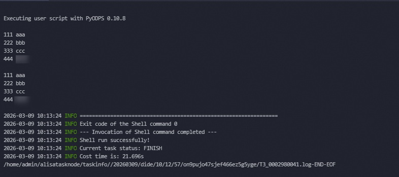

<a id="section-9-3"></a>

## 9.3. Use PyODPS in DataWorks

PyODPS is the Python SDK for MaxCompute. You can use it to develop and run PyODPS tasks in DataWorks. This topic covers the limitations of PyODPS in DataWorks, explains how to use it, and provides simple examples.

**Limitations**

- **Usage limitations**

  A **Got killed** error indicates the process was terminated because it ran out of memory. Avoid directly downloading and processing data in a PyODPS node. Instead, submit data processing tasks to MaxCompute for distributed execution. For a comparison of these two methods, see Note: Do not download full datasets locally to run PyODPS.

- **Package support limitations**

  - PyODPS nodes in DataWorks do not have packages such as **matplotlib** pre-installed. As a result, the following features may be limited:

    - The plot function of a DataFrame.

    - User-defined functions (UDFs) for a DataFrame must be submitted to MaxCompute for execution. The Python sandbox supports only pure Python libraries and NumPy as third-party libraries, so you cannot use Pandas in UDFs.

    - For code that does not involve UDFs and is executed in DataWorks, you can use the pre-installed NumPy and Pandas. Other third-party packages that contain binary code are not supported.

  - PyODPS nodes in DataWorks do not support the Python **atexit** module. Use a **try-finally** block to implement equivalent functionality.

- **Data record read limit**

  In a PyODPS node in DataWorks, **options.tunnel.use_instance_tunnel** is set to False by default. As a result, you can read a maximum of 10,000 data records. To read more, globally enable the **instance tunnel** by setting **options.tunnel.use_instance_tunnel** to True.

- **Version limitations**

  DataWorks supports Python 3 nodes starting from Enterprise Edition V3.14.

**Procedure**

1. Create a PyODPS node.

   Go to the **Data Development** page in DataWorks to create a PyODPS node. There are two types of PyODPS nodes:

   - PyODPS 2 uses Python 2.

   - PyODPS 3 uses Python 3.

   Create the node based on the Python version you use.

   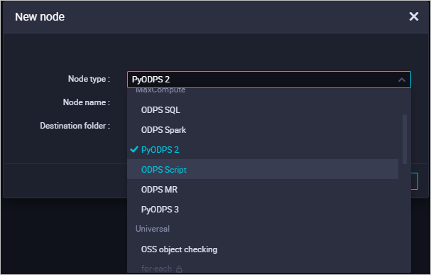

2. Develop the PyODPS task code.

   After you create the node, use the examples in the following sections to learn the core capabilities of PyODPS:

   - ODPS entrypoint

   - Execute SQL

   - DataFrame

   - Get scheduling parameters

   - Set runtime parameters (hints)

   For more guidance, see Basic Operations and DataFrame Overview.

3. Configure scheduling, then Save, Submit, and Publish the node. The task will then run as scheduled.

**ODPS entrypoint**

DataWorks provides a global variable,  `odps`  or  `o` , in PyODPS nodes to serve as the ODPS entrypoint. You do not need to define the ODPS entrypoint manually. For example:

```text
# Check if the table pyodps_iris exists.
print(o.exist_table('pyodps_iris'))
```

A return value of  `True`  indicates that the table exists.

**Execute SQL General capabilities**

- Run SQL commands in a PyODPS node by using methods such as **execute_sql()/run_sql()**. These methods primarily support DDL and DML statements.

  > **Note**
  >
  > You cannot run all executable SQL statements with the  `execute_sql()`  and  `run_sql()`  methods of the entrypoint object. When you call statements other than DDL or DML, use other methods. For example, use the  `run_security_query`  method to call GRANT or REVOKE statements, and use the  `run_xflow`  or  `execute_xflow` method to call API commands.

- Use **open_reader()** to read SQL execution results in a PyODPS node.

For more information about SQL operations in PyODPS nodes, see SQL.

**Data record count limit**

In DataWorks, **instance tunnel** is disabled by default. This means that **instance.open_reader** uses the Result interface by default, which has a  `limit`  and can retrieve a maximum of 10,000 data records. If you need to iterate through all data, you must enable **instance tunnel** and disable the  `limit` .

- Globally disable the  `limit`  restriction

  You can use the following statement to globally enable Instance Tunnel and disable the  `limit`  restriction.

  ```text
  options.tunnel.use_instance_tunnel = True
  options.tunnel.limit_instance_tunnel = False  # Disable the limit restriction to readall data.

  with instance.open_reader() as reader:
  # You can read all data through the instance tunnel.
  # You can use reader.count to get the record count.
  ```

- Disable the  `limit`  restriction for this run only

  You can also add  `tunnel=True`  to **open_reader** to enable the **instance tunnel** for a single **open_reader** call. At the same time, you can add  `limit=False`  to disable the  `limit`  restriction for the same call.

  ```text
  with instance.open_reader(tunnel=True, limit=False) as reader:
  # This open_reader call uses the instance tunnel API and can read all data.
  ```

**DataFrame**

- Execution

  In DataWorks, you must explicitly call an immediate execution method, such as  `execute` or  `persist` , to run a DataFrame operation. The following code is an example.

  ```python
  # Call an immediate execution method to process each Record and print all data where iris.sepalwidth is less than 3 from the pyodps_iris table.
  from odps.df import DataFrame
  iris = DataFrame(o.get_table('pyodps_iris'))
  for record in iris[iris.sepalwidth < 3].execute():
      print(record)
  ```

- Print detailed information

  The  `options.verbose`  option is enabled by default in DataWorks. This causes detailed information, such as the Logview, to be printed when a PyODPS node runs. You can manually set this option to specify whether this detailed information is printed.

For more examples of DataFrame operations, see DataFrame Overview.

**Scheduling parameters**

When you develop task code in a DataWorks PyODPS node, you can use scheduling parameters, for example, to get the business date for a task run. PyODPS nodes and SQL nodes in DataWorks use the same parameter definition process, but they reference parameters differently in code.

- An SQL node directly uses a string such as **${param_name}** in the code.

- To avoid affecting the code, a PyODPS node adds a  `dict`  named  `args`  to the global variables before code execution so that you can retrieve scheduling parameter values by using **args[param_name]** instead of replacing **${param_name}**.

For example, if you set the scheduling parameter  `ds=${yyyymmdd}`  in the **Scheduling Configuration > Parameters** of a node, you can retrieve this parameter in your code as follows.

- Obtain the value of the  `ds`  parameter.

  ```text
  print('ds=' + args['ds'])
  # Returns the date for ds, for example, ds=20161116
  ```

- Retrieve table data from the partition named  `ds=${yyyymmdd}` .

  ```text
  o.get_table('table_name').get_partition('ds=' + args['ds'])
  # Get data from the table_name table in the ds partition.
  ```

**Runtime parameters (hints)**

If you need to set runtime parameters when running a task, you can do so by setting the  `hints`  parameter. The parameter type is dict.

```text
o.execute_sql('select * from pyodps_iris', hints={'odps.sql.mapper.split.size': 16})
```

You can also configure sql.settings globally. After configuration, the related runtime parameters are added to every subsequent run.

```python
from odps import options
options.sql.settings = {'odps.sql.mapper.split.size': 16}
o.execute_sql('select * from pyodps_iris')  # Hints are added based on the global configuration.
```

**Third-party packages**

DataWorks nodes have the following third-party packages pre-installed:

| Package | Python 2 version | Python 3 version |
| --- | --- | --- |
| requests | 2.11.1 | 2.26.0 |
| numpy | 1.16.6 | 1.18.1 |
| pandas | 0.24.2 | 1.0.5 |
| scipy | 0.19.0 | 1.3.0 |
| scikit_learn | 0.18.1 | 0.22.1 |
| pyarrow | 0.16.0 | 2.0.0 |
| lz4 | 2.1.4 | 3.1.10 |
| zstandard | 0.14.1 | 0.17.0 |

If you need to use a package that is not in the list above, DataWorks nodes provide the  `load_resource_package`  method to download third-party packages from MaxCompute resources. After you use  `pyodps-pack`  to package your files, you can use the  `load_resource_package`  method to load the third-party package and then import its content. For more information about how to use  `pyodps-pack` , see Create a third-party package for PyODPS and Use a third-party package in PyODPS.

> **Note**
>
> If you are packaging for a Python 2 node, use  `pyodps-pack`  with the  `--dwpy27` parameter.

Example:

1. Run the following command to package ipaddress.

   ```text
   pyodps-pack -o ipaddress-bundle.tar.gz ipaddress
   ```

2. After you upload and submit  `ipaddress-bundle.tar.gz`  as a resource, you can use the ipaddress package in a PyODPS 3 node by using the following method.

   ```python
   load_resource_package("ipaddress-bundle.tar.gz")
   import ipaddress
   ```

DataWorks limits the total size of packages that can be downloaded to 100 MB. If you need to skip packaging pre-installed packages, you can use the  `pyodps-pack`  command's  `--exclude`  parameter. For example, the following packaging method excludes the numpy and pandas packages that exist in the DataWorks environment.

```text
pyodps-pack -o bundle.tar.gz --exclude numpy --exclude pandas <your_package>
```

**Using other accounts**

In some scenarios, you may want to use another account to access MaxCompute. In this case, you can use the  `as_account`  method of the ODPS entrypoint object to create an entrypoint object that uses a new account. This new object is independent of the default  `o`  instance.

> **Important**
>
> The  `as_account`  method has been supported since PyODPS 0.11.3. If your DataWorks does not have this version deployed, you cannot use the  `as_account`  method.

**Procedure**

1. Grant the required project permissions to the other user. For more information, see Appendix: Granting permissions to other users.

2. In a PyODPS node, use the  `as_account`  method to switch accounts and create a new entrypoint object.

   ```python
   import os
   # Make sure the ALIBABA_CLOUD_ACCESS_KEY_ID environment variable is set to the Access
   Key ID,
   # and the ALIBABA_CLOUD_ACCESS_KEY_SECRET environment variable is set to the Access Key Secret.
   # We recommend that you do not hard-code the Access Key ID and Access Key Secret strings.
   new_odps = o.as_account(
       os.getenv('ALIBABA_CLOUD_ACCESS_KEY_ID'),
       os.getenv('ALIBABA_CLOUD_ACCESS_KEY_SECRET')
   )
   ```

3. Verify the account switch.

   Add the following statement to your code to query the current user information. If the output shows the UID of the specified user, the account switch was successful.

   ```text
   print(od.get_project().current_user)
   ```

**Example**

1. Create a table and import data.

   <ol type="i">

   <li>

   Download the Iris dataset iris.data and rename it to iris.csv.

   </li>

   <li>

   Create table **pyodps_iris** and upload the dataset iris.csv.

   </li>

   </ol>

   Use the following DDL statement:

   ```sql
   CREATE TABLE if NOT EXISTS pyodps_iris
   (
   sepallength  DOUBLE comment 'sepal length (cm)',
   sepalwidth   DOUBLE comment 'sepal width (cm)',
   petallength  DOUBLE comment 'petal length (cm)',
   petalwidth   DOUBLE comment 'petal width (cm)',
   name         STRING comment 'species'
   );
   ```

2. Create an ODPS SQL node to complete the authorization. For more information, see Appendix: Granting permissions to other users.

3. Create a PyODPS node to switch users. The following code is an example for Python 2.

   ```python
   from odps import ODPS
   import os
   import sys
   reload(sys)
   # Change the system default encoding.
   sys.setdefaultencoding('utf8')

   # Make sure the ALIBABA_CLOUD_ACCESS_KEY_ID environment variable is set to the user's
   Access Key ID,
   # and the ALIBABA_CLOUD_ACCESS_KEY_SECRET environment variable is set to the user's Access Key Secret.
   # We recommend that you do not hard-code the Access Key ID and Access Key Secret strings.
   os.environ['ALIBABA_CLOUD_ACCESS_KEY_ID'] = '<accesskey id>'
   os.environ['ALIBABA_CLOUD_ACCESS_KEY_SECRET'] = '<accesskey secret>'
   od = o.as_account(os.getenv('ALIBABA_CLOUD_ACCESS_KEY_ID'), 
            os.getenv('ALIBABA_CLOUD_ACCESS_KEY_SECRET')
           )
   iris = DataFrame(od.get_table('pyodps_iris'))
   # Output with a filter condition.
   with od.execute_sql('select * from pyodps_iris WHERE sepallength > 5 ').open_reader() 
   as reader4:
       print reader4.raw
       for record in reader4:
           print 
   record["sepallength"],record["sepalwidth"],record["petallength"],record["petalwidth"],r
   ord["name"]
   # Print the UID of the current user.
   print(od.get_project().current_user)
   ```

4. Run the node and view the result.

   ```xml
   Executing user script with PyODPS 0.11.4.post0

   "sepallength","sepalwidth","petallength","petalwidth","name"
   5.4,3.9,1.7,0.4,"Iris-setosa"
   5.4,3.7,1.5,0.2,"Iris-setosa"
   5.8,4.0,1.2,0.2,"Iris-setosa"
   57441504"Iris-setosa"
   5.4,3.9,1.3,0.4,"Iris-setosa"
   5.1,3.5,1.4,0.3,"Iris-setosa"
   5.7,3.8,1.7,0.3,"Iris-setosa"
   5.1,3.8,1.5,0.3,"Iris-setosa"
   5.4,3.4,1.7,0.2,"Iris-setosa"
   5.1,3.7,1.5,0.4,"Iris-setosa"
   5.1,3.3,1.7,0.5,"Iris-setosa"
   5.2,3.5,1.5,0.2,"Iris-setosa"
   5.2,3.4,1.4,0.2,"Iris-setosa"
   5.4,3.4,1.5,0.4,"Iris-setosa"
   5.2,4.1,1.5,0.1,"Iris-setosa"
   5.5,4.2,1.4,0.2,"Iris-setosa"
   5.5,3.5,1.3,0.2,"Iris-setosa"
   5.1,3.4,1.5,0.2,"Iris-setosa"
   5.1,3.8,1.9,0.4,"Iris-setosa"
   5.1,3.8,1.6,0.2,"Iris-setosa"
   5.3,3.7,1.5,0.2,"Iris-setosa"
   7.0,3.2,4.7,1.4,"Iris-versicolor"
   6.4,3.2,4.5,1.5,"Iris-versicolor"
   6.9,3.1,4.9,1.5,"Iris-versicolor"
   5.5,2.3,4.0,1.3,"Iris-versicolor"
   6.5,2.8,4.6,1.5,"Iris-versicolor"
   5.7,2.8,4.5,1.3,"Iris-versicolor"
   6.3,3.3,4.7,1.6,"Iris-versicolor"
   6.6,2.9,4.6,1.3,"Iris-versicolor"
   5.2,2.7,3.9,1.4,"Iris-versicolor"
   5.9,3.0,4.2,1.5,"Iris-versicolor"
   6.0,2.2,4.0,1.0,"Iris-versicolor"
   6.1,2.9,4.7,1.4,"Iris-versicolor"
   5.6,2.9,3.6,1.3,"Iris-versicolor"
   6.7,3.1,4.4,1.4,"Iris-versicolor"
   5.6,3.0,4.5,1.5,"Iris-versicolor"
   5.8,2.7,4.1,1.0,"Iris-versicolor"
   6.2,2.2,4.5,1.5,"Iris-versicolor"
   5.6,2.5,3.9,1.1,"Iris-versicolor"
   5.9,3.2,4.8,1.8,"Iris-versicolor"
   6.1,2.8,4.0,1.3,"Iris-versicolor"
   6.3,2.5,4.9,1.5,"Iris-versicolor"
   6.1,2.8,4.7,1.2,"Iris-versicolor"
   6.4,2.9,4.3,1.3,"Iris-versicolor"
   6.6,3.0,4.4,1.4,"Iris-versicolor"
   6.8,2.8,4.8,1.4,"Iris-versicolor"
   6.7,3.0,5.0,1.7,"Iris-versicolor"
   6.0,2.9,4.5,1.5,"Iris-versicolor"
   5.7,2.6,3.5,1.0,"Iris-versicolor"
   5.5,2.4,3.8,1.1,"Iris-versicolor"
   5.5,2.4,3.7,1.0,"Iris-versicolor"
   5.8,2.7,3.9,1.2,"Iris-versicolor"
   6.0,2.7,5.1,1.6,"Iris-versicolor"
   5.4,3.0,4.5,1.5,"Iris-versicolor"
   6.0,3.4,4.5,1.6,"Iris-versicolor"
   6.7,3.1,4.7,1.5,"Iris-versicolor"
   6.3,2.3,4.4,1.3,"Iris-versicolor"
   5.6,3.0,4.1,1.3,"Iris-versicolor"
   5.5,2.5,4.0,1.3,"Iris-versicolor"
   5.5,2.6,4.4,1.2,"Iris-versicolor"
   6.1,3.0,4.6,1.4,"Iris-versicolor"
   5.8,2.6,4.0,1.2,"Iris-versicolor"
   5.6,2.7,4.2,1.3,"Iris-versicolor"
   5.7,3.0,4.2,1.2,"Iris-versicolor"
   5.7,2.9,4.2,1.3,"Iris-versicolor"
   6.2,2.9,4.3,1.3,"Iris-versicolor"
   5.1,2.5,3.0,1.1,"Iris-versicolor"
   5.7,2.8,4.1,1.3,"Iris-versicolor"
   6.3,3.3,6.0,2.5,"Iris-virginica"
   5.8,2.7,5.1,1.9,"Iris-virginica"
   7.1,3.0,5.9,2.1,"Iris-virginica"
   6.3,2.9,5.6,1.8,"Iris-virginica"
   6.5,3.0,5.8,2.2,"Iris-virginica"
   7.6,3.0,6.6,2.1,"Iris-virginica"
   7.3,2.9,6.3,1.8,"Iris-virginica"
   6.7,2.5,5.8,1.8,"Iris-virginica"
   7.2,3.6,6.1,2.5,"Iris-virginica"
   6.5,3.2,5.1,2.0,"Iris-virginica"
   6.4,2.7,5.3,1.9,"Iris-virginica"
   6.8,3.0,5.5,2.1,"Iris-virginica"
   5.7,2.5,5.0,2.0,"Iris-virginica"
   5.8,2.8,5.1,2.4,"Iris-virginica"
   6.4,3.2,5.3,2.3,"Iris-virginica"
   6.5,3.0,5.5,1.8,"Iris-virginica"
   7.7,3.8,6.7,2.2,"Iris-virginica"
   7.7,2.6,6.9,2.3,"Iris-virginica"
   6.0,2.2,5.0,1.5,"Iris-virginica"
   6.9,3.2,5.7,2.3,"Iris-virginica"
   5.6,2.8,4.9,2.0,"Iris-virginica"
   7.7,2.8,6.7,2.0,"Iris-virginica"
   6.3,2.7,4.9,1.8,"Iris-virginica"
   6.7,3.3,5.7,2.1,"Iris-virginica"
   7.2,3.2,6.0,1.8,"Iris-virginica"
   6.2,2.8,4.8,1.8,"Iris-virginica"
   6.1,3.0,4.9,1.8,"Iris-virginica"
   6.4,2.8,5.6,2.1,"Iris-virginica"
   7.2,3.0,5.8,1.6,"Iris-virginica"
   7.4,2.8,6.1,1.9,"Iris-virginica"
   7.9,3.8,6.4,2.0,"Iris-virginica"
   6.4,2.8,5.6,2.2,"Iris-virginica"
   6.3,2.8,5.1,1.5,"Iris-virginica"
   6.1,2.6,5.6,1.4,"Iris-virginica"
   7.7,3.0,6.1,2.3,"Iris-virginica"
   6.3,3.4,5.6,2.4,"Iris-virginica"
   6.4,3.1,5.5,1.8,"Iris-virginica"
   6.0,3.0,4.8,1.8,"Iris-virginica"
   6.9,3.1,5.4,2.1,"Iris-virginica"
   6.7,3.1,5.6,2.4,"Iris-virginica"
   6.9,3.1,5.1,2.3,"Iris-virginica"
   5.8,2.7,5.1,1.9,"Iris-virginica"
   6.8,3.2,5.9,2.3,"Iris-virginica"
   6.7,3.3,5.7,2.5,"Iris-virginica"
   6.7,3.0,5.2,2.3,"Iris-virginica"
   6.3,2.5,5.0,1.9,"Iris-virginica"
   6.5,3.0,5.2,2.0,"Iris-virginica"
   6.2,3.4,5.4,2.3,"Iris-virginica"
   5.9,3.0,5.1,1.8,"Iris-virginica"
   5.4 3.9 1.7 0.4 Iris-setosa
   5.4 3.7 1.5 0.2 Iris-setosa
   5.8 4.0 1.2 0.2 Iris-setosa
   5.7 4.4 1.5 0.4 Iris-setosa
   5.4 3.9 1.3 0.4 Iris-setosa
   5.1 3.5 1.4 0.3 Iris-setosa
   5.7 3.8 1.7 0.3 Iris-setosa
   5.1 3.8 1.5 0.3 Iris-setosa
   5.4 3.4 1.7 0.2 Iris-setosa
   5.1 3.7 1.5 0.4 Iris-setosa
   5.1 3.3 1.7 0.5 Iris-setosa
   5.2 3.5 1.5 0.2 Iris-setosa
   5.2 3.4 1.4 0.2 Iris-setosa
   5.4 3.4 1.5 0.4 Iris-setosa
   5.2 4.1 1.5 0.1 Iris-setosa
   5.5 4.2 1.4 0.2 Iris-setosa
   5.5 3.5 1.3 0.2 Iris-setosa
   5.1 3.4 1.5 0.2 Iris-setosa
   5.1 3.8 1.9 0.4 Iris-setosa
   5.1 3.8 1.6 0.2 Iris-setosa
   5.3 3.7 1.5 0.2 Iris-setosa
   7.0 3.2 4.7 1.4 Iris-versicolor
   6.4 3.2 4.5 1.5 Iris-versicolor
   6.9 3.1 4.9 1.5 Iris-versicolor
   5.5 2.3 4.0 1.3 Iris-versicolor
   6.5 2.8 4.6 1.5 Iris-versicolor
   5.7 2.8 4.5 1.3 Iris-versicolor
   6.3 3.3 4.7 1.6 Iris-versicolor
   6.6 2.9 4.6 1.3 Iris-versicolor
   5.2 2.7 3.9 1.4 Iris-versicolor
   5.9 3.0 4.2 1.5 Iris-versicolor
   6.0 2.2 4.0 1.0 Iris-versicolor
   6.1 2.9 4.7 1.4 Iris-versicolor
   5.6 2.9 3.6 1.3 Iris-versicolor
   6.7 3.1 4.4 1.4 Iris-versicolor
   5.6 3.0 4.5 1.5 Iris-versicolor
   5.8 2.7 4.1 1.0 Iris-versicolor
   6.2 2.2 4.5 1.5 Iris-versicolor
   5.6 2.5 3.9 1.1 Iris-versicolor
   5.9 3.2 4.8 1.8 Iris-versicolor
   6.1 2.8 4.0 1.3 Iris-versicolor
   6.3 2.5 4.9 1.5 Iris-versicolor
   6.1 2.8 4.7 1.2 Iris-versicolor
   6.4 2.9 4.3 1.3 Iris-versicolor
   6.6 3.0 4.4 1.4 Iris-versicolor
   6.8 2.8 4.8 1.4 Iris-versicolor
   6.7 3.0 5.0 1.7 Iris-versicolor
   6.0 2.9 4.5 1.5 Iris-versicolor
   5.7 2.6 3.5 1.0 Iris-versicolor
   5.5 2.4 3.8 1.1 Iris-versicolor
   5.5 2.4 3.7 1.0 Iris-versicolor
   5.8 2.7 3.9 1.2 Iris-versicolor
   6.0 2.7 5.1 1.6 Iris-versicolor
   5.4 3.0 4.5 1.5 Iris-versicolor
   6.0 3.4 4.5 1.6 Iris-versicolor
   6.7 3.1 4.7 1.5 Iris-versicolor
   6.3 2.3 4.4 1.3 Iris-versicolor
   5.6 3.0 4.1 1.3 Iris-versicolor
   5.5 2.5 4.0 1.3 Iris-versicolor
   5.5 2.6 4.4 1.2 Iris-versicolor
   6.1 3.0 4.6 1.4 Iris-versicolor
   5.8 2.6 4.0 1.2 Iris-versicolor
   5.6 2.7 4.2 1.3 Iris-versicolor
   5.7 3.0 4.2 1.2 Iris-versicolor
   5.7 2.9 4.2 1.3 Iris-versicolor
   6.2 2.9 4.3 1.3 Iris-versicolor
   5.1 2.5 3.0 1.1 Iris-versicolor
   5.7 2.8 4.1 1.3 Iris-versicolor
   6.3 3.3 6.0 2.5 Iris-virginica
   5.8 2.7 5.1 1.9 Iris-virginica
   7.1 3.0 5.9 2.1 Iris-virginica
   6.3 2.9 5.6 1.8 Iris-virginica
   6.5 3.0 5.8 2.2 Iris-virginica
   7.6 3.0 6.6 2.1 Iris-virginica
   7.3 2.9 6.3 1.8 Iris-virginica
   6.7 2.5 5.8 1.8 Iris-virginica
   7.2 3.6 6.1 2.5 Iris-virginica
   6.5 3.2 5.1 2.0 Iris-virginica
   6.4 2.7 5.3 1.9 Iris-virginica
   6.8 3.0 5.5 2.1 Iris-virginica
   5.7 2.5 5.0 2.0 Iris-virginica
   5.8 2.8 5.1 2.4 Iris-virginica
   6.4 3.2 5.3 2.3 Iris-virginica
   6.5 3.0 5.5 1.8 Iris-virginica
   7.7 3.8 6.7 2.2 Iris-virginica
   7.7 2.6 6.9 2.3 Iris-virginica
   6.0 2.2 5.0 1.5 Iris-virginica
   6.9 3.2 5.7 2.3 Iris-virginica
   5.6 2.8 4.9 2.0 Iris-virginica
   7.7 2.8 6.7 2.0 Iris-virginica
   6.3 2.7 4.9 1.8 Iris-virginica
   6.7 3.3 5.7 2.1 Iris-virginica
   7.2 3.2 6.0 1.8 Iris-virginica
   6.2 2.8 4.8 1.8 Iris-virginica
   6.1 3.0 4.9 1.8 Iris-virginica
   6.4 2.8 5.6 2.1 Iris-virginica
   7.2 3.0 5.8 1.6 Iris-virginica
   7.4 2.8 6.1 1.9 Iris-virginica
   7.9 3.8 6.4 2.0 Iris-virginica
   6.4 2.8 5.6 2.2 Iris-virginica
   6.3 2.8 5.1 1.5 Iris-virginica
   6.1 2.6 5.6 1.4 Iris-virginica
   7.7 3.0 6.1 2.3 Iris-virginica
   6.3 3.4 5.6 2.4 Iris-virginica
   6.4 3.1 5.5 1.8 Iris-virginica
   6.0 3.0 4.8 1.8 Iris-virginica
   6.9 3.1 5.4 2.1 Iris-virginica
   6.7 3.1 5.6 2.4 Iris-virginica
   6.9 3.1 5.1 2.3 Iris-virginica
   5.8 2.7 5.1 1.9 Iris-virginica
   6.8 3.2 5.9 2.3 Iris-virginica
   6.7 3.3 5.7 2.5 Iris-virginica
   6.7 3.0 5.2 2.3 Iris-virginica
   6.3 2.5 5.0 1.9 Iris-virginica
   6.5 3.0 5.2 2.0 Iris-virginica
   6.2 3.4 5.4 2.3 Iris-virginica
   5.9 3.0 5.1 1.8 Iris-virginica
   <User 139xxxxxxxxxxxxx>
   ```

**Troubleshooting**

If your code becomes unresponsive during execution and produces no output, add the following comment at the beginning of your code. DataWorks then prints the stack of all threads every 30 seconds:

```text
# -*- dump_traceback: true -*-
```

> **Note**
>
> This method applies to PyODPS 3 nodes with PyODPS 0.11.4.1 or later.

**PyODPS version**

You can check the PyODPS version with Python code or find it in the run log of a PyODPS task.

- Query the PyODPS version in a PyODPS node.

  ```text
  # Enter the following code.
  import odps; print(odps.__version__)

  # Example result
  0.11.2.3
  ```

- View the PyODPS version in the run log of a PyODPS task, as shown in the following example.

  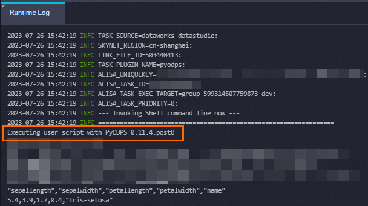

**Appendix: Granting permissions to other users**

To allow other Alibaba Cloud account users (not RAM users) to access your projects and tables, create an ODPS SQL node in DataWorks and run the following authorization commands. For more information about other permissions, see Users and Permissions.

```sql
-- Add another Alibaba Cloud account user (project-level).
ADD USER ALIYUN$<account_name>;

-- Grant the CreateInstance permission on the project.
GRANT CreateInstance ON project <project_name> TO USER ALIYUN$<account_name>;

-- Grant the DESCRIBE and SELECT permissions on the table.
GRANT DESCRIBE, SELECT ON TABLE <table_name> TO USER ALIYUN$<account_name>;

-- View the authorization result.
SHOW grants FOR ALIYUN$<account_name>;
```

The following figure shows an example of the authorization result:

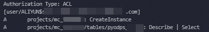

**Appendix: Sample data**

Follow the instructions in Step 1: Create a table and import data in the PyODPS conditional query topic to create the *pyodps_iris* table and write data to it in DataWorks. The examples in this topic use this table as the sample dataset to demonstrate basic operations.

<a id="section-9-4"></a>

## 9.4. Use PyODPS in an on-premises environment

<a id="section-9-4-1"></a>

### 9.4.1. Install PyODPS

PyODPS is MaxCompute SDK for Python. PyODPS provides the DataFrame framework and basic operations on MaxCompute objects to help you analyze data in MaxCompute by using Python. You can use PyODPS in DataWorks or an on-premises environment. This topic describes how to install PyODPS when you use PyODPS in an on-premises environment.

**Prerequisites**

The version of Python meets requirements. We recommend that you use Python 3.6 or later. Python 2.7 or earlier is not recommended.

**Procedure**

1. Run the following command to install PyODPS:

   ```bash
   pip install pyodps
   ```

2. Run the following command to check whether the installation is successful: If no result is returned and no error is reported, the installation is successful.

   ```text
   python -c "from odps import ODPS"
   ```

3. If the Python version is not the default version, run the following command to switch to the default version after pip is installed:

   ```text
   /home/tops/bin/python3.7 -m pip install setuptools>=3.0
   #/home/tops/bin/python3.7 is the directory in which Python is installed.
   ```

**What to do next**

1. We recommend that you install **greenlet 0.4.10** or later to accelerate Tunnel-based data upload.

2. Initialize the MaxCompute entry point.

   ```python
   import os
   from odps import ODPS
   # Set the environment variable ALIBABA_CLOUD_ACCESS_KEY_ID to the AccessKey ID of your Alibaba Cloud account. 
   # Set the environment variable ALIBABA_CLOUD_ACCESS_KEY_SECRET to the AccessKey secret of your Alibaba Cloud account. 
   o = ODPS(
       os.getenv('ALIBABA_CLOUD_ACCESS_KEY_ID'),
       os.getenv('ALIBABA_CLOUD_ACCESS_KEY_SECRET'),
       project='your-default-project',
       endpoint='your-end-point',
   )
   ```

   Take note of the following points:

   - *ALIBABA_CLOUD_ACCESS_KEY_ID* and *ALIBABA_CLOUD_ACCESS_KEY_SECRET*: Set the two environment variables to the AccessKey ID and AccessKey secret of your Alibaba Cloud account separately.

     > **Note**
     >
     > We recommend that you use the environment variables rather than the AccessKey ID and AccessKey secret.

   - *your-default-project* and *your-end-point*: Replace them with the default project name and endpoint.

After you complete the preceding configurations, you can use PyODPS in your on-premises environment. For example, you can perform basic operations on MaxCompute objects, such as  `list` ,  `get` ,  `exist` ,  `create` , and  `delete` . For more information about how to use PyODPS, see Overview of basic operations and Overview of DataFrame.

> **Note**
>
> Unless otherwise specified, the o object in this topic is a MaxCompute object.

<a id="section-9-4-2"></a>

### 9.4.2. Use PyODPS on an on-premises environment

PyODPS is an SDK for Python developed by Alibaba Cloud. PyODPS is used to run MaxCompute on an on-premises environment. This topic describes how to use PyODPS to perform table operations, load data, and run SQL queries on an on-premises environment.

**Prerequisites**

1. Python is installed on your on-premises environment and the PyODPS package is installed. For more information, see Install PyODPS.

2. The **pyodps_iris** dataset is prepared. You can follow the instructions in the "Example" section in Use PyODPS in DataWorks to download the dataset, create a table named **pyodps_iris**, and write data to the table.

**Procedure**

1. Open the Python editor and create a Python file.

2. Develop code for a PyODPS task.

   After you create a PyODPS task, follow the steps in this topic to learn about the main capabilities of PyODPS.

   - Create a MaxCompute entry point

   - Execute SQL statements

   - DataFrame

   - Configure the hints parameter

   For more information about how to use PyODPS, see Overview of basic operations and Overview of DataFrame.

3. Run the Python file on the on-premises environment.

**Create a MaxCompute entry point**

You need to manually create an MaxCompute entry point. The following code shows an example.

```python
import os
from odps import ODPS
# Set the environment variable ALIBABA_CLOUD_ACCESS_KEY_ID to the AccessKey ID of your 
Alibaba Cloud account. 
# Set the environment variable ALIBABA_CLOUD_ACCESS_KEY_SECRET to the AccessKey secret of your Alibaba Cloud account. 
o = ODPS(
    os.getenv('ALIBABA_CLOUD_ACCESS_KEY_ID'),
    os.getenv('ALIBABA_CLOUD_ACCESS_KEY_SECRET'),
    project='your-default-project',
    endpoint='your-end-point',
)
```

**Execute SQL statements**

You can execute SQL statements on an on-premises PyODPS node and read the SQL execution results.

**Execute SQL statements on a PyODPS node**

You can execute SQL statements in normal mode on PyODPS nodes. You can only execute DDL and DML SQL statements. If you execute SQL statements in MaxCompute Query Acceleration (MCQA) mode in a job, the results of the job are written to a temporary cache. If you run the same query job later, MaxCompute first returns the results in the cache to accelerate the execution. You can select a mode for the execution of your job based on your business requirements.

> **Note**
>
> Specific SQL statements may fail to be executed by using the  `execute_sql()`  or  `run_sql()`  method of the MaxCompute entry object. To execute non-DDL or non-DML statements, you must use other methods. For example, if you create a table by executing a statement, use the  `create_table`  method. If you call an API operation, use the  `run_xflow`  or  `execute_xflow`  method.

- Execute SQL statements in normal mode.

  You can use the **execute_sql()/run_sql()** method to execute SQL statements. Sample code:

  Create a table by using the  `create_table`  method.

  ```text
  o.create_table('my_t', 'num bigint, id string', if_not_exists=True)
  ```

  Run an SQL query by using the  `execute_sql`  method.

  ```text
  result = o.execute_sql('SELECT * FROM pyodps_iris LIMIT 3')
  with result.open_reader() as reader:
      for record in reader:
          print(record)
  ```

**Read SQL execution results from the PyODPS node**

You can use the **open_reader()** method to read the SQL execution results. For more information, see Obtain the execution results of SQL statements.

For more information about SQL-related operations on a PyODPS node, see SQL.

**DataFrame**

- Execution methods

  To perform operations on DataFrame, you need to explicitly call the methods that can be immediately executed, such as  `execute`  and  `persist` . The following code shows an example.

  ```python
  # Call an immediately executed method to process each data record and display all data records whose iris.sepalwidth is less than 3 in the pyodps_iris table. 
  from odps.df import DataFrame
  iris = DataFrame(o.get_table('pyodps_iris'))
  for record in iris[iris.sepalwidth < 3].execute():  
      print(record)
  ```

- Display of details

  By default, detailed processes such as LogView are not displayed when PyODPS nodes are run on the on-premises environment. You can manually set  `options.verbose`  to True to display detailed processes, such as LogView.

  ```python
  from odps import options
  options.verbose = True
  ```

For more information about DataFrame operations, see Overview.

**Configure the hints parameter**

You can use the  `hints`  parameter to configure runtime parameters. The value of the hints parameter is of the DICT type.

```text
o.execute_sql('SELECT * FROM pyodps_iris', hints={'odps.sql.mapper.split.size': 16})
```

You can globally configure the options.sql.settings parameter. The relevant runtime parameters are automatically added during each execution.

```python
from odps import options
options.sql.settings = {'odps.sql.mapper.split.size': 16}
# Add hints based on the global configuration.
o.execute_sql('SELECT * FROM pyodps_iris')
```

**Example**

1. Create a file named  `test-pyodps-local.py`  on your on-premises environment.

2. Write code. The following code shows an example.

   ```python
   import os
   from odps import ODPS

   # Set the environment variable ALIBABA_CLOUD_ACCESS_KEY_ID to the AccessKey ID of your Alibaba Cloud account. 
   # Set the environment variable ALIBABA_CLOUD_ACCESS_KEY_SECRET to the AccessKey secret of your Alibaba Cloud account. 
   o = ODPS(
       os.getenv('ALIBABA_CLOUD_ACCESS_KEY_ID'),
       os.getenv('ALIBABA_CLOUD_ACCESS_KEY_SECRET'),
       project='your-default-project',
       endpoint='your-end-point',
   )

   # Create a non-partitioned table named my_new_table, which contains the fields with the specified names and of the specified data types. 
   table = o.create_table('my_new_table', 'num bigint, id string', if_not_exists=True)

   # Insert data into the non-partitioned table my_new_table. 
   records = [[111, 'aaa'],
              [222, 'bbb'],
              [333, 'ccc'],
              [444, 'Chinese']]
   o.write_table(table, records)

   # Read data from the non-partitioned table my_new_table. 
   for record in o.read_table(table):
       print(record[0], record[1])

   # Execute an SQL statement to read data from the pyodps_iris table. 
   result = o.execute_sql('SELECT * FROM pyodps_iris LIMIT 3;', hints=
   {'odps.sql.allow.fullscan': 'true'})

   # Drop the table my_new_table to clear resources. 
   table.drop()

   print ('Use open_reader to read data from the pyodps_iris table:')

   # Read SQL execution results. 
   with result.open_reader() as reader:
       for record in reader:
           print(record[0], record[1])
   ```

3. Run the Python code.

   ```text
   python test-pyodps-local.py
   ```

   The following result is returned:

   ```text
   111 aaa
   222 bbb
   333 ccc
   444 Chinese
   Use open_reader to read data from the pyodps_iris table.
   4.9 3.0
   4.7 3.2
   4.6 3.1
   ```

<a id="section-9-5"></a>

## 9.5. Basic operations

<a id="section-9-5-1"></a>

### 9.5.1. Overview

You can use PyODPS to perform basic operations on MaxCompute objects. PyODPS allows you to use Python-compliant programming methods to perform operations on MaxCompute.

You can use PyODPS to perform basic operations on the following MaxCompute objects:

- SQL

- Projects

- Tables

- Task instances

- Resources

- Functions

For more information about the methods involved in commands that you run to perform basic operations, see Definitions.

<a id="section-9-5-2"></a>

### 9.5.2. Projects

This topic describes how to perform basic operations on projects by using PyODPS.

**Prepare the runtime environment**

PyODPS can run on a PyODPS node in DataWorks or on an on-premises machine. Before you run PyODPS, you must select a tool and prepare the runtime environment.

- DataWorks: If you want to run PyODPS in DataWorks, you must create a PyODPS 2 node or a PyODPS 3 node. For more information, see Use PyODPS in DataWorks.

- On-premises machine: If you want to run PyODPS on an on-premises machine, you must install PyODPS and initialize the MaxCompute entry object.

**Obtain information about a project**

You can call the  `get_project()`  method of a MaxCompute entry object to obtain information about a specific project.

```text
project = o.get_project('project_name') # If you specify a project name in the method, information about the specified project is returned. 
project = o.get_project()              # If you do not specify a project name in the 
method, information about the current project is returned.
```

To obtain information about a project, you must set the **project_name** parameter to the name of the project in the get_project() method. If you specify a project name in the method, information about the specified project is returned. If you do not specify a project name in the method, information about the current project is returned.

**Check whether a project exists**

You can call the  `o.exist_project()`  method to check whether a project exists.

```text
print(o.exist_project('doc_test'))
```

If  `True`  is returned, the project *doc_test* exists.

<a id="section-9-5-3"></a>

### 9.5.3. Tables

This topic is a comprehensive guide to managing MaxCompute tables with PyODPS. It covers core features such as schema definition, table creation and deletion, data reading and writing (including via Tunnel), partition management, and DataFrame conversion. This guide helps you efficiently develop, maintain, and analyze MaxCompute data in a Python environment.

**Background**

PyODPS provides methods for basic operations on MaxCompute tables.

| Actions | Description |
| --- | --- |
| Basic operations | Perform basic operations, such as listing all tables in a project, checking if a table exists, and retrieving a table object. |
| Create a table schema | Use PyODPS to create a table schema. |
| Create a table | Use PyODPS to create a table. |
| Synchronize table updates | Use PyODPS to synchronize table updates. |
| Write data to a table | Use PyODPS to write data to a table. |
| Insert a row into a table | Use PyODPS to insert a row into a table. |
| Read table data | Use PyODPS to read data from a table. |
| Delete a table | Use PyODPS to delete a table. |
| Convert a table to a DataFrame | Use PyODPS to convert a table to a DataFrame. |
| Table partitions | Use PyODPS to check if a table is a partitioned table, traverse all partitions, check if a partition exists, create partitions, and more. |
| Data upload and download channels | Use the PyODPS Tunnel to upload data to or download data from MaxCompute. |

**Prepare the runtime environment**

PyODPS can run on a PyODPS node in DataWorks or on an on-premises machine. Before you run PyODPS, you must select a tool and prepare the runtime environment.

- DataWorks: If you want to run PyODPS in DataWorks, you must create a PyODPS 2 node or a PyODPS 3 node. For more information, see Use PyODPS in DataWorks.

- On-premises machine: If you want to run PyODPS on an on-premises machine, you must install PyODPS and initialize the MaxCompute entry object.

**Basic operations**

**Operations in the current project**

- List all tables in a project:

  `o.list_tables()`  lists all tables in a project.

  ```text
  # List all tables in the project.
  for table in o.list_tables():
      print(table)
      
  ```

- Check if a table exists:

  The  `o.exist_table()`  method checks whether a table exists.

  ```text
  print(o.exist_table('pyodps_iris'))
  # True indicates that the pyodps_iris table exists.
  ```

- Get a table:

  You can use the  `o.get_table()`  method of the entry object to retrieve a table.

  - Get the schema of a table.

    ```text
    t = o.get_table('pyodps_iris')
    print(t.schema)  # Get the schema of the pyodps_iris table.
    ```

    Example output:

    ```text
    odps.Schema {
      sepallength           double      # Sepal length (cm)
      sepalwidth            double      # Sepal width (cm)
      petallength           double      # Petal length (cm)
      petalwidth            double      # Petal width (cm)
      name                  string      # Species
    }
    ```

  - Get column information.

    ```text
    t = o.get_table('pyodps_iris')
    print(t.schema.columns)  # Get column information from the schema of the pyodps_iris table.
    ```

    Example output:

    ```text
    [<column sepallength, type double>,
     <column sepalwidth, type double>,
     <column petallength, type double>,
     <column petalwidth, type double>,
     <column name, type string>]
    ```

  - Get information about a specific column.

    ```text
    t = o.get_table('pyodps_iris')
    print(t.schema['sepallength'])  # Get information about the sepallength column of the pyodps_iris table.
    ```

    Example output:

    ```xml
    <column sepallength, type double>
    ```

  - Get the comment of a specific column.

    ```text
    t = o.get_table('pyodps_iris')
    print(t.schema['sepallength'].comment)  # Get the comment of the sepallength columnof the pyodps_iris table.
    ```

    Example output:

    ```text
    Sepal length (cm)
    ```

  - Get the lifecycle of a table.

    ```text
    t = o.get_table('pyodps_iris')
    print(t.lifecycle)  # Get the lifecycle of the pyodps_iris table.
    ```

    Example output:

    ```text
    -1
    ```

  - Get the creation time of a table.

    ```text
    t = o.get_table('pyodps_iris')
    print(t.creation_time)  # Get the creation time of the pyodps_iris table.
    ```

  - Check if a table is a virtual view.

    ```text
    t = o.get_table('pyodps_iris')
    print(t.is_virtual_view)  # Check if the pyodps_iris table is a virtual view. Falseindicates that it is not.
    ```

  Similar to the preceding example, you can also use  `t.size`  and  `t.comment`  to obtain information such as the size and comment of a table.

  **Cross-project operations**

  You can use the  `project`  parameter to access tables across projects.

  ```text
  t = o.get_table('table_name', project='other_project')
  ```

  Where *other_project* is the target project, and *table_name* is the name of the table in that project.

**Create a table schema**

You can initialize a  `Schema`  object in one of two ways:

- Initialize with columns and optional partitions.

  ```python
  from odps.models import Schema, Column, Partition
  columns = [
      Column(name='num', type='bigint', comment='the column'),
      Column(name='num2', type='double', comment='the column2'),
  ]
  partitions = [Partition(name='pt', type='string', comment='the partition')]
  schema = Schema(columns=columns, partitions=partitions)
  ```

  After initialization, you can get field information, partition information, and more.

  - Get all field information.

    ```text
    print(schema.columns)
    ```

    Example output:

    ```text
    [<column num, type bigint>,
     <column num2, type double>,
     <partition pt, type string>]
    ```

  - Get partition fields.

    ```text
    print(schema.partitions)
    ```

    Example output:

    ```text
    [<partition pt, type string>]
    ```

  - Get the names of non-partition fields.

    ```text
    print(schema.names)
    ```

    Example output:

    ```text
    ['num', 'num2']
    ```

  - Get the types of non-partition fields.

    ```text
    print(schema.types)
    ```

    Example output:

    ```text
    [bigint, double]
    ```

- You can use the  `Schema.from_lists()`  method. This method is easier to call, but you cannot use it to directly set comments for columns or partitions.

  ```python
  from odps.models import Schema
  schema = Schema.from_lists(['num', 'num2'], ['bigint', 'double'], ['pt'], ['string'])print(schema.columns)
  ```

  Example output:

  ```text
  [<column num, type bigint>,
   <column num2, type double>,
   <partition pt, type string>]
  ```

**Create a table**

You can use the  `o.create_table()`  method to create a table. You can use this method in two ways: by using a table Schema or by using field names and field types. The data types of table fields are subject to certain restrictions, as described below.

**Create a table using a schema**

To create a table with a defined schema, first create the  `Schema`  object and then pass it to the  `create_table`  method.

```python
# Create a table Schema.
from odps.models import Schema
schema = Schema.from_lists(['num', 'num2'], ['bigint', 'double'], ['pt'], ['string'])

# Create a table from the Schema.
table = o.create_table('my_new_table', schema)

# Create the table only if it does not already exist.
table = o.create_table('my_new_table', schema, if_not_exists=True)

# Set the lifecycle.
table = o.create_table('my_new_table', schema, lifecycle=7)
```

After you create the table, you can run  `print(o.exist_table('my_new_table'))`  to check if the table exists. A return value of  `True`  indicates that the table was created successfully.

**Create a table with field names and types**

```text
# Create a partitioned table named my_new_table. You can pass a tuple containing a listof table fields and a list of partition fields.
table = o.create_table('my_new_table', ('num bigint, num2 double', 'pt string'), if_not_exists=True)

# Create a non-partitioned table named my_new_table02.
table = o.create_table('my_new_table02', 'num bigint, num2 double', if_not_exists=True)
```

After the table is created, you can run  `print(o.exist_table('my_new_table'))`  to verify that the table was created successfully. A return value of  `True`  indicates success.

**New data types**

When the new data type switch is disabled (default), you can create tables only with the BIGINT, DOUBLE, DECIMAL, STRING, DATETIME, BOOLEAN, MAP, and ARRAY data types. If you need to create a table with fields of new data types such as TINYINT and STRUCT, you can enable the  `options.sql.use_odps2_extension = True`  switch, as shown in the following example.

```python
from odps import options
options.sql.use_odps2_extension = True
table = o.create_table('my_new_table', 'cat smallint, content 
struct<title:varchar(100), body:string>')
```

**Synchronize table updates**

When a table is updated by another program, for example, its Schema is changed, you can call the  `reload()`  method to synchronize the table.

```python
# The table schema changes.
from odps.models import Schema
schema = Schema.from_lists(['num', 'num2'], ['bigint', 'double'], ['pt'], ['string'])

# Synchronize table updates by using reload().
table = o.create_table('my_new_table', schema)
table.reload()
```

**Write data to a table**

- Use the  `write_table()`  method of the entry object to write data.

  > **Important**
  >
  > For a partitioned table, if a partition does not exist, you can use the **create_partition** parameter to create it.

  ```text
  records = [[111, 1.0],                 # This can be a list.
            [222, 2.0],
            [333, 3.0],
            [444, 4.0]]
  o.write_table('my_new_table', records, partition='pt=test', create_partition=True)  #
  Create the pt=test partition and write data to it.
  ```

  > **Note**
  >
  > - Each time you call the  `write_table()`  method, MaxCompute generates a file on the server. This operation is time-consuming, and too many files will reduce subsequent query efficiency. Therefore, we recommend that you write multiple sets of data at once or pass a generator object.
  >
  > - When you use the  `write_table()`  method, data is appended to the existing data in the table. PyODPS does not provide an option to overwrite data. If you need to overwrite data, you must manually clear the existing data. For a non-partitioned table, call the  `table.truncate()`  method. For a partitioned table, delete the partition and then create a new one.

- Call the  `open_writer()`  method on the table object to write data.

  ```text
  t = o.get_table('my_new_table')
  with t.open_writer(partition='pt=test02', create_partition=True) as writer:  # Createthe pt=test02 partition and write data to it.
      records = [[1, 1.0],                 # This can be a list.
                [2, 2.0],
                [3, 3.0],
                [4, 4.0]]
      writer.write(records)  # Here, records can be an iterable object.
      
  ```

  For a multi-level partitioned table:

  ```text
  t = o.get_table('test_table')
  with t.open_writer(partition='pt1=test1,pt2=test2') as writer:  # Syntax for multi-level partitions.
      records = [t.new_record([111, 'aaa', True]),   # This can also be a Record object.
                 t.new_record([222, 'bbb', False]),
                 t.new_record([333, 'ccc', True]),
                 t.new_record([444, '中⽂', False])]
      writer.write(records)
      
  ```

- Use multiple processes to write data in parallel.

  Each process that writes data shares the same Session ID but uses a different Block ID. Each block maps to a file on the server. The main process executes the commit to complete the data upload.

  ```python
  import random
  from multiprocessing import Pool
  from odps.tunnel import TableTunnel
  def write_records(tunnel, table, session_id, block_id):
      # Create a session with the specified ID.
      local_session = tunnel.create_upload_session(table.name, upload_id=session_id)
      # Specify the Block ID when creating the writer.
      with local_session.open_record_writer(block_id) as writer:
          for i in range(5):
              # Generate data and write it to the corresponding block.
              record = table.new_record([random.randint(1, 100), random.random()])
              writer.write(record)

  if __name__ == '__main__':
      N_WORKERS = 3

      table = o.create_table('my_new_table', 'num bigint, num2 double', 
  if_not_exists=True)
      tunnel = TableTunnel(o)
      upload_session = tunnel.create_upload_session(table.name)

      # Each process uses the same Session ID.
      session_id = upload_session.id

      pool = Pool(processes=N_WORKERS)
      futures = []
      block_ids = []
      for i in range(N_WORKERS):
          futures.append(pool.apply_async(write_records, (tunnel, table, session_id, i)
  ))
          block_ids.append(i)
      [f.get() for f in futures]

      # Finally, execute the commit and specify all blocks.
      upload_session.commit(block_ids)
      
  ```

**Insert a row**

A Record represents a row in a table, and you can create a new Record by calling the  `new_record()`  method on a table object.

```text
t = o.get_table('test_table1')
r = t.new_record(['val0', 'val1', 'val2', 'val3'])  # The number of values must match the number of fields in the table Schema.
r2 = t.new_record()     # You can create a record without values.
r2[0] = 'val0' # Set a value by offset.
r2['field1'] = 'val1'  # Set a value by field name.
r2.field1 = 'val1'  # Set a value by attribute.

print(r2[0])  # Get the value at position 0.
print(r2['field1'])  # Get a value by field name.
print(r2.field1)  # Get a value by attribute.
print(r2[0: 3])  # Slicing operation.
print(r2[0, 2, 3])  # Get values at multiple positions.
print(r2['field1', 'field2'])  # Get values from multiple fields.
```

**Read table data**

You can read data from a table using several common methods:

- Use the entry object's  `read_table()`  method.

  ```text
  # Process a record.
  for record in o.read_table('my_new_table', partition='pt=test'):
      print(record)
      
  ```

- If you only need to view the first rows of data from each table (fewer than 10,000 rows), you can call the  `head()`  method on the table object.

  ```text
  t = o.get_table('my_new_table')
  # Process each Record object.
  for record in t.head(3):
      print(record)
      
  ```

- Call the  `open_reader()`  method to read data.

  - The syntax for using the  `with`  expression is as follows.

    ```text
    t = o.get_table('my_new_table')
    with t.open_reader(partition='pt=test') as reader:
        count = reader.count
        for record in reader[5:10]:  # You can do this multiple times until you read all reader.count records. You can also refactor this for parallel reads.
            print(record)  # Process a record, for example, by printing it.
        
    ```

  - The following syntax does not use the  `with`  expression.

    ```text
    t = o.get_table('my_new_table')
    reader = t.open_reader(partition='pt=test')
    count = reader.count
    for record in reader[5:10]:  # You can do this multiple times until you read all reader.count records. You can also refactor this for parallel reads.
        print(record)  # Process a record, for example, by printing it.
        
    ```

**Delete a table**

You can use the  `delete_table()`  method to delete an existing table.

```text
o.delete_table('my_table_name', if_exists=True)  # Delete the table only if it exists.

t = o.get_table('my_new_table')
t.drop()  # If you have a table object, call the drop() method to delete it.
```

**Convert to DataFrame**

PyODPS provides the DataFrame framework, which allows you to query and manipulate MaxCompute data more easily. You can use the  `to_df()`  method to convert data into a DataFrame object.

```text
table = o.get_table('my_table_name')
df = table.to_df()
```

**Table partitions**

- Check if a table is partitioned.

  ```text
  table = o.get_table('my_new_table')
  if table.schema.partitions:
      print('Table %s is partitioned.' % table.name)
      
  ```

- Traverse all partitions in a table.

  ```text
  table = o.get_table('my_new_table')
  for partition in table.partitions:  # Traverse all partitions.
      print(partition.name)  # Print the partition name.
  for partition in table.iterate_partitions(spec='pt=test'):  # Traverse partitions under the pt=test partition.
      print(partition.name)  # Print the partition name.
  for partition in table.iterate_partitions(spec='dt>20230119'):  # Traverse partitionsthat match the filter dt>20230119.
      print(partition.name)  # Print the partition name.
      
  ```

  > **Important**
  >
  > Starting from PyODPS v0.11.3,  `iterate_partitions`  supports logical expressions, such as  `dt>20230119`  in the preceding example.

- Check if a partition exists.

  ```text
  table = o.get_table('my_new_table')
  table.exist_partition('pt=test,sub=2015')
  ```

- Get a partition.

  ```text
  table = o.get_table('my_new_table')
  partition = table.get_partition('pt=test')
  print(partition.creation_time)
  partition.size
  ```

- Create a partition.

  ```text
  t = o.get_table('my_new_table')
  t.create_partition('pt=test', if_not_exists=True)  # Create the partition only if it does not exist.
  ```

- Delete a partition.

  ```text
  t = o.get_table('my_new_table')
  t.delete_partition('pt=test', if_exists=True)  # Delete the partition only if it exists.

  partition.drop()  # If you have a partition object, call the drop() method to delete it.
  ```

**Data upload and download**

`Tunnel`  is a MaxCompute data channel used to upload and download data.

- Example of uploading data

  ```python
  from odps.tunnel import TableTunnel

  table = o.get_table('my_table')

  tunnel = TableTunnel(odps)
  upload_session = tunnel.create_upload_session(table.name, partition_spec='pt=test')

  with upload_session.open_record_writer(0) as writer:
      record = table.new_record()
      record[0] = 'test1'
      record[1] = 'id1'
      writer.write(record)

      record = table.new_record(['test2', 'id2'])
      writer.write(record)

  # The commit must be called outside the 'with' block. Otherwise, the call occurs before the data is written, which causes an error.
  upload_session.commit([0])
  ```

- Example of downloading data

  ```python
  from odps.tunnel import TableTunnel

  tunnel = TableTunnel(odps)
  download_session = tunnel.create_download_session('my_table', 
  partition_spec='pt=test')
  # Process each record.
  with download_session.open_record_reader(0, download_session.count) as reader:
      for record in reader:
          print(record)  # Print the record object.
          
  ```

> **Note**
>
> - PyODPS does not support uploading data to an external table, such as an OSS or OTS table.
>
> - We do not recommend that you use the Tunnel API directly. We recommend that you use the table object's read and write APIs instead.
>
> - If you have CPython installed, C code is compiled during the PyODPS installation to accelerate Tunnel uploads and downloads.

<a id="section-9-5-4"></a>

### 9.5.4. SQL

PyODPS supports basic SQL statements that are supported on MaxCompute. This topic describes how to use SQL statements in PyODPS.

**Background information**

The following table describes the methods that you can use to execute MaxCompute SQL statements in PyODPS.

| Method name | Description |
| --- | --- |
| execute_sql()/run_sql() | For more information, see Execution of SQL statements. |
| open_reader() | For more information, see Obtain the execution results of SQL statements. |

> **Note**
>
> Not all SQL statements can be executed by using the methods of the MaxCompute entry object. Specific SQL statements that can be executed on the MaxCompute client may fail to be executed by using the  `execute_sql()`  and  `run_sql()`  methods. You must use other methods to execute non-DDL or non-DML statements. For example, you must use the  `run_security_query`  method to execute GRANT or REVOKE statements, and use the  `run_xflow`  or  `execute_xflow`  method to call API operations.

When you write a user-defined function (UDF) in Python, if the resources referenced by the UDF dynamically change, you can configure an **alias** for the old resource in the **execute_sql()** method and use the alias as the name of the new resource. This way, you do not need to delete the UDF or create another UDF. For more information, see Configure resource aliases.

**Execution of SQL statements**

This section describes MaxCompute SQL statements in PyODPS:

- Parameters

  - **statement**: the SQL statement that you want to execute.

  - **hints**: the runtime parameters. The hints parameter is of the DICT type.

- Return value

  Information about task instances is returned after you execute the  `execute_sql()`  and  `run_sql()`  methods. For more information, see Task instances.

- Examples

  - Example 1

    Execute SQL statements.

    ```text
    o.execute_sql('select * from table_name')  # Execute the statement in synchronous mode. Other instances are blocked until the execution of the SQL statement is complete. 
    instance = o.run_sql('select * from table_name')  # Execute the statement in asynchronous mode. 
    print(instance.get_logview_address())  # Obtain the LogView URL of an instance. 
    instance.wait_for_success()  # Other instances are blocked until the execution of the SQL statement is complete.
    ```

  - Example 2

    Configure the hints parameter for SQL statements.

    ```text
    o.execute_sql('select * from pyodps_iris', hints={'odps.stage.mapper.split.size': 16})
    ```

    You can also globally configure  `sql.settings`  to configure runtime parameters. The following code shows an example. After you globally configure runtime parameters, the runtime parameters take effect each time you execute the SQL statement.

    ```python
    from odps import options
    options.sql.settings = {'odps.stage.mapper.split.size': 16}
    o.execute_sql('select * from pyodps_iris')  # The hints parameter is automatically configured based on global settings.
    ```

**Obtain the execution results of SQL statements**

You can call the  `open_reader()`  method to read execution results of SQL statements. The return value varies based on the following scenarios:

- If table data is read, structured data is returned. In this case, use the  `FOR`  clause to traverse each record.

  ```text
  with o.execute_sql('select * from table_name').open_reader() as reader:
      for record in reader: # Process each record. 
          print(record)
  ```

- If you run commands, such as  `desc` , unstructured data is returned. In this case, call the  `reader.raw`  operation to obtain the command output.

  ```text
  with o.execute_sql('desc table_name').open_reader() as reader:
      print(reader.raw)
  ```

If you call the  `open_reader()`  method, PyODPS automatically calls the old Result interface. This may cause a timeout or may limit the number of data records that can be obtained. You can use one of the following methods to specify PyODPS to call InstanceTunnel:

- Add  `options.tunnel.use_instance_tunnel =True`  to the script.

- Configure  `open_reader(tunnel=True)` . The following code shows an example. For PyODPS V0.7.7.1 and later, you can use the  `open_reader()`  method to read full data.

  ```text
  with o.execute_sql('select * from table_name').open_reader(tunnel=True) as reader:
      for record in reader:
          print(record)
  ```

> **Note**
>
> - If you are using an earlier version of MaxCompute or an error occurs when PyODPS calls InstanceTunnel, PyODPS generates an alert and automatically downgrades the call object to the old Result interface. You can identify the cause of the issue based on the information about the alert.
>
> - If your MaxCompute version supports only the old Result interface and you want to read all execution results of SQL statements, you can write the execution results to another table and then use the open_reader() method to read data from the table. This operation is subject to the security configurations of your MaxCompute project.

By default, PyODPS does not limit the amount of data that can be read from an instance. However, the project owner may configure protection settings for the MaxCompute project to limit the amount of data that can be read from the instance. In this case, data can be read only in read-limit mode. In this mode, the number of rows that can be read is restricted based on project configurations. In most cases, a maximum of 10,000 rows can be read. If PyODPS detects that the amount of data read from the instance is restricted and  `options.tunnel.limit_instance_tunnel`  is not configured, PyODPS automatically enables the read-limit mode.

- If your project is protected and you want to manually enable the read-limit mode, you can add the configuration  `limit=True`  to the  `open_reader()`  method, such as  `open_reader(limit=True)` . You can also add the configuration  `options.tunnel.limit_instance_tunnel = True`  to enable the read-limit mode.

- In specific environments, such as DataWorks,  `options.tunnel.limit_instance_tunnel`  may be set to True by default. In this case, if you want to read all data from the instance, you must add the  `tunnel=True`  and  `limit=False`  configurations for the  `open_reader()` method, such as  `open_reader(tunnel=True, limit=False)` .

  > **Important**
  >
  > If your project is protected and the configurations  `tunnel=True`  and  `limit=False` **cannot** be used to remove protection, you must contact the project owner to grant the related read permissions.

**Configure resource aliases**

If the resources referenced by a UDF dynamically change, you can configure an **alias** for the old resource and use the alias as the name of the new resource. This way, you do not need to delete the UDF or create another UDF.

```python
from odps.models import Schema
myfunc = '''\
from odps.udf import annotate
from odps.distcache import get_cache_file

@annotate('bigint->bigint')
class Example(object):
    def __init__(self):
        self.n = int(get_cache_file('test_alias_res1').read())

    def evaluate(self, arg):
        return arg + self.n
'''
res1 = o.create_resource('test_alias_res1', 'file', file_obj='1')
o.create_resource('test_alias.py', 'py', file_obj=myfunc)
o.create_function('test_alias_func',
                  class_type='test_alias.Example',
                  resources=['test_alias.py', 'test_alias_res1'])

table = o.create_table(
    'test_table',
    schema=Schema.from_lists(['size'], ['bigint']),
    if_not_exists=True
)

data = [[1, ], ]
# Write a row of data that contains only one value: 1. 
o.write_table(table, 0, [table.new_record(it) for it in data])

with o.execute_sql(
    'select test_alias_func(size) from test_table').open_reader() as reader:
    print(reader[0][0])
res2 = o.create_resource('test_alias_res2', 'file', file_obj='2')
# Set the alias of resource res1 as the name of resource res2. You do not need to modify the UDF or resource. 
with o.execute_sql(
    'select test_alias_func(size) from test_table',
    aliases={'test_alias_res1': 'test_alias_res2'}).open_reader() as reader:
    print(reader[0][0])
```

In specific scenarios, you must specify **biz_id** for the SQL statement to execute. Otherwise, an error occurs. If an error occurs, you can configure **biz_id** in the global **options** to fix the error.

```python
from odps import options
options.biz_id = 'my_biz_id'
o.execute_sql('select * from pyodps_iris')
```

<a id="section-9-5-5"></a>

### 9.5.5. Task instances

A task, such as an SQL task, is the basic compute unit in MaxCompute. This topic describes the basic operations for task instances in PyODPS.

**Basic operations**

When a task runs, it becomes a MaxCompute instance. The following are common operations on an instance:

- `list_instances()` : Lists all instances in a project.

- `exist_instance()` : Checks if a specific instance exists.

- `get_instance()` : Gets a specific instance.

- `stop_instance()` : Stops an instance. You can only stop a running instance. Stopping an instance in any other state raises an error.

  > **Note**
  >
  > You can also stop an instance by calling the `stop`  method on the instance object, for example, `o.get_instance('instance id').stop` .

**Examples**

- Get the ID of an instance.

  ```text
  for instance in o.list_instances():
      print(instance.id)
      
  ```

- Check if an instance exists.

  ```text
  print(o.exist_instance('my_instance_id'))
  ```

**Logview URL**

- For tasks like SQL, you can get the Logview URL by calling the `get_logview_address` method on the instance object.

  ```text
  # Get the Logview URL from an existing instance object.
  instance = o.run_sql('desc pyodps_iris')
  print(instance.get_logview_address())

  # Get the Logview URL from an instance ID.
  instance = o.get_instance('my_instance_id')
  print(instance.get_logview_address())
  ```

- For Platform for AI (PAI) machine learning tasks, you must first list its subtasks and then get the Logview URL for each subtask.

  ```text
  instance = o.run_xflow('AppendID', 'algo_public', {'inputTableName': 'input_table', 'outputTableName': 'output_table'})
  for sub_inst_name, sub_inst in o.get_xflow_sub_instances(instance).items():
      print('%s: %s' % (sub_inst_name, sub_inst.get_logview_address()))
  ```

**Task instance status**

An instance can be in one of the following states: `Running` , `Suspended` , or `Terminated` . The following methods can be used to check the status of a task instance:

- `status` : Gets the instance status.

- `is_terminated` : Checks if the instance has finished running.

- `is_successful` : Checks if the instance completed successfully. This method returns False if the task is still running or has failed.

- Get the instance status.

  ```text
  instance = o.get_instance('my_instance_id')
  print(instance.status)
  print(instance.status.value)
  ```

  Example output:

  ```text
  Status.TERMINATED
  Terminated
  ```

- Check if the current instance has finished running.

  ```python
  instance = o.get_instance('my_instance_id')
  from odps.models import Instance
  print(instance.status == Instance.Status.TERMINATED)
  ```

  A return value of `True`  indicates that the instance has terminated.

> **Note**
>
> The `wait_for_completion`  method blocks execution until the instance finishes. The `wait_for_success`  method also blocks execution, but raises an exception if the task ultimately fails.

**Subtask operations**

A running instance can contain one or more subtasks. The methods below use the term "task" to refer to these subtasks. This usage is distinct from a "task" as the basic MaxCompute compute unit.

- `get_task_names` : Returns a list of the names of all subtasks within the instance.

  ```text
  instance = o.get_instance('my_instance_id')
  instance.get_task_names()
  ```

  Example output:

  ```text
  ['jdbc_sql_task']
  ```

- `get_task_result` : Gets the execution result of a specified subtask.

  - Get subtask names.

    ```text
    instance = o.execute_sql('select * from pyodps_iris limit 1')
    print(instance.get_task_names())
    ```

    Example output:

    ```text
    ['AnonymousSQLTask']
    ```

  - Get the subtask execution result.

    ```text
    print(instance.get_task_result('AnonymousSQLTask'))
    ```

    Example output:

    ```text
    "sepallength","sepalwidth","petallength","petalwidth","name"
    4.9,3.0,1.4,0.2,"Iris-setosa"
    ```

  - Get all subtask results.

    ```text
    print(instance.get_task_results())
    ```

    Example output:

    ```text
    OrderedDict([('AnonymousSQLTask','"sepallength","sepalwidth","petallength","petalwidt
    ,"name"\n4.9,3.0,1.4,0.2,"Iris-setosa"\n')])
    ```

- `get_task_progress` : Gets the current progress of a subtask while the instance is running.

  ```text
  instance = o.get_instance('20160519101349613gzbzufck2')
  while not instance.is_terminated():
      for task_name in instance.get_task_names():
          print(instance.id, 
  instance.get_task_progress(task_name).get_stage_progress_formatted_string())
          time.sleep(10)
  ```

  Example output:

  ```text
  20160519101349613gzbzufck2 2016-05-19 18:14:03 M1_Stg1_job0:0/1/1[100%]
  ```

<a id="section-9-5-6"></a>

### 9.5.6. Resources

PyODPS supports two types of resources: file resources and table resources. This topic describes the common operations you can perform on resources in PyODPS.

**Basic operations**

- `list_resources()` : queries all resources in a project.

- `exist_resource()` : checks whether a resource exists.

- `delete_resource()` : deletes a resource. You can also call the  `drop()`  method to delete a resource.

- `create_resource()` : creates a resource.

- `open_resource()` : reads a resource.

**Manage file resources**

In addition to common files, file resources include .py files, .jar files, and archive files.

- Create a file resource

  To create a file resource, you can call the  `create_resource()`  method with a resource name, a file type, and a file-like object or string specified.

  ```text
  # Use a file-like object to create a file resource. Files such as compressed packagesmust be read in binary mode.
  resource = o.create_resource('test_file_resource', 'file', 
  file_obj=open('/to/path/file', 'rb'))
  # Use a string to create a file resource.
  resource = o.create_resource('test_py_resource', 'py', file_obj='import this')
  ```

- Read and modify a file resource You can use one of the following methods to open a resource:

  - Call the  `open`  method for a file resource to open it.

  - Call the  `open_resource()`  method of a MaxCompute entry object.

  The opened object is a file-like object. The open modes of file resources are similar to the  `open()`  method predefined in Python. The following example demonstrates the open modes of file resources:

  ```text
  with resource.open('r') as fp:  # Open a resource in read mode. 
      content = fp.read()  # Read all content. 
      fp.seek(0)  # Return to the beginning of the resource. 
      lines = fp.readlines()  # Read multiple lines. 
      fp.write('Hello World')  # Error. Data cannot be written in read mode. 

  with o.open_resource('test_file_resource', mode='r+') as fp:  # Open the file in read/write mode. 
      fp.read()
      fp.tell()  # Locate the current position. 
      fp.seek(10)
      fp.truncate()  # Truncate the file to the specified length. 
      fp.writelines(['Hello\n', 'World\n'])  # Write multiple lines into the file. 
      fp.write('Hello World')
      fp.flush()  # Manually call the method to submit the update to MaxCompute. 
  ```

  PyODPS supports the following open modes:

  - `r` : the read mode. The file can be opened, but data cannot be written to it.

  - `w` : the write mode. Data can be written to the file, but data in the file cannot be read. If a file is opened in write mode, the file content is cleared first.

  - `a` : the append mode. Data can be added to the end of the file.

  - `r+` : the read/write mode. You can read data from and write data to the file in this mode.

  - `w+` : This mode is similar to the  `r+`  mode. The only difference is that the file content is cleared first.

  - `a+` : This mode is similar to the  `r+`  mode. The only difference is that data can be written only to the end of the file.

  PyODPS also supports the following binary open modes for some file resources, such as compressed files:

  - `rb` : the binary read mode.

  - `r+b` : the binary read/write mode.

**Manage table resources**

- Create a table resource

  ```text
  o.create_resource('test_table_resource', 'table', table_name='my_table', partition='pt=test')
  ```

- Update a table resource

  ```text
  table_resource = o.get_resource('test_table_resource')
  table_resource.update(partition='pt=test2', project_name='my_project2')
  ```

- Obtain information about a table and a partition

  ```text
  table_resource = o.get_resource('test_table_resource')
  table = table_resource.table
  print(table.name)
  partition = table_resource.partition
  print(partition.spec)
  ```

- Read and write data

  ```text
  table_resource = o.get_resource('test_table_resource')
  with table_resource.open_writer() as writer:
      writer.write([0, 'aaaa'])
      writer.write([1, 'bbbbb'])

  with table_resource.open_reader() as reader:
      for rec in reader:
          print(rec)
  ```

<a id="section-9-5-7"></a>

### 9.5.7. Functions

You can create user defined functions (UDFs) and use them in MaxCompute SQL.

**Basic operations**

- `list_functions()` : obtains all functions in a specific project.

- `exist_function()` : checks whether a specific function exists.

- `get_function()` : obtains a specific function.

- `create_function()` : creates a function.

- `delete_function()` : deletes a specific function.

**Create a function**

You can call the  `create_function()`  method of a MaxCompute entry object to create a function. The following code shows examples of how to create a function by using a resource in the current project and in another project:

```text
# Reference a resource in the current project.
resource = o.get_resource('my_udf.py')
function = o.create_function('test_function', class_type='my_udf.Test', resources=[resource])
# Reference a resource in another project.
resource2 = o.get_resource('my_udf.py', project='another_project')
function2 = o.create_function('test_function2', class_type='my_udf.Test', resources=[resource2])
```

**Delete a function**

You can call the  `delete_function()`  method of a MaxCompute entry object to delete a function. You can also call the  `drop()`  method to delete a function. The following code shows examples of how to delete a function by using the delete_function() and drop() methods:

```text
o.delete_function('test_function')
function.drop()  # Call the drop() method if the function exists.
```

**Update a function**

You can call the  `update()`  method to update a function. The following code shows an example:

```text
function = o.get_function('test_function')
new_resource = o.get_resource('my_udf2.py')
function.class_type = 'my_udf2.Test'
function.resources = [new_resource, ]
function.update()  # Update the function.
```

<a id="section-9-5-8"></a>

### 9.5.8. XFlow and models

XFlow is a MaxCompute algorithm package. You can use PyODPS to execute XFlow tasks.

**XFlow**

You can run the following Platform for AI (PAI) commands in a synchronous or an asynchronous manner.

```text
PAI -name AlgoName -project algo_public -Dparam1=param_value1 -Dparam2=param_value2 ...
```

- Run the following command in a synchronous manner:

  ```text
  inst = o.execute_xflow('AlgoName', 'algo_public', parameters={'param1': 'param_value1
  ', 'param2': 'param_value2', ...})
  ```

- Run the following command in an asynchronous manner:

  ```text
  inst = o.run_xflow('AlgoName', 'algo_public', parameters={'param1': 'param_value1', 'param2': 'param_value2', ...})
  ```

An instance object is returned when you run commands in a synchronous or an asynchronous manner. An XFlow instance contains several sub-instances. You can obtain the LogView URL of each sub-instance by using the following method:

```text
for sub_inst_name, sub_inst in o.get_xflow_sub_instances(inst).items():
    print('%s: %s' % (sub_inst_name, sub_inst.get_logview_address()))
```

`get_xflow_sub_instances`  returns the current sub-instances of an instance, which may change over time. Therefore, you must query the sub-instances on a regular basis. To simplify the process, you can call the  `iter_xflow_sub_instances`  method. This method returns an iterator. The iterator blocks the running of the current sub-instance until a new sub-instance is found or the primary instance is complete.

```text
# We recommend that you run the command in an asynchronous manner. 
inst = o.run_xflow('AlgoName', 'algo_public', parameters={'param1': 'param_value1', 'param2': 'param_value2', ...})
for sub_inst_name, sub_inst in o.iter_xflow_sub_instances(inst):  # The iterator blocksthe running of the current sub-instance until a new sub-instance is found or the primary instance is complete. 
    print('%s: %s' % (sub_inst_name, sub_inst.get_logview_address()))
```

You can specify runtime parameters for the  `run_xflow`  and  `execute_xflow`  methods in the same way as specifying runtime parameters for SQL statements.

```text
parameters = {'param1': 'param_value1', 'param2': 'param_value2', ...}
o.execute_xflow('AlgoName', 'algo_public', parameters=parameters, hints=
{'odps.xxx.yyy': 10})
```

You can use  `options.ml.xflow_settings`  to configure global settings.

```python
from odps import options
options.ml.xflow_settings = {'odps.xxx.yyy': 10}
parameters = {'param1': 'param_value1', 'param2': 'param_value2', ...}
o.execute_xflow('AlgoName', 'algo_public', parameters=parameters)
```

XFlow models

PyODPS supports online models.

- Deploy an offline model as an online model

  PyODPS allows you to deploy offline models as online models. You can use the following code to deploy the specified offline model.

  ```text
  model = o.create_online_model('online_model_name', 'offline_model_name')
  ```

- Deploy an online model that contains custom pipelines

  You can build a  `ModelPredictor`  object based on an online model that contains custom pipelines. The following code shows an example:

  ```python
  from odps.models.ml import ModelPredictor, ModelProcessor, BuiltinProcessor, PmmlProcessor, PmmlRunMode
  predictor = ModelPredictor(target_name='label')
  predictor.pipeline.append(BuiltinProcessor(offline_model_name='sample_offlinemodel',
                                             offline_model_project='online_test'))
  predictor.pipeline.append(PmmlProcessor(pmml='data_preprocess.xml',
                                          
  resources='online_test/resources/data_preprocess.xml',
                                           run_mode=PmmlRunMode.Converter))
   predictor.pipeline.append(CustomProcessor(class_name='SampleProcessor',
                                             lib='libsample_processor.so',
                                             
  resources='online_test/resources/sample_processor.tar.gz'))
  model = o.create_online_model('online_model_name', predictor)
  ```

  In the preceding code,  `BuiltinProcessor`  represents a pipeline that is generated based on an offline model of MaxCompute,  `PmmlProcessor`  represents a pipeline that is generated based on a Predictive Model Markup Language (PMML) model file, and  `CustomProcessor`  represents a custom pipeline.

- Manage online models

  Similar to the way you manipulate other MaxCompute objects, you can enumerate, retrieve, and delete online models after the online models are created.

  ```text
   models = o.list_online_models(prefix='prefix')
   model = o.get_online_model('online_model_name')
   o.delete_online_model('online_model_name')
  ```

  You can specify a model name and data to predict an online model. The data can be a record or a combination of a schema and a dictionary or an array.

  ```text
  data = [[4, 3, 2, 1], [1, 2, 3, 4]]
  result = o.predict_online_model('online_model_name', data, schema=['sepal_length', 'sepal_width', 'petal_length', 'petal_width'])
  ```

  You can also configure AB testing for an online model. You can set the  `modelx`  parameter to the name of a specific online model or the model obtained by using the  `get_online_model`  method. The  `percentagex`  parameter specifies a percentage for the model specified by  `modelx`  in the AB testing. The percentage ranges from 0 to 100.

  ```text
  result = o.config_online_model_ab_test('online_model_name', model1, percentage1, model2, percentage2)
  ```

  To modify the parameters of a model, you can modify the attributes of the  `OnlineModel` object and then call the  `update`  method. Sample code:

  ```text
  model = o.get_online_model('online_model_name')
  model.cpu = 200
  model.update()
  ```

  It takes longer to create and delete online models than other types of MaxCompute objects. By default, the execution results of the  `create_online_model`  method, the  `delete_online_model`  method, and the  `update`  method of the  `OnlineModel`  object are not returned until all operations are complete. You can use the  `async`  option to specify whether to immediately return a response after a model creation or deletion request is submitted, and then call the wait_for_service or wait_for_deletion method. Sample code for creating an online model:

  ```text
  model = o.create_online_model('online_model_name', 'offline_model_name')
  ```

  The preceding statement is equivalent to the following statement:

  ```text
  model = o.create_online_model('online_model_name', 'offline_model_name', async=True)
  model.wait_for_service()
  ```

  Sample code for deleting an online model:

  ```text
  o.delete_online_model('online_model_name')
  ```

  The preceding statement is equivalent to the following statement:

  ```text
  o.delete_online_model('* online_model_name *', async=True)
   model.wait_for_deletion()
  ```

<a id="section-9-5-9"></a>

### 9.5.9. SQLAlchemy

PyODPS is integrated with SQLAlchemy. You can use SQLAlchemy to query data in MaxCompute. This topic describes how to connect SQLAlchemy to a MaxCompute project and call the SQLAlchemy interface.

**Connect SQLAlchemy to a MaxCompute project**

Syntax

```python
import os
from sqlalchemy import create_engine

# Set the environment variable ALIBABA_CLOUD_ACCESS_KEY_ID to your AccessKey ID. 
# Set the environment variable ALIBABA_CLOUD_ACCESS_KEY_SECRET to the AccessKey secret of the Alibaba Cloud account. 
# We recommend that you do not directly use your AccessKey ID or AccessKey secret.
conn_string = 'odps://%s:%s@<project>/?endpoint=<endpoint>' % (
    os.getenv('ALIBABA_CLOUD_ACCESS_KEY_ID'),
    os.getenv('ALIBABA_CLOUD_ACCESS_KEY_SECRET'),
)
engine = create_engine(conn_string)
conn = engine.connect()
```

- **ALIBABA_CLOUD_ACCESS_KEY_ID**: the AccessKey ID that is used to access the MaxCompute project. We recommend that you set this parameter to an environment variable.

- **ALIBABA_CLOUD_ACCESS_KEY_SECRET**: the AccessKey secret that corresponds to the AccessKey ID. We recommend that you set this parameter to an environment variable.

- **project**: the name of the MaxCompute project that you want to access.

- **endpoint**: the endpoint of the region where your MaxCompute project resides.

For the existing ODPS object o, if you call the  `o.to_global()`  method to configure the object as a global object, you do not need to specify the preceding parameters in the connection string. Sample statements:

```python
from sqlalchemy import create_engine
o.to_global()  # set ODPS object as global one
engine = create_engine('odps://')
```

**Call the SQLAlchemy interface**

After you connect SQLAlchemy to a MaxCompute project, you can call the SQLAlchemy interface. The following statements show how to create tables, insert data into tables, and query data from tables.

- Create a table

  ```python
  from sqlalchemy import Table, Column, Integer, String, MetaData
  metadata = MetaData()

  users = Table('users', metadata,
      Column('id', Integer),
      Column('name', String),
      Column('fullname', String),
  )

  metadata.create_all(engine)
  ```

- Insert data into the table

  ```text
  ins = users.insert().values(id=1, name='jack', fullname='Jack Jones')
  conn.execute(ins)
  ```

- Query data

  ```python
  from sqlalchemy.sql import select
  s = select([users])
  result = conn.execute(s)
  for row in result:
      print(row)
  ```

  Return value

  ```text
  (1, 'jack', 'Jack Jones')
  ```

<a id="section-9-6"></a>

## 9.6. DataFrame

<a id="section-9-6-1"></a>

### 9.6.1. Overview

PyODPS provides a pandas-like interface called PyODPS DataFrame. This interface operates on MaxCompute tables and makes full use of the capabilities of MaxCompute. You can also change the data source from MaxCompute tables to pandas DataFrame. This way, the same code can be executed on pandas.

- Getting started: describes how to create and manage a DataFrame object and how to use DataFrame to process data.

- Create a DataFrame object: describes how to create a DataFrame project to reference a data source.

- Sequence: introduces sequence objects in DataFrame. SequenceExpr represents a column in a two-dimensional dataset. You cannot manually create a SequenceExpr object. You can only retrieve one from a collection object.

- Collection: introduces collection objects in DataFrame. CollectionExpr supports various operations on two-dimensional datasets, such as column operations, data filtering, and data transformation.

- Execution: introduces the execution methods that you can call to perform operations in DataFrame.

- MapReduce API: describes how to use the MapReduce API in DataFrame.

- Column operations: describes the column operations supported by DataFrame.

- Aggregation: describes the aggregation operations supported by DataFrame. It also describes how to implement group aggregation and write aggregate functions.

- Sort, deduplicate, sample, and transform data: describes how to perform sorting, deduplication, sampling, and data transformation on DataFrame objects.

- Merge data: describes the data merge operations supported by DataFrame. These operations include the JOIN and UNION operations.

- Window functions: describes the window functions supported by DataFrame.

- Plotting: describes the plotting methods provided by DataFrame.

- Debugging: describes how to perform DataFrame debugging. DataFrame can optimize and display the entire execution. You can visualize the execution.

<a id="section-9-6-2"></a>

### 9.6.2. DataFrame quick start

This topic explains how to create and use DataFrame objects for basic data processing.

**Prepare the data**

This topic uses the MovieLens 100K dataset as an example. Download the ml-100k.zip file to your local machine. The u.user file contains user data, the u.item file contains movie data, and the u.data file contains rating data.

1. Create tables:

   - `pyodps_ml_100k_users`  (user data).

     ```sql
     CREATE TABLE if NOT EXISTS pyodps_ml_100k_users
     (
       user_id    BIGINT COMMENT 'User ID',
       age        BIGINT COMMENT 'Age',
       sex        STRING COMMENT 'Sex',
       occupation STRING COMMENT 'Occupation',
       zip_code   STRING COMMENT 'ZIP code'
     );
     ```

   - `pyodps_ml_100k_movies`  (movie data).

     ```sql
     CREATE TABLE IF NOT EXISTS pyodps_ml_100k_movies
     (
         movie_id            BIGINT COMMENT 'Movie ID'
         ,title              STRING COMMENT 'Movie title'
         ,release_date       STRING COMMENT 'Release date'
         ,video_release_date STRING COMMENT 'Video release date'
         ,IMDb_URL           STRING COMMENT 'IMDb link'
         ,unknown            TINYINT COMMENT 'Unknown'
         ,Action             TINYINT COMMENT 'Action'
         ,Adventure          TINYINT COMMENT 'Adventure'
         ,Animation          TINYINT COMMENT 'Animation'
         ,Children           TINYINT COMMENT 'Children'
         ,Comedy             TINYINT COMMENT 'Comedy'
         ,Crime              TINYINT COMMENT 'Crime'
         ,Documentary        TINYINT COMMENT 'Documentary'
         ,Drama              TINYINT COMMENT 'Drama'
         ,Fantasy            TINYINT COMMENT 'Fantasy'
         ,FilmNoir           TINYINT COMMENT 'Film noir'
         ,Horror             TINYINT COMMENT 'Horror'
         ,Musical            TINYINT COMMENT 'Musical'
         ,Mystery            TINYINT COMMENT 'Mystery'
         ,Romance            TINYINT COMMENT 'Romance'
         ,SciFi              TINYINT COMMENT 'Sci-Fi'
         ,Thriller           TINYINT COMMENT 'Thriller'
         ,War                TINYINT COMMENT 'War'
         ,Western            TINYINT COMMENT 'Western'
     );
     ```

   - `pyodps_ml_100k_ratings`  (rating data).

     ```sql
     CREATE TABLE IF NOT EXISTS pyodps_ml_100k_ratings
     (
         user_id    BIGINT COMMENT 'User ID'
         ,movie_id  BIGINT COMMENT 'Movie ID'
         ,rating    BIGINT COMMENT 'Rating'
         ,timestamp BIGINT COMMENT 'Timestamp'
     )
     ```

2. Use the Tunnel Upload command to import data from local files into MaxCompute tables. For more information about Tunnel operations, see Tunnel Operations.

   ```text
   Tunnel upload -fd | path_to_file/u.user pyodps_ml_100k_users;
   Tunnel upload -fd | path_to_file/u.item pyodps_ml_100k_movies;
   Tunnel upload -fd | path_to_file/u.data pyodps_ml_100k_ratings;
   ```

**DataFrame operations**

You now have three tables:  `pyodps_ml_100k_movies`  (movie data),  `pyodps_ml_100k_users` (user data), and  `pyodps_ml_100k_ratings`  (rating data). The following examples are run in IPython.

> **Note**
>
> Make sure Python is installed, as IPython requires it. Install IPython by running  `pip install IPython` , and then start an interactive session by running the  `IPython` command.

1. Create an ODPS object.

   ```python
   import os
   from odps import ODPS
   # Make sure the ALIBABA_CLOUD_ACCESS_KEY_ID environment variable is set to your Access Key ID,
   # and the ALIBABA_CLOUD_ACCESS_KEY_SECRET environment variable is set to your Access 
   Key Secret.
   # We recommend that you do not hardcode the Access Key ID / Access Key Secret strings.
   o = ODPS(
       os.getenv('ALIBABA_CLOUD_ACCESS_KEY_ID'),
       os.getenv('ALIBABA_CLOUD_ACCESS_KEY_SECRET'),
       project='your-default-project',
       endpoint='your-end-point',
   )
   ```

2. Create a DataFrame object by passing a Table object.

   ```python
   from odps.df import DataFrame
   users = DataFrame(o.get_table('pyodps_ml_100k_users'))
   ```

3. You can use the  `dtypes`  attribute to view the fields and data types of the DataFrame.

   ```text
   print(users.dtypes)
   ```

   Output

   ```text
   odps.Schema {
     user_id             int64
     age                 int64
     sex                 string
     occupation          string
     zip_code            string
   }
   ```

4. Use the  `head`  method to fetch the first N rows for a quick preview.

   ```text
   print(users.head(10))
   ```

   Output

   ```text
      user_id  age  sex     occupation  zip_code
   0        1   24    M     technician     85711
   1        2   53    F          other     94043
   2        3   23    M         writer     32067
   3        4   24    M     technician     43537
   4        5   33    F          other     15213
   5        6   42    M      executive     98101
   6        7   57    M  administrator     91344
   7        8   36    M  administrator     05201
   8        9   29    M        student     01002
   9       10   53    M         lawyer     90703
   ```

5. If you do not need to view all fields, use one of the following options:

   - Select a subset of fields.

     ```text
     print(users[['user_id', 'age']].head(5))
     ```

     Output

     ```text
        user_id  age
     0        1   24
     1        2   53
     2        3   23
     3        4   24
     4        5   33
     ```

   - Exclude specific fields.

     ```text
     print(users.exclude('zip_code', 'age').head(5))
     ```

     Output

     ```text
        user_id  sex  occupation
     0        1    M  technician
     1        2    F       other
     2        3    M      writer
     3        4    M  technician
     4        5    F       other
     ```

   - Exclude some fields and create a new column based on a calculation. For example, create a column named  `sex_bool` . Set its value to True if the value in the  `sex` column is  `M` , and to False otherwise.

     ```text
     print(users.select(users.exclude('zip_code', 'sex'), sex_bool=users.sex == 'M').head(5))
     ```

     Output

     ```text
        user_id  age  occupation  sex_bool
     0        1   24  technician      True
     1        2   53       other     False
     2        3   23      writer      True
     3        4   24  technician      True
     4        5   33       other     False
     ```

6. Count the number of male and female users.

   ```text
   print(users.groupby(users.sex).agg(count=users.count()))
   ```

   Output

   ```text
      sex  count
   0    F    273
   1    M    670
   ```

7. Group users by occupation, sort them in descending order, and view the top 10 occupations by user count.

   ```text
   df = users.groupby('occupation').agg(count=users['occupation'].count())
   print(df.sort(df['count'], ascending=False)[:10])
   ```

   Output

   ```text
         occupation  count
   0        student    196
   1          other    105
   2       educator     95
   3  administrator     79
   4       engineer     67
   5     programmer     66
   6      librarian     51
   7         writer     45
   8      executive     32
   9      scientist     31
   ```

   Alternatively, use the  `value_counts`  method as a shortcut. The number of rows returned by this method is limited by  `options.df.odps.sort.limit` . For more information, see Configuration Options.

   ```text
   print(users.occupation.value_counts()[:10])
   ```

   Output

   ```text
         occupation  count
   0        student    196
   1          other    105
   2       educator     95
   3  administrator     79
   4       engineer     67
   5     programmer     66
   6      librarian     51
   7         writer     45
   8      executive     32
   9      scientist     31
   ```

8. To visualize the data, you can plot it directly. First, enable inline plotting in IPython:

   ```text
   %matplotlib inline
   ```

9. Divide the ages into 30 bins and view the age distribution as a histogram.

   ```text
   users.age.hist(bins=30, title="Distribution of users' ages", xlabel='age', ylabel='count of users')
   ```

   The command generates the following chart.

   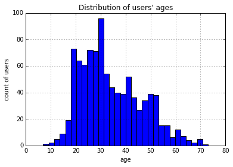

0. Use the  `join`  method to join the three tables and persist the result as a new table named pyodps_ml_100k_lens.

   ```text
   movies = DataFrame(o.get_table('pyodps_ml_100k_movies'))
   ratings = DataFrame(o.get_table('pyodps_ml_100k_ratings'))

   o.delete_table('pyodps_ml_100k_lens', if_exists=True)
   lens = movies.join(ratings).join(users).persist('pyodps_ml_100k_lens')

   print(lens.dtypes)
   ```

   Output

   ```text
   odps.Schema {
     movie_id                            int64
     title                               string
     release_date                        string
     video_release_date                  string
     imdb_url                            string
     user_id                             int64
     rating                              int64
     unix_timestamp                      int64
     age                                 int64
     sex                                 string
     occupation                          string
     zip_code                            string
   }
   ```

1. Divide the ages from 0 to 80 into 8 age groups.

   ```text
   labels = ['0-9', '10-19', '20-29', '30-39', '40-49', '50-59', '60-69', '70-79']
   cut_lens = lens[lens, lens.age.cut(list(range(0, 81, 10)), right=False, 
   labels=labels).rename('age_group')]
   ```

2. View the first 10 distinct pairs of age group and age.

   ```text
   print(cut_lens['age_group', 'age'].distinct()[:10])
   ```

   Output

   ```text
      age_group  age
   0        0-9    7
   1      10-19   10
   2      10-19   11
   3      10-19   13
   4      10-19   14
   5      10-19   15
   6      10-19   16
   7      10-19   17
   8      10-19   18
   9      10-19   19
   ```

3. Finally, view the total number of ratings and the average rating for each age group.

   ```text
   print(cut_lens.groupby('age_group').agg(cut_lens.rating.count().rename('total_ratings')
   cut_lens.rating.mean().rename('average_rating')))
   ```

   Output

   ```text
        age_group  average_rating  total_ratings
   0         0-9        3.767442             43
   1       10-19        3.486126           8181
   2       20-29        3.467333          39535
   3       30-39        3.554444          25696
   4       40-49        3.591772          15021
   5       50-59        3.635800           8704
   6       60-69        3.648875           2623
   7       70-79        3.649746            197
   ```

**DataFrame data processing**

First, download the iris dataset and save it to your local machine.

1. Create a test data table.

   Create a table by using the table management feature of DataWorks:

   <ol type="i">

   <li>

   Open the target workflow, right-click **MaxCompute**, and select **Create Table**. In the **Create Table** dialog box, select a **path**, enter a **name**, and click **Create** to open the table editor.

   </li>

   <li>

   In the upper-left corner of the editor, click DDL 

   </li>

   <li>

   Enter the following DDL statement, and then submit the table.

   </li>

   </ol>

   ```sql
   CREATE TABLE pyodps_iris (
       sepallength double COMMENT 'Sepal length (cm)',
       sepalwidth double COMMENT 'Sepal width (cm)',
       petallength double COMMENT 'Petal length (cm)',
       petalwidth double COMMENT 'Petal width (cm)',
       name string COMMENT 'Species'
   );
   ```

2. Upload the test data.

   <ol type="i">

   <li>

   Right-click the table you created, select **Import Data**, click **Next**, and upload the downloaded dataset.

   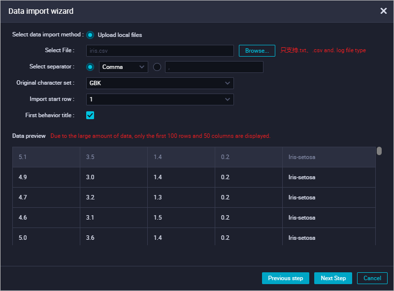

   </li>

   <li>

   Click **Match by Position** to import the data.

   </li>

   </ol>

3. Open the target **workflow**, right-click **MaxCompute**, and select **Create Node.** Then, select **PyODPS 3** to create a PyODPS node. You will use this node to store and run your code.

4. Enter the code and click Run  . After the run is complete, you can view the results in the

   **Run Log** section below. The code details are as follows.

   ```python
   from odps.df import DataFrame, output

   # Create a DataFrame object named iris from an ODPS table.
   iris = DataFrame(o.get_table('pyodps_iris')) 
   # Print the first few rows of the iris object.
   print(iris.head(10))
   print(iris.sepallength.head(5))

   # Use a custom function to calculate the sum of two columns.
   print(iris.apply(lambda row: row.sepallength + row.sepalwidth, axis=1, reduce=True, types='float').rename('sepaladd').head(3))

   # Specify the output names and types for the function.
   @output(['iris_add', 'iris_sub'], ['float', 'float'])
   def handle(row):
       # Use the yield keyword to return multiple rows.
       yield row.sepallength - row.sepalwidth,row.sepallength + row.sepalwidth
       yield row.petallength - row.petalwidth,row.petallength + row.petalwidth

   # Print the first five rows of the result. The axis=1 parameter indicates the column axis.
   print(iris.apply(handle,axis=1).head(5))
   ```

   Output:

   ```text
   # print(iris.head(10))
      sepallength  sepalwidth  petallength  petalwidth         name
   0          4.9         3.0          1.4         0.2  Iris-setosa
   1          4.7         3.2          1.3         0.2  Iris-setosa
   2          4.6         3.1          1.5         0.2  Iris-setosa
   3          5.0         3.6          1.4         0.2  Iris-setosa
   4          5.4         3.9          1.7         0.4  Iris-setosa
   5          4.6         3.4          1.4         0.3  Iris-setosa
   6          5.0         3.4          1.5         0.2  Iris-setosa
   7          4.4         2.9          1.4         0.2  Iris-setosa
   8          4.9         3.1          1.5         0.1  Iris-setosa
   9          5.4         3.7          1.5         0.2  Iris-setosa


   # print(iris.sepallength.head(5))
      sepallength
   0          4.9
   1          4.7
   2          4.6
   3          5.0
   4          5.4

   # print(iris.apply(lambda row: row.sepallength + row.sepalwidth, axis=1, reduce=True, 
   types='float').rename('sepaladd').head(3))
      sepaladd
   0       7.9
   1       7.9
   2       7.7

   # print(iris.apply(handle,axis=1).head(5))
      iris_add  iris_sub
   0       1.9       7.9
   1       1.2       1.6
   2       1.5       7.9
   3       1.1       1.5
   4       1.5       7.7
   ```

<a id="section-9-6-3"></a>

### 9.6.3. Create a DataFrame object

This topic describes how to create a DataFrame object. After this object is created, it can be used to reference a data source.

**Prerequisites**

The sample table **pyodps_iris** is available. For more information about how to create the sample table, see DataFrame data processing.

**Background information**

To use a DataFrame object, you must familiarize yourself with the operations on the  `Collection`  ( `DataFrame` ),  `Sequence` , and  `Scalar`  objects. Collection indicates a tabular data structure (two-dimensional structure). Sequence indicates a column (one-dimensional structure). Scalar indicates a scalar object.

If you use Pandas data to create a DataFrame object, the object contains the actual data. If you use a MaxCompute table to create a DataFrame object, the object does not contain the actual data. The object contains only data operations. After a DataFrame object is created, MaxCompute can store and compute data.

**Create a DataFrame object**

DataFrame object is the only Collection object that you must create. A DataFrame object can be used to reference MaxCompute tables, MaxCompute partitions, Pandas DataFrame objects, and SQLAlchemy tables (database tables). The reference operations for these data sources are the same. You can process data without the need to modify code. You only need to change the input and output pointers. This way, you can migrate small amounts of test code that is running locally to MaxCompute. The accuracy of the migration is ensured by PyODPS DataFrame.

**Create a DataFrame object from a MaxCompute table**

If you want to create a DataFrame object from a MaxCompute table, specify the table object in the DataFrame method, or use the  `to_df`  method of the table. Sample code:

```python
from odps.df import DataFrame

# Specify a table object. 
iris = DataFrame(o.get_table('pyodps_iris'))
# Use the to_df method of the MaxCompute table. 
iris2 = o.get_table('pyodps_iris').to_df() 
```

**Create a DataFrame object by using a partition in a MaxCompute table**

If you want to create a DataFrame object by using a partition in a MaxCompute table, specify the partition in the DataFrame method, or use the  `to_df`  method of the partition. Sample code:

```python
from odps.df import DataFrame

# Specify a table object. 
pt_df = DataFrame(o.get_table('partitioned_table').get_partition('pt=20171111'))
# Use the to_df method of the partition. 
pt_df2 = o.get_table('partitioned_table').get_partition('pt=20171111').to_df() 
```

**Create a DataFrame object by using a Pandas DataFrame object**

If you want to create a DataFrame object by using a Pandas DataFrame object, specify the Pandas DataFrame object in the DataFrame method.

- **Sample code**

  ```python
  from odps.df import DataFrame

  # Create a DataFrame object by using a Pandas DataFrame object. 
  import pandas as pd
  import numpy as np
  df = DataFrame(pd.DataFrame(np.arange(9).reshape(3, 3), columns=list('abc')))
  ```

- **Precautions**

  If you create a DataFrame object by using a Pandas DataFrame object, take note of the following items during the initialization of the DataFrame object:

  - PyODPS DataFrame attempts to infer the NUMPY OBJECT or STRING data type. If a column is empty, an error is returned. To prevent these errors, set  `unknown_as_string`  to **True**, and convert the data type of this column into STRING.

  - You can use the  `as_type`  parameter to forcefully convert the data type. If a basic data type is used, this type is forcefully converted when you create a PyODPS DataFrame object. If a Pandas DataFrame object contains a LIST or DICT column, the system does not infer the data type of this column. You must manually configure  `as_type` . The  `as_type`  parameter must be set to DICT.

  **Examples**

  - Example 1: Set the data type of the  `null_col2`  column to  `float` .

    ```text
    df2 = DataFrame(df, unknown_as_string=True, as_type={'null_col2': 'float'})
    print(df2.dtypes)
    ```

    The following result is returned:

    ```text
    odps.Schema {
      sepallength           float64
      sepalwidth            float64
      petallength           float64
      petalwidth            float64
      name                  string
      null_col1             string   # The data type cannot be identified. You can set unknown_as_string to True to convert the data type into STRING. 
      null_col2             float64  # The data type is forcefully converted into 
    FLOAT. 
    }
    ```

  - Example 2: Set the data type of the  `list_col`  column to  `list<int64>` .

    ```text
    df4 = DataFrame(df3, as_type={'list_col': 'list<int64>'})
    print(df4.dtypes)
    ```

    The following result is returned:

    ```text
    odps.Schema {
      id        int64
      list_col  list<int64>  # The data type cannot be identified or automatically converted. You must specify as_type. 
    }
    ```

  > **Note**
  >
  > PyODPS does not allow you to upload Object Storage Service (OSS) or Tablestore external tables to MaxCompute.

**Create a DataFrame object by using an SQLAlchemy table**

If you want to create a DataFrame object by using an SQLAlchemy table, specify the SQLAlchemy table object in the DataFrame method. For more information about how to connect SQLAlchemy to a MaxCompute project and the parameters, see Connect SQLAlchemy to a MaxCompute project. Sample code:

```python
from odps.df import DataFrame
import sqlalchemy

# Create a DataFrame object by using an SQLAlchemy table. 
# Set the environment variable ALIBABA_CLOUD_ACCESS_KEY_ID to the AccessKey ID of your 
Alibaba Cloud account. 
# Set the environment variable ALIBABA_CLOUD_ACCESS_KEY_SECRET to the AccessKey secret of the Alibaba Cloud account. 
# We recommend that you do not directly use your AccessKey ID or AccessKey secret.
conn_string = 'odps://%s:%s@<project>/?endpoint=<endpoint>' % (
    os.getenv('ALIBABA_CLOUD_ACCESS_KEY_ID'),
    os.getenv('ALIBABA_CLOUD_ACCESS_KEY_SECRET')
)
engine = sqlalchemy.create_engine(conn_string)
metadata = sqlalchemy.MetaData(bind=engine) # Bind the metadata to a database engine. 
table = sqlalchemy.Table('pyodps_iris', metadata, extend_existing=True, autoload=True)
iris = DataFrame(table)
```

<a id="section-9-6-4"></a>

### 9.6.4. Sequence

SequenceExpr represents a column in a two-dimensional dataset. You cannot manually create a SequenceExpr object. You can only retrieve one from a collection object.

**Prerequisites**

Make sure that the following requirements are met:

- A sample table named **pyodps_iris** is prepared. For more information, see DataFrame data processing.

- A DataFrame object is created. For more information, see Create a DataFrame object.

**Retrieve a column**

- Use  `collection.column_name`  to retrieve a column. Sample command:

  ```text
  print(iris.sepallength.head(5))
  ```

  Result:

  ```text
     sepallength
  0          4.9
  1          4.7
  2          4.6
  3          5.0
  4          5.4
  ```

- If the name of a column is stored in a string variable, use  `df[column_name]`  to retrieve the column. Sample command:

  ```text
  print(iris['sepallength'].head(5))
  ```

  Result:

  ```text
     sepallength
  0          4.9
  1          4.7
  2          4.6
  3          5.0
  4          5.4
  ```

**Column types**

DataFrame has its own type system. When a table is initialized, data types of MaxCompute are converted into the related data types of DataFrame. This way, more types of computing backends are supported. The DataFrame execution backend supports MaxCompute SQL, Pandas, and databases, such as MySQL and Postgres.

The following table describes the mappings between data types of DataFrame and data types of MaxCompute.

<table>
  <tr>
    <th>Data type of MaxCompute</th>
    <th>Data type of DataFrame</th>
  </tr>
  <tr>
    <td>BIGINT</td>
    <td>INT64</td>
  </tr>
  <tr>
    <td>DOUBLE</td>
    <td>FLOAT64</td>
  </tr>
  <tr>
    <td>STRING</td>
    <td>STRING</td>
  </tr>
  <tr>
    <td>DATETIME</td>
    <td>DATETIME</td>
  </tr>
  <tr>
    <td>BOOLEAN</td>
    <td>BOOLEAN</td>
  </tr>
  <tr>
    <td>DECIMAL</td>
    <td>DECIMAL</td>
  </tr>
  <tr>
    <td>ARRAY&lt;VALUE_TYPE&gt;</td>
    <td>LIST&lt;VALUE_TYPE&gt;</td>
  </tr>
  <tr>
    <td>MAP&lt;KEY_TYPE, VALUE_TYPE&gt;</td>
    <td>DICT&lt;KEY_TYPE, VALUE_TYPE&gt;</td>
  </tr>
  <tr>
    <td colspan="2">If you specify <code> options.sql.use_odps2_extension=True </code>, the mappings between the following data types are also supported.</td>
  </tr>
  <tr>
    <td>TINYINT</td>
    <td>INT8</td>
  </tr>
  <tr>
    <td>SMALLINT</td>
    <td>INT16</td>
  </tr>
  <tr>
    <td>INT</td>
    <td>INT32</td>
  </tr>
  <tr>
    <td>FLOAT</td>
    <td>FLOAT32</td>
  </tr>
</table>

Take note of the following points:

- If the fields in a table are of the LIST or DICT types, you must specify the types of elements in the table. If you do not specify the types of the elements, an error occurs.

- DataFrame does not support the TIMESTAMP and STRUCT types that are introduced in MaxCompute V2.0.

- You can obtain the data type by using  `sequence.dtype`  in a sequence object. Sample command:

  ```text
  print(iris.sepallength.dtype)
  ```

  Result:

  ```text
  FLOAT64
  ```

- You can use the  `astype()`  method to change the type of a column. If you use this method, a type is required as the input value, and the converted sequence object is returned. Sample command:

  ```text
  print(iris.sepallength.astype('int').head(5))
  ```

  Result:

  ```text
     sepallength
  0            4
  1            4
  2            4
  3            5
  4            5
  ```

**Column names**

- In DataFrame computing, a sequence object must have a column name. In most cases, DataFrame automatically creates a name for each sequence object. Sample code:

  ```text
  print(iris.groupby('name').sepalwidth.max().head(5))
  ```

  Result:

  ```text
     sepalwidth_max
  0             4.4
  1             3.4
  2             3.8
  ```

  > **Note**
  >
  > In the preceding example,  `sepalwidth`  is named  `sepalwidth_max`  after the maximum value of sepalwidth is obtained. For example, if you add a scalar field to a specified sequence object, the returned result is automatically named as the name of the sequence object. In other cases, you need to manually name a sequence object.

- A sequence object provides the  `rename()`  method to rename a column. Sample command:

  ```text
  print(iris.sepalwidth.rename('sepal_width').head(5))
  ```

  Result:

  ```text
     sepal_width
  0          3.0
  1          3.2
  2          3.1
  3          3.6
  4          3.9
  ```

**Column calculations**

- You can perform operations on a sequence to obtain a new sequence. This operation is similar to the calculation of simple Python variables. For numeric columns, arithmetic operations are supported. For string columns, only string concatenations are supported. Sample command:

  ```text
  print((iris.sepallength + 5).head(5))
  ```

  Result:

  ```text
     sepallength
  0          9.9
  1          9.7
  2          9.6
  3         10.0
  4         10.4
  ```

- If two columns are used for calculations, PyODPS cannot determine the column name that is displayed. You must manually specify the column name. Sample code:

  ```text
     sum_sepal
  0        7.9
  1        7.9
  2        7.7
  3        8.6
  4        9.3
  ```

  > **Note**
  >
  > For more information about column calculations, see Column operations.

<a id="section-9-6-5"></a>

### 9.6.5. Collection

CollectionExpr supports all operations on DataFrame two-dimensional datasets. It can be considered as a MaxCompute table or a spreadsheet. DataFrame objects are also CollectionExpr objects. CollectionExpr supports various operations on two-dimensional datasets, such as column operations, data filtering, and data transformation.

**Prerequisites**

Make sure that the following requirements are met:

- A sample table named **pyodps_iris** is prepared. For more information, see DataFrame quick start.

- A DataFrame object is created. For more information, see Create a DataFrame object.

**Retrieve types**

You can use the  `dtypes`  method to retrieve the types of all columns in a CollectionExpr object. In this example, the  `dtypes`  method returns a Schema type. The following code shows an example:

```text
print(iris.dtypes)
```

The following result is returned:

```text
odps.Schema {
  sepallength           float64
  sepalwidth            float64
  petallength           float64
  petalwidth            float64
  name                  string
}
```

**Select, add, and delete columns**

**Select columns**

You can use the  `expr[columns]`  syntax to select specific columns from a CollectionExpr object to create a dataset. The following code shows an example:

```text
print(iris['name', 'sepallength'].head(5))
```

The following result is returned:

```text
          name  sepallength
0  Iris-setosa          4.9
1  Iris-setosa          4.7
2  Iris-setosa          4.6
3  Iris-setosa          5.0
4  Iris-setosa          5.4
```

> **Note**
>
> If only one column is required, you need to add a comma (,) after the column name or explicitly mark the column as a list, such as  `iris[iris.sepallength,]`  or  `iris[[iris.sepallength]]` . Otherwise, a Sequence object, instead of a Collection object, is returned.

**Delete columns**

- You can use the  `exclude`  method to exclude specific columns of the original dataset from the new dataset. The following code shows an example:

  ```text
  print(iris.exclude('sepallength', 'petallength')[:5].head(5))
  ```

  The following result is returned:

  ```text
     sepalwidth  petalwidth         name
  0         3.0         0.2  Iris-setosa
  1         3.2         0.2  Iris-setosa
  2         3.1         0.2  Iris-setosa
  3         3.6         0.2  Iris-setosa
  4         3.9         0.4  Iris-setosa
  ```

- In PyODPS version 0.7.2 or later, you can use a new syntax to directly exclude specific columns from a dataset. The following code shows an example:

  ```text
  del iris['sepallength']
  del iris['petallength']
  print(iris[:5].head(5))
  ```

  The following result is returned:

  ```text
     sepalwidth  petalwidth         name
  0         3.0         0.2  Iris-setosa
  1         3.2         0.2  Iris-setosa
  2         3.1         0.2  Iris-setosa
  3         3.6         0.2  Iris-setosa
  4         3.9         0.4  Iris-setosa
  ```

**Add columns**

- You can use the  `expr[expr, new_sequence]`  syntax to add a transformed column to an existing Collection object. The new column is a part of the new Collection object.

  In the following example, a new column is created by adding one to each value in the  `sepalwidth`  column of the  `iris`  table. The new column is renamed as  `sepalwidthplus1` , and appended to the existing dataset to create another dataset. The following code shows an example:

  ```text
  print(iris[iris, (iris.sepalwidth + 1).rename('sepalwidthplus1')].head(5))
  ```

  The following result is returned:

  ```text
     sepallength  sepalwidth  petallength  petalwidth         name  \
  0          4.9         3.0          1.4         0.2  Iris-setosa   
  1          4.7         3.2          1.3         0.2  Iris-setosa   
  2          4.6         3.1          1.5         0.2  Iris-setosa   
  3          5.0         3.6          1.4         0.2  Iris-setosa   
  4          5.4         3.9          1.7         0.4  Iris-setosa   

     sepalwidthplus1  
  0              4.0  
  1              4.2  
  2              4.1  
  3              4.6  
  4              4.9  
  ```

- If you use the  `expr[expr, new_sequence]`  syntax, the transformed column may have the same name as the original column. Rename the new column if you want to merge it with the original Collection object. In PyODPS version 0.7.2 or later, you can directly append a column to the current dataset. The following code shows an example:

  ```text
  iris['sepalwidthplus1'] = iris.sepalwidth + 1
  print(iris.head(5))
  ```

  The following result is returned:

  ```text
     sepallength  sepalwidth  petallength  petalwidth         name  \
  0          4.9         3.0          1.4         0.2  Iris-setosa   
  1          4.7         3.2          1.3         0.2  Iris-setosa   
  2          4.6         3.1          1.5         0.2  Iris-setosa   
  3          5.0         3.6          1.4         0.2  Iris-setosa   
  4          5.4         3.9          1.7         0.4  Iris-setosa  

     sepalwidthplus1  
  0              4.0  
  1              4.2  
  2              4.1  
  3              4.6  
  4              4.9 
  ```

**Add and delete columns simultaneously**

- You can use the  `exclude`  method to exclude the original column and append the new column to the dataset. This way, you do not need to rename the new column. The following code shows an example:

  ```text
  print(iris[iris.exclude('sepalwidth'), iris.sepalwidth * 2].head(5))
  ```

  The following result is returned:

  ```text
     sepallength  petallength  petalwidth         name  sepalwidth
  0          4.9          1.4         0.2  Iris-setosa         6.0
  1          4.7          1.3         0.2  Iris-setosa         6.4
  2          4.6          1.5         0.2  Iris-setosa         6.2
  3          5.0          1.4         0.2  Iris-setosa         7.2
  4          5.4          1.7         0.4  Iris-setosa         7.8
  ```

- In PyODPS version 0.7.2 or later, you can directly use a new column to overwrite the original column on the current dataset. The following code shows an example:

  ```text
  iris['sepalwidth'] = iris.sepalwidth * 2
  print(iris.head(5))
  ```

  The following result is returned:

  ```text
     sepallength  sepalwidth  petallength  petalwidth         name
  0          4.9         6.0          1.4         0.2  Iris-setosa
  1          4.7         6.4          1.3         0.2  Iris-setosa
  2          4.6         6.2          1.5         0.2  Iris-setosa
  3          5.0         7.2          1.4         0.2  Iris-setosa
  4          5.4         7.8          1.7         0.4  Iris-setosa
  ```

- To add and delete columns at the same time, you can also call the  `select`  method to create a Collection object. To perform such operation, you need to use the selected columns as input parameters. You can use the  `keyword`  parameter to rename a column. The following code shows an example:

  ```text
  print(iris.select('name', sepalwidthminus1=iris.sepalwidth - 1).head(5))
  ```

  The following result is returned:

  ```text
            name  sepalwidthminus1
  0  Iris-setosa               2.0
  1  Iris-setosa               2.2
  2  Iris-setosa               2.1
  3  Iris-setosa               2.6
  4  Iris-setosa               2.9
  ```

- You can also pass a lambda expression, which takes the result from the previous operation as a parameter. During the execution, PyODPS checks the lambda expression and passes in the Collection object generated from the previous operation and replaces it with the valid columns. The following code shows an example:

  ```text
  print(iris['name', 'petallength'][[lambda x: x.name]].head(5))
  ```

  The following result is returned:

  ```text
            name
  0  Iris-setosa
  1  Iris-setosa
  2  Iris-setosa
  3  Iris-setosa
  4  Iris-setosa
  ```

- In PyODPS version 0.7.2 or later, conditional assignments are supported. The following code shows an example:

  ```text
  iris[iris.sepallength > 5.0, 'sepalwidth'] = iris.sepalwidth * 2
  print(iris.head(5))
  ```

  The following result is returned:

  ```text
     sepallength  sepalwidth  petallength  petalwidth         name
  0          4.9         3.0          1.4         0.2  Iris-setosa
  1          4.7         3.2          1.3         0.2  Iris-setosa
  2          4.6         3.1          1.5         0.2  Iris-setosa
  3          5.0         3.6          1.4         0.2  Iris-setosa
  4          5.4         7.8          1.7         0.4  Iris-setosa
  ```

**Introduce constants and random numbers**

**Introduce constants**

- DataFrame allows you to append a column of constants to a Collection object.  `Scalar`  is required for introducing constants. To introduce constants, you need to manually specify the column name. The following code shows an example:

  ```python
  from odps.df import Scalar
  print(iris[iris, Scalar(1).rename('id')][:5].head(5))
  ```

  The following result is returned:

  ```text
     sepallength  sepalwidth  petallength  petalwidth         name  id
  0          4.9         3.0          1.4         0.2  Iris-setosa   1
  1          4.7         3.2          1.3         0.2  Iris-setosa   1
  2          4.6         3.1          1.5         0.2  Iris-setosa   1
  3          5.0         3.6          1.4         0.2  Iris-setosa   1
  4          5.4         3.9          1.7         0.4  Iris-setosa   1
  ```

- You can use  `NullScalar`  to specify a null column. In this case, you need to specify the field type. The following code shows an example:

  ```python
  from odps.df import NullScalar
  print(iris[iris, NullScalar('float').rename('fid')][:5].head(5))
  ```

  The following result is returned:

  ```text
     sepallength  sepalwidth  petallength  petalwidth         name   fid
  0          4.9         3.0          1.4         0.2  Iris-setosa  None
  1          4.7         3.2          1.3         0.2  Iris-setosa  None
  2          4.6         3.1          1.5         0.2  Iris-setosa  None
  3          5.0         3.6          1.4         0.2  Iris-setosa  None
  4          5.4         3.9          1.7         0.4  Iris-setosa  None
  ```

- In PyODPS version 0.7.12 or later, a simpler syntax is provided. The following code shows an example:

  ```text
  iris['id'] = 1
  print(iris.head(5))
  ```

  The following result is returned:

  ```text
     sepallength  sepalwidth  petallength  petalwidth         name  id
  0          4.9         3.0          1.4         0.2  Iris-setosa   1
  1          4.7         3.2          1.3         0.2  Iris-setosa   1
  2          4.6         3.1          1.5         0.2  Iris-setosa   1
  3          5.0         3.6          1.4         0.2  Iris-setosa   1
  4          5.4         3.9          1.7         0.4  Iris-setosa   1
  ```

  If you use the syntax, the types of null values cannot be automatically identified. Therefore, you need to use the following code to add null columns.

  ```text
  iris['null_col'] = NullScalar('float')
  print(iris.head(5))
  ```

  The following result is returned:

  ```text
     sepallength  sepalwidth  petallength  petalwidth         name null_col
  0          4.9         3.0          1.4         0.2  Iris-setosa     None
  1          4.7         3.2          1.3         0.2  Iris-setosa     None
  2          4.6         3.1          1.5         0.2  Iris-setosa     None
  3          5.0         3.6          1.4         0.2  Iris-setosa     None
  4          5.4         3.9          1.7         0.4  Iris-setosa     None
  ```

**Introduce random numbers**

DataFrame also allows you to append a column of random numbers to a Collection object. The column type is FLOAT and the value range is 0-1. Each row has different values. `RandomScalar`  is required for this operation, and its parameter is an optional random seed. The following code shows an example:

```python
from odps.df import RandomScalar
iris[iris, RandomScalar().rename('rand_val')][:5]
```

The following result is returned:

```text
   sepallength  sepalwidth  petallength  petalwidth         name  rand_val
0          4.9         3.0          1.4         0.2  Iris-setosa  0.000471
1          4.7         3.2          1.3         0.2  Iris-setosa  0.799520
2          4.6         3.1          1.5         0.2  Iris-setosa  0.834609
3          5.0         3.6          1.4         0.2  Iris-setosa  0.106921
4          5.4         3.9          1.7         0.4  Iris-setosa  0.763442
```

**Filter data**

A Collection object allows you to filter data. You can use AND (&), OR (|), NOT (~),  `filter` , lambda expressions, and multiple query methods to filter data.

- Example 1: Query data whose  `sepallength`  value is greater than 5.

  ```text
  print(iris[iris.sepallength > 5].head(5))
  ```

  The following result is returned:

  ```text
     sepallength  sepalwidth  petallength  petalwidth         name
  0          5.4         3.9          1.7         0.4  Iris-setosa
  1          5.4         3.7          1.5         0.2  Iris-setosa
  2          5.8         4.0          1.2         0.2  Iris-setosa
  3          5.7         4.4          1.5         0.4  Iris-setosa
  4          5.4         3.9          1.3         0.4  Iris-setosa
  ```

- Example 2: Use the AND (&) condition.

  ```text
  print(iris[(iris.sepallength < 5) & (iris['petallength'] > 1.5)].head(5))
  ```

  The following result is returned:

  ```text
     sepallength  sepalwidth  petallength  petalwidth             name
  0          4.8         3.4          1.6         0.2      Iris-setosa
  1          4.8         3.4          1.9         0.2      Iris-setosa
  2          4.7         3.2          1.6         0.2      Iris-setosa
  3          4.8         3.1          1.6         0.2      Iris-setosa
  4          4.9         2.4          3.3         1.0  Iris-versicolor
  ```

- Example 3: Use the OR (|) condition.

  ```text
  print(iris[(iris.sepalwidth < 2.5) | (iris.sepalwidth > 4)].head(5))
  ```

  The following result is returned:

  ```text
     sepallength  sepalwidth  petallength  petalwidth             name
  0          5.7         4.4          1.5         0.4      Iris-setosa
  1          5.2         4.1          1.5         0.1      Iris-setosa
  2          5.5         4.2          1.4         0.2      Iris-setosa
  3          4.5         2.3          1.3         0.3      Iris-setosa
  4          5.5         2.3          4.0         1.3  Iris-versicolor
  ```

  > **Note**
  >
  > You must use an ampersand ( `&` ) to represent the AND operator and use a vertical bar ( `|` ) to represent the OR operator.  `and`  and  `or`  cannot be used.

- Example 4: Use the NOT (~) condition.

  ```text
  print(iris[~(iris.sepalwidth > 3)].head(5))
  ```

  The following result is returned:

  ```text
     sepallength  sepalwidth  petallength  petalwidth         name
  0          4.9         3.0          1.4         0.2  Iris-setosa
  1          4.4         2.9          1.4         0.2  Iris-setosa
  2          4.8         3.0          1.4         0.1  Iris-setosa
  3          4.3         3.0          1.1         0.1  Iris-setosa
  4          5.0         3.0          1.6         0.2  Iris-setosa
  ```

- Example 5: Explicitly call the  `filter`  method and specify multiple AND conditions.

  ```text
  print(iris.filter(iris.sepalwidth > 3.5, iris.sepalwidth < 4).head(5))
  ```

  The following result is returned:

  ```text
     sepallength  sepalwidth  petallength  petalwidth         name
  0          5.0         3.6          1.4         0.2  Iris-setosa
  1          5.4         3.9          1.7         0.4  Iris-setosa
  2          5.4         3.7          1.5         0.2  Iris-setosa
  3          5.4         3.9          1.3         0.4  Iris-setosa
  4          5.7         3.8          1.7         0.3  Iris-setosa
  ```

- Example 6: Use a lambda expression for continuous operations.

  ```text
  print(iris[iris.sepalwidth > 3.8]['name', lambda x: x.sepallength + 1].head(5))
  ```

  The following result is returned:

  ```text
            name  sepallength
  0  Iris-setosa          6.4
  1  Iris-setosa          6.8
  2  Iris-setosa          6.7
  3  Iris-setosa          6.4
  4  Iris-setosa          6.2
  ```

- Example 7: For a Collection object that contains a column of the BOOLEAN type, use the column as a filter condition.

  ```text
  # Query the schema.
  print(df.dtypes)
  # Obtain the returned result.
  odps.Schema {
    a boolean
    b int64
  }

  # Use Column a of the BOOLEAN type to filter data.
  print(df[df.a])
  # Obtain the returned result.
        a  b
  0  True  1
  1  True  3
  ```

  When you retrieve a single Sequence from a Collection object, only the column of the BOOLEAN type can be used as a valid filter condition.

  ```text
  df[df.a, ]       # Retrieve a one-column collection. 
  df[[df.a]]       # Retrieve a one-column collection. 
  df.select(df.a)  # Explicitly retrieve a one-column collection. 
  df[df.a]         # Use Column a of the BOOLEAN type to filter data. 
  df.a             # Retrieve a column from a collection. 
  df['a']          # Retrieve a column from a collection.
  ```

- Example 8: Use the  `query`  method in Pandas to filter data by using a query statement and directly use a column name such as  `sepallength`  in an expression to perform operations. In a query statement, both  `&`  and  `and`  indicate the AND operator, and both  `|`  and  `or`  indicate the OR operator.

  ```text
  print(iris.query("(sepallength < 5) and (petallength > 1.5)").head(5))
  ```

  The following result is returned:

  ```text
     sepallength  sepalwidth  petallength  petalwidth             name
  0          4.8         3.4          1.6         0.2      Iris-setosa
  1          4.8         3.4          1.9         0.2      Iris-setosa
  2          4.7         3.2          1.6         0.2      Iris-setosa
  3          4.8         3.1          1.6         0.2      Iris-setosa
  4          4.9         2.4          3.3         1.0  Iris-versicolor
  ```

  If a local variable is required in an expression, add an at sign ( `@` ) before the variable name.

  ```text
  var = 4
  print(iris.query("(sepalwidth < 2.5) | (sepalwidth > @var)").head(5))
  ```

  The following result is returned:

  ```text
     sepallength  sepalwidth  petallength  petalwidth             name
  0          5.7         4.4          1.5         0.4      Iris-setosa
  1          5.2         4.1          1.5         0.1      Iris-setosa
  2          5.5         4.2          1.4         0.2      Iris-setosa
  3          4.5         2.3          1.3         0.3      Iris-setosa
  4          5.5         2.3          4.0         1.3  Iris-versicolor
  ```

  The following table describes the syntax of the  `query`  method.

  | Syntax | Description |
  | --- | --- |
  | name | All columns that do not have the at sign (<code> @ </code>) prefix are treated as column names. If columns have such prefix, local variables are retrieved. |
  | operator | The following operators are supported: <code> + </code>,<br><code> - </code>, <code> * </code>, <code> / </code>, <code> // </code>, <code> % </code>, <code> ** </code>, <code> == </code>,<code> != </code>, <code> &lt; </code>, <code> &lt;= </code>, <code> &gt; </code>, <code> &gt;= </code>, <code> in </code>, and <code> not in </code>. |
  | bool | The AND or OR operation. <code> &amp; </code> and <code> and </code> represent the AND operator. <code> &#124; </code> and <code> or </code> represent the OR operator. |
  | attribute | The attribute of the object. |
  | index, slice, subscript | The slice operations. |

**Convert a column into rows**

- You can use the  `explode`  method to convert a column of the LIST or MAP type into multiple rows. You can also use the  `apply`  method for the multi-row output operation. For operations such as aggregation, you need to merge output rows with the columns in the original table. In this case, you can use the multi-row output feature of DataFrame. This feature allows you to map a set of data generated by the multi-row output function to the column names in the original set. The following example shows how to use the multi-row output feature.

  - Query sample data.

    ```text
    print(df)
    ```

    The following result is returned:

    ```text
       id         a             b
    0   1  [a1, b1]  [a2, b2, c2]
    1   2      [c1]      [d2, e2]
    ```

  - Example 1:

    ```text
    print(df[df.id, df.a.explode(), df.b])
    ```

    The following result is returned:

    ```text
       id   a             b
    0   1  a1  [a2, b2, c2]
    1   1  b1  [a2, b2, c2]
    2   2  c1      [d2, e2]
    ```

  - Example 2:

    ```text
    print(df[df.id, df.a.explode(), df.b.explode()])
    ```

    The following result is returned:

    ```text
       id   a   b
    0   1  a1  a2
    1   1  a1  b2
    2   1  a1  c2
    3   1  b1  a2
    4   1  b1  b2
    5   1  b1  c2
    6   2  c1  d2
    7   2  c1  e2
    ```

- If the explode method does not produce output for an input row, the input row does not appear in the output by default. To retain the row in the output, you can add the configuration  `keep_nulls=True` . In this case, null values are listed in the row. The following code shows an example:

  - Query sample data.

    ```text
    print(df)
    ```

    The following result is returned:

    ```text
       id         a
    0   1  [a1, b1]
    1   2        []
    ```

  - Example 1:

    ```text
    print(df[df.id, df.a.explode()])
    ```

    The following result is returned:

    ```text
       id   a
    0   1  a1
    1   1  b1
    ```

  - Example 2:

    ```text
    print(df[df.id, df.a.explode(keep_nulls=True)])
    ```

    The following result is returned:

    ```text
       id     a
    0   1    a1
    1   1    b1
    2   2  None
    ```

- For more information about how to use the  `explode`  method to implement multi-row output, see the "Collection-related operations" section in Column operations.

**Output limits**

- Return the first three rows of data.

  ```text
  print(iris[:3].execute())
  ```

  The following result is returned:

  ```text
     sepallength  sepalwidth  petallength  petalwidth         name
  0          4.9         3.0          1.4         0.2  Iris-setosa
  1          4.7         3.2          1.3         0.2  Iris-setosa
  2          4.6         3.1          1.5         0.2  Iris-setosa
  ```

- In MaxCompute SQL, backend slice operations do not support the  `start`  and  `step` methods, but support the  `limit`  method.

  ```text
  print(iris.limit(3).execute())
  ```

  The following result is returned:

  ```text
     sepallength  sepalwidth  petallength  petalwidth         name
  0          4.9         3.0          1.4         0.2  Iris-setosa
  1          4.7         3.2          1.3         0.2  Iris-setosa
  2          4.6         3.1          1.5         0.2  Iris-setosa
  ```

  > **Note**
  >
  > You can perform slice operations on Collection objects, not Sequence objects.

<a id="section-9-6-6"></a>

### 9.6.6. Execution

This topic describes the execution methods that you can use for DataFrame operations.

**Prerequisites**

Make sure that the following requirements are met:

- A sample table named **pyodps_iris** is prepared. For more information, see DataFrame quick start.

- A DataFrame object is created. For more information, see Create a DataFrame object.

**Deferred execution**

DataFrame operations are executed only when you explicitly call the  `execute()`  method or when you call the methods that internally call the  `execute()`  method. The following table lists the methods that internally call the execute() method.

| Method | Description | Return value |
| --- | --- | --- |
| persist | Saves the execution results to MaxCompute tables. | PyODPS DataFrame |
| execute | Executes the operations and returns all the results. | ResultFrame |
| head | Executes the operations and returns the first N rows of result data. | ResultFrame |
| tail | Executes the operations and returns the last N rows of result data. | ResultFrame |
| to_pandas | Converts a Collection object into a pandas DataFrame object or converts a Sequence object into a Series object. If the wrap parameter is set to True, a PyODPS DataFrame object is returned. | • If the wrap parameter is set to True, a PyODPS DataFrame object is returned.<br>• If the wrap parameter is set to False, a pandas DataFrame object is returned. The default value of the wrap parameter is False. |
| plot, hist, and boxplot | Plotting methods. | N/A |

> **Note**
>
> In an interactive environment, PyODPS DataFrame automatically calls the  `execute` method when PyODPS DataFrame displays result data or calls the  `repr`  method. You do not need to manually call the  `execute`  method.

**Examples**

```text
# In a non-interactive environment, you need to manually call the execute() method.
print(iris[iris.sepallength < 5][:5].execute())

# In an interactive environment, the system automatically calls the execute() method.
print(iris[iris.sepallength < 5][:5])
```

Result:

```text
   sepallength  sepalwidth  petallength  petalwidth         name
0          4.9         3.0          1.4         0.2  Iris-setosa
1          4.7         3.2          1.3         0.2  Iris-setosa
2          4.6         3.1          1.5         0.2  Iris-setosa
3          4.6         3.4          1.4         0.3  Iris-setosa
4          4.4         2.9          1.4         0.2  Iris-setosa
```

If you need to disable the system from automatically calling the execute() method in an interactive environment, manual operations are required. The following code shows an example:

```python
from odps import options
options.interactive = False

print(iris[iris.sepallength < 5][:5])
```

Result:

```text
Collection: ref_0
  odps.Table
    name: hudi_mc_0612.`iris3`
    schema:
      sepallength           : double      # Sepal length (cm)
      sepalwidth            : double      # Sepal width (cm)
      petallength           : double      # Petal length (cm)
      petalwidth            : double      # Petal width (cm)
      name                  : string      # Type
Collection: ref_1
  Filter[collection]
    collection: ref_0
    predicate:
      Less[sequence(boolean)]
        sepallength = Column[sequence(float64)] 'sepallength' from collection ref_0
        Scalar[int8]
          5
Slice[collection]
  collection: ref_1
  stop:
    Scalar[int8]
      5
```

After you disable automatic calls, an entire abstract syntax tree (AST) is displayed when the  `repr`  object is displayed. In this case, you must manually call the  `execute()`  method if you need to use the method.

**Retrieve execution results**

If a  `ResultFrame`  is returned after you call the  `execute()`  or  `head()`  method, you can retrieve results from the ResultFrame.

> **Note**
>
> A ResultFrame is a result set and cannot be used in subsequent calculations.

- You can iteratively retrieve all records from the ResultFrame. Example:

  ```text
  result = iris.head(3)
  for r in result:
      print(list(r))
  ```

  Result:

  ```text
  [4.9, 3.0, 1.4, 0.2, 'Iris-setosa']
  [4.7, 3.2, 1.3, 0.2, 'Iris-setosa']
  [4.6, 3.1, 1.5, 0.2, 'Iris-setosa']
  ```

- If pandas is installed, a ResultFrame can be converted into a pandas DataFrame or a PyODPS DataFrame that uses the pandas backend.

  ```text
  # Return a pandas DataFrame. 
  pd_df = iris.head(3).to_pandas()

  # Return a PyODPS DataFrame that uses the pandas backend. 
  wrapped_df = iris.head(3).to_pandas(wrap=True)  
  ```

**Save results to MaxCompute tables**

- You can call the  `persist()`  method to return a new DataFrame object for a Collection object. The persist method uses the table name as the parameter.

  ```text
  iris2 = iris[iris.sepalwidth < 2.5].persist('pyodps_iris')
  print(iris2.head(5))
  ```

  Result:

  ```text
     sepallength  sepalwidth  petallength  petalwidth             name
  0          4.5         2.3          1.3         0.3      Iris-setosa
  1          5.5         2.3          4.0         1.3  Iris-versicolor
  2          4.9         2.4          3.3         1.0  Iris-versicolor
  3          5.0         2.0          3.5         1.0  Iris-versicolor
  4          6.0         2.2          4.0         1.0  Iris-versicolor
  ```

- You can specify the  `partitions`  parameter in the  `persist()`  method to create a partitioned table. The table is partitioned based on the columns that are specified by  `partitions` .

  ```text
  iris3 = iris[iris.sepalwidth < 2.5].persist('pyodps_iris_test', partitions=['name'])
  print(iris3.data)
  ```

  Result:

  ```text
  odps.Table
    name: odps_test_sqltask_finance.`pyodps_iris`
    schema:
      sepallength           : double
      sepalwidth            : double
      petallength           : double
      petalwidth            : double
    partitions:
      name                  : string
  ```

- To write data to a partition of an existing table, you can specify the  `partition`  parameter in the  `persist()`  method. The partition parameter specifies the partition to which data is written. For example, set the partition parameter to  `ds=******` . The table must contain all columns of the DataFrame object, and the columns must be of the same type. The  `drop_partition`  and  `create_partition`  parameters are valid only if the partition parameter is specified. The drop_partition parameter specifies whether to drop the specified partition if the partition exists. The create_partition parameter specifies whether to create the specified partition if the partition does not exist.

  ```text
  print(iris[iris.sepalwidth < 2.5].persist('pyodps_iris_partition', 
  partition='ds=test', drop_partition=True, create_partition=True).head(5))
  ```

  Result:

  ```text
     sepallength  sepalwidth  petallength  petalwidth             name    ds
  0          4.5         2.3          1.3         0.3      Iris-setosa  test
  1          5.5         2.3          4.0         1.3  Iris-versicolor  test
  2          4.9         2.4          3.3         1.0  Iris-versicolor  test
  3          5.0         2.0          3.5         1.0  Iris-versicolor  test
  4          6.0         2.2          4.0         1.0  Iris-versicolor  test
  ```

- When you write data to a table, you can specify the time-to-live (TTL) of the table. For example, the following statement sets the TTL of the table to 10 days.

  ```text
  print(iris[iris.sepalwidth < 2.5].persist('pyodps_iris', lifecycle=10).head(5))
  ```

  Result:

  ```text
     sepallength  sepalwidth  petallength  petalwidth             name
  0          4.5         2.3          1.3         0.3      Iris-setosa
  1          5.5         2.3          4.0         1.3  Iris-versicolor
  2          4.9         2.4          3.3         1.0  Iris-versicolor
  3          5.0         2.0          3.5         1.0  Iris-versicolor
  4          6.0         2.2          4.0         1.0  Iris-versicolor
  ```

- If the data source does not contain MaxCompute objects and only contains pandas objects, you must manually specify the MaxCompute entrance object or mark the entrance object as a global object when you call the  `persist()`  method.

  ```text
  # The entrance object is o. 
  # Specify the entrance object. 
  df.persist('table_name', odps=o)
  # Alternative operation: Mark the entrance object as a global object. 
  o.to_global()
  df.persist('table_name')
  ```

**Save results to pandas DataFrame**

You can call the  `to_pandas()`  method to save results to a pandas DataFrame object. If the  `wrap`  parameter is set to True, a PyODPS DataFrame object is returned.

- Example 1: Call the  `to_pandas()`  method to return a pandas DataFrame object.

  ```text
  print(type(iris[iris.sepalwidth < 2.5].to_pandas()))
  ```

  Result:

  ```xml
  <class 'pandas.core.frame.DataFrame'>
  ```

- Example 2: Set the  `wrap`  parameter to True to return a PyODPS DataFrame object.

  ```text
  print(type(iris[iris.sepalwidth < 2.5].to_pandas(wrap=True)))
  ```

  Result:

  ```xml
  <class 'odps.df.core.DataFrame'>
  ```

> **Note**
>
> You can call the  `open_reader()`  method in PyODPS and use  `reader.to_pandas()`  to convert the results into a pandas DataFrame object. For more information, see Tables.

**Configure runtime parameters**

You can configure the runtime parameters for immediately executed methods, such as  `execute()` ,  `persist()` , and  `to_pandas()` . This setting is valid only for the MaxCompute SQL backend.

- Configure global parameters. For more information, see SQL.

- Specify the  `hints`  parameter in these methods. This ensures that the specified runtime parameters are valid only for the current calculation.

  ```text
  print(iris[iris.sepallength < 5].to_pandas(hints={'odps.sql.mapper.split.size': 16}))
  ```

  Result:

  ```text
     sepallength  sepalwidth  petallength  petalwidth             name
  0          4.5         2.3          1.3         0.3      Iris-setosa
  1          4.9         2.4          3.3         1.0  Iris-versicolor
  ```

**Display details at runtime**

- To view the LogView information about an instance at runtime, you must modify the global configurations. Sample code:

  ```python
  from odps import options
  options.verbose = True

  print(iris[iris.sepallength < 5].exclude('sepallength')[:5].execute())
  ```

  Result:

  ```text
  Sql compiled:
  SELECT t1.`sepalwidth`, t1.`petallength`, t1.`petalwidth`, t1.`name`
  FROM odps_test_sqltask_finance.`pyodps_iris` t1
  WHERE t1.`sepallength` < 5
  LIMIT 5
  Instance ID:
    Log view:http://logview
    
     sepalwidth  petallength  petalwidth             name
  0         2.3          1.3         0.3      Iris-setosa
  1         2.4          3.3         1.0  Iris-versicolor
  ```

- You can specify a logging function. Sample code:

  ```python
  my_logs = []
  def my_logger(x):
      my_logs.append(x)
  options.verbose_log = my_logger
  print(iris[iris.sepallength < 5].exclude('sepallength')[:5].execute())

  print(my_logs)
  ```

  Result:

  ```text
     sepalwidth  petallength  petalwidth             name
  0         2.3          1.3         0.3      Iris-setosa
  1         2.4          3.3         1.0  Iris-versicolor

  ['Sql compiled:', 'CREATE TABLE tmp_pyodps_24332bdb_4fd0_4d0d_aed4_38a443618268 LIFEC
  YCLE 1 AS \nSELECT t1.`sepalwidth`, t1.`petallength`, t1.`petalwidth`, t1.`name` \nFR
  OM odps_test_sqltask_finance.`pyodps_iris` t1 \nWHERE t1.`sepallength` < 5 \nLIMIT 5', 'Instance ID: 20230815034706122gbymevg*****', '  Log view:]
  ```

**Cache intermediate calculation results of Collection objects**

During the DataFrame calculation process, some Collection objects are used multiple times. To view the execution results of an intermediate process, you can call the  `cache()`  method to mark a Collection object that you want to calculate first. Sample code:

> **Note**
>
> The execution of the  `cache()`  method is deferred. Automatic calculation is not immediately triggered after the  `cache()`  method is called.

```text
cached = iris[iris.sepalwidth < 3.5]['sepallength', 'name'].cache()
df = cached.head(3)
print(df)

# The following result is returned:
   sepallength             name
0          4.5      Iris-setosa
1          5.5  Iris-versicolor
2          4.9  Iris-versicolor

# You can immediately retrieve the calculation result because cached is calculated. 
print(cached.head(3))

# The following result is returned:
   sepallength             name
0          4.5      Iris-setosa
1          5.5  Iris-versicolor
2          4.9  Iris-versicolor
```

**Asynchronous and parallel execution**

**Asynchronous execution**

PyODPS DataFrame supports asynchronous execution. You can specify the  `async` parameter to enable asynchronous execution for the following immediately executed methods:  `execute()` ,  `persist()` ,  `head()` ,  `tail()` , and  `to_pandas()` . The  `timeout`  parameter specifies the timeout period. Asynchronous operations return Future objects.

```text
future = iris[iris.sepalwidth < 10].head(10, async_=True)
print(future.result())

# The following result is returned:
   sepallength  sepalwidth  petallength  petalwidth             name
0          4.5         2.3          1.3         0.3      Iris-setosa
1          5.5         2.3          4.0         1.3  Iris-versicolor
2          4.9         2.4          3.3         1.0  Iris-versicolor
3          5.0         2.0          3.5         1.0  Iris-versicolor
4          6.0         2.2          4.0         1.0  Iris-versicolor
5          6.2         2.2          4.5         1.5  Iris-versicolor
6          5.5         2.4          3.8         1.1  Iris-versicolor
7          5.5         2.4          3.7         1.0  Iris-versicolor
8          6.3         2.3          4.4         1.3  Iris-versicolor
9          5.0         2.3          3.3         1.0  Iris-versicolor
```

**Parallel execution**

You can call the newly introduced  `Delay API`  operation to defer the following immediately executed methods:  `execute()` ,  `persist()` ,  `head()` ,  `tail()` , and  `to_pandas()` . Then, Future objects are returned. When the Delay API operation is called, the system finds the dependency and executes the methods based on the specified concurrency. In this case, asynchronous execution is supported.

```python
from odps.df import Delay
delay = Delay()  # Create a Delay object. 

df = iris[iris.sepal_width < 5].cache()  # Common dependency of subsequent expressions.  
future1 = df.sepal_width.sum().execute(delay=delay)  # Return a Future object. The execution is not started. 
future2 = df.sepal_width.mean().execute(delay=delay)
future3 = df.sepal_length.max().execute(delay=delay)
delay.execute(n_parallel=3)  # The execution starts with three concurrent threads. 
|==========================================|   1 /  1  (100.00%)        21s
print(future1.result())

# The following result is returned:
25.0
 
print(future2.result())

# The following result is returned:
2.272727272727273
```

In the preceding example, PyODPS DataFrame first executes the object of the shared dependency. Then, PyODPS DataFrame sets the concurrency to 3 and executes objects from  `future1`  to  `future3` .

You can specify the  `async`  parameter in  `delay.execute()`  to specify whether to enable asynchronous execution. If asynchronous execution is enabled, you can also use the  `timeout`  parameter to specify the timeout period.

<a id="section-9-6-7"></a>

### 9.6.7. Column operations

This topic describes the column operation features of the DataFrame API, including numerical calculations, conditional logic, string manipulation, and datetime processing. You can also use collection types and call MaxCompute functions for complex data analysis.

**Column operations**

```python
from odps.df import DataFrame
iris = DataFrame(o.get_table('pyodps_iris'))
lens = DataFrame(o.get_table('pyodps_ml_100k_lens'))
```

When you add a constant to a Sequence or apply a function like  `sin` , the operation acts on each element in the Sequence.

**Handling NULL values (isnull, notnull, and fillna)**

The DataFrame API provides several built-in functions for handling NULL values. For example,  `isnull`  checks whether a column is NULL,  `notnull`  checks whether a column is not NULL, and  `fillna`  replaces NULL values with a specified value.

```text
>>> iris.sepallength.isnull().head(5)
   sepallength
0        False
1        False
2        False
3        False
4        False
```

**Conditional logic (ifelse and switch)**

- `ifelse`  applies to columns of the boolean type. If the condition is true, it returns the first argument. Otherwise, it returns the second argument.

  ```text
  >>> (iris.sepallength > 5).ifelse('gt5', 'lte5').rename('cmp5').head(5)
     cmp5
  0   gt5
  1  lte5
  2  lte5
  3  lte5
  4  lte5
  ```

- Use  `switch`  when you need to evaluate multiple conditions.

  ```text
  >>> iris.sepallength.switch(4.9, 'eq4.9', 5.0, 'eq5.0', 
  default='noeq').rename('equalness').head(5)
     equalness
  0       noeq
  1      eq4.9
  2       noeq
  3       noeq
  4      eq5.0
  ```

  ```text
  >>> from odps.df import switch
  >>> switch(iris.sepallength == 4.9, 'eq4.9', iris.sepallength == 5.0, 'eq5.0', default='noeq').rename('equalness').head(5)
     equalness
  0       noeq
  1      eq4.9
  2       noeq
  3       noeq
  4      eq5.0
  ```

  Starting from PyODPS 0.7.8, you can modify a subset of column values based on a condition, as shown in the following example.

  ```text
  >>> iris[iris.sepallength > 5, 'cmp5'] = 'gt5'
  >>> iris[iris.sepallength <= 5, 'cmp5'] = 'lte5'
  >>> iris.head(5)
     cmp5
  0   gt5
  1  lte5
  2  lte5
  3  lte5
  4  lte5
  ```

**Mathematical operations**

For numeric columns, you can perform arithmetic operations such as addition (+), subtraction (-), multiplication (\*), and division (/). You can also apply mathematical functions like  `log` and  `sin` .

```text
>>> (iris.sepallength * 10).log().head(5)
   sepallength
0     3.931826
1     3.891820
2     3.850148
3     3.828641
4     3.912023
```

```text
>>> fields = [iris.sepallength,
>>>           (iris.sepallength / 2).rename('sepallength_divided_by_2'),
>>>           (iris.sepallength ** 2).rename('sepallength_squared')]
>>> iris[fields].head(5)
   sepallength  sepallength_divided_by_2  sepallength_squared
0          5.1                      2.55                26.01
1          4.9                      2.45                24.01
2          4.7                      2.35                22.09
3          4.6                      2.30                21.16
4          5.0                      2.50                25.00
```

The following arithmetic operations are supported.

| Arithmetic operation | Description |
| --- | --- |
| abs | Absolute value |
| sqrt | Square root |
| sin | Returns the sine. |
| sinh | Returns the hyperbolic sine. |
| cos | Returns the cosine. |
| cosh | Returns the hyperbolic cosine. |
| tan | Returns the tangent. |
| tanh | Returns the hyperbolic tangent. |
| arccos | Returns the inverse cosine. |
| arccosh | Returns the inverse hyperbolic cosine. |
| arcsin | Returns the inverse sine. |
| arcsinh | Returns the inverse hyperbolic sine. |
| arctan | Returns the inverse tangent. |
| arctanh | Returns the inverse hyperbolic tangent. |
| exp | Exponential function |
| expm1 | Computes exp(x) - 1. |
| log | Returns the logarithm of a number with the specified base. |
| log2 | Returns the base-2 logarithm. |
| log10 | Returns the base-10 logarithm. |
| log1p | Computes log(1+x). |
| radians | Converts an angle from degrees to radians. |
| degrees | Converts an angle from radians to degrees. |
| ceil | Returns the smallest integer that is greater than or equal to the input value. |
| floor | Rounds down and returns the largest integer that is less than or equal to the input value. |
| trunc | Truncates the input value to a specified number of decimal places. |

A Sequence also supports comparisons with another Sequence or a scalar value.

```text
>>> (iris.sepallength < 5).head(5)
   sepallength
0        False
1         True
2         True
3         True
4        False
```

Although the DataFrame API does not support chained comparisons, such as  `3 <= iris.sepallength <= 5` , you can use the  `between`  function to determine whether  `iris.sepallength`  is within a range.

```text
>>> (iris.sepallength.between(3, 5)).head(5)
   sepallength
0        False
1         True
2         True
3         True
4         True
```

By default,  `between`  includes the boundary values. To perform an exclusive check, set  `inclusive=False` .

```text
>>> (iris.sepallength.between(3, 5, inclusive=False)).head(5)
   sepallength
0        False
1         True
2         True
3         True
4        False
```

**String operations**

The DataFrame API provides several operations for Sequence or scalar objects of the string type.

```text
>>> fields = [
>>>     iris.name.upper().rename('upper_name'),
>>>     iris.name.extract('Iris(.*)', group=1)
>>> ]
>>> iris[fields].head(5)
    upper_name     name
0  IRIS-SETOSA  -setosa
1  IRIS-SETOSA  -setosa
2  IRIS-SETOSA  -setosa
3  IRIS-SETOSA  -setosa
4  IRIS-SETOSA  -setosa
```

The following string operations are available.

| String operation | Description |
| --- | --- |
| capitalize | Capitalizes the first character of the string. |
| contains | Checks if the string contains a substring. If the <code> regex </code> parameter is <code> True </code>, the pattern is treated as a regular expression. Default: <code> True </code>. |
| count | Counts the occurrences of a substring. |
| endswith | Checks if the string ends with a specified substring. |
| startswith | Checks if the string starts with a specified substring. |
| extract | Extracts a substring that matches a regular expression. If <code> group </code> is not specified, it returns the substring that matches the entire pattern. Otherwise, it returns the specified group. |
| find | Returns the index of the first occurrence of a substring, or -1 if the substring is not found. |
| rfind | Returns the index of the last occurrence of a substring, or -1 if not found. |
| replace | Replaces all occurrences of a pattern with another substring. If the <code> n </code> parameter is specified, it replaces only the first <code> n </code> occurrences. |
| get | Returns the character at a specified index. |
| len | Returns the length of the string. |
| ljust | Pads the right side of the string with the specified <code> fillchar </code> (default is a space) until it reaches the specified <code> width </code>. |
| rjust | Pads the left side of the string with the specified <code> fillchar </code> (default is a space) until it reaches the specified <code> width </code>. |
| lower | Converts the string to lowercase. |
| upper | Converts the string to uppercase. |
| lstrip | Removes leading whitespace, including newline characters. |
| rstrip | Removes trailing whitespace, including newline characters. |
| strip | Removes leading and trailing whitespace, including newline characters. |
| split | Splits a string by a separator into a list of strings (returns a <code> list&lt;string&gt; </code> type). |
| pad | Pads the string on the specified side (<code> left </code>, <code> right </code>, or <code> both </code>) with the specified character (<code> fillchar </code>, default is a space). |
| repeat | Repeats the string <code> n </code> times. |
| slice | Performs a slice operation. |
| swapcase | Swaps the case of letters in the string. |
| title | Same as <code> str.title </code>. |
| zfill | Pads the left side of the string with zeros until it reaches the specified <code> width </code>. |
| isalnum | Same as <code> str.isalnum </code>. |
| isalpha | Same as <code> str.isalpha </code>. |
| isdigit | Checks whether all characters are digits. This is the same as <code> str.isdigit </code>. |
| isspace | Checks whether all characters are whitespace characters, which is equivalent to <code> str.isspace </code>. |
| islower | Checks whether all characters are lowercase, as with <code> str.islower </code>. |
| isupper | Checks if all characters are uppercase, which is the same as <code> str.isupper </code>. |
| istitle | Same as <code> str.istitle </code>. |
| isnumeric | Same as <code> str.isnumeric </code>. |
| isdecimal | Same as <code> str.isdecimal </code>. |
| todict | Splits a string into a <code> dict&lt;string,string&gt; </code> by using an item separator and a key-value separator. |
| strptime | Parses a string into a datetime object. The format is the same as in the Python standard library. For more information, see Python time formatting. |

**Datetime operations**

For Sequence or scalar objects of the datetime type, you can use time-related built-in functions.

```text
>>> df = lens[[lens.unix_timestamp.astype('datetime').rename('dt')]]
>>> df[df.dt,
>>>    df.dt.year.rename('year'),
>>>    df.dt.month.rename('month'),
>>>    df.dt.day.rename('day'),
>>>    df.dt.hour.rename('hour')].head(5)
                    dt  year  month  day  hour
0  1998-04-08 11:02:00  1998      4    8    11
1  1998-04-08 10:57:55  1998      4    8    10
2  1998-04-08 10:45:26  1998      4    8    10
3  1998-04-08 10:25:52  1998      4    8    10
4  1998-04-08 10:44:19  1998      4    8    10
```

The following time-related properties are available.

| Time property | Description |
| --- | --- |
| year | Extracts the year from the datetime. |
| month | Extracts the month from the datetime. |
| day | Extracts the day from the datetime. |
| hour | Extracts the hour from the datetime. |
| minute | Extracts the minute from the datetime. |
| second | Extracts the second from the datetime. |
| weekofyear | Returns the week number of the year for a given date. Monday is considered the first day of the week. |
| weekday | Returns the day of the week. |
| dayofweek | Returns the day of the week. |
| strftime | Formats a datetime object into a string. The format is the same as in the Python standard library. For more information, see Python time formatting. |

PyODPS also supports addition and subtraction on datetime objects. For example, you can subtract 3 days from a date. Subtracting one datetime column from another returns the difference in milliseconds.

```text
>>> df
                           a                          b
0 2016-12-06 16:43:12.460001 2016-12-06 17:43:12.460018
1 2016-12-06 16:43:12.460012 2016-12-06 17:43:12.460021
2 2016-12-06 16:43:12.460015 2016-12-06 17:43:12.460022
>>> from odps.df import day
>>> df.a - day(3)
                           a
0 2016-12-03 16:43:12.460001
1 2016-12-03 16:43:12.460012
2 2016-12-03 16:43:12.460015
>>> (df.b - df.a).dtype
int64
>>> (df.b - df.a).rename('a')
         a
0  3600000
1  3600000
2  3600000
```

The following time interval types are supported.

| Property | Description |
| --- | --- |
| year | An interval of years. |
| month | An interval of months. |
| day | An interval of days. |
| hour | An interval of hours. |
| minute | An interval of minutes. |
| second | An interval of seconds. |
| millisecond | An interval of milliseconds. |

**Collection type operations**

PyODPS supports two collection types: list and dict. You can use an index to access an item from either collection type. The  `len`  method returns the size of the collection.

Both types of collections have an  `explode`  method to expand their contents. For a List,  `explode`  returns one column by default. When the  `pos`  parameter is passed, it returns two columns, one of which contains the index of the value in the array (similar to the  `enumerate`  function in Python). For a Dict,  `explode`  returns two columns that represent the keys and values, respectively. You can also pass column names to  `explode`  to name the generated columns.

Examples:

```text
>>> df
   id         a                            b
0   1  [a1, b1]  {'a2': 0, 'b2': 1, 'c2': 2}
1   2      [c1]           {'d2': 3, 'e2': 4}
>>> df[df.id, df.a[0], df.b['b2']]
   id   a    b
0   1  a1    1
1   2  c1  NaN
>>> df[df.id, df.a.len(), df.b.len()]
   id  a  b
0   1  2  3
1   2  1  2
>>> df.a.explode()
    a
0  a1
1  b1
2  c1
>>> df.a.explode(pos=True)
   a_pos   a
0      0  a1
1      1  b1
2      0  c1
>>> # Specify column names.
>>> df.a.explode(['pos', 'value'], pos=True)
   pos value
0    0    a1
1    1    b1
2    0    c1
>>> df.b.explode()
  b_key  b_value
0    a2        0
1    b2        1
2    c2        2
3    d2        3
4    e2        4
>>> # Specify column names.
>>> df.b.explode(['key', 'value'])
  key  value
0  a2      0
1  b2      1
2  c2      2
3  d2      3
4  e2      4
```

`explode`  can also be used with Lateral view for multi-row output to join the original columns with the results of  `explode` , as shown in the following example.

```text
>>> df[df.id, df.a.explode()]
   id   a
0   1  a1
1   1  b1
2   2  c1
>>> df[df.id, df.a.explode(), df.b.explode()]
   id   a b_key  b_value
0   1  a1    a2        0
1   1  a1    b2        1
2   1  a1    c2        2
3   1  b1    a2        0
4   1  b1    b2        1
5   1  b1    c2        2
6   2  c1    d2        3
7   2  c1    e2        4
```

In addition to indexing and the two public methods  `len`  and  `explode` , List also supports the following methods.

| List operation | Description |
| --- | --- |
| contains(v) | Checks if the list contains a specified element. |
| sort | Returns a sorted list. |

A dict also supports the following methods.

| Dict operation | Description |
| --- | --- |
| keys | Returns the keys of the dict as a list. |
| values | Returns the values of the dict as a list. |

**Other element-wise operations (isin, notin, and cut)**

- `isin`  is used to determine if the elements in a Sequence are in a collection of elements, and  `notin`  does the opposite.

  ```text
  >>> iris.sepallength.isin([4.9, 5.1]).rename('sepallength').head(5)
     sepallength
  0         True
  1         True
  2        False
  3        False
  4        False
  ```

- `cut`  provides a discretization operation that you can use to split Sequence data into multiple segments.

  ```text
  >>> iris.sepallength.cut(list(range(6)), labels=['0-1', '1-2', '2-3', '3-4', '4-5']).rename('sepallength_cut').head(5)
     sepallength_cut
  0             None
  1              4-5
  2              4-5
  3              4-5
  4              4-5
  ```

- `include_under`  and  `include_over`  can include the lower and upper intervals, respectively.

  ```text
  >>> labels = ['0-1', '1-2', '2-3', '3-4', '4-5', '5-']
  >>> iris.sepallength.cut(list(range(6)), labels=labels, 
  include_over=True).rename('sepallength_cut').head(5)
     sepallength_cut
  0               5-
  1              4-5
  2              4-5
  3              4-5
  4              4-5
  ```

**Calling MaxCompute functions**

If you need to call built-in or user-defined functions in MaxCompute to generate columns, you can use the  `func`  interface. The default return value is STRING, and you can use the  `rtype`  parameter to specify the return value.

```text
>>> from odps.df import func
>>>
>>> iris[iris.name, func.rand(rtype='float').rename('rand')][:4]
>>> iris[iris.name, func.rand(10, rtype='float').rename('rand')][:4]
>>> # Call a UDF on MaxCompute. You must manually specify the column name if it cannot be inferred.
>>> iris[iris.name, func.your_udf(iris.sepalwidth, iris.sepallength, 
rtype='float').rename('new_col')]
>>> # Call a UDF from another project. You can also specify the column name by using the name parameter.
>>> iris[iris.name, func.your_udf(iris.sepalwidth, iris.sepallength, rtype='float', project='udf_project', name='new_col')]
```

> **Note**
>
> The Pandas backend does not support executing expressions that contain  `func` .

<a id="section-9-6-8"></a>

### 9.6.8. Aggregation

This topic describes the aggregation operations that are supported by Alibaba Cloud MaxCompute SDK for Python (PyODPS) DataFrames and describes how to group and aggregate data and write custom aggregations. PyODPS DataFrames also provide a HyperLogLog operation for you to count the number of distinct values in columns.

```python
from odps.df import DataFrame
iris = DataFrame(o.get_table('pyodps_iris'))
```

You can perform the following common aggregation operations on the preceding DataFrame:

- Call the  `describe`  function to view the quantity, maximum value, minimum value, mean value, and standard deviation of numerical columns in the DataFrame.

  ```text
  print(iris.describe())
  ```

  The following result is returned:

  ```text
      type  sepal_length  sepal_width  petal_length  petal_width
  0  count    150.000000   150.000000    150.000000   150.000000
  1   mean      5.843333     3.054000      3.758667     1.198667
  2    std      0.828066     0.433594      1.764420     0.763161
  3    min      4.300000     2.000000      1.000000     0.100000
  4    max      7.900000     4.400000      6.900000     2.500000
  ```

- Perform aggregation operations in a single column.

  ```text
  iris.sepallength.max()
  ```

  The following result is returned:

  ```text
  7.9
  ```

- To aggregate over a distinct sequence of data records, call the  `unique`  function before you call the related aggregate function.

  ```text
  iris.name.unique().cat(sep=',')
  ```

  The following result is returned:

  ```text
  u'Iris-setosa,Iris-versicolor,Iris-virginica'
  ```

- If all columns support the same aggregation operation, perform this aggregation operation on the entire DataFrame.

  ```text
  iris.exclude('category').mean()
  ```

  The following result is returned:

  ```text
     sepal_length  sepal_width  petal_length  petal_width
  1      5.843333     3.054000      3.758667     1.198667
  ```

- Call the count function to calculate the total number of rows in the DataFrame.

  ```text
  iris.count()
  ```

  The following result is returned:

  ```text
  150
  ```

  > **Note**
  >
  > If you want to display the result in logs, run the  `print(iris.count().execute())` command.

The following table describes the aggregation operations that PyODPS supports.

| Aggregation | Description |
| --- | --- |
| count or size | Calculates the number of rows. |
| unique | Calculates the number of distinct values. |
| min | Calculates the minimum value. |
| max | Calculates the maximum value. |
| sum | Calculates the total sum of specified values. |
| mean | Calculates the mean value. |
| median | Calculates the median value. |
| quantile(p) | Calculates the p-quantile. This function returns accurate results only if integers are calculated. |
| var | Calculates the variance. |
| std | Calculates the standard deviation. |
| moment | Calculates the Nth central moment or the Nth moment. |
| skew | Calculates the sample skewness. This function returns unbiased estimation results. |
| kurtosis | Calculates the sample kurtosis. This function returns unbiased estimation results. |
| cat | Concatenates character strings with a separator. |
| tolist | Aggregates a column into a list. |

> **Note**
>
> PyODPS DataFrames ignore null values of aggregation operations on columns in MaxCompute and the pandas backend. This is different from pandas DataFrames but is similar to the logic of SQL.

**Group and aggregate data**

You can use the following methods to group and aggregate data:

- PyODPS DataFrames provide the  `groupby`  function to group data. After the data is grouped, call the  `agg`  or  `aggregate`  function to aggregate the data. The result columns include the grouped column and the aggregated column.

  ```text
  iris.groupby('name').agg(iris.sepallength.max(), smin=iris.sepallength.min())
  ```

  The following result is returned:

  ```text
                name  sepallength_max  smin
  0      Iris-setosa              5.8   4.3
  1  Iris-versicolor              7.0   4.9
  2   Iris-virginica              7.9   4.9
  ```

- PyODPS DataFrame provides the  `value_counts`  function. After the data is grouped based on a specified column, you can sort the groups in descending order based on the number of distinct values in each group.

  - Call the  `groupby`  function.

    ```text
    iris.groupby('name').agg(count=iris.name.count()).sort('count', 
    ascending=False).head(5)
    ```

    The following result is returned:

    ```text
                  name  count
    0   Iris-virginica     50
    1  Iris-versicolor     50
    2      Iris-setosa     50
    ```

  - Call the  `value_counts`  function.

    ```text
    iris['name'].value_counts().head(5)
    ```

    The following result is returned:

    ```text
                  name  count
    0   Iris-virginica     50
    1  Iris-versicolor     50
    2      Iris-setosa     50
    ```

- You can retrieve the column name of a single aggregated column. However, this operation restricts you to use only aggregate functions to manage the values in the aggregated column.

  ```text
  iris.groupby('name').petallength.sum()
  ```

  The following result is returned:

  ```text
     petallength_sum
  0             73.2
  1            213.0
  2            277.6
  ```

  ```text
  iris.groupby('name').agg(iris.petallength.notnull().sum())
  ```

  The following result is returned:

  ```text
                name  petallength_sum
  0      Iris-setosa               50
  1  Iris-versicolor               50
  2   Iris-virginica               50
  ```

- You can also group data by constant value. This operation requires Scalar initialization.

  ```python
  from odps.df import Scalar
  iris.groupby(Scalar(1)).petallength.sum()
  ```

  The following result is returned:

  ```text
     petallength_sum
  0            563.8
  ```

**Write custom aggregations**

Use the  `agg`  or  `aggregate`  function to call custom aggregations on columns. A custom aggregation requires a class to provide the following methods:

- `buffer()` : returns a mutable object such as LIST or DICT. The  `buffer`  size must not increase with the amount of data.

- `__call__(buffer, *val)` : aggregates values to  `buffer` .

- `merge(buffer, pbuffer)` : aggregates  `pbuffer`  to  `buffer` .

- `getvalue(buffer)` : returns the final value.

The following sample code provides an example on how to calculate the mean value.

```text
class Agg(object):

    def buffer(self):
        return [0.0, 0]

    def __call__(self, buffer, val):
        buffer[0] += val
        buffer[1] += 1

    def merge(self, buffer, pbuffer):
        buffer[0] += pbuffer[0]
        buffer[1] += pbuffer[1]

    def getvalue(self, buffer):
        if buffer[1] == 0:
            return 0.0
        return buffer[0] / buffer[1]
```

```text
iris.sepalwidth.agg(Agg)
```

The following result is returned:

```text
3.0540000000000007
```

When you write custom aggregations, take note of the following points:

- If the data type of the output is different from the data type of the input, you must specify the data type for the output.

  ```text
  iris.sepalwidth.agg(Agg, 'float')
  ```

- You can use custom aggregations to group and aggregate data.

  ```text
  iris.groupby('name').sepalwidth.agg(Agg)
  ```

  The following result is returned:

  ```text
     petallength_aggregation
  0                    3.418
  1                    2.770
  2                    2.974
  ```

- You can use the  `agg`  function to call custom aggregations on multiple columns.

  ```text
  class Agg(object):

      def buffer(self):
          return [0.0, 0.0]

      def __call__(self, buffer, val1, val2):
          buffer[0] += val1
          buffer[1] += val2

      def merge(self, buffer, pbuffer):
          buffer[0] += pbuffer[0]
          buffer[1] += pbuffer[1]

      def getvalue(self, buffer):
          if buffer[1] == 0:
              return 0.0
          return buffer[0] / buffer[1]
  ```

  ```python
  from odps.df import agg
  to_agg = agg([iris.sepalwidth, iris.sepallength], Agg2, rtype='float')  # Call a user-defined aggregate function (UDAF) to aggregate data in two columns. 
  iris.groupby('name').agg(val=to_agg)
  ```

  The following result is returned:

  ```text
                name       val
  0      Iris-setosa  0.682781
  1  Iris-versicolor  0.466644
  2   Iris-virginica  0.451427
  ```

- To call an existing UDAF in MaxCompute, you need to only specify the name of the UDAF.

  ```text
  iris.groupby('name').agg(iris.sepalwidth.agg('your_func'))  # Aggregate the values ina single column. 
  to_agg = agg([iris.sepalwidth, iris.sepallength], 'your_func', rtype='float')
  iris.groupby('name').agg(to_agg.rename('val'))  # Aggregate the values in multiple columns.
  ```

  > **Note**
  >
  > Due to the limits of Python user-defined functions (UDFs), you cannot specify the LIST or DICT type as the input or output data type for custom aggregations.

**HyperLogLog counting**

PyODPS DataFrame provides the  `hll_count`  operation, which is a HyperLogLog operation. You can call this operation to count the number of distinct values in a column. This operation returns an estimated number. If a large amount of data is calculated, you can call this operation to estimate the number of distinct values.

For example, you can call this operation to calculate the number of unique visitors (UVs) and obtain an estimated number in a short period of time.

> **Note**
>
> The following example uses a Pandas package. You can run the code in this example in an on-premises environment. If you run the code in a DataWorks environment, you must import the Pandas package by using a third-party package.

```python
from odps.df import DataFrame
import pandas as pd
import numpy as np
df = DataFrame(pd.DataFrame({'a': np.random.randint(100000, size=100000)}))
df.a.hll_count()
```

The following result is returned:

```text
63270
```

```text
df.a.nunique()
```

The following result is returned:

```text
63250
```

> **Note**
>
> The  `splitter`  parameter is used to split columns and calculate the number of distinct values.

<a id="section-9-6-9"></a>

### 9.6.9. Sort, deduplicate, sample, and scale data

This topic describes the operations you can perform on a DataFrame. You can sort, deduplicate, sample, and scale data. You can also process null values.

**Prerequisites**

The following requirements are met:

- A table named **pyodps_iris** is prepared. For more information, see the "DataFrame data processing" section in Getting started.

- A DataFrame is created.

  ```python
  from odps.df import DataFrame
  iris = DataFrame(o.get_table('pyodps_iris'))
  ```

**Sort data**

You can sort data only in a collection.

- Call the  `sort`  or  `sort_values`  method to sort data.

  ```text
  >>> iris.sort('sepalwidth').head(5)
     sepallength  sepalwidth  petallength  petalwidth             name
  0          5.0         2.0          3.5         1.0  Iris-versicolor
  1          6.2         2.2          4.5         1.5  Iris-versicolor
  2          6.0         2.2          5.0         1.5   Iris-virginica
  3          6.0         2.2          4.0         1.0  Iris-versicolor
  4          5.5         2.3          4.0         1.3  Iris-versicolor
  ```

- Add the configuration  `ascending=False;`  to sort data in descending order.

  ```text
  >>> iris.sort('sepalwidth', ascending=False).head(5)
     sepallength  sepalwidth  petallength  petalwidth         name
  0          5.7         4.4          1.5         0.4  Iris-setosa
  1          5.5         4.2          1.4         0.2  Iris-setosa
  2          5.2         4.1          1.5         0.1  Iris-setosa
  3          5.8         4.0          1.2         0.2  Iris-setosa
  4          5.4         3.9          1.3         0.4  Iris-setosa
  ```

- Use  `-`  to sort data in descending order.

  ```text
  >>> iris.sort(-iris.sepalwidth).head(5)
     sepallength  sepalwidth  petallength  petalwidth         name
  0          5.7         4.4          1.5         0.4  Iris-setosa
  1          5.5         4.2          1.4         0.2  Iris-setosa
  2          5.2         4.1          1.5         0.1  Iris-setosa
  3          5.8         4.0          1.2         0.2  Iris-setosa
  4          5.4         3.9          1.3         0.4  Iris-setosa
  ```

- Sort data based on multiple fields.

  ```text
  >>> iris.sort(['sepalwidth', 'petallength']).head(5)
     sepallength  sepalwidth  petallength  petalwidth             name
  0          5.0         2.0          3.5         1.0  Iris-versicolor
  1          6.0         2.2          4.0         1.0  Iris-versicolor
  2          6.2         2.2          4.5         1.5  Iris-versicolor
  3          6.0         2.2          5.0         1.5   Iris-virginica
  4          4.5         2.3          1.3         0.3      Iris-setosa
  ```

- If you sort data based on multiple fields in different orders, you can use the  `ascending` parameter to display a list of data to be sorted. The number of columns must be the same as the number of fields. The field values must be of the BOOLEAN type.

  ```text
  >>> iris.sort(['sepalwidth', 'petallength'], ascending=[True, False]).head(5)
     sepallength  sepalwidth  petallength  petalwidth             name
  0          5.0         2.0          3.5         1.0  Iris-versicolor
  1          6.0         2.2          5.0         1.5   Iris-virginica
  2          6.2         2.2          4.5         1.5  Iris-versicolor
  3          6.0         2.2          4.0         1.0  Iris-versicolor
  4          6.3         2.3          4.4         1.3  Iris-versicolor
  ```

  The following sample code shows another example to sort data based on multiple fields.

  ```text
  >>> iris.sort(['sepalwidth', -iris.petallength]).head(5)
     sepallength  sepalwidth  petallength  petalwidth             name
  0          5.0         2.0          3.5         1.0  Iris-versicolor
  1          6.0         2.2          5.0         1.5   Iris-virginica
  2          6.2         2.2          4.5         1.5  Iris-versicolor
  3          6.0         2.2          4.0         1.0  Iris-versicolor
  4          6.3         2.3          4.4         1.3  Iris-versicolor
  ```

  > **Note**
  >
  > To sort data in Python on MaxCompute (PyODPS), you must configure the  `options.df.odps.sort.limit`  parameter to specify the number of rows that you want to sort. The default value of the options.df.odps.sort.limit parameter is 10000. You can set the parameter to a value greater than 10000. However, this setting may cause an out-of-memory (OOM) issue.

**Deduplicate data**

- To deduplicate data in a collection, call the  `distinct`  method to deduplicate data in the following ways:

  ```text
  >>> iris[['name']].distinct()
                name
  0      Iris-setosa
  1  Iris-versicolor
  2   Iris-virginica
  ```

  ```text
  >>> iris.distinct('name')
                name
  0      Iris-setosa
  1  Iris-versicolor
  2   Iris-virginica
  ```

  ```text
  >>> iris.distinct('name', 'sepallength').head(3)
            name  sepallength
  0  Iris-setosa          4.3
  1  Iris-setosa          4.4
  2  Iris-setosa          4.5
  ```

- Call the  `unique`  method to deduplicate a sequence of data. However, the sequence that calls the  `unique`  method cannot be used to select columns.

  ```text
  >>> iris.name.unique()
                name
  0      Iris-setosa
  1  Iris-versicolor
  2   Iris-virginica
  ```

  Invalid sample code:

  ```text
  >>> iris[iris.name, iris.name.unique()]
  ```

**Sample data**

To sample data from a collection, you can call the  `sample`  method. PyODPS supports the following sampling methods:

> **Note**
>
> MaxCompute DataFrame must support XFlow in projects to execute the following sampling methods, except for sampling by part. If MaxCompute DataFrame does not support XFlow, you can only execute the sampling methods at the backend of Pandas DataFrame.

- Sampling by part

  Data is divided into  `parts`  by using this sampling method. You can select the part by number.

  ```text
  >>> iris.sample(parts=10)  # Split data into 10 parts and sample data of the part numbered 0 by default. 
  >>> iris.sample(parts=10, i=0)  # Split data into 10 parts and manually sample data of the part numbered 0. 
  >>> iris.sample(parts=10, i=[2, 5])   # Split data into 10 parts and sample data of the parts numbered 2 and 5. 
  >>> iris.sample(parts=10, columns=['name', 'sepalwidth'])  # Sample the data by name and sepalwidth.
  ```

- Sampling by weight

  You can specify the weight column, the number of records, and the proportion of records that you want to sample when you use this method. To enable sampling with replacement, set the  `replace`  parameter to True.

  ```text
  >>> iris.sample(n=100, weights='sepal_length')
  >>> iris.sample(n=100, weights='sepal_width', replace=True)
  ```

- Stratified sampling

  To use this sampling method, you can specify the label column for stratification, and specify the sampling proportion or the number of records that you want to sample. You can configure the  `frac`  parameter to specify the sampling proportion and configure the  `n` parameter to specify the number of records that you want to sample. This sampling method does not support sampling with replacement.

  ```text
  >>> iris.sample(strata='category', n={'Iris Setosa': 10, 'Iris Versicolour': 10})
  >>> iris.sample(strata='category', frac={'Iris Setosa': 0.5, 'Iris Versicolour': 0.4}
  )
  ```

**Scale data**

A DataFrame supports data scaling based on the maximum value, minimum value, average value, or standard deviation. The following data shows an example.

```text
name  id  fid
0  name1   4  5.3
1  name2   2  3.5
2  name2   3  1.5
3  name1   4  4.2
4  name1   3  2.2
5  name1   3  4.1
```

- Use the  `min_max_scale`  method to normalize data.

  ```text
  df.min_max_scale(columns=['fid'])
      name  id       fid
  0  name1   4  1.000000
  1  name2   2  0.526316
  2  name2   3  0.000000
  3  name1   4  0.710526
  4  name1   3  0.184211
  5  name1   3  0.684211
  ```

- Use the  `min_max_scale`  method with the  `feature_range`  parameter to specify the output value range. The following example shows how to keep the output values in the range of (-1, 1):

  ```text
  df.min_max_scale(columns=['fid'], feature_range=(-1, 1))
      name  id       fid
  0  name1   4  1.000000
  1  name2   2  0.052632
  2  name2   3 -1.000000
  3  name1   4  0.421053
  4  name1   3 -0.631579
  5  name1   3  0.368421
  ```

- If you need to retain the original values, use the  `preserve`  parameter. The scaled data is added as a new column. By default, the new column is named by adding the _scaled suffix to the original column name. You can use the  `suffix`  parameter to change the suffix name.

  ```text
  df.min_max_scale(columns=['fid'], preserve=True)
      name  id  fid  fid_scaled
  0  name1   4  5.3    1.000000
  1  name2   2  3.5    0.526316
  2  name2   3  1.5    0.000000
  3  name1   4  4.2    0.710526
  4  name1   3  2.2    0.184211
  5  name1   3  4.1    0.684211
  ```

- Use the  `min_max_scale`  method with the  `group`  parameter to specify one or more group columns and to retrieve the minimum and maximum values from the specified column to scale data.

  ```text
  df.min_max_scale(columns=['fid'], group=['name'])
      name  id       fid
  0  name1   4  1.000000
  1  name1   4  0.645161
  2  name1   3  0.000000
  3  name1   3  0.612903
  4  name2   2  1.000000
  5  name2   3  0.000000
  ```

  The preceding example shows that data in both  `name1`  and  `name2`  is scaled based on the minimum and maximum values of the two groups.

- Use the  `std_scale`  method to scale data based on the standard normal distribution. In the  `std_scale`  method, you can configure the  `preserve`  parameter to retain the original column, and configure the  `group`  parameter to group data.

  ```text
  df.std_scale(columns=['fid'])
      name  id       fid
  0  name1   4  1.436467
  1  name2   2  0.026118
  2  name2   3 -1.540938
  3  name1   4  0.574587
  4  name1   3 -0.992468
  5  name1   3  0.496234
  ```

**Process null values**

A DataFrame allows you to delete rows with null values and fill null values. Sample data:

```text
id   name   f1   f2   f3   f4
0   0  name1  1.0  NaN  3.0  4.0
1   1  name1  2.0  NaN  NaN  1.0
2   2  name1  3.0  4.0  1.0  NaN
3   3  name1  NaN  1.0  2.0  3.0
4   4  name1  1.0  NaN  3.0  4.0
5   5  name1  1.0  2.0  3.0  4.0
6   6  name1  NaN  NaN  NaN  NaN
```

- Use the  `dropna`  method to delete the rows that contain null values in the  `subset` object.

  ```text
  df.dropna(subset=['f1', 'f2', 'f3', 'f4'])
     id   name   f1   f2   f3   f4
  0   5  name1  1.0  2.0  3.0  4.0
  ```

- To keep the rows that contain non-null values, add the configuration  `how='all'` .

  ```text
  df.dropna(how='all', subset=['f1', 'f2', 'f3', 'f4'])
     id   name   f1   f2   f3   f4
  0   0  name1  1.0  NaN  3.0  4.0
  1   1  name1  2.0  NaN  NaN  1.0
  2   2  name1  3.0  4.0  1.0  NaN
  3   3  name1  NaN  1.0  2.0  3.0
  4   4  name1  1.0  NaN  3.0  4.0
  5   5  name1  1.0  2.0  3.0  4.0
  ```

- Use the  `thresh`  parameter to specify the minimum number of non-null values in a row.

  ```text
  df.dropna(thresh=3, subset=['f1', 'f2', 'f3', 'f4'])
     id   name   f1   f2   f3   f4
  0   0  name1  1.0  NaN  3.0  4.0
  2   2  name1  3.0  4.0  1.0  NaN
  3   3  name1  NaN  1.0  2.0  3.0
  4   4  name1  1.0  NaN  3.0  4.0
  5   5  name1  1.0  2.0  3.0  4.0
  ```

- Call the  `fillna`  method to replace null values with constants or values in an existing column.

  - The following example shows how to replace null values with constants:

    ```text
    df.fillna(100, subset=['f1', 'f2', 'f3', 'f4'])
       id   name     f1     f2     f3     f4
    0   0  name1    1.0  100.0    3.0    4.0
    1   1  name1    2.0  100.0  100.0    1.0
    2   2  name1    3.0    4.0    1.0  100.0
    3   3  name1  100.0    1.0    2.0    3.0
    4   4  name1    1.0  100.0    3.0    4.0
    5   5  name1    1.0    2.0    3.0    4.0
    6   6  name1  100.0  100.0  100.0  100.0
    ```

  - The following example shows how to replace null values with values in an existing column:

    ```text
    df.fillna(df.f2, subset=['f1', 'f2', 'f3', 'f4'])
       id   name   f1   f2   f3   f4
    0   0  name1  1.0  NaN  3.0  4.0
    1   1  name1  2.0  NaN  NaN  1.0
    2   2  name1  3.0  4.0  1.0  4.0
    3   3  name1  1.0  1.0  2.0  3.0
    4   4  name1  1.0  NaN  3.0  4.0
    5   5  name1  1.0  2.0  3.0  4.0
    6   6  name1  NaN  NaN  NaN  NaN
    ```

- A DataFrame supports backward filling and forward filling to fill null values. The following table defines the valid values of the  `method`  parameter.

  | Value | Description |
  | --- | --- |
  | bfill or backfill | Backward filling |
  | ffill or pad | Forward filling |

  Example

  ```text
  df.fillna(method='bfill', subset=['f1', 'f2', 'f3', 'f4'])
     id   name   f1   f2   f3   f4
  0   0  name1  1.0  3.0  3.0  4.0
  1   1  name1  2.0  1.0  1.0  1.0
  2   2  name1  3.0  4.0  1.0  NaN
  3   3  name1  1.0  1.0  2.0  3.0
  4   4  name1  1.0  3.0  3.0  4.0
  5   5  name1  1.0  2.0  3.0  4.0
  6   6  name1  NaN  NaN  NaN  NaN
  df.fillna(method='ffill', subset=['f1', 'f2', 'f3', 'f4'])
     id   name   f1   f2   f3   f4
  0   0  name1  1.0  1.0  3.0  4.0
  1   1  name1  2.0  2.0  2.0  1.0
  2   2  name1  3.0  4.0  1.0  1.0
  3   3  name1  NaN  1.0  2.0  3.0
  4   4  name1  1.0  1.0  3.0  4.0
  5   5  name1  1.0  2.0  3.0  4.0
  6   6  name1  NaN  NaN  NaN  NaN
  ```

  You can also use the  `ffill`  or  `bfill`  function to simplify the code. The  `ffill` function is equivalent to  `fillna(method='ffill')` . The  `bfill`  function is equivalent to  `fillna(method='bfill')` .

<a id="section-9-6-10"></a>

### 9.6.10. Use UDFs and the third-party Python libraries

This topic describes how to use user-defined functions (UDFs) and the third-party Python libraries.

**Use UDFs**

DataFrame allows you to use the  `map`  method for a Sequence object to call UDFs on all of its elements.

```text
>>> iris.sepallength.map(lambda x: x + 1).head(5)
   sepallength
0          6.1
1          5.9
2          5.7
3          5.6
4          6.0
```

> **Note**
>
> When you use UDFs, you cannot use List or Dict types as input or output.

If the type of the Sequence is changed after the  `map`  method is executed, you need to explicitly specify the new type of the Sequence.

```text
>>> iris.sepallength.map(lambda x: 't'+str(x), 'string').head(5)
   sepallength
0         t5.1
1         t4.9
2         t4.7
3         t4.6
4         t5.0
```

If a function contains a closure, the change of a closure variable value outside the function causes the variable value within the function to change.

```text
>>> dfs = []
>>> for i in range(10):
>>>     dfs.append(df.sepal_length.map(lambda x: x + i))
```

As a result, each  `SequenceExpr`  object in  `dfs`  is  `df.sepal_length + 9` . To solve this problem, you can use the function as the return value of another function, or use  `partial` . See the following two examples.

```text
>>> dfs = []
>>> def get_mapper(i):
>>>     return lambda x: x + i
>>> for i in range(10):
>>>     dfs.append(df.sepal_length.map(get_mapper(i)))
```

```text
>>> import functools
>>> dfs = []
>>> for i in range(10):
>>>     dfs.append(df.sepal_length.map(functools.partial(lambda v, x: x + v, i)))
```

The  `map`  method also supports existing UDFs. You can pass in str type parameters, which represent function names, or Function objects. For more information, see Object model.

When you implement the  `map`  method for Python functions, you need to use MaxCompute Python UDF. If your project does not support Python UDFs, you cannot use the  `map`  method. In addition, all Python UDF limits apply.

The only available third-party library (contains the code in C language) is NumPy. For more information about how to use the third-party Python libraries, see Use the third-party Python libraries.

In addition to UDFs, DataFrame provides many built-in functions, some of which are implemented by using the  `map`  function. Therefore, if your project does not support Python UDF, you cannot use these functions. Note that Alibaba Cloud public services do not support Python UDF.

> **Note**
>
> Because of the difference in byte code definitions, if you use the new
>
> features supported by Python 3 (such as  `yield from` ), errors may occur when the code is executed on MaxCompute Worker of Python 2.7. Therefore, we recommend that you make sure your code runs normally before you write production code by using MapReduce API in Python 3.

Example of counter usage:

```python
from odps.udf import get_execution_context
def h(x):
    ctx = get_execution_context()
    counters = ctx.get_counters()
    counters.get_counter('df', 'add_one').increment(1)
    return x + 1
df.field.map(h)
```

You can find the counter value in JSONSummary of LogView.

**Use UDFs for one row**

To use UDFs for one row, you can use the  `apply`  method. The  `axis`  parameter must be set to 1 to indicate that the operation is performed on the row. The UDF of the  `apply` method takes a parameter, which is a row of data from the preceding Collection object. You can retrieve the data in a field by using the attribute or offset.

- If  `the reduce parameter is set to True, a Sequence object is returned. Otherwise, a`

  

  `Collection object is returned. You can use the   names`  and  `types`  parameters to specify the field names and types of the returned Sequence or Collection object. By default, if you do not specify a type, STRING type is used.

  ```text
  >>> iris.apply(lambda row: row.sepallength + row.sepalwidth, axis=1, reduce=True, types='float').rename('sepaladd').head(3)
     sepaladd
  0       8.6
  1       7.9
  2       7.9
  ```

- If  `reduce`  is False in the UDF of the  `apply`  method, you can use the  `yield`  keyword to return multiple rows of results.

  ```text
  >>> iris.count()
  150
  >>>
  >>> def handle(row):
  >>>     yield row.sepallength - row.sepalwidth, row.sepallength + row.sepalwidth
  >>>     yield row.petallength - row.petalwidth, row.petallength + row.petalwidth
  >>>
  >>> iris.apply(handle, axis=1, names=['iris_add', 'iris_sub'], types=['float', 'float
  ']).count()
  300
  ```

- You can also annotate the returned field names and types in the function. You do not need to specify them when you call the the function.

  ```text
  >>> from odps.df import output
  >>>
  >>> @output(['iris_add', 'iris_sub'], ['float', 'float'])
  >>> def handle(row):
  >>>     yield row.sepallength - row.sepalwidth, row.sepallength + row.sepalwidth
  >>>     yield row.petallength - row.petalwidth, row.petallength + row.petalwidth
  >>>
  >>> iris.apply(handle, axis=1).count()
  300
  ```

- You can also use  `map_reduce`  of  `map-only` , which is equivalent to the  `apply`  method with  `axis=1` .

  ```text
  >>> iris.map_reduce(mapper=handle).count()
  300
  ```

- To use an existing user-defined table function (UDTF) in MaxCompute, specify the name of the UDTF.

  ```text
  >>> iris['name', 'sepallength'].apply('your_func', axis=1, names=['name2', 'sepallength2'], types=['string', 'float'])
  ```

- When you use the  `apply`  method for rows and  `reduce`  is False, you can use the lateral view with the existing rows for purposes such as aggregation.

  ```text
  >>> from odps.df import output
  >>>
  >>> @output(['iris_add', 'iris_sub'], ['float', 'float'])
  >>> def handle(row):
  >>>     yield row.sepallength - row.sepalwidth, row.sepallength + row.sepalwidth
  >>>     yield row.petallength - row.petalwidth, row.petallength + row.petalwidth
  >>>
  >>> iris[iris.category, iris.apply(handle, axis=1)]
  ```

**Use custom aggregations for all columns**

When you use the  `apply`  method, if  `axis`  is not specified or the value of  `axis`  is 0, you can pass in a custom aggregation class to aggregate all Sequence objects.

```text
class Agg(object):

    def buffer(self):
        return [0.0, 0]

    def __call__(self, buffer, val):
        buffer[0] += val
        buffer[1] += 1

    def merge(self, buffer, pbuffer):
        buffer[0] += pbuffer[0]
        buffer[1] += pbuffer[1]

    def getvalue(self, buffer):
        if buffer[1] == 0:
            return 0.0
        return buffer[0] / buffer[1]
```

```text
>>> iris.exclude('name').apply(Agg)
   sepallength_aggregation  sepalwidth_aggregation  petallength_aggregation  
petalwidth_aggregation
0                 5.843333                   3.054                 3.758667              
1.198667
```

> **Note**
>
> When you use UDFs, you cannot use the LIST or DICT types as input or
>
> output.

**Reference resources**

UDFs can also read MaxCompute resources (such as table and file resources) or reference a Collection object as resources. To do this, you need to write the UDFs as a closure or callable class. See the following two examples.

```text
>>> file_resource = o.create_resource('pyodps_iris_file', 'file', file_obj='Iris-setosa
')
>>>
>>> iris_names_collection = iris.distinct('name')[:2]
>>> iris_names_collection
       sepallength
0      Iris-setosa
1  Iris-versicolor
```

```text
>>> def myfunc(resources):  # resources are passed in by calling order
>>>     names = set()
>>>     fileobj = resources[0] # file resources are represented by a file-like object
>>>     for l in fileobj:
>>>         names.add(l)
>>>     collection = resources[1]
>>>     for r in collection:
>>>         names.add(r.name)  # retrieve the values by using the field name or offset
>>>     def h(x):
>>>         if x in names:
>>>             return True
>>>         else:
>>>             return False
>>>     return h
>>>
>>> df = iris.distinct('name')
>>> df = df[df.name,
>>>         df.name.map(myfunc, resources=[file_resource, iris_names_collection], 
rtype='boolean').rename('isin')]
>>>
>>> df
              name   isin
0      Iris-setosa   True
1  Iris-versicolor   True
2   Iris-virginica  False
```

> **Note**
>
> When the partitioned tables are read, partition fields are not included.

If  `axis`  is 1 in a row operation, you need to write a function closure or callable class. For aggregation operations on columns, you only need to use the  `__init__`  function to read resources.

```text
>>> words_df
                     sentence
0                 Hello World
1                Hello Python
2  Life is short I use Python
>>>
>>> import pandas as pd
>>> stop_words = DataFrame(pd.DataFrame({'stops': ['is', 'a', 'I']}))
>>>
>>> @output(['sentence'], ['string'])
>>> def filter_stops(resources):
>>>     stop_words = set([r[0] for r in resources[0]])
>>>     def h(row):
>>>         return ' '.join(w for w in row[0].split() if w not in stop_words),
>>>     return h
>>>
>>> words_df.apply(filter_stops, axis=1, resources=[stop_words])
                sentence
0            Hello World
1           Hello Python
2  Life short use Python
```

> **Note**
>
> In this example,  `stop_words`  is a local variable, which is referenced as a
>
> resource in MaxCompute during execution.

**Use the third-party Python libraries**

You can upload the third-party Python packages as resources to MaxCompute. Supported formats include whl, egg, zip, and tar.gz. When you use a global method or an immediately-invoked method, you need to specify the packages you need before you can use the third-party libraries in UDFs. You also need to specify the dependencies of the third-party libraries. Otherwise, errors may occur when you import the files.

- You can upload resources by calling the PyODPS resource upload API  `create_resource` operation. Take a python-dateutil package as an example.

  <ol type="i">

  <li>

  You can run the  `pip download`  command to download the package and its dependencies to a specific path. Two packages are downloaded: six-1.10.0-py2.py3-none-any.whl and python_dateutil-2.5.3-py2.py3-none-any.whl. Note that the downloaded packages must support the Linux environment.

  ```bash
  $ pip download python-dateutil -d /to/path/
  ```

  </li>

  <li>

  Then upload the two files to MaxCompute as resources.

  </li>

  </ol>

  ```text
  >>> # make sure that file extensions are correct.
  >>> odps.create_resource('six.whl', 'file', file_obj=open('six-1.10.0-py2.py3-none-any.whl', 'rb'))
  >>> odps.create_resource('python_dateutil.whl', 'file', 
  file_obj=open('python_dateutil-2.5.3-py2.py3-none-any.whl', 'rb'))
  ```

  <ol type="i" start="3">

  <li>

  Now you have a DataFrame object that only contains a STRING field.

  </li>

  </ol>

  ```text
  >>> df
                 datestr
  0  2016-08-26 14:03:29
  1  2015-08-26 14:03:29
  ```

  <ol type="i" start="4">

  <li>

  Use the following third-party libraries in global configurations.

  ```text
  >>> from odps import options
  >>>
  >>> def get_year(t):
  >>>     from dateutil.parser import parse
  >>>     return parse(t).strftime('%Y')
  >>>
  >>> options.df.libraries = ['six.whl', 'python_dateutil.whl']
  >>> df.datestr.map(get_year)
     datestr
  0     2016
  1     2015
  ```

  Alternatively, use the  `libraries`  parameter of a method to specify the third-party libraries.

  ```text
  >>> def get_year(t):
  >>>     from dateutil.parser import parse
  >>>     return parse(t).strftime('%Y')
  >>>
  >>> df.datestr.map(get_year).execute(libraries=['six.whl', 'python_dateutil.whl'])
     datestr
  0     2016
  1     2015
  ```

  </li>

  </ol>

  By default, PyODPS supports the third-party libraries that contain pure Python code but no file operations. In later versions of MaxCompute, PyODPS also supports Python libraries that contain binary code or file operations. These libraries must be suffixed with cp27-cp27m-manylinux1_x86_64 and uploaded as archives. The .whl packages must be renamed to .zip files. You also need to set odps.isolation.session.enable to True or enable  `isolation`  in your project. The following example shows how to upload and use the special functions in  `scipy` .

  ```text
  >>> # packages containing binary code must be uploaded by using the archive method, and the file extension .whl must be replaced with .zip.
  >>> odps.create_resource('scipy.zip', 'archive', file_obj=open('scipy-0.19.0-cp27-cp27m-manylinux1_x86_64.whl', 'rb'))
  >>>
  >>> # if isolation is enabled for your project, the following option is optional.
  >>> options.sql.settings = { 'odps.isolation.session.enable': True }
  >>>
  >>> def psi(value):
  >>>     # we recommend that you import the third-party libraries inside the function to avoid the errors caused by the varying structure of a binary package between different operating systems.
  >>>     from scipy.special import psi
  >>>     return float(psi(value))
  >>>
  >>> df.float_col.map(psi).execute(libraries=['scipy.zip'])
  ```

  Binary packages that only contain source code can be packed into Wheel files and uploaded in Linux Shell. The Wheel files generated in Mac and Windows cannot be used in MaxCompute.

  ```text
  python setup.py bdist_wheel
  ```

- You can also use MaxCompute Console to upload resources.

  <ol type="i">

  <li>

  Most of the Python packages are supplied with .whl packages, including the packages containing binary files on various platforms. Therefore, you need to first find the packages that can run on MaxCompute.

  </li>

  <li>

  In addition, if you want to use a third-party package in MaxCompute, all dependencies

  </li>

  </ol>

  must be included, which is complex. The following table lists the dependencies of the packages.

  | Package name | Dependencies |
  | --- | --- |
  | pandas | numpy, python-dateutil, pytz, six |
  | scipy | numpy |
  | scikit-learn | numpy, scipy |

  > **Note**
  >
  > The numpy package is already provided. You only need to upload
  >
  > python-dateutil, pytz, pandas, SciPy, sklearn, and six packages to run the pandas, scipy, and scikit-learn packages.

  <ol type="i" start="3">

  <li>

  You can find python-dateutil-2.6.0.zip in python-dateutils and download it.

  </li>

  </ol>

  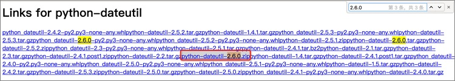

  <ol type="i" start="4">

  <li>

  Rename the downloaded file to python-dateutil.zip, and upload the file as a resource in the MaxCompute console.

  ```text
  add archive python-dateutil.zip;
  ```

  > **Note**
  >
  > Find, download, and upload pytz-2017.2.zip and six-1.11.0.tar.gz files in
  >
  > the same way as you do for the python-dateutil file.

  </li>

  <li>

  To ensure that the packages that contain code in C language, such as Pandas, run on MaxCompute normally, you need to find the .whl package whose name contains cp27-cp27m-manylinux1_x86_64. Therefore, you need to find and download pandas-0.20.2-cp27-cp27m-manylinux1_x86_64.whl, change its extension to .zip, and run  `add archive pandas.zip;`  on MaxCompute Console to upload it. Upload scipy and scikit-learn packages to MaxCompute in the same way as you do in the preceding procedure.

  </li>

  </ol>

  The following table lists the resources to be downloaded for all packages.

  | Package name | File name | Name of resource for upload |
  | --- | --- | --- |
  | python-dateutil | python-dateutil-2.6.0.zip | python-dateutil.zip |
  | pytz | pytz-2017.2.zip | pytz.zip |
  | six | six-1.11.0.tar.gz | six.tar.gz |
  | pandas | pandas-0.20.2-cp27-cp27m-manylinux1_x86_64.zip | pandas.zip |
  | scipy | scipy-0.19.0-cp27-cp27m-manylinux1_x86_64.zip | scipy.zip |
  | scikit-learn | scikit_learn-0.18.1-cp27-cp27m-manylinux1_x86_64.zip | sklearn.zip |

**Specify the third-party Python libraries**

- Globally specify the libraries to be used.

  ```text
  >>> from odps import options
  >>> options.df.libraries = ['six.whl', 'python_dateutil.whl']
  ```

- In an immediately-invoked method, locally specify the libraries to be used.

  ```text
  >>> df.apply(my_func, axis=1).to_pandas(libraries=['six.whl', 'python_dateutil.whl'])
  ```

<a id="section-9-6-11"></a>

### 9.6.11. Use custom functions

The DataFrame  `map`  function applies a custom function to each element of a Sequence.

**DataFrame function**

```text
iris.sepallength.map(lambda x: x + 1).head(5)

# The result is as follows:
   sepallength
0          6.1
1          5.9
2          5.7
3          5.6
4          6.0
```

> **Note**
>
> Due to Python UDF limitations, custom functions do not support lists or dictionaries as input or output types.

If the data type of the Sequence changes after the  `map`  operation, you must explicitly specify the new type.

```text
iris.sepallength.map(lambda x: 't'+str(x), 'string').head(5)

# The result is as follows:
   sepallength
0         t5.1
1         t4.9
2         t4.7
3         t4.6
4         t5.0
```

If a function contains a closure, changes to the closure variable outside the function also affect its value inside the function. For example:

```text
dfs = []
for i in range(10):
    dfs.append(df.sepallength.map(lambda x: x + i))
```

As a result, every SequenceExpr in  `dfs`  becomes  `df.sepal_length + 9` . To resolve this, you can return the function from another function or use  `partial` .

```python
dfs = []
def get_mapper(i):
    return lambda x: x + i
for i in range(10):
    dfs.append(df.sepallength.map(get_mapper(i)))
```

Or:

```python
import functools
dfs = []
for i in range(10):
    dfs.append(df.sepallength.map(functools.partial(lambda v, x: x + v, i)))
```

The  `map`  function also supports existing UDFs by passing the function name as a string or a Function object.

Passing a Python function to  `map`  uses the ODPS Python UDF. If Python UDF is not enabled for your project, you cannot use the  `map`  function. All limitations of Python UDFs also apply.

Currently, the only supported third-party library (including those with C extensions) is  `numpy` . For more information about using third-party libraries, see Use third-party Python libraries.

In addition to calling custom functions, DataFrames offer many built-in functions. Some of these functions are implemented using  `map` . If Python UDF is not enabled in your project, you cannot use these functions.

> **Note**
>
> As of October 16, 2018, Python UDF is enabled by default for all users in the MaxCompute public cloud environment.
>
> Due to differences in bytecode definitions, code that uses new Python 3 features, such as  `yield from` , fails when executed on an ODPS worker that runs Python 2.7. Therefore, before writing production jobs with the MapReduce API in Python 3, verify that your code runs as expected.

**Referencing resources**

Custom functions can read ODPS resources, such as table resources and file resources, or use a collection as a resource. To do so, the custom function must be written as a closure or a callable class.

```text
file_resource = o.create_resource('pyodps_iris_file', 'file', file_obj='Iris-setosa')

iris_names_collection = iris.distinct('name')[:2]
iris_names_collection
 
# The result is as follows:
       sepallength
0      Iris-setosa
1  Iris-versicolor
```

```text
def myfunc(resources):  # resources are passed in the order they are specified
    names = set()
    fileobj = resources[0] # A file resource is a file-like object
    for l in fileobj:
        names.add(l)
    collection = resources[1]
    for r in collection:
        names.add(r.name)  # Access fields by name or offset
    def h(x):
        if x in names:
            return True
        else:
            return False
    return h

df = iris.distinct('name')
df = df[df.name,
df.name.map(myfunc, resources=[file_resource, iris_names_collection], 
rtype='boolean').rename('isin')]

df
 
# The result is as follows:
              name   isin
0      Iris-setosa   True
1  Iris-versicolor   True
2   Iris-virginica  False
```

> **Note**
>
> When you read a partitioned table resource, the partitioning fields are not included.

**Use third-party Python libraries**

Consider a DataFrame with a single string field.

```text
 df
               datestr
0  2016-08-26 14:03:29
1  2015-08-26 14:03:29
```

You can configure third-party libraries globally:

```python
from odps import options

def get_year(t):
    from dateutil.parser import parse
    return parse(t).strftime('%Y')

options.df.libraries = ['six.whl', 'python_dateutil.whl']
df.datestr.map(get_year)
 
# The result is as follows:
   datestr
0     2016
1     2015
```

Alternatively, you can specify libraries using the  `libraries`  parameter in an immediate execution method:

```python
def get_year(t):
    from dateutil.parser import parse
    return parse(t).strftime('%Y')

df.datestr.map(get_year).execute(libraries=['six.whl', 'python_dateutil.whl'])
 
# The result is as follows:
   datestr
0     2016
1     2015
```

By default, PyODPS supports pure Python third-party libraries that do not perform file operations. In recent versions of MaxCompute, PyODPS also supports Python libraries that contain binary code or perform file operations. These libraries must have a  `cp27-cp27m-manylinux1_x86_64`  suffix and be uploaded as an  `archive`  resource. If a package has a  `.whl`  extension, rename it to  `.zip` . Additionally, the job requires enabling either the  `odps.isolation.session.enable`  option or project-level isolation. The following example shows how to upload and use a special function from SciPy:

```python
 # For packages with binary code, you must upload the resource as an archive. Rename the .whl extension to .zip.
odps.create_resource('scipy.zip', 'archive', file_obj=open('scipy-0.19.0-cp27-cp27m-manylinux1_x86_64.whl', 'rb'))

 # This option is not required if isolation is enabled for the project.
options.sql.settings = { 'odps.isolation.session.enable': True }

def psi(value):
    # It is recommended to import third-party libraries inside the function
    # to avoid execution errors caused by binary package structure differences
    # between operating systems.
    from scipy.special import psi
    return float(psi(value))

df.float_col.map(psi).execute(libraries=['scipy.zip'])
```

For binary packages that provide only source code, you can package them into a wheel file in a Linux shell before uploading. Wheel files generated on macOS or Windows are not compatible with MaxCompute:

```text
python setup.py bdist_wheel
```

**Use counters**

```python
from odps.udf import get_execution_context

def h(x):
    ctx = get_execution_context()
    counters = ctx.get_counters()
    counters.get_counter('df', 'add_one').increment(1)
    return x + 1

df.field.map(h)
```

You can find the counter value in the JSONSummary section of Logview.

**Use ODPS built-in and user-defined functions**

Use the func interface to call a built-in or user-defined ODPS function to generate a column. By default, the function returns a string value. You can use the  `rtype`  parameter to specify a different return type.

```python
from odps.df import func

iris[iris.name, func.rand(rtype='float').rename('rand')][:4]
iris[iris.name, func.rand(10, rtype='float').rename('rand')][:4]
# Call a UDF defined on ODPS. You must manually specify the column name if it cannot bedetermined.
iris[iris.name, func.your_udf(iris.sepalwidth, iris.sepallength, 
rtype='float').rename('new_col')]
# You can also call a UDF from another project and specify the column name with the name parameter.
iris[iris.name, func.your_udf(iris.sepalwidth, iris.sepallength, rtype='float', project='udf_project',name='new_col')]
```

> **Note**
>
> Expressions that contain func are not supported by the Pandas backend.

<a id="section-9-6-12"></a>

### 9.6.12. Use third-party packages in PyODPS DataFrame UDFs

This topic describes how to upload and use third-party packages such as pandas, SciPy, and scikit-learn in PyODPS DataFrame user-defined functions (UDFs).

PyODPS DataFrame provides pandas-like interfaces to process MaxCompute data. It also allows you to install the pandas interface on your computer or use databases to process data.

PyODPS DataFrame not only supports the pandas-like map and apply methods, but also provides the MapReduce API to extend the pandas syntax and adapt to the big data environment.

PyODPS UDFs are serialized and executed in MaxCompute. The MaxCompute Python environment contains only the NumPy third-party package. MaxCompute allows you to use libraries that include C programming code, such as pandas, SciPy, and scikit-learn, in UDFs.

> **Note**
>
> You must install PyODPS 0.7.4 or later.

**Upload third-party packages**

> **Note**
>
> You need to upload third-party packages only once. If the packages have been uploaded, skip this section.

Mainstream Python packages provide WHL packages that include binary files for various platforms. To use a package, you must first identify the package, download it, and then upload it to MaxCompute.

To use a third-party package in MaxCompute, all dependencies must be uploaded. The following table lists the dependencies of each third-party package.

| Package name | Dependency |
| --- | --- |
| pandas | NumPy, python-dateutil, pytz, and six |
| scipy | numpy |
| scikit-learn | NumPy and SciPy |

> **Note**
>
> NumPy is included in all the third-party packages. You need to upload only the python-dateutil, pytz, pandas, SciPy, scikit-learn, and six dependencies to use pandas, SciPy, and scikit-learn.

You can click python-dateutils to find python-dateutil-2.6.0.zip and download python-dateutil-2.6.0.zip.


Rename the downloaded file to python-dateutil.zip and upload the resource in MaxCompute Console.

```text
add archive python-dateutil.zip;
```

> **Note**
>
> Download the pytz-2017.2.zip and six-1.11.0.tar.gz packages and upload them as resources to MaxCompute.

For pandas packages that include C programming code, only the WHL package whose name includes cp27-cp27m-manylinux1_x86_64 can run in MaxCompute. Therefore, you must download the pandas-0.20.2-cp27-cp27m-manylinux1_x86_64.whl package and change the file name extension of the package to .zip. Then, run the  `add archive pandas.zip;` command in the MaxCompute console to upload the package.

Use the same method to upload other required packages. The following table lists the packages that you must download.

| Package name | File name | Name of the resource for upload |
| --- | --- | --- |
| python-dateutil | python-dateutil-2.6.0.zip | python-dateutil.zip |
| pytz | pytz-2017.2.zip | pytz.zip |
| six | six-1.11.0.tar.gz | six.tar.gz |
| pandas | pandas-0.20.2-cp27-cp27m-manylinux1_x86_64.zip | pandas.zip |
| scipy | scipy-0.19.0-cp27-cp27m-manylinux1_x86_64.zip | scipy.zip |
| scikit-learn | scikit_learn-0.18.1-cp27-cp27m-manylinux1_x86_64.zip | sklearn.zip |

> **Note**
>
> You can also call the resource uploading interface provided by PyODPS to upload resources.

**Write a function for verification**

1. Write a simple function, in which all libraries are used. We recommend that you put the IMPORT statement inside the function to import the required third-party libraries.

   ```python
   def test(x):
       from sklearn import datasets, svm
       from scipy import misc
       import numpy as np

       iris = datasets.load_iris()
       assert iris.data.shape == (150, 4)
       assert np.array_equal(np.unique(iris.target),  [0, 1, 2])

       clf = svm.LinearSVC()
       clf.fit(iris.data, iris.target)
       pred = clf.predict([[5.0, 3.6, 1.3, 0.25]])
       assert pred[0] == 0

       assert misc.face().shape is not None

       return x
   ```

   > **Note**
   >
   > The preceding code uses all the required packages and is for reference only.

2. Write a map function.

   > **Note**
   >
   > When you execute this function, make sure that the isolation feature is enabled. If you do not enable the isolation feature for your project, enable the feature globally during the execution.
   >
   > ```python
   > from odps import options
   >
   > options.sql.settings = {'odps.isolation.session.enable': True}
   > ```
   >
   > You can also use the execute method to enable the isolation feature for this execution.
   >
   > You can use the options.df.libraries parameter to globally specify the packages to use. Alternatively, you can specify packages during the execution. You must specify all the required packages, including their dependencies.

3. Call the defined functions.

   ```text
   hints = {
       'odps.isolation.session.enable': True
   }
   libraries = ['python-dateutil.zip', 'pytz.zip', 'six.tar.gz', 'pandas.zip', 'scipy.zip', 'sklearn.zip']

   iris = o.get_table('pyodps_iris').to_df()

   print iris[:1].sepal_length.map(test).execute(hints=hints, libraries=libraries)
   ```

**Summary**

You can compile the code and specify the libraries to use only after you upload the required third-party libraries and their dependencies. If the required third-party libraries and their dependencies are not uploaded, you must perform the preceding operations to upload the third-party libraries.

**PyODPS resources**

- For more information about related documentation, see PyODPS: ODPS Python SDK and data analysis framework.

- For more information about related code, visit aliyun-odps-python-sdk.

<a id="section-9-6-13"></a>

### 9.6.13. MapReduce API

This topic describes the MapReduce API.

PyODPS DataFrame supports the MapReduce API. You can separately write the  `MAP`  and  `REDUCE`  functions. A  `map_reduce`  process can include only  `mappers`  or  `reducers` .

The following example shows how to run the  `WordCount`  program.

```text
>>> #encoding=utf-8
>>> from odps import ODPS
>>> from odps import options
>>> options.verbose = True
>>> o = ODPS('your-access-id', 'your-secret-access-key',project='DMP_UC_dev', endpoint=
'http://service-corp.odps.aliyun-inc.com/api')
>>> from odps.df import DataFrame

>>> def mapper(row):
>>>     for word in row[0].split():
>>>         yield word.lower(), 1
>>>
>>> def reducer(keys):
>>>     # A list rather than cnt=0 is used. If you use cnt=0, cnt in the h function is considered a local variable. The value of the local variable is not included in the output. 
>>>     cnt = [0]
>>>     def h(row, done):  # done indicates that the rows with this key are iterated. 
>>>         cnt[0] += row[1]
>>>         if done:
>>>             yield keys[0], cnt[0]
>>>     return h
>>> # The zx_word_count table has only one column. The column is of the STRING type. 
>>> word_count = DataFrame(o.get_table('zx_word_count'))
>>> table = word_count.map_reduce(mapper, reducer, group=['word', ],
                        mapper_output_names=['word', 'cnt'],
                        mapper_output_types=['string', 'int'],
                        reducer_output_names=['word', 'cnt'],
                        reducer_output_types=['string', 'int'])
         word  cnt
0         are    1
1         day    1
2      doing?    1
3   everybody    1
4       first    1
5       hello    2
6         how    1
7          is    1
8          so    1
9         the    1
10       this    1
11      world    1
12        you    1
```

Use the  `group`  parameter to specify the field by which you want to use the  `reduce` function to group data. If you do not specify this parameter, the data is grouped by all the fields.  `Reducers`  receive and initialize aggregated  `keys` , and process the rows of data that is aggregated based on the  `keys` .  `done`  indicates that all rows related to these  `keys`  are iterated.

For ease of understanding, the function is written as a closure in this example. You can also write the function as a  `callable`  class.

```text
class reducer(object):
    def __init__(self, keys):
        self.cnt = 0

    def __call__(self, row, done):  # done indicates that the rows with this key are iterated. 
        self.cnt += row.cnt
        if done:
            yield row.word, self.cnt
```

The code is simplified if you use the  `output`  method for commenting.

```text
>>> from odps.df import output
>>>
>>> @output(['word', 'cnt'], ['string', 'int'])
>>> def mapper(row):
>>>     for word in row[0].split():
>>>         yield word.lower(), 1
>>>
>>> @output(['word', 'cnt'], ['string', 'int'])
>>> def reducer(keys):
>>>     # A list rather than cnt=0 is used. If you use cnt=0, cnt in the h function is considered a local variable. The value of the local variable is not included in the output. 
>>>     cnt = [0]
>>>     def h(row, done):  # done indicates that the rows with this key are iterated. 
>>>         cnt[0] += row.cnt
>>>         if done:
>>>             yield keys.word, cnt[0]
>>>     return h
>>>
>>> word_count = DataFrame(o.get_table('zx_word_count'))
>>> table = word_count.map_reduce(mapper, reducer, group='word')
         word  cnt
0         are    1
1         day    1
2      doing?    1
3   everybody    1
4       first    1
5       hello    2
6         how    1
7          is    1
8          so    1
9         the    1
10       this    1
11      world    1
12        you    1
```

During iteration, you can configure the  `sort`  parameter to sort the data by column and the  `ascending`  parameter to specify the sorting order. The  `ascending`  parameter can be set to a value of the BOOLEAN type, which indicates that all fields specified by the  `sort` parameter are arranged in the same order. The ascending parameter can also specify a list. The length of strings in the list must be the same as the number of fields specified by the  `sort`  parameter.

**Specify a combiner**

In the  `MapReduce API` , a  `combiner`  is used to aggregate data in a  `mapper` . A combiner is used in the same way as a  `reducer` , but a combiner cannot reference resources. The names and data types of the fields generated from a  `combiner`  must be the same as the names and data types of the fields generated from the  `mapper`  that corresponds to the combiner.

In this example, you can use the  `reducer`  as the  `combiner`  to aggregate data in the  `mapper`  to reduce shuffled data.

```text
>>> words_df.map_reduce(mapper, reducer, combiner=reducer, group='word')
```

**Reference resources**

In the MapReduce API, you can separately specify the resources referenced by  `mappers`  and `reducers` .

In the following example, deprecated word filtering is performed in the  `mapper` . Five words are added to a whitelist in the  `reducer` .

```text
>>> white_list_file = o.create_resource('pyodps_white_list_words', 'file', 
file_obj='Python\nWorld')
>>>
>>> @output(['word', 'cnt'], ['string', 'int'])
>>> def mapper(resources):
>>>     stop_words = set(r[0].strip() for r in resources[0])
>>>     def h(row):
>>>         for word in row[0].split():
>>>             if word not in stop_words:
>>>                 yield word, 1
>>>     return h
>>>
>>> @output(['word', 'cnt'], ['string', 'int'])
>>> def reducer(resources):
>>>     d = dict()
>>>     d['white_list'] = set(word.strip() for word in resources[0])
>>>     d['cnt'] = 0
>>>     def inner(keys):
>>>         d['cnt'] = 0
>>>         def h(row, done):
>>>             d['cnt'] += row.cnt
>>>             if done:
>>>                 if row.word in d['white_list']:
>>>                     d['cnt'] += 5
>>>                 yield keys.word, d['cnt']
>>>         return h
>>>     return inner
>>>
>>> words_df.map_reduce(mapper, reducer, group='word',
>>>                     mapper_resources=[stop_words], reducer_resources=
[white_list_file])
     word  cnt
0   hello    2
1    life    1
2  python    7
3   world    6
4   short    1
5     use    1
```

**Use third-party Python libraries**

The usage is similar to that of a third-party Python library in map stages.

- Globally specify the library.

  ```text
  >>> from odps import options
  >>> options.df.libraries = ['six.whl', 'python_dateutil.whl']
  ```

- If you use an immediately-invoked method, locally specify the library.

  ```text
  >>> df.map_reduce(mapper=my_mapper, reducer=my_reducer, 
  group='key').execute(libraries=['six.whl', 'python_dateutil.whl'])
  ```

  > **Note**
  >
  > Due to the bytecode definition difference, if you write code based on new syntaxes supported by Python 3, such as  `yield from` , an error is reported when the code is run on a MaxCompute worker of Python 2.7. Before you implement production operations by using the MapReduce API of Python 3, we recommend that you make sure that the code runs as expected.

**Reshuffle data**

If data is unevenly distributed in a cluster, you can call the  `reshuffle`  method to reshuffle data.

```text
>>> df1 = df.reshuffle()
```

By default, data is hashed as random numbers. You can also distribute data by column and sort the reshuffled data in a specific order.

```text
>>> df1.reshuffle('name', sort='id', ascending=False)
```

**Bloom filter**

PyODPS DataFrame provides the  `bloom_filter`  interface to calculate data with a Bloom filter.

If you specify a collection object and the value of  `sequence1`  of the collection object for column calculation, you can apply a Bloom filter to  `sequence2`  of the collection. This way, data that is included in  `sequence1`  but is not included in  `sequence2`  is filtered out. In this case, specific data that meets the filter condition may not be completely filtered out. This is an approximate method. This method quickly filters out useless data from the collection object. A Bloom filter is suitable for  `JOIN`  operations in the scenario where the amount of data on one side is much larger than the amount of data on the other side. Most data is not  `joined`  in this scenario. For example, when browsing data and transaction data of a user are  `joined`  and the amount of browsing data is much larger than the amount of transaction data, the browsing data is filtered out by using a Bloom filter based on the transaction data. Then, you can  `join`  the browsing data and transaction data of the user. This improves join performance.

```text
>>> df1 = DataFrame(pd.DataFrame({'a': ['name1', 'name2', 'name3', 'name1'], 'b': [1, 2, 3, 4]}))
>>> df1
       a  b
0  name1  1
1  name2  2
2  name3  3
3  name1  4
>>> df2 = DataFrame(pd.DataFrame({'a': ['name1']}))
>>> df2
       a
0  name1
>>> df1.bloom_filter('a', df2.a) # The row 0 can be a computation expression, such as, df1.a + '1'. 
       a  b
0  name1  1
1  name1  4
```

Description:

- In this example, the amount of data that is processed is small. Therefore, data in the rows that contain  `name2`  and  `name3`  in the column  `a`  of  `df1`  is filtered out. If the amount of data that is processed is large, the data that meets the filter condition may not be filtered out.

- In the preceding  `JOIN`  operation, that issue that the data that is not filtered out does not affect the data accuracy. However, data filtering greatly improves the  `join`  performance.

- You can configure the  `capacity`  and  `error_rate`  parameters to specify the data volume and error rate. The default value of the capacity parameter is  `3000`  and the default value of the error_rate parameter is  `0.01` .

> **Note**
>
> If you increase the value of the  `capacity`  parameter or decrease the value of the  `error_rate`  parameter, memory usage increases. Therefore, set the parameters to proper values based on your business requirements.

For more information about collection objects, see DataFrame execution.

**Pivot table**

PyODPS DataFrame provides the pivot table feature. The following code shows the sample table data.

```text
>>> df
     A    B      C  D  E
0  foo  one  small  1  3
1  foo  one  large  2  4
2  foo  one  large  2  5
3  foo  two  small  3  6
4  foo  two  small  3  4
5  bar  one  large  4  5
6  bar  one  small  5  3
7  bar  two  small  6  2
8  bar  two  large  7  1
```

- If you use the pivot table feature, the  `rows`  parameter must be configured. You can obtain the average value based on one or more fields.

  ```text
  >>> df['A', 'D', 'E'].pivot_table(rows='A')
       A  D_mean  E_mean
  0  bar     5.5    2.75
  1  foo     2.2    4.40
  ```

- You can specify multiple fields in the  `rows`  parameter to aggregate data based on the fields.

  ```text
  >>> df.pivot_table(rows=['A', 'B', 'C'])
       A    B      C  D_mean  E_mean
  0  bar  one  large     4.0     5.0
  1  bar  one  small     5.0     3.0
  2  bar  two  large     7.0     1.0
  3  bar  two  small     6.0     2.0
  4  foo  one  large     2.0     4.5
  5  foo  one  small     1.0     3.0
  6  foo  two  small     3.0     5.0
  ```

- You can use the  `values`  parameter to specify the column that you want to calculate.

  ```text
  >>> df.pivot_table(rows=['A', 'B'], values='D')
       A    B    D_mean
  0  bar  one  4.500000
  1  bar  two  6.500000
  2  foo  one  1.666667
  3  foo  two  3.000000
  ```

- By default, the average value is calculated. You can configure the  `aggfunc`  parameter to specify one or more aggregate functions.

  ```text
  >>> df.pivot_table(rows=['A', 'B'], values=['D'], aggfunc=['mean', 'count', 'sum'])
       A    B    D_mean  D_count  D_sum
  0  bar  one  4.500000        2      9
  1  bar  two  6.500000        2     13
  2  foo  one  1.666667        3      5
  3  foo  two  3.000000        2      6
  ```

- You can use the values of an original column as the values of a column in the new collection object.

  ```text
  >>> df.pivot_table(rows=['A', 'B'], values='D', columns='C')
       A    B  large_D_mean  small_D_mean
  0  bar  one           4.0           5.0
  1  bar  two           7.0           6.0
  2  foo  one           2.0           1.0
  3  foo  two           NaN           3.0
  ```

- You can configure the  `fill_value`  parameter to replace empty values.

  ```text
  >>> df.pivot_table(rows=['A', 'B'], values='D', columns='C', fill_value=0)
       A    B  large_D_mean  small_D_mean
  0  bar  one             4             5
  1  bar  two             7             6
  2  foo  one             2             1
  3  foo  two             0             3
  ```

**Key-value string conversion**

DataFrame can extract key-value pairs into columns, and convert standard columns to key-value pairs. For more information about how to create and manage a DataFrame object, see Create a DataFrame object.

- Extract key-value pairs into columns. Example:

  ```text
  >>> df
      name               kv
  0  name1  k1=1,k2=3,k5=10
  1  name1    k1=7.1,k7=8.2
  2  name2    k2=1.2,k3=1.5
  3  name2      k9=1.1,k2=1
  ```

  Use the  `extract_kv`  method to extract key-value fields.

  ```text
  >>> df.extract_kv(columns=['kv'], kv_delim='=', item_delim=',')
     name   kv_k1  kv_k2  kv_k3  kv_k5  kv_k7  kv_k9
  0  name1    1.0    3.0    NaN   10.0    NaN    NaN
  1  name1    7.0    NaN    NaN    NaN    8.2    NaN
  2  name2    NaN    1.2    1.5    NaN    NaN    NaN
  3  name2    NaN    1.0    NaN    NaN    NaN    1.1
  ```

  The  `columns`  parameter specifies the fields that you want to extract. The  `kv_delim` parameter specifies the delimiter between the keys and values. The  `item_delim` parameter specifies the delimiter between key-value pairs. If you do not specify the parameters, keys and values are separated with colons (:), and key-value pairs are separated with commas (,). The name of the output field is the combination of the original field name and key value. An underscore ( `_` ) is used between the name and key value. The default value for a missing column is NONE. You can use  `fill_value`  to fill the values for missing columns.

  ```text
  >>> df.extract_kv(columns=['kv'], kv_delim='=', fill_value=0)
     name   kv_k1  kv_k2  kv_k3  kv_k5  kv_k7  kv_k9
  0  name1    1.0    3.0    0.0   10.0    0.0    0.0
  1  name1    7.0    0.0    0.0    0.0    8.2    0.0
  2  name2    0.0    1.2    1.5    0.0    0.0    0.0
  3  name2    0.0    1.0    0.0    0.0    0.0    1.1
  ```

- Convert multiple columns to key-value pairs. Example:

  ```text
  >>> df
     name    k1   k2   k3    k5   k7   k9
  0  name1  1.0  3.0  NaN  10.0  NaN  NaN
  1  name1  7.0  NaN  NaN   NaN  8.2  NaN
  2  name2  NaN  1.2  1.5   NaN  NaN  NaN
  3  name2  NaN  1.0  NaN   NaN  NaN  1.1
  ```

  Use the  `to_kv`  method to convert data to the key-value format.

  ```text
  >>> df.to_kv(columns=['k1', 'k2', 'k3', 'k5', 'k7', 'k9'], kv_delim='=')
      name               kv
  0  name1  k1=1,k2=3,k5=10
  1  name1    k1=7.1,k7=8.2
  2  name2    k2=1.2,k3=1.5
  3  name2      k9=1.1,k2=1
  ```

<a id="section-9-6-14"></a>

### 9.6.14. Merge data

This topic describes the join and union operations that are supported by Alibaba Cloud MaxCompute SDK for Python (PyODPS) DataFrame to merge data in tables.

**Prerequisites**

Table data is imported. You can download the data based on the instructions in Prepare data in the "Getting started" topic. The following code shows the structures of the tables.

```text
>>> from odps.df import DataFrame
>>> movies = DataFrame(o.get_table('pyodps_ml_100k_movies'))
>>> ratings = DataFrame(o.get_table('pyodps_ml_100k_ratings'))

>>> movies.dtypes
odps.Schema {
  movie_id                            int64
  title                               string
  release_date                        string
  video_release_date                  string
  _url                            string
}

>>> ratings.dtypes
odps.Schema {
  user_id                     int64
  movie_id                    int64
  rating                      int64
  unix_timestamp              int64
}
```

**Join operations**

PyODPS DataFrame allows you to  `join`  two Collection objects.

- If you do not specify  `join`  conditions, the DataFrame API uses the columns of the same name to  `join`  the Collection objects.

  ```text
  >>> movies.join(ratings).head(3)
     movie_id              title  release_date  video_release_date                       
  url  user_id  rating  unix_timestamp
  0         3  Four Rooms (1995)   01-Jan-1995                      
  http://example.aliyundoc.com/M/title-exact?Four%20Rooms%...       49       3       888
  068877
  1         3  Four Rooms (1995)   01-Jan-1995                      
  http://example.aliyundoc.com/M/title-exact?Four%20Rooms%...      621       5       881
  444887
  2         3  Four Rooms (1995)   01-Jan-1995                      
  http://example.aliyundoc.com/M/title-exact?Four%20Rooms%...      291       3       874
  833936
  ```

- You can explicitly specify  `join`  conditions. For a  `join`  operation, if the column names specified in the  `on`  condition for the two DataFrame objects are the same, the system uses the specified columns in one of the two tables for the new table.

  ```text
  >>> movies.join(ratings, on='movie_id').head(3)
     movie_id              title  release_date  video_release_date                       
  url  user_id  rating  unix_timestamp
  0         3  Four Rooms (1995)   01-Jan-1995                      
  http://example.aliyundoc.com/M/title-exact?Four%20Rooms%...       49       3       888
  068877
  1         3  Four Rooms (1995)   01-Jan-1995                      
  http://example.aliyundoc.com/M/title-exact?Four%20Rooms%...      621       5       881
  444887
  2         3  Four Rooms (1995)   01-Jan-1995                      
  http://example.aliyundoc.com/M/title-exact?Four%20Rooms%...      291       3       874
  833936
  ```

- For other types of  `join`  operations such as  `left join` , if the column names specified in the on condition for the two Collection objects are the same, the system renames the specified columns for the new table.

  ```text
  >>> movies.left_join(ratings, on='movie_id').head(3)
     movie_id_x              title  release_date  video_release_date                     
  url  user_id  movie_id_y  rating  unix_timestamp
  0           3  Four Rooms (1995)   01-Jan-1995                      
  http://example.aliyundoc.com/M/title-exact?Four%20Rooms%...       49           3      
  3       888068877
  1           3  Four Rooms (1995)   01-Jan-1995                      
  http://example.aliyundoc.com/M/title-exact?Four%20Rooms%...      621           3      
  5       881444887
  2           3  Four Rooms (1995)   01-Jan-1995                      
  http://example.aliyundoc.com/M/title-exact?Four%20Rooms%...      291           3      
  3       874833936
  ```

  In the preceding sample code, the two  `movie_id`  columns are renamed as  `movie_id_x` and  `movie_id_y` . The renaming rule depends on the  `suffixes`  parameter. The default value of the suffixes parameter is  `('_x', '_y')` . When columns of the same name are found, the system renames the columns by using the specified suffixes.

  ```text
  >>> ratings2 = ratings[ratings.exclude('movie_id'), 
  ratings.movie_id.rename('movie_id2')]
  >>> ratings2.dtypes
  odps.Schema {
    user_id                     int64
    rating                      int64
    unix_timestamp              int64
    movie_id2                   int64
  }
  >>> movies.join(ratings2, on=[('movie_id', 'movie_id2')]).head(3)
     movie_id              title  release_date  video_release_date                       
  url  user_id  rating  unix_timestamp  movie_id2
  0         3  Four Rooms (1995)   01-Jan-1995                      
  http://example.aliyundoc.com/M/title-exact?Four%20Rooms%...       49       3       888
  068877          3
  1         3  Four Rooms (1995)   01-Jan-1995                      
  http://example.aliyundoc.com/M/title-exact?Four%20Rooms%...      621       5       881
  444887          3
  2         3  Four Rooms (1995)   01-Jan-1995                      
  http://example.aliyundoc.com/M/title-exact?Four%20Rooms%...      291       3       874
  833936          3
  ```

- You can also specify an expression that uses the equality operator in the  `on`  condition to rename columns for the new table.

  ```text
  >>> movies.join(ratings2, on=[movies.movie_id == ratings2.movie_id2]).head(3)
     movie_id              title  release_date  video_release_date                       
  url  user_id  rating  unix_timestamp  movie_id2
  0         3  Four Rooms (1995)   01-Jan-1995                      
  http://example.aliyundoc.com/M/title-exact?Four%20Rooms%...       49       3       888
  068877          3
  1         3  Four Rooms (1995)   01-Jan-1995                      
  http://example.aliyundoc.com/M/title-exact?Four%20Rooms%...      621       5       881
  444887          3
  2         3  Four Rooms (1995)   01-Jan-1995                      
  http://example.aliyundoc.com/M/title-exact?Four%20Rooms%...      291       3       874
  833936          3
  ```

- If you perform a  `self join`  operation, you can call the  `view`  method to retrieve columns from the left and right tables.

  ```text
  >>> movies2 = movies.view()
  >>> movies.join(movies2, movies.movie_id == movies2.movie_id)[movies, 
  movies2.movie_id.rename('movie_id2')].head(3)
     movie_id            title_x release_date_x video_release_date_x  \
  0         2   GoldenEye (1995)    01-Jan-1995                 True
  1         3  Four Rooms (1995)    01-Jan-1995                 True
  2         4  Get Shorty (1995)    01-Jan-1995                 True

                                            url_x  movie_id2
  0  http://example.aliyundoc.com/M/title-exact?GoldenEye%20(...          2
  1  http://example.aliyundoc.comtitle-exact?Four%20Rooms%...          3
  2  http://example.aliyundoc.com/M/title-exact?Get%20Shorty%...          4
  ```

  PyODPS DataFrame supports the  `left join` ,  `right join` , and  `outer join`  operations in addition to the  `join`  operation. In the left join, right join, and outer join operations, renamed columns are suffixed with  `_x`  or  `_y`  by default. You can use a 2- `tuple`  to define the suffixes in the  `suffixes`  parameter.

- When you perform the left join, right join, or outer join operation, you can set the  `merge_columns`  parameter to True to prevent duplicate columns in the new table. The system then selects non-null values from the duplicate columns as the values in the new column.

  ```text
  >>> movies.left_join(ratings, on='movie_id', merge_columns=True)
  ```

If you want to perform the  `mapjoin`  operation, set  `mapjoin`  to True. The system then performs the  `mapjoin`  operation on the right table. You can separately perform  `join` operations on PyODPS and Pandas collections. You can also separately perform  `join` operations on PyODPS and database collections. In this case, the calculation is performed on PyODPS.

**Union operations**

If the fields and field types of the two tables are the same, you can use  `union`  or  `concat` to merge the two tables into one table, regardless of whether the field sequence in the two tables is the same.

```text
>>> mov1 = movies[movies.movie_id < 3]['movie_id', 'title']
>>> mov2 = movies[(movies.movie_id > 3) & (movies.movie_id < 6)]['title', 'movie_id']
>>> mov1.union(mov2)
   movie_id              title
0         1   Toy Story (1995)
1         2   GoldenEye (1995)
2         4  Get Shorty (1995)
3         5     Copycat (1995)
```

You can separately perform  `union`  operations on PyODPS and Pandas collections. You can also separately perform  `union`  operations on PyODPS and database collections. In this case, the calculation is performed on PyODPS.

<a id="section-9-6-15"></a>

### 9.6.15. Window functions

This topic describes window functions that are supported by the DataFrame API.

```text
grouped = iris.groupby('name')
grouped.mutate(grouped.sepallength.cumsum(), 
grouped.sort('sepallength').row_number()).head(10)
          name  sepallength_sum  row_number
0  Iris-setosa            250.3           1
1  Iris-setosa            250.3           2
2  Iris-setosa            250.3           3
3  Iris-setosa            250.3           4
4  Iris-setosa            250.3           5
5  Iris-setosa            250.3           6
6  Iris-setosa            250.3           7
7  Iris-setosa            250.3           8
8  Iris-setosa            250.3           9
9  Iris-setosa            250.3          10
```

- Use window functions to select columns.

  ```text
  iris['name', 'sepallength', 
  iris.groupby('name').sort('sepallength').sepallength.cumcount()].head(5)
            name  sepallength  sepallength_count
  0  Iris-setosa          4.3                  1
  1  Iris-setosa          4.4                  2
  2  Iris-setosa          4.4                  3
  3  Iris-setosa          4.4                  4
  4  Iris-setosa          4.5                  5
  ```

- Use window functions to aggregate data by scalar. The processing method is a combination of grouping and aggregation.

  ```python
  from odps.df import Scalar
  iris.groupby(Scalar(1)).sort('sepallength').sepallength.cumcount()
  ```

The following table lists the window functions that are supported by the DataFrame API.

| Window function | Description |
| --- | --- |
| cumsum | Calculates the cumulative sum. |
| cummean | Calculates the cumulative mean. |
| cummedian | Calculates the cumulative median. |
| cumstd | Calculates the cumulative standard deviation. |
| cummax | Calculates the cumulative maximum. |
| cummin | Calculates the cumulative minimum. |
| cumcount | Calculates the cumulative sum. |
| lag | Retrieves the value of a row at a given offset that precedes the current row. The system determines the number of the row to retrieve the value based on the following formula: Number of the current row - Offset value. |
| lead | Retrieves the value of a row at a given offset that follows the current row. The system determines the number of the row to retrieve the value based on the following formula: Number of the current row + Offset value. |
| rank | Calculates the rank of a row in an ordered group. |
| dense_rank | Calculates the dense rank of a row in an ordered group. |
| percent_rank | Calculates the relative rank of a row in an ordered group. |
| row_number | Calculates the row number. Row numbers start from 1. |
| qcut | Divides a group of data into N bins based on the data sequence and returns the number of the bin that contains the current data. If data is not evenly distributed in bins, more data is distributed to the first bin by default. |
| nth_value | Retrieves the Nth value in the group. |
| cume_dist | Calculates the proportion of rows whose values are no greater than the current value to all rows in a group. |

The following tables list parameters that are supported by different window functions.

- The  `rank` ,  `dense_rank` ,  `percent_rank` , and  `row_number`  window functions support the following parameters.

  | Parameter | Description |
  | --- | --- |
  | sort | The keyword that is used to sort rows. This parameter is an empty string by default. |
  | ascending | Specifies whether to sort rows in ascending order. This parameter is set to True by default. |

- The  `lag`  and  `lead`  window functions support the following parameters in addition to the parameters that are supported by the  `rank`  function.

  | Parameter | Description |
  | --- | --- |
  | offset | The number of rows that are between the current row and the row where you want to retrieve data. |
  | default | The value to return if the row at the specified offset does not exist. |

- The  `cumsum` ,  `cummax` ,  `cummin` ,  `cummean` ,  `cummedian` ,  `cumcount` , and  `cumstd` window functions support the following parameters in addition to the parameters that are supported by the  `rank`  function.

  | Parameter | Description |
  | --- | --- |
  | unique | Specifies whether to enable data deduplication.This parameter is set to False by default. |
  | preceding | The start of a window. |
  | following | The end of a window. |

<a id="section-9-6-16"></a>

### 9.6.16. Plotting

This topic describes the plotting feature that is provided by Alibaba Cloud MaxCompute SDK for Python (PyODPS) DataFrame.

To enable the plotting feature, install the pandas and Matplotlib libraries.

Run the  `pip install matplotlib`  command to install the Matplotlib library, and run the following sample code in Jupyter to create plots.

**Sample code for plotting**

- Single-line plot

  ```xml
  >>> from odps.df import DataFrame
  >>> iris = DataFrame(o.get_table('pyodps_iris'))
  >>> %matplotlib inline
  >>> iris.sepalwidth.plot()
  <matplotlib.axes._subplots.AxesSubplot at 0x10c2b3510>
  ```

  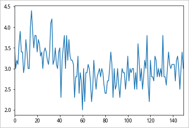

- Multi-line plot

  ```xml
  >>> iris.plot()
  <matplotlib.axes._subplots.AxesSubplot at 0x10db7e690>
  ```

  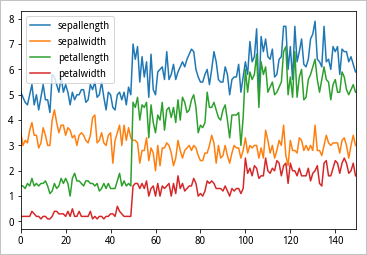

- Vertical bar plot

  ```xml
  >>> iris.groupby('name').sum().plot(kind='bar', x='name', stacked=True, rot=30)
  <matplotlib.axes._subplots.AxesSubplot at 0x10c5f2090>
  ```

  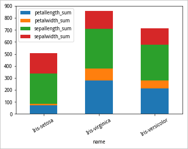

- Histogram

  ```text
  >>> iris.hist(sharex=True)
  array([[<matplotlib.axes._subplots.AxesSubplot object at 0x10e013f90>,
          <matplotlib.axes._subplots.AxesSubplot object at 0x10e2d1c10>],
         [<matplotlib.axes._subplots.AxesSubplot object at 0x10e353f10>,
          <matplotlib.axes._subplots.AxesSubplot object at 0x10e3c4410>]], 
  dtype=object)
  ```

  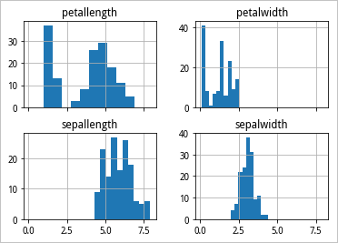

The  `kind`  parameter specifies the plot type. The following table lists the plot types that are supported by PyODPS DataFrame. For more information, see pandas.DataFrame.plot.

| kind | Description |
| --- | --- |
| line | The line plot. |
| bar | The vertical bar plot. |
| barh | The horizontal bar plot. |
| hist | The histogram. |
| box | The box plot. |
| kde | The kernel density estimation plot. |
| density | The kernel density estimation plot. |
| area | The area plot. |
| pie | The pie plot. |
| scatter | The scatter plot. |
| hexbin | The hexagonal bin plot. |

The  `plot`  function also supports the following parameters.

| Parameter | Description |
| --- | --- |
| xlabel | The label for the x-axis. |
| ylabel | The label for the y-axis. |
| xlabelsize | The size of label for the x-axis. |
| ylabelsize | The size of the label for the y-axis. |
| labelsize | The size of the label for the axis. |
| title | The title. |
| titlesize | The size of the title. |
| annotate | Specifies whether to add an annotation. |

<a id="section-9-6-17"></a>

### 9.6.17. Debugging

Alibaba Cloud MaxCompute SDK for Python (PyODPS) DataFrame optimizes the execution process of each operation. You can enable the system to display the entire computation process in a visualized manner.

**DataFrame visualization**

DataFrame visualization depends on graphviz and the graphviz package for Python.

```text
>>> df = iris.groupby('name').agg(id=iris.sepalwidth.sum())
>>> df = df[df.name, df.id + 3]
>>> df.visualize()
```

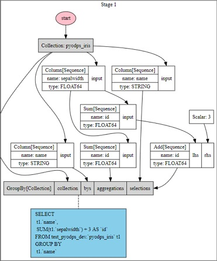

The computation process shows that PyODPS DataFrame combines the  `groupby`  operation with the column filtering operation.

```text
>>> df = iris.groupby('name').agg(id=iris.sepalwidth.sum()).cache()
>>> df2 = df[df.name, df.id + 3]
>>> df2.visualize()
```

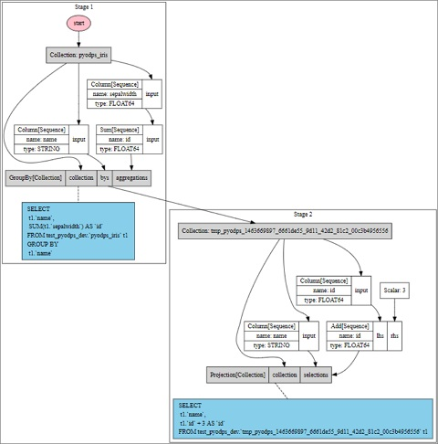

In this case, the entire execution process runs in two steps because a cache operation is performed.

**View compiled results at the MaxCompute SQL backend**

Call the  `compile`  method to view compiled results of SQL statements at the MaxCompute SQL backend.

```text
>>> df = iris.groupby('name').agg(sepalwidth=iris.sepalwidth.max())
>>> df.compile()
Stage 1:

SQL compiled:

SELECT
  t1.`name`,
  MAX(t1.`sepalwidth`) AS `sepalwidth`
FROM test_pyodps_dev.`pyodps_iris` t1
GROUP BY
  t1.`name`
```

**Perform local debugging by using the pandas computation backend**

If you use MaxCompute tables as the sources for DataFrame objects, the system does not compile or perform some operations at the MaxCompute SQL backend. Instead, the system uses the MaxCompute Tunnel service to download data. This way, the system does not need to wait for the MaxCompute SQL backend to schedule download tasks. This allows you to download small amounts of data from MaxCompute to a local directory and use the pandas computation backend to compile and debug code. The operations include:

- Select all or some rows of data from a non-partitioned table, filter the column data, and then calculate the number of specified rows. The column filtering operation does not compute column values.

- Select all or some rows of data from all or the first several partition columns that are specified in a partitioned table, filter the column data, and then calculate the number of the specified rows.

For example, the  `iris`  DataFrame object uses a non-partitioned MaxCompute table as the source. The following operation uses the MaxCompute Tunnel service to download data:

```text
>>> iris.count()
>>> iris['name', 'sepalwidth'][:10]
```

For example, the DataFrame object uses a partitioned table that contains the  `ds` ,  `hh` , and  `mm`  partition columns. The following operation uses the MaxCompute Tunnel service to download data:

```text
>>> df[:10]
>>> df[df.ds == '20160808']['f0', 'f1']
>>> df[(df.ds == '20160808') & (df.hh == 3)][:10]
>>> df[(df.ds == '20160808') & (df.hh == 3) & (df.mm == 15)]
```

In this case, you can use the  `to_pandas`  method to download the data to a local directory for debugging.

```text
>>> DEBUG = True
>>> if DEBUG:
>>> df = iris[:100].to_pandas(wrap=True)
>>> else:
>>> df = iris
```

At the end of compiling, set  `DEBUG`  to False to complete computation on MaxCompute.

> **Note**
>
> Some programs that pass local debugging may fail to run on MaxCompute
>
> because of the limits of the sandbox.

<a id="section-9-7"></a>

## 9.7. Configurations

This topic describes the parameters provided by PyODPS.

You can use  `odps.options`  to obtain the parameters provided by PyODPS.

```python
from odps import options
# Configure the lifecycle parameter to specify the lifecycle of all output tables. 
options.lifecycle = 30
# Set the tunnel.string_as_binary parameter to True to use bytes instead of Unicode to download data of the STRING type. 
options.tunnel.string_as_binary = True
# When you run PyODPS DataFrames in MaxCompute, you can refer to the following configuration to set the limit to a relatively large value during a sort operation. 
options.df.odps.sort.limit = 100000000
```

**General configurations**

| Parameter | Description | Default value |
| --- | --- | --- |
| end_point | The endpoint of MaxCompute. | None |
| default_project | The default project. | None |
| log_view_host | The hostname of LogView. | None |
| log_view_hours | The retention time of LogView.Unit: hours. | 24 |
| local_timezone | The time zone that is used.True indicates local time, and False indicates UTC. The time zone of <code> pytz </code> can also be used. | None |
| lifecycle | The lifecycle of all tables. | None |
| temp_lifecycle | The lifecycle of temporary tables. | 1 |
| biz_id | The user ID. | None |
| verbose | Specifies whether to display logs. | False |
| verbose_log | The log receiver. | None |
| chunk_size | The size of the write buffer.Unit: bytes. | 1496 |
| retry_times | The number of request retries. | 4 |
| pool_connections | The number of cached connections in the connection pool. | 10 |
| pool_maxsize | The maximum capacity of the connection pool. | 10 |
| connect_timeout | The connection timeout period.Unit: seconds. | 5 |
| read_timeout | The read timeout period. Unit: seconds. | 120 |
| api_proxy | The API proxy server. | None |
| data_proxy | The data proxy server. | None |
| completion_size | The limit on the number of object completion listing items. | 10 |
| notebook_repr_widget | Specifies whether to use interactive graphs. | True |
| sql.settings | Global hints for MaxCompute SQL. | None |
| sql.use_odps2_extension | Specifies whether to enable MaxCompute 2.0 language extension. | False |

**Data upload and download configurations**

| Parameter | Description | Default value |
| --- | --- | --- |
| tunnel.endpoint | The endpoint of MaxCompute Tunnel. | None |
| tunnel.use_instance_tunnel | Specifies whether to use InstanceTunnel to obtain execution results. | True |
| tunnel.limit_instance_tunnel | Specifies whether to limit the number of data records obtained by using InstanceTunnel. | None |
| tunnel.string_as_binary | Specifies whether to use bytes instead of Unicode for data of the STRING type. | False |

**DataFrame configurations**

| Parameter | Description | Default value |
| --- | --- | --- |
| interactive | Specifies whether DataFrames are used in an interactive environment. | Depending on the detection value |
| df.analyze | Specifies whether to enable functions that are not built-in functions MaxCompute. | True |
| df.optimize | Specifies whether to enable full DataFrame optimization. | True |
| df.optimizes.pp | Specifies whether to enable DataFrame predicate pushdown optimization. | True |
| df.optimizes.cp | Specifies whether to enable DataFrame column pruning optimization. | True |
| df.optimizes.tunnel | Specifies whether to enable DataFrame tunnel optimization. | True |
| df.quote | Specifies whether to use a pair of grave accents (<code> `` </code>) to mark field and table names in the backend of MaxCompute SQL. | True |
| df.libraries | The resource name of the third-party library that is used for DataFrame operations. | None |
| df.supersede_libraries | Specifies whether to use the self-uploaded NumPy to replace the version in the service. | False |
| df.odps.sort.limit | The default limit on the number of items that are added during a sort operation of DataFrames. | 10000 |

**Machine learning configurations**

| Parameter | Description | Default value |
| --- | --- | --- |
| ml.xflow_settings | The XFlow execution configuration. | None |
| ml.xflow_project | The default XFlow project name. | algo_public |
| ml.use_model_transfer | Specifies whether to use ModelTransfer to obtain the Predictive Model Markup Language (PMML) files of models. | False |
| ml.model_volume | The name of the volume used by ModelTransfer. | pyodps_volume |

<a id="section-9-8"></a>

## 9.8. Generate a third-party package for PyODPS

The  `pyodps-pack`  command-line interface (CLI) tool is provided in PyODPS V0.11.3 and later. This tool is used to generate a third-party package that complies with the PyODPS standards and DataWorks PyODPS node standards. The operation method is similar to the method of using  `pip`  commands. You can use this tool to generate a  `.tar.gz`  file that contains all project dependencies, including the project dependencies that are compiled and packaged in MaxCompute or DataWorks. You can also use this tool to package custom Python code in your project.

**Prepare the environment**

You must run pyodps-pack commands in the Windows CLI, macOS, or Linux Shell. You cannot run these commands in the DataWorks console or on the MaxCompute client (odpscmd).

**Docker mode**

To run the  `pyodps-pack`  tool in Docker mode, you must install Docker. The  `pyodps-pack` tool can automatically call Docker that you installed. Therefore, you do not need to manually run  `pyodps-pack`  in Docker.

- Linux operating system: For more information about how to install Docker in Linux, see Docker official documentation.

- macOS or Windows operating system:

  - If you are an individual developer, you can use Docker Desktop.

  - If you are an unauthorized enterprise user, we recommend that you use the open source Rancher Desktop.

> **Note**
>
> The  `pyodps-pack`  tool is not tested in other Docker environments, such as  `minikube` . The availability of the tool in these environments cannot be ensured.

If you use the Windows operating system, the Server service may be required for your Docker service to start. However, the Server service is disabled by a large number of enterprises due to security concerns. If issues occur, use the Linux operating system instead or try to start Windows Server. If Rancher Desktop is used,  `containerd`  may not be used as a container engine in Windows 10. You can try to use  `dockerd`  instead. For more information about how to configure a container engine, see Container Engine.

On Apsara Stack, if you deploy MaxCompute or DataWorks based on the ARM64 architecture, you need to add the  `--arch aarch64`  parameter to specify the architecture that is used for packaging. If you use Docker Desktop or Rancher Desktop, the  `binfmt`  component is pre-installed for cross-platform packaging in most cases. If the component is not pre-installed, you can run the following command to install the related virtual environment:

```bash
docker run --privileged --rm tonistiigi/binfmt --install arm64
```

> **Note**
>
> To run the preceding command, you must make sure that the Linux kernel version is later than 4.8. For more information, see binfmt.

**Non-Docker mode**

> **Note**
>
> We recommend that you use the Docker mode for packaging. The non-Docker mode can be used only if Docker is unavailable. In non-Docker mode, the generated package may be unavailable.

If you have difficulties in installing Docker, you can try to use the non-Docker mode by adding the  `--without-docker`  parameter. Before you use the non-Docker mode, you must install pip in your Python environment. If you encounter an error in non-Docker mode, use the Docker mode instead. If Windows users want to use the non-Docker mode, the users need to install Git Bash, which is included in Git for Windows.

**Generate a package**

You can run  `pyodps-pack`  commands to generate a package in your local PyODPS environment. The package includes all dependencies, custom code, code in a Git repository, and binary dependencies.

> **Note**
>
> Do not run  `pyodps-pack`  commands in a Docker environment.

**Limits**

- We recommend that you generate a package in Python 3 for newly created projects in MaxCompute. If you perform the following steps in Python 2, the packaging operation may fail.

- For existing projects, we recommend that you migrate these projects to Python 3. This helps simplify subsequent maintenance operations.

- When you run the following commands in the Linux operating system, you need to use  `sudo`  to call the  `pyodps-pack`  tool. This ensures normal operations of Docker.

**Package all dependencies**

After you install PyODPS, you can run the following commands to package pandas and all pandas dependencies for Python 3 in the local PyODPS environment:

- Package all dependencies in Docker mode.

  ```text
  pyodps-pack pandas
  ```

- Package all dependencies in non-Docker mode.

  ```text
  pyodps-pack --without-docker pandas
  ```

- Specify the pandas version for packaging dependencies.

  ```text
  pyodps-pack pandas==1.2.5
  ```

After you perform the packaging operations, the versions of all dependency packages are displayed in the pyodps-pack tool, as shown in the following code. The  `packages.tar.gz`  file is generated in the current directory. The file contains the following dependency packages:

```text
Package         Version
--------------- -------
numpy           1.21.6
pandas          1.2.5
python-dateutil 2.8.2
pytz            2022.6
six             1.16.0
```

If you want to generate a package in Python 2.7, check whether the generated package is used in MaxCompute or DataWorks. For more information, see PyODPS DataFrame.

- If you want to use the generated package in MaxCompute, run the following command:

  ```text
  pyodps-pack --mcpy27 pandas
  ```

- If you want to use the generated package in DataWorks, run the following command:

  ```text
  pyodps-pack --dwpy27 pandas
  ```

**Package custom code**

You can use the  `pyodps-pack`  tool to package custom Python projects that are created based on the  `setup.py`  or  `pyproject.toml`  file. For more information, see Build System Interface.

In this example, the  `pyodps-pack`  tool is used to package a project that is created based on the  `pyproject.toml`  file. The project uses the following directory structure:

```text
test_package_root
├── test_package
│   ├── __init__.py
│   ├── mod1.py
│   └── subpackage
│       ├── __init__.py
│       └── mod2.py
└── pyproject.toml 
```

The  `pyproject.toml`  file may contain the following data:

```ini
[project]
name = "test_package"
description = "pyodps-pack example package"
version = "0.1.0"
dependencies = [
    "pandas>=1.0.5"
]
```

After the package is generated, run the following command to compress the generated package and all dependency packages into the  `packages.tar.gz`  file. In the command, replace  `path_to_package`  with the upper-level directory of  `test_package_root` .

```text
pyodps-pack /<path_to_package>/test_package_root
```

**Package the code in a Git repository**

You can use the  `pyodps-pack`  tool to package the code in a Git repository such as a GitHub repository. For example, you can run the following command to package PyODPS code:

```text
pyodps-pack git+https://github.com/aliyun/aliyun-odps-python-sdk.git
```

If you want to package code of a branch or tag, you can run the following command:

```text
pyodps-pack git+https://github.com/aliyun/aliyun-odps-python-sdk.git@v0.11.2.2
```

To package code, you may need to install the dependencies that are required for packaging, such as  `Cython` . You can use the  `--install-requires`  parameter to specify the dependencies that are required for installation. You can also write a file named  `install-requires.txt`  that has the same format as the  `requirements.txt`  file and use the  `--install-requires-file`  parameter to specify the written file. For example, if you need to install  `Cython`  before you package PyODPS code, you can run the following command:

```text
pyodps-pack \
    --install-requires cython \
    git+https://github.com/aliyun/aliyun-odps-python-sdk.git@v0.11.2.2
```

You can also run the following command to create a file named  `install-requires.txt`  and write content to the file based on the format of the  `requirements.txt`  file. Sample file content:

```text
cython>0.29
```

Sample packaging command:

```text
pyodps-pack \
    --install-requires-file install-requires.txt \
    git+https://github.com/aliyun/aliyun-odps-python-sdk.git@v0.11.2.2
```

**Package binary dependencies**

Some packages contain additional binary dependencies, such as external dynamic-link libraries that you need to compile or install. The  `pyodps-pack`  tool provides the  `--run-before`  parameter to specify the step you need to perform before the packaging operation. In the specified step, you can install the required binary dependencies. The following example describes how to package the Geospatial Data Abstraction Library (GDAL).

1. Determine the binary dependencies that need to be installed during packaging.

   Install libgdal in a version later than 3.6.0 based on the documentation of GDAL 3.6.0 on PyPI. As mentioned in libgdal compilation instructions, the package requires the PROJ package of version 6.0 or later. Both the binary packages need to be compiled with CMake. Write a script file for compilation of these binary dependencies and save the file as  `install-gdal.sh` .

   ```bash
   #!/bin/bash
   set -e

   cd /tmp
   curl -o proj-6.3.2.tar.gz https://download.osgeo.org/proj/proj-6.3.2.tar.gz
   tar xzf proj-6.3.2.tar.gz
   cd proj-6.3.2
   mkdir build && cd build
   cmake ..
   cmake --build .
   cmake --build . --target install

   cd /tmp
   curl -o gdal-3.6.0.tar.gz http://download.osgeo.org/gdal/3.6.0/gdal-3.6.0.tar.gz
   tar xzf gdal-3.6.0.tar.gz
   cd gdal-3.6.0
   mkdir build && cd build
   cmake ..
   cmake --build .
   cmake --build . --target install
   ```

2. Run the following command to generate a package by using the  `pyodps-pack`  tool:

   ```text
   pyodps-pack --install-requires oldest-supported-numpy --run-before install-gdal.sh gdal==3.6.0
   ```

**Parameters**

The following table describes the parameters available for  `pyodps-pack`  commands. You can use the parameters to control the packaging process.

| Parameter | Description |
| --- | --- |
| <code> -r </code>, <code> --requirement &lt;file&gt; </code> | The dependency file that is required for packaging. You can specify the parameters several times. |
| <code> -o </code>, <code> --output &lt;file&gt; </code> | The name of the package that you want to generate. Default value: <code> packages.tar.gz </code>. |
| <code>--install-requires &lt;item&gt;</code> | The PyPI dependencies that are required for packaging. You can specify multiple PyPI dependencies. This parameter is used in the CLI. These dependencies are not necessarily included in the generated package. |
| <code>--install-requires-file</code><br><code>&lt;file&gt;</code> | The PyPI dependency files that are required for packaging. You can specify multiple files. Dependencies specified in these files are not necessarily included in the generated package. |
| <code>--run-before &lt;script-file&gt;</code> | The Bash script that you need to execute before packaging. In most cases, the Bash script is used to install binary dependencies. |
| <code> -x </code>, <code> --exclude </code> <code>&lt;dependency&gt;</code> | The PyPI dependency that needs to be excluded from the generated package. You can specify the parameters several times. |
| <code>--no-deps</code> | A specific project whose dependencies are not included in the generated package. |
| <code> -i </code>, <code> --index-url &lt;index-</code><code>url&gt;</code> | The PyPI URL required for packaging. By default, the value of <code> global.index-url </code> in the output of the <code> pip config </code> <code>list </code> command is used. The value of global.index-url is configured in the <code> pip.conf </code> configuration file. |
| <code>--trusted-host &lt;host&gt;</code> | The HTTPS domain name whose certificate issues need to be ignored during packaging. |
| <code> -l </code>, <code> --legacy-image </code> | After you specify the parameters, you can use the CentOS 5 image for packaging. This way, the generated package can be used in environments such as Apsara Stack of earlier versions. |
| <code>--mcpy27</code> | After you specify this parameter, a third-party package is generated for Python 2.7 in MaxCompute. If you specify this parameter, the image specified by <code> --legacy-image </code> is enabled for packaging by default. |
| <code>--dwpy27</code> | After you specify this parameter, a third-party package is generated for Python 2.7 in DataWorks. If you specify this parameter, the image specified by <code> --legacy-image </code> is enabled for packaging by default. |
| <code>--prefer-binary</code> | After you specify this parameter, the earlier versions that contain binary dependencies in PyPI are preferentially selected rather than the new versions that contain only the source code package. |
| <code>--arch &lt;architecture&gt;</code> | The hardware architecture of the package. Valid values: x86_64 and AArch64 (or ARM64). Default value: x86_64. If you do not use MaxCompute or DataWorks in Apsara Stack, you do not need to specify this parameter. |
| <code>--python-version &lt;version&gt;</code> | The Python version of the package. You can set this parameter to 3.6 or 36, which indicates Python 3.6. If you do not use MaxCompute or DataWorks in Apsara Stack, you do not need to specify this parameter. |
| <code>--docker-args &lt;args&gt;</code> | The additional parameters that are required for running Docker commands. Enclose multiple parameters in double quotation marks ("), such as <code> --docker-args "--ip </code> <code>192.168.1.10" </code>. |
| <code>--without-docker</code> | If you specify this parameter, the <code> pyodps-pack </code> tool is run in non-Docker mode. If binary dependencies exist, an error may be reported or the generated package may be unavailable. |
| <code>--without-merge</code> | If you specify this parameter, a <code> .tar.gz </code> file is not generated after a .whl file is downloaded or generated. In this case, the <code> .whl </code> file is retained. |
| <code>--debug</code> | If you specify this parameter, the command execution details are returned. You can use the returned information for troubleshooting. |

For more information about how to use third-party packages, see Reference a third-party package in a PyODPS node.

<a id="section-9-9"></a>

## 9.9. Best practices

<a id="section-9-9-1"></a>

### 9.9.1. Runtime environments of PyODPS DataFrame

When you use PyODPS DataFrame to write data applications, code in the same script file is executed in different locations. This may cause unexpected issues. This topic describes how to identify the runtime environment in which issues occur and how to resolve the issues in specific scenarios.

**Overview**

PyODPS is a Python package rather than a Python implementation. PyODPS runs in unmodified Python environments. Therefore, PyODPS behavior is the same as behavior of a common Python interpreter. The behavior of a statement in PyODPS is the same as the behavior of the statement in Python. For example, code in PyODPS can be automatically executed in distributed mode.

- Sample code

  ```python
  from odps import ODPS, options
  import numpy as np

  o = ODPS(...)
  df = o.get_table('pyodps_iris').to_df()

  coeffs = [0.1, 0.2, 0.4]

  def handle(v):
      import numpy as np
      return float(np.cosh(v)) * sum(coeffs)

  options.df.supersede_libraries = True
  val = df.sepal_length.map(handle).sum().execute(libraries=['numpy.zip', 'other.zip'])print(np.sinh(val))
  ```

- Code execution systems

  The following figure shows the systems that are involved when the preceding sample code is executed. The systems in which code is executed are located outside MaxCompute. In this topic, the systems are referred to as an **on-premises system**.

  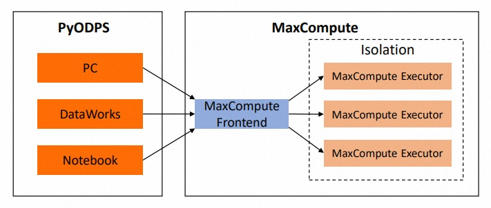

- Code analysis

  - Reference of third-party packages

    All sample code except code of the HANDLE function is executed on the on-premises system. Take note that the HANDLE function is passed to the MAP method but is not executed. Therefore, the execution behavior of the sample code is similar to the execution behavior of ordinary Python code. When a third-party package is imported, the on-premises package is referenced. In the sample code, the  `other.zip`  package that is referenced in  `libraries=['numpy.zip', 'other.zip']`  is not installed on the on-premises system. If the code contains statements such as  `import other` , an error is reported. This issue also occurs even if the  `other.zip`  package is uploaded to MaxCompute as a resource because the  `other.zip`  package does not exist on the on-premises system. Theoretically, if no PyODPS package is involved in the code that is executed on the on-premises system, this issue is not caused by PyODPS. In this case, you must check the code for troubleshooting.

  - HANDLE function

    If the MaxCompute backend is used when the HANDLE function is passed to the MAP method, the HANDLE function is processed in the following phases:

    <ol type="a">

    <li>

    The cloudpickle module extracts the closure and bytecode.

    </li>

    <li>

    PyODPS DataFrame uses the closure and bytecode to generate a Python user-defined function (UDF), and then submits the UDF to MaxCompute.

    </li>

    </ol>

    <ol type="i" start="100">

    <li>

    If you run jobs in MaxCompute by using SQL statements, the generated Python UDF is called, the bytecode and closure content in the UDF are unpickled, and then the UDF is executed in a MaxCompute executor.

    </li>

    </ol>

  - Summary

    - The code in the body of the HANDLE function is executed in a MaxCompute executor rather than the on-premises system.

    - The packages installed on the on-premises system cannot be referenced in the body of the HANDLE function. Only packages in MaxCompute executors can be referenced.

    - The uploaded third-party package must be able to be referenced in Python 2.7 that uses UCS-2 in a MaxCompute executor.

    - If you modify a referenced external variable, such as  `coeffs`  in the sample code, in the body of the HANDLE function, the value of the variable on the on-premises system is retained.

    - If you reference a package in the body of the HANDLE function, and the package is imported outside the HANDLE function, an error may be reported. This is because the cloudpickle module sends the reference of the on-premises package to a MaxCompute executor but the structure of the package may not be supported by the MaxCompute executor. Therefore, we recommend that you import the package in the body of the HANDLE function.

    - If the code of another file is referenced in the body of the HANDLE function, the package to which the file belongs must exist in a MaxCompute executor. If you do not want to resolve the issue by using a third-party package, store all referenced personal code in the same file.

You can apply the preceding summary about the HANDLE function to custom methods and aggregate classes that are referenced in the apply, map_reduce, and custom aggregate functions. If you use a pandas backend, all code runs on the on-premises system. Therefore, you must install the relevant packages on the on-premises system. However, code is transferred to MaxCompute to run after debugging at the pandas backend. In this case, we recommend that you comply with the MaxCompute backend rules for development when you install the package on the on-premises system.

**Use a third-party package**

- Personal computer or on-premises server: If you want to use code in a third-party package or other files, install the third-party package or files on the required Python version.

- Notebook: If you want to use code in a third-party package or other files, contact the platform provider for technical support.

- DataWorks: DataWorks does not allow you to install third-party packages on the on-premises system. However, you can reference third-party packages. You can read other files and run the  `exec`  command to use code in other files on the on-premises system. For more information, see Use a PyODPS node to reference a third-party package.

  > **Important**
  >
  > - The **directory structure** in DataStudio is not an actual directory structure in the file system. If you import or open the file path that is displayed in DataStudio, the execution fails.
  >
  > - After you upload resources in DataWorks, click **Submit** to ensure that the resources are uploaded to MaxCompute.
  >
  > - If you want to use your own NumPy version, you must specify  `odps.df.supersede_libraries = True`  in code when you upload the required wheel package. Make sure that you use the name of the NumPy package as the first parameter for the libraries parameter.

**Reference data in other MaxCompute tables**

- Personal computer or on-premises server: Locally access the MaxCompute table. If you can access the endpoint, use PyODPS or DataFrame to access the MaxCompute table.

- Notebook/DataWorks: Access the MaxCompute table by using on-premises code. If you can access the endpoint, use PyODPS/DataFrame to access the MaxCompute table. If you cannot access the endpoint, contact the platform provider for technical support.

- Map, apply, map_reduce, and custom aggregate functions: The MaxCompute executor does not support access to endpoints or Tunnel endpoints, and no PyODPS package is available. Therefore, you cannot directly use ODPS entry objects or PyODPS DataFrame to access other MaxCompute tables. You cannot pass these objects from outside of UDFs. If the table does not contain a large amount of data, we recommend that you specify a DataFrame as a resource. For more information, see Reference resources. If the table contains a large amount of data, we recommend that you join tables.

<a id="section-9-9-2"></a>

### 9.9.2. Reference a third-party package in a PyODPS node

This topic describes how to reference a third-party package in a PyODPS node. For more information about how to generate a third-party package for PyODPS, see Generate a third-party package for PyODPS.

**Prerequisites**

- MaxCompute is activated.

- DataWorks is activated.

**Upload a third-party package**

Before you reference a third-party package, you must make sure that the package has been uploaded to MaxCompute as an archive resource. You can upload a third-party package by using one of the following methods:

- Use code to upload a third-party package. In the following sample code, replace  `packages.tar.gz`  with the path and name of the package that you want to upload.

  ```python
  import os
  from odps import ODPS

  # Set the environment variable ALIBABA_CLOUD_ACCESS_KEY_ID to the AccessKey ID of your Alibaba Cloud account. 
  # Set the environment variable ALIBABA_CLOUD_ACCESS_KEY_SECRET to the AccessKey secret of the Alibaba Cloud account. 
  # We recommend that you do not directly use your AccessKey ID or AccessKey secret.
  o = ODPS(
      os.getenv('ALIBABA_CLOUD_ACCESS_KEY_ID'),
      os.getenv('ALIBABA_CLOUD_ACCESS_KEY_SECRET'),
      project='<your-default-project>',
      endpoint='<your-end-point>',
  )
  o.create_resource("test_packed.tar.gz", "archive", fileobj=open("packages.tar.gz", "rb"))
  ```

- Use DataWorks to upload a third-party package. For more information, see the DataWorks documentation.

**Reference a third-party package in a Python UDF**

Before you reference a third-party package in a Python user-defined function (UDF), you must perform the following steps to modify the Python UDF:

1. Add a reference to the third-party package in the  `_init_`  method of the UDF class.

2. Reference the third-party package by using the UDF code, such as the evaluate function or the process method.

**Example**

In this example, a third-party package is referenced by using a Python UDF named psi in SciPy.

1. Run the following command to package SciPy.

   ```text
   pyodps-pack -o scipy-bundle.tar.gz scipy
   ```

2. Write the following code and save the code as a file named  `test_psi_udf.py` .

   ```python
   import sys
   from odps.udf import annotate

   @annotate("double->double")
   class MyPsi(object):
       def __init__(self):
           # Add the path to the reference path.
           sys.path.insert(0, "work/scipy-bundle.tar.gz/packages")

       def evaluate(self, arg0):
           # Put the IMPORT statement inside the evaluate function.
           from scipy.special import psi

           return float(psi(arg0))
   ```

   Code description: The  `__init__`  function adds  `work/scipy-bundle.tar.gz/packages`  to  `sys.path` . This is because MaxCompute decompresses all archive resources that are referenced by the UDF to folders in the  `work`  directory. The folder name is the same as the resource name. The  `packages`  directory is the subdirectory of the package that is generated by using  `pyodps-pack` . The IMPORT statement of SciPy is placed within the evaluate function body. This is because the third-party package is available only during runtime. When the UDF is parsed on the MaxCompute server, the parsing environment does not contain the third-party package. If you put the IMPORT statement outside the function body to import the third-party package, an error is reported.

3. Upload  `test_psi_udf.py`  as a MaxCompute Python resource and upload  `scipy-bundle.tar.gz`  as an archive resource.

4. Create a UDF named  `test_psi_udf` , reference the two uploaded resource files, and specify the class name as  `test_psi_udf.MyPsi` .

   You can perform Step 3 and Step 4 in a PyODPS node or on the MaxCompute client.

   - In a PyODPS node:

     ```python
     import os
     from odps import ODPS

     # Set the environment variable ALIBABA_CLOUD_ACCESS_KEY_ID to the AccessKey ID of your Alibaba Cloud account. 
     # Set the environment variable ALIBABA_CLOUD_ACCESS_KEY_SECRET to the AccessKey secret of the Alibaba Cloud account. 
     # We recommend that you do not directly use your AccessKey ID or AccessKey secret.
     o = ODPS(
         os.getenv('ALIBABA_CLOUD_ACCESS_KEY_ID'),
         os.getenv('ALIBABA_CLOUD_ACCESS_KEY_SECRET'),
         project='<your-default-project>',
         endpoint='<your-end-point>',
     )

     bundle_res = o.create_resource(
         "scipy-bundle.tar.gz", "archive", fileobj=open("scipy-bundle.tar.gz", "rb")
     )
     udf_res = o.create_resource(
         "test_psi_udf.py", "py", fileobj=open("test_psi_udf.py", "rb")
     )
     o.create_function(
         "test_psi_udf", class_type="test_psi_udf.MyPsi", resources=[bundle_res, udf_res
     ]
     )
     ```

   - On the MaxCompute client:

     ```text
     add archive scipy-bundle.tar.gz;
     add py test_psi_udf.py;
     create function test_psi_udf as test_psi_udf.MyPsi using test_psi_udf.py,scipy-bundle.tar.gz;
     ```

5. After you complete the preceding operations, use the UDF to execute SQL statements.

   ```sql
   set odps.pypy.enabled=false;
   set odps.isolation.session.enable=true;
   select test_psi_udf(sepal_length) from iris;
   ```

**Reference a third-party package in PyODPS DataFrame**

You can reference a third-party library in PyODPS DataFrame by specifying the  `libraries` parameter in the execute or persist method. This section describes how to reference a third-party package in PyODPS DataFrame if you use the map method. The procedure is similar if you use the apply or map_reduce method.

1. Run the following command to package SciPy:

   ```text
   pyodps-pack -o scipy-bundle.tar.gz scipy
   ```

2. In this example, a table named  `test_float_col`  is used. This table contains only one column of the FLOAT type.

   ```text
      col1
   0  3.75
   1  2.51
   ```

   Run the following code to calculate the value of  `psi(col1)` :

   ```python
   import os
   from odps import ODPS, options

   def psi(v):
       from scipy.special import psi

       return float(psi(v))

   # If the isolation feature is enabled for your project, you are not required to configure the following option:
   options.sql.settings = {"odps.isolation.session.enable": True}

   # Set the environment variable ALIBABA_CLOUD_ACCESS_KEY_ID to your AccessKey ID. 
   # Set the environment variable ALIBABA_CLOUD_ACCESS_KEY_SECRET to the AccessKey secret of the Alibaba Cloud account. 
   # We recommend that you do not directly use your AccessKey ID or AccessKey secret.
   o = ODPS(
       os.getenv('ALIBABA_CLOUD_ACCESS_KEY_ID'),
       os.getenv('ALIBABA_CLOUD_ACCESS_KEY_SECRET'),
       project='<your-default-project>',
       endpoint='<your-end-point>',
   )
   df = o.get_table("test_float_col").to_df()
   # Run the following code and obtain the result:
   df.col1.map(psi).execute(libraries=["scipy-bundle.tar.gz"])
   # Save the result to another table.
   df.col1.map(psi).persist("result_table", libraries=["scipy-bundle.tar.gz"])
   ```

3. Optional. If you want to use the same third-party package throughout the runtime, you can configure the global parameter.

   ```python
   from odps import options
   options.df.libraries = ["scipy-bundle.tar.gz"]
   ```

After you perform the preceding operations, reference the third-party package in PyODPS DataFrame.

**Reference a third-party package in DataWorks**

A DataWorks PyODPS node provides built-in third-party packages and also provides the  `load_resource_package`  method for you to reference other packages. For more information, see Use a third-party package.

**Manually upload and reference a third-party package**

> **Note**
>
> This section provides a reference for maintaining an existing project or environment. For newly created projects, we recommend that you use  `pyodps-pack` .

In some existing projects, you may manually upload all WHL dependencies and reference them in the code, or use MaxCompute of an early version that does not support binary packages. This section describes how to manually upload and reference a third-party package in these existing projects. In this example, python_dateutil is used in the map method.

1. Run the  `pip download`  command in Linux Bash to download the third-party package and its dependencies to a directory. Two packages are downloaded:  `six-1.10.0-py2.py3-none-any.whl`  and  `python_dateutil-2.5.3-py2.py3-none-any.whl` .

   ```bash
   pip download python-dateutil -d /to/path/
   ```

   > **Note**
   >
   > Note that the downloaded packages must support the Linux operating system. We recommend that you run this command in the Linux operating system.

2. Upload the downloaded packages to MaxCompute as resources.

   - Method 1: Use code.

     ```text
     # You must make sure that file name extensions are valid.
     odps.create_resource('six.whl', 'file', file_obj=open('six-1.10.0-py2.py3-none-any.whl', 'rb'))
     odps.create_resource('python_dateutil.whl', 'file', file_obj=open('python_dateutil-2.5.3-py2.py3-none-any.whl', 'rb'))
     ```

   - Method 2: Use DataWorks.

     You can upload and commit the destination resources by following the instructions provided in the DataWorks documentation.

3. Reference the third-party package.

   In this example, a DataFrame object contains only a field of the STRING type.

   ```text
   >>> df
                  datestr
   0  2016-08-26 14:03:29
   1  2015-08-26 14:03:29
   ```

   - Use the following third-party libraries in global configurations.

     ```text
     >>> from odps import options
     >>>
     >>> def get_year(t):
     >>>     from dateutil.parser import parse
     >>>     return parse(t).strftime('%Y')
     >>>
     >>> options.df.libraries = ['six.whl', 'python_dateutil.whl']
     >>> df.datestr.map(get_year)
        datestr
     0     2016
     1     2015
     ```

   - Use the  `libraries`  parameter of an immediately-invoked method to specify the libraries:

     ```text
     >>> def get_year(t):
     >>>     from dateutil.parser import parse
     >>>     return parse(t).strftime('%Y')
     >>>
     >>> df.datestr.map(get_year).execute(libraries=['six.whl', 'python_dateutil.whl'])
        datestr
     0     2016
     1     2015
     ```

By default, PyODPS supports Python libraries that contain only Python code and do not involve file operations. In later versions of MaxCompute, PyODPS also supports Python libraries that include binary code or involve file operations. The library names must have suffixes. The following table describes the suffixes that are supported by different Python libraries.

| Platform | Python version | Supported suffix |
| --- | --- | --- |
| RHEL 5 x86_64 | Python 2.7 | cp27-cp27m-manylinux1_x86_64 |
| RHEL 5 x86_64 | Python 3.7 | cp37-cp37m-manylinux1_x86_64 |
| RHEL 7 x86_64 | Python 2.7 | cp27-cp27m-manylinux1_x86_64, cp27-cp27m-manylinux2010_x86_64, cp27-cp27m-manylinux2014_x86_64 |
| RHEL 7 x86_64 | Python 3.7 | cp37-cp37m-manylinux1_x86_64, cp37-cp37m-manylinux2010_x86_64, cp37-cp37m-manylinux2014_x86_64 |
| RHEL 7 Arm64 | Python 3.7 | cp37-cp37m-manylinux2014_aarch64 |

All WHL packages must be uploaded to MaxCompute as archive resources. Before you upload the packages, you must convert the packages into ZIP files by changing file name extensions. You also need to set the  `odps.isolation.session.enable`  parameter to True for the job or your project. The following example demonstrates how to upload and use special functions in SciPy:

```python
# Packages that contain binary code must be uploaded as archive resources. You must convert WHL packages into ZIP files before you upload the packages.
odps.create_resource('scipy.zip', 'archive', file_obj=open('scipy-0.19.0-cp27-cp27m-manylinux1_x86_64.whl', 'rb'))

# If the isolation feature is enabled for your project, you are not required to configure the following option:
options.sql.settings = { 'odps.isolation.session.enable': True }

def psi(value):
    # We recommend that you put the IMPORT statement inside a function to import third-party libraries. This prevents runtime errors caused by structural differences of binary packages in different operating systems.
    from scipy.special import psi
    return float(psi(value))

df.float_col.map(psi).execute(libraries=['scipy.zip'])
```

You can compress binary packages that contain only source code into WHL files by running the following shell command in Linux and then upload them. WHL files generated in macOS or Windows cannot be used in MaxCompute.

```text
python setup.py bdist_wheel
```

<a id="section-9-9-3"></a>

### 9.9.3. Use a PyODPS node to query data based on specific criteria

This topic describes how to use a PyODPS node to query data based on specific criteria.

**Prerequisites**

The following prerequisites are met:

- MaxCompute is activated.

- DataWorks is activated.

- A workflow is created in the DataWorks console. In this example, a workflow is created for a DataWorks workspace in basic mode.

**Procedure**

1. Create a table and import data to the table.

   <ol type="i">

   <li>

   Download the dataset iris.data from iris and rename iris.data as iris.csv.

   </li>

   <li>

   Create a table named **pyodps_iris** and upload the dataset iris.csv to the table. For more

   </li>

   </ol>

   information, see the "Create tables and upload data" topic in the DataWorks document.

   Sample statement:

   ```sql
   CREATE TABLE if not exists pyodps_iris
   (
   sepallength  DOUBLE comment 'sepal length (cm)',
   sepalwidth   DOUBLE comment 'sepal width (cm)',
   petallength  DOUBLE comment ''petal length (cm)',
   petalwidth   DOUBLE comment 'petal width (cm)',
   name         STRING comment 'type'
   );
   ```

2. Log on to the DataWorks console.

3. In the left-side navigation pane, click **Workspaces**.

4. Find your workspace, and choose **Shortcuts > Data Development** in the **Actions** column.

5. On the DataStudio page, right-click the created workflow and choose **Create Node > MaxCompute > PyODPS 2**.

6. In the **Create Node** dialog box, specify **Name** and click **Confirm**.

7. On the configuration tab of the node, enter sample code in the code editor.

   ```python
   import sys
   reload(sys)
   # Change the default encoding format. 
   sys.setdefaultencoding('utf8')

   iris = DataFrame(o.get_table('pyodps_iris'))
   # Method 1: Return the result based on a conditional query statement. 
   with o.execute_sql('select * from pyodps_iris WHERE sepallength > 5 ').open_reader() as reader4:
       print reader4.raw
       for record in reader4:
           print 
   record["sepallength"],record["sepalwidth"],record["petallength"],record["petalwidth"],r
   ord["name"]

   # Method 2: Return the result based on the filter conditions of PyODPS DataFrame. 
   print iris[iris.sepallength > 5].head(5)

   # Method 3: Return the result by using the query method of PyODPS DataFrame. 
   print iris.query("(sepallength < 5) and (petallength > 1.5)").head(5)
   ```

8. Click  .

   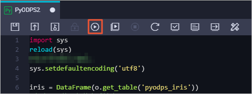

9. View the execution result of the PyODPS 2 node on the **Runtime Log** tab.

   ```sql
   Executing user script with PyODPS 0.8.0

   "sepallength","sepalwidth","petallength","petalwidth","name"
   5.1,3.5,1.4,0.2,"Iris-setosa"
   5.4,3.9,1.7,0.4,"Iris-setosa"
   5.4,3.7,1.5,0.2,"Iris-setosa"
   5.8,4.0,1.2,0.2,"Iris-setosa"
   5.7,4.4,1.5,0.4,"Iris-setosa"
   5.4,3.9,1.3,0.4,"Iris-setosa"
   5.1,3.5,1.4,0.3,"Iris-setosa"
   5.7,3.8,1.7,0.3,"Iris-setosa"
   5.1,3.8,1.5,0.3,"Iris-setosa"
   5.4,3.4,1.7,0.2,"Iris-setosa"
   5.1,3.7,1.5,0.4,"Iris-setosa"
   5.1,3.3,1.7,0.5,"Iris-setosa"
   5.2,3.5,1.5,0.2,"Iris-setosa"
   5.2,3.4,1.4,0.2,"Iris-setosa"
   5.4,3.4,1.5,0.4,"Iris-setosa"
   5.2,4.1,1.5,0.1,"Iris-setosa"
   5.5,4.2,1.4,0.2,"Iris-setosa"
   5.5,3.5,1.3,0.2,"Iris-setosa"
   5.1,3.4,1.5,0.2,"Iris-setosa"
   5.1,3.8,1.9,0.4,"Iris-setosa"
   5.1,3.8,1.6,0.2,"Iris-setosa"
   5.3,3.7,1.5,0.2,"Iris-setosa"
   7.0,3.2,4.7,1.4,"Iris-versicolor"
   6.4,3.2,4.5,1.5,"Iris-versicolor"
   6.9,3.1,4.9,1.5,"Iris-versicolor"
   5.5,2.3,4.0,1.3,"Iris-versicolor"
   6.5,2.8,4.6,1.5,"Iris-versicolor"
   5.7,2.8,4.5,1.3,"Iris-versicolor"
   6.3,3.3,4.7,1.6,"Iris-versicolor"
   6.6,2.9,4.6,1.3,"Iris-versicolor"
   5.2,2.7,3.9,1.4,"Iris-versicolor"
   5.9,3.0,4.2,1.5,"Iris-versicolor"
   6.0,2.2,4.0,1.0,"Iris-versicolor"
   6.1,2.9,4.7,1.4,"Iris-versicolor"
   5.6,2.9,3.6,1.3,"Iris-versicolor"
   6.7,3.1,4.4,1.4,"Iris-versicolor"
   5.6,3.0,4.5,1.5,"Iris-versicolor"
   5.8,2.7,4.1,1.0,"Iris-versicolor"
   6.2,2.2,4.5,1.5,"Iris-versicolor"
   5.6,2.5,3.9,1.1,"Iris-versicolor"
   5.9,3.2,4.8,1.8,"Iris-versicolor"
   6.1,2.8,4.0,1.3,"Iris-versicolor"
   6.3,2.5,4.9,1.5,"Iris-versicolor"
   6.1,2.8,4.7,1.2,"Iris-versicolor"
   6.4,2.9,4.3,1.3,"Iris-versicolor"
   6.6,3.0,4.4,1.4,"Iris-versicolor"
   6.8,2.8,4.8,1.4,"Iris-versicolor"
   6.7,3.0,5.0,1.7,"Iris-versicolor"
   6.0,2.9,4.5,1.5,"Iris-versicolor"
   5.7,2.6,3.5,1.0,"Iris-versicolor"
   5.5,2.4,3.8,1.1,"Iris-versicolor"
   5.5,2.4,3.7,1.0,"Iris-versicolor"
   5.8,2.7,3.9,1.2,"Iris-versicolor"
   6.0,2.7,5.1,1.6,"Iris-versicolor"
   5.4,3.0,4.5,1.5,"Iris-versicolor"
   6.0,3.4,4.5,1.6,"Iris-versicolor"
   6.7,3.1,4.7,1.5,"Iris-versicolor"
   6.3,2.3,4.4,1.3,"Iris-versicolor"
   5.6,3.0,4.1,1.3,"Iris-versicolor"
   5.5,2.5,4.0,1.3,"Iris-versicolor"
   5.5,2.6,4.4,1.2,"Iris-versicolor"
   6.1,3.0,4.6,1.4,"Iris-versicolor"
   5.8,2.6,4.0,1.2,"Iris-versicolor"
   5.6,2.7,4.2,1.3,"Iris-versicolor"
   5.7,3.0,4.2,1.2,"Iris-versicolor"
   5.7,2.9,4.2,1.3,"Iris-versicolor"
   6.2,2.9,4.3,1.3,"Iris-versicolor"
   5.1,2.5,3.0,1.1,"Iris-versicolor"
   5.7,2.8,4.1,1.3,"Iris-versicolor"
   6.3,3.3,6.0,2.5,"Iris-virginica"
   5.8,2.7,5.1,1.9,"Iris-virginica"
   7.1,3.0,5.9,2.1,"Iris-virginica"
   6.3,2.9,5.6,1.8,"Iris-virginica"
   6.5,3.0,5.8,2.2,"Iris-virginica"
   7.6,3.0,6.6,2.1,"Iris-virginica"
   7.3,2.9,6.3,1.8,"Iris-virginica"
   6.7,2.5,5.8,1.8,"Iris-virginica"
   7.2,3.6,6.1,2.5,"Iris-virginica"
   6.5,3.2,5.1,2.0,"Iris-virginica"
   6.4,2.7,5.3,1.9,"Iris-virginica"
   6.8,3.0,5.5,2.1,"Iris-virginica"
   5.7,2.5,5.0,2.0,"Iris-virginica"
   5.8,2.8,5.1,2.4,"Iris-virginica"
   6.4,3.2,5.3,2.3,"Iris-virginica"
   6.5,3.0,5.5,1.8,"Iris-virginica"
   7.7,3.8,6.7,2.2,"Iris-virginica"
   7.7,2.6,6.9,2.3,"Iris-virginica"
   6.0,2.2,5.0,1.5,"Iris-virginica"
   6.9,3.2,5.7,2.3,"Iris-virginica"
   5.6,2.8,4.9,2.0,"Iris-virginica"
   7.7,2.8,6.7,2.0,"Iris-virginica"
   6.3,2.7,4.9,1.8,"Iris-virginica"
   6.7,3.3,5.7,2.1,"Iris-virginica"
   7.2,3.2,6.0,1.8,"Iris-virginica"
   6.2,2.8,4.8,1.8,"Iris-virginica"
   6.1,3.0,4.9,1.8,"Iris-virginica"
   6.4,2.8,5.6,2.1,"Iris-virginica"
   7.2,3.0,5.8,1.6,"Iris-virginica"
   7.4,2.8,6.1,1.9,"Iris-virginica"
   7.9,3.8,6.4,2.0,"Iris-virginica"
   6.4,2.8,5.6,2.2,"Iris-virginica"
   6.3,2.8,5.1,1.5,"Iris-virginica"
   6.1,2.6,5.6,1.4,"Iris-virginica"
   7.7,3.0,6.1,2.3,"Iris-virginica"
   6.3,3.4,5.6,2.4,"Iris-virginica"
   6.4,3.1,5.5,1.8,"Iris-virginica"
   6.0,3.0,4.8,1.8,"Iris-virginica"
   6.9,3.1,5.4,2.1,"Iris-virginica"
   6.7,3.1,5.6,2.4,"Iris-virginica"
   6.9,3.1,5.1,2.3,"Iris-virginica"
   5.8,2.7,5.1,1.9,"Iris-virginica"
   6.8,3.2,5.9,2.3,"Iris-virginica"
   6.7,3.3,5.7,2.5,"Iris-virginica"
   6.7,3.0,5.2,2.3,"Iris-virginica"
   6.3,2.5,5.0,1.9,"Iris-virginica"
   6.5,3.0,5.2,2.0,"Iris-virginica"
   6.2,3.4,5.4,2.3,"Iris-virginica"
   5.9,3.0,5.1,1.8,"Iris-virginica"
   5.1 3.5 1.4 0.2 Iris-setosa
   5.4 3.9 1.7 0.4 Iris-setosa
   5.4 3.7 1.5 0.2 Iris-setosa
   5.8 4.0 1.2 0.2 Iris-setosa
   5.7 4.4 1.5 0.4 Iris-setosa
   5.4 3.9 1.3 0.4 Iris-setosa
   5.1 3.5 1.4 0.3 Iris-setosa
   5.7 3.8 1.7 0.3 Iris-setosa
   5.1 3.8 1.5 0.3 Iris-setosa
   5.4 3.4 1.7 0.2 Iris-setosa
   5.1 3.7 1.5 0.4 Iris-setosa
   5.1 3.3 1.7 0.5 Iris-setosa
   5.2 3.5 1.5 0.2 Iris-setosa
   5.2 3.4 1.4 0.2 Iris-setosa
   5.4 3.4 1.5 0.4 Iris-setosa
   5.2 4.1 1.5 0.1 Iris-setosa
   5.5 4.2 1.4 0.2 Iris-setosa
   5.5 3.5 1.3 0.2 Iris-setosa
   5.1 3.4 1.5 0.2 Iris-setosa
   5.1 3.8 1.9 0.4 Iris-setosa
   5.1 3.8 1.6 0.2 Iris-setosa
   5.3 3.7 1.5 0.2 Iris-setosa
   7.0 3.2 4.7 1.4 Iris-versicolor
   6.4 3.2 4.5 1.5 Iris-versicolor
   6.9 3.1 4.9 1.5 Iris-versicolor
   5.5 2.3 4.0 1.3 Iris-versicolor
   6.5 2.8 4.6 1.5 Iris-versicolor
   5.7 2.8 4.5 1.3 Iris-versicolor
   6.3 3.3 4.7 1.6 Iris-versicolor
   6.6 2.9 4.6 1.3 Iris-versicolor
   5.2 2.7 3.9 1.4 Iris-versicolor
   5.9 3.0 4.2 1.5 Iris-versicolor
   6.0 2.2 4.0 1.0 Iris-versicolor
   6.1 2.9 4.7 1.4 Iris-versicolor
   5.6 2.9 3.6 1.3 Iris-versicolor
   6.7 3.1 4.4 1.4 Iris-versicolor
   5.6 3.0 4.5 1.5 Iris-versicolor
   5.8 2.7 4.1 1.0 Iris-versicolor
   6.2 2.2 4.5 1.5 Iris-versicolor
   5.6 2.5 3.9 1.1 Iris-versicolor
   5.9 3.2 4.8 1.8 Iris-versicolor
   6.1 2.8 4.0 1.3 Iris-versicolor
   6.3 2.5 4.9 1.5 Iris-versicolor
   6.1 2.8 4.7 1.2 Iris-versicolor
   6.4 2.9 4.3 1.3 Iris-versicolor
   6.6 3.0 4.4 1.4 Iris-versicolor
   6.8 2.8 4.8 1.4 Iris-versicolor
   6.7 3.0 5.0 1.7 Iris-versicolor
   6.0 2.9 4.5 1.5 Iris-versicolor
   5.7 2.6 3.5 1.0 Iris-versicolor
   5.5 2.4 3.8 1.1 Iris-versicolor
   5.5 2.4 3.7 1.0 Iris-versicolor
   5.8 2.7 3.9 1.2 Iris-versicolor
   6.0 2.7 5.1 1.6 Iris-versicolor
   5.4 3.0 4.5 1.5 Iris-versicolor
   6.0 3.4 4.5 1.6 Iris-versicolor
   6.7 3.1 4.7 1.5 Iris-versicolor
   6.3 2.3 4.4 1.3 Iris-versicolor
   5.6 3.0 4.1 1.3 Iris-versicolor
   5.5 2.5 4.0 1.3 Iris-versicolor
   5.5 2.6 4.4 1.2 Iris-versicolor
   6.1 3.0 4.6 1.4 Iris-versicolor
   5.8 2.6 4.0 1.2 Iris-versicolor
   5.6 2.7 4.2 1.3 Iris-versicolor
   5.7 3.0 4.2 1.2 Iris-versicolor
   5.7 2.9 4.2 1.3 Iris-versicolor
   6.2 2.9 4.3 1.3 Iris-versicolor
   5.1 2.5 3.0 1.1 Iris-versicolor
   5.7 2.8 4.1 1.3 Iris-versicolor
   6.3 3.3 6.0 2.5 Iris-virginica
   5.8 2.7 5.1 1.9 Iris-virginica
   7.1 3.0 5.9 2.1 Iris-virginica
   6.3 2.9 5.6 1.8 Iris-virginica
   6.5 3.0 5.8 2.2 Iris-virginica
   7.6 3.0 6.6 2.1 Iris-virginica
   7.3 2.9 6.3 1.8 Iris-virginica
   6.7 2.5 5.8 1.8 Iris-virginica
   7.2 3.6 6.1 2.5 Iris-virginica
   6.5 3.2 5.1 2.0 Iris-virginica
   6.4 2.7 5.3 1.9 Iris-virginica
   6.8 3.0 5.5 2.1 Iris-virginica
   5.7 2.5 5.0 2.0 Iris-virginica
   5.8 2.8 5.1 2.4 Iris-virginica
   6.4 3.2 5.3 2.3 Iris-virginica
   65305518Iris-virginica
   7.7 3.8 6.7 2.2 Iris-virginica
   7.7 2.6 6.9 2.3 Iris-virginica
   6.0 2.2 5.0 1.5 Iris-virginica
   6.9 3.2 5.7 2.3 Iris-virginica
   5.6 2.8 4.9 2.0 Iris-virginica
   7.7 2.8 6.7 2.0 Iris-virginica
   6.3 2.7 4.9 1.8 Iris-virginica
   6.7 3.3 5.7 2.1 Iris-virginica
   7.2 3.2 6.0 1.8 Iris-virginica
   6.2 2.8 4.8 1.8 Iris-virginica
   6.1 3.0 4.9 1.8 Iris-virginica
   6.4 2.8 5.6 2.1 Iris-virginica
   7.2 3.0 5.8 1.6 Iris-virginica
   7.4 2.8 6.1 1.9 Iris-virginica
   7.9 3.8 6.4 2.0 Iris-virginica
   6.4 2.8 5.6 2.2 Iris-virginica
   6.3 2.8 5.1 1.5 Iris-virginica
   6.1 2.6 5.6 1.4 Iris-virginica
   7.7 3.0 6.1 2.3 Iris-virginica
   6.3 3.4 5.6 2.4 Iris-virginica
   6.4 3.1 5.5 1.8 Iris-virginica
   6.0 3.0 4.8 1.8 Iris-virginica
   6.9 3.1 5.4 2.1 Iris-virginica
   6.7 3.1 5.6 2.4 Iris-virginica
   6.9 3.1 5.1 2.3 Iris-virginica
   5.8 2.7 5.1 1.9 Iris-virginica
   6.8 3.2 5.9 2.3 Iris-virginica
   6.7 3.3 5.7 2.5 Iris-virginica
   6.7 3.0 5.2 2.3 Iris-virginica
   6.3 2.5 5.0 1.9 Iris-virginica
   6.5 3.0 5.2 2.0 Iris-virginica
   6.2 3.4 5.4 2.3 Iris-virginica
   5.9 3.0 5.1 1.8 Iris-virginica
   Sql compiled:
   CREATE TABLE tmp_pyodps_xxxx LIFECYCLE 1 AS
   SELECT *
   FROM xxx.`pyodps_iris` t1
   WHERE t1.`sepallength` > 5
   Instance ID: 2019xxxx
     Log view: http://logview.odps.aliyun.com/logview/?
   h=http://service.cn.maxcompute.aliyun.com/api&p=xxxx&i=2019xxxx&token=xxxx

      sepallength  sepalwidth  petallength  petalwidth         name
   0          5.1         3.5          1.4         0.2  Iris-setosa
   1          5.4         3.9          1.7         0.4  Iris-setosa
   2          5.4         3.7          1.5         0.2  Iris-setosa
   3          5.8         4.0          1.2         0.2  Iris-setosa
   4          5.7         4.4          1.5         0.4  Iris-setosa
   Sql compiled:
   CREATE TABLE tmp_pyodps_xxxx LIFECYCLE 1 AS
   SELECT *
   FROM xxxx.`pyodps_iris` t1
   WHERE (t1.`sepallength` < 5) AND (t1.`petallength` > 1.5)
   Instance ID: 2019xxxx
     Log view: http://logview.odps.aliyun.com/logview/?
   h=http://service.cn.maxcompute.aliyun.com/api&p=xxxx&i=2019xxxx&token=xxxx

      sepallength  sepalwidth  petallength  petalwidth             name
   0          4.8         3.4          1.6         0.2      Iris-setosa
   1          4.8         3.4          1.9         0.2      Iris-setosa
   2          4.7         3.2          1.6         0.2      Iris-setosa
   3          4.8         3.1          1.6         0.2      Iris-setosa
   4          4.9         2.4          3.3         1.0  Iris-versicolor
   ```

<a id="section-9-9-4"></a>

### 9.9.4. Use a PyODPS node to pass parameters

This topic describes how to use a PyODPS node to pass parameters.

**Prerequisites**

The following operations are performed:

- MaxCompute is activated.

- DataWorks is activated.

- A workflow is created in the DataWorks console. In this example, a workflow is created for a DataWorks workspace in basic mode.

**Procedure**

1. Prepare test data.

   <ol type="i">

   <li>

   Create a partitioned table and a source table, and import data to the source table. For more information, see Create tables and upload data in DataWorks User Guide.

   In this example, use the following table creation statements and source data.

   - Execute the following statement to create a partitioned table named user_detail:

     ```sql
     create table if not exists user_detail
     (
     userid    BIGINT comment 'user ID',
     job       STRING comment 'job type',
     education STRING comment 'education level'
     ) comment 'user information table'
     partitioned by (dt STRING comment 'date',region STRING comment 'region');
     ```

   - Execute the following statement to create a source table named user_detail_ods:

     ```sql
     create table if not exists user_detail_ods
     (
       userid    BIGINT comment 'user ID',
       job       STRING comment 'job type',
       education STRING comment 'education level',
       dt STRING comment 'date',
       region STRING comment 'region'
     );
     ```

   - Create a source data file named user_detail.txt and save the following data to the file. Import the data to the user_detail_ods table.

     ```text
     0001,Internet,bachelor,20190715,beijing
     0002,education,junior college,20190716,beijing
     0003,finance,master,20190715,shandong
     0004,Internet,master,20190715,beijing
     ```

   </li>

   <li>

   Right-click the workflow and choose **Create Node > MaxCompute > ODPS SQL**.

   </li>

   <li>

   In the Create Node dialog box, specify **Name** and click **Confirm**.

   </li>

   <li>

   On the configuration tab of the ODPS SQL node, enter the following code in the code editor:

   ```sql
   insert overwrite table user_detail partition (dt,region)
   select userid,job,education,dt,region from user_detail_ods;
   ```

   </li>

   <li>

   Click the **Run** icon on the toolbar to insert the data from the user_detail_ods table into the user_detail partitioned table.

   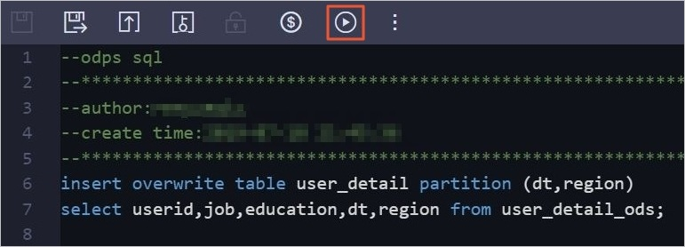

   </li>

   </ol>

2. Use a PyODPS node to pass parameters.

   <ol type="i">

   <li>

   Log on to the DataWorks console.

   </li>

   <li>

   In the left-side navigation pane, click **Workspaces**.

   </li>

   <li>

   Find your workspace, and choose **Shortcuts > Data Development** in the **Actions**

   </li>

   </ol>

   column.

   <ol type="i" start="4">

   <li>

   On the **DataStudio** page, right-click the created workflow and choose **Create Node > MaxCompute > PyODPS 2**.

   </li>

   <li>

   In the Create Node dialog box, specify **Name** and click **Confirm**.

   </li>

   <li>

   On the configuration tab of the PyODPS 2 node, enter the following code that is used to pass parameters in the code editor:

   ```python
   import sys
   reload(sys)
   print('dt=' + args['dt'])
   # Change the default encoding format. 
   sys.setdefaultencoding('utf8')
   # Obtain the user_detail table. 
   t = o.get_table('user_detail')
   # Receive the partition field that is passed. 
   with t.open_reader(partition='dt=' + args['dt'] + ',region=beijing') as reader1:
       count = reader1.count
   print("Query data in the partitioned table:")
   for record in reader1:
       print record[0],record[1],record[2]
   ```

   </li>

   <li>

   Click the **Run with Parameters** icon on the toolbar.

   </li>

   </ol>

   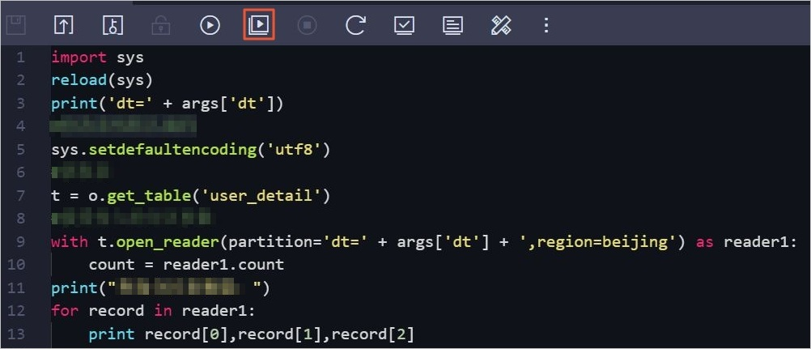

   <ol type="i" start="8">

   <li>

   In the **Parameters** dialog box, configure parameters and click **Run**.

   </li>

   </ol>

   Parameter description:

   - **Resource Group Name**: Select **Common scheduler resource group**.

   - **dt**: Set this parameter to **dt=20190715**.

   <ol type="i" start="9">

   <li>

   View the execution result of the node on the **Runtime Log** tab.

   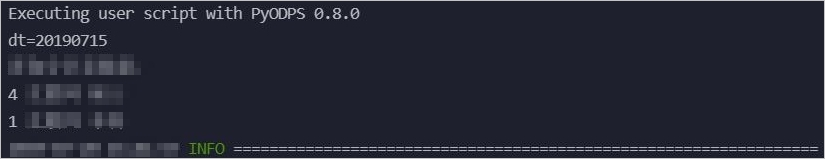

   </li>

   </ol>

<a id="section-9-9-5"></a>

### 9.9.5. Use a PyODPS node to read data from a partitioned table

This topic describes how to use a PyODPS node to read data from a partitioned table.

**Prerequisites**

The following prerequisites are met:

- MaxCompute is activated.

- DataWorks is activated.

- A workflow is created in the DataWorks console. In this example, a workflow is created for a DataWorks workspace in basic mode.

**Procedure**

1. Prepare test data.

   <ol type="i">

   <li>

   Create a table and upload data. For more information, see Create a table and upload data in the DataWorks documentation.

   The following table describes the schema and source data.

   - partition table the following statement to create a table user_detail:

     ```sql
     CREATE TABLE IF NOT EXISTS user_detail
     (
     userid BIGINT comment 'user id',
     job STRING comment 'job type',
     education STRING comment 'education attainment
     ) comment 'User information table'
     partitionedBY (dt STRING comment 'date', region STRING comment 'region'); 
     ```

   - user_detail_ods the table creation statement for the source data table:

     ```sql
     CREATE TABLE IF NOT EXISTS user_detail_ods
     (
       userid BIGINT comment 'user id',
       job STRING comment 'job type',
       education STRING comment 'educational attainment,'
       dt STRING comment 'Date',
       region STRING comment 'region'
     );
     ```

   - Create a source data file named user_detail.txt and save the following data to the file. Import the data to the user_detail_ods table.

     ```text
     0001,Internet,bachelor,20190715,beijing
     0002,education,junior college,20190716,beijing
     0003,finance,master,20190715,shandong
     0004,Internet,master,20190715,beijing
     ```

   </li>

   <li>

   Right-click the workflow and choose **Create Node > MaxCompute > ODPS SQL**.

   </li>

   <li>

   Enter a node name in the **Name** field and click **OK**.

   </li>

   <li>

   On the configuration tab of the ODPS SQL node, enter the following code in the code editor:

   ```sql
   INSERT OVERWRITE TABLE user_detail PARTITION(dt,region)
   SELECT userid,job,education,dt,region FROM user_detail_ods;
   ```

   </li>

   <li>

   Click  to insert data into the partition table user_detail.

   

   </li>

   </ol>

2. Use a PyODPS node to read data from a partitioned table.

   <ol type="i">

   <li>

   Log on to the DataWorks console.

   </li>

   <li>


   </li>

   <li>


   <ol type="i" start="4">

   <li>

   On the **Data Development** page, right-click the created workflow and choose **Create Node > MaxCompute > PyODPS 2**.

   </li>

   </ol>

   </li>

   <li value="5">

   Enter a node name in the **Name** field and click **OK**.

   </li>

   <li>

   On the configuration tab of the PyODPS 2 node, enter the following code in the code editor:

   ```python
   import sys
   from odps import ODPS
   reload(sys)
   print('dt=' + args['dt'])
   # Change the default encoding format. 
   sys.setdefaultencoding('utf8')
   # Specify the user information. 
   t = o.get_table('user_detail')
   # Check whether the specified partition exists. 
   print t.exist_partition('dt=20190715,region=beijing')
   # View all partitions in the partitioned table. 
   for partition in t.partitions:
       print partition.name
   # You can use one of the following methods to query data in the partitioned table: 
   # Method 1 
   with t.open_reader(partition='dt=20190715,region=beijing') as reader1:
       count = reader1.count
   print("Query data in the partitioned table by using Method 1:")
   for record in reader1:
       print record[0],record[1],record[2]
   # Method 2 
   print("Query data in the partitioned table by using Method 2:")
   reader2 = t.open_reader(partition='dt=20190715,region=beijing')
   for record in reader2:
       print record["userid"],record["job"],record["education"]
   # Method 3 
   print("Query data in the partitioned table by using Method 3:")
   for record in o.read_table('user_detail', partition='dt=20190715,region=beijing'):
       print record["userid"],record["job"],record["education"]
   ```

   </li>

   <li>

   Click **Advanced Run with Parameters**.

   </li>

   </ol>

   

   <ol type="i" start="8">

   <li>

   In the **Parameters** dialog box, configure the parameters and click **Run**.

   </li>

   </ol>

   Configuration Parameter **dt**: Set this parameter to **dt=20190715**.

   <ol type="i" start="9">

   <li>

   View the execution result of the node on the **Runtime Log** tab.

   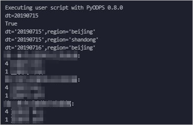

   </li>

   </ol>

<a id="section-9-9-6"></a>

### 9.9.6. View a first-level partition with PyODPS

This topic shows you how to view a first-level partition in PyODPS.

**Prerequisites**

The following operations are performed:

- MaxCompute is activated.

- DataWorks is activated.

- A workflow is created in the DataWorks console. In this example, a workflow is created for a DataWorks workspace in basic mode.

**Procedure**

1. Prepare test data.

   <ol type="i">

   <li>

   Create a table and upload data. For more information, see Create a table and upload data in the DataWorks documentation.

   The following table describes the schema and source data.

   - partition table the following statement to create a table user_detail:

     ```sql
     CREATE TABLE IF NOT EXISTS user_detail
     (
     userid BIGINT comment 'user id',
     job STRING comment 'job type',
     education STRING comment 'education attainment
     ) comment 'User information table'
     partitionedBY (dt STRING comment 'date', region STRING comment 'region'); 
     ```

   - user_detail_ods the table creation statement for the source data table:

     ```sql
     CREATE TABLE IF NOT EXISTS user_detail_ods
     (
       userid BIGINT comment 'user id',
       job STRING comment 'job type',
       education STRING comment 'educational attainment,'
       dt STRING comment 'Date',
       region STRING comment 'region'
     );
     ```

   - Create a source data file named user_detail.txt and save the following data to the file. Import the data to the user_detail_ods table.

     ```text
     0001,Internet,bachelor,20190715,beijing
     0002,education,junior college,20190716,beijing
     0003,finance,master,20190715,shandong
     0004,Internet,master,20190715,beijing
     ```

   </li>

   <li>

   Right-click the workflow and choose **Create Node > MaxCompute > ODPS SQL**.

   </li>

   <li>

   Enter a node name in the **Name** field and click **OK**.

   </li>

   <li>

   On the configuration tab of the ODPS SQL node, enter the following code in the code editor:

   ```sql
   INSERT OVERWRITE TABLE user_detail PARTITION(dt,region)
   SELECT userid,job,education,dt,region FROM user_detail_ods;
   ```

   </li>

   <li>

   Click  to insert data into the partition table user_detail.

   

   </li>

   </ol>

2. Use PyODPS to view first-level partitions.

   <ol type="i">

   <li>

   Log on to the DataWorks console.

   </li>

   <li>

   On the **Data Development** page, right-click the created workflow and choose **Create**

   </li>

   </ol>

   **Node > MaxCompute > PyODPS 2**.

   <ol type="i" start="3">

   <li>

   Enter a node name in the **Name** field and click **OK**.

   </li>

   <li>

   Enter the following code in a PyODPS 2 node to view the first-level partition data.

   ```python
   import sys
   reload(sys)
   # Set the default system encoding to UTF-8.
   sys.setdefaultencoding('utf8')

   # Read the first-level partition asynchronously.
   instance = o.run_sql('select * from user_detail WHERE dt=\'20190715\'')
   instance.wait_for_success()
   for record in instance.open_reader():
       print record["userid"],record["job"],record["education"]

   # Read the first-level partition synchronously.
   with o.execute_sql('select * from user_detail WHERE dt=\'20190715\'').open_reader() 
   as reader4:
       print reader4.raw
       for record in reader4:
           print record["userid"],record["job"],record["education"]

   # Load the first-level partition into a DataFrame.
   pt_df = DataFrame(o.get_table('user_detail').get_partition('dt=20190715'))
   print pt_df.head(10)
   ```

   </li>

   <li>

   Click the  icon.

   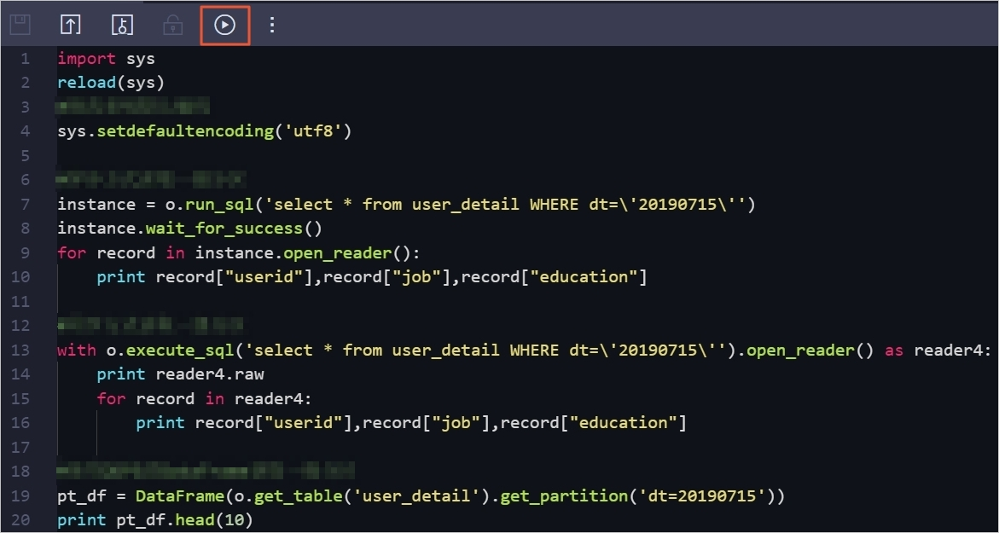

   </li>

   <li>

   You can view the execution results in the **Running Log**.

   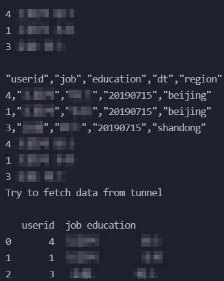

   </li>

   </ol>

<a id="section-9-9-7"></a>

### 9.9.7. PyODPS: Sequence and execution

This topic describes how to perform sequence and execution operations in PyODPS.

**Prerequisites**

The following operations are performed:

- MaxCompute is activated.

- DataWorks is activated.

- A workflow is created in the DataWorks console. In this example, a workflow is created for a DataWorks workspace in basic mode.

**Procedure**

1. Create a table and import data.

   <ol type="i">

   <li>

   Download the Iris dataset iris.data and rename it iris.csv.

   </li>

   <li>

   Create a table **pyodps_iris** and upload the dataset iris.csv. For more information, see

   </li>

   </ol>

   Create a table and upload a data document in DataWorks.

   Execute the following statement to create a table:

   ```sql
   CREATE TABLE if not exists pyodps_iris
   (
   sepallength DOUBLE comment 'Sheet length (cm)',
   sepalwidth DOUBLE comment 'Sheet width (cm)',
   petallength DOUBLE comment 'flap length (cm)',
   petalwidth DOUBLE comment 'flap width (cm)',
   name STRING comment 'Kind'
   );
   ```

2. Log on to the DataWorks console.

3. On the **Data Development** page, right-click the created workflow and choose **Create Node > MaxCompute > PyODPS 2**.

4. Enter a node name in the **Name** field and click **OK**.

5. In the **PyODPS** node editor, enter the following sample code.

   ```python
   from odps import DataFrame
   iris = DataFrame(o.get_table('pyodps_iris'))

   # Get a column.
   print iris.sepallength.head(5)

   print iris['sepallength'].head(5)

   # View the data type of the column.
   print iris.sepallength.dtype

   # Change the data type of the column.
   iris.sepallength.astype('int')

   # Perform a calculation.
   print iris.groupby('name').sepallength.max().head(5)

   print iris.sepallength.max()

   # Rename the column.
   print iris.sepalwidth.rename('speal_width').head(5)

   # Perform a simple column transformation.
   print (iris.sepallength + iris.sepalwidth).rename('sum_sepal').head(5)
   ```

6. Click the  icon.

7. View the result on the **Run Log** tab.

   The following output is returned:

   ```sql
   Executing user script with PyODPS 0.8.0
   Try to fetch data from tunnel

      sepallength
   0          4.9
   1          4.7
   2          4.6
   3          5.0
   4          5.4
   Try to fetch data from tunnel
      sepallength
   0          4.9
   1          4.7
   2          4.6
   3          5.0
   4          5.4
   FLOAT64
   Sql compiled:
   CREATE TABLE tmp_pyodps_ed78e3ba_f13c_4a49_812d_2790d57c25dd LIFECYCLE 1 AS
   SELECT MAX(t1.`sepallength`) AS `sepallength_max`
   FROM data_service_fr.`pyodps_iris` t1
   GROUP BY t1.`name`

      sepallength_max
   0              5.8
   1              7.0
   2              7.9
   Collection: ref_0
     odps.Table
       name: data_service_fr.`pyodps_iris`
       schema:
         sepallength           : double      # Sepal length (cm)
         sepalwidth            : double      # Sepal width (cm)
         petallength           : double      # Petal length (cm)
         petalwidth            : double      # Petal width (cm)
         name                  : string      # Species
   max = Max[float64]
     sepallength = Column[sequence(float64)] 'sepallength' from collection ref_0
   Try to fetch data from tunnel
      speal_width
   0          3.0
   1          3.2
   2          3.1
   3          3.6
   4          3.9
   Sql compiled:
   CREATE TABLE tmp_pyodps_28120275_8d0f_4683_8318_302fa21459ac LIFECYCLE 1 AS
   SELECT t1.`sepallength` + t1.`sepalwidth` AS `sum_sepal`
   FROM data_service_fr.`pyodps_iris` t1

      sum_sepal
   0        7.9
   1        7.9
   2        7.7
   3        8.6
   4        9.3
   2019-08-13 10:48:13 INFO 
   =================================================================
   2019-08-13 10:48:13 INFO Exit code of the Shell command 0
   2019-08-13 10:48:13 INFO --- Invocation of Shell command completed ---
   2019-08-13 10:48:13 INFO Shell run successfully!
   ```

8. Similarly, create and run a PyODPS node named PyExecute.

   Use the following sample code for the PyExecute node.

   ```python
   from odps import options
   from odps import DataFrame

   # View the Logview of the runtime instance.
   options.verbose = True
   iris = DataFrame(o.get_table('pyodps_iris'))
   iris[iris.sepallength < 5].exclude('sepallength')[:5].execute()

   my_logs = []
   def my_loggers(x):
       my_logs.append(x)

   options.verbose_log = my_loggers

   iris[iris.sepallength < 5].exclude('sepallength')[:5].execute()

   print(my_logs)

   # Cache the intermediate Collection result.
   cached = iris[iris.sepalwidth < 3.5].cache()
   print cached.head(3)

   # Perform asynchronous and parallel execution.
   from odps.df import Delay
   delay = Delay() # Create a Delay object.
   df = iris[iris.sepalwidth < 5].cache()  # This creates a common dependency.
   future1 = df.sepalwidth.sum().execute(delay=delay) # The code immediately returns a future object without executing the operation.
   future2 = df.sepalwidth.mean().execute(delay=delay)
   future3 = df.sepalwidth.max().execute(delay=delay)

   delay.execute(n_parallel=3)

   print future1.result()
   print future2.result()
   print future3.result()
   ```

   The following output is returned:

   ```sql
   Executing user script with PyODPS 0.8.0
   Sql compiled:
   CREATE TABLE tmp_pyodps_4a204590_0510_4e9c_823b_5b837a437840 LIFECYCLE 1 AS
   SELECT t1.`sepalwidth`, t1.`petallength`, t1.`petalwidth`, t1.`name`
   FROM data_service_fr.`pyodps_iris` t1
   WHERE t1.`sepallength` < 5
   LIMIT 5
   Instance ID: 20190813025233386g04djssa
     Log view: http://logview.odps.aliyun.com/logview/XXX
   ['Sql compiled:', 'CREATE TABLE tmp_pyodps_03b92c55_8442_4e61_8978_656495487b8a LIFEC
   YCLE 1 AS \nSELECT t1.`sepalwidth`, t1.`petallength`, t1.`petalwidth`, t1.`name` \nFR
   OM data_service_fr.`pyodps_iris` t1 \nWHERE t1.`sepallength` < 5 \nLIMIT 5', 'Instance ID: 20190813025236282gcsna5pr2', '  
   Log view: http://logview.odps.aliyun.com/logview/?
   h=http://service.odps.aliyun.com/api&XXX']

      sepallength  sepalwidth  petallength  petalwidth         name
   0          4.9         3.0          1.4         0.2  Iris-setosa
   1          4.7         3.2          1.3         0.2  Iris-setosa
   2          4.6         3.1          1.5         0.2  Iris-setosa

   454.6
   3.05100671141
   4.4
   2019-08-13 10:52:48 INFO 
   =================================================================
   2019-08-13 10:52:48 INFO Exit code of the Shell command 0
   2019-08-13 10:52:48 INFO --- Invocation of Shell command completed ---
   2019-08-13 10:52:48 INFO Shell run successfully!
   2019-08-13 10:52:48 INFO Current task status: FINISH
   ```

<a id="section-9-9-8"></a>

### 9.9.8. Use a PyODPS node to aggregate data

This topic describes how to use a PyODPS node to aggregate data.

**Prerequisites**

The following operations are performed:

- MaxCompute is activated.

- DataWorks is activated.

- A workflow is created in the DataWorks console. In this example, a workflow is created for a DataWorks workspace in basic mode.

**Procedure**

1. Create a table and import data.

   <ol type="i">

   <li>

   Download the Iris dataset iris.data and rename it iris.csv.

   </li>

   <li>

   Create a table **pyodps_iris** and upload the dataset iris.csv. For more information, see

   </li>

   </ol>

   Create a table and upload a data document in DataWorks.

   Execute the following statement to create a table:

   ```sql
   CREATE TABLE if not exists pyodps_iris
   (
   sepallength DOUBLE comment 'Sheet length (cm)',
   sepalwidth DOUBLE comment 'Sheet width (cm)',
   petallength DOUBLE comment 'flap length (cm)',
   petalwidth DOUBLE comment 'flap width (cm)',
   name STRING comment 'Kind'
   );
   ```

2. Log on to the DataWorks console.

3. 

4. On the **Data Development** page, right-click the created workflow and choose **Create Node > MaxCompute > PyODPS 2**.

5. Enter a node name in the **Name** field and click **OK**.

6. On the configuration tab of the PyODPS 2 node, enter the code of the node that is used to aggregate data in the code editor.

   In this example, enter the following code:

   ```python
   from odps.df import DataFrame
   from odps.df import Delay
   from odps.df import Scalar
   from odps.df import agg
   import numpy as np
   import pandas as pd
   iris = DataFrame(o.get_table('pyodps_iris'))

   # Call the describe method to return the number, maximum value, minimum value, average value, and standard deviation of the numeric columns in the PyODPS DataFrame. 
   print iris.describe().execute()

   # Obtain the maximum value from the specified column. 
   print iris.sepallength.max().execute()

   # Remove duplicate columns from the PyODPS DataFrame. 
   print iris.name.unique().cat(sep=',').execute()

   # Calculate the total number of rows in the PyODPS DataFrame. 
   print iris.count().execute()

   # Aggregate data by group. 
   print 
   iris.groupby('name').agg(iris.sepallength.max(),smin=iris.sepallength.min()).head()
   print iris.groupby('name').agg(count=iris.name.count()).sort('count', 
   ascending=False).head(5)
   print iris.groupby('name').petallength.sum().head()
   print iris.groupby('name').agg(iris.petallength.notnull().sum()).head()
   print iris.groupby(Scalar(1)).petallength.sum().head()


   # Aggregate data in a single column. 
   class Agg(object):

       def buffer(self):
           return [0.0, 0]

       def __call__(self, buffer, val):
           buffer[0] += val
           buffer[1] += 1

       def merge(self, buffer, pbuffer):
           buffer[0] += pbuffer[0]
           buffer[1] += pbuffer[1]

       def getvalue(self, buffer):
           if buffer[1] == 0:
               return 0.0
           return buffer[0] / buffer[1]

   print iris.sepalwidth.agg(Agg).execute()

   # Aggregate data in two columns. 
   class Agg2(object):

       def buffer(self):
           return [0.0, 0.0]

       def __call__(self, buffer, val1, val2):
           buffer[0] += val1
           buffer[1] += val2

       def merge(self, buffer, pbuffer):
           buffer[0] += pbuffer[0]
           buffer[1] += pbuffer[1]

       def getvalue(self, buffer):
           if buffer[1] == 0:
               return 0.0
           return buffer[0] - buffer[1]

   to_agg = agg([iris.sepalwidth, iris.sepallength], Agg2, rtype='float')  # Call a user-defined aggregate function to aggregate data in two columns. 
   print iris.groupby('name').agg(val=to_agg).execute()

   # Use HyperLogLog to approximate the number of distinct values. 

   df5 = DataFrame(pd.DataFrame({'a': np.random.randint(100000, size=100000)}))
   print df5.a.hll_count().execute()
   ```

7. Click the **Run** icon on the toolbar.

   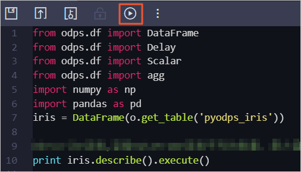

8. View the execution result of the PyODPS 2 node on the **Runtime Log** tab.

   In this example, the following result is returned:

   ```sql
   Executing user script with PyODPS 0.8.0

   Sql compiled:
   CREATE TABLE tmp_pyodps_28b83337_87f9_4b11_a084_f1896758d53b LIFECYCLE 1 AS
   SELECT 
   pyodps_udf_1567394092_9467b7ba_3121_4105_81dc_431e8e68be39(t3.`sepallength_count`, t3.`sepallength_mean`, t3.`sepallength_std`, t3.`sepallength_min`, 
   t3.`sepallength_quantile_25`, t3.`sepallength_quantile_50`, 
   t3.`sepallength_quantile_75`, t3.`sepallength_max`, t3.`sepalwidth_count`, t3.`sepalwidth_mean`, t3.`sepalwidth_std`, t3.`sepalwidth_min`, t3.`sepalwidth_quantile_25`, t3.`sepalwidth_quantile_50`, t3.`sepalwidth_quantile_75`, t3.`sepalwidth_max`, t3.`petallength_count`, t3.`petallength_mean`, t3.`petallength_std`, t3.`petallength_min`, t3.`petallength_quantile_25`, t3.`petallength_quantile_50`, 
   t3.`petallength_quantile_75`, t3.`petallength_max`, t3.`petalwidth_count`, t3.`petalwidth_mean`, t3.`petalwidth_std`, t3.`petalwidth_min`, t3.`petalwidth_quantile_25`, t3.`petalwidth_quantile_50`, t3.`petalwidth_quantile_75`, t3.`petalwidth_max`) AS (`type`, `sepallength`, `sepalwidth`, `petallength`, `petalwidth`)
   FROM (
     SELECT COUNT(t2.`sepallength`) AS `sepallength_count`, AVG(t2.`sepallength`) AS `sepallength_mean`, STDDEV_SAMP(t2.`sepallength`) AS `sepallength_std`, 
   MIN(t2.`sepallength`) AS `sepallength_min`, PERCENTILE(t2.`sepallength`, 0.25) AS `sepallength_quantile_25`, PERCENTILE(t2.`sepallength`, 0.5) AS 
   `sepallength_quantile_50`, PERCENTILE(t2.`sepallength`, 0.75) AS 
   `sepallength_quantile_75`, MAX(t2.`sepallength`) AS `sepallength_max`, 
   COUNT(t2.`sepalwidth`) AS `sepalwidth_count`, AVG(t2.`sepalwidth`) AS 
   `sepalwidth_mean`, STDDEV_SAMP(t2.`sepalwidth`) AS `sepalwidth_std`, 
   MIN(t2.`sepalwidth`) AS `sepalwidth_min`, PERCENTILE(t2.`sepalwidth`, 0.25) AS `sepalwidth_quantile_25`, PERCENTILE(t2.`sepalwidth`, 0.5) AS `sepalwidth_quantile_50`, PER
   CENTILE(t2.`sepalwidth`, 0.75) AS `sepalwidth_quantile_75`, MAX(t2.`sepalwidth`) AS `sepalwidth_max`, COUNT(t2.`petallength`) AS `petallength_count`, 
   AVG(t2.`petallength`) AS`petallength_mean`, STDDEV_SAMP(t2.`petallength`) AS `petallength_std`, MIN(t2.`petallength`) AS `petallength_min`, PERCENTILE(t2.`petallength`, 0.25) AS `petallength_quantile_25`, PERCENTILE(t2.`petallength`, 0.5) AS 
   `petallength_quantile_50`, PERCENTILE(t2.`petallength`, 0.75) AS 
   `petallength_quantile_75`, MAX(t2.`petallength`) AS `petallength_max`, 
   COUNT(t2.petalwidth) AS petalwidth_count, AVG(t2.petalwidth) AS 
   `petalwidth_mean`, STDDEV_SAMP(t2.`petalwidth`) AS `petalwidth_std`, 
   MIN(t2.`petalwidth`) AS `petalwidth_min`, PERCENTILE(t2.`petalwidth`, 0.25) AS `petalwidth_quantile_25`, PERCENTILE(t2.`petalwidth`, 0.5) AS `petalwidth_quantile_50`, PER
   CENTILE(t2.`petalwidth`, 0.75) AS `petalwidth_quantile_75`, MAX(t2.`petalwidth`) AS `petalwidth_max`
     FROM (
       SELECT t1.`sepallength`, t1.`sepalwidth`, t1.`petallength`, t1.`petalwidth`
       FROM DQC_0221_dev.`pyodps_iris` t1
     ) t2
   ) t3


             type  sepallength  sepalwidth  petallength  petalwidth
   0        count   149.000000  149.000000   149.000000  149.000000
   1         mean     5.848322    3.051007     3.774497    1.205369
   2          std     0.828594    0.433499     1.759651    0.761292
   3          min     4.300000    2.000000     1.000000    0.100000
   4  quantile_25     5.000000    2.000000     1.000000    0.000000
   5  quantile_50     5.000000    3.000000     4.000000    1.000000
   6  quantile_75     6.000000    3.000000     5.000000    1.000000
   7          max     7.900000    4.400000     6.900000    2.500000
   Sql compiled:
   SELECT MAX(t2.`sepallength`) AS `sepallength_max`
   FROM (
     SELECT t1.`sepallength`
     FROM DQC_0221_dev.`pyodps_iris` t1
   ) t2


   7.9
   Sql compiled:
   SELECT WM_CONCAT(DISTINCT ',', t2.`name`) AS `name_cat`
   FROM (
     SELECT t1.`name`
     FROM DQC_0221_dev.`pyodps_iris` t1
   ) t2


   Iris-setosa,Iris-versicolor,Iris-virginica
   149
   Sql compiled:
   CREATE TABLE tmp_pyodps_4b00d671_82b1_4cd8_8af4_f11dbdac4570 LIFECYCLE 1 AS
   SELECT t1.`name`, MAX(t1.`sepallength`) AS `sepallength_max`, MIN(t1.`sepallength`) A
   S `smin`
   FROM DQC_0221_dev.`pyodps_iris` t1
   GROUP BY t1.`name`


                 name  sepallength_max  smin
   0      Iris-setosa              5.8   4.3
   1  Iris-versicolor              7.0   4.9
   2   Iris-virginica              7.9   4.9
   Sql compiled:
   CREATETABLEtmppyodps276c901f7cf048eeaaae0d3092822b34LIFECYCLE1AS
   SELECT t1.`name`, COUNT(t1.`name`) AS `count`
   FROM DQC_0221_dev.`pyodps_iris` t1
   GROUP BY t1.`name`
   ORDER BY count DESC
   LIMIT 10000

                 name  count
   0  Iris-versicolor     50
   1   Iris-virginica     50
   2      Iris-setosa     49
   Sql compiled:
   CREATE TABLE tmp_pyodps_440d12ec_8496_4b87_b33f_b9624941e5bd LIFECYCLE 1 AS
   SELECT SUM(t1.`petallength`) AS `petallength_sum`
   FROM DQC_0221_dev.`pyodps_iris` t1
   GROUP BY t1.`name`
   Instance ID: 20190902031604255go6c472m


      petallength_sum
   0             71.8
   1            213.0
   2            277.6
   Sql compiled:
   CREATE TABLE tmp_pyodps_61e62f5f_7b4f_4971_8c39_dcaccba37764 LIFECYCLE 1 AS
   SELECT t1.`name`, SUM(IF(t1.`petallength` IS NOT NULL, 1, 0)) AS `petallength_sum`
   FROM DQC_0221_dev.`pyodps_iris` t1
   GROUP BY t1.`name`
   Instance ID: 20190902031607441ghzyr392


                 name  petallength_sum
   0      Iris-setosa               49
   1  Iris-versicolor               50
   2   Iris-virginica               50
   Sql compiled:
   CREATE TABLE tmp_pyodps_daeffd50_88fe_4b4d_9db9_57810cfe71c3 LIFECYCLE 1 AS
   SELECT SUM(t1.`petallength`) AS `petallength_sum`
   FROM DQC_0221_dev.`pyodps_iris` t1
   GROUP BY 1


      petallength_sum
   0            562.4
   Sql compiled:
   SELECT pyodps_udf_1567394173_ef78183a_a4f5_4372_91dd_18d6ecc6f651(t2.`sepalwidth`) AS
   `sepalwidth_aggregation`
   FROM (
     SELECT t1.`sepalwidth`
     FROM DQC_0221_dev.`pyodps_iris` t1
   ) t2


   Sql compiled:
   CREATE TABLE tmp_pyodps_e312f110_64e7_465e_adae_fd053f125a90 LIFECYCLE 1 AS
   SELECT t1.`name`, 
   pyodps_udf_1567394220_49231d7a_faeb_4f2f_9de5_36c4aefaa29b(t1.`sepalwidth`, t1.`sepallength`) AS `val`
   FROM DQC_0221_dev.`pyodps_iris` t1
   GROUP BY t1.`name`


                 name    val
   0      Iris-setosa  -77.8
   1  Iris-versicolor -158.3
   2   Iris-virginica -180.7

   63021
   ```

<a id="section-9-9-9"></a>

### 9.9.9. Use a PyODPS node to perform column operations

This topic describes how to use a PyODPS node to perform column operations.

**Prerequisites**

The following operations are performed:

- MaxCompute is activated.

- DataWorks is activated.

- A workflow is created in the DataWorks console. In this example, a workflow is created for a DataWorks workspace in basic mode.

**Procedure**

1. Create a table and import data.

   <ol type="i">

   <li>

   Download the Iris dataset iris.data and rename it iris.csv.

   </li>

   <li>

   Create a table **pyodps_iris** and upload the dataset iris.csv. For more information, see

   </li>

   </ol>

   Create a table and upload a data document in DataWorks.

   Execute the following statement to create a table:

   ```sql
   CREATE TABLE if not exists pyodps_iris
   (
   sepallength DOUBLE comment 'Sheet length (cm)',
   sepalwidth DOUBLE comment 'Sheet width (cm)',
   petallength DOUBLE comment 'flap length (cm)',
   petalwidth DOUBLE comment 'flap width (cm)',
   name STRING comment 'Kind'
   );
   ```

2. Log on to the DataWorks console.

3. 

4. 

5. On the Develop page, right-click the created **workflow** and choose **Create Node > MaxCompute > PyODPS 2**.

6. In the **Create Node** dialog box, set **Name** and click **OK**.

7. On the configuration tab of the node, enter sample code in the code editor.

   In this example, enter the following code:

   ```python
   from odps import DataFrame
   import numpy as np
   import pandas as pd

   iris = DataFrame(o.get_table('pyodps_iris'))

   # Check for null values. 
   print iris.sepallength.isnull().head(5)

   # Perform logical judgment. 
   print (iris.sepallength > 5).ifelse('gt5','lte5').rename('cmp5').head(5)

   # Perform judgment based on multiple conditions. 
   print 
   iris.sepallength.switch(4.9,'eq4.9',5.0,'eq5.0',default='noeq').rename('equalness').hea
   5)
   from odps.df import switch
   print switch(iris.sepallength == 4.9,'eq4.9',iris.sepallength == 
   5.0,'eq5.0',default='noeq').rename('equalness').head(5)

   # Change some values in the specified column. 
   iris[iris.sepallength > 5,'cmp5'] = 'gt5'
   iris[iris.sepallength <=5,'cmp5'] = 'lte5'
   print iris.head(5)


   # Perform mathematical calculation. 
   print (iris.sepallength * 10).log().head(5)
   fields = [iris.sepallength,(iris.sepallength /2).rename('sepallength/2'),
   (iris.sepallength ** 2).rename('Square of sepallength')]
   print iris[fields].head(5)
   print  (iris.sepallength < 5).head(5)


   # Perform operations on collections. 
   data = {'id': [1,2], 'a': [['a1','b1'],['c1']], 'b': [{'a2': 0, 'b2': 1, 'c2': 2},{'d2': 3, 'e2': 4}]}
   df = pd.DataFrame(data)
   print df

   df1 = DataFrame(df, unknown_as_string=True, as_type={'a': 'list<string>','b' : 'dict<string,int64>'})
   print df1.dtypes
   print df1.head()

   print df1[df1.id,df1.a[0],df1.b.len()].head()
   print df1.a.explode().head()
   print df1.a.explode(pos=True).head()
   print df1.b.explode().head()
   print df1.b.explode(['key','value']).head()

   # Return the execution result of the explode method together with the specified columns. 
   print df1[df1.id,df1.a.explode()].head()

   #isin,notin,cut. 

   # Call the isin method to check whether elements in the specified sequence are in a specific collection. The notin method can check whether elements in the specified sequence is not in a specific collection. 
   print iris.sepallength.isin([4.9,5.1]).rename('sepallength').head()

   # Call the cut method to specify ranges and return the range to which each element inthe specified sequence belongs. 
   print iris.sepallength.cut(range(6),labels=['0-1','1-2','2-3','3-4','4-
   5']).rename('sepallength_cut').head(5)

   # You can use the include_under and include_over parameters to specify whether to return values that are in the range with only an upper limit and the range with only a lower limit, respectively. 
   labels = ['0-1', '1-2', '2-3', '3-4', '4-5', '5-']
   iris.sepallength.cut(range(6), labels=labels, 
   include_over=True).rename('sepallength_cut').head(5)
   ```

8. Click the **Run** icon on the toolbar.

   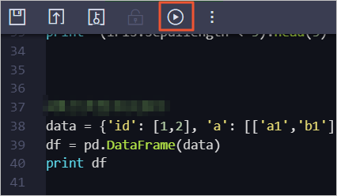

9. View the execution result of the PyODPS 2 node on the **Runtime Log** tab.

   In this example, the following result is returned:

   ```sql
   Executing user script with PyODPS 0.8.0

   Sql compiled:
   CREATE TABLE tmp_pyodps_32e39a9a_8ae6_4815_b465_4b9dfa3bf1b9 LIFECYCLE 1 AS
   SELECT t1.`sepallength` IS NULL AS `sepallength`
   FROM DQC_0221_dev.`pyodps_iris` t1

     sepallength
   0       False
   1       False
   2       False
   3       False
   4       False
   Sqlcompiled:
   CREATE TABLE tmp_pyodps_d684aded_8ad8_4119_8558_1fddd774dd3f LIFECYCLE 1 AS
   SELECT IF(t1.`sepallength` > 5, 'gt5', 'lte5') AS `cmp5`
   FROM DQC_0221_dev.`pyodps_iris` t1

      cmp5
   0  lte5
   1  lte5
   2  lte5
   3  lte5
   4   gt5
   Sql compiled:
   CREATE TABLE tmp_pyodps_cfc5bdb9_6d3e_4711_8acc_913b29b96c9a LIFECYCLE 1 AS
   SELECT CASE t1.`sepallength` WHEN 4.9 THEN 'eq4.9' WHEN 5.0 THEN 'eq5.0' ELSE 'noeq' 
   END AS `equalness`
   FROM DQC_0221_dev.`pyodps_iris` t1

     equalness
   0     eq4.9
   1      noeq
   2      noeq
   3     eq5.0
   4      noeq
   Sql compiled:
   CREATE TABLE tmp_pyodps_d1fd70b4_2ad8_4dc9_838e_f566f7f5841e LIFECYCLE 1 AS
   SELECT CASE WHEN t1.`sepallength` == 4.9 THEN 'eq4.9' WHEN t1.`sepallength` == 5.0 TH
   EN 'eq5.0' ELSE 'noeq' END AS `equalness`
   FROM DQC_0221_dev.`pyodps_iris` t1

     equalness
   0     eq4.9
   1      noeq
   2      noeq
   3     eq5.0
   4      noeq
   Sql compiled:
   CREATE TABLE tmp_pyodps_d9e5d64e_1f21_4ffb_993f_70d3f36b6553 LIFECYCLE 1 AS
   SELECT t1.`sepallength`, t1.`sepalwidth`, t1.`petallength`, t1.`petalwidth`, t1.`name
   `, IF(t1.`sepallength` <= 5, 'lte5', IF(t1.`sepallength` > 5, 'gt5', CAST(NULL AS STR
   ING))) AS `cmp5`
   FROM DQC_0221_dev.`pyodps_iris` t1

      sepallength  sepalwidth  petallength  petalwidth         name  cmp5
   0          4.9         3.0          1.4         0.2  Iris-setosa  lte5
   1          4.7         3.2          1.3         0.2  Iris-setosa  lte5
   2          4.6         3.1          1.5         0.2  Iris-setosa  lte5
   3          5.0         3.6          1.4         0.2  Iris-setosa  lte5
   4          5.4         3.9          1.7         0.4  Iris-setosa   gt5
   Sql compiled:
   CREATE TABLE tmp_pyodps_4bfb0aa0_7ec5_4f35_9480_d36baf2b8079 LIFECYCLE 1 AS
   SELECT LN(t1.`sepallength` * 10) AS `sepallength`
   FROM DQC_0221_dev.`tmp_pyodps_d9e5d64e_1f21_4ffb_993f_70d3f36b6553` t1

      sepallength
   0     3.891820
   1     3.850148
   2     3.828641
   3     3.912023
   4     3.988984
   Sql compiled:
   CREATE TABLE tmp_pyodps_deb6fa45_fbb1_41d2_8174_76d35eebea9c LIFECYCLE 1 AS
   SELECT t1.`sepallength`, t1.`sepallength` / 2 AS `sepallength/2`, 
   POW(t1.`sepallength`, 2) AS `Square of sepallength`
   FROM DQC_0221_dev.`tmp_pyodps_d9e5d64e_1f21_4ffb_993f_70d3f36b6553` t1

      sepallength  sepallength/2  Square of sepallength
   0          4.9           2.45           24.01
   1          4.7           2.35           22.09
   2          4.6           2.30           21.16
   3          5.0           2.50           25.00
   4          5.4           2.70           29.16
   Sql compiled:
   CREATE TABLE tmp_pyodps_fa326546_c5e8_466f_915d_e783b7dcacdf LIFECYCLE 1 AS
   SELECT t1.`sepallength` < 5 AS `sepallength`
   FROM DQC_0221_dev.`tmp_pyodps_d9e5d64e_1f21_4ffb_993f_70d3f36b6553` t1


     sepallength
   0        True
   1        True
   2        True
   3       False
   4       False
             a                               b  id
   0  [a1, b1]  {u'c2': 2, u'a2': 0, u'b2': 1}   1
   1      [c1]            {u'd2': 3, u'e2': 4}   2
   odps.Schema {
     a   list<string>
     b   dict<string,int64>
     id  int64
   }
             a                               b  id
   0  [a1, b1]  {u'c2': 2, u'a2': 0, u'b2': 1}   1
   1      [c1]            {u'd2': 3, u'e2': 4}   2
      id   a  b
   0   1  a1  3
   1   2  c1  2
       a
   0  a1
   1  b1
   2  c1
      a_pos   a
   0      0  a1
   1      1  b1
   2      0  c1
     b_key  b_value
   0    c2        2
   1    a2        0
   2    b2        1
   3    d2        3
   4    e2        4
     key  value
   0  c2      2
   1  a2      0
   2  b2      1
   3  d2      3
   4  e2      4

      id   a
   0   1  a1
   1   1  b1
   2   2  c1
   Sql compiled:
   CREATE TABLE tmp_pyodps_fb28d9b9_fa45_4712_a564_dd751641286e LIFECYCLE 1 AS
   SELECT t1.`sepallength` IN (4.9, 5.1) AS `sepallength`
   FROM DQC_0221_dev.`tmp_pyodps_d9e5d64e_1f21_4ffb_993f_70d3f36b6553` t1

      sepallength
   0         True
   1        False
   2        False
   3        False
   4        False
   5        False
   6        False
   7        False
   8         True
   9        False
   10       False
   11       False
   12       False
   13       False
   14       False
   15       False
   16        True
   17       False
   18        True
   19       False
   20        True
   21       False
   22        True
   23       False
   24       False
   25       False
   26       False
   27       False
   28       False
   29       False
   30       False
   31       False
   32       False
   33        True
   34       False
   35       False
   36        True
   37       False
   38        True
   39       False
   40       False
   41       False
   42       False
   43        True
   44       False
   45        True
   46       False
   47       False
   48       False
   49       False
   50       False
   51       False
   52       False
   53       False
   54       False
   55       False
   56        True
   57       False
   58       False
   59       False
   Sql compiled:
   CREATE TABLE tmp_pyodps_1f85e8e1_a9f0_473f_ac0e_d526fdd80dc4 LIFECYCLE 1 AS
   SELECT CASE WHEN (0 < t1.`sepallength`) AND (t1.`sepallength` <= 1) THEN '0-1' WHEN (1 < t1.`sepallength`) AND (t1.`sepallength` <= 2) THEN '1-2' WHEN (2 < 
   t1.`sepallength`) AND (t1.`sepallength` <= 3) THEN '2-3' WHEN (3 < t1.`sepallength`) 
   AND (t1.`sepallength` <= 4) THEN '3-4' WHEN (4 < t1.`sepallength`) AND 
   (t1.`sepallength` <= 5) THEN '4-5' END AS `sepallength_cut`
   FROM DQC_0221_dev.`tmp_pyodps_d9e5d64e_1f21_4ffb_993f_70d3f36b6553` t1
     sepallength_cut
   0             4-5
   1             4-5
   2             4-5
   3             4-5
   4            None
   Sql compiled:
   CREATE TABLE tmp_pyodps_080a677e_904b_4edc_a961_160f8c664d7f LIFECYCLE 1 AS
   SELECT CASE WHEN (0 < t1.`sepallength`) AND (t1.`sepallength` <= 1) THEN '0-1' WHEN (1 < t1.`sepallength`) AND (t1.`sepallength` <= 2) THEN '1-2' WHEN (2 < 
   t1.`sepallength`) AND (t1.`sepallength` <= 3) THEN '2-3' WHEN (3 < t1.`sepallength`) 
   AND (t1.`sepallength` <= 4) THEN '3-4' WHEN (4 < t1.`sepallength`) AND 
   (t1.`sepallength` <= 5) THEN '4-5' WHEN 5 < t1.`sepallength` THEN '5-' END AS `sepallength_cut`
   FROM DQC_0221_dev.`tmp_pyodps_d9e5d64e_1f21_4ffb_993f_70d3f36b6553` t1
   ```

<a id="section-9-9-10"></a>

### 9.9.10. Use a PyODPS node to sort data

This topic describes how to use a PyODPS node to sort data.

**Prerequisites Prerequisites**

The following operations are performed:

- MaxCompute is activated.

- DataWorks is activated.

- A workflow is created in the DataWorks console. In this example, a workflow is created for a DataWorks workspace in basic mode.

**Procedure**

1. Create a table and import data.

   <ol type="i">

   <li>

   Download the Iris dataset iris.data and rename it iris.csv.

   </li>

   <li>

   Create a table **pyodps_iris** and upload the dataset iris.csv. For more information, see

   </li>

   </ol>

   Create a table and upload a data document in DataWorks.

   Execute the following statement to create a table:

   ```sql
   CREATE TABLE if not exists pyodps_iris
   (
   sepallength DOUBLE comment 'Sheet length (cm)',
   sepalwidth DOUBLE comment 'Sheet width (cm)',
   petallength DOUBLE comment 'flap length (cm)',
   petalwidth DOUBLE comment 'flap width (cm)',
   name STRING comment 'Kind'
   );
   ```

2. Log on to the DataWorks console.

3. 

4. 

5. On the **Data Development** page, right-click the created workflow and choose **Create Node > MaxCompute > PyODPS 2**.

6. Enter a node name in the **Name** field and click **OK**.

7. On the configuration tab of the PyODPS node, enter the following code in the code editor:

   ```text
   from  odps.df import DataFrame

   iris = DataFrame(o.get_table('pyodps_iris'))

   # Sort data.

   print iris.sort('sepalwidth').head(5)

   # You can use one of the following methods to sort data in descending order:

   # Set the ascending parameter to False.
   print iris.sort('sepalwidth',ascending=False).head(5)

   # Use a hyphen (-) as the sorting parameter.
   print iris.sort(-iris.sepalwidth).head(5)

   # Sort multiple fields.
   print iris.sort(['sepalwidth','petallength']).head(5)

   # To sort multiple fields in different orders, you can set the ascending parameter toa list of BOOLEAN values. The number of values in the list must be the same as the number of fields to be sorted.
   print iris.sort(['sepalwidth','petallength'],ascending=[True,False]).head(5)
   print iris.sort(['sepalwidth',-iris.petallength]).head(5)
   ```

8. Click the **Run** icon in the toolbar.

9. View the execution result of the node on the **Runtime Log** tab.

   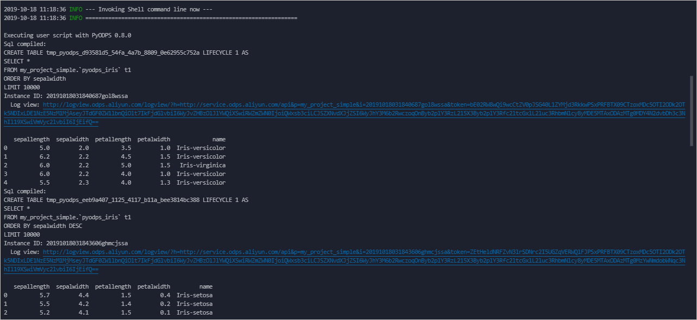

   The following result is returned:

   ```sql
   Sql compiled:
   CREATE TABLE tmp_pyodps_d1b06785_dc18_4288_ad34_de860de1be08 LIFECYCLE 1 AS
   SELECT *
   FROM WB_BestPractice_dev.`pyodps_iris` t1
   ORDER BY sepalwidth
   LIMIT 10000
   Instance ID: 20191010061554817gwml0lim

      sepallength  sepalwidth  petallength  petalwidth             name
   0          5.0         2.0          3.5         1.0  Iris-versicolor
   1          6.0         2.2          5.0         1.5   Iris-virginica
   2          6.2         2.2          4.5         1.5  Iris-versicolor
   3          6.0         2.2          4.0         1.0  Iris-versicolor
   4          5.5         2.3          4.0         1.3  Iris-versicolor
   Sql compiled:
   CREATE TABLE tmp_pyodps_3cb90bb2_fb95_43fb_ae84_f2b5a27d72dc LIFECYCLE 1 AS
   SELECT *
   FROM WB_BestPractice_dev.`pyodps_iris` t1
   ORDER BY sepalwidth DESC
   LIMIT 10000
   Instance ID: 20191010061601287gs086792


      sepallength  sepalwidth  petallength  petalwidth         name
   0          5.7         4.4          1.5         0.4  Iris-setosa
   1          5.5         4.2          1.4         0.2  Iris-setosa
   2          5.2         4.1          1.5         0.1  Iris-setosa
   3          5.8         4.0          1.2         0.2  Iris-setosa
   4          5.4         3.9          1.3         0.4  Iris-setosa
   Sql compiled:
   CREATE TABLE tmp_pyodps_97b080bb_e014_48e8_a310_4b45fcd6a2ed LIFECYCLE 1 AS
   SELECT *
   FROM WB_BestPractice_dev.`pyodps_iris` t1
   ORDER BY sepalwidth DESC
   LIMIT 10000
   Instance ID: 20191010061606927g6emz192

      sepallength  sepalwidth  petallength  petalwidth         name
   0          5.7         4.4          1.5         0.4  Iris-setosa
   1          5.5         4.2          1.4         0.2  Iris-setosa
   2          5.2         4.1          1.5         0.1  Iris-setosa
   3          5.8         4.0          1.2         0.2  Iris-setosa
   4          5.4         3.9          1.3         0.4  Iris-setosa
   Sql compiled:
   CREATE TABLE tmp_pyodps_6fe37b6e_6705_4052_b733_211eb9bd16ac LIFECYCLE 1 AS
   SELECT *
   FROM WB_BestPractice_dev.`pyodps_iris` t1
   ORDER BY sepalwidth, petallength
   LIMIT 10000
   Instance ID: 20191010061611714gn586792

      sepallength  sepalwidth  petallength  petalwidth             name
   0          5.0         2.0          3.5         1.0  Iris-versicolor
   1          6.0         2.2          4.0         1.0  Iris-versicolor
   2          6.2         2.2          4.5         1.5  Iris-versicolor
   3          6.0         2.2          5.0         1.5   Iris-virginica
   4          4.5         2.3          1.3         0.3      Iris-setosa
   Sql compiled:
   CREATE TABLE tmp_pyodps_a52c805c_94a1_4a75_a6af_4fc9ed06ae68 LIFECYCLE 1 AS
   SELECT *
   FROM WB_BestPractice_dev.`pyodps_iris` t1
   ORDER BY sepalwidth, petallength DESC
   LIMIT 10000
   Instance ID: 20191010061616553gw3m9592

      sepallength  sepalwidth  petallength  petalwidth             name
   0          5.0         2.0          3.5         1.0  Iris-versicolor
   1          6.0         2.2          5.0         1.5   Iris-virginica
   2          6.2         2.2          4.5         1.5  Iris-versicolor
   3          6.0         2.2          4.0         1.0  Iris-versicolor
   4          6.3         2.3          4.4         1.3  Iris-versicolor
   Sql compiled:
   CREATE TABLE tmp_pyodps_aac5538e_9b40_4078_b3c6_852b99c663c1 LIFECYCLE 1 AS
   SELECT *
   FROM WB_BestPractice_dev.`pyodps_iris` t1
   ORDER BY sepalwidth, petallength DESC
   LIMIT 10000
   Instance ID: 20191010061621329gvmkc292


      sepallength  sepalwidth  petallength  petalwidth             name
   0          5.0         2.0          3.5         1.0  Iris-versicolor
   1          6.0         2.2          5.0         1.5   Iris-virginica
   2          6.2         2.2          4.5         1.5  Iris-versicolor
   3          6.0         2.2          4.0         1.0  Iris-versicolor
   4          6.3         2.3          4.4         1.3  Iris-versicolor
   ```

<a id="section-9-9-11"></a>

### 9.9.11. Use a PyODPS node to deduplicate data

This topic describes how to use a PyODPS node to deduplicate data.

**Prerequisites**

The following operations are performed:

- MaxCompute is activated.

- DataWorks is activated.

- A workflow is created in the DataWorks console. In this example, a workflow is created for a DataWorks workspace in basic mode.

**Procedure**

1. Create a table and import data.

   <ol type="i">

   <li>

   Download the Iris dataset iris.data and rename it iris.csv.

   </li>

   <li>

   Create a table **pyodps_iris** and upload the dataset iris.csv. For more information, see

   </li>

   </ol>

   Create a table and upload a data document in DataWorks.

   Execute the following statement to create a table:

   ```sql
   CREATE TABLE if not exists pyodps_iris
   (
   sepallength DOUBLE comment 'Sheet length (cm)',
   sepalwidth DOUBLE comment 'Sheet width (cm)',
   petallength DOUBLE comment 'flap length (cm)',
   petalwidth DOUBLE comment 'flap width (cm)',
   name STRING comment 'Kind'
   );
   ```

2. Log on to the DataWorks console.

3. 

4. 

5. On the **Data Development** page, right-click the created workflow and choose **Create Node > MaxCompute > PyODPS 2**.

6. Enter a node name in the **Name** field and click **OK**.

7. On the configuration tab of the PyODPS node, enter the code of the node in the code editor.

   In this example, enter the following code:

   ```text
   from  odps.df import DataFrame
   iris = DataFrame(o.get_table('pyodps_iris'))
   print iris[['name']].distinct()
   print iris.distinct('name')
   print iris.distinct('name','sepallength').head(3)
   # You can call the unique method to deduplicate data in the specified sequence. The sequence whose data is deduplicated by using the unique method cannot be selected as acolumn.
   print iris.name.unique()
   ```

8. Click the **Run** icon in the toolbar.

9. View the execution result of the node on the **Runtime Log** tab.

   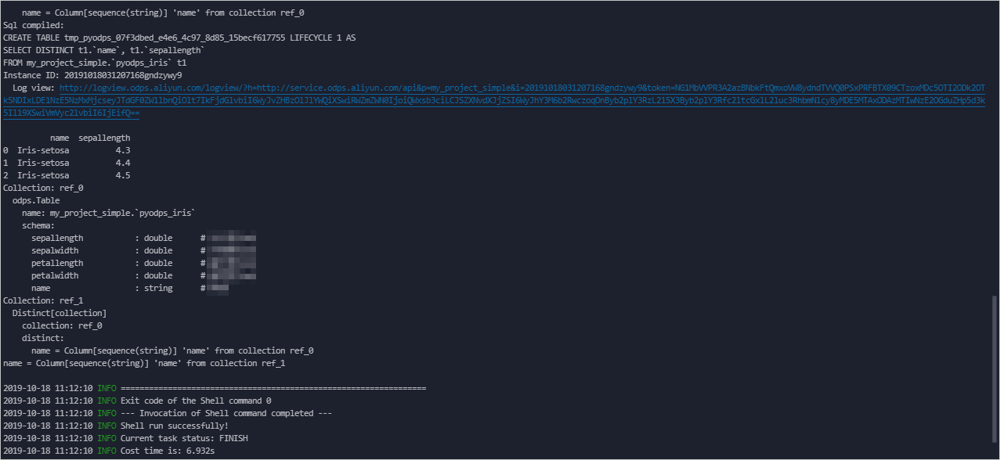

   The following result is returned:

   ```sql
   Sql compiled:
   CREATE TABLE tmp_pyodps_ed85ebd5_d678_44dd_9ece_bff1822376f6 LIFECYCLE 1 AS
   SELECT DISTINCT t1.`name`
   FROM WB_BestPractice_dev.`pyodps_iris` t1
   Instance ID: 2019101006391142g2cp5692


                 name
   0      Iris-setosa
   1  Iris-versicolor
   2   Iris-virginica
   Sql compiled:
   CREATE TABLE tmp_pyodps_8ce6128f_9c6f_45af_b9de_c73ce9d5ba51 LIFECYCLE 1 AS
   SELECT DISTINCT t1.`name`
   FROM WB_BestPractice_dev.`pyodps_iris` t1

   Instance ID: 20191010063915987gmuws592


                 name
   0      Iris-setosa
   1  Iris-versicolor
   2   Iris-virginica
   Sql compiled:
   CREATE TABLE tmp_pyodps_a3dc338e_0fea_4d5f_847c_79fb19ec1c72 LIFECYCLE 1 AS
   SELECT DISTINCT t1.`name`, t1.`sepallength`
   FROM WB_BestPractice_dev.`pyodps_iris` t1

   Instance ID: 2019101006392210gj056292


             name  sepallength
   0  Iris-setosa          4.3
   1  Iris-setosa          4.4
   2  Iris-setosa          4.5
   Sql compiled:
   CREATE TABLE tmp_pyodps_bc0917bb_f10c_426b_9b75_47e94478382a LIFECYCLE 1 AS
   SELECT t2.`name`
   FROM (
     SELECT DISTINCT t1.`name`
     FROM WB_BestPractice_dev.`pyodps_iris` t1
   ) t2
   Instance ID: 20191010063927189g9fsz192

                 name
   0      Iris-setosa
   1  Iris-versicolor
   2   Iris-virginica
   ```

<a id="section-9-9-12"></a>

### 9.9.12. Use a PyODPS node to sample data

This topic describes how to use a PyODPS node to sample data.

**Prerequisites**

The following operations are performed:

- MaxCompute is activated.

- DataWorks is activated.

- A workflow is created in the DataWorks console. In this example, a workflow is created for a DataWorks workspace in basic mode.

**Procedure**

1. Create a table and import data.

   <ol type="i">

   <li>

   Download the Iris dataset iris.data and rename it iris.csv.

   </li>

   <li>

   Create a table **pyodps_iris** and upload the dataset iris.csv. For more information, see

   </li>

   </ol>

   Create a table and upload a data document in DataWorks.

   Execute the following statement to create a table:

   ```sql
   CREATE TABLE if not exists pyodps_iris
   (
   sepallength DOUBLE comment 'Sheet length (cm)',
   sepalwidth DOUBLE comment 'Sheet width (cm)',
   petallength DOUBLE comment 'flap length (cm)',
   petalwidth DOUBLE comment 'flap width (cm)',
   name STRING comment 'Kind'
   );
   ```

2. Log on to the DataWorks console.

3. 

4. 

5. On the **Data Development** page, right-click the created workflow and choose **Create Node > MaxCompute > PyODPS 2**.

6. Enter a node name in the **Name** field and click **OK**.

7. On the configuration tab of the PyODPS node, enter the code of the node in the code editor.

   In this example, enter the following code:

   ```text
   # Sample data.
   from  odps.df import DataFrame
   iris = DataFrame(o.get_table('pyodps_iris'))
   # Sample data by part.
   print iris.sample(parts=10).head(5) # Divide the data into 10 parts. Part 0 is obtained by default.
   print iris.sample(parts=10,i=0).head(5) # Divide the data into 10 parts and obtain part 0.
   print iris.sample(parts=10,i=[2,5]).head(5)  # Divide the data into 10 parts and obtain part 2 and part 5.
   print iris.sample(parts=10,columns=['name','sepalwidth']).head(5) # Divide the data into 10 parts and sample data based on the values of name and sepalwidth.

   # Sample data based on the specified number of data records or proportion.
   print iris.sample(n=100).head()  # Obtain 100 data records.

   print iris.sample(frac=0.3).head() # Obtain 30% of the data.

   # Sample data based on the weight column.
   print iris.sample(n=100,weights='sepallength').head()

   print iris.sample(n=100,weights='sepalwidth',replace=True).head()

   # Perform stratified sampling.
   print iris.sample(strata='name',n={'Iris-setosa' : 10,'Iris-versicolor' : 10}).head()print iris.sample(strata='name',frac={'Iris-setosa': 0.5,'Iris-versicolor': 0.4}).head()
   ```

8. Click the **Run** icon in the toolbar.

   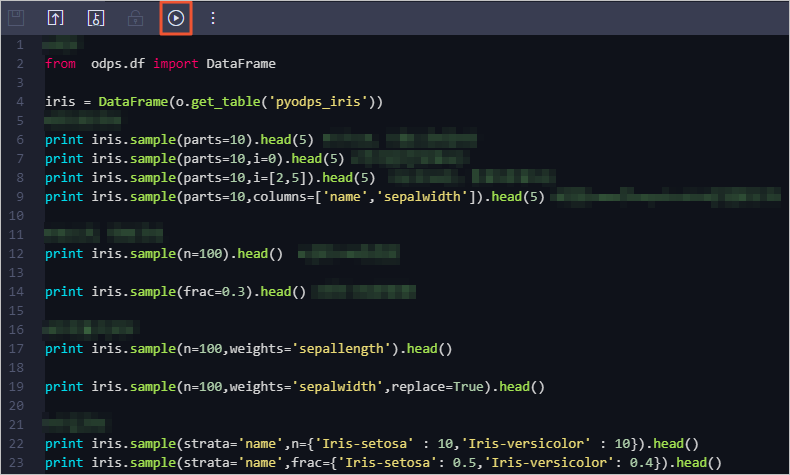

9. View the execution result of the node on the **Runtime Log** tab.

   The following result is returned:

   ```text
   Collection: ref_0
     odps.Table
       name: WB_BestPractice_dev.`pyodps_iris`
       schema:
         sepallength           : double      # Sepal length (cm)
         sepalwidth            : double      # Sepal width (cm)
         petallength           : double      # Petal length (cm)
         petalwidth            : double      # Petal width (cm)
         name                  : string      # Type
   Sample[collection]
     _input:
     _parts:
       Scalar[int8]
         10
     _i:
     _replace:
       Scalar[boolean]
         False
   Collection: ref_0
     odps.Table
       name: WB_BestPractice_dev.`pyodps_iris`
       schema:
         sepallength           : double      # Sepal length (cm)
         sepalwidth            : double      # Sepal width (cm)
         petallength           : double      # Petal length (cm)
         petalwidth            : double      # Petal width (cm)
         name                  : string      # Type
   Sample[collection]
     _input:
     _parts:
       Scalar[int8]
         10
     _i:
     _replace:
       Scalar[boolean]
         False
   Collection: ref_0
     odps.Table
       name: WB_BestPractice_dev.`pyodps_iris`
       schema:
         sepallength           : double      # Sepal length (cm)
         sepalwidth            : double      # Sepal width (cm)
         petallength           : double      # Petal length (cm)
         petalwidth            : double      # Petal width (cm)
         name                  : string      # Type
   Sample[collection]
     _input:
     _parts:
       Scalar[int8]
         10
     _i:
     _replace:
       Scalar[boolean]
         False
   Collection: ref_0
     odps.Table
       name: WB_BestPractice_dev.`pyodps_iris`
       schema:
         sepallength           : double      # Sepal length (cm)
         sepalwidth            : double      # Sepal width (cm)
         petallength           : double      # Petal length (cm)
         petalwidth            : double      # Petal width (cm)
         name                  : string      # Type
   Sample[collection]
     _input:
     _parts:
       Scalar[int8]
         10
     _i:
     _sampled_fields:
       name = Column[sequence(string)] 'name' from collection ref_0
       sepalwidth = Column[sequence(float64)] 'sepalwidth' from collection ref_0
     _replace:
       Scalar[boolean]
         False
   Executing RandomSample...
   Command: PAI -name RandomSample -project algo_public -Dreplace="false" -Dlifecycle="1
   " -DoutputTableName="tmp_pyodps_1570690014_69f3d75d_9537_4c9c_87ea_a5f6ad8d2e07" -DsampleSize="100" -DinputTableName="WB_BestPractice_dev.pyodps_iris";
   Instance ID: 20191010064654985g6co9592

   Sub Instance: create_output 
   (20191010064700688g5cbn62m_71ee0561_bcc4_4147_b849_f74688353fb6)

   Sub Instance: without_replacement 
   (20191010064703694g9cbn62m_93a8a15b_ffd1_4afe_8928_19f28455a15c)


   Try to fetch data from tunnel

       sepallength  sepalwidth  petallength  petalwidth            name
   0           5.1         3.5          1.4         0.2     Iris-setosa
   1           4.9         3.0          1.4         0.2     Iris-setosa
   2           4.7         3.2          1.3         0.2     Iris-setosa
   3           4.6         3.1          1.5         0.2     Iris-setosa
   4           5.0         3.6          1.4         0.2     Iris-setosa
   5           4.6         3.4          1.4         0.3     Iris-setosa
   6           4.4         2.9          1.4         0.2     Iris-setosa
   7           4.9         3.1          1.5         0.1     Iris-setosa
   8           4.8         3.4          1.6         0.2     Iris-setosa
   9           4.8         3.0          1.4         0.1     Iris-setosa
   10          4.3         3.0          1.1         0.1     Iris-setosa
   11          5.1         3.5          1.4         0.3     Iris-setosa
   12          5.7         3.8          1.7         0.3     Iris-setosa
   13          5.1         3.8          1.5         0.3     Iris-setosa
   14          5.1         3.7          1.5         0.4     Iris-setosa
   15          4.6         3.6          1.0         0.2     Iris-setosa
   16          5.1         3.3          1.7         0.5     Iris-setosa
   17          4.8         3.4          1.9         0.2     Iris-setosa
   18          5.0         3.4          1.6         0.4     Iris-setosa
   19          5.2         3.5          1.5         0.2     Iris-setosa
   20          5.2         3.4          1.4         0.2     Iris-setosa
   21          4.8         3.1          1.6         0.2     Iris-setosa
   22          5.2         4.1          1.5         0.1     Iris-setosa
   23          5.5         4.2          1.4         0.2     Iris-setosa
   24          4.9         3.1          1.5         0.1     Iris-setosa
   25          5.0         3.2          1.2         0.2     Iris-setosa
   26          4.4         3.0          1.3         0.2     Iris-setosa
   27          5.1         3.4          1.5         0.2     Iris-setosa
   28          5.0         3.5          1.3         0.3     Iris-setosa
   29          4.5         2.3          1.3         0.3     Iris-setosa
   ..          ...         ...          ...         ...             ...
   70          7.1         3.0          5.9         2.1  Iris-virginica
   71          7.6         3.0          6.6         2.1  Iris-virginica
   72          7.3         2.9          6.3         1.8  Iris-virginica
   73          7.2         3.6          6.1         2.5  Iris-virginica
   74          6.5         3.2          5.1         2.0  Iris-virginica
   75          6.8         3.0          5.5         2.1  Iris-virginica
   76          5.8         2.8          5.1         2.4  Iris-virginica
   77          7.7         3.8          6.7         2.2  Iris-virginica
   78          7.7         2.6          6.9         2.3  Iris-virginica
   79          7.7         2.8          6.7         2.0  Iris-virginica
   80          6.3         2.7          4.9         1.8  Iris-virginica
   81          6.7         3.3          5.7         2.1  Iris-virginica
   82          6.2         2.8          4.8         1.8  Iris-virginica
   83          6.1         3.0          4.9         1.8  Iris-virginica
   84          6.4         2.8          5.6         2.1  Iris-virginica
   85          7.2         3.0          5.8         1.6  Iris-virginica
   86          7.4         2.8          6.1         1.9  Iris-virginica
   87          7.9         3.8          6.4         2.0  Iris-virginica
   88          6.3         2.8          5.1         1.5  Iris-virginica
   89          6.3         3.4          5.6         2.4  Iris-virginica
   90          6.4         3.1          5.5         1.8  Iris-virginica
   91          6.0         3.0          4.8         1.8  Iris-virginica
   92          6.9         3.1          5.4         2.1  Iris-virginica
   93          6.9         3.1          5.1         2.3  Iris-virginica
   94          5.8         2.7          5.1         1.9  Iris-virginica
   95          6.8         3.2          5.9         2.3  Iris-virginica
   96          6.7         3.3          5.7         2.5  Iris-virginica
   97          6.3         2.5          5.0         1.9  Iris-virginica
   98          6.2         3.4          5.4         2.3  Iris-virginica
   99          5.9         3.0          5.1         1.8  Iris-virginica
   [100 rows x 5 columns]
   Executing RandomSample...
   Command: PAI -name RandomSample -project algo_public -Dreplace="false" -DsampleRatio=
   "0.3" -DoutputTableName="tmp_pyodps_1570690039_e1867332_72ea_4656_928d_3bd6e31d87c7" 
   -Dlifecycle="1" -DinputTableName="WB_BestPractice_dev.pyodps_iris";
   Instance ID: 20191010064720117gmpms38

   Sub Instance: create_output 
   (20191010064725740grcbn62m_b338a671_6047_4360_8792_41d2e748e41f)

   Sub Instance: without_replacement 
   (20191010064728747gtcbn62m_6c9914da_d5c3_4336_b076_163edb1bf48a)

   Try to fetch data from tunnel
       sepallength  sepalwidth  petallength  petalwidth             name
   0           5.1         3.5          1.4         0.2      Iris-setosa
   1           4.7         3.2          1.3         0.2      Iris-setosa
   2           4.6         3.1          1.5         0.2      Iris-setosa
   3           4.8         3.4          1.6         0.2      Iris-setosa
   4           5.7         4.4          1.5         0.4      Iris-setosa
   5           5.1         3.5          1.4         0.3      Iris-setosa
   6           5.0         3.4          1.6         0.4      Iris-setosa
   7           5.2         3.4          1.4         0.2      Iris-setosa
   8           4.9         3.1          1.5         0.1      Iris-setosa
   9           5.5         3.5          1.3         0.2      Iris-setosa
   10          4.4         3.2          1.3         0.2      Iris-setosa
   11          5.0         3.3          1.4         0.2      Iris-setosa
   12          5.7         2.8          4.5         1.3  Iris-versicolor
   13          5.2         2.7          3.9         1.4  Iris-versicolor
   14          5.0         2.0          3.5         1.0  Iris-versicolor
   15          5.6         2.9          3.6         1.3  Iris-versicolor
   16          5.8         2.7          4.1         1.0  Iris-versicolor
   17          6.1         2.8          4.0         1.3  Iris-versicolor
   18          6.6         3.0          4.4         1.4  Iris-versicolor
   19          6.8         2.8          4.8         1.4  Iris-versicolor
   20          6.0         2.9          4.5         1.5  Iris-versicolor
   21          5.4         3.0          4.5         1.5  Iris-versicolor
   22          5.7         2.9          4.2         1.3  Iris-versicolor
   23          5.7         2.8          4.1         1.3  Iris-versicolor
   24          6.3         2.9          5.6         1.8   Iris-virginica
   25          4.9         2.5          4.5         1.7   Iris-virginica
   26          6.7         2.5          5.8         1.8   Iris-virginica
   27          6.4         2.7          5.3         1.9   Iris-virginica
   28          6.8         3.0          5.5         2.1   Iris-virginica
   29          5.7         2.5          5.0         2.0   Iris-virginica
   30          5.8         2.8          5.1         2.4   Iris-virginica
   31          6.5         3.0          5.5         1.8   Iris-virginica
   32          6.0         2.2          5.0         1.5   Iris-virginica
   33          6.3         2.7          4.9         1.8   Iris-virginica
   34          7.2         3.2          6.0         1.8   Iris-virginica
   35          6.2         2.8          4.8         1.8   Iris-virginica
   36          6.1         3.0          4.9         1.8   Iris-virginica
   37          6.4         2.8          5.6         2.1   Iris-virginica
   38          7.2         3.0          5.8         1.6   Iris-virginica
   39          6.3         2.8          5.1         1.5   Iris-virginica
   40          6.4         3.1          5.5         1.8   Iris-virginica
   41          6.0         3.0          4.8         1.8   Iris-virginica
   42          6.8         3.2          5.9         2.3   Iris-virginica
   43          6.3         2.5          5.0         1.9   Iris-virginica
   44          6.2         3.4          5.4         2.3   Iris-virginica

   Executing WeightedSample...
   Command: PAI -name WeightedSample -project algo_public -
   DinputTableName="WB_BestPractice_dev.pyodps_iris" -DsampleSize="100" -
   DprobCol="sepallength" -Dreplace="false" -
   DoutputTableName="tmp_pyodps_1570690063_6a62857e_8f85_4ea7_99ef_08aa259546d4" -Dlifecycle="1";
   Instance ID: 20191010064743533gnpms38

   Sub Instance: create_output 
   (20191010064748787gkdbn62m_8d47bfb7_e470_4cce_8b69_28811f190083)

   Sub Instance: without_replacement 
   (20191010064751793gmdbn62m_230a1d26_5c2e_440e_a31d_fe9e63c6f906)

   Try to fetch data from tunnel
       sepallength  sepalwidth  petallength  petalwidth             name
   0           4.9         3.0          1.4         0.2      Iris-setosa
   1           4.7         3.2          1.3         0.2      Iris-setosa
   2           5.0         3.6          1.4         0.2      Iris-setosa
   3           5.4         3.9          1.7         0.4      Iris-setosa
   4           5.0         3.4          1.5         0.2      Iris-setosa
   5           4.4         2.9          1.4         0.2      Iris-setosa
   6           4.8         3.4          1.6         0.2      Iris-setosa
   7           4.8         3.0          1.4         0.1      Iris-setosa
   8           5.4         3.9          1.3         0.4      Iris-setosa
   9           5.1         3.5          1.4         0.3      Iris-setosa
   10          5.7         3.8          1.7         0.3      Iris-setosa
   11          4.6         3.6          1.0         0.2      Iris-setosa
   12          5.0         3.4          1.6         0.4      Iris-setosa
   13          5.2         3.5          1.5         0.2      Iris-setosa
   14          5.2         3.4          1.4         0.2      Iris-setosa
   15          4.7         3.2          1.6         0.2      Iris-setosa
   16          4.8         3.1          1.6         0.2      Iris-setosa
   17          5.5         4.2          1.4         0.2      Iris-setosa
   18          4.9         3.1          1.5         0.1      Iris-setosa
   19          5.0         3.2          1.2         0.2      Iris-setosa
   20          5.5         3.5          1.3         0.2      Iris-setosa
   21          4.9         3.1          1.5         0.1      Iris-setosa
   22          5.1         3.4          1.5         0.2      Iris-setosa
   23          4.5         2.3          1.3         0.3      Iris-setosa
   24          4.8         3.0          1.4         0.3      Iris-setosa
   25          5.1         3.8          1.6         0.2      Iris-setosa
   26          4.6         3.2          1.4         0.2      Iris-setosa
   27          5.3         3.7          1.5         0.2      Iris-setosa
   28          5.0         3.3          1.4         0.2      Iris-setosa
   29          7.0         3.2          4.7         1.4  Iris-versicolor
   ..          ...         ...          ...         ...              ...
   70          7.2         3.6          6.1         2.5   Iris-virginica
   71          6.4         2.7          5.3         1.9   Iris-virginica
   72          5.7         2.5          5.0         2.0   Iris-virginica
   73          5.8         2.8          5.1         2.4   Iris-virginica
   74          6.4         3.2          5.3         2.3   Iris-virginica
   75          7.7         3.8          6.7         2.2   Iris-virginica
   76          6.9         3.2          5.7         2.3   Iris-virginica
   77          5.6         2.8          4.9         2.0   Iris-virginica
   78          7.7         2.8          6.7         2.0   Iris-virginica
   79          6.3         2.7          4.9         1.8   Iris-virginica
   80          6.7         3.3          5.7         2.1   Iris-virginica
   81          7.2         3.2          6.0         1.8   Iris-virginica
   82          6.2         2.8          4.8         1.8   Iris-virginica
   83          6.1         3.0          4.9         1.8   Iris-virginica
   84          7.2         3.0          5.8         1.6   Iris-virginica
   85          7.9         3.8          6.4         2.0   Iris-virginica
   86          6.4         2.8          5.6         2.2   Iris-virginica
   87          6.3         2.8          5.1         1.5   Iris-virginica
   88          6.1         2.6          5.6         1.4   Iris-virginica
   89          6.3         3.4          5.6         2.4   Iris-virginica
   90          6.4         3.1          5.5         1.8   Iris-virginica
   91          6.0         3.0          4.8         1.8   Iris-virginica
   92          6.9         3.1          5.1         2.3   Iris-virginica
   93          5.8         2.7          5.1         1.9   Iris-virginica
   94          6.8         3.2          5.9         2.3   Iris-virginica
   95          6.7         3.3          5.7         2.5   Iris-virginica
   96          6.7         3.0          5.2         2.3   Iris-virginica
   97          6.5         3.0          5.2         2.0   Iris-virginica
   98          6.2         3.4          5.4         2.3   Iris-virginica
   99          5.9         3.0          5.1         1.8   Iris-virginica
   [100 rows x 5 columns]
   Executing WeightedSample...
   Command: PAI -name WeightedSample -project algo_public -
   DinputTableName="WB_BestPractice_dev.pyodps_iris" -DsampleSize="100" -
   DprobCol="sepalwidth" -Dreplace="true" -
   DoutputTableName="tmp_pyodps_1570690082_f55e899c_3cb4_4eeb_ade4_b8cb79e018dc" -Dlifecycle="1";
   Instance ID: 2019101006480392g9ers38

   Sub Instance: create_output 
   (20191010064808827g9ebn62m_fb70c859_913a_4830_9248_8c8eaf134f1d)

   Sub Instance: with_replacement 
   (20191010064811833gdebn62m_07544cc2_1d7d_4fa5_972d_196eb6b9f537)


       sepallength  sepalwidth  petallength  petalwidth             name
   0           5.1         3.5          1.4         0.2      Iris-setosa
   1           4.6         3.4          1.4         0.3      Iris-setosa
   2           5.0         3.4          1.5         0.2      Iris-setosa
   3           5.0         3.4          1.5         0.2      Iris-setosa
   4           4.4         2.9          1.4         0.2      Iris-setosa
   5           4.8         3.4          1.6         0.2      Iris-setosa
   6           5.8         4.0          1.2         0.2      Iris-setosa
   7           5.8         4.0          1.2         0.2      Iris-setosa
   8           5.1         3.5          1.4         0.3      Iris-setosa
   9           5.1         3.5          1.4         0.3      Iris-setosa
   10          5.1         3.5          1.4         0.3      Iris-setosa
   11          5.1         3.7          1.5         0.4      Iris-setosa
   12          4.6         3.6          1.0         0.2      Iris-setosa
   13          4.8         3.4          1.9         0.2      Iris-setosa
   14          5.0         3.0          1.6         0.2      Iris-setosa
   15          5.0         3.4          1.6         0.4      Iris-setosa
   16          5.2         3.4          1.4         0.2      Iris-setosa
   17          4.8         3.1          1.6         0.2      Iris-setosa
   18          4.8         3.1          1.6         0.2      Iris-setosa
   19          5.4         3.4          1.5         0.4      Iris-setosa
   20          5.4         3.4          1.5         0.4      Iris-setosa
   21          5.4         3.4          1.5         0.4      Iris-setosa
   22          5.2         4.1          1.5         0.1      Iris-setosa
   23          5.2         4.1          1.5         0.1      Iris-setosa
   24          5.5         4.2          1.4         0.2      Iris-setosa
   25          5.0         3.2          1.2         0.2      Iris-setosa
   26          4.9         3.1          1.5         0.1      Iris-setosa
   27          4.4         3.0          1.3         0.2      Iris-setosa
   28          5.1         3.4          1.5         0.2      Iris-setosa
   29          5.0         3.5          1.3         0.3      Iris-setosa
   ..          ...         ...          ...         ...              ...
   70          5.6         2.7          4.2         1.3  Iris-versicolor
   71          5.7         2.9          4.2         1.3  Iris-versicolor
   72          6.3         3.3          6.0         2.5   Iris-virginica
   73          7.1         3.0          5.9         2.1   Iris-virginica
   74          6.3         2.9          5.6         1.8   Iris-virginica
   75          7.3         2.9          6.3         1.8   Iris-virginica
   76          7.2         3.6          6.1         2.5   Iris-virginica
   77          6.4         2.7          5.3         1.9   Iris-virginica
   78          6.8         3.0          5.5         2.1   Iris-virginica
   79          6.8         3.0          5.5         2.1   Iris-virginica
   80          5.8         2.8          5.1         2.4   Iris-virginica
   81          6.2         2.8          4.8         1.8   Iris-virginica
   82          6.2         2.8          4.8         1.8   Iris-virginica
   83          6.1         3.0          4.9         1.8   Iris-virginica
   84          6.4         2.8          5.6         2.1   Iris-virginica
   85          7.2         3.0          5.8         1.6   Iris-virginica
   86          7.4         2.8          6.1         1.9   Iris-virginica
   87          7.4         2.8          6.1         1.9   Iris-virginica
   88          7.4         2.8          6.1         1.9   Iris-virginica
   89          6.4         3.1          5.5         1.8   Iris-virginica
   90          6.0         3.0          4.8         1.8   Iris-virginica
   91          6.9         3.1          5.4         2.1   Iris-virginica
   92          6.7         3.1          5.6         2.4   Iris-virginica
   93          6.7         3.1          5.6         2.4   Iris-virginica
   94          6.7         3.1          5.6         2.4   Iris-virginica
   95          6.9         3.1          5.1         2.3   Iris-virginica
   96          6.9         3.1          5.1         2.3   Iris-virginica
   97          6.7         3.0          5.2         2.3   Iris-virginica
   98          6.5         3.0          5.2         2.0   Iris-virginica
   99          5.9         3.0          5.1         1.8   Iris-virginica
   [100 rows x 5 columns]
   Executing StratifiedSample...
   Command: PAI -name StratifiedSample -project algo_public -Dlifecycle="1" -DoutputTableName="tmp_pyodps_1570690104_6cc52795_2a86_4634_a905_740b3a426d3f" -
   DsampleSize="Iris-setosa:10,Iris-versicolor:10" -DstrataColName="name" -
   DinputTableName="WB_BestPractice_dev.pyodps_iris";
   Instance ID: 20191010064824633gaco9592

   Sub Instance: create_output 
   (20191010064829870g4fbn62m_dfa297c5_23b5_43f5_bb17_83ba8d263630)


   Sub Instance: stratified_sampling 
   (20191010064831874g7fbn62m_fc9eddb7_42f1_49fe_8206_891ef451fb76)

   Try to fetch data from tunnel
       sepallength  sepalwidth  petallength  petalwidth             name
   0           5.4         3.9          1.7         0.4      Iris-setosa
   1           4.3         3.0          1.1         0.1      Iris-setosa
   2           5.4         3.9          1.3         0.4      Iris-setosa
   3           5.1         3.3          1.7         0.5      Iris-setosa
   4           4.7         3.2          1.6         0.2      Iris-setosa
   5           4.5         2.3          1.3         0.3      Iris-setosa
   6           5.0         3.5          1.6         0.6      Iris-setosa
   7           5.1         3.8          1.9         0.4      Iris-setosa
   8           4.8         3.0          1.4         0.3      Iris-setosa
   9           5.0         3.3          1.4         0.2      Iris-setosa
   10          7.0         3.2          4.7         1.4  Iris-versicolor
   11          5.5         2.3          4.0         1.3  Iris-versicolor
   12          6.5         2.8          4.6         1.5  Iris-versicolor
   13          5.6         3.0          4.5         1.5  Iris-versicolor
   14          5.7         2.6          3.5         1.0  Iris-versicolor
   15          5.5         2.4          3.7         1.0  Iris-versicolor
   16          5.0         2.3          3.3         1.0  Iris-versicolor
   17          5.6         2.7          4.2         1.3  Iris-versicolor
   18          5.7         3.0          4.2         1.2  Iris-versicolor
   19          5.1         2.5          3.0         1.1  Iris-versicolor
   Executing StratifiedSample...
   Command: PAI -name StratifiedSample -project algo_public -DsampleRatio="Iris-setosa:0.5,Iris-versicolor:0.4" -
   DoutputTableName="tmp_pyodps_1570690128_a68477cd_19e5_4fe0_bb39_4712f76dd967" -Dlifecycle="1" -DstrataColName="name" -DinputTableName="WB_BestPractice_dev.pyodps_iris";
   Instance ID: 20191010064848733gbers38

   Sub Instance: create_output 
   (20191010064853918gwfbn62m_4eb22c22_7051_4372_8d13_05c5a417aa87)

   Sub Instance: stratified_sampling 
   (20191010064855924g0gbn62m_b4242ac7_bd5a_47a8_a1f2_3367a6a101a7)

   Try to fetch data from tunnel
       sepallength  sepalwidth  petallength  petalwidth             name
   0           4.9         3.0          1.4         0.2      Iris-setosa
   1           4.7         3.2          1.3         0.2      Iris-setosa
   2           5.0         3.6          1.4         0.2      Iris-setosa
   3           5.4         3.9          1.7         0.4      Iris-setosa
   4           5.0         3.4          1.5         0.2      Iris-setosa
   5           5.4         3.7          1.5         0.2      Iris-setosa
   6           4.8         3.4          1.6         0.2      Iris-setosa
   7           4.8         3.0          1.4         0.1      Iris-setosa
   8           5.8         4.0          1.2         0.2      Iris-setosa
   9           5.4         3.4          1.7         0.2      Iris-setosa
   10          5.1         3.7          1.5         0.4      Iris-setosa
   11          4.8         3.4          1.9         0.2      Iris-setosa
   12          5.0         3.0          1.6         0.2      Iris-setosa
   13          5.0         3.4          1.6         0.4      Iris-setosa
   14          5.2         3.5          1.5         0.2      Iris-setosa
   15          5.2         3.4          1.4         0.2      Iris-setosa
   16          4.7         3.2          1.6         0.2      Iris-setosa
   17          5.2         4.1          1.5         0.1      Iris-setosa
   18          5.0         3.2          1.2         0.2      Iris-setosa
   19          5.1         3.4          1.5         0.2      Iris-setosa
   20          4.5         2.3          1.3         0.3      Iris-setosa
   21          5.0         3.5          1.6         0.6      Iris-setosa
   22          5.1         3.8          1.9         0.4      Iris-setosa
   23          5.1         3.8          1.6         0.2      Iris-setosa
   24          5.3         3.7          1.5         0.2      Iris-setosa
   25          7.0         3.2          4.7         1.4  Iris-versicolor
   26          6.4         3.2          4.5         1.5  Iris-versicolor
   27          6.9         3.1          4.9         1.5  Iris-versicolor
   28          6.5         2.8          4.6         1.5  Iris-versicolor
   29          5.7         2.8          4.5         1.3  Iris-versicolor
   30          6.6         2.9          4.6         1.3  Iris-versicolor
   31          5.6         2.9          3.6         1.3  Iris-versicolor
   32          5.6         3.0          4.5         1.5  Iris-versicolor
   33          5.6         2.5          3.9         1.1  Iris-versicolor
   34          6.1         2.8          4.7         1.2  Iris-versicolor
   35          6.8         2.8          4.8         1.4  Iris-versicolor
   36          5.5         2.4          3.8         1.1  Iris-versicolor
   37          5.5         2.4          3.7         1.0  Iris-versicolor
   38          6.0         2.7          5.1         1.6  Iris-versicolor
   39          5.6         3.0          4.1         1.3  Iris-versicolor
   40          5.5         2.6          4.4         1.2  Iris-versicolor
   41          6.1         3.0          4.6         1.4  Iris-versicolor
   42          5.7         3.0          4.2         1.2  Iris-versicolor
   43          5.7         2.9          4.2         1.3  Iris-versicolor
   44          6.2         2.9          4.3         1.3  Iris-versicolor
   ```

<a id="section-9-9-13"></a>

### 9.9.13. Use a PyODPS node to scale data

This topic describes how to use a PyODPS node to scale data.

**Prerequisites**

The following operations are performed:

- MaxCompute is activated.

- DataWorks is activated.

- A workflow is created in the DataWorks console. In this example, a workflow is created for a DataWorks workspace in basic mode.

**Procedure**

1. Create a table and import data.

   <ol type="i">

   <li>

   Download the Iris dataset iris.data and rename it iris.csv.

   </li>

   <li>

   Create a table **pyodps_iris** and upload the dataset iris.csv. For more information, see

   </li>

   </ol>

   Create a table and upload a data document in DataWorks.

   Execute the following statement to create a table:

   ```sql
   CREATE TABLE if not exists pyodps_iris
   (
   sepallength DOUBLE comment 'Sheet length (cm)',
   sepalwidth DOUBLE comment 'Sheet width (cm)',
   petallength DOUBLE comment 'flap length (cm)',
   petalwidth DOUBLE comment 'flap width (cm)',
   name STRING comment 'Kind'
   );
   ```

2. Log on to the DataWorks console.

3. 

4. 

5. On the **Data Development** page, right-click the created workflow and choose **Create Node > MaxCompute > PyODPS 2**.

6. Enter a node name in the **Name** field and click **OK**.

7. On the configuration tab of the PyODPS 2 node, enter the code of the node that is used to scale data in the code editor:

   The following code shows an example.

   ```text
   # Scale data.
   df = DataFrame(o.get_table('pytable'))

   # Call the min_max_scale method to normalize data.
   print df.min_max_scale(columns=['fid']).head()

   # Use the feature_range parameter to specify an output value range for the min_max_scale method. For example, you can execute the following statement to specify (-1,1) asthe output value range:
   print df.min_max_scale(columns=['fid'],feature_range=(-1,1)).head()

   # To keep the original values, set the preserve parameter to True. In this case, a new column that contains the scaled data is generated and returned together with the original column. The new column is named in the format Original column name_scaled. Youcan change the suffix _scaled by using the suffix parameter.
   print df.min_max_scale(columns=['fid'],preserve=True).head()

   # Use the group parameter to specify group columns.
   print df.min_max_scale(columns=['fid'],group=['name']).head()

   # Use the group parameter to specify one or more group columns. The min_max_scale method obtains the minimum and maximum values from the group columns to scale data.
   print df.std_scale(columns=['fid']).head()
   ```

8. Click the **Run** icon on the toolbar.

   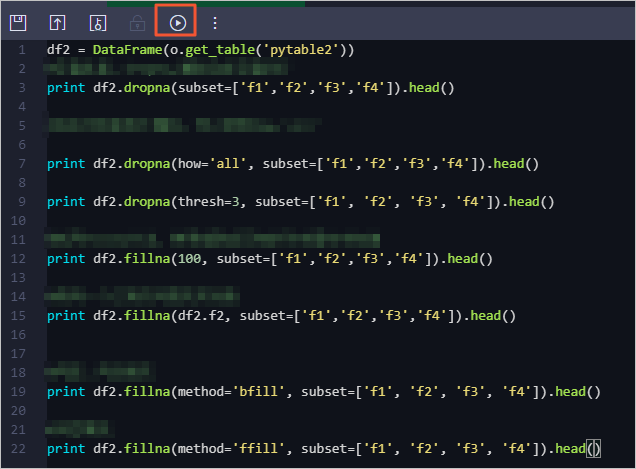

9. View the execution result of the node on the **Runtime Log** tab.

   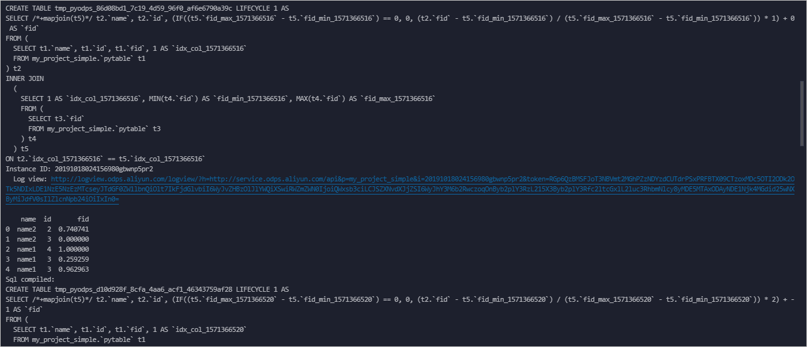

   In this example, the following information appears on the Run Log tab:

   ```sql
   Sql compiled:
   CREATE TABLE tmp_pyodps_59cb5533_6dc3_4b64_9312_b2da29d70cee LIFECYCLE 1 AS
   SELECT /*+mapjoin(t5)*/ t2.`name`, t2.`id`, (IF((t5.`fid_max_1570691133` - t5.`fid_min_1570691133`) == 0, 0, (t2.`fid` - t5.`fid_min_1570691133`) / 
   (t5.`fid_max_1570691133` - t5.`fid_min_1570691133`)) * 1) + 0 AS `fid`
   FROM (
     SELECT t1.`name`, t1.`id`, t1.`fid`, 1 AS `idx_col_1570691133`
     FROM WB_BestPractice_dev.`pytable` t1
   ) t2
   INNER JOIN
     (
       SELECT 1 AS `idx_col_1570691133`, MIN(t4.`fid`) AS `fid_min_1570691133`, MAX(t4.`fid`) AS `fid_max_1570691133`
       FROM (
         SELECT t3.`fid`
         FROM WB_BestPractice_dev.`pytable` t3
       ) t4
     ) t5
   ON t2.`idx_col_1570691133` == t5.`idx_col_1570691133`
   Instance ID: 2019101007053495gl8by72m

       name  id       fid
   0  name1   4  1.000000
   1  name2   2  0.526316
   2  name2   3  0.000000
   3  name1   4  0.710526
   4  name1   3  0.184211
   5  name1   3  0.684211
   Sql compiled:
   CREATE TABLE tmp_pyodps_88a24967_3bdc_41ce_85d7_4bbd23e4ce01 LIFECYCLE 1 AS
   SELECT /*+mapjoin(t5)*/ t2.`name`, t2.`id`, (IF((t5.`fid_max_1570691139` - t5.`fid_min_1570691139`) == 0, 0, (t2.`fid` - t5.`fid_min_1570691139`) / 
   (t5.`fid_max_1570691139` - t5.`fid_min_1570691139`)) * 2) + -1 AS `fid`
   FROM (
     SELECT t1.`name`, t1.`id`, t1.`fid`, 1 AS `idx_col_1570691139`
     FROM WB_BestPractice_dev.`pytable` t1
   ) t2
   INNER JOIN
     (
       SELECT 1 AS `idx_col_1570691139`, MIN(t4.`fid`) AS `fid_min_1570691139`, MAX(t4.`fid`) AS `fid_max_1570691139`
       FROM (
         SELECT t3.`fid`
         FROM WB_BestPractice_dev.`pytable` t3
       ) t4
     ) t5
   ON t2.`idx_col_1570691139` == t5.`idx_col_1570691139`
   Instance ID: 20191010070539772gjo56292

       name  id       fid
   0  name1   4  1.000000
   1  name2   2  0.052632
   2  name2   3 -1.000000
   3  name1   4  0.421053
   4  name1   3 -0.631579
   5  name1   3  0.368421
   Sql compiled:
   CREATE TABLE tmp_pyodps_439117fc_9ef7_4086_899d_a5bf77d653e5 LIFECYCLE 1 AS
   SELECT /*+mapjoin(t5)*/ t2.`name`, t2.`id`, t2.`fid`, (IF((t5.`fid_max_1570691146` - t5.`fid_min_1570691146`) == 0, 0, (t2.`fid` - t5.`fid_min_1570691146`) / 
   (t5.`fid_max_1570691146` - t5.`fid_min_1570691146`)) * 1) + 0 AS `fid_scaled`
   FROM (
     SELECT t1.`name`, t1.`id`, t1.`fid`, 1 AS `idx_col_1570691146`
     FROM WB_BestPractice_dev.`pytable` t1
   ) t2
   INNERJOIN
     (
       SELECT 1 AS `idx_col_1570691146`, MIN(t4.`fid`) AS `fid_min_1570691146`, MAX(t4.`fid`) AS `fid_max_1570691146`
       FROM (
         SELECT t3.`fid`
         FROM WB_BestPractice_dev.`pytable` t3
       ) t4
     ) t5
   ON t2.`idx_col_1570691146` == t5.`idx_col_1570691146`

   Instance ID: 20191010070546769g0c14f72

       name  id  fid  fid_scaled
   0  name1   4  5.3    1.000000
   1  name2   2  3.5    0.526316
   2  name2   3  1.5    0.000000
   3  name1   4  4.2    0.710526
   4  name1   3  2.2    0.184211
   5  name1   3  4.1    0.684211
   Sql compiled:
   CREATE TABLE tmp_pyodps_d3839b4b_1087_4d52_91f5_52763b72f272 LIFECYCLE 1 AS
   SELECT /*+mapjoin(t3)*/ t1.`name`, t1.`id`, (IF((t3.`fid_max_1570691151` - t3.`fid_min_1570691151`) == 0, 0, (t1.`fid` - t3.`fid_min_1570691151`) / 
   (t3.`fid_max_1570691151` - t3.`fid_min_1570691151`)) * 1) + 0 AS `fid`
   FROM WB_BestPractice_dev.`pytable` t1
   INNER JOIN
     (
       SELECT t2.`name`, MAX(t2.`fid`) AS `fid_max_1570691151`, MIN(t2.`fid`) AS 
   `fid_min_1570691151`
       FROM WB_BestPractice_dev.`pytable` t2
       GROUP BY t2.`name`
     ) t3
   ON t1.`name` == t3.`name`
   Instance ID: 20191010070551756gtf14f72


       name  id       fid
   0  name1   4  1.000000
   1  name2   2  1.000000
   2  name2   3  0.000000
   3  name1   4  0.645161
   4  name1   3  0.000000
   5  name1   3  0.612903
   Sql compiled:
   CREATE TABLE tmp_pyodps_1ea6e5b4_129f_4d1e_a6a7_410e08d77ae6 LIFECYCLE 1 AS
   SELECT /*+mapjoin(t5)*/ t2.`name`, t2.`id`, IF(t5.`fid_std_1570691157` == 0, 0, (t2.`fid` - t5.`fid_mean_1570691157`) / t5.`fid_std_1570691157`) AS `fid`
   FROM (
     SELECT t1.`name`, t1.`id`, t1.`fid`, 1 AS `idx_col_1570691157`
     FROM WB_BestPractice_dev.`pytable` t1
   ) t2
   INNER JOIN
     (
       SELECT 1 AS idx_col_1570691157, AVG(t4.fid) AS fid_mean_1570691157, STDDEV(t4.`fid`) AS `fid_std_1570691157`
       FROM (
         SELECT t3.`fid`
         FROM WB_BestPractice_dev.`pytable` t3
       ) t4
     ) t5
   ON t2.`idx_col_1570691157` == t5.`idx_col_1570691157`
   Instance ID: 20191010070557788gdl14f72

       name  id       fid
   0  name1   4  1.436467
   1  name2   2  0.026118
   2  name2   3 -1.540938
   3  name1   4  0.574587
   4  name1   3 -0.992468
   5  name1   3  0.496234
   ```

<a id="section-9-9-14"></a>

### 9.9.14. Use a PyODPS node to process null values

This topic describes how to use a PyODPS node to process null values.

**Prerequisites**

The following operations are performed:

- MaxCompute is activated.

- DataWorks is activated.

- A workflow is created in the DataWorks console. In this example, a workflow is created for a DataWorks workspace in basic mode.

**Procedure**

1. Prepare test data.

   <ol type="i">

   <li>

   Log on to the DataWorks console.

   </li>

   <li>

   Create a table and import data to the table. For more information, see Create tables and

   </li>

   </ol>

   upload data in DataWorks User Guide.

   Execute the following statement to create a table named pytable2:

   ```sql
   CREATE TABLE `pytable2` (
     `id` string,
     `name` string,
     `f1` double,
     `f2` double,
     `f3` double,
     `f4` double
   ) ;
   ```

   Import the data in the pytable2.txt file to the pytable2 table. The pytable2.txt file contains the following data:

   ```text
   0, name1, 1.0, NaN, 3.0, 4.0
   1, name1, 2.0, NaN, NaN, 1.0
   2, name1, 3.0, 4.0, 1.0, NaN
   3, name1, NaN, 1.0, 2.0, 3.0
   4, name1, 1.0, NaN, 3.0, 4.0
   5, name1, 1.0, 2.0, 3.0, 4.0
   6, name1, NaN, NaN, NaN, NaN
   ```

2. 

3. On the **Data Development** page, right-click the created workflow and choose **Create Node > MaxCompute > PyODPS 2**.

4. Enter a node name in the **Name** field and click **OK**.

5. On the configuration tab of the PyODPS 2 node, enter the code of the node that is used to process null values in the code editor.

   The following code shows an example.

   ```text
   df2 = DataFrame(o.get_table('pytable2'))
   # Call the dropna method to delete the rows that contain null values. 
   print df2.dropna(subset=['f1','f2','f3','f4']).head()

   # If you do not want to delete the rows that contain non-null values, specify how='all' for the dropna method. 
   print df2.dropna(how='all', subset=['f1','f2','f3','f4']).head()
   print df2.dropna(thresh=3, subset=['f1', 'f2', 'f3', 'f4']).head()

   # Call the fillna method to replace null values with values in existing columns or constants. 
   print df2.fillna(100, subset=['f1','f2','f3','f4']).head()

   # Replace null values with the values in an existing column. 
   print df2.fillna(df2.f2, subset=['f1','f2','f3','f4']).head()

   # Replace each null value with the value in the same column of the previous row. 
   print df2.fillna(method='bfill', subset=['f1', 'f2', 'f3', 'f4']).head()

   # Replace each null value with the value in the same column of the following row. 
   print df2.fillna(method='ffill', subset=['f1', 'f2', 'f3', 'f4']).head()
   ```

6. Click the **Run** icon on the toolbar.

   

7. View the execution result of the node on the **Runtime Log** tab.

   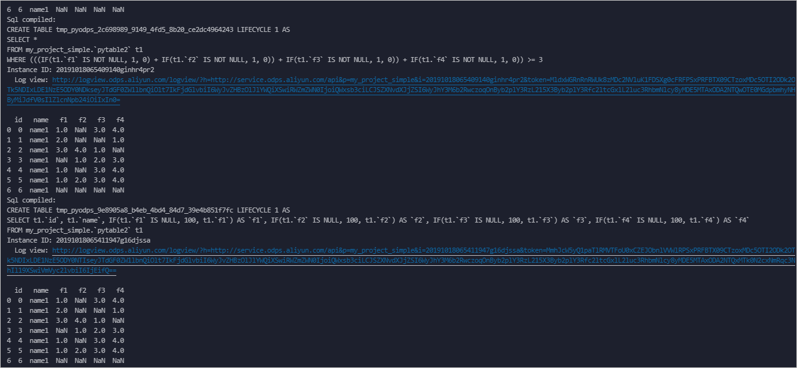

   In this example, the following information appears on the Run Log tab:

   ```sql
   Sql compiled:
   CREATE TABLE tmp_pyodps_d0c7d8c2_be38_4d48_b0eb_e89bae5bde01 LIFECYCLE 1 AS
   SELECT *
   FROM WB_BestPractice_dev.`pytable2` t1
   WHERE (((IF(t1.`f1` IS NOT NULL, 1, 0) + IF(t1.`f2` IS NOT NULL, 1, 0)) + IF(t1.`f3` 
   IS NOT NULL, 1, 0)) + IF(t1.`f4` IS NOT NULL, 1, 0)) >= 4
   Instance ID: 20191010071154980g2hic292

     id   name   f1   f2   f3   f4
   0  0  name1  1.0  NaN  3.0  4.0
   1  1  name1  2.0  NaN  NaN  1.0
   2  2  name1  3.0  4.0  1.0  NaN
   3  3  name1  NaN  1.0  2.0  3.0
   4  4  name1  1.0  NaN  3.0  4.0
   5  5  name1  1.0  2.0  3.0  4.0
   6  6  name1  NaN  NaN  NaN  NaN
   Sql compiled:
   CREATE TABLE tmp_pyodps_49b46768_f589_48f6_be8a_b7139f31f6f2 LIFECYCLE 1 AS
   SELECT *
   FROM WB_BestPractice_dev.`pytable2` t1
   WHERE (((IF(t1.`f1` IS NOT NULL, 1, 0) + IF(t1.`f2` IS NOT NULL, 1, 0)) + IF(t1.`f3` 
   IS NOT NULL, 1, 0)) + IF(t1.`f4` IS NOT NULL, 1, 0)) >= 1

   Instance ID: 20191010071159759g0dk9592


     id   name   f1   f2   f3   f4
   0  0  name1  1.0  NaN  3.0  4.0
   1  1  name1  2.0  NaN  NaN  1.0
   2  2  name1  3.0  4.0  1.0  NaN
   3  3  name1  NaN  1.0  2.0  3.0
   4  4  name1  1.0  NaN  3.0  4.0
   5  5  name1  1.0  2.0  3.0  4.0
   6  6  name1  NaN  NaN  NaN  NaN
   Sql compiled:
   CREATE TABLE tmp_pyodps_7f941800_1539_415b_9257_283ebeb893a6 LIFECYCLE 1 AS
   SELECT *
   FROM WB_BestPractice_dev.`pytable2` t1
   WHERE (((IF(t1.`f1` IS NOT NULL, 1, 0) + IF(t1.`f2` IS NOT NULL, 1, 0)) + IF(t1.`f3` 
   IS NOT NULL, 1, 0)) + IF(t1.`f4` IS NOT NULL, 1, 0)) >= 3
   Instance ID: 20191010071204544giyswx7

   0  0  name1  1.0  NaN  3.0  4.0
   1  1  name1  2.0  NaN  NaN  1.0
   2  2  name1  3.0  4.0  1.0  NaN
   3  3  name1  NaN  1.0  2.0  3.0
   4  4  name1  1.0  NaN  3.0  4.0
   5  5  name1  1.0  2.0  3.0  4.0
   6  6  name1  NaN  NaN  NaN  NaN
   Sql compiled:
   CREATE TABLE tmp_pyodps_16d6ea6d_5195_4e4c_8346_644a395852f7 LIFECYCLE 1 AS
   SELECT t1.`id`, t1.`name`, IF(t1.`f1` IS NULL, 100, t1.`f1`) AS `f1`, IF(t1.`f2` IS N
   ULL, 100, t1.`f2`) AS `f2`, IF(t1.`f3` IS NULL, 100, t1.`f3`) AS `f3`, IF(t1.`f4` IS 
   NULL, 100, t1.`f4`) AS `f4`
   FROM WB_BestPractice_dev.`pytable2` t1
   Instance ID: 20191010071209190gyl56292

     id   name   f1   f2   f3   f4
   0  0  name1  1.0  NaN  3.0  4.0
   1  1  name1  2.0  NaN  NaN  1.0
   2  2  name1  3.0  4.0  1.0  NaN
   3  3  name1  NaN  1.0  2.0  3.0
   4  4  name1  1.0  NaN  3.0  4.0
   5  5  name1  1.0  2.0  3.0  4.0
   6  6  name1  NaN  NaN  NaN  NaN
   Sql compiled:
   CREATE TABLE tmp_pyodps_40755ebd_2d2a_482e_b360_3f3da0d5422c LIFECYCLE 1 AS
   SELECT t1.`id`, t1.`name`, IF(t1.`f1` IS NULL, t1.`f2`, t1.`f1`) AS `f1`, IF(t1.`f2` 
   IS NULL, t1.`f2`, t1.`f2`) AS `f2`, IF(t1.`f3` IS NULL, t1.`f2`, t1.`f3`) AS `f3`, IF
   (t1.`f4` IS NULL, t1.`f2`, t1.`f4`) AS `f4`
   FROM WB_BestPractice_dev.`pytable2` t1

   Instance ID: 20191010071213970gbp66792


     id   name   f1   f2   f3   f4
   0  0  name1  1.0  NaN  3.0  4.0
   1  1  name1  2.0  NaN  NaN  1.0
   2  2  name1  3.0  4.0  1.0  NaN
   3  3  name1  NaN  1.0  2.0  3.0
   4  4  name1  1.0  NaN  3.0  4.0
   5  5  name1  1.0  2.0  3.0  4.0
   6  6  name1  NaN  NaN  NaN  NaN
   Sql compiled:
   CREATE TABLE tmp_pyodps_d39fcce1_d8a9_4cc2_8aff_2ed1e9c6bb1b LIFECYCLE 1 AS
   SELECT pyodps_udf_1570691538_d9441c59_c666_4a5d_8154_67d8bc8c24ad(t1.`id`, t1.`name`,t1.`f1`, t1.`f2`, t1.`f3`, t1.`f4`) AS (`id`, `name`, `f1`, `f2`, `f3`, `f4`)
   FROM WB_BestPractice_dev.`pytable2` t1
   Instance ID: 20191010071219627goqv9292


     id   name   f1   f2   f3   f4
   0  0  name1  1.0  3.0  3.0  4.0
   1  1  name1  2.0  1.0  1.0  1.0
   2  2  name1  3.0  4.0  1.0  NaN
   3  3  name1  1.0  1.0  2.0  3.0
   4  4  name1  1.0  3.0  3.0  4.0
   5  5  name1  1.0  2.0  3.0  4.0
   6  6  name1  NaN  NaN  NaN  NaN
   Sql compiled:
   CREATE TABLE tmp_pyodps_3f190cf0_f9fb_4e06_a942_ab31c0241cd3 LIFECYCLE 1 AS
   SELECT pyodps_udf_1570691566_0330848b_82d3_411c_88e1_cbbcc6adb9c1(t1.`id`, t1.`name`,t1.`f1`, t1.`f2`, t1.`f3`, t1.`f4`) AS (`id`, `name`, `f1`, `f2`, `f3`, `f4`)
   FROM WB_BestPractice_dev.`pytable2` t1
   Instance ID: 20191010071247729gt776792

     id   name   f1   f2   f3   f4
   0  0  name1  1.0  1.0  3.0  4.0
   1  1  name1  2.0  2.0  2.0  1.0
   2  2  name1  3.0  4.0  1.0  1.0
   3  3  name1  NaN  1.0  2.0  3.0
   4  4  name1  1.0  1.0  3.0  4.0
   5  5  name1  1.0  2.0  3.0  4.0
   6  6  name1  NaN  NaN  NaN  NaN
   ```

<a id="section-9-10"></a>

## 9.10. FAQ about PyODPS

This topic provides answers to some frequently asked questions (FAQ) about PyODPS.

| Category | FAQ |
| --- | --- |
| Install PyODPS | • What do I do if the error message "Warning: XXX not installed" appears when I install PyODPS?<br>• What do I do if the error message "Project Not Found" appears when I install PyODPS?<br>• What do I do if the error message "Syntax Error" appears when I install PyODPS?<br>• What do I do if the error message "Permission Denied" appears when I install PyODPS in macOS?<br>• What do I do if the error message "Operation Not Permitted" appears when I install PyODPS in macOS? |
| Import modules | • What do I do if the error message "No Module Named ODPS" appears when I run the from odps import ODPS code?<br>• What do I do if the error message "Cannot Import Name ODPS" appears when I run the from odps import ODPS code?<br>• What do I do if the error message "Cannot Import Module odps" appears when I run the from odps import ODPS code?<br>• What do I do if the error message "ImportError" appears when I use PyODPS in IPython or Jupyter Notebook? |
| Use PyODPS | • What does the size field represent in o.gettable('table_name').size?<br>• How do I configure a Tunnel endpoint?<br>• How do I use a third-party package that contains CPython in PyODPS?<br>• What is the maximum amount of data that can be processed by a DataFrame in PyODPS? Is the size of a table limited?<br>• How do I use max_pt in DataFrame?<br>• What is the difference between the open_writer() and write_table() methods when I use PyODPS to write data to a table?<br>• Why is the amount of data that is queried on a DataWorks PyODPS node less than the amount of data that is returned in local mode?<br>• How do I call the count function to obtain the total number of rows in a DataFrame?<br>• What do I do if the error message "sourceIP is not in the white list" appears when I use PyODPS?<br>• What do I do if I fail to configure the runtime environment of MaxCompute by using from odps import options options.sql.settings?<br>• Why does the error message "IndexError:listindexoutofrange" appears when I call the head method of a DataFrame?<br>• What do I do if the error message "ODPSError" appears when I upload a Pandas DataFrame to MaxCompute?<br>• What do I do if the error message "lifecycle is not specified in mandatory mode" appears when I use a DataFrame to write data to a table?<br>• What do I do if the error message "Perhaps the datastream from server is crushed" appears when I use PyODPS to write data to a table?<br>• What do I do if the error message "Project is protected" appears when I use PyODPS to read data from a table?<br>• What do I do if the error message "ConnectionError: timed out try catch exception" occasionally appears when I run a PyODPS script task?<br>• What do I do if the error message "is not defined" appears when I use PyODPS to execute the get_sql_task_cost function?<br>• When I use PyODPS to display logs, Chinese characters are automatically converted into code to display. How do I retain Chinese characters in the logs?<br>• If I set options.tunnel.use_instance_tunnel to False, fields of the DATETIME type are defined in MaxCompute, but the data that is obtained by using the SELECT statements is of the STRING type.Why?<br>• How do I use Python to achieve various purposes in PyODPS?<br>• How do I use the Pandas DataFrame backend to debug local PyODPS programs?<br>• What do I do if the nested loop execution is slow?<br>• In which scenarios can I download PyODPS data to my on-premises machine to process the data?<br>• A maximum of 10,000 records can be obtained by using open_reader. How do I obtain more than 10,000 records?<br>• Why am I recommended to use built-in operators instead of UDFs?<br>• Why are the partition values of a partitioned table that is obtained by using DataFrame().schema.partitions empty?<br>• How do I use PyODPS DataFrame to perform the Cartesian product operation?<br>• How do I use PyODPS to download full data?<br>• Can I use execute_sql or a DataFrame to compute the percentage of null values of a field?<br>• How do I configure data types for PyODPS?<br>• What do I do if the error message "ValueError" appears when I use PyODPS? |

**What do I do if the error message "Warning: XXX not installed" appears when I install PyODPS?**

A component is not installed when you install PyODPS. Identify the name of the component that is not installed based on XXX in the error message and run the  `pip`  command to install the component.

**What do I do if the error message "Project Not Found" appears when I install PyODPS?**

Causes

- The endpoint that you configured is invalid. You must change it to the endpoint of the project in which the PyODPS is installed.

- The positions of parameters for the MaxCompute entry object are invalid. Check the positions of the parameters for the MaxCompute entry object and make sure that you enter valid parameters.

**What do I do if the error message "Syntax Error" appears when I install PyODPS?**

The Python version is outdated. Python 2.5 or earlier is not supported. We recommend that you use the mainstream versions that are supported by PyODPS, such as Python 2.7.6 or later minor versions, Python 3.3 or later minor versions, and Python 2.6.

**What do I do if the error message "Permission Denied" appears when I install PyODPS in macOS?**

Run the  `sudo pip install pyodps`  command to install PyODPS.

**What do I do if the error message "Operation Not Permitted" appears when I install PyODPS in macOS?**

This issue is caused by System Integrity Protection (SIP). Restart your device and press **⌘**+**R** during the restart. Then, run the following command in the terminal to address the issue:

```text
csrutil disable
reboot       
```

For more information, see Operation Not Permitted when on root - El Capitan (rootless disabled).

**What do I do if the error message "No Module Named ODPS" appears when I run the from odps import ODPS code?**

The PyODPS package cannot be loaded. Causes:

- Cause 1: Multiple Python versions are installed.

  Solution: In the current directory, search for the folders that are named odps and contain the  `odps.py`  or  `init.py`  file. To resolve the issue, you can perform the following steps:

  - If an existing folder has the same name, change the folder name.

  - If you installed a Python package that is named odps, run the  `sudo pip uninstall odps` command to delete the package.

- Cause 2: Both Python 2 and Python 3 are installed.

  Solution: Make sure that only Python 2 or Python 3 is installed on your on-premises machine.

- Cause 3: PyODPS is not installed in the Python version that you use.

  Solution: Install PyODPS in the Python version that you use. For more information about how to install PyODPS, see Install PyODPS.

**What do I do if the error message "Cannot Import Name ODPS" appears when I run the from odps import ODPS code?**

Check whether a file that is named **odps.py** exists in the current working path. If the file exists, rename the file and run the from odps import ODPS code again.

**What do I do if the error message "Cannot Import Module odps" appears when I run the from odps import ODPS code?**

A dependency issue occurs in PyODPS. You can click the link to join the DingTalk group for PyODPS technical support to fix the issue.

**What do I do if the error message "ImportError" appears when I use PyODPS in IPython or Jupyter Notebook?**

Add  `from odps import errors`  to the header of the code.

If the error message still appears after you add  `from odps import errors`  to the header of the code, the IPython component is not installed. Run the  `sudo pip install -U jupyter` command to install the IPython component.

**What does the size field represent in o.gettable('table_name').size?**

The size field specifies the physical size of a table.

**How do I configure a Tunnel endpoint?**

Configure the Tunnel endpoint by using the  `options.tunnel.endpoint`  parameter. For more information about the parameter, see aliyun-odps-python-sdk.

**How do I use a third-party package that contains CPython in PyODPS?**

We recommend that you generate a wheel package that contains CPython. For more information, see Create a crcmod that can be used in MaxCompute.

**What is the maximum amount of data that can be processed by a DataFrame in PyODPS? Is the size of a table limited?**

The size of a table is not limited in PyODPS. The size of the DataFrame that is created by Pandas is limited by the size of the local memory.

**How do I use max_pt in a DataFrame?**

Use the  `odps.df.func`  module to call built-in functions of MaxCompute.

```python
from odps.df import func
df = o.get_table('your_table').to_df()
df[df.ds == func.max_pt('your_project.your_table')]  # ds is a partition field.      
```

**What is the difference between the open_writer() and write_table() methods when I use PyODPS to write data to a table?**

Each time you call  `write_table()` , MaxCompute generates a file on the server. This operation is time-consuming. If a large number of files are generated, the efficiency of subsequent queries decreases and the memory of the server may be insufficient. We recommend that you write multiple records at the same time or provide a Generator object when you use the  `write_table()`  method. For more information about how to use the  `write_table()`  method, see Write data to a table.

By default, data is written to blocks when you use the  `open_writer()`  method.

**Why is the amount of data that is queried on a DataWorks PyODPS node less than the amount of data that is returned in local mode?**

By default, InstanceTunnel is disabled in DataWorks. In this case,  `instance.open_reader`  is run by using the Result interface, and a maximum of 10,000 data records can be read.

After InstanceTunnel is enabled, you can execute  `reader.count`  to obtain the number of data records. If you need to iteratively obtain all data, you must specify  `options.tunnel.limit_instance_tunnel = False`  to remove the limit.

**How do I call the count function to obtain the total number of rows in a DataFrame?**

1. After you install PyODPS, run the following command in the Python environment to create a MaxCompute table and initialize the DataFrame:

   ```text
   iris = DataFrame(o.get_table('pyodps_iris'))        
   ```

2. Call the count function to compute the total number of rows in the DataFrame.

   ```text
   iris.count()      
   ```

3. DataFrame API operations are not immediately called. These operations are called only when you explicitly call the execute method or an immediately called method. To prevent delayed execution of the count function, run the following command:

   ```text
   df.count().execute()    
   ```

For more information about how to obtain the total number of rows in a DataFrame, see Aggregation. For more information about the delayed execution of PyODPS methods, see Execution.

**What do I do if the error message "sourceIP is not in the white list" appears when I use PyODPS?**

An IP address whitelist is configured for the MaxCompute project that is accessed by PyODPS. Contact the project owner to add the IP address of your device to the IP address whitelist.

**What do I do if I fail to configure the runtime environment of MaxCompute by using from odps import options options.sql.settings?**

- Problem description

  When PyODPS is used to execute SQL statements, the following code is used to configure the runtime environment of MaxCompute before the request for a MaxCompute instance is sent:

  ```python
  from odps import options
  options.sql.settings = {'odps.sql.mapper.split.size': 32}     
  ```

  Only six mappers are enabled after the job is run. The settings do not take effect. Run the  `set odps.stage.mapper.split.size=32`  command on the MaxCompute client. The job is successfully run in one minute.

- Cause The parameters that are configured on the MaxCompute client and in PyODPS are different. The parameter on the MaxCompute client is  `odps.stage.mapper.split.size` , and the parameter in PyODPS is  `odps.sql.mapper.split.size` .

- Solution

  Change the parameter in PyODPS to  `odps.stage.mapper.split.size` .

**Why does the error message "IndexError:listindexoutofrange" appears when I call the head method of a DataFrame?**

No elements exist in  `list[index]`  or the number of elements in  `list[index]`  exceeds the upper limit.

**What do I do if the error message "ODPSError" appears when I upload a Pandas DataFrame to MaxCompute?**

- Problem description

  The following error message appears when a Pandas DataFrame is uploaded to MaxCompute:

  ```text
  ODPSError: ODPS entrance should be provided.
  ```

- Cause

  A global MaxCompute entry object is not found.

- Solution

  - If you use the room mechanism  `%enter` , configure the global MaxCompute entry object.

  - Call the  `to_global`  method to configure the global MaxCompute object.

  - Use the  `DataFrame(pd_df).persist('your_table', odps=odps)`  parameter.

**What do I do if the error message "lifecycle is not specified in mandatory mode" appears when I use a DataFrame to write data to a table?**

- Problem description

  The following error message appears when a DataFrame is used to write data to a table:

  ```text
  table lifecycle is not specified in mandatory mode
  ```

- Cause

  You have not configured a lifecycle for the table.

- Solution

  You must configure a lifecycle for each table in a project. Configure the following information each time you write data to a table:

  ```python
  from odps import options
  options.lifecycle = 7  # Configure a lifecycle. The value must be an integer. Unit: days.       
  ```

**What do I do if the error message "Perhaps the datastream from server is crushed" appears when I use PyODPS to write data to a table?**

This error is caused by dirty data. Check whether the number of columns that you specify is the same as that of the table to which you want to write data.

**What do I do if the error message "Project is protected" appears when I use PyODPS to read data from a table?**

The project security policy does not allow you to read data from a table. To read all data from the table, use one of the following solutions:

- Contact the project owner to add an exception policy.

- Use DataWorks or other masking tools to mask the data and export the data to a project for which data protection is not enabled before you read the data.

If you want to read some data, use one of the following solutions:

- Use  `o.execute_sql('select * from <table_name>').open_reader()` .

- Use  `DataFrame`，`o.get_table('<table_name>').to_df()` .

**What do I do if the error message "ConnectionError: timed out try catch exception" occasionally appears when I run a PyODPS script task?**

Causes:

- The connection timed out. A connection is considered as timed out if the timeout duration exceeds 5s. Use one of the following solutions to address the issue:

  - Add the following code to the header of the code to increase the timeout period:

    ```text
    workaround from odps import options 
    options.connect_timeout=30                        
    ```

  - Capture exceptions and try again.

- Some machines are not allowed to access network services due to sandbox limits. We recommend that you use exclusive resource groups for scheduling to run the script task to address this issue.

**What do I do if the error message "is not defined" appears when I use PyODPS to execute the get_sql_task_cost function?**

- Problem description

  The following error message appears when PyODPS is used to execute the get_sql_task_cost function:

  ```text
  NameError: name 'get_task_cost' is not defined.
  ```

- Solution

  The name of the function is invalid.

- Solution

  Use the execute_sql_cost function instead of the get_sql_task_cost function.

**When I use PyODPS to display logs, Chinese characters are automatically converted into code to display. How do I retain Chinese characters in the logs?**

Enter Chinese characters by writing the code in the  `print ("`我叫 `%s" % ('abc'))`  format. These issues occur only in Python 2.

**If I set options.tunnel.use_instance_tunnel to False, fields of the DATETIME type are defined in MaxCompute, but the data that is obtained by using the SELECT statements is of the STRING type. Why?**

By default, PyODPS calls the old Result interface when you call Open_Reader. In this case, the data that is obtained from the server is in the CSV format, and data of the DATETIME type is converted into the STRING type.

To address this issue, enable InstanceTunnel by specifying  `options.tunnel.use_instance_tunnel = True` . This way, PyODPS calls InstanceTunnel by default.

**How do I use Python to achieve various purposes in PyODPS?**

- Write Python functions.

  You can use multiple methods to compute the distance between two points, such as the Euclidean distance and the Manhattan distance. You can also write a series of functions and call the functions when you compute data based on your business requirements.

  ```python
  def euclidean_distance(from_x, from_y, to_x, to_y):
      return ((from_x - to_x) ** 2 + (from_y - to_y) ** 2).sqrt()

  def manhattan_distance(center_x, center_y, x, y):
     return (from_x - to_x).abs() + (from_y - to_y).abs()                      
  ```

  The following sample code shows how to call a function that you write:

  ```text
  In [42]: df
       from_x    from_y      to_x      to_y
  0  0.393094  0.427736  0.463035  0.105007
  1  0.629571  0.364047  0.972390  0.081533
  2  0.460626  0.530383  0.443177  0.706774
  3  0.647776  0.192169  0.244621  0.447979
  4  0.846044  0.153819  0.873813  0.257627
  5  0.702269  0.363977  0.440960  0.639756
  6  0.596976  0.978124  0.669283  0.936233
  7  0.376831  0.461660  0.707208  0.216863
  8  0.632239  0.519418  0.881574  0.972641
  9  0.071466  0.294414  0.012949  0.368514

  In [43]: euclidean_distance(df.from_x, df.from_y, df.to_x, 
  df.to_y).rename('distance')
     distance
  0  0.330221
  1  0.444229
  2  0.177253
  3  0.477465
  4  0.107458
  5  0.379916
  6  0.083565
  7  0.411187
  8  0.517280
  9  0.094420

  In [44]: manhattan_distance(df.from_x, df.from_y, df.to_x, 
  df.to_y).rename('distance')
     distance
  0  0.392670
  1  0.625334
  2  0.193841
  3  0.658966
  4  0.131577
  5  0.537088
  6  0.114198
  7  0.575175
  8  0.702558
  9  0.132617                       
  ```

- Use conditions and loop statements in Python.

  If the tables that you want to compute are stored in a database, you must process the fields of the tables based on configurations and perform UNION or JOIN operations on the tables. If you use SQL statements to perform these operations, the process is complex. We recommend that you use a DataFrame to perform the operations.

  For example, if you want to merge 30 tables into one table, you must perform the UNION ALL operation on the 30 tables if you use SQL statements. If you use PyODPS, run the following code:

  ```text
  table_names = ['table1', ..., 'tableN']
  dfs = [o.get_table(tn).to_df() for tn in table_names]
  reduce(lambda x, y: x.union(y), dfs) 

  ## The reduce statement is equivalent to the following code: 
  df = dfs[0]
  for other_df in dfs[1:]:
      df = df.union(other_df)       
  ```

**How do I use the Pandas DataFrame backend to debug local PyODPS programs?**

You can use one of the following methods to debug local PyODPS programs: The initialization methods are different in the following methods but the subsequent code is the same.

- A PyODPS DataFrame that is created by using the Pandas DataFrame can use Pandas to debug local PyODPS programs.

- A DataFrame that is created by using MaxCompute tables can be executed in MaxCompute.

The following code shows an example.

```text
df = o.get_table('movielens_ratings').to_df()
DEBUG = True
if DEBUG:
    df = df[:100].to_pandas(wrap=True)       
```

If all subsequent code is written, the local debugging speed is fast. After the debugging is complete, you can change the value of the DEBUG parameter to False. Then, you can compute all data in MaxCompute.

We recommend that you use MaxCompute Studio to debug local PyODPS programs.

**What do I do if the nested loop execution is slow?**

We recommend that you use the Dict data structure to obtain the execution result of the loop and import the execution result to DataFrame objects in the outer loop. If you place the DataFrame object code  `df=XXX`  in the outer loop, a DataFrame object is generated for each loop calculation. As a result, the execution speed of the nested loop is slow.

**In which scenarios can I download PyODPS data to my on-premises machine to process the data?**

You can download PyODPS data to your on-premises machine in one of the following scenarios:

- A small amount of PyODPS data needs to be processed.

- If you need to use a Python function for a single row of data or perform operations that change one row to multiple rows, you can use the PyODPS DataFrame and make full use of the parallel computing capabilities of MaxCompute.

  For example, if you want to expand a JSON string data into one row by using key-value pairs, run the following code:

  ```text
  In [12]: df
                 json
  0  {"a": 1, "b": 2}
  1  {"c": 4, "b": 3}

  In [14]: from odps.df import output

  In [16]: @output(['k', 'v'], ['string', 'int'])
      ...: def h(row):
      ...:     import json
      ...:     for k, v in json.loads(row.json).items():
      ...:         yield k, v
      ...:   

  In [21]: df.apply(h, axis=1)
     k  v
  0  a  1
  1  b  2
  2  c  4
  3  b  3                          
  ```

**A maximum of 10,000 records can be obtained by using open_reader. How do I obtain more than 10,000 records?**

Use  `create table as select ...`  to save the SQL execution result as a table, and use  `table.open_reader`  to read data.

**Why am I recommended to use built-in operators instead of UDFs?**

UDFs are executed slower than built-in operators during calculation. Therefore, we recommend that you use built-in operators.

If you need to process millions of rows of data and you use a UDF for a row, the execution time is increased from 7 seconds to 27 seconds. If larger datasets or more complex operations are required, the gap in time may be larger.

**Why are the partition values of a partitioned table that are obtained by using DataFrame().schema.partitions empty?**

A DataFrame does not distinguish between partition fields and common fields. Therefore, partition fields are processed as common fields. You can filter out partition fields by using the following method:

```text
df = o.get_table().to_df()
df[df.ds == '']       
```

For more information about how to configure partitions or read data from partitions, see Tables.

**How do I use PyODPS DataFrame to perform the Cartesian product operation?**

For more information, see Use PyODPS DataFrame to process Cartesian products.

**How do I use PyODPS to download full data?**

By default, PyODPS does not limit the amount of data that can be read from an instance. However, the amount of data that can be downloaded for a protected project by using Tunnel commands is limited. If you do not specify  `options.tunnel.limit_instance_tunnel` , the limit is automatically enabled, and the number of data records that can be downloaded is limited based on the configurations of the MaxCompute project. In most cases, a maximum of 10,000 data records can be downloaded at a time. If you need to iteratively obtain all data, you must remove the  `limit`  on the amount of data. You can execute the following statements to enable  `InstanceTunnel`  and remove the  `limit` .

```text
options.tunnel.use_instance_tunnel = True
options.tunnel.limit_instance_tunnel = False  # Remove the limit on the number of data records that can be read. 

with instance.open_reader() as reader:
    # Use InstanceTunnel to read all data.
```

**Can I use execute_sql or a DataFrame to compute the percentage of null values of a field?**

We recommend that you use a DataFrame to perform aggregate operations because of its high aggregate performance.

**How do I configure data types for PyODPS?**

If you use PyODPS, you can use one of the following methods to enable the MaxCompute V2.0 data type edition:

- Execute  `o.execute_sql('set odps.sql.type.system.odps2=true;query_sql', hints= {"odps.sql.submit.mode" : "script"})` .

- Use a DataFrame. For example, use an executed action, such as persist, execute, or to_pandas, by configuring the hints parameter. The following configurations are valid only for a single job:

  ```python
  from odps.df import DataFrame
  users - DataFrame(o.get_table('odps2_test'))
  users.persist('copy_test',hints={'odps.sql.type.system.odps2':'true'})
  ```

  If you want to enable the MaxCompute V2.0 data type edition by using a DataFrame and you want the setting to take effect globally, specify  `options.sql.use_odps2_extension = True` .

**What do I do if the error message "ValueError" appears when I use PyODPS?**

You can use one of the following methods to resolve this issue:

- Upgrade your SDK version to V0.8.4 or later.

- Add the following clause to the SQL statement that you want to execute:

  ```text
  fromodps.typesimportDecimal
  Decimal._max_precision=38
  ```

<a id="section-9-11"></a>

## 9.11. PyODPS API overview

This topic provides the links to PyODPS API documentation, which provides parameter descriptions and examples of each function:

- Definitions

- DataFrame Reference

<a id="section-10"></a>

# 10.Java sandbox limitations

This document outlines the Java sandbox limitations for MaxCompute MapReduce and UDF programs in a distributed environment.

**Usage restrictions**

> **Note**
>
> These limitations do not apply to the main program of a MapReduce job.

- You cannot access local files directly. Instead, you must use the MaxCompute MapReduce interfaces.

- You cannot access the distributed file system directly. Instead, you must use MaxCompute MapReduce to access table records.

- You cannot make JNI calls.

- You cannot create Java threads or spawn a child process to execute Linux commands.

- You cannot perform network operations, such as retrieving the local IP address.

- Your use of Java reflection is restricted. You do not have the **suppressAccessChecks** permission, so you cannot call setAccessible(true) on a private property or method to read its value or invoke it.

  If you attempt to use these methods, your code will throw an **access denied** exception.

<a id="section-11"></a>

# 11.MaxCompute feature enhancement packages

<a id="section-11-1"></a>

## 11.1. Joint computing enhancement package

<a id="section-11-1-1"></a>

### 11.1.1. Overview

The joint computing enhancement package allows you to access tables or data of Object Storage Service (OSS), Tablestore, and ApsaraDB RDS by using external tables in MaxCompute and provides computing capabilities such as Spark on MaxCompute based on a joint computing platform. This way, you can use the joint computing enhancement package to process data in MaxCompute based on open source technical solutions. This topic describes the joint computing enhancement package.

Compared with open source Spark of earlier versions, the joint computing enhancement package significantly improves the performance, stability, version compatibility, management capabilities, and compatibility with OSS and Hadoop. The joint computing enhancement package also provides the external table feature. The external table feature allows you to directly access data in data lakes.

- Spark on MaxCompute is a computing service that is provided by MaxCompute and is compatible with open source Spark. Spark on MaxCompute provides a Spark computing framework based on unified computing resource and dataset permission systems. The service allows you to use your preferred development method to submit and run Spark jobs. Spark on MaxCompute can fulfill diverse data processing and analysis requirements. Spark on MaxCompute allows you to migrate data in OSS to data warehouses based on the capabilities of Spark. This helps establish a connection between data warehouses and data lakes. As the performance of Spark on MaxCompute is gradually improved, Spark on MaxCompute can provide better performance and management capabilities than open source Spark based on the large-scale storage and computing capabilities of MaxCompute. Spark on MaxCompute also supports Spark 2.3.0 and Spark 2.4.5.

- As big data services continuously grow, new data use scenarios constantly emerge. The powerful computing capabilities of MaxCompute is gradually optimized to process different external data instead of only internal data in special formats. MaxCompute provides external tables to process data that is stored outside MaxCompute internal tables. You can execute simple DDL statements to create external tables in MaxCompute. Then, you can associate the external tables with various external data sources. This way, you can use the external tables to read data from or write data to the external data sources. In most cases, external tables can be used in the same manner as MaxCompute internal tables. This way, you can fully utilize the computing capabilities of MaxCompute SQL to process external data. External tables provide built-in extractors for accessing external data sources. You can also configure custom extractors to access external unstructured data. You can use Hive SerDe handlers to process various open source data formats in a flexible manner. MaxCompute external tables support various external data sources by using a Java Database Connectivity (JDBC) driver, including OSS, Tablestore, ApsaraDB for HBase, ApsaraDB RDS, and Hologres.

<a id="section-11-1-2"></a>

### 11.1.2. Use VolumeFs in Spark on MaxCompute

This topic describes how to use VolumeFs in Spark on MaxCompute.

**Prerequisites**

If you want to allow Spark on MaxCompute to use a MaxCompute project, make sure that the project supports VolumeFs. Before you use Spark on MaxCompute, contact the O&M administrator to check whether your project supports VolumeFs.

**Configure the VolumeFs-HDFS client**

1. Download the package of the VolumeFs-HDFS client.

2. Download the VolumeFs-related library lib.tar.gz.

3. After you download and decompress the client package, run the following command to configure the  `HADOOP_HOME`  environment variable:

   ```bash
    # Add the following code to the .bashrc or .bash_profile directory.
   export HADOOP_HOME=/path/to/hadoop-2.7.1/
   ```

4. Edit  `$HADOOP_HOME/etc/hadoop/hadoop-env.sh` .

   ```bash
   # Run the related command. 
   mkdir -p $HADOOP_HOME/share/hadoop/odps 
   # Decompress the VolumeFs-related library to the preceding path. 
   tar xf /path/to/lib.tar.gz -C $HADOOP_HOME/share/hadoop/odps 
   # Add the following code to $HADOOP_HOME/etc/hadoop/hadoop-env.sh. 
   # Odps Support 
   export HADOOP_CLASSPATH=$HADOOP_CLASSPATH:$HADOOP_HOME/share/hadoop/odps/lib/*
   ```

5. Configure  `$HADOOP_HOME/etc/hadoop/core-site.xml` .

   > **Important**
   >
   > All TBD values in the following code must be replaced with actual
   >
   > values.

   ```xml
    <?xml version="1.0" encoding="UTF-8"?>
    <?xml-stylesheet type="text/xsl" href="configuration.xsl"?>
    <!--
          Licensed under the Apache License, Version 2.0 (the "License");
          you may not use this file except in compliance with the License.
          You may obtain a copy of the License at
        http://www.apache.org/licenses/LICENSE-2.0
          Unless required by applicable law or agreed to in writing, software
          distributed under the License is distributed on an "AS IS" BASIS,
          WITHOUT WARRANTIES OR CONDITIONS OF ANY KIND, either express or implied.
          See the License for the specific language governing permissions and
          limitations under the License. See accompanying LICENSE file.
    -->
    <!-- Put site-specific property overrides in this file. -->
    <configuration>
        <property>
            <name>fs.odps.impl</name>
            <value>com.aliyun.odps.fs.VolumeFileSystem</value>
        </property>
        <property>
            <name>fs.AbstractFileSystem.odps.impl</name>
            <value>com.aliyun.odps.fs.VolumeFs</value>
        </property>
        <property>
            <name>io.file.buffer.size</name>
            <value>512000</value>
        </property>
         <property>
            <name>volume.internal</name>
            <value>false</value>
        </property>
        <property>
            <name>pangu.access.check</name>
            <value>false</value>
        </property>
        <property>
            <name>odps.access.id</name>
            <value>TBD</value>
        </property>
        <property>
            <name>odps.access.key</name>
            <value>TBD</value>
        </property>
        <property>
            <name>fs.defaultFS</name>
            <value>odps://<projectName>/</value>
        </property>
        <property>
            <name>odps.service.endpoint</name>
            <value>TBD</value>
        </property>
    </configuration>
   ```

**VolumeFs-HDFS client demo**

After the VolumeFs-HDFS client is configured, you can run the  `bin/hdfs dfs`  command to create a volume. The volume must be under the related project. In the following sample commands, the volume is named  `volume1`  and the directory of  `volume1`  is  `bin/hdfs dfs -mkdir odps://cupid_5kn/volume1` . Sample commands:

```text
// Create a folder in the volume.
bin/hdfs dfs -mkdir odps://cupid_5kn/volume1/test_dir
// Upload a file.
bin/hdfs dfs -put ~/abcd odps://cupid_5kn/volume1/test_dir/
// View the file.
bin/hdfs dfs -cat odps://cupid_5kn/volume1/test_dir/abcd
```

```python
## In this example, Spark MLlib uses VolumeFs to perform K-Means clustering.
## https://github.com/aliyun/aliyun-cupid-sdk/blob/master/examples/spark-
examples/src/main/scala/com/aliyun/odps/spark/examples/mllib/KmeansModelSaveToVolume.scal

/**
  * Licensed to the Apache Software Foundation (ASF) under one
  * or more contributor license agreements.  See the NOTICE file
  * distributed with this work for additional information
  * regarding copyright ownership.  The ASF licenses this file
  * to you under the Apache License, Version 2.0 (the
  * "License"); you may not use this file except in compliance
  * with the License.  You may obtain a copy of the License at
  * <p>
  * http://www.apache.org/licenses/LICENSE-2.0
  * <p>
  * Unless required by applicable law or agreed to in writing, software
  * distributed under the License is distributed on an "AS IS" BASIS,
  * WITHOUT WARRANTIES OR CONDITIONS OF ANY KIND, either express or implied.
  * See the License for the specific language governing permissions and
  * limitations under the License.
  */
package com.aliyun.odps.spark.examples.mllib
import org.apache.spark.mllib.clustering.KMeans._
import org.apache.spark.mllib.clustering.{KMeans, KMeansModel}
import org.apache.spark.mllib.linalg.Vectors
import org.apache.spark.sql.SparkSession
/**
  * KmeansModelSaveToVolume Volume
  * 1. build aliyun-cupid-sdk please set modelVolumeDir with real volume path
  * 2. properly set spark.defaults.conf must have 
[spark.hadoop.odps.cupid.volume.paths=odps://projectName/volumeName/]
  * 3. bin/spark-submit --master yarn-cluster --class 
com.aliyun.odps.spark.examples.mllib.KmeansModelSaveToVolume
  * /path/to/aliyun-cupid-sdk/examples/spark-examples/target/spark-examples_2.11-1.0.0-
SNAPSHOT-shaded.jar
  */
object KmeansModelSaveToVolume {
  val projectName = "projectName"
  val volumeName = "volumeName"
  val modelVolumeDir = s"odps://$projectName/$volumeName/mllib_dir/"
  def main(args: Array[String]) {
    //1. train and save the model
    val spark = SparkSession
      .builder()
      .appName("KmeansModelSaveToVolume")
      .getOrCreate()
    val sc = spark.sparkContext
    val points = Seq(
      Vectors.dense(0.0, 0.0),
      Vectors.dense(0.0, 0.1),
      Vectors.dense(0.1, 0.0),
      Vectors.dense(9.0, 0.0),
      Vectors.dense(9.0, 0.2),
      Vectors.dense(9.2, 0.0)
    )
    val rdd = sc.parallelize(points, 3)
    val initMode = K_MEANS_PARALLEL
    val model = KMeans.train(rdd, k = 2, maxIterations = 2, runs = 1, initMode)
    val predictResult1 = rdd.map(feature => "cluster id: " + model.predict(feature) + "feature:" + feature.toArray.mkString(",")).collect
    println("modelVolumeDir=" + modelVolumeDir)
    model.save(sc, modelVolumeDir)
    //2. predict from the oss model
    val modelLoadOss = KMeansModel.load(sc, modelVolumeDir)
    val predictResult2 = rdd.map(feature => "cluster id: " + 
modelLoadOss.predict(feature) + " feature:" + feature.toArray.mkString(",")).collect
    assert(predictResult1.size == predictResult2.size)
    predictResult2.foreach(result2 => assert(predictResult1.contains(result2)))
  }
}
```

<a id="section-11-1-3"></a>

### 11.1.3. Spark on MaxCompute

<a id="section-11-1-3-1"></a>

#### 11.1.3.1. Overview

This topic describes the definition and core features of Spark on MaxCompute.

Spark on MaxCompute is a solution developed by Alibaba Cloud to enable the seamless use of Spark on the MaxCompute platform. It supplements a wide variety of features to MaxCompute.

Spark on MaxCompute ensures the same user experience as native Spark and offers native Spark components and APIs. Spark on MaxCompute can access MaxCompute data sources and enhance security for multi-tenant scenarios. Spark on MaxCompute can also act as a management platform to share resources, storage, and user systems between Spark and MaxCompute jobs and ensure high performance at low costs. Spark can work with MaxCompute to create more efficient data processing solutions. Spark community applications can run seamlessly on Spark on MaxCompute.

Spark on MaxCompute has an independent data development node in DataWorks and supports data development in DataWorks.

<a id="section-11-1-3-2"></a>

#### 11.1.3.2. Project resources

This topic describes the project resources that you must obtain before you can use Spark on MaxCompute.

Before you use Spark on MaxCompute, you must obtain the following project resources:

- Spark on MaxCompute release package: You must download the latest Spark on MaxCompute release package.

- Spark on MaxCompute plug-in: This is an open source plug-in. You can download it from Aliyun Cupid SDK.

After you prepare the preceding project resources, you must complete environment configuration. Then, you can run related GitHub demos.

<a id="section-11-1-3-3"></a>

#### 11.1.3.3. Environment settings

<a id="section-11-1-3-3-1"></a>

##### 11.1.3.3.1. Decompress the Spark on MaxCompute release package

This topic describes the structure of the obtained folders and files after you decompress the Spark on MaxCompute release package.

Decompress the downloaded Spark on MaxCompute release package. The following code shows the structure of the obtained folders and files:

```text
.
|-- R
|-- RELEASE
|-- __spark_libs__.zip
|-- bin
|-- conf
|-- cupid
|-- derby.log
|-- examples
|-- jars
|-- logs
|-- metastore_db
|-- python
|-- sbin
|-- yarn
```

<a id="section-11-1-3-3-2"></a>

##### 11.1.3.3.2. Set environment variables

This topic describes how to set the environment variables required by Spark on MaxCompute.

Set environment variables based on your business requirements. The main environment variables are **JAVA_HOME** and **SPARK_HOME**.

**Set JAVA_HOME**

```bash
export JAVA_HOME=/path/to/jdk
export CLASSPATH=.:$JAVA_HOME/lib/dt.jar:$JAVA_HOME/lib/tools.jar
export PATH=$JAVA_HOME/bin:$PATH
```

**Set SPARK_HOME**

```bash
export SPARK_HOME=/path/to/spark_extracted_package
export PATH=$SPARK_HOME/bin:$PATH
```

If you use SparkR, install R in the /home/admin/R directory. Then, run the following command to set the path:

```bash
export PATH=/home/admin/R/bin/:$PATH
```

If you use PySpark, install Python 2.7. Then, run the following command to set the path:

```bash
export PATH=/path/to/python/bin/:$PATH
```

<a id="section-11-1-3-3-3"></a>

##### 11.1.3.3.3. Configure Spark-defaults.conf

This topic describes how to configure the Spark-defaults.conf file, which is required when you use Spark on MaxCompute.

The $SPARK_HOME/conf directory contains a file named **Spark-defaults.conf**. Before you submit a Spark task to MaxCompute, you must configure your MaxCompute account in this file.

The following information is the default configuration in the file. You need only to specify the blank parameters based on your account information.

```text
# OdpsAccount Info Setting
spark.hadoop.odps.project.name=
spark.hadoop.odps.access.id=
spark.hadoop.odps.access.key=
spark.hadoop.odps.end.point=
#spark.hadoop.odps.moye.trackurl.host=
#spark.hadoop.odps.cupid.webproxy.endpoint=
spark.sql.catalogImplementation=odps

# Spark-shell Setting
spark.driver.extraJavaOptions -
Dscala.repl.reader=com.aliyun.odps.spark_repl.OdpsInteractiveReader -
Dscala.usejavacp=true

# SparkR Setting
# odps.cupid.spark.r.archive=/path/to/R-PreCompile-Package.zip

# Cupid Longtime Job
# spark.hadoop.odps.cupid.engine.running.type=longtime
# spark.hadoop.odps.cupid.job.capability.duration.hours=8640
# spark.hadoop.odps.moye.trackurl.dutation=8640

# spark.r.command=/home/admin/R/bin/Rscript
# spark.hadoop.odps.cupid.disk.driver.enable=false
spark.hadoop.odps.cupid.bearer.token.enable=false
spark.hadoop.odps.exec.dynamic.partition.mode=nonstrict
```

<a id="section-11-1-3-4"></a>

#### 11.1.3.4. Quick start

This topic describes the basic operations for you to get started with Spark on MaxCompute.

1. Obtain and decompress the Spark on MaxCompute release package.

2. Set environment variables.

   ```bash
   export SPARK_HOME=/path/to/spark-2.1.0-private-cloud-v3.1.0
   export JAVA_HOME=/path/to/java/
   ```

3. Configure the **spark-defaults.conf** file.

   ```text
   cp $SPARK_HOME/conf/spark-defaults.conf.template $SPARK_HOME/conf/spark-defaults.conf
   ```

   Specify the blank parameters in **$SPARK_HOME/conf/spark-defaults.conf**.

   ```text
   # OdpsAccount Info Setting
   spark.hadoop.odps.project.name=
   spark.hadoop.odps.access.id=
   spark.hadoop.odps.access.key=
   spark.hadoop.odps.end.point=
   #spark.hadoop.odps.moye.trackurl.host=
   #spark.hadoop.odps.cupid.webproxy.endpoint=
   spark.sql.catalogImplementation=odps

   # spark-shell Setting
   spark.driver.extraJavaOptions -
   Dscala.repl.reader=com.aliyun.odps.spark_repl.OdpsInteractiveReader -
   Dscala.usejavacp=true

   # SparkR Setting
   # odps.cupid.spark.r.archive=/path/to/R-PreCompile-Package.zip

   # Cupid Longtime Job
   # spark.hadoop.odps.cupid.engine.running.type=longtime
   # spark.hadoop.odps.cupid.job.capability.duration.hours=8640
   # spark.hadoop.odps.moye.trackurl.dutation=8640

   # spark.r.command=/home/admin/R/bin/Rscript
   # spark.hadoop.odps.cupid.disk.driver.enable=false
   spark.hadoop.odps.cupid.bearer.token.enable=false
   spark.hadoop.odps.exec.dynamic.partition.mode=nonstrict
   ```

4. Prepare **spark-example**.

   ```bash
   git clone https://github.com/aliyun/aliyun-cupid-sdk.git
   cd aliyun-cupid-sdk
   mvn -T 1C clean install -DskipTests
   ```

5. Run SparkPi.

   ```bash
   cd $SPARK_HOME
   bin/spark-submit --master yarn-cluster --class com.aliyun.odps.spark.examples.SparkPi 
   /path/to/aliyun-cupid-sdk/examples/spark-examples/target/spark-examples_2.11-1.0.0-SN
   APSHOT-shaded.jar
   ```

If the following output is displayed, your operation is successful. Other logs may be included in the output.

```text
18/02/09 15:52:28 INFO Client: Application report for 
application_1518162700322_1635034099 (state: FINISHED)
18/02/09 15:52:28 INFO Client:
     client token: N/A
     diagnostics: N/A
     ApplicationMaster host: ***
     ApplicationMaster RPC port: ***
     queue: queue
     start time: 1518162732343
     final status: SUCCEEDED
     tracking URL: http://***:80/proxyview/jobview/?
h=http://***:80/api&p=odps_smoke_test&i=20180209075148695gbkp8e01&t=spark&id=application_
18162700322_1635034099&metaname=20180209075148695gbkp8e01&token=YkhjNXJWZ0dvdzVScXVFQWpCQ
ra1RSZHVFPSxPRFBTX09CTzoxMzY1OTM3MTUwNzcyMjEzLDE1MTg0MjE5MzUseyJTdGF0ZW1lbnQiOlt7IkFjdGlv
I6WyJvZHBzOlJlYWQiXSwiRWZmZWN0IjoiQWxsb3ciLCJSZXNvdXJjZSI6WyJhY3M6b2RwczoqOnByb2plY3RzL29
HNfc21va2VfdGVzdC9pbnN0YW5jZXMvMjAxODAyMDkwNzUxNDg2OTVnYmtwOGUwMSJdfV0sIlZlcnNpb24iOiIxIn

     user: user
18/02/09 15:52:28 INFO ShutdownHookManager: Shutdown hook called
18/02/09 15:52:28 INFO ShutdownHookManager: Deleting directory /tmp/spark-d77416ad-79a8-49f7-931d-0533663b5d85
```

<a id="section-11-1-3-5"></a>

#### 11.1.3.5. Demo

This topic provides a demo on how to use Spark on MaxCompute.

The demo consists of the following steps:

1. Modify the configuration file. Decompress the Spark package, go to the conf directory, and modify the following configuration items in the configuration file **spark-defaults.conf**:

   ```text
   spark.hadoop.odps.project.name=xxxx
   spark.hadoop.odps.access.id=xxxx
   spark.hadoop.odps.access.key=xxxx
   spark.hadoop.odps.end.point=http://service.xxxx.xxxx.xxxxx.qd-inc.com:80/api
   spark.hadoop.odps.cupid.distributedcache.mincopy=3
   spark.hadoop.odps.cupid.distributedcache.maxcopy=3
   spark.hadoop.odps.cupid.proxy.domain.name=jobview.xxxx.xxxx.xxxx.com
   spark.hadoop.odps.cupid.history.server.address=10.xx.xx.xx:18080
   ```

   > **Note**
   >
   > - You can obtain the first four configuration items from the **web_component.conf** file in the /cloud/app/odps-service-console/CupidFrontendServer#/cupid_web_proxy/current/conf.local/ directory.
   >
   > - spark.hadoop.odps.cupid.proxy.domain.name: specifies the domain name of odps_jobview_server_dns. Remove sparkui at the beginning of the domain name.
   >
   > - spark.hadoop.odps.cupid.history.server.address: specifies the IP address of the AG machine. Add the port number 18080 to the end of the IP address.

2. Start the program. Go to the directory where the Spark package is decompressed and run the following commands:

   ```text
   bin/spark-submit
   --class com.aliyun.odps.spark.examples.WordCount --master yarn-cluster
   examples/spark-examples-2.0.0-SNAPSHOT-shaded.jar
   ```

3. Access the link in the command output. Logview

   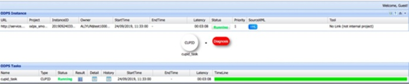

   SparkUI

   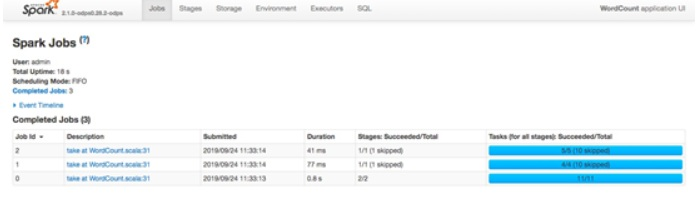

   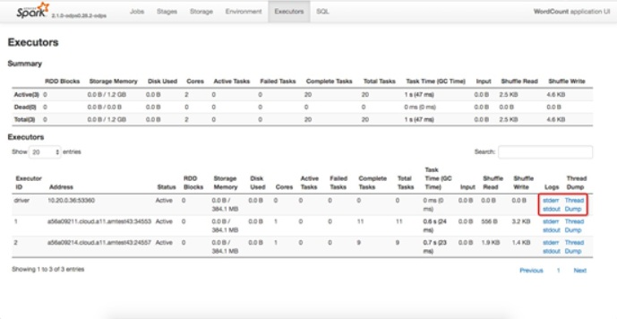

   Spark History

   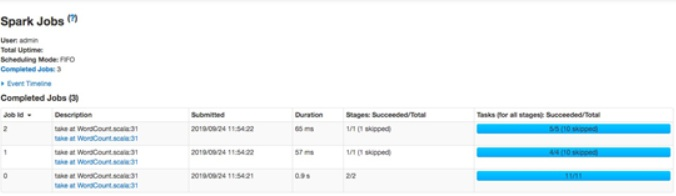

<a id="section-11-1-3-6"></a>

#### 11.1.3.6. Common cases

<a id="section-11-1-3-6-1"></a>

##### 11.1.3.6.1. WordCount example

This topic provides an example of using Spark on MaxCompute to run WordCount.

You must download the GitHub project and compile the project before you can run related demos.

```bash
git clone https://github.com/aliyun/aliyun-cupid-sdk.git
-- Download a GitHub project.
cd aliyun-cupid-sdk
mvn -T 1C clean install -DskipTests
-- Compile the GitHub project.
```

After you complete the preceding steps, JAR packages are generated. These JAR packages will be used to run the demos in this and the subsequent topics.

Example:

```python
package com.aliyun.odps.spark.examples

import org.apache.spark.sql.SparkSession

object WordCount {
  def main(args: Array[String]) {
    val spark = SparkSession
      .builder()
      .appName("WordCount")
      .getOrCreate()
    val sc = spark.sparkContext
    try {
      sc.parallelize(1 to 100, 10).map(word => (word, 1)).reduceByKey(_ + _, 
10).take(100).foreach(println)
    } finally {
      sc.stop()
    }
  }
}
```

Run the following command to submit the job:

```text
bin/spark-submit \
--master yarn-cluster \
--class com.aliyun.odps.spark.examples.WordCount \
/path/to/aliyun-cupid-sdk/examples/spark-examples/target/spark-examples_2.11-1.0.0-
SNAPSHOT-shaded.jar
```

<a id="section-11-1-3-6-2"></a>

##### 11.1.3.6.2. OSS access example

This topic provides an example of using Spark on MaxCompute to access OSS.

Example:

```python
package com.aliyun.odps.spark.examples.oss

import org.apache.spark.sql.SparkSession

object SparkUnstructuredDataCompute {
  def main(args: Array[String]) {
    val spark = SparkSession
      .builder()
      .appName("SparkUnstructuredDataCompute")
      .config("spark.hadoop.fs.oss.accessKeyId", "***")
      .config("spark.hadoop.fs.oss.accessKeySecret", "***")
      .config("spark.hadoop.fs.oss.endpoint", "oss-cn-hangzhou-zmf.aliyuncs.com")
      .getOrCreate()

    val sc = spark.sparkContext
    try {
      val pathIn = "oss://bucket/inputdata/"
      val inputData = sc.textFile(pathIn, 5)
      val cnt = inputData.count
      println(s"count: $cnt")
    } finally {
      sc.stop()
    }
  }
}
```

Run the following command to submit the job:

```text
./bin/spark-submit 
--jars cupid/hadoop-aliyun-package-3.0.0-alpha2-odps-jar-with-dependencies.jar 
--class com.aliyun.odps.spark.examples.oss.SparkUnstructuredDataCompute 
/path/to/aliyun-cupid-sdk/examples/spark-examples/target/spark-examples_2.11-1.0.0-SNAP
SHOT-shaded.jar
```

<a id="section-11-1-3-6-3"></a>

##### 11.1.3.6.3. MaxCompute table read and write example

This topic provides an example of using Spark on MaxCompute to read data from and write data to a MaxCompute table and convert data to a Spark resilient distributed dataset (RDD).

> **Important**
>
> The project and table specified in the demo must exist or be changed
>
> to the specific project and table.

Example:

```python
package com.aliyun.odps.spark.examples

import com.aliyun.odps.data.Record
import com.aliyun.odps.{ PartitionSpec, TableSchema}
import org.apache.spark.odps.OdpsOps
import org.apache.spark.sql.SparkSession
import scala.util.Random

object OdpsTableReadWrite {
  def main(args: Array[String]) {

    val spark = SparkSession
      .builder()
      .appName("OdpsTableReadWrite")
      .getOrCreate()

    val sc = spark.sparkContext
    val projectName = sc.getConf.get("odps.project.name")

    try {
      val odpsOps = new OdpsOps(sc)

      // read from normal table via rdd api
      val rdd_0 = odpsOps.readTable(
        projectName,
        "cupid_wordcount",
        (r: Record, schema: TableSchema) => (r.getString(0), r.getString(1))
      )

      //read from single partition column table via rdd api
      val rdd_1 = odpsOps.readTable(
        projectName,
        "dftest_single_parted",
        Array("pt=20160101"),
        (r: Record, schema: TableSchema) => (r.getString(0), r.getString(1), 
r.getString("pt"))
      )

      // read from multi partition column table via rdd api
      val rdd_2 = odpsOps.readTable(
        projectName,
        "dftest_parted",
        Array("pt=20160101,hour=12"),
        (r: Record, schema: TableSchema) => (r.getString(0), r.getString(1), 
r.getString("pt"), r.getString(3))
      )

      // read with multi partitionSpec definition via rdd api
      val rdd_3 = odpsOps.readTable(
        projectName,
        "cupid_partition_table1",
        Array("pt1=part1,pt2=part1", "pt1=part1,pt2=part2", "pt1=part2,pt2=part3"),
        (r: Record, schema: TableSchema) => (r.getString(0), r.getString(1), 
r.getString("pt1"), r.getString("pt2"))
      )

      // save rdd into normal table
      val transfer_0 = (v: Tuple2[String, String], record: Record, schema: TableSchema) 
=> {
        record.set("id", v._1)
        record.set(1, v._2)
      }
      odpsOps.saveToTable(projectName, "cupid_wordcount_empty", rdd_0, transfer_0, true
)

      // save rdd into partition table with single partition spec
      val transfer_1 = (v: Tuple2[String, String], record: Record, schema: TableSchema) 
=> {
        record.set("id", v._1)
        record.set("value", v._2)
      }
      odpsOps.saveToTable(projectName, "cupid_partition_table1", "pt1=test,pt2=dev", rdd_0, transfer_1, true)

      // dynamic save rdd into partition table with multiple partition spec
      val transfer_2 = (v: Tuple2[String, String], record: Record, part: PartitionSpec, 
schema: TableSchema) => {
        record.set("id", v._1)
        record.set("value", v._2)

        val pt1_value = if (new Random().nextInt(10) % 2 == 0) "even" else "odd"
        val pt2_value = if (new Random().nextInt(10) % 2 == 0) "even" else "odd"
        part.set("pt1", pt1_value)
        part.set("pt2", pt2_value)
      }
      odpsOps.saveToTableForMultiPartition(projectName, "cupid_partition_table1", rdd_0, transfer_2, true)
    } catch {
      case ex: Exception => {
        throw ex
      }
    } finally {
      sc.stop
    }
  }
}
```

Run the following command to submit the job:

```text
bin/spark-submit \
--master yarn-cluster \
--class com.aliyun.odps.spark.examples.OdpsTableReadWrite \
/path/to/aliyun-cupid-sdk/examples/spark-examples/target/spark-examples_2.11-1.0.0-SNAP
SHOT-shaded.jar
```

You can use one of the following methods to adjust the MaxCompute table read concurrency:

- Change the value of the **spark.hadoop.odps.input.split.size** parameter. A larger value indicates fewer Map tasks. The default value is 256 MB.

- Set **numPartition** in **OdpsOps.readTable**. The value determines the number of Map tasks. The number is calculated based on **spark.hadoop.odps.input.split.size**.

<a id="section-11-1-3-6-4"></a>

##### 11.1.3.6.4. MaxCompute Table Spark-SQL example

This topic provides an example of using SQLContext in Spark on MaxCompute to read data from and write data to a MaxCompute Table.

> **Important**
>
> - The project and table specified in the demo must exist or be changed to the specific project and table.
>
> - **Spark-defaults.conf** must contain the setting *spark.sql.catalogImplementation = odps*.

Example:

```python
package com.aliyun.odps.spark.examples

import org.apache.spark.sql.SparkSession

object OdpsTableReadWriteViaSQL {

  def main(args: Array[String]) {

    // please make sure spark.sql.catalogImplementation=odps in spark-defaults.conf
    // to enable odps catalog
    val spark = SparkSession
      .builder()
      .appName("OdpsTableReadWriteViaSQL")
      .getOrCreate()

    val projectName = spark.sparkContext.getConf.get("odps.project.name")
    val tableName = "cupid_wordcount"

    // get a ODPS table as a DataFrame
    val df = spark.table(tableName)
    println(s"df.count: ${df.count()}")

    // Just do some query
    spark.sql(s"select * from $tableName limit 10").show(10, 200)
    spark.sql(s"select id, count(id) from $tableName group by id").show(10, 200)

    // any table exists under project could be use
    // productRevenue
    spark.sql(
      """
        |SELECT product,
        |       category,
        |       revenue
        |FROM
        |  (SELECT product,
        |          category,
        |          revenue,
        |          dense_rank() OVER (PARTITION BY category
        |                             ORDER BY revenue DESC) AS rank
        |   FROM productRevenue) tmp
        |WHERE rank <= 2
      """.stripMargin).show(10, 200)

    spark.stop()
  }
}
```

Run the following command to submit the job:

```text
bin/spark-submit \
--master yarn-cluster \
--class com.aliyun.odps.spark.examples.OdpsTableReadWrite \
/path/to/aliyun-cupid-sdk/examples/spark-examples/target/spark-examples_2.11-1.0.0-SNAP
SHOT-shaded.jar
```

<a id="section-11-1-3-6-5"></a>

##### 11.1.3.6.5. MaxCompute Table PySpark example

This topic provides an example of using PySpark in Spark on MaxCompute to read data from and write data to a MaxCompute table.

Example:

```python
from odps.odps_sdk import OdpsOps
from pyspark import SparkContext, SparkConf
from pyspark.sql import SQLContext, DataFrame

if __name__ == '__main__':
    conf = SparkConf().setAppName("odps_pyspark")
    sc = SparkContext(conf=conf)
    sql_context = SQLContext(sc)

    project_name = "cupid_testa1"
    in_table_name = "cupid_wordcount"
    out_table_name = "cupid_wordcount_py"

    normal_df = OdpsOps.read_odps_table(sql_context, project_name, in_table_name)

    for i in normal_df.sample(False, 0.01).collect():
        print i
    print "Read normal odps table finished"

    OdpsOps.write_odps_table(sql_context, normal_df.sample(False, 0.001), project_name, 
out_table_name)
    print "Write normal odps table finished"
```

Run the following command to submit the job:

```text
spark-submit \
--master yarn-cluster \
--jars /path/to/aliyun-cupid-sdk/external/cupid-datasource/target/cupid-
datasource_2.11-1.0.0-SNAPSHOT.jar \
--py-files /path/to/aliyun-cupid-sdk/examples/spark-examples/src/main/python/odps.zip \
/path/to/aliyun-cupid-sdk/examples/spark-examples/src/main/python/odps_table_rw.py
```

<a id="section-11-1-3-6-6"></a>

##### 11.1.3.6.6. MLlib example

This topic provides an example of using MLlib in Spark on MaxCompute.

We recommend that you use OSS for read and write operations in the MLlib model.

Example:

```python
package com.aliyun.odps.spark.examples.mllib

import org.apache.spark.mllib.clustering.KMeans._
import org.apache.spark.mllib.clustering.{ KMeans, KMeansModel}
import org.apache.spark.mllib.linalg.Vectors
import org.apache.spark.sql.SparkSession

object KmeansModelSaveToOss {
  val modelOssDir = "oss://bucket/kmeans-model"

  def main(args: Array[String]) {

    //1. train and save the model
    val spark = SparkSession
      .builder()
      .appName("KmeansModelSaveToOss")
      .config("spark.hadoop.fs.oss.accessKeyId", "***")
      .config("spark.hadoop.fs.oss.accessKeySecret", "***")
      .config("spark.hadoop.fs.oss.endpoint", "***")
      .getOrCreate()

    val sc = spark.sparkContext
    val points = Seq(
      Vectors.dense(0.0, 0.0),
      Vectors.dense(0.0, 0.1),
      Vectors.dense(0.1, 0.0),
      Vectors.dense(9.0, 0.0),
      Vectors.dense(9.0, 0.2),
      Vectors.dense(9.2, 0.0)
    )
    val rdd = sc.parallelize(points, 3)
    val initMode = K_MEANS_PARALLEL
    val model = KMeans.train(rdd, k = 2, maxIterations = 2, runs = 1, initMode)
    val predictResult1 = rdd.map(feature => "cluster id: " + model.predict(feature) + "feature:" + feature.toArray.mkString(",")).collect
    println("modelOssDir=" + modelOssDir)
    model.save(sc, modelOssDir)

    //2. predict from the oss model
    val modelLoadOss = KMeansModel.load(sc, modelOssDir)
    val predictResult2 = rdd.map(feature => "cluster id: " + 
modelLoadOss.predict(feature) + " feature:" + feature.toArray.mkString(",")).collect
    assert(predictResult1.size == predictResult2.size)
    predictResult2.foreach(result2 => assert(predictResult1.contains(result2)))
  }
}
```

Run the following command to submit the job:

```text
./bin/spark-submit 
--jars cupid/hadoop-aliyun-package-3.0.0-alpha2-odps-jar-with-dependencies.jar 
--class com.aliyun.odps.spark.examples.mllib.KmeansModelSaveToOss 
/path/to/aliyun-cupid-sdk/examples/spark-examples/target/spark-examples_2.11-1.0.0-SNAP
SHOT-shaded.jar
```

<a id="section-11-1-3-6-7"></a>

##### 11.1.3.6.7. Example of Spark Streaming-NetworkWordCount

This topic provides an example of Spark Streaming-NetworkWordCount in Spark on MaxCompute.

Native Spark Streaming is supported. To use NetworkWordCount, you must install netcat on your on-premises machine, and then run the following command:

```bash
$ nc -lk 9999
```

The input in the command terminal becomes the input of Spark Streaming. Example:

```python
package com.aliyun.odps.spark.examples.streaming

import org.apache.spark.SparkConf
import org.apache.spark.examples.streaming.StreamingExamples
import org.apache.spark.storage.StorageLevel
import org.apache.spark.streaming.{Seconds, StreamingContext}

object NetworkWordCount {
  def main(args: Array[String]) {
    if (args.length < 2) {
      System.err.println("Usage: NetworkWordCount <hostname> <port>")
      System.exit(1)
    }

    StreamingExamples.setStreamingLogLevels()

    // Create the context with a 1 second batch size
    val sparkConf = new SparkConf().setAppName("NetworkWordCount")
    val ssc = new StreamingContext(sparkConf, Seconds(1))

    // Create a socket stream on target ip:port and count the
    // words in input stream of \n delimited text (eg. generated by 'nc')
    // Note that no duplication in storage level only for running locally.
    // Replication necessary in distributed scenario for fault tolerance.
    val lines = ssc.socketTextStream(args(0), args(1).toInt, 
StorageLevel.MEMORY_AND_DISK_SER)
    val words = lines.flatMap(_.split(" "))
    val wordCounts = words.map(x => (x, 1)).reduceByKey(_ + _)
    wordCounts.print()
    ssc.start()
    ssc.awaitTermination()
  }
}
```

Run the following command to submit a job:

```text
bin/spark-submit \
--master local[4] \
--class com.aliyun.odps.spark.examples.streaming.NetworkWordCount \
/path/to/aliyun-cupid-sdk/examples/spark-examples/target/spark-examples_2.11-1.0.0-SNAP
SHOT-shaded.jar localhost 9999
```

<a id="section-11-1-3-7"></a>

#### 11.1.3.7. Maven dependencies

This topic describes Maven dependencies of Spark on MaxCompute.

The GitHub project described in the Common cases topic can be used as a template for your quick start. For custom development, use the following pom.xml file.

> **Note**
>
> Make sure that the Spark community edition is 2.3.0 and the scope is
>
> **provided**.

```xml
<dependency>
   <groupId>org.apache.spark</groupId>
   <artifactId>spark-core_2.11</artifactId>
   <version>2.3.0</version>
   <scope>provided</scope>
</dependency>
```

The MaxCompute plug-in has been released to the Maven repository. You must add the following dependencies to the pom.xml file:

```xml
<dependency>
    <groupId>com.aliyun.odps</groupId>
    <artifactId>cupid-core_2.11</artifactId>
    <version>1.0.0</version>
    <scope>provided</scope>
</dependency>

<dependency>
    <groupId>com.aliyun.odps</groupId>
    <artifactId>cupid-client_2.11</artifactId>
    <version>1.0.0</version>
</dependency>

<dependency>
    <groupId>com.aliyun.odps</groupId>
    <artifactId>cupid-datasource_2.11</artifactId>
    <version>1.0.0</version>
</dependency>
```

Dependencies in the Maven repository:

- Core code of the Cupid platform: encapsulates the APIs that are used to submit Cupid tasks and the APIs that parent and child processes use to read data from and write data to tables.

  ```xml
  <dependency>
          <groupId>com.aliyun.odps</groupId>
          <artifactId>cupid-core_2.11</artifactId>
          <version>1.0.0</version>
  </dependency>
  ```

- Datasource: encapsulates Spark-related APIs that are used to read data from and write data to MaxCompute tables.

  ```xml
  <dependency>
          <groupId>com.aliyun.odps</groupId>
          <artifactId>cupid-datasource_2.11</artifactId>
          <version>1.0.0</version>
  ```

- Client: encapsulates an SDK in Cupid client mode.

  ```xml
  <dependency>
          <groupId>com.aliyun.odps</groupId>
          <artifactId>cupid-client_2.11</artifactId>
          <version>1.0.0</version>
  </dependency>
  ```

<a id="section-11-1-3-8"></a>

#### 11.1.3.8. Special notes

<a id="section-11-1-3-8-1"></a>

##### 11.1.3.8.1. Running mode

This topic describes the running mode of Spark on MaxCompute.

Spark on MaxCompute supports three running modes: local, cluster, and DataWorks.

**Local mode**

The local mode facilitates code debugging for applications. In local mode, you can use Spark on MaxCompute the same way as that described in the Apache Spark community. You can also use Tunnel to read and write data from and to MaxCompute tables. In this mode, you can use either an integrated development environment (IDE) or the command line to run Spark on MaxCompute.

If Spark on MaxCompute works in this mode, you must add the configuration  `spark.master=local[N]` . N indicates the CPU cores required to implement this mode.

In local mode, table read and write operations are implemented by using Tunnel. Therefore, you must add a Tunnel configuration item to the **spark-defaults.conf** file.

> **Note**
>
> Enter the endpoint based on the region and network environment in which
>
> your MaxCompute project resides.

The following code provides an example on how to use the command line to run Spark on MaxCompute in local mode:

```text
1.bin/spark-submit --master local[4] \
--class com.aliyun.odps.spark.examples.SparkPi \
${path to aliyun-cupid-sdk}/spark/spark-2.x/spark-examples/target/spark-examples_2.11-version-shaded.jar
```

**Cluster mode**

In cluster mode, you must specify the Main method as the entry point of a custom application. A Spark job ends when Main succeeds or fails. This mode is suitable for offline jobs. You can use Spark on MaxCompute in this mode with DataWorks to schedule jobs.

The following code provides an example on how to use the command line to run Spark on MaxCompute in cluster mode:

```text
1.bin/spark-submit --master yarn-cluster \
–class SparkPi \
${ProjectRoot}/spark/spark-2.x/spark-examples/target/spark-examples_2.11-version-shaded.jar
```

**DataWorks mode**

You can run offline jobs of Spark on MaxCompute that is in cluster mode in DataWorks to integrate and schedule other types of nodes.

Procedure:

1. Upload the resources in the DataWorks business flow and click **Submit**.

2. In the created business flow, select **ODPS Spark** from **Data Analytics**.

3. Double-click the Spark node and define the Spark job.

   Select a Spark version, a development language, and a resource file for the job. The resource file is the JAR file that is uploaded and published in the business flow.

   You can specify configuration items, such as the number of executors and the memory size, for the job that you want to submit.

   You must also specify the endpoint configuration item  `spark.hadoop.odps.cupid.webproxy.endpoint`  of Spark on MaxCompute.

   > **Note**
   >
   > Enter the endpoint of the region in which your MaxCompute project
   >
   > resides, for example, http://service.cn.maxcompute.aliyun-inc.com/api.

4. You can manually run the Spark node to view the task log and obtain the URLs of Logview and Jobview from the log for further analysis and diagnosis.

5. After the Spark job is defined, orchestrate and schedule services of different types in the business flow as required.

<a id="section-11-1-3-8-2"></a>

##### 11.1.3.8.2. Spark Streaming tasks

This topic describes the configurations that are required to run Spark Streaming tasks.

MaxCompute supports Spark Streaming. To support Spark Streaming tasks that run for a long period of time, you must add the following special configurations to the **spark-defaults.conf** file:

```text
spark.hadoop.odps.cupid.engine.running.type=longtime
# Set the running type of a task to longtime so that the task is not reclaimed.
spark.hadoop.odps.cupid.job.capability.duration.hours=25920
# Specify the running duration.
spark.yarn.maxAppAttempts=10
# Specify the maximum number of retries for a failover.
spark.streaming.receiver.writeAheadLog.enable=true
# Determine whether to enable the write-ahead logging mode. This feature prevents data loss but reduces data processing efficiency. 
```

<a id="section-11-1-3-8-3"></a>

##### 11.1.3.8.3. Job diagnosis

This topic describes job diagnosis of Spark on MaxCompute.

After you submit a job, you must check the job log to determine whether the job is submitted and executed as expected. MaxCompute provides Logview and Spark web UI for you to diagnose jobs.

The following example demonstrates how to submit a job in spark-submit mode. Logs are also generated when you use DataWorks to run Spark jobs.

```bash
cd $SPARK_HOME
bin/spark-submit --master yarn-cluster --class  SparkPi /tmp/spark-2.x-
demo/target/AliSpark-2.x-quickstart-1.0-SNAPSHOT-shaded.jar
```

After the job is submitted, MaxCompute creates an instance and displays the Logview URL of the instance in the log.

```text
19/01/05 20:36:47 INFO YarnClientImplUtil: logview url: 
http://logview.odps.aliyun.com/logview/?
h=http://service.cn.maxcompute.aliyun.com/api&p=qn_beijing&i=xxx&token=xxx
-- <The operation succeeds if an output similar to the following result is displayed.>
19/01/05 20:37:34 INFO Client:
   client token: N/A
   diagnostics: N/A
   ApplicationMaster host: 11.220.xxx.xxx
   ApplicationMaster RPC port: 30002
   queue: queue
   start time: 1546691807945
   final status: SUCCEEDED
   tracking URL: http://jobview.odps.aliyun.com/proxyview/jobview/?
h=http://service.cn.maxcompute.aliyun-
inc.com/api&p=project_name&i=xxx&t=spark&id=application_xxx&metaname=xxx&token=xxx
```

**Use Logview to diagnose a job**

1. View basic execution information about the task of the CUPID type in a browser based on the Logview URL.

   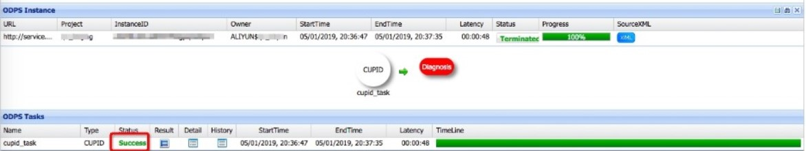

2. Click the progress bar of the task whose **TaskName** is **master-0**. In the lower pane, click **All** and find TempRoot in the **FuxiInstance** column.

   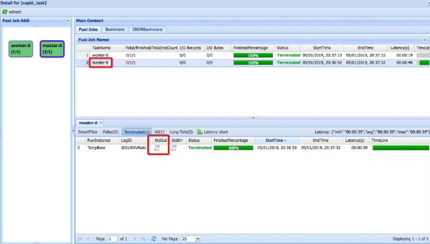

3. Click the icon in the **StdOut** column that corresponds to TempRoot to view the output of SparkPi.

   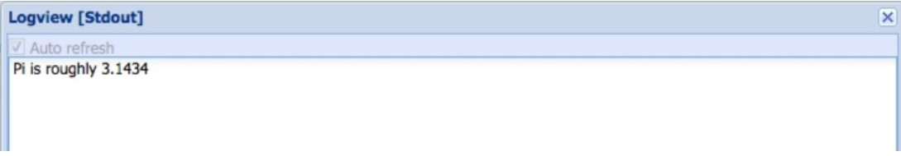

**Use Spark web UI to diagnose a job**

The tracking URL in the log indicates that your job is submitted to the MaxCompute cluster. This URL is crucial because it is the URL of both Spark web UI and History Server.

1. Access the URL in a browser to track the running status of your Spark job.

   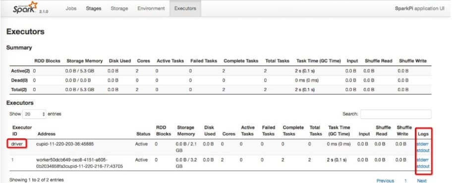

2. Click **StdOut** in the Logs column that corresponds to the driver to view the output of the Spark job.

   

<a id="section-11-1-3-9"></a>

#### 11.1.3.9. APIs supported by Spark

<a id="section-11-1-3-9-1"></a>

##### 11.1.3.9.1. Spark Shell

This topic describes the Spark shell API of Spark on MaxCompute.

Run the following commands to start the application of the Spark shell API:

```text
$cd $SPARK_HOME
-- Go to the Spark shell directory.
$bin/spark-shell --master yarn
-- Specify the running mode and start the application. 
```

Example:

```text
sc.parallelize(0 to 100, 2).collect
sql("show tables").show
sql("select * from spark_user_data").show(200,100)
```

<a id="section-11-1-3-9-2"></a>

##### 11.1.3.9.2. Spark R

This topic describes the SparkR API of Spark on MaxCompute.

Run the following commands to start the application of the SparkR API:

```text
$mkdir -p /home/admin/R && unzip ./R/R.zip -d /home/admin/R/
# Create the R directory and decompress the R.zip package in this directory.
$export PATH=/home/admin/R/bin/:$PATH
-- Configure environment variables.
$bin/sparkR --master yarn --archives ./R/R.zip
-- Specify the running mode and start the application. 
```

Example:

```text
df <- as.DataFrame(faithful)
df
head(select(df, df$eruptions))
head(select(df, "eruptions"))
head(filter(df, df$waiting < 50))
results <- sql("FROM spark_user_data SELECT *")
head(results)
```

<a id="section-11-1-3-9-3"></a>

##### 11.1.3.9.3. Spark SQL

This topic describes the Spark SQL API of Spark on MaxCompute.

Run the following commands to start the application of the Spark SQL API:

```text
$cd $SPARK_HOME
-- Go to the Spark SQL directory.
$bin/spark-sql --master yarn
-- Specify the running mode and start the application. 
```

Example:

```sql
show tables;
select * from spark_user_data limit 3;;
quit;
```

<a id="section-11-1-3-9-4"></a>

##### 11.1.3.9.4. Spark JDBC

This topic describes the Spark Java Database Connectivity (JDBC) API of Spark on MaxCompute.

Run the following commands to start the application of the Spark JDBC API:

```text
$sbin/stop-thriftserver.sh
-- Stop a thread.
$sbin/start-thriftserver.sh
-- Restart a thread.
$bin/beeline
-- Start the application. 
```

Example:

```sql
!connect jdbc:hive2://localhost:10000/odps_smoke_test
show tables;
select * from mr_input limit 3;
!quit
```

<a id="section-11-1-3-10"></a>

#### 11.1.3.10. Dynamic resource allocation of Spark

This topic describes the dynamic resource allocation (DRA) feature of Spark on MaxCompute. This feature is supported only in Spark 2.4.5 or later, which corresponds to Apsara Stack Enterprise Edition V3.13.0 or later.

**Background information**

Spark provides a large number of parameters to implement a wide range of semantics. You can use the default values for most parameters. However, specific parameters require manual configurations. The **spark.executor.instances** parameter is the most complex parameter to configure.

If this parameter is set to an excessively small value, operations may run slowly or fail due to an out of memory (OOM) error or lack of disk space. If this parameter is set to an excessively large value, resources are wasted.

Even the optimal value that is obtained based on full understanding of the data and logic is not reliable. For complex jobs, the required number of executors at different stages is different, and different resources are required when a job is running. Fixed configurations of resources cause waste. If long tail latency occurs, idle resources are occupied by other executors even for simple jobs.

**Solution**

The best solution is to allocate resources based on your business requirements. DRA is a solution that addresses this issue. CupidService developed by the Cupid team supports native DRA. The following figure shows the implementation process of DRA.

> **Note**
>
> For more information about native DRA in the Apache Spark community, see
>
> Spark help and Spark configuration.

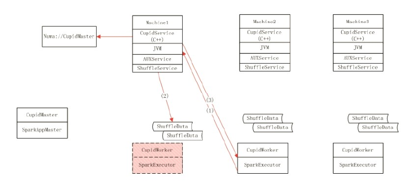

**Enable DRA**

You can add the following configurations to enable DRA without the need to modify the code:

```text
spark.hadoop.odps.cupid.shuffleservice.enable=true  // Required. This parameter specifies whether to enable the shuffle service in CupidService. 
spark.hadoop.odps.cupid.disk.driver.enable=true  // Required. This parameter is a dependent item. 
spark.dynamicAllocation.enabled=true // Required. This parameter specifies whether to enable DRA in Spark. 
spark.shuffle.service.enabled=true // Required. This parameter is a dependent item. 
spark.shuffle.service.port=7338 // Required. This parameter indicates the port used forthe shuffle service. 
spark.authenticate=true // Required. This parameter specifies whether to enable authentication. 
spark.dynamicAllocation.maxExecutors=128 // Optional. This parameter indicates the maximum number of executors. 
spark.dynamicAllocation.minExecutors=1 // Optional. This parameter indicates the minimum number of executors. 
spark.dynamicAllocation.initialExecutors=1 // Optional. This parameter indicates the initial number of executors. 
spark.dynamicAllocation.executorIdleTimeout=60s // Optional. This parameter indicates the waiting period before idle executors are released. 
```

If DRA is enabled, the **spark.executor.instances** parameter is optional. If you configure the spark.executor.instances parameter, the effect of this parameter is equivalent to the effect of the  `spark.dynamicAllocation.initialExecutors`  parameter.

<a id="section-11-1-3-11"></a>

#### 11.1.3.11. FAQ of Spark on MaxCompute

This topic provides answers to some frequently asked questions about Spark on MaxCompute.

**How do I migrate code of the open source Spark to Spark on MaxCompute?**

The migration method depends on whether your job needs to access MaxCompute tables or Object Storage Service (OSS):

- If the job does not need to access MaxCompute tables or OSS, run your JAR package directly. Note that you must set the dependency of Spark or Hadoop to provided.

- If the job needs to access MaxCompute tables, you need only to configure related dependencies and repackage them.

- If the job needs to access OSS, you need only to configure related dependencies and repackage them.

**How do I use Spark on MaxCompute to access services in a VPC?**

Spark on MaxCompute does not allow access to services in a VPC. If you want to access a service in a VPC, submit a ticket to contact the MaxCompute technical support team.

**The following error message appears, which indicates that the ID and key in the spark-defaults.conf file are invalid. What do I do?**

Error:

```text
Stack:
com.aliyun.odps.OdpsException: ODPS-0410042:
Invalid signature value - User signature dose not match
```

Check whether the ID and key in the **spark-defaults.conf** file are consistent with the AccessKey ID and AccessKey secret that you obtain from the Apsara Uni-manager Management Console.

**The following error message appears, which indicates that I do not have permissions. What do I do?**

Error:

```text
Stack:
com.aliyun.odps.OdpsException: ODPS-0420095: 
Access Denied - Authorization Failed [4019], You have NO privilege 
'odps:CreateResource' on {acs:odps:*:projects/*}
```

The project owner must grant the READ and CREATE permissions on resources to you.

**The following error message appears, which indicates that the project does not support Spark jobs. What do I do?**

Error:

```text
Exception in thread "main" org.apache.hadoop.yarn.exceptions.YarnException: com.aliyun.odps.OdpsException: ODPS-0420095: Access Denied - The task is not in release range: CUP
ID
```

Check whether the Spark on MaxCompute service is provided in the region where the project resides. In addition, check whether the configurations in the **spark-defaults.conf** file are consistent with those described in the MaxCompute documentation. If the Spark on MaxCompute service is provided in the region and the configurations in the **spark-defaults.conf** file are correct, submit a ticket.

**When a task is running, the following error message appears, which indicates that local storage space is insufficient. What do I do?**

Error:

```text
No space left on device
```

Spark on MaxCompute uses online storage to replace local storage. Shuffled data and overflow data of BlockManager are all stored online. Therefore, you must check the setting of the online storage space. The storage space is determined by the  `spark.hadoop.odps.cupid.disk.driver.device_size`  parameter. The default storage space is 20 GB and the maximum storage space is 100 GB. If the error persists after you increase the storage space to 100 GB, conduct further analysis.

The most common cause is data skew. Data is unevenly distributed among blocks during the shuffle and cache processes. If this is the case, you can decrease the number of concurrent tasks in each executor (spark.executor.cores) or increase the number of executors (spark.executor.instances).

<a id="section-11-1-4"></a>

### 11.1.4. OSS data source

<a id="section-11-1-4-1"></a>

#### 11.1.4.1. Overview

This topic describes how to access and process Object Storage Service (OSS) data sources in MaxCompute.

As a core computing component of the Alibaba Cloud big data platform, MaxCompute provides powerful computing capabilities. It can schedule a large number of nodes for parallel computing, and effectively manage the failover and retry mechanisms in a distributed computing environment. MaxCompute SQL implements a variety of logic to process data based on simple semantics. It is widely used within and outside Alibaba Group. It allows interoperability among different data sources and is crucial for building a data ecosystem for Alibaba Cloud.

Some examples are provided to demonstrate how MaxCompute accesses and processes OSS data.

<a id="section-11-1-4-2"></a>

#### 11.1.4.2. Use a built-in extractor to read data from OSS

<a id="section-11-1-4-2-1"></a>

##### 11.1.4.2.1. Overview

This topic describes how to use a built-in extractor of MaxCompute to read data from Object Storage Service (OSS).

You can use the built-in extractor of MaxCompute. This provides an easy way to read data that is stored in the specified format from OSS. You need only to create an external table as a source table for data queries.

For example, a CSV file is stored in OSS. The **endpoint** is oss-cn-shanghai-internal.aliyuncs.com, the **bucket** is oss-odps-test, and the data file is saved in /demo/SampleData/CSV/AmbulanceData/vehicle.csv. Some examples are provided to demonstrate how to use the built-in extractor to read data from OSS.

<a id="section-11-1-4-2-2"></a>

##### 11.1.4.2.2. Create an external table

This topic describes how to create an external table when a built-in extractor is used. It also provides an example for reference.

Execute the following statements to create an external table:

```text
CREATE EXTERNAL TABLE IF NOT EXISTS ambulance_data_csv_external
(
vehicleId INT,
recordId INT,
patientId INT,
calls INT,
locationLatitute DOUBLE,
locationLongtitue DOUBLE,
recordTime STRING,
direction STRING
)
STORED BY 'com.aliyun.odps.CsvStorageHandler' 
WITH SERDEPROPERTIES (
 'odps.properties.rolearn'='acs:ram::xxxxx:role/aliyunodpsdefaultrole'
) 
LOCATION 'oss://oss-cn-shanghai-internal.aliyuncs.com/oss-odps-test/Demo/';
```

> **Note**
>
> - STORED BY: specifies the name of the built-in storage handler. **com.aliyun.odps.CsvStorageHandler** is a built-in storage handler that processes CSV files. It defines how to read data from and write data to CSV files. You can specify this parameter as required. The logic of reading and writing CSV files is implemented by the system.
>
> - WITH SERDEPROPERTIES: specifies the properties of the external table that you want to create. **odps.properties.rolearn** specifies the Alibaba Cloud Resource Name (ARN) for the AliyunODPSDefaultRole role in Resource Access Management (RAM). You must specify this parameter if you use Security Token Service (STS) to authorize MaxCompute to access OSS.
>
> - LOCATION: specifies the OSS directory in which the data files you want to read are saved. By default, the system reads all the data files in the directory.
>
> - An external table contains only related OSS directories. If you delete this table, the data in the directory specified by LOCATION is not deleted.

You can execute the following statement to view the structure of the created external table:

```text
DESC EXTENDED <table_name>;
```

In the output, you can view basic table information, which is similar to the information returned for a created internal table. In addition to the basic table information, you can view the storage handler and the OSS directory.

<a id="section-11-1-4-2-3"></a>

##### 11.1.4.2.3. Query an external table

This topic describes how to query an external table when a built-in extractor is used. It also provides an example for reference.

After an external table is created, you can use it the same way that you use a standard table.

In this example, the vehicle.csv file in the /demo/SampleData/CSV/AmbulanceData/ directory contains the following data:

```text
1,1,51,1,46.81006,-92.08174,9/14/2017 0:00,S
1,2,13,1,46.81006,-92.08174,9/14/2017 0:00,NE
1,3,48,1,46.81006,-92.08174,9/14/2017 0:00,NE
1,4,30,1,46.81006,-92.08174,9/14/2017 0:00,W
1,5,47,1,46.81006,-92.08174,9/14/2017 0:00,S
1,6,9,1,46.81006,-92.08174,9/14/2017 0:00,S
1,7,53,1,46.81006,-92.08174,9/14/2017 0:00,N
1,8,63,1,46.81006,-92.08174,9/14/2017 0:00,SW
1,9,4,1,46.81006,-92.08174,9/14/2017 0:00,NE
1,10,31,1,46.81006,-92.08174,9/14/2017 0:00,N
```

Execute the following statement to submit a job, which calls a built-in CSV extractor to read data from OSS:

```text
SELECT recordId, patientId, direction;
FROM ambulance_data_csv_external;
WHERE patientId > 25;
```

> **Note**
>
> - An external table can be managed only by using MaxCompute SQL, not MaxCompute MapReduce.
>
> - If you want to obtain data over HTTPS at the underlying layer, add  `set odps.sql.unstructured.data.oss.use.https=true;`  before an SQL statement. Then, commit them for execution.

The following result is returned:

```text
+------------+------------+-----------+
| recordId | patientId | direction |
+------------+------------+-----------+
| 1 | 51 | S |
| 3 | 48 | NE |
| 4 | 30 | W |
| 5 | 47 | S |
| 7 | 53 | N |
| 8 | 63 | SW |
| 10 | 31 | N |
+------------+------------+-----------+
```

> **Note**
>
> The system provides the following built-in storage handlers:
>
> **CsvStorageHandler**, **TsvStorageHandler**, and **TextStorageHandler**.

<a id="section-11-1-4-2-4"></a>

##### 11.1.4.2.4. MSCK REPAIR TABLE

This topic describes the syntax of the MSCK REPAIR TABLE command in MaxCompute and provides usage examples.

**Description**

The MSCK REPAIR TABLE command in MaxCompute automatically discovers and adds partitions to an external table. The syntax is as follows:

```text
MSCK [REPAIR] TABLE external_table_name [ADD PARTITIONS];
```

**Usage notes**

- When you load data into OSS, the object path must conform to the format oss://xxx/table-location/ptname1=ptvalue1/ptname2=ptvalue2/xxx.

- When you create an external table, you must define its partition structure.

- When you run the  `MSCK REPAIR TABLE`  command, MaxCompute automatically parses the directory structure in OSS, identifies partitions, and adds their metadata to the external table.

**Examples**

1. Upload data to OSS. The object paths in OSS are as follows:

   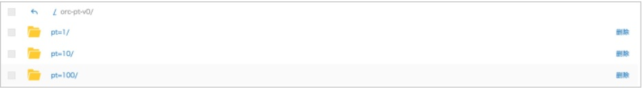

2. Run the following command to create an external table named orc_pt_v0, partitioned by the pt column.

   ```text
   CREATE EXTERNAL TABLE orc_pt_v0
   (
   name STRING
   )
   PARTITIONED BY (pt bigint)
   STORED BY 'com.aliyun.odps.CsvStorageHandler'
   WITH SERDEPROPERTIES (
   'odps.properties.rolearn'='acs:ram::xxxxx:role/aliyunodpsdefaultrole'
   ) 
   LOCATION 'oss://xxx/odps-ext-reg-perf/orc-pt-v0/';
   ```

3. Run the following command to automatically discover and add partitions to the orc_pt_v0 external table.

   ```sql
   MSCK REPAIR TABLE orc_pt_v0 ADD PARTITIONS;
   --This command is equivalent to running the following three ALTER TABLE statements.
   ALTER TABLE orc_pt_v0 ADD PARTITION (pt=1);
   ALTER TABLE orc_pt_v0 ADD PARTITION (pt=10);
   ALTER TABLE orc_pt_v0 ADD PARTITION (pt=100);
   ```

<a id="section-11-1-4-2-5"></a>

##### 11.1.4.2.5. Read data from the CSV or TSV files compressed in the GZIP format

This topic describes how to read data from the CSV or TSV files that are compressed in the GZIP format.

MaxCompute can use only a built-in extractor to read data from the CSV and TSV files that are compressed in the GZIP format. The main difference between reading non-compressed and compressed files is the property specified by SERDEPROPERTIES.

> **Note**
>
> If a data file stored in Object Storage Service (OSS) is an archived object, you
>
> must restore the data file first.

The following example shows how to create an external table:

```text
CREATE EXTERNAL TABLE IF NOT EXISTS ambulance_data_csv_external
(
vehicleId BIGINT,
recordId BIGINT,
patientId BIGINT,
calls BIGINT,
locationLatitute DOUBLE,
locationLongtitue DOUBLE,
recordTime STRING,
direction STRING
)
STORED BY 'com.aliyun.odps.CsvStorageHandler'
WITH SERDEPROPERTIES (
 'odps.properties.rolearn'='acs:ram::xxxxx:role/aliyunodpsdefaultrole'
 [,'odps.text.option.gzip.input.enabled'='true']
 [,'name3'='value3']
)
LOCATION 'oss://oss-cn-hangzhou-zmf.aliyuncs.com/oss-odps-
test/Demo/SampleData/CSV/AmbulanceData/';
```

The following table describes the properties supported by SERDEPROPERTIES.

| Property | Valid value | Default value | Description |
| --- | --- | --- | --- |
| odps.text.option.gzip.input.enabl ed | • True<br>• False | False | Specifies whether to compress the file before data reading. |
| odps.text.option.gzip.output.enab led | • True<br>• False | False | Specifies whether to compress the file before data writing. |
| odps.text.option.header.lines.cou nt | Non-negative integer | 0 | Specifies the number of rows to skip in the file. |
| odps.text.option.null.indicator | String | Empty string | Specifies the strings in the file to be parsed as NULL in an SQL statement. For example, if you specify <code> \N </code> to represent NULL, <code> a,\N,b </code> is parsed as <code> a, </code> <code>NULL, b </code>. |
| odps.text.option.ignore.empty.lin es | • True<br>• False | True | Specifies whether to ignore blank rows. |
| odps.text.option.encoding | • UTF-8<br>• UTF-16<br>• US-ASCII<br>• GBK | UTF-8 | Specifies the encoding format of the file. |
| odps.text.option.delimiter | Single character | Comma (,) | Specifies the column delimiter of the file. |
| odps.text.option.use.quote | • True<br>• False | False | Specifies whether to recognize column delimiters in a CSV file if it uses double quotation marks (") as column delimiters. If fields in the CSV file contain specified symbols for separating multiple values, these fields must be enclosed in double quotation marks ("). The symbols include a carriage return, line feed (CRLF) pair, double quotation mark ("), or comma (,). If a field contains a pair of double quotation marks (<code> " </code>), replace the double quotation marks (<code> " </code>) with two pairs of double quotation marks (") for escaping. |

> **Note**
>
> If you want to read data from and write data to an external table that is associated with compressed OSS data, configure both **odps.text.option.gzip.input.enabled** and **odps.text.option.gzip.output.enabled** as True when you create the external table.

<a id="section-11-1-4-3"></a>

#### 11.1.4.3. Use a custom extractor to read data from OSS

<a id="section-11-1-4-3-1"></a>

##### 11.1.4.3.1. Overview

This topic describes how to use a custom extractor to read data from Object Storage Service (OSS).

If OSS data is in a complex format and cannot be processed by the built-in extractor, you must use a custom extractor to read the OSS data.

For example, a text file is stored in OSS. The columns of data records in the file are separated by vertical bars (**|**). The data file vehicle.csv is saved in the /demo/SampleData/CustomTxt/AmbulanceData/ directory. Some examples are provided to demonstrate how to use a custom extractor to read data from OSS.

<a id="section-11-1-4-3-2"></a>

##### 11.1.4.3.2. Define a storage handler

This topic describes how to define a storage handler when a custom extractor is used. It also provides an example for reference.

You can customize the logic to parse data. StorageHandler is the unified entrance of your custom logic. You can use StorageHandler to specify the types of custom extractors and Outputer. StorageHandler provides only a simple definition. For example, you can customize a **SpeicalTextStorageHandler**:

```java
package com.aliyun.odps.udf.example.text;
public class SpeicalTextStorageHandler extends OdpsStorageHandler {
@Override
public Class<? extends Extractor> getExtractorClass() {
return TextExtractor.class;
}
@Override
public Class<? extends Outputer> getOutputerClass() {
return TextOutputer.class;
}
}
```

> **Note**
>
> **TextStorageHandler** that is built-in to MaxCompute can process the text
>
> data in which columns are separated by vertical bars (**|**). This example demonstrates how to customize a storage handler by using an SDK to process specially formatted data, especially in scenarios in which you use an extractor.

<a id="section-11-1-4-3-3"></a>

##### 11.1.4.3.3. Define an extractor

This topic describes how to define a custom extractor and provides an example.

**Example**

In the following example, the **TextExtractor** class accepts a delimiter as a parameter, allowing it to process any similarly formatted text file.

```java
/**
* Text extractor that extracts schematized records from formatted plain-text files (such as CSV or TSV)
**/
public class TextExtractor extends Extractor {
private InputStreamSet inputs;
private String columnDelimiter;
private DataAttributes attributes;
private BufferedReader currentReader;
private boolean firstRead = true;
public TextExtractor() {
// Defaults to ",", which can be overridden if a specific delimiter is provided via DataAttributes.
this.columnDelimiter = ",";
}
// The execution context is not used in this example.
@Override
public void setup(ExecutionContext ctx, InputStreamSet inputs,
DataAttributes attributes) {
this.inputs = inputs; 
// `inputs` is an InputStreamSet. Each call to next() returns an InputStream that can read the entire content of an OSS file.
this.attributes = attributes;
// check if "delimiter" attribute is supplied via SQL query
String columnDelimiter = this.attributes.getValueByKey("delimiter");
// The delimiter is passed as a parameter through a DDL statement.
if ( columnDelimiter != null)
{
this.columnDelimiter = columnDelimiter;
}
// More properties can be initialized from attributes if needed.
}
@Override
public Record extract() throws IOException {
String line = readNextLine();
if (line == null) {
return null; 
// Returning null indicates that there are no more records to read from this table.
}
return textLineToRecord(line); 
// `textLineToRecord` splits a line of data into multiple columns based on the delimiter. For the complete implementation, see the full TextExtractor implementation.
// A call to extract() returns a Record object, which represents one record extracted from the data in OSS.
}
@Override
public void close(){
// no-op
}
}
```

<a id="section-11-1-4-3-4"></a>

##### 11.1.4.3.4. Compile and package code

This topic describes how to compile and package code when you use a custom extractor.

You can compile and package Java code, and run the following command to upload the package to MaxCompute. The procedure is the same as that for a common Java user-defined function (UDF).

```text
add jar odps-udf-example.jar;
```

<a id="section-11-1-4-3-5"></a>

##### 11.1.4.3.5. Create an external table

This topic describes how to create an external table when a custom extractor is used. It also provides an example for reference.

After you upload a JAR package, you must run the following command to create an external table. This command is similar to that you run when a built-in extractor is used. The difference is that a custom storage handler is used in this command.

```text
CREATE EXTERNAL TABLE IF NOT EXISTS ambulance_data_txt_external
(
vehicleId int,
recordId int,
patientId int,
calls int,
locationLatitute double,
locationLongtitue double,
recordTime string,
direction string
)
STORED BY 'com.aliyun.odps.udf.example.text.SpeicalTextStorageHandler' 
-- STORED BY specifies the class name of a custom storage handler.
WITH SERDEPROPERTIES('delimiter'='|') 
-- SERDEPROPERITES can be used to specify parameters. These parameters are transferred to an extractor by using DataAttributes.
LOCATION 'oss://<*your-id*>:<*your-secret-key*>@oss-cn-shanghai-
internal.aliyuncs.com/oss-odps-test/Demo/SampleData/CustomTxt/AmbulanceData/'
USING 'odps-udf-example.jar'; 
-- Specify the JAR package in which the class definition is located. 
```

<a id="section-11-1-4-3-6"></a>

##### 11.1.4.3.6. Query an external table

This topic describes how to query an external table when a custom extractor is used. It also provides an example for reference.

In this example, the vehicle.csv file in the /demo/SampleData/CustomTxt/AmbulanceData/directory contains the following data:

```text
1|1|51|1|46.81006|-92.08174|9/14/2017 0:00|S
1|2|13|1|46.81006|-92.08174|9/14/2017 0:00|NE
1|3|48|1|46.81006|-92.08174|9/14/2017 0:00|NE
1|4|30|1|46.81006|-92.08174|9/14/2017 0:00|W
1|5|47|1|46.81006|-92.08174|9/14/2017 0:00|S
1|6|9|1|46.81006|-92.08174|9/14/2017 0:00|S
1|7|53|1|46.81006|-92.08174|9/14/2017 0:00|N
1|8|63|1|46.81006|-92.08174|9/14/2017 0:00|SW
1|9|4|1|46.81006|-92.08174|9/14/2017 0:00|NE
1|10|31|1|46.81006|-92.08174|9/14/2017 0:00|N
```

Execute the following statement to submit a job, which calls a custom extractor to read data from OSS:

```text
SELECT recordId, patientId, direction;
FROM ambulance_data_txt_external;
WHERE patientId > 25;
```

The following result is returned:

```text
+------------+------------+-----------+
| recordId | patientId | direction |
+------------+------------+-----------+
| 1 | 51 | S |
| 3 | 48 | NE |
| 4 | 30 | W |
| 5 | 47 | S |
| 7 | 53 | N |
| 8 | 63 | SW |
| 10 | 31 | N |
+------------+------------+-----------+
```

<a id="section-11-1-4-4"></a>

#### 11.1.4.4. Use a custom extractor to read external unstructured data

This topic describes how to use a custom extractor to read external unstructured data. It also provides an example for reference.

The preceding topics describe how to use built-in and custom extractors to process text files such as CSV files that are stored in OSS. This topic describes how to use a custom extractor to process non-text files that are stored in OSS.

Audio files in the WAV format are used in this example.

1. Customize the **SpeechSentenceSnrExtractor** main logic. Call the setup method to read parameters, initialize the parameters, and import the audio processing model. You can use the resource function to import the model.

   ```text
   public SpeechSentenceSnrExtractor(){
   this.utteranceLabels = new HashMap<String, UtteranceLabel>();
   }
   @Override
   public void setup(ExecutionContext ctx, InputStreamSet inputs,
   DataAttributes attributes){
   this.inputs = inputs;
   this.attributes = attributes;
   this.mlfFileName = this.attributes.getValueByKey(MLF_FILE_ATTRIBUTE_KEY);
   String sampleRateInKHzStr =
   this.attributes.getValueByKey(SPEECH_SAMPLE_RATE_KEY);
   this.sampleRateInKHz = Double.parseDouble(sampleRateInKHzStr);
   try {
   // read the speech model file from resource and load the model into
   memory
   BufferedInputStream inputStream =
   ctx.readResourceFileAsStream(mlfFileName);
   loadMlfLabelsFromResource(inputStream);
   inputStream.close();
   } catch (IOException e) {
   throw new RuntimeException("reading model from mlf failed with exception
   " + e.getMessage());
   }
   }
   @Override
   public Record extract() throws IOException {
   SourceInputStream inputStream = inputs.next();
   if (inputStream == null){
   return null;
   }
   // process one wav file to extract one output record [snr, id]
   String fileName = inputStream.getFileName();
   fileName = fileName.substring(fileName.lastIndexOf('/') + 1);
   logger.info("Processing wav file " + fileName);
   // infer id from speech file name
   String id = fileName.substring(0, fileName.lastIndexOf('.'));
   // read speech file into memory buffer
   long fileSize = inputStream.getFileSize();
   byte[] buffer = new byte[(int)fileSize];
   int readSize = inputStream.readToEnd(buffer);
   inputStream.close();
   // compute the avg sentence snr from speech file
   double snr = computeSnr(id, buffer, readSize);
   // construct output record [snr, id]
   Column[] outputColumns = this.attributes.getRecordColumns();
   ArrayRecord record = new ArrayRecord(outputColumns);
   record.setDouble(0, snr);
   record.setString(1, id);
   return record;
   }
   private void loadMlfLabelsFromResource(BufferedInputStream fileInputStream)
   throws IOException {
   // loading MLF label from resource, skipped here
   }
   // compute the snr of the speech sentence, assuming the input buffer
   contains the entire content of a wav file
   private double computeSnr(String id, byte[] buffer, int validBufferLen){
   // computing the snr value for the wav file (supplied as byte buffer
   array), skipped here
   }
   ```

   > **Note**
   >
   > The **extractor()** method implements the reading and processing logic of
   >
   > audio files. It calculates the signal-to-noise ratio (SNR) of the read data based on the audio processing model and writes the results to a record in the **[snr, id]** format.

2. Run the following commands to create an external table:

   ```text
   CREATE EXTERNAL TABLE IF NOT EXISTS speech_sentence_snr_external
   (
   sentence_snr double,
   id string
   )
   STORED BY 'com.aliyun.odps.udf.example.speech.SpeechStorageHandler'
   WITH SERDEPROPERTIES (
   'mlfFileName'='sm_random_5_utterance.text.label' ,
   'speechSampleRateInKHz' = '16'
   )
   LOCATION 'oss://<*your-id*>:<*your-secret-key*>@oss-cn-shanghai-
   internal.aliyuncs.com/oss-odps-test/dev/SpeechSentenceTest/'
   USING 'odps-udf-example.jar,sm_random_5_utterance.text.label';
   ```

3. Run the following commands to read data from OSS:

   ```text
   SELECT sentence_snr, id
   FROM speech_sentence_snr_external
   WHERE sentence_snr > 10.0;
   ```

4. View the processing results:

   ```text
   --------------------------------------------------------------
   | sentence_snr | id |
   --------------------------------------------------------------
   | 34.4703 | J310209090013_H02_K03_042 |
   --------------------------------------------------------------
   | 31.3905 | tsh148_seg_2_3013_3_6_48_80bd359827e24dd7_0 |
   --------------------------------------------------------------
   | 35.4774 | tsh148_seg_3013_1_31_11_9d7c87aef9f3e559_0 |
   --------------------------------------------------------------
   | 16.0462 | tsh148_seg_3013_2_29_49_f4cb0990a6b4060c_0 |
   --------------------------------------------------------------
   | 14.5568 | tsh_148_3013_5_13_47_3d5008d792408f81_0 |
   --------------------------------------------------------------
   ```

> **Note**
>
> A custom extractor allows you to execute SQL statements to process multiple
>
> audio files in OSS in a distributed manner. Similarly, you can use the large-scale computation capabilities of MaxCompute to process unstructured data, such as images and videos.

<a id="section-11-1-4-5"></a>

#### 11.1.4.5. Data partitions

<a id="section-11-1-4-5-1"></a>

##### 11.1.4.5.1. Overview

This topic describes the data partitioning feature of external tables.

LOCATION is used to specify an OSS directory, which is associated with an external table. MaxCompute reads all data in the OSS directory, including all files in the subdirectories. Due to a large amount of data accumulated in the directory, a full-text scan is performed. This operation results in extra I/O operations and prolongs the time required to process data. Two solutions are provided to address this issue:

- Reduce the amount of data: Plan data storage directories properly. Create multiple external tables for data from different parts, with LOCATION of each external table pointing to a subset of data.

- Partition data: Similar to internal tables, external tables support data partitioning. You can create partitions to manage the data.

Some examples are provided to demonstrate how to use the data partitioning feature of external tables.

<a id="section-11-1-4-5-2"></a>

##### 11.1.4.5.2. Standard path format for partitioned data on OSS

This topic describes the standard organization and path format for partitioned data stored on OSS. It provides a complete example that covers directory planning, external table definition, partition registration, and SQL query execution. By using partitions, you can precisely access the data you need and avoid the unnecessary I/O of full data scans.

**Usage notes**

Unlike MaxCompute internal tables, MaxCompute does not manage data stored in external locations such as OSS. Therefore, to use partitioned tables, your data files on OSS must follow a specific path format:

```text
partitionKey1=value1/partitionKey2=value2/...
```

**Example**

1. Suppose you store daily log files in OSS and want to access the data by **day** when you process it with MaxCompute. If the log files are in CSV format, use the following partitioned external table to define the data. The process is similar for complex custom formats.

   ```text
   CREATE EXTERNAL TABLE log_table_external (
   click STRING,
   ip STRING,
   url STRING
   )
   PARTITIONED BY (
   year STRING,
   month STRING,
   day STRING
   )
   STORED BY 'com.aliyun.odps.CsvStorageHandler'
   LOCATION 'oss://<ak_id>:<ak_key>@oss-cn-shanghai-internal.aliyuncs.com/oss-odps-test/log_data/';
   ```

   > **Note**
   >
   > Unlike the external table examples in previous sections, the example above uses a three-level partition. The **PARTITIONED BY** clause defines the external table as a partitioned table. The partition keys are Year, Month, and Day.

2. For these partitions to work, follow the required path format when you store data in OSS. The following example shows a valid path layout.

   ```text
   osscmd ls oss://oss-odps-test/log_data/
   2017-09-14 08:03:35 128MB Standard oss://oss-odps-
   test/log_data/year=2017/month=06/day=01/logfile
   2017-09-14 08:04:12 127MB Standard oss://oss-odps-
   test/log_data/year=2017/month=06/day=01/logfile.1
   2017-09-14 08:05:02 118MB Standard oss://oss-odps-
   test/log_data/year=2017/month=06/day=02/logfile
   2017-09-14 08:06:45 123MB Standard oss://oss-odps-
   test/log_data/year=2017/month=07/day=10/logfile
   2017-09-14 08:07:11 115MB Standard oss://oss-odps-
   test/log_data/year=2017/month=08/day=08/logfile
   ...
   ```

   > **Note**
   >
   > If you prepare offline data and upload it to OSS yourself, you determine the data path format. For the partitioned external table to work correctly, follow the path format shown above when you upload the data.

3. Add the partition information to MaxCompute using the **ALTER TABLE ADD PARTITION** statement. The following example shows the corresponding DDL statements.

   ```sql
   ALTER TABLE log_table_external ADD PARTITION (year = '2017', month = '06', day = '01'
   );
   ALTER TABLE log_table_external ADD PARTITION (year = '2017', month = '06', day = '02'
   );
   ALTER TABLE log_table_external ADD PARTITION (year = '2017', month = '07', day = '10'
   );
   ALTER TABLE log_table_external ADD PARTITION (year = '2017', month = '08', day = '08'
   );
   ...
   ```

4. After the data is prepared and the **PARTITION** information is added, use SQL statements to operate on the partitions of the external table data in OSS. The following examples show how.

   - To find the number of distinct IP addresses in the log for June 1, 2017, run the following command.

     ```sql
     SELECT count(distinct(ip)) FROM log_table_external WHERE year = '2017' AND month = 
     '06' AND day = '01';
     ```

     > **Note**
     >
     > In this case, the query accesses only the files (logfile and logfile.1) in the log_data/year=2017/month=06/day=01 subdirectory of the directory for the **log_table_external** external table. It does not scan the entire log_data/ directory. This process avoids unnecessary I/O operations.

   - Similarly, to analyze data only from the second half of 2017, run the following command.

     ```sql
     SELECT count(distinct(ip)) FROM log_table_external WHERE year = '2017' AND month > 
     '06';
     ```

     > **Note**
     >
     > This query accesses only the logs from the second half of the year that are stored in OSS.

<a id="section-11-1-4-5-3"></a>

##### 11.1.4.5.3. Custom directories of partition data in OSS

This topic describes the custom directories in which partition data is saved in Object Storage Service (OSS). It also provides an example for reference.

If you have historical data stored in OSS but the data is not saved in the partitionKey1=value1\\partitionKey2=value2\\...format, you can still access the data by using the partitioning feature of MaxCompute. MaxCompute provides a way to import partitions from custom directories.

Example:

1. The directories in which partition data is saved contain only partition values but do not contain partition keys. The following example shows the layout of the data directories:

   ```text
   osscmd ls oss://oss-odps-test/log_data_customized/
   2017-09-14 08:03:35 128MB Standard oss://oss-odps-
   test/log_data_customized/2017/06/01/logfile
   2017-09-14 08:04:12 127MB Standard oss://oss-odps-
   test/log_data_customized/2017/06/01/logfile.1
   2017-09-14 08:05:02 118MB Standard oss://oss-odps-
   test/log_data_customized/2017/06/02/logfile
   2017-09-14 08:06:45 123MB Standard oss://oss-odps-
   test/log_data_customized/2017/07/10/logfile
   2017-09-14 08:07:11 115MB Standard oss://oss-odps-
   test/log_data_customized/2017/08/08/logfile
   ...
   ```

2. You can run the following command to bind subdirectories to different partitions:

   ```sql
   ALTER TABLE log_table_external ADD PARTITION (year = '2017', month = '06', day = '01'
   )
   LOCATION 'oss://<ak_id>:<ak_key>@oss-cn-shanghai-internal.aliyuncs.com/oss-odps-test/log_data_customized/2017/06/01/';
   ```

   > **Note**
   >
   > The LOCATION parameter specifies an OSS directory. This directory maps
   >
   > to the partition that is added to the external table by using **ADD PARTITION**. This way, MaxCompute can access data in the OSS directory even if the directory is not in the partitionKey1=value1\\partitionKey2=value2\\...format. In addition, you can access the partition data in the subdirectory.

<a id="section-11-1-4-5-4"></a>

##### 11.1.4.5.4. Access fully-customized non-partitioned data subsets

This topic describes how to access fully-customized non-partitioned data subsets.

In some special cases, you may need to access an arbitrary subset of a file in an OSS directory, and the format of the directory where the files in this file subset are saved is not deterministic. The unstructured data processing framework of MaxCompute is able to handle this situation, but is not discussed in this topic.

For more information about advanced operations, contact the MaxCompute technical team.

<a id="section-11-1-4-6"></a>

#### 11.1.4.6. Output OSS data

<a id="section-11-1-4-6-1"></a>

##### 11.1.4.6.1. Create an external table

This topic describes how to create an external table to write data to OSS.

**Example**

Writing data to OSS is similar to reading from it. First, create an external table with the **CREATE EXTERNAL TABLE** statement. Then, write data using standard MaxCompute SQL statements like **INSERT INTO** or **OVERWRITE**. This example uses the built-in MaxCompute **TsvStorageHandler**.

```text
DROP TABLE IF EXISTS tpch_lineitem_tsv_external;
CREATE EXTERNAL TABLE IF NOT EXISTS tpch_lineitem_tsv_external
(
orderkey BIGINT,
suppkey BIGINT,
discount DOUBLE,
tax DOUBLE,
shipdate STRING,
linestatus STRING,
shipmode STRING,
comment STRING
)
STORED BY 'com.aliyun.odps.TsvStorageHandler' 
LOCATION 'oss://<AK_id>:<AK_secret>@oss-cn-hangzhou-zmf.aliyuncs.com/oss-odps-test/tsv_output_folder/';
```

> **Note**
>
> The preceding DDL statement creates an external table named **tpch_lineitem_tsv_external** and defines its two key properties:
>
> - Data storage location: The LOCATION clause maps the external table to an OSS path. This path is the target for all read and write operations on the table.
>
> - Data storage format: The StorageHandler specifies how data is read and written. This example uses **com.aliyun.odps.TsvStorageHandler**, a built-in MaxCompute handler for reading and writing TSV files. You can also create a custom StorageHandler with the MaxCompute SDK.

<a id="section-11-1-4-6-2"></a>

##### 11.1.4.6.2. Write data to a TSV text file by using an INSERT statement on an external table

This topic describes how to write data to a TSV text file by using an INSERT statement on an external table. This topic also provides an example for reference.

After you associate an OSS object with an external table, you can execute a standard **INSERT OVERWRITE** or **INSERT INTO** statement on the external table to write data to the OSS object. The data source can be either the data stored in MaxCompute internal tables or the external data that is imported into MaxCompute by using an external table.

> **Note**
>
> - MaxCompute internal table: You can execute an **INSERT** statement on an external table to write data from a MaxCompute internal table to an external storage medium.
>
> - External data that is imported into MaxCompute by using an external table: You can import external data to MaxCompute by using an external table, use the data for computations, and then export the results to an external storage directory or external data store. For example, you can import Tablestore data into MaxCompute and then export the data to OSS.

For example, you have a MaxCompute internal table named **tpch_lineitem** and want to export some data in the table to OSS in the TSV format. After you create an external table, you can execute the **INSERT OVERWRITE** statement to export the data.

```text
INSERT OVERWRITE TABLE tpch_lineitem_tsv_external;
SELECT l_orderkey, l_suppkey, l_discount, l_tax, l_shipdate, l_linestatus,
l_shipmode, l_comment
FROM tpch_lineitem
WHERE l_discount = 0.07 and l_tax = 0.01;
```

In the preceding example, eight columns are selected from the rows that meet the conditions **l_discount = 0.07** and **l_tax = 0.01** in the internal table **tcph_lineitem** and then written to OSS in the TSV format. The selected columns in the internal table correspond to the schema of the external table **tpch_lineitem_tsv_external**. After this operation is complete, you can view the related TSV data file in OSS.

> **Important**
>
> Data exported from MaxCompute to OSS is stored in a special file structure.
>
> - If you use MaxCompute to execute the **INSERT INTO** or **INSERT OVERWRITE** statement on an external table and write data to an OSS directory, all data is saved in a .odps folder in the directory specified by LOCATION.
>
> - The .meta file in the .odps folder is an extra macro data file written by MaxCompute. This file records valid data in the folder. If the **INSERT** operation succeeds, all data in the folder is valid. You are only required to parse the macro data if a job fails.
>
> - If a job fails or is terminated, execute the **INSERT OVERWRITE** statement again until it is complete. This prevents the .meta file from being parsed.
>
> - If you want to parse the .meta file, contact Alibaba Cloud technical team.

The number of files that are generated during the internal processing of TSV and CSV files of MaxCompute is equal to the number of concurrent SQL stages. You can use the flexible semantics and configurations of MaxCompute to limit the number of generated files. In the preceding example, if you want to force the generation of a TSV file, you can append **DISTRIBUTE BY l_discount** to the **INSERT OVERWRITE** statement. Then, a reduce stage with only one reducer is added at the end so that only one TSV file is generated.

<a id="section-11-1-4-6-3"></a>

##### 11.1.4.6.3. Write data to an unstructured file by using an INSERT statement on an external table

This topic describes how to write data to an unstructured file by using an INSERT statement on an external table.

MaxCompute provides the Outputer interface for data output. You can call this interface to write user data to a custom unstructured data file by using OutputStream. Further details are not provided in this topic.

If you have related requirements, contact the MaxCompute technical team.

<a id="section-11-1-4-6-4"></a>

##### 11.1.4.6.4. Migrate data between different storage media by using MaxCompute

This topic describes how to migrate data between different storage media by using MaxCompute. It also provides an example for reference.

External tables act as an interface between MaxCompute and external storage media. External tables can be used to read data from or write data to various external storage media. Based on the feature of external tables, various links can be established to compute and store data. For example:

- MaxCompute reads data from an Object Storage Service (OSS) bucket that is associated with External table A, performs complex computations, and then generates results to the directory of the OSS bucket that is associated with External table B.

- MaxCompute reads data from Tablestore that is associated with External table A, performs complex computations, and then generates results to the directory of the OSS bucket that is associated with External table B.

> **Note**
>
> In the preceding examples, the data source for the SELECT statement is an
>
> external table, rather than a MaxCompute internal table.

The following figure shows the flowchart for data migration.

MaxCompute is used as a central computing platform. It reads data from an OSS bucket and then writes the data to another OSS bucket (in a different location or within a different OSS account).

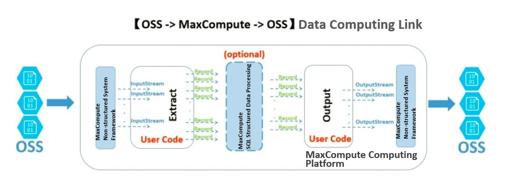

Based on the data flow and processing logic shown in the preceding figure, the unstructured data processing framework can be considered a coupled data ingress and egress at both ends of MaxCompute.

1. The external data from an OSS bucket is converted based on the unstructured framework, and provided to the InputStream class of Java. The extract logic is only used to read, parse, transform, and compute the data from the InputStream class, and return the data in the Record format used by MaxCompute.

2. Part of the returned records are used in the SQL logical operations on MaxCompute. These operations utilize the powerful SQL computation engine that is built in MaxCompute, and may generate new records.

3. The records obtained after computations are transferred to your custom output logic for further computations. Finally, the required information is extracted from the records, transferred by using OutputStream, and written to OSS.

> **Note**
>
> You can perform the preceding steps based on your business requirements.

<a id="section-11-1-4-7"></a>

#### 11.1.4.7. STS mode authorization for OSS

This topic describes the Security Token Service (STS) mode authorization for Object Storage Service (OSS), and provides an example for reference.

When you create an external table, the Location-based OSS access account allows you to enter **AccessKey ID** and **AccessKey secret** in plaintext mode. However, the account information may be exposed. To prevent account information from being exposed, MaxCompute provides a more secure way to access OSS.

MaxCompute integrates RAM and STS of Alibaba Cloud to enhance account security. You can use one of the following methods to grant permissions:

- If the owners of MaxCompute and OSS use the same Alibaba Cloud account, you can authorize access to OSS with one click in the RAM console.

- Custom authorization is supported.

  <ol type="i">

  <li>

  You can log on to the RAM console and authorize access to OSS. Create a role named **AliyunODPSDefaultRole** or **AliyunODPSRoleForOtherUser** and compile the following policy content:

  ```text
  -- If the owners of MaxCompute and OSS use the same Alibaba Cloud account:
  {
  "Statement": [
  {
   "Action": "sts:AssumeRole",
   "Effect": "Allow",
   "Principal": {
     "Service": [
       "odps.aliyuncs.com"
     ]
   }
  }
  ],
  "Version": "1"
  }

  -- If the owners of MaxCompute and OSS use different Alibaba Cloud accounts:
  {
  "Statement": [
  {
   "Action": "sts:AssumeRole",
   "Effect": "Allow",
   "Principal": {
     "Service": [
       "ID of the Alibaba Cloud account that owns the MaxCompute 
  project@odps.aliyuncs.com"
     ]
   }
  }
  ],
  "Version": "1"
  }
  ```

  </li>

  <li>

  Grant the **AliyunODPSRolePolicy** permission, which is required for the role to access

  </li>

  </ol>

  OSS.

  ```json
  {
  "Version": "1",
  "Statement": [
  {
   "Action": [
     "oss:ListBuckets",
     "oss:GetObject",
     "oss:ListObjects",
     "oss:PutObject",
     "oss:DeleteObject",
     "oss:AbortMultipartUpload",
     "oss:ListParts"
   ],
   "Resource": "*",
   "Effect": "Allow"
  }
  ]
  }
  -- You can also add other permissions as required.
  ```

  <ol type="i" start="3">

  <li>

  Grant the **AliyunODPSRolePolicy** permission to the role.

  </li>

  </ol>

  > **Note**
  >
  > After authorization is complete, view the role details to obtain the RAM
  >
  > information of this role. You must specify the RAM information when you create an OSS external table later.

<a id="section-11-1-5"></a>

### 11.1.5. Tablestore data source

<a id="section-11-1-5-1"></a>

#### 11.1.5.1. Overview

This topic describes how to access and process data of Tablestore data sources in MaxCompute

As the core computing component of the Alibaba Cloud big data platform, MaxCompute meets most distributed computing requirements within and outside Alibaba Group. MaxCompute SQL provides powerful support for the quick processing and storage of exabytes of offline data. As big data businesses continue to grow, many new data usage scenarios emerge. To adapt to the new scenarios, the MaxCompute computing framework is constantly evolving. Its powerful computation capabilities, originally designed to process internal data in special formats, have expanded to process external data sources in various formats. This topic describes how to import data from Tablestore to MaxCompute, which implements seamless interoperability between data sources.

In online service scenarios, NoSQL KV storage (such as Bigtable or HBase) features flexible schema, easy scalability, and high real-time performance, compared with traditional databases. Alibaba Cloud Tablestore is a large-scale NoSQL data storage service based on the Apsara distributed operating system. It stores and allows real-time access to large volumes of key-value pairs. Tablestore is widely used by all business units in Alibaba Group and the Alibaba Cloud ecosystem. In particular, Tablestore features, such as row-level real-time update and override writing, supplement the append-only operations of MaxCompute tables. As a storage-oriented service, Tablestore does not provide sufficient computing capabilities to concurrently process large volumes of data. In this case, MaxCompute allows you to create external tables to access Tablestore data sources.

Examples are provided to demonstrate how MaxCompute accesses and processes Tablestore data.

> **Note**
>
> This topic assumes that you have a basic knowledge of Tablestore
>
> operations. If you are not familiar with Tablestore or are new to the concept of key-value tables, you can first learn some basic Tablestore concepts, such as primary keys, partition keys, and attribute columns.

<a id="section-11-1-5-2"></a>

#### 11.1.5.2. Use MaxCompute to read and calculate data in Tablestore

<a id="section-11-1-5-2-1"></a>

##### 11.1.5.2.1. Create an external table

This topic describes how to create an external table for a Table Store data source and provides an example.

**Usage**

MaxCompute connects to data in Table Store by using external tables. After you run the  `CREATE EXTERNAL TABLE`  command to import the description of a Table Store table into the MaxCompute metadata system, you can process the data in that table like a regular table.

**Example**

Run the following statements to create an external table.

```text
DROP TABLE IF EXISTS ots_table_external;
CREATE EXTERNAL TABLE IF NOT EXISTS ots_table_external
(
odps_orderkey bigint,
odps_orderdate string,
odps_custkey bigint,
odps_orderstatus string,
odps_totalprice double
)
STORED BY 'com.aliyun.odps.TableStoreStorageHandler' 
WITH SERDEPROPERTIES ( 
'tablestore.columns.mapping'=':o_orderkey, :o_orderdate, 
o_custkey,o_orderstatus,o_totalprice', 
'tablestore.table.name'='ots_tpch_orders' 
)
LOCATION 'tablestore://<your-access-key-id>:<your-access-key-secret>@odps-ots-dev.cn-hangzhou.ots.aliyuncs.com'; 
```

| Parameter | Description |
| --- | --- |
| <code>com.aliyun.odps.TableStoreS</code><br><code>torageHandler</code> | This built-in storage handler allows MaxCompute to process data from Table Store. It defines the interaction logic between the two services. |
| <code>SERDEPROPERTIES</code> | Specifies parameters for the storage handler. When using the <code> TableStoreStorageHandler </code>, you must specify two required properties: <code> tablestore.columns.mapping </code> and <code> tablestore.table.name </code>. |
| <code>tablestore.columns.mapping</code> | Required. Specifies the columns of the Table Store table that you want to access from MaxCompute, including primary key columns and attribute columns. Use a colon (<code> : </code>) as a prefix to identify a primary key, such as <code> :o_orderkey </code> and <code> :o_orderdate </code> in the example. Columns without a prefix are attribute columns.Table Store supports one to four primary keys. The data type of a primary key must be <code> bigint </code> or <code> string </code>, and the first primary key serves as the partition key. You must map all primary key columns of the source Table Store table. You only need to map the attribute columns that you want to access. |
| <code>tablestore.table.name</code> | Required. Specifies the name of the Table Store table to access. If the specified table does not exist, the operation returns an error.MaxCompute does not automatically create tables in Table Store. |
| <code>LOCATION</code> | Specifies the connection details for Table Store, including the instance name and endpoint. |

> **Note**
>
> The preceding example maps a Table Store table to a MaxCompute external table. You can then process the Table Store data directly through this external table.

<a id="section-11-1-5-2-2"></a>

##### 11.1.5.2.2. Use an external table to access Tablestore data

This topic describes how to use an external table to access TableStore data and perform computations.

After you create an external table, Tablestore data is introduced into the MaxCompute ecosystem. Then, you can access Tablestore data by using the MaxCompute SQL syntax.

Example:

```text
SELECT odps_orderkey, odps_orderdate, SUM(odps_totalprice) AS totalprice
FROM ots_table_external
WHERE odps_orderkey > 5000 AND odps_orderdate >20170725 AND odps_orderdate <20170910
GROUP BY odps_orderkey, odps_orderdate
HAVING totalprice> 2000;
```

> **Note**
>
> In this example, the MaxCompute SQL syntax that you are familiar with is
>
> directly used, and all the other implementations of accessing Tablestore data are performed by MaxCompute.

If you want to compute one piece of data multiple times, you can import the data from Tablestore into an internal table of MaxCompute. This way, you do not need to read the data from Tablestore each time you compute the data.

Example:

```sql
CREATE TABLE internal_orders AS
SELECT odps_orderkey, odps_orderdate, odps_custkey, odps_totalprice
FROM ots_table_external
WHERE odps_orderkey > 5000 ;
```

> **Note**
>
> In this example, **internal_orders** is a MaxCompute table that you are
>
> familiar with. This table has all features of MaxCompute internal tables, such as efficient column compression for data storage and complete metadata. This table is stored in MaxCompute. Therefore, it can be accessed faster than an external table in Tablestore. This feature is particularly suitable for hotspot data that is used for multiple computations.

<a id="section-11-1-5-3"></a>

#### 11.1.5.3. Write data from MaxCompute to Tablestore

This topic describes how to use external tables to write data from MaxCompute to Tablestore.

Data interaction between MaxCompute and Tablestore includes importing data from Tablestore to MaxCompute for batch processing and exporting the data processing results from MaxCompute to Tablestore. Tablestore features, such as real-time update and single-row overwriting, allow you to quickly upload offline computing results to online applications. The  `INSERT OVERWRITE`  statement is used to export data processing results from MaxCompute to Tablestore.

> **Note**
>
> MaxCompute does not proactively create external tables in Tablestore.
>
> Before you export data to a table in Tablestore, make sure that the table exists in Tablestore. If the table does not exist, an error is returned.

For example, you have created the external table **ots_table_external** in MaxCompute to access data of the **ots_tpch_orders** table in Tablestore. A data record named **internal_orders** is stored in MaxCompute. To process the data record **internal_orders** and write the processing results to Tablestore, execute the  `INSERT OVERWRITE TABLE`  statement. Sample statement:

```text
INSERT OVERWRITE TABLE ots_table_external
SELECT odps_orderkey, odps_orderdate, odps_custkey, CONCAT(odps_custkey,
'SHIPPED'), CEIL(odps_totalprice)
FROM internal_orders;
```

> **Note**
>
> - Tablestore is a NoSQL service that stores data in the format of key-value pairs. Data outputs from MaxCompute affect only the rows that contain the primary keys of the Tablestore table. In addition, only the attribute columns specified when you create the table are updated. The columns that are not included in the external table are not modified.
>
> - If you execute the  `INSERT OVERWRITE`  statement on the external table, MaxCompute inserts 200 data records into the table at a time by default. You can adjust a batch size to limit the total batch size to 4 MB.

<a id="section-11-1-6"></a>

### 11.1.6. AnalyticDB data source

<a id="section-11-1-6-1"></a>

#### 11.1.6.1. Overview

This topic describes how to create an external table in MaxCompute to access and process data from AnalyticDB. This enables efficient joint computation and synchronization with MaxCompute data after data in AnalyticDB is updated or processed.

**Usage notes**

When you update or process data in AnalyticDB and need to perform joint computation with data in MaxCompute, you can create an external table to access AnalyticDB data directly. This eliminates the need to first synchronize the data to MaxCompute.

The following example shows how to use MaxCompute to access and process data from AnalyticDB.

<a id="section-11-1-6-2"></a>

#### 11.1.6.2. Write data to AnalyticDB

<a id="section-11-1-6-2-1"></a>

##### 11.1.6.2.1. Create an external table

This topic describes how to create an external table for an AnalyticDB data source. An external table establishes a data connection between MaxCompute and AnalyticDB, allowing you to run a federated query to analyze data across both services.

**Example**

Run the following command to create an external table:

> **Note**
>
> Before running the command, replace  `host` ,  `port` ,  `databasename` ,  `${user}` ,  `${password}` , and  `${tablename}`  in the  `location`  string with your AnalyticDB connection information.

```text
SET odps.sql.hive.compatible=true;
DROP TABLE IF EXISTS ads_table_external;
CREATE EXTERNAL TABLE IF NOT EXISTS ads_table_external
(
  c_int int,
  c_tinyint tinyint,
  c_boolean boolean,
  c_smallint smallint,
  c_bigint bigint,
  c_double double,
  c_float float,
  --c_time datetime,
  c_date date,
  c_timestamp datetime,
  c_string string
)
STORED BY 'com.aliyun.odps.jdbc.JdbcStorageHandler'
location 'jdbc:mysql://host:port/databasename?
useSSL=false&user=${user}&password=${password}&table=${tablename}';
```

<a id="section-11-1-6-2-2"></a>

##### 11.1.6.2.2. Write and query data

This topic describes how to write to and query data from AnalyticDB using an external table.

**Actions**

After creating an external table, you can use it like a regular table. You can use the **INSERT OVERWRITE|INTO** statement to write data and the **SELECT** statement to verify that the data was written.

For more information about these statements, see the following topics:

- **MaxCompute User Guide**: **MaxCompute SQL > DML statements > INSERT statement > Update data in a table**

- **MaxCompute User Guide**: **MaxCompute SQL > DML statements > SELECT statement > SELECT operations**

<a id="section-11-1-6-3"></a>

#### 11.1.6.3. Read data from AnalyticDB

This topic describes how to read data from AnalyticDB and provides an example of how to verify an external table connection and retrieve source data.

**Example**

Run the following commands to create an external table and read data from it:

> **Note**
>
> Before you run the commands, replace the placeholders in the  `location`  string, such as `host` ,  `port` ,  `databasename` ,  `${user}` ,  `${password}` , and  `${tablename}` , with your AnalyticDB connection details.

```sql
SET odps.sql.hive.compatible=true;
DROP TABLE IF EXISTS ads_read_external;
CREATE EXTERNAL TABLE IF NOT EXISTS ads_read_external
(
  c_int int,
  c_tinyint tinyint,
  c_boolean boolean,
  c_smallint smallint,
  c_biging bigint,
  c_double double,
  c_float float,
  --c_time datetime,
  c_date date,
  c_timestamp datetime,
  c_string string
)
STORED BY 'com.aliyun.odps.jdbc.JdbcStorageHandler'
location 'jdbc:mysql://host:port/databasename?
useSSL=false&user=${user}&password=${password}&table=${tablename}'
-- Create an external table.
SELECT * FROM ads_read_external;
-- Query the external table.
```

<a id="section-11-1-7"></a>

### 11.1.7. RDS data source

<a id="section-11-1-7-1"></a>

#### 11.1.7.1. Introduction

This topic describes how to create an external table in MaxCompute to access and process data from an RDS data source. This allows you to efficiently perform a federated query and synchronize data with MaxCompute after you update or process the data in RDS.

**Usage**

To perform a federated query with data in MaxCompute after updating or processing data in RDS, create an external table to access the RDS data source directly. This avoids the need to first synchronize the data to MaxCompute.

The following example shows how to use MaxCompute to access and process data from RDS.

> **Note**
>
> The corresponding table in RDS is not required when you create the external table. However, the table must exist in RDS before you perform  `SELECT`  or  `INSERT` operations on the external table.

<a id="section-11-1-7-2"></a>

#### 11.1.7.2. Write data to RDS

<a id="section-11-1-7-2-1"></a>

##### 11.1.7.2.1. Create an external table

Learn how to create an external table for an RDS data source.

Run the following command:

```text
SET odps.sql.hive.compatible=true;
DROP TABLE IF EXISTS rds_table_external;
CREATE EXTERNAL TABLE if NOT EXISTS rds_table_external(  
   id bigint,
   name string,
   age tinyint 
 )
 STORED BY 'com.aliyun.odps.jdbc.JdbcStorageHandler'
 location 'jdbc:mysql://host:port/databasename?
useSSL=false&user=${user}&password=${password}&table=${tablename}'
```

<a id="section-11-1-7-2-2"></a>

##### 11.1.7.2.2. Write and query data

This topic describes how to use external tables to write data to and query RDS.

**Procedure**

After an external table is created, you can use it just like a standard table. You can use **INSERT OVERWRITE|INTO** and **SELECT** statements to write data to the table and then query it to confirm the write operation.

For more information about the statement syntax, see the following topics:

- **MaxCompute SQL > DML statement > INSERT statement > Update data in a table** in the **MaxCompute Developer Guide**.

- **MaxCompute SQL > DML statement > SELECT statement > SELECT operation** in the **MaxCompute Developer Guide**.

<a id="section-11-1-7-3"></a>

#### 11.1.7.3. Read data from RDS

This topic explains how to read data from RDS and provides an example of how to verify an external table connection and retrieve source data.

**Example**

Run the following commands to create an external table and query its data:

> **Note**
>
> Before you run the command, replace  `host` ,  `port` ,  `databasename` ,  `${user}` ,  `${password}` , and  `${tablename}`  in  `location`  with your actual RDS connection information.

```sql
-- Create an external table
SET odps.sql.hive.compatible=true;
DROP TABLE IF EXISTS rds_read_external;
CREATE EXTERNAL TABLE IF NOT EXISTS rds_read_external
(
  id int,
  name string,
  age int 
)
STORED BY 'com.aliyun.odps.jdbc.JdbcStorageHandler'
location 'jdbc:mysql://host:port/databasename?
useSSL=false&user=${user}&password=${password}&table=${tablename}';

-- Query the data.
SELECT * FROM rds_read_external;
```

<a id="section-11-1-8"></a>

### 11.1.8. Unstructured data access and processing (inside MaxCompute)

<a id="section-11-1-8-1"></a>

#### 11.1.8.1. Overview

This topic describes how to create a volume external table to read, write, and process unstructured data stored in a MaxCompute volume, without exporting it to an external system.

**Usage notes**

You can store unstructured data in a MaxCompute volume. A common challenge is processing this data directly within MaxCompute without first exporting it to an external system.

To address this challenge, MaxCompute uses its external table framework to connect with various data sources. Similar to accessing unstructured data in OSS, you can use an external table to read from and write to volumes. This enables in-place processing of this unstructured data.

The following sections describe how to create and access a volume external table.

<a id="section-11-1-8-2"></a>

#### 11.1.8.2. Create a volume external table

<a id="section-11-1-8-2-1"></a>

##### 11.1.8.2.1. Create table syntax

This topic describes the syntax and parameters for creating a Volume external table.

**Syntax**

To create an external table, use the CREATE EXTERNAL TABLE statement. The syntax is:

```text
DROP TABLE [IF EXISTS] <external_table_name>;
CREATE EXTERNAL TABLE [IF NOT EXISTS] <external_table_name>
(<column schemas>)
[PARTITIONED BY (PARTITION COLUMN schemas)]
STORED BY '<StorageHandler>'
[WITH SERDEPROPERTIES (
  'name'='value'
 )]
LOCATION 'volume://...'
[USING '<Resourcename>']
;
```

**Parameters**

**Stored by**

Two built-in StorageHandlers are supported:  `com.aliyun.odps.CsvStorageHandler`  and  `com.aliyun.odps.TsvStorageHandler` . They read and write data in CSV and TSV formats. CSV files use a comma as the column delimiter and  `\n`  as the row delimiter. TSV files use  `\t` as the column delimiter and  `\n`  as the row delimiter. If the built-in StorageHandlers do not meet your needs, you can use a custom StorageHandler.

**With serdeproperties**

Specifies properties for a custom StorageHandler, such as Delimiter.

**Location**

The location of a Volume external table. The format and examples are as follows.

- The format is as follows:

  ```text
  volume://[project_name]/volume_name/partition_value
  ```

- An example is as follows.

  ```text
  volume://test_project/volume_data/20190102
  ```

  The **project_name** part is optional. If **project_name** is omitted, the current Project is used to get the Volume when DML SQL statements are executed. For example, in the preceding example, if the current Project is MyProject, you can use the following location format:

  ```text
  volume:///volume_data/20190102
  ```

  > **Important**
  >
  > - The location of a non-partitioned external table must point to a Volume partition. It cannot point to the Volume itself.
  >
  > - The location of a partitioned table must point to the Volume itself.
  >
  > - Volume paths cannot contain the **=** character. Therefore, the default partition path format, such as ds=2017071, is not supported for Volumes. You must define a custom partition path. The custom partition path name can be any path name that Volume supports. For example, if the path is 20190102, the complete path is volume://test_project/volume_data/20190102.

**Using**

To use a custom StorageHandler, export it to a JAR package and add the package to MaxCompute as a JAR resource. This clause specifies the JAR resource to use.

<a id="section-11-1-8-2-2"></a>

##### 11.1.8.2.2. Create tables using the built-in StorageHandler

This topic describes how to create Volume external tables using the built-in StorageHandler. It provides examples for creating both non-partitioned and partitioned tables.

**Examples**

The following examples show how to create non-partitioned and partitioned tables.

**Create a non-partitioned table**

```text
DROP TABLE IF EXISTS volume_ext;
CREATE EXTERNAL TABLE volume_ext
(
key string,
value string
)
STORED BY 'com.aliyun.odps.CsvStorageHandler'
LOCATION 'volume://test_project/volume_data/20190102'
;
```

**Create a partitioned table**

```sql
DROP TABLE IF EXISTS volume_ext_pt;
CREATE EXTERNAL TABLE volume_ext_pt
(
key string,
value string
)
PARTITIONED BY (ds string)
STORED BY 'com.aliyun.odps.CsvStorageHandler'
LOCATION 'volume://test_project/volume_data';

ALTER TABLE volume_ext_pt DROP IF EXISTS PARTITION (ds="20190102");
ALTER TABLE volume_ext_pt ADD PARTITION (ds="20190102") LOCATION 
"volume://test_project/volume_data/20190102";
```

<a id="section-11-1-8-2-3"></a>

##### 11.1.8.2.3. Create a table with a custom StorageHandler

This topic describes how to create a Volume external table using a custom Java StorageHandler. It covers the full workflow, from development and packaging to resource registration and table creation, enabling you to flexibly handle unstructured data in specific formats.

**Usage notes**

If the built-in storage handlers do not meet your requirements, MaxCompute supports custom Java StorageHandler implementations. These let you specify properties for a Volume external table and process data from the corresponding Volume.

**Example**

This example shows how to create a table for TXT data that uses a pipe character (**|**) as the column delimiter using a custom StorageHandler.

1. Use MaxCompute Studio or the MaxCompute Eclipse plug-in to develop your custom Java classes.

2. Export the project as a JAR package. This example assumes the output package is named **odps-volume-example.jar**.

3. Run the following command to add the JAR package as a MaxCompute resource.

   ```text
   add jar odps-volume-example.jar -f;
   ```

4. Run the following command to create the external table.

   ```text
   DROP TABLE IF EXISTS volume_ext;
   CREATE EXTERNAL TABLE volume_ext
   (
   key string,
   value string
   )
   STORED BY 'com.aliyun.odps.udf.example.text.TextStorageHandler'
   WITH SERDEPROPERTIES (
      'delimiter'='|'
    )
   LOCATION 'volume://myproject/volume_data/20190102'
   USING 'odps-volume-example.jar';
   ```

> **Note**
>
> Once created, you can use the external table to access and process the data in the Volume.

<a id="section-11-1-8-3"></a>

#### 11.1.8.3. Access a volume external table

This topic describes how to access a volume external table.

**Example**

The following example shows a process that is similar to accessing MaxCompute internally.

```sql
SELECT key,value FROM volume_ext_pt WHERE ds="20190102";
```

<a id="section-11-2"></a>

## 11.2. Security enhancement package

<a id="section-11-2-1"></a>

### 11.2.1. Label-based access control

MaxCompute allows you to implement label-based access control at the project level by setting user labels for users and sensitivity labels for tables or columns. Users can only access data in a table or column if its sensitivity label is less than or equal to their user label. This topic explains how to use label-based authorization and provides examples.

**Background information**

Label-based access control, known as  `LabelSecurity`  in MaxCompute, is a project-level mandatory access control policy. After you create a MaxCompute project,  `LabelSecurity`  is disabled by default. The project owner can run the  `SET LabelSecurity=true|false;` command to enable or disable  `LabelSecurity`  for the project.

If  `LabelSecurity`  is enabled, the project owner must define clear standards for data sensitivity and user access clearance. They then assign  `sensitivity labels`  to tables or columns and  `user labels`  to users or roles. When a user attempts to access data that has a sensitivity label, they must have the required SELECT permission for the target table. Additionally, the user's  `user label`  must be greater than or equal to the data's sensitivity label.

- `LabelSecurity`  provides the following capabilities for protecting sensitive data:

  - Control is at the column level, allowing you to set sensitivity labels on individual columns.

  - You can set a sensitivity label on any column in a table. A single table can contain columns with different sensitivity levels.

  - A view's sensitivity label is independent of the labels on its source tables.

- `LabelSecurity`  supports the following operations.

  <table>
    <tr>
      <th>Actions</th>
      <th>Description</th>
      <th>Operator</th>
      <th>Tool</th>
    </tr>
    <tr>
      <td>Set sensitivity labels for tables or columns</td>
      <td>Sets a sensitivity label for a table or its columns.</td>
      <td rowspan="5">• Project owner<br>• User with the Admin role</td>
      <td rowspan="5">MaxCompute client</td>
    </tr>
    <tr>
      <td>Set user labels for users or roles</td>
      <td>Sets a user label for a user or role to define their data access clearance.</td>
    </tr>
    <tr>
      <td>Create an explicit grant</td>
      <td>Allows users or roles to access data with a sensitivity label higher than their user label.</td>
    </tr>
    <tr>
      <td>Revoke an explicit grant</td>
      <td>Revokes an explicit grant for accessing high-sensitivity data.</td>
    </tr>
    <tr>
      <td>Clear expired grants</td>
      <td>Removes expired grants.</td>
    </tr>
  </table>

**Default LabelSecurity policies**

After you assign labels to data and users, the following default access control policies apply:

- **No-ReadUp**: Users are prevented from accessing data with a sensitivity label higher than their user label. If your business scenario requires this type of access, you must create an explicit grant. For more information, see Create an explicit grant.

- **Trusted-User**: Users are allowed to write data to objects with a sensitivity label less than or equal to their user label. Newly created tables and views have a default sensitivity level of 0 (non-confidential). New users also have a default user label of 0.

**Prerequisites**

Before you begin, ensure that you have the following information:

- The account name or role name of the grantee. The user or role must exist in the MaxCompute project.

  You can run the  `LIST USERS;`  or  `LIST ROLES;`  command in the MaxCompute client to retrieve user or role information.

- The name of the target table or columns.

  You can run the  `SHOW TABLES;`  command in the MaxCompute client to retrieve the names of tables, views, and columns.

**Limitations**

You cannot set sensitivity labels on partition columns.

**Usage notes**

Consider the following points when you use  `LabelSecurity` :

- Some traditional mandatory access control systems support more complex security policies, such as  `No-WriteDown` , to prevent unauthorized data distribution within a project. `No-WriteDown`  prevents users from writing data to a level lower than their user label, which helps prevent accidental declassification. To reduce management overhead, MaxCompute's default policy does not include  `No-WriteDown` . If your project has similar requirements, you can run the  `SET ObjectCreatorHasGrantPermission=false;`  command to modify the project's security configuration and achieve a similar level of control.

- To prevent data from being moved between projects, you can enable  `ProjectProtection` by running the  `SET ProjectProtection=true;`  command. This sets the project to a protected state where users can only access data from within the project, effectively preventing data exfiltration. For more information, see Data protection mechanism.

- If an object is deleted, MaxCompute automatically revokes all label authorizations associated with that object.

- When a user is removed from a project, their label-related authorizations are retained. If the user is re-added to the project, these permissions are automatically reactivated.

**Set sensitivity labels for tables or columns**

A project owner or a user with the Admin role can set a sensitivity label for a table or its columns.

- Syntax

  ```text
  SET Label <number> TO TABLE <table_name>[(<column_list>)];
  ```

- Notes

  - If you set a sensitivity label on a table but not on its columns, all columns in the table inherit the table's sensitivity label. For example, if you set a table's sensitivity label to 2, all its columns also have a sensitivity label of 2.

  - A column's sensitivity label overrides its table's label, regardless of the level. Conversely, setting a table-level label does not affect any columns that already have an explicit label. For example, if a table's initial sensitivity label is 2 and you then set the sensitivity label of its column  `col1`  to 3, the table's label remains 2, while  `col1`  has a label of 3. Other columns inherit the table's label of 2.

  - To modify an existing sensitivity label for a table or column, run this command again with the new label value.

- Parameters

  | Parameter | Required | Description |
  | --- | --- | --- |
  | number | Yes | The sensitivity level. Valid values are integers from 0 to 9. A higher number indicates a higher security level. |
  | table_name | Yes | The name of the target table or view.<br>You can run the <code> SHOW TABLES; </code> command to get table or view names. |
  | column_list | No | The names of the columns. You can specify multiple column names, separated by commas (<code> , </code>). |

**Set user labels for users or roles**

A project owner or a user with the Admin role can set a user label for other users or roles.

- Syntax

  ```text
  SET Label <number> TO {USER|ROLE} <name>;
  ```

- Notes

  - A user can access data only if the data's sensitivity label is less than or equal to their user label. For example, if a user's label is 3, they can access data in tables or columns with a sensitivity label from 0 to 3.

  - To modify an existing user label for a user or role, run this command again with the new label value.

- Parameters

  | Parameter | Required | Description |
  | --- | --- | --- |
  | number | Yes | The maximum data sensitivity level that the user or role can access. This value corresponds to the data sensitivity labels and can range from 0 to 9. |
  | name | Yes | The name of the user or role.<br>You can run the <code> LIST USERS; </code> or <code> LIST </code> <code>ROLES; </code> command in the MaxCompute client to retrieve user account or role names. |

**Create an explicit grant**

A project owner or a user with the Admin role can temporarily grant a user permission to access data with a sensitivity label higher than the user's label.

- Syntax

  ```sql
  GRANT Label <number> ON TABLE <table_name> [(<column_list>)] TO {USER|ROLE} <name> [W
  ITH exp <days>];
  ```

- Note

  A column-level explicit grant overrides a table-level explicit grant for the same user on the same table.

- Parameters

  | Parameter | Required | Description |
  | --- | --- | --- |
  | number | Yes | The maximum data sensitivity level that the user or role can access through this grant.<br>Valid values are integers from 0 to 9. |
  | table_name | Yes | The name of the target table or view.<br>You can run the <code> SHOW TABLES; </code> command in the MaxCompute client to get table or view names. |
  | column_list | No | Specify this parameter to grant access to specific columns in the target table or view. You can specify multiple column names, separated by commas (<code> , </code>). |
  | name | Yes | The name of the user or role.<br>You can run the <code> LIST USERS; </code> or <code> LIST ROLES; </code> command in the MaxCompute client to retrieve user account or role names. |
  | days | No | The expiration period of the permission, in days. The value can range from 0 to 263-1. If you do not specify this parameter, the permission expires after 180 days by default. |

**Revoke an explicit grant**

A project owner or a user with the Admin role can revoke an explicit grant.

- Syntax

  ```text
  REVOKE Label ON TABLE <table_name> [(<column_list>)] FROM {USER|ROLE} <name>;
  ```

- Notes

  - Revoking a table-level explicit grant also revokes any column-level explicit grants for that user on the same table.

  - For example, if a user with a user label of 2 has an explicit grant for level-3 data revoked, they can still access data on that table up to their base user label (level 2 or less).

- Parameters

  | Parameter | Required | Description |
  | --- | --- | --- |
  | table_name | Yes | The name of the target table or view.<br>You can run the <code> SHOW TABLES; </code> command in the MaxCompute client to get table or view names. |
  | column_list | No | Specify this parameter to revoke access permissions on specific columns in the target table or view. You can specify multiple column names, separated by commas (<code> , </code>). |
  | name | Yes | The name of the user or role.<br>You can run the <code> LIST USERS; </code> or <code> LIST ROLES; </code> command in the MaxCompute client to retrieve user account or role names. |

**Clear expired grants**

When an explicit label grant expires, a project owner or a user with the Admin role must run the following command to remove the expired grant.

```text
clear expired grants;
```

**Examples**

Assume a project named  `test_project_a`  contains a table named  `sale_detail`  with the columns  `shop_name` ,  `customer_id` , and  `total_price` .  `Bob***@aliyun.com`  is the project owner of  `test_project_a` . Allen is a RAM user under Bob's account and has been added to the  `test_project_a`  project.

- **Example 1: Set a sensitivity label for the**  **`sale_detail`**  **table and its columns.**

  ```text
  -- Bob switches to the test_project_a project.
  USE test_project_a;
  -- Set the sensitivity label of the sale_detail table to 1. All columns now have a sensitivity label of 1.
  SET Label 1 TO TABLE sale_detail;
  -- Set the sensitivity label of the shop_name and customer_id columns to 2. The othercolumns still have a sensitivity label of 1.
  SET Label 2 TO TABLE sale_detail(shop_name, customer_id);
  -- Change the sensitivity label of the sale_detail table to 3. Note that the shop_name and customer_id columns retain their label of 2, while other columns are updated to3.
  SET Label 3 TO TABLE sale_detail;
  -- Change the sensitivity label of the shop_name and customer_id columns to 4. The other columns still have a sensitivity label of 3.
  SET Label 4 TO TABLE sale_detail(shop_name, customer_id);
  -- View the label information for the table.
  DESCRIBE sale_detail;
  -- The following result is returned.
  +------------------------------------------------------------------------------------+
  | Owner: ALIYUN$****@test.aliyun.com | Project: ****                                 |
  | TableComment:                                                                      |
  +------------------------------------------------------------------------------------+
  | CreateTime:               2021-12-13 11:27:04                                      |
  | LastDDLTime:              2021-12-13 11:27:04                                      |
  | LastModifiedTime:         2021-12-13 11:27:26                                      |
  +------------------------------------------------------------------------------------+
  | TableLabel:               3                                                        | 
  --The sensitivity label of the table is 3.
  | MaxLabel:                 L4                                                       |
  +------------------------------------------------------------------------------------+
  | InternalTable: YES      | Size: 784                                                |
  +------------------------------------------------------------------------------------+
  | Native Columns:                                                                    |
  +------------------------------------------------------------------------------------+
  | Field           | Type       | Label | Comment                                     |
  +------------------------------------------------------------------------------------+
  | shop_name       | string     | 4     |                                             | 
  --The sensitivity label of the column is 4.
  | customer_id     | string     | 4     |                                             | 
  --The sensitivity label of the column is 4.
  | total_price     | double     | 3     |                                             | 
  --The sensitivity label of the column is 3.
  +------------------------------------------------------------------------------------+
  | Partition Columns:                                                                 |
  +------------------------------------------------------------------------------------+
  | sale_date       | string     |                                                     |
  | region          | string     |                                                     |
  +------------------------------------------------------------------------------------+
  ```

- **Example 2: Set a user label for the user**  **`Kate***@aliyun.com`**  **and the RAM user**  **`RAM$Bob***@aliyun.com:Allen`**  **in the**  **`test_project_a`**  **project.**

  ```text
  -- Bob switches to the test_project_a project.
  USE test_project_a;
  -- Set the user label for Kate to 3. Kate can now access data with a sensitivity label from 0 to 3.
  SET Label 3 TO USER ALIYUN$Kate***@aliyun.com;
  -- Set the user label for the RAM user Allen to 1. Allen can now access data with a sensitivity label from 0 to 1.
  SET Label 1 TO USER RAM$Bob***@aliyun.com:Allen;
  -- View the user label information for Allen.
  SHOW label grants FOR RAM$Bob***@aliyun.com:Allen;
  -- The following result is returned.
  User Label: 1

  (granted label list is empty)
  ```

- **Example 3: Create an explicit grant to allow Allen to access data with a high sensitivity label.**

  ```sql
  -- Bob switches to the test_project_a project.
  USE test_project_a;
  -- Explicitly grant Allen permission to access data with a sensitivity label up to 3 in the sale_detail table. The grant is valid for 4 days.
  GRANT Label 3 ON TABLE sale_detail TO USER RAM$Bob***@aliyun.com:Allen WITH exp 4;
  -- View the explicit grant for Allen.
  SHOW label grants ON TABLE sale_detail FOR USER RAM$Bob***@aliyun.com:Allen;
  -- The following result is returned.
  User Label: 1
  +-------------+--------------+--------------------------+
  | Column      | GrantedLabel | Expires                  |
  +-------------+--------------+--------------------------+
  | total_price | 3            | 2021-12-31T19:56:18+0800 |
  +-------------+--------------+--------------------------+
  -- Explicitly grant Allen permission to access data with a sensitivity label up to 4 in the shop_name, customer_id, and total_price columns of the sale_detail table. The grant is valid for 10 days.
  GRANT Label 4 ON TABLE sale_detail(shop_name, customer_id, total_price) TO USER RAM$Bob***@aliyun.com:Allen WITH exp 10;
  -- View the explicit grant for Allen.
  SHOW label grants ON TABLE sale_detail FOR USER RAM$Bob***@aliyun.com:Allen;
  -- The following result is returned.
  User Label: 1
  +-------------+--------------+--------------------------+
  | Column      | GrantedLabel | Expires                  |
  +-------------+--------------+--------------------------+
  | customer_id | 4            | 2022-01-06T19:58:00+0800 |
  +-------------+--------------+--------------------------+
  | shop_name   | 4            | 2022-01-06T19:58:00+0800 |
  +-------------+--------------+--------------------------+
  | total_price | 4            | 2022-01-06T19:58:00+0800 |
  +-------------+--------------+--------------------------+
  ```

- **Example 4: Revoke the explicit grant that allows Allen to access high-sensitivity data.**

  ```text
  -- Revoke Allen's explicit grant to access the shop_name, customer_id, and total_price columns of the sale_detail table.
  REVOKE Label ON TABLE sale_detail(shop_name, customer_id, total_price) FROM USER RAM$
  Bob***@aliyun.com:Allen;
  -- View the result after revoking the column-level grant. The table-level grant from 
  Example 3 is still active.
  SHOW label grants ON TABLE sale_detail FOR USER RAM$Bob***@aliyun.com:Allen;
  -- The following result is returned.
  User Label: 1
  +-------------+--------------+--------------------------+
  | Column      | GrantedLabel | Expires                  |
  +-------------+--------------+--------------------------+
  | total_price | 3            | 2021-12-31T19:56:18+0800 |
  +-------------+--------------+--------------------------+
  -- Revoke all of Allen's explicit grants on the sale_detail table.
  REVOKE Label ON TABLE sale_detail FROM USER RAM$Bob***@aliyun.com:Allen;
  -- View the result after revoking all grants. Allen can only access data according totheir base user label.
  SHOW label grants ON TABLE sale_detail FOR USER RAM$Bob***@aliyun.com:Allen;
  -- The following result is returned, indicating no active explicit grants.
  User Label: 1
  ```

<a id="section-11-2-2"></a>

### 11.2.2. MaxCompute permission system enhancements

The security enhancement package is an extension of the MaxCompute security and permission system, built on permission model 2.0. It provides you with stricter and more granular management capabilities. However, the added security rules also increase the complexity of standard development workflows. Evaluate its use based on your specific security and business requirements. This topic describes the new permission features in the MaxCompute security enhancement package.

**Column-level permission control**

- Command syntax

  ```sql
  -- Grant column-level permissions on a table to a user.
  GRANT <privileges> ON TABLE <tablename>[(column_list)] TO USER <username>;
  -- Revoke column-level permissions on a table from a user.
  REVOKE <privileges> ON TABLE <tablename>[(column_list)] FROM USER <username>;
  ```

- Parameters

  | Parameter | Required | Description |
  | --- | --- | --- |
  | privileges | Yes | The actions to grant. You can specify multiple actions.<br>If you specify multiple actions, separate their names with commas (,). |
  | tablename | Yes | The name of the target table or view.<br>You can run the <code> SHOW TABLES; </code> command in the MaxCompute client to get table names. |
  | column_list | No | The columns in the target table or view to which to grant access. You can specify multiple column names, separated by commas (,). |
  | username | Yes | The name of the user or role.<br>You can run the <code> LIST USERS; </code> or <code> LIST ROLES; </code> command in the MaxCompute client to get the user account or role name. |

**ACL authorization with conditions and expiration time**

A policy can use conditions to control access based on multiple dimensions, such as time periods, source IP addresses, and job types. In contrast, traditional ACL authorization is limited to three dimensions: principal (user or role), resource, and action. Permission model 2.0 enhances ACL authorization by adding support for conditions. The syntax is as follows:

```sql
GRANT [privileges] ON <objectType> <objectName> TO [role|user] <name> 
privilegeproperties("conditions" = "acs:SourceIp in ('10.10.11.1/24','10.10.10.1/24') and acs:CurrentTime <= '2020-11-11T23:59:59Z'", "expires"="30");
```

- **condition**: The syntax is "variable" comparison-operator "constant". The following table describes the available condition keys.

  | ACS Reserved Condition Keys | Type | Description |
  | --- | --- | --- |
  | acs:CurrentTime | Date and time | The time the web server receives the request, in ISO 8601 format. For example, <code> 2012-11-</code><code>11T23:59:59Z </code>. |
  | acs:SecureTransport | Boolean | Indicates whether the request was sent over a secure channel, such as HTTPS. |
  | acs:SourceIp | IP address | The source IP address of the client that sent the request. |
  | acs:UserAgent | String | The User-Agent of the client that sent the request. |
  | acs:Referer | String | The HTTP referer of the request. |

  The following table shows the mapping for comparison operators.

  **Type**

  **Comparison Operator**

  **Mapping**

  StringEquals

  =

  StringNotEquals

  <>

  String

  StringLike

  like

  StringNotLike

  not like

  NumericEquals

  =

  NumericLessThan

  <

  Numeric

  NumericLessThanEquals

  <=

  NumericGreaterThan

  >

  NumericGreaterThanEquals

  >=

  DateEquals

  =

  DateNotEquals

  <>

  DateLessThan

  <

  Date and time

  DateLessThanEquals

  <=

  DateGreaterThan

  >

  DateGreaterThanEquals

  >=

  For Booleans, use true or false

  Boolean

  true|false

  directly.

  IpAddress

  in (...)

  IP address

  NotIpAddress

  not in (...)

- **expires**: Specifies the expiration period for the permission in days. For example,  `"expires"="30"`  means the permission expires after 30 days.

**Policy-based authorization using the GRANT statement**

- Usage notes

  - Policy-based authorization can be granted only to a role, not to a user.

  - In  `privilegeproperties` ,  `{"policy" = "true"}`  specifies that the grant applies to a policy.  `{"allow"="[true|false]"}`  specifies whether the authorization is an allowlist ( `true` ) or a denylist ( `false` ).

  - Revoke does not support condition, and the operation succeeds only if  `allow` ,  `objectname` , and  `rolename`  all match.

- Command syntax

  ```sql
  GRANT <privileges> ON <objectType> <objectName>  TO role <rolename> 
  privilegeproperties("policy" = "true", "allow"="[true|false]", "conditions"= "acs:SourceIp in ('10.10.10.10','10.10.10.10/4') and 'odps:InstanceId'='aaaaaa'");

  REVOKE  <privileges> ON  <objectType> <objectName>  FROM role <rolename> 
  privilegeproperties ("policy" = "true", "allow"="[true|false]");
  ```

- Parameters

  | Parameter | Required | Description |
  | --- | --- | --- |
  | privileges | Yes | The actions to grant. You can specify multiple actions.<br>If you specify multiple actions, separate their names with commas (,). |
  | objectType | Yes | The type of object on which to grant permissions. You can specify only one object type per statement. |
  | objectName | Yes | The name of the object on which to grant permissions. |
  | rolename | Yes | The role to which to grant permissions. You can specify only one role per statement.<br>You can run the <code> LIST ROLES; </code> command in the MaxCompute client to get role names. |

  <table>
    <tr>
      <td rowspan="3">privilegeprop erties</td>
      <td>policy</td>
      <td>Yes</td>
      <td>The fixed value is <strong>true</strong>. This indicates that the Policy permission control scheme is used.</td>
    </tr>
    <tr>
      <td>allow</td>
      <td>Required for allowlist authorization.</td>
      <td>Specifies the authorization mechanism.Valid values:<br>• <strong>true</strong>: Allows the specified action on the specified object (allowlist).<br>• <strong>false</strong>: Denies the specified action on the specified object (denylist).</td>
    </tr>
    <tr>
      <td>conditions</td>
      <td>No</td>
      <td>Controls access based on dimensions such as the request source and access method.For more information about the parameter values, see ACL authorization with conditions and expiration time.</td>
    </tr>
  </table>

**Download permission control**

To better control the download of tables and volume partitions through Tunnel, the permission model introduces the  `Download`  permission. Users must have the  `Download` permission to download a table or a volume partition by using Tunnel.

- Limitations

  - Only a user account with the  `Project Owner`  or  `Super_Administrator`  role can enable download permission control by running the following command.

    ```text
    -- Enable download permission control.
    setproject odps.security.enabledownloadprivilege=true;
    -- Disable download permission control.
    setproject odps.security.enabledownloadprivilege=false;
    ```

  - Download permission checks are supported only for  `table`  and  `volume`  resources.

- Command syntax

  ```sql
  GRANT download ON <objectType> <objectName> TO [role|user] <name>;
  ```

- Parameters

  | Parameter | Required | Description |
  | --- | --- | --- |
  | objectType | Yes | The type of object on which to grant permissions.You can specify only one object type per statement. |
  | objectName | Yes | The name of the object on which to grant permissions. |
  | name | Yes | The user or role to which to grant permissions.You can specify only one user or role per statement.<br>You can run the <code> LIST USERS; </code> or <code> LIST </code> <code>ROLES; </code> command in the MaxCompute client to get user or role names. |

**Granular authorization for packages**

- Fine-grained authorization for package resources

  - ACL authorization for specific resources within a package

    ```sql
    GRANT <privileges> ON <objectType> <objectName> TO [USER/ROLE] <principalName> PRIV
    ILEGEPROPERTIES ("refobject" = "true", "refproject"="<objectProject>", "package"="<projectName>.<packagename>");
    -- Column-level ACL authorization for tables
    GRANT <privileges> ON TABLE <tablename>[(column_list)] TO [USER/ROLE] 
    <principalName> PRIVILEGEPROPERTIES ("refobject" = "true", "refproject"="<objectProject>", "package"="<projectName>.<packagename>");
    ```

  - View ACL authorizations for a package

    ```text
    SHOW GRANTS ON <objectType> <objectName>  PRIVILEGEPROPERTIES ("refobject" = "true", "refproject"="<objectProject>", "package"="<packagename>");
    ```

  - Revoke ACL authorization for specific resources within a package

    ```text
    REVOKE <privileges> ON <objectType> <objectName> FROM [USER/ROLE] <principalName> P
    RIVILEGEPROPERTIES ("refobject" = "true", "refproject"="<objectProject>",     "package"="<projectName>.<packagename>");
    -- Revoke column-level ACL authorization
    REVOKE <privileges> ON TABLE <tablename>[(column_list)] FROM [USER/ROLE] <principal
    Name> PRIVILEGEPROPERTIES ("refobject" = "true", "refproject"="<objectProject>",  "package"="<projectName>.<packagename>");
    ```

- Label-based authorization for package resources

  - Grant label-based permissions on package resources

    ```sql
    GRANT label <label> ON TABLE <objectName(columns,columns)> TO [USER/ROLE] <principalName>[WITH exp <hours>] PRIVILEGEPROPERTIES ("refobject" = "true", "refproject"="<objectProject>", "package"="<projectName>.<packagename>");
    ```

  - View label-based authorizations for resources within a package

    ```text
    SHOW LABEL GRANTS ON <objectType> <objectName> PRIVILEGEPROPERTIES ("refobject" = "true", "refproject"="<objectProject>", "package"="<projectName>.<packagename>");
    ```

  - Revoke label-based authorizations for resources within a package

    ```text
    REVOKE label <label> ON TABLE <objectName(columns,columns)> FROM [USER/ROLE]     <principalName> PRIVILEGEPROPERTIES ("refobject" = "true", "refproject"="<objectProject>", "package"="<projectName>.<packagename>");
    ```

- Parameters

  <table>
    <tr>
      <th colspan="2">Parameter</th>
      <th>Required</th>
      <th>Description</th>
    </tr>
    <tr>
      <td colspan="2">privileges</td>
      <td>Yes</td>
      <td>The actions to grant. You can specify multiple actions.<br>If you specify multiple actions, separate their names with commas (,).</td>
    </tr>
    <tr>
      <td colspan="2">objectType</td>
      <td>Yes</td>
      <td>The type of object on which to grant permissions. You can specify only one object type per statement.</td>
    </tr>
    <tr>
      <td colspan="2">objectName</td>
      <td>Yes</td>
      <td>The name of the object on which to grant permissions.</td>
    </tr>
    <tr>
      <td colspan="2">principalName</td>
      <td>Yes</td>
      <td>The user or role to which to grant permissions. You can specify only one user or role per statement.<br>You can run the <code> LIST USERS; </code> or <code> LIST </code> <code>ROLES; </code> command in the MaxCompute client to get user or role names.</td>
    </tr>
    <tr>
      <td rowspan="3">privilegeprop erties</td>
      <td>refobject</td>
      <td>Yes</td>
      <td>The value is fixed at <strong>true</strong>. This grants fine-grained authorization to the installed resources.</td>
    </tr>
    <tr>
      <td>refproject</td>
      <td>Yes</td>
      <td>The project where the resource is located.</td>
    </tr>
    <tr>
      <td>projectName.packagename</td>
      <td>No</td>
      <td>Explicitly specifies the package. If omitted, the system automatically matches a package.</td>
    </tr>
  </table>

**Query interfaces**

- Query a user's permissions in a project

  - Query permissions on resources in a project

    - Example command:

      ```text
      SHOW grants FOR ALIYUN$odpsxxxxx@aliyun.com;
      ```

    - Results

      - Client output:

        ```text
        [roles]        ## Roles assigned to ALIYUN$odpsxxxxx@aliyun.com
        r1

        Authorization Type: ACL            ## ACL permissions granted to 
        ALIYUN$odpsxxxxx@aliyun.com
        [user/ALIYUN$odpsxxxxx@aliyun.com]
        A    projects/new_priv_prj_1: All
        A    projects/new_priv_prj_1/tables/test_1: All

        Authorization Type: Policy        ## Policy-based permissions granted to 
        ALIYUN$odpsxxxxx@aliyun.com
        [role/r1]
        AC    projects/new_priv_prj_1/tables/test2: Select  ## A in AC indicates Allow,
        D indicates Deny, and C indicates that the grant includes a condition.

        Authorization Type: ObjectCreator ## Tables created by 
        ALIYUN$odpsxxxxx@aliyun.com
        AG    projects/new_priv_prj_1/tables/user_t: All   ## A in AG indicates Allow, and G indicates that the grant option is also included.
        ```

      - SDK output (JSON):

        ```json
        {
            "ACL": {"user/ALIYUN$odpsxxxxx@aliyun.com": [{
                        "Action": ["All"],
                        "Effect": "",
                        "Resource": 
        ["acs:odps:*:projects/new_priv_prj_1/tables/test_1"]},
                    {
                        "Action": ["All"],
                        "Effect": "",
                        "Resource": ["projects/new_priv_prj_1"]}]},
            "POLICY": {"role/r1": [{
                        "Action": ["odps:Select"],
                        "Condition": {"IpAddress": {"acs:SourceIp": ["10.10.10.10",
                                    "10.10.10.10/4"]}},
                        "Effect": "Allow",
                        "Resource": 
        ["acs:odps:*:projects/new_priv_prj_1/tables/test2"]}]},
            "SuperPrivs": []
        }
        ```

  - Query permissions on shared resources in a project

    - Example command

      ```text
      SHOW grants FOR ALIYUN$odpsxxxxx@aliyun.com PRIVILEGEPROPERTIES ("refobject" = "true");
      ```

    - Results

      - Client output

        ```text
        [roles]  ## Roles assigned to ALIYUN$odpsxxxxx@aliyun.com
        r1

        Authorization Type: InstalledObjecACL  ## Permissions on shared resources granted to ALIYUN$odpsxxxxx@aliyun.com
        [pkg1_prj1_1]
        A    projects/new_priv_prj_2/tables/prj2_tb1: Select
        ```

      - SDK output (JSON)

        ```json
        {
          "SharedObjectACL": {
            "pkg1_prj1_1": [
              {
                "Action": [
                  "Select"
                ],
                "Effect": "",
                "Resource": [
                  "acs:odps:*:projects/new_priv_prj_2/tables/prj2_tb1"
                ]
              }
            ]
          }
        }
        ```

- Query grants for a table in a project

  - Query ACL-based grants

    - Example command

      ```text
      SHOW grants ON TABLE test_1;
      ```

    - Results

      - Client output

        ```text
        Authorization Type: Implicit  ## Permissions granted because the user is the Project Owner or the creator of the table test_1.
        AG    project_owner/ALIYUN$odpsxxxx1@aliyun.com: All
        AG    object_creator/ALIYUN$odpsxxxx1@aliyun.com: All

        Authorization Type: ACL   ## Users who were granted permissions on test_1 through ACL.
        A    user/ALIYUN$odpsxxxxx@aliyun.com: All
        ```

      - SDK output (JSON)

        ```json
        {
          "ACL": {
            "": [
              {
                "Action": [
                  "All"
                ],
                "Effect": "",
                "Principal": [
                  "user/ALIYUN$odpsxxxxx@aliyun.com"
                ]
              }
            ]
          }
        }
        ```

  - Query grants authorized through a role policy

    - Example command

      ```text
      SHOW grants ON TABLE test2 PRIVILEGEPROPERTIES ("policy" = "true");
      ```

    - Results

      - Client output

        ```text
        Authorization Type: Implicit
        AG    project_owner/: All

        Authorization Type: Policy  ## Role policies that include permissions on test2.
        [role/r1]
        ```

      - SDK output (JSON)

        ```json
        {
          "POLICY": {
            "role/r1": [
              {
                "Action": [
                  "odps:Select"
                ],
                "Condition": {
                  "IpAddress": {
                    "acs:SourceIp": [
                      "10.10.10.10",
                      "10.10.10.10/4"
                    ]
                  }
                },
                "Effect": "Allow",
                "Resource": [
                  "acs:odps:*:projects/new_priv_prj_1/tables/test2"
                ]
              }
            ]
          }
        }
        ```

  - Query users to whom a role is granted

    - Example command

      ```text
      SHOW principals r1;
      ```

    - Results

      - Client output

        ```text
        ALIYUN$odpsxxxxx@aliyun.com
        ```

      - SDK output (JSON)

        ```json
        ["ALIYUN$odpsxxxxx@aliyun.com"]
        ```

  - Query ACL grants on installed resources in a project

    - Example command

      ```text
      SHOW grants ON TABLE prj2_tb1 PRIVILEGEPROPERTIES ("refobject" = "true", "refproject"="new_priv_prj_2");
      ```

    - Results

      - Client output

        ```text
        Authorization Type: Implicit
        AG    project_owner/: All

        Authorization Type: InstalledObjecACL
        [pkg1_prj1_1]
        A    user/ALIYUN$odpsxxxxx@aliyun.com: Select
        ```

      - SDK output (JSON)

        ```json
        {
          "SharedObjectACL": {
            "pkg1_prj1_1": [
              {
                "Action": [
                  "Select"
                ],
                "Effect": "",
                "Principal": [
                  "user/ALIYUN$odpsxxxxx@aliyun.com"
                ]
              }
            ]
          }
        }
        ```

**SDK code example**

```xml
public class OdpsSdk {

    public static void main(String[] args) {
        // TODO Auto-generated method stub
        Account account = new AliyunAccount("<accessId>", "<accessKey>");
        Odps odps = new Odps(account);
        String odpsUrl = "<url>";
        odps.setEndpoint(odpsUrl);
        odps.setDefaultProject("<project>");

         try {
            // Set the second parameter to true to output the result in JSON format.
            String out = odps.projects().get("
<project>").getSecurityManager().runQuery("show grants for 
ALIYUN$odpsxxxxx@aliyun.com;", true); 
            System.out.print("out: " + out + "\n"); // An empty JSON object `{}` 
indicates success.
        } catch (OdpsException e) {
            // Handle exceptions.
        }
    }
}
```

<a id="section-11-2-3"></a>

### 11.2.3. Storage encryption

Storage encryption uses transparent data encryption (TDE) to encrypt data as it is written to the Pangu cluster. When your workloads interact with MaxCompute, the data is in plaintext. This feature protects against data leaks if unauthorized parties bypass MaxCompute security controls and directly copy static data from the Pangu cluster. Storage encryption uses Key Management Service (KMS). This topic describes the data encryption mechanism and related operations.

**Data encryption mechanism**

MaxCompute uses Key Management Service (KMS) to host keys for data encryption and decryption. The mechanism works as follows:

- MaxCompute encrypts and decrypts data at the project level by using KMS.

- KMS generates and manages your Customer Master Key (CMK) and ensures its security.

- MaxCompute supports the following encryption algorithms: AES256, AESCTR, RC4, and SM4.

- MaxCompute allows you to encrypt and decrypt data using either a default key or your own key (BYOK).

  - When you create a MaxCompute project, you can select the default key option. MaxCompute then automatically creates a key in KMS to use as the CMK.

  - MaxCompute also supports bringing your own key (BYOK). To use this option, enable KMS and create your own key. When you create a MaxCompute project, you can then select this key as the CMK.

  - Data encryption in MaxCompute is transparent (TDE). After you authenticate and log on to MaxCompute, you can perform storage and compute operations with no changes to your workflow. This prevents unauthenticated users from accessing data stored on Pangu and disks.

- MaxCompute invokes keys at the Pangu file access level. This ensures that every data operation performed by the engine is protected by encryption and decryption. To optimize performance, MaxCompute caches keys to reduce concurrent access to and the load on KMS and POP.

**Enable storage encryption**

- For a new MaxCompute project, you can enable storage encryption by configuring the encryption option in the security enhancement settings when you create the project. For more information, see Create a project.

- For an existing MaxCompute project, you can encrypt your data by rewriting it. For more information, see Encrypt existing data.

**Encrypt existing data**

After you enable encryption for a project with existing data, you can encrypt that data by submitting a force merge task. This converts the data to an encrypted format. To do this, follow these steps:

1. Obtain table and partition information.

   You can get information about your existing data from Information Schema. Information Schema provides near-real-time information.

   ```sql
   -- Get table information.
   SELECT table_name, table_type, is_partitioned, is_archived FROM 
   Information_Schema.tables;

   -- Get partition information.
   SELECT table_schema, table_name, partition_name, is_archived FROM 
   Information_Schema.PARTITIONS;
   ```

2. Perform the encryption conversion.

   You can rewrite data in existing regular tables, partitioned tables, and Archive tables to convert it to an encrypted format. Use the following code:

   **Regular table**

   ```sql
   SET odps.merge.restructure.action=hardlink;
   SET odps.merge.force.rewrite=true;
   SET odps.merge.maintain.order.flag=true;
   SET odps.sql.type.system.odps2=true;
   ALTER TABLE sql_encrypt_table MERGE SMALLFILES;
   ```

   **Partitioned table**

   ```sql
   SET odps.merge.restructure.action=hardlink;
   SET odps.merge.force.rewrite=true;
   SET odps.merge.maintain.order.flag=true;
   SET odps.sql.type.system.odps2=true;
   ALTER TABLE partsrc PARTITION (pt='1') MERGE SMALLFILES;
   ```

   **Archive table**

   For an Archive table, add the following parameters:

   ```text
   SET odps.merge.force.archive.flag=true;
   SET odps.merge.archive.flag=true;
   ```

   ```sql
   SET odps.merge.restructure.action=hardlink;
   SET odps.merge.force.rewrite=true;
   SET odps.merge.maintain.order.flag=true;
   SET odps.sql.type.system.odps2=true;
   SET odps.merge.force.archive.flag=true;
   SET odps.merge.archive.flag=true;
   ALTER TABLE partsrc PARTITION (pt='1') MERGE SMALLFILES;
   ```

**Impact**

- If a write task runs concurrently with a merge rewrite operation, the write operation is guaranteed to succeed to ensure data consistency, but the merge operation fails. You can then resubmit the merge task.

- Concurrent read operations are generally not affected. In rare cases, a running read task may fail with a "data not found" error if the underlying data is rewritten and the old data is garbage-collected. If this happens, resubmit the read task.

- After you rewrite data for encryption, storage usage may change because of the merge operation. This change can be more significant if the data is highly fragmented. Typically, storage usage does not increase, and you will not notice any change in file size from the merge operation.

- Because the merge operation has a file size threshold, a very large original file may be split into multiple smaller files after the merge.

**Other optional parameters**

You can use a merge task to combine and rewrite files, which converts the data to an encrypted format. The syntax is as follows:

```sql
ALTER TABLE tablename [PARTITION] MERGE SMALLFILES;
```

The following table describes other optional parameters.

| Parameter | Description |
| --- | --- |
| <code>SET odps.job.workers.limit =</code><br><code>1000</code> | Limits the number of concurrent instances in a job to control resource usage. |
| <code>SET</code><br><code>odps.merge.cross.paths=true&#124;false</code> | Specifies whether to merge files across paths.<br>For a table with multiple partitions, the merge process creates a separate MergeAction for each partition.Therefore, setting<code> odps.merge.cross.paths </code> to <code> true </code> does not change the number of paths. It only merges small files within each individual path. |
| <code>SET</code><br><code>odps.merge.maxmerged.filesize.thresho</code><br><code>ld = 256</code> | Specifies the maximum size of a merged output file.<br>When a merged file reaches this size, a new output file is started. The unit is megabytes (MB). If this parameter is not set, the system uses the default value of the global variable<code> odps_g_max_merged_filesize_threshold </code>, which is 256. If you set a custom value, it must be 256 or greater. |
| <code>SET</code><br><code>odps.merge.max.filenumber.per.instanc</code><br><code>e = 10000</code> | Specifies the maximum number of small files that a single Fuxi job instance can merge. This indirectly controls the number of parallel Fuxi instances used for the merge operation.<br>If this parameter is not set, the system uses the default value of the global variable<code> odps_g_merge_files_per_instance </code>, which is 100. For a merge task, the minimum number of Fuxi instances required is the total number of files in the directory divided by this limit. |

<a id="section-11-3"></a>

## 11.3. Intelligent metadata enhancement package

<a id="section-11-3-1"></a>

### 11.3.1. Metadata capabilities

Metadata is defined as the data that provides information about the data. Metadata is classified into technical metadata and business metadata. This topic describes the metadata of MaxCompute.

**Background information**

Technical metadata is the metadata that is generated by technical solutions and components during data storage, computing, and management on a big data platform. Technical metadata provides information about the configuration and description of technical implementation details. Business metadata is the metadata that is used by a big data platform to describe the data meaning, processing logic, and value purposes. Business metadata is the basis for users to understand the business meaning when they access a big data platform and data warehouses and process data.

MaxCompute records technical metadata and business metadata of the big data platform. MaxCompute is a big data platform developed by Alibaba Cloud and is widely used in Alibaba Group and in a large number of projects. MaxCompute has gradually accumulated more detailed metadata than open source systems. The metadata of MaxCompute is stored in a project named meta, which is the metadata warehouse. The metadata of MaxCompute includes information about projects, project storage, tables, columns, user-defined functions (UDFs), resources, project security configurations, users, roles, ACLs, policies, packages, and labels, and original basic information such as task logs, Fuxi logs, and Tunnel logs.

Users and upper-layer application systems can implement multiple business features, such as governance optimization, security audit, data analytics, and capacity evaluation, based on the data in the metadata warehouse. For example, data in the metadata warehouse can be used to implement the following features:

- Helps you monitor water levels, query the task status, process small files, and collect statistics about tables, tasks, and resources in the O&M system.

- Helps you build a data model in data lineage management. For example, specific features of DataWorks, such as Data Map and DataService Studio, use the data of the intelligent metadata enhancement package.

- Retains the task execution records of all users and allows you to export the records to an audit system for security audit.

- Supports resource governance and capacity assessment. You can properly allocate resources and make scale-out estimation based on the number of tasks, runtime, resource consumption, and the quota allocation of Apsara Big Data Manager.

- Supports job optimization. The task running information and resource consumption information can be provided to the business party for business optimization.

> **Note**
>
> Logs in the metadata warehouse of MaxCompute do not contain business-
>
> layer information, such as the client type and task identifier of services, network proxy at the service layer, and service user information. MaxCompute records only the last-hop IP address information of the network that is submitted to the big data platform and the account information that passes the logon authentication.

<a id="section-11-3-2"></a>

### 11.3.2. Information schema

<a id="section-11-3-2-1"></a>

#### 11.3.2.1. Overview of Information Schema

This topic describes the basic concepts, usage, and limitations of the MaxCompute metadata service, Information Schema, to help you efficiently manage and monitor project metadata.

**Usage**

MaxCompute Information Schema provides project metadata and usage history. Built on the ANSI SQL-92 standard, it is extended with fields and views specific to MaxCompute. You can query this data for your projects by accessing the read-only views in the public Information Schema project.

**Limitations**

- To query metadata from multiple projects, you must retrieve and consolidate the data from each one.

- On Apsara Stack, metadata updates are delayed by at least  `T+1` , depending on resource and scheduling configurations.

- Metadata and job history data are stored in the Information Schema space. For the default lifecycle, see List of metadata views. The retention period may vary based on project configuration. To back up historical data, you can periodically create snapshots of the Information Schema data and save them to a specified project.

- To use Information Schema, you must disable the fallback to SQL 1.0 by running the command  `setodps.sql.planner.mode=lot;` . If this fallback is not disabled, some older versions might revert to SQL 1.0 mode when an SQL error occurs, which can obscure the actual error and cause logging issues.

- Information Schema for Apsara Stack is currently in a phased release. Due to engine or framework limitations, some fields may not report data or may be incomplete. The product team is working to resolve these issues, but a completion timeline cannot be guaranteed. Additionally, projects on Apsara Stack upgraded from versions before Enterprise Edition 3.12 may not support installing or using Information Schema.

**Enable Information Schema**

After the phased rollout of Information Schema on Apsara Stack is complete, all new MaxCompute projects include the required metadata views by default. You do not need to manually install the Information Schema permission package.

> **Note**
>
> By default, all plugins in the plugin directory are installed. You can configure the output artifacts by using the  `odps_config.ini plugins`  setting.

For existing MaxCompute projects, you must install the Information Schema permission package to access project metadata. Only a project owner or a RAM user with the Super_Administrator role can perform this installation.

1. Grant installation permission for the package.

   A user or role with the necessary permissions in the Information_Schema project can run the following commands to grant the target project permission to install the package:

   ```text
   USE Information_Schema;
   allow project * TO install package systables;
   ```

2. Install the package.

   Log in to the MaxCompute client and run the following command:

   ```text
   install package Information_Schema.systables;
   ```

   After the package is installed, the current project can query its metadata by using Information Schema.

3. View the list of views provided by Information Schema.

   Run the following command to view the list of views provided by Information Schema:

   ```text
   DESCRIBE package Information_Schema.systables;
   ```

   The query result is shown in the following figure.

   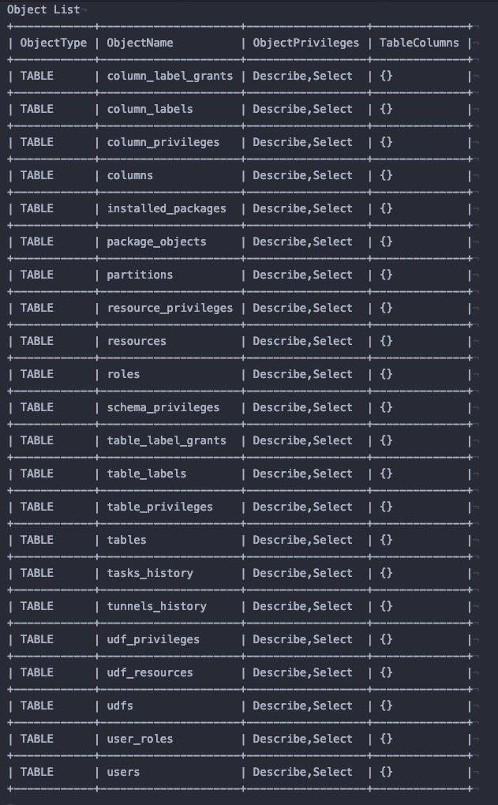

**Query metadata views**

To query a metadata view, you must prefix the view name with Information_Schema, for example, **Information_Schema.view_name**.

For example, if you are logged in to the myproject1 project, run the following command to query the metadata for all tables in myproject1.

```text
odps@myproject1>SELECT * FROM Information_Schema.tables;
```

Information Schema also includes job history views for querying job history within the current project. You can filter the results by using a date partition, as shown in the following command.

```text
odps@myproject1>SELECT * FROM Information_Schema.tasks_history WHERE ds='yyyymmdd' limit 100;
```

**Grant permissions**

The views in Information Schema contain project-wide metadata. By default, only the project owner can view this data. To allow other users or roles in the project to view it, you must grant them permission.

Use the following syntax:

```sql
GRANT <actions> ON package Information_Schema.systables TO USER <user_name>;
GRANT <actions> ON package Information_Schema.systables TO role <role_name>;
```

Parameters:

- **actions**: The permission to grant. The only valid value is Read.

- **user_name**: The Alibaba Cloud account or RAM user that has been added to the project.

  You can run the  `LIST USERS;`  command in the MaxCompute client to list the user accounts.

- **role_name**: The role that has been added to the project.

  You can run the  `LIST ROLES;`  command in the MaxCompute client to list the role names.

Example:

```sql
GRANT Read ON package Information_Schema.systables TO USER 
RAM$Bob***@aliyun.com:user01;
```

<a id="section-11-3-2-2"></a>

#### 11.3.2.2. Metadata views

The Information Schema service of MaxCompute contains the metadata of key objects in a project and provides historical information about job execution, data upload, and data download.

> **Note**
>
> For more information about how to query metadata views, see Query a metadata view in the "Project-level Information Schema" topic.

**Features**

The metadata views of the Information Schema service allow you to browse and retrieve metadata.

The usage information views of the Information Schema service allow you to optimize jobs and plan resources. For example, you can analyze the metrics of a job, such as the resource consumption, running duration, and amount of processed data.

Different views have different validity periods or default retention periods. Data that exceeds the retention period is inaccessible. You can manually export data from Information Schema to a MaxCompute table to back up the data at a specified interval. This backup applies to historical data that requires a longer storage period.

> **Note**
>
> When you export data, we recommend that you explicitly specify the field names of the view. If you do not explicitly specify the field names of the view, you may fail to back up data by running  `insert into select * from information_schema.***`  after some fields are inserted into a MaxCompute table.

The following table describes the metadata views.

<table>
  <tr>
    <th>Type</th>
    <th>View</th>
    <th>Timeliness and retention period</th>
    <th>Delay</th>
  </tr>
  <tr>
    <td rowspan="13">Metadata information</td>
    <td>TABLES</td>
    <td>Quasi-real-time view</td>
    <td rowspan="13">Online data is displayed in metadata views with a delay of about 3 hours.</td>
  </tr>
  <tr>
    <td>PARTITIONS</td>
    <td>Quasi-real-time view</td>
  </tr>
  <tr>
    <td>COLUMNS</td>
    <td>Quasi-real-time view</td>
  </tr>
  <tr>
    <td>UDFS</td>
    <td>Quasi-real-time view</td>
  </tr>
  <tr>
    <td>RESOURCES</td>
    <td>Quasi-real-time view</td>
  </tr>
  <tr>
    <td>UDF_RESOURCES</td>
    <td>Quasi-real-time view</td>
  </tr>
  <tr>
    <td>USERS</td>
    <td>Quasi-real-time view</td>
  </tr>
  <tr>
    <td>ROLES</td>
    <td>Quasi-real-time view</td>
  </tr>
  <tr>
    <td>USER_ROLES</td>
    <td>Quasi-real-time view</td>
  </tr>
  <tr>
    <td>PACKAGE_OBJECTS</td>
    <td>Quasi-real-time view</td>
  </tr>
  <tr>
    <td>INSTALLED_PACKAGES</td>
    <td>Quasi-real-time view</td>
  </tr>
  <tr>
    <td>SCHEMA_PRIVILEGES</td>
    <td>Quasi-real-time view</td>
  </tr>
  <tr>
    <td colspan="2"></td>
  </tr>
  <tr>
    <td rowspan="9"></td>
    <td colspan="2"></td>
    <td rowspan="9"></td>
  </tr>
  <tr>
    <td>TABLE_PRIVILEGES</td>
    <td>Quasi-real-time view</td>
  </tr>
  <tr>
    <td>COLUMN_PRIVILEGES</td>
    <td>Quasi-real-time view</td>
  </tr>
  <tr>
    <td>UDF_PRIVILEGES</td>
    <td>Quasi-real-time view</td>
  </tr>
  <tr>
    <td>RESOURCE_PRIVILEGE S</td>
    <td>Quasi-real-time view</td>
  </tr>
  <tr>
    <td>TABLE_LABELS</td>
    <td>Quasi-real-time view</td>
  </tr>
  <tr>
    <td>COLUMN_LABELS</td>
    <td>Quasi-real-time view</td>
  </tr>
  <tr>
    <td>TABLE_LABEL_GRANTS</td>
    <td>Quasi-real-time view</td>
  </tr>
  <tr>
    <td>COLUMN_LABEL_GRAN TS</td>
    <td>Quasi-real-time view</td>
  </tr>
  <tr>
    <td rowspan="2">Usage information</td>
    <td>TASKS_HISTORY</td>
    <td>Quasi-real-time view.Historical data is stored in a partitioned table, and data from the last 14 days is retained.</td>
    <td rowspan="2">Online data is displayed in metadata views with a delay of about 15 minutes.</td>
  </tr>
  <tr>
    <td>TUNNELS_HISTORY</td>
    <td>Quasi-real-time view.Historical data is stored in a partitioned table, and data from the last 14 days is retained.</td>
  </tr>
</table>

**TABLES**

Displays the information about a table in a project.

| Field | Data type | Description |
| --- | --- | --- |
| table_catalog | STRING | The value is fixed to <code> odps </code>. |
| table_schema | STRING | The name of the project. |
| table_name | STRING | The name of the table. |
| table_type | STRING | The type of the table. Valid Values:<br>• MANAGED_TABLE<br>• VIRTUAL_VIEW<br>• EXTERNAL_TABLE |
| is_partitioned | BOOLEAN | Specifies whether the table is a partitioned table. |
| owner_id | STRING | The ID of the table owner. |
| owner_name | STRING | Optional. The Alibaba Cloud account of the table owner. |
| create_time | DATETIME | The time when the data table was created. |
| last_modified_time | DATETIME | The time when the table was last modified. |
| data_length | BIGINT | If the table is a non-partitioned table, the value of this parameter is the size of the table data. If the table is a partitioned table, the system does not calculate the size of the table data. In this case, the value of this parameter is NULL.The PARTITIONS view includes the data size of each partition in a partitioned table. Unit: bytes. |
| table_comment | STRING | The comments on the table. |
| life_cycle | BIGINT | Optional. The lifecycle of the table. |
| is_archived | BOOLEAN | A reserved field. |
| table_exstore_type | STRING | A reserved field. |
| cluster_type | STRING | The clustering type of the MaxCompute table. Valid values: HASH and RANGE. |
| number_buckets | BIGINT | Optional. The number of buckets in the clustered table.The value 0 indicates that the number of buckets dynamically changes during job execution. |
| view_original_text | STRING | The view text in the table of the VIRTUAL_VIEW type. |

**PARTITIONS**

Displays information about a table partition in a project.

| Field | Data type | Description |
| --- | --- | --- |
| table_catalog | STRING | The value is fixed to <code> odps </code>. |
| table_schema | STRING | The name of the project. |
| table_name | STRING | The name of the table. |
| partition_name | STRING | The name of the partition.Example: <code> ds=‘20190130’ </code>. |
| create_time | DATETIME | The time when the partition was created. |
| last_modified_time | DATETIME | The time when the table was last modified. |
| data_length | BIGINT | The size of the data in the partition. Unit: bytes. |
| is_archived | BOOLEAN | A reserved field. |
| is_exstore | BOOLEAN | A reserved field. |
| cluster_type | STRING | Optional. The clustering type of the MaxCompute table. Valid values: HASH and RANGE. |
| number_buckets | BIGINT | Optional. The number of buckets in the clustered table.The value 0 indicates that the number of buckets dynamically changes during job execution. |

**COLUMNS**

Displays information about a table column in a project.

| Field | Data type | Description |
| --- | --- | --- |
| table_catalog | STRING | The value is fixed to <code> odps </code>. |
| table_schema | STRING | The name of the project. |
| table_name | STRING | The name of the table. |
| column_name | STRING | The name of the column. |
| ordinal_position | BIGINT | The serial number of the column. |
| column_default | STRING | The default value of the column. |
| is_nullable | BOOLEAN | Optional. The value is fixed to YES. |
| data_type | STRING | The data type of the column. |
| column_comment | STRING | The comments on the column. |
| is_partition_key | BOOLEAN | Specifies whether the column is a partition key column. |

**UDFS**

Displays information about a user-defined function (UDF) in a project.

| Field | Data type | Description |
| --- | --- | --- |
| udf_catalog | STRING | The value is fixed to <code> odps </code>. |
| udf_schema | STRING | The name of the project. |
| udf_name | STRING | The name of the UDF. |
| owner_id | STRING | The ID of the UDF owner. |
| owner_name | STRING | Optional. The Alibaba Cloud account of the UDF owner. |
| create_time | DATETIME | The time when the UDF was created. |
| last_modified_time | DATETIME | The time when the UDF was last modified. |

**RESOURCES**

Displays information about a resource in a project.

| Field | Data type | Description |
| --- | --- | --- |
| resource_catalog | STRING | The value is fixed to <code> odps </code>. |
| resource_schema | STRING | The name of the project. |
| resource_name | STRING | The name of the resource. |
| resource_type | STRING | A resource type. Valid values: Py and Jar. |
| owner_id | STRING | The ID of the resource owner. |
| owner_name | STRING | Optional. The Alibaba Cloud account of the resource owner. |
| create_time | DATETIME | The time when the resource was created. |
| last_modified_time | DATETIME | The time when the resource was last modified. |
| size | BIGINT | The storage space used by the resource. |
| comment | STRING | The comments on the resource. |
| is_temp_resource | BOOLEAN | Specifies whether the resource is a temporary resource. |

**UDF_RESOURCES**

Displays information about the dependent resource of a UDF in a project.

| Field | Data type | Description |
| --- | --- | --- |
| udf_catalog | STRING | The value is fixed to <code> odps </code>. |
| udf_schema | STRING | The name of the project. |
| udf_name | STRING | The name of the UDF. |
| resource_schema | STRING | The name of the project to which the resource belongs. |
| resource_name | STRING | The name of the resource. |

**USERS**

Displays the list of users in a project.

| Field | Data type | Description |
| --- | --- | --- |
| user_catalog | STRING | Valid values: ALIYUN and RAM. |
| user_schema | STRING | The name of the project. |
| user_name | STRING | Optional. The name of the user. |
| user_id | STRING | The user ID. |
| user_label | STRING | The label of the user. |

**ROLES**

Displays the list of roles in a project.

| Field | Data type | Description |
| --- | --- | --- |
| role_catalog | STRING | The value is fixed to <code> odps </code>. |
| role_schema | STRING | The name of the project. |
| role_name | STRING | The name of the role. |
| role_label | STRING | The label of the role. |
| comment | STRING | The comments on the role. |

**USER_ROLES**

Displays information about a role that a user assumes in a project.

| Field | Data type | Description |
| --- | --- | --- |
| user_role_catalog | STRING | The value is fixed to <code> odps </code>. |
| user_role_schema | STRING | The name of the project. |
| role_name | STRING | The name of the role. |
| user_name | STRING | The name of the user. |
| user_id | STRING | The ID of the user. |

**PACKAGE_OBJECTS**

Displays the object information of a package in a project.

| Field | Data type | Description |
| --- | --- | --- |
| package_catalog | STRING | The value is fixed to <code> odps </code>. |
| package_schema | STRING | The name of the project. |
| package_name | STRING | The name of the package. |
| object_type | STRING | The type of the package object. |
| object_name | STRING | The name of the package object. |
| column_name | STRING | The name of the table column. |
| allowed_privileges | VECTOR&lt;STRING&gt; | The shared permissions. |
| allowed_label | STRING | The shared label. |

**INSTALLED_PACKAGES**

Displays information about an installed package in a project.

| Field | Data type | Description |
| --- | --- | --- |
| installed_package_catalog | STRING | The value is fixed to <code> odps </code>. |
| installed_package_schema | STRING | The name of the project. |
| package_project | STRING | The name of the project in which the package was created. |
| package_name | STRING | The name of the package. |
| installed_time | DATETIME | Reserved. The time when the package was installed. |
| allowed_label | STRING | The shared label. |

**SCHEMA_PRIVILEGES**

Displays information about a schema permission in a project.

| Field | Data type | Description |
| --- | --- | --- |
| user_catalog | STRING | The value is fixed to <code> odps </code>. |
| user_schema | STRING | The name of the project. |
| grantee | STRING | The name of the user. |
| user_id | STRING | The ID of the user. |
| grantor | STRING | The account that grants the permission. The current value is NULL. |
| privilege_type | STRING | The type of the permission. |

**TABLE_PRIVILEGES**

Displays information about a table permission in a project.

| Field | Data type | Description |
| --- | --- | --- |
| table_catalog | STRING | The value is fixed to <code> odps </code>. |
| table_schema | STRING | The name of the project to which the table belongs. |
| table_name | STRING | The name of the table. |
| grantee | STRING | The name of the user. |
| user_id | STRING | The ID of the user. |
| grantor | STRING | The account that grants the permission. The current value is NULL. |
| privilege_type | STRING | The type of the permission. |
| user_schema | STRING | The name of the project to which the user belongs. |

**COLUMN_PRIVILEGES**

Displays information about a column permission in a project.

| Field | Data type | Description |
| --- | --- | --- |
| table_catalog | STRING | The value is fixed to <code> odps </code>. |
| table_schema | STRING | The name of the project to which the table belongs. |
| table_name | STRING | The name of the table. |
| column_name | STRING | The name of the column. |
| grantee | STRING | The name of the user. |
| user_id | STRING | The ID of the user. |
| grantor | STRING | Optional. The current value is NULL. |
| privilege_type | STRING | The type of the permission. |
| user_schema | STRING | The name of the project to which the user belongs. |

**UDF_PRIVILEGES**

Displays information about a UDF permission in a project.

| Field | Data type | Description |
| --- | --- | --- |
| udf_catalog | STRING | The value is fixed to <code> odps </code>. |
| udf_schema | STRING | The name of the project. |
| udf_name | STRING | The name of the UDF. |
| user_schema | STRING | The name of the project to which the user belongs. |
| grantee | STRING | The name of the user. |
| user_id | STRING | The ID of the user. |
| grantor | STRING | The account that grants the permission. The current value is NULL. |
| privilege_type | STRING | The type of the permission. |

**RESOURCE_PRIVILEGES**

Displays information about a resource permission in a project.

| Field | Data type | Description |
| --- | --- | --- |
| resource_catalog | STRING | The value is fixed to <code> odps </code>. |
| resource_schema | STRING | The name of the project. |
| resource_name | STRING | The name of the resource. |
| user_schema | STRING | The name of the project to which the user belongs. |
| grantee | STRING | The name of the user. |
| user_id | STRING | The ID of the user. |
| grantor | STRING | The account that grants the permission. The current value is NULL. |
| privilege_type | STRING | The type of the permission. |

**TABLE_LABELS**

Displays information about a table label in a project.

| Field | Data type | Description |
| --- | --- | --- |
| table_catalog | STRING | The value is fixed to <code> odps </code>. |
| table_schema | STRING | The name of the project. |
| table_name | STRING | The name of the table. |
| label_type | STRING | The type of the label. The value is fixed to NULL. |
| label_level | STRING | The level of the label. |

**COLUMN_LABELS**

Displays information about a table column label in a project.

| Field | Data type | Description |
| --- | --- | --- |
| table_catalog | STRING | The value is fixed to <code> odps </code>. |
| table_schema | STRING | The name of the project. |
| table_name | STRING | The name of the table. |
| column_name | STRING | The name of the column. |
| label_type | STRING | The type of the label. The value is fixed to NULL. |
| label_level | STRING | The level of the label. |

**TABLE_LABEL_GRANTS**

Displays the authorization information of a table label in a project.

| Field | Data type | Description |
| --- | --- | --- |
| table_label_grant_catalog | STRING | The value is fixed to <code> odps </code>. |
| table_label_grant_schema | STRING | The name of the project to which the user belongs. |
| user | STRING | The name of the user. |
| user_id | STRING | The ID of the user. |
| table_schema | STRING | The name of the project to which the table belongs. |
| table_name | STRING | The name of the table. |
| grantor | STRING | The account that grants the permission. The current value is NULL. |
| label_level | STRING | The granted level of the label. |
| expired | DATETIME | The time when the authorization expires. |

**COLUMN_LABEL_GRANTS**

Displays the authorization information of a table column label in a project.

| Field | Data type | Description |
| --- | --- | --- |
| column_label_grant_catalog | STRING | The value is fixed to <code> odps </code>. |
| column_label_grant_schema | STRING | The name of the project to which the user belongs. |
| user | STRING | The name of the user. |
| user_id | STRING | The ID of the user. |
| table_schema | STRING | The name of the project to which the table belongs. |
| table_name | STRING | The name of the table. |
| column_name | STRING | The name of the column. |
| grantor | STRING | The account that grants the permission. The current value is NULL. |
| label_level | STRING | The granted level of the label. |
| expired | DATETIME | The time when the authorization expires. |

**TASKS**

Displays the real-time snapshots of jobs. This view is used to monitor jobs in real time.

| Field | Data type | Description |
| --- | --- | --- |
| project_name | STRING | The name of the project. |
| task_name | STRING | The name of the job. |
| task_type | STRING | The type of the job.<br>Valid values:<br>• SQL: SQL jobs<br>• CUPID: Spark or Mars jobs<br>• SQLCost: SQL cost estimation jobs<br>• SQLRT: MaxCompute Query Acceleration (MCQA) SQL jobs<br>• LOT: MapReduce jobs<br>• PS: Parameter Server of Platform for AI (PAI) jobs<br>• AlgoTask: PAI jobs |
| inst_id | STRING | The ID of the instance. |
| status | STRING | The status of the job when data is collected. Valid values: Running and Waiting. |
| owner_id | STRING | The ID of the Alibaba Cloud account that submits the job. |
| owner_name | STRING | The name of the Alibaba Cloud account that submits the job. |
| start_time | DATETIME | The time when the job starts. |
| priority | BIGINT | The priority of the job. This parameter is applicable only to jobs that use subscription resources. |
| signature | STRING | The job signature. |
| queue_name | STRING | The name of the compute queue. |
| cpu_usage | BIGINT | The current CPU utilization. The value of this field is calculated by using the following formula: Number of CPU cores × 100. |
| mem_usage | BIGINT | The current memory usage.Unit: MB. |
| gpu_usage | BIGINT | The current GPU usage. The value of this field is calculated by using the following formula: Number of GPUs × 100. |
| total_cpu_usage | BIGINT | The accumulated CPU utilization. The value of this field is calculated by using the following formula: Number of CPU cores × 100 × Running duration of the job (seconds). |
| total_mem_usage | BIGINT | The accumulated memory usage. The value of this field is calculated by using the following formula: Memory size (MB) × Running duration of the job (seconds). |
| total_gpu_usage | BIGINT | The accumulated GPU usage.The value of this field is calculated by using the following formula: Number of GPUs × 100 × Running duration of the job (seconds). |
| cpu_min_ratio | BIGINT | The ratio of the CPU utilization of the job to the total CPU utilization. This parameter is applicable only to jobs that use subscription resources. |
| mem_min_ratio | BIGINT | The ratio of the memory consumed by the job to the total memory usage. This parameter is applicable only to jobs that use subscription resources. |
| gpu_min_ratio | BIGINT | The ratio of the GPUs consumed by the job to the total GPU usage. This parameter is applicable only to jobs that use subscription resources. |
| cpu_max_ratio | BIGINT | The ratio of the CPU utilization of the job to the maximum CPU utilization. This parameter is applicable only to jobs that use subscription resources. |
| mem_max_ratio | BIGINT | The ratio of the memory consumed by the job to the maximum memory usage. This parameter is applicable only to jobs that use subscription resources. |
| gpu_max_ratio | BIGINT | The ratio of the GPUs consumed by the job to the maximum GPU usage. This parameter is applicable only to jobs that use subscription resources. |
| settings | STRING | The custom scheduling settings of an upper-layer application, such as DataWorks. |
| additional_info | STRING | The additional information. This is a reserved field. |

**TASKS_HISTORY**

Displays the job execution history in a MaxCompute project. Data from the last 14 days is retained.

| Field | Data type | Description |
| --- | --- | --- |
| task_catalog | STRING | The value is fixed to <code> odps </code>. |
| task_schema | STRING | The name of the project. |
| task_name | STRING | The name of the job. |
| task_type | STRING | The type of the job.<br>Valid values:<br>• SQL: SQL jobs<br>• CUPID: Spark or Mars jobs<br>• SQLCost: SQL cost estimation jobs<br>• SQLRT: MaxCompute Query Acceleration (MCQA) SQL jobs<br>• LOT: MapReduce jobs<br>• PS: Parameter Server of Platform for AI (PAI) jobs<br>• AlgoTask: PAI jobs |
| inst_id | STRING | The ID of the instance. |
| status | STRING | The status of the job when data is collected. This is not a real-time state. |
| owner_id | STRING | The ID of the Alibaba Cloud account. |
| owner_name | STRING | The name of the Alibaba Cloud account. |
| result | STRING | The error information displayed if an error occurs in an SQL job. |
| start_time | DATETIME | The time when the job starts. |
| end_time | DATETIME | The end time of the job. If the job does not end on the current day, this value is NULL. |
| input_records | BIGINT | The number of records read by the job. |
| output_records | BIGINT | The number of records generated by the job. |
| input_bytes | BIGINT | The amount of scanned data, which is the same as that displayed on LogView. |
| output_bytes | BIGINT | The number of output bytes. |
| input_tables | STRING | The job input tables in the \[project.table1,project.table2\] format. |
| output_tables | STRING | The job output tables in the \[project.table1,project.table2\] format. |
| operation_text | STRING | The source XML file of the query statement. If the size of the source XML file exceeds 256 KB, set the value to NULL. |
| signature | STRING | Optional. The job signature. |
| complexity | DOUBLE | Optional. The job complexity.This parameter is available only for SQL jobs. |
| cost_cpu | DOUBLE | The CPU utilization of the job.The value 100 indicates that 1 CPU core multiplies the job running duration in seconds.For example, if 10 CPU cores run for five seconds, cost_cpu is 5000, which is calculated by using the following formula: 10 × 100 × 5. |
| cost_mem | DOUBLE | The memory consumed by the job. The value of this field is calculated by using the following formula: Memory size (MB) × Running duration of the job (seconds). |
| settings | STRING | The information that is scheduled by the upper layer application or specified by users. The information is saved in the JSON format. The information includes the following fields: USERAGENT, BIZID, SKYNET_ID, and SKYNET_NODENAME. |
| ds | STRING | The date when the data was collected. Example: 20190101. |

**TUNNELS_HISTORY**

Displays historical data that is uploaded and downloaded at the same time over a data tunnel. Data from the last 14 days is retained.

| Field | Data type | Description |
| --- | --- | --- |
| tunnel_catalog | STRING | The value is fixed to <code> odps </code>. |
| tunnel_schema | STRING | The name of the project. |
| session_id | STRING | The session ID, which is saved in the format of <code> TIMESTAMP </code> <code>(YYYYMMDDHHmmss, 14</code><br><code>characters) + IP address</code><br><code>(8 characters) + numHex (8</code> <code>characters) </code>. Example: 2013060414484474e5e60a000 00002. |
| operate_type | STRING | The type of the operation. Valid Values:<br>• UPLOADLOG<br>• DOWNLOADLOG<br>• DOWNLOADINSTANCELOG |
| tunnel_type | STRING | The type of the tunnel. Valid values: TUNNEL LOG and TUNNEL INSTANCE LOG. |
| request_id | STRING | The request ID. |
| object_type | STRING | The type of object on which the operation is performed. Valid values: TABLE and INSTANCE. |
| object_name | STRING | The table name or instance ID. |
| partition_spec | STRING | The partition information.Example: <code>time=20130222,loc=beijing</code><code> </code>. |
| data_size | BIGINT | The size of the data. Unit: bytes. |
| block_id | BIGINT | The ID of the block uploaded by using the tunnel. This parameter is available only if operate_type is set to UPLOADLOG. Otherwise, this parameter is left empty. |
| offset | BIGINT | The number of records to skip before data is downloaded. By default, the download starts from record 0. |
| length | BIGINT | The number of records to download or upload in the current session. The number of downloaded records is equal to the value of this parameter. |
| owner_id | STRING | The ID of the Alibaba Cloud account. |
| owner_name | STRING | The name of the Alibaba Cloud account. |
| start_time | DATETIME | The start time of the request. |
| end_time | DATETIME | The end time of the request. |
| client_ip | STRING | The IP address of the client that initiates the request. |


<table>
  <tr>
    <td>user_agent</td>
    <td>STRING</td>
    <td>The information about the user agent, which is the client that initiates the request. The information may be the Java version or the operating system.</td>
  </tr>
  <tr>
    <td>columns</td>
    <td>STRING</td>
    <td>The columns that are specified when the data is downloaded over a data tunnel.</td>
  </tr>
  <tr>
    <td>ds</td>
    <td>STRING</td>
    <td>The date when the data was collected. Example: 20190101.</td>
  </tr>
</table>

<a id="section-11-3-2-3"></a>

#### 11.3.2.3. Information Schema FAQ

This topic answers frequently asked questions about using Information Schema.

**How can I check the time a specific record was synchronized to MaxCompute after an incremental data synchronization?**

You cannot check the specific time when an individual record was synchronized to MaxCompute. You can check the LastModifiedTime in the table metadata. For more information, see Information Schema overview.

**How do I view the Information Schema for a table?**

For more information, see Information Schema overview.

**What should I do if information_schema.tables does not show all the tables in my MaxCompute project?**

MaxCompute metadata updates are delayed by at least 3 hours. Check the table creation time and wait for at least 3 hours before you check again.

<a id="section-11-4"></a>

## 11.4. MaxCompute multi-region deployment

<a id="section-11-4-1"></a>

### 11.4.1. MaxCompute multi-region deployment

MaxCompute supports multi-region deployment. This architecture uses separate deployment modes for the control cluster and computing clusters.

**Deployment modes**

- Control cluster: Deployed centrally to configure resources and manage computing tasks.

- Computing cluster: Deployed independently in each region to create projects and execute computing tasks.

<a id="section-11-4-2"></a>

### 11.4.2. Multi-region deployment

This topic explains the core principles and use cases of multi-region deployment in MaxCompute. Learn how to synchronize data across clusters and design for high availability.

**Considerations**

- MaxCompute compute jobs run on a specific cluster based on data distribution. Clusters exchange data using either cross-cluster replication or direct reads, depending on your configuration and data distribution.

- You can configure data to be replicated and synchronized between clusters. This data synchronization occurs at the table and partition level.

- Plan the mapping between your MaxCompute Projects and clusters based on your business requirements. A Project can be associated with a single cluster or multiple clusters.

  > **Note**
  >
  > Associating a Project with multiple clusters enables data replication and synchronization between those clusters.

- MaxCompute does not support cross-cluster computation within a single Project. To work around this, distribute data across multiple clusters and split your compute jobs based on data location.

  > **Note**
  >
  > Managing and replicating data between clusters requires a clear strategy and regular maintenance.

- Data replication or direct read-only access between clusters in different regions requires sufficient bandwidth.

- The bandwidth between regions is a shared resource. When processing large data volumes, MaxCompute cross-cluster replication or read-only operations can saturate the bandwidth and affect other data transfers.

- The primary region hosts critical information, including metadata and the account system. Therefore, a cluster failure in the primary region disrupts the entire service.

- A failure in a secondary compute cluster affects all Projects with data stored on that cluster and disrupts overall service operations.

  > **Note**
  >
  > Compute jobs for Projects with data located exclusively in the primary region are not affected.

- A typical use case is to partition and replicate data based on business needs, and then run computations on the specific clusters where the data resides. Finally, the application layer combines the results from these different MaxCompute jobs.

<a id="section-11-4-3"></a>

### 11.4.3. Examples of multi-region deployment

<a id="section-11-4-3-1"></a>

#### 11.4.3.1. Synchronize table data across clusters

This topic explains how to synchronize table data across clusters for multi-region applications and provides a working example.

**Prerequisites**

- When creating a Project in AdminConsole, select the two required clusters and set one as the default cluster.

  > **Note**
  >
  > - In this example, the Project is **multiregion**. **AT-MDU-TEST** and **AT-5KN** are the two selected clusters. **AT-MDU-TEST** is the default cluster.
  >
  > - The URL for the AdminConsole in Apsara Stack is **http://{odps_ag}:9090**, which is port 9090 of the ODPS AG.
  >
  > - The navigation path is **ODPS configuration > Project Management > Create Project**.

- Set up cross-cluster replication for an existing Project as follows.

  <ol type="i">

  <li>

  Choose **ODPS configuration > Global Configuration for Multi-cluster Replication** to open the **Global Configuration for Multi-cluster Replication** page.

  </li>

  <li>

  In the **infoBetweenClusters** area, click **Add Item**. Set **key** to **AT-5KN#AT-MDU-TEST**,

  </li>

  </ol>

  and set **availableBandwith** and **totalBandwith** to **2000**. Then, click **add**.

  <ol type="i" start="3">

  <li>

  Click **ODPS configuration > Project Management**. Find **multiregion**, and then click

  </li>

  </ol>

  the **Multi-cluster Replication Configuration** button.

  <ol type="i" start="4">

  <li>

  In the dialog box that opens, configure settings similar to the following.

  </li>

  <li>

  After you finish the configuration, click **Save** and then **Start Replication** to complete the operation.

  </li>

  </ol>

**Procedure**

1. On the AG of the default cluster **AT-MDU-TEST**, create a data file for Tunnel upload in the same directory as the Console. For example:  `echo "testtest" > uploaddata` .

2. Open the Console command line and run the following commands to create a table and insert data into it.

   ```sql
   USE multiregion;
   CREATE TABLE t1 (s string);
   tunnel upload uploaddata t1;
   ```

3. Run the following command to verify that the data is in the table.

   ```sql
   SELECT * FROM t1;
   ```

4. On the AGs of the **AT-MDU-TEST** and **AT-5KN** clusters, run the following command to view the table's Apsara Distributed File System directory and verify that it contains data.

   ```text
   pu ls product/aliyun/odps/multiregion/data/t1
   ```

5. If both clusters have the data, the table data was synchronized successfully between the clusters.

<a id="section-11-4-3-2"></a>

#### 11.4.3.2. Query primary/standby cluster data sync status

This topic describes how to query the data synchronization status of a primary/standby cluster in a multi-region deployment.

**Prerequisites**

- You have created a Project in AdminConsole, selected two clusters, and set one as the default cluster, as shown in the following figure.

  > **Note**
  >
  > - In this example, the Project is **multiregion**, the two selected clusters are **AT-MDU-TEST** and **AT-5KN**, and the default cluster is **AT-MDU-TEST**.
  >
  > - The URL for AdminConsole in Apsara Stack is **http://{odps_ag}:9090**, which uses port 9090 of the ODPS AG service.
  >
  > - To access this page, go to **ODPS configuration > Project management > Create Project**.

- Configure cross-cluster replication for the created Project.

  <ol type="i">

  <li>

  Select **ODPS configuration > Multi-cluster Replication Global Configuration**, and the **Multi-cluster Replication Global Configuration** page appears.

  </li>

  <li>

  In the **infoBetweenClusters** area, click **Add Item**, set **key** to **AT-5KN#AT-MDU-TEST**,

  </li>

  </ol>

  set **availableBandwith** and **totalBandwith** to **2000**, and then click **add**.

  <ol type="i" start="3">

  <li>

  Go to **ODPS configuration > Project management**, find the multiregion Project, and

  </li>

  </ol>

  then click the **Multi-cluster Replication Configuration** button.

  <ol type="i" start="4">

  <li>

  In the dialog box, configure the settings as shown in the following figure.

  </li>

  <li>

  After you complete the configuration, click **Save** and then **Start Replication**.

  </li>

  </ol>

**Procedure**

1. To send an Admintask, create a configuration file named  `bodychecksync`  with the following content.

   ```xml
   <Instance>
     <Job>
       <Comment>
       </Comment>
       <Priority>1</Priority>
       <Tasks>
         <Admin>
         <Name>task_1</Name>
         <Comment>test</Comment>
         <Config>
           <Property>
             <Name>PROJECT</Name>
             <Value>multiregion</Value>
           </Property>
           <Property>
             <Name>CLUSTER</Name>
             <Value>AT-MDU-TEST</Value>
           </Property>
         </Config>    
         <Command>GET_UNREPLICATED_OBJECTS</Command>
         </Admin>
       </Tasks>
       <DAG>
         <Comment/>
         <RunMode>Sequence</RunMode>
       </DAG>
     </Job>
   </Instance>
   ```

2. Create a header file named  `header`  with the following content.

   ```text
   content-type: application/xml
   ```

3. Run the following command to send the Admintask.

   ```text
   CLTrelease/bin/odpscmd -e "http post  /projects/admin_task_project/instances -header=header -content=bodychecksync;"
   ```

4. Run the following command to check the execution status of the instance.

   ```text
   CLTrelease/bin/odpscmd  --project=admin_task_project -e "wait 
   20180711050550317gnege3ms2;"
   ```

5. Copy the LogView URL generated in the previous step and open it in a browser.

6. On the page that opens, click **Job Details** to view the data synchronization status between the primary/standby clusters.

<a id="section-11-4-3-3"></a>

#### 11.4.3.3. Cross-region direct read

This topic describes cross-region direct read in a multi-region deployment and provides examples.

**Usage**

You can perform a cross-region direct read in two ways: with or without configuring cross-cluster access.

> **Note**
>
> If you do not configure cross-cluster access, reading a large amount of data may be slow.

**Without cross-cluster access**

1. In AdminConsole, create two Projects: **testmdu** and **testcross5kn**.

   > **Note**
   >
   > - In this example, Project testmdu selects the **AT-MDU-TEST** and **AT-5KN** computing clusters, and the default cluster is **AT-MDU-TEST**. Project testcross5kn selects only the **AT-5KN** cluster, and the default cluster is **AT-5KN**.
   >
   > - The URL for AdminConsole in Apsara Stack is **http://{odps_ag}:9090**, which is port 9090 of the odps ag.
   >
   > - The path for this operation is **ODPS configuration > Project management > Create Project**.

2. Create a table for each Project.

   ```sql
   CREATE TABLE testrep(s string);
   CREATE TABLE tablecross5kn (s string);
   ```

3. Populate the testrep and tablecross5kn tables with some data.

4. Run the following commands in Project testcross5kn to read data from the table in Project testmdu.

   ```sql
   USE testcross5kn;
   SELECT * FROM testmdu.testrep;
   ```

   > **Note**
   >
   > If data is returned, the cross-region direct read is successful.

**With cross-cluster access**

1. In AdminConsole, create two Projects: **testmdu** and **testcross5kn**.

   > **Note**
   >
   > - In this example, Project testmdu selects the **AT-MDU-TEST** and **AT-5KN** computing clusters, and the default cluster is **AT-MDU-TEST**. Project testcross5kn selects only the **AT-5KN** cluster, and the default cluster is **AT-5KN**.
   >
   > - The Apsara Stack address for AdminConsole is **http://{odps_ag}:9090**, which is port 9090 of odps ag.
   >
   > - Go to **ODPS configuration > Project management > Create Project**.

2. Create a table for each Project.

   ```sql
   CREATE TABLE testrep(s string);
   CREATE TABLE tablecross5kn (s string);
   ```

3. Populate the testrep and tablecross5kn tables with some data.

4. Configure cross-cluster replication for Project testmdu.

   > **Note**
   >
   > Go to **ODPS Configuration > Project Management** and click the **Multi-cluster Replication Configuration** button for testmdu.

5. Run the following commands in Project testcross5kn to read data from the table in Project testmdu.

   ```sql
   USE testcross5kn;
   SELECT * FROM testmdu.testrep;
   ```

   > **Note**
   >
   > If data is returned, the cross-region direct read is successful.

<a id="section-11-4-3-4"></a>

#### 11.4.3.4. Cross-region join

This topic demonstrates how to perform a cross-region join in a multi-region deployment.

**Procedure**

1. In AdminConsole, create two projects: **crosssregion** and **crossregion02**.

   > **Note**
   >
   > - In this example, Project crosssregion selects the **AT-MDU-TEST** and **AT-70N** compute clusters, and its default cluster is **AT-MDU-TEST**. Project crossregion02 selects only the **AT-70N** cluster, and its default cluster is **AT-70N**.
   >
   > - The private cloud URL for AdminConsole is **http://{odps_ag}:9090**, which points to the ODPS AG service on port 9090.
   >
   > - Go to **ODPS configuration > Project management > Create Project**.

2. Configure multi-cluster replication for the  `crosssregion`  project.

   > **Note**
   >
   > Go to **ODPS configuration > Project management**, and then click **Configure Multi-cluster Replication** next to  `crosssregion` .

3. In the  `crosssregion`  project, create a table named  `business` .

   ```sql
   CREATE TABLE business(bid bigint,name string,phone string,address string,region string);
   ```

4. Populate the  `business`  table with data.

5. Run the following command to upload data to the  `business`  table.

   ```text
   tunnel upload business business;
   ```

6. In the  `crossregion02`  project, create a table named  `product` .

   ```sql
   CREATE TABLE IF NOT EXISTS product(pid bigint,name string,type string,color string,bid bigint);
   ```

7. Populate the  `product`  table with data.

8. Run the following command to upload data to the  `product`  table.

   ```text
   tunnel upload product product;
   ```

9. In the console, run the following command to perform the cross-region join.

   ```sql
   SELECT pro.pid,pro.name,pro.type,pro.color,bus.name,bus.phone FROM 
   crossregion02.product pro JOIN crosssregion.business bus ON pro.bid=bus.bid WHERE bus.region='Shanghai';
   ```

   > **Note**
   >
   > If the command returns the expected data, the cross-region join is successful.

<a id="section-12"></a>

# 12.Security solution

<a id="section-12-1"></a>

## 12.1. Target users

This article describes the target users for the MaxCompute security solution.

**Target users**

The security solution is for MaxCompute project owners, administrators, and users interested in the MaxCompute multi-tenant data security model. This model includes the following:

- User authentication.

- User and authorization management within a project.

- Cross-project resource sharing.

- Data protection within a project.

<a id="section-12-2"></a>

## 12.2. Quick start

This topic is a quick guide to the security features in MaxCompute, covering the basic steps for common security operations.

**User addition and permissions**

Scenario:  `Jack`  is an administrator of the project  `prj1` . A new team member, Alice, whose cloud account is alice\*\*\*@aliyun.com, needs to join the project  `prj1`  and requires permissions to list tables, submit jobs, and create tables.

```sql
USE prj1;

-- Add a user.
ADD USER aliyun$alice***@aliyun.com;

-- Grant permissions to the user by using the GRANT statement.
GRANT List, CreateTable, CreateInstance ON project prj1 TO USER 
aliyun$alice***@aliyun.com;
```

> **Note**
>
> Only a project administrator can perform these operations.

**Role-based permissions by ACL**

Scenario: Jack is an administrator of the project prj1. Three new team members, Alice, Bob, and Charlie, are joining as data reviewers. They need permissions to list tables, submit jobs, and read the userprofile table.

To grant these permissions, the project administrator can use object-based Access Control Lists (ACLs).

```sql
USE prj1;
ADD USER aliyun$alice***@aliyun.com;
-- Add users.
ADD USER aliyun$bob***@aliyun.com;
ADD USER aliyun$charlie***@aliyun.com;
CREATE role tableviewer;
-- Create a role.
GRANT List, CreateInstance ON project prj1 TO role tableviewer;
-- Grant permissions to the role.
GRANT DESCRIBE, SELECT ON TABLE userprofile TO role tableviewer;
GRANT tableviewer TO aliyun$alice***@aliyun.com;
-- Assign the tableviewer role to the users.
GRANT tableviewer TO aliyun$bob***@aliyun.com;
GRANT tableviewer TO aliyun$charlie***@aliyun.com;
```

**Resource packaging and sharing**

Scenario: Jack is the administrator of the project  `prj1` , and John is the administrator of the project  `prj2` . For business purposes, Jack needs to share resources, such as the  `datamining.jar`  resource and the  `sampletable`  table, from  `prj1`  with  `prj2` . After the resources are shared, John can use an ACL or a policy to grant access to users in  `prj2` , such as Bob, without Jack's involvement.

1. Jack, the administrator of  `prj1` , creates a package in the project.

   ```text
   USE prj1;

   -- Create a package.
   CREATE package datamining;

   -- Add a resource to the package.
   ADD resource datamining.jar TO package datamining;

   -- Add a table to the package.
   ADD TABLE sampletable TO package datamining;

   -- Share the package with the project prj2.
   allow project prj2 TO install package datamining;
   ```

2. John, the administrator of  `prj2` , installs the package in  `prj2` .

   ```text
   USE prj2;

   -- Install a package.
   install package prj1.datamining;

   -- View the list of resources in the package.
   DESCRIBE package prj1.datamining;
   ```

3. John grants permissions on the package.

   ```sql
   USE prj2;

   -- Grant Bob permissions to use the package by using the ACL mechanism.
   GRANT Read ON package prj1.datamining TO USER aliyun$bob***@aliyun.com;
   ```

   > **Note**
   >
   > For more information, see Share resources across projects.

**Project protection settings**

Scenario: Jack, the administrator of the project  `prj1` , needs to protect sensitive data and proprietary data mining algorithms within the project. This data includes sensitive information like user identification numbers and purchase histories. Jack wants to ensure that data and algorithms can only be accessed and processed within  `prj1`  and cannot be exported.

```text
USE prj1;

-- Enable the data protection mechanism for the project.
SET ProjectProtection=true;
```

After you enable the project protection mode, data cannot be exported from the project. However, you may need to grant specific exceptions. For example, a user named Alice needs to export a table for a valid business reason, and this action is approved by the project administrator. MaxCompute provides two methods to allow data export from a protected project:

Method 1: Set an exception policy. For more information, see Export data from a project for which data protection is enabled.

1. Create a policy file. For example, create a file named /tmp/exception_policy.txt. This policy allows only the user Alice to export the table  `t1`  from the project  `prj1`  using an SQL task.

   ```json
   {
    "Version": "1",
    "Statement": [{
     "Effect":"Allow",
     "Principal":"ALIYUN$alice***@aliyun.com",
     "Action":["odps:Describe","odps:Select"],
     "Resource":"acs:odps:*:projects/prj1/tables/t1",
     "Condition":{
      "StringEquals": { "odps:TaskType":"SQL"}
         }
      }]
   }
   ```

2. Set the project protection mode with the exception policy.

   ```text
   USE prj1;
   -- Enable data protection for the project and set an exception for data export.
   SET ProjectProtection=true WITH exception /tmp/exception_policy.txt;
   ```

   > **Note**
   >
   > When you configure an exception policy, ensure that the principal does not have permissions to update the resource or recreate it, for example, using  `Drop`  and  `CreateTable` . This helps prevent time-of-check to time-of-use (TOCTOU) data leaks.

Method 2: Add a trusted project. You can add  `prj2`  as a trusted project for  `prj1` . This allows all data to be exported from  `prj1`  to  `prj2` . For more information, see Export data from a project for which data protection is enabled.

```text
USE prj1;
ADD trustedproject prj2;
```

> **Note**
>
> Package-based resource sharing and the project protection mode are two independent security mechanisms.

MaxCompute prioritizes resource sharing. In a protected project, if an object is shared with another project via a package, the  `ProjectProtection`  setting does not restrict access to it.

<a id="section-12-3"></a>

## 12.3. User authentication

This topic describes user authentication in the MaxCompute security solution.

**Authentication**

User authentication primarily verifies the identity of the request sender. It typically includes the following aspects:

- Verifying the identity of the request sender.

- Verifying that the received request has not been tampered with in transit.

<a id="section-12-4"></a>

## 12.4. Project user and authorization management

<a id="section-12-4-1"></a>

### 12.4.1. Overview

This topic describes user management, role management, and authorization for projects.

**Usage notes**

Projects are the foundation of the MaxCompute multi-tenant system and the basic unit for data management and computing. If you create a project, you are the owner of the project. You can manage all objects in the project, such as tables, instances, resources, and user-defined functions (UDFs). Users, except the project owner, can access objects in the project only after these users acquire approvals from the project owner.

For example, if Alice is the owner of the test_project project, and another user from the project team of Alice requests to access the resources in the test_project project, Alice can use the methods described in this topic to perform user management and authorization. If the user is not from the project team of Alice, we recommend that Alice conduct cross-project resource sharing. For more information, see Cross-project resource sharing.

<a id="section-12-4-2"></a>

### 12.4.2. User management

This topic describes how to manage users within a project, including adding users, removing users, and purging their privileges.

**Add user**

A project owner, such as Alice, must add a user to the project before granting permissions. Only project members can be granted permissions.

```text
-- Add a user to the project.
ADD USER <full_username>;
```

**Remove user**

When a user leaves the project team, the project owner, such as Alice, must remove the user from the project. Once removed, the user loses all permissions to access project resources.

```text
-- Remove a user from the project.
remove USER <full_username>
```

> **Note**
>
> - You must revoke all of a user's roles before removing the user. For more information, see Role management.
>
> - After a user is removed, their associated ACL authorizations and project-level policies are retained. Only their role-level policies no longer apply. If the user is added back to the project, the system automatically restores their original ACL access permissions.
>
> - To mitigate the data security risk of a removed user rejoining under a different identity, you can permanently clear their lingering privilege information. If you are the project owner or have the admin or super_administrator role, run the  `purge privs from user <username>;`  command. This action completely removes all privilege information for the user, including ACL authorizations, labels, and policy authorizations. Note that this command fails and returns a  `Principal still exist in the project`  error if the user is still in the project.

<a id="section-12-4-3"></a>

### 12.4.3. Role management

This topic describes role management in a project, including adding and removing roles and the permission cleanup strategy.

**Usage**

A role is a collection of access permissions. Use a role to grant the same set of permissions to a group of users. Role-based authorization simplifies the authorization process and reduces management costs. When granting permissions to a user, you should first consider using a role.

When you create a project, an Admin role is automatically created. This role has a fixed set of permissions, allowing it to access all objects in the project, manage users and roles, and grant permissions to other users and roles. Unlike the project Owner, a principal with the Admin role cannot assign the Admin role to other users, set the project's security configuration, or modify its authorization model. You cannot modify the permissions of the Admin role.

**Role management commands**

```text
-- Create a role.
CREATE role <rolename>;

-- Delete a role.
DROP role <rolename>;

-- Grant a role to a user.
GRANT <rolename> TO <username>;

-- Revoke a role from a user.
REVOKE <rolename> FROM <username>;
```

> **Note**
>
> When you attempt to delete a role, MaxCompute checks if the role is still assigned to any users. If so, the operation fails. You can delete a role only after you revoke it from all associated users.

<a id="section-12-4-4"></a>

### 12.4.4. ACL-based authorization

MaxCompute projects support access control list (ACL)-based authorization. You can manage user permissions based on subjects, objects, and actions. This topic describes the syntax and scenarios of authorization commands.

**Authorization elements**

Authorization involves three elements: subject, object, and action. In a MaxCompute project, a subject is a user, and various types of objects are included. Different types of objects support different actions.

**Authorization actions**

The following table describes the types of objects and actions supported by these objects in a MaxCompute object.

Table 1 Supported object types and actions

| Object | Action | Description |
| --- | --- | --- |
| Project | Read | Views project information, excluding project objects, such as the creation time. |
| Project | Write | Updates project information, excluding project objects, such as comments. |
| Project | List | Views objects of all types in a project. |
| Project | CreateTable | Creates tables in a project. |
| Project | CreateInstanc e | Creates instances in a project. |
| Project | CreateFunctio n | Creates functions in a project. |
| Project | CreateResour ce | Creates resources in a project. |
| Project | CreateJob | Creates jobs in a project. |
| Project | CreateVolume | Creates volumes in a project. |
| Project | All | Has full operation permissions on the preceding project objects. |
| Table | Describe | Reads the metadata of a table. |
| Table | Select | Reads data of a table. |
| Table | Alter | Modifies the metadata of a table. Adds or deletes partitions. |
| Table | Update | Overwrites or adds data of a table. |
| Table | Drop | Drops a table. |
| Table | All | Has full operation permissions on the preceding table objects. |
| Function | Read | Reads data and executes functions. |
| Function | Write | The update operation. |
| Function | Delete | The delete operation. |
| Function | All | Has full operation permissions on the preceding function objects. |
| Resource,Ins tance,Job,Vo lume | Read | The read operation. |
| Resource,Ins tance,Job,Vo lume | Write | The update operation. |
| Resource,Ins tance,Job,Vo lume | Delete | The delete operation. |
| Resource,Ins tance,Job,Vo lume | All | Has full operation permissions on the <strong>Resource, Instance, Job,</strong> <strong>and Volume</strong> objects. |

> **Note**
>
> In the preceding table, the CreateTable permission on projects and the Select, Alter, Update, and Drop permissions on tables must be used together with the CREATE INSTANCE permission on projects. Otherwise, these permissions may become ineffective.

**Authorization commands**

- **Use scenario**: After you add users or create roles, you must grant permissions to these users or roles. ACL-based authorization of MaxCompute is an object-based authorization mechanism. An ACL that contains the authorization data is considered a resource of an object. Authorization can be performed only when the object exists. If the object is deleted, the granted permissions are automatically deleted.

- **Authorization method**: ACL-based authorization of MaxCompute is performed by running the GRANT or REVOKE command defined in SQL-92. These commands are used to grant or revoke permissions to or from objects in a project.

- **Command syntax**

  ```sql
  GRANT actions ON object TO subject
  REVOKE actions ON object FROM subject
  actions ::= action_item1, action_item2, ...
  object ::= project project_name | TABLE schema_name | instance inst_name | FUNCTION func_name | resource res_name
  subject ::= USER full_username | role role_name
  ```

  > **Note**
  >
  > The commands used for ACL-based authorization do not support the [WITH GRANT OPTION] clause. If user A authorizes user B to access an object, user B cannot authorize user C to access the same object. Therefore, all authorization actions must be performed by one of the following types of users:
  >
  > - Project owner
  >
  > - Users who are assigned the admin role in a project
  >
  > - Object creators in a project

**Examples**

The project administrator can grant permissions to the organization account, task account, or RAM user in the current organization.

> **Note**
>
> To add a RAM user of another organization, you must add the organization account of the other organization to the project before you can add the RAM user of the organization.

- Scenario 1: Assume that  `ali***@aliyun.com`  is a new member of the project  `test_project_a` . The project administrator can run the following command to grant the user the permissions to submit jobs, create tables, and view existing objects in the project.

  ```sql
  -- Open the project. 
  USE test_project_a;
  -- Add the user to the project. 
  ADD USER aliyun$ali***@aliyun.com;

  -- Create a role named worker. 
  CREATE role worker;
  -- Assign the worker role to the added member. 
  GRANT worker TO aliyun$ali***@aliyun.com;

  --Authorization method 1: Grant the CreateInstance, CreateResource, CreateFunction, CreateTable, and List permissions on all objects in the test_project_a project to the worker role. 
  GRANT CreateInstance, CreateResource, CreateFunction, CreateTable, List ON PROJECT test_project_a TO ROLE worker;
  ----Authorization method 2: Grant all instance permissions to the worker role. 
  GRANT ALL ON instance instance_name TO Role worker;
  ```

- Scenario 2: Assume that Allen is a RAM user that belongs to  `ali***@aliyun.com` . The project administrator can run the following command to grant permissions to the RAM user under the Apsara Stack tenant account of the organization:

  ```text
  -- Add a RAM user.  
  ADD USER ram$ali***@aliyun.com:Allen; 

  -- Create a role named worker. 
  CREATE role worker;

  -- Assign the worker role to the added member. 
  GRANT worker TO ram$ali***@aliyun.com:Allen; 
  ```

<a id="section-12-4-5"></a>

### 12.4.5. View permissions

MaxCompute allows you to view permissions from various perspectives. You can view the permissions for a specific user or role, or see the authorization list for a specific object.

**View permissions for a specific user**

```text
-- View your own access permissions.
SHOW grants;

-- View the access permissions of a specific user. This command can only be run by a Project Owner or an Admin.
SHOW grants FOR <username>;
```

**View permissions for a specific role**

```text
-- View the permissions assigned to a specific role.
DESCRIBE role <rolename>;
```

**View object authorization list**

```text
-- View the list of users and roles granted permissions on a specific object.
SHOW acl FOR <objectName> [ON type <objectType>]
```

> **Note**
>
> If you omit  `[on type <objectType>]` , the default type is Table.

**Permission indicators**

When displaying permissions for a user or role, MaxCompute uses the following indicators:

- A: Represents Allow, which grants access.

- D: Represents Deny, which denies access.

- C: Represents "with Condition". This is a conditional authorization used only in policy-based authorization. For more information, see condition block structure.

- G: Represents With Grant Option, which allows a user or role to grant their permissions on the object to others.

The following example shows how permissions are displayed.

```text
odps@test_project> SHOW grants FOR aliyun$odpstest1***@aliyun.com;

[roles]
dev
Authorization Type: ACL
[role/dev]
A projects/test_project/tables/t1: Select [user/odpstest1***@aliyun.com]
A projects/test_project: CreateTable | CreateInstance | CreateFunction | List
A projects/test_project/tables/t1: Describe | Select
Authorization Type: Policy
[role/dev]
AC projects/test_project/tables/test_*: Describe
DC projects/test_project/tables/alifinance_*: Select [user/odpstest1***@aliyun.com]
A projects/test_project: Create* | List
AC projects/test_project/tables/alipay_*: Describe | Select
Authorization Type: ObjectCreator
AG projects/test_project/tables/t6: All
AG projects/test_project/tables/t7: All
```

<a id="section-12-4-6"></a>

### 12.4.6. Download permission control

MaxCompute provides a Download permission control feature to manage the download of tables and instances by users or roles through Tunnel. This feature enhances project data security and prevents data leaks. This topic describes the commands for managing Download authorizations in MaxCompute and provides authorization examples.

**Background**

In a MaxCompute project, you can use the MaxCompute Tunnel to download tables and instances. However, this operation poses a data leak risk and requires strict access control.

When you create a MaxCompute project, Download permission control is disabled by default. This means all users and roles within the project have Download authorization on all tables and instances. The project owner or a user with the Super_Administrator role can enable or disable this feature at the project level by running the  `setproject odps.security.enabledownloadprivilege=true|false;`  command.

Download permission control applies to the following scenarios.

| Scenario | Description |
| --- | --- |
| Grant permission to a user | Grant a single user authorization to download data from a specified table or instance. |
| Grant permission to users based on a role | Grant a role the authorization to download data from a specified table or instance. You can then assign this role to multiple users, who will inherit the role's authorizations. |

**Prerequisites**

Before using the Download permission control feature, ensure you have the following information:

- The account or role name of the grantee. The grantee must be added to the MaxCompute project.

- The type and name of the object.

  You can run the  `SHOW tables;` ,  `LIST resources;` ,  `LIST functions;` , or  `SHOW instances;`  command to obtain the names of tables or views and instance IDs.

**Limitations**

This feature has the following limitations:

- You can grant authorizations only on existing objects and to existing grantees.

- When granting authorization directly to a user, you must specify a specific object. Wildcards are not supported. To use a wildcard, you must grant the authorization to a role.

**Usage notes**

When using the Download permission control feature, note the following:

- If an object is deleted, MaxCompute automatically revokes all Download authorizations associated with that object.

- When a user is removed from a project, their existing authorizations are retained. If the user is added back to the project later, their previous access authorizations are reactivated.

**Command syntax**

The commands for Download permission control use the following syntax:

- Download authorization

  ```sql
  GRANT Download ON <object_type> <object_name> TO <subject_type> <subject_name>;
  ```

- Download authorization revocation

  ```text
  REVOKE Download ON <object_type> <object_name> FROM <subject_type> <subject_name>;
  ```

The following table describes the parameters.

| Parameter | Requi red | Description |
| --- | --- | --- |
| object_type | Yes | The type of the object. You can specify only one object per grant statement.<br>Supported values:<br>• Table: A table.<br>• Instance: An instance. |

<table>
  <tr>
    <td>object_nam e</td>
    <td>Yes</td>
    <td>The object name. To find object names:<br>• Table name: Run the <code> SHOW tables; </code> command to get the name of a table or view.<br>• Instance name: Run the <code> SHOW instances; </code> command to get the instance ID.<br>When granting authorization to a role, you can use the asterisk (*) wildcard in the object name. For example, <code> table taobao* </code> refers to all tables whose names start with <code> taobao </code>.</td>
  </tr>
  <tr>
    <td>subject_typ e</td>
    <td>Yes</td>
    <td>The grantee type.<br>• <strong>USER</strong>: an Alibaba Cloud account or a RAM user.<br>• <strong>ROLE</strong>: a role.</td>
  </tr>
  <tr>
    <td>subject_na me</td>
    <td>Yes</td>
    <td>The user account or role name. You can specify only one user or role per grant statement.<br>You can run the <code> LIST users; </code> or <code> LIST roles; </code> command to find user and role names.</td>
  </tr>
</table>

**Examples**

Assume that username\*\*\*@example.com is the project owner of test_project_a, and Allen, Tom, and Alice are RAM users within this account. The Download permission control feature is enabled for the test_project_a project. The following examples demonstrate authorization operations using the MaxCompute client:

**Example 1: Granting download permission to a user**

Add the user Allen to the test_project_a project and grant them authorization to download data from the sale_detail table. The following commands show an example:

```sql
-- As the project owner, enter the test_project_a project.
USE test_project_a;
-- Add Allen as a project member.
ADD USER RAM$username***@example.com:Allen;
-- Grant the user Allen the authorization to download data from the sale_detail table in the test_project_a project.
GRANT Download ON TABLE sale_detail TO USER RAM$username***@example.com:Allen;
-- View the authorization result for Allen.
SHOW grants FOR RAM$username***@example.com:Allen;
-- The following authorization result is returned, indicating that the user Allen now has Download authorization.
Authorization Type: ACL
[user/RAM$username***@example.com:Allen]
A       projects/test_project_a/tables/sale_detail: Download
```

**Example 2: Revoking download permission from a user**

Based on Example 1, revoke the authorization from the user Allen.

```text
-- As the project owner, enter the test_project_a project.
USE test_project_a;
-- Revoke the authorization from the user Allen.
REVOKE Download ON TABLE sale_detail FROM USER RAM$username***@example.com:Allen;
-- View the authorization result for Allen. The authorization list no longer includes the Download authorization.
SHOW grants FOR RAM$username***@example.com:Allen;
```

**Example 3: Granting download permission via a role**

Grant Alice and Tom the authorization to download data from tables whose names start with tb_ in the test_project_a project. The following commands show an example:

```sql
-- As the project owner, enter the test_project_a project.
USE test_project_a;
-- Add Alice and Tom as project members.
ADD USER RAM$username***@example.com:Alice;
ADD USER RAM$username***@example.com:Tom;
-- Create a role named Worker.
CREATE role Worker;
-- Grant the Worker role to the users.
GRANT Worker TO RAM$username***@example.com:Alice;
GRANT Worker TO RAM$username***@example.com:Tom;
-- Grant the Worker role the authorization to download data from tables starting with tb_ in the test_project_a project.
GRANT Download ON TABLE tb_* TO ROLE Worker;
-- Describe the Worker role.
DESCRIBE role Worker;
-- The following authorization result is returned. A indicates that the Download operation is allowed.
Authorization Type: Policy
[role/worker]
A       projects/test_project_a/tables/tb_*: Download
```

**Example 4: Revoking role-based download permission**

Based on Example 3, revoke the authorization from the users Alice and Tom.

```text
-- As the project owner, enter the test_project_a project.
USE test_project_a;
-- Revoke the Worker role from the users Alice and Tom.
REVOKE Worker FROM RAM$username***@example.com:Alice;
REVOKE Worker FROM RAM$username***@example.com:Tom;
-- View the authorization result for Alice. The authorization list no longer includes the Download authorization.
SHOW grants FOR RAM$username***@example.com:Alice;
```

<a id="section-12-5"></a>

## 12.5. Cross-project resource sharing

<a id="section-12-5-1"></a>

### 12.5.1. Overview

This topic introduces the cross-project resource sharing mechanism and explains how to use a Package for secure data sharing across projects.

**Usage**

- As the Owner or an administrator with the Admin role for a project, you may receive requests for access to its resources.

  - If the requester is part of your project team, use the project's user and authorization management feature. For more information, see Manage users and permissions of a project.

  - If the requester is not part of your project team, you can use the Package feature to share resources across projects.

- A Package is a feature for sharing data and resources across projects that solves cross-project user authorization challenges. Without a Package, managing such scenarios is difficult.

  For example, imagine members of the  `Alifinance`  project need to access data in the  `Alipay`  project. Traditionally, the  `Alipay`  project administrator would need to add each user from the  `Alifinance`  project to the  `Alipay`  project and then grant permissions to them individually. However, for security reasons, the  `Alipay`  project administrator may not want to manage permissions for every user from the  `Alifinance`  project. Packages solve this by allowing the  `Alifinance`  project administrator to manage access for their own team members.

  - With a Package, the  `Alipay`  project administrator can bundle the required resources into a Package and authorize the  `Alifinance`  project to install it. After the  `Alifinance`  project administrator installs the Package, they can then manage access to the shared resources for their own project members.

  - The Package creator's project acts as the resource provider, while the Package user's project serves as the resource user. The resource provider bundles shared resources into a Package and authorizes the resource user's project to install it. After the resource user's project installs the Package, its members can access the shared resources.

The following sections explain the tasks for both the Package creator and the Package user.

<a id="section-12-5-2"></a>

### 12.5.2. Package usage

<a id="section-12-5-2-1"></a>

#### 12.5.2.1. Package creator operations

This guide for package creators covers the complete workflow for managing packages. It explains how to create, delete, manage resources, grant and revoke permissions, and view package details to share data efficiently.

**Create a package**

```text
CREATE package <pkgname>;
```

**Delete a package**

```text
DELETE package <pkgname>;
```

**Add and remove resources**

```text
ADD project_object TO package package_name [WITH privileges <privileges>]
remove project_object FROM package package_name
project_object ::= TABLE table_name | instance inst_name | FUNCTION func_name | resource res_name
privileges ::= action_item1, action_item2, ...
```

> **Note**
>
> - The  `project`  object type is not supported. You cannot use a package to create an object in another project.
>
> - When you add an object to a package, you also include its associated permissions. If you do not specify permissions by using the  `WITH privileges`  clause, read-only permissions are granted by default, which include  `Read` ,  `Describe` , and  `Select` . The system treats an **object and its permissions** as a single unit. When you add or remove an object from a package, the system automatically grants or revokes the corresponding permissions.

**Grant package access**

```text
allow project <prjname> TO install package <pkgname> [USING label <number>];
```

**Revoke package access**

```text
disallow project <prjname> TO install package <pkgname>;
```

**List packages**

```text
SHOW packages;
```

**View package details**

```text
DESCRIBE package <pkgname>;
```

<a id="section-12-5-2-2"></a>

#### 12.5.2.2. User operations for packages

This topic describes how to install, uninstall, and view a MaxCompute package, and how to configure  `Read`  permission using an Access Control List (ACL) or a policy. This process enables secure and controlled cross-project data sharing.

**Usage**

An installed package is an independent object type in MaxCompute. To access the resources in a package shared from another project, you must have  `Read`  permission on the package. If you lack this permission, you must request it from the Project Owner or an Admin, who can grant it by using an ACL or a policy.

For example, the following ACL authorization allows the Alibaba Cloud account odps_test\*\*\*@aliyun.com to access the resources in the package.

```sql
USE prj2 security
install package prj1.testpkg
GRANT read ON package prj1.testpkg TO USER aliyun$odps_test***@aliyun.com
```

The following policy authorization allows any user in project prj2 to access the resources in the package.

```text
USE prj2
install package prj1.testpkg
put policy /tmp/policy.txt
```

The /tmp/policy.txt file contains the following:

```json
{
  "Version": "1", 
  "Statement": [{
    "Effect":"Allow",
    "Principal":"*",
    "Action":"odps:Read",
    "Resource":"acs:odps:*:projects/prj2/packages/prj1.testpkg"
   }]
}
```

**Install a package**

```text
install package <pkgname>;
```

> **Note**
>
> When installing a package, the  `pkgname`  must be in the format  `<projectName>. <packageName>` .

**Uninstall a package**

```text
uninstall package <pkgname>;
```

> **Note**
>
> When uninstalling a package, the  `pkgname`  must be in the format  `<projectName>. <packageName>` .

**View a package**

```text
-- View a list of created and installed packages.
SHOW packages;

-- View package details.
DESCRIBE package <pkgname>;
```

<a id="section-12-6"></a>

## 12.6. Project protection

<a id="section-12-6-1"></a>

### 12.6.1. Data protection overview

This topic describes the data protection controls in a project for preventing sensitive data exfiltration.

**Usage**

In practice, some organizations, such as financial institutions, are highly sensitive to data security. To prevent sensitive data exfiltration, they typically prohibit employees from taking work home, restrict operations to the corporate network, and disable USB storage ports on all company computers.

Therefore, as a MaxCompute project administrator, if a project contains highly sensitive data that must not be transferred to other projects, you must apply the following configurations so that MaxCompute blocks all operations that could lead to data exfiltration.

<a id="section-12-6-2"></a>

### 12.6.2. Data protection mechanism

This topic describes the data protection mechanism for a MaxCompute project.

**Usage notes**

The MaxCompute data protection mechanism blocks all operations that could lead to a data leak. To enable this mechanism, run the following command in your project.

```text
SET security.ProjectProtection=true;
-- Enforces an inbound-only data flow for the project. This rule does not apply to external tables.
-- Or
SET security.ProjectProtection=true;
SET project IDENTIFY_EXTERNAL_TABLE_WRITE_AS_DATALEAK=true;
-- With ProjectProtection enabled, this setting also blocks writes to any external storage source to prevent data leaks through external tables.
```

- After you enable ProjectProtection, data can only flow into the project, not out.

- By default, ProjectProtection is disabled. This allows users with permissions for multiple projects to transfer data out of a project by using cross-project operations. If a project contains highly sensitive data, an administrator should enable the data protection mechanism.

<a id="section-12-6-3"></a>

### 12.6.3. Exporting data from a protected project

This topic describes how to export data from a MaxCompute project after enabling data protection.

**Usage notes**

After you enable ProjectProtection for a project, you may encounter a request from a user, such as Alice, to export data from a specific table. After reviewing the request, you confirm that the table does not contain sensitive data. To support these business requirements, MaxCompute provides two methods to export data from a protected project.

**Set up an ExceptionPolicy**

A project owner can specify an exception policy when enabling ProjectProtection. Use the following command:

```text
SET ProjectProtection=true WITH exception <policyFile>;
```

> **Note**
>
> This policy differs from a standard authorization policy, although it uses the same syntax. It only describes exceptions to the project's data protection.

**ExceptionPolicy example**

Suppose you want to allow the Alibaba Cloud account Alice\*\*\*@aliyun.com to export data from the table alipay.table_test from the alipay project when they run a Select operation in an SQL task.

```json
{
"Version": "1",
"Statement": [{
    "Effect":"Allow",
    "Principal":"ALIYUN$Alice***@aliyun.com",
    "Action":["odps:Select"],
    "Resource":"acs:odps:*:projects/alipay/tables/table_test",
    "Condition":{
      "StringEquals": {
          "odps:TaskType":["DT", "SQL"]
      }
    }
  }]
}
```

> **Note**
>
> - An ExceptionPolicy is not a form of authorization. If the Alibaba Cloud account Alice does not have Select permission on the alipay.table_test table, she cannot export data even if the preceding ExceptionPolicy is set. ProjectProtection is a data flow control mechanism, not an access control mechanism. Data flow control is meaningful only if the user already has permission to access the data.
>
> - The time-of-check-to-time-of-use (TOCTOU) issue, also known as a race condition, can cause data leaks. The issue occurs as follows:
>
>   <ol type="i">
>
>   <li>
>
>   [TOC phase] User A asks the project owner to export table t1. The project owner evaluates the data sensitivity of t1. After approval, the project owner uses an ExceptionPolicy to allow User A to export t1.
>
>   </li>
>
>   <li>
>
>   A malicious user modifies t1 and writes sensitive data into it.
>
>   </li>
>
>   <li>
>
>   [TOU phase] User A exports the content of t1. The exported t1 contains data that
>
>   </li>
>
>   </ol>
>
>   the project owner did not review.
>
>   To prevent TOCTOU issues: For a table requested for export, the project owner must ensure that no other user, including administrators, can update the table or recreate a table with the same name using drop and create table operations. In the scenario described, we recommend that the project owner create a snapshot of t1 in the first step, reference this snapshot in the ExceptionPolicy, and avoid granting the Admin role to any user.

**Set up a TrustedProject**

If a project has data protection enabled, you can designate other projects as trusted. Data flow to a TrustedProject does not violate ProjectProtection rules. Multiple projects that are mutually configured as TrustedProjects form a TrustedProject Group. Data can move freely within this group but cannot be exported to any project outside the group.

Use the following commands to manage TrustedProjects:

```text
-- View all TrustedProjects in the current project.
LIST trustedprojects;

-- Add a TrustedProject to the current project.
ADD trustedproject <projectname>;

-- Remove a TrustedProject from the current project.
REMOVE trustedproject <projectname>;
```

<a id="section-12-6-4"></a>

### 12.6.4. Resource sharing and data protection

This topic describes how resource sharing and data protection interact within a MaxCompute project.

**Usage**

In MaxCompute, package-based resource sharing and project-level data protection are two orthogonal security mechanisms that can constrain each other.

In MaxCompute, resource sharing takes precedence over data protection. This means that if a user in another project is granted access to a data object through resource sharing, that data object is not subject to ProjectProtection rules.

**Configuration**

To prevent data leakage from a project, you must check the following settings after you set ProjectProtection=True:

- Ensure that no TrustedProject is added. If a TrustedProject is configured, evaluate the potential risks.

- Ensure that no ExceptionPolicy is configured. If an ExceptionPolicy is configured, evaluate the potential risks, especially the TOCTOU data leakage risk.

- Ensure that you do not share data using packages. If you do, ensure that the packages do not contain sensitive data.

<a id="section-12-7"></a>

## 12.7. Project security configuration

A MaxCompute project supports flexible security configurations to meet the data security requirements of different tenants.

**Usage**

As a multi-tenant data processing platform, MaxCompute provides project-level security configurations to meet the diverse needs of different tenants. A Project Owner can customize the project's authorization model.

**Configuration**

MaxCompute supports multiple orthogonal authorization mechanisms, such as ACL authorization, Policy authorization, and implicit authorization. For example, with implicit authorization, an object creator is automatically granted access to that object. However, not all of these security mechanisms are necessary for every use case. Configure the authorization model for your project to match your security requirements and operational practices.

```text
-- View the security configurations for a project.
SHOW SecurityConfiguration;

-- Enable or disable the ACL authorization mechanism. Default is true.
SET security.CheckPermissionUsingACL=true/false;

-- Enable or disable the Policy authorization mechanism. Default is true.
SET security.CheckPermissionUsingPolicy=true/false;

-- Allow or deny the object creator to have access permission by default. Default is true.
SET security.ObjectCreatorHasAccessPermission=true/false;

-- Allow or deny the object creator to have grant permission by default. Default is true.
SET security.ObjectCreatorHasGrantPermission=true/false;

-- Enable or disable LabelSecurity.
SET security.LabelSecurity=true/false;

-- Enable or disable Project Protection, which prevents or allows data to flow out of the project.
SET security.ProjectProtection=true/false;
```

<a id="section-12-8"></a>

## 12.8. Authorization policies

<a id="section-12-8-1"></a>

### 12.8.1. Policy overview

MaxCompute supports permission management by using custom access control list (ACL) languages, which are suitable for complex authorization scenarios and conditional authorization. This topic describes how to work with the policy-based authorization mechanism, including principal-based authorization, policy types, commands, and modification procedures.

**Usage notes**

- Policy-based authorization is based on principals. A principal can be a user or a role. Policies are considered resources of a principal. You can perform policy-based authorization only on a principal that exists. If a principal is deleted, the policies of the principal are automatically deleted. Policy-based authorization uses a custom policy language defined by MaxCompute to perform authorization operations on principals. After the authorization is complete, principals are allowed or not allowed to access resources in projects.

- Policy-based authorization is a new authorization mechanism. It is used to handle complicated scenarios in which ACL-based authorization struggles to deal with, such as:

  - A principal is granted permissions to access a group of resources at a time, such as all functions and all tables whose name starts with **taobao**.

  - A principal is granted permissions with specified conditions, for example, the permission on a table is effective at a specified time, for a request from a specified IP address, or for only SQL tasks (not supported for other types of tasks).

**Policy-based authorization commands**

Only one policy file can be configured for each type of policy. When the PUT POLICY command is executed to configure a policy, the configured policy overwrites an existing policy. To modify a policy, perform the following steps:

1. Run the GET POLICY command.

2. Merge the existing and to-be-updated statements to generate a new policy.

3. Run the PUT POLICY command.

```text
-- Read the policies of a project. 
GET POLICY;

-- Set a policy for the project and use this policy to overwrite an existing policy. 
PUT POLICY <policyFile>;

-- Read the policies of a role in the project. 
GET POLICY ON ROLE <roleName>;

-- Set a policy for a role in the project and use this policy to overwrite an existing policy. 
PUT POLICY <policyFile> ON ROLE <roleName>;
```

> **Note**
>
> MaxCompute currently supports **project policies** and **role policies**. **User policies** are not supported. A **project policy** applies to all users of the project, whereas a **role policy** applies only to users who are assigned roles. You must specify a user principal for **project policies**. You cannot specify a user principal for **role policies** because the principal has been assigned a role.

**Example of configuring a project policy for policy-based authorization:**

> **Note**
>
> Scenario: A project policy needs to be configured to ensure that the user with the Apsara Stack tenant account alice\*\*\*@aliyun.com can only submit a request from the CIDR block **10.32.180.0/23** before **2019-11-11 23:59:59**. The user can perform only the operations to create instances and tables and view the operations that are performed on the test_project project. The user is not allowed to delete tables from the test_project project.

```json
{
  "Version": "1",
  "Statement": [
    {
      "Effect": "Allow",
      "Principal": "ALIYUN$alice***@aliyun.com",
      "Action": [
        "odps:CreateTable",
        "odps:CreateInstance",
        "odps:List"
      ],
      "Resource": "acs:odps:*:projects/test_project",
      "Condition": {
        "DateLessThan": {
          "acs:CurrentTime": "2019-11-11T23:59:59Z"
        },
        "IpAddress": {
          "acs:SourceIp": "10.32.180.0/23"
        }
      }
    },
    {
      "Effect": "Deny",
      "Principal": "ALIYUN$alice***@aliyun.com",
      "Action": "odps:Drop",
      "Resource": "acs:odps:*:projects/test_project/tables/*"
    }
  ]
}
```

<a id="section-12-8-2"></a>

### 12.8.2. Key policy concepts

This topic describes the fundamental concepts of a policy, including permission, access policy, and its core elements: principal, action, resource, condition, and effect.

**Permission**

A permission is a fundamental concept in access control. It specifies whether a requester is allowed or denied to perform an action on a resource. A single permission is formally described in a statement, and a collection of statements forms a policy.

**Access policy**

An access policy consists of five core elements: principal, action, resource, condition, and effect.

**Principal**

The principal is the entity that is granted permissions in an access policy. For example, in a policy that allows a user to perform the  `CreateObject`  action on the  `SampleBucket` resource before December 31, 2019, the user is the principal.

**Action**

The action is the specific operation that the principal can perform on the resource. In the example policy that allows a user to perform the  `CreateObject`  action on the  `SampleBucket`  resource,  `CreateObject`  is the action.

**Resource**

The resource is the object that the principal requests to access. In the example policy that allows a user to perform an action on the  `SampleBucket`  resource,  `SampleBucket`  is the resource.

**Condition**

The condition specifies the circumstances under which the policy grants permission. In the example policy that is effective only before December 31, 2019, "before December 31, 2019" is the condition.

**Effect**

The effect specifies whether the statement will  `Allow`  or  `Deny`  access. A  `Deny`  effect takes precedence over an  `Allow`  effect.

> **Important**
>
> Note that an explicit  `Deny`  is different from not having a permission. A statement with a `Deny`  effect explicitly blocks access. In contrast, revoking a permission usually means removing the corresponding  `Allow`  statement. Without an  `Allow`  statement, access is denied by default (an implicit deny).

<a id="section-12-8-3"></a>

### 12.8.3. Access policy structure

<a id="section-12-8-3-1"></a>

#### 12.8.3.1. Access policy language structure

This topic describes the structure of the access policy language.

**Access policy structure**

The following diagram shows the basic structure of an access policy. A policy consists of the following components:

- An optional policy header element.

- One or more statements.

> **Note**
>
> The policy header element is optional and contains information about the policy version. The main body of a policy consists of one or more statements.

**Policy structure diagram**

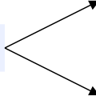

**Condition 1**


- **Condition block**

  **1**

  **Condition 2**

- **Condition block**

  Conditions


**Condition block**

**Condition 3**

**2**


**Header**

Header

**Effect**

Effect

**Policy**

Policy

**Statement**

Statement

**Principal**

Principal

**Action**

Action

**Resource**

<a id="section-12-8-3-2"></a>

#### 12.8.3.2. Statement structure

This topic describes the structure of a Statement in a policy, including elements such as Effect, Principal, Action, Resource, and the condition block, to help you manage permissions more effectively.

**Statement structure**

A Statement includes the following elements:

| Element | Description |
| --- | --- |
| Effect | Specifies whether the statement allows or denies access. The value must be <code> Allow </code> or <code> Deny </code>. |
| Principal | Do not specify the Principal element in a policy attached to a user or role, such as a MaxCompute role policy. You must specify the Principal element in a policy attached to a resource, such as a MaxCompute Project policy for a Project or its objects. |
| Action | Specifies the actions that the policy allows or denies. You can use wildcard characters such as <code> * </code> and <code> ? </code>. For example, <code> Action = * </code> refers to all actions. |
| Resource | Specifies the objects to which the statement applies. You can use wildcard characters such as <code> * </code> and <code> ? </code>. For example, <code> Resource = * </code> refers to all resources. |
| condition block | Specifies the conditions that must be met for the statement to apply. |

<a id="section-12-8-3-3"></a>

#### 12.8.3.3. Condition block structure

This topic explains the structure of a condition block within a policy statement and its evaluation logic.

**Usage notes**

- A condition block consists of one or more condition clauses. A condition clause consists of a condition operator type, a condition key, and a condition value.

- A condition block is evaluated as follows:

  - During a condition check, the condition is satisfied if the value of the key matches any of the specified values.

  - A condition clause is satisfied only if all condition keys that share the same operator type are met.

  - A condition block is satisfied only when all of its condition clauses are met.

<a id="section-12-8-3-4"></a>

#### 12.8.3.4. Condition operator types

This topic lists the condition operators available for string, numeric, date and time, boolean, and IP address data types in a policy condition clause.

**Supported operators**

| Type | Supported operators |
| --- | --- |
| STRING | • StringEquals<br>• StringNotEquals<br>• StringEqualsIgnoreCase<br>• StringNotEqualsIgnoreCase<br>• StringLike<br>• StringNotLike |
| Numeric | • NumericEquals<br>• NumericNotEquals<br>• NumericLessThan<br>• NumericLessThanEquals<br>• NumericGreaterThan<br>• NumericGreaterThanEquals |
| Date and Time | • DateEquals<br>• DateNotEquals<br>• DateLessThan<br>• DateLessThanEquals<br>• DateGreaterThan<br>• DateGreaterThanEquals |
| BOOLEAN | Bool |
| IP Address | • IpAddress<br>• NotIpAddress |

<a id="section-12-8-3-5"></a>

#### 12.8.3.5. Condition keywords

This topic describes the reserved Aliyun Cloud Service (ACS) condition keywords that MaxCompute supports. You can use these keywords in the condition clause of a policy.

**Condition keywords**

MaxCompute supports the following reserved ACS condition keywords.

| Condition keyword | Type | Description |
| --- | --- | --- |
| <code>acs:CurrentTime</code> | Date and Time | The time when the web server receives the request. The value is a string in ISO 8601 format, such as <code> 2019-11-</code><code>11T23:59:59Z </code>. |
| <code>acs:SecureTrans</code><br><code>port</code> | BOOLEAN | Indicates whether the request was sent over a secure channel, such as HTTPS. |
| <code>acs:SourceIp</code> | IP Address | The source IP address of the request. |
| <code>acs:UserAgent</code> | STRING | The UserAgent string of the requesting client. |
| <code>acs:Referer</code> | STRING | The HTTP Referer of the request. |

> **Note**
>
> **acs:SourceIp** refers to the Remote_ip of the HTTP connection, not an IP address listed in the x-forwarded-for HTTP header.
>
> For example, if  `10.230.205.105`  is a LAN IP, **acs:SourceIp** is the network's gateway egress IP. If the request passes through a proxy server, **acs:SourceIp** is the IP address of that proxy server. If multiple proxy servers are used, acs:SourceIp is the IP address of the final proxy server in the request path. The rules configured on the proxy server also affect **acs:SourceIp**.

<a id="section-12-8-4"></a>

### 12.8.4. Access policy norm

<a id="section-12-8-4-1"></a>

#### 12.8.4.1. Principal naming conventions

This topic describes the naming conventions for the Principal element in a policy, including supported identity types and their required syntax.

**Principal syntax**

The Principal identifies the requester. Currently, only Alibaba Cloud accounts, RAM users, and Taobao accounts are supported. You can specify an Alibaba Cloud account by its ID or DisplayName. The following examples illustrate these formats:

```text
"Principal": "43274"
"Principal": "ALIYUN$bob***@aliyun.com"
"Principal": ["ALIYUN$bob***@aliyun.com","ALIYUN$jack***@aliyun.com", "TAOBAO$alice"]
```

<a id="section-12-8-4-2"></a>

#### 12.8.4.2. Resource naming conventions

This topic describes the naming conventions for MaxCompute resources in the access policy language, including the naming format  `acs:<service-name>:<namespace>:<relative-id>`  and descriptions of its parameters, to help you manage and access resources.

**Format**

MaxCompute resources use the following format.

```text
acs:<service-name>:<namespace>:<relative-id>
```

**Parameters**

| Parameter | Description |
| --- | --- |
| <code>acs</code> | A reserved prefix for the resource identifier. |
| <code>service-name</code> | The name of a cloud service, such as MaxCompute, OSS, or Tablestore. |
| <code>namespace</code> | The namespace used for resource isolation. If resources are isolated by account ID, this parameter can be set to the account ID. If a service does not support this parameter, use the wildcard character (<strong>\*</strong>) instead. |
| <code>relative-id</code> | The service-specific part of the identifier. Each service defines the semantics of this part. This part supports a tree-like structure similar to a file path. For MaxCompute, the <strong>relative-id</strong> has the following format.<br><code>projects/&lt;project_name&gt;/&lt;object_type&gt;/&lt;object_name&gt;</code> |

**Resource naming examples**

| Example | Description |
| --- | --- |
| <code>*</code> | All objects in a project. |
| <code>projects/prj1/tables/t</code><br><code>1</code> | The table t1 in project prj1. |
| <code>projects/prj1/instance</code><br><code>s/*</code> | All instances in project prj1. |
| <code>projects/prj1/tables/*</code> | All tables in project prj1. |
| <code>projects/prj1/tables/t</code><br><code>aobao*</code> | All tables in project prj1 whose names start with 'taobao'. |

<a id="section-12-8-4-3"></a>

#### 12.8.4.3. Action naming conventions

This topic explains the naming conventions for Actions in a MaxCompute policy. It covers the required format for services and operations, and provides examples.

**Naming format**

```xml
<service-name>:<action-name>
```

**Parameters**

- **service-name**: The name of the service, such as MaxCompute, OSS, or Tablestore.

- **action-name**: The name of an operation on the service.

**Action naming examples**

| Action | Description |
| --- | --- |
| <code>*</code> | All operations. |
| <code>odps:*</code> | All MaxCompute operations. |
| <code>odps:CreateTable</code> | The MaxCompute CreateTable operation. |
| <code>odps:Create*</code> | All MaxCompute operations that start with Create. |

<a id="section-12-8-4-4"></a>

#### 12.8.4.4. Condition key naming conventions

This topic describes the naming conventions for condition keys in the policy language.

**ACS**

- Condition keys reserved by ACS use the following format.

  ```text
  acs:<condition-key>
  ```

- The  `condition-key`  parameter specifies one of five reserved condition keys available to all ACS services.

  The five condition keys are:

  ```text
   acs:CurrentTime 

   acs:SecureTransport 

   acs:SourceIp 

   acs:UserAgent 

   acs:Referer 
  ```

**Other services**

- Condition keys for other services use the following format.

  ```xml
  <service-name>:<condition-key>
  ```

- The  `condition-key`  parameter specifies a custom condition key defined by a specific service.

<a id="section-12-8-4-5"></a>

#### 12.8.4.5. Access policy sample

An access policy provides flexible user permission management. By defining a policy in JSON, you can specify the permitted actions, resources, and conditions. This topic provides a sample access policy.

**Policy sample**

```json
{
  "Version": "1",
  "Statement": [
    {
      "Effect": "Allow",
      "Principal": "ALIYUN$alice***@aliyun.com",
      "Action": [
        "odps:CreateTable",
        "odps:CreateInstance",
        "odps:List"
      ],
      "Resource": "acs:odps:*:projects/prj1",
      "Condition": {
        "DateLessThan": {
          "acs:CurrentTime": "2019-11-11T23:59:59Z"
        },
        "IpAddress": {
          "acs:SourceIp": "10.32.180.0/23"
        }
      }
    },
    {
      "Effect": "Deny",
      "Principal": "ALIYUN$alice***@aliyun.com",
      "Action": "odps:Drop",
      "Resource": "acs:odps:*:projects/prj1/tables/*"
    }
  ]
}
```

> **Note**
>
> This policy allows the principal  `alice***@aliyun.com`  to perform the  `CreateInstance` ,  `CreateTable` , and  `List`  actions in the  `prj1`  project. These permissions apply only to requests made before  `2019-11-11T23:59:59Z`  and from the  `10.32.180.0/23`  IP address range. The policy also explicitly denies this principal permission to delete any table in the  `prj1`  project.

<a id="section-12-8-5"></a>

### 12.8.5. Differences between Policy and ACL

This topic outlines the key differences between Policy and ACL authorization in MaxCompute to help you choose the best access control strategy.

**ACL authorization**

- To grant or revoke authorization, the Grantee (such as a User or Role) and the Object (such as a Table) must already exist. This behavior is similar to Oracle's authorization model and helps prevent security risks that can arise from deleting and recreating an object with the same name.

- Deleting an Object automatically revokes all its associated authorizations.

- ACL authorization supports only Allow (whitelisting) and does not support Deny (blacklisting).

- ACL authorization uses classic, simple, and less error-prone Grant/Revoke authorization commands. Conditional authorization is not supported.

- Best suited for simple authorization scenarios that require neither conditions nor Deny rules and involve only existing Objects.

**Policy authorization**

- You can grant or revoke Policy authorization even if the Grantee or Object does not yet exist. You can use a wildcard  `*`  to specify Objects. For example,  `projects/tbproj/tables/taobao*`  refers to all tables in the tbproj project whose names start with "taobao". This behavior is similar to MySQL's authorization model. It allows authorization for Objects that do not yet exist, but the authorizer must consider the potential security risk of deleting and then recreating an object with the same name.

- Deleting an Object does not remove its associated Policy authorization.

- Policy authorization supports both Allow (whitelisting) and Deny (blacklisting). If both an Allow and a Deny authorization apply to a request, Deny takes precedence.

- Policy authorization supports conditional authorization. You can apply conditions to an Allow or Deny authorization (20 condition operators are currently supported). For example, you can allow access only if the requester's IP address is within a specified range and the access time is before a specified time.

- Best suited for more complex authorization scenarios that require conditional authorization, Deny rules, or authorization for future Objects.

- It uses more complex Policy authorization commands.

<a id="section-12-8-6"></a>

### 12.8.6. Limits

This topic describes the limits for policy authorization, including those for users, roles, and packages.

**Limit details**

| Parameter | Description | Limit |
| --- | --- | --- |
| <code>ACCESS_POLICY_SIZE_LIMIT</code> | The maximum size of an AccessPolicy. | <code>32 KB</code> |
| <code>USER_NUMBER_LIMIT_IN_ONE_PROJECT</code> | The maximum number of users per project. | <code>1000</code> |
| <code>ROLE_NUMBER_LIMIT_IN_ONE_PROJECT</code> | The maximum number of roles per project. | <code>500</code> |
| <code>ROLE_NAME_LENGTH_LIMIT</code> | The maximum length of a role name. | <code>64 Byte</code> |
| <code>SECURITY_COMMENT_SIZE_LIMIT</code> | The maximum size of a comment. | <code>1 KB</code> |
| <code>PACKAGE_NAME_LENGTH_LIMIT</code> | The maximum length of a package name. | <code>128 Byte</code> |
| <code>ALLOW_PROJECT_NUMBER_LIMIT_IN_ONE_PA</code><br><code>CKAGE</code> | The maximum number of projects that can install a package. | <code>1024</code> |
| <code>RESOURCE_NUMBER_LIMIT_IN_ONE_PACKAGE</code> | The maximum number of resources per package. | <code>256</code> |
| <code>PACKAGE_NUMBER_LIMIT_IN_ONE_PROJECT</code> | The maximum number of packages that can be created in a project. | <code>512</code> |
| <code>INSTALLED_PACKAGE_NUMBER_LIMIT_IN_ON</code><br><code>E_PROJECT</code> | The maximum number of packages that can be installed in a project. | <code>64</code> |

<a id="section-12-9"></a>

## 12.9. Collection of security statements

<a id="section-12-9-1"></a>

### 12.9.1. Project security configuration

This topic describes statements for configuring the security of a project.

**Authorization configuration**

| Statement | Description |
| --- | --- |
| <code>SHOW SecurityConfiguration;</code> | View the security configuration of a project. |
| <code>SET CheckPermissionUsingACL=true/false;</code> | Enable or disable ACL-based authorization. |
| <code>SET CheckPermissionUsingPolicy=true/false;</code> | Enable or disable policy-based authorization. |
| <code>SET</code><br><code>ObjectCreatorHasAccessPermission=true/false;</code> | Specify whether an object creator has default access permission. |
| <code>SET</code><br><code>ObjectCreatorHasGrantPermission=true/false;</code> | Specify whether an object creator has default ACL grant permission. |

**Data protection**

| Statement | Description |
| --- | --- |
| <code>SET ProjectProtection=false;</code> | Disable the data protection mechanism. |
| <code>SET ProjectProtection=true [WITH exception</code><br><code>&lt;policy&gt;];</code> | Enable the data protection mechanism. |
| <code>LIST TrustedProjects;</code> | List the trusted projects. |
| <code>ADD TrustedProject &lt;projectName&gt;;</code> | Add a trusted project. |
| <code>REMOVE TrustedProject &lt;projectName&gt;;</code> | Remove a trusted project. |

<a id="section-12-9-2"></a>

### 12.9.2. Permission management in a project

This topic describes the statements for managing permissions in a project.

**User management**

| Statement | Description |
| --- | --- |
| <code>LIST users;</code> | Lists all users in the project. |
| <code>ADD USER &lt;username&gt;;</code> | Adds a user to the project. |
| <code>REMOVE USER &lt;username&gt;;</code> | Removes a user from the project. |

**Role management**

| Statement | Description |
| --- | --- |
| <code>LIST roles;</code> | Lists all roles in the project. |
| <code>CREATE role &lt;rolename&gt;;</code> | Creates a role in the project. |
| <code>DROP role &lt;rolename&gt;;</code> | Deletes a role from the project. |
| <code>GRANT &lt;rolelist&gt; TO &lt;username&gt;;</code> | Assigns one or more roles to a user. |
| <code>REVOKE &lt;rolelist&gt; FROM &lt;username&gt;;</code> | Revokes one or more roles from a user. |

**ACL authorization**

| Statement | Description |
| --- | --- |
| <code>GRANT &lt;privList&gt; ON &lt;objType&gt; &lt;objName&gt; TO USER</code><br><code>&lt;username&gt;;</code> | Grants privileges on an object to a user. |
| <code>GRANT &lt;privList&gt; ON &lt;objType&gt; &lt;objName&gt; TO role</code><br><code>&lt;rolename&gt;;</code> | Grants privileges on an object to a role. |
| <code>REVOKE &lt;privList&gt; ON &lt;objType&gt; &lt;objName&gt; FROM USER</code><br><code>&lt;username&gt;;</code> | Revokes privileges on an object from a user. |
| <code>REVOKE &lt;privList&gt; ON &lt;objType&gt; &lt;objName&gt; FROM role</code><br><code>&lt;rolename&gt;;</code> | Revokes privileges on an object from a role. |

**Policy authorization**

| Statement | Description |
| --- | --- |
| <code>GET policy;</code> | Retrieves the project-level policy. |
| <code>PUT policy &lt;policyFile&gt;;</code> | Sets the project-level policy. |
| <code>GET policy ON role &lt;roleName&gt;;</code> | Retrieves the policy for a specific role. |
| <code>PUT policy &lt;policyFile&gt; ON role &lt;roleName&gt;;</code> | Sets the policy for a specific role. |

**Permission check**

| Statement | Description |
| --- | --- |
| <code>whoami;</code> | Shows information about the current user. |
| <code>SHOW grants [FOR &lt;username&gt;] [ON type</code><br><code>&lt;objectType&gt;];</code> | Shows the permissions and roles assigned to a user. |
| <code>SHOW acl FOR &lt;objectName&gt; [ON type &lt;objectType&gt;];</code> | Shows the authorization details for a specific object. |
| <code>DESCRIBE role &lt;roleName&gt;;</code> | Shows the permissions of a role and the users assigned to it. |

<a id="section-12-9-3"></a>

### 12.9.3. Share resources with packages

This topic describes statements for sharing and viewing resources with packages.

**Share resources**

| Statement | Description |
| --- | --- |
| <code>CREATE package &lt;pkgName&gt;;</code> | Creates a package. |
| <code>DELETE package &lt;pkgName&gt;;</code> | Deletes a package. |
| <code>ADD &lt;objType&gt; &lt;objName&gt; TO package</code><br><code>&lt;pkgName&gt; [WITH privileges privs];</code> | Adds a resource to a package. |
| <code>REMOVE &lt;objType&gt; &lt;objName&gt; FROM package</code><br><code>&lt;pkgName&gt;;</code> | Removes a resource from a package. |
| <code>allow project &lt;prjName&gt; TO install</code><br><code>package &lt;pkgName&gt; [USING label &lt;num&gt;];</code> | Allows a project to install a package. |
| <code>disallow project &lt;prjName&gt; TO install</code><br><code>package &lt;pkgName&gt;;</code> | Prevents a project from installing a package. |

**Use resources**

| Statement | Description |
| --- | --- |
| <code>install package &lt;pkgName&gt;;</code> | Installs a package. |
| <code>uninstall package &lt;pkgName&gt;;</code> | Uninstalls a package. |

**View packages**

| Statement | Description |
| --- | --- |
| <code>SHOW packages;</code> | Lists all packages that you created or installed. |
| <code>DESCRIBE package &lt;pkgName&gt;;</code> | Displays the details of a package. |

<a id="section-13"></a>

# 13.Frequently-used tools

<a id="section-13-1"></a>

## 13.1. MaxCompute console

<a id="section-13-1-1"></a>

### 13.1.1. Usage notes

This topic describes the usage notes for the MaxCompute client.

**Usage notes**

- Do not parse data based on the output format of the MaxCompute client. The output format of the client may not be forward compatible. The command syntax and execution rules vary based on the client version.

- The MaxCompute client is a Java program. It requires Java runtime environment (JRE). You must download and install JRE V1.8 to run the MaxCompute client.

- Before you configure the client, make sure that a project is created by using an Apsara Stack tenant account and the **AccessKey ID** and **AccessKey secret** of the account are obtained.

- For more information about how to use the MaxCompute client, see Configure the MaxCompute client.

<a id="section-13-1-2"></a>

### 13.1.2. Install the MaxCompute client

This topic describes how to install and run the MaxCompute client, including client downloading and extraction, authentication configuration, and verification.

**Procedure**

1. Download the client package to your on-premises machine.

2. Extract the package to the folder in which you want to store the client. The package contains the following folders:

   ```text
   bin/
   conf/
   lib/
   plugins/
   ```

3. Modify the **odps_config.ini** file in the conf folder. The following code block shows the configuration.

   - **Template**:

     ```text
     project_name=my_project
     access_id=*******************
     access_key=*********************
     end_point= <Endpoint of MaxCompute>
     ```

   - **Parameters**:

     - The **access_id** and **access_key** parameters specify the AccessKey pair of the Apsara Stack tenant account. The **access_id** parameter specifies the **AccessKey ID**, and the **access_key** parameter specifies the **AccessKey secret**.

     - The **project_name=my_project** parameter specifies the project that you want to access. This is the default project you access each time you log in to the client. If this parameter is not configured, you must run the  `use project_name`  command to access the project after you log in to the client.

     - The **end_point** parameter specifies the endpoint of MaxCompute. The endpoint varies based on the account used.

       > **Important**
       >
       > Ensure that your security policy allows network connectivity between  `odpscmd` and the MaxCompute  `endpoint` .

4. After you modify the configuration file, run the ./bin/odpscmd command in the Linux operating system or the ./bin/odpscmd.bat command in the Windows operating system to execute SQL statements. Sample statements:

   ```sql
   CREATE TABLE tbl1(id bigint);
   INSERT OVERWRITE TABLE tbl1 SELECT count(*) FROM tbl1;
   SELECT 'welcome to MaxCompute!' FROM tbl1;
   ```

<a id="section-13-1-3"></a>

### 13.1.3. MaxCompute client configuration

This topic describes how to configure the MaxCompute client and the related parameters.

**View help information**

Run the following command to view the help information about the client:

```text
odps@ >./bin/odpscmd -h;
```

> **Note**
>
> You can also type  `h;`  or  `help;`  (not case-sensitive) in interactive mode.

**Startup parameters**

Run the following command to specify the startup parameters:

```text
Usage: odpscmd [OPTION]...
where options include:
    --help (-h)for help
    --project= use project
    --endpoint= set endpoint
    -u  -p  user name and password
    -k  will skip begining queries and start from specified position
    -r  set retry times
    -f <"file_path;"> execute command in file
    -e <"command;[command;]..."> execute command, include sql command
    -C will display job counters
```

In the following section, the **-f** parameter is used as an example.

1. Prepare the script.txt file that is stored in D:/. This file contains the following content:

   ```sql
   DROP TABLE if EXISTS test_table_mj;
   CREATE TABLE test_table_mj (id string, name string);
   DROP TABLE test_table_mj;
   ```

2. Run the following command:

   ```text
   odpscmd\bin>odpscmd -f d:/script.txt;
   ```

3. View the output information. Sample output:

   ```text
   ID = 20170528122432906gux77io3
   Log view:
   http://webconsole.odps.aliyun-inc.com:8080/logview/?h=http://service-
   corp.odps.aliyun- inc.com/api&podps_public_dev&i2017052 
   8122432906gux77io3&tokenRnlrSzJoL242YW43dFFIc1dmb1ZWZzFxQ1RFPSxPRFBTX09CTzoxMDcwMDI1NjI
   DA1 
   NjI5LDE0MzM0MjA2NzMseyJTdGF0ZW1lbnQiOlt7IkFjdGlvbiI6WyJvZHBzOlJlYWQiXSwiRWZmZWN0IjoiQWx
   3ciLCJSZXNvdXJjZSI6WyJhY3M6b2RwczoqOnB yb2plY3RzL29kcHNfcHVibGljX2Rld 
   i9pbnN0YW5jZXMvMjAxNTA1MjgxMjI0MzI5MDZndXg3N2lvMyJdfV0sIlZlcnNpb24iOiIxIn0=
   OK
   ID = 20170528122439318gcmkk6u1
   Log view:
   http://webconsole.odps.aliyun-inc.com:8080/logview/?h=http://service-
   corp.odps.aliyun- inc.com/api&podps_public_dev&i2017052 
   8122439318gcmkk6u1&tokendSt0RXdlV0M5YjZET2I1MnJuUFkzWDN1aWpzPSxPRFBTX09CTzoxMDcwMDI1NjI
   DA1NjI5LDE0MzM0MjA2ODAseyJTdGF0ZW1lbnQiOlt7IkFjdGlvbiI6WyJvZHBzOlJlYWQiXSwiRWZmZWN0Ijoi
   xsb3ciLCJSZXNvdXJjZSI6WyJhY3M6b2RwczoqOnB yb2plY3RzL29kcHNfcHVibGljX2Rld 
   i9pbnN0YW5jZXMvMjAxNTA1MjgxMjI0MzkzMThnY21razZ1MSJdfV0sIlZlcnNpb24iOiIxIn0=
   OK
   ID = 20170528122440389g98cmlmf
   Log view:
   http://webconsole.odps.aliyun-inc.com:8080/logview/?h=http://service-
   corp.odps.aliyun- inc.com/api&podps_public_dev&i2017052 
   8122440389g98cmlmf&tokenNWlwL0EvQThxUXhzcTRERDc5NFg0b2IxZ3QwPSxPRFBTX09CTzoxMDcwMDI1NjI
   D 
   A1NjI5LDE0MzM0MjA2ODAseyJTdGF0ZW1lbnQiOlt7IkFjdGlvbiI6WyJvZHBzOlJlYWQiXSwiRWZmZWN0IjoiQ
   sb3ciLCJSZXNvdXJjZSI6WyJhY3M6b2RwczoqOnB yb2plY3RzL29kcHNfcHVibGljX2Rld 
   i9pbnN0YW5jZXMvMjAxNTA1MjgxMjI0NDAzODlnOThjbWxtZiJdfV0sIlZlcnNpb24iOiIxIn0=
   OK
   ```

**Enter the interactive mode**

You can enter the interactive mode immediately after you run the following command on the MaxCompute client.

```text
[admin: ~]$odpscmd
Aliyun ODPS Command Line Tool
Version 1.0
@Copyright 2012 Alibaba Cloud Computing Co., Ltd. All rights reserved.
XXX@ XXX> insert overwrite table dual select * from dual;
```

> **Note**
>
> The first XXX indicates the identifier of MaxCompute and the second XXX indicates the current project. Type a command that is terminated by a semicolon (;) at the cursor, and press Enter to run the command.

**Specify the output format**

The output of an SQL statement is in the human-readable or machine-readable format. Human-readable is the default format. If you specify the **-M** parameter when you run odpscmd, the output format is CSV.

> **Note**
>
> This feature applies only to SELECT and READ statements and takes effect during data reading.

**Specify the statements to execute**

If you specify the **-e** or **-f** parameter and want to start with an intermediate statement among a few statements, you can specify the **-k** parameter. The -k parameter indicates that the execution starts from the specified statement and the preceding statements are skipped. If the value of the -k parameter is less than or equal to 0, the execution starts from the first statement. A statement terminated by a semicolon (;) is considered valid. During the execution, the output information shows the specific statement that is executed or failed.

For example, the dual.sql file in the tmp folder contains the following SQL statements:

```sql
DROP TABLE dual;
CREATE TABLE dual (dummy string);
INSERT overwrite TABLE dual SELECT count(*) FROM dual;
```

You can run the following command to skip the first two statements:

```text
odpscmd -k 3 -f dual.sql
```

**Obtain information about the user that is currently logged in**

Run the following command to obtain the account that is currently logged in and the endpoint that is used:

```text
whoami
```

Example:

```text
odps@ hiveut>whoami; 
Name: odpst***@aliyun.com ID: 109014***36588 End_Point: <MaxCompute service endpoint> Project: lijunsecuritytest
```

**Log off**

Run the following command to log off:

```text
odps@ > quit;
```

Alternatively, you can run the following command:

```text
q;
```

**Set the job priority**

Run the following command to set the job priority:

```text
Admin@ > ./bin/odpscmd --instance-priority=<PRIORITY>;
```

Configuration file: odps_config.ini

```text
 instance_priority=<PRIORITY> 
```

> **Important**
>
> - **&lt;PRIORITY>**: the scheduling priority of MaxCompute jobs that are submitted in the MaxCompute client.
>
> - The priority setting in the configuration file applies to all jobs submitted in the MaxCompute client.
>
> - If you do not configure  `PRIORITY` , the default priority 9 is applied.

**Dry run mode**

In dry run mode, MaxCompute parses an SQL statement to check whether the syntax of this statement is correct and generates an execution plan. In this mode, MaxCompute does not submit a distributed job. Run the following command to perform a dry run:

```text
./bin/odpscmd -y
```

**SQL reliability**

If you execute statements, such as INSERT or CREATE TABLE AS, on the MaxCompute client and an exception occurs when you run a job, the MaxCompute client automatically restores data and metadata to the status before the SQL query is run based on the known information. The exceptions include:

- Data that is overwritten by using the INSERT OVERWRITE statement during queries is restored from the temporary backup directory to the original directory.

- Data that is generated by using the INSERT INTO statement during queries is deleted.

- Tables that are created during queries or the dynamically generated partition information that does not exist before queries are deleted.

If MaxCompute fails to restore data, the following error code is returned. The error code informs you that further attempts may cause some data unrecoverable. The following error message appears:

```text
ODPS-
0110999: Critical!  Internal error happened in commit operation and rollback failed, possible breach of atomicity
```

<a id="section-13-2"></a>

## 13.2. Eclipse development plugin

<a id="section-13-2-1"></a>

### 13.2.1. Install the Eclipse development plug-in

This topic describes how to install the Eclipse development plug-in.

**Background information**

MaxCompute provides the Eclipse development plug-in to help you use SDKs for Java to develop MapReduce programs or user-defined functions (UDFs). This plug-in can simulate the operation of MapReduce programs or UDFs. It provides local debugging methods and features to generate templates. You can click Eclipse to download the plug-in package.

> **Note**
>
> Unlike the MapReduce program that runs in local mode, the Eclipse development plug-in cannot synchronize data with MaxCompute. You must manually copy the required data to the warehouse directory of the Eclipse development plug-in.

**Procedure**

1. Extract the Eclipse package to view the following JAR file in the package:

   odps-eclipse-plugin-bundle-0.16.0.jar

2. Place the JAR file in the plugins folder in the Eclipse installation directory.

3. Start the Eclipse development plug-in and click the **Open Perspective** icon in the upper-right corner, as shown in the following figure.

   

4. In the dialog box that appears, click **ODPS** and then **Open**.

   

5. The  icon appears in the upper-right corner, which indicates that the Eclipse

   development plug-in is in effect, as shown in the following figure.

   

<a id="section-13-2-2"></a>

### 13.2.2. Create a project

This topic describes how to create a project with the Eclipse development plug-in.

**Procedure**

1. You can use one of the following methods to create a project.

   **Method 1**

   In the upper-left corner of the Eclipse development plug-in, choose **File > New > ODPS Project** to create a project, as shown in the following figure.

   

   **Method 2**

   <ol type="i">

   <li>

   In the toolbar of the Eclipse development plug-in, click the  icon, as shown in the

   following figure.

   

   </li>

   <li>

   In the menu that appears, click **ODPS Project**, as shown in the following figure.

   </li>

   </ol>

   

2. The New ODPS Project Wizard dialog box appears. Enter the project name (odps is used as the project name in this example), select the path of the MaxCompute client, and click **Finish**.

   

   > **Note**
   >
   > Make sure that the MaxCompute client is installed in advance.

3. After the project is created, you can view the directory structure on the Package Explorer tab, as shown in the following figure.

   

<a id="section-13-2-3"></a>

### 13.2.3. MapReduce running example

<a id="section-13-2-3-1"></a>

#### 13.2.3.1. Run a WordCount program

This topic describes how to use MapReduce to run a WordCount program by using the Eclipse development plug-in.

**Procedure**

1. On the Package Explorer tab of the Eclipse development plug-in, choose Examples > com.aliyun.odps.examples.mr > WordCount.java from the navigation tree, as shown in the following figure.

   Figure 1. WordCount program

   

2. Right-click the **WordCount.java** program and choose **Run As > ODPS Mapreduce|Graph**, as shown in the following figure.

   Figure 2. Run the WordCount program

   

3. In the ODPS MapReduce Run Configuration dialog box, add **example_project** to the Select ODPS Project section and click **Finish**, as shown in the following figure.

   Figure 3. Run the WordCount program

   

4. After you run the WordCount program, the result is displayed, as shown in the following figure.

   Figure 4. Result returned by the WordCount program

   

<a id="section-13-2-3-2"></a>

#### 13.2.3.2. Run a custom MapReduce program

This topic provides an example on how to run a custom MapReduce program by using the Eclipse development plug-in.

**Procedure**

1. On the Package Explorer tab of the Eclipse development plug-in, choose odps > src from the navigation tree. Right-click **src** and choose **New > Mapper**.

2. In the New Mapper dialog box, enter the name of the Mapper class and click **Finish**.

   Figure 1. New Mapper dialog box

   

3. The UserMapper.java file is generated in the **src** folder shown in the navigation tree on the Package Explorer tab. The file is a Mapper class template. By default, the package name in the template is odps. The template contains the following information:

   ```java
   package odps;

   import java.io.IOException;
   import com.aliyun.odps.counter.Counter;
   import com.aliyun.odps.data.Record;
   import com.aliyun.odps.mapred.MapperBase;

   public class UserMapper extends MapperBase {
       Record word; Record one; Counter gCnt;

       @Override
       public void setup(TaskContext context) throws IOException {
           word = context.createMapOutputKeyRecord(); one = 
   context.createMapOutputValueRecord(); one.set(new Object[] { 1L });
           gCnt = context.getCounter("MyCounters", "global_counts");
       }

       @Override
       public void map(long recordNum, Record record, TaskContext context) throws IOException {
           for (int i = 0; i < record.getColumnCount(); i++) {
               String[] words = record.get(i).toString().split("\\s+");
               for (String w : words) {
                   word.set(new Object[] { w });
                   Counter cnt = context.getCounter("MyCounters", "map_outputs"); cnt.inc
   rement(1);
                   gCnt.increment(1); context.write(word, one);
               }
           }
       }

       @Override
       public void cleanup(TaskContext context) throws IOException {
       }
   }
   ```

4. On the Package Explorer tab of the Eclipse development plug-in, choose odps > src from the navigation tree. Right-click **src** and choose **New > Reducer**.

5. In the New Reducer dialog box, enter the name of the Reducer class and click **Finish**.

   Figure 2. New Reducer dialog box

   

   > **Note**
   >
   > In this example, the name of the Reducer class is UserReducer.

6. On the Package Explorer tab, the UserReducer.java file is generated in the **src** folder. The file is a Reducer class template. By default, the package name in the template is odps. The template contains the following information:

   ```java
   package odps;

   import java.io.IOException;
   import java.util.Iterator;
   import com.aliyun.odps.counter.Counter;
   import com.aliyun.odps.data.Record;
   import com.aliyun.odps.mapred.ReducerBase;

   public class UserReducer extends ReducerBase {
       private Record result; Counter gCnt;

       @Override
       public void setup(TaskContext context) throws IOException {
           result = context.createOutputRecord();
           gCnt = context.getCounter("MyCounters", "global_counts");
       }

       @Override
       public void reduce(Record key, Iterator<Record> values, TaskContext context) throws IOException {
           long count = 0;
           while (values.hasNext()) {
               Record val = values.next(); count += (Long) val.get(0);
           }
           result.set(0, key.get(0)); result.set(1, count);
           Counter cnt = context.getCounter("MyCounters", "reduce_outputs"); 
   cnt.increment(1);
           gCnt.increment(1);
           context.write(result);
       }

       @Override
       public void cleanup(TaskContext context) throws IOException {
       }
   }
   ```

7. On the Package Explorer tab of the Eclipse development plug-in, choose odps > src from the navigation tree. Right-click **src** and choose **New > MapReduce Driver**.

8. In the New MapReduce Driver dialog box, specify Name, Mapper, and Reducer, and click **Finish**.

   Figure 3. MapReduce Driver dialog box

   

9. On the left-side Package Explorer, the UserDriver.java file is generated in the src directory. The file is a MapReduce Driver class template. By default, the package name in the template is odps. The template contains the following information:

   ```java
   package odps;

   import com.aliyun.odps.OdpsException;
   import com.aliyun.odps.data.TableInfo;
   import com.aliyun.odps.examples.mr.WordCount.SumCombiner;
   import com.aliyun.odps.examples.mr.WordCount.SumReducer;
   import com.aliyun.odps.examples.mr.WordCount.TokenizerMapper;
   import com.aliyun.odps.mapred.JobClient;
   import com.aliyun.odps.mapred.RunningJob;
   import com.aliyun.odps.mapred.conf.JobConf;
   import com.aliyun.odps.mapred.utils.InputUtils;
   import com.aliyun.odps.mapred.utils.OutputUtils;
   import com.aliyun.odps.mapred.utils.SchemaUtils;

   public class UserDriver {
       public static void main(String[] args) throws OdpsException {
           JobConf job = new JobConf();
           job.setMapperClass(TokenizerMapper.class);
           job.setCombinerClass(SumCombiner.class);
           job.setReducerClass(SumReducer.class);
           job.setMapOutputKeySchema(SchemaUtils.fromString("word:string"));
           job.setMapOutputValueSchema(SchemaUtils.fromString("count:bigint"));
           InputUtils.addTable(TableInfo.builder().tableName("wc_in1").cols(new String[] 
   { "col2", "col3" }).build(), job);
           
   InputUtils.addTable(TableInfo.builder().tableName("wc_in2").partSpec("p1=2/p2=1").build
   , job);
           OutputUtils.addTable(TableInfo.builder().tableName("wc_out").build(), job);
           RunningJob rj = JobClient.runJob(job); rj.waitForCompletion();
       }
   }
   ```

0. Run the MapReduce program. Right-click the UserDriver.java file and choose **Run As > ODPS MapReduce|Graph**. The ODPS MapReduce Run Configuration dialog box is displayed, as shown in the following figure.

   Figure 4. ODPS MapReduce Run Configuration dialog box

   

1. Add **example_project** in Select ODPS Project and click **Finish** to run the MapReduce program in local mode. If the following information is displayed, the MapReduce program properly runs in local mode.

   Figure 5. Console

   

2. Right-click the warehouse folder in the navigation tree on the Package Explorer tab and select Refresh to view the output result, as shown in the following figure.

   Figure 6. Output

   

   > **Note**
   >
   > **wc_out** is the output folder, and **R_000000** is the result file. After you perform local debugging to verify that the output result is correct, you can use the export feature of the Eclipse development plug-in to package the MapReduce program for future use in a distributed environment.

3. Export the MapReduce program package.

   <ol type="i">

   <li>

   On the Package Explorer tab of the Eclipse development plug-in, choose odps > src from the navigation tree. Right-click **src** and select **Export**, as shown in the following figure.

   Figure 7. Export dialog box

   

   </li>

   <li>

   In the Export dialog box, choose  `Java > JAR file`  in Select an export destination and

   </li>

   </ol>

   click Next, as shown in the following figure.

   Figure 8. JAR Export dialog box

   

   <ol type="i" start="3">

   <li>

   In the JAR Export dialog box, choose **ODPS > src >**

   </li>

   </ol>

   **com.aliyun.odps.mapred.open.example**, and specify the mr-examples.jar file as the MapReduce program package, as shown in the following figure.

   Figure 9. Select the source and destination packages

   

   > **Note**
   >
   > In this example, the name of the MapReduce program package is **mr-examples.jar**. You can name the package based on your business requirements.

   <ol type="i" start="4">

   <li>

   Click **Finish**.

   </li>

   </ol>

4. If you want to create a project, you can create a folder at the same directory level as the example_project folder in the warehouse folder. The following figure shows the directory structure.

   

   Examples of information in schema files:

   ```text
   project=project_name table=table_name
   columns=col1:BIGINT,col2:DOUBLE,col3:BOOLEAN,col4:DATETIME,col5:STRING
   -- Information in the schema file of a non-partitioned table:
   project=project_name table=table_name
   columns=col1:BIGINT,col2:DOUBLE,col3:BOOLEAN,col4:DATETIME,col5:STRING 
   partitions=col1:BIGINT,col2:DOUBLE,col3:BOOLEAN,col4:DATETIME,col5:STRING
   -- Information in the schema file of a partitioned table:
   -- The following data types are supported: BIGINT, DOUBLE, BOOLEAN, DATETIME, and STR
   ING. These data types correspond to LONG, DOUBLE, BOOLEAN, Java.Util.Date, and Java.Lang.STRING in Java.
   ```

   Example of a data file:

   ```text
   1,1.1,true,2015-06-04 11:22:42 896,hello world
   \N,\N,\N,\N,\N
   -- The time is accurate to milliseconds. \N represents NULL for all data types.
   ```

   > **Note**
   >
   > - Before the MapReduce program runs in local mode, the program automatically checks for data tables or resources in the warehouse folder first. If the tables or resources are not found, the program downloads the tables or resources from a server to the warehouse folder.
   >
   > - After you run the MapReduce program, right-click the warehouse folder in the navigation tree on the Package Explorer tab and select Refresh to view the output result.

<a id="section-13-2-4"></a>

### 13.2.4. UDF development and running example

<a id="section-13-2-4-1"></a>

#### 13.2.4.1. Local debug UDF programs

<a id="section-13-2-4-1-1"></a>

##### 13.2.4.1.1. Run a UDF from the menu bar

This topic describes how to use the menu bar to run a user-defined function (UDF) with the Eclipse development plug-in.

**Procedure**

1. In the menu bar, choose **Run As > Run Configurations**. The following dialog box appears.

   Figure 1. Run Configurations

   

2. Create a **Run Configuration**, select the project, UDF class, class type, and ODPS project, and enter the table information, as shown in the following figure.

   Figure 2. Run Configurations 2

   

   > **Note**
   >
   > In the preceding figure, the Table parameter indicates the input table of the UDF. The Partitions parameter indicates the partitions from which you want to read data. Partition names are separated by commas (,). The Columns parameter indicates the columns that are passed as parameters of the UDF. Column names are separated by commas (,).

3. Click **Run**. The result is displayed in the console, as shown in the following figure.

   Figure 3. Console

   

<a id="section-13-2-4-1-2"></a>

##### 13.2.4.1.2. Use the right-click shortcut menu to run a UDF

This topic describes how to use the right-click shortcut menu to run a user-defined function (UDF) with the Eclipse development plug-in.

**Procedure**

1. On the Package Explorer tab of the Eclipse development plug-in, right-click a Java file in the navigation tree, such as UDFExample.java, and choose **Run As > Run UDF|UDAF|UDTF**, as shown in the following figure.

   Figure 1. Shortcut menu

   

2. In the ODPS UDF|UDTF|UDAF Run Configuration dialog box, configure related parameters, as shown in the following figure.

   Figure 2. ODPS UDF|UDTF|UDAF Run Configuration dialog box

   

   > **Note**
   >
   > In the ODPS UDF|UDTF|UDAF Run Configuration dialog box, the Table parameter indicates the input table of the UDF. The Partitions parameter indicates the partitions from which you want to read data. Separate multiple partitions with commas (,). The Columns parameter indicates the columns that are passed as the parameters of the UDF. Separate multiple columns with commas (,).

3. Click **Finish** to run the UDF and obtain the output result.

<a id="section-13-2-4-2"></a>

#### 13.2.4.2. Run a UDF

This topic describes how to run a user-defined function (UDF) with the Eclipse development plug-in.

**Procedure**

1. Right-click a project and choose **New > UDF**. You can also choose **File > New > UDF** from the menu bar. Then, enter a UDF class name and click **Finish**. A Java file with the same name as the UDF class is generated in the **src** directory. Modify the content of the Java file. Sample content in the Java file:

   ```java
   package odps;
   import com.aliyun.odps.udf.UDF;
   public class UserUDF extends UDF {
   /**
   * project: example_project
   * table: wc_in1
   * columns: col1,col2
   *
   */
   public String evaluate(String a, String b) { return "ss2s:" + a + "," + b;
   }
   }
   ```

2. Right-click the Java file, such as the UserUDF.java file, and choose **Run As > ODPS UDF|UDTF|UDAF**, as shown in the following figure.

   Figure 1. Short-cut menu

   

3. In the dialog box that appears, configure the parameters as shown in the following figure.

   Figure 2. ODPS UDF|UDTF|UDAF Run Configuration dialog box

   

4. Click **Finish** to obtain the output.

   ```text
   ss2s:A1,A2
   ss2s:A1,A2
   ss2s:A1,A2
   ss2s:A1,A2
   ```

   > **Note**
   >
   > This example shows how to run a UDF. You can use the same method to run a user-defined table-valued function (UDTF).

<a id="section-13-3"></a>

## 13.3. Logview

<a id="section-13-3-1"></a>

### 13.3.1. Use LogView to view job information

This topic describes how to use LogView to view job information. You can view the status, progress details, and execution results of jobs and the causes of exceptions.

**Usage notes**

LogView is a tool that you can use to view and debug jobs after you submit the jobs to MaxCompute. You can use LogView to view the following information of a job:

- Execution status

- Execution results

- Details of the job and the progress of each step

> **Note**
>
> When you deploy MaxCompute, LogView is deployed by default.

**LogView URL**

After you submit a job to MaxCompute, the system generates a LogView URL that starts with  `http://logview.odps.aliyun.com/logview` . You can enter the LogView URL into the address bar of a web browser to view job information.


> **Note**
>
> The LogView page of a job is valid for seven days.

**UI elements of LogView**

This section describes the UI elements of LogView.


The LogView page consists of two sections:

- ODPS Instance

- ODPS Tasks

**ODPS Instance**

The ODPS Instance section shows information about the instance that corresponds to the submitted SQL job, including URL, Project, InstanceID, Owner, StartTime, EndTime, and Status.

- You can click the value in the **Status** column to view queue information. Valid values of Status:

  - **Waiting**: The job is being processed in MaxCompute and has not been submitted to Job Scheduler.

  - **Waiting List: n**: The job has been submitted to Job Scheduler and is enqueued. n indicates the position of the job in the queue.

  - **Running**: The job is running in Job Scheduler.

  > **Note**
  >
  > If the value of Status is Terminated, the job is terminated and no queue information is available.

- After you click the value in the Status column, the following queue information is displayed:

  - **Sub Status**: the current sub-status.

  - **WaitPos**: the position of the job in the queue. The value **0** indicates that the job is running. The value **-** indicates that the job has not been submitted to Job Scheduler.

  - **QueueLength**: the queue length in Job Scheduler.

  - **Total Priority**: the priority assigned by the system to the job.

  - **SubStatus History**: You can click the icon in this column to view the status history, including the status code, status description, start time, and duration of a state. The information is unavailable in some versions.

  

**ODPS Tasks**

The ODPS Tasks section shows the information about the task that corresponds to the instance, including Name, Type, Status, Result, Detail, StartTime, EndTime, Latency (s), and TimeLine. Latency (s) in the ODPS Tasks section indicates the total duration.

- **Result**: After a job is complete, you can click the icon in the Result column to view the execution results. The following figure shows the execution results of a SELECT statement.

  

- **Detail**: You can click the icon in the **Detail** column to view the execution details. You can view the details of jobs that are running and complete.

  

- In the dialog box that shows the details of a MaxCompute job, you can view the following information:

  - A MaxCompute job consists of one or more Fuxi jobs. For example, if a complex SQL job is submitted, MaxCompute automatically submits multiple Fuxi jobs to Job Scheduler.

  - Each Fuxi job consists of one or more Fuxi tasks. For example, a simple MapReduce job generates two Fuxi tasks: map task (M1) and reduce task (R2). Multiple Fuxi tasks may be generated for a complex SQL job.

  - You can view the name of a Fuxi task. In most cases, a task name consists of letters and digits. A letter represents the type of a task, such as M for a map task. The digits that follow the letter represent the ID and dependencies of a task. For example, R5_4 indicates that the reduce task can be executed only after the J4 task is complete. J4_1_2_3 indicates that the join task can be executed only after the M1, M2, and M3 tasks are complete.

  - I/O Records indicates the numbers of input records and the number of output records of a Fuxi task.

- To view the information about the instance that corresponds to a Fuxi task, you can click the icon in the Show Detail column of the Fuxi task or double-click the Fuxi task.

  > **Note**
  >
  > Each Fuxi task consists of one or more Fuxi instances. If the amount of input data for a Fuxi task increases, MaxCompute starts more nodes for the task to process the data. A node corresponds to a Fuxi instance.

In the lower part of the dialog box, the status information about Fuxi instances at different stages is displayed in groups. For example, you can click the Failed tab to view the nodes on which errors occurred. You can click the icon in the StdOut column to view standard output information. You can also click the icon in the StdErr column to view standard error information.

> **Note**
>
> To-be-displayed information written in the submitted MaxCompute job is also displayed in the standard output information and standard error information.

**Use LogView to handle issues**

If an error occurs during a task, find the task and click the icon in the Result column in the lower part of the LogView page to view the error information. You can also click the icon in the StdErr column of a Fuxi instance in the details dialog box to view the error information of the instance.

For example, data skew is caused by the long tails of one or more Fuxi instances, which may decelerate the execution of a Fuxi task. The long tails are caused by uneven data distribution in a task. After a task is complete, you can view the execution results on the Summary tab of the details dialog box. The following output provides an example of the execution results.

```text
output records:
R2_1_Stg1: 199998999  (min: 22552459, max: 177446540, avg: 99999499)
```

If the difference between the min and max values is large, data skew occurs. For example, if a specific value appears more frequently than other values in a column, data skew occurs when you execute a JOIN statement based on this column.

<a id="section-13-3-2"></a>

### 13.3.2. Use LogView V2.0 to view job information

This topic describes the entry and features of LogView V2.0. You can access the URL of LogView V2.0 to view job information.

**Overview**

LogView V2.0 provides a newly designed UI, increases the loading speed, and delivers the following new features:

- Provides an interactive directed acyclic graph (DAG) to display the logical architecture of job processing. You can also view the operators of a job.

- Allows you to play back the job running process.

- Allows you to view memory usage and CPU utilization by using Fuxi Sensor.

**Entry point**

If you use the MaxCompute client (odpscmd) to submit a job, the system automatically generates a URL that starts with  `https://logview.aliyun.com/logview` . You can copy the URL to the address bar of a browser to access LogView V2.0.

The following figure shows the LogView V2.0 page.


| No. | Section |
| --- | --- |
| 1 | The title and functionality section. |
| 2 | The Basic Info section. |
| 3 | The job details section. |

**Title and functionality section**

This section shows the job ID and job name. The job ID uniquely identifies a MaxCompute job. The job ID is generated when you submit the job. The job name is displayed only if the job is submitted by using an SDK. You can also click the icons on the right of this section to perform operations.

| Icon | Description |
| --- | --- |
|  | Open the LogView_detail.txt file that contains job details. The file is saved on your on-premises machine. |
|  | Return to the LogView V1.0 page. |
|  | Save the job details as a file to your on-premises machine. |

**Basic Info section**

This section shows the basic information about a job.

| Parameter | Description |
| --- | --- |
| MaxCompute Service | The endpoint of MaxCompute on which the job runs. |
| Project | The name of the MaxCompute project to which the job belongs. |
| Cloud account | The Alibaba Cloud account that is used to submit the job. |
| Type | The type of the job. Valid values: SQL, SQLRT, LOT, XLib, CUPID, AlgoTask, and Graph. |
| Status | The status of the job. Valid values:<br>• <strong>Success</strong>: The job succeeds.<br>• <strong>Failed</strong>: The job fails.<br>• <strong>Canceled</strong>: The job is canceled.<br>• <strong>Waiting</strong>: The job is being processed in MaxCompute but is not submitted to Job Scheduler.<br>• <strong>Running</strong>: The job is being processed in Job Scheduler.<br>• <strong>Terminated</strong>: The job is complete. |
| Start Time | The time at which the job was submitted. |
| End Time | The time at which the job is complete. |
| Latency | The period during which the job is run. |
| Progress | The progress of the job. |
| Priority | The priority of the job. |
| Queue | The position of the job in the queue in the resource quota group. |

**Job details section**

In the job details section, you can view details about a job. This section consists of the following tabs:

- **Job Details**

  - Progress chart

    In the upper part of the **Job Details** tab, the progress chart of a job is displayed. The progress chart shows the subtask dependencies from the following dimensions: Fuxi jobs, Fuxi tasks, and operators. The progress chart also provides a series of tools to help you identify issues. The following figure shows the upper part of the Job Details tab.

    

    | No. | Description |
    | --- | --- |
    | 1 | The breadcrumb navigation that is used to switch Fuxi jobs.<strong>JOB:_SQL_0_0_0_job_0</strong> is the name of a Fuxi job. |
    | 2 | The tool that is used to troubleshoot issues. You can use Progress Chart, Input Heat Chart, Output Heat Chart, TaskTime Heart Chart, and InstanceTime Heart Chart for troubleshooting. |
    | 3 | You can click theicon to refresh the job status and click theicon to<br>zoom in or out on the progress chart. You can also click theicon to<br>obtain the MaxCompute Studio documentation and theicon to switch<br>to the upper level of the job. |
    | 4 | The zoom tool. |
    | 5 | The Fuxi task. A MaxCompute job consists of one or more Fuxi jobs. Each Fuxi job consists of one or more Fuxi tasks. Each Fuxi task consists of one or more Fuxi instances. If the amount of input data increases, MaxCompute starts more nodes for each task to process the data. A node is equivalent to a Fuxi instance. For example, a simple MapReduce job generates two Fuxi tasks: map task (M1) and reduce task (R2). If an SQL statement is complex, multiple Fuxi tasks may be generated.<br>You can view the name of each Fuxi task on the execution page. For example, M1 indicates a map task. The 3 and 9 fields in R4_3_9 indicate that the map task can be run only after M3 and C9_3 are complete.Similarly, M2_4_9_10_16 indicates that the M2 task can be run only after R4_3_9, C9_3, R10_1_16, and C16_1 are complete. R/W indicates the numbers of rows that the task reads and writes.<br>Click or right-click a task to view the operator dependencies and operator graphs of the task.<br>LogView V2.0 provides table dependencies so that you can view the input and output tables. |
    | 6 | The Fuxi task playback. You can click theicon to start or stop the<br>playback. You can also drag the progress bar. The start time and end time are displayed on the sides of the progress bar. The playing time is displayed in the middle. |
    | 7 | The thumbnail. |

    > **Note**
    >
    > - The playback feature is not applicable to Fuxi tasks that are in the Running state.
    >
    > - An AlgoTask job, such as a Platform for AI (PAI) job, contains only one Fuxi task. Therefore, no progress charts are provided for these jobs.
    >
    > - For non-SQL jobs, only Fuxi jobs and Fuxi tasks are displayed.
    >
    > - If only one Fuxi job exists, the progress chart shows the dependencies among Fuxi tasks. If multiple Fuxi jobs exist, the progress chart shows the dependencies among the Fuxi jobs.

  - Job status

    In the lower part of the **Job Details** tab, detailed information about the job is displayed. The following figure shows the upper part of the Job Details tab.

    

    | No. | Description |
    | --- | --- |
    | 1 | The Fuxi Jobs tab. You can switch Fuxi jobs on this tab. |
    | 2 | The details about the Fuxi tasks of the Fuxi job. Click a Fuxi task to display information about the Fuxi instance of this task. By default, information about the Fuxi instance of the first Fuxi task for the first Fuxi job is displayed. |
    | 3 | LogView divides instances into groups based on their status. You can click the value next to Failed to query information about faulty nodes. |
    | 4 | Fuxi Sensor. This feature is provided only for AlgoTask jobs, such as PAI jobs. You can use Fuxi Sensor to view the memory usage and CPU utilization of Fuxi instances. |
    | 5 | StdOut and StdErr. You can view the output result, error messages, and information that you want to display. You can also download the information. |
    | 6 | Debug. You can debug and troubleshoot errors. |

- **Result**

  This tab displays information based on the job status. If a job fails, this tab appears and shows the cause of the failure. The system displays data in plain text or a table based on the response format specified in MaxCompute. You can log on to the MaxCompute client and configure **odps.sql.select.output.format** to specify the format. If you set this parameter to **HumanReadable**, the result is displayed in plain text. Otherwise, the result is displayed in the CSV format.

  - Table

    

    You can perform the following operations on this tab:

    - Select a row to export data in the row.

    - Select the table heading to export data from the current page.

    - In the table heading, click the  icon and select **Select All Data** or **Deselect All**

      based on your business requirements.

    - Click **export** to export data in the CSV format. CSV is a file name extension. You can use a text file or Sublime Text to open CSV files.

  - Plain text

    

- **SourceXML**

  This tab shows the source XML information about the job that is submitted to MaxCompute.

- **SQL Script**

  This tab shows the SQL script of the job that is submitted to MaxCompute.

- **Summary**

  This tab shows the overall information about the job that is submitted to MaxCompute.

- **Json Summary**

  This tab shows the overall information about the job in the JSON format.

- **History**

  This tab shows the historical information about a Fuxi instance if the instance is run multiple times.

- **Substatus History**

  This tab shows the detailed information about a job, including the status code, status description, start time, duration, and end time.

**Fuxi Sensor**

Fuxi Sensor is a resource view that displays information about a MaxCompute job in all dimensions. You can use Fuxi Sensor to view the memory usage and CPU utilization of a Fuxi instance. You can also use Fuxi Sensor to identify job issues and analyze job performance. For example, you can use Fuxi Sensor in the following scenarios:

- If an out-of-memory (OOM) error occurs, analyze the size of memory that is used.

- Compare the numbers of requested and used resources to optimize the resource request process.

For example, you can use Fuxi Sensor to view the resource usage of a Fuxi instance.

- CPU utilization

  The cpu_usage chart has two lines. One line indicates the number of CPUs requested (cpu_plan), and the other line indicates the number of CPUs used (cpu_usage). In the y-axis, 400 indicates four processors.

  

- Memory usage

  The mem_usage chart has two lines. One line indicates the number of memory resources requested (mem_plan), and the other line indicates the number of memory resources used (mem_usage).

  mem_usage contains Resident Set Size (RSS) and PageCache. RSS indicates the memory that is allocated after kernel page faults occur. RSS is used when you call Malloc to request memory by using non-file mappings. If the memory is insufficient, RSS cannot be reclaimed. PageCache is the memory that is occupied by the kernel to cache the files that are required by read and write requests, such as log files. If the memory is insufficient, PageCache can be reclaimed.

  - Memory capacity

    

  - RSS usage

    

  - PageCache usage

    

<a id="section-14"></a>

# 14.FAQ about MaxCompute

This topic provides answers to some frequently asked questions about MaxCompute.

**How do I check the MaxCompute resource usage when SQL statements are slowly executed?**

Log in to the host where **MaxCompute AG** is deployed as an administrator and perform the following steps:

1. Run the following command to sort the hosts in ascending order of the amount of remaining resources on each host:

   ```text
   r tfrl|sed 's/,//g'|sort -t "|" -k2 -n
   ```

2. Run the following command to view the resource details of each host and total cluster resources in MaxCompute:

   ```text
   r ttrl|sed 's/,//g'
   ```

3. Calculate the ratio of remaining resources to all resources in the cluster based on the statistics obtained in the preceding steps. Then, obtain the resource usage of MaxCompute.

**Some jobs submitted by a project are slowly executed even if remaining resources in a MaxCompute cluster are sufficient. What do I do?**

A possible cause is that the resources for the quota group of the project are exhausted. Perform the following steps to check whether the resources are exhausted and determine whether to add resources to the quota group:

1. Log in to the host where **MaxCompute AG** is deployed as an administrator and run the following command to check the resource usage of the quota group:

   ```text
   r quota
   ```

2. If resources in the quota group are exhausted, you can use Apsara Big Data Manager (ABM) to modify the settings of the quota group.

**How do I modify the settings of a quota group?**

1. Log in to the host where **MaxCompute AG** is deployed as an administrator and run the following command to create or modify quotas for the quota group.

   ```text
   sh /apsara/deploy/rpc_wrapper/rpc.sh setquota -i $QUOTAID -a $QUOTANAME -t fair -s$max_cpu_quota $max_mem_quota -m $min_cpu_quota $min_mem_quota
   ```

   > **Note**
   >
   > If **$QUOTAID** exists, the quotas are modified. Otherwise, the quotas are created.

2. Log in to ABM to configure the relevant settings.

**How do I manage the metadata warehouse?**

1. Log in to the host where **MaxCompute AG** is deployed as an administrator.

2. Run the following commands:

   ```text
   /apsara/odps_tools/clt/bin/odpscmd
   ```

   ```text
   USE meta;
   ```

3. Run the following command to view all tables in the metadata warehouse:

   ```text
   SHOW tables;
   ```

4. Run the following command to obtain the description of a specific table:

   ```text
   DESC <table>;
   ```

**How do I use the smart metadata warehouse?**

You must install the metadata warehouse enhancement package **package+view** first. Before you install the package, make sure that you are the owner of a project that is granted the package installation permissions. After you install the package, you can use the smart metadata warehouse. For more information, see Package usage.

- **Installation**

  **package+view** is a metadata warehouse enhancement package. You can run the  `odpscmd --config=odps_config.ini -f init.sql`  command in the system metadata warehouse directory to complete the installation.

  > **Note**
  >
  > - If the system prompts you to re-install the package, comment out **create package** from the first line of **odpscmd --config=odps_config.ini -f init.sql**, and then run the command again.
  >
  > - **odps_config.ini** is a configuration file that contains the configuration of the account. The account you configured is also the project owner of the metadata warehouse and can access the metadata warehouse.

- **Authorization**

  Run the following command to allow you to install the package+view package for a project, such as the p1 project:

  ```text
  odpscmd --config=odps_config.ini -e "allow project p1 to install package systables;"
  ```

  Run the following command to allow you to install the package+view package for all projects:

  ```text
  odpscmd --config=odps_config.ini -e "allow project * to install package systables;"
  ```

- **User operations**

  You can run the following command in odpscmd to install the package. Before you perform this step, make sure that you are the owner of the project that is granted the package installation permissions.

  ```text
  install package meta.systables;
  ```

  After the installation is complete, you can run the following command to query the description of views in the package:

  ```text
  DESC package meta.systables;
  ```

  > **Note**
  >
  > After the preceding operations are complete, you can use the smart metadata warehouse.

- **Views**

  Run the following command to view the definitions of views.

  ```text
  DESC viewname
  ```

  | View | Description |
  | --- | --- |
  | allowed_package_installers | Information about the project that is granted the package installation permission |
  | column_label_grants | Column label authorization information |
  | column_labels | Column label information of a table |
  | columns | Table schema information |
  | installed_packages | Information about the package installed for the project |
  | object_privileges | Authorization information of tables, user-defined functions (UDFs), and resources |
  | package_resources | Object information contained in the package |
  | partitions | Partition information of a partitioned table |
  | policies | Policies that define user or role permissions |
  | resources | Resource information |
  | roles | Role information |
  | table_label_grants | Label authorization information of a table |
  | table_labels | Label information of a table |
  | tables | Table or view information |
  | tasks | Job execution records |
  | tunnels | Data upload and download records |
  | udf_resources | Information of resources used in UDFs |
  | udfs | Information of UDFs |
  | user_roles | Information of associations between users and roles |
  | users | User information |

- **Notes**

  - By default, the package+view package only allows you to query metadata witin the last 180 days.

  - If you do not run a job on a day, the metadata warehouse does not store the metadata of the day.

  - We recommend that you specify a query range to prevent a full data scan within the last 180 days.

  - The metadata of the previous day can be queried only after the metadata is generated by the metadata warehouse in the early morning of the next day. In the current configuration, metadata can be queried immediately after it is generated by the metadata warehouse.

  - The metadata warehouse does not provide metadata on the day when a project is created. The purpose is to obtain only the metadata of the projects with unique names.

**How do I grant Java sandbox permissions?**

1. Log in to AdminConsole and choose **MaxCompute Configuration > Project Management**. Select the project to which you want to grant Java sandbox permissions and double-click the project to open the property dialog box.

2. In the **ODPS Sandbox Setting** section, enter the method or class that you want to use in **Sandbox Java Permissions**.

   > **Note**
   >
   > Make sure that the content you entered is in a valid format. The following example is for reference only. Enter each item in a single line and end it with a semicolon (;).

   ```text
   permission java.lang.RuntimePermission "readSystemProperty"; permission 
   java.lang.RuntimePermission "modifyThreadGroup"; permission 
   java.security.AllPermission;
   ```

3. Click **Finish Modification**.

**What do I do if disk space is insufficient?**

In most cases, you can delete scripts to release the disk space. The most possible cause is that the root directory of **MaxCompute AG** or the **/apsara** directory occupies too much disk space. Therefore, you must delete scripts in the two directories.

**How do I add a MaxCompute host to a blacklist?**

1. Log on to **Apsara AG** as an administrator. Run the following command to enable the Fuxi blacklisting function:

   ```text
   r sgf fuximaster"{\"fuxi_Enable_BadNodeManager\":false}"
   ```

2. Run the following command to view the Fuxi blacklist:

   ```text
   /apsara/deploy/rpc_wrapper/rpc.shblacklist cluster get
   ```

3. Run the following command to add the host to the Fuxi blacklist:

   ```text
   /apsara/deploy/rpc_wrapper/rpc.shblacklist cluster add $hostname
   ```

4. Run the following command to check that the host has been added to the Fuxi blacklist:

   ```text
   /apsara/deploy/rpc_wrapper/rpc.shblacklist cluster get
   ```

**How do I export data from MaxCompute?**

You can use a Tunnel command to export data. You can also configure synchronization tasks in DataWorks to export data from MaxCompute to other destinations.

**How do I view the MaxCompute version?**

Run the following commands to obtain the version of MaxCompute:

```bash
cat /apsara/odps_info/version|grep odps
```

```bash
cat /apsara/version
```

**How do I restart services in MaxCompute?**

1. Run the following commands to save the configurations of resident services of MaxCompute to a file. This configuration file is required when you restart MaxCompute services.

   ```bash
   ssh odpsAG
   cd /home/admin/
   # If you do not use a service, you can ignore the command that is not required. 
   # You can run the r al command to view resident services. 
   r plan Odps/CGServiceControllerx > CGServiceControllerx
   r plan sys/sqlonline-OTS >sqlonline-OTS
   r plan Odps/MessagerServicex >MessagerServicex
   r plan Odps/OdpsServicex >OdpsServicex
   r plan Odps/HiveServerx >HiveServerx
   r plan Odps/XStreamServicex >XStreamServicex
   r plan Odps/QuotaServicex > QuotaServicex
   r plan Odps/ReplicationServicex >ReplicationServicex
   ```

2. Run the following commands to stop services in MaxCompute:

   ```text
   r sstop Odps/CGServiceControllerx
   r sstop sys/sqlonline-OTS
   r sstop Odps/MessagerServicex
   r sstop Odps/OdpsServicex
   r sstop Odps/HiveServerx
   r sstop Odps/XStreamServicex
   r sstop Odps/QuotaServicex
   r sstop Odps/ReplicationServicex
   ```

3. Run the following commands to start services in MaxCompute:

   ```bash
   ssh odpsAG
   cd /home/admin/
   r start CGServiceControllerx
   r start sqlonline-OTS
   r start MessagerServicex.txt
   r start OdpsServicex.txt
   r start HiveServerx.txt
   r start XStreamServicex.txt
   r start QuotaServicex.txt
   r start ReplicationServicex.txt
   ```

**How do I power off MaxCompute and then power it on?**

1. Run the following commands to save the configurations of resident services of MaxCompute to a file. This configuration file is required when you restart MaxCompute services.

   ```bash
   ssh odpsAG
   cd /home/admin/
   # If you do not use a service, you can ignore the command that is not required. 
   # You can run the r al command to view resident services. 
   r plan Odps/CGServiceControllerx > CGServiceControllerx
   r plan sys/sqlonline-OTS >sqlonline-OTS
   r plan Odps/MessagerServicex >MessagerServicex
   r plan Odps/OdpsServicex >OdpsServicex
   r plan Odps/HiveServerx >HiveServerx
   r plan Odps/XStreamServicex >XStreamServicex
   r plan Odps/QuotaServicex > QuotaServicex
   r plan Odps/ReplicationServicex >ReplicationServicex
   ```

2. Run the following commands to stop services in MaxCompute:

   ```text
   r sstop Odps/CGServiceControllerx
   r sstop sys/sqlonline-OTS
   r sstop Odps/MessagerServicex
   r sstop Odps/OdpsServicex
   r sstop Odps/HiveServerx
   r sstop Odps/XStreamServicex
   r sstop Odps/QuotaServicex
   r sstop Odps/ReplicationServicex
   ```

3. Run the following command to shut down the Apsara OS:

   ```text
   /home/admin/dayu/bin/allapsara stop
   ```

4. Run the following command to shut down compute nodes gracefully:

   ```text
   Shutdown
   ```

5. Start compute nodes.

6. Run the following command to start the Apsara OS:

   ```text
   /home/admin/dayu/bin/allapsara start
   ```

7. Run the following commands to start services in MaxCompute:

   ```bash
   ssh odpsAG
   cd /home/admin/
   r start CGServiceControllerx
   r start sqlonline-OTS
   r start MessagerServicex.txt
   r start OdpsServicex.txt
   r start HiveServerx.txt
   r start XStreamServicex.txt
   r start QuotaServicex.txt
   r start ReplicationServicex.txt
   ```

**What do I do if a host is overloaded?**

1. Log in to the overloaded host and run the  `top`  command to check whether task processes occupy a large amount of resources.

2. If the check result shows that task processes occupy a large amount of resources, terminate the tasks after these tasks are completed or after confirmation with the users.
