Alibaba Cloud  
Apsara Stack Enterprise  
Realtime Compute  
User Guide  
Product Version: V3.12.0  
Document Version: 20220928

**Table of Contents**

- [1.What is Realtime Compute?](#section-1)
- [2.Getting Started](#section-2)
    - [2.1. Log on to the Realtime Compute console](#section-2-1)
    - [2.2. Statistical analysis of frequently used words](#section-2-2)
        - [2.2.1. Overview](#section-2-2-1)
        - [2.2.2. Code development](#section-2-2-2)
        - [2.2.3. Code debugging](#section-2-2-3)
        - [2.2.4. Administration](#section-2-2-4)
    - [2.3. Big screen service for Tmall Double 11](#section-2-3)
        - [2.3.1. Overview](#section-2-3-1)
        - [2.3.2. Scenario description](#section-2-3-2)
        - [2.3.3. Preparations](#section-2-3-3)
        - [2.3.4. Register a data store](#section-2-3-4)
        - [2.3.5. Development](#section-2-3-5)
        - [2.3.6. Administration](#section-2-3-6)
- [3.Project management](#section-3)
- [4.Data Storage](#section-4)
    - [4.1. Overview](#section-4-1)
    - [4.2. Overview of data storage](#section-4-2)
        - [4.2.1. Overview](#section-4-2-1)
        - [4.2.2. Types](#section-4-2-2)
        - [4.2.3. Registration and usage](#section-4-2-3)
    - [4.3. Register a DataHub data store](#section-4-3)
    - [4.4. Register a Log Service data store](#section-4-4)
    - [4.5. Register a Tablestore data store](#section-4-5)
    - [4.6. Register an RDS data store](#section-4-6)
- [5.Data Development](#section-5)
    - [5.1. Create a job](#section-5-1)
    - [5.2. Development](#section-5-2)
        - [5.2.1. SQL code assistance](#section-5-2-1)
        - [5.2.2. SQL code version management](#section-5-2-2)
        - [5.2.3. Data store management](#section-5-2-3)
    - [5.3. Debug job code](#section-5-3)
    - [5.4. Publish a job SQL file](#section-5-4)
    - [5.5. View logs](#section-5-5)

<a id="section-1"></a>

# 1.What is Realtime Compute?

Realtime Compute is a big data processing platform that analyzes streaming data in real time based on Apsara Stack. You can create streaming data analysis and computing jobs by using Alibaba Cloud Flink SQL. When you use Flink SQL, you do not need to develop the underlying logic for streaming data processing.

As the demands for high data timeliness and operability increase, software systems need to process more data in less time. In traditional models for big data processing, online transaction processing (OLTP) and offline data analysis are separately performed at different times.

Realtime Compute is designed to respond to the increasing demand for the timeliness of data processing. The business value of data decreases as time passes by. Therefore, data must be computed and processed as soon as possible after it is generated. Traditional models for big data processing follow the scheduled processing mode, which accumulates and processes data in a computing cycle that can last hours or even days. These models cannot satisfy the growing demand for real-time big data processing. Batch processing cannot meet the business requirements in scenarios in which an extremely low processing delay is required. These scenarios include real-time big data analysis, early warning and risk control, real-time forecasting, and financial transactions. Realtime Compute enables real-time processing over data streams. With Realtime Compute, you can shorten the data processing delay, easily implement real-time computational logic, and greatly reduce computing costs. This helps you meet business requirements for real-time processing of big data.

Streaming data

Big data can be viewed as a series of discrete events. These discrete events form event streams or data streams along a timeline. Streaming data is continuously generated from thousands of data sources and is typically sent in data records. Streaming data has a smaller scale than offline data. Each type of data is produced as a stream of events. Streaming data includes a wide variety of data, such as the log files generated by your mobile or web applications, online purchases, in-game player activities, information from social networks, financial trade centers, geospatial services, and telemetry data from connected devices in data centers.

Realtime Compute has the following advantages:

- Real-time and unbounded data streams

  Realtime Compute processes data streams in real time. Streaming data is continuously generated from data sources and is subscribed and consumed in chronological order. Data streams continuously flow into the Realtime Compute system. For example, when Realtime Compute processes data streams from website visit logs, the log data streams continuously enter the Realtime Compute system as long as the website is online. In Realtime Compute, unbounded data streams are processed in real time.

- Continuous and efficient computing

  Realtime Compute is an event-driven system in which unbounded event or data streams continuously trigger real-time computations. Each streaming data record triggers a computational task. Realtime Compute performs continuous and real-time computations over data streams.

- Real-time integration of streaming data

  Realtime Compute writes the computing result of each streaming data record into the target data store in real time. For example, the system directly writes the data of a computed report to an ApsaraDB for RDS instance for report display. Realtime Compute continuously writes the results into the target data store in real time. Therefore, Realtime Compute can be viewed as a data source that generates data streams for the target data store.

<a id="section-2"></a>

# 2.Getting Started

<a id="section-2-1"></a>

## 2.1. Log on to the Realtime Compute console

This topic describes how to log on to the Realtime Compute console.

Prerequisites

- Before you log on to the Apsara Uni-manager Management Console, the endpoint of the console is obtained from the deployment staff.

- We recommend that you use Google Chrome.

Procedure

1. Enter the URL of the Apsara Uni-manager Management Console in the address bar and press the Enter key.

2. Enter your username and password.

   Obtain the username and password that you use to log on to the Apsara Uni-manager Management Console from the operations administrator.

   Note

   The first time that you log on to the Apsara Uni-manager Management Console,

   you must change the password of your account. For security purposes, your password must meet the minimum complexity requirements. The password must be 10 to 32 characters in length and must contain at least two of the following character types:

   - Uppercase or lowercase letters

   - Digits

   - Special characters, including exclamation points (!), at signs (@), number signs (#), dollar signs ($), and percent signs (%)

3. Click Log On.

4. In the top navigation bar, move the pointer over Products and click Realtime Compute.

5. Specify Organization and Region.

6. Click Blink.

<a id="section-2-2"></a>

## 2.2. Statistical analysis of frequently used words

<a id="section-2-2-1"></a>

### 2.2.1. Overview

Statistical analysis of frequently used words is widely applied in diverse fields, including the analysis of frequently used words in search engines, forums, and tags. For example, you can easily view the latest and most frequently searched words in microblogging websites through real-time statistics. Statistical analysis of frequently used words is, at its core, a simple word count job. In word count jobs for streaming data, real-time processing logic is used to analyze and display frequently used words in real time.

If you are new to working with big data computing, a word count job is for you to easily get started. The word count job in big data computing is similar to a  `Hello, World!`  program that is often the first program that a developer learns to write. The following topics take a word count job in Realtime Compute as an example to describe how to create a word count job based on real-time processing logic. This example helps you quickly get familiar with basic Flink SQL syntax and basic operations of Realtime Compute jobs, such as creating an SQL file for a job and publishing the job.

<a id="section-2-2-2"></a>

### 2.2.2. Code development

This topic uses a word count job as an example to describe how to create a Realtime Compute job.

Prerequisites

Before creating a word count job, a source table named stream_source and a result table named stream_result are created in external data stores. The stream_source table includes only one column. The column is named word and its data type is STRING. The stream_result table includes two columns. One column is named word and its data type is STRING. The other column is named cnt and its data type is BIGINT. The two tables are registered in Realtime Compute.

1. Log on to the Realtime Compute console.

2. In the top navigation bar, click Development.

3. Right-click the folder where you want to store the job file.

4. Click Create File, and the Create File page appears.

5. On the page that appears, set the following parameters:

   - File Name: Set the value to  `wordcount` .

   - File Type: Set the value to FLINK_STREAM/SQL.

   - Storage Path: Keep the default setting.

6. Enter the following code in the code editor.

   Note

   In the SQL statements for the word count job, the STRING data type for the

   referenced table must be declared as the VARCHAR data type.

   ```sql
     create table stream_source (word varchar);
   create table stream_result (word varchar, cnt bigint);
   insert into
       stream_result
   select
       t.word,
       count (1)
   from
       stream_source t
   group by
       t.word;
   ```

The following section explains the SQL code.

Line 1 creates a reference to the stream_source source table.

Note

Streaming data continuously enters Realtime Compute and triggers stream processing

procedures. Each streaming data record or each batch of data from the stream_source table triggers a stream processing procedure.

Line 2 creates a reference to the stream_result result table. The stream_result table stores the computing results of the word count job.

Note

Realtime Compute does not have built-in components for data storage, and the result

data is stored in external data stores, such as ApsaraDB for RDS and Tablestore. This line of code creates a reference to a result table that contains the result data.

Lines 5 through 11 implement the computing logic: Realtime Compute reads data from the stream_source table and counts how often words occur based on incoming data records.

Note

Flink SQL supports most standard SQL statements. This allows you to easily and cost-

effectively adopt Realtime Compute for stream processing.

The method of performing a word count job for stream processing is similar to that for batch processing. The word count job for stream processing continuously processes unbounded data streams until the job is terminated.

<a id="section-2-2-3"></a>

### 2.2.3. Code debugging

Realtime Compute provides a powerful debugging feature to verify SQL statements. You can debug Realtime Compute jobs by simulating data stores where streaming data, static data, and result data are stored.

Note

- To avoid negative impacts on online data stores, Realtime Compute is not allowed to read data from these data stores during the debugging process. Before debugging, you must prepare test data for input tables.

- The outputs of INSERT operations are exported only to local screens. This does not affect online systems.

Debugging method

1. On the top of the Development page, click Debug.

2. On the page that appears, click Download Template and edit the template based on your debugging rules.

   Note

   The file that is uploaded for debugging must meet the following requirements:

   - The file size cannot exceed 1 MB, and the file contains maximum of 1,000 records.

   - The file must use UTF-8 encoding.

   - Commas (,) cannot be used in test data, because the file uses the comma-separated values (CSV) format.

   - Numeric values can be displayed only in the general format, and cannot be displayed in the scientific notation format.

3. Click Upload to upload the file.

4. Click OK.

5. View the debugging result in the output window.

Sample file for debugging the word count job

Note

The file for debugging is in the CSV format. We recommend that you use the following

software applications to open and modify the template:

- Excel for Windows users.

- Vim or Sublime Text for MacOS users. We do not recommend that you use Number because it adds unnecessary fields when you modify CSV files.

Sample file for debugging the word count job

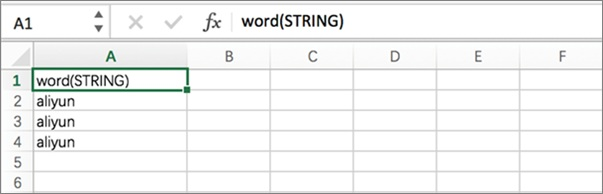

Test data

You can download test data and upload the data on the Debug File page.

Note

The *test data for statistical analysis of frequently used words* is unavailable for

download in a PDF file. You can contact system administrators to download the test data.

View the debugging result

Real-time computing is triggered by data streams. Each data record from the stream_source table triggers a stream processing procedure. After each procedure is complete, a computing result is exported. The test file contains three data records. After each data record reaches Realtime Compute, a stream processing procedure is triggered. Therefore, a total of three data records are displayed on the screen. Realtime Compute uses the following computing logic:

- The first data record (aliyun) reaches Realtime Compute. This is the first time that the system has detected the word "aliyun." Therefore, the computing result is  `<aliyun, 1>` , which is displayed on the screen.

- The second data record (aliyun) reaches Realtime Compute. The system detects an existing record of `<aliyun, 1>`  and increases the value by one. Therefore, the computing result is  `<aliyun, 2>` , which is displayed on the screen.

  

- The third data record (aliyun) reaches Realtime Compute. The system detects an existing record of  `<aliyun, 2>`  and increases the value by one. Therefore, the computing result is  `<aliyun, 3>` , which is displayed on the screen.

The third computing result  `<aliyun, 3>`  is considered as the final output of the debugging. Another sample of test data is provided for you to test the debugging feature. You can use different samples of test data and view the debugging outputs.

<a id="section-2-2-4"></a>

### 2.2.4. Administration

After the SQL file has been verified, you can publish the SQL file for the job on the Administration page of Realtime Compute. Then, you can start the job. The job runs on a Realtime Compute cluster.

Procedure

1. On the Development page, click Publish. The Publish New Version dialog box appears.

2. In the Resource Configuration step, click Next.

3. In the Check step, click Next.

4. In the Publish File step, click Publish.

5. On the Administration page, view the published word count job.

6. Click Start in the Actions column of the word count job. The Start dialog box appears.

7. Specify Start Time of Reading Data and click OK. Then, the job runs on a Realtime Compute cluster.

Result

After the job is started, click the job name. The Overview page appears.

FAQ

Q: Why does the word count job have no input or output while it is running on the distributed compute clusters of Realtime Compute?

A: When you created the  `my_source`  and  `my_result`  tables, you did not specify the data storage type of the referenced data source. In this scenario, the source table is considered to be a random table of strings or digits, and the result table is considered to be discarded data.

<a id="section-2-3"></a>

## 2.3. Big screen service for Tmall Double 11

<a id="section-2-3-1"></a>

### 2.3.1. Overview

During Double 11, a big screen shows the total sales volume of Alibaba Group in real time. The big screen service is a highlight for the shopping festival.

Stream processing for the big screen service was previously based on Apache Storm that is an open source distributed real-time computation system. The Apache Storm-based development process took around one month. The application of Flink SQL reduces the period for the development of the big screen service to three days. The underlying layer of Realtime Compute removes the Apache Storm modules that are designed for execution optimization and troubleshooting. This achieves a higher processing efficiency for Realtime Compute jobs.

<a id="section-2-3-2"></a>

### 2.3.2. Scenario description

The streaming data input for the Tmall big screen service is the transaction data from the Tmall platform. The incoming transaction data is organized based on a two-dimensional table: `tmall_trade_detail` .

| Field | Type | Description |
| --- | --- | --- |
| tid | BIGINT | The order ID. |
| buyer_uid | BIGINT | The buyer ID. |
| seller_uid | BIGINT | The seller ID. |
| gmtdate | TIMESTAMP | The time when the order is completed. |
| payment | DOUBLE | The order amount. |

Realtime Compute calculates two metrics based on the preceding table: the total number of orders and the total order amount up to the current time. The two metrics are written to an online RDS system and displayed on a big screen in real time. The online RDS system is used to store the result table: `tmall_trade_state` .

| Field | Type | Description |
| --- | --- | --- |
| gmtdate | VARCHAR(16) | The date when the order is completed. |
| trade_count | BIGINT | The total number of orders. |
| trade_sum | DOUBLE | The total order amount. |

The following topics describe how to build an end-to-end solution for the Tmall big screen service in around 10 minutes.

<a id="section-2-3-3"></a>

### 2.3.3. Preparations

Before editing Flink SQL statements for a Realtime Compute job, you must register data stores for source tables and result tables in Realtime Compute. This topic uses DataHub as an example to describe how to register a data store in Realtime Compute.

Create a DataHub topic

1. Log on to the DataHub console. For more information, see the "Log on to the DataHub console" section in *DataHub User Guide*.

2. If one or more projects have been created, click View in the Actions column for the target project. If no projects have been created, click Create Project to create a project and click View in the Actions column.

3. On the page that appears, click Create Topic.

4. Configure the topic based on the schema of the tmall_trade_state RDS table in the "Scenario description" section.

After performing these steps, you can edit Flink SQL statements for the Realtime Compute job.

Upload data to DataHub

You can upload data to the DataHub topic that you have created. To do this, follow these steps. Log on to the DataHub console. You can upload data to the DataHub topic that you have created. To do this, follow these steps:

1. Log on to the DataHub console.

2. In the left-side navigation pane, click Data Acquisition.

3. Click Upload File.

4. On the page that appears, double-click the target project and click the target DataHub topic.

5. Click Select File to select a file.

6. Click Upload.

To simplify the test procedure, you can use thetest data about the Double 11. You can download the data and then upload it to the DataHub topic for data collection.

<a id="section-2-3-4"></a>

### 2.3.4. Register a data store

The data store registration feature of Realtime Compute allows you to easily register DataHub topics, create tables, and reference data stores. To register a data store, follow these steps:

Procedure

1. Log on to the Realtime Compute console.

2. In the top navigation bar, click Development.

3. In the left-side navigation pane, click the Storage tab.

4. Click the DataHub Data Storage folder.

5. On the top of the page, click +Registration and Connection.

6. Register a DataHub project in Realtime Compute. For more information about parameter settings, see Register a DataHub project.

   If you use ApsaraDB for RDS for MySQL to store the result data for data visualization, you must register an RDS data store in Realtime Compute. For more information, see Register an RDS instance.

<a id="section-2-3-5"></a>

### 2.3.5. Development

After the data has been collected to Realtime Compute, you can continue to edit Flink SQL statements.

1. Create a reference to the source.

   To create references to the DataHub source table and RDS result table, click Data Storage in the left-side navigation pane of the Development page in the Realtime Compute console, and perform the following operations:

   - Find the target DataHub topic, and click Reference as Source Table. Realtime Compute automatically parses the schema of the topic and adds the corresponding SQL statements to the Development page.

   - Find the target RDS table, and click Reference as Result Table. Realtime Compute automatically parses the schema of the table and adds the corresponding SQL statements to the Development page.

2. Edit Flink SQL statements.

   If you have created the DataHub topic and RDS table as described in the previous topics, the Flink SQL code for the tmall_d11 job can be executed directly. Otherwise, change the names of the DataHub topic and RDS table based on the topic and table that you have created. The sample code is as follows:

   ```text
   replace into tmall_trade_state
       select
           from_unixtime(FLOOR(tmall_trade_detail.gmtdate/1000), 'yyyy-MM-dd') as gmt_date,
           count(tid) as trade_count,
           sum(payment) as trade_sum
       from
           tmall_trade_detail
       group by
           from_unixtime(FLOOR(tmall_trade_detail.gmtdate/1000), 'yyyy-MM-dd');
        
   ```

   Note

   You can modify the information about tables and fields as required.

3. Debug the Flink SQL code.

   The data during the Double 11 Shopping Festival is available for testing. To debug the code, download the test data and upload the data on the Development page for debugging.

4. Publish the SQL file for the tmall_d11 job.

   After the computational logic has been verified in the debugging phase, click Publish on the Development page to publish the SQL file for the tmall_d11 job. Then, you can view the tmall_d11 job on the Administration page of the Realtime Compute console, and manage the job in the production environment, such as starting the job.

<a id="section-2-3-6"></a>

### 2.3.6. Administration

On the Administration page, you can click Start in the Actions column and specify the parameters on the page that appears to start a stream processing job, for example, the tmall_d11 job.

Note

After you click Start, a dialog box is displayed. In the dialog box, you can specify the

start time for reading data from the source data store.

The specified start time must be earlier than the file upload time. For example, the start time can be one hour earlier than the file upload time. In the Double 11 use case, the current time is 14:10, and 10 minutes have elapsed since the source data is uploaded. Therefore, the start time is set to 13:00.

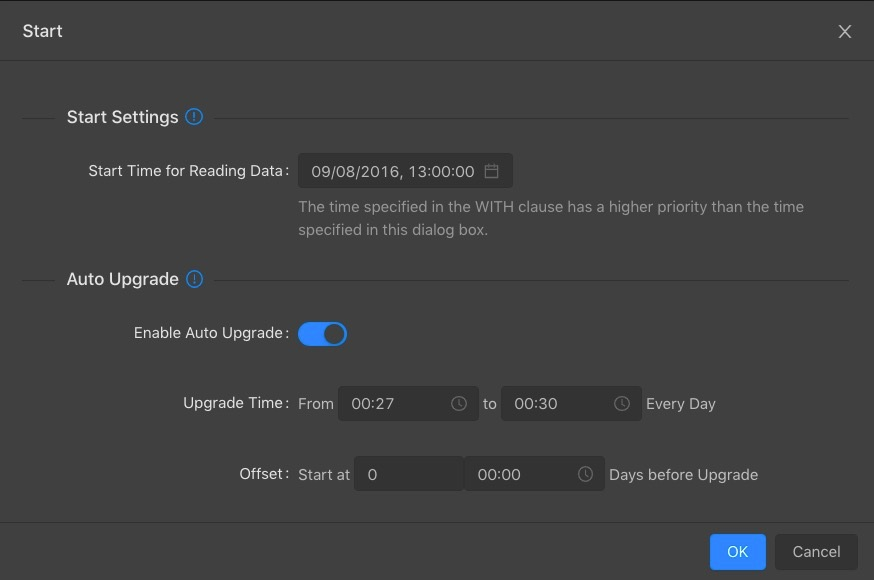

You can check the result data in the ApsaraDB for RDS data store after the job runs as expected. In the result table, five transactions and a turnover of CNY 500 are displayed. This is consistent with the source data for testing. In this way, an end-to-end verification is performed to check the SQL code.

<a id="section-3"></a>

# 3.Project management

This topic describes how to create and search for a project.

Create a project

1. Log on to the Realtime Compute console.

2. In the top navigation bar, move the pointer over your profile picture and click Project Management.

3. In the upper-right corner of the Projects page, click Create Project.

4. Configure the project information.

   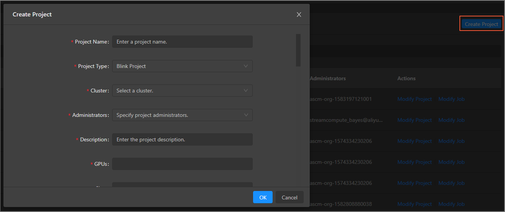

   Parameter description

   | Parameter | Description |
   | --- | --- |
   | Project Name | The name of the project. |
   | Project Type | The type of the project. Blink Project is selected by default. |
   | Cluster | The cluster on which the jobs in the project run. |
   | Administrators | The Administrators of the project. |
   | Description | The description of the project. |
   | GPUs | The number of GPUs that are used by the project. |
   | Slots | The number of compute units (CUs) that are used by the project. One CU is assigned with one CPU core and 4 GB memory. |
   | Alert Methods | The methods in which alerts are sent when errors occur during job running. You can receive alerts by using text messages or TradeManager messages. |
   | File Types | The supported file types. You can keep the default setting. |
   | Storage Types | The supported data store types. You can keep the default setting. |
   | Max Data Stores | The maximum number of data stores that can be registered in Realtime Compute. You can keep the default setting. |
   | Max File Versions | The maximum number of code versions for an SQL file. You can keep the default setting. |
   | Max Folders | The maximum number of folders that can be created in the project. You can keep the default setting. |
   | Max Folder Levels | The maximum number of folder levels in the project. You can keep the default setting. |
   | Max Files | The maximum number of job SQL files that can be created in the project.You can keep the default setting. |
   | Max Resources | The maximum number of JAR files and DICTIONARY resources that can be uploaded. You can keep the default setting. |
   | Max Referenced Resources | The maximum number of JAR files and DICTIONARY resources that can be referenced. You can keep the default setting. |
   | Monitoring and Alerting | Specifies whether to enable the monitoring and alerting feature. You can keep the default setting. |
   | Data Collection | Specifies whether to collect data while a job is running. You can keep the default setting. |
   | Data Display | Specifies whether to display data. You can keep the default setting. |
   | Metastore | Specifies whether to display metadata. You can keep the default setting. |
   | Data Storage | Specifies whether to enable data store registration. This feature is enabled by default. You can keep the default setting. |
   | Engine | Specifies whether to display the engine. You can keep the default setting. |
   | Online Logs | Specifies whether to record the job running logs. This feature is enabled by default. You can keep the default setting. |
   | Resource Management | Specifies whether resources such as JAR files can be uploaded. This feature is enabled by default. You can keep the default setting. |
   | Switch Version | Specifies whether to enable the job version switch feature. This feature is enabled by default. You can keep the default setting. |
   | Project Protection | Specifies whether to enable the project lock feature. You can keep the default setting. |

5. Click OK.

Search for a project

On the Projects page, enter a keyword or full name of a project in the search box to find the project.

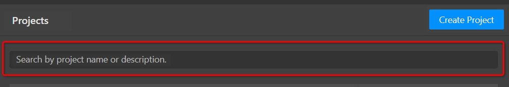

<a id="section-4"></a>

# 4.Data Storage

<a id="section-4-1"></a>

## 4.1. Overview

This chapter describes data storage systems supported by Realtime Compute.

<a id="section-4-2"></a>

## 4.2. Overview of data storage

<a id="section-4-2-1"></a>

### 4.2.1. Overview

To facilitate data storage management, you can register data storage resources on the Realtime Compute development platform. This enables you to leverage the advantages of the one-stop Realtime Compute service. In Realtime Compute, you can manage multiple data storage systems, such ApsaraDB for RDS, and Table Store. With this one-stop management service, you no longer have to navigate across multiple management consoles of different storage systems.

<a id="section-4-2-2"></a>

### 4.2.2. Types

Realtime Compute supports both streaming data storage and static data storage.

Streaming data storage

Streaming data storage systems provide inputs and outputs for downstream Realtime Compute jobs.

Streaming data storage

| Storage system | Input | Output |
| --- | --- | --- |
| DataHub | Supported | Supported |
| Log Service | Supported | Supported |
| MQ | Supported | Supported |

Static data storage

Static data storage systems provide outputs for downstream Realtime Compute jobs and allow you to perform association queries.

Static data storage

| Storage system | Dimension table | Output |
| --- | --- | --- |
| ApsaraDB for RDS | Supported | Supported |
| Table Store | Supported | Supported |

<a id="section-4-2-3"></a>

### 4.2.3. Registration and usage

This topic describes how to register and use external data stores in Realtime Compute.

Note

If a job requires the use of the data stores owned by another Apsara Stack tenant

account, you can write DDL statements to reference the data stores. In the DDL statements, you must specify the AccessKey ID and AccessKey secret of the account. In this scenario, you cannot use the codeless UI to manage the data stores.

Register a data store

To register a data store, follow these steps:

1. Log on to the Realtime Compute console.

2. In the top navigation bar, click Development.

3. In the left-side navigation pane of the page that appears, click the Storage tab. Select the folder for the data store that you want to register. Then, click +Registration and Connection.

   Register a data store

   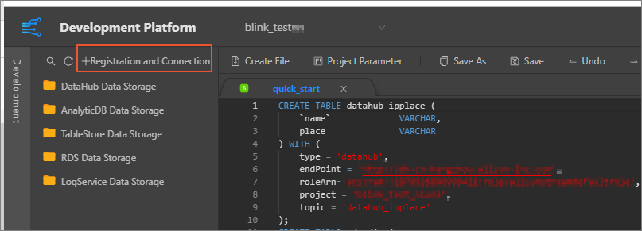

4. In the dialog box that appears, configure the required parameters and click OK.

   Note

   After you enable the data store registration feature, you can only register data stores

that are owned by your organization.

Preview data from a data store

Realtime Compute provides the data preview feature for each registered data store. To preview data, click the Storage tab and double-click the folder of the target data store in the left-side navigation pane. The following example shows how to preview data from a DataHub data store.

1. Log on to the Realtime Compute console. In the top-navigation bar, click Development. On the page that appears, click the Storage tab and double-click the DataHub Data Storage folder.

2. Double-click the target project and then the target topic to view the details.

   Table details

   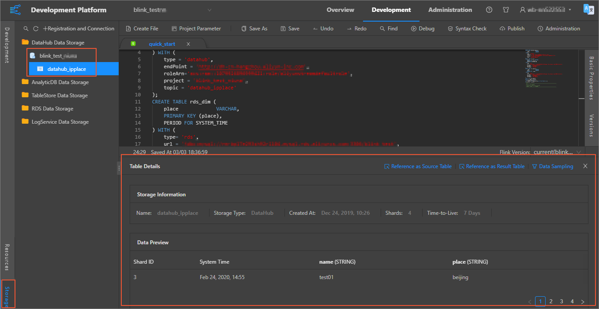

Use the auto DDL generation feature

You must declare tables from external data stores before you can reference these tables. The following example shows how to reference a source table that contains streaming data:

```sql
CREATE TABLE in_stream( a varchar, b varchar, c timeStamp) with ( type='datahub', endPoint=
'http://dh-cn-hangzhou.aliyuncs.com', project='blink_test', topic='ip_count02', accessId='L
TAIYtaf******', accessKey='gUqyVwfkK2vfJI7jF90******');
```

The field names in the table that is referenced on the Development page must be the same as those in the DataHub topic. You must declare the field data types in the code based on the field type mapping between DataHub and Realtime Compute to ensure that Realtime Compute can identify the data. Realtime Compute offers the auto DDL generation feature. The following section describes how to use this feature.

1. In the left-side navigation pane of the Development page, click the Storage tab.

2. On the Storage tab, navigate through cascaded folders and nodes to find the target table. Then, double-click the name of the target table.

3. In the Table Details pane that appears, click Reference as Source Table, Reference as Result Table, or Reference as Dimension Table as required. Then, you can obtain the DDL statements that are automatically generated to reference the target table.

To reference a source table, log on to the Realtime Compute console and open the target SQL file on the Development page. Click the Storage tab, select the table for reference, and then click Reference as Source Table. The required DDL statements are displayed on the current page.

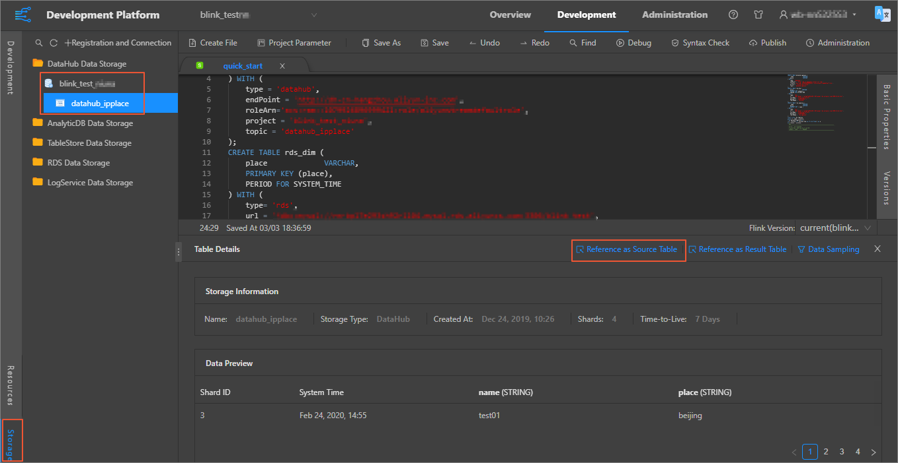

Test network connection

Realtime Compute offers the network connection test feature for data stores. This feature allows you to test the connection between Realtime Compute and a target data store. To enable the network connection test feature, follow these steps:

1. In the left-side navigation pane of the Development page, click the Storage tab.

2. In the upper-right corner of the Storage tab, click +Registration and Connection.

3. In the Register Data Store and Test Connection dialog box, turn on Test Connection.

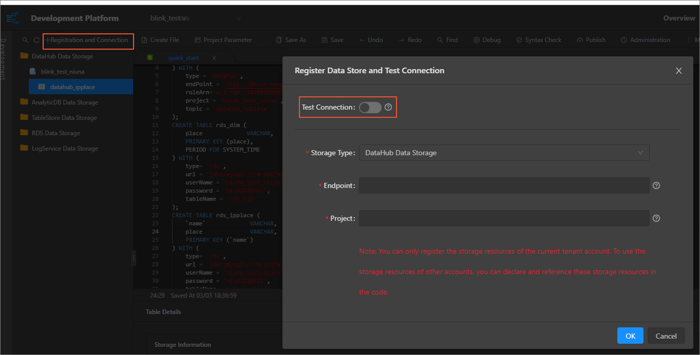

Example: Reference data stores owned by another level-1 organization

You can only register and use data stores that are owned by your level-1 organization. To use data stores that are owned by another level-1 organization, write DDL statements to create a reference to these data stores. For example, if a user from Organization A wants to use the data stores owned by Organization B, the user can enter the following DDL statements:

```sql
CREATE TABLE in_stream( a varchar, b varchar, c timeStamp) with ( type='datahub', endPoint=
'http://dh-cn-hangzhou.aliyuncs.com', project='blink_test', topic='ip_count02', accessId='AccessKey ID authorized by Organization B users', accessKey='AccessKey secret authorized by 
Organization B users');
```

<a id="section-4-3"></a>

## 4.3. Register a DataHub data store

DataHub, an Alibaba Cloud streaming data service, is a real-time data distribution platform designed to process streaming data. You can publish and subscribe to applications for streaming data in DataHub and distribute the data to other platforms. DataHub allows you to analyze streaming data and build applications based on the streaming data. Realtime Compute often uses DataHub to store source and result tables that contain streaming data.

Register a DataHub project

1. Log on to the Realtime Compute console.

2. In the top navigation bar, click Development.

3. In the left-side navigation pane, click the Storage tab.

4. Right-click the DataHub Data Storage folder and select Register Data Store to register a DataHub project in Realtime Compute.

   Parameter description

   | Parameter | Description |
   | --- | --- |
   | Test Connection | Specifies whether to enable the network connection test feature. Network connection tests are automatically performed on data stores that can be registered in Realtime Compute. To test the connection between Realtime Compute and data stores that cannot be registered, turn on the Test Connection switch. |
   | Storage Type | The type of the data store. DataHub Data Storage is selected by default. |
   | Endpoint | The endpoint of DataHub. The endpoint of DataHub varies with regions. For more information about endpoints, contact your administrator.<br>Note To specify this parameter for Apsara Stack, contact your Apsara Stack administrator to obtain the endpoint of DataHub. |
   | Project | The name of the DataHub project.<br>Note You can only register DataHub projects that are owned by your level-1 organization. For example, if DataHub Project A is owned by Organization A, users from Organization B cannot register Project A in Realtime Compute. |
   | AccessKey ID | The AccessKey ID of the current account. |
   | AccessKey Secret | The AccessKey secret of the current account. The AccessKey secret enables Realtime Compute to access the DataHub project. |

Scenarios

DataHub is a streaming data storage system that can be used to store source and result tables. However, it cannot be used to store dimension tables for Realtime Compute.

FAQ

Q: Why am I unable to register a DataHub project in Realtime Compute?

A: Realtime Compute uses a storage software development kit (SDK) to access different data stores. The Storage tab in the Realtime Compute console only helps you manage data from different data stores. You can perform the following operations to troubleshoot registration errors:

- Check whether you have created a DataHub project and have the permissions to access the project. You can log on to the DataHub console and check whether you can access the project.

- Check whether you are the project owner. You can only register DataHub projects that are owned by your level-1 organization. For example, if DataHub Project A is owned by Organization A, users from Organization B cannot register Project A in Realtime Compute.

- Check whether you have specified the correct DataHub endpoint and project name.

- Check whether you have specified a classic network endpoint for the Endpoint parameter. If you specify a VPC endpoint, the DataHub project will fail to be registered.

- Check whether you have registered the DataHub project. Realtime Compute provides a registration check mechanism to prevent duplicate registration.

Q: Why does Realtime Compute only support time-based sampling?

A: DataHub stores streaming data, and you can only specify time parameters in the API. Therefore, Realtime Compute supports only time-based sampling.

<a id="section-4-4"></a>

## 4.4. Register a Log Service data store

Log Service (previously known as SLS) provides an end-to-end solution for log management. You can use Log Service to easily collect, subscribe to, dump, and query large amounts of log data. Realtime Compute can integrate with Log Service to process logs. This eliminates the need of data migration.

Register a Log Service project

1. Log on to the Realtime Compute console.

2. In the top navigation bar, click Development.

3. In the left-side navigation pane, click the Storage tab.

4. Right-click the LogService Data Storage folder and select Register Data Store to register a Log Service project in Realtime Compute.

   Parameter description

   | Parameter | Description |
   | --- | --- |
   | Test Connection | Specifies whether to enable the network connection test feature. Network connection tests are automatically performed on data stores that can be registered in Realtime Compute. To test the connection between Realtime Compute and data stores that cannot be registered, turn on the Test Connection switch. |
   | Storage Type | The type of the data store. LogService Data Storage is selected by default. |
   | Endpoint | The endpoint of Log Service. The endpoint of Log Service varies with regions.<br>Note For more information about the endpoint of Log Service, contact the Apsara Stack system administrator. |
   | Project | The name of the Log Service project.<br>Note You can only register Log Service projects that are owned by your level-1 organization. For example, if Log Service Project A is owned by Organization A, users from Organization B cannot register Project A in Realtime Compute. |
   | AccessKey ID | The AccessKey ID of the current account. |
   | AccessKey Secret | The AccessKey secret of the current account. The AccessKey secret enables Realtime Compute to access the Log Service project. |

Scenarios

Log Service is a streaming data storage system that can be used to store source tables and result tables. However, it cannot be used to store dimension tables for Realtime Compute.

FAQ

- Q: Why am I unable to register a Log Service project in Realtime Compute?

  A: Realtime Compute uses a storage software development kit (SDK) to access different data stores. The Storage tab in the Realtime Compute console only helps you manage data from different data stores. You can perform the following operations to troubleshoot registration errors:

  - Check whether you have created a Log Service project and have the permissions to access the project. You can log on to the Log Service console and check whether you can access the project.

  - Check whether you are the project owner. You can only register Log Service projects that are owned by your level-1 organization. For example, if Log Service Project A is owned by Organization A, a user from Organization B cannot register Project A in Realtime Compute.

  - Check whether you have specified the correct Log Service endpoint and project name.

    Note

    The endpoint must start with http and cannot end with a forward slash (/). For

    example, *http://cn-hangzhou.log.aliyuncs.com* is correct, and *http://cn-hangzhou.log.aliyuncs.com/* is incorrect.

  - Check whether you have registered the Log Service project. Realtime Compute provides a registration check mechanism that prevents duplicate registration.

- Q: Why does Realtime Compute support only time-based sampling?

  A: Log Service stores streaming data, and you can only specify time parameters in the API. Therefore, Realtime Compute supports only time-based sampling.

  Note

  To use the search feature of Log Service, log on to the Log Service console.

<a id="section-4-5"></a>

## 4.5. Register a Tablestore data store

Tablestore is a NoSQL database service that is based on the Apsara distributed system. Tablestore allows you to store and access large amounts of structured data in real time. Tablestore features massive data storage and low access delays, which makes it suitable to store dimension tables and result tables for Realtime Compute.

Register a Tablestore instance

1. Log on to the Realtime Compute console.

2. In the top navigation bar, click Development.

3. In the left-side navigation pane, click the Storage tab.

4. Right-click TableStore Data Storage and select Register Data Store. In the dialog box that appears, register a Tablestore instance in Realtime Compute.

   Parameters

   | Parameter | Description |
   | --- | --- |
   | Test Connection | Specifies whether to enable the network connection test feature. Network connection tests are automatically performed on data stores that can be registered in Realtime Compute. To test the connection between Realtime Compute and data stores that cannot be registered, turn on the Test Connection switch. |
   | Storage Type | The type of the data store. TableStore Data Storage is selected by default. |
   | Endpoint | The endpoint of the Tablestore instance. You must enter the internal endpoint of the Tablestore instance. You can log on to the Tablestore console to view the internal endpoint of the instance. |
   | Instance Name | The name of the Tablestore instance. |
   | AccessKey ID | The AccessKey ID of the current account. |
   | AccessKey Secret | The AccessKey secret of the current account. The AccessKey secret enables Realtime Compute to access the Tablestore instance. |

<a id="section-4-6"></a>

## 4.6. Register an RDS data store

This topic describes how to register and use an ApsaraDB for RDS data store in Realtime Compute.

RDS overview

RDS offers a stable, reliable, and scalable online database service. Based on the Apsara distributed system and high performance SSD storage, RDS supports a wide range of engines, such as MySQL, PostgreSQL, and Postgres Plus Advanced Server (PPAS, highly compatible with Oracle). Realtime Compute supports the following RDS engines: MySQL and PostgreSQL.

The performance of Tablestore in high concurrency scenarios where large amounts of data need to be processed is higher than that of RDS. The performance of RDS is restricted by the limits of relational models. Therefore, RDS is often used to store result tables for Realtime Compute. In low concurrency scenarios where a small number of data needs to be processed, RDS can be used to store dimension tables.

Note

Realtime Compute uses relational databases, such as ApsaraDB RDS for MySQL, to store

result data. Distributed Relational Database Service (DRDS) and RDS connectors are used. If Realtime Compute frequently writes data into a DRDS or RDS table, deadlocks may occur. In scenarios that require high queries per second (QPS), high transactions per second (TPS), or highly concurrent write operations, we recommend that you do not use DRDS or RDS to store the result tables of Blink jobs. To prevent deadlocks, we recommend that you use Tablestore to store result tables.

Register an RDS instance

1. Log on to the Realtime Compute console.

2. In the top navigation bar, click Development.

3. In the left-side navigation pane, click the Storage tab.

4. Right-click RDS Data Storage, and select Register Data Store. In the dialog box that appears, register an RDS instance in Realtime Compute.

   Parameters

   | Parameter | Description |
   | --- | --- |
   | Test Connection | Specifies whether to enable the network connection test feature. Network connection tests are automatically performed on data stores that can be registered in Realtime Compute. To test the connection between Realtime Compute and data stores that cannot be registered, turn on the Test Connection switch. |
   | Storage Type | The type of the data store. RDS Data Storage is selected by default. |
   | URL | The connection URL of the RDS database. |
   | DBName | The name of the RDS database to be accessed by Realtime Compute.<br>Note This parameter specifies the RDS database name instead of the RDS instance name.<br>RDS uses whitelists for access control to ensure system security. The IP addresses of the Realtime Compute console and worker nodes must be added to RDS whitelists. Otherwise, Realtime Compute may fail to connect to RDS. For more information, see Specify whitelist settings. |
   | User Name | The username that you use to log on to the RDS database. |
   | Password | The password that you use to log on to the RDS database. |
   | Engine | The type of the RDS database. Valid values:<br>• mysql<br>• postgresql<br>• sqlserver |

Reference an RDS table as a result table

After you register an RDS data store, double-click the RDS database, double-click the RDS table that you want to reference as a result table, and then click Reference as Result Table.

Reference an RDS table as a result table

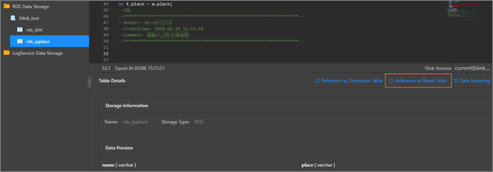

After you click Reference as Result Table, Realtime Compute automatically generates the corresponding DDL statements on the current page.

Result Result

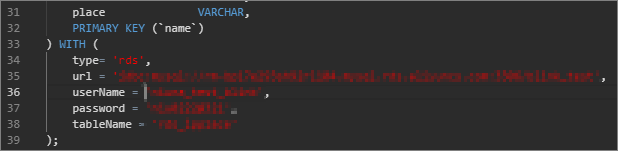

If the following error message appears, troubleshoot and rectify the fault as follows.

Error message

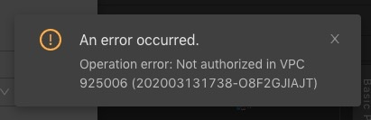

The error occurs because a VPC (not a classic network) was selected when you created the RDS instance. To rectify this fault, follow these steps:

1. Move the pointer over the administrator icon, as shown in the following figure.

   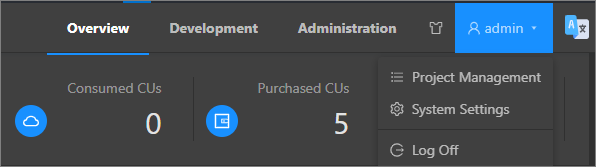

2. Click System Settings.

3. In the left-side navigation pane, click VPC Access Authorization.

4. Click Add Authorization. The Authorize StreamCompute VPC Access page appears.

   Authorization

   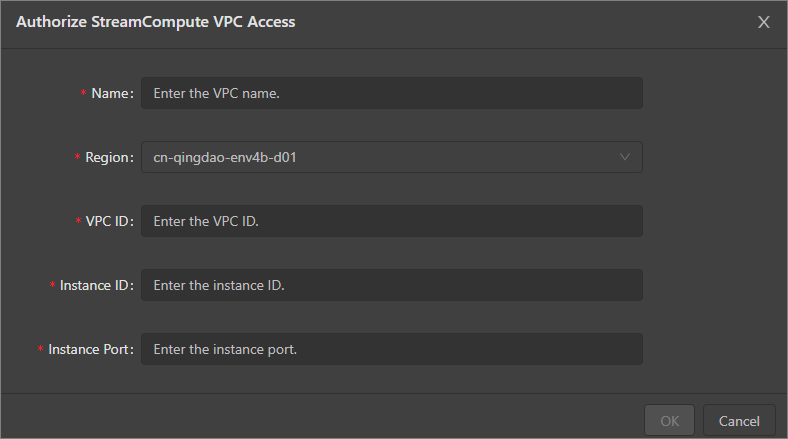

   Parameters

   | Parameter | Description |
   | --- | --- |
   | Name | The name of the VPC. |
   | Region | The region where RDS resides. |
   | VPC ID | The ID of the VPC. |
   | Instance ID | The ID of the RDS instance. You can log on to the RDS console and view the instance ID.Instance information<br>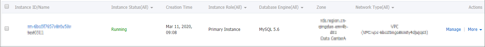 |
   | Instance Port | The access port for the RDS instance. To view the internal port number, log on to the RDS console, click the target instance ID or name in the Instance ID/Name column. On the page that appears, view the internal port number in the Basic Information section. |

5. Register the target RDS instance. You must specify the required parameters during the registration.

You can only register data storage resources that are owned by your level-1 organization. For example, if RDS Instance A is owned by Organization A, a user from Organization B cannot register RDS Instance A in the Realtime Compute console. To use Instance A in a stream processing job, the user from Organization B must use SQL code to create a reference to Instance A.

Note

If you want to use the RDS storage resources owned by your level-1 organization, we

recommend that you do not use SQL code to create a reference to these resources.

The user from Organization B must also specify the following parameters in the WITH clause based on the information of Instance A: url, userName, password, and tableName.

Configuration Configuration

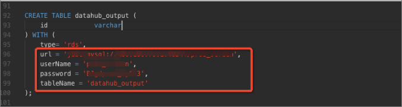

To use RDS storage resources by writing SQL code, the user from Organization B must specify whitelist settings.

Specify whitelist settings

Some data stores use whitelists for access control to ensure high-level security. These data stores allow access only from the IP addresses that are added to the whitelists. This prevents unauthorized Apsara Stack services from accessing data in these data stores. For example, a newly created RDS database denies all access. You must add IP addresses to the RDS database whitelists to allow access to the database.

RDS can be accessed from both external and internal networks. To enable Realtime Compute to access RDS, you must add the CIDR blocks of Realtime Compute to RDS whitelists.

To do this, follow these steps:

1. Log on to the ApsaraDB for RDS console.

2. On the Instances page, click the ID of an instance in the Instance ID/Name column.

3. In the left-side navigation pane, click Data Security.

4. On the Whitelist Settings tab, click Edit corresponding to the default whitelist.

   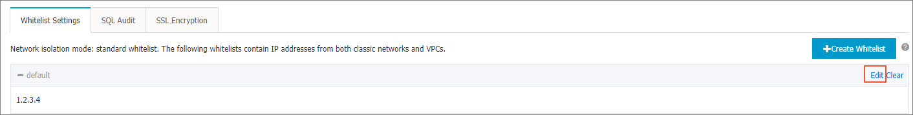

   Note

   - To connect an ECS instance to an RDS instance by using an internal endpoint, you must make sure that the two instances are in the same region and have the same network type. Otherwise, the connection fails.

   - You can also click Create Whitelist to create a new whitelist.

5. In the Edit Whitelist dialog box that appears, specify the IP addresses or CIDR blocks that are used to access the instance, and then click OK.

   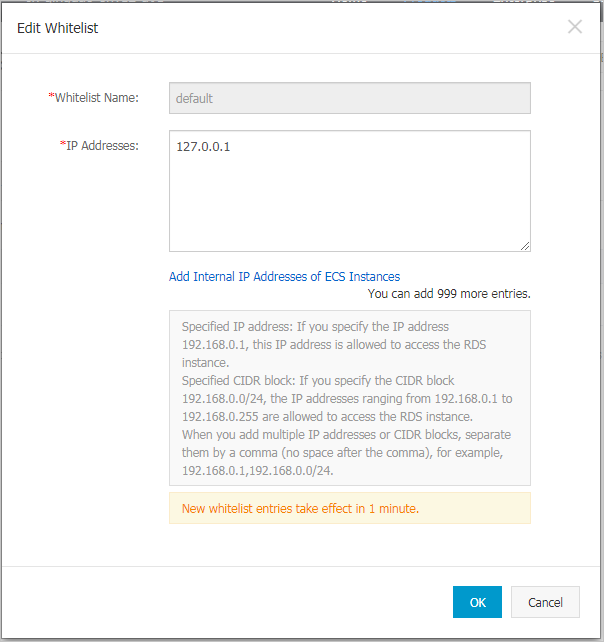

   - If you specify the 10.10.10.0/24 CIDR block, IP addresses in the 10.10.10.X format are allowed to access the RDS instance.

   - If you want to add multiple IP addresses or CIDR blocks, separate entries with commas (without spaces), such as 192.168.0.1,172.16.213.9.

   - After you click Add Internal IP Addresses of ECS Instances, the IP addresses of all the ECS instances under your Apsara Stack account are displayed. You can select the required IP addresses to add to the whitelist.

     Note

     If you add a new IP address or CIDR block to the default whitelist, the default

     address 127.0.0.1 is automatically deleted.

Troubleshooting

- Fault description

  A stack exception occurs while the system is running, as shown in the following figure.

  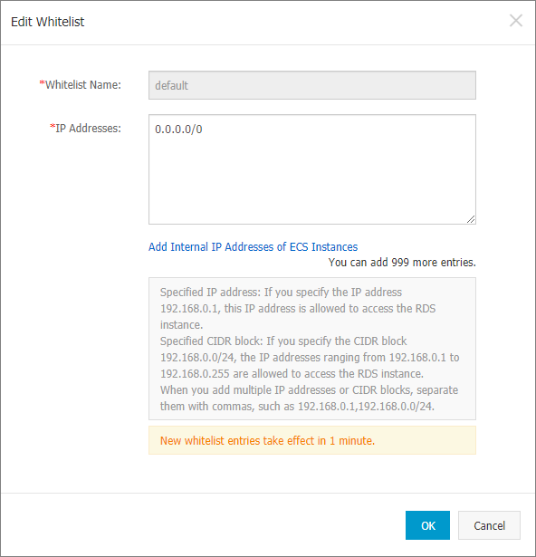

- Solution

  Add the IP address of your region to an RDS whitelist. For more information, see Specify whitelist settings.

<a id="section-5"></a>

# 5.Data Development

<a id="section-5-1"></a>

## 5.1. Create a job

This topic describes how to create a Realtime Compute job.

Procedure

1. Log on to the Realtime Compute console.

2. Click Development Platform.

3. Click Development in the top navigation bar.

4. Click Create File in the toolbar.

5. In the Create File dialog box, specify the required fields.

   | Field | Description |
   | --- | --- |
   | File Name | The name of the file. The specified name must be 3 to 64 characters in length and can contain lowercase letters, digits, and underscores (_). It must start with a lowercase letter. |
   | File Type | The type of the file. Valid values: FLINK_STREAM/SQL and FLINK_STREAM/DATASTREAM. |
   | Storage Path | The folder of the file. You can click the icon on the right side of an existing folder and create a subfolder. |

6. Click OK.

<a id="section-5-2"></a>

## 5.2. Development

<a id="section-5-2-1"></a>

### 5.2.1. SQL code assistance

The development platform of Realtime Compute offers a complete set of SQL tools in the integrated development environment (IDE). These tools provide the following features to help you with Flink SQL-based development:

- Syntax check

  On the Development page of Realtime Compute, the revised script is automatically saved. When the script is saved, an SQL syntax check is automatically performed. If a syntax error is detected, the Development page shows the row and column where the error is located, and the cause of the error.

- Intelligent code completion

  When you enter SQL statements on the Development page of Realtime Compute, auto completion popups about keywords, built-in functions, tables, or fields are automatically displayed.

- Syntax highlighting

  Flink SQL keywords are highlighted in different colors to differentiate data structures.

<a id="section-5-2-2"></a>

### 5.2.2. SQL code version management

Realtime Compute provides key features that help you complete development tasks, such as coding assistance and code version management. A new code version is generated each time you publish a job SQL file. The code version management feature allows you to track code changes and roll back to an earlier version if required.

- Manage code versions

  On the Development page, you can manage Flink SQL code versions. A new code version is generated each time you publish a job SQL file. You can use the code version management feature to track versions, modify the code, and roll the code back to an earlier version.

  On the Versions tab on the right side of the Development page, click More in the Actions column to manage code versions.

  - Compare: Check the differences between the current version and an earlier version.

  - Rollback: Roll back to an earlier version.

  - Delete: Delete an earlier version.

  - Locked: Lock the current version.

    Note

    You cannot submit a new version before you unlock the SQL file.

- Delete code versions

  A snapshot of a code version is created each time you submit an SQL file for publishing a job. This allows you to track code changes. The maximum number of code versions has been specified. If you use Apsara Stack, a maximum of 20 code versions can be published. To find out the maximum number of code versions in other environments, contact the system administrator. If the number of code versions reaches the upper limit, an error message is displayed to alert you to delete one or more earlier versions.

  In this scenario, you must delete one or more earlier versions before you publish new versions. To do this, click the Versions tab on the right side of the Development page, click More in the Actions column, and select Delete to delete expired versions that are no longer needed.

<a id="section-5-2-3"></a>

### 5.2.3. Data store management

The Development page of the Realtime Compute console provides an easy and effective method to manage data stores. For example, you can register external data stores to reference the data stores.

- Data preview

  The Development page of Realtime Compute allows you to preview data from a wide range of data stores. Data preview allows you to analyze the characteristics of upstream and downstream data, identify key business logic, and complete development tasks with high efficiency.

- Auto DDL generation

  Realtime Compute provides the auto DDL generation feature. The system can automatically generate DDL statements to reference data stores that can be registered in Realtime Compute. This feature provides a simple method to edit SQL statements for stream processing jobs. This improves overall efficiency and reduces errors when you manually enter SQL statements.

<a id="section-5-3"></a>

## 5.3. Debug job code

The Realtime Compute development platform provides a simulated running environment where you can customize uploaded data, simulate operations, and check outputs.

After you write the SQL code that implements the computing logic, follow these steps to debug the code:

1. Log on to the Realtime Compute console.

2. In the top navigation bar, click Development.

3. In the left-side navigation pane, click Development.

4. On the Development tab, double-click the target folder and file name to open the job file.

5. In the top menu bar, click Syntax Check.

   Note

   You can use the syntax check feature to check whether the SQL file includes syntax

   errors. Error messages are displayed for syntax errors.

6. In the top menu bar, click Debug. On the Debug File page, debug your SQL code.

   The test data for debugging can be acquired by using either of the following two methods:

   - Upload local data.

     <ol type="a">

     <li>

     Click Download Template.

     </li>

     <li>

     Prepare test data based on the template.

     </li>

     </ol>

     <ol type="i" start="100">

     <li>

     Click Upload. After the file is uploaded, you can view the uploaded data in the data preview section.

     </li>

     </ol>

   - Sample online data.

     <ol type="a">

     <li>

     Click Random Online Data Sampling or Sequential Online Data Sampling.

     </li>

     <li>

     View the sampled data in the data preview section.

     </li>

     </ol>

7. Click OK.

8. In the output window, view the debugging result.

The debugging feature of Realtime Compute provides the following functions:

- Enables isolation between debugging and production environments.

  In the debugging environment, the Flink SQL code runs in a separate container, and computing result data is only displayed on the screen of the Development page. In this way, the debugging does not affect the running jobs and data stores in the production environment.

  In the debugging phase, result data is not written to external data stores. In the production environment, failures may occur due to format errors when result data is written to the target data stores. Such failures cannot be identified or prevented in the debugging phase, and can be detected only while jobs are running. For example, failures may occur in the production environment if your result data is too long. This occurs when the result data is written to a result table in ApsaraDB for RDS and the length of character strings reaches the upper limit for an RDS table. The Realtime Compute team is working on support for writing result data to external data stores in the production environment. This allows you to effectively simulate the production environment and resolve more issues in the debugging phase.

  Isolation between debugging and production environments

  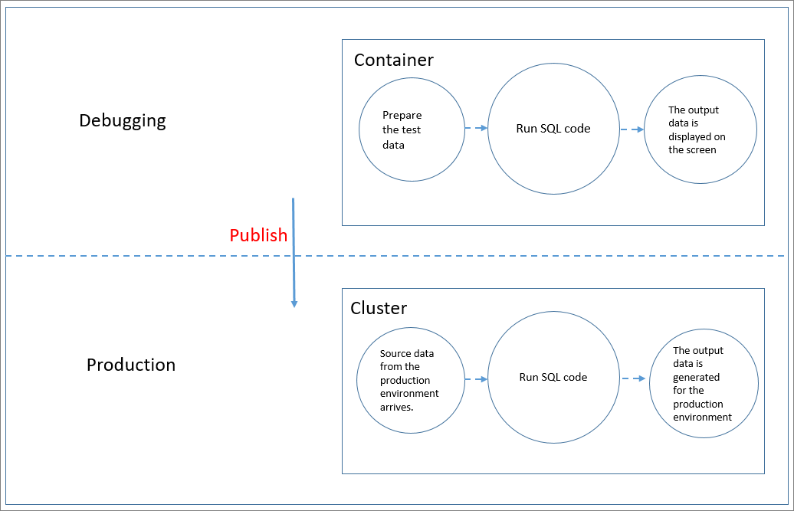

- Supports the customization of test data.

  In the debugging environment, Realtime Compute does not read data from source data stores, such as DataHub topics that store source tables and RDS instances that store dimension tables. You must create a set of test data and upload the test data on the Development page.

  To make the debugging feature easy to use, Realtime Compute provides a template of test data for each type of job. You can download the template and enter your test data.

  Note

  We recommend that you use the templates to prevent errors.

- Specifies a separator.

  A comma (,) is used as the separator in files for debugging by default. An example of a file for debugging is described as follows:

  ```text
  id,name,age
  1,alicloud,13
  2,stream,1
  ```

  If the separator is not specified, a comma (,) is used to separate fields. If you need to use a JSON string as the field data and the string contains commas (,), you must specify another character as the separator.

  Note

  Realtime Compute allows you to specify a character as the separator, but not a

  multi-character string, such as aaa.

  ```text
  id|name|age
  1|alicloud|13
  2|stream|1
  ```

  In this example, specify the debug.input.delimiter parameter as follows:

  `debug.input.delimiter=|` .

  Specify a separator

  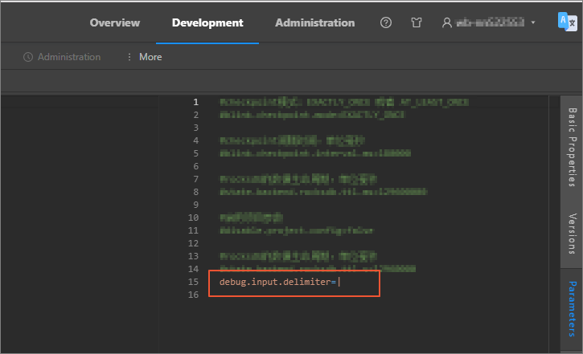

<a id="section-5-4"></a>

## 5.4. Publish a job SQL file

After you have created and debugged a job Flink SQL file, you can publish the SQL file and manage the job in the production environment.

Procedure

1. Log on to the Realtime Compute console.

2. In the top navigation bar, Click Development.

3. In the top menu bar, click Publish.

4. In the dialog box that appears, select Automatic CU Configuration. If you are performing automatic configuration for the first time, we recommend that you use the default number of CUs. Click Next.

   Configure resources

   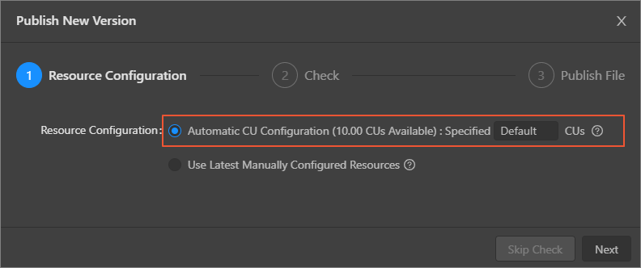

5. Check the data. After the check is completed, click Next.

6. Click Publish.

7. Go to the Administration page to start the job.

   <ol type="i">

   <li>

   In the top navigation bar, click Administration.

   </li>

   <li>

   On the Administration page, find the target job, and click Start in the Actions column.

   </li>

   </ol>

<a id="section-5-5"></a>

## 5.5. View logs

You can view job logs to check the job run information. This topic describes how to view job logs.

Procedure

1. Go to the Administration page in Realtime Compute.

   <ol type="i">

   <li>

   Log on to the Realtime Compute console.

   <ol type="i" start="2">

   <li>

   In the top navigation bar, click Administration.

   </li>

   <li>

   On the Jobs page that appears, click the target job name in the Job Name column.

   </li>

   </ol>

   </li>

   </ol>

2. At the bottom of the Overview page, click the name of the target vertex.

   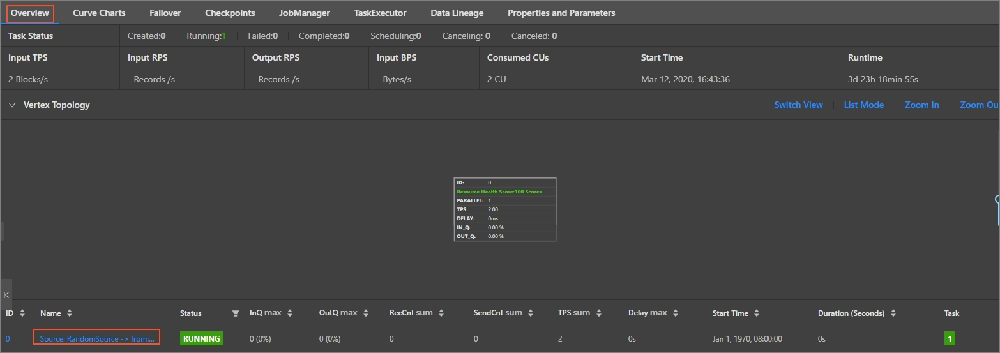

3. On the Execution Vertex page, click the Subtask List tab, and click View Logs in the Actions column.

   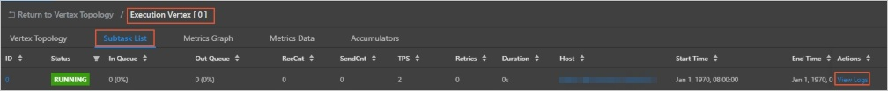

4. In the Log dialog box that appears, click View Logs for taskmanager.log in the Actions column.

   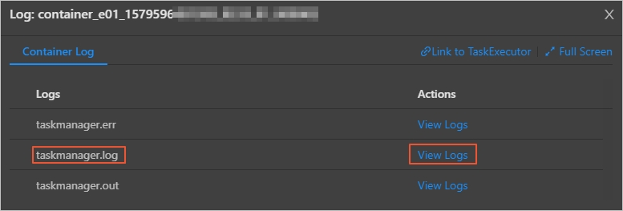

5. On the Container Log tab, view the log entries.

   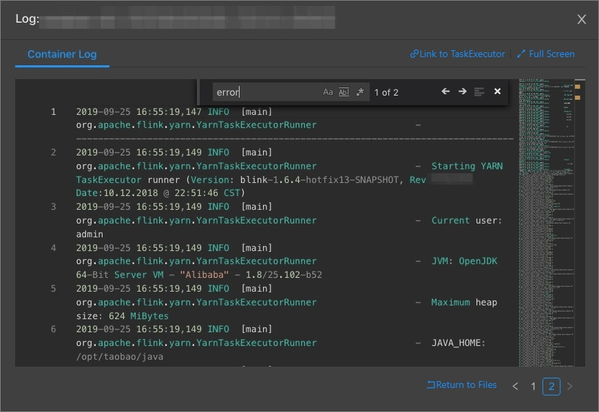

   Note

   You can press Ctrl+F for Windows or Cmd+F for MacOS to search for specified log

   entries. We recommend that you view the logs from the last page. The first  `error`  log entry describes the root cause of the job error.
